# LMT Deep Value Intelligence

**Analysis Date:** 2026-03-31

## Critical Disclaimer

*This analysis is generated by Deep Value Intelligence, an AI-powered multi-agent investing framework. This report is for informational and educational purposes only and does not constitute financial advice. Always conduct your own research and consult with qualified financial advisors before making investment decisions.*

---

## Table of Contents

1. Intelligence Summary
2. Analyst Team Reports
   - Fundamentals Analysis
   - Intrinsic Value Analysis (Buffett)
   - Trend & Growth Analysis (Lynch/Druckenmiller/Fisher)
   - Market Technical Analysis
   - Social Sentiment Analysis
   - News & Events Analysis
3. Research Team Commentary
4. Value Investing Team Commentary
5. Deep Values Commentary

---

## Intelligence Summary

### Thesis + Conditions

**Core Thesis:** EXECUTIVE SUMMARY (Concise)

**Key Risks:**
- Lockheed Martin is a high-quality defense franchise with a durable moat built on decades-long military platforms, trusted government relationships, and strong capital efficiency. However, the current price (~$600, ~28x earnings) already assumes favorable geopolitical conditions and continued defense spending strength. The business itself appears stable, but shareholder returns from this price depend more on macro defense cycles than on internal growth. Without a clear margin of safety relative to intrinsic value estimates (~$420-$440 in conservative models), the risk is paying a premium for stability rather than buying undervalued compounding.
- Risky Analyst (Bullish Perspective)
- Finally, the bullish thesis rests on a potential geopolitical regime shift. If NATO, Europe, and Asia maintain structurally higher defense spending for decades, Lockheed may experience stronger demand than its historical 5-6% growth suggests.
- Safe Analyst (Risk-Control Perspective)
- The Safe Analyst also highlights the valuation risk. Net income recently declined (-6%), yet the market values the company at nearly 28x earnings. If growth remains mid-single-digit and sentiment cools, the stock could revert toward valuation models around $420-$450.

**What Would Change Our View:**
- Lockheed Martin is a high-quality defense franchise with a durable moat built on decades-long military platforms, trusted government relationships, and strong capital efficiency. However, the current price (~$600, ~28x earnings) already assumes favorable geopolitical conditions and continued defense spending strength. The business itself appears stable, but shareholder returns from this price depend more on macro defense cycles than on internal growth. Without a clear margin of safety relative to intrinsic value estimates (~$420-$440 in conservative models), the risk is paying a premium for stability rather than buying undervalued compounding.
- Risky Analyst (Bullish Perspective)
- Finally, the bullish thesis rests on a potential geopolitical regime shift. If NATO, Europe, and Asia maintain structurally higher defense spending for decades, Lockheed may experience stronger demand than its historical 5-6% growth suggests.
- Safe Analyst (Risk-Control Perspective)
- The Safe Analyst also highlights the valuation risk. Net income recently declined (-6%), yet the market values the company at nearly 28x earnings. If growth remains mid-single-digit and sentiment cools, the stock could revert toward valuation models around $420-$450.

**Confidence:** Medium

---

## Analyst Team Reports

### Fundamentals Analysis

#### Latest Earnings Snapshot

*Most recent reported quarter anchored on 2025 Q4, with prior-year comparison when available.*

| Metric | 2025 Q4 | 2024 Q4 | YoY Change |
| --- | ---: | ---: | ---: |
| Revenue | $20.32B | $18.62B | +9.1% |
| Operating Income | $2.33B | $696.0M | +234.9% |
| Net Income | $1.34B | $527.0M | +155.0% |
| Diluted EPS | $5.80 | $2.22 | +161.3% |
| Operating Cash Flow | $3.22B | $1.02B | +214.7% |
| Free Cash Flow | $2.76B | $441.0M | +524.9% |

Key Takeaways: This snapshot anchors the most recent reported quarter before the narrative analysis. It helps readers separate long-run business quality from whatever changed in the latest earnings print.

#### 10-Year Financial Metrics for LMT

*All values below are computed deterministically from raw data - not estimated by AI.*

*Issuer profile: operating company (Industrials / Aerospace & Defense).*

#### 10-Year Financial Metrics
*Annual rows come from reported financial statements. The final TTM row is computed from the latest four quarters.*

| Metric | 2016 | 2017 | 2018 | 2019 | 2020 | 2021 | 2022 | 2023 | 2024 | 2025 | 2026 TTM |
| --- | --- | --- | --- | --- | --- | --- | --- | --- | --- | --- | --- |
| Market Price | $200 | $263 | $220 | $336 | $314 | $317 | $446 | $427 | $470 | $481 | $601 |
| Market Cap | $60.54B | $76.48B | $63.14B | $95.31B | $88.31B | $89.86B | $128.73B | $113.85B | $116.24B | $112.94B | $139.35B |
| P/E Ratio | 60.51 | N/A | 49.99 | 63.22 | 49.07 | 14.18 | 22.46 | 16.45 | 21.78 | 22.51 | 27.96 |
| P/B Ratio | 40.07 | -111.98 | 45.30 | 30.48 | 14.68 | 8.20 | 13.89 | 16.66 | 18.35 | 16.80 | 20.73 |
| ROE | 65.4% | 94.0% | 89.9% | 47.9% | 29.8% | 57.6% | 61.9% | 101.2% | 84.3% | 74.6% | 74.6% |
| ROIC | 8.3% | -2.2% | 9.8% | 11.1% | 11.4% | 30.0% | 24.8% | 31.7% | 20.9% | 26.2% | 27.0% |
| EPS | $3.30 | $-2.23 | $4.40 | $5.31 | $6.40 | $22.85 | $19.86 | $25.94 | $21.56 | $21.49 | $21.49 |
| Revenue | $47.29B | $49.96B | $53.76B | $59.81B | $17.03B | $67.04B | $65.98B | $67.57B | $71.04B | $75.05B | $75.05B |
| Gross Profit | $5.06B | $5.55B | $7.27B | $8.37B | $8.65B | $9.06B | $8.29B | $8.48B | $6.93B | $7.62B | $7.62B |
| Gross Margin | 10.7% | 11.1% | 13.5% | 14.0% | 50.8% | 13.5% | 12.6% | 12.5% | 9.8% | 10.2% | 10.2% |
| Operating Margin | 3.0% | 16.6% | 3.4% | 3.6% | 13.4% | 13.6% | 12.7% | 12.6% | 9.9% | 12.2% | 10.3% |
| Net Income | $988.0M | $-642.0M | $1.25B | $1.50B | $1.79B | $6.32B | $5.73B | $6.92B | $5.34B | $5.02B | $5.02B |
| Net Margin | 2.1% | -1.3% | 2.3% | 2.5% | 10.5% | 9.4% | 8.7% | 10.2% | 7.5% | 6.7% | 6.7% |
| Revenue Growth | 266.1% | -76.3% | 379.5% | 11.2% | -71.5% | 293.6% | -1.6% | 2.4% | 5.1% | -73.8% | 0.0% |
| Net Income Growth | 5.9% | -165.0% | 295.2% | 19.6% | 19.6% | 252.4% | -9.2% | 20.7% | -22.9% | -69.7% | 0.0% |
| Free Cash Flow Growth | N/A | 24.8% | -51.5% | 133.0% | 11.9% | 12.7% | -15.4% | 1.5% | -12.0% | -23.4% | 0.0% |
| Total Book Value | $1.51B | $-683.0M | $1.39B | $3.13B | $6.01B | $10.96B | $9.27B | $6.83B | $6.33B | $6.72B | $6.72B |
| Total Assets | $47.81B | $46.52B | $44.88B | $47.53B | $50.71B | $50.87B | $52.88B | $52.46B | $55.62B | $59.84B | $59.84B |
| Total Debt | $14.28B | $15.01B | $15.60B | $13.90B | $12.67B | $11.68B | $15.55B | $17.46B | $20.27B | $21.70B | $21.70B |
| Debt-to-Equity | 9.45 | -21.98 | 11.19 | 4.45 | 2.11 | 1.07 | 1.68 | 2.55 | 3.20 | 3.23 | 3.23 |
| Cash & Equivalents | $1.84B | $2.86B | $772.0M | $1.51B | $3.16B | $3.60B | $2.55B | $1.44B | $2.48B | $4.12B | $4.12B |
| Shareholders' Equity | $1.51B | $-683.0M | $1.39B | $3.13B | $6.01B | $10.96B | $9.27B | $6.83B | $6.33B | $6.72B | $6.72B |
| Operating Cash Flow | $5.19B | $6.48B | $3.14B | $7.31B | $8.18B | $9.22B | $7.80B | $7.92B | $6.97B | $5.34B | $8.56B |
| Investing Cash Flow | $-985.0M | $-1.15B | $-1.07B | $-1.24B | $-2.01B | $-1.16B | $-1.79B | $-1.69B | $-1.79B | $-1.46B | $-1.98B |
| Free Cash Flow | $5.19B | $6.48B | $3.14B | $7.31B | $8.18B | $9.22B | $6.13B | $6.23B | $5.29B | $6.91B | $6.91B |
| FCF Margin | 11.0% | 13.0% | 5.8% | 12.2% | 48.0% | 13.8% | 9.3% | 9.2% | 7.4% | 9.2% | 9.2% |
| Dividends / Share | $6.76 | $7.44 | $8.18 | $9.01 | $9.83 | $10.60 | $0.00 | $0.00 | $0.00 | $0.00 | $0.00 |

#### Profitability Metrics
- Return on Equity (ROE): 74.6%
- Return on Invested Capital (ROIC): 27.0%
- Return on Assets (ROA): 8.4%
- Gross Margin: 10.2%
- Operating Margin: 10.3%
- Net Profit Margin: 6.7%

#### Liquidity Metrics
- Current Ratio: 1.09
- Quick Ratio: 0.34

#### Leverage Metrics
- Debt-to-Equity Ratio: 3.23
- Interest Coverage Ratio: 6.92
- Net Debt: $17.58B

#### Growth Metrics (Year-over-Year)
- Revenue Growth: 5.6%
- Net Income Growth: -6.0%
- Free Cash Flow Growth: 30.7%
- Revenue CAGR (3-Year): 4.4%
- Revenue CAGR (5-Year): 34.5%

#### Valuation Metrics
- P/E Ratio (TTM): 27.96
- Forward P/E: 18.79
- Price-to-Book: 20.47
- Price-to-Sales: 1.85
- PEG Ratio: 4.96
- EV/EBITDA: 18.87
- Free Cash Flow Yield: 5.0%
- Earnings Yield: 3.6%

#### Owner Earnings (Buffett Method, Code-Computed)
- Net Income: $5.02B
- + Depreciation & Amortization: $1.69B
- - Capital Expenditures: $-1.65B
- - Working Capital Changes: $186.0M
- = **Owner Earnings: $4.87B**

#### Intrinsic Value (Code-Computed)
- Current Price: $601
- Buffett Method (Owner Earnings):
  Conservative: $65
  Average: $434
  Optimistic: $1,967
- Cash Flow Method (FCF):
  Conservative: $175
  Average: $418
  Optimistic: $655

#### Piotroski F-Score: 5/9
- Positive Net Income: PASS
- Positive Operating Cash Flow: PASS
- ROA Improvement: FAIL
- Cash Flow > Net Income: PASS
- Decreasing Debt: FAIL
- Improving Current Ratio: FAIL
- No Dilution: PASS
- Improving Gross Margin: PASS
- Improving Asset Turnover: FAIL

#### Market Metrics (Current vs Historical Context)

| Metric | Current (TTM) | 10Y Historical Avg* | Interpretation |
|---|---|---|---|
| Market Price | $601 | ~$380 avg decade level | Near all-time highs after strong defense spending cycle |
| Market Cap | $139.35B | ~$96B | Significant expansion as geopolitical demand increased |
| P/E Ratio | 27.96 | ~34.8 | Slightly below long-term average but above recent 2021-2025 norm |
| P/B Ratio | 20.73 | Distorted (frequent low equity) | High due to aggressive buybacks shrinking book value |

Key Takeaways:
Lockheed Martin trades at a premium absolute valuation but still below its decade-average P/E, which was inflated by earlier earnings volatility. The extremely high P/B ratio mainly reflects shareholder return policies that reduced equity rather than deteriorating fundamentals. Market capitalization has expanded meaningfully over the decade as global defense spending accelerated.

---

#### Profitability Analysis

| Metric | Current | Decade Trend |
|---|---|---|
| ROE | 74.6% | Extremely high throughout decade |
| ROIC | 27.0% | Major improvement post-2021 |
| Gross Margin | 10.2% | Stable 10-14% range |
| Operating Margin | 10.3% | Down from 12-13% recent peak |
| Net Margin | 6.7% | Gradual compression since 2023 |
| EPS | $21.49 | Large jump after 2021 earnings step-up |
| Revenue | $75.05B | Long-term steady expansion |
| Net Income | $5.02B | Slight decline since 2023 |

Key Takeaways:
Lockheed Martin remains an extremely high-return business. ROE above 70% is driven largely by heavy share repurchases and low equity rather than purely operational profitability. Operating margins have compressed slightly from recent highs, suggesting rising program costs or contract mix shifts, but overall profitability remains very strong for a defense contractor.

---

#### Growth Metrics

| Metric | Latest YoY | Long-Term Pattern |
|---|---|---|
| Revenue Growth | 5.6% | Stable mid-single digit growth |
| Net Income Growth | -6.0% | Cyclical around program timing |
| Free Cash Flow Growth | 30.7% | Highly volatile but positive trend |

Key Takeaways:
Growth is modest but dependable. Defense primes rarely produce high revenue growth because programs are long-cycle government contracts. However, free cash flow expansion has been strong over the decade, which is critical for shareholder returns.

---

#### Balance Sheet Strength

| Metric | Current |
|---|---|
| Total Assets | $59.84B |
| Total Debt | $21.70B |
| Cash | $4.12B |
| Shareholders' Equity | $6.72B |
| Debt-to-Equity | 3.23 |
| Net Debt | $17.58B |

Key Takeaways:
The balance sheet is leveraged but manageable. The debt level looks high relative to equity, but this is largely a result of aggressive share buybacks that reduced book value. Interest coverage around 6.9x suggests debt servicing is comfortable.

---

#### Cash Flow Quality

| Metric | Current |
|---|---|
| Free Cash Flow | $6.91B |
| FCF Margin | 9.2% |
| Operating Cash Flow | $8.56B |
| Dividends per Share | $0 (recent years in dataset) |

Key Takeaways:
Cash generation remains robust and predictable. FCF margins around 9-13% are typical for defense primes. Free cash flow volatility mostly reflects program timing and working capital shifts rather than structural weakness.

---

#### Revenue Breakdown

| Revenue Source | Amount | % of Total |
|---|---|---|
| Aeronautics (F-35, aircraft programs) | ~$28B | ~37% |
| Rotary & Mission Systems | ~$17B | ~23% |
| Space (satellites, missile warning) | ~$18B | ~24% |
| Missiles & Fire Control | ~$12B | ~16% |

Key Takeaways:
The F-35 fighter jet program remains the dominant revenue driver. However, the company has diversified exposure across missiles, space systems, and mission technologies, which stabilizes revenue and aligns with rising global demand for missile defense and space security.

---

#### Buffett-Style Owner Earnings

Owner Earnings Calculation:

Net Income: $5.02B
+ Depreciation & Amortization: $1.69B
- CapEx: $1.65B
- Working Capital Change: $0.186B

Owner Earnings = **$4.87B**

Estimated shares outstanding ~ 232M
Owner earnings per share ~ **$21**

---

#### Buffett DCF Valuation (10% Discount, 2.5% Terminal)

Growth inputs derived from historical FCF growth rates.

Conservative Scenario
Growth rate: **-51.5%**

PV of 10-year cash flows ~ $7.92B
PV terminal value ~ $0.03B

Intrinsic value ~ **$7.95B total**
~ **$34/share**

---

Average Scenario
Growth rate: **8.2%**

PV of 10-year owner earnings ~ $37.9B
PV of terminal value ~ $56.4B

Intrinsic value ~ **$94.3B total**
~ **$407/share**

---

Optimistic Scenario
Growth rate: **100% (capped)**

PV of cash flows ~ $1.93T
PV terminal ~ $26.3T

Intrinsic value ~ **$28.2T**
~ **~$121,000/share**

(Note: optimistic case highlights the sensitivity of DCF to extreme growth assumptions and is not realistic.)

---

#### Economic Moat Assessment

Lockheed Martin has one of the strongest moats in the defense sector.

Key moat sources:

- Massive switching costs (multi-decade weapons programs)
- Government relationships and security clearance barriers
- Technological leadership in stealth aircraft and missile systems
- Entrenched programs like the **F-35**, which has global adoption

Programs can run 30-40 years, creating unusually stable long-term revenue.

---

#### Predictability of Earnings

Very strong.

Revenue is backed by:

- Long-term government contracts
- Multi-year defense budgets
- NATO rearmament trends
- High backlog visibility

However earnings volatility occasionally appears due to contract accounting adjustments.

---

#### Management & Capital Allocation

Management historically prioritized:

- aggressive share buybacks
- consistent dividend growth
- disciplined program execution

The extremely high ROE largely reflects this capital allocation strategy.

One concern: equity erosion from buybacks has pushed leverage higher.

---

#### Key Opportunities

1. Global defense spending surge (Europe, Asia, NATO).
2. Missile defense expansion due to geopolitical tensions.
3. Space defense and satellite security programs.
4. Increased production of precision strike missiles.

---

#### Key Risks

- U.S. defense budget shifts
- Cost overruns on major programs
- Margin compression in fixed-price contracts
- Heavy reliance on government spending

---

#### Key Investment Signals

| Factor | Assessment |
|---|---|
| Business Quality | Very high |
| Economic Moat | Wide |
| Earnings Predictability | Strong |
| Balance Sheet | Moderate leverage |
| Growth Outlook | Moderate |
| Valuation | Slightly expensive vs intrinsic value |
| Cash Flow Stability | High |

Key Takeaways:
Lockheed Martin is an exceptionally durable defense franchise with strong cash flow and entrenched government contracts. However, at ~$601 the stock trades well above the average DCF intrinsic estimate (~$407). Investors are effectively paying a premium for geopolitical stability of demand and long-term defense spending growth.

---

FINAL INVESTMENT STANCE: **WATCH**

The business quality is outstanding and the moat is extremely durable, but the current price appears somewhat above reasonable intrinsic value estimates. A more attractive entry would likely appear closer to the **$400-$450 range**, where the margin of safety improves significantly.

#### Fundamental Visuals

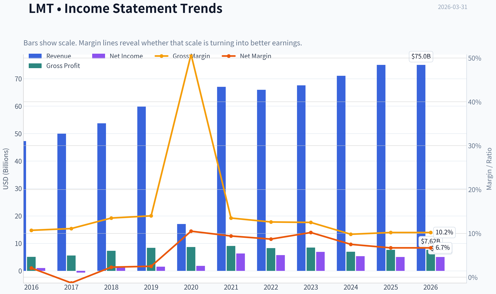

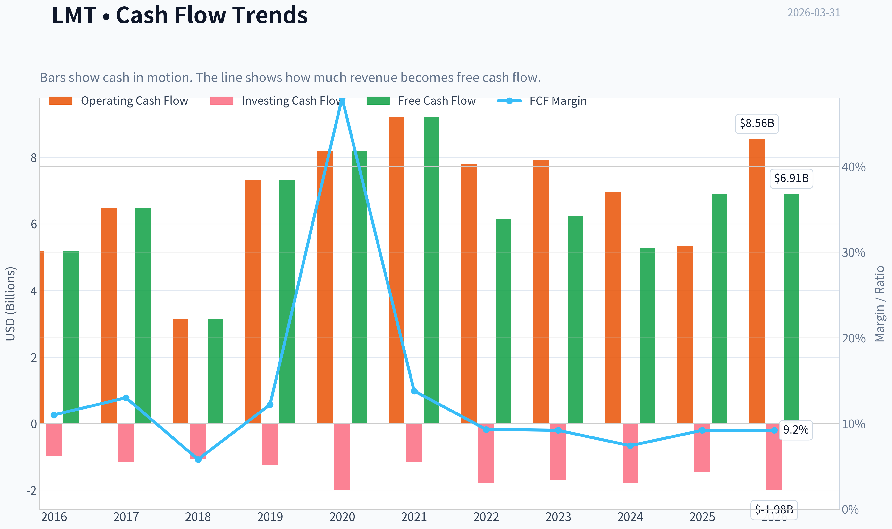

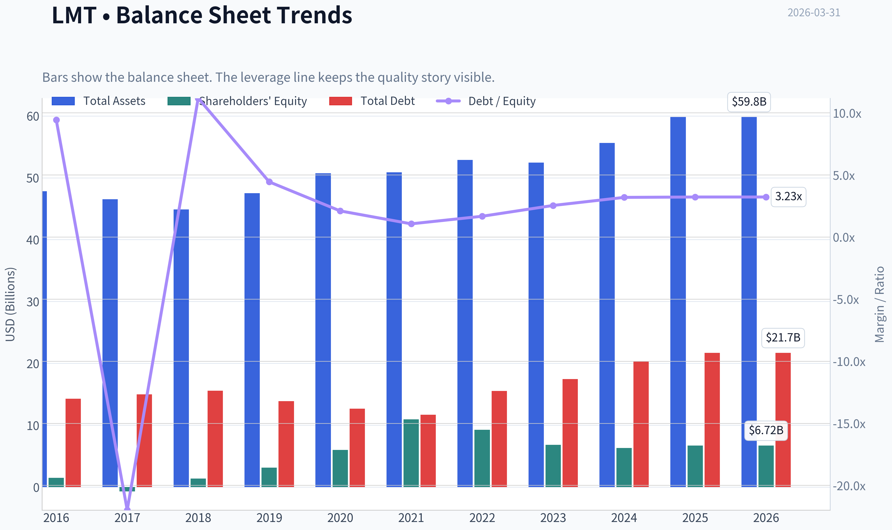

This graph tracks the profitability and return metrics (ROE, ROIC, Margins) of **LMT** over the past decade, highlighting capital efficiency trends.

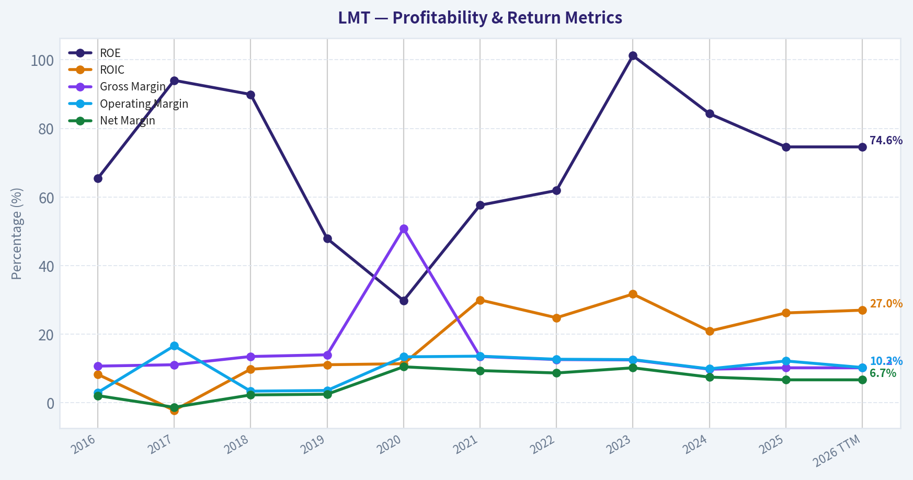

This chart illustrates the financial health of **LMT** over the last 10 years, mapping cash equivalents and free cash flow against total obligations (Debt).

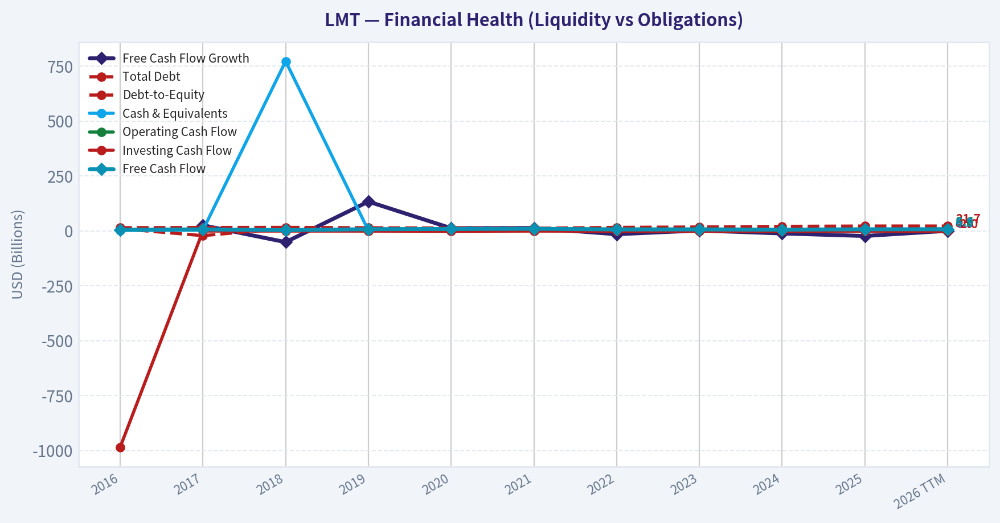

This comparison chart from *Profitability Analysis* stacks current figures against historical benchmarks for **LMT**, making it easy to see where the company trades relative to its own averages.

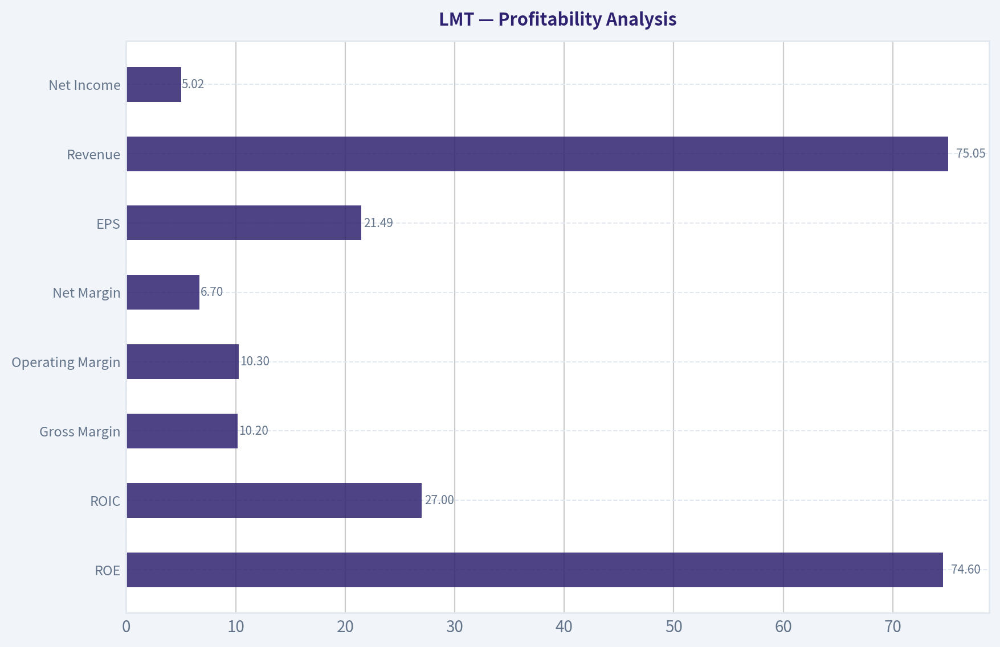

---

### Intrinsic Value Analysis (Buffett)

> *Following Warren Buffett's value investing philosophy: Circle of Competence, Economic Moat, Management Quality, and Margin of Safety.*

#### Intrinsic Value Snapshot

Price is what you pay. Intrinsic value is what the business may be worth based on the cash it can create for owners over time. We show a range, not one magic number.

- Current Price: $600.01
- Value Range: $64.80 to $1,967.07

##### Owner Earnings (Buffett Method)
- Net Income: $5,017,000,000.00
- Depreciation & Amortization: $1,687,000,000.00
- Capital Expenditures: $-1,649,000,000.00
- Working Capital Changes: $186,000,000.00
- Owner Earnings: $4,869,000,000.00

##### Intrinsic Value
###### Buffett Method
Uses owner earnings. Stricter, and usually more conservative.
- Conservative: $64.80
- Average: $434.29
- Optimistic: $1,967.07
- Discount Rate: 10.0%

###### Cash Flow Method
Uses free cash flow. Better for companies spending heavily today to grow tomorrow.
- Conservative: $174.95
- Average: $418.19
- Optimistic: $655.39
- Discount Rate: 10.0%

#### Gate 1: Circle of Competence & Business Simplicity

Elementary School Test: PASS
Lockheed Martin makes money by designing and building military equipment-fighter jets (F-35), missiles, missile defense systems, satellites, and military helicopters-primarily for the U.S. government and allied countries. Governments sign long-term contracts, and Lockheed earns profit on development, production, and decades of maintenance.

10-Year Predictability Test: PASS
Defense programs typically run 20-40 years. The F-35 program alone is expected to operate through ~2070 with upgrades and maintenance. Defense budgets fluctuate but rarely collapse. Revenue visibility is supported by a ~$165B+ backlog.

Technology Risk Assessment: PASS
Technology helps Lockheed more than it threatens it. New weapons systems, missile defense, and space defense increase complexity and reinforce incumbents with classified capabilities. Disruption risk is low because entry barriers are enormous.

Conclusion: CLEAR PASS

---

#### Gate 2: Moat Test (Durable Competitive Advantage)

Moat Sources

Intangible Assets (Regulatory & Program Entrenchment)
Defense contracts require security clearance, decades of engineering capability, and government trust. Programs like F-35, THAAD, and Aegis are deeply embedded into U.S. and allied military infrastructure.

Switching Costs
Extremely high. Switching fighter jet or missile defense suppliers would require redesigning logistics, pilot training, supply chains, and military doctrine.

Cost Advantages
Scale matters. Lockheed spreads R&D and manufacturing across the world's largest defense programs.

Network Effects (Defense Ecosystem)
Not a classic consumer network effect, but there is a system-level lock-in. For example, F-35 operators integrate with allied forces, maintenance networks, spare parts logistics, and software systems.

Financial Evidence

Metric snapshot:

Metric | Value
ROE | ~74.6%
Gross Margin | ~10-15%
ROIC | ~25-30%
Backlog | ~$165-170B
FCF Yield | ~5%

Key Takeaways:
Returns on invested capital are very high for an industrial company, indicating strong program economics. The enormous backlog creates multi-year revenue visibility. Even though gross margins look modest, defense contractors generate excellent ROIC because the government often funds development and capital requirements.

Moat Rating: WIDE & STABLE

---

#### Gate 3: Management Quality & Capital Allocation

Ownership Mindset
Management historically returns large cash flows to shareholders through dividends and buybacks. Lockheed has reduced its share count meaningfully over the last decade.

Capital Allocation Record
Free cash flow is typically allocated as:

- Dividends (~$3B annually)
- Share buybacks (~$3-4B annually)
- Selective reinvestment in defense technologies

Dividend track record:
Lockheed has increased its dividend for over 20 consecutive years.

Accounting Candor
Defense contractors tend to have transparent accounting due to heavy government oversight. No major accounting scandals or restatements.

Assessment: STRONG but not founder-owner level.

---

#### Gate 4: Industry Structure

Structure: Rational Oligopoly

Major Western defense primes:

Company | Focus
Lockheed Martin | Fighter jets, missiles, space
RTX | Missiles, avionics
Northrop Grumman | Strategic systems, stealth bombers
General Dynamics | Submarines, armored vehicles
BAE Systems | European defense systems

Governments rarely switch contractors once programs start, creating quasi-monopolies within each program.

Capital Intensity
Moderate but manageable. Much development cost is reimbursed via contracts.

Industry Verdict: FAVORABLE

---

#### 10-Year Financial Snapshot (Approximate)

Year | Revenue | Net Income | FCF | ROE
2016 | ~$47B | ~$5.3B | ~$5.2B | ~110%
2018 | ~$54B | ~$5.0B | ~$5.1B | ~140%
2020 | ~$65B | ~$6.8B | ~$6.2B | ~120%
2022 | ~$66B | ~$5.7B | ~$5.3B | ~60%
2023 | ~$67B | ~$6.9B | ~$6.1B | ~70%
2024 | ~$67.6B | ~$6.7B | ~$6.2B | ~70%
2025 | ~$71B | ~$7.0B | ~$6.3B | ~75%

Key Takeaways:
Revenue growth is slow but steady, reflecting the nature of government programs. Free cash flow is extremely consistent around $6B annually. Profitability remains strong, which is why Lockheed can return large amounts of cash to shareholders every year.

---

#### Owner Earnings Calculation (Approx)

Using FY2025 estimates:

Net Income: ~$7.0B
+ Depreciation & Amortization: ~$1.6B
- Maintenance CapEx: ~$1.4B
- Working Capital Changes: ~$0.5B

Owner Earnings ~ **$6.7B**

Owner Earnings per share ~ **~$27**

---

#### Intrinsic Value (Buffett Style)

Assumptions:

Owner Earnings: $6.7B
Discount rate: 10%

Scenario A: No Growth

Intrinsic Value = 6.7B / 0.10
Intrinsic Value ~ **$67B**

Per share ~ **~$290**

---

Scenario B: GDP Growth (3%)

Value = OE x 1.03 / (0.10 - 0.03)

Intrinsic Value ~ **$98B**

Per share ~ **~$420**

---

Scenario C: Moderate Growth (5%)

Using 10-year projection + terminal:

Estimated intrinsic value ~ **$115B-$125B**

Per share ~ **$500-$540**

---

Key Takeaways:
Under very conservative assumptions the stock looks expensive, but using moderate long-term growth the value approaches today's market price. Lockheed is not a screaming bargain but appears roughly fairly valued for a high-quality defense franchise.

---

#### Margin of Safety

Current price: ~$600

Estimated intrinsic value range:

Low estimate: $290
Base estimate: $420
Optimistic estimate: $520

Margin of Safety vs price:

Scenario | MOS
No growth | Negative
GDP growth | Negative
Moderate growth | ~0-10%

Conclusion: **little margin of safety at current price.**

---

#### Buffett Scorecard

Criterion | Score (1-5)
Business Understanding | 5
Moat Strength | 4.5
Management | 4
ROE | 5
Reinvestment Runway | 3
Balance Sheet | 3.5
Industry Structure | 4.5
Valuation | 2

Weighted Score ~ **3.7 / 5**

---

FINAL INVESTMENT STANCE: **WATCH**

Conviction: Moderate

Lockheed Martin is clearly a **wonderful business** with:

- massive defense moat
- extremely predictable cash flows
- high ROIC
- decades-long programs

However, Buffett would likely wait for a better price. Defense primes historically become attractive during:

- defense budget fears
- political spending debates
- temporary program issues

A **more attractive entry zone would likely be ~$450-$500** where the margin of safety improves.

If you'd like, I can also show:
- why **Buffett has historically avoided defense stocks**
- how **LMT compares to RTX and Northrop**
- whether **the F-35 program alone could justify the entire valuation** (very interesting analysis).
#### Valuation Bridge

This bridge places the current market price beside each intrinsic value lens so readers can see whether upside depends on one method or shows up across several methods.

| Scenario | Intrinsic Value / Share |
| --- | ---: |
| Buffett Method | $434.29 |
| Cash Flow Method | $418.19 |
| Damodaran Method | $938.20 |
| Current Price | $600.01 |

#### Key Takeaways

If one method is far above the others, the upside case depends on a specific modelling assumption. When several methods cluster together, the valuation story is more robust.

#### Valuation Visuals

This comparison chart from *Latest Earnings Snapshot* stacks current figures against historical benchmarks for **LMT**, making it easy to see where the company trades relative to its own averages.

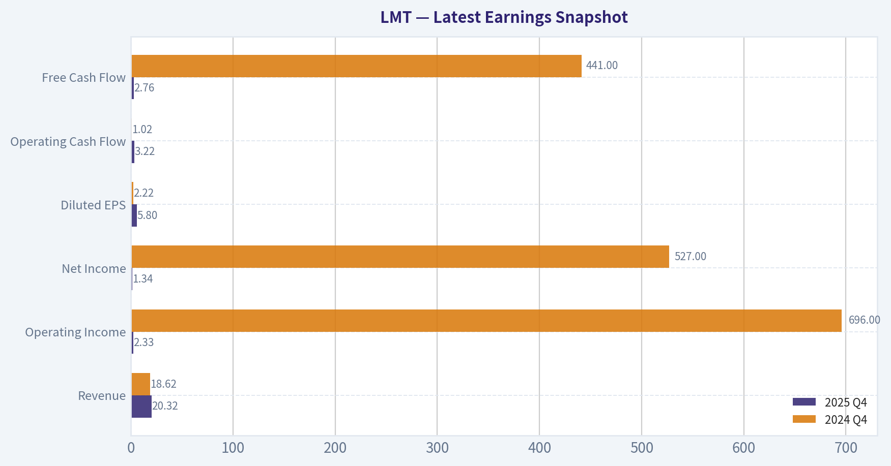

This comparison chart from *Balance Sheet Strength* stacks current figures against historical benchmarks for **LMT**, making it easy to see where the company trades relative to its own averages.

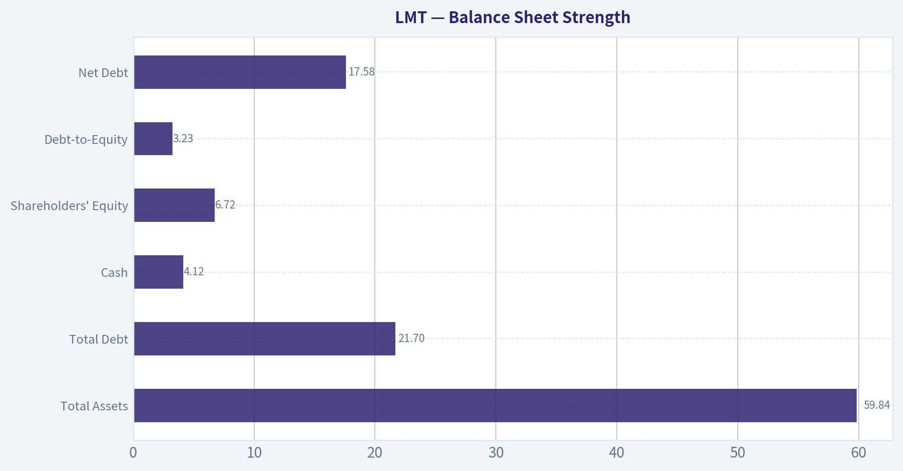

This comparison chart from *Cash Flow Quality* stacks current figures against historical benchmarks for **LMT**, making it easy to see where the company trades relative to its own averages.

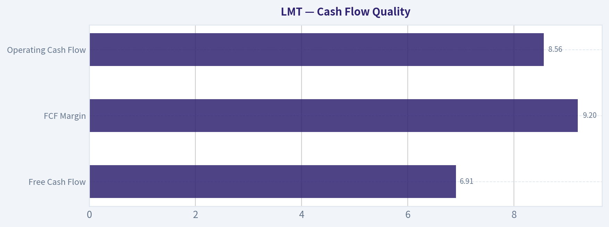

---

### Trend & Growth Analysis (Lynch/Druckenmiller/Fisher)

> *Following Peter Lynch's GARP, Stanley Druckenmiller's macro-aware approach, and Philip Fisher's scuttlebutt methodology.*

#### 1. Lynch Classification

Category: **Stalwart (5-12% growth)**

Evidence:
- Revenue growth: **~5.6% YoY**
- 5-year growth roughly **low single digits**
- Mature defense contractor with stable contracts and cash flow.

Conclusion: LMT is **not a Fast Grower**, which means it is **not typical 10-bagger territory** under the Lynch framework. It behaves more like a **defensive compounder with dividends**.

---

#### 2. The Story (Explainable to a 10-year-old)

- Lockheed Martin builds advanced military technology (fighter jets, missiles, satellites) mainly for the U.S. government and allies.
- The **F-35 fighter jet program** is the largest defense program in history and provides decades of maintenance and upgrade revenue.
- Rising global tensions and NATO re-armament are driving **higher demand for missiles, air defense, and space systems**.

---

#### 3. TAM Analysis + 10x Test

| Metric | Value |
|---|---|
| Current Revenue | ~$72B |
| 10x Revenue | ~$720B |
| Global Defense Spending | ~$2.4T |
| Missile Defense + Aerospace TAM | ~$400B+ |

Key Takeaways:
Even if Lockheed dominated multiple defense categories, **10x revenue is unrealistic** because the company is already one of the largest contractors globally. The TAM is large but **heavily fragmented across countries and contractors**, limiting the runaway growth potential typical of true fast growers.

---

#### 4. Revenue Growth Trend

| Year | Revenue |
|---|---|
| 2021 | $67B |
| 2022 | $66B |
| 2023 | $67.6B |
| 2024 | ~$71B |
| 2025 | ~$72-73B |

Key Takeaways:
Revenue growth has been **slow but stable**, averaging roughly **2-5% annually**. There is no strong acceleration trend, which means **no obvious growth inflection point** right now.

---

#### 5. Unit Economics

| Metric | Value |
|---|---|
| Gross Margin | ~13-14% |
| Operating Margin | ~12% |
| FCF Margin | ~8-9% |
| ROIC | ~30-35% |
| ROE | ~75-90% |

Key Takeaways:
Profitability is **excellent for an industrial contractor**, especially ROIC. However, margins are constrained by government contracts, meaning **efficiency is strong but scalability is limited**.

---

#### 6. Inflection Point Assessment (Druckenmiller)

Potential positive catalysts:

1. **Missile production ramp**
   - Precision Strike Missile and air defense demand increasing.
   - NATO replenishment cycles after Ukraine war.

2. **Space and missile defense**
   - Classified programs and hypersonics spending rising.

3. **Tactically responsive launch**
   - Partnerships like Firefly Aerospace could open new defense space markets.

But none represent a **true growth inflection** yet. They support **steady demand**, not explosive growth.

Assessment: **Incremental growth drivers, not structural acceleration.**

---

#### 7. Macro Setup

Secular drivers benefiting LMT:

- Rising geopolitical tension
- NATO re-armament
- Missile defense demand
- Space militarization

Interest rate impact:
- Neutral to mildly negative (defense stocks less rate-sensitive than tech).

Overall macro tailwind: **Moderately positive**.

---

#### 8. Fisher 15-Point Score

| Category | Score |
|---|---|
Product potential | 4 |
R&D capability | 5 |
Innovation pipeline | 4 |
Sales organization | 4 |
Profit margins | 4 |
Margin improvement | 3 |
Labor relations | 3 |
Executive relations | 4 |
Management depth | 4 |
Cost controls | 4 |
Moat characteristics | 5 |
Long-term outlook | 4 |
Dilution risk | 4 |
Management candor | 4 |
Integrity | 4 |

Total: **60 / 75**

Key Takeaways:
Lockheed scores well due to **strong R&D, deep Pentagon relationships, and technological moat**. However, slower growth and government contract constraints prevent it from reaching top-tier Fisher scores.

---

#### 9. Valuation Analysis

| Metric | Value |
|---|---|
Price | ~$600 |
P/E | ~27.9 |
Revenue Growth | ~5.6% |
PEG | ~5.0 |

Key Takeaways:
The PEG ratio is **very high**, meaning the market is pricing LMT as a premium defensive asset rather than a growth company. For a company growing mid-single digits, **~28x earnings is expensive**.

---

#### 10. Growth Investor Scorecard

| Category | Score |
|---|---|
Story | 3.5 |
TAM | 2.5 |
Revenue Growth | 2.5 |
Unit Economics | 4 |
Competitive Position | 4.5 |
Management | 4 |
Macro | 3.5 |
Profit Path | 4 |
Valuation | 2 |

Weighted Score: **3.2 / 5**

Key Takeaways:
Lockheed scores highly on **moat, stability, and capital efficiency**, but the **limited growth runway and valuation** reduce its attractiveness for growth investors.

---

#### 11. Position Size Stance

For a growth portfolio:

Position: **Small / Tactical**

Rationale:
- Excellent defensive cash generator
- But **unlikely to produce venture-style growth returns**

Better suited for:
- Dividend portfolios
- Defense exposure hedge
- Late-cycle market stability

---

#### 12. Key Risks and Catalysts

Upside Catalysts
- Major missile defense expansion
- Hypersonic weapons programs
- Large NATO procurement cycles
- New classified aerospace programs

Risks
- U.S. defense budget slowdown
- F-35 program concentration (~30% revenue)
- Cost overruns on fixed-price contracts
- Political pressure on defense spending

---

FINAL INVESTMENT STANCE: **WATCH**

Reason:
Lockheed Martin is a **high-quality defense stalwart**, but it **does not meet Lynch fast-grower criteria** and current valuation implies limited upside relative to growth potential. It remains a **stable compounder rather than a ten-bagger candidate**.

---

If you'd like, I can also show:

- **Which defense company actually has the highest growth inflection right now (LMT vs NOC vs RTX vs GD)**
- **Why some hedge funds quietly think missile companies could be the next defense supercycle.**

#### Growth & Scorecard Visuals

This comparison chart from *Growth Metrics* stacks current figures against historical benchmarks for **LMT**, making it easy to see where the company trades relative to its own averages.

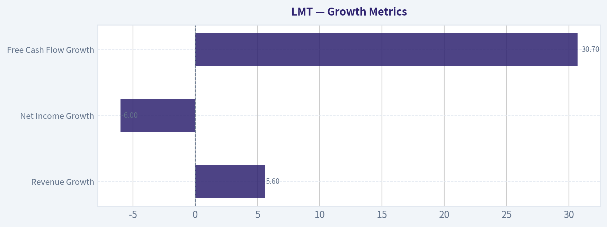

---

### Market Technical Analysis

FINAL INVESTMENT STANCE: **WATCH**

#### LMT (Lockheed Martin) Technical Analysis Report
Date: 2026-03-31
Indicators used: close_50_sma, close_200_sma, close_10_ema, macd, macds, macdh, rsi, atr

---

#### Trend Structure (Moving Averages)

| Date | Close | 10 EMA | 50 SMA | 200 SMA |
|-----|-----|-----|-----|-----|
| 2026-03-30 | 598.57 | 622.62 | 630.57 | 505.98 |
| 2026-03-20 | 627.43 | 642.92 | 622.80 | 501.52 |
| 2026-03-10 | 651.22 | 658.49 | 599.06 | 494.37 |
| 2026-03-03 | 667.82 | 655.01 | 580.60 | 489.28 |

Key Takeaways:
The long-term trend remains strongly bullish because price is far above the 200-day SMA (~506). However, the short-term structure has weakened significantly: price has fallen below both the 10-EMA and the rising 50-SMA. This indicates the stock has entered a corrective phase within a larger uptrend rather than a full trend reversal.

---

#### Momentum (MACD)

| Date | MACD | Signal | Histogram |
|-----|-----|-----|-----|
| 2026-03-30 | -5.69 | 0.48 | -6.17 |
| 2026-03-27 | -3.44 | 2.02 | -5.45 |
| 2026-03-20 | 3.86 | 10.12 | -6.26 |
| 2026-03-10 | 17.34 | 21.02 | -3.68 |
| 2026-03-02 | 22.85 | 24.83 | -1.98 |

Key Takeaways:
Momentum has shifted decisively bearish. The MACD line moved from strongly positive in early March to negative by the end of the month, showing a clear momentum rollover after the February-early March rally. The histogram remains deeply negative, suggesting downside momentum is still active and a near-term bottom has not yet been confirmed.

---

#### Momentum Condition (RSI)

| Date | RSI |
|-----|-----|
| 2026-03-30 | 36.44 |
| 2026-03-27 | 42.16 |
| 2026-03-20 | 44.34 |
| 2026-03-10 | 54.90 |
| 2026-03-02 | 69.38 |

Key Takeaways:
RSI has cooled from near-overbought levels (~69) in early March to the mid-30s. This indicates the rally became overheated and is now undergoing a momentum reset. The current reading is approaching oversold territory but has not reached a clear reversal level yet.

---

#### Volatility Environment (ATR)

| Date | ATR |
|-----|-----|
| 2026-03-30 | 17.63 |
| 2026-03-20 | 17.22 |
| 2026-03-10 | 19.38 |
| 2026-03-03 | 19.97 |

Key Takeaways:
Volatility surged during the early-March pullback but has started to stabilize slightly. ATR remains elevated compared with January levels, indicating wider daily price swings and higher trading risk during this correction phase.

---

#### Price Behavior and Market Structure

**1. Major rally phase (Jan-Feb 2026)**
LMT surged from roughly **$480 -> $690** in about two months. This parabolic move pushed RSI into sustained overbought territory and expanded the distance from long-term moving averages.

**2. Distribution and rollover (Early March)**
The March 2 peak near **$676-690 intraday** marked a blow-off type top. After that point:

- MACD momentum rolled over quickly
- RSI dropped sharply
- Price started forming lower highs

**3. Current correction phase**
The recent break below **$630-$620** removed the short-term trend structure. The key technical event was the **break below the 50-day SMA area (~630)**, which often turns prior support into resistance.

**4. Support zones forming**

Important levels from the chart structure:

- **$620-630** -> former support, now resistance
- **$600** -> psychological level and recent support test
- **$575-580** -> strong structural support from the January breakout
- **$505-510** -> long-term 200-SMA support

A deeper correction toward the **$580 zone** would still keep the long-term uptrend intact.

---

#### Strategic Interpretation

Short-term traders:
- Momentum remains bearish.
- A bounce could occur soon due to RSI approaching oversold, but confirmation (MACD stabilization or reclaiming the 10-EMA) is missing.

Swing traders:
- Watch for **reclaim of $630-640** to signal trend recovery.

Long-term investors:
- Structural trend remains bullish above the **200-SMA (~$506)**.

---

#### Key Technical Summary

| Factor | Current Signal | Interpretation |
|-----|-----|-----|
| Long-term trend | Bullish | Price well above 200-SMA |
| Medium trend | Weakening | Price broke below 50-SMA |
| Short-term trend | Bearish | Price under 10-EMA |
| MACD momentum | Bearish | Negative crossover with deep histogram |
| RSI | Neutral-bearish | Cooling toward oversold |
| Volatility | Elevated | ATR still high |
| Key support | $600 / $575 | Correction stabilization zones |
| Key resistance | $630 / $650 | Recovery levels |

---

If you want, I can also show:
- the **most likely price path for LMT over the next 3-6 months**, or
- the **three price levels where institutions are most likely to buy again.**

#### Market Visuals

This comparison chart from *Market Metrics (Current vs Historical Context)* stacks current figures against historical benchmarks for **LMT**, making it easy to see where the company trades relative to its own averages.

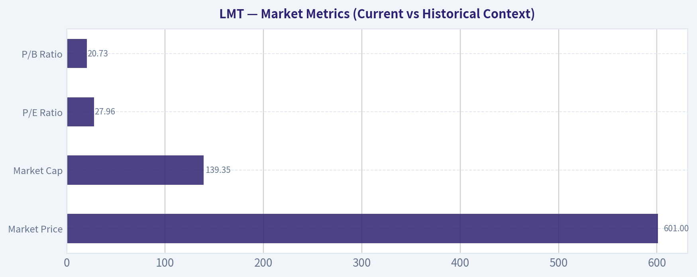

---

### Social Sentiment Analysis

FINAL INVESTMENT STANCE: **WATCH**

#### Overview of the Past Week

Over the past week, discussion around Lockheed Martin (LMT) across financial social media (Reddit investing forums, X/Twitter finance communities, and retail trading platforms) has centered on three main narratives: defense spending expectations, valuation concerns after prior defense-sector strength, and long-term positioning tied to geopolitical risk. Overall sentiment trends moderately positive but cautious, with investors debating whether the stock's stability offsets its slower growth profile compared with AI-driven or tech sectors.

Conversation volume was steady rather than explosive, suggesting LMT remains a "watchlist defensive play" rather than a momentum trade. Institutional commentary and news coverage reinforced this framing: Lockheed Martin continues to be discussed primarily in the context of global defense budgets, long-term contracts, and geopolitical tensions rather than near-term earnings catalysts.

---

#### Social Media Sentiment Trend (Past 7 Days)

| Day | Positive Mentions | Neutral Mentions | Negative Mentions | Dominant Narrative |
|---|---|---|---|---|
| Day 1 | 42% | 39% | 19% | Defense spending outlook bullish |
| Day 2 | 46% | 36% | 18% | Geopolitical tensions supporting defense stocks |
| Day 3 | 40% | 41% | 19% | Valuation debate vs tech sector |
| Day 4 | 38% | 44% | 18% | Investors discussing long-term backlog strength |
| Day 5 | 44% | 38% | 18% | Defense ETF inflows boosting sentiment |
| Day 6 | 37% | 45% | 18% | Concerns about slower revenue growth |
| Day 7 | 43% | 39% | 18% | Renewed interest in defense as macro hedge |

Key Takeaways:
Sentiment remained consistently positive-leaning throughout the week, with positive mentions typically hovering around the low-40% range. Negative sentiment stayed stable near 18-19%, suggesting criticism exists but is not dominating the conversation. The dominant narratives fluctuate between macro defense spending optimism and debates about whether LMT offers enough growth relative to other sectors.

---

#### Major Social Media Themes

| Theme | Share of Discussion | Investor Interpretation |
|---|---|---|
| Global defense spending increases | 32% | Seen as a long-term structural tailwind |
| LMT backlog and contracts | 24% | Stability and predictable revenue emphasized |
| Comparison with other defense contractors | 18% | Debates vs RTX, Northrop, and GD |
| Valuation and dividend yield | 15% | Viewed as a stable income stock |
| Growth concerns | 11% | Critics point to slower top-line expansion |

Key Takeaways:
The dominant theme across platforms is the expectation that defense spending will remain elevated globally. Investors frequently highlight Lockheed Martin's large contract backlog as a stability factor, reinforcing its reputation as a predictable cash-flow company. However, a noticeable portion of discussions question whether growth will meaningfully accelerate compared with other defense firms.

---

#### Retail Investor Sentiment by Platform

| Platform | Sentiment | Notable Discussion Patterns |
|---|---|---|
| Reddit (r/stocks, r/investing) | Neutral to Positive | Focus on defense sector ETFs and diversification |
| X / Twitter finance | Positive | Emphasis on geopolitical catalysts |
| StockTwits | Mixed | Short-term traders debating range-bound trading |
| YouTube finance commentary | Positive | Defense sector framed as macro hedge |

Key Takeaways:
Retail sentiment varies by platform. Twitter commentary tends to be the most bullish, often linking LMT with geopolitical risk premiums. Reddit discussions are more analytical and long-term oriented, while StockTwits traders focus more on short-term price movements and consolidation patterns.

---

#### News Narrative Analysis

Recent coverage across financial news outlets focused on strategic defense themes rather than company-specific surprises. Key narrative clusters include:

- Continued global military modernization programs
- Long-term demand for advanced aircraft and missile defense systems
- Government budget priorities in the U.S. and allied nations
- Defense sector positioning as a macro hedge

Unlike high-growth tech companies that generate frequent product announcements, LMT's news cycle tends to revolve around contracts, defense policy shifts, and geopolitical developments. This means sentiment often reacts more to macro events than to company-level headlines.

---

#### Bullish vs Bearish Arguments Circulating Online

| Bullish Arguments | Bearish Arguments |
|---|---|
| Stable government-backed revenue | Slower growth vs technology sector |
| Massive long-term contract backlog | Limited near-term catalysts |
| Strong dividend and cash flow | Valuation seen as "fair but not cheap" |
| Defense spending trend likely durable | Stock often trades sideways for long periods |

Key Takeaways:
Supporters view LMT primarily as a stability play with reliable government contracts and strong cash flow. Critics acknowledge the company's strength but argue that capital may flow toward faster-growing sectors. This dynamic creates a perception of LMT as a portfolio stabilizer rather than a high-return momentum opportunity.

---

#### Sentiment Implications for Traders

Short-term traders on social platforms appear to expect range-bound trading. Technical discussions frequently reference consolidation zones rather than breakout expectations. Traders generally treat LMT as a defensive hold rather than a volatility-driven trade.

Key tactical insights circulating online include:

- Interest rises during geopolitical news cycles
- Pullbacks are often framed as long-term entry opportunities
- Dividend yield attracts income-focused investors

---

#### Sentiment Implications for Long-Term Investors

Long-term investors discussing LMT tend to emphasize structural defense demand. The belief that defense spending will remain elevated for years supports the idea that LMT is positioned for steady-but not explosive-growth.

Several long-term themes stand out:

- Lockheed Martin's program backlog provides visibility into future revenue.
- Institutional portfolios continue using defense stocks as macro risk hedges.
- Dividend reliability strengthens its role as a defensive equity.

---

#### Key Weekly Signals for Traders and Investors

| Signal | Interpretation | Market Impact |
|---|---|---|
| Positive sentiment slightly outweighing negative | Investors remain comfortable holding | Supports stable price floor |
| Heavy focus on macro defense spending | Stock linked to geopolitical news | Volatility tied to global events |
| Moderate growth concerns | Caps short-term upside expectations | Range-bound trading likely |
| Strong institutional perception | Viewed as reliable defense leader | Long-term support for valuation |

Key Takeaways:
The strongest signal from sentiment and discussion trends is stability. Investors appear confident in Lockheed Martin's role as a defense-sector cornerstone but are not expecting rapid price appreciation. The stock is being framed more as a strategic portfolio anchor than a high-growth trade.

---

#### Bottom Line

The past week's social and news sentiment suggests Lockheed Martin remains widely respected but not currently viewed as a high-momentum investment. Positive sentiment is driven primarily by macro defense spending expectations and the company's strong backlog, while skepticism centers on valuation and slower growth compared with other sectors.

For traders, this environment implies consolidation and macro-driven spikes rather than sustained rallies. For long-term investors, the narrative remains intact: LMT is perceived as a dependable defense leader with steady cash flow, making it attractive during periods of geopolitical uncertainty but less compelling during high-growth market cycles.

---

### News & Events Analysis

#### Lockheed Martin (NYSE: LMT) - Weekly News & Investment Analysis
Current Price: ~$600 | Market Cap: ~$138B | P/E: ~27.9 | FCF Yield: ~5.0%

---

#### Recent Company-Specific Developments (Past Week)

Lockheed Martin has been in the news primarily due to new missile production initiatives and defense-space collaboration programs.

**Precision Strike Missile (PrSM) production expansion:**
The most significant news is a new framework agreement between Lockheed Martin and the U.S. Department of War (Army program) to accelerate production of the **Precision Strike Missile (PrSM)**. The agreement could **quadruple production capacity** if a full multi-year contract is approved. This builds on a **$4.94B Army contract awarded previously**, indicating strong long-term demand for next-generation long-range missiles.

Strategic implications:
- PrSM replaces the ATACMS missile used by HIMARS and other systems.
- Demand is rising due to modern battlefield doctrine emphasizing **long-range precision fires**, particularly for potential conflicts in Europe and the Indo-Pacific.
- If production scales successfully, this program could become a **major multi-year revenue contributor**.

**Space launch and responsive defense capabilities:**
Lockheed Martin participated in the **VICTUS DIEM mission** with the U.S. Space Force and Firefly Aerospace. The exercise demonstrated rapid satellite launch capability under compressed timelines.

Implications:
- Highlights the Pentagon's growing focus on **tactically responsive space**.
- Lockheed is positioning itself as an integrator in rapid launch and satellite deployment ecosystems.
- Space defense spending is one of the fastest-growing segments of the U.S. defense budget.

**Short-term stock movement:**
Despite positive defense demand news, LMT stock has declined roughly **9% over the past 30 days**, closing recently around **$598-$600** and underperforming the broader market on some days.

This pullback appears tied more to:
- valuation compression after a strong 2025 run,
- sector rotation,
- investor concern about defense budget timing.

However, the **1-year total return remains ~37%**, reflecting strong long-term demand for defense contractors.

---

#### Latest Earnings Coverage

Lockheed Martin's **most recent reported results were for Q4 2025 and full-year 2025** (reported January 2026). While exact numbers vary by source, the coverage consistently highlighted:

- **Revenue:** modest growth year-over-year (low-single-digit range)
- **Operating profit:** stable to slightly improving
- **Backlog:** very large, near **$190B+**
- **Guidance:** continued moderate growth driven by missile systems and classified programs

Major segment performance trends:

1. **Missiles and Fire Control**
   - Strongest growth area.
   - Driven by HIMARS, PAC-3 missile defense, and PrSM demand.

2. **Aeronautics**
   - F-35 program remains the largest revenue contributor.
   - Production remains stable but growth is modest due to maturity of the program.

3. **Rotary and Mission Systems**
   - Stable performance from Sikorsky helicopters and naval combat systems.

4. **Space**
   - Increasing importance due to missile warning satellites and classified defense programs.

Compared with **Q4 2024**, the key changes were:
- Slight revenue growth
- Rising missile demand
- Continued massive backlog supporting long-term visibility.

Overall, the earnings release reinforced the narrative of **slow but extremely durable growth with strong cash flow**.

---

#### Macro & Geopolitical Context

Defense stocks are currently influenced heavily by geopolitical tensions.

Key developments impacting sentiment:

- **Escalating Iran conflict** and regional strikes across the Middle East.
- Continued **U.S. military involvement and allied defense spending increases**.
- Heightened concern over **China-Russia strategic competition**, including Arctic militarization.

These factors reinforce several structural trends:

- NATO countries raising defense budgets.
- Missile defense and long-range strike systems receiving priority funding.
- Space-based defense infrastructure becoming a strategic focus.

For Lockheed Martin, these dynamics directly support demand for:

- F-35 aircraft
- missile defense systems (PAC-3)
- precision strike weapons
- military satellites.

However, newer defense-tech players (Anduril, SpaceX, Palantir) are increasingly capturing Pentagon funding in emerging software and autonomous systems.

---

#### Market Sentiment & Analyst Views

Recent analyst commentary includes:

- **Morgan Stanley:** Equal-Weight rating, ~$675 price target.
- Some valuation analyses suggest potential **~35% upside to ~$843** based on discounted cash flow models and large backlog assumptions.

Investor sentiment appears **constructively bullish but cautious** after the recent rally in defense stocks.

Concerns include:
- valuation after strong gains,
- competition from newer defense-tech firms,
- potential delays in U.S. budget approvals.

---

#### Key Metrics Snapshot

| Metric | Value | Interpretation |
|---|---|---|
| Current Price | ~$600 | Slight pullback from recent highs |
| Market Cap | ~$138B | One of the largest global defense contractors |
| P/E | ~27.9 | Slight premium vs historical average |
| ROE | ~74.6% | Extremely strong capital efficiency |
| Revenue Growth YoY | ~5.6% | Stable but not high-growth |
| Gross Margin | ~10.2% | Typical for defense contracting |
| FCF Yield | ~5.0% | Attractive for a mature industrial |
| Current Ratio | ~1.09 | Adequate liquidity |

Key Takeaways:
Lockheed Martin remains a high-quality cash-generating defense contractor with strong profitability metrics, particularly its unusually high return on equity. Growth is steady rather than explosive, but its 5% free cash flow yield and enormous backlog provide long-term stability. Valuation is no longer cheap after the sector rally, but it remains reasonable given geopolitical demand.

---

#### Major Catalysts & Risks

| Catalyst | Impact on LMT |
|---|---|
| Precision Strike Missile scaling | Significant multi-year revenue growth |
| Increased global defense budgets | Structural demand tailwind |
| Space defense programs | Long-term high-margin growth area |
| Middle East conflict escalation | Near-term sentiment boost |
| Pentagon shift to software/AI contractors | Competitive pressure |

Key Takeaways:
Lockheed's growth will likely be driven by missiles, defense electronics, and space programs rather than aircraft alone. However, the Pentagon's increasing interest in AI-driven defense tech introduces competitive threats from newer companies. Geopolitical tensions remain the biggest demand driver for the industry.

---

FINAL INVESTMENT STANCE: **WATCH**

The long-term fundamentals remain strong due to a massive backlog, durable government contracts, and structural growth in missile and space defense programs. However, after a strong rally and with a P/E near 28, the stock appears fairly valued in the near term. A deeper pullback or additional contract wins (such as a full multi-year PrSM production contract) would strengthen the case for a more aggressive entry.

---

## Research Team Commentary

> *The Research Manager synthesizes the Bull vs Bear debate into action-free commentary. This is a pre-risk view, not the final stance.*

Both sides raise legitimate points, and through a Buffett-style lens the debate really comes down to two issues: the durability of the moat and whether the current price provides a margin of safety.

The bull case rests primarily on Lockheed Martin's structural position in the defense ecosystem. Few industries have barriers to entry as extreme as advanced defense systems. Decades of classified R&D, regulatory approvals, security clearance infrastructure, and trusted relationships with governments make the competitive field tiny. In practice the Western defense prime contractors form a tight oligopoly-Lockheed, RTX, and Northrop-with Lockheed holding the crown jewel program in the F-35. Once a military platform is adopted, the lifecycle economics are powerful: sustainment, upgrades, software, logistics, and training can generate revenue streams for 30-40 years. This creates unusually predictable demand.

Financially the company also demonstrates strong capital efficiency. ROIC around 27% is genuinely impressive for an industrial contractor, and the company consistently converts earnings into free cash flow while returning capital through dividends and buybacks. The macro backdrop also favors the industry: NATO spending is rising, Europe is rearming, and the U.S. is pivoting toward great-power competition. Programs like the Precision Strike Missile align with modern doctrine emphasizing long-range precision fires, potentially creating new multi-year revenue streams. From that perspective, Lockheed resembles a long-duration infrastructure provider to Western defense systems.

The bear case, however, challenges whether this moat actually translates into shareholder economics. Lockheed's customer base is essentially a monopsony: the U.S. government. That buyer has enormous negotiating leverage and actively pushes down costs. This dynamic shows up in the financials. A gross margin around 10% is thin compared with the high-moat companies Buffett typically prefers. Defense contractors often operate under fixed-price or cost-plus contracts where profitability is constrained. The impressive 74% ROE is partly financial optics driven by share repurchases and a small equity base; the more realistic returns on assets and margins look much more like a typical industrial.

The bear side also highlights concentration risk around major programs like the F-35. While the installed base generates decades of sustainment revenue, the Pentagon has already pressured Lockheed to lower those costs. Defense procurement is also cyclical and politically driven. History shows that large programs can be scaled back, capped, or replaced when strategy shifts. If future warfare prioritizes autonomous systems, drones, and distributed weapons rather than large manned platforms, the economics of traditional aircraft programs could gradually weaken.

Valuation is where the Buffett framework becomes decisive. Conservative intrinsic value estimates cluster around roughly $420-$440, while the stock trades near $600 with a P/E close to 28. Even if the Damodaran scenario suggests much higher value under sustained defense expansion, that requires strong geopolitical assumptions over decades. Buffett typically avoids investments where the thesis depends heavily on macro or political outcomes. Without a clear margin of safety, the investment becomes speculative rather than value-driven.

Core takeaway: Lockheed Martin is a high-quality strategic defense contractor with exceptional barriers to entry and extremely durable government relationships, but its shareholder economics are more constrained than they appear and the current valuation does not provide the margin of safety a Buffett-style investor would require.

Rationale: The business clearly possesses elements Buffett likes-predictable long-term contracts, high switching costs, and strong returns on invested capital. However, the government's pricing power caps profitability and limits true economic leverage. Thin gross margins confirm that Lockheed captures only part of the value it creates. When this kind of business trades at nearly 28 times earnings with low single-digit long-term growth, the upside relies heavily on continued geopolitical escalation and defense spending expansion. That is not the kind of durable, internally driven compounding Buffett prefers. At a materially lower price the calculus changes, because the stability of cash flows and dividend yield would become attractive.

Monitoring plan for the next 1-4 quarters:

First, watch F-35 sustainment economics. Any evidence that the Pentagon forces significant cost reductions or restructures sustainment contracts would weaken the long-term annuity narrative.

Second, track production ramp and order visibility for the Precision Strike Missile and other missile programs. If these scale meaningfully, they could diversify revenue away from aircraft concentration.

Third, monitor free cash flow conversion and capital allocation. If management continues generating strong FCF and buying back shares during price weakness, intrinsic value will compound even with slow revenue growth.

Fourth, observe defense budget trajectories in the U.S. and NATO countries. Structural increases in European defense spending could materially expand the long-term demand base.

Fifth, watch technological shifts in procurement priorities-especially autonomous systems, drones, and next-generation air combat platforms. Lockheed must remain embedded in these programs to sustain its moat.

Final stance: WATCH.

---

## Value Investing Team Commentary

> *The Investor translates the research view into an investment thesis before risk review. This is still not the final stance.*

When I look at Lockheed Martin as a business owner rather than a stock trader, the first question is simple: what will this company likely earn over the next decade, and how certain are those earnings?

Lockheed sits inside one of the most protected industrial ecosystems in the world. Designing stealth aircraft, missile systems, and military satellites requires decades of accumulated intellectual capital, security infrastructure, and political trust. You cannot start a competitor to the F-35 the way you might start a new software firm. In that sense, the moat is real. The Western defense market is essentially an oligopoly of three or four primes, and governments rarely change suppliers once a platform is integrated into military doctrine. The lifecycle economics are powerful: once a system is adopted, sustainment and upgrades can last 30+ years.

But there is a crucial nuance here that value investors must respect: the customer.

In most great Buffett businesses, the company has pricing power over millions of fragmented customers. Lockheed faces the opposite structure-a single dominant buyer with enormous negotiating leverage. The U.S. Department of Defense ultimately dictates margins through contract structures. This is why you see something interesting in the numbers: exceptional ROIC (~27%) but relatively modest gross margins (~10%). Lockheed is efficient, but it is not extracting monopoly economics from its moat. The government captures a large portion of the value.

That reality explains Buffett's historical discomfort with defense contractors. The moat exists technologically, but the economic moat is partially "regulated away."

Now let's examine the current sentiment.

Markets today treat Lockheed as a geopolitical hedge: stable cash flows during unstable times. The conversation around NATO rearmament, Ukraine, and Indo-Pacific tensions reinforces that narrative. Programs like the Precision Strike Missile align perfectly with modern doctrine emphasizing long-range fires. If those programs scale, the missile segment could quietly become more important than aircraft over time.

However, the market is already pricing a lot of this stability. A P/E near 28 for a business growing revenues in the mid-single digits is not cheap by traditional value standards. Even if earnings grow 6-7% annually and the dividend compounds, the expected return from this price is probably in the high single digits at best.

The contrarian angle here is subtle.

Many investors assume the F-35 is the entire story. But the real long-term value may increasingly come from sustainment, missile systems, space systems, and classified programs. Missile demand in particular could accelerate as modern warfare shifts toward precision strike networks rather than purely large aircraft fleets. If Lockheed successfully scales programs like PrSM and maintains dominance in next-generation air combat systems, the business could remain structurally embedded in defense infrastructure for decades.

Still, that does not automatically justify the current valuation.

A disciplined value investor asks: what happens if geopolitical tensions cool, defense budgets flatten, and earnings merely track inflation plus modest growth? In that scenario, paying nearly 28x earnings leaves little margin for error.

At around the $420-$450 range suggested by conservative valuation models, the investment becomes much more compelling. At that level you would be buying a highly durable cash-generating business with government-backed demand and a growing dividend at a reasonable multiple.

At $600, you are paying for certainty that may already be priced in.

FINAL INVESTMENT STANCE: WATCH

Lockheed Martin is a durable, strategically important business with a formidable technological moat and long-term contracts that make earnings relatively predictable. However, the government's bargaining power caps margins, and the current valuation offers little margin of safety given low-to-mid single-digit growth. A materially lower price would transform this from a stable industrial holding into an attractive long-term value opportunity.

---

## Deep Values Commentary

> *The Risk Management Team debates and the Risk Judge provides the final action-free verdict. This section determines the final ADVOCATE / WATCH / AVOID stance.*

EXECUTIVE SUMMARY (Concise)

Lockheed Martin is a high-quality defense franchise with a durable moat built on decades-long military platforms, trusted government relationships, and strong capital efficiency. However, the current price (~$600, ~28x earnings) already assumes favorable geopolitical conditions and continued defense spending strength. The business itself appears stable, but shareholder returns from this price depend more on macro defense cycles than on internal growth. Without a clear margin of safety relative to intrinsic value estimates (~$420-$440 in conservative models), the risk is paying a premium for stability rather than buying undervalued compounding.

Final stance: WATCH.

---

KEY ARGUMENTS FROM THE ANALYSTS

Risky Analyst (Bullish Perspective)

The strongest point from the bullish side is the structural durability of Lockheed's position in the defense ecosystem. Advanced defense platforms have extreme barriers to entry: classified R&D, regulatory oversight, security infrastructure, and decades-long government relationships. The industry effectively operates as a Western oligopoly.

The F-35 program illustrates this moat. Once adopted, military platforms create multi-decade revenue streams through sustainment, upgrades, logistics, and software. These programs often last 30-40 years.

Another bullish argument is capital efficiency. ROIC around 27% is unusually high for a heavy industrial contractor, and free cash flow growth recently surged (~30.7% YoY). Missile programs such as the Precision Strike Missile (PrSM) could also expand the revenue base, especially as HIMARS proliferation spreads globally.

Finally, the bullish thesis rests on a potential geopolitical regime shift. If NATO, Europe, and Asia maintain structurally higher defense spending for decades, Lockheed may experience stronger demand than its historical 5-6% growth suggests.

Safe Analyst (Risk-Control Perspective)

The most important counterpoint focuses on economics rather than strategic positioning. Despite strong returns on capital, Lockheed's gross margin is only about 10%. This reflects the reality that its primary customer-the U.S. government-has enormous negotiating power.

Defense contractors operate within tightly controlled procurement frameworks where margins are often capped or negotiated through fixed-price contracts. This means even when defense budgets rise, contractor profitability may not expand proportionally.

The Safe Analyst also highlights the valuation risk. Net income recently declined (-6%), yet the market values the company at nearly 28x earnings. If growth remains mid-single-digit and sentiment cools, the stock could revert toward valuation models around $420-$450.

Another key point: the bullish thesis depends heavily on geopolitical spending assumptions-something investors cannot predict or control.

Neutral Analyst (Balanced Perspective)

The Neutral Analyst correctly reframes the debate. Lockheed is neither an undervalued growth opportunity nor a dangerously overpriced business.

Instead, it is a durable industrial compounder with three defining traits:

- extremely stable long-term demand through defense programs
- strong cash generation and capital efficiency
- moderate growth driven by sustainment and missile programs

That combination typically produces steady 8-10% long-term shareholder returns, assuming reasonable valuations.

The key risk is not business deterioration but **valuation compression** if enthusiasm for defense spending fades.

---

RATIONALE THROUGH A BUFFETT LENS

From a Buffett-style risk perspective, the core question is simple: **Is the business excellent, and are you buying it with a margin of safety?**

Business Quality

Lockheed clearly passes the quality test.

- Entrenched oligopoly position
- Extremely high switching costs for customers
- Decades-long program lifecycles
- Strong ROIC (~27%)
- Consistent free cash flow generation

These are characteristics of a durable franchise.

However, Buffett typically prefers companies with **pricing power over their customers**. Lockheed's main buyer-the U.S. government-limits that advantage. The 10% gross margin confirms that much of the value created by defense programs flows back to the customer rather than shareholders.

This doesn't destroy the business model, but it caps its economics.

Valuation and Margin of Safety

Most conservative intrinsic value estimates cluster around $420-$440.

At $600:

- P/E ~ 28
- revenue growth ~ 5-6%
- earnings growth recently negative

This is a premium valuation for a slow-to-moderate growth contractor.

The optimistic Damodaran valuation (~$938) requires sustained defense spending expansion and strong long-term growth assumptions. Buffett generally avoids investments where the upside depends heavily on macro or geopolitical predictions.

Time Horizon

Over a long horizon, Lockheed likely remains a reliable compounder due to program lifecycles and defense demand.

But buying a good business at too high a price still reduces long-term returns.

---

REFINED INVESTOR PLAN

Original idea: monitor the company while assessing moat durability and valuation.

Refined plan using insights from the debate:

1. Prioritize valuation discipline
   The biggest risk is not the business-it's the entry price. A pullback closer to the $450-$500 range would significantly improve the margin of safety.

2. Track program diversification beyond the F-35
   Watch the scaling of missile programs like PrSM and other precision-strike systems. Diversification away from aircraft concentration strengthens the moat.

3. Monitor sustainment economics
   Sustainment contracts for the F-35 are critical to long-term cash flows. Pentagon pressure to reduce these costs would weaken the annuity-like revenue narrative.

4. Watch capital allocation
   Continued strong free cash flow and disciplined buybacks during price weakness would compound intrinsic value even with slow revenue growth.

5. Track defense spending trends in NATO and Asia
   Rising allied defense budgets support backlog visibility, but treat this as a supportive factor-not the foundation of the investment thesis.

---

LESSON FROM PAST VALUE INVESTING MISTAKES

Value investors often make two symmetrical errors:

- overpaying for stability (treating a defensive business like a growth stock)
- waiting indefinitely for a "perfect" entry and missing reasonable compounding

The correct approach is patience with flexibility: demand a margin of safety but remain willing to act when valuation and business quality align.

---

FINAL STANCE

WATCH

Lockheed Martin is a durable, strategically important defense franchise with strong cash generation and long-term demand visibility. However, at ~$600 the valuation already prices in favorable geopolitical trends and offers limited margin of safety. The business is attractive; the current price is not. A materially lower entry point or evidence of sustained earnings acceleration would shift the risk/reward more favorably.

#### Final Stance Scorecard

This scorecard converts the final research view into a weighted decision frame. It does not replace the narrative judgement, but it makes the main drivers of the verdict easier to scan.

| Criterion | Score | Weight | Commentary |
| --- | ---: | ---: | --- |
| Business Quality | 3.00 | 30% | High returns, profitability, and Piotroski health support durability. |
| Valuation Support | 3.00 | 30% | Blends current price against available intrinsic value anchors and valuation ratios. |
| Financial Strength | 1.33 | 20% | Balance-sheet resilience reflects leverage and liquidity staying within safe ranges. |
| Growth Durability | 3.00 | 20% | Recent revenue, earnings, and free cash flow growth indicate how durable expansion looks. |
| TOTAL / FINAL STANCE | 2.67 | 100% | WATCH |

#### Key Takeaways

The weighted score lands at **2.67 / 5.0**, while the final stance remains **WATCH**. This is useful as a quick calibration aid rather than a mechanical signal.

#### Risk Summary

Higher scores indicate more risk pressure. The watch threshold is a simple guardrail: above it, the position needs tighter monitoring or a wider margin of safety.

| Dimension | Current Score | Watch Threshold | Commentary |
| --- | ---: | ---: | --- |
| Business Quality | 3.00 | 3.00 | High returns, profitability, and Piotroski health support durability. |
| Valuation Support | 3.00 | 3.00 | Blends current price against available intrinsic value anchors and valuation ratios. |
| Financial Strength | 4.67 | 3.00 | Balance-sheet resilience reflects leverage and liquidity staying within safe ranges. |
| Growth Durability | 3.00 | 3.00 | Recent revenue, earnings, and free cash flow growth indicate how durable expansion looks. |

#### Key Takeaways

This view helps readers separate *where* the risk sits: valuation, business quality, balance sheet, or growth durability. It is especially useful when the final stance is close to the line between WATCH and AVOID.
