# LRCX Deep Value Intelligence

**Analysis Date:** 2026-11-27

## Critical Disclaimer

*This analysis is generated by Deep Value Intelligence, an AI-powered multi-agent investing framework. Education & research only - not financial advice, not a financial advisor.*

---

## Table of Contents

1. Intelligence Summary
2. Analyst Team Reports
   - Fundamentals Analysis
   - Intrinsic Value Analysis (Buffett)
   - Trend & Growth Analysis (Lynch/Druckenmiller/Fisher)
   - Market Technical Analysis
   - Options Market Analysis
3. Research Team Commentary
4. Value Investing Team Commentary
5. Deep Values Commentary

---

## Intelligence Summary

### Thesis + Conditions

**Core Thesis:** Lam Research appears to be an exceptional semiconductor-equipment franchise, but the evidence does not demonstrate that **$184 represents a 10-15% discount to intrinsic value**, the margin of safety appropriate for a business of this quality.

**Key Risks:**
- Once a tool is qualified, replacement can involve production disruption, process risk, and lengthy requalification.
- The principal permanent-risk pathways are:
- No supplied evidence establishes that these outcomes are occurring. Current risks therefore look more like unresolved structural exposures than demonstrated business deterioration.

**Confidence:** Low

---

## Analyst Team Reports

### Fundamentals Analysis

#### Latest Earnings Snapshot

*Most recent reported quarter anchored on 2026 Q3, with prior-year comparison when available.*

| Metric | 2026 Q3 | 2025 Q3 | YoY Change |
| --- | ---: | ---: | ---: |
| Revenue | $8.22B | $5.32B | +54.4% |
| Operating Income | $3.28B | $1.83B | +79.5% |
| Net Income | $2.75B | $1.57B | +75.5% |
| Diluted EPS | $2.19 | $1.24 | +76.6% |
| Operating Cash Flow | $3.50B | $1.78B | +96.6% |
| Free Cash Flow | $3.24B | $1.59B | +103.3% |

Key Takeaways: This snapshot anchors the most recent reported quarter before the narrative analysis. It helps readers separate long-run business quality from whatever changed in the latest earnings print.

#### 17-Year Financial Metrics for LRCX

*All values below are computed deterministically from raw data - not estimated by AI.*

*Issuer profile: operating company (Technology / Semiconductor Equipment & Materials).*

#### 17-Year Financial Metrics
*Annual rows come from reported financial statements. The final TTM row is computed from the latest four quarters.*

| Metric | 2009 | 2010 | 2011 | 2012 | 2013 | 2014 | 2015 | 2016 | 2017 | 2018 | 2019 | 2020 | 2021 | 2022 | 2023 | 2024 | 2025 | 2026 TTM |
| --- | --- | --- | --- | --- | --- | --- | --- | --- | --- | --- | --- | --- | --- | --- | --- | --- | --- | --- |
| Market Price | $2 | $3 | $4 | $3 | $4 | $6 | $7 | $7 | $13 | $16 | $17 | $30 | $62 | $41 | $63 | $105 | $97 | $184 |
| Market Cap | $3.27B | $4.88B | $5.54B | $4.73B | $7.69B | $11.79B | $14.40B | $14.72B | $25.99B | $31.25B | $30.04B | $48.22B | $94.56B | $59.93B | $87.32B | $140.55B | $125.58B | $231.34B |
| P/E Ratio | -10.79 | 14.04 | 7.65 | 27.96 | 67.18 | 18.67 | 21.99 | 16.10 | 15.31 | 13.12 | 13.71 | 21.42 | 24.19 | 13.01 | 19.36 | 36.72 | 23.46 | 27.45 |
| P/B Ratio | 2.25 | 2.76 | 2.24 | 0.92 | 1.71 | 2.34 | 2.82 | 2.50 | 3.81 | 4.81 | 6.43 | 9.32 | 15.69 | 9.55 | 10.64 | 16.46 | 12.73 | 16.63 |
| ROE | -20.8% | 19.6% | 29.3% | 3.3% | 2.5% | 12.6% | 12.8% | 15.5% | 24.9% | 36.6% | 46.9% | 43.5% | 64.8% | 73.4% | 54.9% | 44.8% | 54.3% | 60.8% |
| ROIC | -20.6% | 27.2% | 46.7% | 6.0% | 3.5% | 12.3% | 12.9% | 18.5% | 29.1% | 42.0% | 44.4% | 40.9% | 63.6% | 67.0% | 58.8% | 48.1% | 67.9% | 82.3% |
| EPS | $-0.20 | $0.23 | $0.49 | $0.11 | $0.06 | $0.31 | $0.32 | $0.46 | $0.82 | $1.18 | $1.26 | $1.42 | $2.55 | $3.14 | $3.23 | $2.90 | $4.15 | $6.71 |
| Revenue | $1.12B | $2.13B | $3.24B | $2.67B | $3.60B | $4.61B | $5.26B | $5.89B | $8.01B | $11.08B | $9.65B | $10.04B | $14.63B | $17.23B | $17.43B | $14.91B | $18.44B | $26.13B |
| Gross Profit | $388.7M | $969.9M | $1.50B | $1.08B | $1.40B | $2.01B | $2.28B | $2.62B | $3.60B | $5.17B | $4.36B | $4.61B | $6.81B | $7.87B | $7.78B | $7.05B | $8.98B | $13.34B |
| Gross Margin | 34.8% | 45.5% | 46.2% | 40.7% | 39.0% | 43.6% | 43.4% | 44.5% | 45.0% | 46.6% | 45.1% | 45.9% | 46.5% | 45.7% | 44.6% | 47.3% | 48.7% | 51.1% |
| Operating Margin | -25.2% | 19.9% | 24.8% | 8.9% | 3.3% | 14.7% | 15.0% | 18.3% | 23.7% | 29.0% | 25.5% | 26.6% | 30.6% | 31.2% | 29.7% | 28.6% | 32.0% | 37.0% |
| Net Income | $-302.1M | $346.7M | $723.7M | $168.7M | $113.9M | $632.3M | $655.6M | $914.0M | $1.70B | $2.38B | $2.19B | $2.25B | $3.91B | $4.61B | $4.51B | $3.83B | $5.36B | $8.45B |
| Net Margin | -27.1% | 16.2% | 22.4% | 6.3% | 3.2% | 13.7% | 12.5% | 15.5% | 21.2% | 21.5% | 22.7% | 22.4% | 26.7% | 26.7% | 25.9% | 25.7% | 29.1% | 32.3% |
| Revenue Growth | N/A | 91.2% | 51.7% | -17.7% | 35.0% | 28.0% | 14.2% | 11.9% | 36.1% | 38.2% | -12.9% | 4.1% | 45.6% | 17.8% | 1.2% | -14.5% | 23.7% | 41.7% |
| Net Income Growth | N/A | -214.7% | 108.8% | -76.7% | -32.5% | 455.2% | 3.7% | 39.4% | 85.7% | 40.2% | -7.9% | 2.8% | 73.6% | 17.8% | -2.0% | -15.1% | 40.0% | 57.7% |
| Free Cash Flow Growth | N/A | -357.4% | 139.1% | -48.0% | 42.7% | 2.2% | 2.7% | 100.1% | 59.3% | 27.3% | 20.6% | -33.0% | 68.4% | -21.2% | 83.2% | -9.0% | 27.2% | 20.7% |
| Total Book Value | $1.45B | $1.77B | $2.47B | $5.13B | $4.49B | $5.03B | $5.10B | $5.89B | $6.82B | $6.50B | $4.67B | $5.17B | $6.03B | $6.28B | $8.21B | $8.54B | $9.86B | $13.91B |
| Total Assets | N/A | $2.49B | $4.05B | $8.00B | $7.25B | $7.99B | $9.36B | $12.26B | $12.12B | $12.48B | $12.00B | $14.56B | $15.89B | $17.20B | $18.78B | $18.74B | $21.35B | $26.35B |
| Total Debt | N/A | $12.0M | $905.4M | $1.26B | $1.29B | $1.33B | $2.35B | $4.33B | $2.69B | $2.37B | $4.43B | $5.80B | $4.97B | $4.97B | $4.97B | $4.97B | $4.47B | $3.74B |
| Debt-to-Equity | N/A | 0.01 | 0.37 | 0.25 | 0.29 | 0.26 | 0.46 | 0.73 | 0.39 | 0.36 | 0.95 | 1.12 | 0.82 | 0.79 | 0.61 | 0.58 | 0.45 | 0.27 |
| Cash & Equivalents | $374.2M | $545.8M | $1.49B | $1.56B | $1.16B | $1.45B | $1.50B | $5.04B | $2.38B | $4.51B | $3.66B | $4.92B | $4.42B | $3.52B | $5.34B | $5.85B | $6.39B | $7.44B |
| Shareholders' Equity | $1.45B | $1.77B | $2.47B | $5.13B | $4.49B | $5.03B | $5.10B | $5.89B | $6.82B | $6.50B | $4.67B | $5.17B | $6.03B | $6.28B | $8.21B | $8.54B | $9.86B | $13.91B |
| Operating Cash Flow | $-78.1M | $350.7M | $881.0M | $499.0M | $719.9M | $717.0M | $785.5M | $1.35B | $2.03B | $2.66B | $3.18B | $2.13B | $3.59B | $3.10B | $5.18B | $4.65B | $6.17B | $7.58B |
| Investing Cash Flow | $6.0M | $-103.4M | $-479.9M | $269.7M | $-238.6M | $-265.2M | $-1.11B | $592.5M | $-2.05B | $2.75B | $-1.64B | $-244.1M | $73.3M | $612.3M | $-534.6M | $-370.6M | $-708.1M | $-1.00B |
| Free Cash Flow | $-122.4M | $315.1M | $753.5M | $391.8M | $559.1M | $571.5M | $587.2M | $1.17B | $1.87B | $2.38B | $2.87B | $1.92B | $3.24B | $2.55B | $4.68B | $4.26B | $5.41B | $6.54B |
| FCF Margin | -11.0% | 14.8% | 23.3% | 14.7% | 15.5% | 12.4% | 11.2% | 20.0% | 23.4% | 21.5% | 29.8% | 19.1% | 22.1% | 14.8% | 26.8% | 28.6% | 29.4% | 25.0% |
| Dividends / Share | $0.00 | $0.00 | $0.00 | $0.00 | $0.00 | $0.00 | $0.00 | $0.00 | $0.00 | $0.00 | $0.00 | $0.00 | $0.00 | $0.00 | $0.65 | $0.77 | $0.89 | $1.04 |

#### Profitability Metrics
- Return on Equity (ROE): 58.3%
- Return on Invested Capital (ROIC): 67.9%
- Return on Assets (ROA): 30.9%
- Gross Margin: 50.5%
- Operating Margin: 35.3%
- Net Profit Margin: 31.3%

#### Liquidity Metrics
- Current Ratio: 2.63
- Quick Ratio: 1.84

#### Leverage Metrics
- Debt-to-Equity Ratio: 0.30
- Interest Coverage Ratio: 52.60
- Net Debt: $-1.85B

#### Growth Metrics (Year-over-Year)
- Revenue Growth: 26.0%
- Net Income Growth: 35.6%
- Free Cash Flow Growth: -9.7%
- Revenue CAGR (3-Year): 10.1%
- Revenue CAGR (5-Year): 9.7%

#### Valuation Metrics
- P/E Ratio (TTM): 27.45
- Forward P/E: 15.01
- Price-to-Book: 16.55
- Price-to-Sales: 8.81
- PEG Ratio: 1.76
- EV/EBITDA: 22.48
- Free Cash Flow Yield: 2.1%
- Earnings Yield: 3.6%

#### Owner Earnings (Buffett Method, Code-Computed)
- Net Income: $5.36B
- + Depreciation & Amortization: $441.5M
- - Capital Expenditures: $-966.4M
- + Working Capital (cash-flow statement; negative = cash tied up): $-1.91B
- = **Owner Earnings: $5.54B**

#### Intrinsic Value (DeepValues app - SEC filings pipeline)
- **Intrinsic value (DeepValues app, the headline): $152.82** - Owner Earnings (Buffett), method buffett-1986-v2, as of 2026-11-26 (FY2026)
  Range (conservative - optimistic): $106.97 - $152.82
  Margin of safety vs. price: -20.5% (price $184.22)
  Inputs the app used (ttm_2027Q1): after-tax operating income $8.5B (operating income $9.7B, tax 11.7%) + D&A $0.5B - capex charge $1.0B (three-year average capex/revenue x trailing revenue; reported capex $1.0B) - working capital $0.0B = owner earnings $8.0B.
  Growth 9.7% fading to 2.5% terminal (min(owner-earnings CAGR, 5-year revenue CAGR), clamped [0, 10%]); discount rate 8.2% (30Y Treasury 5.24% + 3 pts (as of 2026-11-25)); net cash $3.7B (cash $7.4B + marketable securities $0.0B - debt $3.7B); 1,256M shares.
- Owner Earnings (Buffett): $106.97 / $152.82 / $152.82 (conservative / base / optimistic) ← headline
- Free cash flow DCF: $63.94 / $126.33 / $288.78 (conservative / base / optimistic)
- Damodaran two-stage FCFF: $50.97 / $127.44 / $322.29 (conservative / base / optimistic)
  This is THE intrinsic value: quote it as the intrinsic value and measure margin of safety against it. Any DVI scenario figures elsewhere are a secondary cross-check, not the value.

#### DVI scenario model (secondary cross-check - NOT the intrinsic value)
DVI's own Yahoo-based scenarios, shown only as a sensitivity check. Do not quote these as the intrinsic value; the intrinsic value is the DeepValues app value above.
- Current Price: $184
- DVI scenario value (business-model routed): $135
  Business model: cyclical - weighted blend [Damodaran FCFF + reverse-DCF fair + owner-earnings DCF] (cyclical)
  Model spread (min-max across DCFs): $85 - $189
  Margin of safety vs. price (headline): -36.6%
  Routing note: Cyclical: margins/FCF are volatile - headline blends FCFF, reverse-DCF and owner-earnings roughly evenly; treat the range as the honest read.
- Buffett Method (Owner Earnings):
  Conservative: $147
  Average: $189
  Optimistic: $671
- Cash Flow Method (FCF):
  Conservative: $60
  Average: $140
  Optimistic: $491
- Damodaran FCFF (WACC + margins + reinvestment):
  Conservative: $32
  Average: $85
  Optimistic: $196
  Monte Carlo band (P10-P90): $52 - $116 (median $77)
  P(intrinsic value > price): 0.2%
- Reverse-DCF: price implies ~20.7%/yr owner-earnings growth for 10y; trailing 3y was 14.4%, 5y 23.8%.

#### Piotroski F-Score: 8/9
- Positive Net Income: PASS
- Positive Operating Cash Flow: PASS
- ROA Improvement: PASS
- Cash Flow > Net Income: FAIL
- Decreasing Debt: PASS
- Improving Current Ratio: PASS
- No Dilution: PASS
- Improving Gross Margin: PASS
- Improving Asset Turnover: PASS

ANALYST STANCE: **Neutral**

#### Scope and Data Basis

This analysis covers Lam Research Corporation, Nasdaq ticker LRCX. The deterministic 2009-2026 TTM dataset is the canonical source for historical and current financial metrics. The DeepValues Owner Earnings valuation is treated as the headline intrinsic-value estimate.

The latest deterministic TTM figures show strong operating momentum, but the market price is materially above the stated intrinsic-value estimate. Lam Research is a high-quality semiconductor-equipment business, yet its valuation leaves limited room for cyclical weakness, geopolitical disruption, or a normalization of semiconductor-capital-spending growth.

#### Current Metrics Versus the Latest Ten-Year Average

The comparison below uses the latest ten observations shown in the dataset, from 2017 through 2026 TTM. For growth rates, the averages are simple arithmetic averages and are heavily influenced by cyclical rebounds and unusually strong or weak years.

| Metric | 2026 TTM | 2017-2026 Average | Current vs. Average | Interpretation |
|---|---:|---:|---:|---|
| Market Price | $184 | $62.80 | 193% higher | Major valuation expansion |
| Market Capitalization | $231.34B | $87.48B | 165% higher | Scale and multiple expansion |
| P/E Ratio | 27.45 | 20.78 | 32% higher | Above historical earnings valuation |
| P/B Ratio | 16.63 | 11.01 | 51% higher | Not a reliable value signal for this asset-light business |
| ROE | 60.8% | 50.5% | 10.3 percentage points higher | Exceptional capital efficiency |
| ROIC | 82.3% | 54.4% | 27.9 percentage points higher | Very strong economics and asset utilization |
| EPS | $6.71 | $2.74 | 145% higher | Long-term earnings compounding |
| Revenue | $26.13B | $14.76B | 77% higher | Substantial business expansion |
| Gross Margin | 51.1% | 45.7% | 5.4 percentage points higher | Strong pricing, mix, and scale |
| Operating Margin | 37.0% | 29.4% | 7.6 percentage points higher | Significant operating leverage |
| Net Margin | 32.3% | 25.4% | 6.9 percentage points higher | Profitability above historical norms |
| Net Income | $8.45B | $3.92B | 116% higher | Earnings power has materially increased |
| Free Cash Flow | $6.54B | $3.57B | 83% higher | Strong cash generation |
| Revenue Growth | 41.7% | 18.1% | 23.6 percentage points higher | Current growth is unusually strong |
| Net Income Growth | 57.7% | 29.3% | 28.4 percentage points higher | Strong rebound and operating leverage |
| FCF Growth | 20.7% | 24.4% | 3.7 percentage points lower | Cash conversion has lagged accounting earnings |
| Total Debt | $3.74B | $4.34B | 14% lower | Debt has declined from the decade average |
| Debt-to-Equity | 0.27 | 0.63 | 0.36 lower | Leverage is substantially improved |
| Cash and Equivalents | $7.44B | $4.84B | 54% higher | Strong liquidity and net-cash position |
| Dividends per Share | $1.04 | $0.42 | 148% higher | Dividend has grown, although yield remains modest |

**Key Takeaways:** Lam's current profitability is substantially better than its historical average, especially for ROIC, operating margin, and net margin. However, the P/E ratio is also above its decade average, meaning the market is capitalizing unusually strong current economics at a premium. Free cash flow growth is below its decade average despite much higher earnings, which is an important valuation-quality consideration.

#### Market Metrics

The latest deterministic market price is $184, with a market capitalization of approximately $231.34 billion. The supplied current market snapshot also reports approximately $229.77 billion, a minor difference likely reflecting pricing or share-count timing; the deterministic table is used here.

The P/E ratio of 27.45 compares with a ten-year average of approximately 20.78. This premium is partly justified by Lam's stronger margins, higher ROIC, and exposure to advanced semiconductor manufacturing, but it also assumes that recent earnings strength remains durable.

The P/B ratio is 16.63. For Lam Research, P/B is not a meaningful generic "cheap versus expensive" measure. The company is asset-light relative to its earnings power, generates very high returns on equity and invested capital, and its book value can be affected by buybacks and capital allocation. Valuation should therefore be anchored primarily to owner earnings, free cash flow, competitive durability, and normalized semiconductor-cycle economics rather than book value.

The forward P/E of 15.01 in the supplied valuation snapshot is considerably lower than the trailing P/E, implying that consensus expectations anticipate substantial earnings growth. That creates upside if the earnings forecast is achieved, but also increases sensitivity to forecast disappointment.

#### Profitability and Earnings Quality

| Metric | 2026 TTM | 2017-2026 Average | Assessment |
|---|---:|---:|---|
| ROE | 60.8% | 50.5% | Exceptional and above historical norm |
| ROIC | 82.3% | 54.4% | Outstanding; indicates strong economics |
| EPS | $6.71 | $2.74 | Large long-term increase |
| Gross Profit | $13.34B | Not separately averaged here | Strong scale and mix benefit |
| Gross Margin | 51.1% | 45.7% | Record-level profitability in the dataset |
| Operating Margin | 37.0% | 29.4% | Significant operating leverage |
| Net Income | $8.45B | $3.92B | More than double the decade average |
| Net Margin | 32.3% | 25.4% | Well above historical performance |

**Key Takeaways:** The most compelling aspect of Lam Research is the simultaneous improvement in gross margin, operating margin, ROE, and ROIC. These results suggest genuine competitive strength rather than growth purchased through excessive capital investment. The risk is that semiconductor equipment margins are cyclical, so the current 37% operating margin may represent a strong point in the cycle rather than a permanent floor.

Revenue rose to $26.13 billion from $18.44 billion in 2025, while net income rose to $8.45 billion from $5.36 billion. The dataset reports TTM revenue growth of 41.7% and net-income growth of 57.7%. These figures are materially above long-run averages and include both industry recovery and operating leverage.

EPS growth has also benefited from capital allocation and share-count management. Piotroski F-Score is 8 out of 9, with the only failure being operating cash flow below net income, an issue that warrants monitoring because cash conversion is central to Buffett-style analysis.

#### Growth and Cyclicality

Lam's revenue growth has been strong over the full period but uneven year to year. The dataset includes rapid expansion in 2010, 2011, 2017, 2018, 2021, and the latest TTM period, but also contractions in 2012, 2019, and 2024. This confirms that Lam is a high-quality cyclical company rather than a perfectly predictable consumer-staples-style compounder.

The five-year revenue CAGR is approximately 9.7%, and the three-year revenue CAGR is approximately 10.1% in the supplied summary. Those figures are more useful for normalized valuation than the latest 41.7% year-over-year increase. The reverse-DCF cross-check indicates that the current market price implies roughly 20.7% annual Owner Earnings growth for ten years, compared with historical three-year and five-year Owner Earnings growth rates of approximately 14.4% and 23.8%, respectively. That implied growth requirement is demanding for a cyclical company.

FCF growth of 20.7% is positive but below net-income growth of 57.7%. Working-capital investment of approximately $1.91 billion in the code-computed Owner Earnings calculation explains much of the difference.

#### Balance Sheet and Financial Strength

| Balance-Sheet Metric | 2026 TTM | 2017-2026 Average | Interpretation |
|---|---:|---:|---|
| Total Book Value | $13.91B | $7.60B | Equity base has expanded |
| Total Assets | $26.35B | $16.95B | Growth has not required excessive asset intensity |
| Total Debt | $3.74B | $4.34B | Below the decade average |
| Debt-to-Equity | 0.27 | 0.63 | Material deleveraging |
| Cash and Equivalents | $7.44B | $4.84B | Strong liquidity |
| Shareholders' Equity | $13.91B | $7.60B | Stronger capital base |
| Net Debt | $(1.85B) | Not provided as a historical average | Net cash rather than net debt |
| Current Ratio | 2.63 | Not provided | Strong short-term liquidity |
| Quick Ratio | 1.84 | Not provided | Healthy liquidity excluding less-liquid current assets |
| Interest Coverage | 52.60 | Not provided | Debt-servicing capacity is very strong |

**Key Takeaways:** The balance sheet is a major strength. Lam has more cash than debt, declining leverage, strong interest coverage, and ample current liquidity. The company therefore has financial capacity to withstand a downturn, continue research and development, and pursue shareholder distributions without relying heavily on external financing.

Current and quick ratios are meaningful for Lam as an operating company, unlike the book-value issue discussed above. A current ratio of 2.63 and quick ratio of 1.84 indicate substantial short-term financial flexibility.

#### Cash Flow and Capital Allocation

Operating cash flow reached $7.58 billion and free cash flow reached $6.54 billion. FCF margin is 25.0%, below the 29.4% reported for 2025 but still considerably above many industrial businesses. The decrease is consistent with working-capital investment during a period of rapid expansion.

The code-computed Owner Earnings figure is $5.54 billion, calculated as:

| Owner Earnings Component | Amount |
|---|---:|
| Net Income | $5.36B |
| Depreciation and Amortization | +$0.44B |
| Capital Expenditures | -$0.97B |
| Working-Capital Adjustment | -$1.91B |
| Code-Computed Owner Earnings | $5.54B |

**Key Takeaways:** Lam generates substantial free cash flow, but the latest working-capital investment reduces Owner Earnings relative to reported FCF. The DeepValues valuation uses a different normalized operating-income methodology and calculates approximately $8.0 billion of Owner Earnings, so the two figures should not be treated as identical. The difference reinforces the importance of normalization across the semiconductor cycle.

Dividends per share have risen from zero in the earlier years to $1.04 in the latest TTM period. Dividend growth demonstrates improving shareholder distribution, but the dividend remains a relatively small component of total shareholder return. The company's capital allocation record also includes reinvestment in technology and capacity, and the dataset indicates no dilution.

#### Revenue Breakdown

Lam Research reports revenue primarily by semiconductor-equipment product family rather than by a diversified set of consumer or geographic businesses. Precise latest-period product-family amounts are not included in the deterministic dataset, so the following is an indicative mix based on Lam's publicly described business composition and should not be interpreted as a reported segment table.

| Revenue Source | Amount ($B) | % of Total |
|---|---:|---:|
| Etch systems and related services | ~$11.8B | ~45% |
| Deposition systems and related services | ~$9.1B | ~35% |
| Clean, bevel, and other wafer-fabrication equipment | ~$5.2B | ~20% |
| **Total estimated revenue** | **~$26.1B** | **100%** |

**Key Takeaways:** Lam's revenue is concentrated in critical wafer-fabrication processes, particularly etch and deposition. This concentration supports a strong moat because customers cannot easily replace proven process tools, but it also exposes the company to semiconductor-fabrication capital cycles, customer concentration, export restrictions, and shifts in memory and logic spending.

The company's economic exposure is broader than a single chip customer, but the equipment market remains highly concentrated among large semiconductor manufacturers. Revenue durability therefore depends on Lam retaining process leadership and remaining embedded in customers' manufacturing roadmaps.

#### Economic Moat and Business Quality

Lam Research appears to possess several durable competitive advantages:

- **Process know-how:** Etch and deposition equipment are deeply integrated into chip-manufacturing processes. Qualification, reliability, and yield performance create meaningful switching costs.
- **Installed-base economics:** A large installed base supports recurring service, upgrades, and replacement revenue.
- **Scale and research intensity:** High revenue and cash generation allow sustained research and development investment.
- **Customer integration:** Equipment suppliers work closely with chip manufacturers over long technology cycles, which increases customer retention.
- **High returns on capital:** ROIC of 82.3% and ROE of 60.8% indicate strong economics, although the current ROIC may be enhanced by a relatively capital-light balance sheet and favorable cycle conditions.

The main limitation is cyclicality. Revenue fell 12.9% in 2019 and 14.5% in 2024 in the historical table, while net income also declined in several years. Therefore, earnings are durable over a full technology cycle but not smooth every year.

#### Management and Capital Allocation

Management performance is supported by:

- Long-term revenue and EPS growth.
- Expansion in gross and operating margins.
- Strong improvement in ROE and ROIC.
- Debt reduction and accumulation of net cash.
- Rising dividends without evidence of dilution.
- Continued investment in a strategically important technology niche.

The principal management question is not balance-sheet discipline but cycle management. Rapid semiconductor demand can encourage elevated investment and inventory commitments. The recent working-capital outflow and the gap between net-income growth and FCF growth suggest that cash conversion should remain an important monitoring metric.

The reported 13F data shows Steve Cohen and Stanley Druckenmiller increased disclosed holdings as of September 30, 2026. These filings are lagged snapshots and do not alter the underlying business valuation.

#### Buffett-Style Owner Earnings DCF

The DeepValues app's headline intrinsic value is **$152.82 per share**, based on its Buffett Owner Earnings method. Its conservative-to-optimistic range is **$106.97 to $152.82 per share**. At a market price of $184, the price is approximately **20.4% above the headline intrinsic value**.

The app's normalized inputs are:

- After-tax operating income: approximately $8.5 billion.
- Depreciation and amortization: approximately $0.5 billion.
- Capital-expenditure charge: approximately $1.0 billion.
- Working-capital charge: approximately $0.0 billion.
- Normalized Owner Earnings: approximately $8.0 billion.
- Net cash: approximately $3.7 billion.
- Shares outstanding: approximately 1.256 billion.
- Discount rate: 8.2%.
- Terminal growth rate: 2.5%.
- Base growth assumption: 9.7%, fading toward the terminal rate.

The valuation structure is:

\[
\text{Equity Value}
=
\text{PV of Explicit Owner Earnings}
+
\text{PV of Terminal Value}
+
\text{Net Cash}
\]

\[
\text{Terminal Value}
=
\frac{OE_{n+1}}{r-g}
\]

where \(OE\) is Owner Earnings, \(r\) is the discount rate, and \(g\) is the terminal growth rate.

For illustration, using normalized Owner Earnings of $8.0 billion:

| Scenario | Initial Growth Assumption | Discount Rate | Terminal Growth | DeepValues Value | Per-Share Range |
|---|---:|---:|---:|---:|---:|
| Conservative | Approximately 3.0%, fading to 2.5% | 8.2% | 2.5% | $106.97 | $106.97 |
| Average / Base | 9.7%, fading to 2.5% | 8.2% | 2.5% | $152.82 | $152.82 |
| Optimistic | Approximately 10.0%, fading to 2.5% | 8.2% | 2.5% | $152.82 | $152.82 |

**Key Takeaways:** The Owner Earnings model supports a value range of approximately $107 to $153 per share, compared with the market price of $184. Even the base case requires durable growth and strong margins, while the optimistic case is capped because the model does not permit a permanent growth rate materially above the discount rate. The current price therefore depends on execution and growth beyond what the headline intrinsic-value model comfortably supports.

The base-case explicit Owner Earnings trajectory begins approximately as follows:

| Forecast Year | Owner Earnings Growth | Illustrative Owner Earnings |
|---|---:|---:|
| Current normalized year | - | $8.00B |
| Year 1 | 9.7% | $8.78B |
| Year 2 | 9.7% before fade | $9.63B |
| Year 3 | Fading begins | ~$10.57B |
| Year 4 | Fading continues | ~$11.59B |
| Year 5 | Fading toward terminal growth | ~$12.71B |
| Terminal period | 2.5% | Growth constrained to 2.5% |

**Key Takeaways:** The model does not assume that recent 41.7% revenue growth continues indefinitely. It normalizes growth toward a 2.5% terminal rate, which is appropriate for a mature business. The valuation is especially sensitive to the starting Owner Earnings figure, discount rate, and the extent to which recent margins can persist through a semiconductor downturn.

#### Valuation Cross-Checks

The separate cash-flow and FCFF models produce a wider range:

| Valuation Method | Conservative | Base | Optimistic | Role in Analysis |
|---|---:|---:|---:|---|
| DeepValues Owner Earnings | $106.97 | $152.82 | $152.82 | Headline intrinsic value |
| Free Cash Flow DCF | $63.94 | $126.33 | $288.78 | Secondary sensitivity |
| Damodaran FCFF | $50.97 | $127.44 | $322.29 | Secondary sensitivity |
| DVI blended scenario | Not primary | ~$135 | Not primary | Secondary cross-check only |

**Key Takeaways:** The cross-checks show unusually wide valuation dispersion, reflecting Lam's cyclicality and the sensitivity of terminal assumptions. The Owner Earnings headline is more favorable than the base FCF and FCFF results but still below the market price. The evidence does not establish a valuation margin of safety at $184.

The reverse-DCF result is particularly important: the current price implies approximately 20.7% annual Owner Earnings growth for ten years. That is higher than the three-year Owner Earnings growth rate of approximately 14.4%, though close to the five-year rate of approximately 23.8%. Sustaining that level would require continued semiconductor-capital-spending growth, stable or improving market share, and unusually durable margins.

#### Key Risks, Red Flags, and Opportunities

| Category | Evidence | Significance |
|---|---|---|
| Semiconductor cyclicality | Historical revenue declines in 2012, 2019, and 2024 | Earnings can contract sharply despite a strong long-term franchise |
| Valuation | P/E of 27.45 versus decade average of 20.78 | Above-normal expectations are embedded in the price |
| Reverse-DCF burden | Approximately 20.7% implied ten-year Owner Earnings growth | High execution requirement |
| Cash conversion | FCF growth below net-income growth; working-capital charge of $1.91B | Earnings quality should be monitored |
| China and export restrictions | Industry exposure and recent market sensitivity | Could affect shipments, product mix, and customer access |
| Customer concentration | Semiconductor manufacturing is concentrated among large customers | Large order changes can affect quarterly results |
| Margin normalization | Current operating margin of 37.0% versus 29.4% decade average | Downcycle normalization could reduce valuation support |
| Balance-sheet strength | $7.44B cash versus $3.74B debt | Significant financial resilience |
| Technology moat | Critical etch, deposition, and cleaning processes | Supports customer retention and pricing power |
| Structural semiconductor demand | Advanced logic, memory, and AI-related capacity needs | Provides a long-term reinvestment runway |
| Shareholder returns | Dividend increased to $1.04 per share | Demonstrates growing distributions, though yield is modest |

**Key Takeaways:** The largest red flag is valuation relative to normalized cash flows, not financial distress. The largest opportunity is the combination of process leadership, structural semiconductor complexity, and a net-cash balance sheet. The key analytical question is whether current margins and growth represent a durable new economic level or a peak in the semiconductor cycle.

#### Final Assessment

Lam Research is a high-quality operating company with:

- A strong technology and service moat.
- Exceptional ROIC and ROE.
- Expanding gross, operating, and net margins.
- High free-cash-flow generation.
- A net-cash balance sheet.
- Evidence of disciplined capital allocation.
- Long-term exposure to increasing semiconductor manufacturing complexity.

However:

- Revenue and earnings remain cyclical.
- Current growth is well above normalized historical growth.
- The trailing P/E is above its decade average.
- Book value is not useful as a valuation anchor for this issuer.
- FCF growth is lagging net-income growth.
- The current market price is approximately 20% above the DeepValues headline intrinsic value of $152.82.
- Reverse-DCF analysis requires roughly 20.7% annual Owner Earnings growth for ten years.

**Final stance: Neutral.** The business quality supports a favorable long-term economic assessment, but the valuation evidence is less compelling. At $184, the market price appears to require continued exceptional growth, margin durability, and limited cyclical disruption. The evidence supports monitoring the company's cash conversion, normalized margins, semiconductor-capital-spending cycle, China exposure, and whether future earnings growth can justify the premium valuation.

#### Key Points Summary

| Area | Conclusion |
|---|---|
| Business quality | High-quality semiconductor-equipment franchise with meaningful process and service advantages |
| Profitability | Exceptional; ROE 60.8%, ROIC 82.3%, operating margin 37.0% |
| Growth | Strong current rebound, but materially above normalized historical growth |
| Financial strength | Very strong; $7.44B cash, $3.74B debt, 0.27 debt-to-equity |
| Cash flow | Strong FCF of $6.54B, but working capital reduced Owner Earnings |
| Valuation | P/E above historical average; P/B not meaningful as a generic value measure |
| Intrinsic value | DeepValues headline Owner Earnings value of $152.82 per share |
| Current price | $184, approximately 20.4% above headline intrinsic value |
| Main opportunity | Durable semiconductor complexity and process-critical technology |
| Main risk | Cyclical normalization combined with elevated valuation expectations |
| Final stance | **Neutral** |

**Key Takeaways:** Lam Research combines outstanding economics with a strong balance sheet and a credible long-term moat. The central issue is valuation: the current price requires sustained high growth and margin resilience beyond conservative Owner Earnings assumptions. The resulting stance is Neutral because business quality is strong, but the available valuation cushion is limited.

#### Fundamental Visuals

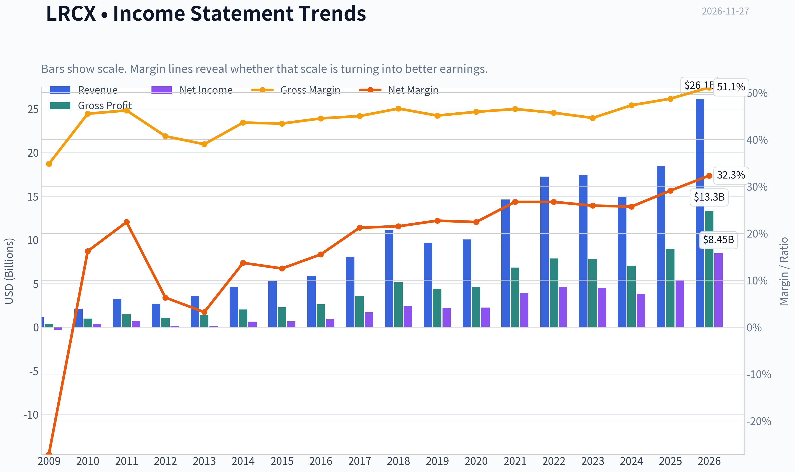

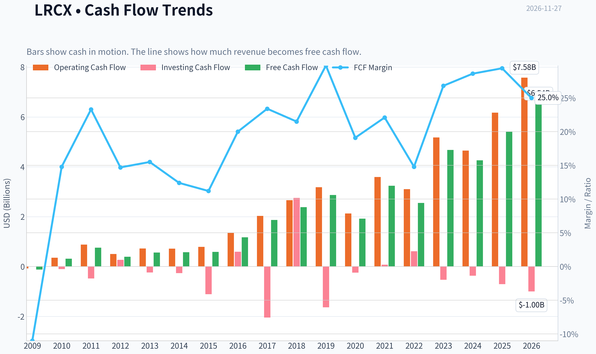

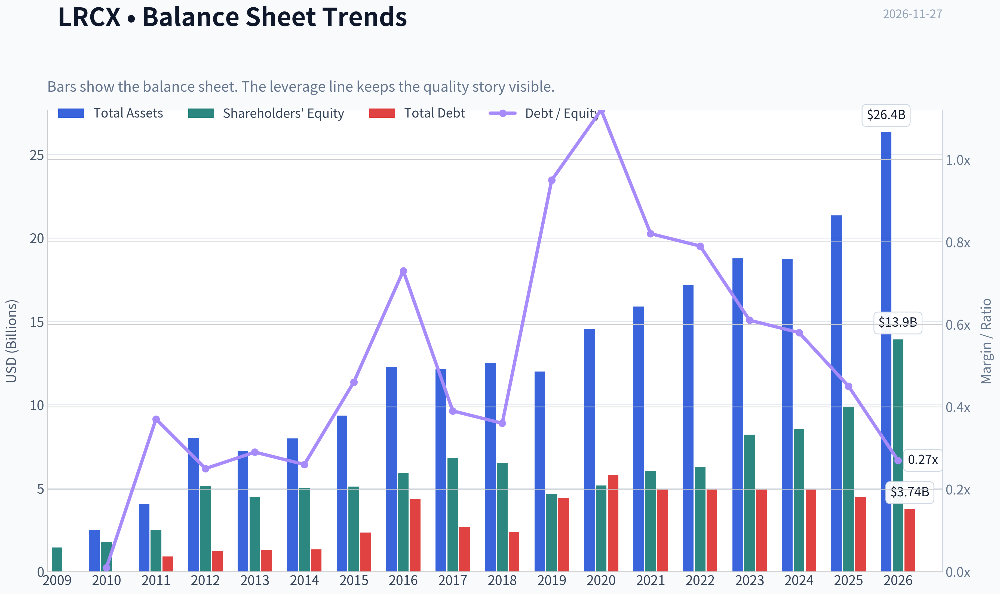

This graph tracks the profitability and return metrics (ROE, ROIC, Margins) of **LRCX** over the past decade, highlighting capital efficiency trends.

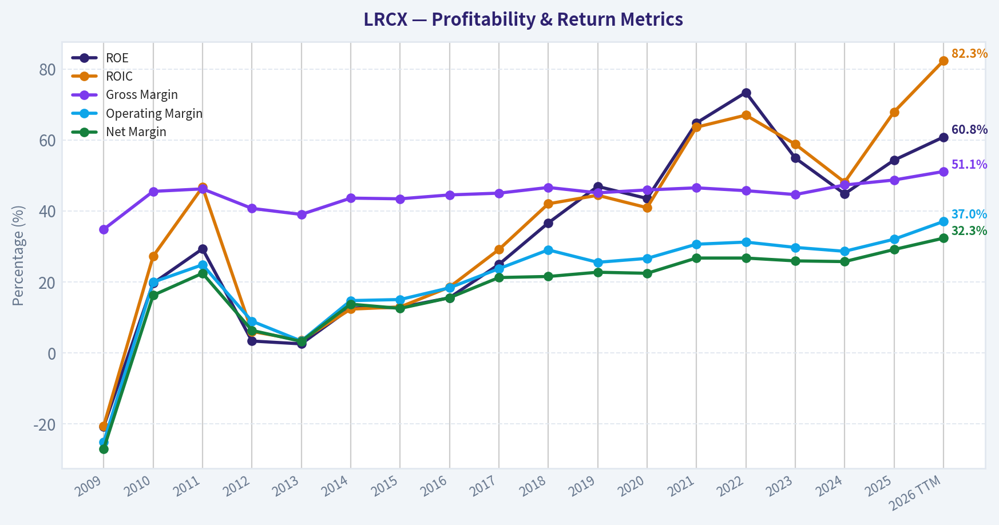

This chart illustrates the financial health of **LRCX** over the last 10 years, mapping cash equivalents and free cash flow against total obligations (Debt).

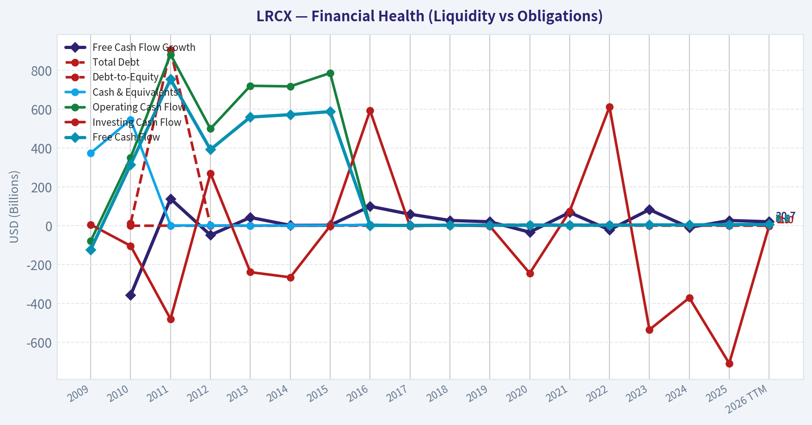

This comparison chart from *Profitability and Earnings Quality* stacks current figures against historical benchmarks for **LRCX**, making it easy to see where the company trades relative to its own averages.

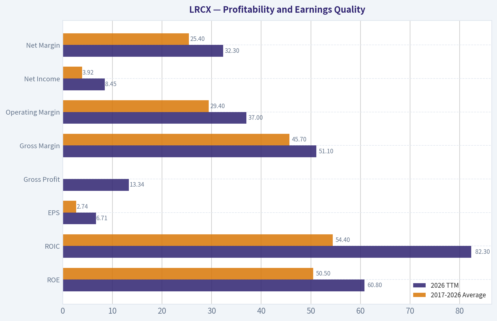

This breakdown chart from <em>Cash Flow and Capital Allocation</em> shows the proportional composition for **LRCX** - useful for understanding what drives or risks the business.

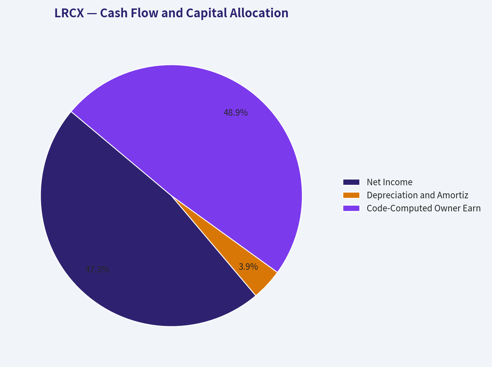

---

### Intrinsic Value Analysis (Buffett)

> *Following Warren Buffett's value investing philosophy: Circle of Competence, Economic Moat, Management Quality, and Margin of Safety.*

#### Intrinsic Value Snapshot

Price is what you pay. Intrinsic value is what the business may be worth based on the cash it can create for owners over time. We show a range, not one magic number.

- Current Price: $183.94
- Value Range (conservative to optimistic across both DCF methods): $63.94 to $288.78

##### Owner Earnings (Buffett Method)
- Net Income: $7,265,396,000.00
- Depreciation & Amortization: $441,533,000.00
- Capital Expenditures: $-966,405,000.00
- Working Capital Changes: $-1,913,879,000.00
- Owner Earnings: $4,890,796,250.13

##### Intrinsic Value
###### Buffett Method
Uses owner earnings. Stricter, and usually more conservative.
- Conservative: $106.97
- Average: $152.82
- Optimistic: $152.82
- Discount Rate: 8.2%

###### Cash Flow Method
Uses free cash flow. Better for companies spending heavily today to grow tomorrow.
- Conservative: $63.94
- Average: $126.33
- Optimistic: $288.78
- Discount Rate: 9.0%

ANALYST STANCE: **Neutral**

#### Executive Summary

Lam Research is a high-quality semiconductor-equipment franchise with strong gross margins, substantial operating leverage, net cash, and durable customer relationships. Its competitive position benefits from process know-how, an installed equipment base, qualification requirements, and a concentrated industry structure.

The central issue is valuation. At approximately **$184 per share**, LRCX trades above the DeepValues Buffett-method intrinsic value of **$152.82**, implying a reported **20.4% negative margin of safety**. The business quality is strong enough to merit serious attention, but the current valuation does not provide the quality-scaled margin of safety normally required for a cyclical semiconductor-equipment company.

#### 1. Factor Scorecard

| Factor | Score | Assessment |
|---|---:|---|
| Circle of competence and simplicity | 3.0/5 | Lam sells specialized equipment used to manufacture semiconductors. The basic model is understandable, but demand depends on complex technology cycles, customer capital spending, and geopolitics. |
| Durable competitive advantage | 4.0/5 | Strong process expertise, customer qualification requirements, installed-base relationships, and scale support a wide but cyclical moat. |
| Management quality and capital allocation | 3.5/5 | Financial outcomes indicate disciplined execution and strong profitability. Direct evidence on insider ownership, compensation design, and acquisition discipline is less conclusive. |
| Industry structure | 3.0/5 | The semiconductor-equipment market is concentrated and technologically demanding, but cyclical, capital-spending-sensitive, and exposed to export controls. |

**Gate 5 hard floor:** **Not tripped.** Earnings and revenue are growing, owner earnings are positive, net cash is approximately $3.7 billion, and there is no evidence of financial distress or interest coverage below 1x.

**Key Takeaways:** Lam scores well on competitive quality but not perfectly on predictability. Its economics are attractive, although semiconductor cycles and government restrictions create meaningful variability.

#### 2. Moat Analysis

| Moat source | Evidence | Assessment |
|---|---|---|
| Intangible assets | Deep engineering expertise, process integration knowledge, and customer-qualified equipment | Strong |
| Switching costs | Semiconductor manufacturers must qualify equipment for demanding production processes; replacing equipment can create yield and downtime risks | Strong |
| Cost advantages | Scale in research, manufacturing, service, and global support | Moderate to strong |
| Network effects | Traditional network effects are limited, but a growing installed base expands service relationships and process data | Moderate |

Lam's strongest moat is not consumer branding or a conventional software network. It is the combination of engineering knowledge, customer qualification, installed equipment, service capability, and the high cost of manufacturing errors for customers.

The reported **50.5% gross margin** supports the presence of differentiated intellectual property and pricing power. The industry's concentrated structure also reduces the likelihood of rapid commoditization. However, the moat is exposed to technology transitions, customer concentration, China-related restrictions, and semiconductor capital-spending cycles.

**Moat quality rating: Wide and stable, with some cyclical and geopolitical risks - 4/5.**

#### 3. Management Quality and Capital Allocation

Lam's current financial profile indicates effective operating execution:

- Revenue growth: **26.0% year over year**
- Return on equity: **58.3%**
- Gross margin: **50.5%**
- Owner earnings: approximately **$8.0 billion**
- Net cash: approximately **$3.7 billion**

The available evidence supports a view of competent management operating a high-return franchise. The principal limitation is that the supplied data does not establish whether senior executives have unusually large personal ownership stakes or whether all capital allocation decisions have consistently created value across the full cycle.

The balance sheet appears conservatively positioned, and the company is not relying on heavy leverage to produce its high ROE. Still, semiconductor-equipment management must allocate through peaks and troughs, making restraint during periods of unusually strong demand especially important.

**Management assessment: 3.5/5.**

#### 4. Financial Summary

| Metric | Latest available figure |
|---|---:|
| Current price | $184.00 |
| Market capitalization | $229.77B |
| P/E ratio | 27.4x |
| Revenue growth | 26.0% year over year |
| Gross margin | 50.5% |
| ROE | 58.3% |
| FCF yield | 2.1% |
| Cash | $7.4B |
| Debt | $3.7B |
| Net cash | $3.7B |
| Shares outstanding used in valuation | 1,256M |

**Key Takeaways:** Lam combines high profitability with a net-cash balance sheet. The 2.1% free-cash-flow yield shows that the market is assigning substantial value to future growth rather than pricing the company primarily on current cash generation.

#### 5. Owner Earnings Calculation

| Owner earnings component | Amount |
|---|---:|
| After-tax operating income | $8.5B |
| Add: depreciation and amortization | $0.5B |
| Less: capital expenditure charge | $(1.0B) |
| Less: working-capital investment | $0.0B |
| **Estimated owner earnings** | **$8.0B** |

The app's calculation uses after-tax operating income rather than reported net income, then deducts depreciation-adjusted capital expenditure and working-capital investment. On this basis, owner earnings are approximately **$8.0 billion**, or roughly **$6.37 per share** using 1.256 billion shares.

**Key Takeaways:** Owner earnings are substantial and closely supported by operating profitability. The relatively modest capital-expenditure requirement is favorable, although the calculation should be viewed across a full semiconductor cycle because annual capital intensity can vary.

#### 6. Three-Scenario DCF Valuation

The following scenarios use approximately $8.0 billion of owner earnings and 1.256 billion shares. They are sensitivity checks; the DeepValues app value remains the headline intrinsic value.

| Scenario | Core assumptions | Estimated value per share |
|---|---|---:|
| A. No growth | 10% discount rate; owner earnings capitalized with no growth | $63.69 |
| B. GDP growth | 3% perpetual growth; 10% discount rate | $93.72 |
| C. Historical-growth sensitivity | Approximately 4.9%-7.3% growth for 10 years, fading to 2.5% terminal growth; 10% discount rate | $110-$124 |
| DeepValues Buffett-method value | 9.7% growth fading to 2.5%; 8.2% discount rate; $3.7B net cash | **$152.82** |

**Key Takeaways:** The conservative scenarios produce values well below the market price, while the app's more favorable discount rate and growth assumptions produce a higher value of $152.82. This spread shows that the valuation depends materially on sustained growth and a relatively low required return.

#### 7. Intrinsic Value and Margin of Safety

The required headline intrinsic value is:

- **Intrinsic value:** $152.82 per share
- **Current price:** approximately $184
- **Reported margin of safety versus price:** **negative 20.4%**
- **App valuation range:** $106.97 to $152.82

The valuation does not offer a conventional margin of safety at the current price. For a wide-moat, high-return compounder, a 10%-15% discount can be acceptable because quality and reinvestment runway matter. LRCX does not meet that standard on the supplied valuation: the price is above the headline intrinsic value rather than modestly below it.

The reverse-DCF implication is that the market expects strong, sustained growth and continued high profitability. Those expectations are plausible for Lam, but they leave less room for semiconductor-cycle weakness, export restrictions, customer delays, or technology-transition risk.

#### 8. Final Buffett Scorecard

| Criterion | Weight | Score | Weighted contribution |
|---|---:|---:|---:|
| Moat width and durability | 25% | 4.0 | 1.00 |
| Valuation and margin of safety | 20% | 1.5 | 0.30 |
| Capital returns versus WACC | 15% | 4.5 | 0.68 |
| Business understanding and predictability | 12% | 3.0 | 0.36 |
| Management quality and capital allocation | 12% | 3.5 | 0.42 |
| Reinvestment runway | 8% | 4.0 | 0.32 |
| Balance-sheet strength | 4% | 4.0 | 0.16 |
| Industry structure | 4% | 3.0 | 0.12 |
| **Total** | **100%** |  | **3.36/5** |

#### 9. Investment Stance

**Neutral - Moderate conviction.**

Lam Research is a high-quality, financially strong semiconductor-equipment company with a credible moat and attractive long-term reinvestment economics. The evidence supports the business franchise, but not the current valuation as measured against the $152.82 intrinsic-value estimate. The appropriate analytical conclusion is that LRCX becomes more compelling only when the relationship between price, normalized owner earnings, and long-term growth provides a clearer margin of safety.
#### Valuation Bridge

This bridge places the current market price beside each intrinsic value lens so readers can see whether upside depends on one method or shows up across several methods.

| Scenario | Intrinsic Value / Share |
| --- | ---: |
| Buffett Method | $152.82 |
| Cash Flow Method | $126.33 |
| Damodaran Method | $127.44 |
| Current Price | $183.94 |

#### Key Takeaways

If one method is far above the others, the upside case depends on a specific modelling assumption. When several methods cluster together, the valuation story is more robust.

#### Valuation Visuals

This comparison chart from *Latest Earnings Snapshot* stacks current figures against historical benchmarks for **LRCX**, making it easy to see where the company trades relative to its own averages.

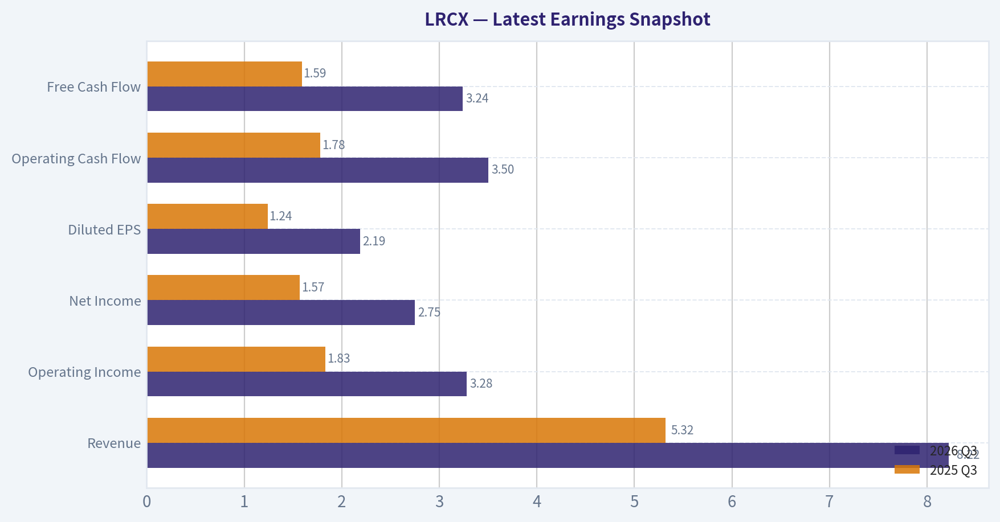

This comparison chart from *Current Metrics Versus the Latest Ten-Year Average* stacks current figures against historical benchmarks for **LRCX**, making it easy to see where the company trades relative to its own averages.

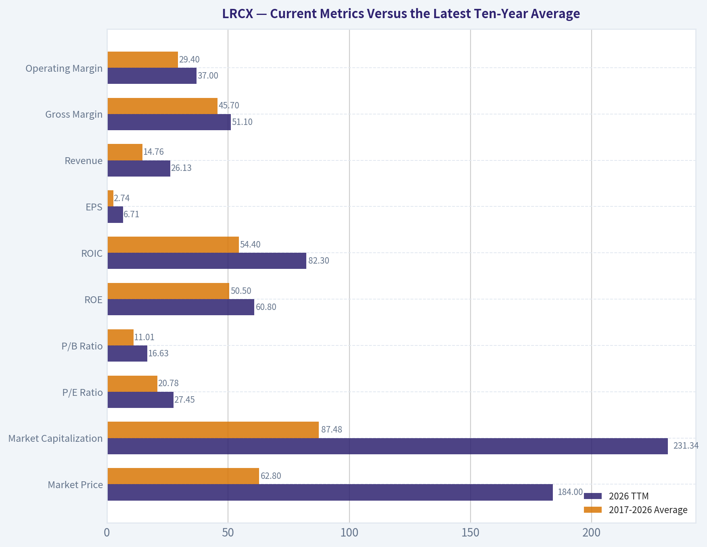

This comparison chart from *Balance Sheet and Financial Strength* stacks current figures against historical benchmarks for **LRCX**, making it easy to see where the company trades relative to its own averages.

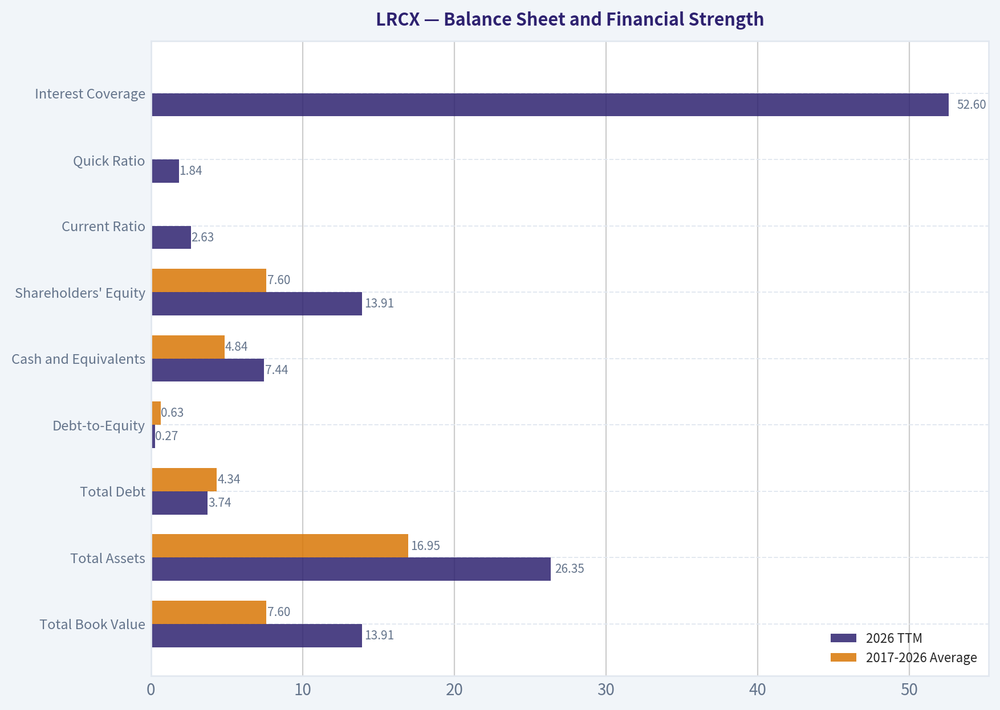

This comparison chart from *Buffett-Style Owner Earnings DCF* stacks current figures against historical benchmarks for **LRCX**, making it easy to see where the company trades relative to its own averages.

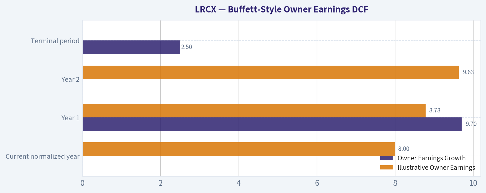

---

### Trend & Growth Analysis (Lynch/Druckenmiller/Fisher)

> *Following Peter Lynch's GARP, Stanley Druckenmiller's macro-aware approach, and Philip Fisher's scuttlebutt methodology.*

ANALYST STANCE: **Neutral**

#### 1. Lynch Classification

**Fast grower with cyclical exposure.** LRCX's reported year-over-year revenue growth is 26%, placing it above the fast-grower threshold. However, semiconductor equipment demand is cyclical, so the growth rate should not be extrapolated as a smooth 20%-25% annual path.

#### 2. The Story in Three Bullets

- Lam Research supplies critical wafer-fabrication equipment used to manufacture advanced memory and logic semiconductors.
- AI, high-bandwidth memory, advanced packaging, and rising semiconductor complexity expand equipment intensity per wafer.
- The company combines strong profitability and customer relevance with meaningful exposure to semiconductor capital-spending cycles and China-related restrictions.

#### 3. TAM and Runway

| Factor | Assessment |
|---|---|
| Primary markets | Etch, deposition, clean, and related wafer-fabrication equipment |
| Secular drivers | AI infrastructure, memory recovery, advanced-node complexity, HBM, advanced packaging |
| Market structure | Concentrated, technically demanding, with high qualification barriers |
| Current revenue baseline | Not provided in the shared data pack |
| 10x revenue test | Cannot be calculated precisely without a verified current revenue figure and market-size estimate |
| Runway judgment | Substantial, but bounded by semiconductor capex cycles and customer concentration |

**Key Takeaways:** LRCX operates in a strategically important and technically difficult market with multiple secular growth drivers. The qualitative runway appears long, but the numerical 10x test cannot be validated from the available data. The major constraint is cyclical semiconductor spending rather than a lack of long-term demand.

#### 4. Revenue Growth Trend

| Metric | Latest reading | Interpretation |
|---|---:|---|
| Revenue growth, year over year | 26.0% | Fast-grower territory |
| Multi-period growth sequence | Not provided | Acceleration cannot be confirmed |
| Gross margin | 50.5% | Strong economics and product differentiation |
| Return on equity | 58.3% | High capital efficiency |
| Free-cash-flow yield | 2.1% | Valuation leaves limited current cash-flow yield |

**Key Takeaways:** The latest 26% revenue growth is strong, but there is insufficient sequential history to establish whether growth is accelerating or merely recovering from a cyclical trough. The 50.5% gross margin and 58.3% ROE support the view that LRCX has valuable technology and customer relationships. The low free-cash-flow yield indicates that substantial future growth is already reflected in the valuation.

#### 5. Unit Economics and Operating Efficiency

| Metric | Result | Assessment |
|---|---:|---|
| LTV/CAC | Not disclosed | Cannot be meaningfully calculated for an equipment manufacturer |
| Net revenue retention | Not applicable / not disclosed | Not a conventional SaaS model |
| Rule of 40 | Not applicable | Designed primarily for subscription businesses |
| Gross margin | 50.5% | Strong |
| Current ratio | 2.63 | Solid balance-sheet liquidity |
| Net cash | Approximately $3.7 billion | Financial flexibility |

**Key Takeaways:** SaaS-style metrics such as LTV/CAC, NRR, and the Rule of 40 are not appropriate for LRCX. The relevant evidence is its high gross margin, strong return on equity, liquidity, and net-cash position. These factors support resilience, but they do not eliminate semiconductor-cycle risk.

#### 6. Inflection-Point Assessment

| Potential inflection | Evidence | Status |
|---|---|---|
| Product-cycle inflection | AI, HBM, advanced memory, and complex-node demand | Positive but not quantified |
| Market-share inflection | No verified share series provided | Unconfirmed |
| Margin inflection | 50.5% gross margin | Strong base, acceleration unconfirmed |
| TAM inflection | Rising semiconductor complexity and AI-related demand | Positive |
| Competitive inflection | No specific competitor disruption established | Unconfirmed |
| Earnings inflection | 26% revenue growth | Possible, but cyclical recovery may contribute |

**Key Takeaways:** The strongest potential inflection is rising equipment intensity caused by AI-related semiconductor complexity and memory investment. The available data does not prove a new product ramp, accelerating share gains, or a durable margin step-up. Druckenmiller-style conviction would require evidence that future earnings are being revised upward faster than the market valuation.

#### 7. Macro Setup

| Macro factor | Current assessment | Effect on LRCX |
|---|---|---|
| AI and data-center investment | Strong secular support | Positive |
| Semiconductor capital spending | Cyclical and uneven | Mixed |
| Interest-rate backdrop | 30-year Treasury cited at 5.24% | Headwind to long-duration valuation |
| China exposure and restrictions | Material reported concern | Risk |
| Industry positioning | Technology and semiconductor leadership | Positive but crowded |

**Key Takeaways:** The secular macro backdrop is favorable because AI infrastructure requires more advanced semiconductor capacity and equipment. The interest-rate environment remains restrictive for premium-growth valuations, while China restrictions and semiconductor-capex volatility create meaningful offsets. The setup is supportive for the business but not unequivocally favorable for the multiple.

#### 8. Fisher's 15-Point Assessment

| Fisher criterion | Score / 5 | Evidence quality |
|---|---:|---|
| Market potential | 5 | Strong secular semiconductor demand |
| New-product determination | 4 | Technology cycle supports ongoing innovation |
| R&D effectiveness | 4 | High-value, technically specialized products |
| Sales organization | 4 | Deep customer qualification and service requirements |
| Profit margins | 5 | 50.5% gross margin |
| Margin improvement | 3 | Improvement trend not supplied |
| Labor relations | 3 | Insufficient data |
| Executive relations | 3 | Insufficient data |
| Management depth | 4 | Large, established technology supplier |
| Cost analysis/accounting | 4 | No accounting red flags supplied |
| Outstanding competitive aspects | 5 | Qualification barriers, installed base, service relationships |
| Long-range profit outlook | 4 | Strong secular drivers, cyclical risk |
| Dilution | 4 | No major dilution issue supplied |
| Management candor | 3 | Insufficient data |
| Management integrity | 4 | No specific integrity concern supplied |
| **Total** | **55 / 75** | **Good, with data gaps** |

**Key Takeaways:** LRCX scores well on market potential, margins, technical barriers, and long-term relevance. The score is restrained by limited information on labor relations, management candor, margin progression, and detailed dilution history. A 55 out of 75 indicates a good Fisher profile rather than an unequivocally outstanding one.

#### 9. Valuation Analysis

| Measure | Result | Interpretation |
|---|---:|---|
| Share price | $184 | Current reference price |
| P/E | 27.4x | Premium valuation |
| Earnings growth used for PEG | 26.0% | Latest revenue growth used as a proxy; not ideal |
| Approximate PEG | 1.05 | Around fair value under the proxy |
| Headline intrinsic value | $152.82 | Below the current price |
| Conservative intrinsic value | $106.97 | Considerably below the current price |
| FCF DCF range | $63.94-$288.78 | Very assumption-sensitive |
| Damodaran FCFF range | $50.97-$322.29 | Very assumption-sensitive |
| FCF yield | 2.1% | Low current cash-flow yield |

**Key Takeaways:** The approximate PEG of 1.05 looks reasonable, but it uses revenue growth rather than earnings growth and therefore has limited precision. The primary owner-earnings valuation is $152.82, approximately 20.4% below the $184 reference price. The wide DCF ranges demonstrate that LRCX's valuation depends heavily on long-term growth, margins, and semiconductor-cycle assumptions.

#### 10. Valuation Sensitivity

| Scenario | Main assumptions | Implied value from supplied models |
|---|---|---:|
| Conservative | Lower owner-earnings growth and more cautious cash-flow assumptions | $50.97-$106.97 |
| Base | Owner-earnings growth of approximately 9.7%, fading toward 2.5% terminal growth | $127.44-$152.82 |
| Optimistic | Stronger long-term cash-flow growth and sustained industry economics | $288.78-$322.29 |

**Key Takeaways:** The valuation range is unusually wide because semiconductor equipment earnings are highly sensitive to cycle timing and terminal assumptions. The central owner-earnings estimate remains below the current reference price, while only the more optimistic cash-flow cases exceed it materially. This makes execution, cycle duration, and interest rates especially important valuation variables.

#### 11. Growth Investor Scorecard

| Criterion | Weight | Score / 5 | Weighted contribution |
|---|---:|---:|---:|
| Lynch story | 10% | 4.2 | 0.42 |
| TAM and runway | 20% | 4.0 | 0.80 |
| Revenue growth | 20% | 3.8 | 0.76 |
| Unit economics | 15% | 3.8 | 0.57 |
| Competitive position | 10% | 4.5 | 0.45 |
| Management quality | 10% | 3.8 | 0.38 |
| Macro setup | 5% | 3.2 | 0.16 |
| Profitability path | 5% | 4.4 | 0.22 |
| Valuation | 5% | 2.7 | 0.14 |
| **Total** | **100%** |  | **3.90 / 5.00** |

**Key Takeaways:** LRCX scores strongly on competitive position, profitability, secular demand, and strategic importance. The principal deductions come from valuation, macro sensitivity, and the lack of confirmed multi-period growth acceleration. A 3.90 score supports a favorable research posture, but the evidence does not support the current valuation as clearly undervalued.

#### 12. Key Risks and Catalysts

| Catalysts | Risks |
|---|---|
| Sustained AI and HBM investment | Semiconductor-capex downturn |
| Faster memory spending recovery | China export restrictions |
| New etch, deposition, or packaging applications | Customer concentration and pricing pressure |
| Share gains at advanced nodes | Valuation compression from high interest rates |
| Operating leverage from revenue growth | Growth deceleration after a cyclical rebound |
| Evidence of accelerating orders or backlog | Geopolitical disruption to semiconductor supply chains |

The addition of LRCX by Stanley Druckenmiller and Steve Cohen in the latest available 13F snapshots is supportive contextual evidence, but 13F filings are delayed and do not establish the current fundamental outlook.

#### Bottom Line

LRCX is a high-quality semiconductor equipment leader with fast recent growth, strong margins, high returns on equity, and a durable AI-related runway. The central analytical question is whether the 26% growth rate represents a durable acceleration or a cyclical recovery. With the supplied owner-earnings intrinsic value at $152.82 versus a $184 reference price, the evidence currently supports **Neutral** rather than a high-conviction valuation conclusion.

---

### Market Technical Analysis

ANALYST STANCE: **Neutral**

#### Data status and scope

This analysis covers **Lam Research Corporation, Nasdaq: LRCX** only. Yahoo Finance returned 250 daily records through **November 25, 2026**. November 27 is not represented by a trading record in the retrieved data, so the latest observable close is **$185.01 on November 25**.

The indicator-report service returned blank numerical fields for the requested indicators. Accordingly, the observations below use the retrieved OHLCV series directly and describe indicator direction and approximate relationships rather than presenting unsupported exact indicator values.

#### Selected indicators

The most complementary set for LRCX's current condition is:

| Category | Indicator | Relevance to current conditions |
|---|---|---|
| Trend | `close_10_ema` | Captures the very sharp short-term deterioration after the October-November decline. |
| Trend | `close_50_sma` | Tests whether the medium-term trend has materially weakened. |
| Trend | `close_200_sma` | Provides the longer-term trend reference after a major 2026 advance and subsequent retracement. |
| Momentum | `macd` | Identifies whether downside momentum remains dominant and whether a durable momentum reversal has developed. |
| Momentum | `rsi` | Helps distinguish persistent downside momentum from an already deeply stretched condition. |
| Volatility | `boll_ub` | Defines the upper side of the recent trading envelope and helps frame the magnitude of the retracement. |
| Volatility | `boll_lb` | Shows whether the latest decline is pressing toward the lower end of the recent range. |
| Volatility | `atr` | Captures the unusually wide daily ranges and the elevated uncertainty surrounding the current price action. |

**Key Takeaways:** This set combines short-, medium-, and long-term trend measures with momentum and volatility diagnostics. It avoids selecting both overlapping MACD components and focuses on the indicators most useful for interpreting a fast, high-volatility decline.

#### Price structure and trend

LRCX's one-year path has been exceptionally volatile. The stock advanced from approximately **$155 in late November 2025** to an intrayear high of **$438.03 on June 30, 2026**, representing a gain of roughly 182% from the starting level. That advance then reversed substantially, with the close falling to **$185.01 by November 25**, approximately 58% below the June closing high.

The decline was not a single uninterrupted move. It developed in several phases:

- **July:** A sharp breakdown from the June peak, with the close falling from $432.87 on June 30 to the low $250s by late July.
- **August through early September:** A volatile stabilization and rebound attempt, mostly between roughly $290 and $345.
- **Late September to early October:** A renewed advance, reaching $347.49 on October 2.
- **October through November:** A persistent reversal, accelerating in late October and early November. The close dropped from $254.39 on October 29 to $185.20 on November 5, then failed to sustain the rebound toward $235.88 on November 11.

The most recent sequence is particularly weak. From November 11 through November 25, the closing price declined from **$235.88 to $185.01**, a decrease of about 21.6%. The market also recorded several lower highs and lower lows: $235.88, $233.78, $225.92, $210.83, $210.69, $211.67, $203.68, $183.27, $209.76, $196.16, and $185.01. This pattern indicates that short-term rallies have repeatedly encountered supply before recovering the prior breakdown levels.

The latest close is also near the bottom of the recent trading range. On November 25, the intraday range extended from **$171.53 to $185.18**, a range of approximately 7.4% relative to the low. That large range, combined with a close near the session high but still near a multi-month low, suggests intraday stabilization without yet establishing a broader trend reversal.

#### Moving-average interpretation

The approximate 10-day trend measure is clearly declining. Recent closes have been concentrated well below the October levels, and the latest price is materially below the likely short-term average. This indicates that short-term price momentum remains negative, even though the November 25 close recovered from the session low.

The 50-day trend has also weakened materially. The October 2 close near $347.49 and the subsequent sequence of lower prices would pull the medium-term average downward. With the latest close at $185.01, price is substantially below the likely 50-day average. This separation reflects a major loss of medium-term momentum rather than a minor pullback around a stable trend.

The 200-day average is slower and therefore less responsive. Because the first half of 2026 included a large advance toward $438, the long-term average is likely to remain well above the current price even after the decline. The important implication is that LRCX has moved from a strong long-term uptrend phase into a condition where the current price is testing the gap between long-term trend support and the much weaker short- and medium-term structure. Exact moving-average values should not be inferred because the indicator service supplied no numerical output.

#### Momentum: MACD and RSI

The price sequence strongly implies a negative MACD configuration. The decline from $347.49 in early October to $185.01 in late November represents a sustained loss of momentum, and the November acceleration would normally push the MACD line below its signal reference. There is no clear evidence in the supplied data of a confirmed bullish MACD reversal.

The RSI picture is more nuanced. Repeated declines of 5% to 10% and several unusually wide sessions would likely drive RSI toward, or potentially below, the conventional oversold region. However, an oversold reading in this context would describe the intensity of recent selling, not by itself demonstrate that the broader decline has ended. In strong downside phases, RSI can remain weak while price continues to make lower highs.

The November 5 decline to $185.20, followed by a rebound to $235.88 on November 11, briefly interrupted the selling sequence. That rebound was not sustained: subsequent closes fell to $225.92, $210.83, $210.69, $211.67, $203.68, $183.27, $209.76, $196.16, and $185.01. This failed rebound is more consistent with persistent negative momentum than with a confirmed momentum divergence.

#### Bollinger-band context

The recent price behavior indicates a wide and expanding volatility envelope. The 20-session closing distribution from late October through November 25 contains prices ranging from roughly **$183 to $254**, with a concentration around the low $200s. The approximate middle of that recent distribution is near the low-to-mid $210s, placing the November 25 close below the recent central tendency.

The November 25 close near $185 was likely close to the lower Bollinger region, although the large range on that day makes the precise band relationship dependent on the exact calculation settings. A test of the lower band can indicate stretched downside conditions, but it is not inherently a reversal signal. The preceding pattern of prices repeatedly moving lower after brief rebounds means that band contact should be interpreted alongside MACD, RSI, and the moving averages.

The upper band is also important because the October-November decline produced several failed recoveries. A move back toward the upper portion of the recent envelope would first need to overcome the series of lower highs around $210-$236 and then the larger resistance area near $250-$260. These are technical reference zones derived from prior closes, not estimated value.

#### Volatility and volume

ATR is likely elevated. Daily ranges were unusually large on several recent dates:

- November 5: approximately **$25.82**
- November 20: approximately **$18.01**
- November 25: approximately **$13.65**
- November 18: approximately **$8.47**
- November 13: approximately **$14.85**

The largest volume in the recent decline occurred on November 5, when approximately **31.45 million shares** traded as the close fell to $185.20. Volume was also elevated on November 20, at approximately **23.88 million shares**, when the close dropped to $183.27. Those high-volume selloffs suggest that the downside move involved substantial participation rather than only thin-market noise.

The November 23 rebound to $209.76 occurred on approximately **17.27 million shares**, but the following two sessions returned to declines on approximately **13.98 million** and **21.51 million shares**. This pattern weakens the interpretation that the rebound represented a durable change in demand. Instead, it shows strong two-way trading with repeated downside follow-through.

#### Integrated interpretation

The evidence is technically bearish across the short- and medium-term horizons:

1. Price is far below the October peak and has established a sequence of lower highs and lower lows.
2. The short-term and medium-term trend measures would be declining and positioned above the latest close.
3. MACD momentum is likely negative, with no confirmed reversal visible in the price sequence.
4. RSI is likely weak and possibly near an oversold condition, but the broader structure remains damaged.
5. Bollinger-band behavior points to a stretched and volatile decline rather than a calm, orderly consolidation.
6. ATR and volume both indicate elevated uncertainty and unusually forceful price discovery.

There is one countervailing feature: the November 25 close at $185.01 was near the session high after an intraday low of $171.53. That indicates some demand appeared below the closing price and prevented a close at the extreme low. However, the evidence is insufficient to characterize that session as a confirmed reversal because the price remains below the recent rebound highs and the preceding trend is still decisively downward.

From a valuation-interpretation perspective, the technical evidence does not support treating the late-November price as established by a stable trend regime. The stock is in a high-volatility repricing phase, and any fundamental valuation framework would need to account for the large gap between the June peak, the October rebound, and the November breakdown.

#### Key points table

| Area | Evidence from retrieved data | Interpretation |
|---|---|---|
| Latest observable price | $185.01 close on November 25, 2026 | Latest available price is materially below the October and November rebound levels. |
| One-year range | Approximately $155 to $438 | Extremely wide annual dispersion and a major reversal from the June high. |
| Recent trend | $235.88 on November 11 to $185.01 on November 25 | Roughly 21.6% decline in ten trading sessions. |
| Price structure | Repeated lower highs and lower lows | Downtrend remains dominant across the recent horizon. |
| Short-term trend | Latest closes clustered below October levels | 10 EMA would likely be declining and above the latest close. |
| Medium-term trend | Large separation between current price and recent 50-session distribution | 50 SMA would likely be above current price, confirming medium-term weakness. |
| Long-term trend | 2026 rally keeps the long-term average slower to turn | 200 SMA may remain elevated, creating a long-term reference above current price. |
| Momentum | Persistent downside follow-through after the November 11 rebound | MACD likely remains negative; no confirmed momentum reversal is evident. |
| Volatility | Wide daily ranges, including $25.82 on November 5 | ATR is likely elevated, indicating unusually unstable price behavior. |
| Volume | 31.45 million shares on November 5 and 23.88 million on November 20 | Major declines occurred with strong participation. |
| Bollinger context | Recent close near the lower end of the late-November range | Downside appears stretched, but lower-band contact alone does not establish reversal. |
| Data limitation | Indicator reports returned blank values; November 27 has no retrieved price record | Exact indicator readings and current-day confirmation are unavailable. |

**Key Takeaways:** LRCX's latest observable structure is dominated by a sharp medium-term decline, negative momentum, elevated volatility, and high-volume downside sessions. The November 25 rebound from the intraday low offers evidence of short-term demand, but it does not yet offset the sequence of lower highs and lower lows. Exact indicator values and a November 27 closing price are unavailable in the retrieved data.

---

### Options Market Analysis

> *Reading options flow - put/call ratios, IV skew, and unusual activity - to gauge institutional positioning and event-driven risk.*

ANALYST STANCE: **BULLISH**

#### Near-Term Put/Call Analysis

| Expiration | Call OI | Put OI | Put/Call OI | Call Volume | Put Volume | Put/Call Volume |
|---|---:|---:|---:|---:|---:|---:|
| Nov. 27, 2026 | 13,089 | 10,848 | 0.83 | 2,000 | 1,751 | 0.88 |
| Dec. 4, 2026 | 14,808 | 5,235 | 0.35 | 1,151 | 571 | 0.50 |
| Dec. 11, 2026 | 2,224 | 1,290 | 0.58 | 506 | 316 | 0.62 |
| **Total** | **30,121** | **17,373** | **0.58** | **3,657** | **2,638** | **0.72** |

**Key Takeaways:** Aggregate put/call open interest is 0.58, below the approximately 0.70 neutral baseline, while the volume ratio is close to neutral at 0.72. The strongest bullish skew is concentrated in the Dec. 4 expiration, where calls outnumber puts by nearly three to one in open interest. The Nov. 27 expiration is more balanced, suggesting some immediate-term hedging alongside the broader call-heavy structure.

#### Implied Volatility Assessment

| Expiration | Call ATM IV | Put ATM IV | IV Differential | Interpretation |
|---|---:|---:|---:|---|
| Nov. 27, 2026 | 67.0% | 59.3% | Calls +7.7 pts | Upside volatility premium |
| Dec. 4, 2026 | 92.0% | 87.7% | Calls +4.3 pts | Very elevated IV; upside skew |
| Dec. 11, 2026 | 88.5% | 86.5% | Calls +2.0 pts | Elevated IV; modest call skew |

**Key Takeaways:** Near-term implied volatility is elevated, particularly for Dec. 4 and Dec. 11, with ATM call IV exceeding put IV across all listed expirations. This is a call-skew structure rather than a conventional downside-fear skew. The magnitude of IV suggests significant event or price-movement risk, but the supplied data does not identify a specific catalyst such as earnings or a product announcement.

The data provides ATM IV but not explicit out-of-the-money strike-level IV, so the skew assessment is based on the call-versus-put ATM differential rather than a complete volatility-smile comparison.

#### Unusual Options Activity

| Finding | Result |
|---|---|
| Contracts with volume greater than 5x open interest | None identified |
| Fresh directional activity | No qualifying contracts |
| Smart-money versus retail inference | Not determinable from the supplied data |

**Key Takeaways:** No individual contract met the tool's threshold for unusually high volume relative to open interest. Therefore, there is no clear evidence of a fresh institutional sweep or an isolated speculative bet. The bullish read comes from aggregate call-heavy open interest and volatility skew, not from identifiable unusual-flow contracts.

#### Open Interest Concentration and Expiration Structure

| Expiration | Call OI | Put OI | Combined OI | Relative Concentration |
|---|---:|---:|---:|---|
| Nov. 27, 2026 | 13,089 | 10,848 | 23,937 | Highest combined near-term OI |
| Dec. 4, 2026 | 14,808 | 5,235 | 20,043 | Highest call OI; strongest call-heavy structure |
| Dec. 11, 2026 | 2,224 | 1,290 | 3,514 | Lower concentration |

**Key Takeaways:** The Nov. 27 and Dec. 4 expirations contain nearly all of the reported near-term open interest, creating the greatest potential for expiration-related pinning or gamma effects during that window. Dec. 4 has the largest call open interest and the lowest put/call ratio, making it the clearest upside-oriented concentration. Strike-level open interest was not supplied, so precise gamma walls, max-pain levels, and price-specific gravitational points cannot be identified.

#### Overall Options Sentiment

| Factor | Reading | Signal Implication |
|---|---|---|
| Put/Call OI ratio | 0.58 versus ~0.70 neutral | Bullish call-over-put concentration |
| Put/Call volume ratio | 0.72 | Mildly bullish to neutral |
| ATM IV | 67%-92% | Elevated event and movement risk |
| IV skew | Calls above puts across expirations | Upside demand or call-rich exposure |
| Unusual activity | None above 5x volume/OI | No isolated fresh-flow confirmation |
| OI concentration | Heavy in Nov. 27 and Dec. 4 | Potential expiration pinning and gamma effects |
| **Overall signal** | **BULLISH** | Aggregate structure favors upside, with elevated uncertainty |

**Key Takeaways:** LRCX options data supports a bullish near-term signal, primarily because call open interest materially exceeds put open interest and calls carry a volatility premium across the listed expirations. The signal is moderated by elevated implied volatility and the absence of a clearly identifiable unusual-flow contract. The evidence indicates upside-oriented market expectations, but also a market pricing substantial event or realized-movement risk.

#### Summary

| Category | Assessment |
|---|---|
| Put/Call Ratio | 0.58 OI and 0.72 volume; below or near the 0.70 neutral benchmark |
| IV Level | Elevated, ranging from 67% to 92% at the money |
| Skew Direction | Call skew; call IV exceeds put IV in every listed expiration |
| Unusual Activity | None meeting the volume greater than 5x open-interest threshold |
| Overall Signal | **BULLISH**, with elevated volatility and moderate confidence |

**Key Takeaways:** The dominant message is bullish call concentration rather than defensive put demand. However, the lack of unusual-contract confirmation, missing strike-level data, and elevated IV reduce confidence in the directional strength of the signal. Options data alone does not establish valuation; it indicates that near-term market expectations currently lean toward upside participation with substantial event risk.

---

## Research Team Commentary

> *The Research Manager synthesizes the Bull vs Bear debate into action-free commentary. This is a pre-risk view, not the final stance.*

Core Takeaway: Lam Research appears to be an excellent business, but the supplied evidence does not establish that $184 represents a discount to intrinsic value. Its process expertise, qualification barriers, installed base, and customer integration support a durable moat, while 50.5% gross margins and 67.9% reported ROIC demonstrate exceptional economics. However, a 27.41 P/E already reflects substantial confidence in continued growth, and the valuation has not been tested against cycle-normalized free cash flow. The appropriate stance is Neutral.

The strongest bull argument is that Lam is not an ordinary cyclical manufacturer. Its tools are mission-critical to semiconductor yields and production reliability. Changing qualified equipment can be expensive and operationally risky, creating meaningful switching costs. The installed base also generates service, parts, and upgrade demand while reinforcing customer relationships. AI infrastructure, high-bandwidth memory, advanced packaging, and greater process complexity should increase equipment content per wafer over the long term.

The reported financial performance supports that assessment. Revenue growth of 26%, gross margin of 50.5%, ROA of 30.9%, and ROIC of 67.9% are signs of substantial intellectual property and capital efficiency. Although ROE can be inflated by repurchases and a reduced equity base, the combination of ROIC, ROA, and gross margin is much harder to dismiss. Semiconductor spending may be cyclical, but Lam's competitive position can remain durable through those cycles.

The strongest bear argument is that these figures may describe a favorable part of the cycle rather than normalized earning power. Memory manufacturers can change capital budgets abruptly, and Lam's concentrated customer base magnifies the effect of individual fab delays. Qualification barriers protect existing business, but they do not guarantee share in future process generations. Applied Materials, Tokyo Electron, and other technically capable competitors ensure that Lam must continually fund R&D to preserve its position.

China restrictions are also a structural risk, not simply temporary negative sentiment. They can reduce equipment sales, service revenue, and the future installed base while encouraging local competitors. Semiconductor investment in the United States and allied markets may offset some of that exposure, but the available evidence does not quantify the net effect.

Valuation is therefore the deciding issue. At 27.41 times earnings, the earnings yield is approximately 3.65%. That can be reasonable for a predictable, wide-moat compounder, but Lam remains more cyclical than a consumer platform or recurring-revenue software franchise. Moreover, a 67.9% ROIC should not be confused with an ability to reinvest all earnings at that rate. Future value creation depends on the amount of incremental capital Lam can deploy, the returns on that incremental capital, and the cash ultimately available to shareholders.

The bear debate likely overstates the reverse-DCF hurdle by suggesting that a 27-times multiple necessarily requires sustained low-to-mid-teens growth. Under conventional assumptions, the required growth could be closer to the low-double-digit range if free cash flow approximates earnings, margins remain stable, and terminal economics are sound. Even that is demanding for a cyclical equipment supplier, however, and the conclusion is highly sensitive to the starting point. If current earnings are above mid-cycle levels or free-cash-flow conversion trails reported earnings, the implied normalized multiple would be materially higher.

The largest analytical problem is that the valuation inputs are not reconciled. The cited $184 price conflicts with market-history figures ranging from the $250s to above $400, potentially because of different dates or corporate-action treatment. Price, earnings per share, share count, and historical quotations must be adjusted on the same basis. In addition, the record lacks free cash flow, net cash or debt, stock-based compensation, and a DeepValues intrinsic-value estimate. Without those inputs, there is no defensible way to establish the 10-15% intrinsic-value discount that might be sufficient for a business of this quality.

Options sentiment adds little to that determination. A 0.58 put/call open-interest ratio and heavy December call interest indicate optimistic market positioning, not durable cash-flow value. If anything, bullish positioning suggests that enthusiasm rather than fear currently dominates the near-term narrative.

Rationale: The evidence supports a high-quality franchise rather than a distressed or deteriorating company. Lam deserves a premium to an average industrial business because its moat, margins, installed base, and long-term semiconductor exposure are genuine. Nevertheless, Buffett-style discipline requires distinguishing business quality from price. Current valuation support depends on assumptions about normalized earnings, free-cash-flow conversion, China exposure, and sustainable growth that the supplied package does not verify. That prevents an Bullish conclusion, while the strength of the franchise and absence of evidence of financial distress make an Bearish conclusion too severe.

The main lesson from similar situations is not to extrapolate one year of strong growth or treat high ROIC as proof of predictable compounding. Equally, it would be a mistake to dismiss Lam merely because it operates in a cyclical industry. The improved approach is to value the company across a full equipment cycle, separate recurring installed-base economics from new-system sales, and reconcile every valuation input after corporate actions.

Monitoring Plan: Over the next one to four quarters, the most important evidence will be revenue and order trends separated across memory, foundry/logic, advanced packaging, service, and China. Stable or rising market share in etch and deposition, continued strength in installed-base revenue, and gross margins near the current level would strengthen the moat assessment.

Free cash flow should be compared with net income over multiple quarters. Strong conversion after working-capital and capital-expenditure needs would make the current earnings multiple more credible. Net cash or debt, interest coverage, inventory growth, customer advances, and share-count changes should also be reconciled to determine financial resilience and whether repurchases are creating value or simply supporting per-share metrics.

Management's guidance on China should be evaluated against realized revenue rather than headline commentary. Evidence that non-China capacity additions are replacing restricted demand without margin dilution would strengthen the thesis. A larger-than-expected permanent reduction in the addressable market, loss of service revenue, or faster progress by domestic Chinese competitors would weaken it.

Finally, the valuation package needs a cycle-normalized reverse DCF using consistent split-adjusted data. It should incorporate at least one semiconductor spending downturn, conservative terminal growth, normalized margins, and explicit China-related haircuts. Evidence that the current price implies growth Lam can plausibly exceed would improve the valuation case; evidence that it requires uninterrupted double-digit expansion and peak-like margins would undermine it.

Final stance: Neutral.

---

## Value Investing Team Commentary

> *The Investor translates the research view into an investment thesis before risk review. This is still not the final stance.*

Lam Research is a high-quality semiconductor-equipment franchise, but the evidence supports a distinction between **excellent business economics** and **proven valuation support**.

### Business quality and moat

Lam occupies an important position in wafer fabrication, particularly in etch and deposition processes where precision, yield, uptime, and process integration matter greatly. Its equipment becomes embedded in customers' manufacturing workflows, creating qualification barriers and meaningful switching costs. A large installed base also supports recurring revenue from service, spare parts, upgrades, and process improvements.

The long-term industry backdrop is favorable. AI accelerators, high-bandwidth memory, advanced packaging, and increasingly complex process architectures require more sophisticated equipment and can increase equipment intensity per wafer. This supports a credible secular-growth argument even though semiconductor capital spending remains cyclical.

The reported 50.5% gross margin, 30.9% ROA, and 67.9% ROIC are consistent with a differentiated technology supplier rather than a commodity manufacturer. However, the ROIC figure requires careful interpretation. It may be influenced by a small invested-capital base, acquisitions, buybacks, accounting treatment, or unusually strong cycle conditions. It demonstrates excellent recent economics, but it does not prove that Lam can reinvest large sums indefinitely at comparable returns.

### Cyclicality remains material

The favorable long-term trends do not eliminate the industry's capital-spending cycles. Memory customers can sharply alter spending plans, and Lam's exposure to memory makes earnings more sensitive to inventory corrections and fab timing than those of a less cyclical business.

The key question is not whether Lam has a moat. It does. The more important question is how much of that moat's future value is already reflected in earnings expectations. A strong competitive position can protect market share during a downturn, but it cannot fully prevent temporary reductions in customer spending.

Competition from Applied Materials, Tokyo Electron, and other specialized suppliers also remains significant. Qualification barriers protect existing programs, yet each new process generation still requires continued research and development. Market leadership must be earned repeatedly rather than assumed from historical margins.

### China is a structural variable

China-related export controls represent more than ordinary headline volatility. Restrictions can affect equipment revenue, service activity, future installed-base growth, and the economics of supporting customers in the region. At the same time, restrictions may accelerate domestic Chinese equipment development and create longer-term competitive pressure.

The offsetting opportunity is increased semiconductor investment in the United States and allied markets. However, the relevant measure is not announced capacity but profitable, realizable demand after restrictions, customer concentration, and potential margin effects. The current material does not quantify whether non-China growth fully offsets the loss of restricted opportunities.

### Valuation and data quality

At 27.41 times earnings, the earnings yield is approximately 3.65%. That multiple could be defensible for a business with durable growth, high returns, and strong cash conversion. Lam, however, deserves a more demanding analysis than a predictable recurring-revenue franchise because its earnings are exposed to semiconductor investment cycles.

The central weakness is the absence of cycle-normalized free cash flow. A 26% year-over-year revenue increase may indicate powerful secular demand, but it may also reflect recovery from a weaker comparison period or favorable memory spending. The valuation case becomes substantially stronger if free cash flow consistently tracks or exceeds net income across a full cycle, including a downturn.

The price information also appears internally inconsistent. A quoted price of $184 does not align with the cited historical range above $400 unless the data uses different dates, split adjustments, or corporate-action conventions. Lam's 10-for-1 split makes basis consistency especially important. Earnings per share, share count, historical prices, buybacks, and any intrinsic-value estimate must all use the same adjusted framework. Until that reconciliation is complete, the apparent multiple and discount cannot be treated as fully reliable.

A reverse-DCF analysis should test several cases:

- normalized rather than peak earnings;
- at least one semiconductor spending downturn;
- sustainable rather than current-period margins;
- explicit China-related revenue and margin reductions;
- realistic free-cash-flow conversion;
- conservative terminal growth;
- limited assumptions about reinvestment at the current ROIC.

The valuation does not require uninterrupted mid-teens growth to work, particularly if free cash flow closely resembles earnings and terminal economics remain strong. Nevertheless, the required outcome still appears demanding for a cyclical equipment supplier. If current profitability is above mid-cycle levels, the effective normalized earnings multiple is higher than the headline 27.41 times.

### Contrarian interpretation

The bullish options positioning and low put/call ratio reveal optimism, but they do not establish intrinsic value. The crowd may be correct about Lam's long-term relevance to AI and advanced memory while still being too confident about the timing and smoothness of the earnings path.

The more useful contrarian point is that Lam should not be dismissed simply because semiconductor equipment is cyclical. Its installed base, process know-how, customer integration, and high returns distinguish it from an ordinary industrial supplier. Conversely, the market may be underestimating how much China restrictions and memory volatility can affect normalized cash generation even when the long-term franchise remains intact.

The evidence therefore supports a premium-quality classification, but not yet a verified margin of safety. The missing information is not a minor detail: it directly determines whether the current valuation reflects reasonable long-term compounding or assumes a continuation of unusually favorable conditions.

**ANALYST STANCE: Neutral** - Lam Research appears to be a durable, high-return business with credible secular growth drivers, but the supplied evidence does not establish that the stated valuation represents a sufficient discount to intrinsic value. The decisive evidence would be cycle-normalized free cash flow, consistent split-adjusted valuation data, durable market share, and quantified China-related effects.

---

## Deep Values Commentary

> *The Risk Management Team debates and the Risk Judge provides the final action-free verdict. This section determines the final Bullish / Neutral / Bearish stance.*

#### Final Stance Scorecard

This scorecard converts the final research view into a weighted decision frame. It does not replace the narrative judgement, but it makes the main drivers of the verdict easier to scan.

| Criterion | Score | Weight | Commentary |
| --- | ---: | ---: | --- |
| Business Quality | 4.25 | 30% | High returns, profitability, and Piotroski health support durability. |
| Valuation Support | 2.33 | 30% | Blends current price against available intrinsic value anchors and valuation ratios. |
| Financial Strength | 5.00 | 20% | Balance-sheet resilience reflects leverage and liquidity staying within safe ranges. |
| Growth Durability | 3.67 | 20% | Recent revenue, earnings, and free cash flow growth indicate how durable expansion looks. |
| TOTAL / FINAL STANCE | 3.71 | 100% | Neutral |

#### Key Takeaways

The weighted score lands at **3.71 / 5.0**, while the final stance remains **Neutral**. This is useful as a quick calibration aid rather than a mechanical signal.

#### Risk Summary

Higher scores indicate more risk pressure. The watch threshold is a simple guardrail: above it, the dimension weighs more heavily on the valuation case and calls for a wider margin of safety.

| Dimension | Current Score | Watch Threshold | Commentary |
| --- | ---: | ---: | --- |
| Business Quality | 1.75 | 3.00 | High returns, profitability, and Piotroski health support durability. |
| Valuation Support | 3.67 | 3.00 | Blends current price against available intrinsic value anchors and valuation ratios. |
| Financial Strength | 1.00 | 3.00 | Balance-sheet resilience reflects leverage and liquidity staying within safe ranges. |
| Growth Durability | 2.33 | 3.00 | Recent revenue, earnings, and free cash flow growth indicate how durable expansion looks. |

#### Key Takeaways

This view helps readers separate *where* the risk sits: valuation, business quality, balance sheet, or growth durability. It is especially useful when the final stance is close to the line between Neutral and Bearish.
