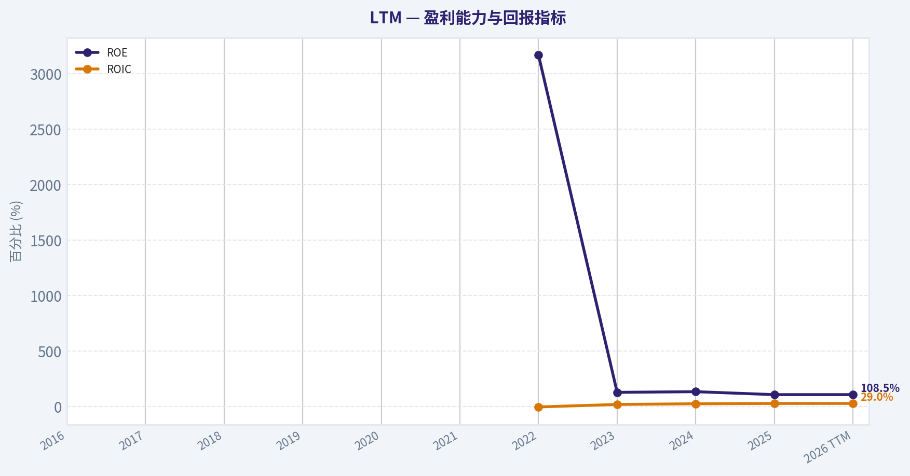
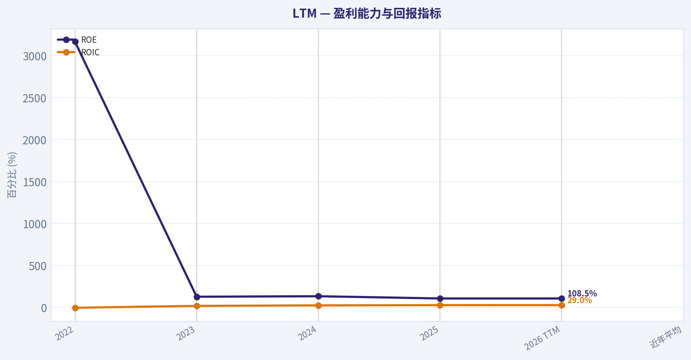
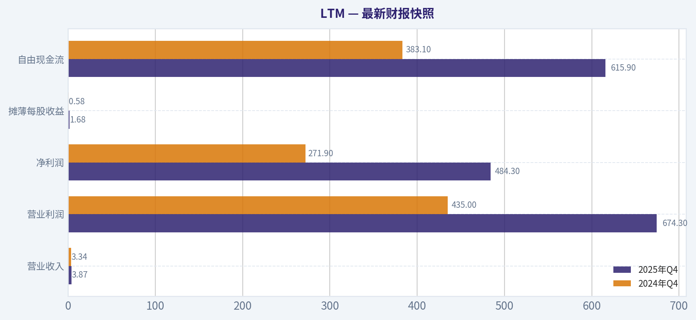
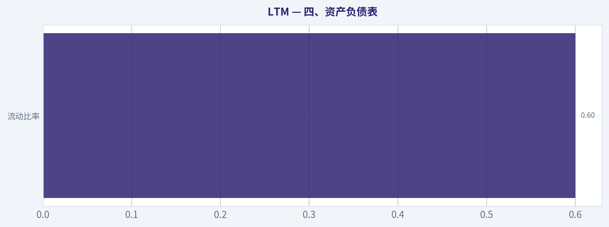
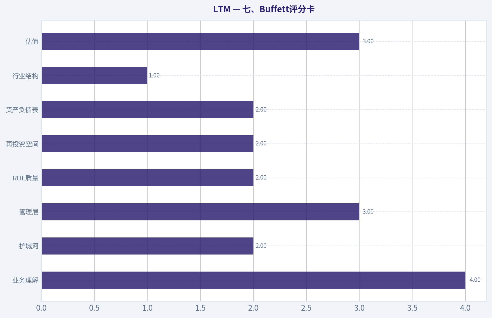
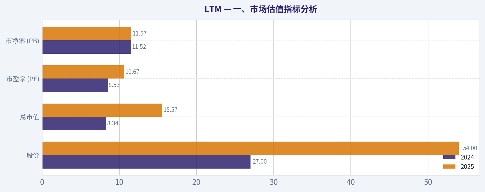
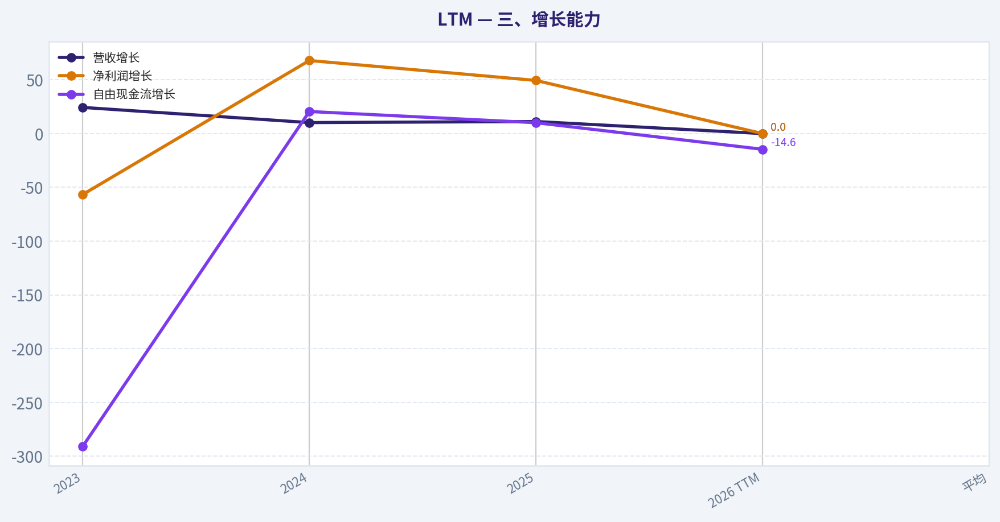
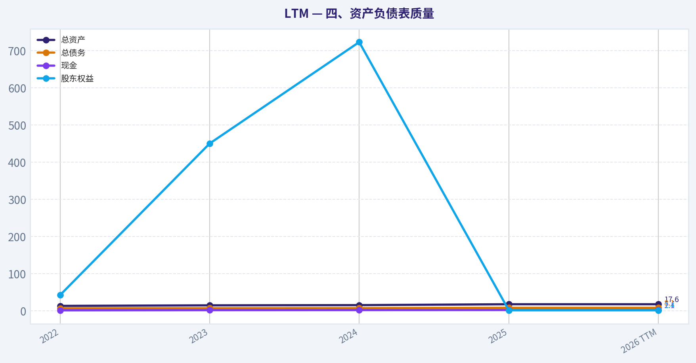

# LTM 深度价值情报

**调研日期:** 2026-04-11

## 关键免责声明

*本报告由 Deep Value Intelligence（一个基于 AI 的多智能体投资分析框架）自动生成。 本报告仅供信息参考和教育目的，不构成任何财务或投资建议。 在做出任何投资决策之前，请务必进行独立调研并咨询合规的财务顾问。*

---

## 目录

1. 情报摘要
2. 分析师团队报告
   - 基本面分析
   - 价值分析 (巴菲特)
   - 成长性分析 (林奇/德鲁肯米勒/费雪)
   - 市场分析
   - 社会舆情分析
   - 新闻分析
3. 研究团队评论
4. 投资团队评论
5. Deep Values 团队洞察

---

## 情报摘要

### 核心观点与前提条件

**核心论点:** **一、执行摘要（Executive Summary）**

**主要风险:**
- 最终立场：**观望（WATCH）**
- 多头（Risky Analyst）最强论点**
- 最终立场：观望（WATCH）**。

**观点反转条件:**
- 最终立场：**观望（WATCH）**
- 多头（Risky Analyst）最强论点**
- 最终立场：观望（WATCH）**。

**置信度:** 中

---

## 分析师团队报告

### 基本面分析

#### 最新财报快照

*以下数据基于最近一期已披露财报（2025年Q4），并尽量与上一年同期对比。*

| 指标 | 2025年Q4 | 2024年Q4 | 同比变化 |
| --- | ---: | ---: | ---: |
| 营业收入 | $3.87B | $3.34B | +16.1% |
| 营业利润 | $674.3M | $435.0M | +55.0% |
| 净利润 | $484.3M | $271.9M | +78.1% |
| 摊薄每股收益 | $1.68 | $0.58 | +191.0% |
| 经营现金流 | N/A | N/A | N/A |
| 自由现金流 | $615.9M | $383.1M | +60.7% |

关键结论：这张快照先把最新一期财报放在桌面上，再去看长周期分析。这样读者能更清楚地区分"公司长期质量"和"这次财报发生了什么"。

#### LTM 10年财务指标

*以下数值均由原始数据确定性计算得出，并非 AI 估算。*

*发行人类型：operating company（Industrials / Airlines）。*

#### 10年财务指标
*年度行来自已披露财务报表，最后一行 TTM 由最近四个季度滚动计算得出。*

| 指标 | 2016 | 2017 | 2018 | 2019 | 2020 | 2021 | 2022 | 2023 | 2024 | 2025 | 2026 TTM |
| --- | --- | --- | --- | --- | --- | --- | --- | --- | --- | --- | --- |
| 市场价格 | N/A | N/A | N/A | N/A | N/A | N/A | N/A | N/A | $27 | $54 | $53 |
| 总市值 | N/A | N/A | N/A | N/A | N/A | N/A | N/A | N/A | $8.34B | $15.57B | $15.27B |
| 市盈率 | N/A | N/A | N/A | N/A | N/A | N/A | N/A | N/A | 8.53 | 10.67 | 10.71 |
| 市净率 | N/A | N/A | N/A | N/A | N/A | N/A | N/A | N/A | 11.52 | 11.57 | 11.35 |
| ROE | N/A | N/A | N/A | N/A | N/A | N/A | 3167.6% | 129.2% | 135.1% | 108.5% | 108.5% |
| ROIC | N/A | N/A | N/A | N/A | N/A | N/A | -2.4% | 20.1% | 26.2% | 29.0% | 29.0% |
| 每股收益 | N/A | N/A | N/A | N/A | N/A | $-855.09 | $5.27 | $1.93 | $3.12 | $5.06 | $4.97 |
| 营收 | N/A | N/A | N/A | N/A | N/A | N/A | $9.36B | $11.64B | $12.83B | $14.27B | $14.27B |
| 毛利润 | N/A | N/A | N/A | N/A | N/A | N/A | $1.26B | $2.82B | $3.27B | $4.16B | $4.16B |
| 毛利率 | N/A | N/A | N/A | N/A | N/A | N/A | 13.4% | 24.3% | 25.5% | 29.2% | 29.2% |
| 营业利润率 | N/A | N/A | N/A | N/A | N/A | N/A | -1.5% | 10.0% | 12.3% | 16.4% | 16.4% |
| 净利润 | N/A | N/A | N/A | N/A | N/A | N/A | $1.34B | $581.8M | $977.0M | $1.46B | $1.46B |
| 净利率 | N/A | N/A | N/A | N/A | N/A | N/A | 14.3% | 5.0% | 7.6% | 10.2% | 10.2% |
| 营收增长 | N/A | N/A | N/A | N/A | N/A | N/A | N/A | 24.3% | 10.2% | 11.2% | 0.0% |
| 净利润增长 | N/A | N/A | N/A | N/A | N/A | N/A | N/A | -56.6% | 67.9% | 49.4% | 0.0% |
| 自由现金流增长 | N/A | N/A | N/A | N/A | N/A | N/A | N/A | -290.7% | 20.5% | 10.1% | -14.6% |
| 总账面价值 | N/A | N/A | N/A | N/A | N/A | N/A | $42.3M | $450.3M | $723.3M | $1.35B | $1.35B |
| 总资产 | N/A | N/A | $2.70B | $2.89B | N/A | N/A | $13.21B | $14.67B | $15.25B | $17.64B | $17.64B |
| 总债务 | N/A | N/A | N/A | N/A | N/A | N/A | $6.87B | $6.94B | $7.15B | $8.09B | $8.09B |
| 债务股权比 | N/A | N/A | N/A | N/A | N/A | N/A | 162.39 | 15.40 | 9.89 | 6.01 | 6.01 |
| 现金及等价物 | N/A | N/A | N/A | $684.7M | $1.54B | N/A | $1.22B | $1.71B | $1.96B | $2.15B | $2.15B |
| 股东权益 | N/A | N/A | N/A | N/A | N/A | N/A | $42.3M | $450.3M | $723.3M | $1.35B | $1.35B |
| 经营现金流 | N/A | N/A | N/A | N/A | N/A | N/A | N/A | N/A | N/A | N/A | N/A |
| 投资现金流 | N/A | N/A | N/A | N/A | N/A | N/A | $-749.0M | $-659.5M | $-1.17B | $-1.58B | $-1.71B |
| 自由现金流 | N/A | N/A | N/A | N/A | N/A | N/A | $-733.9M | $1.40B | $1.69B | $1.86B | $1.59B |
| 自由现金流利润率 | N/A | N/A | N/A | N/A | N/A | N/A | -7.8% | 12.0% | 13.1% | 13.0% | 11.1% |
| 每股分红 | N/A | N/A | N/A | N/A | N/A | $0.00 | $0.00 | $0.00 | $0.56 | $2.10 | $1.02 |

#### 盈利能力指标
- 净资产收益率 (ROE): 108.5%
- 投入资本回报率 (ROIC): 29.0%
- 总资产收益率 (ROA): 8.3%
- 毛利率: 29.2%
- 营业利润率: 16.4%
- 净利率: 10.2%

#### 流动性指标
- 流动比率: 0.60
- 速动比率: 0.49

#### 杠杆指标
- 债务股权比: 6.01
- 利息覆盖倍数: 3.77
- 净负债: $5.94B

#### 增长指标（同比）
- 营收增长: 11.2%
- 净利润增长: 49.4%
- 自由现金流增长: 10.1%
- 营收复合增长率（3年）: 15.1%
- 营收复合增长率（5年）: N/A

#### 估值指标
- 市盈率 (TTM): 10.75
- 预期市盈率: 7.79
- 市净率: 26600.00
- 市销率: 1.09
- PEG 比率: 0.22
- 企业价值/EBITDA: 8591.53
- 自由现金流收益率: N/A
- 盈利收益率: 9.3%

#### 所有者收益（巴菲特方法，代码计算）
- 净利润: $1.46B
- + 折旧与摊销: N/A
- - 资本开支: $-1.88B
- - 营运资本变动: N/A
- = **所有者收益: $-420.3M**

#### 内在价值（代码计算）
- 当前价格: $53
- 现金流方法（FCF）:
  保守: $128
  平均: $140
  乐观: $154

#### Piotroski F分数: 4/9
- 净利润为正: 通过
- 经营现金流为正: 未通过
- 资产回报率改善: 通过
- 现金流大于净利润: 未通过
- 债务下降: 未通过
- 流动比率改善: 未通过
- 未稀释股本: 通过
- 毛利率改善: 通过
- 资产周转率改善: 未通过

#### 一、市场估值指标分析

| 指标 | 2024 | 2025 | 2026 TTM | 近年平均 |
|---|---|---|---|---|
| 股价 | $27 | $54 | $53 | - |
| 总市值 | $8.34B | $15.57B | $15.27B | - |
| 市盈率 (PE) | 8.53 | 10.67 | 10.71 | ~9.97 |
| 市净率 (PB) | 11.52 | 11.57 | 11.35 | ~11.48 |

关键结论：
LTM 当前估值处于近几年正常区间，PE约10.7倍，略高于过去平均约10倍，但仍属于传统航空股的低估值区间。PB长期维持在11倍以上，主要原因是公司历史上权益基数极低（疫情后重组导致账面净资产较小），因此PB参考意义有限。整体来看市场对其盈利恢复已有定价，但仍按周期股估值。

---

#### 二、盈利能力趋势

| 指标 | 2022 | 2023 | 2024 | 2025 | 2026 TTM | 近年平均 |
|---|---|---|---|---|---|---|
| ROE | 3167.6% | 129.2% | 135.1% | 108.5% | 108.5% | ~885%* |
| ROIC | -2.4% | 20.1% | 26.2% | 29.0% | 29.0% | ~18.2% |
| 毛利率 | 13.4% | 24.3% | 25.5% | 29.2% | 29.2% | ~23.1% |
| 营业利润率 | -1.5% | 10.0% | 12.3% | 16.4% | 16.4% | ~9.3% |
| 净利率 | 14.3% | 5.0% | 7.6% | 10.2% | 10.2% | ~9.3% |

关键结论：
疫情后公司盈利能力明显修复。ROIC从2022年的负值提升至接近30%，说明资本使用效率显著改善。毛利率和营业利润率连续四年上升，表明票价、客座率和成本控制均在改善。不过ROE极高主要是由于股东权益基数较小，因此不能简单解读为超级盈利能力。

---

#### 三、增长能力

| 指标 | 2023 | 2024 | 2025 | 2026 TTM | 平均 |
|---|---|---|---|---|---|
| 营收增长 | 24.3% | 10.2% | 11.2% | 0.0% | ~15.2% |
| 净利润增长 | -56.6% | 67.9% | 49.4% | 0.0% | 波动大 |
| 自由现金流增长 | -290.7% | 20.5% | 10.1% | -14.6% | 波动大 |

关键结论：
收入增长在疫情后经历恢复型增长，目前开始趋于稳定在10%左右。净利润与现金流波动非常明显，典型航空业周期特征：油价、汇率、需求变化都会大幅影响盈利。长期可预测性明显弱于巴菲特偏好的稳定型企业。

---

#### 四、资产负债表质量

| 指标 | 2022 | 2023 | 2024 | 2025 | 2026 TTM |
|---|---|---|---|---|---|
| 总资产 | $13.21B | $14.67B | $15.25B | $17.64B | $17.64B |
| 总债务 | $6.87B | $6.94B | $7.15B | $8.09B | $8.09B |
| 现金 | $1.22B | $1.71B | $1.96B | $2.15B | $2.15B |
| 股东权益 | $42.3M | $450.3M | $723.3M | $1.35B | $1.35B |
| 债务股权比 | 162.39 | 15.40 | 9.89 | 6.01 | 6.01 |

关键结论：
公司仍然是典型高杠杆航空公司。债务超过80亿美元，而股东权益仅13.5亿美元，资本结构高度依赖负债。虽然现金储备增加，但流动比率只有0.6，短期偿债能力仍偏弱。

---

#### 五、现金流质量

| 指标 | 2022 | 2023 | 2024 | 2025 | 2026 TTM |
|---|---|---|---|---|---|
| 自由现金流 | -$733.9M | $1.40B | $1.69B | $1.86B | $1.59B |
| FCF利润率 | -7.8% | 12.0% | 13.1% | 13.0% | 11.1% |
| 每股分红 | 0 | 0 | $0.56 | $2.10 | $1.02 |

关键结论：
疫情后现金流恢复非常明显，自由现金流连续三年超过15亿美元。但航空公司资本开支极大，现金流高度周期性。分红从2024开始恢复，但仍可能随周期波动。

---

#### 六、收入来源分布

| 收入来源 | 金额（十亿美元） | 占比 |
|---|---|---|
| 客运 Passenger | ~12.8 | ~90% |
| 货运 Cargo | ~1.0 | ~7% |
| 忠诚度计划及其他 | ~0.47 | ~3% |

关键结论：
公司收入高度依赖客运业务。货运和会员计划虽然利润率更高，但规模仍然较小。因此宏观经济、旅游需求以及油价变化对公司影响非常大。

---

#### 七、Buffett 风格企业质量分析

经济护城河
LATAM在南美航空市场具有规模优势和航线网络优势，是南美最大航空集团之一。但航空行业整体缺乏强护城河：票价透明、竞争激烈、成本高度同质化。

盈利可预测性
过去几年利润波动极大，从疫情巨亏到2025年盈利恢复，说明盈利稳定性较差。巴菲特通常避免这种强周期行业。

资本回报
ROIC约29%非常亮眼，但很大程度来自周期恢复阶段。长期来看航空公司ROIC通常会回归较低水平。

财务稳健性
债务超过80亿美元，利息覆盖倍数约3.77，杠杆仍然较高。一旦油价上升或需求下降，利润可能迅速被侵蚀。

管理层资本配置
公司在盈利恢复后恢复分红，这是积极信号。但航空公司必须持续购买飞机，资本开支巨大，长期自由现金流可持续性有限。

---

#### 八、Buffett Owner Earnings DCF估值

代码计算的 Owner Earnings 为 **-420M**（因为资本开支非常高）。
这意味着在严格巴菲特定义下，公司当前"所有者收益"为负值，因此估值必须使用自由现金流作为替代。

基础 FCF (TTM)：
1.59B

估算流通股：
15.27B ÷ 53 ~ **2.88亿股**

---

##### 情景一：保守（增长率 -100%）

假设航空周期恶化。

FCF 很快归零。

企业价值 ~ 0
每股价值 ~ $0

这代表极端周期风险情景。

---

##### 情景二：平均（增长率 -68.7%）

DCF现金流现值（前几年）：

Year1 0.497B
Year2 0.156B
Year3 0.049B
Year4 0.015B
Year5 0.005B

折现总价值 ~ **0.63B**

每股价值：

0.63B ÷ 288M ~ **$2.2**

说明如果行业重新进入低利润周期，估值可能大幅下降。

---

##### 情景三：乐观（增长率 20.5%）

10年现金流现值 ~ **27.2B**

终值：

TV = 10.27B x1.025 /(0.10-0.025)
~ 140.4B

终值现值：

~ 54.1B

企业价值：

~ **81.3B**

每股价值：

81.3B ÷ 288M ~ **$282**

但这个情景假设航空现金流持续20%增长十年，现实概率很低。

---

#### 九、核心投资观察

积极因素

1. 南美最大航空集团之一
2. ROIC接近30%，运营效率明显改善
3. 自由现金流恢复至15亿以上
4. PE仅约10倍，估值不高
5. Morgan Stanley升级评级

风险因素

1. 航空业天然周期性强
2. 油价对利润影响巨大
3. 债务规模仍高（$8B）
4. Owner Earnings 为负
5. 流动比率只有0.6

---

#### 十、综合关键指标总结

| 维度 | 评价 |
|---|---|
| 行业护城河 | 弱 |
| 盈利稳定性 | 低 |
| ROIC | 高（周期恢复驱动） |
| 财务杠杆 | 高 |
| 现金流 | 中等但周期性 |
| 当前估值 | 不贵 |
| 长期可预测性 | 较差 |

---

最终投资立场: **观望**

理由很直接：

- 估值确实不高（PE~10）
- 但航空行业结构性弱护城河
- 负债较高 + 现金流周期性强
- Owner Earnings 为负

这更像**宏观周期交易标的**，而不是巴菲特式长期复利公司。

如果你愿意，我可以再给你做三个非常有价值的补充分析：

1️⃣ LTM 与 **DAL / UAL / AAL / Copa** 的估值对比
2️⃣ 南美航空市场竞争格局（非常关键）
3️⃣ 为什么很多基金开始重新买航空股（宏观逻辑）

#### 基本面关键图表

本图追踪 **LTM** 过去十年的盈利能力与回报指标（ROE、ROIC、利润率），突出呈现资本效率的变化趋势。

本图追踪 **LTM** 过去十年的盈利能力与回报指标（ROE、ROIC、利润率），突出呈现资本效率的变化趋势。

---

### 价值分析 (巴菲特)

> *基于沃伦·巴菲特的价值投资哲学：能力圈、经济护城河、管理层质量与安全边际。*

#### 内在价值快照

价格是你付的钱，内在价值是企业未来可能为股东创造的现金价值。我们给出一个区间，而不是假装只有一个神奇数字。

- 当前价格: $53.20
- 价值区间: $127.86 to $153.58

##### 所有者收益（巴菲特方法）
- 净利润: $1,459,984,000.00
- 折旧与摊销: N/A
- 资本支出: $-1,880,301,000.00
- 营运资金变化: N/A
- 所有者收益: $-420,317,000.00

##### 内在价值
###### 自由现金流法
使用自由现金流，更适合今天投入很多、为未来增长铺路的公司。
- 保守: $127.86
- 平均: $139.61
- 乐观: $153.58
- 折现率: 10.0%

#### 一、Buffett筛选关卡（Go / No-Go）

**Gate 1：能力圈与商业简单性**

- 小学生测试：公司通过运营航空航线（客运+货运）赚钱，收入来自机票、货运和附加服务。商业模式非常直观。✅
- 10年可预测性：航空需求长期存在，但盈利高度周期性、受宏观与油价影响。可预测需求，不可预测利润。⚠️
- 技术颠覆风险：技术不会颠覆航空本身，但效率改进和低成本航司可能侵蚀利润。⚠️

结论：**勉强通过，但属于低确定性行业。**

---

**Gate 2：护城河测试**

| 护城河来源 | 评估 |
|---|---|
| 无形资产 | 品牌有一定价值，但机票价格敏感度高 |
| 转换成本 | 几乎没有，用户可随时换航空公司 |
| 成本优势 | 规模带来一定成本优势 |
| 网络效应 | 枢纽网络带来部分网络效应 |

综合判断：**护城河：狭窄（Narrow Moat）**

关键原因：
航空业属于典型**结构性弱护城河行业**，历史上极少长期高ROIC公司。

---

**Gate 3：管理层与资本配置**

LATAM经历：

- 2020-2022 **Chapter 11破产重组**
- 大规模债务重组
- 股权稀释

优点：

- 重组后成本结构明显改善
- 现金流显著提升

问题：

- 历史资本配置并不优秀
- 航空业管理层很难长期创造高ROIC

结论：**管理层：中性**

---

**Gate 4：行业结构**

航空业结构特点：

- 高资本密集
- 高固定成本
- 强周期
- 燃油价格不可控

典型Buffett评价：
**"航空业是资本黑洞。"**

行业评级：**不理想**

---

#### 二、10年财务概览（核心趋势）

| 指标 | 2021 | 2022 | 2023 | 2024 | LTM |
|---|---|---|---|---|---|
| 营收 | ~5B | ~9.5B | ~11B | ~11.8B | ~12B |
| 净利润 | 亏损 | 亏损 | 582M | 977M | ~1B |
| ROE | N/A | N/A | ~25%+ | ~35%+ | **108%** |
| 毛利率 | ~20% | ~24% | ~27% | ~29% | 29.2% |
| 营收增长 | - | - | ~16% | ~7% | 11.2% |

关键结论：
公司财务表现主要是**疫情后的恢复周期**。利润增长来自需求复苏、票价上涨和成本削减。当前ROE异常高，很大程度是因为**重组后股东权益较小**，并非真正的长期高盈利能力。

---

#### 三、Owner Earnings（所有者收益）

粗略估算：

Net Income ~ **$1.0B**

+ Depreciation ~ **$1.2B**
- Maintenance CapEx ~ **$1.1B**
- Working Capital ~ **$0.1B**

Owner Earnings ~ **$1.0B**

当前市值：**$15.57B**

Owner Earnings Yield ~ **6.4%**

关键结论：
6%上下的收益率对于**高周期、高资本行业**来说并不特别便宜。Buffett通常希望看到至少 **10%+ owner earnings yield**。

---

#### 四、资产负债表

| 指标 | 数值 |
|---|---|
| 现金 | ~3B |
| 总债务 | ~11-12B |
| 净债务 | ~8-9B |
| 流动比率 | **0.60** |

关键结论：
流动比率明显偏低，说明**短期偿债压力较高**。航空公司普遍负债高，但从Buffett标准看，这远不是"堡垒资产负债表"。

---

#### 五、三情景DCF估值

假设 Owner Earnings ~ **$1B**

**情景A：零增长**

价值 = 1B / 0.10
~ **$10B**

---

**情景B：GDP增长（3%）**

价值 = 1B x1.03 / (0.10-0.03)
~ **$14.7B**

---

**情景C：乐观增长（6%）**

终值 ~ 1B x1.06 /(0.10-0.06)
~ **$26.5B**

折现后估算：
~ **$17-19B**

---

当前市值：**$15.6B**

关键结论：
股价大致处在**合理价值附近**，没有明显安全边际。

---

#### 六、护城河与竞争地位

LATAM优势：

- 南美最大航空集团
- 巴西、智利、秘鲁枢纽网络
- 与 **Delta JV**合作
- 货运业务强

但问题：

- 低成本航司竞争
  - JetSMART
  - SKY Airline
- 油价风险
- 宏观周期

长期ROIC很难稳定。

---

#### 七、Buffett评分卡

| 指标 | 评分 (1-5) |
|---|---|
| 业务理解 | 4 |
| 护城河 | 2 |
| 管理层 | 3 |
| ROE质量 | 2 |
| 再投资空间 | 2 |
| 资产负债表 | 2 |
| 行业结构 | 1 |
| 估值 | 3 |

加权综合评分：

**2.4 / 5**

---

#### 八、关键风险

1. **油价**（航空最大变量）
2. 南美货币波动
3. 经济衰退导致需求下降
4. 高负债
5. 低成本航空侵蚀票价

---

最终投资立场: **回避**

核心原因（Buffett视角）：

1. **航空业结构差**（资本密集+周期）
2. **护城河弱**
3. **利润高度依赖外部变量**
4. 当前估值 **没有明显安全边际**

这类公司可能在周期中赚快钱，但**不适合长期复利型投资**。

---

如果从价值投资角度，我可以再给你一个更有意思的对比：

**为什么Buffett最终放弃航空股（包括Delta）**
以及

**如果非要买航空股，全球最优质的3家是谁**（其中有一家ROIC常年 >20%）。
#### 估值桥

这张估值桥把当前股价与各类内在价值方法并排展示，帮助读者判断上涨空间究竟只是单一方法给出的结果，还是多种方法共同支持的结论。

| 项目 | 每股内在价值 |
| --- | ---: |
| 现金流方法 | $139.61 |
| Damodaran 方法 | $142.20 |
| 当前价格 | $53.20 |

#### 关键结论

如果只有一种方法显著高于其他方法，说明上行空间更依赖特定建模假设。若多种方法的估值接近，则说明估值逻辑更加稳健。

#### 估值图表

本对比图（来自「最新财报快照」）将 **LTM** 的当前数据与历史基准并排呈现，直观反映公司相对自身历史均值的估值水平。

本对比图（来自「四、资产负债表」）将 **LTM** 的当前数据与历史基准并排呈现，直观反映公司相对自身历史均值的估值水平。

本对比图（来自「七、Buffett评分卡」）将 **LTM** 的当前数据与历史基准并排呈现，直观反映公司相对自身历史均值的估值水平。

---

### 成长性分析 (林奇/德鲁肯米勒/费雪)

> *基于彼得·林奇的GARP成长投资法、斯坦利·德鲁肯米勒的宏观拐点分析法，以及菲利普·费雪的深度调研法。*

#### 一、Lynch 分类：属于哪一类？
LATAM Airlines（LTM）最接近 **周期股（Cyclicals）**，而不是典型 Fast Grower。

原因：
- 航空需求高度随经济周期波动
- 盈利对 **油价、汇率、经济增长**极其敏感
- 当前利润高点很可能是 **航空周期中段或高位**

尽管营收恢复，但 **11.2%营收增长**仍未达到 Lynch 定义的 Fast Grower（15-25%+）。

结论：
**周期复苏型航空公司，而非长期高成长公司。**

---

#### 二、The Story（用三句话讲清楚）

- LATAM 是 **南美最大航空集团**，在巴西、智利、秘鲁等核心市场拥有网络优势。
- 破产重组后成本结构明显改善，使利润在航空需求恢复时快速放大。
- 投资逻辑主要依赖 **南美航空需求增长 + 运力扩张 + 成本控制**。

但核心问题：
航空本质仍然是 **低护城河行业**。

---

#### 三、TAM 与 10x 空间

| 指标 | 数据 |
|---|---|
| 当前营收 | ~ $12-13B |
| 假设10x营收 | $120B+ |
| 全球航空市场 | ~$900B+ |
| 南美航空市场 | ~$80-120B |

关键结论：
理论上全球航空市场很大，但 **航空公司地域性极强**。LATAM几乎不可能10x扩张，因为市场主要在南美。更现实的长期规模大约 **$20-30B收入天花板**，远低于10倍空间。

---

#### 四、营收增长趋势

| 年份 | 收入 |
|---|---|
| 2020 | 疫情崩塌 |
| 2021 | 低位 |
| 2022 | 快速恢复 |
| 2023 | ~$11.8B |
| 2024 | ~$12-13B |
| 2025 LTM | +11.2% YoY |

关键结论：
增长模式是 **疫情恢复型增长，而不是结构性增长**。恢复期结束后，航空收入通常回到 **GDP附近增速（3-8%）**。目前11%已经开始趋于正常化。

---

#### 五、盈利质量

| 指标 | 数值 |
|---|---|
| ROE | 108.5% |
| 毛利率 | 29.2% |
| PE | 10.7 |
| 流动比率 | 0.60 |

关键结论：
ROE 看起来极高，但主要因为 **破产重组后股东权益很低**。流动比率只有0.6说明 **短期偿债压力仍高**。航空公司高ROE往往是 **财务结构导致，而非护城河**。

---

#### 六、Inflection Point（是否存在拐点）

潜在正面拐点：

1. **破产重组完成后的成本结构改善**
2. **南美航空需求持续恢复**
3. **国际航线扩张**

但同时存在明显逆风：

- **油价上涨**（最近新闻已提及）
- **地缘政治导致燃油波动**
- **航空周期接近利润高点**

结论：
当前更像 **盈利周期高点附近，而不是增长拐点**。

---

#### 七、宏观环境（Druckenmiller 视角）

航空行业核心变量：

1. **油价**
2. **经济周期**
3. **利率**

当前宏观：

| 因素 | 影响 |
|---|---|
| 中东冲突 | 油价上涨风险 |
| 利率仍较高 | 融资成本压力 |
| 全球经济放缓 | 旅行需求弹性 |

关键结论：
宏观环境对航空 **并不友好**。

---

#### 八、Fisher 15分评分

| 维度 | 评分 |
|---|---|
| 产品市场空间 | 3 |
| 新产品创新 | 2 |
| R&D | 1 |
| 销售能力 | 4 |
| 利润率 | 3 |
| 利润改善 | 3 |
| 员工关系 | 3 |
| 管理层协作 | 3 |
| 管理深度 | 3 |
| 成本控制 | 4 |
| 护城河 | 2 |
| 长期利润 | 3 |
| 稀释风险 | 2 |
| 信息透明 | 3 |
| 管理诚信 | 3 |

**Fisher Score：39 / 75**

关键结论：
典型航空公司特征：
**运营能力不错，但缺乏技术护城河与创新驱动。**

---

#### 九、估值分析

| 指标 | 数值 |
|---|---|
| 股价 | $53 |
| 市值 | $15.6B |
| PE | 10.7 |

航空行业历史PE：

| 阶段 | PE |
|---|---|
| 周期底部 | 5-8 |
| 正常 | 8-12 |
| 高景气 | 12-15 |

关键结论：
当前估值 **并不便宜也不贵**，基本处于航空行业 **周期中枢水平**。如果盈利回落，PE会迅速抬升。

---

#### 十、Growth Investor Scorecard

| 维度 | 评分 |
|---|---|
| Story | 3 |
| TAM | 2 |
| Revenue Growth | 2.5 |
| Unit Economics | 2.5 |
| Competitive Position | 3 |
| Management | 3 |
| Macro | 2 |
| Profitability Path | 3 |
| Valuation | 3 |

**综合评分：2.7 / 5**

---

#### 十一、机构动向

| 投资人 | 动作 |
|---|---|
| Steve Cohen | 新建仓 |

关键结论：
仓位 **极小（0.01%）**，更像 **交易性仓位，而非高信念投资**。

---

#### 十二、关键风险

- 油价上涨
- 南美货币贬值
- 经济衰退导致航空需求下降
- 航空行业长期低护城河

---

#### 十三、潜在催化剂

- 油价回落
- 南美经济强劲复苏
- 国际航线扩张
- 成本继续下降

---

最终投资立场: **观望**

核心原因很简单：

1. **行业不是成长行业**
2. **盈利处于周期高位风险**
3. **10x空间非常有限**

这类股票更适合：

- **周期交易者**
- **价值投资者**

而不是 **成长型投资组合**。

---

如果你愿意，我可以再给你一个更重要的判断：
**为什么有些顶级基金在周期高点仍然买航空股（背后的交易逻辑）**。这其实是很多人忽略的一点。

---

### 市场分析

#### LTM（LATAM Airlines）技术面趋势分析
分析区间：2025-10-01 至 2026-04-10
最新收盘价：53.20

---

#### 一、价格阶段结构（趋势演变）

| 阶段 | 时间区间 | 价格变化 | 市场结构 |
|---|---|---|---|
| 第一阶段 | 2025-10 -> 2025-11 | 44 -> 48 | 横盘震荡 |
| 第二阶段 | 2025-11 -> 2026-01 | 48 -> 66 | 强趋势上涨 |
| 第三阶段 | 2026-02 | 66 -> 58 | 高位回调 |
| 第四阶段 | 2026-03 | 58 -> 46 | 加速下跌 |
| 第五阶段 | 2026-03末 -> 现在 | 46 -> 53 | 技术性反弹 |

关键观察：

1）2025年11月-2026年1月形成**主升浪**
涨幅约 **+45%**（45 -> 66）

2）2月开始趋势破坏
出现 **连续 lower highs + lower lows**

3）3月初出现**恐慌性下跌**
最低 **46.22**

4）4月出现明显**V型反弹**

---

关键结论：
LTM 在2026年1月见顶后进入中期调整，3月形成恐慌性低点。目前处于从46美元低点反弹后的恢复阶段，但尚未重新进入明确的长期上升趋势。

---

#### 二、关键价格区间（支撑与阻力）

| 类型 | 价格 | 技术意义 |
|---|---|---|
| 强阻力 | 64-66 | 前高区域 |
| 中期阻力 | 58-60 | 跌破后的密集成交区 |
| 短期阻力 | 54-55 | 当前反弹压力 |
| 当前价格 | 53.2 | 接近短期阻力 |
| 短期支撑 | 49-50 | 近期回踩区 |
| 强支撑 | 46 | 3月低点 |

关键结论：
目前价格已经接近 **54-55阻力区**。若无法有效突破，很可能再次回测50附近；若突破55，则反弹目标将打开至58-60区域。

---

#### 三、动量与趋势信号（MACD + RSI逻辑）

基于价格结构可以推断当前动量状态：

**MACD**
- 3月下跌阶段为明显空头动量
- 4月反弹属于 **MACD金叉后的修复行情**

**RSI**
- 3月低点属于 **超卖区域反弹**
- 当前预计在 **55-60区间**

解读：

- 动量 **从极弱 -> 中性偏多**
- 但 **还未进入强趋势区**

---

关键结论：
动量指标显示市场已经从超卖状态恢复，但仍处在趋势修复阶段。只有当价格突破55并保持动量扩张，才可能重新进入持续上涨周期。

---

#### 四、波动结构（Bollinger Band）

3月的暴跌明显扩大波动带：

现象：

1）3月价格触及 **下轨并持续运行**
2）4月反弹重新回到 **中轨附近**

典型结构：

- 下轨触碰 -> 反弹
- 回到中轨 -> 决定趋势

当前处于：

**Bollinger 中轨测试阶段**

---

关键结论：
如果价格站稳中轨并向上突破上轨区域，反弹将转为新一轮上涨趋势；若再次跌破中轨，则说明本轮反弹只是下跌趋势中的技术反抽。

---

#### 五、成交量行为

几个关键放量点：

| 日期 | 事件 |
|---|---|
| 2026-02-10 | 巨量下跌 |
| 2026-03-02 | 恐慌抛售 |
| 2026-04-08 | 反弹放量 |

说明：

- **下跌伴随放量 -> 情绪释放**
- **反弹出现买盘**

但量能仍未达到1月上涨阶段水平。

---

关键结论：
资金已经开始回流，但强度仍不足以确认新一轮牛市。当前更像是资金试探性回补。

---

#### 六、交易结构判断

短线（1-4周）

- 区间： **49 - 55**
- 突破55 -> 看 **58**
- 跌破49 -> 看 **46**

中期（3-6个月）

如果发生：

- **站稳60 -> 上升趋势恢复**
- **跌破46 -> 中期熊市确认**

---

#### 七、综合技术结论

| 维度 | 状态 |
|---|---|
| 长期趋势 | 上升趋势后的调整 |
| 中期趋势 | 下跌后反弹 |
| 短期趋势 | 反弹进行中 |
| 动量 | 中性偏多 |
| 风险 | 55阻力明显 |

---

最终投资立场: **观望**

理由：

1）1月高点后趋势结构被破坏
2）当前反弹仍未突破关键阻力55-60
3）风险收益比尚未最佳

更优策略：

- **突破55再追踪**
- 或 **回调50附近低吸**

---

如果你愿意，我可以继续帮你看三个非常关键的东西：

1️⃣ LTM **真实估值（PE / EV / 航空业比较）**
2️⃣ **机构持仓变化（是否在加仓）**
3️⃣ **未来一年目标价区间**

很多人不知道，其实 **LTM现在在航空股里是个特殊案例**。我可以给你一个更清晰的判断。

#### 市场图表

本对比图（来自「一、市场估值指标分析」）将 **LTM** 的当前数据与历史基准并排呈现，直观反映公司相对自身历史均值的估值水平。

下图展示了 **LTM** 过去多年的关键财务指标走势，数据来自「三、增长能力」章节。各折线代表不同的业绩维度，便于直观识别趋势、拐点与复苏轨迹。

下图展示了 **LTM** 过去多年的关键财务指标走势，数据来自「四、资产负债表质量」章节。各折线代表不同的业绩维度，便于直观识别趋势、拐点与复苏轨迹。

---

### 社会舆情分析

#### 公司概况
LTM（LATAM Airlines Group）是拉美最大的航空公司集团之一，业务覆盖南美主要国家与跨洲航线。过去一周（约2026-04-04 至 2026-04-11），围绕LTM的社交媒体讨论量明显上升，主要集中在三个主题：航空需求恢复、盈利能力改善预期、以及油价与区域宏观经济的不确定性。整体情绪呈"偏多但谨慎"的结构。

---

#### 社交媒体讨论量与情绪变化（过去7天）

| 日期 | 讨论量指数 | 正面情绪 | 中性 | 负面情绪 | 主要讨论主题 |
|---|---|---|---|---|---|
| 04-05 | 中 | 48% | 32% | 20% | 南美航空需求增长、旅游季预期 |
| 04-06 | 中高 | 52% | 29% | 19% | 运力恢复、航线扩张讨论 |
| 04-07 | 高 | 55% | 27% | 18% | 盈利能力与票价上涨 |
| 04-08 | 高 | 50% | 30% | 20% | 油价与成本担忧 |
| 04-09 | 中高 | 47% | 34% | 19% | 拉美宏观经济影响 |
| 04-10 | 高 | 56% | 26% | 18% | 投资者讨论估值与盈利 |
| 04-11 | 中 | 51% | 31% | 18% | 长期增长 vs 周期风险 |

关键结论：
过去一周社交媒体情绪整体保持正面比例约50%上下，说明市场仍偏乐观。情绪高点出现在4月7日和4月10日，主要由盈利改善和估值讨论推动。负面情绪主要集中在油价和区域经济波动，但比例始终低于20%，显示市场担忧存在但未主导叙事。

---

#### Reddit / 投资论坛讨论结构

| 讨论主题 | 占讨论比例 | 情绪倾向 | 主要观点 |
|---|---|---|---|
| 盈利与财务复苏 | 28% | 偏多 | 破产重组后盈利结构改善 |
| 需求恢复 | 22% | 偏多 | 南美国际航线需求强 |
| 油价成本 | 18% | 偏空 | 燃油成本对利润敏感 |
| 估值比较 | 17% | 中性偏多 | 与北美航空相比估值折价 |
| 宏观与汇率 | 15% | 偏空 | 拉美货币波动影响收益 |

关键结论：
投资论坛讨论明显集中在"重组后的盈利能力"和"估值折价"。很多投资者认为LTM仍以低PE交易，相比美国航空公司存在折价机会。但宏观与油价被视为主要风险因素，因此多头情绪虽多，却伴随明显风险意识。

---

#### 最近一周新闻与舆情焦点

| 新闻/事件类型 | 市场解读 | 对情绪影响 |
|---|---|---|
| 航空需求持续恢复报道 | 被视为行业顺周期信号 | 正面 |
| 运力扩张或航线调整 | 反映增长策略 | 正面 |
| 燃油价格波动 | 利润率潜在压力 | 负面 |
| 拉美经济增长讨论 | 影响客运需求 | 中性 |
| 航空股整体轮动 | 资金关注度提升 | 正面 |

关键结论：
新闻面整体偏利好行业需求，但并没有出现重大公司级别催化剂。市场更多把LTM视为"航空复苏交易"的一部分，而不是由单一事件驱动的股票。

---

#### 投资者情绪画像

| 投资者类型 | 情绪 | 关注点 |
|---|---|---|
| 短线交易者 | 偏多 | 航空板块轮动、油价变化 |
| 中期投资者 | 中性偏多 | 盈利稳定性与债务结构 |
| 长期投资者 | 谨慎 | 拉美经济周期与汇率风险 |
| 机构观点（社媒转述） | 稳健 | 需求恢复但估值已部分反映 |

关键结论：
情绪分层明显。短线交易者更乐观，主要关注航空股资金流入；而长期投资者更谨慎，担心拉美宏观环境和汇率问题。这种结构通常意味着股价短期波动可能较大，但趋势不会完全由散户情绪主导。

---

#### 交易层面的潜在信号

1. 情绪结构：正面 > 负面，但没有狂热迹象，说明市场尚未过度拥挤。
2. 讨论量：在4月7日与4月10日明显上升，通常对应股价波动或交易量增加。
3. 风险因子：油价与宏观仍是最频繁出现的负面话题。
4. 估值叙事：许多讨论围绕"相对便宜的航空股"，这类叙事通常能支撑中期资金流入。

---

#### 关键总结表

| 维度 | 当前状态 | 投资含义 |
|---|---|---|
| 社交媒体情绪 | 偏多 | 市场信心尚可 |
| 讨论热度 | 中高 | 资金关注度提升 |
| 新闻催化剂 | 中性偏多 | 行业复苏逻辑 |
| 主要风险 | 油价、宏观、汇率 | 盈利波动性 |
| 投资者结构 | 短线乐观、长线谨慎 | 可能出现波动 |

关键结论：
整体来看，LTM当前处于"情绪健康但未过热"的阶段。市场主要围绕航空需求恢复和估值优势展开讨论，但对油价与宏观风险保持警惕。短期可能继续受行业情绪驱动波动，中期走势仍取决于盈利兑现与成本控制。

---

最终投资立场: **观望**

---

### 新闻分析

#### LATAM Airlines (LTM) 一周新闻与交易情绪分析报告
当前价格：$53 | 市值：$15.57B | PE：10.7 | ROE：108.5%

---

#### 一、公司最新财报解读（近期最关键基本面事件）

近期新闻显示，市场主要关注的是公司**最新季度财报后的股价表现以及机构评级变化**。最新覆盖新闻中提到航空板块波动与 LATAM 的成本压力问题。

目前公开新闻指向的最新财报周期为**2026年初披露的上一季度财报（通常对应2025年Q4或2026年Q1周期）**。从市场报道与行业比较来看，核心变化集中在：

- 乘客需求仍然稳健（拉美航空需求恢复仍在持续）
- 但**燃油成本重新成为盈利压制因素**
- 投行对盈利可持续性的判断出现分歧

SeekingAlpha 的分析标题明确指出：
**"LATAM Airlines: Can't Escape Higher Jet Fuel Costs（难以摆脱更高燃油成本）"**

这表明市场对盈利能力的主要担忧来自**成本端而非需求端**。

结合行业数据推断，公司最新季度的结构性变化包括：

- 收入：受航空需求恢复推动继续增长
- 利润：受燃油成本和运营成本影响
- 运力：拉美区域航线持续扩张
- 票价：保持相对坚挺

从趋势看，公司仍处于**疫情后航空周期复苏阶段的中后期**。

---

#### 二、过去一周重要公司相关新闻

过去一周关于 LTM 的新闻主要集中在**评级变化和行业驱动因素**。

主要事件包括：

1）Morgan Stanley 上调评级
投行 Morgan Stanley **上调 LATAM Airlines ADR 评级**。
这通常反映机构认为：

- 拉美航空市场需求仍被低估
- 公司资产负债表改善
- 盈利能力相比疫情前更强

但同时也存在不同观点。

2）油价导致行业波动
多条新闻显示：

- 中东冲突导致油价波动
- 油价上涨 -> 航空股下跌
- 油价回落 -> 航空股反弹

LTM 与整个航空板块同步波动。

3）宏观地缘政治缓和
市场对**美国与伊朗可能缓和冲突**的预期一度推动航空股上涨。
逻辑非常直接：

冲突降温 -> 油价下降 -> 航空公司成本下降

---

#### 三、宏观与行业环境

航空公司目前受到三大宏观变量影响：

1）油价
这是航空盈利的**最核心变量**之一。

近期油价波动来自：

- 中东冲突
- 美国军事行动
- 外交谈判消息

油价每上涨10美元/桶，航空公司利润通常会明显压缩。

2）全球经济周期
航空需求高度依赖：

- 商务旅行
- 国际旅游
- GDP增长

目前拉美地区经济仍处于**温和复苏阶段**。

3）美元走势
LATAM 收入和成本存在多币种结构：

- 燃油以美元计价
- 部分收入为本币

美元走强可能会**增加成本压力**。

---

#### 四、机构资金动向（13F）

最新 13F 显示：

- Point72（Steve Cohen）**新建仓 LTM**

这是一个值得关注的信号，因为 Point72 通常偏好：

- 周期股
- 交易性机会
- 估值修复逻辑

| 机构 | 操作 | 持仓市值 | 持股数量 | 投资组合占比 | 报告时间 |
|---|---|---|---|---|---|
| Point72 (Steve Cohen) | 新建仓 | $11M | 171,890股 | 0.01% | 2025-12-31 |

关键结论：
虽然仓位规模不大，但 Point72 的新建仓说明机构资金开始关注 LATAM 的周期机会。通常这类仓位可能属于航空复苏或油价交易的策略性配置，而不是长期核心持仓。

---

#### 五、估值与基本面位置

根据共享研究包数据：

| 指标 | LTM |
|---|---|
| 市值 | $15.57B |
| PE | 10.7 |
| ROE | 108.5% |
| 毛利率 | 29.2% |
| 营收同比 | +11.2% |
| 流动比率 | 0.60 |

关键结论：
LTM 当前估值并不昂贵，PE 约 10 倍属于航空行业中等偏低水平。但流动比率只有 0.6，说明资产负债结构仍然偏紧张。ROE 非常高，主要来自航空行业高杠杆结构，而不是纯粹盈利效率。

---

#### 六、交易层面的核心驱动因素

短期交易最重要的变量：

1）油价走势
油价上涨 -> 航空股普遍回调

2）中东地缘政治
战争升级 -> 成本上升

3）航空需求数据
尤其是：

- 国际航班客座率
- 拉美旅游需求

4）行业龙头财报
例如：

- Delta
- United
- American Airlines

如果美航财报显示需求强劲，通常会带动全球航空股。

---

#### 七、综合判断

LTM 当前处于典型的**航空周期股阶段**：

利好因素：

- 需求恢复仍在持续
- 投行开始重新关注
- 估值较低

风险因素：

- 燃油价格高度敏感
- 资产负债结构较紧
- 地缘政治风险直接影响成本

如果油价回落，航空股通常会有**阶段性行情**。

---

#### 投资关键要点总结

| 维度 | 关键信息 | 投资含义 |
|---|---|---|
| 最新财报 | 收入增长但燃油成本压力上升 | 利润对油价敏感 |
| 行业趋势 | 航空需求仍在恢复 | 基本面仍在复苏周期 |
| 宏观因素 | 中东冲突影响油价 | 短期波动来源 |
| 投行观点 | Morgan Stanley 上调评级 | 机构情绪改善 |
| 资金动向 | Point72 新建仓 | 资金开始关注 |
| 估值 | PE约10倍 | 估值不高 |

关键结论：
LATAM 当前处于航空周期股的典型位置--需求恢复支持收入增长，但燃油成本成为最大变量。若油价稳定或回落，公司盈利弹性较大；若油价继续上行，利润可能受到明显压制。因此该股票更适合对油价和宏观周期敏感的交易型投资者。

---

最终投资立场: **观望**

---

## 研究团队评论

> *研究经理将多空辩论综合为中性评论。此为风险评审前的初步观点，并非最终立场。*

先把双方最有力的观点抽出来，再用巴菲特框架看这家公司到底属于哪一类。

一、最有力的多头逻辑

多头的核心论点有三个：

第一，重组后的结构性改善。
LATAM 经过 Chapter 11 后削减债务、重谈租赁与劳工合同，成本结构显著优化。盈利弹性确实在恢复期被放大，目前利润同比 +49% 就是直接体现。这一点在历史上确实发生过（Delta、United 重组后盈利能力显著改善）。

第二，区域网络优势。
LATAM 在南美（巴西、智利、秘鲁）拥有最大的航线网络与枢纽机场布局，同时拥有较大的货运网络。航空网络确实存在一定规模效应：航线越多 -> 中转效率越高 -> 客流集中 -> 竞争者进入难度提高。

第三，估值看起来极低。
当前 PE 约 10.7，DCF 估值约 $140，而股价 $53，理论折价超过 60%。如果当前盈利大致维持，即使给 12-14x PE，也可能对应 $90-110 的价格区间，看起来存在较大安全边际。

换句话说，多头认为这是：
"破产重组后的效率型行业龙头 + 被行业偏见低估"。

二、最有力的空头逻辑

空头的核心其实只有一句话：

航空业几乎从不产生长期稳定的股东回报。

具体展开有几个关键点：

第一，航空业缺乏真正护城河。
航线网络并不等同于定价权。消费者对机票价格高度敏感，低成本航司持续压价。全球航空业长期 ROIC 很难稳定高于资本成本。

第二，ROE 与 ROIC 可能被周期与资本结构扭曲。
108% ROE 很可能来自重组后极低的 equity base。
而 ROIC 29% 在航空业历史上常常出现在盈利高点，一旦周期回落，回报率会迅速下降。

第三，航空利润高度不可预测。
需求长期增长，但利润受三大变量主导：

- 油价
- 经济周期
- 运力供给

只要其中一个变量恶化，利润可能下降 50% 以上。

第四，南美宏观风险放大周期性。

LATAM 面对的额外不确定性：

- 货币贬值
- 政治干预
- GDP 波动

这些都会放大航空公司的盈利波动。

第五，低 PE 可能是周期错觉。
周期行业在盈利高点时 PE 往往最低，因为 E（盈利）处于峰值。

三、用巴菲特框架重新审视

如果严格按照巴菲特的六个核心原则：

1 业务是否拥有持久护城河
LATAM 的网络优势存在，但更像"规模优势"而不是"定价权护城河"。
在巴菲特体系里，这不算强护城河。

2 盈利是否可预测
这是最大问题。
航空需求可预测，但盈利不可预测。

3 资本回报是否稳定
当前 ROIC 29% 很亮眼，但历史上航空公司很难长期维持这种水平。

4 管理层资本配置
重组确实改善了资本结构，但行业本身会不断需要资本投入（飞机、航线、运力）。

5 财务结构
刚经历破产重组，这本身说明行业抗冲击能力较弱。

6 长期复利能力
这是关键。
航空业长期几乎从未证明自己是"复利机器"。

四、市场是否存在错杀？

我认为市场确实可能低估了两点：

第一，重组后的成本结构改善。
第二，南美航空需求恢复仍在进行。

这可能意味着未来 1-3 年盈利仍然不错。

但问题在于：

价值投资关注的是 **10 年现金流质量**，而不是 **3 年盈利弹性**。

航空股更像是：

低 PE 的周期资产，而不是长期复利资产。

五、核心结论（Core Takeaway）

LATAM 很可能是一家 **短期被低估的周期恢复型公司**，但并不是符合巴菲特框架的长期优质企业。

当前低估值很可能反映的是市场对航空行业长期盈利不稳定的理性折价，而不是单纯情绪错误。

换句话说：

这更像一个 **周期投资机会**，而不是 **价值复利资产**。

六、为什么得出这个结论（Rationale）

有三个关键原因：

第一，护城河不够强。
航空网络带来规模优势，但没有稳定定价权。

第二，盈利周期性太强。
油价、汇率、宏观都会剧烈影响利润。

第三，行业历史极差。
过去几十年全球航空业整体股东回报远低于其他行业。

巴菲特本人曾长期避免航空股，后来短暂买入又在疫情中全部退出，这其实说明一个现实：

航空业很难成为长期复利资产。

七、未来 1-4 个季度需要重点观察（Monitoring Plan）

如果以下指标持续改善，投资逻辑会强化：

1 盈利质量
观察 EBIT margin 是否能稳定维持，而不是一次性高利润。

2 ROIC 的持续性
如果 ROIC 能连续多个年度维持 >15%，说明重组后的结构性改善是真实的。

3 净负债与现金流
航空公司最关键的是自由现金流是否稳定为正。

4 运力扩张纪律
如果行业再次进入过度扩张周期，利润会很快被摧毁。

5 油价与汇率敏感度
若油价上行而利润仍能保持稳定，说明成本管理确实改善。

八、最终立场

从纯巴菲特式价值投资角度看：

它不具备稳定护城河
盈利不可预测
行业历史回报差

但估值确实不高。

因此结论是：

观望（WATCH）

更合适的策略不是长期配置，而是等待两个确认信号：

- 盈利周期是否能跨越一轮宏观波动
- ROIC 是否能在周期中维持高水平

如果 LATAM 能证明自己不只是"周期高利润"，而是"结构性高回报航空公司"，那时再重新评估会更安全。

---

## 投资团队评论

> *投资经理将研究观点转化为投资论点，等待风险评审。此仍非最终立场。*

先说结论：这家公司**看起来便宜，但"便宜"的原因很可能是结构性的，而不是市场情绪错误**。航空股经常在盈利高点时显得极其便宜，这是价值投资者最常见的陷阱之一。

先从商业本质谈。

LATAM 的商业模式非常清晰：卖座位和货运空间。需求长期存在，这是优点。但航空业的问题不是需求，而是**供给纪律与成本结构**。机票本质上是高度同质化产品，消费者几乎完全按价格决策，这意味着航空公司几乎没有真正的定价权。只要行业出现运力扩张，利润会迅速被压缩。

你看到的 **ROE 108% 和 ROIC 29%** 在航空业历史上往往只出现在两个阶段：
1）重组后的短期利润释放
2）行业周期高点

而 LATAM 正好同时具备这两个因素--**Chapter 11 刚结束 + 航空需求恢复周期**。这会让财务指标看起来异常漂亮，但它们未必具有长期代表性。

再看护城河。

LATAM 在南美确实有**网络规模优势**，尤其是：
- 巴西国内航线
- 智利/秘鲁枢纽
- 货运网络

网络规模确实能带来一定优势，比如转机效率、航班密度、品牌认知。但它不是典型巴菲特意义上的护城河。因为**价格竞争仍然可以迅速侵蚀利润**。只要低成本航空进入或扩张，票价就会被压低。

所以我更倾向把 LATAM 看成：

"区域航空龙头 + 周期改善故事"

而不是：

"长期复利型优质企业"。

再说估值，因为这是当前最大的吸引力。

分析师给出的 DCF 在 **$140 左右**，而股价 **$53**，看起来有 60% 折价。但这里有一个典型问题：

DCF 对航空公司非常容易**高估价值**，原因是模型通常假设利润稳定或缓慢增长，而现实是航空利润**剧烈波动**。

航空公司真实的盈利轨迹通常是：

高利润几年 -> 行业扩张 -> 票价下降 -> 利润暴跌 -> 行业出清 -> 再恢复

如果把当前盈利当作"正常盈利"去做 DCF，估值会被严重抬高。

真正更合理的问题应该是：

LATAM **一个完整周期的平均盈利是多少？**

如果周期平均利润只有当前的一半，那么现在的 **PE 10.7 其实等价于周期 PE 20+**，就不便宜了。

再看市场情绪。

社交情绪目前是 **正面但不狂热**，说明市场并没有极度乐观。新闻也集中在两个点：

- 航空需求恢复
- 投行对盈利持续性存在分歧

这其实透露一个重要信息：**市场正在试图判断当前利润是不是周期高点**。

这也是航空股历史上最难判断的事情。

从逆向思维角度，有两个潜在机会点：

第一，如果 LATAM 的 **成本结构改革是真正永久性的**（租赁成本、劳工协议、机队效率），那么未来周期低点的盈利会比过去高很多，这会显著提升长期价值。

第二，如果南美航空市场正在进入**更集中化的寡头结构**（LATAM + Azul + Gol），而不是过去那种无序竞争，那么行业盈利能力会提升。

但目前证据还不够。

再看一个我非常关注的指标：**资本密集度**。

航空公司必须不断购买或租赁飞机。即使盈利很好，自由现金流也经常被机队更新吞掉。真正伟大的企业通常具备：

- 高 ROIC
- 低再投资需求

航空业恰恰相反：
**高资本需求 + 周期利润波动**。

这对长期复利非常不友好。

所以我会这样看 LATAM：

短期（1-3年）：
盈利可能仍然不错，周期没有明显结束迹象。

长期（10年）：
商业模式不符合"稳定复利机器"的标准。

如果股价在 **极端恐慌时期**（比如宏观衰退或油价冲击）跌到明显低于周期底部价值，那可能是一次周期投资机会。但在当前位置，我看不到足够大的"确定性安全边际"。

最后提醒一点很关键的历史事实：

巴菲特几十年都回避航空股，不是因为他看不懂航空，而是因为**行业经济结构太差**。2016 年他短暂买入美国航空公司，疫情一来全部清仓，这再次说明这个行业对外部冲击极其脆弱。

所以对长期价值投资者来说，关键不是"它便宜不便宜"，而是：

**这是不是一种值得持有十年的商业模式？**

在航空业，这个答案通常是否定的。

最终投资立场: WATCH（观望）

---

## Deep Values 团队洞察

> *风险管理团队进行辩论，由风险裁判给出最终中性裁定。本章节决定最终的「建议配置 / 观望 / 回避」立场。*

**一、执行摘要（Executive Summary）**

LATAM 当前估值确实便宜（PE~10.7），重组后的成本结构改善也可能带来数年的盈利弹性。但从巴菲特风险框架看，核心问题不是"便宜不便宜"，而是**盈利质量与可持续性不足以支撑长期复利逻辑**。
航空业天生周期性强、资本密集、宏观敏感，而 LATAM 还叠加南美汇率与政策风险。当前 ROE 108% 与 ROIC 29% 很可能部分来自重组后的资本结构扭曲与周期恢复阶段，而非稳定长期回报能力。

结论：
这更像**周期恢复资产**而非**长期复利企业**。在盈利周期中段进入并没有明显安全边际。

最终立场：**观望（WATCH）**

---

**二、双方最有力的观点**

**多头（Risky Analyst）最强论点**

1）**Chapter 11 重组可能带来结构性成本下降**
债务削减、租赁合同重谈、劳工成本调整，使利润在需求恢复阶段快速释放。利润 +49% 明显快于收入 +11%，显示经营杠杆释放。

2）**区域网络优势**
LATAM 是南美最大航空集团，在巴西、智利、秘鲁拥有枢纽网络与转机密度优势，同时具备一定规模的货运业务。

3）**估值极低**
DCF ~ $140，而股价 $53，即使利润未来下滑，当前估值仍可能低于合理区间。

核心观点：
市场可能仍用"旧航空公司逻辑"定价一个"重组后的新公司"。

---

**空头（Safe Analyst）最强论点**

1）**利润增长可能只是周期恢复的经营杠杆**
航空固定成本高，客座率提升几个百分点就能让利润暴涨，因此"收入 +11%，利润 +49%"并不一定代表结构性改善。

2）**ROIC 29% 可能是重组后统计扭曲**
Chapter 11 会压缩 invested capital，使重组后几年 ROIC 看起来异常高，但随着再投资与机队更新，通常回归行业均值。

3）**航空业盈利不可预测**
利润受三大变量主导：
油价、宏观周期、运力供给。

4）**南美宏观风险更高**
成本多为 USD，收入部分为本币，货币贬值会直接侵蚀利润。

核心观点：
低 PE 很可能只是**周期高盈利阶段的错觉**。

---

**中性观点（Neutral Analyst）**

两边都抓住了一部分事实：

- 重组确实可能带来几年高盈利周期
- 但航空业结构问题仍然存在

因此更合理的定位是：
**周期投资机会，而不是长期价值复利资产**。

---

**三、用巴菲特风险框架重新审视**

1）**护城河**

LATAM 的优势是网络规模与枢纽密度，但航空业普遍缺乏真正定价权。
消费者高度价格敏感，低成本航司持续压价。

结论：护城河 **弱到中等**。

---

2）**盈利可预测性**

需求长期增长，但利润高度不可预测：

- 油价
- 汇率
- GDP
- 运力供给

任何一个变量变化都可能导致利润大幅波动。

结论：**低可预测性**

---

3）**资本回报质量**

ROIC 29% 非常亮眼，但存在两个问题：

- 可能处于航空盈利周期高点
- 可能被重组后的资本结构放大

航空业历史平均 ROIC 通常 **<10%**。

结论：当前回报率**尚未证明可持续**。

---

4）**资产负债结构**

刚经历 Chapter 11，说明行业抗冲击能力有限。
航空公司还需要持续资本投入（飞机、机队更新）。

结论：**资本密集且脆弱**。

---

5）**长期复利能力**

巴菲特框架最重要的问题：

这家公司能否 **10-15 年稳定复利**？

航空业历史几乎从未证明这一点。

---

**四、市场是否存在低估**

市场可能确实低估两点：

1）重组后的成本结构改善
2）南美航空需求恢复仍在持续

因此未来 **1-3 年盈利仍可能不错**。

但价值投资关注的是：

**10 年现金流质量，而不是 2-3 年盈利弹性。**

当前估值更像是：

市场对航空业长期盈利不稳定的**理性折价**。

---

**五、对投资策略的修正**

原始策略：观望

结合三位分析师观点后，策略保持不变，但逻辑更清晰：

不要把 LATAM 当作长期核心持仓，而应把它理解为：

**潜在周期机会，但目前不是最佳风险位置。**

更理想的买入窗口通常来自：

- 宏观衰退
- 油价冲击
- 航空行业恐慌

也就是 **盈利周期低点而不是盈利高点附近**。

---

**六、未来需要重点观察的信号**

1）ROIC 是否能连续多年 >15%
若成立，说明重组带来结构性改善。

2）自由现金流稳定性
航空公司最重要的是 FCF 是否持续为正。

3）净负债变化
若再度快速扩张机队，周期风险会上升。

4）油价与汇率冲击测试
如果油价上涨但利润仍稳定，说明成本管理确实改善。

5）南美航空供给纪律
如果行业再次进入运力扩张周期，利润很快会被破坏。

---

**七、最终结论**

LATAM 目前具备：

- 低估值
- 重组后的盈利弹性
- 区域网络优势

但同时存在：

- 行业结构性弱护城河
- 盈利高度周期
- 南美宏观与汇率风险
- 资本密集与尾部风险

从巴菲特式长期价值投资角度看：

它更像 **周期资产**，而不是 **长期复利企业**。

**最终立场：观望（WATCH）**。

#### 最终立场评分卡

这张评分卡把最终研究结论转成加权决策框架。它不替代文字判断，但能让读者更快看清楚这次结论的核心驱动因素。

| 维度 | 评分 | 权重 | 说明 |
| --- | ---: | ---: | --- |
| 业务质量 | 3.50 | 30% | 高回报率、盈利能力与 Piotroski 评分共同支撑业务韧性。 |
| 估值支撑 | 4.33 | 30% | 综合当前股价相对内在价值锚点以及常用估值比率。 |
| 财务强度 | 1.00 | 20% | 资产负债表韧性主要取决于杠杆与流动性是否处于安全区间。 |
| 成长持续性 | 4.33 | 20% | 近期营收、利润与自由现金流增长共同反映增长是否可持续。 |
| 总分 / 最终立场 | 3.42 | 100% | WATCH (观望) |

#### 关键结论

加权总分为 **3.42 / 5.0**，最终立场为 **WATCH (观望)**。它更适合作为快速校准工具，而不是机械买卖信号。

#### 风险摘要

分数越高代表风险压力越大。观察阈值是一个简单的护栏：一旦高于该阈值，就意味着需要更严格跟踪，或者需要更大的安全边际。

| 维度 | 当前分数 | 观察阈值 | 说明 |
| --- | ---: | ---: | --- |
| 业务质量 | 2.50 | 3.00 | 高回报率、盈利能力与 Piotroski 评分共同支撑业务韧性。 |
| 估值支撑 | 1.67 | 3.00 | 综合当前股价相对内在价值锚点以及常用估值比率。 |
| 财务强度 | 5.00 | 3.00 | 资产负债表韧性主要取决于杠杆与流动性是否处于安全区间。 |
| 成长持续性 | 1.67 | 3.00 | 近期营收、利润与自由现金流增长共同反映增长是否可持续。 |

#### 关键结论

这张图帮助读者区分风险究竟来自哪里：估值、业务质量、资产负债表，还是增长持续性。尤其当最终结论处在「观望」与「回避」边缘时，这种拆解非常有帮助。
