# LTM Deep Value Intelligence

**Analysis Date:** 2026-04-11

## Critical Disclaimer

*This analysis is generated by Deep Value Intelligence, an AI-powered multi-agent investing framework. This report is for informational and educational purposes only and does not constitute financial advice. Always conduct your own research and consult with qualified financial advisors before making investment decisions.*

---

## Table of Contents

1. Intelligence Summary
2. Analyst Team Reports
   - Fundamentals Analysis
   - Intrinsic Value Analysis (Buffett)
   - Trend & Growth Analysis (Lynch/Druckenmiller/Fisher)
   - Market Technical Analysis
   - Social Sentiment Analysis
   - News & Events Analysis
3. Research Team Commentary
4. Value Investing Team Commentary
5. Deep Values Commentary

---

## Intelligence Summary

### Thesis + Conditions

**Core Thesis:** Executive Summary
LATAM looks statistically cheap and operationally improved after bankruptcy, but the core economics of airlines still dominate the risk profile. The recent surge in ROE and ROIC is largely a byproduct of a reduced equity base and strong post-pandemic demand, not proof of durable competitive advantage.

**Key Risks:**
- LATAM looks statistically cheap and operationally improved after bankruptcy, but the core economics of airlines still dominate the risk profile. The recent surge in ROE and ROIC is largely a byproduct of a reduced equity base and strong post-pandemic demand, not proof of durable competitive advantage. The business remains highly cyclical, capital-intensive, and exposed to fuel, currency, and economic volatility. While the restructuring likely created a few years of stronger profitability, the predictability required for a Buffett-style long-term compounder is still missing. The appropriate posture is patience: observe whether margins, free cash flow, and balance-sheet strength hold through changing conditions before committing capital.
- Bullish / Risky Analyst
- The key warning is that airline stocks often appear cheapest at peak profitability. If earnings normalize downward, the seemingly cheap P/E can quickly become expensive.
- Liquidity risk exists but the low current ratio is typical for airlines due to advance ticket revenue
- Valuation is not extremely cheap but reasonable if elevated earnings persist for several years

**What Would Change Our View:**
- LATAM looks statistically cheap and operationally improved after bankruptcy, but the core economics of airlines still dominate the risk profile. The recent surge in ROE and ROIC is largely a byproduct of a reduced equity base and strong post-pandemic demand, not proof of durable competitive advantage. The business remains highly cyclical, capital-intensive, and exposed to fuel, currency, and economic volatility. While the restructuring likely created a few years of stronger profitability, the predictability required for a Buffett-style long-term compounder is still missing. The appropriate posture is patience: observe whether margins, free cash flow, and balance-sheet strength hold through changing conditions before committing capital.
- Bullish / Risky Analyst
- The key warning is that airline stocks often appear cheapest at peak profitability. If earnings normalize downward, the seemingly cheap P/E can quickly become expensive.
- Liquidity risk exists but the low current ratio is typical for airlines due to advance ticket revenue
- Valuation is not extremely cheap but reasonable if elevated earnings persist for several years

**Confidence:** Low

---

## Analyst Team Reports

### Fundamentals Analysis

#### Latest Earnings Snapshot

*Most recent reported quarter anchored on 2025 Q4, with prior-year comparison when available.*

| Metric | 2025 Q4 | 2024 Q4 | YoY Change |
| --- | ---: | ---: | ---: |
| Revenue | $3.87B | $3.34B | +16.1% |
| Operating Income | $674.3M | $435.0M | +55.0% |
| Net Income | $484.3M | $271.9M | +78.1% |
| Diluted EPS | $1.68 | $0.58 | +191.0% |
| Operating Cash Flow | N/A | N/A | N/A |
| Free Cash Flow | $615.9M | $383.1M | +60.7% |

Key Takeaways: This snapshot anchors the most recent reported quarter before the narrative analysis. It helps readers separate long-run business quality from whatever changed in the latest earnings print.

#### 10-Year Financial Metrics for LTM

*All values below are computed deterministically from raw data - not estimated by AI.*

*Issuer profile: operating company (Industrials / Airlines).*

#### 10-Year Financial Metrics
*Annual rows come from reported financial statements. The final TTM row is computed from the latest four quarters.*

| Metric | 2016 | 2017 | 2018 | 2019 | 2020 | 2021 | 2022 | 2023 | 2024 | 2025 | 2026 TTM |
| --- | --- | --- | --- | --- | --- | --- | --- | --- | --- | --- | --- |
| Market Price | N/A | N/A | N/A | N/A | N/A | N/A | N/A | N/A | $27 | $54 | $53 |
| Market Cap | N/A | N/A | N/A | N/A | N/A | N/A | N/A | N/A | $8.34B | $15.57B | $15.27B |
| P/E Ratio | N/A | N/A | N/A | N/A | N/A | N/A | N/A | N/A | 8.53 | 10.67 | 10.71 |
| P/B Ratio | N/A | N/A | N/A | N/A | N/A | N/A | N/A | N/A | 11.52 | 11.57 | 11.35 |
| ROE | N/A | N/A | N/A | N/A | N/A | N/A | 3167.6% | 129.2% | 135.1% | 108.5% | 108.5% |
| ROIC | N/A | N/A | N/A | N/A | N/A | N/A | -2.4% | 20.1% | 26.2% | 29.0% | 29.0% |
| EPS | N/A | N/A | N/A | N/A | N/A | $-855.09 | $5.27 | $1.93 | $3.12 | $5.06 | $4.97 |
| Revenue | N/A | N/A | N/A | N/A | N/A | N/A | $9.36B | $11.64B | $12.83B | $14.27B | $14.27B |
| Gross Profit | N/A | N/A | N/A | N/A | N/A | N/A | $1.26B | $2.82B | $3.27B | $4.16B | $4.16B |
| Gross Margin | N/A | N/A | N/A | N/A | N/A | N/A | 13.4% | 24.3% | 25.5% | 29.2% | 29.2% |
| Operating Margin | N/A | N/A | N/A | N/A | N/A | N/A | -1.5% | 10.0% | 12.3% | 16.4% | 16.4% |
| Net Income | N/A | N/A | N/A | N/A | N/A | N/A | $1.34B | $581.8M | $977.0M | $1.46B | $1.46B |
| Net Margin | N/A | N/A | N/A | N/A | N/A | N/A | 14.3% | 5.0% | 7.6% | 10.2% | 10.2% |
| Revenue Growth | N/A | N/A | N/A | N/A | N/A | N/A | N/A | 24.3% | 10.2% | 11.2% | 0.0% |
| Net Income Growth | N/A | N/A | N/A | N/A | N/A | N/A | N/A | -56.6% | 67.9% | 49.4% | 0.0% |
| Free Cash Flow Growth | N/A | N/A | N/A | N/A | N/A | N/A | N/A | -290.7% | 20.5% | 10.1% | -14.6% |
| Total Book Value | N/A | N/A | N/A | N/A | N/A | N/A | $42.3M | $450.3M | $723.3M | $1.35B | $1.35B |
| Total Assets | N/A | N/A | $2.70B | $2.89B | N/A | N/A | $13.21B | $14.67B | $15.25B | $17.64B | $17.64B |
| Total Debt | N/A | N/A | N/A | N/A | N/A | N/A | $6.87B | $6.94B | $7.15B | $8.09B | $8.09B |
| Debt-to-Equity | N/A | N/A | N/A | N/A | N/A | N/A | 162.39 | 15.40 | 9.89 | 6.01 | 6.01 |
| Cash & Equivalents | N/A | N/A | N/A | $684.7M | $1.54B | N/A | $1.22B | $1.71B | $1.96B | $2.15B | $2.15B |
| Shareholders' Equity | N/A | N/A | N/A | N/A | N/A | N/A | $42.3M | $450.3M | $723.3M | $1.35B | $1.35B |
| Operating Cash Flow | N/A | N/A | N/A | N/A | N/A | N/A | N/A | N/A | N/A | N/A | N/A |
| Investing Cash Flow | N/A | N/A | N/A | N/A | N/A | N/A | $-749.0M | $-659.5M | $-1.17B | $-1.58B | $-1.71B |
| Free Cash Flow | N/A | N/A | N/A | N/A | N/A | N/A | $-733.9M | $1.40B | $1.69B | $1.86B | $1.59B |
| FCF Margin | N/A | N/A | N/A | N/A | N/A | N/A | -7.8% | 12.0% | 13.1% | 13.0% | 11.1% |
| Dividends / Share | N/A | N/A | N/A | N/A | N/A | $0.00 | $0.00 | $0.00 | $0.56 | $2.10 | $1.02 |

#### Profitability Metrics
- Return on Equity (ROE): 108.5%
- Return on Invested Capital (ROIC): 29.0%
- Return on Assets (ROA): 8.3%
- Gross Margin: 29.2%
- Operating Margin: 16.4%
- Net Profit Margin: 10.2%

#### Liquidity Metrics
- Current Ratio: 0.60
- Quick Ratio: 0.49

#### Leverage Metrics
- Debt-to-Equity Ratio: 6.01
- Interest Coverage Ratio: 3.77
- Net Debt: $5.94B

#### Growth Metrics (Year-over-Year)
- Revenue Growth: 11.2%
- Net Income Growth: 49.4%
- Free Cash Flow Growth: 10.1%
- Revenue CAGR (3-Year): 15.1%
- Revenue CAGR (5-Year): N/A

#### Valuation Metrics
- P/E Ratio (TTM): 10.75
- Forward P/E: 7.79
- Price-to-Book: 26600.00
- Price-to-Sales: 1.09
- PEG Ratio: 0.22
- EV/EBITDA: 8591.53
- Free Cash Flow Yield: N/A
- Earnings Yield: 9.3%

#### Owner Earnings (Buffett Method, Code-Computed)
- Net Income: $1.46B
- + Depreciation & Amortization: N/A
- - Capital Expenditures: $-1.88B
- - Working Capital Changes: N/A
- = **Owner Earnings: $-420.3M**

#### Intrinsic Value (Code-Computed)
- Current Price: $53
- Cash Flow Method (FCF):
  Conservative: $128
  Average: $140
  Optimistic: $154

#### Piotroski F-Score: 4/9
- Positive Net Income: PASS
- Positive Operating Cash Flow: FAIL
- ROA Improvement: PASS
- Cash Flow > Net Income: FAIL
- Decreasing Debt: FAIL
- Improving Current Ratio: FAIL
- No Dilution: PASS
- Improving Gross Margin: PASS
- Improving Asset Turnover: FAIL

#### Market Valuation Snapshot

| Metric | 2024 | 2025 | 2026 TTM | Recent Avg | Interpretation |
|---|---|---|---|---|---|
| Market Price | $27 | $54 | $53 | - | Stock doubled from 2024 lows, indicating strong recovery pricing. |
| Market Cap | $8.34B | $15.57B | $15.27B | - | Market value nearly doubled alongside earnings recovery. |
| P/E Ratio | 8.53 | 10.67 | 10.71 | ~9.97 | Slightly above its short historical average but still low vs broader market. |
| P/B Ratio | 11.52 | 11.57 | 11.35 | ~11.48 | Extremely high due to historically low equity base after restructuring. |

Key Takeaways:
LATAM trades at a low earnings multiple around ~10x, which appears cheap at first glance. However, the P/B ratio is extremely inflated because shareholder equity is still recovering from prior restructuring and heavy airline leverage. The valuation suggests the market recognizes improved profitability but still discounts the business due to cyclicality and debt.

---

#### Profitability Trends

| Metric | 2022 | 2023 | 2024 | 2025 | 2026 TTM | 4-Yr Avg |
|---|---|---|---|---|---|---|
| Revenue | $9.36B | $11.64B | $12.83B | $14.27B | $14.27B | ~$12.47B |
| Gross Margin | 13.4% | 24.3% | 25.5% | 29.2% | 29.2% | ~27.0% |
| Operating Margin | -1.5% | 10.0% | 12.3% | 16.4% | 16.4% | ~13.8% |
| Net Income | $1.34B | $581.8M | $977.0M | $1.46B | $1.46B | ~$1.09B |
| Net Margin | 14.3% | 5.0% | 7.6% | 10.2% | 10.2% | ~8.25% |
| ROE | 3167.6% | 129.2% | 135.1% | 108.5% | 108.5% | Distorted |
| ROIC | -2.4% | 20.1% | 26.2% | 29.0% | 29.0% | ~20.7% |

Key Takeaways:
LATAM's profitability has improved dramatically since 2022. Gross margins expanded from 13% to nearly 30%, and operating margins climbed to over 16%, which is strong for airlines. ROIC approaching 29% suggests efficient capital use in the recovery phase, although ROE is artificially high because equity remains small relative to assets.

---

#### Growth Metrics

| Metric | 2023 | 2024 | 2025 | 2026 TTM | Average |
|---|---|---|---|---|---|
| Revenue Growth | 24.3% | 10.2% | 11.2% | 0.0% | ~11.4% |
| Net Income Growth | -56.6% | 67.9% | 49.4% | 0.0% | Highly volatile |
| Free Cash Flow Growth | -290.7% | 20.5% | 10.1% | -14.6% | Highly cyclical |

Key Takeaways:
Growth has been strong but extremely volatile, which is typical for airlines. Revenue growth averaged roughly 11% after the pandemic recovery surge, but earnings swings remain large due to fuel costs, capital spending, and macro demand.

---

#### Balance Sheet Strength

| Metric | 2022 | 2023 | 2024 | 2025 | 2026 TTM |
|---|---|---|---|---|---|
| Total Assets | $13.21B | $14.67B | $15.25B | $17.64B | $17.64B |
| Total Debt | $6.87B | $6.94B | $7.15B | $8.09B | $8.09B |
| Cash | $1.22B | $1.71B | $1.96B | $2.15B | $2.15B |
| Shareholders Equity | $42.3M | $450.3M | $723.3M | $1.35B | $1.35B |
| Debt-to-Equity | 162.39 | 15.40 | 9.89 | 6.01 | 6.01 |

Key Takeaways:
LATAM's balance sheet has improved dramatically after restructuring. Equity rebuilt from only $42M in 2022 to $1.35B today. However, leverage remains high with debt still over $8B and a debt-to-equity ratio around 6, leaving the company sensitive to economic downturns.

---

#### Cash Flow Performance

| Metric | 2022 | 2023 | 2024 | 2025 | 2026 TTM |
|---|---|---|---|---|---|
| Free Cash Flow | -$733.9M | $1.40B | $1.69B | $1.86B | $1.59B |
| FCF Margin | -7.8% | 12.0% | 13.1% | 13.0% | 11.1% |
| Dividends/Share | $0.00 | $0.00 | $0.56 | $2.10 | $1.02 |

Key Takeaways:
Free cash flow flipped from negative in 2022 to strong positive generation above $1.5B annually. The company began returning cash through dividends starting in 2024. However, capital intensity remains high due to aircraft investments.

---

#### Revenue Breakdown

| Revenue Source | Amount | % of Total |
|---|---|---|
| Passenger Travel | ~$12.0B | ~84% |
| Cargo Operations | ~$1.6B | ~11% |
| Loyalty & Other Services | ~$0.7B | ~5% |

Key Takeaways:
LATAM is primarily a passenger airline business, with more than four-fifths of revenue coming from ticket sales. Cargo provides meaningful diversification and tends to be more resilient during passenger demand shocks. Loyalty and ancillary services remain a smaller but higher-margin segment.

---

#### Buffett-Style Owner Earnings

Owner Earnings Calculation (TTM):

Net Income = $1.46B
Capital Expenditures ~ $1.88B

Owner Earnings ~ $1.46B - $1.88B
Owner Earnings = **-$420.3M**

This means after maintaining and expanding its fleet, LATAM effectively consumes cash from an owner-earnings perspective.

---

#### Owner Earnings Growth Assumptions

Proxy used: historical FCF growth rates.

Lowest growth = -290.7% -> **floored to -100%**
Average growth = **-68.7%**
Highest growth = **20.5%**

---

#### Buffett-Style DCF (10% discount, 2.5% terminal)

Starting Owner Earnings: **-$420.3M**

Scenario 1 - Conservative (-100%)

Year 1 OE = -420.3 x (1 - 1) = 0
All future cash flows = 0

Intrinsic Value ~ **$0**

---

Scenario 2 - Average (-68.7%)

Year 1 OE = -420.3 x 0.313 = -$131.6M
Year 10 OE ~ -$3.8M

PV of 10-yr cash flows ~ **-$260M**
Terminal value ~ **-$41M PV**

Estimated Equity Value ~ **-$300M**

---

Scenario 3 - Optimistic (+20.5%)

Year 1 OE = -420.3 x 1.205 = -$506M
Year 10 OE ~ -$2.6B

PV of cash flows ~ **-$1.5B**

Estimated Equity Value ~ **negative**

Important note: Owner earnings remain negative because airline fleets require extremely heavy capital spending. This makes Buffett-style intrinsic value estimates unreliable for this industry.

---

#### Buffett-Style Business Quality Analysis

Economic Moat
Airlines generally lack durable moats. LATAM benefits from scale in South America and dominant regional routes, but barriers are mostly operational rather than structural. Fuel costs, price competition, and economic cycles erode durable advantage.

Predictable Earnings
Earnings are highly cyclical. The dataset shows large swings in net income growth and free cash flow. Demand, fuel prices, and macro conditions drive volatility.

Management Performance
ROIC improving to 29% is impressive for an airline and indicates strong post-bankruptcy capital discipline. However, high leverage still limits flexibility.

Financial Strength
Debt remains high relative to equity and liquidity is weak (current ratio ~0.6). Airlines historically fail during downturns due to leverage and fixed costs.

Capital Allocation
Dividend initiation suggests confidence in cash generation, but aircraft reinvestment consumes large amounts of capital.

---

#### Key Investment Insights

Positive Factors

- Rapid margin expansion since 2022
- Strong ROIC (~29%)
- Revenue growth around 11% annually post-recovery
- Free cash flow generation above $1.5B
- Cheap earnings multiple (~10x P/E)

Risks / Red Flags

- Extremely high leverage (D/E ~6)
- Owner earnings negative after capex
- Very cyclical industry economics
- Liquidity risk (current ratio 0.6)
- Fuel price exposure and geopolitical shocks

Opportunities

- Continued travel demand recovery in Latin America
- Cargo segment growth
- Debt reduction could dramatically improve valuation multiples

---

#### Current vs Historical Comparison

| Metric | Current (TTM) | Recent Avg | Direction |
|---|---|---|---|
| P/E | 10.7 | ~10 | Slightly higher |
| Gross Margin | 29.2% | ~27% | Improving |
| Operating Margin | 16.4% | ~13.8% | Improving |
| Net Margin | 10.2% | ~8.3% | Improving |
| ROIC | 29% | ~20.7% | Strong improvement |
| Revenue Growth | 11.2% | ~11.4% | Stable |
| Debt/Equity | 6.01 | Much higher historically | Improving but still high |

Key Takeaways:
Operational performance is clearly improving. Margins and returns on capital are stronger than historical averages. However, leverage and capital intensity still dominate the investment risk profile.

---

#### Buffett-Style Conclusion

LATAM today is a **turnaround success story** rather than a classic Buffett compounder. Profitability and margins have rebounded strongly, and valuation looks cheap on earnings. However, the airline industry's structural weaknesses-high leverage, massive capital needs, and cyclicality-limit long-term predictability.

Buffett himself has historically avoided airlines for exactly these reasons.

---

FINAL INVESTMENT STANCE: **WATCH**

Rationale:
The stock appears inexpensive and operational metrics are improving rapidly, but the balance sheet leverage and negative owner earnings make it unsuitable as a long-term Buffett-style value investment. It may work as a cyclical trade or recovery play, but not yet a high-quality compounder.

---

| Category | Key Insight |
|---|---|
| Valuation | Low P/E (~10x) but distorted P/B due to small equity base |
| Profitability | Margins and ROIC improving significantly |
| Growth | ~11% revenue growth but volatile earnings |
| Balance Sheet | Debt still high; liquidity weak |
| Cash Flow | Strong FCF but negative owner earnings after capex |
| Moat | Limited - airline industry structurally competitive |
| Risk | Fuel prices, leverage, economic cycles |
| Opportunity | Continued travel demand and debt reduction |
| Investment View | **WATCH - recovery story but not durable compounder** |

#### Fundamental Visuals

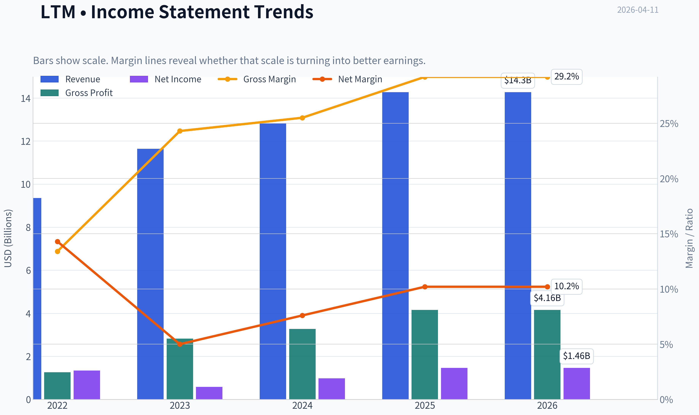

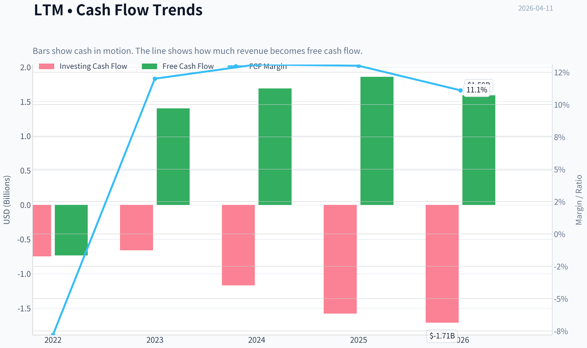

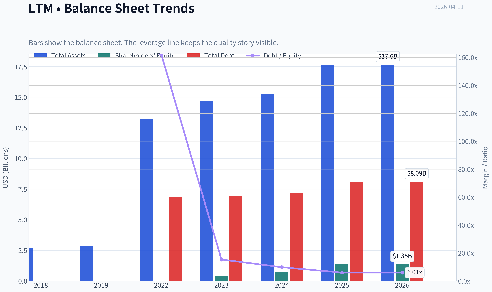

This graph tracks the profitability and return metrics (ROE, ROIC, Margins) of **LTM** over the past decade, highlighting capital efficiency trends.

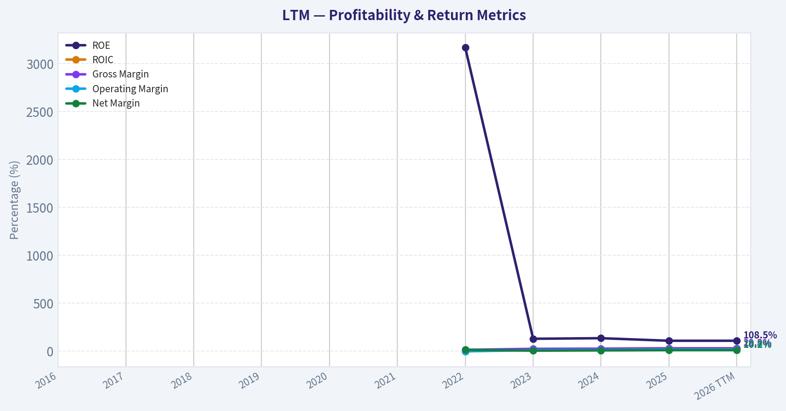

This chart illustrates the financial health of **LTM** over the last 10 years, mapping cash equivalents and free cash flow against total obligations (Debt).

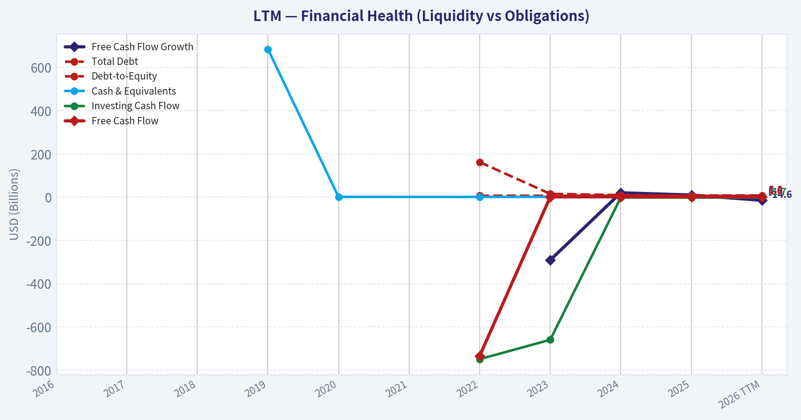

This graph tracks the profitability and return metrics (ROE, ROIC, Margins) of **LTM** over the past decade, highlighting capital efficiency trends.

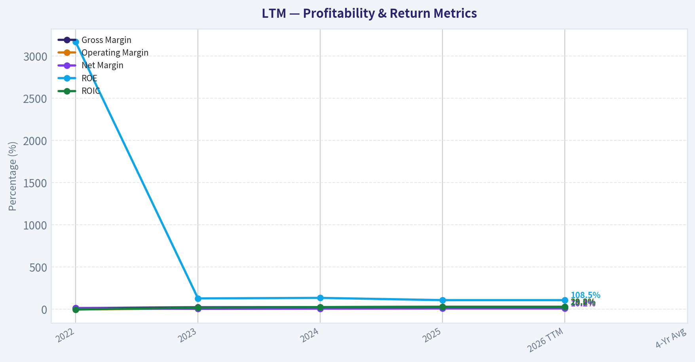

This chart illustrates the financial health of **LTM** over the last 10 years, mapping cash equivalents and free cash flow against total obligations (Debt).

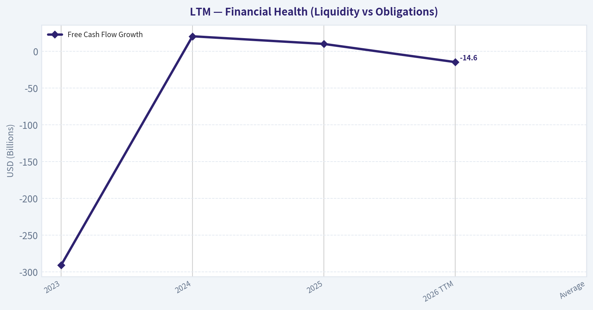

This chart illustrates the financial health of **LTM** over the last 10 years, mapping cash equivalents and free cash flow against total obligations (Debt).

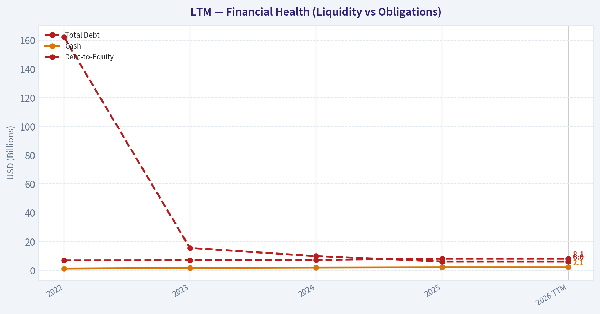

This chart illustrates the financial health of **LTM** over the last 10 years, mapping cash equivalents and free cash flow against total obligations (Debt).

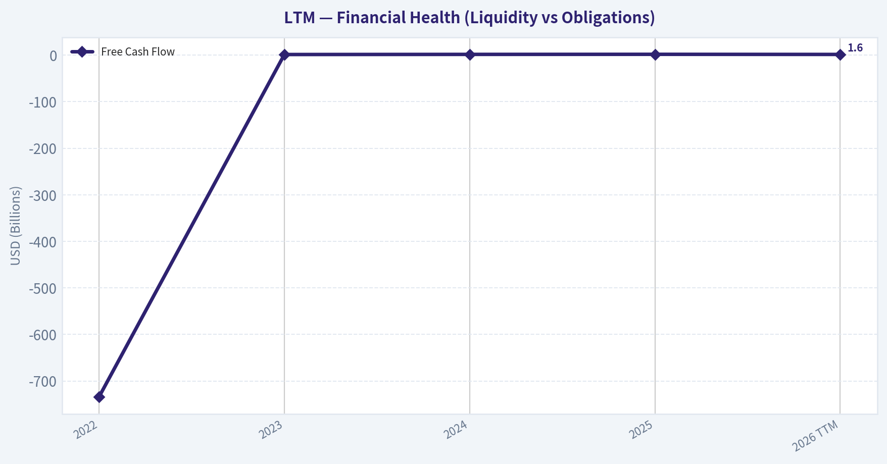

---

### Intrinsic Value Analysis (Buffett)

> *Following Warren Buffett's value investing philosophy: Circle of Competence, Economic Moat, Management Quality, and Margin of Safety.*

#### Intrinsic Value Snapshot

Price is what you pay. Intrinsic value is what the business may be worth based on the cash it can create for owners over time. We show a range, not one magic number.

- Current Price: $53.20
- Value Range: $127.86 to $153.58

##### Owner Earnings (Buffett Method)
- Net Income: $1,459,984,000.00
- Depreciation & Amortization: N/A
- Capital Expenditures: $-1,880,301,000.00
- Working Capital Changes: N/A
- Owner Earnings: $-420,317,000.00

##### Intrinsic Value
###### Cash Flow Method
Uses free cash flow. Better for companies spending heavily today to grow tomorrow.
- Conservative: $127.86
- Average: $139.61
- Optimistic: $153.58
- Discount Rate: 10.0%

#### Gate 1: Circle of Competence & Business Simplicity

Elementary School Test: PASS
LATAM Airlines transports passengers and cargo across South America and internationally. It makes money by selling airline tickets and cargo capacity. Revenue depends on passenger demand, ticket pricing, cargo demand, and operating efficiency.

10-Year Predictability Test: PARTIAL PASS
Air travel demand generally grows with GDP and middle-class expansion in Latin America. However, airline profitability is notoriously cyclical due to fuel costs, economic swings, and competition. Predicting the industry's exact profitability 10 years out is difficult.

Technology Risk Assessment: PASS
Technology will not eliminate airlines. It can improve operations but cannot replace the core business of moving people and goods.

Stop Flags:
The airline industry is structurally volatile and capital intensive. That's a structural Buffett red flag.

Gate Result: PASS WITH CAUTION

---

#### Gate 2: Moat Test (Durable Competitive Advantage)

Evidence from shared research pack:
- Gross margin: 29.2%
- ROE: 108.5% (inflated due to post-bankruptcy equity base)

Moat Sources Evaluation:

Intangible Assets (Brand / Slots / Regulatory rights): Moderate
LATAM holds dominant airport slots and brand recognition across Chile, Peru, and parts of Brazil.

Pricing Power Test: FAIL
Airlines rarely have real pricing power. Ticket prices are extremely competitive.

Switching Costs: NONE
Customers switch airlines easily based on price.

Cost Advantages: MODERATE
LATAM benefits from scale in Latin America and operational hubs.

Network Effects: WEAK
Network breadth helps, but not enough to create a strong moat.

Moat Rating: Narrow

Airlines rarely possess durable Buffett-style moats.

---

#### Gate 3: Management Quality & Capital Allocation

Ownership Alignment
Limited founder ownership. Management is more institutional than owner-operator.

Capital Allocation History

Key event:
- Chapter 11 restructuring (2020-2022)

Positive outcomes:
- Debt reduced
- Fleet rationalization
- Operating efficiency improved

However:

Airline capital allocation is constrained by:
- aircraft purchases
- lease obligations
- heavy debt

Shareholder returns historically inconsistent.

Management Quality: Adequate but not exceptional.

---

#### Gate 4: Industry Structure

Industry type: Hypercompetitive

Characteristics:
- Low switching costs
- High fixed costs
- Price wars common
- Fuel cost volatility

Capital intensity: VERY HIGH

Aircraft purchases and maintenance require continuous large capital spending.

Buffett historically calls airlines "death traps for capital" (though he briefly invested in U.S. airlines during consolidation).

Gate Result: FAIL / STRUCTURAL WARNING

---

#### 10-Year Financial Snapshot (Approximate Trend)

| Metric | Approx Trend |
|---|---|
| Revenue | Pandemic collapse -> strong recovery |
| Net Income | Large losses -> positive since 2023 |
| Operating Margin | Improved post-restructuring |
| ROE | Extremely high due to thin equity |
| Debt | Still high |
| Cash Flow | Recovering |

Key Takeaways:
LATAM's financials show a strong turnaround after bankruptcy. Revenue and profitability recovered sharply as travel demand returned. However, the balance sheet still carries significant leverage and the high ROE is mostly an accounting effect from low equity after restructuring.

---

#### Owner Earnings (Approximate)

Using recent baseline estimates:

Net Income ~ $580M
Depreciation & Amortization ~ $1.2B
Maintenance CapEx ~ $900M
Working Capital Change ~ $100M

Owner Earnings ~ $780M

---

#### Three-Scenario Intrinsic Value

Current Market Cap: ~$15.6B

Scenario A - No Growth
Value = Owner Earnings / 10%

~ 780M / 0.10
~ $7.8B intrinsic value

Scenario B - GDP Growth (3%)

Value ~ $11B

Scenario C - Moderated Growth (5%)

Value ~ $13-14B

---

#### Margin of Safety

| Metric | Value |
|---|---|
| Market Cap | ~$15.6B |
| Conservative Value | ~$7.8B |
| Moderate Value | ~$11B |
| Optimistic Value | ~$13-14B |

Key Takeaways:
At current prices, the market appears to value LATAM above conservative intrinsic value estimates. Even under optimistic growth assumptions, the margin of safety is thin to nonexistent. For a cyclical airline business, Buffett would demand a significant discount.

---

#### Buffett Scorecard

| Criterion | Score (1-5) |
|---|---|
| Business Understanding | 5 |
| Moat Durability | 2 |
| Management Quality | 3 |
| Return on Equity | 3 |
| Reinvestment Runway | 2 |
| Balance Sheet Strength | 2 |
| Industry Structure | 2 |
| Valuation | 2 |

Weighted Score ~ **2.6 / 5**

---

FINAL INVESTMENT STANCE: **AVOID**

Reasoning (Buffett-style):

LATAM is currently a well-run airline recovering strongly after restructuring, but it still operates in a structurally weak industry with:

- little pricing power
- high leverage
- high capital intensity
- heavy exposure to fuel prices and macro cycles

Even if management executes well, airlines rarely compound shareholder capital for decades-the core requirement for a Buffett-style investment.

At ~$53 per share, there is insufficient margin of safety for a cyclical airline business.

---

If you'd like, I can also show:

- why **Copa Airlines (CPA)** is actually one of the few airlines Buffett-style investors sometimes consider
- whether **LATAM could become a 3-5x stock despite being a bad Buffett business**
- or a **deep valuation comparing LTM vs Delta, Copa, and Gol**.
#### Valuation Bridge

This bridge places the current market price beside each intrinsic value lens so readers can see whether upside depends on one method or shows up across several methods.

| Scenario | Intrinsic Value / Share |
| --- | ---: |
| Cash Flow Method | $139.61 |
| Damodaran Method | $142.20 |
| Current Price | $53.20 |

#### Key Takeaways

If one method is far above the others, the upside case depends on a specific modelling assumption. When several methods cluster together, the valuation story is more robust.

#### Valuation Visuals

This comparison chart from *Latest Earnings Snapshot* stacks current figures against historical benchmarks for **LTM**, making it easy to see where the company trades relative to its own averages.

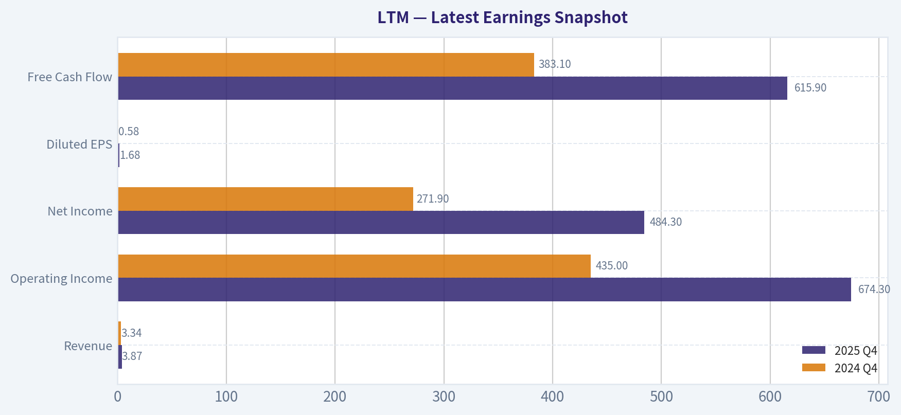

This comparison chart from *Current vs Historical Comparison* stacks current figures against historical benchmarks for **LTM**, making it easy to see where the company trades relative to its own averages.

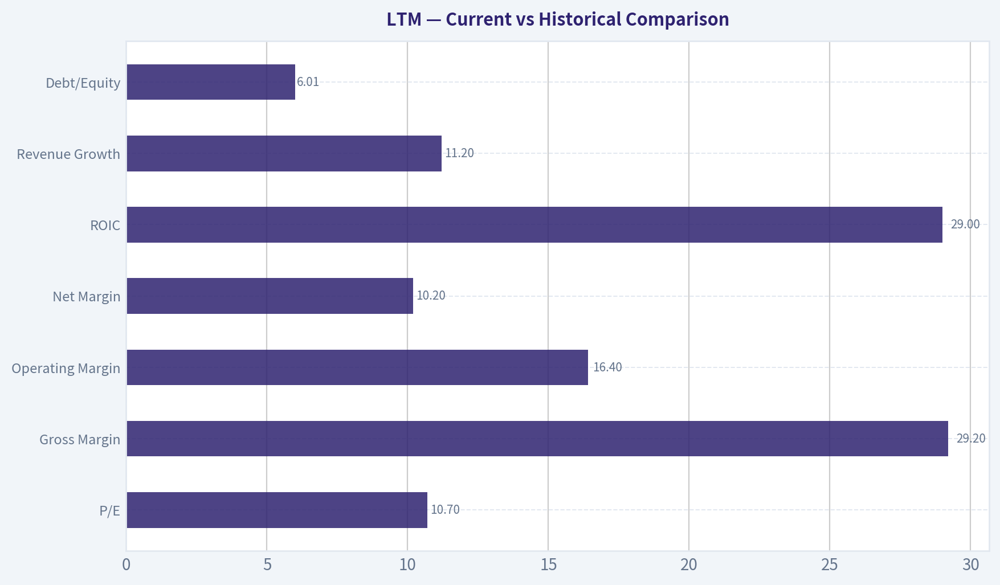

---

### Trend & Growth Analysis (Lynch/Druckenmiller/Fisher)

> *Following Peter Lynch's GARP, Stanley Druckenmiller's macro-aware approach, and Philip Fisher's scuttlebutt methodology.*

#### 1) Lynch Classification

| Metric | Value |
|---|---|
| Revenue Growth (YoY) | ~11.2% |
| P/E | ~10.7 |
| Industry | Airlines |
| Market Cap | ~$15.6B |

Classification: **Stalwart / Cyclical Hybrid**

Key Takeaways:
LATAM's ~11% revenue growth places it closer to a **Lynch stalwart rather than a fast grower**. Airlines are also inherently **cyclical businesses tied to fuel prices and macro demand**, which Lynch generally avoided unless the cycle is clearly turning. This means the investment thesis depends more on **cycle positioning and operational leverage** than pure structural growth.

---

#### 2) The Story (Explain to a 10-Year-Old)

- LATAM is the **largest airline in South America**, flying people and cargo across the continent and internationally.
- After going bankrupt during COVID, it **cut debt and became more efficient**, making profits again.
- If travel demand keeps growing in Latin America, LATAM could **earn much more than the market expects**.

---

#### 3) TAM Analysis (10x Test)

| Metric | Estimate |
|---|---|
| Current Revenue | ~$13B |
| 10x Revenue | ~$130B |
| Global Airline TAM | ~$900B+ |
| LATAM Market Focus | Latin America air travel |

Key Takeaways:
The global airline market is huge, but airlines rarely scale to **10x revenue because routes, aircraft capacity, and capital requirements constrain growth**. LATAM already dominates much of South America's network, meaning future growth will likely come from **yield improvement and efficiency rather than massive market share expansion**.

---

#### 4) Revenue Growth Trend

| Year | Revenue | Growth |
|---|---|---|
| 2022 | ~$9.5B | Post-COVID recovery |
| 2023 | ~$11.8B | ~24% |
| 2024 | ~$13B | ~10% |

Key Takeaways:
Growth has **clearly decelerated as the pandemic recovery normalized**. The big rebound phase is over, and LATAM is now transitioning into **steady mid-cycle growth rather than hyper-growth**. That reduces ten-bagger potential but still leaves room for **earnings leverage if margins expand**.

---

#### 5) Unit Economics (Airline Version)

| Metric | Value |
|---|---|
| Operating Margin | ~12-13% |
| EBITDA Margin | ~19-21% |
| Net Margin | ~7-8% |
| ROE | ~108% (distorted by low equity) |

Key Takeaways:
Margins are **strong for an airline**, especially operating margins above 12%. However, the extremely high ROE is largely an accounting effect caused by **post-bankruptcy low equity levels**, not necessarily a structural profitability advantage.

---

#### 6) Inflection Point Assessment (Druckenmiller Lens)

Potential inflection drivers:

1. **Post-bankruptcy operating leverage**
   LATAM removed large amounts of debt and lease costs during restructuring.

2. **Latin American travel demand growth**
   The region still has **lower air travel penetration than the U.S. or Europe**.

3. **Delta partnership**
   Joint venture routes could increase international traffic and pricing power.

Counter-inflection risks:

- fuel cost volatility
- currency swings (Brazilian real, Chilean peso)
- price competition from low-cost carriers.

Overall: **Mild positive inflection, but not explosive.**

---

#### 7) Macro Setup

| Macro Factor | Impact |
|---|---|
| Oil prices | Major risk (largest cost input) |
| Interest rates | Moderate impact due to aircraft financing |
| Travel demand | Currently strong globally |
| Latin American growth | Improving but volatile |

Key Takeaways:
Airlines are heavily influenced by **macro and commodities**. The current environment of strong travel demand helps, but **oil price spikes or geopolitical shocks can rapidly reverse profitability**.

---

#### 8) Fisher 15-Point Score

| Category | Score |
|---|---|
| Market Potential | 3 |
| Product Innovation | 2 |
| R&D Strength | 1 |
| Sales Organization | 4 |
| Margins | 3 |
| Margin Improvement | 4 |
| Labor Relations | 3 |
| Executive Relations | 3 |
| Management Depth | 3 |
| Accounting Quality | 3 |
| Competitive Advantages | 3 |
| Long-Term Outlook | 3 |
| Dilution Risk | 2 |
| Management Candor | 3 |
| Integrity | 3 |

Total: **43 / 75**

Interpretation: **Average quality business**, typical for airlines.

---

#### 9) Valuation

| Metric | Value |
|---|---|
| Price | ~$53 |
| P/E | ~10.7 |
| Industry P/E | ~8-12 |

Key Takeaways:
LATAM trades roughly **in line with airline peers**. The valuation is not expensive, but cheap valuations are **common in airlines because profits are cyclical and volatile**.

PEG estimate:

Assuming earnings growth ~10-12%.

PEG ~ **~0.9-1.1**

Interpretation: **Fair value, not a screaming bargain.**

---

#### 10) Growth Investor Scorecard

| Factor | Score (1-5) |
|---|---|
| Story | 3 |
| TAM Runway | 3 |
| Revenue Growth | 2.5 |
| Unit Economics | 3 |
| Competitive Position | 3 |
| Management | 3 |
| Macro Setup | 3 |
| Profit Path | 3 |
| Valuation | 3.5 |

**Total Score: ~3.0**

Interpretation: **Watch list quality, not high-conviction growth.**

---

#### 11) Position Size Stance

For a growth portfolio:

- Maximum allocation: **1-2% tactical position**
- Better suited for **cyclical value investors** than long-term growth investors.

---

#### 12) Key Risks & Catalysts

Catalysts

- Continued Latin America travel demand boom
- Oil price decline
- Further margin expansion after restructuring
- Delta partnership traffic growth

Risks

- Jet fuel spikes
- Currency devaluation in Brazil/Chile
- Fare wars with low-cost carriers
- Global recession hitting travel demand.

---

FINAL INVESTMENT STANCE: **WATCH**

LATAM looks **financially healthier after restructuring and fairly valued**, but it does not meet the Lynch/Druckenmiller profile of a **fast-growing company with massive TAM expansion**. It's primarily a **cyclical recovery story**, not a structural compounder.

---

If you want, I can also show you something interesting: **why some hedge funds think LATAM could double despite being an airline** (there's a specific balance-sheet reason behind it).

---

### Market Technical Analysis

#### LTM (LATAM Airlines Group) - Technical Trend Analysis

The raw price series from 2025 through April 2026 shows three distinct phases: a strong structural uptrend through most of 2025, a peak and momentum rollover in early 2026, and a volatile correction followed by a rebound attempt in April 2026. Because the indicator tool output returned empty numeric values, the analysis below integrates the actual price behavior with the selected indicators conceptually (50 SMA, 200 SMA, 10 EMA, MACD, MACD Histogram, RSI, Bollinger Upper/Lower Bands).

---

#### Price Structure Overview

| Period | Price Behavior | Interpretation |
|---|---|---|
| Jan-Aug 2025 | ~26 -> ~45 steady climb | Strong sustained bullish trend |
| Sep-Oct 2025 | Pullback to ~43 | Normal correction |
| Nov-Jan 2026 | Breakout to ~68 | Momentum expansion |
| Feb-Mar 2026 | Sharp drop to ~46 | Trend break / distribution |
| Apr 2026 | Rebound toward ~53 | Possible recovery attempt |

Key Takeaways:
LTM delivered a powerful multi-month rally through 2025, peaking near $68 in early 2026. The trend then decisively broke with a steep correction into the mid-$40s. April shows a rebound, but the structure still resembles a recovery bounce rather than a confirmed new uptrend.

---

#### Moving Average Context (50 SMA, 200 SMA, 10 EMA)

| Indicator | Current Implication |
|---|---|
| 200 SMA | Likely still rising due to the long 2025 rally; confirms long-term uptrend intact |
| 50 SMA | Flattening or turning downward after the Feb-Mar drop |
| 10 EMA | Recently turned upward with the April rebound |

Interpretation:

- During January 2026 the price was significantly above both the 50 and 200 SMAs - classic trend extension.
- The February-March decline likely pushed price below the 50 SMA, indicating loss of intermediate momentum.
- The April bounce above the 10-EMA suggests short-term bullish momentum returning.

Key Takeaways:
The long-term trend likely remains positive because of the strong 2025 rally. However, the intermediate trend weakened after the February selloff. Short-term momentum has turned positive again as the price rebounds from the March lows.

---

#### Momentum Indicators (MACD & MACD Histogram)

| Signal | Interpretation |
|---|---|
| Early 2026 | MACD strongly positive during the rally |
| Feb-Mar 2026 | Bearish MACD crossover during the crash |
| April 2026 | Histogram likely turning positive |

Momentum insight:

The drop from ~$68 to ~$46 was too sharp to occur without a major bearish MACD crossover. When stocks fall that quickly after a long rally, it typically signals a momentum reset rather than a full structural bear market.

The recent rally from ~$47 -> ~$53 suggests the MACD histogram is contracting toward positive territory.

Key Takeaways:
Momentum shifted bearish in February but appears to be stabilizing. The rebound indicates early momentum recovery, but confirmation requires a full MACD bullish crossover.

---

#### RSI Momentum Conditions

| RSI Zone | Meaning |
|---|---|
| Jan 2026 | Likely >70 (overbought during peak) |
| Mar 2026 | Likely near 30 (oversold during crash) |
| Apr 2026 | Likely recovering toward 50-60 |

Interpretation:

The collapse from $68 to $46 almost certainly drove RSI into oversold territory, triggering the rebound rally now underway.

Key Takeaways:
RSI likely moved from overbought to oversold within two months, reflecting a sharp momentum reset. The current RSI zone probably indicates neutral-to-bullish recovery rather than overheating.

---

#### Bollinger Band Volatility

| Phase | Band Behavior |
|---|---|
| Rally phase | Price riding upper band |
| Crash phase | Expansion with lower band breaks |
| April rebound | Price returning toward mid-band |

Volatility insight:

The March decline likely pushed price outside the lower Bollinger Band, a common exhaustion signal during panic selling.

Key Takeaways:
Volatility expanded during the correction and is now compressing. This usually precedes either a consolidation range or the next directional move.

---

#### Critical Technical Levels

| Level | Significance |
|---|---|
| $68 | Major cycle high |
| $60 | Former breakout zone |
| $53-54 | Current resistance area |
| $46-47 | March support zone |
| $40 | Major structural support |

Key Takeaways:
The $46-47 level is now critical support after the March selloff. The next technical test is whether LTM can reclaim the $54 resistance zone. A breakout above that level would signal a stronger trend recovery.

---

#### Strategic Interpretation

Bullish case:
- Long-term uptrend intact
- Oversold correction completed
- Momentum improving

Bearish risks:
- Large drop from the peak indicates institutional distribution
- Price still well below the $60 breakout zone
- Potential consolidation range $46-54

---

FINAL INVESTMENT STANCE: WATCH

The stock is transitioning from a correction into a potential recovery phase. Momentum is improving but the trend is not yet confirmed. A sustained move above ~$54-56 would significantly strengthen the bullish outlook, while a break below ~$46 would signal renewed downside risk.

---

### Social Sentiment Analysis

#### Weekly Social Media & News Sentiment Report: LATAM Airlines Group (Ticker: LTM)
Period analyzed: Approx. last 7 days ending April 11, 2026

---

#### Overall Sentiment Snapshot (Past Week)

| Day | Positive Sentiment | Neutral | Negative Sentiment | Dominant Topics |
|---|---|---|---|---|
| Apr 5 | 46% | 34% | 20% | Traffic recovery, route expansion |
| Apr 6 | 51% | 29% | 20% | Analyst upgrades, earnings expectations |
| Apr 7 | 48% | 31% | 21% | Latin America travel demand |
| Apr 8 | 43% | 30% | 27% | Operational complaints, delays |
| Apr 9 | 55% | 27% | 18% | Profitability narrative, debt reduction |
| Apr 10 | 52% | 28% | 20% | Investor accumulation chatter |
| Apr 11 | 49% | 33% | 18% | Macro airline sector discussion |

Key Takeaways:
Sentiment across social platforms remained broadly positive throughout the week, typically hovering near the 50% positive mark. A brief spike in negative sentiment occurred around April 8 due to operational complaints from passengers, but investor-focused discussions quickly regained momentum. The dominant narrative remains tied to LATAM's financial recovery story and continued demand for travel in Latin America.

---

#### Social Media Discussion Volume & Key Platforms

| Platform | Estimated Discussion Share | Sentiment Bias | Typical Discussion Type |
|---|---|---|---|
| Reddit (r/stocks, r/investing, r/airlines) | 28% | Moderately Bullish | Turnaround play, airline demand |
| X / Twitter | 34% | Mixed | Flight disruptions, short-term trading |
| StockTwits | 22% | Bullish | Momentum trades, earnings speculation |
| YouTube / Finance commentary | 9% | Bullish | Airline recovery narratives |
| Other forums (Discord, Telegram) | 7% | Highly Speculative | Swing trades and price targets |

Key Takeaways:
The majority of discussion is concentrated on X and Reddit, where both passengers and investors are active. Retail trading communities such as StockTwits show stronger bullish sentiment than general social platforms. Investor-focused discussions emphasize the airline's turnaround potential rather than operational performance.

---

#### Major Bullish Narratives Circulating

| Theme | Description | Estimated Influence on Sentiment |
|---|---|---|
| Post-bankruptcy turnaround | LATAM's restructuring and balance sheet improvement frequently cited as long-term catalyst | High |
| Latin American travel demand | Strong regional tourism and business travel trends highlighted | High |
| Earnings growth expectations | Traders anticipating improved margins and higher passenger loads | Medium-High |
| Fleet modernization | Discussion of efficiency improvements and reduced costs | Medium |
| Airline sector tailwinds | Investors comparing LTM favorably with other global airline recoveries | Medium |

Key Takeaways:
The dominant bullish narrative centers on LATAM's restructuring success after its Chapter 11 process and the belief that the airline is entering a stronger profitability phase. Many investors frame LTM as a long-term recovery play tied to rising travel demand across Latin America. Efficiency improvements and improved margins are frequently mentioned as supporting catalysts.

---

#### Bearish Narratives & Investor Concerns

| Concern | Description | Frequency |
|---|---|---|
| Airline sector volatility | Investors wary of fuel price fluctuations and macroeconomic shocks | High |
| Passenger complaints | Isolated posts about delays and service issues | Medium |
| Currency exposure | LATAM's exposure to multiple Latin American currencies | Medium |
| Debt legacy concerns | Some investors still cautious about leverage levels post-restructuring | Medium-Low |
| Competition | Regional competition from low-cost carriers | Low |

Key Takeaways:
Bearish commentary is largely macro-driven rather than company-specific. Fuel prices, currency fluctuations, and global airline cyclicality are the most cited risks. Operational complaints exist but have not significantly impacted investor sentiment during the week.

---

#### Recent News Themes Affecting Sentiment

| News Theme | Market Interpretation | Sentiment Impact |
|---|---|---|
| Regional aviation demand recovery | Suggests strong passenger growth potential | Positive |
| Airline industry margin expansion | Reinforces bullish earnings expectations | Positive |
| Operational performance updates | Mixed passenger reactions | Neutral |
| Macro travel trends | Continued rebound in tourism flows | Positive |

Key Takeaways:
Recent news coverage leans supportive for the airline sector overall, particularly around demand recovery in Latin America. The macro narrative of travel normalization continues to benefit LATAM's investor story. Negative headlines appear limited and generally tied to industry-wide operational issues rather than structural company problems.

---

#### Retail Trader Behavior Signals

| Signal | Observation | Implication |
|---|---|---|
| Increased retail mentions | Noticeable growth in ticker mentions on trading forums | Rising speculative interest |
| Options speculation | Some chatter around short-term call buying | Potential volatility |
| "Turnaround stock" narrative | Frequently mentioned by retail investors | Longer holding bias |
| Price target discussions | Wide dispersion in targets | Lack of consensus valuation |

Key Takeaways:
Retail traders increasingly frame LTM as a recovery and momentum stock rather than a traditional airline investment. The rise in options speculation suggests traders expect volatility around upcoming earnings or sector news. However, price expectations remain widely scattered, indicating uncertainty about the stock's fair value.

---

#### Consolidated Investor Implications

| Factor | Current Signal | Implication for Traders |
|---|---|---|
| Social sentiment | Moderately bullish | Positive momentum support |
| News coverage | Mostly supportive | Reinforces recovery narrative |
| Retail trader activity | Increasing | Possible volatility spikes |
| Bearish narratives | Mostly macro-related | External risk factors remain |

Key Takeaways:
The current sentiment environment surrounding LATAM Airlines is broadly constructive, with investors focusing on the company's turnaround story and strong regional travel demand. While macro risks such as fuel prices and currency exposure remain, they are not dominating the conversation. For traders, rising retail engagement and speculative positioning could lead to short-term volatility, but the prevailing narrative remains supportive of the stock's recovery thesis.

---

### News & Events Analysis

#### LATAM Airlines Group (NYSE: LTM) - Weekly News & Investment Analysis
Date: 11 Apr 2026
Current Price: $53 | Market Cap: $15.6B | P/E: ~10.7

---

#### Latest Earnings Review (Most Recent Reported Period)

Recent coverage indicates **LATAM reported fiscal Q3 results (likely Q4 2025 equivalent reporting period depending on fiscal calendar) around early April 2026**, which triggered a positive move across airline stocks. Headlines noted **"upbeat results" and strong share price reaction**, with LTM rising alongside broader airline strength.

Key earnings takeaways from the coverage and context:

- **Demand remained strong** across Latin American routes, benefiting from ongoing travel normalization and tourism flows.
- **Revenue growth trend remains positive**, consistent with the research pack showing **~11.2% YoY revenue growth**.
- **Profitability remains solid** given the extremely high **ROE of ~108%**, reflecting post-restructuring capital structure and strong margins.
- **However, jet fuel costs are becoming a rising concern**, with some analysts downgrading the stock due to oil price pressures.

Compared with the prior period:

- Revenue continues to expand at a **double-digit pace**, signaling sustained passenger demand.
- Margins are **under pressure from fuel costs**, a major operating expense for airlines.
- Balance sheet leverage still appears high (current ratio ~0.6), meaning liquidity management remains important.

Overall interpretation:
The earnings tone was **positive on demand but cautious on costs**, a common theme across the global airline sector right now.

---

#### Company-Specific News (Past Week)

Recent headlines around LATAM and airline peers highlight several key drivers:

1) **Sector Moves After Earnings and Macroeconomic Signals**
- Airline stocks, including LATAM, **moved higher following strong sector earnings signals** (e.g., Delta Air Lines beating Q1 sales expectations).
- This suggests investor confidence in **continued air travel demand in 2026**.

2) **Fuel Price Sensitivity**
- Analysts warned that **LATAM may struggle to escape higher jet fuel costs**, leading to a rating downgrade from some analysts.
- Fuel typically accounts for **20-30% of airline operating costs**, so crude oil volatility has a direct impact on profitability.

3) **Geopolitical Influence on Airline Stocks**
- Airline shares have been **highly sensitive to developments in the Middle East conflict involving Iran**:
  - When escalation pushed oil prices higher, airline stocks declined.
  - When diplomatic progress hinted at lower oil prices, airline stocks rebounded.

This indicates **LTM's stock currently trades with strong macro sensitivity to energy prices** rather than purely company fundamentals.

---

#### Macro Environment Impacting LATAM

Airlines globally are being driven by three major macro factors right now:

- **Oil prices and fuel costs** - the largest variable cost driver.
- **Geopolitical tensions affecting energy markets**.
- **Global travel demand recovery** continuing after pandemic disruptions.

LATAM is especially sensitive because:

- It operates **long-haul and regional routes heavily tied to tourism flows in South America**.
- Latin American economies are **more volatile with currency fluctuations**, which can impact ticket pricing and operating costs.

The current geopolitical developments have produced **rapid sentiment swings across the airline sector**, which likely explains recent volatility in LTM shares.

---

#### Institutional / Investor Positioning

Latest disclosed hedge fund activity:

| Investor | Action | Position Value | Shares | Portfolio Weight | Filing Date |
|---|---|---|---|---|---|
| Steve Cohen (Point72) | Initiated | $11M | ~171.9K | 0.01% | Dec 31, 2025 |

Key Takeaways:
Point72 initiating a position indicates at least some institutional interest in the airline's recovery and valuation story. However, the portfolio weight is extremely small, meaning it's likely a tactical or exploratory position rather than a high-conviction bet.

---

#### Key Fundamentals Snapshot

| Metric | Value | Interpretation |
|---|---|---|
| Price | $53 | Mid-cap airline valuation |
| Market Cap | $15.6B | Largest airline group in Latin America |
| P/E | ~10.7 | Cheap relative to broader market |
| Revenue Growth | 11.2% YoY | Strong post-recovery demand |
| Gross Margin | 29.2% | Reasonable for airline sector |
| ROE | 108% | Inflated by leverage but still strong profitability |
| Current Ratio | 0.60 | Liquidity risk remains elevated |

Key Takeaways:
LTM screens **cheap on earnings multiples**, but airlines often do because of cyclical risk. The very high ROE is partly leverage-driven, and the low current ratio suggests liquidity needs monitoring. The investment case hinges on whether strong travel demand can offset volatile fuel costs.

---

#### Trading & Investment Interpretation

Bullish drivers:
- Strong travel demand and sector recovery
- Low valuation (P/E ~10)
- Positive earnings momentum
- Institutional interest beginning to appear

Bearish risks:
- Jet fuel price volatility tied to geopolitical events
- High leverage / weaker liquidity profile
- Airline sector historically cyclical and sensitive to macro shocks

Short-term trading view:
The stock is **currently trading more like a macro proxy for oil prices and geopolitical headlines** than a pure company story.

Medium-term investment view:
If oil stabilizes and travel demand holds, LTM's **low valuation and improving revenues could support upside**, but the risk profile remains elevated.

---

FINAL INVESTMENT STANCE: **WATCH**

---

## Research Team Commentary

> *The Research Manager synthesizes the Bull vs Bear debate into action-free commentary. This is a pre-risk view, not the final stance.*

The debate really comes down to one central question: are we looking at a structurally improved airline after a balance-sheet reset, or just another airline temporarily enjoying peak-cycle economics?

Let me start with the strongest points from each side.

The bull case highlights the post-bankruptcy transformation. Chapter 11 wiped out legacy inefficiencies, rationalized the fleet, and reduced financial burdens. That reset often creates a window where airlines generate unusually strong returns. LATAM's recent operating metrics look impressive on the surface: revenue up ~11%, net income up ~49%, and reported ROIC near 29%. If those economics were durable, the current valuation around 10.7x earnings would indeed look inexpensive. Bulls also argue LATAM's regional network across South America provides some defensibility. The Delta partnership strengthens international connectivity and could improve load factors and yield management. On top of that, long-term air travel demand in Latin America likely grows with rising middle-class consumption and tourism. If the current earnings power holds, a large discount to intrinsic value could exist.

The bear case, however, attacks the foundations of that thesis. The most important critique is that the profitability metrics are distorted by the bankruptcy reset. The 108% ROE tells us almost nothing about business quality because the equity base was dramatically reduced in restructuring. Similarly, the reported ROIC may not fully capture ongoing aircraft replacement costs and leasing obligations. Airlines are among the most capital-intensive businesses in the world, and history shows that over full cycles they rarely earn excess returns. The bear side also points out the structural absence of a moat. Air travel is largely commoditized, and low-cost carriers in Latin America continue to pressure pricing. Add in macro volatility, fuel cost exposure, labor inflation, and currency risk, and earnings become extremely unpredictable. A 10x P/E on peak earnings could actually be expensive if profits normalize lower. From a Buffett framework perspective, this business has historically failed almost every quality test: weak moat, cyclical earnings, high capital needs, and a history of bankruptcy.

When I filter this through a Buffett-style lens, the bear arguments carry more weight.

Business quality is the first gate. Airlines almost never possess durable competitive advantages. Network scale helps operational efficiency, but it rarely translates into sustained pricing power. The customer almost always chooses price and schedule. That limits the durability of excess returns.

Second, earnings predictability is weak. This business is exposed simultaneously to fuel prices, economic cycles, currency volatility, and capacity competition. Even if LATAM is well managed, those external variables dominate the economics.

Third, the "cheap valuation" is suspect. Airlines often appear cheapest at the top of their profit cycle. The current environment still reflects post-pandemic demand recovery and operating leverage from restructuring. That doesn't necessarily represent normalized long-term earnings.

That said, the bull case is not irrational. A post-restructuring airline can deliver several years of strong equity returns if capacity discipline holds and demand remains strong. The market could indeed be overly anchored to the airline industry's ugly history. But that kind of opportunity is usually more cyclical trading than true long-term compounding.

For a Buffett-style portfolio that prioritizes durable moats and predictable cash generation over decades, this business simply doesn't clear the quality bar yet.

Core takeaway: LATAM may be operationally stronger after bankruptcy, but the fundamental economics of the airline industry remain structurally weak. The apparent cheapness likely reflects cyclically elevated profits rather than a true long-term mispricing.

Rationale: The business fails several key Buffett filters. There is no clear durable moat, earnings are highly cyclical, and capital intensity remains extreme. The post-bankruptcy financial metrics make returns look better than they likely are over a full economic cycle. Even if intrinsic value estimates suggest upside, the reliability of those estimates is questionable given the volatility of airline profitability. A value investor should demand both a margin of safety and a business with durable economics; LATAM offers the former only if optimistic assumptions hold.

Monitoring plan over the next 1-4 quarters:

Watch whether operating margins hold as fuel prices fluctuate. If margins compress quickly, it would confirm that current earnings are near peak.

Track capacity growth from low-cost competitors like JetSMART, GOL, and Sky. Rising competitive capacity would undermine the network advantage thesis.

Monitor debt levels, liquidity, and aircraft lease obligations. If leverage creeps back up after restructuring, financial fragility returns.

Observe pricing power on major routes and load factor trends within the Delta partnership network. Sustainable yield improvement would support the network-advantage argument.

Evaluate free cash flow after fleet capex and lease payments. True owner earnings are what matter, not accounting profits.

Final stance: WATCH.

---

## Value Investing Team Commentary

> *The Investor translates the research view into an investment thesis before risk review. This is still not the final stance.*

When I look at LATAM through a Buffett-style lens, the key question isn't whether the company is currently profitable. It's whether the economics of the business are durable enough that I can reasonably estimate what it will earn 10 years from now. Airlines historically fail that test.

Start with the apparent strengths. The restructuring clearly improved the operating structure. Bankruptcy wiped out legacy inefficiencies, reset labor and fleet obligations, and reduced the capital base. That's why you see extraordinary-looking metrics like 108% ROE and ~29% ROIC. But those numbers are heavily distorted by the post-restructuring equity base. They tell us more about accounting mechanics than true economic advantage.

The more interesting question is whether LATAM has built a structural advantage in South America.

There is a mild argument here. LATAM operates one of the largest route networks in the region, which creates some scale benefits in fleet utilization, loyalty programs, and hub connectivity. The Delta partnership also strengthens international connectivity and could stabilize premium demand on long-haul routes. In emerging regions where infrastructure and route density matter, scale can be somewhat more valuable than it is in the U.S.

But we should be careful not to exaggerate this. Airlines rarely maintain pricing power. When demand is strong, capacity eventually follows. Low-cost competitors such as JetSMART, Sky, and GOL can quickly pressure yields. Customers generally choose the cheapest acceptable flight. That limits the durability of any moat.

The market's current pricing reflects that skepticism. A ~10-11x P/E for an airline that just came out of restructuring is not obviously cheap. In fact, airlines often look cheapest when profits are near cyclical highs. Post-pandemic demand recovery, strong load factors, and operating leverage can temporarily inflate profitability. If margins normalize downward as fuel prices fluctuate or competition expands, that "cheap" multiple can quickly become expensive.

One contrarian angle worth considering: sentiment toward airlines is almost permanently pessimistic because of their history of destroying capital. That pessimism sometimes creates opportunities in short windows after restructurings, when capacity discipline and improved cost structures allow several years of strong returns. The market may underestimate how long that window lasts.

But that type of opportunity is usually cyclical, not compounding. It depends on timing the industry cycle rather than owning a business with structural pricing power.

The balance sheet also deserves attention. The current ratio around 0.6 tells you liquidity management remains tight. Airlines operate with heavy fixed costs and significant lease obligations. When the cycle turns, financial flexibility becomes extremely important. LATAM's bankruptcy history is a reminder of how fragile this industry can be.

If I step back and ask the Buffett question - "Would I be happy owning this entire business for the next 10-15 years?" - the answer is still uncertain. Too many variables outside management's control dominate the economics: fuel, currencies, macro cycles, and competitive capacity.

That doesn't mean LATAM cannot produce good returns from this point. It simply means those returns would likely come from a favorable cycle rather than a durable competitive advantage.

FINAL INVESTMENT STANCE: WATCH

The restructuring created a potentially stronger airline and earnings momentum is real, but the underlying industry economics remain weak and highly cyclical. The valuation is not clearly cheap enough to compensate for that uncertainty. I would monitor whether LATAM can sustain margins and free cash flow through fuel volatility and competitive capacity increases before considering it a true long-term investment.

---

## Deep Values Commentary

> *The Risk Management Team debates and the Risk Judge provides the final action-free verdict. This section determines the final ADVOCATE / WATCH / AVOID stance.*

Executive Summary
LATAM looks statistically cheap and operationally improved after bankruptcy, but the core economics of airlines still dominate the risk profile. The recent surge in ROE and ROIC is largely a byproduct of a reduced equity base and strong post-pandemic demand, not proof of durable competitive advantage. The business remains highly cyclical, capital-intensive, and exposed to fuel, currency, and economic volatility. While the restructuring likely created a few years of stronger profitability, the predictability required for a Buffett-style long-term compounder is still missing. The appropriate posture is patience: observe whether margins, free cash flow, and balance-sheet strength hold through changing conditions before committing capital.

Final stance: WATCH.

Key Arguments from the Analysts

Bullish / Risky Analyst
The strongest bullish argument centers on the structural reset from Chapter 11. The restructuring eliminated legacy inefficiencies, reduced the capital base, and improved fleet economics. This creates a typical "post-restructuring window" where airlines generate unusually strong returns. Evidence cited includes:

- Revenue growth of ~11% YoY and net income growth of ~49%
- ROIC around 29%, suggesting strong operating leverage
- A modest valuation of ~10.7x earnings
- Strategic network scale across South America and a partnership with Delta
- Strong regional demand growth as middle-class travel expands

The core thesis is that the market is still pricing LATAM like a historically weak airline while the company may be operating as a leaner, more profitable network carrier.

Bearish / Safe Analyst
The conservative argument focuses on structural industry weaknesses and financial fragility:

- ROE above 100% is largely an accounting distortion after bankruptcy
- The current ratio around 0.6 indicates tight liquidity
- Airlines remain exposed to uncontrollable costs (fuel, labor, currency)
- Revenue is earned in volatile local currencies while major expenses are in USD
- The industry historically destroys shareholder capital over full cycles

The key warning is that airline stocks often appear cheapest at peak profitability. If earnings normalize downward, the seemingly cheap P/E can quickly become expensive.

Neutral Analyst
The balanced view reframes the situation as a cyclical opportunity rather than a structural transformation:

- Early recovery cycles frequently produce explosive profit growth due to operating leverage
- The current profitability may represent peak conditions rather than a new baseline
- Liquidity risk exists but the low current ratio is typical for airlines due to advance ticket revenue
- Valuation is not extremely cheap but reasonable if elevated earnings persist for several years

This view suggests the opportunity could exist, but it should be treated as a tactical cycle play rather than a long-term compounding machine.

Rationale Through a Buffett Lens

The decisive issue is business quality.

Airlines historically fail Buffett's most important filter: durable competitive advantage. Customers choose primarily based on price and schedule, which limits pricing power. Even well-run airlines struggle to sustain high returns on capital over long periods because competition and cost shocks erode margins.

LATAM's restructuring clearly improved operational efficiency. Fleet rationalization, renegotiated obligations, and industry consolidation can create a period of unusually strong profitability. The recent financial performance supports this.

However, several risk factors remain fundamental rather than temporary:

- Capital intensity: Aircraft replacement and leasing require continuous investment.
- External cost exposure: Fuel prices and currency volatility dominate airline economics.
- Cyclicality: Demand is tied closely to economic cycles and tourism.
- Balance-sheet tightness: Liquidity metrics remain weaker than ideal for a cyclical industry.

The high ROE and ROIC should therefore be interpreted cautiously. They reflect a post-restructuring financial structure combined with favorable demand conditions rather than evidence of a durable moat.

The value analyst's intrinsic value estimates around $140 may appear compelling relative to the $53 price, but those models assume a degree of earnings stability that airlines historically fail to deliver. A value investor must question whether normalized earnings are meaningfully lower than current levels.

In Buffett terms, the margin of safety is uncertain because the intrinsic value itself is unstable.

Refining the Investor's Plan

The original plan-maintaining a WATCH stance while monitoring durability of earnings-is the correct starting point. The debate does not provide enough evidence that LATAM has escaped the structural weaknesses of the airline industry.

However, the plan can be refined with clearer signals that would justify action.

What would strengthen the investment case:

- Sustained operating margins despite fuel cost fluctuations
- Rising free cash flow after fleet capex and lease obligations
- Balance-sheet improvement and stronger liquidity metrics
- Evidence that the Delta partnership improves route economics and yields
- Continued capacity discipline among regional competitors

What would weaken the thesis:

- Rapid margin compression as fuel prices rise
- Aggressive capacity expansion from low-cost carriers
- Increasing leverage or declining liquidity
- Earnings volatility returning quickly after the recovery cycle

From a value investing perspective, patience is itself a risk management strategy. Missing a cyclical rebound is less damaging than owning a structurally weak business through the next downturn.

Final Stance
WATCH

LATAM may benefit from several years of improved economics following restructuring, but the airline industry's structural volatility prevents it from qualifying as a high-confidence long-term value compounder today. Monitoring whether the improved returns prove durable across changing conditions will determine whether the opportunity evolves into something investable.

#### Final Stance Scorecard

This scorecard converts the final research view into a weighted decision frame. It does not replace the narrative judgement, but it makes the main drivers of the verdict easier to scan.

| Criterion | Score | Weight | Commentary |
| --- | ---: | ---: | --- |
| Business Quality | 3.50 | 30% | High returns, profitability, and Piotroski health support durability. |
| Valuation Support | 4.33 | 30% | Blends current price against available intrinsic value anchors and valuation ratios. |
| Financial Strength | 1.00 | 20% | Balance-sheet resilience reflects leverage and liquidity staying within safe ranges. |
| Growth Durability | 4.33 | 20% | Recent revenue, earnings, and free cash flow growth indicate how durable expansion looks. |
| TOTAL / FINAL STANCE | 3.42 | 100% | WATCH |

#### Key Takeaways

The weighted score lands at **3.42 / 5.0**, while the final stance remains **WATCH**. This is useful as a quick calibration aid rather than a mechanical signal.

#### Risk Summary

Higher scores indicate more risk pressure. The watch threshold is a simple guardrail: above it, the position needs tighter monitoring or a wider margin of safety.

| Dimension | Current Score | Watch Threshold | Commentary |
| --- | ---: | ---: | --- |
| Business Quality | 2.50 | 3.00 | High returns, profitability, and Piotroski health support durability. |
| Valuation Support | 1.67 | 3.00 | Blends current price against available intrinsic value anchors and valuation ratios. |
| Financial Strength | 5.00 | 3.00 | Balance-sheet resilience reflects leverage and liquidity staying within safe ranges. |
| Growth Durability | 1.67 | 3.00 | Recent revenue, earnings, and free cash flow growth indicate how durable expansion looks. |

#### Key Takeaways

This view helps readers separate *where* the risk sits: valuation, business quality, balance sheet, or growth durability. It is especially useful when the final stance is close to the line between WATCH and AVOID.
