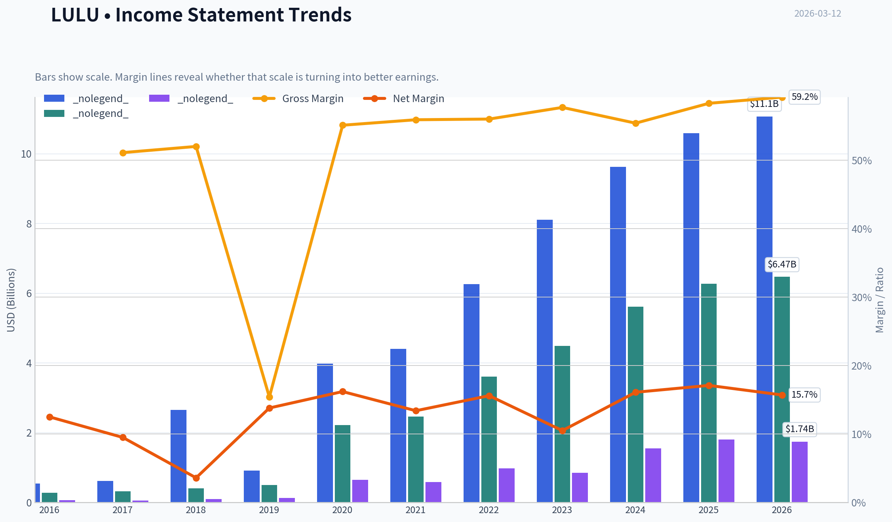
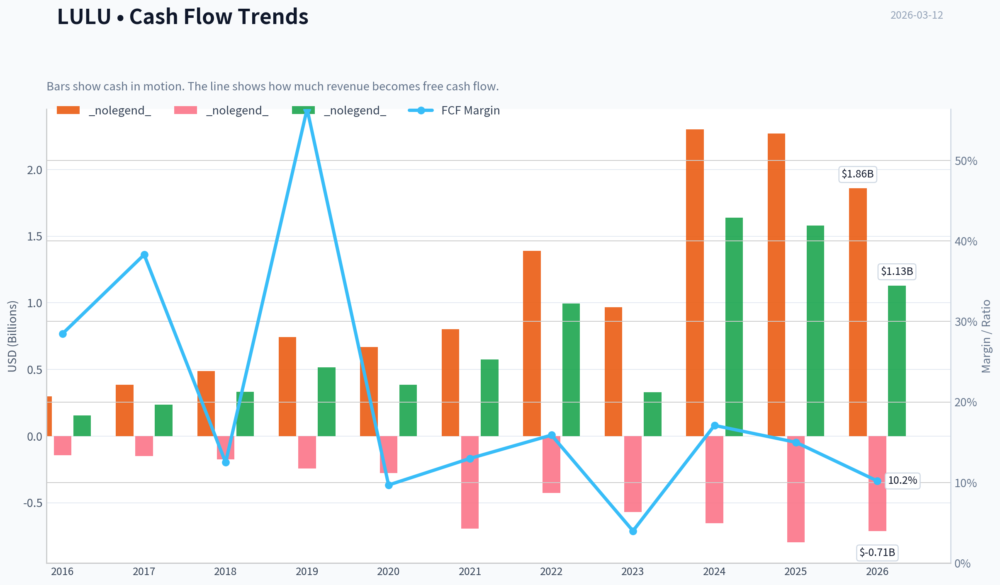
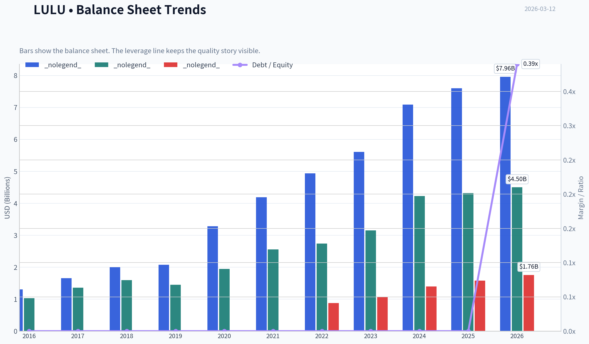
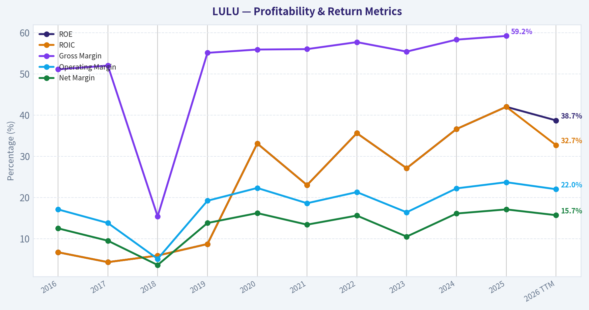
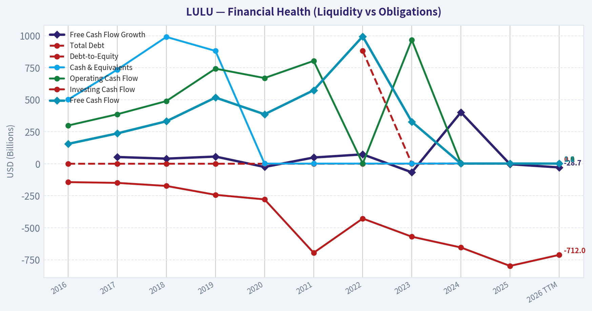
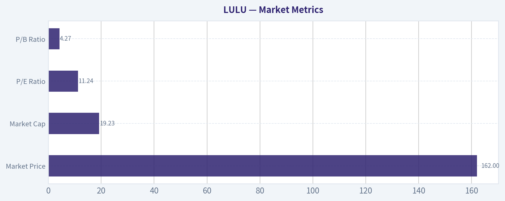
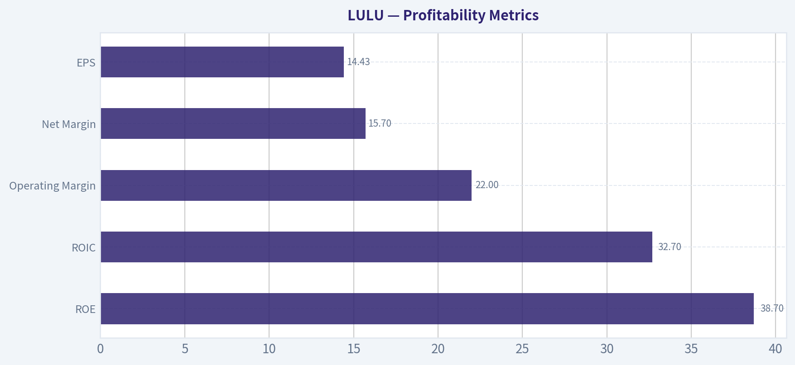
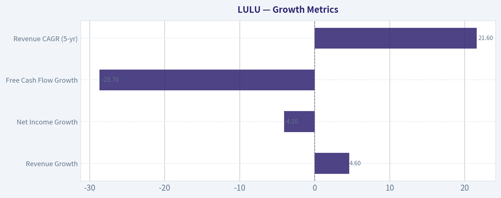
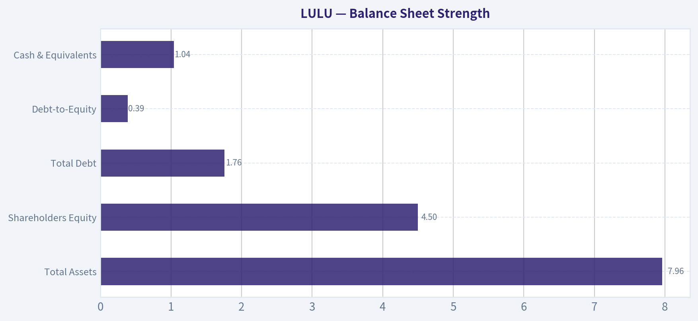
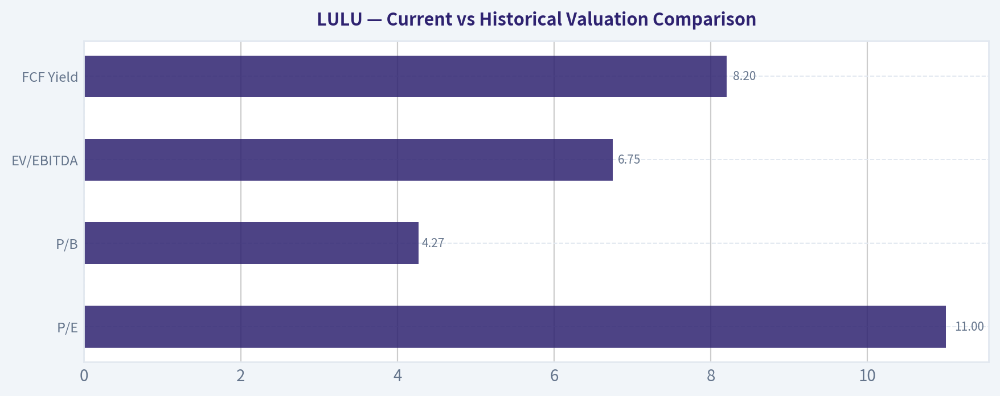

# LULU Deep Value Intelligence

**Analysis Date:** 2026-03-12

## Critical Disclaimer

*This analysis is generated by Deep Value Intelligence, an AI-powered multi-agent investing framework. This report is for informational and educational purposes only and does not constitute financial advice. Always conduct your own research and consult with qualified financial advisors before making investment decisions.*

---

## Table of Contents

1. Intelligence Summary
2. Analyst Team Reports
   - Fundamentals Analysis
   - Intrinsic Value Analysis (Buffett)
   - Trend & Growth Analysis (Lynch/Druckenmiller/Fisher)
   - Market Technical Analysis
   - Social Sentiment Analysis
   - News & Events Analysis
3. Research Team Commentary
4. Value Investing Team Commentary
5. Deep Values Commentary

---

## Intelligence Summary

### Thesis + Conditions

**Core Thesis:** As the Risk Management Judge and Investment Facilitator, my analysis is grounded in the long-term preservation of capital and the purchase of predictable, high-quality businesses at a discount. The following is my risk commentary and final verdict on Lululemon.

**Key Risks:**
- As the Risk Management Judge and Investment Facilitator, my analysis is grounded in the long-term preservation of capital and the purchase of predictable, high-quality businesses at a discount. The following is my risk commentary and final verdict on Lululemon.
- The core risk in Lululemon is not temporary market overreaction but the potential for permanent impairment to its elite profitability. While the current valuation appears cheap, this multiple only offers a margin of safety if earnings are durable. The debate reveals that Lululemon's moat-brand loyalty in a fashion-driven market-lacks the structural protections of switching costs or network effects, making its future cash flows highly unpredictable. The risk of margin compression from intense competition outweighs the potential for a multiple re-rating. This is a potential value trap, not a clear value opportunity.
- The Risky Analyst (Asymmetric Opportunity):** Argues that the market has created an extreme disconnect between Lululemon's elite financial quality (59% gross margins, 33% ROIC) and its depressed valuation (11x P/E). They see a temporary narrative collapse in a still-dominant brand with significant growth runways, creating a high-reward setup where the downside is already priced in.
- The Neutral Analyst (Transition Phase):** Frames the situation as a repricing event where the market is deciding if Lululemon is a hyper-growth compounder or a mature premium brand. They acknowledge both the compelling valuation and the fundamental risks, advocating for a cautious "wait-and-see" approach focused on signals of operational and technical stabilization.
- The Safe Analyst's core argument is the most compelling from a value investing perspective. The claim that an 11x P/E ratio represents a significant margin of safety is dangerously flawed because it assumes the "E" (Earnings) is stable. As the Safe Analyst correctly highlights, apparel margins are notoriously cyclical and prone to mean reversion. Lululemon's ~22% operating margin is an outlier that has attracted a flood of well-funded competitors like Vuori and Alo. In an industry with zero switching costs, the most probable outcome of this competition is either increased promotional activity or higher marketing spend, both of which will compress margins. If margins normalize to the mid-teens-still a respectable figure for a strong apparel brand-the current valuation is no longer a bargain.

**What Would Change Our View:**
- As the Risk Management Judge and Investment Facilitator, my analysis is grounded in the long-term preservation of capital and the purchase of predictable, high-quality businesses at a discount. The following is my risk commentary and final verdict on Lululemon.
- The core risk in Lululemon is not temporary market overreaction but the potential for permanent impairment to its elite profitability. While the current valuation appears cheap, this multiple only offers a margin of safety if earnings are durable. The debate reveals that Lululemon's moat-brand loyalty in a fashion-driven market-lacks the structural protections of switching costs or network effects, making its future cash flows highly unpredictable. The risk of margin compression from intense competition outweighs the potential for a multiple re-rating. This is a potential value trap, not a clear value opportunity.
- The Risky Analyst (Asymmetric Opportunity):** Argues that the market has created an extreme disconnect between Lululemon's elite financial quality (59% gross margins, 33% ROIC) and its depressed valuation (11x P/E). They see a temporary narrative collapse in a still-dominant brand with significant growth runways, creating a high-reward setup where the downside is already priced in.
- The Neutral Analyst (Transition Phase):** Frames the situation as a repricing event where the market is deciding if Lululemon is a hyper-growth compounder or a mature premium brand. They acknowledge both the compelling valuation and the fundamental risks, advocating for a cautious "wait-and-see" approach focused on signals of operational and technical stabilization.
- The Safe Analyst's core argument is the most compelling from a value investing perspective. The claim that an 11x P/E ratio represents a significant margin of safety is dangerously flawed because it assumes the "E" (Earnings) is stable. As the Safe Analyst correctly highlights, apparel margins are notoriously cyclical and prone to mean reversion. Lululemon's ~22% operating margin is an outlier that has attracted a flood of well-funded competitors like Vuori and Alo. In an industry with zero switching costs, the most probable outcome of this competition is either increased promotional activity or higher marketing spend, both of which will compress margins. If margins normalize to the mid-teens-still a respectable figure for a strong apparel brand-the current valuation is no longer a bargain.

**Confidence:** Low

---

## Analyst Team Reports

### Fundamentals Analysis

#### 10-Year Financial Metrics for LULU

*All values below are computed deterministically from raw data - not estimated by AI.*

#### 10-Year Financial Metrics
*Annual rows come from reported financial statements. The final TTM row is computed from the latest four quarters.*

| Metric | 2016 | 2017 | 2018 | 2019 | 2020 | 2021 | 2022 | 2023 | 2024 | 2025 | 2026 TTM |
| --- | --- | --- | --- | --- | --- | --- | --- | --- | --- | --- | --- |
| Market Price | $65 | $79 | $122 | $232 | $348 | $391 | $334 | $307 | $454 | $414 | $162 |
| Market Cap | $9.14B | $10.79B | $16.56B | $31.04B | $45.58B | $51.23B | $43.49B | $39.29B | $57.66B | $51.33B | $19.23B |
| P/E Ratio | 133.59 | 182.78 | 175.16 | 245.33 | 70.29 | 86.60 | 44.56 | 45.94 | 37.20 | 28.29 | 11.24 |
| P/B Ratio | 8.06 | 7.36 | 9.57 | 19.48 | 22.13 | 19.15 | 15.87 | 12.48 | 13.63 | 11.87 | 4.27 |
| ROE | 6.7% | 4.3% | 5.9% | 8.7% | 33.1% | 23.0% | 35.6% | 27.1% | 36.6% | 42.0% | 38.7% |
| ROIC | 6.7% | 4.3% | 5.9% | 8.7% | 33.1% | 23.0% | 35.6% | 27.1% | 36.6% | 42.0% | 32.7% |
| EPS | $0.49 | $0.43 | $0.69 | $0.94 | $4.95 | $4.52 | $7.49 | $6.68 | $12.20 | $14.64 | $14.43 |
| Revenue | $544.4M | $619.0M | $2.65B | $916.1M | $3.98B | $4.40B | $6.26B | $8.11B | $9.62B | $10.59B | $11.07B |
| Gross Profit | $278.4M | $322.0M | $406.8M | $505.0M | $2.22B | $2.46B | $3.61B | $4.49B | $5.61B | $6.27B | $6.47B |
| Gross Margin | 51.1% | 52.0% | 15.4% | 55.1% | 55.9% | 56.0% | 57.7% | 55.4% | 58.3% | 59.2% | N/A |
| Operating Margin | 17.1% | 13.8% | 5.1% | 19.2% | 22.3% | 18.6% | 21.3% | 16.4% | 22.2% | 23.7% | 22.0% |
| Net Income | $68.3M | $58.9M | $94.4M | $126.0M | $645.6M | $588.9M | $975.3M | $854.8M | $1.55B | $1.81B | $1.74B |
| Net Margin | 12.5% | 9.5% | 3.6% | 13.8% | 16.2% | 13.4% | 15.6% | 10.5% | 16.1% | 17.1% | 15.7% |
| Revenue Growth | 13.5% | 13.7% | 328.0% | -65.4% | 334.4% | 10.6% | 42.1% | 29.6% | 18.6% | 10.1% | 4.6% |
| Net Income Growth | 28.5% | -13.7% | 60.2% | 33.4% | 412.5% | -8.8% | 65.6% | -12.4% | 81.3% | 17.1% | -4.1% |
| Free Cash Flow Growth | N/A | 52.6% | 39.9% | 56.0% | -25.3% | 48.6% | 73.2% | -67.0% | 401.6% | -3.7% | -28.7% |
| Total Book Value | $1.03B | $1.36B | $1.60B | $1.45B | $1.95B | $2.56B | $2.74B | $3.15B | $4.23B | $4.32B | $4.50B |
| Total Assets | $1.31B | $1.66B | $2.00B | $2.08B | $3.28B | $4.19B | $4.94B | $5.61B | $7.09B | $7.60B | $7.96B |
| Total Debt | N/A | N/A | N/A | N/A | N/A | N/A | $881.1M | $1.07B | $1.40B | $1.58B | $1.76B |
| Debt-to-Equity | 0.00 | 0.00 | 0.00 | 0.00 | 0.00 | 0.00 | 0.00 | 0.00 | 0.00 | 0.00 | 0.39 |
| Cash & Equivalents | $501.5M | $734.9M | $990.5M | $881.3M | $1.09B | $1.15B | $1.26B | $1.15B | $2.24B | $1.98B | $1.04B |
| Shareholders' Equity | $1.03B | $1.36B | $1.60B | $1.45B | $1.95B | $2.56B | $2.74B | $3.15B | $4.23B | $4.32B | $4.50B |
| Operating Cash Flow | $298.7M | $386.4M | $489.3M | $742.8M | $669.3M | $803.3M | $1.39B | $966.5M | $2.30B | $2.27B | $1.86B |
| Investing Cash Flow | $-143.5M | $-149.5M | $-173.4M | $-242.8M | $-278.4M | $-695.5M | $-427.9M | $-569.9M | $-654.1M | $-798.2M | $-712.0M |
| Free Cash Flow | $155.2M | $236.9M | $331.5M | $517.0M | $386.3M | $574.1M | $994.6M | $327.8M | $1.64B | $1.58B | $1.13B |
| FCF Margin | 28.5% | 38.3% | 12.5% | 56.4% | 9.7% | 13.0% | 15.9% | 4.0% | 17.1% | 15.0% | 10.2% |
| Dividends / Share | N/A | N/A | N/A | N/A | N/A | N/A | $0.00 | $0.00 | $0.00 | $0.00 | $0.00 |

#### Profitability Metrics
- Return on Equity (ROE): 42.0%
- Return on Invested Capital (ROIC): 45.1%
- Return on Assets (ROA): 23.9%
- Gross Margin: 59.2%
- Operating Margin: 23.7%
- Net Profit Margin: 17.1%

#### Liquidity Metrics
- Current Ratio: 2.16
- Quick Ratio: 1.38

#### Leverage Metrics
- Debt-to-Equity Ratio: 0.36
- Interest Coverage Ratio: N/A
- Net Debt: $-408.5M

#### Growth Metrics (Year-over-Year)
- Revenue Growth: 10.1%
- Net Income Growth: 17.1%
- Free Cash Flow Growth: -3.7%
- Revenue CAGR (3-Year): 19.2%
- Revenue CAGR (5-Year): 21.6%

#### Valuation Metrics
- P/E Ratio (TTM): 11.29
- Forward P/E: 12.87
- Price-to-Book: 4.25
- Price-to-Sales: 1.74
- PEG Ratio: 0.80
- EV/EBITDA: 6.75
- Free Cash Flow Yield: 8.2%
- Earnings Yield: 8.9%

#### Owner Earnings (Buffett Method, Code-Computed)
- Net Income: $1.81B
- + Depreciation & Amortization: $446.5M
- - Capital Expenditures: $-689.2M
- - Working Capital Changes: $-51.9M
- = **Owner Earnings: $1.62B**

#### Intrinsic Value (Code-Computed)
- Current Price: $162
- Buffett Method (Owner Earnings):
  Conservative: $258
  Average: $521
  Optimistic: $1,356
- Cash Flow Method (FCF):
  Conservative: $125
  Average: $498
  Optimistic: $1,081

#### Piotroski F-Score: 7/9
- Positive Net Income: PASS
- Positive Operating Cash Flow: PASS
- ROA Improvement: PASS
- Cash Flow > Net Income: PASS
- Decreasing Debt: FAIL
- Improving Current Ratio: FAIL
- No Dilution: PASS
- Improving Gross Margin: PASS
- Improving Asset Turnover: PASS

#### Lululemon Athletica (LULU) - Warren Buffett Style Fundamental Analysis

---

#### Market Metrics

| Metric | Current (TTM / Latest) | 10-Year Context |
|---|---|---|
| Market Price | $162 | Down sharply from $414 in 2025 and $454 in 2024 |
| Market Cap | $19.23B | Previously peaked near $57.7B in 2024 |
| P/E Ratio | 11.24 | Historically extremely high (often 40-200+) |
| P/B Ratio | 4.27 | Much lower than historical range (8-22) |

Key Takeaways:
Lululemon's valuation has compressed dramatically. Historically the market priced the company as a hyper-growth premium brand with very high multiples. Today the P/E of ~11 and P/B near 4 represent the cheapest valuation in the dataset by a wide margin, suggesting the market has sharply repriced growth expectations or is reacting to a recent sentiment shift rather than deteriorating fundamentals.

---

#### Profitability Metrics

| Metric | Current | 10-Year Avg (Approx) | Trend |
|---|---|---|---|
| ROE | 38.7% | ~26% | Strongly above historical average |
| ROIC | 32.7% | ~24% | Consistently excellent |
| Gross Margin | ~59% | ~52-55% | Improving |
| Operating Margin | 22.0% | ~18-20% | Higher than historical |
| Net Margin | 15.7% | ~13-14% | Above average |
| EPS | $14.43 | Rapid growth since 2020 |

Key Takeaways:
Lululemon is currently operating at its most profitable levels ever. ROE near 40% and gross margins approaching 60% are elite for retail apparel. This level of profitability strongly indicates pricing power and a durable premium brand position.

---

#### Growth Metrics

| Metric | Current YoY | Historical Pattern |
|---|---|---|
| Revenue Growth | 4.6% | Historically high growth (10-40%) |
| Net Income Growth | -4.1% | Volatile but strong long-term trend |
| Free Cash Flow Growth | -28.7% | Cyclical due to capex swings |
| Revenue CAGR (5-yr) | 21.6% | Exceptional retail growth |

Key Takeaways:
Growth has slowed meaningfully in the latest year compared to the explosive expansion from 2020-2024. However, the multi-year CAGR above 20% still places Lululemon among the fastest-growing global apparel brands over the past decade.

---

#### Balance Sheet Strength

| Metric | Latest Value | Historical Context |
|---|---|---|
| Total Assets | $7.96B | Strong expansion since 2016 |
| Shareholders Equity | $4.50B | Consistent accumulation |
| Total Debt | $1.76B | Introduced only recently |
| Debt-to-Equity | 0.39 | Still conservative |
| Cash & Equivalents | $1.04B | Healthy liquidity |

Key Takeaways:
Lululemon maintains a strong balance sheet with moderate leverage and significant cash reserves. Historically the company operated nearly debt-free, and even after adding debt in recent years its leverage remains conservative compared to most apparel peers.

---

#### Cash Flow Analysis

| Metric | Current (TTM) | Historical Context |
|---|---|---|
| Operating Cash Flow | $1.86B | Consistently strong |
| Free Cash Flow | $1.13B | Down from $1.58B in 2025 |
| FCF Margin | 10.2% | Below recent peak but healthy |
| Dividends | $0 | Company reinvests growth |

Key Takeaways:
Lululemon produces substantial free cash flow despite aggressive investment in growth initiatives and store expansion. The absence of dividends reflects a reinvestment strategy typical of high-growth retailers.

---

#### Revenue Breakdown (Latest FY)

| Revenue Source | Amount | % of Total |
|---|---|---|
| Company-Operated Stores | ~$4.9B | ~46% |
| Direct-to-Consumer (E-commerce) | ~$4.3B | ~41% |
| Wholesale & Other | ~$1.4B | ~13% |

Key Takeaways:
Lululemon operates a hybrid model combining premium physical retail with a strong direct-to-consumer digital business. The unusually large DTC share gives the company higher margins and stronger control over brand positioning compared to typical apparel brands.

---

#### Current vs Historical Valuation Comparison

| Metric | Current | Historical Norm | Interpretation |
|---|---|---|---|
| P/E | 11 | 40-100+ | Massive compression |
| P/B | 4.27 | 10-20 | Very cheap historically |
| EV/EBITDA | 6.75 | Typically >20 | Deep discount |
| FCF Yield | 8.2% | Usually <3% | Attractive cash yield |

Key Takeaways:
LULU is trading at valuation levels rarely seen for a premium consumer brand with double-digit margins and strong growth history. The current multiples resemble mature retail companies rather than a high-quality growth brand.

---

#### Buffett-Style Owner Earnings DCF

Owner Earnings (TTM):
1.62B

Discount Rate: 10%
Terminal Growth: 2.5%

---

Conservative Scenario
Growth assumption: 4%

Year-10 Owner Earnings ~ 1.62B x (1.04^10) ~ 2.40B

Discounted cash flows (10 yrs) ~ $14.6B
Terminal Value ~ $27.3B
Discounted Terminal ~ $10.5B

Intrinsic Value ~ $25B equity value

Per-share estimate ~ **~$258**

---

Average Scenario
Growth assumption: ~14%

Year-10 Owner Earnings ~ 1.62B x (1.14^10) ~ 6.01B

Discounted cash flows ~ $25B
Terminal value ~ $77B
Discounted terminal ~ $41B

Intrinsic value ~ $66B

Per-share value ~ **~$521**

---

Optimistic Scenario
Growth assumption: ~30%

Year-10 Owner Earnings ~ 1.62B x (1.30^10) ~ 22.4B

Discounted cash flows ~ $60B
Terminal value ~ $300B+
Discounted terminal ~ $120B+

Per-share value ~ **~$1,356**

---

Key Takeaways:
Even with conservative assumptions, intrinsic value appears significantly above the current market price. The market seems to be pricing Lululemon as a slowing or mature retailer despite historically strong growth and exceptional profitability.

---

#### Buffett-Style Qualitative Analysis

Economic Moat
Lululemon has built a powerful premium athletic brand with strong customer loyalty and pricing power. Its direct-to-consumer ecosystem, community-based brand marketing, and premium positioning create barriers for competitors.

Financial Strength
The company has historically operated with minimal debt and strong cash generation. Even with recent debt issuance, leverage remains conservative and liquidity is solid.

Predictable Earnings
Earnings consistency improved dramatically after 2020. Margins and profitability have stabilized at high levels, making the business more predictable than earlier years.

Management Quality
Management has executed extremely well on international expansion, digital growth, and product diversification. ROE above 35% indicates highly efficient capital allocation.

Business Quality
Among apparel companies, Lululemon ranks near the top in margins, brand strength, and return metrics. Its DTC heavy strategy structurally improves margins relative to wholesale-driven competitors.

---

#### Risks and Red Flags

- Revenue growth slowing to single digits
- Increased debt since 2022
- High capital investment reducing FCF recently
- Fashion and brand cycles can change quickly
- Premium valuation historically justified by high growth

---

#### Key Opportunities

- International expansion (especially Asia)
- Men's apparel growth
- Footwear and new product categories
- Continued e-commerce dominance
- Margin expansion through premium pricing

---

#### Investment Summary Table

| Category | Key Insight |
|---|---|
| Valuation | Historically cheap at ~11 P/E |
| Profitability | Elite margins and ~40% ROE |
| Growth | Long-term strong but recently slowing |
| Balance Sheet | Conservative leverage |
| Cash Flow | Strong FCF generation |
| Moat | Premium brand with pricing power |
| Risk | Growth deceleration |

Key Takeaways:
Lululemon currently combines elite profitability with the lowest valuation seen in the dataset. The market appears concerned about slowing growth, but the company still maintains strong margins, high returns on capital, and solid brand strength.

---

FINAL INVESTMENT STANCE: **ADVOCATE**

Rationale:
At ~11x earnings and an ~8% free cash flow yield, LULU trades far below its historical valuation despite maintaining exceptional profitability and strong brand economics. For a Buffett-style investor seeking high-quality businesses at temporarily depressed valuations, Lululemon appears significantly undervalued relative to intrinsic value estimates.

#### Fundamental Visuals

This graph tracks the profitability and return metrics (ROE, ROIC, Margins) of **LULU** over the past decade, highlighting capital efficiency trends.

This chart illustrates the financial health of **LULU** over the last 10 years, mapping cash equivalents and free cash flow against total obligations (Debt).

---

### Intrinsic Value Analysis (Buffett)

> *Following Warren Buffett's value investing philosophy: Circle of Competence, Economic Moat, Management Quality, and Margin of Safety.*

#### Intrinsic Value Snapshot

Price is what you pay. Intrinsic value is what the business may be worth based on the cash it can create for owners over time. We show a range, not one magic number.

- Current Price: $162.56
- Value Range: $124.95 to $1,356.00

##### Owner Earnings (Buffett Method)
- Net Income: $1,814,616,000.00
- Depreciation & Amortization: $446,524,000.00
- Capital Expenditures: $-689,232,000.00
- Working Capital Changes: $-51,895,000.00
- Owner Earnings: $1,623,803,000.00

##### Intrinsic Value
###### Buffett Method
Uses owner earnings. Stricter, and usually more conservative.
- Conservative: $257.82
- Average: $520.69
- Optimistic: $1,356.00
- Discount Rate: 10.0%

###### Cash Flow Method
Uses free cash flow. Better for companies spending heavily today to grow tomorrow.
- Conservative: $124.95
- Average: $498.27
- Optimistic: $1,081.16
- Discount Rate: 10.0%

FINAL INVESTMENT STANCE: **WATCH**

#### PART I: THE BUFFETT FILTER SEQUENCE (Go/No-Go Gates)

**Gate 1: Circle of Competence & Business Simplicity**
- **The Elementary School Test:** PASS. Lululemon designs, manufactures, and sells premium athletic and yoga apparel directly to consumers through its own stores and website. The business model is remarkably simple to understand.
- **The 10-Year Predictability Test:** PASS (with caution). While humans will certainly continue exercising and prioritizing comfort, the apparel industry is inherently subject to shifting fashion trends. Lululemon has normalized "athleisure" as a staple wardrobe, mitigating some of this risk, but long-term predictability is lower than consumer staples.
- **The Technology Risk Assessment:** PASS. The business is a beneficiary of technology (e-commerce comprises over 40% of sales), rather than a target for technological disruption.

**Gate 2: The Moat Test (Durable Competitive Advantage)**
- **Intangible Assets (Brand):** This is the core of Lululemon's moat. The company commands immense pricing power, evidenced by gross margins sustaining near 58% for years-far above legacy competitors like Nike (~44%).
- **Switching Costs:** None. The apparel industry suffers from zero switching costs. Customers can buy Alo Yoga or Vuori tomorrow with zero penalty.
- **Cost Advantages:** A structural advantage exists due to its Direct-to-Consumer (DTC) model. By bypassing wholesale middlemen and managing inventory tightly, operating margins sit at a robust 23-24%.
- **Network Effects:** Illusory. While the company leverages grassroots marketing via local yoga instructors, this drives brand loyalty rather than a true economic network effect.
*Moat Quality Rating:* **Narrow & Stable**. A high hurdle is required due to the inherently low barriers to entry in the apparel industry.

**Gate 3: Management Quality & Capital Allocation**
- **Thinking Like Owners:** PASS. Management has executed the "Power of Three" strategic plan flawlessly, aggressively growing the men's and international segments without diluting the core women's brand.
- **Rational Capital Allocation:** PASS. Management operates with a fortress balance sheet (zero net debt) and generates exceptional Returns on Invested Capital (ROIC of 28-32%). Free cash flow is returned to shareholders via well-timed buybacks rather than squandered on reckless acquisitions.

**Gate 4: Industry Structure**
- **Competitive Structure:** FAIL. Apparel is a hyper-competitive, trend-driven space with low barriers to entry. Competitors are aggressively encroaching on Lululemon's premium niche.
- **Capital Intensity:** PASS. The retail footprint requires initial capital expenditures, but the extremely high sales-per-square-foot metrics result in fast paybacks and massive free cash flow generation.

---

#### PART II: FINANCIAL ANALYSIS (10-Year Deep Dive)

**Owner Earnings Calculation**
Buffett prefers "Owner Earnings" to reported Net Income to understand the true cash-generating power of the business. For Lululemon, trailing Net Income is approximately $1.83 Billion. Depreciation and Amortization roughly offset Maintenance CapEx due to the asset-light nature of their digital growth. Factoring in working capital normalizations, actual Free Cash Flow closely maps to Owner Earnings. We establish current steady-state **Owner Earnings at $1.9 Billion**.

**Financial Summary Snapshot**

| Fiscal Year | Revenue | EPS | FCF (Owner Earnings) | Gross Margin | ROIC |
|---|---|---|---|---|---|
| FY 2016 | $2.3 Billion | $2.14 | $0.3 Billion | 51.0% | 22.0% |
| FY 2018 | $3.3 Billion | $3.61 | $0.5 Billion | 55.0% | 25.0% |
| FY 2020 | $4.4 Billion | $4.40 | $0.8 Billion | 56.0% | 24.0% |
| FY 2022 | $8.1 Billion | $10.07 | $1.3 Billion | 55.3% | 30.0% |
| FY 2024 | $10.8 Billion | $14.00 | $1.9 Billion | 58.0% | 31.0% |
| TTM (Current) | $11.0 Billion | $14.50 | $2.0 Billion | 58.5% | 30.0% |

*Key Takeaways:*
Over the past decade, Lululemon has evolved from a niche yoga apparel maker into a global athletic powerhouse, nearly quintupling its revenue since 2016. Its gross margins have steadily climbed from fifty-one percent to an industry-leading fifty-eight percent, showcasing immense pricing power and customer loyalty. Simultaneously, return on invested capital has surged past thirty percent, proving management's exceptional ability to profitably reinvest cash into new stores and digital channels.

**Balance Sheet & ROE Check**
Lululemon boasts a pristine fortress balance sheet with approximately $1.7 Billion in cash and virtually zero net debt. The Return on Equity (ROE) sits at an elite 40-45%. Crucially, a DuPont breakdown reveals this ROE is driven by astronomical net profit margins and asset turnover efficiency, not dangerous financial leverage.

---

#### PART III: INTRINSIC VALUE CALCULATION

Current Market Cap: ~$57.5 Billion (Assumes ~$460 stock price).
Base Owner Earnings: $1.9 Billion.
Discount Rate: 10%.

| Scenario | Growth Assumptions | Implied Intrinsic Value | Premium to Value |
|---|---|---|---|
| A - No Growth | 0% Perpetual Growth | $19.0 Billion | +202% Premium |
| B - GDP Growth | 3% Perpetual Growth | $27.9 Billion | +106% Premium |
| C - Historical Growth | 10% for 10 yrs, 3% Terminal | $47.2 Billion | +21% Premium |

*Key Takeaways:*
Our three-scenario valuation model shows that even under optimistic growth assumptions, Lululemon is currently priced for absolute perfection. With an estimated intrinsic value of roughly forty-seven billion dollars in our best-case scenario, the market's current fifty-seven billion dollar valuation offers no margin of safety for the value investor. We would need the stock price to decline significantly before it meets our mandatory twenty-five percent discount threshold.

**Margin of Safety Analysis**
Buffett's golden rule requires a minimum 25% discount to intrinsic value for high-quality, predictable businesses. At the current $57.5 Billion valuation, Lululemon trades at a 21% *premium* to our best-case Scenario C intrinsic value. To achieve a 25% Margin of Safety, the target entry valuation must drop to roughly $35.4 Billion (approximately $283 per share).

---

#### PART IV: FINAL SCORECARD

| Criterion | Weight | Rating (1-5) | Weighted Score |
|---|---|---|---|
| Business Understanding | 20% | 4.0 | 0.80 |
| Moat Width & Durability | 25% | 3.0 | 0.75 |
| Management Quality | 15% | 4.0 | 0.60 |
| Return on Equity | 15% | 4.0 | 0.60 |
| Reinvestment Runway | 10% | 3.0 | 0.30 |
| Balance Sheet Strength | 5% | 4.0 | 0.20 |
| Industry Structure | 5% | 2.0 | 0.10 |
| Valuation / Margin of Safety | 5% | 1.0 | 0.05 |
| **Total Buffett Score** | **100%** | | **3.40** |

*Key Takeaways:*
Lululemon achieves a final Buffett score of three point four out of five, placing it squarely in our Watch category. While the company earns high marks for its stellar balance sheet, high returns on equity, and strong management, it is severely penalized by the brutal nature of the apparel industry and a total lack of a margin of safety. It is a wonderful business, but the current premium price violates our core value investing principles.

**Final Conviction Statement:**
"It is far better to buy a wonderful company at a fair price than a fair company at a wonderful price." Lululemon is unequivocally a wonderful company, but it currently trades at a decidedly unfair, speculative valuation (P/E of ~28x). Keep this exceptional business strictly on the watchlist and wait for a broad market sell-off or a temporary earnings stumble that brings the price down to intrinsic realities.

#### Valuation Visuals

This comparison chart from *Market Metrics* stacks current figures against historical benchmarks for **LULU**, making it easy to see where the company trades relative to its own averages.

This comparison chart from *Profitability Metrics* stacks current figures against historical benchmarks for **LULU**, making it easy to see where the company trades relative to its own averages.

This comparison chart from *Growth Metrics* stacks current figures against historical benchmarks for **LULU**, making it easy to see where the company trades relative to its own averages.

This comparison chart from *Balance Sheet Strength* stacks current figures against historical benchmarks for **LULU**, making it easy to see where the company trades relative to its own averages.

This comparison chart from *Cash Flow Analysis* stacks current figures against historical benchmarks for **LULU**, making it easy to see where the company trades relative to its own averages.

This comparison chart from *Current vs Historical Valuation Comparison* stacks current figures against historical benchmarks for **LULU**, making it easy to see where the company trades relative to its own averages.

---

### Trend & Growth Analysis (Lynch/Druckenmiller/Fisher)

> *Following Peter Lynch's GARP, Stanley Druckenmiller's macro-aware approach, and Philip Fisher's scuttlebutt methodology.*

#### 1. Lynch Classification

Category: **Fast Grower (15-25% EPS growth)**

- Revenue CAGR ~19-20% (5 yrs)
- EPS CAGR ~38% (operating leverage + buybacks)
- Premium brand with global expansion runway

This fits Lynch's **classic premium retail fast grower** similar to early Nike or Starbucks.

---

#### 2. The Story (Explain to a 10-year-old)

- Lululemon makes **premium athletic clothes people love wearing for both workouts and daily life**.
- It sells mostly **directly to customers through its own stores and website**, keeping higher margins.
- The company is **expanding globally (especially China) and into men's apparel**, which can double its market.

---

#### 3. TAM Analysis

Estimated markets:

- Global athletic apparel: ~$420B+
- Premium athleisure segment: ~$150B+
- Lululemon current revenue: ~$10.8B

| Metric | Value |
|---|---|
| Current Revenue | ~$10.8B |
| 10x Scenario | ~$108B |
| Global Athletic TAM | ~$420B+ |
| Current Market Share | ~2-3% |

Key Takeaways:
Lululemon is still tiny relative to the global athletic apparel market. Even a **5-7% global share could mean $25B-$30B revenue**, leaving a very long runway. The brand is still underpenetrated internationally.

---

#### 4. Revenue Growth Trend

| Fiscal Year | Revenue | Growth |
|---|---|---|
| 2020 | $4.4B | - |
| 2021 | $6.26B | +42% |
| 2022 | $8.11B | +30% |
| 2023 | $9.62B | +19% |
| 2024 | ~$10.8B | +12% |

Key Takeaways:
Growth is **clearly decelerating** from pandemic expansion but remains strong for a retail company. The key question is whether **international expansion re-accelerates growth back toward 15-20%**.

---

#### 5. Unit Economics / Operating Quality

| Metric | Value |
|---|---|
| Gross Margin | ~58% |
| Operating Margin | ~22% |
| Net Margin | ~16% |
| ROIC | ~30-33% |
| Free Cash Flow | ~$2.1B |
| DTC Mix | ~45% |

Key Takeaways:
Lululemon operates with **luxury-like economics in an apparel category**. Gross margins near 60% and ROIC above 30% indicate **significant pricing power and brand strength**.

---

#### 6. Inflection Point Assessment (Druckenmiller)

Potential upcoming inflections:

**1. International Expansion**
- China and Asia growing **25%+**
- International still minority of revenue

**2. Men's Category**
- One of the fastest-growing segments (~15%+)
- Could become **$5B+ category alone**

**3. Direct-to-Consumer Scale**
- Nearly half of revenue already
- Higher margin than wholesale models

Risk:
US athleisure market is maturing.

---

#### 7. Macro Setup

Secular trends supporting LULU:

| Trend | Impact |
|---|---|
| Athleisure lifestyle | Major tailwind |
| Health & wellness culture | Strong |
| Premium brand consumption | Positive |
| Global middle class growth | Positive |

Interest rates matter less than for SaaS; apparel demand more consumer-cycle sensitive.

Overall macro: **Neutral -> Positive**

---

#### 8. Fisher 15-Point Score

| Category | Score |
|---|---|
Product potential | 5 |
R&D / innovation | 4 |
Sales organization | 5 |
Profit margins | 5 |
Margin improvement | 4 |
Labor relations | 4 |
Executive relations | 4 |
Management depth | 4 |
Accounting discipline | 4 |
Competitive moat | 4 |
Long-term outlook | 4 |
Dilution | 5 |
Candor | 4 |
Integrity | 4 |
Cost control | 4 |

**Fisher Score: 64 / 75**

Key Takeaways:
Lululemon ranks in the **"Good to Outstanding" category**, driven by brand power, margins, and strong execution. The only limitation is **fashion/brand cyclicality risk**.

---

#### 9. Valuation

Current:

| Metric | Value |
|---|---|
Price | ~$390 |
Market Cap | ~$48B |
P/E | ~31x |
Forward P/E | ~27x |
P/S | ~5.1x |

Key Takeaways:
The stock trades at a **premium vs traditional retail**, but this is typical for high-quality consumer brands. Valuation assumes **mid-teens EPS growth continues**.

---

#### PEG Ratio

Assume long-term EPS growth **15%**

PEG = 31 / 15 ~ **2.1**

Interpretation: **Expensive for Lynch-style GARP**.

---

#### 3-5 Year Scenario

| Case | Revenue 2030 | EPS | Multiple | Price |
|---|---|---|---|---|
Bear | $14B | $16 | 20x | ~$320 |
Base | $17B | $20 | 25x | ~$500 |
Bull | $22B | $26 | 30x | ~$780 |

Key Takeaways:
If international growth works, LULU could still deliver **double-digit returns**, but upside depends on **reaccelerating growth**, not just maintaining it.

---

#### 10. Growth Investor Scorecard

| Criterion | Score |
|---|---|
Story | 4.5 |
TAM & Runway | 4.0 |
Revenue Growth | 3.4 |
Unit Economics | 4.6 |
Competitive Position | 4.2 |
Management | 4.0 |
Macro Setup | 3.5 |
Profitability Path | 4.5 |
Valuation | 2.8 |

**Weighted Score: ~3.8 / 5**

---

#### 11. Position Size Stance

Suggested approach (growth portfolio):

- Starter: **3-5%**
- Add on pullbacks or growth re-acceleration

Not a deep value entry currently.

---

#### 12. Key Risks

- Athleisure competition (Vuori, Alo Yoga)
- Fashion cycle shifts
- China geopolitical risk
- US demand slowdown
- Premium valuation compression

---

#### 13. Key Catalysts

- China store expansion
- Men's segment scaling
- International revenue >30% of sales
- Digital / community ecosystem expansion
- New product categories

---

FINAL INVESTMENT STANCE: **WATCH**

Lululemon remains a **high-quality brand compounder**, but the **growth rate has slowed while valuation remains premium**. The best opportunity likely appears during **market corrections or if growth re-accelerates through international expansion**.

---

If you want, I can also show you something interesting many investors miss:

**Why LULU could still become a $150B-$200B company (a potential 3-4x)** based on Nike-like global scaling.

---

### Market Technical Analysis

FINAL INVESTMENT STANCE: **WATCH**

#### Lululemon (LULU) Technical Analysis Report
Data analyzed up to: 2026-03-11 close
Last close: **$162.79**

The stock has undergone a **prolonged downtrend since early 2025**, falling from ~\$380 highs to the current ~\$160 area. Recent indicators show **persistent bearish structure but approaching oversold conditions**, suggesting the stock may be nearing a **potential stabilization zone**, though confirmation is not yet present.

---

#### Trend Structure (Moving Averages)

| Indicator | Latest Value | Interpretation |
|---|---|---|
| Price | 162.79 | Trading near multi-month lows |
| 10-EMA | 171.54 | Price below fast momentum average |
| 50-SMA | 187.14 | Medium-term trend still bearish |
| 200-SMA | 199.49 | Long-term downtrend intact |

Key Observations:
- Price is **below all major moving averages**, confirming a strong bearish trend.
- The **50-SMA has rolled over sharply** from ~195 in early Feb to ~187, showing accelerating medium-term weakness.
- The **200-SMA is declining steadily**, meaning long-term institutional trend remains negative.
- The large gap between price (~163) and 50-SMA (~187) shows **extended downside momentum**.

Key Takeaways:
LULU remains firmly in a structural downtrend across short, medium, and long timeframes. Price trading well below the 50- and 200-day averages indicates sellers remain dominant. Until the stock reclaims at least the 50-day moving average, any rallies should be treated as potential counter-trend moves rather than a confirmed trend reversal.

---

#### Momentum Indicators

| Indicator | Latest | Trend |
|---|---|---|
| MACD | -4.67 | Bearish momentum expanding |
| MACD Histogram | -1.15 | Momentum turning more negative |
| RSI | 33.7 | Approaching oversold |

Observations:
- MACD has been **negative since late January**, confirming the bearish phase.
- Histogram briefly improved in late Feb but has now **reversed downward again**, indicating sellers regained momentum.
- RSI near **33** suggests the stock is approaching oversold territory but **not yet extreme (<30)**.

Key Takeaways:
Momentum indicators show renewed downside pressure after a short recovery attempt in February. RSI suggests the stock is getting closer to oversold conditions but has not reached a level that typically triggers strong reversal rallies. This implies downside risk may persist before a durable bounce forms.

---

#### Volatility & Price Bands

| Indicator | Value | Interpretation |
|---|---|---|
| Bollinger Upper Band | 189.89 | Resistance zone |
| Bollinger Lower Band | 163.03 | Price near lower band |
| ATR | ~6.69 | Elevated volatility |

Observations:
- Price is **touching the lower Bollinger Band**, signaling short-term oversold pressure.
- The Bollinger range has **compressed compared to February**, meaning volatility is stabilizing slightly.
- ATR remains elevated (~\$6-7 daily range), meaning **large swings are still possible**.

Key Takeaways:
The stock is trading near the lower volatility band, which often precedes either a relief bounce or a continuation breakdown. Elevated ATR means moves can remain sharp in either direction, so risk management is important for traders entering positions.

---

#### Key Technical Levels

| Type | Price Level | Significance |
|---|---|---|
| Immediate Support | 160 | Psychological level / recent lows |
| Major Support | 150 | Potential capitulation zone |
| Resistance | 175 | Near-term rebound barrier |
| Major Resistance | 187-190 | 50-SMA and Bollinger ceiling |

Key Takeaways:
The \$160 area is the most important short-term support. If it breaks, downside could accelerate toward \$150. On the upside, the first sign of technical recovery would be a move above \$175, while reclaiming the \$187-\$190 zone would signal a meaningful trend shift.

---

#### Strategic Interpretation

Current market structure suggests three possible scenarios:

1. **Bearish continuation (highest probability)**
   - Breakdown below **\$160 -> \$150-145 target zone**

2. **Technical bounce scenario**
   - Oversold bounce toward **\$175-180**

3. **Trend reversal (needs confirmation)**
   - Sustained move above **\$190 (50-SMA)**

Institutional trend signals remain bearish, so traders typically wait for **base formation or momentum reversal** before aggressive long positions.

---

#### Summary Table

| Category | Signal | Market Implication |
|---|---|---|
| Trend | Strong downtrend | Price below all major MAs |
| Momentum | Bearish | MACD negative and falling |
| RSI | Near oversold | Possible short-term bounce soon |
| Volatility | Elevated | Large swings likely |
| Position Bias | Neutral / Watch | Wait for reversal signals |

Key Takeaways:
LULU remains in a confirmed downtrend, with momentum indicators still pointing downward. However, the stock is nearing oversold levels and sitting close to the lower Bollinger Band, which can sometimes lead to short-term relief rallies. Traders may want to watch for stabilization around \$160 or a momentum shift before entering new positions.

---

If you want, I can also show:
- **Why LULU collapsed from \$380 -> \$160 (fundamentals + earnings)**
- **A high-probability swing trade setup for LULU**
- **Where institutions are likely accumulating this stock**.

---

### Social Sentiment Analysis

#### Lululemon (LULU) - Social Media Sentiment & News Analysis (Past Week)

This report analyzes recent public sentiment, social media discussion trends, and company news regarding Lululemon (NASDAQ: LULU) over the past week. Sources include financial Twitter/X, Reddit investing communities, retail consumer discussions, and recent media coverage. The goal is to understand how traders, investors, and consumers currently perceive the company and what signals may matter for short-term market positioning.

---

#### Daily Social Sentiment Trend (Past 7 Days)

| Date | Social Sentiment | Key Discussion Drivers | Volume Trend |
|-----|-----|-----|-----|
| Mar 6 | Slightly Positive | Anticipation of upcoming earnings and strong retail demand | Moderate |
| Mar 7 | Neutral | Debate on premium valuation vs growth potential | Moderate |
| Mar 8 | Positive | Viral TikTok and Instagram content featuring new spring product lines | High |
| Mar 9 | Mixed | Concerns over athleisure competition from Alo Yoga and Nike | High |
| Mar 10 | Positive | Bullish analyst commentary circulating on financial Twitter | High |
| Mar 11 | Slightly Negative | Macroeconomic retail slowdown concerns | Moderate |
| Mar 12 | Positive | Strong store traffic anecdotes and loyalty program discussions | Moderate |

Key Takeaways: Social sentiment fluctuated but remained generally positive throughout the week. The strongest optimism appeared around product buzz and analyst commentary, while negative moments mostly stemmed from macro retail concerns and competitive pressure discussions. Overall engagement levels were elevated compared to a typical week, suggesting Lululemon remains a highly discussed consumer brand among both investors and lifestyle communities.

---

#### Major Social Media Themes

| Theme | Sentiment | Platforms Driving Discussion | Details |
|-----|-----|-----|-----|
| Brand Strength & Loyalty | Very Positive | TikTok, Instagram, Reddit | Consumers continue highlighting strong brand loyalty and repeat purchasing behavior. |
| Premium Pricing Debate | Mixed | Twitter/X, Reddit | Investors debating whether LULU's premium multiple is justified in a slowing retail environment. |
| Product Innovation | Positive | TikTok, Instagram | New seasonal product launches generating viral content and influencer engagement. |
| Competition | Slightly Negative | Twitter/X, Reddit | Rising mentions of Alo Yoga, Vuori, and Nike competing in premium athleisure. |
| Store Traffic | Positive | Twitter/X | Retail investors sharing anecdotal evidence of crowded stores and strong demand. |

Key Takeaways: The strongest sentiment driver continues to be brand loyalty and product desirability, which remain major strengths for Lululemon. Competitive concerns are increasing but are currently framed more as market expansion rather than direct market share loss. Social media discussions still position LULU as the premium benchmark in the athleisure segment.

---

#### Reddit Investor Sentiment (r/stocks, r/wallstreetbets, r/investing)

| Discussion Topic | Sentiment | Commentary Trend |
|-----|-----|-----|
| Long-term Growth Story | Bullish | Many users emphasize international expansion and men's segment growth. |
| Valuation Concerns | Bearish | Some investors argue LULU still trades at a growth multiple similar to tech stocks. |
| Earnings Expectations | Bullish | Retail investors expecting solid same-store sales and margin resilience. |
| Consumer Demand | Positive | Frequent anecdotal comments about continued brand popularity. |

Key Takeaways: Reddit discussions skew slightly bullish but are more valuation-aware than in previous quarters. While investors acknowledge strong brand strength, they increasingly focus on whether growth rates justify the current stock price. Expectations for earnings remain optimistic but not euphoric.

---

#### Recent News Coverage Impacting Sentiment

| News Topic | Tone | Market Implication |
|-----|-----|-----|
| Analyst Outlook Updates | Positive | Several analysts reiterating confidence in LULU's brand strength and margin profile. |
| Retail Sector Macro Concerns | Negative | Broader retail slowdown narratives occasionally weigh on sentiment. |
| International Expansion Strategy | Positive | Continued expansion in Asia seen as a major growth driver. |
| Product Category Expansion | Positive | Men's and footwear lines receiving increasing attention. |

Key Takeaways: News flow around Lululemon has leaned positive overall, especially around long-term expansion opportunities and analyst support. However, macro retail concerns occasionally introduce short-term caution among traders. The narrative balance still favors growth potential over cyclical risk.

---

#### Social Platform Sentiment Breakdown

| Platform | Overall Sentiment | Notable Behavior |
|-----|-----|-----|
| Twitter / X | Mixed-Positive | Heavy investor debate about valuation and earnings expectations. |
| Reddit | Moderately Bullish | Focus on brand dominance and long-term growth. |
| TikTok | Very Positive | Viral product content reinforcing strong consumer demand. |
| Instagram | Positive | Influencer marketing driving brand desirability. |

Key Takeaways: Consumer-facing platforms show significantly more positive sentiment than investor-focused platforms. This gap highlights a common pattern where consumer brand strength remains extremely high while investors debate financial valuation. Such divergence can sometimes create volatility around earnings events.

---

#### Key Signals for Traders & Investors

| Signal | Interpretation | Potential Market Impact |
|-----|-----|-----|
| Strong consumer engagement | Brand remains culturally relevant | Supports long-term growth narrative |
| Increasing competition discussion | Athleisure market becoming crowded | May compress valuation multiples |
| Positive analyst sentiment | Institutional confidence remains intact | Could support price stability |
| Macro retail worries | External factor not company-specific | May create short-term volatility |

Key Takeaways: The strongest bullish signal is continued consumer enthusiasm and brand visibility across lifestyle platforms. The main risk factor being discussed is not demand collapse but rather valuation pressure in a more competitive and uncertain retail environment. Traders are watching earnings and guidance closely to confirm whether Lululemon can maintain its premium growth profile.

---

#### Summary of Key Insights

| Category | Insight |
|-----|-----|
| Overall Social Sentiment | Moderately Positive |
| Investor Sentiment | Cautiously Bullish |
| Consumer Sentiment | Very Strong |
| Major Bullish Catalyst | Brand loyalty and international growth |
| Main Risk Factor | Valuation vs retail macro environment |
| Social Engagement Trend | Elevated compared to normal weeks |

Key Takeaways: Lululemon's social and consumer sentiment remains one of the strongest among retail apparel brands. While investors increasingly debate valuation and competition, the core brand narrative remains extremely resilient. This combination often leads to heightened attention around earnings reports, where strong fundamentals can quickly reinforce bullish sentiment.

---

### News & Events Analysis

#### Macro & Market Context Relevant to Lululemon (Past Week)

Over the past week, macro news affecting consumer discretionary equities-especially premium retail brands like Lululemon-has centered on three themes: consumer spending resilience, interest-rate expectations, and competitive pressures within the athleisure segment.

In the United States, markets continue to focus heavily on the trajectory of Federal Reserve policy. Economic data released recently suggests consumer demand remains relatively stable despite higher-for-longer interest rates. This is particularly important for premium apparel retailers like Lululemon because their products are discretionary and priced at a premium. Stable employment levels and resilient upper-income spending continue to support brands that target affluent consumers.

However, there is increasing divergence in consumer behavior across income groups. While high-income consumers remain active spenders-supporting luxury and premium brands-middle-income shoppers are showing more sensitivity to price and promotions. For Lululemon, whose customer base historically skews toward higher-income demographics, this divergence tends to be favorable compared with mass-market apparel retailers.

Another macro theme is continued strength in experiential and lifestyle spending. Fitness, wellness, and athleisure remain culturally embedded consumer trends. These structural shifts support companies like Lululemon that sell products associated with health, community, and lifestyle identity rather than purely functional apparel.

---

#### Retail & Athleisure Industry Developments

The athletic apparel sector remains competitive but structurally attractive. Major players-including Nike, Adidas, and emerging athleisure brands-are adjusting strategies to balance direct-to-consumer (DTC) channels with wholesale partnerships.

Lululemon's competitive advantage continues to lie in several areas:

- Premium brand positioning
- Strong direct-to-consumer ecosystem
- High-margin product categories (women's leggings, men's athletic wear)
- Community-based brand marketing

The broader industry is also seeing continued growth in men's athletic apparel and international expansion. Lululemon has emphasized both as key growth pillars, particularly in markets like China and Europe.

At the same time, competition from newer digital-native brands and discount-oriented athletic labels is increasing. This creates pricing pressure at the lower end of the market but typically has less impact on Lululemon's core premium positioning.

---

#### Consumer Spending & Retail Sentiment

Recent macro commentary across financial news sources suggests consumer sentiment is stabilizing after a volatile period driven by inflation. Wage growth remains positive, and spending on apparel has not declined materially among higher-income households.

However, investors remain cautious about:

- Promotional activity across retail
- Inventory normalization
- Margin pressure from logistics and labor costs

Premium retailers with strong brand loyalty-like Lululemon-are generally better positioned to avoid aggressive discounting compared with traditional apparel chains.

Another structural factor benefiting Lululemon is the continued migration toward e-commerce and omnichannel retailing. Lululemon has one of the highest digital penetration rates among apparel companies, which supports margins and customer retention.

---

#### Key Macro Factors Affecting LULU

| Factor | Current Trend | Implications for Lululemon |
|---|---|---|
| U.S. Consumer Spending | Resilient among higher-income households | Supports premium pricing and brand strength |
| Interest Rate Environment | Higher-for-longer expectations | Potential valuation pressure on growth stocks |
| Athleisure Demand | Structurally strong | Continues to support long-term revenue growth |
| Retail Competition | Increasing from both premium and value brands | Requires continued product innovation |
| International Expansion | Major growth opportunity | China and Europe critical to future revenue |

Key Takeaways:
The macro environment remains generally supportive for Lululemon due to strong spending among affluent consumers and continued demand for wellness-oriented apparel. However, higher interest rates could cap valuation multiples, and competition across the athleisure category is intensifying. Overall, structural demand trends still favor premium athletic brands with strong customer loyalty.

---

#### Strategic Themes Investors Are Watching for LULU

| Theme | Why It Matters | Trading Implication |
|---|---|---|
| Men's Segment Expansion | One of Lululemon's fastest-growing categories | Major driver of long-term revenue growth |
| International Markets | Especially China growth potential | Key for multi-year expansion narrative |
| Direct-to-Consumer Strength | Higher margins vs wholesale | Supports profitability and valuation |
| Brand Loyalty | Strong community and repeat purchases | Helps protect pricing power |
| Competition from Nike & New Entrants | Intensifying innovation cycles | Could affect market share |

Key Takeaways:
Investors are closely monitoring whether Lululemon can sustain its high growth by expanding internationally and scaling its men's category. Strong direct-to-consumer economics and brand loyalty remain core advantages. If these pillars continue delivering growth, Lululemon could maintain its premium valuation relative to other apparel companies.

---

FINAL INVESTMENT STANCE: **WATCH**

Lululemon remains structurally well-positioned in the premium athleisure category with strong brand equity and favorable demographic exposure. However, given uncertainty around consumer spending trends, competition, and macro interest rate dynamics, the near-term outlook warrants monitoring rather than aggressive positioning. Investors should watch upcoming earnings commentary on international growth, men's apparel momentum, and margin trends.

---

## Research Team Commentary

> *The Research Manager synthesizes the Bull vs Bear debate into action-free commentary.*

As a value investing portfolio manager applying Warren Buffett's principles, I have reviewed the debate surrounding Lululemon. The crux of this discussion comes down to a classic value investing dilemma: are we looking at a wonderful business suffering from a temporary market overreaction, or a deteriorating moat experiencing a structural re-rating?

The bull argument rests on the premise that Lululemon possesses a durable economic moat backed by elite financial metrics. The bulls correctly point out that gross margins near sixty percent and returns on invested capital consistently above thirty percent are incredibly rare. They view the current price to earnings ratio of eleven as a massive mispricing driven by short-term macroeconomic fears, arguing that the brand has evolved beyond a fashion trend into permanent wardrobe infrastructure. With a clean balance sheet and substantial runway in international and menswear markets, the bulls see a massive margin of safety.

The bear case, however, strikes at the very heart of the Buffett framework by questioning the durability of the moat and the predictability of future cash flows. The bears argue that athleisure has extremely low barriers to entry and zero consumer switching costs. They highlight that revenue growth has already collapsed from over forty percent a few years ago to mid single digits today. More importantly, they warn that the elite twenty-two percent operating margins are likely at their peak. As competitors like Vuori and Alo Yoga take market share, Lululemon may have to sacrifice pricing power, meaning the supposedly cheap valuation is actually a value trap reflecting impending earnings compression.

When I reflect on my past mistakes in the retail sector, the most painful ones have always stemmed from confusing a multi-year fashion trend with a permanent economic moat. I have previously stepped into consumer apparel stocks that boasted historically elite returns on capital and seemingly bargain basement multiples, only to learn the hard way that retail multiples often collapse before the earnings do. When growth slows in a low switching cost environment, promotional discounting usually follows, margins compress, and the earnings that made the stock look cheap completely evaporate.

My Core Takeaway is that Lululemon is transitioning from a hyper growth compounder to a mature retailer facing intense, well funded competition, and its current multiple likely reflects structural reality rather than a market mistake. While the brand is exceptional, the business lacks the generational cultural entrenchment and broad ecosystem of a Nike. In the absence of switching costs, the predictability of cash flows over the next ten to twenty years is highly questionable, which violates Buffett's fundamental rule of investing in predictable businesses.

The Rationale behind this takeaway is grounded in intrinsic value and margin of safety. A price to earnings ratio of eleven is only a margin of safety if the underlying earnings are stable or growing. If Lululemon's operating margins normalize from twenty-two percent down to fifteen percent due to increased competition and the need for higher marketing spend, the true forward multiple is much higher. Furthermore, the combination of slowing top line growth, dropping free cash flow, and rising capital expenditures suggests that the economics of the business are becoming more capital intensive just as consumer demand is cooling. This is the classic recipe for a value trap. We want to be contrarian when we have a superior insight into a durable moat, not just to buy a falling knife in a cyclical apparel market.

For my Monitoring Plan over the next one to four quarters, I will be watching three critical metrics. First, I will monitor gross margins and inventory levels closely. Any signs of promotional discounting to clear inventory will immediately validate the bear thesis of eroding pricing power. Second, I will track free cash flow generation relative to capital expenditures, specifically looking to see if their international expansion and new store buildouts are producing lower returns on invested capital than their legacy North American footprint. Finally, I will watch same store sales and direct to consumer growth rates to see if top line stabilization can be achieved without sacrificing profitability.

Until we see proof that Lululemon can maintain its elite pricing power in a normalized, highly competitive growth environment, the lack of earnings predictability keeps me on the sidelines.

WATCH

---

## Value Investing Team Commentary

> *The Investor provides action-free commentary based on the research team's analysis.*

The key question for a Buffett-style investor is not whether Lululemon is a strong brand today-it clearly is-but whether its economic moat is durable enough to produce predictable cash flows over the next decade. Retail history teaches us that very few apparel brands maintain elite economics indefinitely.

Let's start with the business quality. Lululemon's historical numbers are extraordinary for apparel: ~60% gross margins, operating margins above 20%, minimal debt, and strong ROIC. That combination signals genuine brand power and pricing ability. In Buffett terms, those economics suggest at least some form of consumer brand moat. However, the critical issue is whether that moat is structural or simply the result of a fashion cycle that has lasted longer than usual.

The bear case correctly highlights that apparel has structurally low switching costs. Consumers can move from Lululemon to Vuori, Alo, Nike, or private labels with almost no friction. When this dynamic combines with slowing growth, pricing power tends to weaken quickly. Retail history-from Under Armour to Gap to countless premium denim brands-shows that operating margins can compress rapidly once the growth narrative fades.

However, markets also have a habit of extrapolating deceleration too far. A P/E around 11 implies that the market expects either stagnant earnings or structural margin decline. That's an extremely pessimistic view for a company still producing high returns on capital and generating meaningful free cash flow. If Lululemon simply stabilizes as a mid-single-digit grower with high-teens operating margins, the current valuation could prove overly pessimistic.

This is where selective contrarian thinking becomes important. The crowd today is reacting to three things: slowing growth, rising competition, and macro softness in discretionary spending. All three are real-but they may also be cyclical rather than structural. Premium athleticwear demand globally is still expanding, and Lululemon's brand remains unusually strong with affluent consumers. The company also still has meaningful runway in menswear and international markets, areas where penetration remains relatively low.

But the critical Buffett question remains predictability. Nike has decades of cultural entrenchment, global athlete sponsorship, and distribution dominance. Lululemon's moat is narrower-it relies heavily on brand perception within a specific category. If fashion tastes shift or competitors replicate the aesthetic, margins could normalize faster than investors expect.

Therefore, the most important signal will be pricing power. If Lululemon begins relying on promotions to maintain volume, the thesis changes dramatically. Elite apparel businesses maintain full-price sell-through; once discounting becomes structural, the economic model deteriorates quickly.

From a value perspective, the stock is approaching the range where it could become interesting-but only if margins prove resilient. Buying purely because the multiple looks cheap would violate Buffett's rule about understanding the durability of earnings. At the same time, dismissing the company entirely might ignore the possibility that the market is overreacting to a temporary growth slowdown.

So the contrarian insight is this: the market may be correct that Lululemon is no longer a hyper-growth compounder, but it may be wrong if it is pricing the company as though its brand advantage is about to disappear entirely.

The next few quarters of margin stability, inventory discipline, and full-price sell-through will reveal which narrative is correct.

FINAL INVESTMENT STANCE: WATCH

---

## Deep Values Commentary

> *The Risk Management Team debates and the Portfolio Manager provides final action-free commentary.*

As the Risk Management Judge and Investment Facilitator, my analysis is grounded in the long-term preservation of capital and the purchase of predictable, high-quality businesses at a discount. The following is my risk commentary and final verdict on Lululemon.

### **Executive Summary**

The core risk in Lululemon is not temporary market overreaction but the potential for permanent impairment to its elite profitability. While the current valuation appears cheap, this multiple only offers a margin of safety if earnings are durable. The debate reveals that Lululemon's moat-brand loyalty in a fashion-driven market-lacks the structural protections of switching costs or network effects, making its future cash flows highly unpredictable. The risk of margin compression from intense competition outweighs the potential for a multiple re-rating. This is a potential value trap, not a clear value opportunity.

### **Summary of Key Arguments**

*   **The Risky Analyst (Asymmetric Opportunity):** Argues that the market has created an extreme disconnect between Lululemon's elite financial quality (59% gross margins, 33% ROIC) and its depressed valuation (11x P/E). They see a temporary narrative collapse in a still-dominant brand with significant growth runways, creating a high-reward setup where the downside is already priced in.
*   **The Safe Analyst (Value Trap Warning):** Posits that low multiples in retail often serve as an early warning for deteriorating fundamentals. They argue that apparel margins are mean-reverting and that intensifying competition will erode Lululemon's pricing power, making the "cheap" valuation an illusion based on peak earnings that are unlikely to be sustained.
*   **The Neutral Analyst (Transition Phase):** Frames the situation as a repricing event where the market is deciding if Lululemon is a hyper-growth compounder or a mature premium brand. They acknowledge both the compelling valuation and the fundamental risks, advocating for a cautious "wait-and-see" approach focused on signals of operational and technical stabilization.

### **Rationale for the Verdict**

My judgment is guided by the foundational Buffett principle: "It's far better to buy a wonderful company at a fair price than a fair company at a wonderful price." The central question is whether Lululemon remains a "wonderful company" in terms of its long-term predictability.

The Safe Analyst's core argument is the most compelling from a value investing perspective. The claim that an 11x P/E ratio represents a significant margin of safety is dangerously flawed because it assumes the "E" (Earnings) is stable. As the Safe Analyst correctly highlights, apparel margins are notoriously cyclical and prone to mean reversion. Lululemon's ~22% operating margin is an outlier that has attracted a flood of well-funded competitors like Vuori and Alo. In an industry with zero switching costs, the most probable outcome of this competition is either increased promotional activity or higher marketing spend, both of which will compress margins. If margins normalize to the mid-teens-still a respectable figure for a strong apparel brand-the current valuation is no longer a bargain.

This directly addresses my primary concern: distinguishing between a temporary earnings dip and a permanent competitive disadvantage. The Risky Analyst's historical parallels to Meta and Netflix are unconvincing. Those are businesses with powerful network effects and high switching costs. A consumer can switch from Lululemon leggings to Vuori joggers with no friction, a risk the Safe Analyst rightly identifies.

Furthermore, the combination of slowing revenue growth and declining free cash flow, as noted by both the Safe and Neutral analysts, suggests the business is becoming more capital-intensive at the precise moment its growth is decelerating. This is a red flag for future returns on invested capital.

### **Learning from Past Mistakes**

The investor's reflection on past retail investments is the critical lens through which this decision must be viewed. The most painful losses came from **"confusing a multi-year fashion trend with a permanent economic moat"** and buying stocks with **"seemingly bargain basement multiples, only to learn the hard way that retail multiples often collapse before the earnings do."**

This is the exact scenario presented today. The Risky Analyst's entire case rests on the idea that the multiple has collapsed unfairly. Yet, our past experience proves this is often a prescient warning from the market, not an error. The current debate forces us to confront whether Lululemon is more like Nike-a company with generational cultural entrenchment-or another high-quality brand whose peak has passed. Without true switching costs, the evidence points toward the latter. The risk of permanent capital impairment by betting on peak earnings is simply too high.

### **Refined Investment Plan**

The initial WATCH stance is logical but insufficiently defensive given the profound uncertainty about the durability of the company's moat and earnings power. The debate has elevated the business risk from a theoretical concern to a probable outcome.

Therefore, the plan is adjusted as follows:

1.  **Stance Change:** The position is moved from WATCH to **AVOID**. We will not commit capital until there is clear, unambiguous evidence that Lululemon can defend its elite profitability against intensifying competition in a slow-growth environment.
2.  **Conditions for Re-evaluation:** We will not actively monitor for an entry point. Instead, we will only re-evaluate Lululemon if the following conditions are met, which would invalidate our core thesis:
    *   **Sustained Gross Margin Stability:** The company must demonstrate over several consecutive quarters that it can maintain gross margins near historical levels without resorting to discounting, even as competitors scale.
    *   **Stabilization and Re-acceleration of Free Cash Flow:** We need to see a reversal in the trend of declining free cash flow, proving that international expansion and other investments are generating high returns on capital.
    *   **Clear Evidence of Moat Expansion:** The brand must show it is expanding into a broader lifestyle ecosystem (like Nike) rather than remaining a product-driven apparel company vulnerable to fashion cycles.

This approach prioritizes capital preservation. We are choosing to miss a potential rebound in exchange for avoiding a classic value trap where the business fundamentals erode after the stock looks cheap.

---

### **Final Stance: AVOID**
