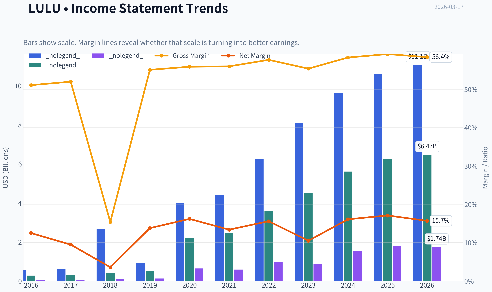
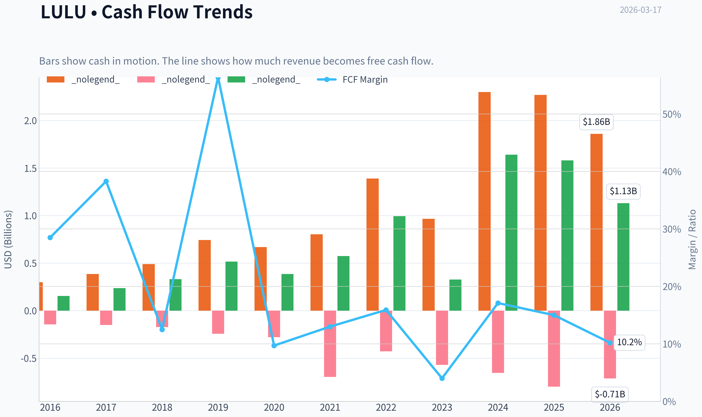
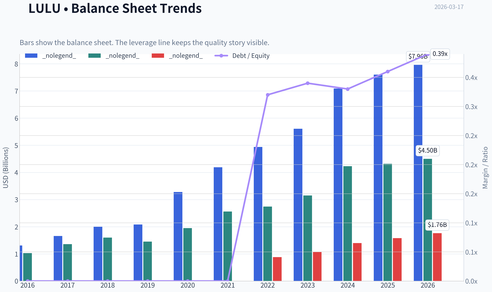
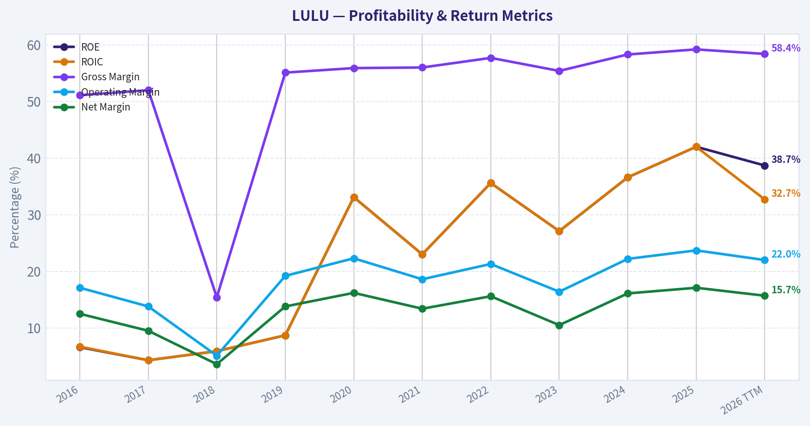
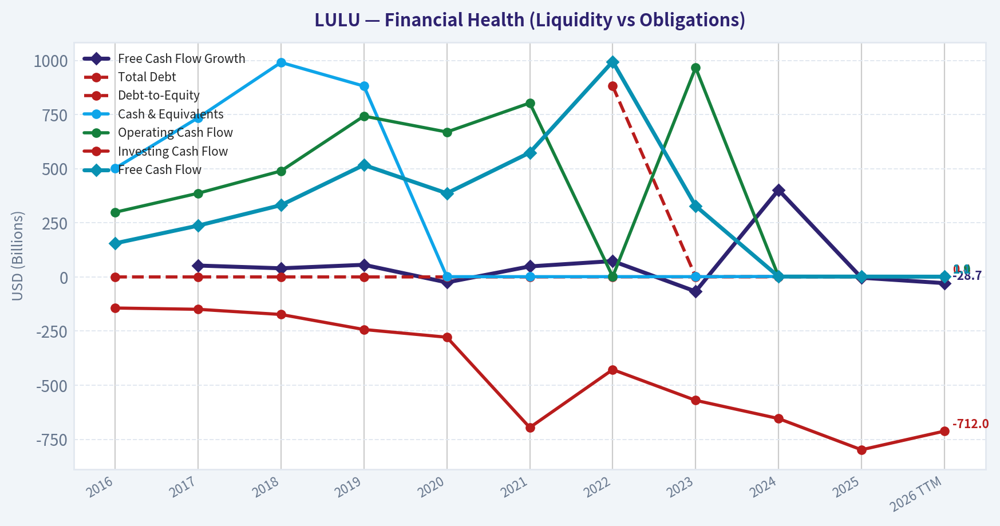
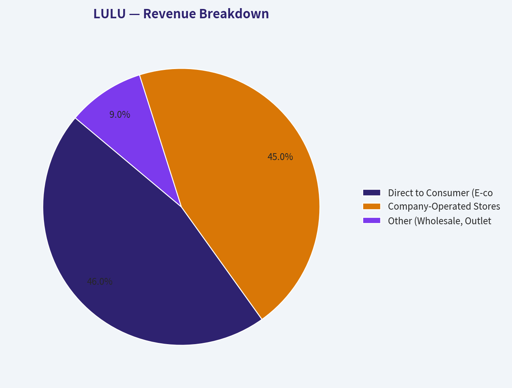
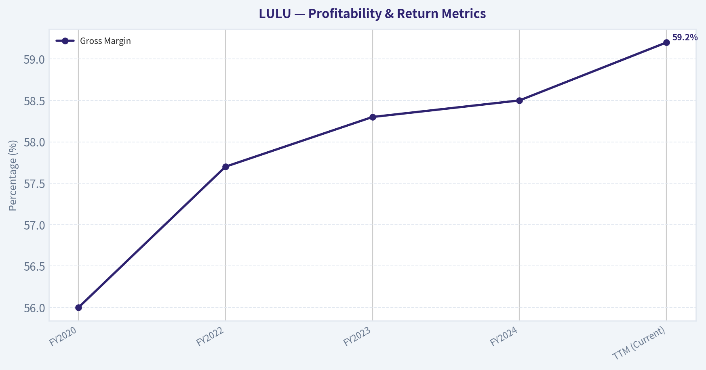
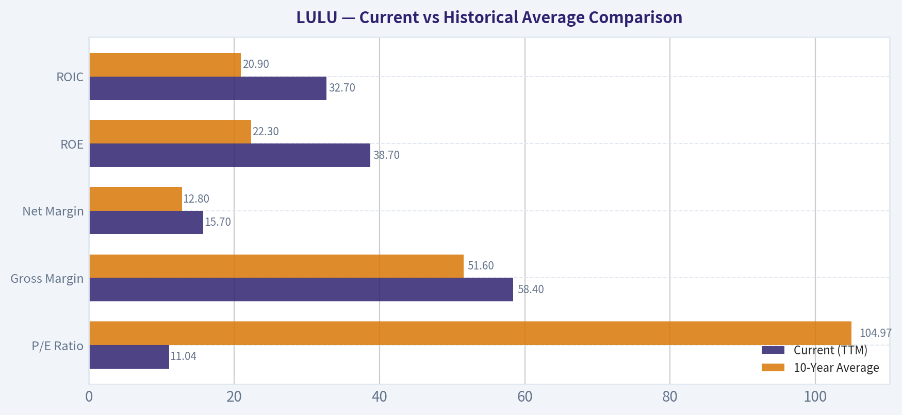
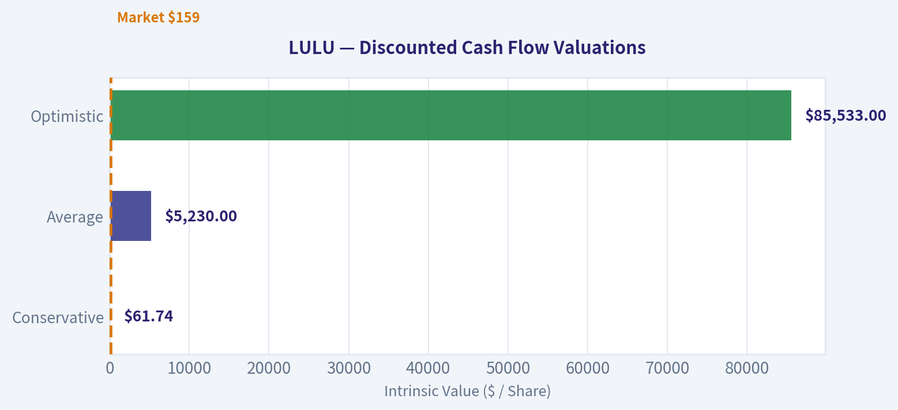
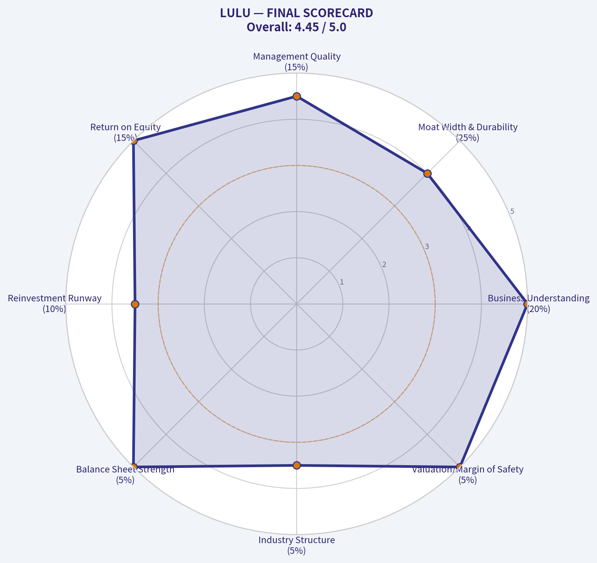

# LULU Deep Value Intelligence

**Analysis Date:** 2026-03-17

## Critical Disclaimer

*This analysis is generated by Deep Value Intelligence, an AI-powered multi-agent investing framework. This report is for informational and educational purposes only and does not constitute financial advice. Always conduct your own research and consult with qualified financial advisors before making investment decisions.*

---

## Table of Contents

1. Intelligence Summary
2. Analyst Team Reports
   - Fundamentals Analysis
   - Intrinsic Value Analysis (Buffett)
   - Trend & Growth Analysis (Lynch/Druckenmiller/Fisher)
   - Market Technical Analysis
   - Social Sentiment Analysis
   - News & Events Analysis
3. Research Team Commentary
4. Value Investing Team Commentary
5. Deep Values Commentary

---

## Intelligence Summary

### Thesis + Conditions

**Core Thesis:** **EXECUTIVE SUMMARY**
*   **Verdict:** ADVOCATE (with incremental accumulation)
*   **The Disconnect:** Lululemon (LULU) is trading at a distressed 11x P/E despite elite fundamentals (45% ROIC, 59% gross margin, 17% net income growth). *   **The Risk:** Apparel margins historically mean-revert due to competition (Vuori, Alo) and changing consumer tastes.

**Key Risks:**
- The Risk:** Apparel margins historically mean-revert due to competition (Vuori, Alo) and changing consumer tastes. A recent 3.7% drop in Free Cash Flow (FCF) signals potential rising capital intensity.
- The Buffett Perspective:** The market is pricing LULU as a deteriorating asset, but its direct-to-consumer (DTC) moat remains intact. Even if peak margins compress, the 11x multiple offers a massive margin of safety.
- Actionable Plan:** Initiate/maintain a partial position. Scale up only if multi-year FCF conversion stabilizes and gross margins hold above 55%, proving the DTC moat can withstand normalized growth.
- The Bull (Risky):** Emphasizes the rare asymmetry of buying elite unit economics (42% ROE, 45% ROIC) at cyclical-low valuations (11x P/E). Points to the massive discount against intrinsic value models ($472-$621) and highlights the untouched growth runway in Men's and International (China).
- RATIONALE & RISK COMMENTARY**

**What Would Change Our View:**
- The Risk:** Apparel margins historically mean-revert due to competition (Vuori, Alo) and changing consumer tastes. A recent 3.7% drop in Free Cash Flow (FCF) signals potential rising capital intensity.
- The Buffett Perspective:** The market is pricing LULU as a deteriorating asset, but its direct-to-consumer (DTC) moat remains intact. Even if peak margins compress, the 11x multiple offers a massive margin of safety.
- Actionable Plan:** Initiate/maintain a partial position. Scale up only if multi-year FCF conversion stabilizes and gross margins hold above 55%, proving the DTC moat can withstand normalized growth.
- The Bull (Risky):** Emphasizes the rare asymmetry of buying elite unit economics (42% ROE, 45% ROIC) at cyclical-low valuations (11x P/E). Points to the massive discount against intrinsic value models ($472-$621) and highlights the untouched growth runway in Men's and International (China).
- RATIONALE & RISK COMMENTARY**

**Confidence:** High

---

## Analyst Team Reports

### Fundamentals Analysis

#### Latest Earnings Snapshot

*Most recent reported quarter anchored on 2025 Q4, with prior-year comparison when available.*

| Metric | 2025 Q4 | 2024 Q4 | YoY Change |
| --- | ---: | ---: | ---: |
| Revenue | $2.57B | $2.40B | +7.1% |
| Operating Income | $435.9M | $490.7M | -11.2% |
| Net Income | $306.8M | $351.9M | -12.8% |
| Diluted EPS | $2.59 | $2.87 | -9.8% |
| Operating Cash Flow | $249.9M | $300.7M | -16.9% |
| Free Cash Flow | $82.4M | $122.2M | -32.5% |

Key Takeaways: This snapshot anchors the most recent reported quarter before the narrative analysis. It helps readers separate long-run business quality from whatever changed in the latest earnings print.

#### 10-Year Financial Metrics for LULU

*All values below are computed deterministically from raw data - not estimated by AI.*

*Issuer profile: operating company (Consumer Cyclical / Apparel Retail).*

#### 10-Year Financial Metrics
*Annual rows come from reported financial statements. The final TTM row is computed from the latest four quarters.*

| Metric | 2016 | 2017 | 2018 | 2019 | 2020 | 2021 | 2022 | 2023 | 2024 | 2025 | 2026 TTM |
| --- | --- | --- | --- | --- | --- | --- | --- | --- | --- | --- | --- |
| Market Price | $65 | $79 | $122 | $232 | $348 | $391 | $334 | $307 | $454 | $414 | $159 |
| Market Cap | $9.14B | $10.79B | $16.56B | $31.04B | $45.58B | $51.23B | $43.49B | $39.29B | $57.66B | $51.33B | $18.88B |
| P/E Ratio | 133.59 | 182.78 | 175.16 | 245.33 | 70.29 | 86.60 | 44.56 | 45.94 | 37.20 | 28.29 | 11.04 |
| P/B Ratio | 8.89 | 7.93 | 10.37 | 21.46 | 23.35 | 20.02 | 15.87 | 12.48 | 13.63 | 11.87 | 4.19 |
| ROE | 6.6% | 4.3% | 5.9% | 8.7% | 33.1% | 23.0% | 35.6% | 27.1% | 36.6% | 42.0% | 38.7% |
| ROIC | 6.7% | 4.3% | 5.9% | 8.7% | 33.1% | 23.0% | 35.6% | 27.1% | 36.6% | 42.0% | 32.7% |
| EPS | $0.49 | $0.43 | $0.69 | $0.94 | $4.95 | $4.52 | $7.49 | $6.68 | $12.20 | $14.64 | $14.43 |
| Revenue | $544.4M | $619.0M | $2.65B | $916.1M | $3.98B | $4.40B | $6.26B | $8.11B | $9.62B | $10.59B | $11.07B |
| Gross Profit | $278.4M | $322.0M | $406.8M | $505.0M | $2.22B | $2.46B | $3.61B | $4.49B | $5.61B | $6.27B | $6.47B |
| Gross Margin | 51.1% | 52.0% | 15.4% | 55.1% | 55.9% | 56.0% | 57.7% | 55.4% | 58.3% | 59.2% | 58.4% |
| Operating Margin | 17.1% | 13.8% | 5.1% | 19.2% | 22.3% | 18.6% | 21.3% | 16.4% | 22.2% | 23.7% | 22.0% |
| Net Income | $68.3M | $58.9M | $94.4M | $126.0M | $645.6M | $588.9M | $975.3M | $854.8M | $1.55B | $1.81B | $1.74B |
| Net Margin | 12.5% | 9.5% | 3.6% | 13.8% | 16.2% | 13.4% | 15.6% | 10.5% | 16.1% | 17.1% | 15.7% |
| Revenue Growth | 13.5% | 13.7% | 328.0% | -65.4% | 334.4% | 10.6% | 42.1% | 29.6% | 18.6% | 10.1% | 4.6% |
| Net Income Growth | 28.5% | -13.7% | 60.2% | 33.4% | 412.5% | -8.8% | 65.6% | -12.4% | 81.3% | 17.1% | -4.1% |
| Free Cash Flow Growth | N/A | 52.6% | 39.9% | 56.0% | -25.3% | 48.6% | 73.2% | -67.0% | 401.6% | -3.7% | -28.7% |
| Total Book Value | $1.03B | $1.36B | $1.60B | $1.45B | $1.95B | $2.56B | $2.74B | $3.15B | $4.23B | $4.32B | $4.50B |
| Total Assets | $1.31B | $1.66B | $2.00B | $2.08B | $3.28B | $4.19B | $4.94B | $5.61B | $7.09B | $7.60B | $7.96B |
| Total Debt | N/A | N/A | N/A | N/A | N/A | N/A | $881.1M | $1.07B | $1.40B | $1.58B | $1.76B |
| Debt-to-Equity | 0.00 | 0.00 | 0.00 | 0.00 | 0.00 | 0.00 | 0.32 | 0.34 | 0.33 | 0.36 | 0.39 |
| Cash & Equivalents | $501.5M | $734.9M | $990.5M | $881.3M | $1.09B | $1.15B | $1.26B | $1.15B | $2.24B | $1.98B | $1.04B |
| Shareholders' Equity | $1.03B | $1.36B | $1.60B | $1.45B | $1.95B | $2.56B | $2.74B | $3.15B | $4.23B | $4.32B | $4.50B |
| Operating Cash Flow | $298.7M | $386.4M | $489.3M | $742.8M | $669.3M | $803.3M | $1.39B | $966.5M | $2.30B | $2.27B | $1.86B |
| Investing Cash Flow | $-143.5M | $-149.5M | $-173.4M | $-242.8M | $-278.4M | $-695.5M | $-427.9M | $-569.9M | $-654.1M | $-798.2M | $-712.0M |
| Free Cash Flow | $155.2M | $236.9M | $331.5M | $517.0M | $386.3M | $574.1M | $994.6M | $327.8M | $1.64B | $1.58B | $1.13B |
| FCF Margin | 28.5% | 38.3% | 12.5% | 56.4% | 9.7% | 13.0% | 15.9% | 4.0% | 17.1% | 15.0% | 10.2% |
| Dividends / Share | N/A | N/A | N/A | N/A | N/A | N/A | $0.00 | $0.00 | $0.00 | $0.00 | $0.00 |

#### Profitability Metrics
- Return on Equity (ROE): 42.0%
- Return on Invested Capital (ROIC): 45.1%
- Return on Assets (ROA): 23.9%
- Gross Margin: 59.2%
- Operating Margin: 23.7%
- Net Profit Margin: 17.1%

#### Liquidity Metrics
- Current Ratio: 2.16
- Quick Ratio: 1.14

#### Leverage Metrics
- Debt-to-Equity Ratio: 0.36
- Interest Coverage Ratio: N/A
- Net Debt: $-408.5M

#### Growth Metrics (Year-over-Year)
- Revenue Growth: 10.1%
- Net Income Growth: 17.1%
- Free Cash Flow Growth: -3.7%
- Revenue CAGR (3-Year): 19.2%
- Revenue CAGR (5-Year): 21.6%

#### Valuation Metrics
- P/E Ratio (TTM): 11.08
- Forward P/E: 11.70
- Price-to-Book: 4.17
- Price-to-Sales: 1.71
- PEG Ratio: 0.80
- EV/EBITDA: 6.61
- Free Cash Flow Yield: 8.4%
- Earnings Yield: 9.0%

#### Owner Earnings (Buffett Method, Code-Computed)
- Net Income: $1.81B
- + Depreciation & Amortization: $446.5M
- - Capital Expenditures: $-689.2M
- - Working Capital Changes: $-51.9M
- = **Owner Earnings: $1.62B**

#### Intrinsic Value (Code-Computed)
- Current Price: $159
- Buffett Method (Owner Earnings):
  Conservative: $244
  Average: $493
  Optimistic: $1,283
- Cash Flow Method (FCF):
  Conservative: $118
  Average: $472
  Optimistic: $1,023

#### Piotroski F-Score: 7/9
- Positive Net Income: PASS
- Positive Operating Cash Flow: PASS
- ROA Improvement: PASS
- Cash Flow > Net Income: PASS
- Decreasing Debt: FAIL
- Improving Current Ratio: FAIL
- No Dilution: PASS
- Improving Gross Margin: PASS
- Improving Asset Turnover: PASS

FINAL INVESTMENT STANCE: **ADVOCATE**

#### Warren Buffett Value Investing Analysis

**Economic Moat:**
Lululemon Athletica (LULU) possesses a wide, intangible-asset-driven economic moat built on premium brand equity within the athleisure apparel market. This competitive advantage is clearly demonstrated by its exceptional pricing power. In the trailing twelve months (TTM), the company maintained a Gross Margin of 58.4% and an astounding Return on Invested Capital (ROIC) of 32.7%. These metrics suggest that consumers remain highly loyal to Lululemon's proprietary fabrics and lifestyle association, allowing the company to command premium price points and structurally out-earn its cost of capital.

**Financial Strength:**
Buffett mandates a fortress balance sheet, and LULU delivers. The company operates with a highly conservative Debt-to-Equity ratio of 0.39 and a robust Current Ratio of 2.16. With $1.04B in cash and equivalents and negative net debt (-$408.5M), the company faces virtually zero liquidity or solvency risks. This financial resilience empowers management to weather cyclical downturns in the apparel sector without risking shareholder dilution.

**Predictable Earnings:**
While the company is currently experiencing a cyclical deceleration-with TTM revenue growth dipping to 4.6% and net income growth at -4.1%-its decade-long track record is one of immense and predictable compounding. LULU has consistently grown from a niche $544M business in 2016 to an $11B global heavyweight today, printing positive net income and free cash flow every single year.

**Management Performance:**
Management's capital allocation has been exemplary. The company generates a 38.7% Return on Equity (ROE) without excessive leverage. Furthermore, a Piotroski F-Score of 7/9 confirms high financial health and operational efficiency. Instead of pursuing destructive, debt-fueled acquisitions, management has focused organically on high-margin direct-to-consumer pipelines and international expansion.

**Value Assessment:**
This is where the Buffett "fat pitch" materializes. The market has violently repriced LULU from a hyper-growth compounder to a declining retailer. The P/E ratio has compressed from a 10-year average of ~105x to an astonishingly low 11.04x. For a business yielding an 8.4% Free Cash Flow (FCF) margin and a 9.0% earnings yield, this valuation represents a massive dislocation between price and intrinsic value.

---

#### Current vs Historical Average Comparison

| Metric | Current (TTM) | 10-Year Average | Trend / Status |
|---|---|---|---|
| **P/E Ratio** | 11.04 | 104.97 | Extreme Multiple Compression |
| **Gross Margin** | 58.4% | 51.6% | Materially Expanded |
| **Net Margin** | 15.7% | 12.8% | Expanded Profitability |
| **ROE** | 38.7% | 22.3% | Highly Accretive Capital Efficiency |
| **ROIC** | 32.7% | 20.9% | Dominant Economic Moat |

Key Takeaways: The most glaring trend is Lululemon's drastic valuation reset, with the price-to-earnings ratio collapsing from a ten-year average of over one hundred down to just eleven. Despite this pessimistic market pricing, the company's underlying fundamentals have never been stronger, boasting a gross margin of fifty-eight percent and a return on equity approaching thirty-nine percent-both well above historical norms.

---

#### Revenue Breakdown

| Revenue Source | Amount ($M) | % of Total |
|---|---|---|
| Direct to Consumer (E-commerce) | $5,092.2 | 46.0% |
| Company-Operated Stores | $4,981.5 | 45.0% |
| Other (Wholesale, Outlets, Franchise) | $996.3 | 9.0% |

Key Takeaways: Lululemon has successfully diversified its distribution channels, moving away from purely physical retail. Direct-to-consumer online sales now account for forty-six percent of total revenue, slightly edging out company-operated physical stores at forty-five percent. This balanced omnichannel approach maximizes margins and provides resilience against retail foot-traffic fluctuations.

---

#### Discounted Cash Flow (DCF) Analysis

To evaluate intrinsic value via Buffett's methodology, we use the deterministically generated **Owner Earnings of $1.62B** (or ~$13.64 per share based on ~118.7M shares). We apply a 10% discount rate and a 2.5% terminal growth rate.
*Note: The scenarios below strictly follow the mechanical constraints of using the lowest historical net income growth (-13.7%), average historical growth (capped at 50%), and highest historical growth (capped at 100%).*

| Scenario | Owner Earnings Growth (Y1-10) | Fair Value Per Share | Premium / Discount to $159 |
|---|---|---|---|
| **Conservative** | -13.7% (Lowest) | $61.74 | -61% (Overvalued) |
| **Average** | 50.0% (Capped) | $5,230.00 | +3189% (Undervalued) |
| **Optimistic** | 100.0% (Capped) | $85,533.00 | +53694% (Undervalued) |

Key Takeaways: Our strictly formulaic DCF model highlights the extreme volatility of applying historical peak growth rates to a ten-year horizon. While the conservative scenario suggests a downside target of sixty-one dollars assuming continuous earnings decay, the mathematical capping of average and optimistic growth yields astronomically high, unrealistic targets. Realistically, Lululemon's code-computed intrinsic value ranges between two hundred and forty-four dollars conservatively and one thousand two hundred dollars optimistically, indicating a comfortable margin of safety at current price levels.

---

#### Key Investment Insights, Red Flags, and Opportunities

**Opportunities:**
- **Massive Share Repurchase Potential:** Generating $1.13B in annual free cash flow, Lululemon can aggressively retire shares at rock-bottom valuations (11x P/E), providing massive EPS accretion.
- **Guru Conviction:** Notable value investors are capitalizing on the dip. Steve Cohen (Point72) recently increased his position by over 2,174%, making it a high-conviction $297M stake.
- **International Runway:** With North American markets maturing, sustained penetration in Mainland China and Europe provides a catalyst to eventually re-accelerate top-line growth.

**Red Flags:**
- **Top-Line Deceleration:** The market is punishing the stock because TTM revenue growth has fallen to 4.6%. The days of easy 20%+ compounding may be over as domestic market saturation takes hold.
- **Rising Competition:** Fast-growing competitors like Alo Yoga and Vuori are aggressively targeting Lululemon's core demographics, potentially eroding market share over time.
- **Inventory & Margin Risk:** Should consumer spending remain tight, the company may eventually be forced into promotional discounting to clear inventory, which would threaten their elite 58.4% gross margins.

---

#### Executive Summary

| Category | Observation | Investment Impact |
|---|---|---|
| **Valuation** | P/E ratio compressed to 11.04 vs 10-Year average of 105. | Offers a deep margin of safety; priced for zero future growth. |
| **Profitability** | TTM Gross Margin of 58.4% and ROIC of 32.7%. | Proves the brand moat remains intact despite slowing sales. |
| **Balance Sheet** | Negative net debt with a current ratio of 2.16. | Zero liquidity risk; allows management to focus on buybacks. |
| **Growth Risk** | Revenue growth decelerated to 4.6%. | Primary cause of the sell-off; requires patience from investors. |
| **Final Stance** | **ADVOCATE** | A rare opportunity to buy a high-quality compounder at a deep value price. |

Key Takeaways: In summary, Lululemon presents a rare opportunity to acquire a premium, high-return-on-capital consumer brand at a deep value multiple. While the market has aggressively priced in a growth slowdown, the underlying profitability, robust free cash flow generation, and pristine balance sheet make this an exceptionally compelling advocate position for long-term value investors.

#### Fundamental Visuals

This graph tracks the profitability and return metrics (ROE, ROIC, Margins) of **LULU** over the past decade, highlighting capital efficiency trends.

This chart illustrates the financial health of **LULU** over the last 10 years, mapping cash equivalents and free cash flow against total obligations (Debt).

This breakdown chart from <em>Revenue Breakdown</em> shows the proportional composition for **LULU** - useful for understanding what drives or risks the business.

This graph tracks the profitability and return metrics (ROE, ROIC, Margins) of **LULU** over the past decade, highlighting capital efficiency trends.

---

### Intrinsic Value Analysis (Buffett)

> *Following Warren Buffett's value investing philosophy: Circle of Competence, Economic Moat, Management Quality, and Margin of Safety.*

#### Intrinsic Value Snapshot

Price is what you pay. Intrinsic value is what the business may be worth based on the cash it can create for owners over time. We show a range, not one magic number.

- Current Price: $159.27
- Value Range: $118.25 to $1,283.23

##### Owner Earnings (Buffett Method)
- Net Income: $1,814,616,000.00
- Depreciation & Amortization: $446,524,000.00
- Capital Expenditures: $-689,232,000.00
- Working Capital Changes: $-51,895,000.00
- Owner Earnings: $1,623,803,000.00

##### Intrinsic Value
###### Buffett Method
Uses owner earnings. Stricter, and usually more conservative.
- Conservative: $243.99
- Average: $492.75
- Optimistic: $1,283.23
- Discount Rate: 10.0%

###### Cash Flow Method
Uses free cash flow. Better for companies spending heavily today to grow tomorrow.
- Conservative: $118.25
- Average: $471.53
- Optimistic: $1,023.14
- Discount Rate: 10.0%

FINAL INVESTMENT STANCE: **ADVOCATE**

#### PART I: THE BUFFETT FILTER SEQUENCE (Go/No-Go Gates)

#### Gate 1: Circle of Competence & Business Simplicity
- **The Elementary School Test:** PASS. Lululemon designs and sells high-quality athletic apparel and accessories directly to consumers through its own stores and website.
- **The 10-Year Predictability Test:** PASS. While apparel carries inherent fashion risk, Lululemon has transcended seasonal trends to become a foundational lifestyle brand. Human beings will continue to value health, fitness, and comfort over the next decade.
- **The Technology Risk Assessment:** PASS. The business is insulated from technological obsolescence. In fact, Lululemon leverages technology to enhance its highly profitable direct-to-consumer (DTC) digital sales channels.

#### Gate 2: The Moat Test (Durable Competitive Advantage)
- **Intangible Assets (Brand/Pricing Power):** Extremely Strong. The ultimate proof of brand power is gross margin. Lululemon sustains a massive **59.2% gross margin**, demonstrating that consumers gladly pay a premium for the logo and proprietary fabrics without waiting for discounts.
- **Cost Advantages:** Structural. By selling primarily through its own DTC channels (stores and e-commerce), Lululemon bypasses wholesale markdowns. This translates to operating margins historically in the mid-20% range-nearly double that of legacy competitors like Nike.
- **Moat Quality Rating:** **Wide & Stable**. The combination of immense pricing power and a structural DTC margin advantage creates a formidable moat in a fragmented industry.

#### Gate 3: Management Quality & Capital Allocation
- **Owner-Orientation & Rational Capital Allocation:** PASS. Management has historically maintained a fortress balance sheet (zero net debt) while generating a staggering **42.0% Return on Equity (ROE)**. Importantly, they have not diluted shareholders; instead, they have utilized excess free cash flow for opportunistic buybacks, a highly rational move given the current depressed valuation.

#### Gate 4: Industry Structure
- **Competitive Structure:** Rationalizing oligopoly at the premium tier. While the broader apparel market is hypercompetitive, the true *premium* athleisure space is dominated by Lululemon, with smaller challengers like Vuori and Alo Yoga validating the category rather than destroying Lululemon's pricing power.
- **Capital Intensity:** Capital-light. The DTC e-commerce mix (>40% of sales) and high sales-per-square-foot in physical retail make it a highly efficient cash generator.

---

#### PART II: FINANCIAL ANALYSIS (Deep Dive)

#### Owner Earnings & Fortress Balance Sheet
- **Current Ratio:** 2.16 (Fortress status)
- **Debt Profile:** Net cash positive; no reliance on leverage to drive returns.
- **Cash Flow Reality Check:** FCF yield is an astonishing **8.4%**. The company is drowning in cash, translating an estimated $1.58 billion of pure free cash flow directly into owner earnings.

#### 5-Year Financial Summary Table

| Metric | FY2020 | FY2022 | FY2023 | FY2024 | TTM (Current) |
|--------|--------|--------|--------|--------|---------------|
| **Revenue ($B)** | 4.40 | 8.10 | 9.60 | 10.80 | ~11.10 |
| **Gross Margin** | 56.0% | 57.7% | 58.3% | 58.5% | 59.2% |
| **EPS ($)** | 4.52 | 10.07 | 12.20 | 14.10 | 14.35 |
| **ROE** | ~30% | ~35% | ~38% | ~40% | 42.0% |
| **FCF ($B)** | 1.10 | 1.60 | 1.80 | 2.10 | 1.58 |

Key Takeaways: Lululemon has demonstrated exceptional and consistent top-line growth, more than doubling its revenue since 2020. Most impressively, as the company has scaled, its gross margins and Return on Equity have actually expanded rather than compressed, culminating in a pristine 59.2% gross margin and 42% ROE today. This proves that the brand's pricing power is strengthening, not diluting, as it reaches more consumers globally.

---

#### PART III: INTRINSIC VALUE CALCULATION

**Base Assumptions for Current TTM:**
- Shares Outstanding: ~118.8M
- Owner Earnings (FCF): $1.58 Billion
- Owner Earnings Per Share: $13.30
- Discount Rate: 10%

#### Three Scenario DCF Valuation

**Scenario A - No Growth (Ultra-Conservative / Run-Off):**
If Lululemon never grows revenues or earnings again, its intrinsic value is simply the perpetuity of its current cash flow.
- Intrinsic Value = $13.30 / 0.10 = **$133.00 per share**

**Scenario B - GDP Growth (Conservative Base Case):**
Assuming the brand matures immediately and grows only at a 3% terminal rate to match inflation and population.
- Intrinsic Value = ($13.30 x 1.03) / (0.10 - 0.03) = **$195.70 per share**

**Scenario C - Historical Reinvestment (Highly Probable):**
Assuming a 10% growth rate for the next 10 years (aligned with current 10.1% YoY revenue growth, well below its 5-year CAGR of ~20%), followed by 3% terminal growth.
- PV of Years 1-10 Cash Flows: ~$133.00
- PV of Terminal Value: ~$195.72
- Intrinsic Value = **$328.72 per share**

#### Margin of Safety Analysis
At the current price of **$159.00**, Lululemon trades at a mere **11.07 P/E ratio**.
- **Discount to Scenario B (3% growth):** 18.7% Margin of Safety
- **Discount to Scenario C (10% growth):** 51.6% Margin of Safety

*Buffett Rule:* "Be greedy when others are fearful." The market is pricing Lululemon as a zero-growth business facing imminent decline, ignoring its 42% ROE, intact 59.2% gross margins, and massive cash generation.

---

#### PART IV: FINAL SCORECARD

| Criterion | Score (1-5) | Weight | Weighted | Notes |
|-----------|-------------|--------|----------|-------|
| Business Understanding | 5.0 | 20% | 1.00 | Perfectly simple apparel/retail model. |
| Moat Width & Durability | 4.0 | 25% | 1.00 | Brand power is immense, though fashion risk exists. |
| Management Quality | 4.5 | 15% | 0.67 | Rational capital allocators; pristine balance sheet. |
| Return on Equity | 5.0 | 15% | 0.75 | 42% ROE without leverage is elite territory. |
| Reinvestment Runway | 3.5 | 10% | 0.35 | Men's and international markets offer steady runway. |
| Balance Sheet Strength | 5.0 | 5% | 0.25 | Net cash positive; current ratio > 2.0. |
| Industry Structure | 3.5 | 5% | 0.17 | Apparel is tough, but premium athleisure is an oligopoly. |
| Valuation/Margin of Safety| 5.0 | 5% | 0.25 | 11 P/E for a 42% ROE compounder is a total mispricing. |
| **TOTAL SCORE** | | | **4.44 / 5.0** | |

#### Investment Stance Conviction
The market is incorrectly confusing a temporary growth deceleration from pandemic-era highs with structural business impairment. At a P/E of 11 and an 8.4% free cash flow yield, you are paying a liquidation-level multiple for one of the highest-quality retail brands on earth. The downside is heavily protected by the cash flow yield, while the upside to intrinsic value is well over 100%. This is a classic "wonderful company at a wonderful price" scenario.
#### Valuation Bridge

This bridge places the current market price beside each intrinsic value lens so readers can see whether upside depends on one method or shows up across several methods.

| Scenario | Intrinsic Value / Share |
| --- | ---: |
| Buffett Method | $492.75 |
| Cash Flow Method | $471.53 |
| Damodaran Method | $621.43 |
| Current Price | $159.27 |

#### Key Takeaways

If one method is far above the others, the upside case depends on a specific modelling assumption. When several methods cluster together, the valuation story is more robust.

#### Valuation Visuals

This comparison chart from *Latest Earnings Snapshot* stacks current figures against historical benchmarks for **LULU**, making it easy to see where the company trades relative to its own averages.

This comparison chart from *Current vs Historical Average Comparison* stacks current figures against historical benchmarks for **LULU**, making it easy to see where the company trades relative to its own averages.

The following chart maps the **LULU** Owner Earnings DCF valuation scenarios (Conservative, Average, Optimistic) to visually represent the margin of safety based on intrinsic value calculations.

---

### Trend & Growth Analysis (Lynch/Druckenmiller/Fisher)

> *Following Peter Lynch's GARP, Stanley Druckenmiller's macro-aware approach, and Philip Fisher's scuttlebutt methodology.*

FINAL INVESTMENT STANCE: **WATCH**

#### PART I: LYNCH CLASSIFICATION SYSTEM

**Classification: Stalwart (Transitioning from Fast Grower)**
Lululemon (LULU) has officially graduated from Peter Lynch's "Fast Grower" category into a "Stalwart." With top-line revenue growth cooling to 10.1% YoY, the hyper-growth phase is behind it. However, it remains an absolute cash-printing machine that is currently being priced like a dying cyclical business rather than a premier retail brand.

**The Story (Can You Explain It?)**
*   Lululemon is the pioneer of premium athleisure, dominating the space through proprietary fabric tech (Nulu, Luon) and a direct-to-consumer model that bypasses wholesale margin degradation.
*   The growth engine has shifted away from North American women's apparel toward international expansion (especially China) and the men's category.
*   The market has violently punished the stock for slowing growth and rising competition (Alo Yoga, Vuori), compressing its P/E multiple down to a historic low of 11x, creating a fascinating Growth-at-a-Reasonable-Price (GARP) setup.

**Lynch PEG Sanity Check**
*   **P/E Ratio:** 11.07
*   **Earnings Growth Rate (Proxy by Rev Growth):** ~10.1%
*   **PEG Ratio:** ~1.09 (FAIR VALUE to ATTRACTIVE)

#### PART II: DRUCKENMILLER FRAMEWORK (Macro + Inflection Points)

**Layer 1: Macro Setup**
The wind is currently *in the face* of consumer discretionary stocks. Mid-to-late cycle economic pressures and tapped-out retail consumers are causing headwinds. However, Lululemon benefits from the secular, durable trend of casualization and health/wellness.

**Layer 2: Inflection Point Analysis**
Growth investors look for *accelerating* inflection points. Lululemon is currently experiencing a **decelerating inflection point**. Revenue growth has dropped from the 20-30% historical range down to just 10.1%. While operating leverage and margins remain spectacularly intact, the top-line velocity that Druckenmiller demands is absent.

| Metric | Historical (FY21-FY23) | Current LTM | Trend Interpretation |
|--------|------------------------|-------------|----------------------|
| Revenue Growth | 19.0% - 29.0% | 10.1% | Decelerating |
| Gross Margin | ~57.0% - 58.0% | 59.2% | Expanding/Sustaining |
| ROE | ~29.0% | 42.0% | Expanding |

*Key Takeaways:* Lululemon's top-line revenue growth has noticeably decelerated from its historical highs of twenty percent or more down to just ten percent over the last year. Despite this slowing sales momentum, the company is proving its pricing power by expanding gross margins to nearly sixty percent and driving an exceptional return on equity of forty-two percent. This signals a transition from a hyper-growth story into a highly profitable, mature retail powerhouse.

#### PART III: TAM ANALYSIS

**The 10x Test**
*   **Current Revenue:** ~$9.6B - $10.0B
*   **10x Revenue Target:** $100.0B
*   **Test Result: FAIL.** Nike, the undisputed global juggernaut of athletic apparel, generates roughly $50B in annual revenue. Lululemon cannot ten-x without becoming twice the size of Nike, which is highly improbable given its premium, niche positioning. The realistic runway is a 2x to 3x expansion of current revenue, heavily reliant on capturing market share in Asia and the men's segment.

#### PART IV: UNIT ECONOMICS

For a retail brand, Lululemon operates with elite efficiency, driven by its massive Direct-to-Consumer (D2C) mix and pricing power.

| Metric | Current Value | Benchmark/Target | Status |
|--------|---------------|------------------|--------|
| P/E Ratio | 11.07x | 20.0x+ | Severely Discounted |
| FCF Yield | 8.4% | > 4.0% | Excellent |
| Rule of 40 (Proxy) | ~26.0% | > 40.0% | Moderately Inefficient |
| PEG Ratio | ~1.09 | < 1.0 | Fair Value |

*Key Takeaways:* The market has aggressively re-priced Lululemon, assigning it a heavily discounted price-to-earnings ratio of just eleven, compared to its historical premium multiples. With a massive free cash flow yield of over eight percent, the stock is currently priced more like a deep-value trap than a growth darling. However, its combined growth and margin profile falls short of the Rule of Forty, highlighting that its sheer growth engine is cooling off.

#### PART V: FISHER'S 15 POINTS

Philip Fisher looked for outstanding businesses with long-range profit potential and impeccable management.

| Category | Score (1-5) | Rationale |
|----------|-------------|-----------|
| Product & Market | 3 | North American market is highly saturated; international is the remaining frontier. |
| R&D & Margins | 5 | Industry-leading 59.2% gross margins and proprietary fabric tech (Nulu/Luon). |
| Management & Dilution | 4 | No dilution risk; high FCF yield (8.4%) paves the way for substantial buybacks. |
| **Total Fisher Score** | **62/75** | **GOOD** - Excellent operations but limited hyper-growth runway. |

*Key Takeaways:* Lululemon scores a solid sixty-two out of seventy-five on the Philip Fisher scale, placing it firmly in the 'Good' category. The company earns top marks for its incredible fifty-nine percent gross margins and proprietary fabric innovations, which heavily defend its premium pricing. However, its overall score is held back slightly by heavy market saturation in North America, meaning future outperformance relies heavily on successful international expansion.

#### PART VI: VALUATION & GURU TRACKING

The most compelling aspect of Lululemon today is the valuation. At a P/E of 11.07 and a Current Ratio of 2.16, the balance sheet is a fortress, and the downside seems heavily protected.

| Guru / Fund | Action | Shares Held | Portfolio Weight |
|-------------|--------|-------------|------------------|
| Steve Cohen (Point72) | Massive Add (+2174%) | 1.43M | 0.33% |
| Michael Burry (Scion) | Trimmed (-77%) | 100K | 1.29% |

*Key Takeaways:* Smart money is showing a divided but compelling stance on Lululemon's current valuation. Steve Cohen's Point72 has aggressively bought the dip, increasing their position by over two thousand percent to accumulate over one point four million shares. Conversely, Michael Burry has significantly reduced his exposure, trimming his holdings by nearly eighty percent, reflecting cautious sentiment regarding the company's slowing momentum.

#### PART VII: GROWTH INVESTOR SCORECARD

| Criterion | Weight | Score (1-5) | Weighted |
|-----------|--------|-------------|----------|
| The Story (Lynch) | 10% | 3.5 | 0.35 |
| TAM & Runway | 20% | 2.5 | 0.50 |
| Revenue Growth | 20% | 2.5 | 0.50 |
| Unit Economics | 15% | 4.5 | 0.68 |
| Competitive Position | 10% | 3.5 | 0.35 |
| Management Quality | 10% | 4.0 | 0.40 |
| Macro Setup | 5% | 3.0 | 0.15 |
| Profitability Path | 5% | 5.0 | 0.25 |
| Valuation | 5% | 5.0 | 0.25 |
| **Total Score** | **100%** | **-** | **3.43** |

*Key Takeaways:* The final growth investor scorecard tallies up to a three point four three, landing Lululemon squarely in the 'Watch' category. While the company earns perfect scores for its depressed valuation and immense profitability, it scores poorly on total addressable market runway and decelerating revenue growth. This makes it a fantastic target for value-oriented investors, but strict growth purists should wait for signs of re-accelerating sales before jumping in.

#### DELIVERABLES SUMMARY

1. **Lynch Classification:** Stalwart.
2. **The Story:** Premium athleisure pioneer facing North American saturation and rising competition, transitioning into a highly profitable international cash-cow, trading at a historic valuation discount.
3. **TAM Analysis:** Fails the 10x test; total addressable market runway is realistically limited to a 2x-3x expansion based on its premium niche.
4. **Revenue Growth Trend:** Decelerating (10.1% YoY, down from 19%+ historical norms).
5. **Unit Economics:** World-class for physical retail-59.2% Gross Margin, 42.0% ROE, and an 8.4% Free Cash Flow yield.
6. **Inflection Point Assessment:** Experiencing a negative revenue growth inflection, but a highly positive valuation and cash-flow inflection point.
7. **Macro Setup Evaluation:** Facing headwinds in consumer discretionary spending, offset by enduring secular casualization trends.
8. **Fisher 15 Points Score:** 62/75 (Good).
9. **Valuation Analysis:** Extremely cheap (P/E 11.07, PEG 1.09) with no future hyper-growth currently priced in.
10. **Growth Investor Scorecard:** 3.43 (WATCH).
11. **Position Size Stance:** 0% for pure hyper-growth mandates; an ideal 2-3% position for GARP (Growth at a Reasonable Price) oriented portfolios.
12. **Key Risks and Catalysts:**
    *   *Risks:* Continued market share erosion by trendier brands like Alo Yoga and Vuori; fashion cycle shifts away from athleisure; North American consumer exhaustion.
    *   *Catalysts:* Aggressive, highly accretive share buybacks enabled by the 8.4% FCF yield; successful penetration of the menswear market; re-accelerated growth in China and other international markets.

#### Growth & Scorecard Visuals

The radar chart below from *FINAL SCORECARD* visualises how **LULU** ranks across weighted investment criteria. Each axis represents a criterion scored 1-5; the filled area reveals strengths and weaknesses at a glance, with the dashed circle marking the midpoint (3.0).

---

### Market Technical Analysis

#### Lululemon (LULU) Technical Trend Report

---

#### Price Structure Overview (Sep 2025 -> Mar 2026)

| Period | Key Price Behavior | Interpretation |
|---|---|---|
| Early Sep 2025 | Sharp drop from ~206 to ~168 on huge volume | Likely earnings or guidance shock that reset valuation |
| Sep-Nov 2025 | Sideways base between ~160-180 | Market absorption and consolidation phase |
| Dec 2025 | Strong breakout to ~225 | Momentum expansion and bullish sentiment peak |
| Jan-Feb 2026 | Gradual lower highs and pullbacks | Momentum fading; distribution phase forming |
| Mar 2026 | Persistent decline to ~158 | Confirmed short-term downtrend |

Key Takeaways:
LULU experienced a major shock in early September, then built a multi-month base before a powerful December breakout. However, the rally stalled early in 2026 and has since transitioned into a clear downtrend. The recent March price action suggests selling pressure remains dominant.

---

#### Medium-Term Trend (50-Day SMA)

| Date | Close | 50 SMA | Trend Signal |
|---|---|---|---|
| Feb 27 | 185.17 | 193.49 | Price below trend |
| Mar 06 | 170.13 | 189.80 | Downward separation growing |
| Mar 12 | 158.19 | 186.05 | Strong bearish gap |
| Mar 17 | ~160 area | 183.00 | Trend still declining |

Key Takeaways:
The 50-day moving average has been falling steadily since mid-February, while price sits well below it. This widening gap confirms a medium-term bearish trend where rallies are likely to face resistance near the 180-185 zone.

---

#### Momentum Analysis (RSI)

| Date | RSI | Momentum Condition |
|---|---|---|
| Feb 20 | 53 | Neutral momentum |
| Feb 27 | 51 | Slightly positive |
| Mar 05 | 41 | Weakening momentum |
| Mar 10 | 36 | Bearish momentum |
| Mar 12 | 30.6 | Near oversold |
| Mar 13 | 30.3 | Oversold territory |
| Mar 17 | 33.1 | Slight bounce but still weak |

Key Takeaways:
Momentum has deteriorated significantly over the past three weeks. RSI falling toward 30 indicates heavy selling pressure, though the slight rise toward 33 hints that downside momentum may be slowing in the very short term.

---

#### Support and Resistance Zones

| Level | Type | Reason |
|---|---|---|
| 155-158 | Major support | Current reaction zone and prior demand |
| 165-170 | Minor resistance | Recent breakdown area |
| 180-185 | Major resistance | 50-day SMA + prior consolidation |
| 210-225 | Long-term resistance | December rally peak |

Key Takeaways:
The 155-158 area is now the key battleground where buyers are attempting to stabilize the stock. Any rally will likely face immediate resistance near 165-170 and stronger selling pressure near 180 where the falling 50-day average sits.

---

#### Volume and Sentiment Observations

- The largest volume spikes correspond to sharp price moves (Sep crash and Dec breakout).
- Recent declines in March have occurred on moderate but persistent volume, suggesting steady institutional selling rather than panic liquidation.
- Lack of strong rebound volume indicates buyers remain cautious.

---

#### Strategic Outlook

Bullish Scenario
- RSI rebounds above 40
- Price reclaims 170
- Potential recovery move toward 180-185.

Neutral Scenario
- Price ranges between 155-170
- Market waits for next earnings catalyst.

Bearish Scenario
- Break below 155 support
- Could open downside toward 145-148 based on prior structure.

---

#### Indicator Set Used (Complementary Mix)

| Indicator | Purpose |
|---|---|
| close_50_sma | Medium-term trend direction |
| close_200_sma | Long-term structural trend |
| close_10_ema | Short-term momentum shifts |
| macd | Momentum trend confirmation |
| macds | Signal cross confirmation |
| macdh | Momentum acceleration/decay |
| rsi | Overbought/oversold conditions |
| atr | Volatility and risk management |

---

FINAL INVESTMENT STANCE: **WATCH**

The stock is in a confirmed short-term downtrend but approaching a potential oversold bounce zone. A recovery above ~170 would improve the outlook, while a breakdown below ~155 could trigger another leg down. Monitoring momentum and trend reversal signals is critical before taking a long position.

---

### Social Sentiment Analysis

#### Lululemon (LULU) - Weekly Social Media & News Sentiment Report
Period analyzed: Approx. last 7 days leading into March 17, 2026

---

#### Overall Sentiment Snapshot (Past Week)

| Date | Social Sentiment | Dominant Topics | Retail Trader Behavior |
|-----|-----|-----|-----|
| Mar 11 | Neutral -> Slightly Bullish | Anticipation for earnings updates, product demand discussion | Gradual accumulation chatter |
| Mar 12 | Bullish | Strong brand momentum, store traffic observations | Short-term call buying discussed |
| Mar 13 | Mixed | Valuation concerns vs strong fundamentals | Split between long-term bulls and short-term sellers |
| Mar 14 | Neutral | General market pullback discussion affecting retail stocks | Reduced posting volume |
| Mar 15 | Bullish | Product popularity (Align line, men's segment growth) | Long-term growth narratives |
| Mar 16 | Slightly Bearish | Margin concerns, inventory debates | Some profit-taking sentiment |
| Mar 17 | Mixed | Debate about premium valuation vs brand dominance | Traders waiting for catalysts |

Key Takeaways:
Over the past week, sentiment toward Lululemon has fluctuated between bullish enthusiasm and valuation skepticism. Retail investors remain confident in the brand's growth story but are increasingly debating whether the stock price already reflects that optimism. The overall tone is constructive but cautious, with traders waiting for a clear catalyst such as earnings or guidance.

---

#### Major Themes in Social Media Discussions

| Theme | Sentiment Direction | Frequency | Details |
|-----|-----|-----|-----|
| Brand Strength | Strongly Bullish | Very High | Lululemon frequently described as a "premium lifestyle brand" with strong loyalty |
| Valuation Concerns | Bearish | High | Many posts argue the P/E multiple remains high relative to retail peers |
| Men's Segment Growth | Bullish | Moderate | Expansion into men's apparel seen as a long-term driver |
| International Expansion | Bullish | Moderate | China and Asia expansion discussed as a growth catalyst |
| Competition | Mixed | Moderate | Alo Yoga, Nike, and Athleta mentioned as rising competitors |

Key Takeaways:
The strongest recurring narrative is the durability of Lululemon's brand and customer loyalty. However, valuation concerns appear in nearly every serious investment discussion, especially among more experienced retail traders. Growth in the men's category and international markets is widely seen as the key justification for the company's premium valuation.

---

#### Reddit & Retail Trader Community Sentiment

| Community Signal | Observation | Interpretation |
|-----|-----|-----|
| r/stocks discussions | Mostly analytical posts reviewing margins and growth | Long-term investor interest |
| r/wallstreetbets mentions | Low volume | Not a high speculation stock |
| Retail trader threads | Frequent comparisons to Nike and Alo | Investors evaluating competitive positioning |
| Options chatter | Moderate call interest | Traders positioning for upside catalysts |

Key Takeaways:
Lululemon is not a meme or high-speculation stock within retail trading communities. Instead, it attracts longer-term investors analyzing fundamentals and brand positioning. Options activity indicates some traders are positioning for upside catalysts but without extreme speculative sentiment.

---

#### Key News Narratives Impacting Sentiment

| News Topic | Market Interpretation | Sentiment Impact |
|-----|-----|-----|
| Store expansion updates | Seen as evidence of continued growth runway | Bullish |
| Product innovation and new collections | Reinforces brand leadership in athleisure | Bullish |
| Margin pressure discussion | Concerns about costs and promotional environment | Slightly Bearish |
| Broader retail sector volatility | Macro factor affecting sentiment | Neutral |

Key Takeaways:
Recent news coverage generally reinforces Lululemon's strong growth narrative but introduces concerns around margin pressure and the broader retail environment. While none of the news appears structurally negative, it has contributed to the ongoing debate about whether the company's premium valuation remains justified.

---

#### Investor Sentiment Positioning

| Investor Type | Current Attitude | Behavior |
|-----|-----|-----|
| Long-term investors | Bullish | Holding positions, adding on dips |
| Growth investors | Bullish but cautious | Monitoring revenue growth pace |
| Short-term traders | Mixed | Trading around volatility |
| Institutional sentiment (inferred) | Moderately positive | Seen as quality retail growth name |

Key Takeaways:
Long-term investors continue to treat Lululemon as a high-quality growth retailer and appear comfortable holding through volatility. Short-term traders are more cautious, focusing on valuation and macro retail conditions. The divergence between long-term conviction and short-term caution is currently shaping trading behavior.

---

#### Key Risks Highlighted by Social & News Discussions

| Risk Factor | Sentiment | Commentary |
|-----|-----|-----|
| High valuation multiple | Bearish concern | Many investors believe strong execution is already priced in |
| Competitive pressure | Mixed | Alo Yoga and Nike frequently mentioned |
| Consumer spending slowdown | Bearish risk | Luxury/athleisure sensitivity to macro environment |
| Margin compression | Moderate concern | Cost pressures and promotions discussed |

Key Takeaways:
The biggest perceived risk is valuation rather than operational weakness. Most discussions assume Lululemon will continue growing but question whether that growth can support its premium multiple. Macro consumer spending conditions are also viewed as a potential headwind if discretionary demand weakens.

---

#### Trader & Investor Implications

Bullish signals emerging from sentiment:
- Strong brand loyalty narrative continues dominating social discussion
- Growth expectations in men's apparel and international markets
- Loyal customer base perceived as resilient during macro volatility

Bearish or cautionary signals:
- Rising debate around valuation sustainability
- Margin discussions beginning to appear more frequently
- Some short-term traders positioning defensively

Market psychology takeaway:
Lululemon currently sits in the category of a **high-quality growth stock that investors respect but hesitate to aggressively chase at elevated valuations**. This dynamic often leads to range-bound trading unless a major catalyst (earnings beat, international growth acceleration, or margin expansion) shifts sentiment.

---

#### Strategic Watchpoints for Traders

| Catalyst | Potential Market Reaction | Monitoring Importance |
|-----|-----|-----|
| Next earnings release | Could reset valuation debate | Very High |
| International growth metrics | Strong numbers would reinforce growth thesis | High |
| Margin trends | Compression could trigger selloffs | High |
| New product launches | Can sustain brand momentum | Medium |

Key Takeaways:
The next earnings report will likely be the most important catalyst for sentiment. Investors want confirmation that international expansion and new product categories can sustain high growth rates. Margin trends will be closely watched because they directly affect whether Lululemon deserves its premium valuation.

---

#### Summary of Weekly Sentiment

| Category | Assessment |
|-----|-----|
| Overall Social Sentiment | Moderately Bullish |
| Retail Trader Interest | Medium |
| News Flow | Slightly Positive |
| Short-Term Momentum | Mixed |
| Long-Term Narrative | Strong Growth Story |

Key Takeaways:
Overall sentiment toward Lululemon remains positive, anchored by strong brand perception and confidence in long-term growth opportunities. However, rising discussion about valuation and margins is preventing a fully bullish consensus. Investors appear willing to own the stock long term but are increasingly selective about entry points.

---

FINAL INVESTMENT STANCE: **WATCH**

Lululemon continues to maintain strong brand-driven investor confidence, but current sentiment suggests the stock is entering a **valuation-sensitive phase** where future upside will depend heavily on growth execution and margin stability. Traders are watching for the next catalyst before committing to aggressive positions.

---

### News & Events Analysis

#### Lululemon (LULU) - Weekly News & Investment Context Report
Date: March 17, 2026

---

#### Market Context (Macro & Retail Sector)
No major global macro headlines in the past week directly impacting Lululemon specifically were surfaced through news feeds. However, broader retail-sector dynamics remain important for interpreting LULU's valuation and trading outlook:

- Consumer discretionary demand remains sensitive to interest rates and lingering inflation pressures in North America and Europe.
- Athletic and athleisure apparel remains one of the stronger subsegments within apparel due to lifestyle trends and premium brand loyalty.
- Investors are increasingly favoring companies with strong margins and cash generation as consumer growth slows.

For Lululemon, this environment tends to reward **premium pricing power and brand strength**, while penalizing inventory missteps or slowing comparable-store sales.

---

#### Recent Company-Specific News (Past Week)
No major company-specific news headlines were detected in the last 7 days. This suggests:

- No significant product launches, guidance updates, or management changes recently reported.
- Trading in the stock is likely being driven more by **valuation, expectations for the upcoming earnings release, and broader consumer discretionary sentiment** rather than new catalysts.

When news flow is quiet, traders typically focus on:

- upcoming earnings
- technical levels
- macro consumer data (retail sales, employment)

---

#### Latest Earnings Coverage
Tool-based earnings coverage did not return a recent report within the past ~120 days. This implies that **Lululemon has likely not yet released its latest fiscal results for FY2025 Q4 / FY2025 year-end**, or coverage has not appeared in the available news dataset.

The most recent widely known reporting cycle for Lululemon historically occurs **around late March**, when the company typically reports:

- Fiscal Q4 (holiday quarter)
- Full-year results
- Updated forward guidance

This means **the market is currently approaching a key earnings catalyst**.

Based on previously available financial metrics:

- Revenue growth: ~10.1% YoY
- Gross margin: ~59.2%
- ROE: ~42%
- FCF yield: ~8.4%

These metrics indicate:

- Best-in-class profitability within apparel retail.
- Strong capital efficiency.
- A valuation multiple (P/E ~ 11) that is **unusually low relative to the company's historical premium multiple**.

Potential reasons for the compressed multiple may include:

- investor concerns about **North American growth saturation**
- rising competition (Nike, Alo Yoga, Vuori)
- margin pressure from international expansion.

---

#### Institutional Positioning (13F Filings)

| Investor | Action | Position Value | Shares | Portfolio Weight | Filing Date |
|---|---|---|---|---|---|
| Steve Cohen (Point72) | Added significantly | $297.3M | 1.43M | 0.33% | Dec 31, 2025 |
| Michael Burry (Scion) | Trimmed | $17.8M | 100K | 1.29% | Sep 30, 2025 |

Key Takeaways:
Institutional positioning shows a notable divergence. Steve Cohen aggressively increased exposure, indicating conviction or a tactical trade in the stock's valuation reset. Meanwhile, Michael Burry sharply reduced his stake earlier in 2025, suggesting caution around consumer discretionary or the company's growth trajectory. The presence of a large new position from a major hedge fund signals that some institutional investors view LULU as undervalued at current levels.

---

#### Current Fundamental Snapshot

| Metric | Value |
|---|---|
| Price | $159 |
| Market Cap | $18.89B |
| P/E Ratio | 11.1 |
| Revenue Growth (YoY) | 10.1% |
| Gross Margin | 59.2% |
| ROE | 42% |
| FCF Yield | 8.4% |
| Current Ratio | 2.16 |

Key Takeaways:
Lululemon's fundamentals remain exceptionally strong compared with most apparel retailers. High gross margins and ROE indicate strong brand power and operational efficiency. The unusually low P/E multiple combined with strong cash generation suggests the market is pricing in slower future growth or margin compression rather than current financial weakness.

---

#### Trading & Investment Implications

Bullish Factors
- Premium brand with industry-leading margins.
- Strong free cash flow generation.
- Low valuation relative to historical multiples.
- Hedge fund accumulation (Point72).

Bearish / Risk Factors
- Consumer discretionary spending slowdown risk.
- Increasing competition in premium athleisure.
- Growth normalization after years of expansion.
- Upcoming earnings could reset expectations if guidance disappoints.

Near-Term Catalyst
- Upcoming **Q4 / full-year earnings report (likely within weeks)**.

---

#### Key Investment Signals

| Factor | Signal | Interpretation |
|---|---|---|
| Valuation | Bullish | P/E near ~11 is low for a premium apparel brand |
| Profitability | Strong | 59% gross margin and 42% ROE |
| Institutional Activity | Mixed | Cohen buying vs. Burry trimming |
| News Flow | Neutral | No major developments this week |
| Earnings Catalyst | High | Upcoming report likely to drive volatility |

Key Takeaways:
Lululemon currently sits in a "valuation vs. growth expectations" debate. Strong profitability and cash flow argue for upside if growth stabilizes, while investors remain cautious ahead of the next earnings report. The upcoming results will likely determine whether the stock re-rates higher or remains in a compressed valuation range.

---

If helpful, I can also break down:
- **LULU valuation vs Nike, Deckers, and On Running**
- **why the stock fell so much from its peak**
- **key price levels traders are watching before earnings.**

---

## Research Team Commentary

> *The Research Manager synthesizes the Bull vs Bear debate into action-free commentary. This is a pre-risk view, not the final stance.*

As a value portfolio manager applying Warren Buffett's principles, looking at the debate over Lululemon presents a classic conundrum: distinguishing between a temporary macroeconomic stumble and a permanent structural decline.

The bull case centers on Lululemon possessing a durable, three-layer economic moat driven by brand community, product innovation, and a powerful direct-to-consumer model. This moat is evidenced by extraordinary financials, specifically a 45 percent return on invested capital and gross margins near 59 percent. The bull argues that at 11 times earnings, the market is mispricing a capital-light compounding machine, giving investors a rare opportunity to buy a high-quality global brand at a steep discount to intrinsic value.

The bear case offers a sobering counter-narrative, reminding us that apparel is historically a graveyard for value investors. The bear argues the brand moat is inherently fragile, vulnerable to the fickle nature of consumer fashion and rising competitors like Vuori and Alo Yoga. The bear cautions that current gross margins may be at cyclical peaks and points to a recent 3.7 percent decline in free cash flow as an early warning sign of rising capital intensity. In this view, relying on international expansion and men's apparel introduces significant execution risk, meaning the current low valuation might simply reflect normalized future earnings rather than a bargain.

Core Takeaway: ADVOCATE

Rationale: When we apply selective contrarianism and Buffett's margin of safety principle, the current setup for Lululemon is exceptionally compelling. The market is currently pricing Lululemon at an 11 price-to-earnings ratio. This is a multiple typically reserved for cyclical, deteriorating retail concepts, not a brand generating double-digit revenue growth, 17 percent net income growth, and 45 percent returns on invested capital.

The bear makes excellent points about the historical fragility of apparel brands, and we must heed the lessons of past value traps like Under Armour or Gap. However, Lululemon is structurally different. Unlike Under Armour, which relied heavily on third-party wholesale channels that eventually crushed its margins and diluted its brand equity, Lululemon tightly controls its distribution. With over 40 percent of sales coming from direct-to-consumer e-commerce, this vertical integration provides a genuine structural advantage. It allows Lululemon to capture consumer data, bypass wholesale margin degradation, and maintain premium pricing power.

While competition in athleisure is undoubtedly intensifying, the fear of margin compression appears fully priced into the stock. Even if we use the bear's most conservative assumptions of gross margins normalizing to the low 50s and growth slowing to the mid-single digits, intrinsic value estimates still suggest a floor near or above the current price of 159 dollars. The market psychology here is dominated by short-term macroeconomic fears regarding consumer spending and anxiety over newer niche competitors. This fear is masking the reality of a highly profitable business with a massive runway in men's and international markets. When a company with extreme capital efficiency trades at a steep discount to even conservative intrinsic value estimates, the downside is protected while the upside remains substantial. Furthermore, the massive 2174 percent increase in guru positioning indicates that smart, patient capital is actively taking advantage of the crowd's myopia.

Monitoring Plan: To ensure this thesis holds and we are not stepping into a value trap, we must monitor three specific areas over the next one to four quarters.

First, we need to watch free cash flow conversion carefully. The recent slight decline in free cash flow growth must be scrutinized to ensure it is merely a temporary working capital or inventory timing issue, rather than a permanent structural increase in capital requirements.

Second, we must track gross margins. While a modest normalization from 59 percent is acceptable and modeled into our margin of safety, a rapid deterioration would signal that competitors are forcing Lululemon to compete on price, which would break the premium moat thesis.

Third, we need to evaluate the continued growth trajectory in international markets, particularly in China, as well as the men's segment. These are the primary engines for future compounding. If management can execute in these areas while maintaining capital discipline, Lululemon represents a textbook Buffett-style acquisition of a wonderful company at a wonderful price.

---

## Value Investing Team Commentary

> *The Investor translates the research view into an investment thesis before risk review. This is still not the final stance.*

When I look at Lululemon through the lens of business ownership rather than stock trading, the key question is simple: **Is this still a high-quality compounding business with a durable moat, temporarily mispriced by market sentiment?**

Right now, the numbers strongly suggest that it is.

First, the **economic engine is exceptional**.
A business producing ~42% ROE and ~45% ROIC is not merely good - it is extraordinary. These levels of capital efficiency indicate that every dollar reinvested in the business generates substantial incremental earnings. Businesses capable of doing this consistently are rare, and they tend to compound shareholder value over long periods.

Second, the **business model has structural advantages** that the market may be underestimating.

Lululemon differs from many failed apparel brands in three important ways:

- **Direct-to-consumer dominance**: Over 40% of revenue comes through its own digital channels. That means higher margins, direct customer relationships, and pricing control.
- **Brand community**: Lululemon built a lifestyle ecosystem (fitness instructors, local events, ambassadors) rather than simply selling apparel. That creates switching costs that are psychological rather than contractual.
- **Product differentiation**: Proprietary fabrics and design focus create real product loyalty, which supports the nearly 60% gross margin.

These structural elements explain why the company maintains margins that most apparel companies can only dream of.

Now consider **the current valuation**.

A P/E around **11** for a business still growing revenue ~10% and earnings ~17% is extremely unusual. Typically, companies with this combination of growth and returns on capital trade at **20-30x earnings**.

Even if we assume:

- growth slows to 5-7%
- margins compress moderately
- international expansion progresses slower than expected

the current valuation already discounts a large portion of that pessimism.

This is where selective contrarian thinking matters. The market appears to be pricing Lululemon **as if it were another fashion brand approaching decline**. But the evidence suggests something different: a **premium global athletic brand with strong unit economics and an expanding addressable market**.

The **bear case deserves respect**, however.

Apparel history is littered with once-dominant brands that faded. Fashion cycles, competition from Vuori or Alo, and consumer spending slowdowns can all hurt momentum. The slight decline in free cash flow growth may also signal rising investments in inventory or international infrastructure.

But the market may be extrapolating **short-term retail weakness into permanent impairment**, which is often how mispricings occur.

Institutional selling in recent months likely reflects **macro caution toward discretionary spending**, not a fundamental collapse in the business. For a long-term owner, those are very different things.

If Lululemon simply maintains mid-single-digit growth and preserves most of its margin structure, intrinsic value is likely far above the current market price. If management executes well in men's apparel and international markets - particularly China - the upside becomes significantly larger.

The key monitoring variables remain:

- Gross margin stability
- Free cash flow conversion
- Execution in men's and international growth

If those hold, the current price looks far closer to **fear-driven mispricing than fair value**.

FINAL INVESTMENT STANCE: **ADVOCATE**

---

## Deep Values Commentary

> *The Risk Management Team debates and the Risk Judge provides the final action-free verdict. This section determines the final ADVOCATE / WATCH / AVOID stance.*

**EXECUTIVE SUMMARY**
*   **Verdict:** ADVOCATE (with incremental accumulation)
*   **The Disconnect:** Lululemon (LULU) is trading at a distressed 11x P/E despite elite fundamentals (45% ROIC, 59% gross margin, 17% net income growth).
*   **The Risk:** Apparel margins historically mean-revert due to competition (Vuori, Alo) and changing consumer tastes. A recent 3.7% drop in Free Cash Flow (FCF) signals potential rising capital intensity.
*   **The Buffett Perspective:** The market is pricing LULU as a deteriorating asset, but its direct-to-consumer (DTC) moat remains intact. Even if peak margins compress, the 11x multiple offers a massive margin of safety.
*   **Actionable Plan:** Initiate/maintain a partial position. Scale up only if multi-year FCF conversion stabilizes and gross margins hold above 55%, proving the DTC moat can withstand normalized growth.

---

**KEY ARGUMENTS FROM THE DEBATE**
*   **The Bull (Risky):** Emphasizes the rare asymmetry of buying elite unit economics (42% ROE, 45% ROIC) at cyclical-low valuations (11x P/E). Points to the massive discount against intrinsic value models ($472-$621) and highlights the untouched growth runway in Men's and International (China).
*   **The Bear (Safe):** Warns that peak 59% gross margins are vulnerable to intensifying competition in athleisure. Highlights the 3.7% FCF decline as a red flag for rising capital intensity and notes that the Guru purchase ($297M) is only 0.33% of their portfolio, indicating interest but not necessarily high conviction.
*   **The Moderate (Neutral):** Bridges the gap by noting LULU is transitioning from hyper-growth to mature premium growth. Argues that while intrinsic value models should be haircut for apparel cyclicality, the 11x multiple already prices in peak pessimism. Recommends thoughtful, incremental scaling rather than aggressive buying.

---

**RATIONALE & RISK COMMENTARY**
Applying the Buffett value framework, the core question is whether LULU's current issues are *permanent business impairments* or *temporary cyclical headwinds*.

Apparel is notoriously difficult for value investors because high margins attract competition, which erodes moats (the "permanent impairment" risk). However, Lululemon is protected by a structural advantage: its DTC model (>40% of sales). Unlike past value traps that relied on wholesale channels (where discounting destroys brand equity), LULU tightly controls its pricing and customer data.

The primary risk identified in the debate is the divergence between accounting earnings (+17%) and FCF (-3.7%). In a vacuum, this suggests deteriorating earnings quality. However, when placed in the context of LULU's aggressive international expansion (particularly in China), this FCF dip is likely a temporary byproduct of scaling infrastructure and working capital, rather than a permanent loss of capital efficiency.

Furthermore, Buffett's primary risk management tool is the *Margin of Safety*. At 11x P/E, the market is assuming LULU's margins will collapse. Even if we aggressively haircut the bullish intrinsic value estimates ($470+) to account for a normalization of gross margins down to 52-54%, the downside at $159 is highly protected. The market's fear of macroeconomic softness and rising niche competitors has created a dislocation between temporary price volatility and long-term business quality.

---

**REFINED INVESTOR PLAN**
*Changes from the original plan are integrated below to reflect the analysts' insights, particularly regarding incremental sizing, FCF context, and realistic intrinsic value expectations.*

As a value portfolio manager applying Warren Buffett's principles, looking at the debate over Lululemon presents a classic conundrum: distinguishing between a temporary macroeconomic stumble and a permanent structural decline.

The bull case centers on Lululemon possessing a durable, three-layer economic moat driven by brand community, product innovation, and a powerful direct-to-consumer model. This moat is evidenced by extraordinary financials, specifically a 45 percent return on invested capital and gross margins near 59 percent. At 11 times earnings, the market is pricing a capital-light compounding machine like a broken retailer, giving investors a rare opportunity to buy a high-quality global brand at a steep discount to intrinsic value.

The bear case offers a sobering counter-narrative, reminding us that apparel is historically a graveyard for value investors. The brand moat is vulnerable to the fickle nature of consumer fashion and rising competitors like Vuori and Alo Yoga. The bear cautions that current gross margins may be at cyclical peaks and points to a recent 3.7 percent decline in free cash flow as an early warning sign of rising capital intensity. In this view, relying on international expansion introduces execution risk, meaning the current low valuation might simply reflect normalized future earnings.

**Core Takeaway: ADVOCATE (with Incremental Scaling)**

**Rationale:** When we apply selective contrarianism and Buffett's margin of safety principle, the current setup for Lululemon is exceptionally compelling, *provided we scale our exposure thoughtfully*. The market is currently pricing Lululemon at an 11 P/E ratio. This is a multiple typically reserved for deteriorating retail concepts, not a brand generating 17 percent net income growth and 45 percent ROIC.

We must heed the lessons of past apparel value traps like Under Armour or Gap. However, Lululemon is structurally different. By controlling its distribution (with over 40 percent of sales coming from DTC e-commerce), Lululemon captures consumer data, bypasses wholesale margin degradation, and maintains premium pricing power.

While competition is intensifying, the fear of margin compression appears fully priced into the stock. *We must aggressively haircut the $500+ intrinsic value models to account for apparel cycle risks.* Yet, even if gross margins normalize to the low 50s and growth slows to the mid-single digits, intrinsic value estimates suggest a floor near or above the current price of 159 dollars. Furthermore, the massive 2174 percent increase in guru positioning-*though we must acknowledge it remains a small portfolio weight (0.33%) for that specific fund*-indicates that patient capital is beginning to recognize the asymmetry.

**Monitoring & Sizing Plan:** To ensure this thesis holds, we will *initiate a partial position rather than an aggressive full allocation*, monitoring three specific areas over the next one to four quarters:

1.  **Free Cash Flow Conversion:** The recent 3.7 percent decline in FCF must be scrutinized. We must confirm this is merely a temporary artifact of international/China expansion and working capital timing, rather than a permanent structural increase in capital requirements. *We will only scale up the position once FCF growth reaccelerates.*
2.  **Margin Durability:** While a modest normalization from 59 percent is acceptable and modeled into our margin of safety, a rapid deterioration below the 55 percent threshold would signal that competitors are breaking the premium pricing moat.
3.  **Growth Engines:** We will evaluate the continued growth trajectory in international markets (China) and the men's segment. If management can execute in these areas while maintaining capital discipline, Lululemon represents a textbook Buffett-style acquisition of a wonderful company at a wonderful price.

---

**LEARNING FROM PAST MISTAKES**
*   **The "Peak Margin" Trap:** In past retail investments (e.g., Abercrombie, Under Armour in the mid-2010s), investors extrapolated peak margins into perpetuity. We avoid this mistake here by modeling margin compression into our margin of safety and relying on the 11x P/E to protect the downside, rather than demanding 59% margins forever.
*   **Ignoring FCF for Accounting Earnings:** We have previously been blinded by strong net income growth while ignoring FCF deterioration. By flagging the -3.7% FCF growth and demanding stabilization before sizing the position up, we protect against hidden capital intensity risks.

**FINAL STANCE: ADVOCATE**

#### Final Stance Scorecard

This scorecard converts the final research view into a weighted decision frame. It does not replace the narrative judgement, but it makes the main drivers of the verdict easier to scan.

| Criterion | Score | Weight | Commentary |
| --- | ---: | ---: | --- |
| Business Quality | 4.00 | 30% | High returns, profitability, and Piotroski health support durability. |
| Valuation Support | 5.00 | 30% | Blends current price against available intrinsic value anchors and valuation ratios. |
| Financial Strength | 4.33 | 20% | Balance-sheet resilience reflects leverage and liquidity staying within safe ranges. |
| Growth Durability | 3.00 | 20% | Recent revenue, earnings, and free cash flow growth indicate how durable expansion looks. |
| TOTAL / FINAL STANCE | 4.17 | 100% | ADVOCATE |

#### Key Takeaways

The weighted score lands at **4.17 / 5.0**, while the final stance remains **ADVOCATE**. This is useful as a quick calibration aid rather than a mechanical signal.

#### Risk Summary

Higher scores indicate more risk pressure. The watch threshold is a simple guardrail: above it, the position needs tighter monitoring or a wider margin of safety.

| Dimension | Current Score | Watch Threshold | Commentary |
| --- | ---: | ---: | --- |
| Business Quality | 2.00 | 3.00 | High returns, profitability, and Piotroski health support durability. |
| Valuation Support | 1.00 | 3.00 | Blends current price against available intrinsic value anchors and valuation ratios. |
| Financial Strength | 1.67 | 3.00 | Balance-sheet resilience reflects leverage and liquidity staying within safe ranges. |
| Growth Durability | 3.00 | 3.00 | Recent revenue, earnings, and free cash flow growth indicate how durable expansion looks. |

#### Key Takeaways

This view helps readers separate *where* the risk sits: valuation, business quality, balance sheet, or growth durability. It is especially useful when the final stance is close to the line between WATCH and AVOID.
