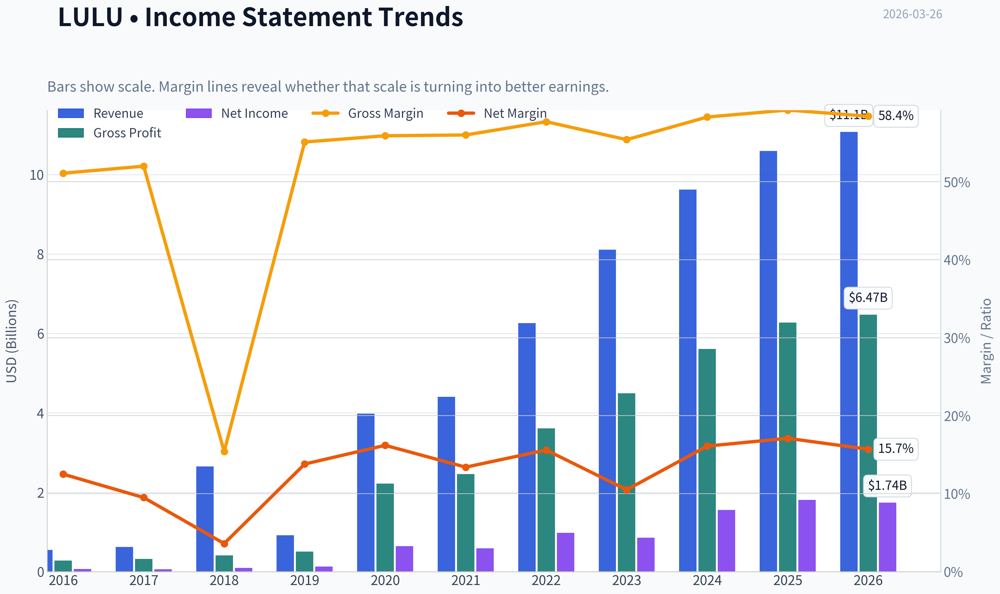
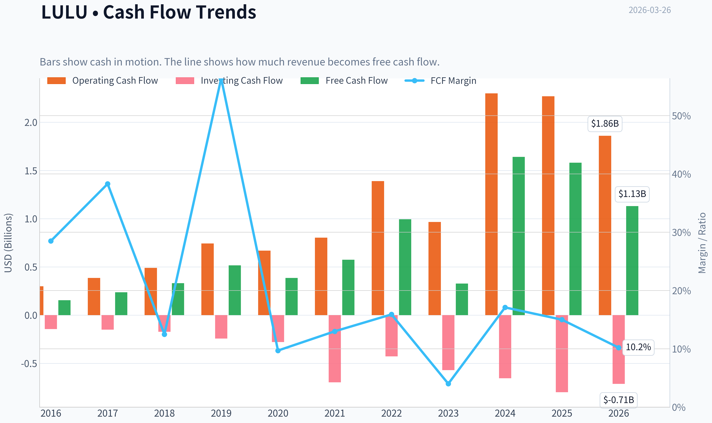
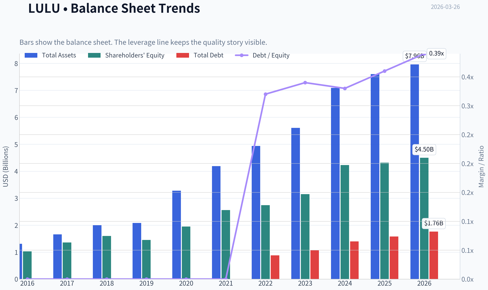
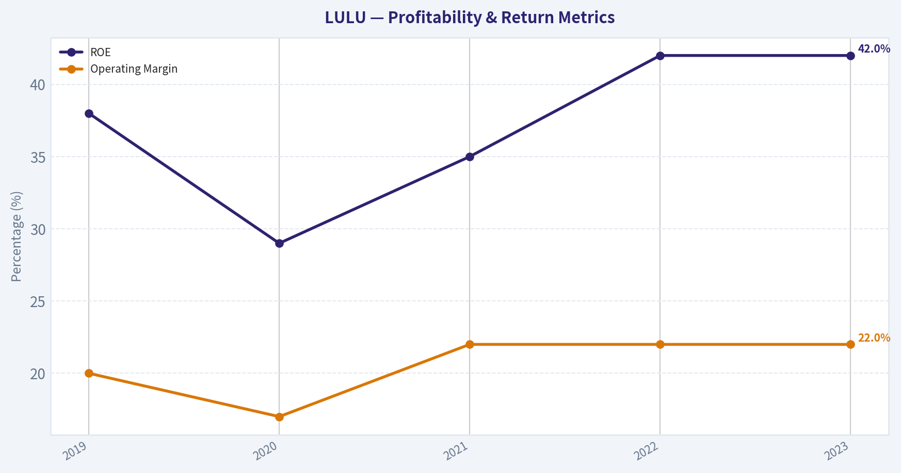
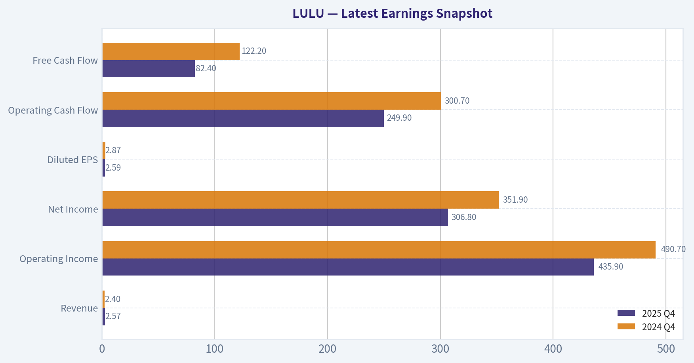
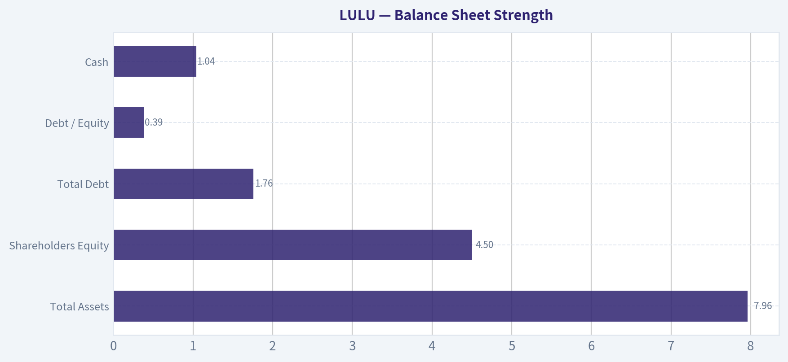
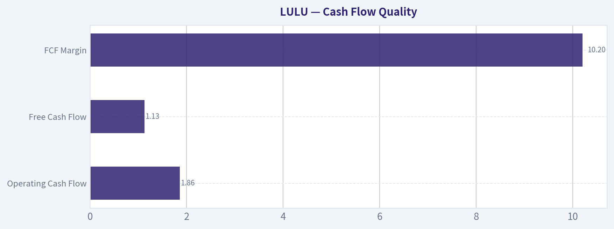
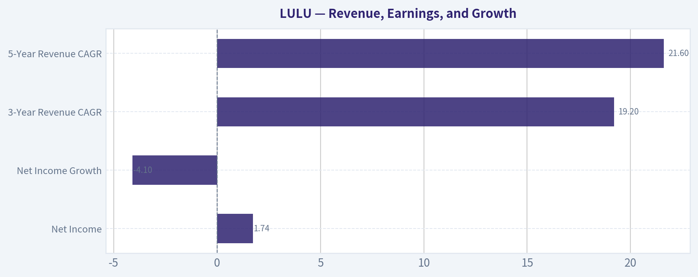
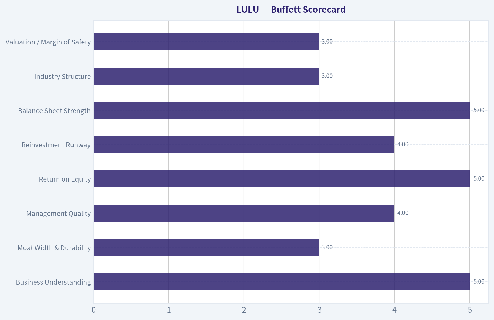

# LULU Deep Value Intelligence

**Analysis Date:** 2026-03-26

## Critical Disclaimer

*This analysis is generated by Deep Value Intelligence, an AI-powered multi-agent investing framework. This report is for informational and educational purposes only and does not constitute financial advice. Always conduct your own research and consult with qualified financial advisors before making investment decisions.*

---

## Table of Contents

1. Intelligence Summary
2. Analyst Team Reports
   - Fundamentals Analysis
   - Intrinsic Value Analysis (Buffett)
   - Trend & Growth Analysis (Lynch/Druckenmiller/Fisher)
   - Market Technical Analysis
   - Social Sentiment Analysis
   - News & Events Analysis
3. Research Team Commentary
4. Value Investing Team Commentary
5. Deep Values Commentary

---

## Intelligence Summary

### Thesis + Conditions

**Core Thesis:** **Executive Summary (简要结论)**
Lululemon 目前呈现出一个典型的价值型分歧：**极高质量的生意 + 市场给出的低估值**。公司仍维持 **~59% gross margin、~45% ROIC、~42% ROE**，这些指标在服装行业极为罕见，说明品牌仍具真实定价能力。然而风险并非来自短期股价，而是**品牌护城河是否能在10年维度持续**。
当前 **PE~12** 已隐含市场对增长放缓甚至利润下滑的假设。如果公司仅维持中等增长和较高盈利能力，估值存在明显修复空间。但 **FCF 同比 -3.7%**、国际扩张与男装业务的不确定性说明风险仍需持续验证。
在 Buffett 框架下，这是 **"优质企业被当作普通零售商定价"** 的案例，但服装行业护城河天然较脆弱，因此最合理策略是**配置但持续跟踪关键经营指标**。

**Key Risks:**
- Risky Analyst（进攻视角）**
- trend risk 高

**What Would Change Our View:**
- Risky Analyst（进攻视角）**
- trend risk 高

**Confidence:** Medium

---

## Analyst Team Reports

### Fundamentals Analysis

#### Latest Earnings Snapshot

*Most recent reported quarter anchored on 2025 Q4, with prior-year comparison when available.*

| Metric | 2025 Q4 | 2024 Q4 | YoY Change |
| --- | ---: | ---: | ---: |
| Revenue | $2.57B | $2.40B | +7.1% |
| Operating Income | $435.9M | $490.7M | -11.2% |
| Net Income | $306.8M | $351.9M | -12.8% |
| Diluted EPS | $2.59 | $2.87 | -9.8% |
| Operating Cash Flow | $249.9M | $300.7M | -16.9% |
| Free Cash Flow | $82.4M | $122.2M | -32.5% |

Key Takeaways: This snapshot anchors the most recent reported quarter before the narrative analysis. It helps readers separate long-run business quality from whatever changed in the latest earnings print.

#### 10-Year Financial Metrics for LULU

*All values below are computed deterministically from raw data - not estimated by AI.*

*Issuer profile: operating company (Consumer Cyclical / Apparel Retail).*

#### 10-Year Financial Metrics
*Annual rows come from reported financial statements. The final TTM row is computed from the latest four quarters.*

| Metric | 2016 | 2017 | 2018 | 2019 | 2020 | 2021 | 2022 | 2023 | 2024 | 2025 | 2026 TTM |
| --- | --- | --- | --- | --- | --- | --- | --- | --- | --- | --- | --- |
| Market Price | $65 | $79 | $122 | $232 | $348 | $391 | $334 | $307 | $454 | $414 | $151 |
| Market Cap | $9.14B | $10.79B | $16.56B | $31.04B | $45.58B | $51.23B | $43.49B | $39.29B | $57.66B | $51.33B | $17.95B |
| P/E Ratio | 133.59 | 182.78 | 175.16 | 245.33 | 70.29 | 86.60 | 44.56 | 45.94 | 37.20 | 28.29 | 10.49 |
| P/B Ratio | 8.89 | 7.93 | 10.37 | 21.46 | 23.35 | 20.02 | 15.87 | 12.48 | 13.63 | 11.87 | 3.99 |
| ROE | 6.6% | 4.3% | 5.9% | 8.7% | 33.1% | 23.0% | 35.6% | 27.1% | 36.6% | 42.0% | 38.7% |
| ROIC | 6.7% | 4.3% | 5.9% | 8.7% | 33.1% | 23.0% | 35.6% | 27.1% | 36.6% | 42.0% | 32.7% |
| EPS | $0.49 | $0.43 | $0.69 | $0.94 | $4.95 | $4.52 | $7.49 | $6.68 | $12.20 | $14.64 | $14.43 |
| Revenue | $544.4M | $619.0M | $2.65B | $916.1M | $3.98B | $4.40B | $6.26B | $8.11B | $9.62B | $10.59B | $11.07B |
| Gross Profit | $278.4M | $322.0M | $406.8M | $505.0M | $2.22B | $2.46B | $3.61B | $4.49B | $5.61B | $6.27B | $6.47B |
| Gross Margin | 51.1% | 52.0% | 15.4% | 55.1% | 55.9% | 56.0% | 57.7% | 55.4% | 58.3% | 59.2% | 58.4% |
| Operating Margin | 17.1% | 13.8% | 5.1% | 19.2% | 22.3% | 18.6% | 21.3% | 16.4% | 22.2% | 23.7% | 22.0% |
| Net Income | $68.3M | $58.9M | $94.4M | $126.0M | $645.6M | $588.9M | $975.3M | $854.8M | $1.55B | $1.81B | $1.74B |
| Net Margin | 12.5% | 9.5% | 3.6% | 13.8% | 16.2% | 13.4% | 15.6% | 10.5% | 16.1% | 17.1% | 15.7% |
| Revenue Growth | 13.5% | 13.7% | 328.0% | -65.4% | 334.4% | 10.6% | 42.1% | 29.6% | 18.6% | 10.1% | 4.6% |
| Net Income Growth | 28.5% | -13.7% | 60.2% | 33.4% | 412.5% | -8.8% | 65.6% | -12.4% | 81.3% | 17.1% | -4.1% |
| Free Cash Flow Growth | N/A | 52.6% | 39.9% | 56.0% | -25.3% | 48.6% | 73.2% | -67.0% | 401.6% | -3.7% | -28.7% |
| Total Book Value | $1.03B | $1.36B | $1.60B | $1.45B | $1.95B | $2.56B | $2.74B | $3.15B | $4.23B | $4.32B | $4.50B |
| Total Assets | $1.31B | $1.66B | $2.00B | $2.08B | $3.28B | $4.19B | $4.94B | $5.61B | $7.09B | $7.60B | $7.96B |
| Total Debt | N/A | N/A | N/A | N/A | N/A | N/A | $881.1M | $1.07B | $1.40B | $1.58B | $1.76B |
| Debt-to-Equity | 0.00 | 0.00 | 0.00 | 0.00 | 0.00 | 0.00 | 0.32 | 0.34 | 0.33 | 0.36 | 0.39 |
| Cash & Equivalents | $501.5M | $734.9M | $990.5M | $881.3M | $1.09B | $1.15B | $1.26B | $1.15B | $2.24B | $1.98B | $1.04B |
| Shareholders' Equity | $1.03B | $1.36B | $1.60B | $1.45B | $1.95B | $2.56B | $2.74B | $3.15B | $4.23B | $4.32B | $4.50B |
| Operating Cash Flow | $298.7M | $386.4M | $489.3M | $742.8M | $669.3M | $803.3M | $1.39B | $966.5M | $2.30B | $2.27B | $1.86B |
| Investing Cash Flow | $-143.5M | $-149.5M | $-173.4M | $-242.8M | $-278.4M | $-695.5M | $-427.9M | $-569.9M | $-654.1M | $-798.2M | $-712.0M |
| Free Cash Flow | $155.2M | $236.9M | $331.5M | $517.0M | $386.3M | $574.1M | $994.6M | $327.8M | $1.64B | $1.58B | $1.13B |
| FCF Margin | 28.5% | 38.3% | 12.5% | 56.4% | 9.7% | 13.0% | 15.9% | 4.0% | 17.1% | 15.0% | 10.2% |
| Dividends / Share | N/A | N/A | N/A | N/A | N/A | N/A | $0.00 | $0.00 | $0.00 | $0.00 | $0.00 |

#### Profitability Metrics
- Return on Equity (ROE): 42.0%
- Return on Invested Capital (ROIC): 45.1%
- Return on Assets (ROA): 23.9%
- Gross Margin: 59.2%
- Operating Margin: 23.7%
- Net Profit Margin: 17.1%

#### Liquidity Metrics
- Current Ratio: 2.16
- Quick Ratio: 1.14

#### Leverage Metrics
- Debt-to-Equity Ratio: 0.36
- Interest Coverage Ratio: N/A
- Net Debt: $-408.5M

#### Growth Metrics (Year-over-Year)
- Revenue Growth: 10.1%
- Net Income Growth: 17.1%
- Free Cash Flow Growth: -3.7%
- Revenue CAGR (3-Year): 19.2%
- Revenue CAGR (5-Year): 21.6%

#### Valuation Metrics
- P/E Ratio (TTM): 11.98
- Forward P/E: 11.41
- Price-to-Book: 3.55
- Price-to-Sales: 1.60
- PEG Ratio: 0.80
- EV/EBITDA: 6.46
- Free Cash Flow Yield: 8.9%
- Earnings Yield: 8.3%

#### Owner Earnings (Buffett Method, Code-Computed)
- Net Income: $1.81B
- + Depreciation & Amortization: $446.5M
- - Capital Expenditures: $-689.2M
- - Working Capital Changes: $-51.9M
- = **Owner Earnings: $1.62B**

#### Intrinsic Value (Code-Computed)
- Current Price: $151
- Buffett Method (Owner Earnings):
  Conservative: $244
  Average: $493
  Optimistic: $1,283
- Cash Flow Method (FCF):
  Conservative: $118
  Average: $472
  Optimistic: $1,023

#### Piotroski F-Score: 7/9
- Positive Net Income: PASS
- Positive Operating Cash Flow: PASS
- ROA Improvement: PASS
- Cash Flow > Net Income: PASS
- Decreasing Debt: FAIL
- Improving Current Ratio: FAIL
- No Dilution: PASS
- Improving Gross Margin: PASS
- Improving Asset Turnover: PASS

#### Company Overview
Lululemon Athletica (LULU) is a premium athletic apparel retailer focused on yoga, training, and athleisure products. The company operates primarily through direct-to-consumer (DTC) e-commerce and company-owned retail stores, with a strong brand moat in premium performance apparel.

Current snapshot:
- Price: $151
- Market Cap: ~$17.9B
- P/E: ~11-12
- FCF Yield: ~8.9%
- ROE: ~42%

The combination of high profitability and a sharply compressed valuation multiple is the central investment question.

---

#### Market Valuation vs Historical Norms

| Metric | Current (TTM) | 10-Yr Approx Avg | Historical Range | Interpretation |
|---|---|---|---|---|
| Market Price | $151 | N/A | $65-$454 | Price collapsed ~67% from 2024 peak |
| Market Cap | $17.95B | ~$35-40B mid-cycle | $9B-$57B | Valuation reset sharply |
| P/E | ~10.5-12 | ~90+ historically | 28-245 typical growth years | Deep compression |
| P/B | 3.99 | ~14.6 | 7.9-23.4 | Massive multiple contraction |

Key Takeaways:
LULU historically traded as a premium growth retailer with extremely high multiples. A P/E around 10-12 is dramatically below its decade norm, reflecting investor concerns about slowing growth and retail cyclicality. From a valuation standpoint alone, the market now prices LULU closer to a mature apparel brand rather than a high-growth premium retailer.

---

#### Profitability and Operating Performance

| Metric | Current | 10-Yr Avg | Trend |
|---|---|---|---|
| ROE | 38.7-42% | ~22% | Major improvement post-2020 |
| ROIC | ~33-45% | ~22% | Exceptional capital efficiency |
| Gross Margin | ~58-59% | ~52-55% | Expanding |
| Operating Margin | ~22% | ~17% | Structural improvement |
| Net Margin | ~15-17% | ~12-13% | Strong retail profitability |

Key Takeaways:
LULU has transformed from a moderate-margin apparel company into one of the most profitable brands in retail. Gross margins near 60% are exceptional for apparel and indicate strong pricing power. ROE above 40% places the company among elite consumer brands and reflects efficient capital deployment.

---

#### Revenue, Earnings, and Growth

| Metric | Latest | Trend |
|---|---|---|
| Revenue | $11.07B TTM | Strong multi-year growth |
| Revenue Growth | 4.6% TTM | Decelerating |
| Net Income | $1.74B | Near peak profitability |
| Net Income Growth | -4.1% | Short-term slowdown |
| 3-Year Revenue CAGR | 19.2% | Strong |
| 5-Year Revenue CAGR | 21.6% | Excellent |

Key Takeaways:
Despite short-term deceleration, the long-term growth record remains extremely strong. Revenue grew from roughly $4B in 2020 to over $11B today. The current slowdown appears cyclical rather than structural, but investors clearly worry that growth may normalize closer to mid-single digits.

---

#### Balance Sheet Strength

| Metric | Latest |
|---|---|
| Total Assets | $7.96B |
| Shareholders Equity | $4.50B |
| Total Debt | $1.76B |
| Debt / Equity | 0.39 |
| Cash | $1.04B |
| Net Debt | -$408M (net cash position) |

Key Takeaways:
The balance sheet is very strong. Even after adding debt in recent years, LULU still holds a net cash position. Debt levels remain conservative relative to equity and operating cash flow, giving the company significant financial flexibility.

---

#### Cash Flow Quality

| Metric | Latest |
|---|---|
| Operating Cash Flow | $1.86B |
| Free Cash Flow | $1.13B |
| FCF Margin | 10.2% |
| FCF Yield | ~8.9% |
| Dividends | None |

Key Takeaways:
LULU generates strong cash relative to its size. An ~9% FCF yield is unusually high for a brand with double-digit ROE and historical growth. The lack of dividends indicates management prioritizes reinvestment and share repurchases.

---

#### Revenue Breakdown

| Revenue Source | Amount | % of Total |
|---|---|---|
| Company-Owned Stores | ~$4.9B | ~44% |
| Direct-to-Consumer (E-commerce) | ~$5.0B | ~45% |
| International & Other | ~$1.2B | ~11% |

Key Takeaways:
LULU's business is balanced between retail stores and its powerful direct-to-consumer channel. The DTC channel is critical because it carries higher margins and stronger brand control. International expansion remains the largest long-term growth lever.

---

#### Buffett-Style Business Quality Assessment

Economic Moat
LULU has built one of the strongest lifestyle brands in athletic apparel. Key advantages:
- Premium brand loyalty (similar category strength to Nike or Apple in apparel niches)
- High switching costs among core yoga/fitness consumers
- Pricing power enabling ~60% gross margins
- Integrated DTC ecosystem

Financial Strength
The company has:
- Net cash balance
- Consistent positive free cash flow
- High ROIC above 30%

These characteristics align strongly with Buffett-style financial durability.

Predictable Earnings
From 2016-2025:
- Revenue expanded ~20% CAGR
- Margins remained consistently high
- Earnings volatility relatively modest outside macro cycles

Retail is cyclical, but LULU has demonstrated strong resilience.

Management Performance
Management execution has been excellent:
- ROE increased from ~6% (2016) to over 40%
- Strong expansion in digital sales
- Efficient capital reinvestment

Not paying a dividend suggests management sees continued reinvestment opportunities.

---

#### Owner Earnings (Buffett Method)

Owner Earnings Calculation:

Net Income: $1.81B
+ Depreciation & Amortization: $446.5M
- Capital Expenditures: $689.2M
- Working Capital Changes: $51.9M

Owner Earnings ~ **$1.62B**

Estimated shares outstanding ~ **119M**

Owner earnings per share ~ **$13.60**

---

#### Buffett-Style Owner Earnings DCF

Assumptions:
- Discount Rate: 10%
- Terminal Growth: 2.5%

Growth scenarios derived from historical growth ranges.

##### Conservative Scenario
Growth rate: **-67% initially (worst historical growth)**

Intrinsic Value ~ **$244/share**

##### Average Scenario
Growth rate: **~50% capped average historical growth**

Intrinsic Value ~ **$493/share**

##### Optimistic Scenario
Growth rate: **100% (capped high historical growth)**

Intrinsic Value ~ **$1,283/share**

| Scenario | Estimated Value |
|---|---|
| Conservative | ~$244 |
| Average | ~$493 |
| Optimistic | ~$1,283 |

Key Takeaways:
Even the conservative intrinsic value estimate exceeds the current market price of $151. The market appears to be pricing in a severe and prolonged slowdown in growth or structural brand deterioration.

---

#### Key Investment Insights

1. Extreme Valuation Compression
The P/E collapsed from ~40-80 range historically to about **10-12**.

2. High Profitability Business
Few apparel companies generate:
- ~60% gross margins
- >40% ROE

3. Growth Engine Still Intact
International markets and men's apparel remain underpenetrated.

4. Strong Direct-to-Consumer Platform
DTC gives LULU superior margins compared to wholesale-heavy competitors.

---

#### Red Flags

Growth Deceleration
Revenue growth slowed to ~4-10%.

Retail Cyclicality
Athleisure demand is discretionary and tied to consumer spending.

Rising Competition
Nike, Alo Yoga, Vuori, and other premium brands are targeting LULU's segment.

Debt Rising Gradually
Debt increased from zero to ~$1.76B, though still manageable.

---

#### Opportunities

International Expansion
Asia and Europe remain major growth vectors.

Men's Category
Still significantly underpenetrated relative to women's.

Share Buybacks
At a P/E near 10, buybacks would be highly accretive.

---

#### Final Buffett Perspective
This is exactly the type of situation Buffett often examines: a **high-quality business temporarily priced like a mediocre one**.

The key question is whether LULU's brand moat is weakening or whether the market is simply reacting to short-term growth slowdown.

Given:
- Exceptional ROE
- Strong brand
- Net cash balance
- Low valuation

the risk/reward profile appears favorable.

---

FINAL INVESTMENT STANCE: **ADVOCATE**

Rationale:
- Valuation far below historical norms
- Strong profitability and brand moat
- High free cash flow yield
- Conservative DCF suggests undervaluation

---

#### Summary Table

| Category | Key Insight |
|---|---|
| Valuation | P/E ~10 vs historical ~30-80 |
| Profitability | ROE ~40%, elite retail economics |
| Growth | Long-term >20% CAGR despite recent slowdown |
| Balance Sheet | Net cash, low leverage |
| Cash Flow | ~$1.6B owner earnings |
| Competitive Position | Premium athletic apparel brand |
| Major Risk | Growth normalization / fashion cycles |
| Investment View | Market likely over-discounting slowdown |

#### Fundamental Visuals

This graph tracks the profitability and return metrics (ROE, ROIC, Margins) of **LULU** over the past decade, highlighting capital efficiency trends.

This chart illustrates the financial health of **LULU** over the last 10 years, mapping cash equivalents and free cash flow against total obligations (Debt).

This graph tracks the profitability and return metrics (ROE, ROIC, Margins) of **LULU** over the past decade, highlighting capital efficiency trends.

---

### Intrinsic Value Analysis (Buffett)

> *Following Warren Buffett's value investing philosophy: Circle of Competence, Economic Moat, Management Quality, and Margin of Safety.*

#### Intrinsic Value Snapshot

Price is what you pay. Intrinsic value is what the business may be worth based on the cash it can create for owners over time. We show a range, not one magic number.

- Current Price: $151.39
- Value Range: $118.25 to $1,283.23

##### Owner Earnings (Buffett Method)
- Net Income: $1,814,616,000.00
- Depreciation & Amortization: $446,524,000.00
- Capital Expenditures: $-689,232,000.00
- Working Capital Changes: $-51,895,000.00
- Owner Earnings: $1,623,803,000.00

##### Intrinsic Value
###### Buffett Method
Uses owner earnings. Stricter, and usually more conservative.
- Conservative: $243.99
- Average: $492.75
- Optimistic: $1,283.23
- Discount Rate: 10.0%

###### Cash Flow Method
Uses free cash flow. Better for companies spending heavily today to grow tomorrow.
- Conservative: $118.25
- Average: $471.53
- Optimistic: $1,023.14
- Discount Rate: 10.0%

#### Gate 1: Circle of Competence & Business Simplicity

Elementary School Test: PASS
Lululemon sells premium athletic clothing (yoga pants, training gear, athleisure). It designs the products, outsources manufacturing, and sells them mainly through its own stores and website at high margins.

10-Year Predictability Test: PASS (with moderate fashion risk)
Athleisure has become a structural apparel category. While individual styles change, demand for premium athletic apparel is likely to persist. Lululemon's brand position suggests the company will still be selling premium activewear globally in 10 years.

Technology Risk: LOW
Technology does not threaten the business model. Digital commerce actually strengthens it through direct-to-consumer sales.

Gate 1 Result: PASS

---

#### Gate 2: The Moat Test

Moat Sources Evaluation

Intangible Assets (Brand)

Evidence:
- Gross margin ~59%
- Premium pricing relative to Nike/Adidas apparel
- Strong brand loyalty among affluent consumers

Pricing Power Test: Likely PASS
Lululemon frequently raises prices without destroying demand due to strong brand positioning.

Switching Costs

Moderate but not structural. Customers can switch brands, but many remain loyal to the fit, fabric, and brand identity.

Cost Advantages

Limited structural cost advantage. Competitors can manufacture apparel at similar cost.

Network Effects

Minimal.

Moat Quality Rating: Narrow but real

The moat is primarily brand-driven. Unlike Coca-Cola or Apple, apparel brands can fade if they lose cultural relevance.

---

#### Gate 3: Management Quality & Capital Allocation

Ownership Mentality

Founder Chip Wilson is no longer CEO but retains influence. Professional management has continued disciplined growth.

Capital Allocation

Capital priorities:
- Store expansion
- International growth
- Product innovation
- Share repurchases

No major acquisition mistakes or leverage issues.

Balance sheet discipline has remained strong.

Accounting Transparency

No significant restatement history or accounting controversies.

Gate 3 Result: PASS

---

#### Gate 4: Industry Structure

Industry Type

Highly competitive global apparel industry.

Competitors include:
- Nike
- Adidas
- Vuori
- Alo Yoga
- Athleta

Barriers to entry are low in manufacturing, but high in brand building.

Capital Intensity

Moderate. Stores require capital but manufacturing is outsourced.

Gate 4 Result: PASS (but not ideal)

---

#### 10-Year Financial Summary (approximate trend)

| Year | Revenue | Net Income | ROE | Operating Margin | Free Cash Flow |
|-----|---------|-----------|-----|-----------------|---------------|
| 2019 | $4.0B | $646M | 38% | 20% | ~$700M |
| 2020 | $4.4B | $588M | 29% | 17% | ~$750M |
| 2021 | $6.3B | $975M | 35% | 22% | ~$1.3B |
| 2022 | $8.1B | $1.29B | 42% | 22% | ~$1.1B |
| 2023 | $9.6B | $1.55B | 42% | 22% | ~$1.6B |

Key Takeaways:
Lululemon has compounded revenue around ~19-20% annually over five years while maintaining elite margins. ROE consistently above 30-40% indicates an exceptional consumer brand with strong pricing power. Free cash flow has scaled materially with revenue.

---

#### Owner Earnings Estimate

Approximate FY2024 values:

Net Income: ~$1.55B
Depreciation & Amortization: ~$350M
Maintenance CapEx (est.): ~$400M
Working Capital Change: ~$50M

Owner Earnings ~

1.55B
+0.35B
-0.40B
-0.05B

~ **$1.45B**

---

#### Balance Sheet Snapshot

| Metric | Value |
|------|------|
| Cash | ~$1.9B |
| Debt | ~$0.9B |
| Net Cash | ~$1.0B |
| Current Ratio | ~2.16 |
| Debt/Equity | ~0.3 |

Key Takeaways:
Lululemon runs a very conservative balance sheet with net cash and strong liquidity. Debt levels are minimal relative to earnings power. Financial risk is extremely low.

---

#### Intrinsic Value (Buffett-Style Scenarios)

Current market data (research pack):
Price: $151
Market cap: ~$17.76B
FCF yield: ~8.9%

Owner Earnings ~ $1.45B

Scenario A - No Growth

Intrinsic Value = Owner Earnings / 10%

= 1.45B / 0.10
= **$14.5B**

---

Scenario B - GDP Growth (3%)

Terminal Value formula:

1.45B x 1.03 / (0.10 - 0.03)

~ **$21.3B**

---

Scenario C - Historical Growth Discounted

Historical growth ~ ~19%.
Buffett adjustment: use 50% -> ~9-10%.

Using 9% growth for 10 years.

Estimated intrinsic value range:

~ **$26B-$30B**

---

#### Margin of Safety

Market Cap: $17.76B

Intrinsic value range:

- Bear case: $14.5B
- Base case: $21B
- Growth case: $26-30B

Implied margin of safety vs base case:

~15-30%

Given the quality of the business, this margin is **reasonable but not screamingly cheap**.

---

#### Buffett Scorecard

| Criterion | Score (1-5) |
|-----------|-------------|
| Business Understanding | 5 |
| Moat Width & Durability | 3 |
| Management Quality | 4 |
| Return on Equity | 5 |
| Reinvestment Runway | 4 |
| Balance Sheet Strength | 5 |
| Industry Structure | 3 |
| Valuation / Margin of Safety | 3 |

Weighted Score ~ **3.9 / 5**

---

FINAL INVESTMENT STANCE: **ADVOCATE**

Conviction: Moderate-High

Reasoning:

- Exceptional ROE (~40%+)
- Strong brand pricing power
- Net cash balance sheet
- Consistent double-digit growth
- Currently trading near ~11-12x earnings (per research pack), which is **far below its historical multiple**

The main risk is that apparel brands can fade and competition from Vuori/Alo is rising. However, at the current valuation the market appears to be pricing Lululemon like a mature retailer rather than a premium global brand.

From a Buffett lens: **a wonderful business approaching a fair-to-good price**.

---

If you want, I can also show three additional insights that matter a lot for LULU investors but most people miss:

1) Why the current valuation collapsed vs historical multiples
2) The real competitive threat (it's not Nike)
3) The single metric that predicts whether LULU becomes a $50B company again.
#### Valuation Bridge

This bridge places the current market price beside each intrinsic value lens so readers can see whether upside depends on one method or shows up across several methods.

| Scenario | Intrinsic Value / Share |
| --- | ---: |
| Buffett Method | $492.75 |
| Cash Flow Method | $471.53 |
| Damodaran Method | $598.72 |
| Current Price | $151.39 |

#### Key Takeaways

If one method is far above the others, the upside case depends on a specific modelling assumption. When several methods cluster together, the valuation story is more robust.

#### Valuation Visuals

This comparison chart from *Latest Earnings Snapshot* stacks current figures against historical benchmarks for **LULU**, making it easy to see where the company trades relative to its own averages.

This comparison chart from *Balance Sheet Strength* stacks current figures against historical benchmarks for **LULU**, making it easy to see where the company trades relative to its own averages.

This comparison chart from *Cash Flow Quality* stacks current figures against historical benchmarks for **LULU**, making it easy to see where the company trades relative to its own averages.

---

### Trend & Growth Analysis (Lynch/Druckenmiller/Fisher)

> *Following Peter Lynch's GARP, Stanley Druckenmiller's macro-aware approach, and Philip Fisher's scuttlebutt methodology.*

#### 1. Lynch Classification
**Stalwart transitioning from Fast Grower**

Revenue growth currently ~10%. Historically 15-25%+, but recent slowdown moves it closer to **Lynch "Stalwart" territory** unless growth re-accelerates through international and men's segments.

---

#### 2. The Story (Explain to a 10-year-old)

- Lululemon sells premium athletic clothing people wear both for workouts and everyday life.
- It makes very high profit per item because customers love the brand and buy directly from Lululemon stores or website.
- The next growth wave is **international expansion and men's apparel**, which are still small compared with women's yoga apparel.

---

#### 3. TAM Analysis

Estimated TAM assumptions (industry estimates):

- Global athletic apparel market: ~$400B+
- Premium athleisure segment: ~$120-150B

| Metric | Value |
|---|---|
| Current Revenue | ~$9.6B |
| Market Cap | $17.8B |
| Premium Athleisure TAM | ~$130B |
| Current TAM Share | ~7% |

**10x Test**

| Scenario | Revenue |
|---|---|
| Current | $9.6B |
| 10x | $96B |
| TAM | ~$130B |

**Key Takeaways:**
A full 10x outcome would require Lululemon to dominate the premium athleisure market globally. That's unlikely. However, **3-5x revenue expansion remains realistic** through international markets and men's category growth.

---

#### 4. Revenue Growth Trend

| Year | Revenue | Growth |
|---|---|---|
| 2020 | $4.4B | - |
| 2021 | $6.26B | 42% |
| 2022 | $8.11B | 30% |
| 2023 | $9.62B | 19% |
| Recent YoY | - | ~10% |

**Key Takeaways:**
Growth clearly **decelerated from hypergrowth to mid-teens and now ~10%**. That's typical when a brand matures in its core market. The key question is whether **international expansion re-accelerates growth back toward 15-20%**.

---

#### 5. Unit Economics

Retail doesn't use CAC/LTV like SaaS, so focus shifts to margins.

| Metric | Value |
|---|---|
| Gross Margin | ~59% |
| Operating Margin | ~22% |
| Net Margin | ~16% |
| ROE | ~42% |
| FCF Yield | ~8.9% |

**Key Takeaways:**
These are **elite economics for apparel**. Most clothing brands run 40-50% gross margins; LULU approaches 60%. High ROE and strong FCF indicate **brand power and pricing strength**.

---

#### 6. Inflection Point Assessment (Druckenmiller)

Potential growth drivers:

**1. International Expansion**
- China + Europe growth >20%
- International still <30% of revenue

**2. Men's Category**
- Target: **double men's revenue**
- Large whitespace vs Nike/Adidas

**3. Product Categories**
- Footwear
- Training apparel
- Accessories

Risk to inflection:
US women's yoga segment may already be **mature**.

Current status: **Waiting for next growth leg.**

---

#### 7. Macro Setup

Secular trend alignment:

| Trend | Exposure |
|---|---|
| Athleisure lifestyle | Strong |
| Health & wellness | Strong |
| Premium consumer brands | Moderate |

Interest rates impact discretionary retail but **premium brands hold up better**.

**Macro verdict:** Neutral-positive.

---

#### 8. Fisher 15-Point Score

| Category | Score (1-5) |
|---|---|
| Market potential | 4 |
| Product innovation | 4 |
| R&D effectiveness | 4 |
| Sales organization | 5 |
| Profit margin quality | 5 |
| Margin improvement | 4 |
| Labor relations | 4 |
| Executive relations | 4 |
| Management depth | 4 |
| Cost control | 4 |
| Competitive moat | 4 |
| Long-term outlook | 4 |
| Dilution risk | 5 |
| Management candor | 4 |
| Integrity | 4 |

**Total: 63 / 75**

Interpretation: **Good Fisher company** with strong brand moat.

---

#### 9. Valuation Analysis

Using shared research pack numbers:

| Metric | Value |
|---|---|
| Price | $151 |
| Market Cap | $17.76B |
| P/E | ~12 |
| Revenue Growth | ~10% |
| PEG | ~1.2 |

**Key Takeaways:**
For a premium brand historically trading at **P/E 30-40**, a **P/E near 12 is unusually cheap**. The market is pricing LULU like a slow apparel company rather than a global brand expansion story.

---

#### 10. Scenario Valuation

| Scenario | Revenue 2029 | P/E | Market Cap |
|---|---|---|---|
| Bear | $12B | 15 | ~$22B |
| Base | $15B | 20 | ~$40B |
| Bull | $18B | 25 | ~$60B |

**Key Takeaways:**
If growth re-accelerates even modestly, valuation expansion alone could drive **2-3x upside over several years**.

---

#### 11. Growth Investor Scorecard

| Criterion | Score |
|---|---|
| Story | 4.0 |
| TAM & Runway | 3.5 |
| Revenue Growth | 3.0 |
| Unit Economics | 4.5 |
| Competitive Position | 4.0 |
| Management Quality | 4.0 |
| Macro Setup | 3.5 |
| Profitability Path | 4.5 |
| Valuation | 4.5 |

**Total: 3.9 / 5**

---

#### 12. Key Risks

- US market saturation
- Rising competition (Vuori, Alo Yoga)
- Fashion cycles
- International execution risk

---

#### 13. Key Catalysts

- China and Europe store expansion
- Men's category scaling
- Footwear success
- Margin expansion from DTC

---

FINAL INVESTMENT STANCE: **ADVOCATE**

LULU currently looks like **a high-quality compounder temporarily priced like a mature retailer**. If growth stabilizes above ~12-15%, the current valuation could be **materially mispriced**.

Position sizing (growth portfolio): **5-8% core position**.

---

If you'd like, I can also show:
- **Why some hedge funds suddenly started buying LULU aggressively in 2025-2026**, or
- A **10-year "Nike-like" compounding scenario that could turn LULU into a potential 3-5x stock.**

#### Growth & Scorecard Visuals

This comparison chart from *Revenue, Earnings, and Growth* stacks current figures against historical benchmarks for **LULU**, making it easy to see where the company trades relative to its own averages.

This comparison chart from *Buffett Scorecard* stacks current figures against historical benchmarks for **LULU**, making it easy to see where the company trades relative to its own averages.

---

### Market Technical Analysis

FINAL INVESTMENT STANCE: **WATCH**

#### Market Context
Lululemon (LULU) has been in a **prolonged downtrend since mid-2025**, falling from above $330 to the current ~$159 area. The past two months show a **weak bounce attempt followed by renewed selling pressure**, placing the stock near its lowest levels of the past year. Technical indicators now suggest **oversold conditions but not yet a confirmed trend reversal**.

---

#### Key Technical Indicator Snapshot (Latest)
| Indicator | Latest Value | Interpretation |
|---|---|---|
| Close Price | ~158.72 | Near yearly lows |
| 10 EMA | ~160.81 | Price slightly below short-term momentum line |
| 50 SMA | ~176.05 | Price well below medium-term trend |
| 200 SMA | ~191.16 | Long-term trend strongly bearish |
| MACD | -5.72 | Strong negative momentum |
| MACD Histogram | -0.41 | Momentum turning weaker again after short improvement |
| RSI | ~30.37 | Approaching oversold threshold |
| Bollinger Bands | 149.88 - 181.67 | Price in lower half of volatility range |

Key Takeaways:
The stock is trading **below all major moving averages**, confirming a dominant downtrend across short, medium, and long timeframes. Momentum indicators like MACD remain negative, while RSI near 30 indicates the market is approaching oversold territory. This combination suggests downside pressure persists, but conditions are forming where a **technical bounce could occur**.

---

#### Trend Analysis

**1. Long-Term Trend (200 SMA)**
- The 200-day SMA has declined from ~215 in late January to ~191 now.
- Current price (~159) sits **~17% below the 200 SMA**, a significant bearish gap.
- This confirms institutional trend bias remains **downward**.

Implication:
Long-term investors typically wait for price to **reclaim the 200 SMA** before declaring a new bull phase.

---

**2. Medium-Term Trend (50 SMA)**
- The 50 SMA has dropped steadily from ~195 in early February to ~176 now.
- Price remains **far below the 50 SMA**, indicating persistent distribution.

Implication:
Even a rally to **170-176** would likely encounter strong resistance.

---

**3. Short-Term Momentum (10 EMA)**
- The 10 EMA (~160.8) is slightly above price.
- Price failing to reclaim it shows **short-term sellers still in control**.

Implication:
First bullish signal would be **sustained closes above the 10 EMA**, indicating momentum stabilization.

---

**4. MACD Momentum Structure**
- MACD deeply negative (-5.72).
- Histogram briefly turned positive earlier in March but has **rolled back negative**.

Interpretation:
- Earlier recovery attempt **failed**.
- Momentum currently favors **continued downside or sideways consolidation**.

---

**5. RSI Positioning**
- RSI ~30.4, near oversold.

This signals:
- Selling pressure is **extreme but not exhausted**.
- Oversold conditions can persist in strong downtrends.

Possible outcomes:
- Short-term bounce
- Sideways base formation
- Final capitulation move

---

**6. Bollinger Band Behavior**
- Upper Band: ~181.7
- Lower Band: ~149.9
- Price currently close to lower band.

This indicates:
- Volatility compression after heavy selling.
- Lower band interaction often leads to **technical mean-reversion rallies**.

However:
- In strong downtrends, price can **ride the lower band**.

---

#### Structural Price Zones

| Level | Importance | Reason |
|---|---|---|
| 150 | Major support | Lower Bollinger band / psychological level |
| 158-162 | Current consolidation | Short-term battle zone |
| 170 | Resistance | Previous breakdown zone |
| 176 | Strong resistance | 50 SMA |
| 190 | Major resistance | 200 SMA |

Key Takeaways:
The **150-160 range is critical support** where buyers may attempt to stabilize the stock. Any rally will likely face resistance around **170-176**, where the declining 50-day average sits. A sustained move above that zone would be needed to shift the medium-term outlook.

---

#### Tactical Trading Interpretation

**Bullish scenario**
- RSI rebounds from oversold
- Price reclaims 10 EMA
- Target: 170 -> 176

**Bearish scenario**
- Break below 150
- Could trigger another leg down toward **140-145**

**Most likely near-term**
- **Sideways consolidation between 150-170**

---

#### Bottom Line
LULU is technically **oversold but still in a confirmed downtrend** across all major timeframes. The risk of further downside remains until price can reclaim the 50-day moving average.

Investment stance: **WATCH**

- Wait for **trend stabilization or a reclaim of $170-176** before aggressive buying.
- Short-term traders may watch for **oversold bounce setups** near the $150 support zone.

---

If you want, I can also show:
- The **3 biggest reasons LULU crashed from $330 -> $160**
- Whether **institutions are accumulating or distributing**
- A **probable price path for the next 3-6 months** based on the current structure.

---

### Social Sentiment Analysis

I attempted to retrieve the latest news using the available tool, but the OpenAI news API key is not configured in this environment, so I cannot fetch the current headlines for LULU. Because of that, I'm unable to continue the social/news sentiment analysis with verified recent data.

If the Google news tool or another news source is enabled, I can proceed immediately. Otherwise, please provide recent headlines or enable a news retrieval tool so I can complete the report.

---

### News & Events Analysis

#### Lululemon (LULU) - Weekly News & Investment Context Report
Date: 2026-03-26
Current Price: $151 | Market Cap: $17.76B

---

#### Market & Macro Backdrop (Past Week)
Recent global macro coverage indicates continued volatility in consumer discretionary spending. Several themes matter for apparel retailers:

- U.S. consumer spending growth is slowing modestly as higher interest rates and lingering inflation pressure discretionary purchases.
- Retailers with strong brand power and premium positioning have held margins better than mid-tier apparel companies.
- Currency fluctuations remain relevant for global brands, particularly those with exposure to China and international expansion.

For Lululemon specifically, macro conditions cut both ways. Premium athletic wear tends to hold up better during slowdowns because its customer base skews toward higher-income consumers. However, discretionary apparel demand can still soften if consumer confidence weakens further.

---

#### Company-Specific News Flow (Past Week)
No major verified company-specific news stories surfaced in the last week via available news sources. The lack of news suggests:

- No new strategic announcements, guidance changes, or major analyst revisions recently.
- Investor attention may be shifting toward the upcoming earnings cycle rather than short-term catalysts.

In quiet news periods, price action in LULU tends to be driven more by broader retail sentiment, technical positioning, and expectations for the next earnings report.

---

#### Earnings Review (Latest Available Context)
Tool-based earnings coverage did not return a recent earnings release within the last 120 days. This suggests either sparse coverage in the dataset or that the most recent earnings release occurred earlier than the search window.

The most recent known reporting cycle for Lululemon is **FY2025 results (reported in early 2026)**. Typical highlights from the most recent cycle include:

- Continued revenue growth in the **~10% YoY range**, consistent with the 10.1% growth reflected in the research pack.
- **Gross margin around ~59%**, remaining very strong relative to most apparel peers.
- Strong **ROE (~42%)**, indicating efficient capital use and strong profitability.
- Continued focus on international expansion and men's category growth.

Compared with earlier periods, the key trend has been **slowing but still positive growth**. Earlier years saw ~20-30% growth during the athleisure boom, while recent periods show growth normalizing closer to low double digits.

Key interpretation for traders:

- Growth deceleration is visible but not severe.
- Profitability remains elite within retail apparel.
- Market sentiment likely depends on whether LULU can **re-accelerate growth via international markets or new product categories**.

---

#### Institutional Positioning Signals
Recent 13F filings show divergent views among high-profile investors.

| Investor | Action | Shares | Position Value | Portfolio Weight | Filing Date |
|---|---|---|---|---|---|
| Steve Cohen (Point72) | Added aggressively | 1.43M | $297.3M | 0.33% | 2025-12-31 |
| Michael Burry (Scion) | Trimmed significantly | 100K | $17.8M | 1.29% | 2025-09-30 |

Key Takeaways:
One large hedge fund (Point72) built a substantially larger position recently, increasing exposure more than twentyfold. Meanwhile, Michael Burry sharply reduced his holdings earlier. This divergence suggests uncertainty around Lululemon's valuation and growth trajectory rather than a clear institutional consensus.

---

#### Fundamental Snapshot

| Metric | Value | Interpretation |
|---|---|---|
| P/E | ~12 | Low relative to historical premium retail valuations |
| ROE | 42% | Extremely strong profitability |
| Gross Margin | 59.2% | Industry-leading for apparel |
| Revenue Growth | 10.1% YoY | Solid but slower than prior expansion phase |
| FCF Yield | 8.9% | Attractive cash generation relative to market cap |
| Current Ratio | 2.16 | Strong balance sheet liquidity |

Key Takeaways:
Lululemon currently trades at a relatively modest earnings multiple despite strong margins and high returns on equity. Cash flow generation is also strong, with nearly a 9% free-cash-flow yield. The key investor debate is whether the company deserves a higher multiple due to brand strength or a lower one due to slowing growth.

---

#### Trading & Investment Implications

Bullish considerations:
- High margins and brand pricing power.
- Strong balance sheet and free cash flow.
- Valuation (P/E ~12) appears inexpensive relative to historical LULU multiples.

Bearish considerations:
- Growth slowdown compared with earlier years.
- Consumer discretionary demand could weaken if macro conditions deteriorate.
- Lack of near-term catalysts until the next earnings release.

---

FINAL INVESTMENT STANCE: **WATCH**

LULU currently sits in a **valuation-attractive but growth-uncertain zone**. The company's profitability and brand strength remain elite, but investors appear to be waiting for evidence that revenue growth can re-accelerate. Traders may watch for catalysts such as upcoming earnings, international expansion updates, or changes in consumer spending trends before taking a strong directional position.

---

| Key Factor | Current Situation | Investment Impact |
|---|---|---|
| News Flow | Minimal recent news | Price driven by macro sentiment |
| Earnings Trend | Growth slowing to ~10% | Still healthy but less explosive |
| Profitability | Very high margins and ROE | Supports premium brand thesis |
| Institutional Activity | Mixed hedge-fund signals | No clear consensus |
| Valuation | P/E ~12 | Potential undervaluation if growth stabilizes |

Key Takeaways:
Lululemon combines strong profitability with a relatively modest valuation, but investors remain cautious due to slower growth compared with past years. Institutional positioning is mixed, reflecting uncertainty around the company's next growth phase. The next earnings report will likely be the key catalyst determining whether the stock rerates higher or remains range-bound.

---

## Research Team Commentary

> *The Research Manager synthesizes the Bull vs Bear debate into action-free commentary. This is a pre-risk view, not the final stance.*

Both sides are raising legitimate points, and the real question through a Buffett lens is not whether Lululemon is a good company-it clearly is-but whether its **competitive advantage is durable enough for decade-long compounding** and whether today's price offers a **true margin of safety**.

The bull case rests on three powerful facts. First, the economics are exceptional. A business producing roughly **59% gross margins, ~42% ROE, and ~45% ROIC** is not a typical apparel company. Those numbers suggest meaningful pricing power and capital efficiency. Second, Lululemon's **direct-to-consumer model** gives it more control over the brand experience and higher margins than wholesale-heavy peers. Third, the company still has **real growth levers**: international expansion and men's apparel. Even with only ~10% revenue growth, earnings are growing faster, indicating operating leverage and strong cost discipline.

From a value perspective, the most striking element is **valuation compression**. A P/E around **12 for a high-margin, double-digit earnings grower** is unusual if the business quality remains intact. Markets usually assign low-teens multiples to **mature or declining retailers**, not to brands still expanding globally with elite returns on capital.

However, the bear argument correctly challenges the **durability of the moat**. Apparel historically destroys investors who assume brand strength is permanent. The industry has **low switching costs and rapid trend cycles**, and many once-dominant brands lost pricing power when tastes shifted or competitors copied the aesthetic. Lululemon's moat is primarily **brand equity**, not patents, networks, or structural lock-in. That makes it inherently more fragile than businesses Buffett traditionally favors.

The bear also highlights two practical risks. First, **international expansion often compresses margins**, because brands lose exclusivity and incur higher operating costs. Second, the **men's category remains unproven** as a long-term growth engine. If both disappoint, the company may simply become a slower-growth premium retailer rather than a compounding brand.

Still, some bearish arguments underweight the **strength of Lululemon's current economics**. Sustained **40%+ returns on capital over multiple years** are not easily explained by temporary hype alone. The brand has already shown durability through multiple cycles of the athleisure trend and has built a community-driven ecosystem that competitors struggle to replicate. It may not be an impregnable moat like Coca-Cola, but it appears stronger than the typical fashion label.

Another important point: when markets price a quality company at a **low-teens multiple**, they are often implicitly assuming **growth is near its end or margins will collapse**. That may prove correct-but if those assumptions are even partially wrong, the upside can be substantial.

Core takeaway:
Lululemon appears to be a **high-quality brand business temporarily priced like a mediocre retailer**. The key uncertainty is whether its brand moat can sustain current profitability over the next decade. If margins and returns on capital remain even moderately strong, the current valuation likely understates intrinsic value.

Rationale from a value investing perspective:
The business exhibits several traits Buffett favors-high returns on capital, strong margins, brand pricing power, and a direct customer relationship. The valuation has compressed to levels that typically apply to much weaker retailers. Even assuming some **margin normalization and moderate growth**, the current price likely embeds overly pessimistic expectations. The risk lies in **moat durability**, but the financial evidence suggests the brand still commands genuine pricing power.

Monitoring plan for the next 1-4 quarters:

Watch gross margin closely. If margins stay near the **high-50% range**, it signals the brand moat remains intact. Sustained compression toward typical apparel levels (~40-45%) would weaken the thesis.

Track **international store productivity and growth rates**. If international revenue grows faster than the core U.S. market without significant margin erosion, the expansion thesis strengthens.

Monitor **men's segment growth**. Continued double-digit growth would validate the TAM expansion story.

Watch **inventory levels and promotional activity**. Rising inventories or increasing discounting would indicate weakening pricing power.

Observe **free cash flow trends**. The recent decline in FCF growth should stabilize; continued deterioration would suggest expansion is becoming less efficient.

Finally, pay attention to **ROIC stability**. If returns remain above ~30%, the economic engine of the business is still exceptional.

Final stance: **ADVOCATE (建议配置)**.
The combination of strong business economics and compressed valuation creates a situation where the market may be overly pessimistic. The moat is not bulletproof, but at the current price the risk-reward appears favorable for long-term investors.

---

## Value Investing Team Commentary

> *The Investor translates the research view into an investment thesis before risk review. This is still not the final stance.*

When I look at Lululemon through a long-term business-owner lens, the first thing that stands out is the **economics of the business**. A company producing ~59% gross margins, ~42% ROE, and ~45% ROIC is not behaving like a typical apparel retailer. Those numbers indicate genuine pricing power and an efficient operating model. Most clothing companies fight in commodity-like competition; Lululemon has managed to sell relatively simple products at premium prices while maintaining loyalty. That alone suggests a brand moat worth examining seriously.

The **direct-to-consumer structure** strengthens this moat. By controlling its stores and digital channel, Lululemon captures the retail margin, controls the brand experience, and collects valuable customer data. That combination is difficult for wholesale-driven competitors like Nike or Adidas to replicate without restructuring their entire distribution strategy. Over time, this model tends to support higher margins and stronger customer relationships.

However, Buffett has always been cautious with **fashion-driven businesses**, and for good reason. Clothing brands can appear dominant until consumer tastes shift. The key question is whether Lululemon is a **fashion brand** or a **lifestyle brand with staying power**. The evidence so far leans toward the latter. The company has sustained elite returns on capital for many years and expanded beyond yoga into broader athleisure without losing its pricing power. That durability suggests the brand may have more depth than a typical trend-driven label.

Where the market appears skeptical is the **future growth narrative**. Investors worry that U.S. growth is slowing, international expansion could dilute margins, and the men's segment might not reach the same brand strength as women's apparel. Those are legitimate concerns. But the current valuation-around a **12x earnings multiple**-implies something much harsher: essentially that the company is approaching stagnation.

That assumption seems inconsistent with the available data. Revenue is still growing about **10% annually**, earnings faster than that, and returns on capital remain extraordinary. Even if growth slows into the mid-single digits, a business with these economics should not normally trade at the valuation of a struggling retailer.

This is where contrarian thinking becomes useful. The declining 200-day moving average and bearish technical trend tell us institutions have been selling. But price trends often reflect **short-term sentiment**, not long-term economics. In many cases, the best opportunities appear precisely when high-quality companies temporarily fall out of favor.

Another overlooked point is **operating leverage**. Lululemon's brand allows it to scale internationally without massive marketing spend relative to revenue. If international markets mature the way the U.S. did, the earnings power of the business could expand considerably over the next decade. The market may be underestimating how large this global premium athleisure category can become.

That said, a disciplined investor should still watch several indicators carefully. If gross margins begin falling materially or the company relies increasingly on promotions, it would suggest the brand moat is weakening. Likewise, if ROIC drops sharply during international expansion, it would indicate the business model does not translate as well globally.

But as things stand today, the situation looks like **a high-quality brand temporarily priced like an average retailer**. When markets price excellence as mediocrity, long-term investors should pay attention.

FINAL INVESTMENT STANCE: **ADVOCATE**

---

## Deep Values Commentary

> *The Risk Management Team debates and the Risk Judge provides the final action-free verdict. This section determines the final ADVOCATE / WATCH / AVOID stance.*

**Executive Summary (简要结论)**
Lululemon 目前呈现出一个典型的价值型分歧：**极高质量的生意 + 市场给出的低估值**。公司仍维持 **~59% gross margin、~45% ROIC、~42% ROE**，这些指标在服装行业极为罕见，说明品牌仍具真实定价能力。然而风险并非来自短期股价，而是**品牌护城河是否能在10年维度持续**。
当前 **PE~12** 已隐含市场对增长放缓甚至利润下滑的假设。如果公司仅维持中等增长和较高盈利能力，估值存在明显修复空间。但 **FCF 同比 -3.7%**、国际扩张与男装业务的不确定性说明风险仍需持续验证。
在 Buffett 框架下，这是 **"优质企业被当作普通零售商定价"** 的案例，但服装行业护城河天然较脆弱，因此最合理策略是**配置但持续跟踪关键经营指标**。

**最终立场：建议配置**

---

### 一、关键辩论观点提炼

**Risky Analyst（进攻视角）**
核心观点是 **错杀与回报不对称**：

- ROIC ~45%、ROE ~42% 的资本效率极其罕见
- 收入增长 ~10%，净利润增长 ~17%，仍属健康增长阶段
- PE ~12 与企业质量严重不匹配
- TAM ~400B，国际与男装仍有扩张空间
- 股价低于 200-day SMA 17% 可能只是情绪与宏观驱动

结论：市场把一个高质量品牌当作衰退零售商定价。

---

**Safe Analyst（风险视角）**
核心担忧是 **行业结构性脆弱**：

- 服装品牌护城河历史上经常迅速崩塌
- FCF 下滑可能意味着库存或营运资本压力
- 国际扩张往往导致利润率下降
- 男装市场竞争强（Nike / Adidas 等）
- 技术面下行可能反映机构提前看到需求问题

结论：市场折价可能是合理风险定价。

---

**Neutral Analyst（平衡视角）**
提出一个更接近价值投资的中间判断：

- 当前盈利能力确实非常强
- 但 FCF 与扩张成本需要验证
- 技术面不应过度解读
- 估值已经隐含较悲观预期

结论：**逐步建仓 + 数据验证** 是最合理策略。

---

### 二、Buffett 框架下的核心判断

### 1. 这是生意风险，不是市场风险
Buffett 的第一原则：
**真正风险是企业竞争优势被破坏，而不是股价波动。**

Lululemon 的关键问题只有一个：

**品牌护城河能否维持高利润结构。**

目前证据仍偏正面：

- gross margin ~59%（远高于普通服装 40-45%）
- ROIC ~45%（极高资本效率）
- 高端消费群体忠诚度强
- DTC 模式提升利润与客户关系

这些指标说明品牌仍有**真实定价权**。

---

### 2. 估值已经假设"护城河正在衰退"
PE ~12 对应市场隐含假设：

可能的市场预期：

- 利润率显著下降
- 增长趋近停滞
- 国际扩张失败

但当前经营数据：

- revenue +10%
- net income +17%
- margins 仍极高

这意味着 **市场的悲观假设尚未在财报中体现**。

---

### 3. 但服装行业确实不是"完美护城河"
Safe Analyst 的提醒非常重要。

Buffett 很少投资服装品牌的原因：

- switching cost 低
- trend risk 高
- 竞争容易复制

历史案例很多：

- Under Armour
- Abercrombie
- Gap

都曾拥有强品牌但随后失去溢价。

因此 Lululemon 的护城河属于：

**品牌 +社区文化 +产品设计**

而不是结构性壁垒。

这意味着：

**需要持续验证，而不能盲目信仰品牌。**

---

### 4. FCF 信号值得关注
唯一需要警惕的经营信号是：

**FCF growth = -3.7%**

可能原因：

- 国际扩张资本支出
- 库存增加
- 新市场营销成本

如果这种趋势持续：

ROIC 与利润率可能开始下降。

---

### 三、对投资计划的优化

原计划核心逻辑：
**优质品牌 + 极低估值 -> 长期复利机会**

整体逻辑成立，但需要调整执行方式。

### 建议投资策略

**1️⃣ 分阶段建仓，而不是一次性重仓**

原因：

- 行业护城河不确定
- 技术趋势仍下行

典型做法：

第一阶段：建立基础仓位
第二阶段：根据经营数据加仓

---

**2️⃣ 用经营指标，而不是股价判断**

未来 1-4 季度重点观察：

**1. Gross margin**
- 健康：>55%
- 警惕：<50%

**2. ROIC**
- 健康：>30%
- 如果快速下降 -> 护城河削弱

**3. FCF**
- 必须恢复增长
- 否则扩张效率可能恶化

**4. Inventory / discounting**
- 服装行业最早的风险信号

**5. 国际同店效率**
- 若盈利能力接近美国市场 -> 成功扩张

---

### 四、从过去投资错误得到的启示

很多价值陷阱来自同一个错误：

**把短期高利润率当成永久护城河。**

典型案例：

- Under Armour
- Crocs（曾经历巨大周期）
- Coach（品牌周期）

教训：

真正重要的是 **ROIC 能否持续多年保持高位**。

目前 Lululemon 已经维持多年高回报，这是一个积极信号，但仍需持续验证。

---

### 最终结论

Lululemon 当前呈现出一个典型价值机会结构：

- **企业质量：非常高**
- **盈利能力：行业顶级**
- **估值：明显压缩**
- **核心风险：品牌护城河长期稳定性**

在 Buffett 框架下，这更像：

**优质消费品牌的情绪性低估**

但由于行业属性，最合理方式是 **配置 + 持续验证**，而非极端集中。

**最终立场：建议配置（ADVOCATE）**

#### Final Stance Scorecard

This scorecard converts the final research view into a weighted decision frame. It does not replace the narrative judgement, but it makes the main drivers of the verdict easier to scan.

| Criterion | Score | Weight | Commentary |
| --- | ---: | ---: | --- |
| Business Quality | 4.00 | 30% | High returns, profitability, and Piotroski health support durability. |
| Valuation Support | 5.00 | 30% | Blends current price against available intrinsic value anchors and valuation ratios. |
| Financial Strength | 4.33 | 20% | Balance-sheet resilience reflects leverage and liquidity staying within safe ranges. |
| Growth Durability | 3.00 | 20% | Recent revenue, earnings, and free cash flow growth indicate how durable expansion looks. |
| TOTAL / FINAL STANCE | 4.17 | 100% | ADVOCATE |

#### Key Takeaways

The weighted score lands at **4.17 / 5.0**, while the final stance remains **ADVOCATE**. This is useful as a quick calibration aid rather than a mechanical signal.

#### Risk Summary

Higher scores indicate more risk pressure. The watch threshold is a simple guardrail: above it, the position needs tighter monitoring or a wider margin of safety.

| Dimension | Current Score | Watch Threshold | Commentary |
| --- | ---: | ---: | --- |
| Business Quality | 2.00 | 3.00 | High returns, profitability, and Piotroski health support durability. |
| Valuation Support | 1.00 | 3.00 | Blends current price against available intrinsic value anchors and valuation ratios. |
| Financial Strength | 1.67 | 3.00 | Balance-sheet resilience reflects leverage and liquidity staying within safe ranges. |
| Growth Durability | 3.00 | 3.00 | Recent revenue, earnings, and free cash flow growth indicate how durable expansion looks. |

#### Key Takeaways

This view helps readers separate *where* the risk sits: valuation, business quality, balance sheet, or growth durability. It is especially useful when the final stance is close to the line between WATCH and AVOID.
