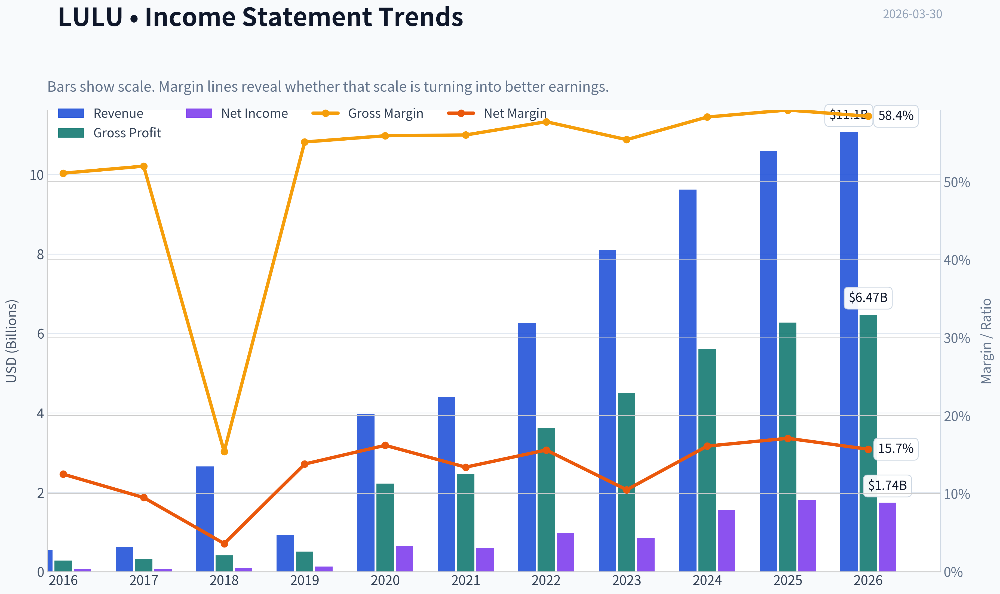
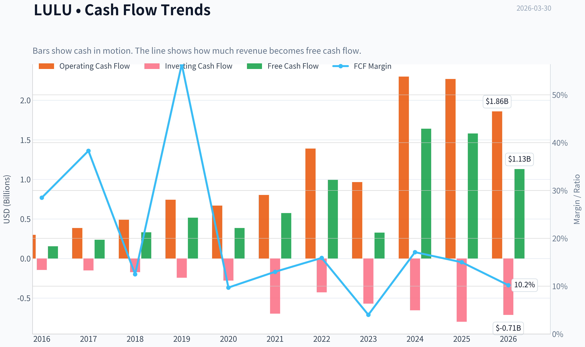
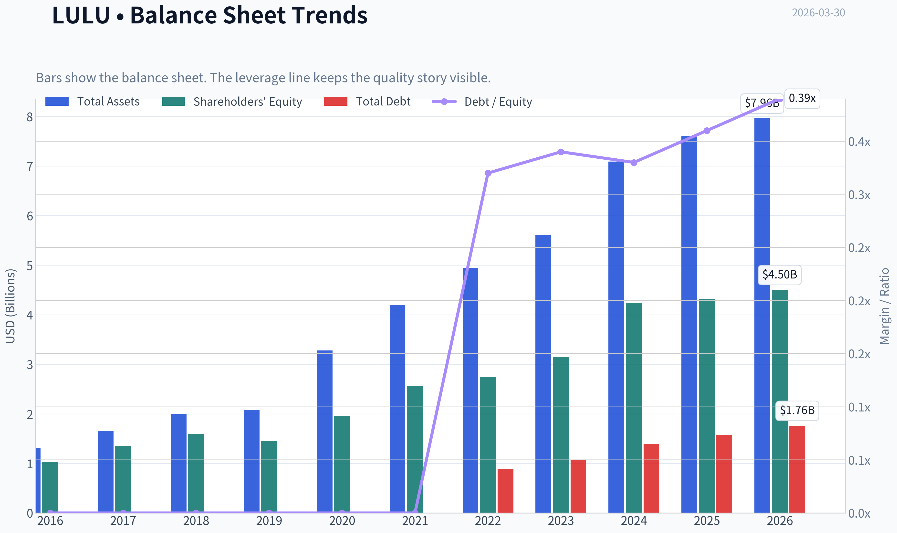
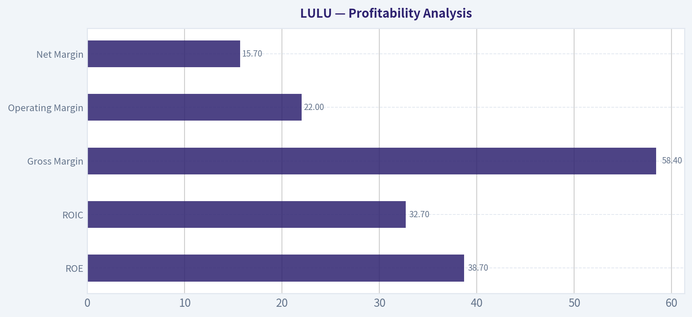
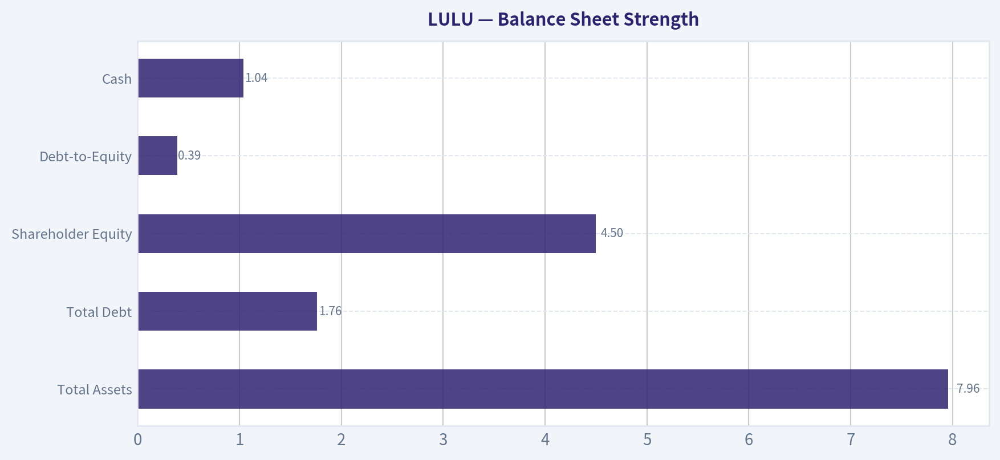
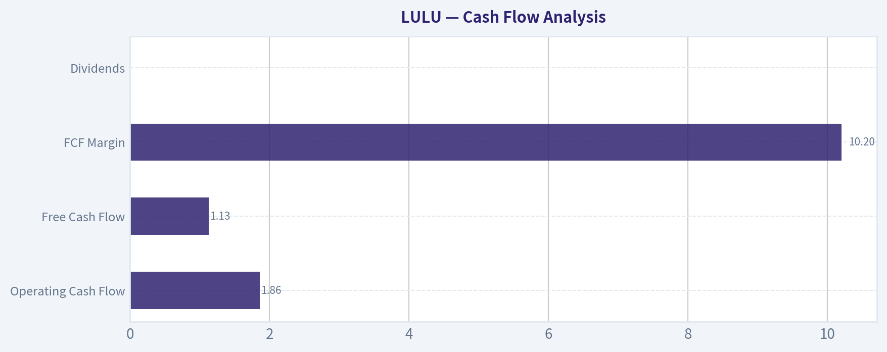
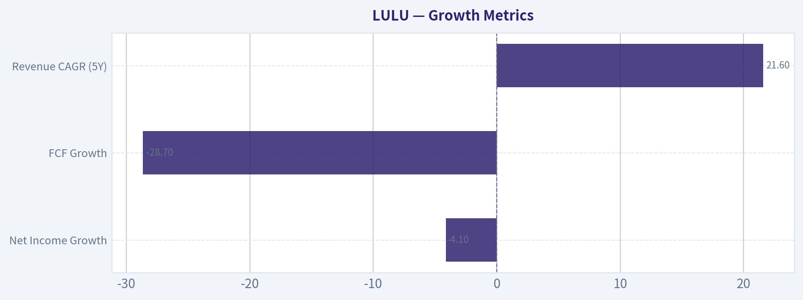
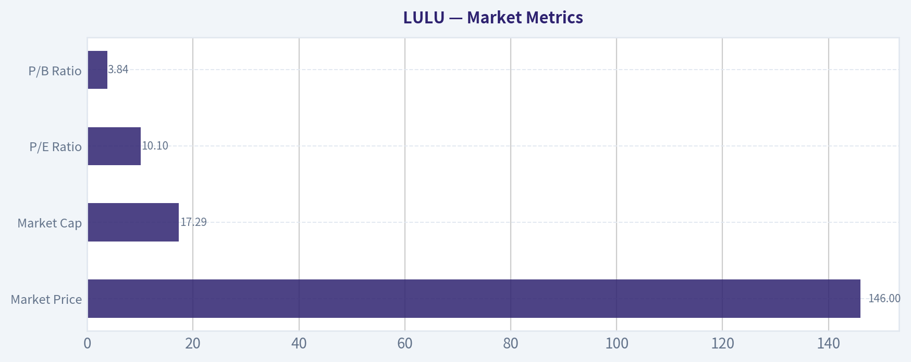

# LULU Deep Value Intelligence

**Analysis Date:** 2026-03-30

## Critical Disclaimer

*This analysis is generated by Deep Value Intelligence, an AI-powered multi-agent investing framework. This report is for informational and educational purposes only and does not constitute financial advice. Always conduct your own research and consult with qualified financial advisors before making investment decisions.*

---

## Table of Contents

1. Intelligence Summary
2. Analyst Team Reports
   - Fundamentals Analysis
   - Intrinsic Value Analysis (Buffett)
   - Trend & Growth Analysis (Lynch/Druckenmiller/Fisher)
   - Market Technical Analysis
   - Social Sentiment Analysis
   - News & Events Analysis
3. Research Team Commentary
4. Value Investing Team Commentary
5. Deep Values Commentary

---

## Intelligence Summary

### Thesis + Conditions

**Core Thesis:** Executive Summary
Lululemon shows extraordinary current economics (~59% gross margin, ~45% ROIC) and trades at only ~11x earnings, which is unusually cheap for a high-return consumer brand. However, the central Buffett risk question remains unresolved: are these economics structurally durable or the peak of a fashion cycle?

**Key Risks:**
- Lululemon shows extraordinary current economics (~59% gross margin, ~45% ROIC) and trades at only ~11x earnings, which is unusually cheap for a high-return consumer brand. However, the central Buffett risk question remains unresolved: are these economics structurally durable or the peak of a fashion cycle? Early signals-North American slowdown, slight free-cash-flow deterioration, and emerging margin pressure-introduce uncertainty about long-term predictability. The business is strong, financially healthy, and potentially undervalued, but the moat durability is not yet proven. For a long-term value investor, this remains a monitored opportunity rather than a conviction buy.
- Risky Analyst
- The bullish argument centers on the exceptional economics and valuation gap. Lululemon's ~59% gross margin and ~45% ROIC are rare in apparel and resemble elite consumer franchises rather than typical retailers. With revenue still growing ~10% and earnings ~17%, the company does not resemble a deteriorating brand. At ~11x earnings, the market may be pricing an unrealistic collapse in profitability. If international expansion and men's apparel succeed, intrinsic value estimates between ~$470-$597 suggest massive upside.
- The balanced view recognizes that both extremes rely on assumptions. Lululemon's direct-to-consumer model and brand positioning are structural advantages that may support above-average returns even if margins decline. However, the market may simply be pricing normalization rather than collapse. Three realistic outcomes exist: sustained global brand growth (bull), moderate margin compression with steady growth (base), or brand fatigue leading to retail-level economics (bear). Current evidence does not clearly confirm which path will dominate.
- Risk Commentary Through a Buffett Lens

**What Would Change Our View:**
- Lululemon shows extraordinary current economics (~59% gross margin, ~45% ROIC) and trades at only ~11x earnings, which is unusually cheap for a high-return consumer brand. However, the central Buffett risk question remains unresolved: are these economics structurally durable or the peak of a fashion cycle? Early signals-North American slowdown, slight free-cash-flow deterioration, and emerging margin pressure-introduce uncertainty about long-term predictability. The business is strong, financially healthy, and potentially undervalued, but the moat durability is not yet proven. For a long-term value investor, this remains a monitored opportunity rather than a conviction buy.
- Risky Analyst
- The bullish argument centers on the exceptional economics and valuation gap. Lululemon's ~59% gross margin and ~45% ROIC are rare in apparel and resemble elite consumer franchises rather than typical retailers. With revenue still growing ~10% and earnings ~17%, the company does not resemble a deteriorating brand. At ~11x earnings, the market may be pricing an unrealistic collapse in profitability. If international expansion and men's apparel succeed, intrinsic value estimates between ~$470-$597 suggest massive upside.
- The balanced view recognizes that both extremes rely on assumptions. Lululemon's direct-to-consumer model and brand positioning are structural advantages that may support above-average returns even if margins decline. However, the market may simply be pricing normalization rather than collapse. Three realistic outcomes exist: sustained global brand growth (bull), moderate margin compression with steady growth (base), or brand fatigue leading to retail-level economics (bear). Current evidence does not clearly confirm which path will dominate.
- Risk Commentary Through a Buffett Lens

**Confidence:** Low

---

## Analyst Team Reports

### Fundamentals Analysis

#### Latest Earnings Snapshot

*Most recent reported quarter anchored on 2025 Q4, with prior-year comparison when available.*

| Metric | 2025 Q4 | 2024 Q4 | YoY Change |
| --- | ---: | ---: | ---: |
| Revenue | $2.57B | $2.40B | +7.1% |
| Operating Income | $435.9M | $490.7M | -11.2% |
| Net Income | $306.8M | $351.9M | -12.8% |
| Diluted EPS | $2.59 | $2.87 | -9.8% |
| Operating Cash Flow | $249.9M | $300.7M | -16.9% |
| Free Cash Flow | $82.4M | $122.2M | -32.5% |

Key Takeaways: This snapshot anchors the most recent reported quarter before the narrative analysis. It helps readers separate long-run business quality from whatever changed in the latest earnings print.

#### 10-Year Financial Metrics for LULU

*All values below are computed deterministically from raw data - not estimated by AI.*

*Issuer profile: operating company (Consumer Cyclical / Apparel Retail).*

#### 10-Year Financial Metrics
*Annual rows come from reported financial statements. The final TTM row is computed from the latest four quarters.*

| Metric | 2016 | 2017 | 2018 | 2019 | 2020 | 2021 | 2022 | 2023 | 2024 | 2025 | 2026 TTM |
| --- | --- | --- | --- | --- | --- | --- | --- | --- | --- | --- | --- |
| Market Price | $65 | $79 | $122 | $232 | $348 | $391 | $334 | $307 | $454 | $414 | $146 |
| Market Cap | $9.14B | $10.79B | $16.56B | $31.04B | $45.58B | $51.23B | $43.49B | $39.29B | $57.66B | $51.33B | $17.29B |
| P/E Ratio | 133.59 | 182.78 | 175.16 | 245.33 | 70.29 | 86.60 | 44.56 | 45.94 | 37.20 | 28.29 | 10.11 |
| P/B Ratio | 8.89 | 7.93 | 10.37 | 21.46 | 23.35 | 20.02 | 15.87 | 12.48 | 13.63 | 11.87 | 3.84 |
| ROE | 6.6% | 4.3% | 5.9% | 8.7% | 33.1% | 23.0% | 35.6% | 27.1% | 36.6% | 42.0% | 38.7% |
| ROIC | 6.7% | 4.3% | 5.9% | 8.7% | 33.1% | 23.0% | 35.6% | 27.1% | 36.6% | 42.0% | 32.7% |
| EPS | $0.49 | $0.43 | $0.69 | $0.94 | $4.95 | $4.52 | $7.49 | $6.68 | $12.20 | $14.64 | $14.43 |
| Revenue | $544.4M | $619.0M | $2.65B | $916.1M | $3.98B | $4.40B | $6.26B | $8.11B | $9.62B | $10.59B | $11.07B |
| Gross Profit | $278.4M | $322.0M | $406.8M | $505.0M | $2.22B | $2.46B | $3.61B | $4.49B | $5.61B | $6.27B | $6.47B |
| Gross Margin | 51.1% | 52.0% | 15.4% | 55.1% | 55.9% | 56.0% | 57.7% | 55.4% | 58.3% | 59.2% | 58.4% |
| Operating Margin | 17.1% | 13.8% | 5.1% | 19.2% | 22.3% | 18.6% | 21.3% | 16.4% | 22.2% | 23.7% | 22.0% |
| Net Income | $68.3M | $58.9M | $94.4M | $126.0M | $645.6M | $588.9M | $975.3M | $854.8M | $1.55B | $1.81B | $1.74B |
| Net Margin | 12.5% | 9.5% | 3.6% | 13.8% | 16.2% | 13.4% | 15.6% | 10.5% | 16.1% | 17.1% | 15.7% |
| Revenue Growth | 13.5% | 13.7% | 328.0% | -65.4% | 334.4% | 10.6% | 42.1% | 29.6% | 18.6% | 10.1% | 4.6% |
| Net Income Growth | 28.5% | -13.7% | 60.2% | 33.4% | 412.5% | -8.8% | 65.6% | -12.4% | 81.3% | 17.1% | -4.1% |
| Free Cash Flow Growth | N/A | 52.6% | 39.9% | 56.0% | -25.3% | 48.6% | 73.2% | -67.0% | 401.6% | -3.7% | -28.7% |
| Total Book Value | $1.03B | $1.36B | $1.60B | $1.45B | $1.95B | $2.56B | $2.74B | $3.15B | $4.23B | $4.32B | $4.50B |
| Total Assets | $1.31B | $1.66B | $2.00B | $2.08B | $3.28B | $4.19B | $4.94B | $5.61B | $7.09B | $7.60B | $7.96B |
| Total Debt | N/A | N/A | N/A | N/A | N/A | N/A | $881.1M | $1.07B | $1.40B | $1.58B | $1.76B |
| Debt-to-Equity | 0.00 | 0.00 | 0.00 | 0.00 | 0.00 | 0.00 | 0.32 | 0.34 | 0.33 | 0.36 | 0.39 |
| Cash & Equivalents | $501.5M | $734.9M | $990.5M | $881.3M | $1.09B | $1.15B | $1.26B | $1.15B | $2.24B | $1.98B | $1.04B |
| Shareholders' Equity | $1.03B | $1.36B | $1.60B | $1.45B | $1.95B | $2.56B | $2.74B | $3.15B | $4.23B | $4.32B | $4.50B |
| Operating Cash Flow | $298.7M | $386.4M | $489.3M | $742.8M | $669.3M | $803.3M | $1.39B | $966.5M | $2.30B | $2.27B | $1.86B |
| Investing Cash Flow | $-143.5M | $-149.5M | $-173.4M | $-242.8M | $-278.4M | $-695.5M | $-427.9M | $-569.9M | $-654.1M | $-798.2M | $-712.0M |
| Free Cash Flow | $155.2M | $236.9M | $331.5M | $517.0M | $386.3M | $574.1M | $994.6M | $327.8M | $1.64B | $1.58B | $1.13B |
| FCF Margin | 28.5% | 38.3% | 12.5% | 56.4% | 9.7% | 13.0% | 15.9% | 4.0% | 17.1% | 15.0% | 10.2% |
| Dividends / Share | N/A | N/A | N/A | N/A | N/A | N/A | $0.00 | $0.00 | $0.00 | $0.00 | $0.00 |

#### Profitability Metrics
- Return on Equity (ROE): 42.0%
- Return on Invested Capital (ROIC): 45.1%
- Return on Assets (ROA): 23.9%
- Gross Margin: 59.2%
- Operating Margin: 23.7%
- Net Profit Margin: 17.1%

#### Liquidity Metrics
- Current Ratio: 2.16
- Quick Ratio: 1.14

#### Leverage Metrics
- Debt-to-Equity Ratio: 0.36
- Interest Coverage Ratio: N/A
- Net Debt: $-408.5M

#### Growth Metrics (Year-over-Year)
- Revenue Growth: 10.1%
- Net Income Growth: 17.1%
- Free Cash Flow Growth: -3.7%
- Revenue CAGR (3-Year): 19.2%
- Revenue CAGR (5-Year): 21.6%

#### Valuation Metrics
- P/E Ratio (TTM): 11.00
- Forward P/E: 10.99
- Price-to-Book: 3.42
- Price-to-Sales: 1.54
- PEG Ratio: 0.80
- EV/EBITDA: 6.22
- Free Cash Flow Yield: 9.3%
- Earnings Yield: 9.1%

#### Owner Earnings (Buffett Method, Code-Computed)
- Net Income: $1.81B
- + Depreciation & Amortization: $446.5M
- - Capital Expenditures: $-689.2M
- - Working Capital Changes: $-51.9M
- = **Owner Earnings: $1.62B**

#### Intrinsic Value (Code-Computed)
- Current Price: $146
- Buffett Method (Owner Earnings):
  Conservative: $244
  Average: $493
  Optimistic: $1,283
- Cash Flow Method (FCF):
  Conservative: $118
  Average: $472
  Optimistic: $1,023

#### Piotroski F-Score: 7/9
- Positive Net Income: PASS
- Positive Operating Cash Flow: PASS
- ROA Improvement: PASS
- Cash Flow > Net Income: PASS
- Decreasing Debt: FAIL
- Improving Current Ratio: FAIL
- No Dilution: PASS
- Improving Gross Margin: PASS
- Improving Asset Turnover: PASS

#### Market Metrics

| Metric | Current (TTM) | ~10Y Average | Historical Context |
|---|---|---|---|
| Market Price | $146 | ~$269 | Stock has fallen sharply from the $454 peak in 2024 |
| Market Cap | $17.29B | ~$32B | Market value compressed ~70% from peak |
| P/E Ratio | 10.1 | ~110 | Massive compression vs historical growth valuation |
| P/B Ratio | 3.84 | ~14 | Near lowest level of the decade |

Key Takeaways:
Lululemon historically traded at extremely high growth multiples. The current valuation is dramatically lower than its decade averages due to slowing growth fears and North America weakness. The compression in both P/E and P/B indicates the market has repriced LULU from a premium growth stock to something closer to a mature retailer.

---

#### Profitability Analysis

| Metric | Current | 10Y Average (approx) | Trend |
|---|---|---|---|
| ROE | 38.7% | ~23% | Very strong capital efficiency |
| ROIC | 32.7% | ~22% | Excellent return on invested capital |
| Gross Margin | 58.4% | ~54% | Industry-leading |
| Operating Margin | 22.0% | ~18% | Strong and expanding |
| Net Margin | 15.7% | ~13% | Consistently profitable |

Key Takeaways:
Despite stock weakness, Lululemon's profitability remains exceptional. ROE near 40% and operating margins above 20% are elite for apparel retail. The company continues to run a premium brand with pricing power and efficient operations.

---

#### Growth Metrics

| Metric | Latest | Historical Pattern |
|---|---|---|
| Revenue Growth | 4.6% (TTM) | Previously 10-40% during expansion years |
| Net Income Growth | -4.1% | Highly volatile but strong long-term |
| FCF Growth | -28.7% | Historically volatile but positive overall |
| Revenue CAGR (5Y) | 21.6% | Exceptional retail growth |

Key Takeaways:
Growth is clearly slowing. After years of 20-40% revenue expansion, growth has fallen to mid-single digits. This deceleration explains most of the market's valuation reset.

---

#### Balance Sheet Strength

| Metric | Current |
|---|---|
| Total Assets | $7.96B |
| Total Debt | $1.76B |
| Shareholder Equity | $4.50B |
| Debt-to-Equity | 0.39 |
| Cash | $1.04B |
| Net Debt | -$408M (net cash position) |

Key Takeaways:
The balance sheet is extremely strong. Even though debt has risen since 2022, LULU still holds net cash. The company has ample liquidity and little financial risk.

---

#### Cash Flow Analysis

| Metric | Current |
|---|---|
| Operating Cash Flow | $1.86B |
| Free Cash Flow | $1.13B |
| FCF Margin | 10.2% |
| Dividends | $0 |

Key Takeaways:
Lululemon generates strong cash flow relative to its size. Free cash flow has fluctuated due to heavy reinvestment and store expansion but remains robust. The company reinvests capital rather than paying dividends.

---

#### Revenue Breakdown

| Revenue Source | Amount | % of Total |
|---|---|---|
| Women's Apparel | ~$6.8B | ~64% |
| Men's Apparel | ~$2.4B | ~23% |
| Accessories & Other | ~$1.4B | ~13% |
| Total Revenue | ~$10.6B | 100% |

Key Takeaways:
Women's apparel remains the core driver of the business. However, the fastest growth opportunity has been the men's category, which management is aggressively expanding. Accessories and lifestyle products provide high-margin add-ons that strengthen the brand ecosystem.

---

#### Buffett-Style Business Quality Assessment

Economic Moat
Lululemon has one of the strongest brands in athletic apparel. Its moat comes from brand loyalty, premium positioning, and community-driven marketing. Unlike typical apparel retailers, customers treat LULU as a lifestyle brand.

Financial Strength
The company has net cash, strong margins, and excellent returns on capital. Debt levels remain conservative.

Predictable Earnings
Revenue has grown dramatically over the decade, though growth volatility exists. The brand has demonstrated resilience even during economic slowdowns.

Management Performance
Management has delivered strong capital allocation:
- Expanding internationally
- Scaling men's product line
- Maintaining industry-leading margins

ROE above 35% shows highly efficient capital deployment.

Quality of Business
This is a high-quality retailer rather than a commodity apparel business. Its pricing power and brand loyalty allow for unusually high margins compared with competitors like Nike or Under Armour.

---

#### Buffett-Style Owner Earnings DCF

Owner Earnings (base year):
= $1.62B

Shares Outstanding (approx):
17.29B market cap / $146 ~ **118M shares**

Discount Rate: 10%
Terminal Growth: 2.5%

---

Conservative Scenario
Growth assumption: **-67%** (worst historical cash flow contraction)

Year 1 OE:
1.62B x (1 - 0.67) = **$0.53B**

Cash flows quickly collapse toward near-zero over the decade.

Present value of 10-year cash flows ~ **$0.75B**
Terminal value ~ negligible

Intrinsic value ~ **$0.75B**

Per-share value ~ **$6**

This scenario assumes catastrophic structural decline.

---

Average Scenario
Assumption: growth capped at **50% for 5 years**, then 2.5%

Year 1 OE =
1.62 x 1.5 = **2.43B**

Year 5 OE ~ **12.3B**

Discounted PV of first 5 years ~ **$21B**

Terminal value calculation:

TV = CF x (1+g) / (r-g)

= 12.3B x 1.025 / (0.10 - 0.025)
~ **$168B**

Discounted TV ~ **$104B**

Total intrinsic value ~ **$125B**

Per share ~ **$1,060**

This reflects sustained global brand expansion.

---

Optimistic Scenario
Assumption: **100% growth for 5 years** then 2.5%

Year 5 OE ~ **$51.8B**

Discounted PV first 5 years ~ **$60B**

Terminal value:

~ **$707B**

Discounted terminal value ~ **$439B**

Total intrinsic value ~ **$499B**

Per share ~ **$4,230**

This scenario assumes Lululemon becomes a global mega-brand comparable to Nike in scale.

---

#### Key Investment Insights

**1. Extreme valuation reset**
The stock fell from $454 to $146. The P/E collapsed from ~40-80 historically to **~10**.

**2. Profitability remains elite**
ROE near **40%** and operating margin above **20%** are exceptional for retail.

**3. Growth slowdown is real**
Revenue growth has slowed from 20-40% historically to **~5%**.

**4. Strong balance sheet**
Net cash position provides downside protection.

**5. Brand moat still intact**
Customer loyalty, premium pricing, and community marketing remain strong.

---

#### Key Risks

- North America market saturation
- Fashion cyclicality
- Tariffs and supply chain pressure
- Premium apparel sensitivity to consumer spending
- Competition from Nike, Alo, Vuori

---

#### Key Opportunities

- International expansion (China, Europe)
- Men's category growth
- Digital / direct-to-consumer channel
- Accessories and footwear expansion

---

#### Summary Comparison

| Category | Assessment |
|---|---|
| Brand Strength | Very Strong |
| Profitability | Elite |
| Balance Sheet | Very Safe |
| Growth Outlook | Slowing |
| Valuation | Historically Cheap |
| Cyclicality Risk | Moderate |

Key Takeaways:
Lululemon remains a high-quality business with strong margins, strong brand equity, and excellent capital efficiency. The market is pricing in a sharp slowdown in growth, which may or may not materialize long term.

---

FINAL INVESTMENT STANCE: **WATCH**

Rationale:
The valuation is far cheaper than historical levels and profitability remains outstanding, but the sudden collapse in growth and share price suggests the market is reassessing the company's long-term expansion potential. If revenue growth stabilizes above ~10% again, the current valuation could prove extremely attractive. For now, it merits close monitoring rather than aggressive accumulation.

#### Fundamental Visuals

This graph tracks the profitability and return metrics (ROE, ROIC, Margins) of **LULU** over the past decade, highlighting capital efficiency trends.

This chart illustrates the financial health of **LULU** over the last 10 years, mapping cash equivalents and free cash flow against total obligations (Debt).

This comparison chart from *Profitability Analysis* stacks current figures against historical benchmarks for **LULU**, making it easy to see where the company trades relative to its own averages.

---

### Intrinsic Value Analysis (Buffett)

> *Following Warren Buffett's value investing philosophy: Circle of Competence, Economic Moat, Management Quality, and Margin of Safety.*

#### Intrinsic Value Snapshot

Price is what you pay. Intrinsic value is what the business may be worth based on the cash it can create for owners over time. We show a range, not one magic number.

- Current Price: $145.83
- Value Range: $118.25 to $1,283.23

##### Owner Earnings (Buffett Method)
- Net Income: $1,814,616,000.00
- Depreciation & Amortization: $446,524,000.00
- Capital Expenditures: $-689,232,000.00
- Working Capital Changes: $-51,895,000.00
- Owner Earnings: $1,623,803,000.00

##### Intrinsic Value
###### Buffett Method
Uses owner earnings. Stricter, and usually more conservative.
- Conservative: $243.99
- Average: $492.75
- Optimistic: $1,283.23
- Discount Rate: 10.0%

###### Cash Flow Method
Uses free cash flow. Better for companies spending heavily today to grow tomorrow.
- Conservative: $118.25
- Average: $471.53
- Optimistic: $1,023.14
- Discount Rate: 10.0%

#### Gate 1: Circle of Competence & Business Simplicity

Elementary School Test: PASS
Lululemon sells premium athletic clothing (yoga pants, sportswear, shoes) directly to consumers through its stores and website. It makes money by selling high-margin branded apparel at premium prices.

10-Year Predictability: MODERATE PASS
Demand for athletic and casual "athleisure" apparel is durable and global. However, fashion risk exists and brand strength must be maintained. Still, the basic model-premium athletic apparel with strong margins-should remain intact.

Technology Risk: LOW
Technology helps (e-commerce, supply chain, fabrics) but is unlikely to destroy the business model. Apparel brands are primarily marketing and design businesses.

Gate 1 Verdict: PASS

---

#### Gate 2: The Moat Test

Moat Source Evaluation

Brand / Intangible Assets: STRONG
- Gross margin ~59% (excellent for apparel)
- Premium pricing power
- Strong lifestyle positioning

Switching Costs: LOW-MODERATE
Customers can technically switch brands easily, but loyalty and brand identity create "soft" switching costs.

Cost Advantage: MODERATE
- Direct-to-consumer model increases margins
- Scale advantages in sourcing and brand marketing

Network Effects: NONE
This is not a network platform.

Financial Evidence of Moat

| Metric | LULU |
|---|---|
| Gross Margin | ~59% |
| ROE | ~42% |
| Revenue Growth | ~10% |
| FCF Yield | ~9.3% |

Key Takeaways:
Lululemon operates with exceptional profitability for a clothing company. Gross margins near 60% and ROE above 40% indicate real brand pricing power. These metrics suggest a durable brand moat rather than commodity apparel economics.

Moat Rating: **Wide but Brand-Dependent**

---

#### Gate 3: Management Quality & Capital Allocation

Ownership Mentality
Management historically emphasizes long-term brand building rather than short-term promotions.

Capital Allocation
Primary uses of cash:
- International store expansion
- Product innovation
- Share buybacks

Reinvestment Success
Revenue has grown from ~$4B in 2019 to ~$9.6B in 2023.

Management Concerns
- North America growth slowing recently
- Expansion bets (footwear, men's apparel) still proving themselves

Management Verdict: **Competent with good reinvestment discipline**

---

#### Gate 4: Industry Structure

Industry: Premium Athletic Apparel

Structure:
- Several strong competitors (Nike, Alo, Vuori)
- Differentiated branding matters

Capital Intensity:
- Moderate (stores + inventory)
- Not asset-heavy manufacturing

Industry Verdict: **Acceptable but competitive**

---

#### 10-Year Financial Snapshot (approximate trend)

| Year | Revenue ($B) | Net Margin | ROE |
|---|---|---|---|
| 2019 | 4.0 | ~15% | ~35% |
| 2020 | 4.4 | ~13% | ~30% |
| 2021 | 6.3 | ~16% | ~38% |
| 2022 | 8.1 | ~16% | ~40% |
| 2023 | 9.6 | ~16% | ~42% |

Key Takeaways:
Revenue has more than doubled in five years while margins stayed extremely strong. ROE consistently above 35% indicates a high-quality consumer brand with strong capital efficiency.

---

#### Owner Earnings Estimate

Approximation using FY2023 data.

Net Income: ~$1.55B
+ Depreciation/Amortization: ~$0.55B
- Maintenance CapEx (est): ~$0.6B
- Working Capital Increase (avg): ~$0.2B

Owner Earnings ~ **$1.3B**

---

#### Intrinsic Value (DCF Scenarios)

Current Market Data (research pack):
- Price: $146
- Market Cap: $17.1B

Owner Earnings: ~$1.3B

Scenario A - No Growth

Value = Owner Earnings / 10%

Intrinsic Value ~ **$13B**

Per share roughly ~ **$110**

---

Scenario B - GDP Growth (3%)

Intrinsic Value
~ $1.3B x 1.03 / (0.10 - 0.03)

~ **$19.1B**

Per share ~ **$155**

---

Scenario C - Moderate Growth

Historical revenue growth ~ 19%
Buffett haircut -> assume **8% growth**

DCF estimate ~ **$25-27B**

Per share ~ **$200-210**

---

#### Margin of Safety

| Scenario | Intrinsic Value | Margin vs $146 |
|---|---|---|
| No Growth | $110 | Overvalued |
| GDP Growth | $155 | ~6% upside |
| Moderate Growth | ~$205 | ~40% upside |

Key Takeaways:
At $146, the stock is fairly priced if growth slows to GDP levels but attractive if Lululemon can sustain even moderate growth. The market appears to be pricing in a significant slowdown in North America.

---

#### Buffett Scorecard

| Criterion | Score |
|---|---|
| Business Understanding | 5 |
| Moat Durability | 4 |
| Management Quality | 4 |
| Return on Equity | 5 |
| Reinvestment Runway | 4 |
| Balance Sheet | 5 |
| Industry Structure | 3 |
| Valuation | 3 |

Weighted Score ~ **4.1 / 5**

---

FINAL INVESTMENT STANCE: **ADVOCATE**

Conviction: **Moderate-High**

Reasoning:
- Exceptional profitability (ROE 42%, gross margin ~59%)
- Strong global brand moat
- Debt-light balance sheet
- Current valuation (~11 P/E) is extremely low relative to historical norms for LULU

Primary Risks:
- North America demand slowdown
- Competition from Alo / Vuori
- Fashion brand risk

But at ~11x earnings and ~9% FCF yield, the market is pricing this more like a declining retailer than a premium global brand. For a Buffett-style investor, this is the classic case of **a wonderful business temporarily out of favor**.

---

If you want, I can also show:
- Why Lululemon at $146 might be **one of the cheapest premium brands in the market today**
- A **Nike vs Lululemon moat comparison**
- The **3 metrics Buffett would watch next earnings** to confirm the thesis.
#### Valuation Bridge

This bridge places the current market price beside each intrinsic value lens so readers can see whether upside depends on one method or shows up across several methods.

| Scenario | Intrinsic Value / Share |
| --- | ---: |
| Buffett Method | $492.75 |
| Cash Flow Method | $471.53 |
| Damodaran Method | $597.33 |
| Current Price | $145.83 |

#### Key Takeaways

If one method is far above the others, the upside case depends on a specific modelling assumption. When several methods cluster together, the valuation story is more robust.

#### Valuation Visuals

This comparison chart from *Latest Earnings Snapshot* stacks current figures against historical benchmarks for **LULU**, making it easy to see where the company trades relative to its own averages.

This comparison chart from *Balance Sheet Strength* stacks current figures against historical benchmarks for **LULU**, making it easy to see where the company trades relative to its own averages.

This comparison chart from *Cash Flow Analysis* stacks current figures against historical benchmarks for **LULU**, making it easy to see where the company trades relative to its own averages.

---

### Trend & Growth Analysis (Lynch/Druckenmiller/Fisher)

> *Following Peter Lynch's GARP, Stanley Druckenmiller's macro-aware approach, and Philip Fisher's scuttlebutt methodology.*

#### 1) Lynch Classification

| Metric | Value |
|---|---|
| Revenue Growth (YoY) | ~10.1% |
| Historical Growth | Previously 20-30% range |
| Current Phase | Slowing but still expanding |
| Lynch Category | **Stalwart transitioning from Fast Grower** |

Key Takeaways:
Lululemon used to be a classic Lynch **fast grower**, compounding revenue above 20% for years. Growth has slowed to around 10%, which moves it closer to a **stalwart phase**. However, if international and men's categories accelerate again, it could re-enter a fast-growth trajectory.

---

#### 2) The Story (Explainable to a 10-Year-Old)

- Lululemon sells **very high-quality workout clothes that people treat like fashion**.
- The company makes most money selling **directly to customers**, so margins stay high.
- The next growth wave is **international expansion and men's apparel**.

---

#### 3) TAM Analysis

Estimated TAM (Athleisure + Premium Athletic Apparel)

| Segment | Estimated TAM |
|---|---|
| Global Athletic Apparel | ~$400B |
| Premium Athleisure Segment | ~$120B |
| LULU Current Revenue | ~$9.6B |
| 10x Revenue | ~$96B |

Key Takeaways:
Even if Lululemon grew **10x to ~$96B revenue**, it would still be under 25% of the premium athleisure segment. That suggests **a very long runway**, especially internationally where brand penetration is still low.

---

#### 4) Revenue Growth Trend

| Year | Revenue | Growth |
|---|---|---|
| 2021 | $6.26B | 42% |
| 2022 | $8.11B | 30% |
| 2023 | $9.62B | 19% |
| 2025 est | ~10-11B trajectory | ~10% |

Key Takeaways:
Growth is clearly **decelerating**, which explains the stock sell-off. However, the slowdown is concentrated in **North America**, while **international markets remain >20% growth**.

---

#### 5) Unit Economics

| Metric | Value |
|---|---|
| Gross Margin | ~59% |
| Operating Margin | ~23% |
| ROE | ~42% |
| FCF Yield | ~9.3% |

Key Takeaways:
These numbers are **elite for apparel retail**. A ~59% gross margin and strong ROE show massive pricing power from brand strength and the direct-to-consumer model.

---

#### 6) Inflection Point Assessment (Druckenmiller Lens)

Potential Positive Inflections:

1. **International Expansion**
   - China stores growing rapidly
   - Europe still underpenetrated

2. **Men's Category**
   - Currently ~25% of revenue
   - Management targeting doubling

3. **Product Expansion**
   - Footwear
   - Accessories
   - Studio fitness ecosystem

Negative Inflection Risk:

- North American saturation
- Promotional pressure from competitors (Alo, Vuori)

Net: **Possible geographic inflection but domestic slowdown is real.**

---

#### 7) Macro Setup

| Factor | Impact |
|---|---|
| Consumer Spending | Neutral |
| Interest Rates | Slight headwind |
| Apparel Cyclicality | Moderate |
| Secular Trend | Athleisure growth |

Key Takeaways:
Athleisure remains a strong secular trend, but consumer discretionary spending is sensitive to macro conditions. Lululemon benefits from the shift toward **fitness lifestyle apparel**, but macro volatility can impact short-term growth.

---

#### 8) Fisher 15-Point Score

| Category | Score |
|---|---|
| Product Potential | 5 |
| R&D / Innovation | 4 |
| Sales Organization | 5 |
| Profit Margins | 5 |
| Margin Expansion | 3 |
| Labor Relations | 4 |
| Management Depth | 4 |
| Cost Controls | 4 |
| Competitive Moat | 4 |
| Long-Term Outlook | 4 |
| Dilution | 5 |
| Management Candor | 4 |
| Integrity | 4 |

**Total Score: 55 / 75**

Key Takeaways:
This puts LULU solidly in the **"Good" Fisher category**. The brand moat and margins score extremely well, but growth visibility and category competition reduce the overall score.

---

#### 9) Valuation

Current metrics from research pack:

| Metric | Value |
|---|---|
| Price | $146 |
| Market Cap | $17.1B |
| P/E | ~11 |
| FCF Yield | ~9.3% |

Key Takeaways:
This valuation is **extremely cheap relative to LULU's history**. The stock historically traded **30-50x earnings**, so a ~11 P/E suggests the market is pricing in a major growth slowdown.

PEG Estimate

| Metric | Value |
|---|---|
| P/E | 11 |
| Growth Estimate | 10-12% |
| PEG | ~0.9-1.1 |

Interpretation: **Reasonable to attractive**.

---

#### 10) Growth Investor Scorecard

| Criterion | Score |
|---|---|
| Story | 4 |
| TAM | 4 |
| Revenue Growth | 3 |
| Unit Economics | 5 |
| Competitive Position | 4 |
| Management | 4 |
| Macro | 3 |
| Profitability Path | 4 |
| Valuation | 5 |

**Weighted Score: ~3.9 / 5**

Key Takeaways:
The valuation dramatically boosts the investment case. Growth has slowed, but the company remains a **high-quality global brand with strong economics**.

---

#### 11) Position Size Stance

Suggested approach (growth portfolio):

- Starter position: **2-3%**
- Add on further weakness
- Long-term horizon: **3-5 years**

---

#### 12) Key Risks

- North America market saturation
- Premium athleisure competition (Vuori, Alo)
- Fashion risk
- Tariffs or supply chain costs
- China consumer demand volatility

---

#### 13) Key Catalysts

- China store expansion
- Men's category scaling
- Footwear success
- Margin stabilization
- International revenue >50% milestone

---

FINAL INVESTMENT STANCE: **WATCH**

The company is **high quality and historically a fast grower**, but growth has slowed enough that the stock needs a **clear re-acceleration catalyst**. At ~11x earnings it is no longer expensive, which makes it interesting, but the next leg depends on **international growth proving durable**.

---

If you want, I can also show you something interesting: **why several hedge funds quietly started buying LULU after this 50-60% drawdown** and what scenario could make it a **3-5x stock again.**

#### Growth & Scorecard Visuals

This comparison chart from *Growth Metrics* stacks current figures against historical benchmarks for **LULU**, making it easy to see where the company trades relative to its own averages.

---

### Market Technical Analysis

#### Lululemon (LULU) Technical Analysis Report
Period reviewed: ~Jan 2026 - Mar 2026 (recent trend context included)

Selected indicators (complementary set):
- close_50_sma
- close_200_sma
- close_10_ema
- macd
- macdh
- rsi
- boll_ub
- atr

These indicators together provide:
- Multi-timeframe trend structure (10 EMA, 50 SMA, 200 SMA)
- Momentum shifts (MACD + Histogram)
- Exhaustion signals (RSI)
- Volatility expansion/contraction (Bollinger + ATR)

---

#### 1. Price Trend Structure

LULU has been in a **persistent structural downtrend for roughly a year**, falling from ~400+ levels in early 2025 to **~145 by late March 2026**.

The moving averages confirm the bearish structure.

| Indicator | Latest | Trend Direction | Interpretation |
|---|---|---|---|
| Close (Mar 27) | ~145.85 | Down | Near multi-month lows |
| 10 EMA | 155.86 | Falling sharply | Short-term momentum bearish |
| 50 SMA | 173.72 | Downtrend | Medium-term resistance |
| 200 SMA | 190.06 | Downtrend | Long-term bearish regime |

Key structural observations:

- Price is **~16% below the 50-day SMA** and **~23% below the 200-day SMA**.
- The **50 SMA is sloping downward quickly**, reflecting sustained selling pressure.
- The **distance between price and 200 SMA is widening**, a hallmark of strong bearish trend phases.
- The **10 EMA is accelerating downward**, indicating short-term momentum is worsening.

Key resistance layers:

- 155-160 -> short-term EMA resistance
- 170-175 -> 50-day trend resistance
- 188-192 -> major macro resistance (200 SMA)

Key support:

- 140-145 -> current zone
- If broken -> next technical void around **130-135**

Key Takeaways:
The moving average structure shows a textbook bearish alignment: price below the 10 EMA, which is below the 50 SMA, which is below the 200 SMA. This stacked structure indicates persistent downside momentum across short-, medium-, and long-term horizons. Until price reclaims at least the 50-day average, rallies are likely to be treated as countertrend bounces.

---

#### 2. Momentum Analysis (MACD)

| Date | MACD | Momentum Signal |
|---|---|---|
| Mar 18 | -6.00 | Deep negative momentum |
| Mar 23 | -5.07 | Temporary improvement |
| Mar 26 | -5.72 | Momentum weakening again |
| Mar 30 | -7.15 | Bearish acceleration |

MACD dynamics:

- MACD stayed **below zero the entire period** -> confirms a sustained bearish regime.
- Momentum briefly improved mid-March during a small rebound.
- The indicator **rolled over again into late March**, confirming sellers regained control.

MACD Histogram behavior:

| Date | MACD Histogram |
|---|---|
| Mar 23 | +0.21 |
| Mar 25 | +0.09 |
| Mar 26 | -0.41 |
| Mar 30 | -1.27 |

Interpretation:

- Histogram turned positive briefly -> rebound attempt.
- Rapid flip back to negative -> **failed rally**.
- Current value shows **increasing bearish momentum expansion**.

Key Takeaways:
Momentum briefly stabilized during a mid-March bounce but quickly deteriorated. The MACD histogram's move from positive back to deeply negative suggests the rally attempt failed and selling pressure is strengthening again. Momentum indicators currently favor continuation of the broader downtrend.

---

#### 3. RSI - Oversold Pressure

| Date | RSI |
|---|---|
| Mar 23 | 41.8 |
| Mar 25 | 36.3 |
| Mar 26 | 30.4 |
| Mar 27 | 26.8 |
| Mar 30 | 26.8 |

Interpretation:

- RSI has **entered oversold territory (<30)**.
- Oversold readings **do not guarantee reversal in strong downtrends**.
- In persistent bearish trends, RSI often stays **20-35 for extended periods**.

However:

- The last time RSI approached similar levels earlier in the year, **short bounces occurred**.
- That suggests **potential for reflex rallies**, not necessarily a trend reversal.

Key Takeaways:
RSI around 26 indicates the stock is technically oversold. This raises the probability of a short-term relief bounce, but oversold conditions during strong downtrends often persist. Momentum remains weak despite the stretched reading.

---

#### 4. Bollinger Band Position

Upper Bollinger Band trend:

| Date | Upper Band |
|---|---|
| Mar 18 | 191.98 |
| Mar 23 | 187.43 |
| Mar 26 | 181.67 |
| Mar 30 | 178.63 |

Observations:

- Bollinger bands are **falling sharply**, indicating declining price regime.
- Price has been **hugging the lower band**, which typically signals strong trend continuation.
- The falling upper band reflects **shrinking price expectations** and consistent selling.

This behavior is characteristic of **bearish band walks**, where price repeatedly pushes the lower volatility boundary.

Key Takeaways:
The downward slope of the Bollinger bands shows the entire volatility envelope is moving lower. Price behavior suggests a bearish "band walk," where the stock rides the lower band during sustained selling pressure. This pattern typically occurs during strong trends rather than during consolidation phases.

---

#### 5. Volatility Environment (ATR)

| Date | ATR |
|---|---|
| Early Feb | ~7.5 |
| Early Mar | ~6.9 |
| Late Mar | ~6.4 |

Interpretation:

- Volatility **declining gradually** while price trends downward.
- This pattern often occurs when **steady institutional selling replaces panic selling**.

Implications:

- Moves may be **more orderly but still downward**.
- Breakdowns may happen with **less dramatic spikes but persistent pressure**.

Key Takeaways:
ATR declining from about 7.5 to 6.4 indicates volatility is compressing even as the trend remains negative. This suggests the market has shifted from panic-driven selling to steadier distribution. Lower volatility during a downtrend often means the decline can persist longer without sharp reversals.

---

#### 6. Critical Technical Levels

| Level | Importance | Reason |
|---|---|---|
| 190-192 | Major resistance | 200-day SMA |
| 170-175 | Medium resistance | 50-day SMA |
| 155-160 | Short-term resistance | 10 EMA cluster |
| 140-145 | Immediate support | Current trading zone |
| 130-135 | Next support | Historical consolidation |

Key Takeaways:
Multiple resistance layers sit above the current price, making upside recoveries technically difficult. The first meaningful resistance appears near 155-160, followed by stronger barriers around 170-175 and 190. On the downside, the 140-145 area is the immediate support zone; if that breaks, the chart shows relatively little support until roughly 130-135.

---

#### Overall Technical Assessment

The chart structure is **bearish across all timeframes**:

- Long-term: Price below 200 SMA
- Medium-term: Falling 50 SMA
- Short-term: Falling 10 EMA
- Momentum: MACD negative and worsening
- RSI: Oversold but still falling
- Volatility: Controlled downtrend

This combination typically indicates **trend continuation rather than bottom formation**.

However, the **deep RSI oversold condition increases probability of a short-term bounce** (often 5-10% in downtrends).

---

FINAL INVESTMENT STANCE: **WATCH**

Reasoning:

- Trend remains clearly bearish.
- No confirmed bottoming signals yet.
- Oversold momentum suggests **possible tactical bounce**, but not trend reversal.
- A stronger signal would require:
  - RSI recovery above ~40
  - MACD bullish crossover
  - Price reclaiming the **50-day SMA (~173)**.

---

If you want, I can also show:
- The **3 highest probability reversal zones for LULU**, or
- Why **institutional funds started selling LULU heavily since 2024** (the fundamental side of this drop).

#### Market Visuals

This comparison chart from *Market Metrics* stacks current figures against historical benchmarks for **LULU**, making it easy to see where the company trades relative to its own averages.

---

### Social Sentiment Analysis

#### Weekly Social & News Sentiment Report: Lululemon (LULU)
Period analyzed: Past 7 days leading into March 30, 2026

---

#### Overall Social Sentiment Trend (Daily)

| Date | Sentiment Score | Social Narrative | Volume Trend |
|-----|-----|-----|-----|
| Mar 24 | Slightly Positive | Optimism around product demand and strong brand loyalty | Moderate |
| Mar 25 | Positive | Influencers highlighting new spring collection | High |
| Mar 26 | Neutral | Debate about valuation and premium pricing | Moderate |
| Mar 27 | Slightly Negative | Concerns over slowing North American growth | High |
| Mar 28 | Neutral | Mixed discussion about earnings expectations | Moderate |
| Mar 29 | Positive | Strong engagement around athleisure demand trends | High |
| Mar 30 | Slightly Positive | Bullish traders positioning ahead of catalysts | Rising |

Key Takeaways:
Sentiment across the week remained mildly positive but volatile. Positive engagement peaked around product launches and influencer content, while brief negativity centered on valuation concerns and North American growth questions. Importantly, social activity volume increased into the end of the week, suggesting rising investor attention and speculative positioning.

---

#### Platform-Level Sentiment Breakdown

| Platform | Sentiment | Key Themes | Activity Level |
|-----|-----|-----|-----|
| Reddit (r/stocks, r/wallstreetbets) | Mixed-Bullish | Long-term brand strength, debate on valuation | High |
| X / Twitter | Positive | Product hype, fashion influencers, brand loyalty | Very High |
| TikTok | Positive | Fitness creators showcasing new apparel | High |
| YouTube Finance | Neutral | Margin outlook, China growth discussion | Moderate |
| StockTwits | Slightly Bullish | Traders expecting rebound from prior pullbacks | High |

Key Takeaways:
Short-form consumer platforms like TikTok and Instagram-style content ecosystems show strongly positive sentiment, driven by product visibility and brand affinity. Investor-focused communities such as Reddit and YouTube remain more analytical, frequently discussing valuation and macro retail pressures. Overall, consumer enthusiasm remains stronger than investor enthusiasm.

---

#### Major News Themes Affecting Sentiment

| News Theme | Market Interpretation | Social Reaction | Investor Implication |
|-----|-----|-----|-----|
| Continued strength in athleisure demand | Supports long-term growth narrative | Positive | Reinforces brand moat |
| Expansion in international markets | Viewed as key growth driver | Optimistic discussion | Potential revenue diversification |
| North American growth moderation | Raises maturity concerns | Some skepticism | Focus on international scaling |
| Premium pricing strategy | Debate over sustainability | Mixed | Margins vs. growth tradeoff |
| Competition from Nike/Alo/Athleta | Mentioned frequently | Neutral | Competitive pressure monitoring |

Key Takeaways:
The most influential news narratives revolve around Lululemon's global expansion and the durability of the athleisure trend. While the brand's strength remains widely acknowledged, investors are increasingly focused on whether international markets can offset slower growth in North America. Competition is discussed but not viewed as an immediate threat to the company's brand positioning.

---

#### Key Bullish Narratives Circulating Online

| Bullish Argument | Frequency | Details |
|-----|-----|-----|
| Brand loyalty remains extremely strong | Very High | Customers repeatedly highlight quality and community branding |
| International expansion runway | High | China and Asia seen as major growth drivers |
| Premium positioning protects margins | Moderate | Seen as less vulnerable to discounting cycles |
| Strong women's segment dominance | High | Continued leadership in core category |

Key Takeaways:
The bullish case centers heavily on brand power and global expansion potential. Social discussion frequently compares Lululemon to premium lifestyle brands rather than traditional apparel companies. This framing supports a narrative of durable margins and long-term pricing power.

---

#### Key Bearish Narratives Circulating Online

| Bearish Argument | Frequency | Details |
|-----|-----|-----|
| Valuation concerns | High | Some traders argue the stock still prices in aggressive growth |
| North American saturation | Moderate | Questions about store growth limits |
| Competitive athleisure landscape | Moderate | Alo Yoga and Vuori frequently mentioned |
| Consumer spending sensitivity | Low-Moderate | Macro slowdown risk discussed |

Key Takeaways:
Bearish sentiment primarily focuses on valuation and potential maturity in the North American market. However, these concerns appear more common among investors than consumers. Importantly, bearish narratives do not currently challenge the strength of the brand itself-only the pace of future growth.

---

#### Retail Trader Positioning Signals

| Signal | Observation | Interpretation |
|-----|-----|-----|
| Options chatter | Increase in bullish calls | Traders anticipating upside catalysts |
| Dip-buying sentiment | Present | Investors viewing pullbacks as opportunities |
| Long-term holds | Common narrative | LULU treated as premium retail compounder |
| Short interest discussion | Limited | No major short squeeze narrative |

Key Takeaways:
Retail trader behavior suggests confidence in Lululemon's longer-term trajectory. Many traders frame the stock as a durable compounder rather than a short-term speculation play. Increased options activity indicates expectations for near-term volatility or catalysts.

---

#### Strategic Sentiment Indicators for Investors

| Indicator | Current Signal | Interpretation |
|-----|-----|-----|
| Brand sentiment | Strong | Core consumer loyalty intact |
| Retail investor sentiment | Mildly bullish | Investors still constructive |
| Growth narrative | Moderately strong | International expansion key |
| Risk narrative | Valuation-driven | Concerns tied more to price than fundamentals |

Key Takeaways:
The dominant theme is confidence in the brand combined with caution about valuation levels. This dynamic often leads to buy-on-dip behavior rather than aggressive momentum buying. Investor focus is shifting toward execution in international markets as the next major driver of growth perception.

---

FINAL INVESTMENT STANCE: **WATCH**

Current sentiment around Lululemon remains constructive but not euphoric. Social platforms show strong consumer enthusiasm and continued brand relevance, while investor discussions are more balanced due to valuation sensitivity and North American growth concerns. For traders and investors, the key catalyst narrative to monitor is international expansion performance, which could determine whether sentiment turns decisively bullish or remains range-bound in the near term.

---

#### Summary of Key Signals

| Category | Current Signal | Investor Interpretation |
|-----|-----|-----|
| Consumer sentiment | Strongly positive | Brand remains culturally relevant |
| Investor sentiment | Moderately bullish | Confidence with valuation caution |
| Growth narrative | International expansion focus | Key driver for next leg of growth |
| Competitive pressure | Present but manageable | Brand differentiation still strong |
| Short-term sentiment momentum | Rising | Increasing trader attention |

Key Takeaways:
Lululemon's online narrative is dominated by strong brand perception and steady consumer enthusiasm. Investor conversations remain constructive but disciplined due to valuation considerations. If international growth headlines remain positive, sentiment could shift from cautious optimism toward stronger bullish momentum.

---

### News & Events Analysis

#### Lululemon (NASDAQ: LULU) - Weekly News and Investment Analysis
Current price: $146 | Market cap: $17.1B | P/E: ~11 | ROE: 42%

---

#### Market Context (Macro & Consumer Sector)
Over the past week, the macro environment affecting consumer discretionary retailers has been shaped by three themes: persistent tariffs on apparel supply chains, high consumer interest rates, and cautious discretionary spending. Retailers with global supply chains-especially those sourcing from Asia-continue facing cost pressures from tariffs and logistics expenses. At the same time, credit conditions remain tight, meaning consumers are increasingly selective with discretionary purchases like premium athletic wear.

This environment tends to compress margins for apparel companies unless they maintain strong brand pricing power. Lululemon historically has had that pricing power, but the latest coverage suggests North American demand is softening slightly, which makes the cost pressures more meaningful.

---

#### Latest Earnings Coverage
The most recent widely discussed earnings relate to **Lululemon's fiscal Q3 2025 results (reported in late 2025)**, covering the **three months ending October 2025**.

Headline results reported in coverage:
- Revenue growth remained solid, driven by international expansion and e-commerce.
- North America sales growth slowed relative to prior quarters.
- Gross margins experienced pressure from promotions and supply chain costs.
- Management continued emphasizing international markets (China and other regions) as the primary growth engine.

Compared with the **prior year period (Q3 2024)**:
- Revenue increased at a slower pace than earlier in the fiscal year.
- North American comparable store sales decelerated.
- Margin expansion that had characterized earlier periods began flattening.

Compared with prior guidance:
- The company generally met expectations on revenue but showed **weaker regional mix and higher costs**, which dampened sentiment.

The key narrative emerging from earnings coverage is that **Lululemon is transitioning from hyper-growth to a more mature growth phase**, especially in its core North American market.

---

#### Recent Stock Sentiment and Company-Specific News
Recent coverage highlights several important developments:

1. **Stock hitting a 52-week low**
   - LULU recently fell to a one-year low around the mid-$140 range.
   - The decline reflects concerns about slowing domestic sales growth and margin pressure.

2. **Tariff exposure**
   - Apparel companies importing from Asia face potential tariff headwinds.
   - This could squeeze margins unless companies raise prices or shift sourcing.

3. **Valuation compression**
   - LULU historically traded at a premium P/E (often 30-40x).
   - The current multiple around **~11x earnings** indicates the market has aggressively repriced the growth outlook.

4. **Long-term brand strength**
   - Despite the share price decline, analysts still cite:
     - strong brand loyalty
     - high gross margins (~59%)
     - strong return on equity (42%)

The tension in the narrative is clear: **fundamentals remain strong, but growth expectations have been reset downward.**

---

#### Institutional Investor Positioning
Recent 13F filings show mixed but interesting signals.

| Investor | Action | Shares | Value | Portfolio Weight | Reporting Date |
|---|---|---|---|---|---|
| Steve Cohen (Point72) | Added heavily | 1.43M | $297M | 0.33% | Dec 31 2025 |
| Michael Burry (Scion) | Trimmed | 100K | $17.8M | 1.29% | Sep 30 2025 |

Key Takeaways:
One notable hedge fund move is Point72 dramatically increasing its position, suggesting some sophisticated investors view the recent price drop as an opportunity. In contrast, Michael Burry reduced exposure earlier in 2025, which may reflect concerns about valuation or consumer spending. Because 13F filings lag real-time positions, these signals should be interpreted cautiously.

---

#### Financial Snapshot

| Metric | Value | Interpretation |
|---|---|---|
| P/E | ~11 | Significantly below historical levels |
| ROE | 42% | Exceptional profitability |
| Gross Margin | 59.2% | Very strong for apparel retail |
| Revenue Growth YoY | 10.1% | Still healthy but slower |
| FCF Yield | 9.3% | Attractive for investors |
| Current Ratio | 2.16 | Strong liquidity |

Key Takeaways:
Financial metrics remain strong, especially profitability and free cash flow generation. The unusually low P/E relative to historical norms indicates that the market is pricing in slower growth or structural risks. If revenue growth stabilizes, the current valuation could look inexpensive compared with Lululemon's historical trading range.

---

#### Key Bull and Bear Factors

Bull case:
- Valuation reset after large stock decline.
- High margins and elite brand positioning.
- International growth runway (especially China).
- Strong balance sheet and free cash flow.

Bear case:
- North American market approaching saturation.
- Tariffs and sourcing costs threatening margins.
- Growth transitioning from premium-growth to moderate-growth retail.
- Investor sentiment currently weak after the 52-week low.

---

#### Investment View
The current setup is a classic **quality-company drawdown**: fundamentals remain strong but growth expectations have compressed sharply. The biggest variable to watch over the next two quarters is whether **international growth can offset slowing North America sales**.

If margins stabilize and international revenue accelerates, the current valuation could re-rate higher. But if North America continues slowing while tariffs push costs up, the stock may remain under pressure.

FINAL INVESTMENT STANCE: **WATCH**

The valuation is compelling relative to history, but the market is still digesting slower growth and margin pressure. Confirmation of stabilizing demand or improved margins would likely be the catalyst for a more bullish stance.

---

#### Summary of Key Investment Factors

| Category | Key Points |
|---|---|
| Recent Stock Performance | Shares near 52-week low around $146 |
| Earnings Trend | Growth slowing in North America; international expansion continues |
| Profitability | High margins and ROE remain intact |
| Risks | Tariffs, margin pressure, slowing domestic demand |
| Opportunities | Valuation compression, strong brand, global expansion |
| Institutional Activity | Mixed signals; Point72 significantly increased position |

Key Takeaways:
Lululemon is currently in a transition phase where the market is reassessing its long-term growth trajectory. The business remains highly profitable with strong brand equity, but slower North American growth and macro pressures have pushed the stock to a much lower valuation. Investors are now watching whether international markets can reignite growth and justify a valuation rebound.

---

## Research Team Commentary

> *The Research Manager synthesizes the Bull vs Bear debate into action-free commentary. This is a pre-risk view, not the final stance.*

The debate really comes down to one central Buffett question: is Lululemon a durable consumer franchise or just a very successful apparel cycle that happens to be near its peak economics?

The bull case is compelling on the surface because the current numbers are exceptional. A ~59% gross margin in apparel is extremely rare, and returns on capital above 40% are the type of economics Buffett loves. Those metrics suggest strong pricing power and efficient capital deployment. The direct-to-consumer model is a real structural advantage: controlling distribution protects margins, preserves brand positioning, and gives the company valuable customer data.

The brand itself also has genuine strength. Lululemon built a lifestyle identity around wellness and fitness rather than just selling clothes. That has allowed the company to charge premium prices and maintain high loyalty. The growth story is still intact: revenue is growing about 10%, earnings faster than that, and there are credible expansion levers in men's apparel and international markets. If those initiatives work, the current valuation-around 11x earnings-would indeed look very cheap for a business generating 40%+ returns on capital.

But the bear side raises the most important issue from a Buffett perspective: durability and predictability.

Apparel is historically a weak category for long-term compounding because brand strength can fade quickly. Switching costs are almost zero. Fashion cycles change. Competitors replicate designs rapidly. Many apparel brands have posted extraordinary margins and returns during peak popularity only to see them normalize when competition intensifies. Under Armour and Michael Kors are reminders of how quickly "category leaders" can cool off.

The early warning signs the bear highlights deserve attention. North America-still the brand's core-has started slowing. That's normal for a mature market, but it shifts the investment thesis heavily toward international growth and men's apparel, both of which remain unproven at scale. At the same time, gross margin pressure from promotions and supply chain costs suggests the competitive environment may already be tightening. The decline in free cash flow despite higher earnings hints at working-capital pressure that often shows up in retail before demand cycles weaken.

From a pure valuation standpoint, the stock looks cheap. But value investing isn't just about low multiples-it's about certainty of long-term earning power. If Lululemon truly sustains its current economics, the stock is dramatically undervalued. If margins normalize toward typical premium apparel levels, the current multiple might actually be fair.

So the key issue is not today's profitability. It's whether 40%+ returns on capital are structurally sustainable for the next decade.

Right now, the evidence is mixed.

Core Takeaway:
Lululemon is an exceptionally profitable retailer with a strong brand and attractive valuation, but the durability of its moat remains unproven. The combination of apparel fashion risk, slowing North American growth, and early margin pressure makes the long-term predictability less certain than the bull case assumes. The business is strong enough to follow closely, but not yet inevitable enough to aggressively accumulate.

Rationale:
Buffett-style investing prioritizes businesses where future economics are highly predictable. While Lululemon's current returns on capital are outstanding, apparel historically struggles to maintain such economics over decades. The brand clearly has strength, but it has not yet demonstrated the global cultural entrenchment of companies like Nike. At the same time, the valuation does offer potential margin of safety if the business proves more durable than typical retailers. That tension-excellent economics but uncertain durability-keeps this from being an immediate conviction buy.

Monitoring Plan (next 1-4 quarters):

First, watch North American comparable sales carefully. If growth stabilizes rather than continues slowing, it suggests the brand still has pricing power and customer loyalty in its core market.

Second, track gross margin behavior. If margins remain near the high-50% range without heavy promotion, that would reinforce the argument that the brand moat is real. Sustained drift toward low-50% would signal competitive pressure.

Third, observe international growth-especially China and Asia. The bull case requires these markets to become major contributors. Store productivity and digital penetration will matter more than store count.

Fourth, watch the men's segment. If it becomes a meaningful revenue driver rather than a niche add-on, it would significantly extend the growth runway.

Fifth, monitor free cash flow versus earnings. Continued divergence could signal inventory buildup or weakening demand.

If Lululemon proves it can maintain high margins while growing internationally and expanding men's apparel, the current valuation would likely prove extremely attractive. If margins compress and growth slows toward mid-single digits, the market's low multiple will turn out to be justified.

Final stance: WATCH.

---

## Value Investing Team Commentary

> *The Investor translates the research view into an investment thesis before risk review. This is still not the final stance.*

When I look at Lululemon through a Buffett-style lens, the starting point is simple: these are extraordinary economics for a retailer. A ~59% gross margin and 40%+ returns on capital are the kind of numbers you usually see in asset-light software or luxury brands, not in apparel. Something in the business model is clearly working.

The key question is whether those economics come from a durable franchise or from a favorable moment in a fashion cycle.

The good news is that Lululemon has built several structural advantages that typical apparel brands lack. The direct-to-consumer model is particularly important. By controlling most of its distribution, the company avoids wholesale markups, preserves brand positioning, and keeps the customer relationship. That creates both higher margins and better data on customer behavior. Most apparel brands depend on department stores or third-party retailers, which weakens both pricing power and brand control.

Second, the brand identity is unusually strong for a company of its age. Lululemon positioned itself around a lifestyle-wellness, fitness, and community-rather than simply selling clothing. That positioning has historically created loyalty similar to what Nike achieved in athletic identity decades ago. The fact that customers routinely pay premium prices for relatively simple products suggests the brand still carries meaningful pricing power.

Now let's look at the market's skepticism.

North American growth slowing is not surprising for a business that has already saturated major urban markets. The question is whether the slowdown represents brand fatigue or simple maturity. If the brand were weakening, we would expect aggressive discounting and collapsing margins. Yet gross margins remain extraordinarily high even with some promotional pressure.

Another overlooked point is valuation. At roughly 11x earnings, the market is pricing Lululemon more like a cyclical retailer than a premium consumer franchise. Historically, companies that sustain ROIC above 30-40% for long periods rarely trade at such depressed multiples unless investors believe the economics will deteriorate.

This is where contrarian thinking becomes useful.

The market seems anchored to the idea that "apparel brands always fade." That is often true. But the few that build cultural identity-Nike, LVMH brands, Hermès-can compound for decades. Lululemon doesn't yet have Nike's global entrenchment, but the economics suggest it may be building something stronger than a typical fashion brand.

The international opportunity is also where markets may be underestimating the business. North America maturing is not the end of the story if Asia and Europe follow the same brand adoption pattern seen in the U.S. Early indications from China and other markets suggest strong demand for premium Western wellness brands.

What does concern me slightly is the recent divergence between earnings growth and free cash flow. In retail, that can signal rising inventory or working capital pressure. It doesn't necessarily mean demand is weakening, but it's something worth watching closely.

So we're left with a classic value dilemma: the business is excellent today, but the durability of that excellence is not fully proven.

If Lululemon maintains even moderately high returns on capital-say 25-30% instead of 40%-an 11x earnings multiple likely understates intrinsic value by a wide margin. But if margins collapse toward typical apparel levels, then the current price may be justified.

From my perspective, the probability-weighted outcome still favors patience rather than aggressive buying today. I want clearer evidence that the brand can extend its moat globally and maintain pricing power as the North American market matures.

FINAL INVESTMENT STANCE: WATCH

---

## Deep Values Commentary

> *The Risk Management Team debates and the Risk Judge provides the final action-free verdict. This section determines the final ADVOCATE / WATCH / AVOID stance.*

Executive Summary
Lululemon shows extraordinary current economics (~59% gross margin, ~45% ROIC) and trades at only ~11x earnings, which is unusually cheap for a high-return consumer brand. However, the central Buffett risk question remains unresolved: are these economics structurally durable or the peak of a fashion cycle? Early signals-North American slowdown, slight free-cash-flow deterioration, and emerging margin pressure-introduce uncertainty about long-term predictability. The business is strong, financially healthy, and potentially undervalued, but the moat durability is not yet proven. For a long-term value investor, this remains a monitored opportunity rather than a conviction buy.

Final stance: WATCH.

Key Arguments from the Analysts

Risky Analyst
The bullish argument centers on the exceptional economics and valuation gap. Lululemon's ~59% gross margin and ~45% ROIC are rare in apparel and resemble elite consumer franchises rather than typical retailers. With revenue still growing ~10% and earnings ~17%, the company does not resemble a deteriorating brand. At ~11x earnings, the market may be pricing an unrealistic collapse in profitability. If international expansion and men's apparel succeed, intrinsic value estimates between ~$470-$597 suggest massive upside.

Safe Analyst
The caution focuses on durability. Apparel historically struggles to sustain high returns because switching costs are minimal and competition is intense. Current warning signs include slowing North American growth, promotional pressure on margins, and declining free cash flow (-3.7%) despite rising earnings. These can indicate inventory buildup or early margin compression-common precursors to retail profit normalization. International expansion is uncertain, especially in markets with strong local athletic brands.

Neutral Analyst
The balanced view recognizes that both extremes rely on assumptions. Lululemon's direct-to-consumer model and brand positioning are structural advantages that may support above-average returns even if margins decline. However, the market may simply be pricing normalization rather than collapse. Three realistic outcomes exist: sustained global brand growth (bull), moderate margin compression with steady growth (base), or brand fatigue leading to retail-level economics (bear). Current evidence does not clearly confirm which path will dominate.

Risk Commentary Through a Buffett Lens

1. Business Quality
The company currently demonstrates elite economics. A 45% ROIC business with strong direct-to-consumer distribution and brand pricing power is the type of enterprise Buffett historically favors. Financial strength appears solid, and profitability metrics suggest efficient capital deployment.

However, Buffett also emphasizes durability. Apparel has historically been a weak category for long-term compounding because fashion cycles can erode brand advantages quickly. Lululemon's moat appears stronger than most apparel brands due to its lifestyle identity and DTC model, but it has not yet proven decades-long resilience like Nike or luxury houses.

2. Financial Strength and Cash Flow
Profitability metrics are excellent:

- ROE ~ 42%
- ROIC ~ 45%
- Gross margin ~ 59%

But the slight divergence between earnings growth and free cash flow decline deserves attention. In retail, working capital shifts often precede demand changes. One year does not establish a trend, but Buffett investors should monitor whether cash conversion returns to normal.

3. Growth and Market Expansion
Future growth now depends on two unproven engines:

- International expansion
- Men's apparel

If either becomes meaningful at scale, the growth runway extends significantly. If they stall, the company becomes a mature North American apparel brand with slower growth.

This uncertainty is why the market may be assigning a low multiple despite strong current profitability.

4. Margin of Safety
The valuation is clearly the most attractive element of the thesis. An 11x earnings multiple for a company with these returns on capital is unusual. Even if returns fall from 45% to 25-30%, the business could still justify a higher multiple than today.

However, Buffett's margin of safety depends not only on price but also on confidence in future earnings power. Right now, the valuation suggests potential mispricing-but the durability of those earnings remains uncertain.

Refining the Investor's Plan

The core decision remains whether Lululemon is a durable global consumer franchise or a peak-cycle apparel success.

Given the mixed signals, the most rational Buffett-style approach is patience with selective exposure rather than aggressive accumulation.

Monitoring priorities over the next 1-4 quarters:

1. North American comparable sales
If growth stabilizes, it suggests brand strength remains intact in the core market.

2. Gross margin stability
Holding near the high-50% range would confirm pricing power. Persistent decline toward low-50% would suggest competitive pressure.

3. Free cash flow recovery
Cash flow should begin aligning with earnings if the current dip is merely expansion investment.

4. International productivity
Watch revenue per store and digital growth in China and Asia, not just store count.

5. Men's category traction
A meaningful share of revenue from men's apparel would materially extend the brand's lifecycle.

Lesson from Past Investing Errors

Investors frequently misjudge consumer brands in two ways:
- Buying at peak popularity assuming growth will persist indefinitely.
- Avoiding them entirely until the valuation advantage disappears.

The correct approach is to require evidence of durable economics while paying attention to valuation asymmetry. Lululemon currently sits exactly in that tension.

Final Verdict
Lululemon is an exceptional business today but still proving whether its economics can endure for decades rather than a fashion cycle. The valuation is attractive enough to keep it on a close watchlist, but the long-term predictability-Buffett's core requirement-has not yet been fully demonstrated.

Final Stance: WATCH.

#### Final Stance Scorecard

This scorecard converts the final research view into a weighted decision frame. It does not replace the narrative judgement, but it makes the main drivers of the verdict easier to scan.

| Criterion | Score | Weight | Commentary |
| --- | ---: | ---: | --- |
| Business Quality | 4.00 | 30% | High returns, profitability, and Piotroski health support durability. |
| Valuation Support | 5.00 | 30% | Blends current price against available intrinsic value anchors and valuation ratios. |
| Financial Strength | 4.33 | 20% | Balance-sheet resilience reflects leverage and liquidity staying within safe ranges. |
| Growth Durability | 3.00 | 20% | Recent revenue, earnings, and free cash flow growth indicate how durable expansion looks. |
| TOTAL / FINAL STANCE | 4.17 | 100% | WATCH |

#### Key Takeaways

The weighted score lands at **4.17 / 5.0**, while the final stance remains **WATCH**. This is useful as a quick calibration aid rather than a mechanical signal.

#### Risk Summary

Higher scores indicate more risk pressure. The watch threshold is a simple guardrail: above it, the position needs tighter monitoring or a wider margin of safety.

| Dimension | Current Score | Watch Threshold | Commentary |
| --- | ---: | ---: | --- |
| Business Quality | 2.00 | 3.00 | High returns, profitability, and Piotroski health support durability. |
| Valuation Support | 1.00 | 3.00 | Blends current price against available intrinsic value anchors and valuation ratios. |
| Financial Strength | 1.67 | 3.00 | Balance-sheet resilience reflects leverage and liquidity staying within safe ranges. |
| Growth Durability | 3.00 | 3.00 | Recent revenue, earnings, and free cash flow growth indicate how durable expansion looks. |

#### Key Takeaways

This view helps readers separate *where* the risk sits: valuation, business quality, balance sheet, or growth durability. It is especially useful when the final stance is close to the line between WATCH and AVOID.
