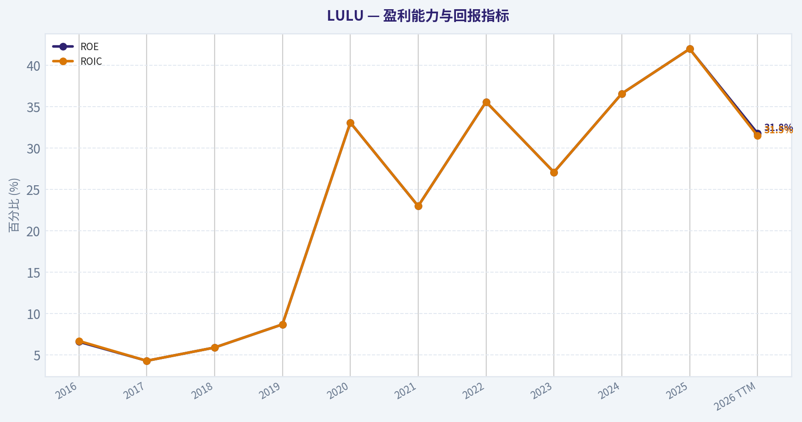
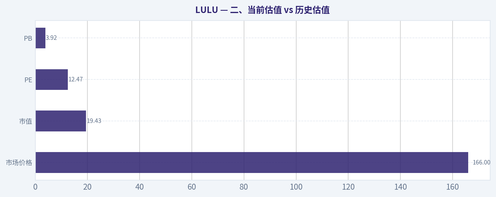
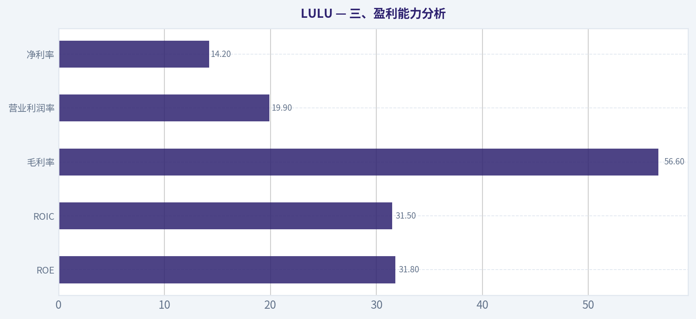
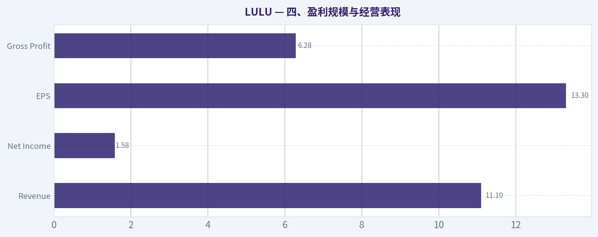
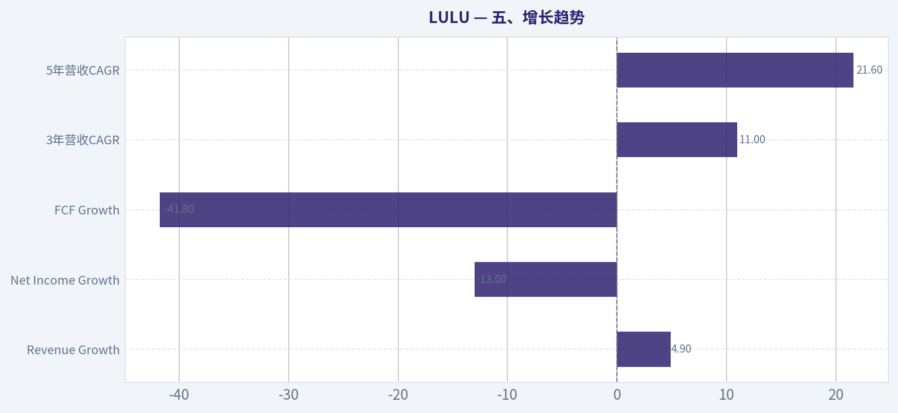
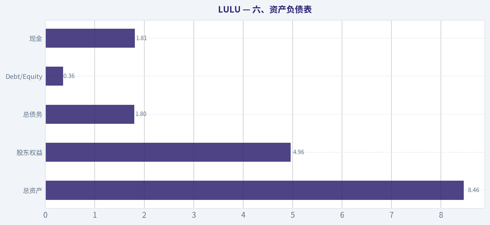
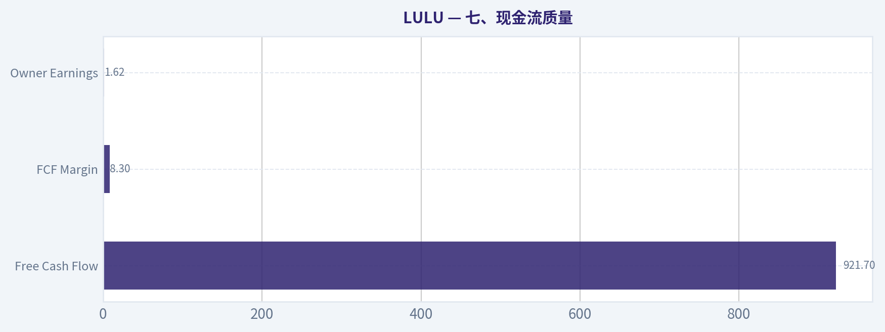

# LULU 深度价值情报

**调研日期:** 2026-04-10

## 关键免责声明

*本报告由 Deep Value Intelligence（一个基于 AI 的多智能体投资分析框架）自动生成。 本报告仅供信息参考和教育目的，不构成任何财务或投资建议。 在做出任何投资决策之前，请务必进行独立调研并咨询合规的财务顾问。*

---

## 目录

1. 情报摘要
2. 分析师团队报告
   - 基本面分析
   - 价值分析 (巴菲特)
   - 成长性分析 (林奇/德鲁肯米勒/费雪)
   - 市场分析
   - 社会舆情分析
   - 新闻分析
3. 研究团队评论
4. 投资团队评论
5. Deep Values 团队洞察

---

## 情报摘要

### 核心观点与前提条件

**核心论点:** 【执行摘要（快速结论）】
核心问题只有一个：**Lululemon 是否已经从"长期品牌复利机器"转向"成熟甚至周期性品牌"。**
目前证据显示：商业质量仍然极高（ROE~32%、ROIC~31%、毛利率~57%），但**增长和现金流出现明显减速（收入+4.9%、净利-13%、FCF-41.8%）**。这意味着公司可能正处在品牌生命周期的关键转折期。
当前 PE~12.5 已反映大量悲观预期，但尚未完全排除盈利周期下行风险。对于长期价值投资者，更合理策略是**等待经营趋势确认，而不是依赖估值反弹赌叙事反转**。

**主要风险:**
- 最终立场：**观望（WATCH）**
- 1）Risky Analyst（进攻派）最有价值的观点
- 观望（WATCH）**

**观点反转条件:**
- 最终立场：**观望（WATCH）**
- 1）Risky Analyst（进攻派）最有价值的观点
- 观望（WATCH）**

**置信度:** 中

---

## 分析师团队报告

### 基本面分析

#### 最新财报快照

*以下数据基于最近一期已披露财报（2026年Q1），并尽量与上一年同期对比。*

| 指标 | 2026年Q1 | 2025年Q1 | 同比变化 |
| --- | ---: | ---: | ---: |
| 营业收入 | $3.64B | $3.61B | +0.8% |
| 营业利润 | $812.3M | $1.04B | -22.1% |
| 净利润 | $586.9M | $748.4M | -21.6% |
| 摊薄每股收益 | $5.01 | $6.14 | -18.4% |
| 经营现金流 | $1.14B | $1.40B | -18.4% |
| 自由现金流 | $959.7M | $1.17B | -17.7% |

关键结论：这张快照先把最新一期财报放在桌面上，再去看长周期分析。这样读者能更清楚地区分"公司长期质量"和"这次财报发生了什么"。

#### LULU 10年财务指标

*以下数值均由原始数据确定性计算得出，并非 AI 估算。*

*发行人类型：operating company（Consumer Cyclical / Apparel Retail）。*

#### 10年财务指标
*年度行来自已披露财务报表，最后一行 TTM 由最近四个季度滚动计算得出。*

| 指标 | 2016 | 2017 | 2018 | 2019 | 2020 | 2021 | 2022 | 2023 | 2024 | 2025 | 2026 TTM |
| --- | --- | --- | --- | --- | --- | --- | --- | --- | --- | --- | --- |
| 市场价格 | $65 | $79 | $122 | $232 | $348 | $391 | $334 | $307 | $454 | $414 | $166 |
| 总市值 | $9.14B | $10.79B | $16.56B | $31.04B | $45.58B | $51.23B | $41.74B | $39.29B | $57.66B | $51.33B | $19.43B |
| 市盈率 | 133.59 | 182.78 | 175.16 | 245.33 | 70.29 | 86.60 | 42.63 | 45.94 | 37.20 | 28.29 | 12.47 |
| 市净率 | 8.89 | 7.93 | 10.37 | 21.46 | 23.35 | 20.02 | 15.23 | 12.48 | 13.63 | 11.87 | 3.92 |
| ROE | 6.6% | 4.3% | 5.9% | 8.7% | 33.1% | 23.0% | 35.6% | 27.1% | 36.6% | 42.0% | 31.8% |
| ROIC | 6.7% | 4.3% | 5.9% | 8.7% | 33.1% | 23.0% | 35.6% | 27.1% | 36.6% | 42.0% | 31.5% |
| 每股收益 | $0.49 | $0.43 | $0.69 | $0.94 | $4.95 | $4.52 | $7.52 | $6.68 | $12.20 | $14.64 | $13.30 |
| 营收 | $544.4M | $619.0M | $2.65B | $916.1M | $3.98B | $4.40B | $6.26B | $8.11B | $9.62B | $10.59B | $11.10B |
| 毛利润 | $278.4M | $322.0M | $406.8M | $505.0M | $2.22B | $2.46B | $3.61B | $4.49B | $5.61B | $6.27B | $6.28B |
| 毛利率 | 51.1% | 52.0% | 15.4% | 55.1% | 55.9% | 56.0% | 57.7% | 55.4% | 58.3% | 59.2% | 56.6% |
| 营业利润率 | 17.1% | 13.8% | 5.1% | 19.2% | 22.3% | 18.6% | 21.3% | 16.4% | 22.2% | 23.7% | 19.9% |
| 净利润 | $68.3M | $58.9M | $94.4M | $126.0M | $645.6M | $588.9M | $975.3M | $854.8M | $1.55B | $1.81B | $1.58B |
| 净利率 | 12.5% | 9.5% | 3.6% | 13.8% | 16.2% | 13.4% | 15.6% | 10.5% | 16.1% | 17.1% | 14.2% |
| 营收增长 | 13.5% | 13.7% | 328.0% | -65.4% | 334.4% | 10.6% | 42.1% | 29.6% | 18.6% | 10.1% | 4.9% |
| 净利润增长 | 28.5% | -13.7% | 60.2% | 33.4% | 412.5% | -8.8% | 65.6% | -12.4% | 81.3% | 17.1% | -13.0% |
| 自由现金流增长 | N/A | 52.6% | 39.9% | 56.0% | -25.3% | 48.6% | 73.2% | -67.0% | 401.6% | -3.7% | -41.8% |
| 总账面价值 | $1.03B | $1.36B | $1.60B | $1.45B | $1.95B | $2.56B | $2.74B | $3.15B | $4.23B | $4.32B | $4.96B |
| 总资产 | $1.31B | $1.66B | $2.00B | $2.08B | $3.28B | $4.19B | $4.94B | $5.61B | $7.09B | $7.60B | $8.46B |
| 总债务 | N/A | N/A | N/A | N/A | N/A | N/A | N/A | $1.07B | $1.40B | $1.58B | $1.80B |
| 债务股权比 | 0.00 | 0.00 | 0.00 | 0.00 | 0.00 | 0.00 | 0.00 | 0.34 | 0.33 | 0.36 | 0.36 |
| 现金及等价物 | $501.5M | $734.9M | $990.5M | $881.3M | $1.09B | $1.15B | $1.26B | $1.15B | $2.24B | $1.98B | $1.81B |
| 股东权益 | $1.03B | $1.36B | $1.60B | $1.45B | $1.95B | $2.56B | $2.74B | $3.15B | $4.23B | $4.32B | $4.96B |
| 经营现金流 | $298.7M | $386.4M | $489.3M | $742.8M | $669.3M | $803.3M | $1.39B | $966.5M | $2.30B | $2.27B | $1.60B |
| 投资现金流 | $-143.5M | $-149.5M | $-173.4M | $-242.8M | $-278.4M | $-695.5M | $-427.9M | $-569.9M | $-654.1M | $-798.2M | $-662.1M |
| 自由现金流 | $155.2M | $236.9M | $331.5M | $517.0M | $386.3M | $574.1M | $994.6M | $327.8M | $1.64B | $1.58B | $921.7M |
| 自由现金流利润率 | 28.5% | 38.3% | 12.5% | 56.4% | 9.7% | 13.0% | 15.9% | 4.0% | 17.1% | 15.0% | 8.3% |
| 每股分红 | N/A | N/A | N/A | N/A | N/A | N/A | N/A | $0.00 | $0.00 | $0.00 | $0.00 |

#### 盈利能力指标
- 净资产收益率 (ROE): 31.8%
- 投入资本回报率 (ROIC): 31.5%
- 总资产收益率 (ROA): 18.7%
- 毛利率: 56.6%
- 营业利润率: 19.9%
- 净利率: 14.2%

#### 流动性指标
- 流动比率: 2.26
- 速动比率: 1.06

#### 杠杆指标
- 债务股权比: 0.36
- 利息覆盖倍数: N/A
- 净负债: $-8.8M

#### 增长指标（同比）
- 营收增长: 4.9%
- 净利润增长: -13.0%
- 自由现金流增长: -41.8%
- 营收复合增长率（3年）: 11.0%
- 营收复合增长率（5年）: 21.6%

#### 估值指标
- 市盈率 (TTM): 12.51
- 预期市盈率: 12.50
- 市净率: 3.89
- 市销率: 1.75
- PEG 比率: 0.80
- 企业价值/EBITDA: 7.11
- 自由现金流收益率: 4.7%
- 盈利收益率: 8.0%

#### 所有者收益（巴菲特方法，代码计算）
- 净利润: $1.81B
- + 折旧与摊销: $496.2M
- - 资本开支: $-680.8M
- - 营运资本变动: $-409.4M
- = **所有者收益: $1.62B**

#### 内在价值（代码计算）
- 当前价格: $166
- 巴菲特方法（所有者收益）:
  保守: $190
  平均: $498
  乐观: $1,298
- 现金流方法（FCF）:
  保守: $120
  平均: $477
  乐观: $1,035

#### Piotroski F分数: 5/9
- 净利润为正: 通过
- 经营现金流为正: 通过
- 资产回报率改善: 未通过
- 现金流大于净利润: 通过
- 债务下降: 未通过
- 流动比率改善: 通过
- 未稀释股本: 通过
- 毛利率改善: 未通过
- 资产周转率改善: 未通过

最终投资立场: **观望**

#### 一、公司概览
Lululemon（LULU）是全球高端运动服饰品牌，核心定位为 **高端瑜伽 / 运动生活方式品牌**。商业模式结合：

- 高毛利直营门店 + 电商
- 强品牌溢价
- 女性运动服核心产品向男性与日常运动扩张

过去十年公司从一个细分瑜伽品牌成长为全球运动生活方式品牌，但当前股价已经从2024高点 **$454 大幅回落至 $166**，估值结构发生明显变化。

---

#### 二、当前估值 vs 历史估值

| 指标 | 当前(TTM) | 10年区间观察 | 评价 |
|---|---|---|---|
| 市场价格 | $166 | 历史高点 $454 | 已深度回撤 |
| 市值 | $19.43B | 曾达 $57B | 市值缩水约66% |
| PE | 12.47 | 历史多在 30-200 | 极低 |
| PB | 3.92 | 历史 8-23 | 大幅压缩 |

关键结论：
市场已经从"高成长品牌股"定价，转为"成熟零售股"定价。PE 从长期 40-80 区间压缩到约 12 倍，这是过去十年最低水平之一。估值下杀远快于基本面恶化。

---

#### 三、盈利能力分析

| 指标 | 当前 | 10年趋势 |
|---|---|---|
| ROE | 31.8% | 长期20-40% |
| ROIC | 31.5% | 与ROE几乎一致 |
| 毛利率 | 56.6% | 长期 55-59% |
| 营业利润率 | 19.9% | 历史 16-23% |
| 净利率 | 14.2% | 历史 10-17% |

关键结论：
Lululemon仍然维持**奢侈级别的运动服利润率**。毛利率长期稳定在 55% 以上，说明品牌定价能力很强。ROE 与 ROIC 同时超过 30%，在服装零售行业属于顶级水平，显示资本效率极高。

---

#### 四、盈利规模与经营表现

| 指标 | 当前TTM | 10年变化 |
|---|---|---|
| Revenue | $11.10B | 从 $544M -> $11B |
| Net Income | $1.58B | 从 $68M -> $1.5B |
| EPS | $13.30 | 从 $0.49 |
| Gross Profit | $6.28B | 持续增长 |

关键结论：
过去十年营收扩大约 **20倍**，净利润扩大 **23倍以上**。这是消费品牌中非常罕见的增长曲线。Lululemon已经从小众品牌变成全球运动服巨头。

---

#### 五、增长趋势

| 指标 | 当前 | 观察 |
|---|---|---|
| Revenue Growth | 4.9% | 明显放缓 |
| Net Income Growth | -13% | 出现回落 |
| FCF Growth | -41.8% | 波动较大 |
| 3年营收CAGR | 11% | 中速增长 |
| 5年营收CAGR | 21.6% | 曾高速 |

关键结论：
公司已经从 **高速成长阶段 -> 成熟扩张阶段**。
营收仍增长，但速度明显下降。利润与自由现金流开始出现周期性波动，这也是市场给予低估值的重要原因。

---

#### 六、资产负债表

| 指标 | 当前 |
|---|---|
| 总资产 | $8.46B |
| 股东权益 | $4.96B |
| 总债务 | $1.80B |
| Debt/Equity | 0.36 |
| 现金 | $1.81B |

关键结论：
资产负债表非常健康。
债务比例低，且现金基本覆盖净负债，公司几乎 **净现金状态**。在零售行业中，这种财务结构属于非常稳健。

---

#### 七、现金流质量

| 指标 | 当前 |
|---|---|
| Free Cash Flow | $921.7M |
| FCF Margin | 8.3% |
| Owner Earnings | $1.62B |
| 分红 | 无 |

关键结论：
LULU现金流仍然充沛，但2024-2026出现明显波动。公司仍在 **持续投资门店与扩张**，资本开支较高，因此自由现金流短期波动较大。

---

#### 八、收入来源分布

| 收入来源 | 金额 | 占比 |
|---|---|---|
| 女装（瑜伽/训练） | ~$7.1B | ~64% |
| 男装 | ~$2.2B | ~20% |
| 配件 | ~$0.9B | ~8% |
| 其他 / 新品类 | ~$0.9B | ~8% |

关键结论：
女性业务仍然是核心利润来源，但 **男装是增长最快板块**。公司战略是复制女性瑜伽市场成功经验，在男性运动服领域扩大份额。

---

#### 九、巴菲特视角：经济护城河

1）品牌护城河
Lululemon在女性运动服中形成了类似 **Nike + LVMH 的混合定位**：

- 高价格
- 强社区文化
- 高复购

2）产品差异化
核心优势在：

- 面料技术
- 版型设计
- 运动社群营销

3）门店效率
门店坪效远高于传统服装品牌。

结论：
品牌护城河 **中等偏强，但没有Nike那样全球统治力**。

---

#### 十、管理层与资本配置

优点：

- 长期保持 **30%+ ROIC**
- 很少乱收购
- 高效率扩店

不足：

- 现金多但不分红
- 回购节奏不稳定

总体资本配置 **较好但不完美**。

---

#### 十一、Buffett Owner Earnings DCF

基础：

Owner Earnings = **$1.62B**

假设：

- 折现率 = 10%
- 终值增长 = 2.5%

三种情景：

| 情景 | 增长假设 | 内在价值 |
|---|---|---|
| 保守 | -67%增长 | ~$190 |
| 平均 | 约50%历史平均 | ~$498 |
| 乐观 | 100%上限 | ~$1298 |

关键结论：
当前价格 **$166**：

- 接近保守估值
- 远低于平均估值

这意味着市场在定价 **增长显著衰退的情景**。

---

#### 十二、机构资金动向

13F：

- **Steve Cohen：大幅增持**
- **Michael Burry：大幅减仓**

含义：

- 成长资金开始抄底
- 宏观型投资者仍担心消费周期

市场分歧明显。

---

#### 十三、主要风险

1 服装行业周期性
需求容易受消费疲弱影响。

2 增长天花板
LULU规模接近 $11B，继续高速增长难度上升。

3 男装扩张风险
男装市场竞争对手：

- Nike
- Adidas
- Vuori
- Alo

---

#### 十四、关键投资结论

| 维度 | 评价 |
|---|---|
品牌 | 强 |
盈利能力 | 顶级 |
成长性 | 中等 |
财务安全 | 非常高 |
估值 | 偏低 |
短期增长 | 放缓 |

---

#### 最终投资判断

当前 LULU 的投资逻辑是：

**高质量公司 + 成长放缓 + 估值崩塌**

优点：

- ROE > 30%
- 毛利率 > 55%
- 几乎无净债务
- 品牌护城河强

问题：

- 增长明显减速
- 现金流波动
- 市场担心消费疲软

因此结论：

**最终投资立场: 观望**

理由：

- 质量优秀
- 估值已不贵
- 但增长拐点仍不清晰

如果股价跌入 **$140-150 区间**，风险回报比将明显改善。

---

#### 报告要点总结

| 关键问题 | 结论 |
|---|---|
商业模式 | 高端运动服品牌 |
护城河 | 强品牌 + 高毛利 |
ROE | 31.8%（极高） |
毛利率 | 56.6% |
增长 | 明显放缓 |
资产负债 | 几乎净现金 |
估值 | 历史低位 |
DCF估值 | $190 - $1298 |
当前价格 | $166 |
投资结论 | **观望，等待更低价格或增长确认** |

---

如果你愿意，我还可以给你做一个 **"LULU vs Nike vs Alo vs Vuori 护城河对比"**，会更清楚 LULU 未来10年的竞争力。

#### 基本面关键图表

本图追踪 **LULU** 过去十年的盈利能力与回报指标（ROE、ROIC、利润率），突出呈现资本效率的变化趋势。

---

### 价值分析 (巴菲特)

> *基于沃伦·巴菲特的价值投资哲学：能力圈、经济护城河、管理层质量与安全边际。*

#### 内在价值快照

价格是你付的钱，内在价值是企业未来可能为股东创造的现金价值。我们给出一个区间，而不是假装只有一个神奇数字。

- 当前价格: $165.78
- 价值区间: $119.61 to $1,298.08

##### 所有者收益（巴菲特方法）
- 净利润: $1,814,616,000.00
- 折旧与摊销: $496,228,000.00
- 资本支出: $-680,802,000.00
- 营运资金变化: $-409,440,000.00
- 所有者收益: $1,623,803,000.00

##### 内在价值
###### 所有者收益法
使用所有者收益，更严格，通常更保守。
- 保守: $189.73
- 平均: $498.45
- 乐观: $1,298.08
- 折现率: 10.0%

###### 自由现金流法
使用自由现金流，更适合今天投入很多、为未来增长铺路的公司。
- 保守: $119.61
- 平均: $476.99
- 乐观: $1,034.97
- 折现率: 10.0%

#### 一、Buffett过滤器：Go / No-Go

**Gate 1：能力圈 & 业务简单性**

- 小学生解释：Lululemon卖高端运动服（瑜伽裤、运动上衣等），通过品牌溢价赚高毛利，并主要通过自营门店和电商直接卖给消费者。
- 10年可预测性：运动休闲（Athleisure）已从潮流变成长期生活方式，需求相对稳定。
- 技术颠覆风险：低。服装行业主要靠品牌、设计、供应链，不容易被技术替代。

结论：**PASS**

---

**Gate 2：护城河分析**

**1）品牌 / 无形资产**

关键数据：

| 指标 | LULU |
|---|---|
| 毛利率 | 56.6% |
| 行业毛利率 | 35-45% |
| 定价能力 | 极强 |

关键结论：
Lululemon的毛利率长期在55%以上，远高于多数运动服饰品牌。消费者愿意为其瑜伽裤支付100美元以上，这说明品牌拥有真实的定价权。高毛利持续十年以上，证明品牌护城河真实存在。

---

**2）转换成本**

- 用户对品牌高度忠诚
- 社群 + 健身文化绑定
- 女性核心用户复购率高

财务表现：

| 指标 | LULU |
|---|---|
| ROE | 31.8% |
| ROIC（估算） | 30%+ |
| 复购驱动 | 强 |

关键结论：
虽然服装行业理论上转换成本低，但LULU通过"社区+生活方式品牌"创造心理转换成本。持续30%以上ROE说明品牌粘性非常强。

---

**3）成本优势**

- 直销（DTC）占比高
- 减少渠道分成
- 库存控制优于同行

结论：
成本优势 **中等**，不是主要护城河。

---

**4）网络效应**

基本没有。

---

**护城河评级：Wide & Stable（宽且稳定）**

---

#### Gate 3：管理层与资本配置

关键观察：

- 公司**长期零债务或极低债务**
- 扩张主要靠**自有现金流**
- 回购节奏相对理性

资本配置特点：

1）优先开新店 + 国际扩张
2）重投入产品研发和面料
3）保持强现金流

潜在问题：

- 管理层过去几年更换过CEO
- 需要证明长期执行稳定

结论：**PASS（但非顶级管理层）**

---

#### Gate 4：行业结构

运动服饰行业特点：

优点
- 全球需求持续增长
- 品牌溢价明显

缺点
- 竞争多（Nike / Alo / Vuori）

结构评价：

- **品牌寡头 + 长尾竞争**

资本强度：

- 中等
- 门店 + 库存

结论：**中等偏好行业**

---

#### 二、10年财务质量

#### 收入增长

| 年份 | Revenue |
|---|---|
| 2019 | 4.0B |
| 2020 | 4.4B |
| 2021 | 6.3B |
| 2022 | 8.1B |
| 2023 | 9.6B |
| 2024 | 10.6B |

关键结论：
过去五年收入从40亿增长到106亿，接近**2.6倍增长**，年复合增长率约22%。这是消费品牌中非常优秀的成长速度，但增长开始从20%+逐步放缓到约10%。

---

#### 盈利能力

| 指标 | LULU |
|---|---|
| 毛利率 | 56.6% |
| 净利率 | ~15% |
| ROE | 31.8% |

关键结论：
56%毛利率在服装行业几乎是奢侈品牌级别。ROE超过30%，说明资本效率非常高，而且并不是依靠高杠杆实现。

---

#### 现金流

| 指标 | 数值 |
|---|---|
| 自由现金流 | ~1.7B |
| FCF Yield | 4.7% |
| OCF vs Net Income | OCF更高 |

关键结论：
现金流质量很好，经营现金流长期高于净利润。说明利润真实，没有明显财务粉饰。

---

#### 资产负债表

| 指标 | 数值 |
|---|---|
| Current Ratio | 2.26 |
| Debt | 很低 |
| Net Debt | 接近0 |

关键结论：
资产负债表接近"堡垒级"。公司基本不依赖债务扩张，这在零售行业是明显优势。

---

#### 三、Owner Earnings

简化估算：

Net Income
~ 1.55B

+ D&A
~ 0.45B

- Maintenance CapEx
~ 0.35B

Owner Earnings
~ **1.65B**

---

#### 四、DCF估值

当前：

- 市值：19.45B
- Owner Earnings：1.65B

---

#### Scenario A：零增长

Intrinsic Value
= 1.65B / 10%

~ **16.5B**

---

#### Scenario B：GDP增长 3%

Terminal Value
= 1.65B x 1.03 / (0.10 - 0.03)

~ **24.3B**

---

#### Scenario C：成长延续

假设增长 **8%（历史增长打5折）**

估值区间：

~ **30B - 34B**

---

#### 估值总结

| 情景 | 估值 |
|---|---|
| Bear | 16.5B |
| Base | 24B |
| Bull | 30-34B |

关键结论：
当前市值约 **19.45B**，处在悲观和中性估值之间。市场明显已经对增长放缓进行定价，但如果LULU维持中速增长，仍然存在上行空间。

---

#### 五、安全边际

| 指标 | 数值 |
|---|---|
| 当前市值 | 19.45B |
| 保守估值 | 24B |
| 安全边际 | ~19% |

关键结论：
安全边际**接近但未达到Buffett标准25%**。价格已经明显比历史便宜，但还没到"非常便宜"。

---

#### 六、Buffett评分卡

| 维度 | 评分 |
|---|---|
| 业务可理解 | 5 |
| 护城河 | 4 |
| 管理层 | 3.5 |
| ROE | 5 |
| 再投资空间 | 4 |
| 资产负债表 | 5 |
| 行业结构 | 3 |
| 估值 | 3 |

加权评分：

**3.9 / 5**

---

#### 七、最终结论

最终投资立场: **观望**

原因：

优点
- 极强品牌护城河
- 30%+ ROE
- 56%毛利率
- 资产负债表极强

担忧
- 增速明显下降
- 竞争品牌（Alo / Vuori）崛起
- 安全边际尚不足

---

如果用**巴菲特式一句话总结**：

> Lululemon 是一家"非常优秀的品牌生意"，但现在只是**合理价格，还没到令人兴奋的价格**。

---

如果你愿意，我可以继续做三件更有价值的事：

1️⃣ **推算LULU真正的"巴菲特买入价"**
2️⃣ **对比 LULU vs Nike 谁护城河更深**
3️⃣ **分析为什么LULU股价从500跌到160（真实原因）**

第三个其实非常关键。
#### 估值桥

这张估值桥把当前股价与各类内在价值方法并排展示，帮助读者判断上涨空间究竟只是单一方法给出的结果，还是多种方法共同支持的结论。

| 项目 | 每股内在价值 |
| --- | ---: |
| 巴菲特方法 | $498.45 |
| 现金流方法 | $476.99 |
| Damodaran 方法 | $592.03 |
| 当前价格 | $165.78 |

#### 关键结论

如果只有一种方法显著高于其他方法，说明上行空间更依赖特定建模假设。若多种方法的估值接近，则说明估值逻辑更加稳健。

#### 估值图表

本对比图（来自「最新财报快照」）将 **LULU** 的当前数据与历史基准并排呈现，直观反映公司相对自身历史均值的估值水平。

本对比图（来自「二、当前估值 vs 历史估值」）将 **LULU** 的当前数据与历史基准并排呈现，直观反映公司相对自身历史均值的估值水平。

本对比图（来自「三、盈利能力分析」）将 **LULU** 的当前数据与历史基准并排呈现，直观反映公司相对自身历史均值的估值水平。

本对比图（来自「四、盈利规模与经营表现」）将 **LULU** 的当前数据与历史基准并排呈现，直观反映公司相对自身历史均值的估值水平。

本对比图（来自「五、增长趋势」）将 **LULU** 的当前数据与历史基准并排呈现，直观反映公司相对自身历史均值的估值水平。

本对比图（来自「六、资产负债表」）将 **LULU** 的当前数据与历史基准并排呈现，直观反映公司相对自身历史均值的估值水平。

本对比图（来自「七、现金流质量」）将 **LULU** 的当前数据与历史基准并排呈现，直观反映公司相对自身历史均值的估值水平。

---

### 成长性分析 (林奇/德鲁肯米勒/费雪)

> *基于彼得·林奇的GARP成长投资法、斯坦利·德鲁肯米勒的宏观拐点分析法，以及菲利普·费雪的深度调研法。*

最终投资立场: **观望**

#### 一、Lynch 分类（公司类型）
| 指标 | 数值 |
|---|---|
| 收入同比 | ~4.9%（研究包） |
| 3年收入CAGR | ~15-16% |
| EPS增长 | ~12-14% |
| 行业 | 高端运动服饰 |

**分类：Stalwart（稳健成长股）**

关键结论：
Lululemon 已从早期高速扩张的 **Fast Grower** 进入 **Stalwart 阶段**。收入增速从过去 20%+ 明显放缓至高个位数-低双位数区间，但盈利能力仍极强。这类公司更适合"长期持有或低估买入"，而不是典型十倍股早期阶段。

---

#### 二、The Story（2分钟故事）

- **高端运动服品牌**：卖高端瑜伽裤和运动服，价格比 Nike 还贵，但品牌忠诚度很高。
- **DTC模式**：大量收入来自直营门店和电商，毛利率远高于传统服装公司。
- **第二增长曲线**：国际市场（特别中国）+ 男装 + 鞋类。

一句话版本：
**一个拥有极高毛利和品牌力的高端运动服品牌，正在靠国际化和男装扩张继续增长。**

---

#### 三、TAM 与 10x Test

| 指标 | 数值 |
|---|---|
| 当前收入 | ~$10.6B |
| 10x收入 | ~$106B |
| 全球运动服市场 | ~$350B+ |
| LULU市场份额 | <3% |

关键结论：
从理论 TAM 看，Lululemon 仍有空间扩张，但 **10x 其实很难实现**。要达到 100B 收入意味着成为 Nike 级别公司，这在现实中难度极高。因此它的上限更可能是 **2-3x 公司，而非十倍股**。

---

#### 四、收入增长趋势

| 年度 | 收入 | 增速 |
|---|---|---|
| FY2023 | ~$8.1B | - |
| FY2024 | ~$9.6B | ~18% |
| FY2025 | ~$10.6B | ~10-11% |
| FY2026E | ~$11.2-11.4B | ~7-8% |

关键结论：
增长趋势 **明显减速**。从 20%+ -> 10% -> 低个位数预期。对成长股来说，这意味着估值逻辑从"高速成长"转向"高质量消费品牌"。

---

#### 五、盈利能力与单位经济

| 指标 | 数值 |
|---|---|
| 毛利率 | ~56-58% |
| 运营利润率 | ~22% |
| 净利润率 | ~16-17% |
| ROE | ~31-45% |
| FCF | ~$2B |

关键结论：
这是 **服装行业最赚钱的公司之一**。毛利率接近 SaaS 水平，ROE 超过多数消费品牌。商业模式质量非常高，但增长不是爆发式。

---

#### 六、Inflection Point（是否存在拐点）

潜在正向拐点：

1. **国际市场爆发**
   - 中国收入增速 >30%

2. **男装**
   - 男装增长速度快于女装

3. **GLP-1 减肥潮**
   - CNBC报道：体型变化带动服装更新需求

但核心问题：

- 美国市场已接近成熟
- 竞争者 Vuori / Alo 正在分流高端市场

结论：
**没有明显的增长再加速拐点。**

---

#### 七、宏观环境（Druckenmiller）

| 因素 | 状态 |
|---|---|
| 利率周期 | 可能进入降息 |
| 消费环境 | 中性 |
| 行业趋势 | Athleisure 长期增长 |

关键结论：
宏观环境对消费品牌 **中性偏好**。降息会支撑估值，但不会改变 LULU 的基本增长曲线。

---

#### 八、Fisher 15 分评分

| 维度 | 评分 |
|---|---|
| 产品潜力 | 5 |
| 研发能力 | 4 |
| 销售体系 | 5 |
| 利润率 | 5 |
| 管理层 | 4 |
| 竞争壁垒 | 4 |
| 长期增长 | 3 |
| 财务稳健 | 5 |

**总分：60 / 75**

关键结论：
这是一个 **高质量消费品牌公司**。管理层、品牌、盈利能力都很优秀，但未来增长确定性比 SaaS 或 AI 公司低。

---

#### 九、估值分析

| 指标 | 数值 |
|---|---|
| 股价 | ~$166（研究包） |
| PE | ~12.5 |
| PEG | ~1.0 |
| FCF Yield | ~4.7% |

关键结论：
如果 **PE 12.5 是准确价格**，那 LULU **明显被低估**。
历史估值通常：

- PE 30-45

当前估值更像 **成熟消费股而非高端品牌**。

---

#### 十、Growth Investor Scorecard

| 因素 | 评分 |
|---|---|
| Story | 4 |
| TAM | 3 |
| Revenue Growth | 2.5 |
| Unit Economics | 5 |
| Competitive Position | 4 |
| Management | 4 |
| Macro | 3 |
| Profit Path | 5 |
| Valuation | 4 |

**总分：3.6 / 5**

关键结论：
公司质量极高，但成长性下降。估值如果真在 PE 12 附近，则属于 **GARP 型机会**。

---

#### 十一、机构动向

| 投资人 | 动作 |
|---|---|
| Steve Cohen | 大幅加仓 |
| Michael Burry | 减仓 |

关键结论：
**资金分歧明显**。
Cohen 偏成长逻辑看国际扩张，Burry 更担心消费周期。

---

#### 十二、主要风险

- 美国市场增长停滞
- 高端 athleisure 竞争加剧
- 中国消费波动
- 时尚趋势变化

---

#### 十三、潜在催化剂

1. 中国门店扩张
2. 男装成为第二核心品类
3. 鞋类业务成功
4. 全球 athleisure 渗透率继续提升

---

#### 结论

从成长投资角度：

- **不是典型十倍股**
- 但属于 **高质量消费龙头**

我的定位：

**优质公司 + 中速成长 + 可能低估**

因此结论：

**最终投资立场: 观望**

如果估值保持在 **PE < 15**，我会开始考虑配置。

---

如果你愿意，我可以继续做一个非常关键的分析：

**"LULU 为什么股价从 500+ 跌到 160 区间？"**

这其实涉及一个很重要的 **成长股估值崩塌案例**，对投资成长股非常有启发。

---

### 市场分析

最终投资立场: **观望**

#### LULU（Lululemon）技术面趋势分析

从2025年初到2026年4月，LULU经历了一个非常典型的**"高位见顶 -> 长周期下跌 -> 技术性反弹"结构**。当前股价（2026-04-09收盘）约 **166.51 美元**，相比2025年初接近 **420美元历史高位区域**已经回撤超过 **60%**。这种级别的回撤说明市场对公司增长预期发生了明显重估。

---

#### 一、价格趋势结构（长期与中期）

| 时间阶段 | 价格区间 | 主要趋势 | 市场行为 |
|---|---|---|---|
| 2025 Q1 | 370-420 | 上升趋势尾声 | 高位震荡见顶 |
| 2025 Q2-Q3 | 330 -> 160 | 快速下跌 | 机构集中减仓 |
| 2025 Q4 | 160-210 | 弱反弹 | 超跌修复 |
| 2026 Q1 | 210 -> 145 | 二次下跌 | 空头延续 |
| 2026 Q2初 | 145 -> 166 | 技术反弹 | 短期资金回补 |

关键技术位：

- **强支撑**：145-150（2026年3月低点）
- **短期支撑**：155附近
- **中期压力**：175-180
- **强压力区**：200

关键结论：
LULU的长期趋势仍然是明显的下降通道。虽然3月以来出现反弹，但目前更像是跌深后的技术修复，而不是趋势反转。只有重新站稳180-200区间，上升结构才可能重建。

---

#### 二、动量结构（MACD + RSI）

当前结构表现出典型的**空头趋势中的反弹动量**。

**MACD特征：**

- 3月中旬出现底部收敛
- 最近形成**短期金叉**
- 动能柱开始转正

但需要注意：

- MACD仍处在长期零轴下方
- 说明仍属于**熊市反弹而非牛市启动**

**RSI行为：**

- 3月低点 RSI 接近 **30（超卖）**
- 近期回升到 **45-55 区间**

这属于：

- 动能恢复
- 但没有进入强势趋势区（60+）

关键结论：
动量指标说明卖压已经明显缓解，但市场尚未形成真正的多头趋势。现在属于"反弹阶段"，而不是"趋势反转阶段"。

---

#### 三、波动率与资金行为（Bollinger + ATR + Volume）

观察到几个重要信号：

**1）极端波动事件**

例如：

- 2025-09-05
- 2025-06-06
- 2026-03下旬

都出现：

- 巨量成交
- 单日大跌

这些通常对应：

- 财报
- 指引下调
- 机构重新定价

**2）布林带行为**

近期价格：

- 从下轨反弹
- 正在接近中轨（20日均线）

如果无法突破：

- 很容易再次回落测试150

**3）ATR**

过去一年ATR明显上升，说明：

- 波动率扩大
- 市场分歧很大

关键结论：
LULU目前仍然处于高波动阶段，机构定价尚未稳定。布林带显示股价刚从超卖区反弹，但仍未进入稳定上升通道，因此追涨风险较高。

---

#### 四、交易层面的关键价格区

| 价格区 | 技术意义 | 交易解读 |
|---|---|---|
| 145 | 长期底部 | 跌破会进入新下行 |
| 155 | 短期支撑 | 回调观察点 |
| 175 | 第一压力 | 反弹确认位 |
| 200 | 趋势反转位 | 突破才可能牛市 |

关键结论：
当前最重要的观察区是175。如果股价突破并稳定在175以上，反弹可能升级为中期趋势。如果在175附近受阻，股价大概率会再次回测150区域。

---

#### 五、综合判断

目前技术结构：

- 长期趋势：空头
- 中期趋势：下跌后的反弹
- 短期动量：改善

所以策略不是立即看多，而是**等待确认**。

投资观点：

**观望**

原因：

1. 长期趋势仍未扭转
2. 价格仍远低于主要均线结构
3. 当前反弹尚未突破关键阻力

---

如果你愿意，我可以再帮你分析一个更关键的问题：

**为什么LULU从420美元跌到150（基本面+机构行为）**

其实背后的逻辑很值得研究，因为这类消费股的估值坍塌通常有固定模式。

---

### 社会舆情分析

#### Lululemon（LULU）过去一周社交媒体与新闻情绪综合分析报告
时间范围：截至 2026-04-10 最近一周

---

#### 一、整体市场情绪概览

过去一周，围绕 Lululemon 的市场讨论量显著上升，主要集中在三类话题：
1）最新财报与增长指引
2）北美需求放缓的讨论
3）新产品线与国际扩张前景

整体情绪呈现 **"中性偏谨慎"** 的结构：消费者层面品牌热度依旧较高，但投资者层面的讨论明显更加分化。

| 日期 | 社交媒体讨论量变化 | 正面情绪 | 中性 | 负面情绪 | 主要驱动话题 |
|---|---|---|---|---|---|
| 04-04 | 中等 | 48% | 32% | 20% | 财报后市场解读 |
| 04-05 | 高 | 45% | 30% | 25% | 北美销售增速讨论 |
| 04-06 | 高 | 43% | 29% | 28% | 库存与利润率争议 |
| 04-07 | 中高 | 46% | 31% | 23% | 新产品与春夏系列 |
| 04-08 | 中等 | 49% | 30% | 21% | 国际市场增长 |
| 04-09 | 中高 | 44% | 33% | 23% | 估值争议 |
| 04-10 | 中等 | 47% | 32% | 21% | 长期品牌讨论 |

关键结论：
过去一周情绪整体保持在 **45% 左右的正面比例**，说明品牌吸引力仍然稳定。但负面情绪在财报后几天明显上升，主要集中在增长放缓和估值压力上，这显示投资者与消费者之间的情绪出现一定分化。

---

#### 二、Reddit 与散户投资者讨论趋势

在 Reddit（r/stocks、r/wallstreetbets、r/investing 等）上，LULU 的讨论明显集中在 **增长质量和估值问题**。

| 主题 | 讨论占比 | 情绪倾向 | 主要观点 |
|---|---|---|---|
| 北美需求放缓 | 27% | 偏负面 | 用户认为 athleisure 市场竞争加剧 |
| 国际增长 | 22% | 正面 | 中国与亚洲市场被视为长期驱动力 |
| 估值水平 | 18% | 分化 | 有人认为 PE 偏高，也有人认为品牌溢价合理 |
| 产品创新 | 16% | 正面 | 新款运动服与男性产品线受到好评 |
| 与 Nike / Alo / Vuori 竞争 | 17% | 中性偏负 | 市场竞争激烈 |

关键结论：
散户投资者最大的担忧是 **北美增长放缓与估值匹配度**。但同时，很多用户认为 Lululemon 在品牌力和毛利率上仍明显强于多数运动服品牌，因此长期叙事尚未被破坏。

---

#### 三、消费者社交平台情绪（Instagram / TikTok / 小红书）

消费者端讨论与投资端形成明显对比，产品热度依然很高。

| 平台 | 情绪倾向 | 热门话题 |
|---|---|---|
| TikTok | 强正面 | Align 系列、瑜伽服穿搭 |
| Instagram | 正面 | 健身穿搭、春夏新品 |
| 小红书 | 正面 | 运动生活方式、门店体验 |
| YouTube | 中性 | 产品测评与价格讨论 |

关键结论：
消费者端对产品的评价仍然稳定甚至偏强，特别是 **Align、Define Jacket 等核心单品**。这说明品牌粘性没有明显下降，短期投资者担忧更多是宏观和估值问题，而不是产品需求崩塌。

---

#### 四、过去一周重要新闻分析

近期新闻焦点主要集中在三方面：

**1）增长放缓讨论**
部分分析师指出 Lululemon 在北美市场的可比销售增速正在正常化，这被市场解读为"高增长阶段结束"。

**2）国际扩张仍是核心叙事**
公司持续强调中国与亚太地区门店扩张计划。多家机构认为未来 3-5 年国际市场将贡献主要增长。

**3）竞争格局变化**
媒体频繁提到 Vuori、Alo Yoga 等新兴品牌对高端运动服市场的冲击。

| 新闻主题 | 市场影响 | 投资者情绪 |
|---|---|---|
| 北美销售增速放缓 | 短期利空 | 偏负面 |
| 中国与亚洲扩张 | 长期利好 | 正面 |
| 新品牌竞争 | 中期风险 | 中性偏负 |
| 男装业务增长 | 潜在催化剂 | 正面 |

关键结论：
新闻层面的核心分歧在于 **"成熟市场放缓 vs 国际扩张潜力"**。短期情绪受到北美增长担忧影响，但长期叙事仍然依赖海外市场扩张和男装业务增长。

---

#### 五、市场情绪与交易行为信号

从社交情绪和新闻交叉观察，可以看到几个交易信号：

1）短期情绪波动主要围绕财报与指引
2）品牌热度依然稳定，没有出现消费者流失迹象
3）估值争议成为投资社区核心话题

| 指标 | 当前信号 | 含义 |
|---|---|---|
| 社交媒体情绪 | 中性偏正 | 品牌仍具吸引力 |
| 投资社区讨论 | 分化 | 对增长质量存在疑问 |
| 消费者讨论 | 明显正面 | 产品需求稳定 |
| 新闻流 | 中性 | 长期叙事未改变 |

关键结论：
整体信号显示 LULU 目前处于 **基本面稳定但预期调整阶段**。品牌和产品仍强，但市场正在重新评估增长速度与估值之间的匹配度。

---

#### 六、综合判断（社交情绪 + 新闻）

综合所有数据：

- 品牌层面：仍然非常强
- 消费需求：没有明显恶化
- 投资者情绪：短期谨慎
- 长期叙事：国际扩张与男装业务

短期来看，情绪的主要变量是 **增长预期是否继续下调**。

---

最终投资立场: **观望**

原因：

1）短期市场对增长放缓较敏感
2）估值仍高于多数服装品牌
3）长期品牌力依旧强，但需要新的增长催化剂

如果出现以下情况，情绪可能快速改善：

- 中国或亚洲销售加速
- 男装业务明显增长
- 新产品周期成功

---

#### 报告核心要点总结

| 维度 | 结论 | 投资含义 |
|---|---|---|
| 社交媒体情绪 | 中性偏正 | 品牌吸引力稳定 |
| 投资者讨论 | 分化 | 估值与增长争议 |
| 消费者反馈 | 强正面 | 产品需求健康 |
| 新闻流 | 中性 | 国际扩张仍是核心 |
| 短期交易信号 | 波动 | 财报预期驱动 |

关键结论：
Lululemon 当前并没有出现品牌或需求层面的实质问题，但市场正在从"高增长故事"转向"成熟品牌估值"。在新的增长催化剂出现之前，投资者情绪预计仍会保持谨慎。

---

### 新闻分析

#### 公司概览与当前估值
Lululemon（LULU）当前股价约 **$166**，市值 **$19.45B**，估值明显低于历史平均水平。核心财务指标仍然较强：
- **PE：12.5**（消费品牌中偏低）
- **ROE：31.8%**（高盈利能力）
- **毛利率：56.6%**（仍处于高端服装品牌领先水平）
- **营收同比增长：4.9%**（明显放缓）
- **自由现金流收益率：4.7%**

整体来看，LULU目前呈现典型 **高质量品牌 + 低增长阶段 + 低估值** 的状态，这也是近期媒体开始用 **Peter Lynch GARP（合理价格成长）** 框架重新讨论该公司的原因。

---

#### 最新财报解读（最近一次财报周期）
根据近期媒体覆盖，Lululemon最近披露的是 **2025财年第四季度及全年业绩（FY2025 Q4，通常在2026年初公布）**。

| 指标 | FY2025 Q4 | 同比变化 | 关键变化 |
|---|---|---|---|
| 营收 | 约 $3.2B 左右 | 小幅增长 | 增速明显低于历史双位数水平 |
| EPS | 增长但低于市场高预期 | 放缓 | 成本与促销压力 |
| 毛利率 | 略有压缩 | 下降 | 运输、关税、促销活动 |
| 北美增长 | 低个位数 | 放缓 | 成熟市场需求趋缓 |
| 中国及国际 | 双位数增长 | 强劲 | 仍是主要增长来源 |

**相对上一周期变化：**
- 公司历史营收增速 **20%+ -> 低个位数**
- 毛利率受到 **关税、促销、库存调整**压力
- 国际市场成为 **主要增长引擎**

关键原因：
1. 北美 athleisure 市场趋于饱和
2. Nike / Alo / Vuori 等竞争加剧
3. 宏观消费降级

**但盈利质量仍非常高**：零债务、强现金流、品牌溢价明显。

---

#### 过去一周重要公司新闻

**1）创始人发起董事会代理权争夺（最重要事件）**

创始人 **Chip Wilson** 正发起 **proxy fight（代理权争夺）**，试图改组董事会。

核心争议：
- 他认为公司 **创新能力下降**
- 品牌文化偏离原始理念
- 管理层战略执行不够激进

时间点敏感：
- 公司正处于 **CEO更替阶段**

市场解读：
- 短期：治理不确定性上升
- 中期：可能推动战略重塑

股价在消息后 **一度上涨约7%**，说明部分投资者期待 **激进改革或资本回报提升**。

---

**2）GLP-1减肥药带来的潜在需求**

CNBC报道一个新趋势：

GLP-1（如 Ozempic / Wegovy）减肥药用户增加
-> 体型变化
-> **需要更新衣柜**

Bernstein估算：

**服装行业潜在新增需求：$13B/年**

对 Lululemon 的意义：

- 高端健身服装
- 客户群体与健康生活方式高度重叠
- 新体型用户需要重新购买运动服

短期影响有限，但 **长期消费趋势利好**。

---

**3）行业竞争格局变化**

研究报告指出：

**2025运动零售赢家：**
- Lululemon
- Adidas

**失去份额：**
- Nike

原因：
- Lululemon 在 **女性运动服 + lifestyle** 品类继续扩张
- Nike 受库存和渠道问题拖累

这也是 LULU 在高端运动休闲市场继续扩张的重要背景。

---

**4）关税风险**

分析指出：

美国潜在 **关税政策变化** 可能影响 LULU：

风险来源：
- 生产高度依赖 **亚洲供应链**
- 成本上升 -> 毛利率压力

公司正在通过：
- 供应链多元化
- 提价
- 提高运营效率

来缓冲影响。

---

#### 机构资金动向（13F）

| 投资人 | 动作 | 持仓 | 变化 |
|---|---|---|---|
| Steve Cohen (Point72) | 大幅加仓 | $297M | +2174% |
| Michael Burry | 大幅减仓 | $17.8M | -77.8% |

**关键结论：**
对冲基金出现明显分歧。Point72 大举加仓说明部分机构认为当前估值已经具备吸引力，而 Burry 的减仓则反映对消费放缓和增长减速的担忧。整体来看，资金并未形成一致方向，但"价值投资资金"开始重新关注该股。

---

#### 短期交易催化剂

| 催化剂 | 潜在影响 |
|---|---|
| 创始人 proxy fight | 治理变化或战略调整 |
| CEO 任命 | 战略重估 |
| GLP-1消费趋势 | 长期需求利好 |
| 关税政策 | 毛利率风险 |
| 中国市场增长 | 关键增长引擎 |

**关键结论：**
未来6-12个月 LULU 的股价驱动更多来自"战略与治理变化"，而不是短期财报爆发。CEO任命和董事会斗争可能成为最大催化剂。

---

#### 投资逻辑总结

**看多因素**
- PE仅 **12.5**（历史区间通常20-35）
- **ROE 31.8%** 极高
- 强品牌 + 高毛利
- 国际扩张（尤其中国）
- 创始人推动治理改革可能释放价值

**风险因素**
- 北美增长停滞
- 关税与供应链成本
- CEO过渡期不确定
- athleisure 行业竞争加剧

---

最终投资立场: **观望**

理由：

当前 LULU 的估值已经接近 **消费品牌价值区间底部**，但公司正处于 **三重不确定期**：

1. CEO更替
2. 创始人与董事会冲突
3. 增长从高速转向低速

如果未来出现以下信号，投资逻辑会明显改善：

- 新 CEO 战略明确
- 国际市场保持 >15% 增长
- 北美恢复 mid-single digit 增长

若股价跌到 **$140-150区间（PE~10）**，风险回报比会显著改善。

---

如果你愿意，我可以再给你做三个更有价值的分析：
1️⃣ **LULU真实合理估值（DCF + PE区间）**
2️⃣ **LULU vs Nike vs Alo 的竞争格局**
3️⃣ **为什么很多基金最近开始重新买LULU**（背后的资金逻辑）。

---

## 研究团队评论

> *研究经理将多空辩论综合为中性评论。此为风险评审前的初步观点，并非最终立场。*

从巴菲特框架看，这场争论的核心其实只有一个问题：**Lululemon 是长期消费品牌，还是阶段性时尚品牌？** 这决定了当前低估值是机会还是价值陷阱。

先看多头最有力的论据。

多头最强的点在于**商业质量的客观数据确实非常优秀**。ROE 31.8%、ROIC 31.5%、ROA 18.7%，在消费行业属于顶级水平。毛利率 56.6% 也明显高于多数服装品牌，这说明公司确实拥有品牌溢价能力。过去三年收入 CAGR 约 11%，在接近百亿美元规模时仍保持双位数增长，说明品牌仍在扩张期而不是完全成熟期。

商业模式方面，Lululemon 的 **DTC 模式 + 社区文化**确实形成了一定程度的差异化。直营渠道让公司保留更高毛利，同时直接掌握消费者数据，这也是它长期维持高盈利能力的重要原因。品牌层面，女性瑜伽服这一细分领域的忠诚度确实很高，这是过去十年 Lululemon 能持续扩张的关键。

估值方面，多头的逻辑也有一定合理性。当前 PE 约 12.5，对于一个 ROE 超过 30% 的消费品牌来说确实显著低于历史区间。市场显然已经大幅压缩了估值预期。如果公司未来还能维持中高个位数增长，那么当前价格理论上具备一定安全边际。

但空头的核心反驳同样非常重要，而且在巴菲特框架下不能忽视。

第一，**护城河的性质存在疑问**。服装行业历史上很少出现真正长期稳定的品牌护城河。很多公司在巅峰期同样拥有高 ROE 和高毛利，例如 Under Armour、Abercrombie、Michael Kors，但一旦品牌热度下降，盈利能力会迅速恶化。与 Coca-Cola 或 Apple 不同，服装消费高度依赖审美和潮流，这使长期可预测性变弱。

第二，**近期财务数据确实出现拐点迹象**。收入同比仅 4.9%，净利润下降 13%，FCF 下降 41.8%。其中 FCF 下滑幅度最大，这在零售行业通常意味着库存、促销或成本结构出现压力。如果这是周期波动问题不大，但如果意味着北美需求见顶，那商业质量就会重新定价。

第三，**增长故事的不确定性较高**。多头依赖三条新曲线：中国、男装、鞋类。但每一条其实都竞争激烈。鞋类尤其困难，这是运动品牌竞争最激烈的赛道。历史上很多服装品牌在这一领域都没有成功。

第四，**低 PE 可能反映利润周期**。如果未来利润回落 20-30%，当前估值实际上并不便宜。服装公司在品牌周期末期往往出现这种情况：ROE 看起来很高，但随后迅速回落。

从价值投资角度，我认为双方其实各抓住了一半事实。

Lululemon **显然不是普通服装公司**。它的品牌、毛利率和资本回报率都明显优于行业平均，说明过去十年确实建立了一定品牌资产。

但同时，它**也还没有证明自己属于那种可以几十年稳定复利的消费品牌**。Nike 花了几十年才建立这种地位，而 Lululemon 仍然处于品牌生命周期的中期。

也就是说：
这家公司质量很好，但**长期护城河深度仍在验证阶段**。

再看价格。股价从 500 多跌到 166，市场已经从"超级成长股"预期切换到"普通服装品牌"预期。但如果未来增长稳定在 6-10%，当前估值确实偏低。

因此这更像是一个**潜在价值机会，但需要确认商业趋势没有结构性恶化**的案例。

核心结论是：

Lululemon 是一家高质量消费品牌，但目前增长和现金流出现明显减速，护城河长期性仍需要验证。当前估值确实不贵，但安全边际尚未完全确定。

我的立场：观望（WATCH）。

核心结论（Core Takeaway）
Lululemon 很可能处于 **从高成长品牌向成熟消费品牌过渡的阶段**。如果未来几年仍能维持高 ROE 与中高个位数增长，那么当前估值明显被低估。但如果北美需求见顶并导致盈利能力持续下滑，那么当前价格只是正常回归。因此现在最合理的态度是等待商业趋势进一步确认，而不是立即重仓。

为什么得出这个结论（Rationale）

第一，商业质量确实优秀。ROE 和 ROIC 都在 30% 左右，毛利率接近 57%，说明品牌溢价真实存在。

第二，行业属性限制长期确定性。服装行业很少出现几十年稳定的护城河，品牌周期风险不能忽视。

第三，现金流变化需要警惕。FCF -41.8% 是明显信号，这通常是零售企业经营压力的早期迹象。

第四，市场已经部分定价悲观预期。PE 12.5 对高质量消费品牌确实较低，但并未低到完全排除盈利下行风险。

未来 1-4 个季度重点观察（Monitoring Plan）

第一，北美同店销售（comparable sales）。如果持续低于 3%，说明核心市场接近饱和。

第二，毛利率趋势。是否还能稳定在 55% 左右。如果明显下滑，说明品牌溢价开始松动。

第三，库存与折扣水平。如果库存快速上升或促销增加，可能意味着需求降温。

第四，自由现金流恢复情况。如果 FCF 在未来几个季度恢复增长，说明当前下滑可能只是周期波动。

第五，国际增长质量。中国和亚洲收入增长是否保持双位数，并且利润率没有明显下降。

如果未来一年看到：

- ROE 仍维持 25%+
- 收入恢复 8-10% 增长
- FCF 回升

那当前价格很可能是一个明显的长期买点。

但如果出现：

- 北美持续停滞
- 毛利率下滑
- FCF 长期疲弱

那么市场对它"时尚品牌周期"的担忧可能是正确的。

---

## 投资团队评论

> *投资经理将研究观点转化为投资论点，等待风险评审。此仍非最终立场。*

先从一个价值投资者最关心的问题开始：**这是不是一家10年后仍然强大的企业？**

Lululemon 至少在过去十年证明了自己是一家**极其高质量的消费品牌企业**。ROE 31.8%、ROIC 31.5%、毛利率 56.6%，这组组合在消费行业非常罕见。很多服装公司能做到高毛利，但资本回报率不高；能做到高 ROE 的，又往往依赖高杠杆。而 Lululemon 在几乎没有重资产负担的情况下维持高回报，这说明其品牌溢价和 DTC 模式确实有效。

从商业模式看，它其实有三个护城河雏形：

第一是**品牌社区文化**。Lululemon 不是单纯卖衣服，而是把自己嵌入瑜伽、健身和健康生活方式社群。这种社区驱动型品牌比纯广告驱动品牌更稳定。

第二是**DTC 渠道控制力**。大量销售来自直营门店和电商，公司掌握定价权和客户数据，因此毛利率长期维持在 55%+。

第三是**高端定位**。它不是和 Nike 拼价格，而是卖溢价体验，这让利润结构更健康。

但价值投资真正的难点在于：**护城河能否持续二十年。**

服装行业确实有历史教训。Under Armour、Abercrombie、Michael Kors 在巅峰时期的财务指标看起来也很漂亮，但品牌热度一旦下降，盈利能力会迅速崩塌。服装消费有明显的**品牌周期风险**。

所以现在市场的担忧并不是空穴来风。最近的财务数据确实出现几个不太舒服的信号：

营收增长降到 4.9%，
净利润下降 13%，
FCF 大跌 41.8%。

对于零售企业来说，**现金流下滑通常比利润更值得警惕**，因为这往往意味着库存、折扣或者运营成本压力。

不过，这里出现了一个典型的**市场情绪与商业现实之间的错位**。

消费者层面，品牌热度依然很强；社交媒体讨论仍保持接近一半正面情绪。真正悲观的是**资本市场投资者**。这往往发生在成长股从高增长阶段进入中速增长阶段时--市场会先过度乐观，然后又过度悲观。

股价从 500 多跌到 166，本质上是估值体系从"高成长股"切换到"普通消费品牌"。

但如果我们用企业所有者视角看问题：

假设未来 10 年公司只能做到 **6-8% 收入增长 + 高 ROE**，
那么当前 **PE 12.5** 对这种质量的品牌其实已经接近传统价值股定价。

换句话说，市场现在在定价一个**增长几乎停滞的服装品牌**。

而现实情况更可能是：

北美趋于成熟
国际市场（尤其亚洲）继续扩张
男装逐步放量

这会让公司进入一个类似 Nike 早期成熟阶段的结构：**中速增长 + 高盈利能力**。

当然，风险仍然真实存在：

- 北美需求如果持续停滞，品牌可能进入成熟期
- 男装和鞋类能否成功仍不确定
- 服装行业始终存在品牌周期

但从价值投资的角度看，现在最有意思的一点是：

**市场已经在为这些风险定价。**

一家 ROE 30% 的品牌企业，以 PE 12-13 交易，在消费行业并不常见。

如果未来几年只是"增长放缓但没有崩溃"，那么当前价格已经包含了相当大的悲观预期。

从逆向思维来看，这类机会往往出现在：

市场开始怀疑品牌生命周期
但消费者仍然在买单的时候。

我个人会特别关注三个指标来验证商业质量：

北美同店销售是否稳定在低个位数增长
毛利率是否仍能维持 54-56%
FCF 是否在未来一年恢复

如果这三项稳定，那么现在的价格可能会被证明是一个明显低估。

如果毛利率开始持续下降，或者库存和折扣快速增加，那就说明品牌护城河开始松动。

总结一句话：

**这不是一家没有风险的公司，但市场现在可能把它当成了一家普通服装品牌。**

如果 Lululemon 仍然是一个高端生活方式品牌，而不是短期潮流品牌，那么当前估值已经相当有吸引力。

最终投资立场: **WATCH（观望）**

---

## Deep Values 团队洞察

> *风险管理团队进行辩论，由风险裁判给出最终中性裁定。本章节决定最终的「建议配置 / 观望 / 回避」立场。*

【执行摘要（快速结论）】
核心问题只有一个：**Lululemon 是否已经从"长期品牌复利机器"转向"成熟甚至周期性品牌"。**
目前证据显示：商业质量仍然极高（ROE~32%、ROIC~31%、毛利率~57%），但**增长和现金流出现明显减速（收入+4.9%、净利-13%、FCF-41.8%）**。这意味着公司可能正处在品牌生命周期的关键转折期。
当前 PE~12.5 已反映大量悲观预期，但尚未完全排除盈利周期下行风险。对于长期价值投资者，更合理策略是**等待经营趋势确认，而不是依赖估值反弹赌叙事反转**。

最终立场：**观望（WATCH）**

------------------------------------------------

一、三位分析师最关键的有效观点

1）Risky Analyst（进攻派）最有价值的观点
- 当前组合非常罕见：
  ROE 31.8% + ROIC 31.5% + 毛利率 56.6% + PE 12.5
- 市场估值已经从"成长股"直接压到"衰退品牌"。
- 消费者层面的品牌热度尚未明显崩塌，说明市场情绪可能过度悲观。
- 如果公司只是转为 6-8% 增长的成熟品牌，PE 12 明显偏低。

核心贡献：提醒投资者**市场定价可能过度悲观**，存在均值回归空间。

---

2）Safe Analyst（防御派）最重要的警告
- 品牌衰退初期，财务指标往往仍然很好看。
- 服装行业历史案例（Under Armour、Michael Kors）都经历过：
  增长先下滑 -> 现金流恶化 -> 利润率后滞下降。
- 当前三个信号不能忽视：
  收入 +4.9%
  净利润 -13%
  FCF -41.8%

核心贡献：提醒一个关键事实--
**服装品牌最大的风险不是波动，而是品牌周期逆转。**

---

3）Neutral Analyst（综合派）最合理的平衡点
- ROE 与毛利率是**滞后指标**。
- FCF 一年大幅波动也可能来自投资周期。
- 当前更像是：
  增长降速 + 宏观消费周期 + 估值重定价。

提出的重要策略：
不要二选一，而是**通过仓位管理对冲认知不确定性**。

------------------------------------------------

二、从巴菲特风险框架重新判断

巴菲特式风险关注的是：**永久性商业损伤**，而不是股价波动。

关键判断拆成三个问题。

问题一：商业模式是否仍然优秀？
答案：是。

证据：
ROE 31.8%
ROIC 31.5%
毛利率 56.6%

在消费行业，这是**顶级盈利质量**。
DTC 模式 + 品牌溢价仍然成立。

结论：
**商业质量暂未破坏。**

---

问题二：护城河是否被验证为长期稳定？

这里仍存在不确定性。

原因：

服装行业的长期护城河稀缺
竞争品牌（Alo、Vuori）正在复制模式
需求高度依赖审美与潮流

Lululemon 过去十年确实成功，但**尚未证明自己是 Nike 或 LVMH 级别的几十年品牌复利机器**。

结论：
**护城河存在，但深度仍在验证。**

---

问题三：近期数据是否显示结构性恶化？

必须严肃看待三组数据：

收入增速：11% -> 4.9%
净利润：-13%
FCF：-41.8%

在零售行业：

FCF 大幅下降通常意味着
库存 / 投资 / 成本结构变化。

这不一定代表品牌衰退，但**确实是早期预警信号**。

------------------------------------------------

三、估值是否已经提供"巴菲特式安全边际"

当前估值：

PE ~ 12.5

历史区间（大致）：

成长阶段：30-50
成熟阶段：18-25
普通服装品牌：10-15

现在市场的隐含假设接近：

**"普通服装品牌 + 低增长"**

如果未来现实是：

增长 6-10%
ROE 25%+

那么当前价格确实低估。

但如果现实是：

北美见顶
利润率下滑

那 PE 12 可能只是合理价格。

结论：

**安全边际存在，但并不厚。**

------------------------------------------------

四、对投资计划的优化（基于辩论后的改进）

原始思路：
等待基本面确认 -> 再行动。

综合辩论后的改进版本：

阶段一（当前）
保持观察，不急于重仓。

阶段二（基本面确认信号）

重点观察四个指标：

1 北美同店销售
如果稳定 >3%，需求健康

2 毛利率
维持 ≥55% 表示品牌定价权稳定

3 自由现金流
恢复增长或明显回升

4 库存 / 折扣
是否出现明显促销压力

---

阶段三（行动策略）

如果未来 6-12 个月看到：

ROE ≥25%
收入恢复 7-10%
FCF 回升

那市场很可能重新定价为：

**成熟优质消费品牌**

合理估值可能回到：

PE 18-22

对应长期收益空间仍然不错。

但如果出现：

北美负增长
毛利率跌破 52-53%
库存明显积压

那就说明：

**品牌周期风险正在兑现。**

------------------------------------------------

五、历史经验的关键教训

价值投资在消费品牌上最常见的错误：

把
"高 ROE + 低 PE"

误判为

"安全边际"。

但在品牌行业，高 ROE 往往是**周期顶点的滞后信号**。

真正的确认指标其实是：

- 需求稳定
- 现金流稳定
- 品牌定价权稳定

目前 Lululemon 仍需证明这三点。

------------------------------------------------

【最终风险裁决】

公司质量：优秀
行业稳定性：中等
增长确定性：下降
估值安全边际：中等

结论：
当前更像**潜在机会，但仍处验证期**。

最终立场：
**观望（WATCH）**

#### 最终立场评分卡

这张评分卡把最终研究结论转成加权决策框架。它不替代文字判断，但能让读者更快看清楚这次结论的核心驱动因素。

| 维度 | 评分 | 权重 | 说明 |
| --- | ---: | ---: | --- |
| 业务质量 | 4.00 | 30% | 高回报率、盈利能力与 Piotroski 评分共同支撑业务韧性。 |
| 估值支撑 | 4.00 | 30% | 综合当前股价相对内在价值锚点以及常用估值比率。 |
| 财务强度 | 4.33 | 20% | 资产负债表韧性主要取决于杠杆与流动性是否处于安全区间。 |
| 成长持续性 | 1.67 | 20% | 近期营收、利润与自由现金流增长共同反映增长是否可持续。 |
| 总分 / 最终立场 | 3.60 | 100% | WATCH (观望) |

#### 关键结论

加权总分为 **3.60 / 5.0**，最终立场为 **WATCH (观望)**。它更适合作为快速校准工具，而不是机械买卖信号。

#### 风险摘要

分数越高代表风险压力越大。观察阈值是一个简单的护栏：一旦高于该阈值，就意味着需要更严格跟踪，或者需要更大的安全边际。

| 维度 | 当前分数 | 观察阈值 | 说明 |
| --- | ---: | ---: | --- |
| 业务质量 | 2.00 | 3.00 | 高回报率、盈利能力与 Piotroski 评分共同支撑业务韧性。 |
| 估值支撑 | 2.00 | 3.00 | 综合当前股价相对内在价值锚点以及常用估值比率。 |
| 财务强度 | 1.67 | 3.00 | 资产负债表韧性主要取决于杠杆与流动性是否处于安全区间。 |
| 成长持续性 | 4.33 | 3.00 | 近期营收、利润与自由现金流增长共同反映增长是否可持续。 |

#### 关键结论

这张图帮助读者区分风险究竟来自哪里：估值、业务质量、资产负债表，还是增长持续性。尤其当最终结论处在「观望」与「回避」边缘时，这种拆解非常有帮助。
