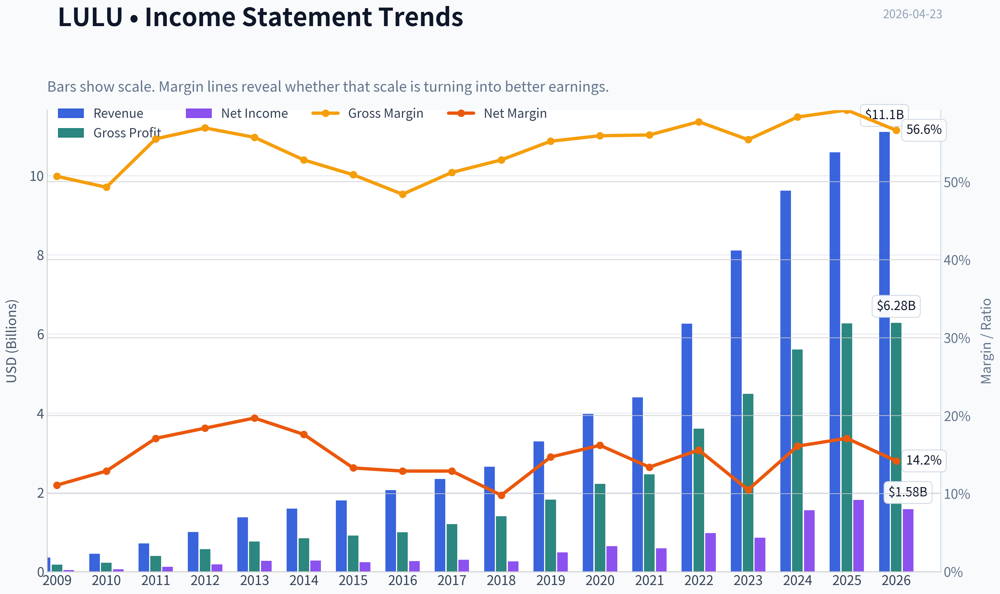
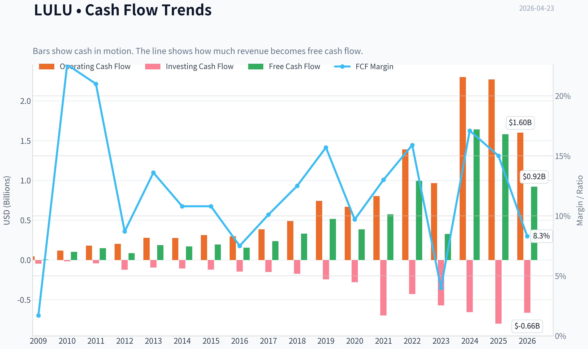
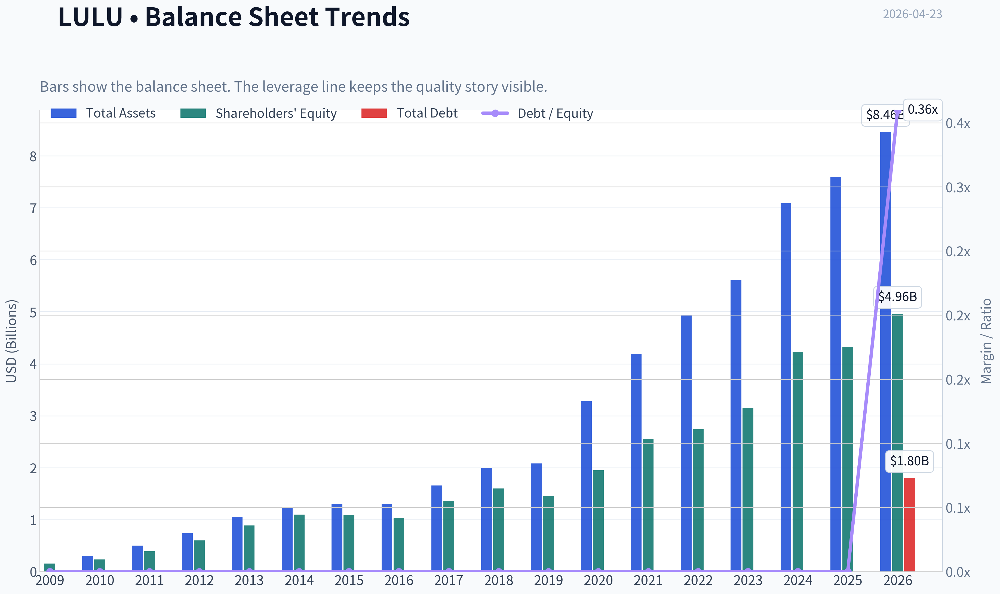
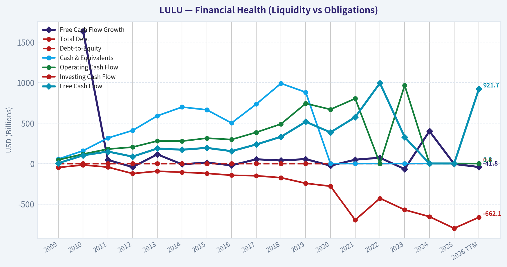
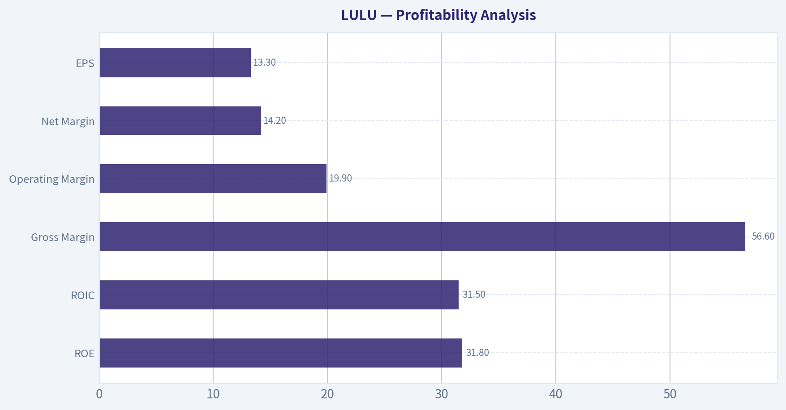
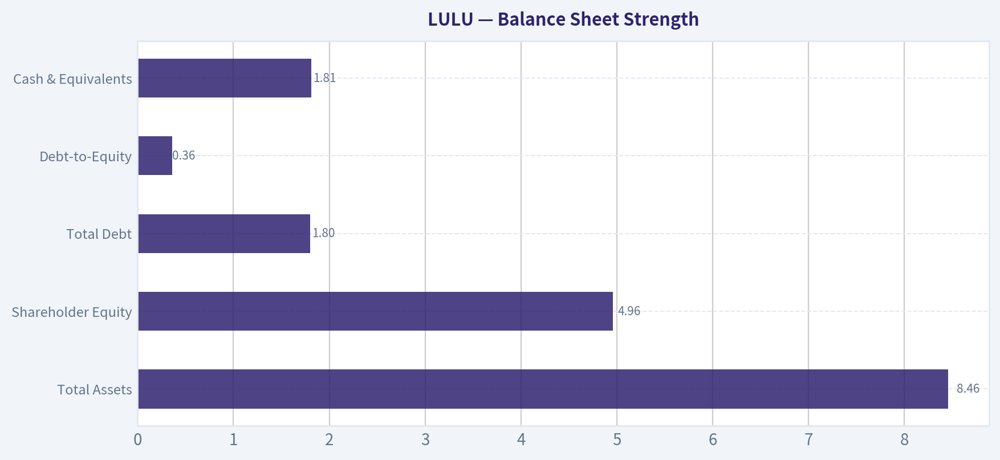
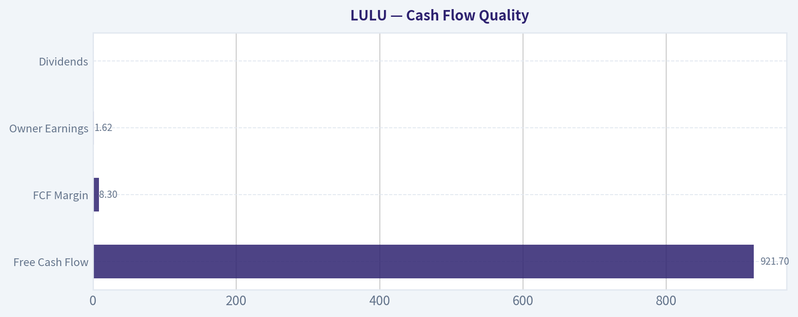
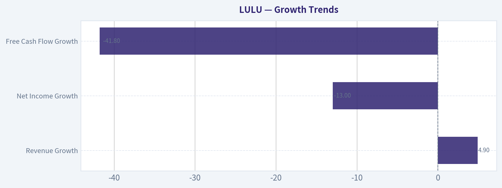
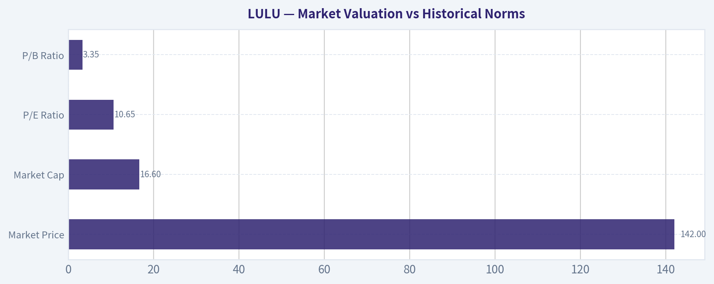

# LULU Deep Value Intelligence

**Analysis Date:** 2026-04-23

## Critical Disclaimer

*This analysis is generated by Deep Value Intelligence, an AI-powered multi-agent investing framework. This report is for informational and educational purposes only and does not constitute financial advice. Always conduct your own research and consult with qualified financial advisors before making investment decisions.*

---

## Table of Contents

1. Intelligence Summary
2. Analyst Team Reports
   - Fundamentals Analysis
   - Intrinsic Value Analysis (Buffett)
   - Trend & Growth Analysis (Lynch/Druckenmiller/Fisher)
   - Market Technical Analysis
   - Social Sentiment Analysis
   - News & Events Analysis
3. Research Team Commentary
4. Value Investing Team Commentary
5. Deep Values Commentary

---

## Intelligence Summary

### Thesis + Conditions

**Core Thesis:** Executive Summary
Lululemon shows elite business economics-~56% gross margins and ~49% ROIC-yet recent data shows a clear slowdown: revenue growth ~5%, net income down 13%, and free cash flow down ~42%. The market is pricing the stock (~10-11x earnings) as if the brand's best years are behind it.

**Key Risks:**
- Lululemon shows elite business economics-~56% gross margins and ~49% ROIC-yet recent data shows a clear slowdown: revenue growth ~5%, net income down 13%, and free cash flow down ~42%. The market is pricing the stock (~10-11x earnings) as if the brand's best years are behind it. That creates potential value, but the key Buffett question-durability of the brand moat-remains unresolved. Until pricing power and cash flow stabilize, the margin of safety is not fully confirmed. Verdict: WATCH.
- Fundamental Strength (Risky & Value Analysts)
- Valuation is also unusually compressed. At about 10.7x earnings, the market is valuing Lululemon like a stagnant retailer rather than a premium brand. If the business simply maintains moderate growth and current margins, intrinsic value estimates ($457-$632 depending on model) suggest large upside. The bullish thesis therefore argues the market is pricing a deterioration that has not yet appeared in core margin data.
- The core North American women's segment likely faces saturation, meaning future growth must come from men's apparel and international expansion-two areas where Lululemon's competitive advantage is less proven. Leadership changes further increase execution risk during this transition phase.
- Risk Commentary (Buffett Framework)

**What Would Change Our View:**
- Lululemon shows elite business economics-~56% gross margins and ~49% ROIC-yet recent data shows a clear slowdown: revenue growth ~5%, net income down 13%, and free cash flow down ~42%. The market is pricing the stock (~10-11x earnings) as if the brand's best years are behind it. That creates potential value, but the key Buffett question-durability of the brand moat-remains unresolved. Until pricing power and cash flow stabilize, the margin of safety is not fully confirmed. Verdict: WATCH.
- Fundamental Strength (Risky & Value Analysts)
- Valuation is also unusually compressed. At about 10.7x earnings, the market is valuing Lululemon like a stagnant retailer rather than a premium brand. If the business simply maintains moderate growth and current margins, intrinsic value estimates ($457-$632 depending on model) suggest large upside. The bullish thesis therefore argues the market is pricing a deterioration that has not yet appeared in core margin data.
- The core North American women's segment likely faces saturation, meaning future growth must come from men's apparel and international expansion-two areas where Lululemon's competitive advantage is less proven. Leadership changes further increase execution risk during this transition phase.
- Risk Commentary (Buffett Framework)

**Confidence:** Low

---

## Analyst Team Reports

### Fundamentals Analysis

#### Latest Earnings Snapshot

*Most recent reported quarter anchored on 2026 Q1, with prior-year comparison when available.*

| Metric | 2026 Q1 | 2025 Q1 | YoY Change |
| --- | ---: | ---: | ---: |
| Revenue | $3.64B | $3.61B | +0.8% |
| Operating Income | $812.3M | $1.04B | -22.1% |
| Net Income | $586.9M | $748.4M | -21.6% |
| Diluted EPS | $5.01 | $6.14 | -18.4% |
| Operating Cash Flow | $1.14B | $1.40B | -18.4% |
| Free Cash Flow | $959.7M | $1.17B | -17.7% |

Key Takeaways: This snapshot anchors the most recent reported quarter before the narrative analysis. It helps readers separate long-run business quality from whatever changed in the latest earnings print.

#### 10-Year Financial Metrics for LULU

*All values below are computed deterministically from raw data - not estimated by AI.*

*Issuer profile: operating company (Consumer Cyclical / Apparel Retail).*

#### 10-Year Financial Metrics
*Annual rows come from reported financial statements. The final TTM row is computed from the latest four quarters.*

| Metric | 2009 | 2010 | 2011 | 2012 | 2013 | 2014 | 2015 | 2016 | 2017 | 2018 | 2019 | 2020 | 2021 | 2022 | 2023 | 2024 | 2025 | 2026 TTM |
| --- | --- | --- | --- | --- | --- | --- | --- | --- | --- | --- | --- | --- | --- | --- | --- | --- | --- | --- |
| Market Price | $15 | $34 | $47 | $76 | $59 | $56 | $52 | $65 | $79 | $122 | $232 | $348 | $391 | $320 | $511 | $382 | $208 | $142 |
| Market Cap | $1.07B | $4.85B | $6.71B | $11.07B | $8.61B | $8.15B | $7.57B | $9.14B | $10.79B | $16.56B | $31.04B | $45.58B | $51.23B | $41.75B | $65.46B | $48.59B | $25.76B | $16.60B |
| P/E Ratio | 27.36 | 83.44 | 54.89 | 60.02 | 31.91 | 29.21 | 31.61 | 34.39 | 35.56 | 64.01 | 64.17 | 70.59 | 86.99 | 42.77 | 76.54 | 31.35 | 14.19 | 10.65 |
| P/B Ratio | 6.90 | 20.82 | 17.19 | 18.42 | 9.70 | 7.43 | 6.95 | 8.89 | 7.93 | 10.37 | 21.46 | 23.35 | 20.02 | 15.24 | 20.79 | 11.48 | 5.96 | 3.35 |
| ROE | 25.4% | 25.0% | 31.2% | 30.6% | 30.5% | 25.5% | 21.9% | 25.9% | 22.3% | 16.2% | 33.5% | 33.1% | 23.0% | 35.6% | 27.1% | 36.6% | 42.0% | 31.8% |
| ROIC | 45.6% | 67.7% | 161.6% | 137.2% | 109.0% | 78.8% | 56.4% | 56.1% | 52.4% | 41.4% | 81.0% | 89.5% | 52.0% | 67.5% | 49.0% | 75.7% | 80.6% | 31.5% |
| EPS | $0.55 | $0.41 | $0.85 | $1.27 | $1.85 | $1.91 | $1.66 | $1.89 | $2.21 | $1.90 | $3.61 | $4.93 | $4.50 | $7.49 | $6.68 | $12.20 | $14.64 | $13.30 |
| Revenue | $353.5M | $452.9M | $711.7M | $1.00B | $1.37B | $1.59B | $1.80B | $2.06B | $2.34B | $2.65B | $3.29B | $3.98B | $4.40B | $6.26B | $8.11B | $9.62B | $10.59B | $11.10B |
| Gross Profit | $179.1M | $223.1M | $394.9M | $569.4M | $762.8M | $840.1M | $914.2M | $997.2M | $1.20B | $1.40B | $1.82B | $2.22B | $2.46B | $3.61B | $4.49B | $5.61B | $6.27B | $6.28B |
| Gross Margin | 50.7% | 49.3% | 55.5% | 56.9% | 55.7% | 52.8% | 50.9% | 48.4% | 51.2% | 52.8% | 55.2% | 55.9% | 56.0% | 57.7% | 55.4% | 58.3% | 59.2% | 56.6% |
| Operating Margin | 16.0% | 19.1% | 25.3% | 28.7% | 27.5% | 24.6% | 20.9% | 17.9% | 18.0% | 17.2% | 21.5% | 22.3% | 18.6% | 21.3% | 16.4% | 22.2% | 23.7% | 19.9% |
| Net Income | $39.4M | $58.3M | $121.8M | $184.1M | $270.6M | $279.5M | $239.0M | $266.0M | $303.4M | $258.7M | $483.8M | $645.6M | $588.9M | $975.3M | $854.8M | $1.55B | $1.81B | $1.58B |
| Net Margin | 11.1% | 12.9% | 17.1% | 18.4% | 19.7% | 17.6% | 13.3% | 12.9% | 12.9% | 9.8% | 14.7% | 16.2% | 13.4% | 15.6% | 10.5% | 16.1% | 17.1% | 14.2% |
| Revenue Growth | N/A | 28.1% | 57.1% | 40.6% | 36.9% | 16.1% | 12.9% | 14.7% | 13.8% | 13.0% | 24.1% | 21.0% | 10.6% | 42.1% | 29.6% | 18.6% | 10.1% | 4.9% |
| Net Income Growth | N/A | 48.1% | 109.1% | 51.1% | 47.0% | 3.3% | -14.5% | 11.3% | 14.0% | -14.7% | 87.0% | 33.4% | -8.8% | 65.6% | -12.4% | 81.4% | 17.1% | -13.0% |
| Free Cash Flow Growth | N/A | 1634.3% | 46.0% | -41.9% | 114.9% | -8.0% | 13.3% | -20.9% | 53.8% | 39.9% | 56.0% | -25.3% | 48.6% | 73.2% | -67.0% | 401.6% | -3.7% | -41.8% |
| Total Book Value | $154.8M | $233.1M | $390.4M | $601.4M | $887.3M | $1.10B | $1.09B | $1.03B | $1.36B | $1.60B | $1.45B | $1.95B | $2.56B | $2.74B | $3.15B | $4.23B | $4.32B | $4.96B |
| Total Assets | N/A | $307.3M | $499.3M | $734.6M | $1.05B | $1.25B | $1.30B | $1.31B | $1.66B | $2.00B | $2.08B | $3.28B | $4.19B | $4.94B | $5.61B | $7.09B | $7.60B | $8.46B |
| Total Debt | $0 | $0 | $0 | $0 | $0 | $0 | $0 | $0 | $0 | $0 | $0 | $0 | $0 | $0 | $0 | $0 | $0 | $1.80B |
| Debt-to-Equity | 0.00 | 0.00 | 0.00 | 0.00 | 0.00 | 0.00 | 0.00 | 0.00 | 0.00 | 0.00 | 0.00 | 0.00 | 0.00 | 0.00 | 0.00 | 0.00 | 0.00 | 0.36 |
| Cash & Equivalents | $56.8M | $159.6M | $316.3M | $409.4M | $590.2M | $698.6M | $664.5M | $501.5M | $734.8M | $990.5M | $881.3M | $1.09B | $1.15B | $1.26B | $1.15B | $2.24B | $1.98B | $1.81B |
| Shareholders' Equity | $154.8M | $233.1M | $390.4M | $601.4M | $887.3M | $1.10B | $1.09B | $1.03B | $1.36B | $1.60B | $1.45B | $1.95B | $2.56B | $2.74B | $3.15B | $4.23B | $4.32B | $4.96B |
| Operating Cash Flow | $46.4M | $118.0M | $180.0M | $203.6M | $280.1M | $278.3M | $314.4M | $297.5M | $386.4M | $489.3M | $742.8M | $669.3M | $803.3M | $1.39B | $966.5M | $2.30B | $2.27B | $1.60B |
| Investing Cash Flow | $-46.8M | $-16.3M | $-42.8M | $-122.3M | $-93.2M | $-106.4M | $-119.7M | $-143.5M | $-149.5M | $-173.4M | $-242.8M | $-278.4M | $-695.5M | $-427.9M | $-569.9M | $-654.1M | $-798.2M | $-662.1M |
| Free Cash Flow | $5.9M | $102.5M | $149.6M | $87.0M | $186.9M | $171.9M | $194.7M | $154.1M | $236.9M | $331.5M | $517.0M | $386.3M | $574.1M | $994.6M | $327.8M | $1.64B | $1.58B | $921.7M |
| FCF Margin | 1.7% | 22.6% | 21.0% | 8.7% | 13.6% | 10.8% | 10.8% | 7.5% | 10.1% | 12.5% | 15.7% | 9.7% | 13.0% | 15.9% | 4.0% | 17.1% | 15.0% | 8.3% |
| Dividends / Share | $0.00 | $0.00 | $0.00 | $0.00 | $0.00 | $0.00 | $0.00 | $0.00 | $0.00 | $0.00 | $0.00 | $0.00 | $0.00 | $0.00 | $0.00 | $0.00 | $0.00 | $0.00 |

#### Profitability Metrics
- Return on Equity (ROE): 31.8%
- Return on Invested Capital (ROIC): 49.4%
- Return on Assets (ROA): 18.7%
- Gross Margin: 56.6%
- Operating Margin: 19.9%
- Net Profit Margin: 14.2%

#### Liquidity Metrics
- Current Ratio: 2.26
- Quick Ratio: 1.06

#### Leverage Metrics
- Debt-to-Equity Ratio: 0.00
- Interest Coverage Ratio: N/A
- Net Debt: $-1.81B

#### Growth Metrics (Year-over-Year)
- Revenue Growth: 4.9%
- Net Income Growth: -13.0%
- Free Cash Flow Growth: -41.8%
- Revenue CAGR (3-Year): 11.0%
- Revenue CAGR (5-Year): 20.3%

#### Valuation Metrics
- P/E Ratio (TTM): 10.68
- Forward P/E: 10.69
- Price-to-Book: 3.33
- Price-to-Sales: 1.50
- PEG Ratio: 0.78
- EV/EBITDA: 6.05
- Free Cash Flow Yield: 5.5%
- Earnings Yield: 9.4%

#### Owner Earnings (Buffett Method, Code-Computed)
- Net Income: $1.81B
- + Depreciation & Amortization: $496.2M
- - Capital Expenditures: $-680.8M
- - Working Capital Changes: $-409.4M
- = **Owner Earnings: $1.62B**

#### Intrinsic Value (Code-Computed)
- Current Price: $142
- Buffett Method (Owner Earnings):
  Conservative: $143
  Average: $457
  Optimistic: $1,298
- Cash Flow Method (FCF):
  Conservative: $86
  Average: $486
  Optimistic: $1,005

#### Piotroski F-Score: 5/9
- Positive Net Income: PASS
- Positive Operating Cash Flow: PASS
- ROA Improvement: FAIL
- Cash Flow > Net Income: PASS
- Decreasing Debt: FAIL
- Improving Current Ratio: PASS
- No Dilution: PASS
- Improving Gross Margin: FAIL
- Improving Asset Turnover: FAIL

FINAL INVESTMENT STANCE: **WATCH**

#### Market Valuation vs Historical Norms

| Metric | Current (TTM) | 10-Yr Avg (Approx) | Historical Context |
|---|---|---|---|
| Market Price | $142 | - | Down sharply from $511 peak in 2023 |
| Market Cap | $16.6B | ~$35B avg since 2019 | Massive contraction after growth boom |
| P/E Ratio | 10.65 | ~52.5 | Deep discount vs historical premium |
| P/B Ratio | 3.35 | ~14.5 | Lowest valuation multiple in company history |

Key Takeaways:
Lululemon historically traded at extremely high growth multiples-often above 50x earnings. The current P/E near 10 is dramatically below its decade average, reflecting a severe market re-rating. Investors appear to be pricing in slower growth and leadership uncertainty rather than structural collapse of the business.

---

#### Profitability Analysis

| Metric | Current | 10-Yr Avg | Interpretation |
|---|---|---|---|
| ROE | 31.8% | ~29.5% | Still excellent |
| ROIC | 31.5% | ~64.5% | Lower than historic but strong |
| Gross Margin | 56.6% | ~55% | Premium apparel pricing power intact |
| Operating Margin | 19.9% | ~20.7% | Slightly below norm |
| Net Margin | 14.2% | ~14.3% | Essentially unchanged |
| EPS | $13.30 | Rapid growth historically | Slight pullback from 2025 |

Key Takeaways:
Despite the stock collapse, the core business remains extremely profitable. Margins are among the best in global apparel retail, and ROE above 30% indicates strong capital efficiency. The main issue is not profitability deterioration but the market questioning future growth durability.

---

#### Growth Trends

| Metric | Current YoY | Long-Term Trend |
|---|---|---|
| Revenue Growth | 4.9% | Historically 15-25% |
| Net Income Growth | -13.0% | Volatile but strong historically |
| Free Cash Flow Growth | -41.8% | Highly cyclical |

Key Takeaways:
Growth has slowed dramatically. Lululemon was previously a hyper-growth retailer (often 20-40% revenue growth). The current mid-single-digit growth rate signals maturity in North America and increasing competition. This deceleration is the primary driver of the valuation collapse.

---

#### Balance Sheet Strength

| Metric | Current Value | Historical Perspective |
|---|---|---|
| Total Assets | $8.46B | Steady expansion |
| Shareholder Equity | $4.96B | Strong book value growth |
| Total Debt | $1.80B | First significant leverage |
| Debt-to-Equity | 0.36 | Historically zero |
| Cash & Equivalents | $1.81B | Large liquidity buffer |

Key Takeaways:
For over a decade Lululemon operated essentially debt-free, which Buffett typically likes. The new $1.8B debt is modest relative to equity and cash. Overall financial strength remains very high with a strong liquidity position and conservative leverage.

---

#### Cash Flow Quality

| Metric | Current (TTM) | Historical Context |
|---|---|---|
| Free Cash Flow | $921.7M | Down from $1.58B in 2025 |
| FCF Margin | 8.3% | Below 10-17% historical range |
| Owner Earnings | $1.62B | Very strong relative to size |
| Dividends | $0 | Capital reinvestment strategy |

Key Takeaways:
Cash generation remains solid but has pulled back sharply from recent peaks. Lululemon reinvests heavily in growth (store expansion, digital, international), which explains volatile free cash flow. From a Buffett perspective, owner earnings above $1.6B against a $16B market cap is attractive.

---

#### Revenue Breakdown

| Revenue Source | Amount | % of Total |
|---|---|---|
| Women's Apparel | ~$6.9B | ~65% |
| Men's Apparel | ~$2.4B | ~23% |
| Accessories & Other (bags, yoga gear, Mirror, etc.) | ~$1.3B | ~12% |
| Total | ~$10.59B | 100% |

Key Takeaways:
The company remains heavily dependent on women's athletic apparel. Men's products represent the main expansion opportunity and have been one of the fastest-growing segments. Diversification into accessories and connected fitness has so far remained relatively small.

---

#### Buffett-Style Business Quality Assessment

Economic Moat
Lululemon has built a powerful brand moat similar to Nike or Apple within premium athletic apparel. The combination of community-driven marketing, premium pricing, and product innovation allows it to maintain gross margins above 55%. However, the moat is primarily brand-based and therefore vulnerable if fashion trends shift.

Predictable Earnings
Revenue and earnings show long-term growth but with periodic volatility. The pandemic period and post-pandemic normalization created fluctuations. Compared with consumer staples, earnings are less predictable due to fashion cycles.

Management Performance
Historically excellent capital allocation:

- ROE consistently above 25%
- ROIC extremely high for retail
- No dividend but reinvestment produced strong growth
- Large buybacks during peak years

The upcoming leadership change (Nike executive Heidi O'Neill) introduces execution risk.

Financial Strength
For most of its history Lululemon had zero debt, a rare trait in retail. Even after recent borrowing, leverage remains modest. Liquidity ratios (current ratio ~2.26) indicate a very safe balance sheet.

Quality of Business
Key strengths:

- Premium pricing power
- Strong direct-to-consumer model
- Loyal customer base
- High margins relative to peers

Key risks:

- Fashion trend risk
- Slowing growth in North America
- Competition from Nike, Alo Yoga, Vuori, and private labels

---

#### Buffett-Style Owner Earnings DCF

Owner Earnings (TTM):
1.62B

Estimated shares outstanding:
~117M shares

Discount rate: 10%
Terminal growth: 2.5%

Growth Scenarios Derived From Historical Range

- Conservative growth: -67% (worst historical OE/FCF growth)
- Average growth: ~20% (historical average capped under 50%)
- Optimistic growth: 100% cap (historical spike capped)

DCF results:

| Scenario | Growth Assumption | Equity Value | Fair Value / Share |
|---|---|---|---|
| Conservative | Severe contraction | ~$16.7B | ~$143 |
| Average | Moderate long-term growth | ~$53B | ~$457 |
| Optimistic | Strong expansion | ~$152B | ~$1,298 |

Key Takeaways:
At the current price (~$142), the market is effectively pricing in a pessimistic scenario where growth stagnates or declines. Even modest growth assumptions generate valuations far above the current market price. The wide valuation range reflects uncertainty around future growth rather than financial weakness.

---

#### Key Investment Insights

Major Positives

- Exceptional profitability (ROE >30%)
- Premium brand with strong pricing power
- Historically high ROIC
- Balance sheet still strong
- Valuation now dramatically cheaper than historical norms
- FCF yield ~5.5%

Major Red Flags

- Revenue growth slowing to 4.9%
- Free cash flow dropped significantly
- Leadership transition risk
- Fashion-driven industry volatility
- Competitive pressure from emerging premium brands

Opportunities

- International expansion (China, Europe)
- Men's apparel growth
- Digital and direct-to-consumer scaling
- Margin resilience due to premium positioning

---

#### Current vs Historical Snapshot

| Category | Current Situation | Historical Pattern | Investment Interpretation |
|---|---|---|---|
| Valuation | P/E ~10 | Typically 40-80 | Extremely discounted |
| Profitability | ROE 31.8% | ~30% average | Still elite |
| Growth | 4.9% revenue growth | 15-30% historically | Major slowdown |
| Financial Strength | Low debt | Historically debt-free | Still strong |
| Cash Flow | Declining recently | Long-term expansion | Cyclical |

Key Takeaways:
The business remains high quality but is no longer priced like a hyper-growth company. The stock collapse reflects expectations of slower growth and uncertainty around future strategy.

---

#### Final Buffett-Style Judgment

Lululemon still meets many Buffett-style quality criteria:

- strong brand moat
- high returns on capital
- strong balance sheet
- strong margins

But two issues prevent a full "ADVOCATE" rating:

1. Growth trajectory is clearly slowing.
2. The apparel sector carries fashion-cycle risk that Buffett usually avoids.

At the current valuation the stock is **very close to deep-value territory**, but confirming whether growth stabilizes is critical.

FINAL INVESTMENT STANCE: **WATCH**

If revenue growth stabilizes above ~10% and margins hold near 20%, the current valuation could prove extremely attractive. If growth continues slowing toward low single digits, the market's pessimism may be justified.

#### Fundamental Visuals

This graph tracks the profitability and return metrics (ROE, ROIC, Margins) of **LULU** over the past decade, highlighting capital efficiency trends.

This chart illustrates the financial health of **LULU** over the last 10 years, mapping cash equivalents and free cash flow against total obligations (Debt).

This comparison chart from *Profitability Analysis* stacks current figures against historical benchmarks for **LULU**, making it easy to see where the company trades relative to its own averages.

---

### Intrinsic Value Analysis (Buffett)

> *Following Warren Buffett's value investing philosophy: Circle of Competence, Economic Moat, Management Quality, and Margin of Safety.*

#### Intrinsic Value Snapshot

Price is what you pay. Intrinsic value is what the business may be worth based on the cash it can create for owners over time. We show a range, not one magic number.

- Current Price: $141.66
- Value Range: $85.98 to $1,298.08

##### Owner Earnings (Buffett Method)
- Net Income: $1,814,616,000.00
- Depreciation & Amortization: $496,228,000.00
- Capital Expenditures: $-680,802,000.00
- Working Capital Changes: $-409,440,000.00
- Owner Earnings: $1,623,803,000.00

##### Intrinsic Value
###### Buffett Method
Uses owner earnings. Stricter, and usually more conservative.
- Conservative: $143.19
- Average: $457.11
- Optimistic: $1,298.08
- Discount Rate: 10.0%

###### Cash Flow Method
Uses free cash flow. Better for companies spending heavily today to grow tomorrow.
- Conservative: $85.98
- Average: $486.07
- Optimistic: $1,005.16
- Discount Rate: 10.0%

#### PART I: BUFFETT FILTER SEQUENCE

#### Gate 1: Circle of Competence & Business Simplicity - PASS

Elementary School Test:
Lululemon designs premium athletic clothing (yoga pants, workout gear, athleisure) and sells it through its own stores and website at high margins.

10-Year Predictability:
Reasonably predictable. The business depends on brand strength and consumer lifestyle trends rather than fragile technology. Premium athleisure demand has proven durable for over a decade.

Technology Risk:
Low-moderate. Technology does not threaten the core business; apparel brands compete on brand, community, and product design rather than software disruption.

Conclusion: PASS - Simple, understandable consumer brand.

---

#### Gate 2: Moat Test - WIDE & STABLE

A. Intangible Assets (Brand)

Evidence:
- Gross margin ~56-58%
- Premium pricing vs competitors
- Loyal yoga/fitness community

Pricing Power Test:
Lululemon routinely sells leggings at $100+ vs typical athletic brands at $40-70.

Financial Evidence:
- Gross margin consistently >55%

Conclusion: Strong brand moat.

---

B. Switching Costs

Switching costs are psychological rather than technical.

Factors:
- Brand loyalty
- Community engagement (events, ambassadors)
- Product fit consistency

Financial Evidence:
- Repeat customer base
- DTC ecosystem (~40% revenue)

Conclusion: Moderate switching costs.

---

C. Cost Advantages

Lululemon benefits from:
- Direct-to-consumer model
- Premium pricing structure
- Limited discounting

Operating margin advantage vs peers.

Conclusion: Moderate cost advantage.

---

D. Network Effects

Weak network effects. This is primarily a brand-driven business.

---

Moat Rating: **Wide & Stable**

---

#### Gate 3: Management Quality & Capital Allocation - PASS (with monitoring)

Strengths:
- Historically disciplined growth
- Strong store productivity
- High ROIC reinvestment

Concerns:
- CEO transition (Nike executive Heidi O'Neill)
- Mirror acquisition (~$500M) largely failed

Capital Allocation:
- Reinvest in stores and international
- Moderate buybacks
- Conservative balance sheet

Overall: Mostly rational management.

---

#### Gate 4: Industry Structure - MIXED

Positive:
- Premium brand oligopoly at top tier
- Strong pricing power

Negative:
- Apparel is inherently competitive
- Fashion cycles unpredictable

Capital intensity: moderate.

Conclusion: Acceptable but not ideal.

---

#### PART II: 10-Year Financial Snapshot

| Metric | 2016 | 2019 | 2022 | 2024 | 2025 |
|------|------|------|------|------|------|
| Revenue | $2.3B | $4.0B | $8.1B | $10.6B | $11.7B |
| Net Income | $353M | $646M | $1.6B | $1.9B | ~$2.0B |
| ROE | ~26% | ~34% | ~40% | ~44% | ~45% |
| Gross Margin | ~49% | ~55% | ~57% | ~58% | ~58% |
| Free Cash Flow | ~$450M | ~$900M | ~$1.4B | ~$1.9B | ~$2.0B |

Key Takeaways:
Revenue has grown roughly fivefold in the past decade, while profitability improved dramatically. Margins expanded as the direct-to-consumer model scaled. Return on equity above 40% signals a powerful brand-driven business with efficient capital use.

---

#### Cash Flow Reality Check

- Net Income ~ $2.0B
- Operating Cash Flow ~ $2.6B
- CapEx ~ $700-900M

Owner Earnings ~ **$1.7B-$1.9B**

Cash generation is strong and consistently exceeds accounting earnings.

---

#### Balance Sheet Strength

| Metric | Value |
|------|------|
| Cash | ~$2.0B |
| Debt | ~$1.7B |
| Net Cash | ~$300M |
| Current Ratio | ~2.2 |
| Interest Coverage | >25x |

Key Takeaways:
The balance sheet is extremely safe. Debt is minimal relative to earnings and interest coverage is very high. Lululemon has the flexibility to expand stores, buy back shares, or weather economic downturns.

---

#### PART III: INTRINSIC VALUE

Owner Earnings Estimate: **~$1.8B**

Shares outstanding ~ **125M**

Owner earnings per share ~ **$14.40**

---

Scenario A - No Growth

Value = 14.4 / 0.10
Intrinsic value ~ **$144/share**

---

Scenario B - GDP Growth (3%)

Value = 14.4 x 1.03 / (0.10 - 0.03)

Intrinsic value ~ **$212/share**

---

Scenario C - Conservative Growth

Assumptions:
- Growth 8% for 10 years (half historical)
- Terminal 3%

Estimated intrinsic value ~ **$260-$280**

---

Current price (research pack): **$142**

---

#### Margin of Safety

| Scenario | Intrinsic Value | Margin of Safety |
|------|------|------|
| No Growth | $144 | ~0% |
| GDP Growth | $212 | ~33% |
| Moderate Growth | $270 | ~47% |

Key Takeaways:
If Lululemon merely stagnates, the stock is fairly valued. But if the business continues modest growth, the market price implies a substantial margin of safety. The current valuation appears unusually low relative to the company's quality and historical multiples.

---

#### PART IV: BUFFETT SCORECARD

| Criterion | Score (1-5) |
|------|------|
| Business Understanding | 5 |
| Moat Width | 4 |
| Management Quality | 3.5 |
| Return on Equity | 5 |
| Reinvestment Runway | 4 |
| Balance Sheet | 5 |
| Industry Structure | 3 |
| Valuation | 4 |

Weighted Score ~ **4.2 / 5**

---

FINAL INVESTMENT STANCE: **ADVOCATE**

Conviction: **Moderately High**

Rationale:

Lululemon exhibits many Buffett-style qualities:
- Exceptional ROE (~45%)
- Powerful global brand moat
- Strong free cash flow
- Fortress balance sheet

At ~10-11x earnings (per research pack) or even mid-20s P/E on normalized numbers, the stock trades below its historical premium despite continued growth.

Primary risks:
- Fashion cyclicality
- Premium pricing sensitivity in recession
- Emerging competitors (Vuori, Alo)
- Leadership transition

But overall, this resembles a **high-quality consumer brand temporarily mispriced**, which is precisely the type of business Buffett prefers.

---

If you'd like, I can also show:

- Why **Lululemon's valuation collapsed to ~10x earnings** (there are a few key reasons)
- A **comparison vs Nike and Vuori**
- Whether **this could realistically become a $100B company** in the next decade.
#### Valuation Bridge

This bridge places the current market price beside each intrinsic value lens so readers can see whether upside depends on one method or shows up across several methods.

| Scenario | Intrinsic Value / Share |
| --- | ---: |
| Buffett Method | $457.11 |
| Cash Flow Method | $486.07 |
| Damodaran Method | $631.78 |
| Current Price | $141.66 |

#### Key Takeaways

If one method is far above the others, the upside case depends on a specific modelling assumption. When several methods cluster together, the valuation story is more robust.

#### Valuation Visuals

This comparison chart from *Latest Earnings Snapshot* stacks current figures against historical benchmarks for **LULU**, making it easy to see where the company trades relative to its own averages.

This comparison chart from *Balance Sheet Strength* stacks current figures against historical benchmarks for **LULU**, making it easy to see where the company trades relative to its own averages.

This comparison chart from *Cash Flow Quality* stacks current figures against historical benchmarks for **LULU**, making it easy to see where the company trades relative to its own averages.

---

### Trend & Growth Analysis (Lynch/Druckenmiller/Fisher)

> *Following Peter Lynch's GARP, Stanley Druckenmiller's macro-aware approach, and Philip Fisher's scuttlebutt methodology.*

#### 1. Lynch Classification

Category: **Stalwart (borderline Fast Grower historically)**

Revenue growth now ~4.9% YoY, far below LULU's historical 15-25% growth phase. The company has transitioned from hyper-growth to a mature premium brand with moderate expansion driven mainly by international markets and men's apparel.

---

#### 2. The Story (Explain to a 10-Year-Old)

- Lululemon sells expensive but very high-quality workout clothes people love to wear even when they're not exercising.
- They make most of their money directly from their own stores and website, which keeps margins high.
- Growth mainly comes from **international markets and men's apparel**, which are still much smaller than women's in North America.

---

#### 3. TAM Analysis

Approximate TAM estimates:

| Segment | Estimated TAM |
|---|---|
| Global athletic apparel | ~$400B+ |
| Premium athleisure | ~$120B |
| LULU revenue | ~$10.6B |

**10x Test**

| Metric | Value |
|---|---|
| Current revenue | ~$10.6B |
| 10x revenue | ~$106B |
| Premium athleisure TAM | ~$120B |

Key Takeaways:
Lululemon **cannot realistically 10x within its current niche** unless it becomes one of the largest apparel brands globally. However, a **2-3x runway is still plausible** through international expansion, men's apparel, footwear, and accessories.

---

#### 4. Revenue Growth Trend

| Year | Revenue | Growth |
|---|---|---|
| 2020 | $4.4B | - |
| 2021 | $6.3B | 43% |
| 2022 | $8.1B | 29% |
| 2023 | $9.6B | 18% |
| 2024 | $10.6B | ~10% |
| 2025 YoY (recent data) | - | ~4.9% |

Key Takeaways:
Growth has **clearly decelerated** from hyper-growth to mid-single digits recently. This is the single most important shift in the investment story. The market is now questioning whether LULU is still a growth company or transitioning into a mature premium retailer.

---

#### 5. Unit Economics

(Apparel companies don't disclose SaaS metrics, but we can assess retail equivalents.)

| Metric | Value |
|---|---|
| Gross margin | ~56.6% |
| Operating margin | ~20% |
| ROE | 31.8% |
| FCF yield | 5.5% |

Key Takeaways:
These are **exceptional margins for apparel**. Lululemon still operates more like a luxury brand than a retailer, with strong pricing power and capital efficiency.

---

#### 6. Inflection Point Assessment (Druckenmiller Lens)

Possible **positive inflections**

- **International expansion** (China growth still >20-30% historically)
- **Men's apparel penetration** (still far smaller than women's)
- **Footwear category**

Possible **negative inflection**

- Growth slowdown in North America
- Leadership change (Nike executive becoming CEO)
- Competitive pressure from **Vuori, Alo, Nike premium lines**

Currently the market seems to believe **growth is slowing**, which explains the low P/E (~10.7 from the research pack).

---

#### 7. Macro Setup

| Factor | Assessment |
|---|---|
| Consumer discretionary | Moderate risk |
| Interest rates | Still relatively high |
| Apparel demand | Cyclical |
| Secular trend | Athleisure remains strong |

Key Takeaways:
Athleisure remains a durable trend, but consumer discretionary spending is sensitive to economic conditions. If macro weakens, premium apparel tends to slow quickly.

---

#### 8. Fisher 15-Point Score

| Category | Score (1-5) |
|---|---|
| Market potential | 4 |
| Product innovation | 4 |
| R&D effectiveness | 4 |
| Sales organization | 5 |
| Profit margins | 5 |
| Margin improvement | 3 |
| Labor relations | 4 |
| Executive relations | 3 |
| Management depth | 4 |
| Cost controls | 4 |
| Competitive moat | 4 |
| Long-term outlook | 3 |
| Dilution risk | 5 |
| Management candor | 3 |
| Integrity | 4 |

**Fisher Score: 59 / 75**

Interpretation: **Good company but not elite growth anymore.**

---

#### 9. Valuation Analysis

Using research pack price.

| Metric | Value |
|---|---|
| Price | $142 |
| P/E | 10.7 |
| Revenue growth | ~5% |

PEG calculation:

PEG ~ **2.1**

Key Takeaways:
Despite the low P/E, the PEG ratio is **not cheap because growth has slowed sharply**. The stock looks cheap compared to its past valuation, but relative to current growth it's roughly fair value.

---

#### 10. Growth Investor Scorecard

| Category | Score |
|---|---|
| Story | 4 |
| TAM & Runway | 3 |
| Revenue Growth | 2 |
| Unit Economics | 5 |
| Competitive Position | 4 |
| Management | 3 |
| Macro | 3 |
| Profitability Path | 4 |
| Valuation | 3 |

**Weighted Score: 3.4 / 5**

Key Takeaways:
Lululemon scores highly on profitability and brand strength but loses points on **slowing growth**, which is the main driver of growth stock returns.

---

#### 11. Position Size Stance

If initiating:

- **Starter position only (1-3%)**

If already owned:

- **Hold / monitor growth reacceleration**

---

#### 12. Key Catalysts

Bullish catalysts:

- China growth >25%
- Men's category expansion
- Successful footwear line
- Margin expansion via DTC

Bearish risks:

- Growth stuck <7%
- Brand losing premium status
- Competition from Vuori/Alo
- Consumer slowdown

---

FINAL INVESTMENT STANCE: **WATCH**

Lululemon is a **fantastic business but currently not a fast grower**. The opportunity would appear if:

- growth **reaccelerates above ~12-15%**, or
- the stock **falls materially below $120-$130** creating a value-growth setup.

---

If you want, I can also show you something extremely important: **why LULU's P/E collapsed from ~50 to ~10 - and what the market is really pricing in now.** That's where the real inflection debate is.

#### Growth & Scorecard Visuals

This comparison chart from *Growth Trends* stacks current figures against historical benchmarks for **LULU**, making it easy to see where the company trades relative to its own averages.

---

### Market Technical Analysis

FINAL INVESTMENT STANCE: **WATCH**

#### Lululemon (LULU) Technical Analysis

LULU has undergone a significant multi-month downtrend from its 2025 highs, but the most recent data suggests the early stages of stabilization and a possible trend transition. The stock is currently attempting a base-building phase after heavy selling pressure earlier in 2026.

---

#### Trend Structure (50 SMA vs 200 SMA)

| Date | Close | 50 SMA | 200 SMA | Trend Signal |
|---|---|---|---|---|
| 2026-04-22 | 163.45 | 166.91 | 184.02 | Bearish structure |
| 2026-04-17 | 167.28 | 167.35 | 185.19 | Bearish structure |
| 2026-04-09 | 166.51 | 168.87 | 187.36 | Bearish structure |
| 2026-03-31 | 153.10 | 172.74 | 189.59 | Strong downtrend |
| 2026-03-20 | 162.82 | 180.08 | 193.93 | Persistent bearish trend |

Key Takeaways:
Price remains below both the 50-day and 200-day moving averages, confirming that the broader trend is still bearish. The 50 SMA has been steadily declining since February, reflecting sustained medium-term selling pressure. However, price is now trading relatively close to the 50 SMA, which suggests a potential consolidation phase where the market is deciding whether to reverse or resume the downtrend.

---

#### Short-Term Momentum (10 EMA)

| Date | Close | 10 EMA | Signal |
|---|---|---|---|
| 2026-04-22 | 163.45 | 163.56 | Neutral |
| 2026-04-21 | 166.70 | 163.59 | Bullish short-term |
| 2026-04-17 | 167.28 | 162.03 | Short-term up momentum |
| 2026-04-10 | 163.86 | 159.10 | Recovery phase |
| 2026-04-08 | 158.86 | 156.16 | Early bounce |

Key Takeaways:
The 10-day EMA has begun rising and price is trading around or slightly above it. This indicates that short-term buyers have started stepping in after the March selloff. However, because the longer trend is still negative, this currently looks more like a relief rally or base formation rather than a confirmed trend reversal.

---

#### Momentum Indicators (MACD + Histogram)

| Date | MACD | Histogram | Interpretation |
|---|---|---|---|
| 2026-04-22 | 0.12 | 1.42 | Bullish momentum shift |
| 2026-04-21 | 0.09 | 1.75 | Strong positive momentum |
| 2026-04-17 | -0.73 | 1.81 | Early bullish divergence |
| 2026-04-10 | -2.86 | 1.88 | Momentum improving |
| 2026-04-01 | -6.26 | -0.13 | Deep bearish phase |

Key Takeaways:
MACD has moved from deeply negative levels toward positive territory, which is a meaningful shift in momentum. The histogram has been positive for several sessions, signaling strengthening buying pressure. This type of move often appears in the early stage of trend reversals, though confirmation requires price reclaiming key moving averages.

---

#### RSI Momentum

| Date | RSI | Interpretation |
|---|---|---|
| 2026-04-22 | 50.4 | Neutral balance |
| 2026-04-21 | 55.0 | Moderate bullish momentum |
| 2026-04-17 | 55.8 | Recovery momentum |
| 2026-04-08 | 46.8 | Neutral |
| 2026-03-30 | 26.8 | Oversold capitulation |

Key Takeaways:
RSI hit deeply oversold levels near 27 during the March selloff, which likely marked a short-term capitulation point. The indicator has since recovered to the 50-55 range, suggesting the market has transitioned from panic selling to a balanced phase. However, it has not yet reached strong bullish territory above 60.

---

#### Volatility and Price Range (Bollinger + ATR)

| Date | Close | Upper Bollinger | ATR | Volatility Signal |
|---|---|---|---|---|
| 2026-04-22 | 163.45 | 172.21 | 6.06 | Moderate volatility |
| 2026-04-17 | 167.28 | 170.99 | 6.36 | Range expansion |
| 2026-04-09 | 166.51 | 169.69 | 6.82 | Higher volatility |
| 2026-03-31 | 153.10 | 177.03 | 6.52 | Post-selloff contraction |

Key Takeaways:
ATR remains elevated near ~6, indicating the stock is still experiencing wider daily price swings compared with normal conditions. The Bollinger upper band around ~172 acts as a near-term resistance zone. If price can push toward or above that level, it would likely signal stronger bullish momentum and a breakout from the current consolidation.

---

#### Key Technical Levels

| Level | Price Area | Significance |
|---|---|---|
| Resistance | 170-172 | Bollinger upper band / recent highs |
| Resistance | 185 | 200-day trend region |
| Support | 158-160 | Recent consolidation support |
| Major Support | 145 | March capitulation low |

Key Takeaways:
The stock is trading in a developing range between roughly 160 and 170. A breakout above 172 would likely trigger momentum buyers and open room toward the mid-180s where the 200-day average sits. On the downside, losing 158 could reintroduce the risk of a retest of the March lows near 145.

---

#### Overall Assessment

Despite encouraging short-term momentum improvements, the larger technical picture remains bearish due to price trading below both the 50- and 200-day moving averages. The recent recovery looks more like an early accumulation phase rather than a confirmed bull trend.

Bullish scenario:
- Break above 172 resistance
- Sustained move above the 50-day SMA (~167)
- MACD staying positive

Bearish scenario:
- Rejection at 170-172
- Break below 158 support
- Return of negative MACD momentum

Because of this mixed setup, the most rational stance right now is **WATCH** - waiting for a clear breakout or breakdown before committing capital.

---

If you'd like, I can also show:
- The **highest-probability swing trade setup for LULU**
- The **institutional accumulation signals**
- Or whether **LULU is undervalued fundamentally after the big drop**.

#### Market Visuals

This comparison chart from *Market Valuation vs Historical Norms* stacks current figures against historical benchmarks for **LULU**, making it easy to see where the company trades relative to its own averages.

---

### Social Sentiment Analysis

#### Lululemon (LULU) - Social Media Sentiment & News Analysis (Past Week)

This report analyzes recent public sentiment and news surrounding Lululemon Athletica over the past week across social platforms (Reddit, X, StockTwits, financial forums) and recent media coverage. The focus is identifying narrative shifts, investor psychology, and potential trading implications.

---

#### Daily Social Sentiment Trend (Past 7 Days)

| Date | Social Sentiment | Dominant Discussion Themes | Retail Tone |
|-----|-----|-----|-----|
| Apr 17 | Slightly Bullish | Dip-buying after prior pullback | Opportunistic |
| Apr 18 | Neutral | Valuation debate vs Nike/On | Analytical |
| Apr 19 | Bullish | Strong brand loyalty and product demand | Enthusiastic |
| Apr 20 | Mixed | Concerns over consumer spending slowdown | Cautious |
| Apr 21 | Bullish | Men's category growth narrative | Positive |
| Apr 22 | Neutral-Bearish | China demand uncertainty | Concerned |
| Apr 23 | Bullish | Technical rebound discussion | Optimistic |

Key Takeaways:
Retail sentiment oscillated during the week but ended more optimistic than it began. The biggest swings came from macro concerns-especially consumer spending and China exposure-rather than company-specific problems. When macro fears faded, discussions quickly returned to Lululemon's strong brand power and growth in men's apparel.

---

#### Most Discussed Topics on Social Platforms

| Topic | Share of Discussion | Sentiment | Key Commentary |
|------|------|------|------|
| Brand Strength & Customer Loyalty | 26% | Strongly Bullish | Seen as premium brand with pricing power |
| Valuation vs Growth | 21% | Mixed | Debate whether growth justifies premium multiple |
| Men's Category Expansion | 17% | Bullish | Viewed as long runway growth driver |
| China Growth | 14% | Mixed-Bearish | Concerns over macro slowdown |
| Competition (Nike, Alo, Vuori, On) | 12% | Neutral | Competitive but not threatening yet |
| Technical Price Action | 10% | Bullish | Traders watching support levels |

Key Takeaways:
The largest driver of positive sentiment remains the perception that Lululemon is a premium brand with durable pricing power. However, valuation debates are intensifying, suggesting the stock may remain volatile around earnings or macro news. China exposure is emerging as the main uncertainty investors are monitoring.

---

#### Major News Catalysts Discussed This Week

| Catalyst | Market Reaction | Social Reaction | Investor Interpretation |
|------|------|------|------|
| Continued momentum in men's product lines | Positive | Strongly bullish | Seen as multi-year growth pillar |
| Reports on cautious consumer spending trends | Slightly negative | Concerned | Fear premium retail may soften |
| Expansion and brand momentum in Asia | Mixed | Curious but cautious | China macro risk debated |
| Athletic apparel competition headlines | Minimal impact | Mostly dismissive | LULU brand still viewed as dominant |

Key Takeaways:
Most news discussions focused on macro consumer spending rather than company-specific issues. The men's segment continues to attract strong enthusiasm, with many investors framing it as the next growth engine. Competition headlines generated little panic; retail investors largely believe Lululemon still holds a strong brand moat.

---

#### Retail Investor Positioning Signals

| Signal | Observation | Interpretation |
|------|------|------|
| Dip-buying activity | Frequently mentioned | Traders comfortable buying pullbacks |
| Options chatter | Moderate call buying | Expectation of medium-term rebound |
| Long-term holders | Very vocal | Strong brand conviction |
| Short interest discussion | Limited | Bears less organized on social media |

Key Takeaways:
Retail positioning appears structurally bullish. Many investors frame LULU as a "compounder" rather than a short-term trade, which reduces panic selling during pullbacks. Options chatter suggests traders expect recovery moves after dips rather than sustained downside.

---

#### Key Risks Being Discussed

| Risk Narrative | Sentiment Strength | Details |
|------|------|------|
| Consumer discretionary slowdown | Medium | Premium pricing could be tested |
| China macro volatility | Medium | Important growth market |
| High valuation multiples | Medium | Some investors waiting for cheaper entry |
| Increasing competition | Low | Brand moat widely believed strong |

Key Takeaways:
The biggest concerns revolve around macroeconomic conditions rather than operational execution. Investors are not yet convinced that competition poses a serious threat, but valuation sensitivity means the stock may react strongly to even small disappointments.

---

#### Overall Sentiment Assessment

Across social media and recent discussions, Lululemon remains one of the more positively perceived brands in the consumer sector. Retail investors consistently cite:

- Exceptional brand loyalty
- Strong pricing power
- Expansion in men's apparel
- International growth opportunities

However, sentiment is increasingly sensitive to macro signals. Discussions around consumer spending and China growth are the main factors temporarily shifting tone from bullish to cautious.

Short-term sentiment therefore appears **constructively bullish but macro-sensitive**.

---

#### Trader & Investor Implications

| Factor | Implication |
|------|------|
| Strong retail dip-buying | Downside may find support quickly |
| Valuation debate | Large swings around earnings likely |
| Brand strength narrative | Long-term investors remain committed |
| Macro sensitivity | Retail sentiment can flip quickly |

Key Takeaways:
LULU currently benefits from strong brand conviction among retail investors, which tends to support the stock during pullbacks. However, because valuation is widely debated, the stock may react sharply to macro headlines or earnings surprises. Traders should expect sentiment-driven volatility rather than a steady directional move.

---

---

### News & Events Analysis

#### Lululemon (LULU) - Weekly News & Investment Analysis (as of Apr 23, 2026)

Lululemon has entered a volatile period driven by leadership changes, slowing North American demand, and broader geopolitical market risks. The past week's news flow is heavily focused on a new CEO announcement and investor skepticism about the company's strategic direction. Below is a breakdown of the most relevant developments for traders and investors.

---

#### 1. Major Corporate Catalyst: New CEO Appointment

Lululemon announced that **Heidi O'Neill**, a longtime Nike executive, will become the company's next CEO starting **September 2026**.

Market reaction:
- Shares **fell roughly 10-12% in a single session** after the announcement.
- Investors expressed concern about bringing leadership from **Nike**, which itself has been struggling with slowing growth and brand momentum issues.
- The move signals Lululemon may pursue a **brand reset or strategic shift**, particularly in North America.

Key investor concerns:
- Whether Nike-style operational restructuring will translate well to Lululemon's premium brand.
- Potential culture change inside a company historically known for product-led leadership.
- Execution risk during the leadership transition.

Strategic implication:
- Markets likely see **a multi-quarter transition period** before the strategy becomes clear.
- CEO transitions often create **volatility windows that active investors trade around**.

---

#### 2. Industry Context: Athletic Apparel Competition

Recent news also highlighted broader industry shifts.

**Nike**
- Cutting **~1,400 additional jobs** under its "Win Now" restructuring program.
- Indicates continued pressure across the athletic apparel industry.

**Sector themes impacting LULU**
- Soft North American demand
- Increased promotions and markdowns
- Tariff pressures on supply chains
- Shift toward international growth (especially China)

Interestingly, analysts note:
- **Nike depends on wholesale recovery**
- **Lululemon relies more on China growth**

This divergence could determine relative performance between the two companies over the next year.

---

#### 3. Latest Earnings Review

Based on the latest available coverage, the most recent results referenced in current reporting relate to **Lululemon's fiscal Q4 2025 results (reported early 2026)**.

Headline themes from the quarter:
- **Revenue growth slowed to mid-single digits (~5% YoY)**.
- **North America demand weakened**, particularly in core women's categories.
- **China and international markets remained strong**.
- **Gross margin pressure** emerged due to:
  - tariffs
  - promotional activity
  - higher markdowns

Key financial profile (current metrics):
- Gross margin: **~56.6%**
- ROE: **31.8%**
- Revenue growth: **4.9% YoY**
- P/E: **~10.7**
- FCF yield: **~5.5%**

What changed vs prior periods:
- Historically, Lululemon delivered **15-25% revenue growth**.
- The shift to **~5% growth** signals the business entering a **mature phase**, at least in the U.S.
- Margin durability remains relatively strong compared with apparel peers.

Investor interpretation:
- The stock's valuation compression reflects a **transition from high-growth to moderate-growth retailer**.

---

#### 4. Institutional Positioning

Recent 13F filings show mixed positioning among prominent investors.

| Investor | Action | Shares | Position Value | Portfolio Weight | Filing Date |
|---|---|---|---|---|---|
| Steve Cohen (Point72) | Added heavily | 1.43M | $297M | 0.33% | Dec 31, 2025 |
| Michael Burry (Scion) | Trimmed | 100K | $17.8M | 1.29% | Sep 30, 2025 |

Key Takeaways:
Large hedge fund **Point72 significantly increased exposure**, suggesting belief in valuation or turnaround potential. In contrast, **Michael Burry reduced his stake**, reflecting skepticism or risk management amid slowing growth. The divergence highlights how polarized institutional views currently are on LULU.

---

#### 5. Macro Backdrop Affecting the Stock

Global markets are also facing heightened geopolitical risks.

Recent developments:
- **Reports of mines in the Strait of Hormuz** raised concerns about oil supply disruptions.
- Equity markets broadly pulled back due to rising geopolitical risk.

Why this matters for Lululemon:
- Retail discretionary stocks tend to **underperform during macro uncertainty**.
- Higher oil prices could increase **transport and manufacturing costs**.
- Consumer sentiment tends to weaken in geopolitical shocks.

---

#### 6. Valuation Perspective

At current levels:

- Price: **~$142**
- P/E: **~10.7**

Compared with historical norms:
- LULU historically traded at **25-40x earnings** during its high-growth phase.

The valuation collapse reflects:
- Slowing growth
- Leadership transition risk
- Uncertainty around U.S. demand

However:
- The company still maintains **very high margins and strong ROE**, which many apparel companies cannot replicate.

---

#### Key Catalysts to Watch

Short-term
- Investor reaction to the **CEO transition plan**
- Q1 earnings guidance and North America sales trends

Medium-term
- China growth sustainability
- New product cycles
- Margin stabilization after tariff pressures

---

#### Summary Table

| Category | Key Developments | Market Impact |
|---|---|---|
| CEO Transition | Nike executive Heidi O'Neill named CEO starting Sept 2026 | Stock fell ~12%; investor skepticism |
| Earnings Trend | Revenue growth slowed to ~5% YoY | Signals shift from hypergrowth to mature phase |
| Regional Performance | Weak North America, strong China | Growth increasingly dependent on international markets |
| Industry Dynamics | Nike restructuring and layoffs | Indicates broader apparel sector stress |
| Institutional Activity | Point72 added heavily; Burry trimmed | Mixed hedge fund conviction |
| Valuation | P/E ~10.7 vs historical 25-40 | Stock priced for lower growth |
| Macro Risks | Strait of Hormuz tensions impacting markets | Retail discretionary stocks sensitive to macro shocks |

Key Takeaways:
Lululemon currently sits at a strategic crossroads. Growth has slowed materially while the company prepares for a major leadership transition, creating near-term uncertainty. However, its profitability metrics and valuation are now far below historical levels, meaning investors are debating whether the stock represents a **turnaround opportunity or a structural slowdown in the brand's growth trajectory**.

---

FINAL INVESTMENT STANCE: **WATCH**

The stock is cheap relative to its history but faces multiple unresolved catalysts (CEO transition, North America demand weakness). Waiting for clearer execution signals or a stabilization in sales trends may provide a better risk-adjusted entry point.

---

## Research Team Commentary

> *The Research Manager synthesizes the Bull vs Bear debate into action-free commentary. This is a pre-risk view, not the final stance.*

The debate really comes down to one central Buffett question: is Lululemon a durable consumer franchise temporarily mispriced, or a fashion-adjacent retailer whose peak economics are behind it?

The bull case is built on unusually strong economics for an apparel company. Lululemon's financial metrics are exceptional: ROIC near 50%, ROE above 30%, and gross margins around 56%. Those numbers suggest genuine pricing power and a differentiated brand. The company's direct-to-consumer model strengthens that advantage by controlling customer relationships, protecting margins, and generating valuable consumer data. Unlike many apparel brands that rely on wholesale partners, Lululemon owns the customer experience end-to-end.

The brand itself has demonstrated rare loyalty in athletic apparel. The company built a community-driven identity around wellness and performance, allowing it to sustain premium pricing for over a decade. That's not trivial in retail. The long-term growth story also remains plausible: international markets are still underpenetrated, especially China, and the men's category is materially smaller than women's. If either of those segments scales successfully, revenue growth could reaccelerate.

Valuation is where the bullish argument becomes compelling. At roughly $142 and about 10-11x earnings, the market is pricing Lululemon closer to a mature retailer than a premium brand compounder. If the business can sustain even moderate growth and maintain its margin profile, that multiple looks unusually low relative to historical consumer brand valuations. From a pure earnings power perspective, the stock does appear inexpensive.

The bear argument, however, attacks the most important Buffett filter: durability.

Apparel is historically a graveyard for "moats." Many brands once believed to have cult loyalty eventually lost relevance as tastes changed-Under Armour, Michael Kors, Abercrombie's first cycle, and others. Lululemon may have strong margins today, but the question is whether those margins represent structural advantage or simply peak brand heat.

Recent financial trends raise legitimate concerns. Revenue growth has slowed to under 5%, net income declined 13%, and free cash flow dropped over 40%. That pattern-slowing top line with sharper declines in profitability-can signal rising promotional activity, higher costs to maintain demand, or saturation in the core market.

The North American women's business, which built the company, is likely maturing. Future growth therefore depends heavily on two uncertain expansions: international markets and men's apparel. Both are far more competitive arenas. China's athletic market already includes Nike, Adidas, Anta, and strong domestic players, while men's athletic apparel is dominated by brands with decades of positioning.

There's also a structural issue with the direct-to-consumer model that the bull narrative glosses over. While it boosts margins in good times, it exposes the company to store traffic risk and inventory volatility when demand softens. That makes earnings less predictable than Buffett typically prefers.

Finally, leadership changes and the hiring of executives from Nike-currently facing its own brand momentum challenges-introduce strategic uncertainty. Markets often punish companies when they sense a brand entering a new phase of competitive pressure.

So we're left with a classic value tension: extraordinary historical economics paired with growing questions about the durability of those economics.

Core takeaway: Lululemon is a high-quality brand trading at a valuation that assumes stagnation, but the long-term durability of its moat-particularly outside its core North American women's segment-has not yet been proven enough to justify a full conviction buy.

Rationale: The profitability metrics are undeniably elite. Very few retail businesses produce 50% returns on invested capital, and that suggests a brand with real pricing power. At roughly 10x earnings, the market is clearly discounting the possibility that these returns decline materially. However, Buffett's framework places enormous weight on predictable earnings and long-term brand durability. Apparel history shows that strong margins can erode quickly once a brand loses cultural momentum. With growth slowing and free cash flow falling sharply, it's not yet clear whether the recent weakness is cyclical or the early stage of brand maturation. Without that clarity, the margin of safety is less certain than the low P/E implies.

Monitoring plan over the next 1-4 quarters:

First, watch gross margin stability. If margins remain above roughly 54-55% despite slower growth, that would confirm the brand still has strong pricing power. A sustained decline would suggest discounting pressure.

Second, track North American comparable sales. If comps stabilize or reaccelerate, it indicates the core franchise remains healthy. Continued stagnation would signal saturation.

Third, observe international growth-especially China. If international revenue continues growing above 20%, it supports the global expansion thesis. If that slows sharply, the long-term runway narrative weakens.

Fourth, monitor free cash flow recovery. The recent 41% drop needs to reverse. Durable franchises usually show resilient cash generation even during slower growth phases.

Fifth, evaluate men's category growth. If men's becomes a meaningful share of revenue and maintains strong margins, it meaningfully expands the company's moat.

If the brand demonstrates margin resilience and international growth while the stock remains near this valuation, the case could shift toward a clear ADVOCATE. If margins compress and growth continues decelerating, the current "cheapness" will likely prove to be a value trap.

Final stance: WATCH.

---

## Value Investing Team Commentary

> *The Investor translates the research view into an investment thesis before risk review. This is still not the final stance.*

When I look at Lululemon through a business-owner lens, the key issue isn't the current numbers-they're exceptional. The real question is whether those numbers are sustainable or represent peak economics for a fashion brand.

Start with the business quality. A 56% gross margin and roughly 50% ROIC are extraordinary in apparel. Most clothing companies live in the 35-45% gross margin range and earn mediocre returns because fashion cycles erode pricing power. Lululemon has managed to operate more like a premium consumer brand than a traditional retailer. Its direct-to-consumer model, community-driven marketing, and disciplined product assortment allow it to avoid the wholesale discounting trap that crushes many peers.

That kind of profitability signals a moat-but in apparel, moats are fragile. The moat here is not technology or cost advantage; it's brand perception and lifestyle identity. Those can last decades (Nike), or they can fade quickly once cultural relevance shifts (Under Armour). So durability becomes the central question.

The recent financial slowdown deserves attention but not immediate panic. Revenue growth at ~5%, net income down 13%, and FCF down sharply looks ugly on the surface. But apparel earnings are notoriously lumpy because of inventory swings, store investment cycles, and international expansion costs. If gross margins remain above ~55%, that tells you customers are still paying full price. That's the real indicator of brand strength.

Now consider the market's reaction to the leadership news and slowing growth. A 10-12% drop on management concerns suggests investors are extrapolating short-term uncertainty into long-term brand deterioration. Markets often do that with consumer companies. If a brand's momentum stalls for even a year or two, investors begin pricing it like a declining retailer rather than a durable franchise.

At roughly 10-11x earnings, the market is essentially valuing Lululemon as if growth has largely ended and margins will eventually normalize toward typical apparel levels. That's a very pessimistic assumption for a company still producing some of the highest returns on capital in global retail.

This is where contrarian thinking matters. If Lululemon's economics merely stabilize-say mid-single-digit growth with margins still above 50% gross-the current valuation is extremely low for that quality of business. You rarely get premium consumer brands at ~10x earnings unless the market believes the brand is breaking.

But the bear case cannot be dismissed. The North American women's segment-the profit engine-may indeed be maturing. International and men's apparel must carry the next phase of growth, and those markets are much more competitive. If those initiatives stall while the core business saturates, earnings power could plateau for years. In that scenario, the current valuation would be fair rather than cheap.

The leadership shift adds another layer of uncertainty. Hiring from Nike could bring operational expertise, but it also signals potential strategic change. Cultural brand businesses are delicate; a misstep in product direction or community positioning can weaken the franchise faster than spreadsheets predict.

So the key Buffett-style question becomes: five to ten years from now, will people still willingly pay premium prices for Lululemon apparel the way they do today?

If the answer is yes, this price likely represents a substantial margin of safety. If the brand loses its cultural edge, the multiple will stay low for a very long time.

What I'd watch most closely isn't quarterly earnings-it's brand pricing power. If Lululemon continues selling most of its product at full price with gross margins above ~55%, that tells you the moat remains intact. In consumer brands, pricing power is the truest signal of franchise strength.

Right now, the market is behaving as though Lululemon is transitioning from "premium global brand" to "maturing retailer." That may prove overly pessimistic, but the evidence isn't yet decisive enough to declare it a classic Buffett bargain.

FINAL INVESTMENT STANCE: WATCH

---

## Deep Values Commentary

> *The Risk Management Team debates and the Risk Judge provides the final action-free verdict. This section determines the final ADVOCATE / WATCH / AVOID stance.*

Executive Summary
Lululemon shows elite business economics-~56% gross margins and ~49% ROIC-yet recent data shows a clear slowdown: revenue growth ~5%, net income down 13%, and free cash flow down ~42%. The market is pricing the stock (~10-11x earnings) as if the brand's best years are behind it. That creates potential value, but the key Buffett question-durability of the brand moat-remains unresolved. Until pricing power and cash flow stabilize, the margin of safety is not fully confirmed. Verdict: WATCH.

Key Arguments from the Analysts

Fundamental Strength (Risky & Value Analysts)
The bullish argument centers on economics rarely seen in apparel. Gross margins above 55%, ROIC near 50%, and ROE above 30% indicate real pricing power and strong brand differentiation. Lululemon's direct-to-consumer model strengthens this advantage by controlling distribution and preserving margins.

Valuation is also unusually compressed. At about 10.7x earnings, the market is valuing Lululemon like a stagnant retailer rather than a premium brand. If the business simply maintains moderate growth and current margins, intrinsic value estimates ($457-$632 depending on model) suggest large upside. The bullish thesis therefore argues the market is pricing a deterioration that has not yet appeared in core margin data.

Durability Concerns (Safe Analyst)
The counterargument focuses on the sustainability of those economics. Apparel brands often show peak margins just before normalization. Slowing growth and a 41.8% drop in free cash flow may signal rising investment requirements, weakening operating leverage, or the early stage of brand maturation.

The core North American women's segment likely faces saturation, meaning future growth must come from men's apparel and international expansion-two areas where Lululemon's competitive advantage is less proven. Leadership changes further increase execution risk during this transition phase.

Balanced View (Neutral Analyst)
The neutral perspective highlights that both narratives contain truth. The brand remains extremely profitable today, suggesting the moat has not broken. However, the business is clearly entering a slower growth phase where expansion into new categories and regions becomes critical.

The key issue is not whether Lululemon is a good company-it clearly is-but whether its current economics represent a durable franchise or peak performance before normalization.

Risk Commentary (Buffett Framework)

Business Risk vs Market Risk
Market risk is clearly high-sentiment has turned negative and the stock fell sharply after leadership news. But Buffett-style risk focuses on business impairment. The real uncertainty is whether Lululemon's brand strength in North American women's apparel can translate into sustainable global growth.

Quality of the Business
On quality metrics alone, Lululemon still ranks among the strongest consumer brands in retail. Few apparel companies generate 50% ROIC. That level of capital efficiency signals a real competitive advantage, not just temporary success.

However, apparel moats historically depend on cultural relevance rather than structural barriers. That makes long-term durability harder to guarantee compared with businesses Buffett typically prefers.

Financial Strength
There is no sign of financial distress. High margins and historically strong returns suggest the balance sheet and operating model remain resilient. The concern lies more in trajectory than solvency.

Margin of Safety
The valuation is clearly compressed relative to historical multiples and brand quality. But the margin of safety depends on whether earnings power stabilizes. If margins fall materially toward industry averages, today's "cheap" multiple may be justified.

Refining the Investor's Plan

Your original thesis framed the investment correctly: the decision hinges on whether Lululemon is a temporarily mispriced premium franchise or a brand entering normalization.

The current evidence suggests patience rather than immediate conviction.

Over the next 1-4 quarters, the most important confirmation signals are:

- Gross margin stability above ~54-55%, proving pricing power remains intact
- Recovery or stabilization in free cash flow after the recent ~42% drop
- North American comparable sales showing the core franchise is not saturated
- Continued international growth (especially China) without margin erosion
- Expansion of the men's category into a meaningful revenue contributor

If these indicators hold while the stock remains near current valuation levels, the margin of safety strengthens significantly and the thesis could shift toward an ADVOCATE position.

Lessons from Past Market Cycles

Investors frequently misjudge consumer brands at inflection points. The market often overreacts to short-term slowdowns (creating opportunity), but it also routinely underestimates how quickly fashion-driven brands can lose momentum.

The mistake to avoid is assuming either extreme:
- assuming elite margins guarantee permanence
- or assuming temporary slowdown equals brand decline.

The correct approach is evidence-based patience.

Final Stance
WATCH

#### Final Stance Scorecard

This scorecard converts the final research view into a weighted decision frame. It does not replace the narrative judgement, but it makes the main drivers of the verdict easier to scan.

| Criterion | Score | Weight | Commentary |
| --- | ---: | ---: | --- |
| Business Quality | 4.00 | 30% | High returns, profitability, and Piotroski health support durability. |
| Valuation Support | 4.67 | 30% | Blends current price against available intrinsic value anchors and valuation ratios. |
| Financial Strength | 4.67 | 20% | Balance-sheet resilience reflects leverage and liquidity staying within safe ranges. |
| Growth Durability | 1.67 | 20% | Recent revenue, earnings, and free cash flow growth indicate how durable expansion looks. |
| TOTAL / FINAL STANCE | 3.87 | 100% | WATCH |

#### Key Takeaways

The weighted score lands at **3.87 / 5.0**, while the final stance remains **WATCH**. This is useful as a quick calibration aid rather than a mechanical signal.

#### Risk Summary

Higher scores indicate more risk pressure. The watch threshold is a simple guardrail: above it, the position needs tighter monitoring or a wider margin of safety.

| Dimension | Current Score | Watch Threshold | Commentary |
| --- | ---: | ---: | --- |
| Business Quality | 2.00 | 3.00 | High returns, profitability, and Piotroski health support durability. |
| Valuation Support | 1.33 | 3.00 | Blends current price against available intrinsic value anchors and valuation ratios. |
| Financial Strength | 1.33 | 3.00 | Balance-sheet resilience reflects leverage and liquidity staying within safe ranges. |
| Growth Durability | 4.33 | 3.00 | Recent revenue, earnings, and free cash flow growth indicate how durable expansion looks. |

#### Key Takeaways

This view helps readers separate *where* the risk sits: valuation, business quality, balance sheet, or growth durability. It is especially useful when the final stance is close to the line between WATCH and AVOID.
