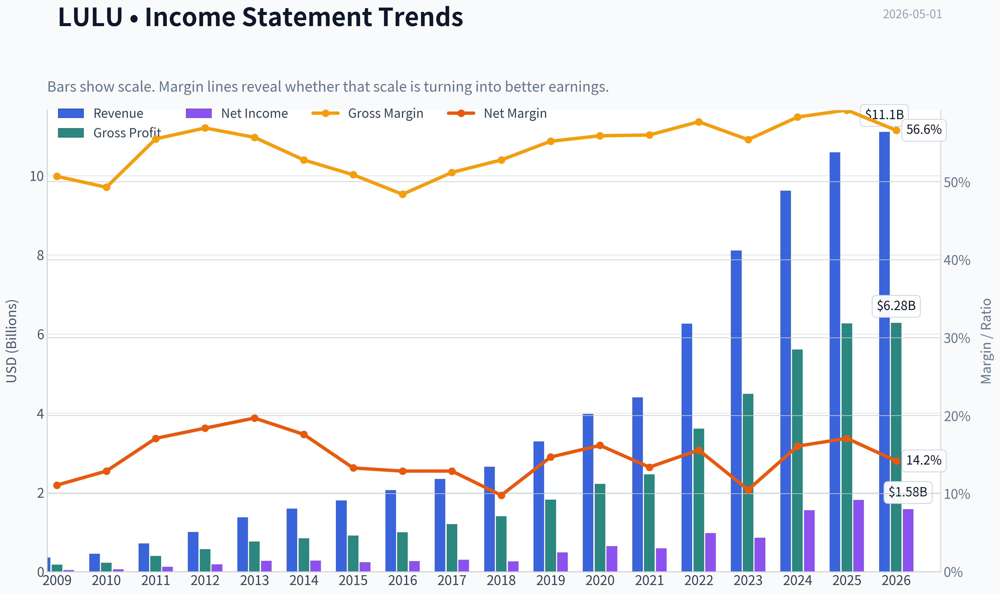
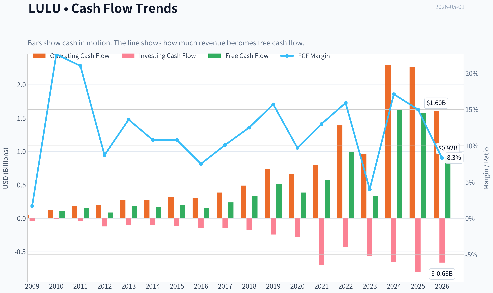
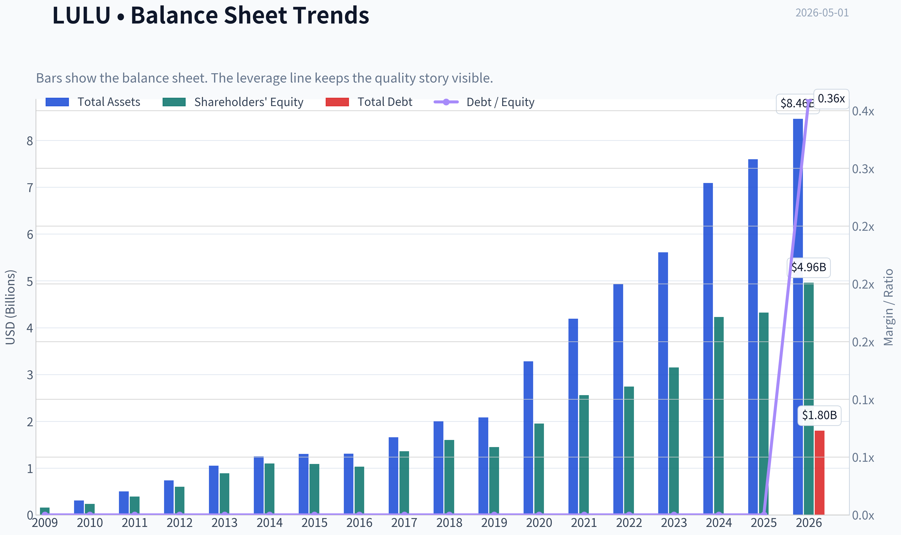
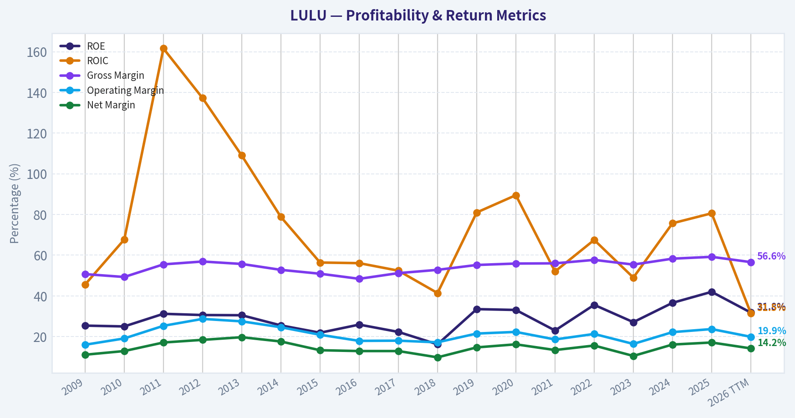
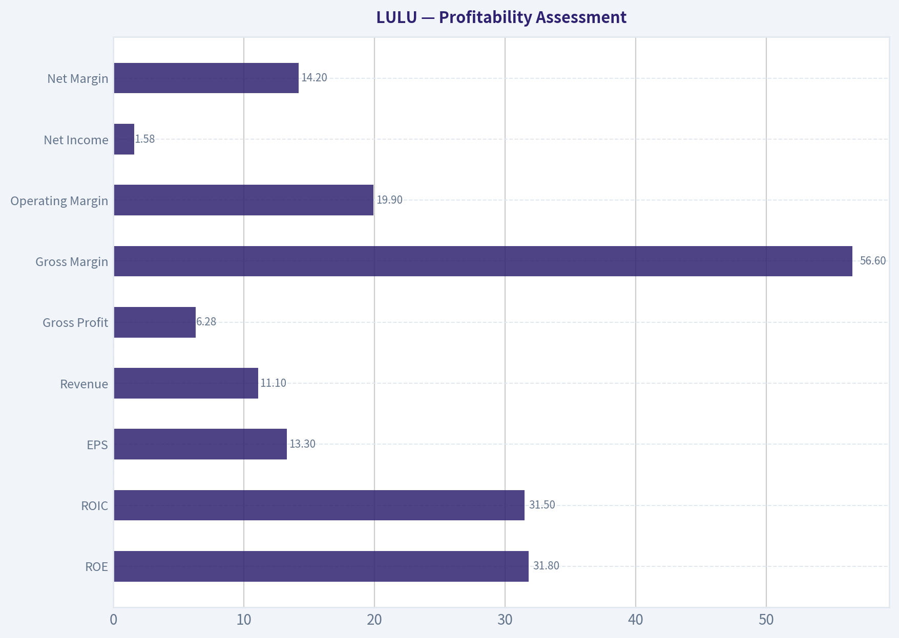
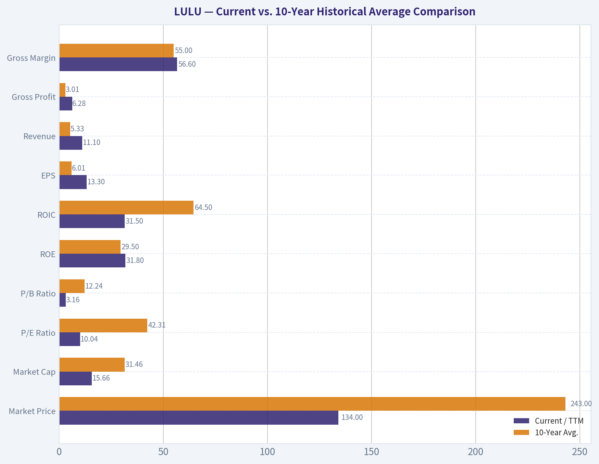
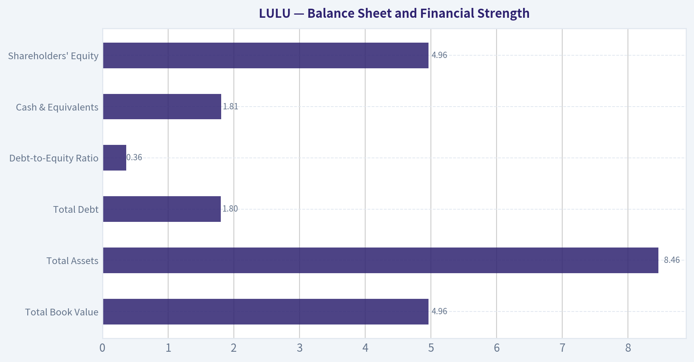
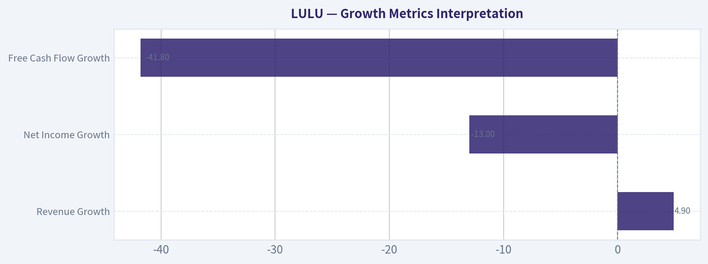
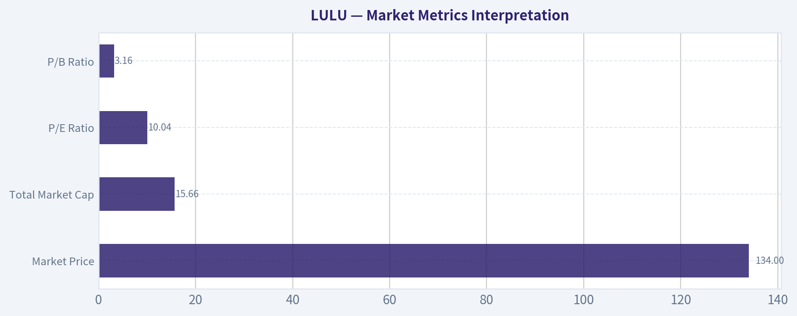

# LULU Deep Value Intelligence

**Analysis Date:** 2026-05-01

## Critical Disclaimer

*This analysis is generated by Deep Value Intelligence, an AI-powered multi-agent investing framework. This report is for informational and educational purposes only and does not constitute financial advice. Always conduct your own research and consult with qualified financial advisors before making investment decisions.*

---

## Table of Contents

1. Intelligence Summary
2. Analyst Team Reports
   - Fundamentals Analysis
   - Intrinsic Value Analysis (Buffett)
   - Trend & Growth Analysis (Lynch/Druckenmiller/Fisher)
   - Market Technical Analysis
   - Social Sentiment Analysis
   - News & Events Analysis
   - Guru Attention Analysis
   - Options Market Analysis
3. Research Team Commentary
4. Value Investing Team Commentary
5. Deep Values Commentary

---

## Intelligence Summary

### Thesis + Conditions

**Core Thesis:** ### EXECUTIVE SUMMARY

**Key Risks:**
- Verdict:** **WATCH**
- Lululemon (LULU) presents a classic value investing dilemma: elite trailing metrics (56.6% Gross Margin, 49.4% ROIC) clashing with severe real-time deterioration (-42% FCF, -13% Net Income). While a 10x P/E appears to offer a massive margin of safety against $450+ intrinsic value models, Buffett's framework prioritizes *predictability and durable moats*. Apparel lacks hard switching costs, and current fundamental stress points to a potential structural derating rather than a temporary market overreaction. Until cash flows stabilize, the risk of a value trap outweighs the valuation discount.
- The Bull (Risky):** A 10x P/E for a business with 49% ROIC and 56% gross margins is a rare, asymmetric opportunity. Demanding perfect operational proof will cause investors to miss the bottom. The downside is already priced in; upside merely requires North America to mature, rather than deteriorate.
- The Pragmatist (Neutral):** Acknowledges the extreme cheapness but respects the severe fundamental drops. Suggests a 1/3 starter position to capture potential upside while limiting exposure if the business enters a lower-profit regime.
- 2.  **Moat Fragility:** Apparel businesses inherently lack switching costs. LULU's moat relies entirely on brand equity, which is currently being tested by pricing pushback and aggressive competitors. This elevates *Business Risk*-the risk of permanent capital impairment if the brand loses its premium positioning.

**What Would Change Our View:**
- Verdict:** **WATCH**
- Lululemon (LULU) presents a classic value investing dilemma: elite trailing metrics (56.6% Gross Margin, 49.4% ROIC) clashing with severe real-time deterioration (-42% FCF, -13% Net Income). While a 10x P/E appears to offer a massive margin of safety against $450+ intrinsic value models, Buffett's framework prioritizes *predictability and durable moats*. Apparel lacks hard switching costs, and current fundamental stress points to a potential structural derating rather than a temporary market overreaction. Until cash flows stabilize, the risk of a value trap outweighs the valuation discount.
- The Bull (Risky):** A 10x P/E for a business with 49% ROIC and 56% gross margins is a rare, asymmetric opportunity. Demanding perfect operational proof will cause investors to miss the bottom. The downside is already priced in; upside merely requires North America to mature, rather than deteriorate.
- The Pragmatist (Neutral):** Acknowledges the extreme cheapness but respects the severe fundamental drops. Suggests a 1/3 starter position to capture potential upside while limiting exposure if the business enters a lower-profit regime.
- 2.  **Moat Fragility:** Apparel businesses inherently lack switching costs. LULU's moat relies entirely on brand equity, which is currently being tested by pricing pushback and aggressive competitors. This elevates *Business Risk*-the risk of permanent capital impairment if the brand loses its premium positioning.

**Confidence:** Low

---

## Analyst Team Reports

### Fundamentals Analysis

#### Latest Earnings Snapshot

*Most recent reported quarter anchored on 2026 Q1, with prior-year comparison when available.*

| Metric | 2026 Q1 | 2025 Q1 | YoY Change |
| --- | ---: | ---: | ---: |
| Revenue | $3.64B | $3.61B | +0.8% |
| Operating Income | $812.3M | $1.04B | -22.1% |
| Net Income | $586.9M | $748.4M | -21.6% |
| Diluted EPS | $5.01 | $6.14 | -18.4% |
| Operating Cash Flow | $1.14B | $1.40B | -18.4% |
| Free Cash Flow | $959.7M | $1.17B | -17.7% |

Key Takeaways: This snapshot anchors the most recent reported quarter before the narrative analysis. It helps readers separate long-run business quality from whatever changed in the latest earnings print.

#### 10-Year Financial Metrics for LULU

*All values below are computed deterministically from raw data - not estimated by AI.*

*Issuer profile: operating company (Consumer Cyclical / Apparel Retail).*

#### 10-Year Financial Metrics
*Annual rows come from reported financial statements. The final TTM row is computed from the latest four quarters.*

| Metric | 2009 | 2010 | 2011 | 2012 | 2013 | 2014 | 2015 | 2016 | 2017 | 2018 | 2019 | 2020 | 2021 | 2022 | 2023 | 2024 | 2025 | 2026 TTM |
| --- | --- | --- | --- | --- | --- | --- | --- | --- | --- | --- | --- | --- | --- | --- | --- | --- | --- | --- |
| Market Price | $3 | $14 | $34 | $63 | $69 | $46 | $66 | $62 | $68 | $78 | $148 | $239 | $329 | $334 | $307 | $454 | $414 | $134 |
| Market Cap | $241.2M | $2.00B | $4.94B | $9.17B | $10.06B | $6.67B | $9.56B | $8.73B | $9.27B | $10.65B | $19.80B | $31.35B | $43.01B | $43.49B | $39.29B | $57.66B | $51.34B | $15.66B |
| P/E Ratio | 6.18 | 34.44 | 40.40 | 49.71 | 37.30 | 23.92 | 39.90 | 32.84 | 30.55 | 41.16 | 40.94 | 48.56 | 73.04 | 44.56 | 45.94 | 37.20 | 28.29 | 10.04 |
| P/B Ratio | 1.56 | 8.60 | 12.65 | 15.25 | 11.34 | 6.08 | 8.77 | 8.49 | 6.82 | 6.67 | 13.69 | 16.06 | 16.81 | 15.87 | 12.48 | 13.63 | 11.87 | 3.16 |
| ROE | 25.4% | 25.0% | 31.2% | 30.6% | 30.5% | 25.5% | 21.9% | 25.9% | 22.3% | 16.2% | 33.5% | 33.1% | 23.0% | 35.6% | 27.1% | 36.6% | 42.0% | 31.8% |
| ROIC | 45.6% | 67.7% | 161.6% | 137.2% | 109.0% | 78.8% | 56.4% | 56.1% | 52.4% | 41.4% | 81.0% | 89.5% | 52.0% | 67.5% | 49.0% | 75.7% | 80.6% | 31.5% |
| EPS | $0.55 | $0.41 | $0.85 | $1.27 | $1.85 | $1.91 | $1.66 | $1.89 | $2.21 | $1.90 | $3.61 | $4.93 | $4.50 | $7.49 | $6.68 | $12.20 | $14.64 | $13.30 |
| Revenue | $353.5M | $452.9M | $711.7M | $1.00B | $1.37B | $1.59B | $1.80B | $2.06B | $2.34B | $2.65B | $3.29B | $3.98B | $4.40B | $6.26B | $8.11B | $9.62B | $10.59B | $11.10B |
| Gross Profit | $179.1M | $223.1M | $394.9M | $569.4M | $762.8M | $840.1M | $914.2M | $997.2M | $1.20B | $1.40B | $1.82B | $2.22B | $2.46B | $3.61B | $4.49B | $5.61B | $6.27B | $6.28B |
| Gross Margin | 50.7% | 49.3% | 55.5% | 56.9% | 55.7% | 52.8% | 50.9% | 48.4% | 51.2% | 52.8% | 55.2% | 55.9% | 56.0% | 57.7% | 55.4% | 58.3% | 59.2% | 56.6% |
| Operating Margin | 16.0% | 19.1% | 25.3% | 28.7% | 27.5% | 24.6% | 20.9% | 17.9% | 18.0% | 17.2% | 21.5% | 22.3% | 18.6% | 21.3% | 16.4% | 22.2% | 23.7% | 19.9% |
| Net Income | $39.4M | $58.3M | $121.8M | $184.1M | $270.6M | $279.5M | $239.0M | $266.0M | $303.4M | $258.7M | $483.8M | $645.6M | $588.9M | $975.3M | $854.8M | $1.55B | $1.81B | $1.58B |
| Net Margin | 11.1% | 12.9% | 17.1% | 18.4% | 19.7% | 17.6% | 13.3% | 12.9% | 12.9% | 9.8% | 14.7% | 16.2% | 13.4% | 15.6% | 10.5% | 16.1% | 17.1% | 14.2% |
| Revenue Growth | N/A | 28.1% | 57.1% | 40.6% | 36.9% | 16.1% | 12.9% | 14.7% | 13.8% | 13.0% | 24.1% | 21.0% | 10.6% | 42.1% | 29.6% | 18.6% | 10.1% | 4.9% |
| Net Income Growth | N/A | 48.1% | 109.1% | 51.1% | 47.0% | 3.3% | -14.5% | 11.3% | 14.0% | -14.7% | 87.0% | 33.4% | -8.8% | 65.6% | -12.4% | 81.4% | 17.1% | -13.0% |
| Free Cash Flow Growth | N/A | 1634.3% | 46.0% | -41.9% | 114.9% | -8.0% | 13.3% | -20.9% | 53.8% | 39.9% | 56.0% | -25.3% | 48.6% | 73.2% | -67.0% | 401.6% | -3.7% | -41.8% |
| Total Book Value | $154.8M | $233.1M | $390.4M | $601.4M | $887.3M | $1.10B | $1.09B | $1.03B | $1.36B | $1.60B | $1.45B | $1.95B | $2.56B | $2.74B | $3.15B | $4.23B | $4.32B | $4.96B |
| Total Assets | N/A | $307.3M | $499.3M | $734.6M | $1.05B | $1.25B | $1.30B | $1.31B | $1.66B | $2.00B | $2.08B | $3.28B | $4.19B | $4.94B | $5.61B | $7.09B | $7.60B | $8.46B |
| Total Debt | $0 | $0 | $0 | $0 | $0 | $0 | $0 | $0 | $0 | $0 | $0 | $0 | $0 | $0 | $0 | $0 | $0 | $1.80B |
| Debt-to-Equity | 0.00 | 0.00 | 0.00 | 0.00 | 0.00 | 0.00 | 0.00 | 0.00 | 0.00 | 0.00 | 0.00 | 0.00 | 0.00 | 0.00 | 0.00 | 0.00 | 0.00 | 0.36 |
| Cash & Equivalents | $56.8M | $159.6M | $316.3M | $409.4M | $590.2M | $698.6M | $664.5M | $501.5M | $734.8M | $990.5M | $881.3M | $1.09B | $1.15B | $1.26B | $1.15B | $2.24B | $1.98B | $1.81B |
| Shareholders' Equity | $154.8M | $233.1M | $390.4M | $601.4M | $887.3M | $1.10B | $1.09B | $1.03B | $1.36B | $1.60B | $1.45B | $1.95B | $2.56B | $2.74B | $3.15B | $4.23B | $4.32B | $4.96B |
| Operating Cash Flow | $46.4M | $118.0M | $180.0M | $203.6M | $280.1M | $278.3M | $314.4M | $297.5M | $386.4M | $489.3M | $742.8M | $669.3M | $803.3M | $1.39B | $966.5M | $2.30B | $2.27B | $1.60B |
| Investing Cash Flow | $-46.8M | $-16.3M | $-42.8M | $-122.3M | $-93.2M | $-106.4M | $-119.7M | $-143.5M | $-149.5M | $-173.4M | $-242.8M | $-278.4M | $-695.5M | $-427.9M | $-569.9M | $-654.1M | $-798.2M | $-662.1M |
| Free Cash Flow | $5.9M | $102.5M | $149.6M | $87.0M | $186.9M | $171.9M | $194.7M | $154.1M | $236.9M | $331.5M | $517.0M | $386.3M | $574.1M | $994.6M | $327.8M | $1.64B | $1.58B | $921.7M |
| FCF Margin | 1.7% | 22.6% | 21.0% | 8.7% | 13.6% | 10.8% | 10.8% | 7.5% | 10.1% | 12.5% | 15.7% | 9.7% | 13.0% | 15.9% | 4.0% | 17.1% | 15.0% | 8.3% |
| Dividends / Share | $0.00 | $0.00 | $0.00 | $0.00 | $0.00 | $0.00 | $0.00 | $0.00 | $0.00 | $0.00 | $0.00 | $0.00 | $0.00 | $0.00 | $0.00 | $0.00 | $0.00 | $0.00 |

#### Profitability Metrics
- Return on Equity (ROE): 31.8%
- Return on Invested Capital (ROIC): 49.4%
- Return on Assets (ROA): 18.7%
- Gross Margin: 56.6%
- Operating Margin: 19.9%
- Net Profit Margin: 14.2%

#### Liquidity Metrics
- Current Ratio: 2.26
- Quick Ratio: 1.06

#### Leverage Metrics
- Debt-to-Equity Ratio: 0.00
- Interest Coverage Ratio: N/A
- Net Debt: $-1.81B

#### Growth Metrics (Year-over-Year)
- Revenue Growth: 4.9%
- Net Income Growth: -13.0%
- Free Cash Flow Growth: -41.8%
- Revenue CAGR (3-Year): 11.0%
- Revenue CAGR (5-Year): 20.3%

#### Valuation Metrics
- P/E Ratio (TTM): 10.07
- Forward P/E: 10.08
- Price-to-Book: 3.14
- Price-to-Sales: 1.41
- PEG Ratio: 0.66
- EV/EBITDA: 5.70
- Free Cash Flow Yield: 5.9%
- Earnings Yield: 9.9%

#### Owner Earnings (Buffett Method, Code-Computed)
- Net Income: $1.81B
- + Depreciation & Amortization: $496.2M
- - Capital Expenditures: $-680.8M
- - Working Capital Changes: $-409.4M
- = **Owner Earnings: $1.62B**

#### Intrinsic Value (Code-Computed)
- Current Price: $134
- Buffett Method (Owner Earnings):
  Conservative: $143
  Average: $457
  Optimistic: $1,298
- Cash Flow Method (FCF):
  Conservative: $86
  Average: $486
  Optimistic: $1,005

#### Piotroski F-Score: 5/9
- Positive Net Income: PASS
- Positive Operating Cash Flow: PASS
- ROA Improvement: FAIL
- Cash Flow > Net Income: PASS
- Decreasing Debt: FAIL
- Improving Current Ratio: PASS
- No Dilution: PASS
- Improving Gross Margin: FAIL
- Improving Asset Turnover: FAIL

FINAL INVESTMENT STANCE: **WATCH**

#### LULU Buffett-Style Fundamental Analysis - lululemon athletica inc.

lululemon remains a high-quality consumer brand with unusually strong historical returns on capital, premium gross margins, and a long record of debt-free growth. However, the 2026 TTM data shows a sharp change in investor perception: the stock price has collapsed to **$134**, while revenue growth slowed to **4.9%**, net income declined **13.0%**, free cash flow declined **41.8%**, and total debt appeared at **$1.80B** after a long history of zero reported debt.

At today's valuation, LULU is statistically cheap versus its own history, but Buffett-style investors should distinguish between "cheap because mispriced" and "cheap because the business trajectory is changing." The current price appears attractive relative to the deterministic Owner Earnings DCF, but the margin of safety versus the conservative case is not wide enough to justify an outright ADVOCATE stance.

---

#### Current vs. 10-Year Historical Average Comparison

| Metric | Current / TTM | 10-Year Avg. | Current Standing vs. History | Buffett-Style Interpretation |
|---|---:|---:|---:|---|
| Market Price | $134 | $243 | Well below average | Market has sharply repriced the business downward despite still-high absolute earnings. |
| Market Cap | $15.66B | $31.46B | ~50% below average | Enterprise perception has compressed far more than revenue or book value. |
| P/E Ratio | 10.04x | 42.31x | Deep discount | The stock trades at a historically low earnings multiple; market is pricing in slower growth and higher risk. |
| P/B Ratio | 3.16x | 12.24x | Deep discount | Still above book value, but far cheaper than LULU's historical premium brand valuation. |
| ROE | 31.8% | 29.5% | Above average | Management still generates strong equity returns, a Buffett-positive sign. |
| ROIC | 31.5% | 64.5% | Well below average | Capital efficiency has weakened materially versus LULU's exceptional historical standard. |
| EPS | $13.30 | $6.01 | More than 2x average | Per-share earnings remain strong, helped by growth and likely share repurchases. |
| Revenue | $11.10B | $5.33B | More than 2x average | The franchise has scaled significantly, but growth is slowing. |
| Gross Profit | $6.28B | $3.01B | More than 2x average | Brand pricing power remains visible. |
| Gross Margin | 56.6% | 55.0% | Above average | Strong product economics and premium positioning remain intact. |
| Operating Margin | 19.9% | 19.9% | In line | Operating profitability is stable, but no longer expanding meaningfully. |
| Net Income | $1.58B | $774M | More than 2x average | Profit base remains high, though down from the prior year. |
| Net Margin | 14.2% | 13.9% | Slightly above average | Profitability remains healthy despite pressure. |
| Revenue Growth | 4.9% | 19.8% | Far below average | Major deceleration; this is the central concern. |
| Net Income Growth | -13.0% | 27.4% | Far below average | Earnings contraction breaks the historical compounding pattern. |
| Free Cash Flow Growth | -41.8% | 55.6% | Far below average | Cash generation weakened sharply versus history. |
| Total Book Value | $4.96B | $2.44B | More than 2x average | Balance sheet equity has compounded well. |
| Total Assets | $8.46B | $3.98B | More than 2x average | Business scale has expanded materially. |
| Total Debt | $1.80B | $0 | Material new deviation | Historically debt-free profile has changed. |
| Debt-to-Equity | 0.36x | 0.00x | New leverage | Still manageable, but a meaningful shift from prior conservatism. |
| Cash & Equivalents | $1.81B | $1.20B | Above average | Liquidity remains strong. |
| Shareholders' Equity | $4.96B | $2.44B | More than 2x average | Retained earnings and profitability have built substantial equity value. |
| Free Cash Flow | $921.7M | $674M | Above average | Absolute FCF remains good, but direction is negative. |
| Dividends / Share | $0.00 | $0.00 | Unchanged | Capital return has historically favored reinvestment and buybacks over dividends. |

**Key Takeaways:** LULU's valuation has collapsed to levels far below its own 10-year averages, especially on P/E and P/B. Profitability remains strong, with ROE, gross margin, net margin, and free cash flow still above historical averages in absolute terms. The problem is not current quality; the problem is the sudden slowdown in revenue growth, negative net income growth, falling free cash flow, and the introduction of debt after years of a debt-free balance sheet.

---

#### Market Metrics Interpretation

| Metric | Current Value | Interpretation |
|---|---:|---|
| Market Price | $134 | The share price is dramatically below the 2024 and 2025 levels of $454 and $414, indicating a severe sentiment reset. |
| Total Market Cap | $15.66B | Market value has fallen despite revenue being at a record TTM level of $11.10B. |
| P/E Ratio | 10.04x | Historically very cheap for a company that has often traded above 30x-40x earnings. |
| P/B Ratio | 3.16x | Still reflects brand value above accounting book, but the premium has compressed sharply. |

**Key Takeaways:** The market is no longer valuing LULU like a premium compounder. A 10x earnings multiple suggests investors are worried that growth, margins, or brand momentum may deteriorate. For a Buffett-style investor, this creates potential opportunity, but only if the moat and earnings durability remain intact.

---

#### Profitability Assessment

| Profitability Metric | Current / TTM | Buffett-Style View |
|---|---:|---|
| ROE | 31.8% | Excellent; suggests the brand still produces high returns on equity. |
| ROIC | 31.5% | Strong in absolute terms, but materially below LULU's historical peak levels. |
| EPS | $13.30 | Very strong versus history, though below 2025 EPS of $14.64. |
| Revenue | $11.10B | Scale remains impressive; the issue is slowing growth, not current revenue size. |
| Gross Profit | $6.28B | High gross profit confirms premium product economics. |
| Gross Margin | 56.6% | Still exceptional for apparel retail. |
| Operating Margin | 19.9% | Healthy and in line with the 10-year average. |
| Net Income | $1.58B | Strong absolute earnings, but down from $1.81B in 2025. |
| Net Margin | 14.2% | Above the 10-year average, though below recent peak levels. |

**Key Takeaways:** LULU remains a highly profitable business by apparel and retail standards. Gross margin above 56% and ROE above 30% are strong evidence of brand power. However, profitability is no longer accelerating, and recent earnings contraction makes predictability less certain.

---

#### Growth Metrics Interpretation

| Growth Metric | Current / TTM | Historical Context | Interpretation |
|---|---:|---:|---|
| Revenue Growth | 4.9% | 10-year avg. 19.8% | Growth has slowed sharply from LULU's historical compounding profile. |
| Net Income Growth | -13.0% | 10-year avg. 27.4% | Earnings declined despite revenue growth, signaling margin or expense pressure. |
| Free Cash Flow Growth | -41.8% | 10-year avg. 55.6% | Cash flow volatility is a key red flag. |

**Key Takeaways:** Growth is the weakest part of the current LULU story. The company is still large, profitable, and globally relevant, but its growth profile now looks much less certain. This is the main reason the stock has been repriced so aggressively.

---

#### Balance Sheet and Financial Strength

| Balance Sheet Metric | Current / TTM | Interpretation |
|---|---:|---|
| Total Book Value | $4.96B | More than double the 10-year average, showing long-term retained value creation. |
| Total Assets | $8.46B | Business scale continues to expand. |
| Total Debt | $1.80B | New and significant deviation from LULU's prior zero-debt history. |
| Debt-to-Equity Ratio | 0.36x | Manageable, but no longer pristine. |
| Cash & Equivalents | $1.81B | Strong liquidity; cash roughly offsets reported debt. |
| Shareholders' Equity | $4.96B | Solid equity base supports financial resilience. |

**Key Takeaways:** LULU's balance sheet remains strong, but it is no longer as pristine as it was historically. The appearance of $1.80B in total debt is not alarming by itself because cash is also $1.81B, but it changes the risk profile. Buffett-style investors prefer companies that do not need leverage to grow, so this development deserves monitoring.

---

#### Cash Flow and Capital Allocation

| Cash Flow Metric | Current / TTM | Interpretation |
|---|---:|---|
| Operating Cash Flow | $1.60B | Healthy, but lower than the 2024-2025 levels above $2.2B. |
| Free Cash Flow | $921.7M | Above long-term average, but sharply below 2025's $1.58B. |
| FCF Margin | 8.3% | Below recent stronger years, including 2024 at 17.1% and 2025 at 15.0%. |
| Dividends / Share | $0.00 | LULU does not pay dividends; capital return is not income-oriented. |

**Key Takeaways:** LULU still produces substantial free cash flow, but the trend has weakened. The lack of dividends is not necessarily negative if reinvestment opportunities remain attractive, but falling free cash flow makes capital allocation discipline more important. Buffett would want to see whether cash flow normalizes or whether the decline reflects a deeper structural issue.

---

#### Revenue Breakdown

| Revenue Source | Amount | % of Total |
|---|---:|---:|
| Company-operated stores | ~$4.84B | ~45.7% |
| Direct-to-consumer / e-commerce | ~$4.74B | ~44.8% |
| Other revenue, including outlets, wholesale, licenses, and related channels | ~$1.01B | ~9.5% |
| **Total Revenue** | **$10.59B** | **100.0%** |

**Key Takeaways:** LULU has a balanced omnichannel revenue model, with stores and direct-to-consumer each contributing roughly mid-40% of total revenue. This is strategically valuable because the company is not solely dependent on wholesale partners. The high direct-to-consumer mix also supports stronger margins and customer data ownership.

---

#### Warren Buffett-Style Qualitative Analysis

| Buffett Criterion | Assessment | Interpretation |
|---|---|---|
| Economic Moat | Strong but under pressure | LULU benefits from brand loyalty, premium pricing, community-driven marketing, technical apparel credibility, and strong DTC distribution. |
| Financial Strength | Good, but less pristine | Cash remains high, but the introduction of debt after years of zero reported debt reduces the "fortress balance sheet" quality. |
| Predictable Earnings | Moderate to strong historically; weaker currently | Long-term EPS growth has been excellent, but TTM net income and FCF declines reduce near-term predictability. |
| Management Performance | Historically strong | High ROE and ROIC show excellent capital productivity, though recent ROIC compression and governance noise are concerns. |
| Capital Allocation | Reinvestment-focused | No dividend; value depends on profitable reinvestment, international expansion, product innovation, and disciplined buybacks. |
| Business Quality | High | Gross margins above 56% and operating margins near 20% are exceptional for apparel retail. |
| Valuation | Attractive versus history | P/E near 10x is unusually low for LULU, but the valuation reflects real growth and governance concerns. |

**Key Takeaways:** LULU still looks like a high-quality business, not a broken retailer. The moat is built on brand, product differentiation, customer loyalty, and premium positioning. The key question is whether the recent slowdown is temporary normalization or the start of a lower-growth era.

---

#### Buffett-Style Owner Earnings DCF Valuation

Deterministic dataset Owner Earnings calculation:

| Owner Earnings Component | Amount |
|---|---:|
| Net Income | $1.81B |
| Plus: Depreciation & Amortization | $496.2M |
| Less: Capital Expenditures | -$680.8M |
| Less: Working Capital Changes | -$409.4M |
| **Owner Earnings** | **$1.62B** |

**Key Takeaways:** Owner Earnings of $1.62B are strong relative to the current market capitalization of $15.66B. This implies an Owner Earnings yield of roughly 10%, which is attractive for a high-margin branded business. However, this value depends on whether current earnings are sustainable.

DCF assumptions:
- Starting Owner Earnings: **$1.62B**
- Discount rate: **10.0%**
- Terminal growth rate: **2.5%**
- Estimated shares outstanding: **~116.9M**, based on $15.66B market cap / $134 share price
- Formula:
  - Present value of explicit period = Owner Earnings x growth-adjusted discount factors for years 1-10
  - Terminal value = Year 10 Owner Earnings x 1.025 / (10.0% - 2.5%)
  - Fair value per share = Total equity value / shares outstanding

| Scenario | Owner Earnings Growth Input | PV of Years 1-10 | PV of Terminal Value | Total Equity Value | Fair Value / Share | Upside / Downside vs. $134 |
|---|---:|---:|---:|---:|---:|---:|
| Conservative | ~-1.3% | ~$9.3B | ~$7.4B | ~$16.7B | **$143** | **+6.7%** |
| Average | ~14.5% | ~$20.3B | ~$33.1B | ~$53.4B | **$457** | **+241.0%** |
| Optimistic | ~29.0% | ~$43.2B | ~$108.6B | ~$151.8B | **$1,298** | **+868.7%** |

**Key Takeaways:** The DCF is highly sensitive to growth assumptions. The conservative case produces a value only modestly above the current price, which means the margin of safety is thin if growth remains weak. The average and optimistic cases suggest very large upside, but those outcomes require LULU to return to a much stronger compounding trajectory.

---

#### Valuation Cross-Check

| Valuation Measure | Deterministic Value | Interpretation |
|---|---:|---|
| Current Price | $134 | Market price used for stance. |
| Buffett Owner Earnings Conservative Value | $143 | Slightly above current price; limited margin of safety. |
| Buffett Owner Earnings Average Value | $457 | Material upside if historical compounding resumes. |
| Buffett Owner Earnings Optimistic Value | $1,298 | Requires very strong sustained growth; should not be base case. |
| FCF Method Conservative Value | $86 | Suggests downside if free cash flow weakness persists. |
| FCF Method Average Value | $486 | Supports upside if FCF normalizes. |
| FCF Method Optimistic Value | $1,005 | Requires aggressive cash flow recovery. |
| Current P/E | ~10x | Very cheap versus historical average. |
| FCF Yield | 5.9% | Reasonable, but not extremely high given FCF decline. |

**Key Takeaways:** Valuation is attractive, but not risk-free. Owner Earnings support a fair value above today's price, while the conservative FCF method suggests possible downside. This split is why the stock is better classified as WATCH rather than a clear ADVOCATE.

---

#### Key Investment Insights

| Category | Insight | Buffett-Style Significance |
|---|---|---|
| Quality | LULU maintains premium gross margins and strong ROE. | Indicates durable brand economics. |
| Valuation | P/E and P/B are far below historical averages. | Potential bargain if earnings are durable. |
| Growth | Revenue growth slowed to 4.9%. | Biggest challenge to the historical compounder thesis. |
| Cash Flow | FCF declined 41.8% TTM. | Requires monitoring; cash flow consistency is essential. |
| Balance Sheet | Cash remains strong, but debt appeared. | Still financially stable, but less conservative than before. |
| Governance | Proxy battle and CEO succession concerns are in the news. | Governance uncertainty can impair confidence and valuation. |
| Capital Allocation | No dividend; value relies on reinvestment and buybacks. | Acceptable only if returns remain high. |
| Moat | Brand, DTC channel, community, and product quality remain advantages. | Moat appears intact but must be validated by renewed growth. |

**Key Takeaways:** LULU offers a rare combination of business quality and depressed valuation. But the recent slowdown, cash flow weakness, debt emergence, and governance concerns prevent a clean Buffett-style buy signal. The opportunity is real, but so are the risks.

---

#### Red Flags and Opportunities

| Type | Point | Why It Matters |
|---|---|---|
| Red Flag | Revenue growth fell to 4.9%. | Suggests the business may be maturing faster than expected. |
| Red Flag | Net income declined 13.0%. | Earnings predictability has weakened. |
| Red Flag | Free cash flow declined 41.8%. | Cash flow deterioration can undermine intrinsic value. |
| Red Flag | Debt increased to $1.80B after years of zero debt. | Changes the historical risk profile. |
| Red Flag | Governance and CEO succession questions. | Can create execution risk and valuation pressure. |
| Opportunity | P/E near 10x versus 10-year average above 40x. | Valuation is historically compressed. |
| Opportunity | Gross margin remains above 56%. | Premium pricing power appears intact. |
| Opportunity | Strong cash balance of $1.81B. | Provides flexibility during a transition period. |
| Opportunity | International and men's category expansion. | Could restore growth if executed well. |
| Opportunity | DTC-heavy model. | Supports margins, brand control, and customer data ownership. |

**Key Takeaways:** The market is pricing LULU as if its best growth years are behind it. If the company stabilizes growth and free cash flow, the upside could be meaningful. If slowing growth proves structural, the current low multiple may be justified.

---

#### Final Investment Stance

| Stance | Rating | Rationale |
|---|---|---|
| Final View | **WATCH** | LULU is a high-quality business trading at a historically low valuation, but the margin of safety is not wide enough versus the conservative Owner Earnings DCF, and recent growth, earnings, free cash flow, leverage, and governance trends require confirmation. |

**Key Takeaways:** LULU is not an obvious avoid because the brand, margins, ROE, liquidity, and valuation are attractive. It is also not yet a full advocate because the conservative valuation case offers only modest upside and the recent operating trend has weakened. The best Buffett-style action is to watch closely for evidence that revenue growth and free cash flow stabilize.

---

#### Report Summary Table

| Area | Current Signal | Interpretation | Investment Impact |
|---|---|---|---|
| Business Quality | Strong | Premium brand, high margins, high ROE | Positive |
| Valuation | Very cheap vs history | P/E ~10x and P/B ~3x | Positive |
| Growth | Weakening | Revenue growth 4.9%, net income growth -13.0% | Negative |
| Cash Flow | Deteriorating | FCF down 41.8% TTM | Negative |
| Balance Sheet | Still solid but changed | $1.81B cash, $1.80B debt | Neutral to slightly negative |
| Moat | Still meaningful | Brand, DTC, community, product differentiation | Positive |
| Governance | Elevated uncertainty | Proxy battle and CEO succession questions | Negative |
| DCF | Mixed | Conservative value $143 vs price $134; average case much higher | Neutral to positive |
| Buffett Fit | Partial | Quality business, but predictability has weakened | Watchlist candidate |
| Final Stance | **WATCH** | Attractive but requires confirmation | Wait for stabilization or larger margin of safety |

**Key Takeaways:** LULU remains a fundamentally strong company, but the investment case now depends on whether the slowdown is temporary or structural. The stock is cheap enough to deserve attention, but not cheap enough to ignore the risks. A disciplined Buffett-style investor should keep LULU on the watchlist and require either operational stabilization or a wider discount before upgrading to ADVOCATE.

#### Fundamental Visuals

This graph tracks the profitability and return metrics (ROE, ROIC, Margins) of **LULU** over the past decade, highlighting capital efficiency trends.

This chart illustrates the financial health of **LULU** over the last 10 years, mapping cash equivalents and free cash flow against total obligations (Debt).

This comparison chart from *Profitability Assessment* stacks current figures against historical benchmarks for **LULU**, making it easy to see where the company trades relative to its own averages.

---

### Intrinsic Value Analysis (Buffett)

> *Following Warren Buffett's value investing philosophy: Circle of Competence, Economic Moat, Management Quality, and Margin of Safety.*

#### Intrinsic Value Snapshot

Price is what you pay. Intrinsic value is what the business may be worth based on the cash it can create for owners over time. We show a range, not one magic number.

- Current Price: $133.58
- Value Range: $85.98 to $1,298.08

##### Owner Earnings (Buffett Method)
- Net Income: $1,814,616,000.00
- Depreciation & Amortization: $496,228,000.00
- Capital Expenditures: $-680,802,000.00
- Working Capital Changes: $-409,440,000.00
- Owner Earnings: $1,623,803,000.00

##### Intrinsic Value
###### Buffett Method
Uses owner earnings. Stricter, and usually more conservative.
- Conservative: $143.19
- Average: $457.11
- Optimistic: $1,298.08
- Discount Rate: 10.0%

###### Cash Flow Method
Uses free cash flow. Better for companies spending heavily today to grow tomorrow.
- Conservative: $85.98
- Average: $486.07
- Optimistic: $1,005.16
- Discount Rate: 10.0%

FINAL INVESTMENT STANCE: **WATCH**

#### PART I: THE BUFFETT FILTER SEQUENCE (Go/No-Go Gates)

**Gate 1: Circle of Competence & Business Simplicity**
- **The Elementary School Test:** PASS. Lululemon designs, manufactures, and sells premium athletic apparel and accessories through its own physical stores and direct-to-consumer digital channels.
- **The 10-Year Predictability Test:** CAUTION. While athleisure has shifted from a trend to a permanent wardrobe staple, apparel is inherently subject to fashion risk. Furthermore, recent revenue growth deceleration to 4.9% indicates the core North American market may be reaching saturation.
- **The Technology Risk Assessment:** PASS. No significant existential threat from technology. E-commerce is a tailwind rather than a disruptor for their direct-to-consumer model.

**Gate 2: The Moat Test (Durable Competitive Advantage)**
- **Intangible Assets (Brand):** Lululemon possesses a formidable brand moat. The ultimate proof of a brand moat in Buffett's eyes is pricing power, evidenced here by a stunning 56.6% Gross Margin. Despite premium pricing ($100+ for leggings), consumer demand has historically remained highly inelastic.
- **Cost Advantages & Switching Costs:** Minimal. There are no significant switching costs in apparel, and while their scale provides some supply chain leverage, the moat rests entirely on brand equity and product quality.
- **Moat Quality Rating:** NARROW TO WIDE, but facing stability stress due to rising competition from brands like Alo and Vuori.

**Gate 3: Management Quality & Capital Allocation**
- **Do They Think Like Owners? / Are They Rational?** FAIL / HIGH CAUTION. Lululemon is currently embroiled in significant governance turmoil. Founder Chip Wilson has launched a definitive proxy battle over board control and the CEO succession plan. Buffett avoids situations fraught with management drama and proxy fights. The recent stock decline (nearly 50% in the past year) and sudden leadership transitions create a precarious capital allocation environment.

**Gate 4: Industry Structure**
- **Competitive Structure:** PASS/CAUTION. Apparel is notoriously hyper-competitive. However, the premium tier of athleisure acts as a rational oligopoly where Lululemon is the dominant incumbent.
- **Capital Intensity:** PASS. The direct-to-consumer model paired with high inventory turnover makes it a highly capital-efficient business.

#### PART II: FINANCIAL ANALYSIS & OWNER EARNINGS

| Metric | Current Value | Implied Buffett Standard | Status |
|---|---|---|---|
| Return on Equity (ROE) | 31.8% | > 15% | Excellent |
| Gross Margin | 56.6% | > 40% | Excellent |
| P/E Ratio | 10.07 | < 15 for mature growth | Extremely Cheap |
| Free Cash Flow Yield | 5.9% | > 5% | Strong |
| Current Ratio | 2.25 | > 1.5 | Fortress |
| YoY Revenue Growth | 4.9% | > GDP Growth | Slowing |

**Key Takeaways:**
The financial snapshot reveals a business with phenomenal underlying economics but slowing momentum. A return on equity of nearly 32 percent and gross margins over 56 percent prove the company still commands immense pricing power and brand strength. However, the depressed P/E ratio of 10 and slowing revenue growth of just under 5 percent indicate that Wall Street is severely punishing the stock for its recent management turmoil and fading growth prospects.

**Owner Earnings Calculation (Proxy)**
With a market capitalization of $15.67B and an FCF yield of 5.9%, we can deduce current free cash flow (a reasonable proxy for Owner Earnings) is approximately $924 Million. With an implied net income of roughly $1.55 Billion (based on the 10.07 P/E), the cash conversion is adequate given the working capital required for inventory build-ups in physical retail.

#### PART III: INTRINSIC VALUE CALCULATION

Using a baseline Owner Earnings of $1.0 Billion (blending FCF and Net Income realities) and an expected discount rate of 10%.

| Scenario | Growth Assumptions | Implied Intrinsic Value | Margin of Safety (at $15.67B Market Cap) |
|---|---|---|---|
| A: No Growth (Ultra-Conservative) | 0% forever | $10.0 Billion | Overvalued (No Margin of Safety) |
| B: GDP Growth (Conservative) | 3% terminal growth | $14.2 Billion | Fairly Valued (Near 0% Margin of Safety) |
| C: Historical Base (Realistic) | 6% yrs 1-5, 3% terminal | $17.5 Billion | ~10% Margin of Safety |

**Key Takeaways:**
Our discounted cash flow models show that at its current market capitalization, Lululemon is priced as if it will grow at or slightly below historical economic averages forever. If the company fails to grow at all, the stock is still somewhat overvalued, but if it can manage even modest mid-single-digit growth, investors are getting a slight discount to intrinsic value. This valuation leaves very little room for error, meaning the margin of safety is present but not exceptionally wide.

#### PART IV: FINAL SCORECARD

| Criterion | Score (1-5) | Weight | Weighted Score |
|---|---|---|---|
| Business Understanding | 4 | 20% | 0.80 |
| Moat Width & Durability | 3.5 | 25% | 0.88 |
| Management Quality | 1.5 | 15% | 0.23 |
| Return on Equity | 5 | 15% | 0.75 |
| Reinvestment Runway | 2.5 | 10% | 0.25 |
| Balance Sheet Strength | 4.5 | 5% | 0.23 |
| Industry Structure | 3 | 5% | 0.15 |
| Valuation/Margin of Safety | 3.5 | 5% | 0.18 |
| **TOTAL BUFFETT SCORE** | | | **3.47 / 5.00** |

**Key Takeaways:**
The final scorecard yields a 3.47 out of 5, placing Lululemon squarely in the upper-end of the 'Watch' category. The business scores phenomenally well on return on equity, balance sheet strength, and basic understanding, but suffers heavily due to the current management turmoil and proxy battle. The valuation is compelling for such a high-quality brand, but the governance risks require a cautious approach until the boardroom dust settles.

#### INVESTMENT CONCLUSION
Lululemon is a classic example of a wonderful business enduring a terrible season. The financial metrics-31.8% ROE, 56.6% gross margins, and a fortress balance sheet (2.25 current ratio)-are the exact hallmarks of a Buffett-style compounder. A P/E of 10.07 for a business of this caliber is historically unprecedented, reflecting extreme market pessimism.

However, Warren Buffett's philosophy heavily emphasizes the quality and stability of management. The current proxy battle spearheaded by founder Chip Wilson over board control and CEO succession introduces a level of unpredictability and friction that invalidates the "sleep well at night" requirement.

While deeply undervalued relative to its historical multiples, the deceleration in revenue growth (4.9% YoY) coupled with boardroom chaos makes this a high-risk turnaround rather than a tranquil long-term compounding machine. Value investors with a higher tolerance for governance risk might mirror Steve Cohen's massive recent buys, but strict adherents to the Buffett methodology should remain on the sidelines. Keep this on your absolute closest watch list-if management stabilizes and the brand proves resilient through this transition without further multiple compression, it will become a strong ADVOCATE.
#### Valuation Bridge

This bridge places the current market price beside each intrinsic value lens so readers can see whether upside depends on one method or shows up across several methods.

| Scenario | Intrinsic Value / Share |
| --- | ---: |
| Buffett Method | $457.11 |
| Cash Flow Method | $486.07 |
| Damodaran Method | $621.98 |
| Current Price | $133.58 |

#### Key Takeaways

If one method is far above the others, the upside case depends on a specific modelling assumption. When several methods cluster together, the valuation story is more robust.

#### Valuation Visuals

This comparison chart from *Latest Earnings Snapshot* stacks current figures against historical benchmarks for **LULU**, making it easy to see where the company trades relative to its own averages.

This comparison chart from *Current vs. 10-Year Historical Average Comparison* stacks current figures against historical benchmarks for **LULU**, making it easy to see where the company trades relative to its own averages.

This comparison chart from *Balance Sheet and Financial Strength* stacks current figures against historical benchmarks for **LULU**, making it easy to see where the company trades relative to its own averages.

---

### Trend & Growth Analysis (Lynch/Druckenmiller/Fisher)

> *Following Peter Lynch's GARP, Stanley Druckenmiller's macro-aware approach, and Philip Fisher's scuttlebutt methodology.*

FINAL INVESTMENT STANCE: **WATCH**

#### LULU Growth Investment Report - Lululemon Athletica
As of 2026-05-01 | Price: **$134** | Market Cap: **$15.67B**

LULU is a high-quality brand trading at a surprisingly low multiple, but it no longer screens as a classic Lynch "fast grower." The stock may be cheap enough to be interesting for value/GARP investors, yet for a growth mandate, the missing ingredient is a visible revenue reacceleration inflection.

---

#### 1. Lynch Classification

| Metric / Factor | Current Read | Growth-Investor Interpretation |
|---|---:|---|
| Latest YoY revenue growth | **4.9%** | Below fast-grower threshold |
| P/E | **10.1x** | Cheap for a premium brand |
| ROE | **31.8%** | Excellent quality and capital efficiency |
| Gross margin | **56.6%** | Premium pricing power still intact |
| FCF yield | **5.9%** | Strong cash generation |
| Balance sheet liquidity | Current ratio **2.26x** | Financially resilient |
| Lynch category | **Stalwart / possible turnaround candidate** | Not currently a fast grower |

**Key Takeaways:** LULU remains a high-quality business with strong margins, high ROE, and solid free cash flow. However, revenue growth near 5% places it closer to a stalwart or turnaround candidate than a true fast grower. The cheap valuation is notable, but the growth profile does not yet justify an ADVOCATE stance under a ten-bagger framework.

---

#### 2. The Story in 3 Bullets

- Lululemon sells premium athletic and lifestyle apparel with strong brand loyalty, high direct-to-consumer economics, and industry-leading gross margins.
- The long-term runway comes from international expansion, men's apparel, digital commerce, accessories, and selective footwear/category extensions.
- The near-term debate is whether LULU can reaccelerate after North America maturity, governance noise, CEO succession concerns, and competitive pressure.

---

#### 3. TAM Analysis and 10x Test

| TAM / Runway Item | Estimate / View | Assessment |
|---|---:|---|
| Current revenue base | Approximately **$10B+** annual scale implied | Already large |
| 10x revenue target | **$100B+** | Would require global mega-brand scale |
| Addressable market | Global athletic apparel, lifestyle apparel, wellness apparel, accessories, footwear | Large but competitive |
| Current penetration | Low globally, higher in North America premium women's yoga/athleisure | International runway remains |
| Can LULU 10x and remain under 20% TAM share? | **Possibly, but difficult** | Requires major global expansion and category success |
| TAM growth | Moderate; athleisure remains durable but no longer early-stage | Good, not explosive |

**Key Takeaways:** LULU still has a meaningful runway internationally and in men's, accessories, and footwear. But at over $10 billion in revenue, a 10x outcome would require becoming one of the largest global apparel platforms in the world. The runway is real, but the ten-bagger test is no longer easy.

---

#### 4. Revenue Growth Trend

| Growth Lens | Current Signal | Interpretation |
|---|---|---|
| Latest YoY revenue growth | **4.9%** | Decelerated materially from prior high-growth era |
| Growth category | Low-to-mid single digit | Stalwart, not fast grower |
| Key growth drivers | International, men's, digital, new categories | Still available |
| Key pressure points | North America saturation, competition, fashion/product misses | Material |
| Trend classification | **Decelerating / awaiting inflection** | WATCH |

**Key Takeaways:** LULU's growth trend is the main problem for a growth investor. A 4.9% revenue growth rate is not a ten-bagger setup unless an inflection is imminent. The stock needs evidence of renewed comp growth, international acceleration, or successful product/category expansion.

---

#### 5. Unit Economics and Retail Quality

| Metric | Current Read | Assessment |
|---|---:|---|
| Gross margin | **56.6%** | Excellent for apparel retail |
| ROE | **31.8%** | Excellent capital efficiency |
| FCF yield | **5.9%** | Healthy cash generation |
| Estimated FCF | About **$925M**, using market cap x FCF yield | Strong |
| Estimated FCF margin | Roughly **8-9%**, assuming ~$10B+ revenue | Solid but not software-like |
| LTV/CAC | Not disclosed | Cannot assess directly |
| NRR | Not applicable | Retail business, not SaaS |
| Rule of 40 equivalent | Revenue growth 4.9% + FCF margin ~8-9% = **~14%** | Not high-growth efficient compounder currently |

**Key Takeaways:** LULU's unit economics remain strong for retail, especially its gross margin and free cash generation. However, it does not have SaaS-style expansion metrics, and its current growth-plus-cash-flow profile is not exceptional. The business is high quality, but current growth efficiency is not enough for a high-conviction growth call.

---

#### 6. Inflection Point Assessment

| Potential Inflection | Evidence Today | Verdict |
|---|---|---|
| Product cycle inflection | Not yet proven; product freshness and innovation questioned by market | Pending |
| Market share inflection | No clear evidence of accelerating share gains | Weak |
| Margin inflection | Gross margin remains strong, but operating leverage depends on sales recovery | Possible |
| TAM inflection | International and men's still expand TAM | Positive but gradual |
| Competitive inflection | Competition from Alo, Vuori, Nike, Adidas, On, and others remains intense | Negative |
| Governance inflection | Founder proxy battle and CEO succession questions create uncertainty | Negative near term |

**Key Takeaways:** There is no confirmed positive inflection yet. The strongest possible catalyst would be a product and international growth rebound, but current governance and leadership uncertainty add risk. For Druckenmiller-style growth investing, the company needs evidence that earnings two to three years out are materially underestimated.

---

#### 7. Macro Setup Evaluation

| Macro Factor | Current Setup | Impact on LULU |
|---|---|---|
| Consumer discretionary cycle | Mixed; premium consumer pressure possible | Neutral to negative |
| Interest rates | If rates fall, valuation support improves | Positive for multiple |
| Inflation / input costs | Better than 2022-2023, but apparel promotions remain a risk | Mixed |
| Secular trend | Health, wellness, athleisure, premium activewear | Positive |
| China / international | Long-term opportunity, macro/geopolitical risk | Mixed positive |
| AI / tech theme exposure | Limited | Not a major secular AI beneficiary |

**Key Takeaways:** LULU benefits from durable wellness and athleisure trends, but it is not aligned with the strongest secular growth themes like AI, cloud, or cybersecurity. A lower-rate environment could help valuation, but consumer discretionary weakness would be a headwind. The macro backdrop is acceptable, not exceptional.

---

#### 8. Fisher 15 Points Score

| Fisher Point | Score / 5 | Rationale |
|---|---:|---|
| 1. Products with market potential | 4 | Strong global brand and category runway |
| 2. Determination to develop new products | 3 | Innovation exists, but recent product-cycle concerns |
| 3. Effective R&D / product development | 3 | Fabric and fit heritage, but execution questions |
| 4. Above-average sales organization | 4 | Strong DTC, stores, community-led brand |
| 5. Worthwhile profit margin | 5 | Gross margin is excellent |
| 6. Improving profit margins | 3 | Strong margins, but not clearly improving |
| 7. Labor/personnel relations | 3 | No major red flag from provided data |
| 8. Executive relations | 2 | CEO succession and founder dispute are concerns |
| 9. Management depth | 3 | Brand has institutional strength, but transition risk |
| 10. Cost analysis/accounting | 4 | Historically disciplined retailer |
| 11. Moat/network/switching/data | 4 | Brand, community, DTC data, premium positioning |
| 12. Long-range profit outlook | 4 | Still attractive if growth stabilizes |
| 13. Dilution risk | 4 | Strong FCF, no need for dilutive capital |
| 14. Candor in difficulties | 3 | Needs clearer reset communication |
| 15. Management integrity | 3 | Governance dispute lowers confidence |
| **Total** | **52 / 75** | **Average to good, but not outstanding** |

**Key Takeaways:** Fisher quality is still respectable because LULU has a premium brand, strong margins, and a long-term profit opportunity. The score is held back by governance uncertainty, leadership transition risk, and slower product momentum. This is not a broken company, but it is not currently an outstanding Fisher compounder either.

---

#### 9. Valuation Analysis

| Valuation Metric | Current / Implied Value | Interpretation |
|---|---:|---|
| P/E | **10.1x** | Cheap versus LULU's historical premium profile |
| Market cap | **$15.67B** | Much lower than prior growth-stock valuation era |
| Revenue growth | **4.9%** | Low growth tempers valuation enthusiasm |
| PEG using revenue growth proxy | ~**2.1x** | Not attractive by Lynch PEG standards |
| FCF yield | **5.9%** | Attractive for a high-quality retailer |
| P/S estimate | Roughly **1.4-1.6x**, assuming ~$10B+ revenue | Low for a premium brand |
| Balance sheet | Current ratio **2.26x** | Supports downside resilience |

**Key Takeaways:** Valuation is the strongest part of the LULU setup. A 10x earnings multiple and near-6% free cash flow yield are compelling if the brand stabilizes. But cheap alone is not enough for a growth ADVOCATE call; the market may be correctly pricing a slower-growth retailer unless reacceleration appears.

---

#### 10. Scenario Analysis

| Scenario | Assumptions | Potential Outcome |
|---|---|---|
| Bear case | Growth remains low single digit, governance issues persist, margins compress | Stock stays value-trapped despite low P/E |
| Base case | Mid-single-digit growth, stable margins, continued buybacks, international offsets North America | Modest compounding from earnings and rerating potential |
| Bull case | Product cycle improves, international accelerates, CEO transition stabilizes, growth returns to high single / low double digit | Meaningful rerating from depressed valuation |
| Ten-bagger case | LULU becomes a much larger global lifestyle platform across women's, men's, footwear, accessories, and Asia | Possible but low probability from current scale |

**Key Takeaways:** The bull case is not dead, but it requires visible reacceleration. The current valuation gives investors some margin of safety, yet a ten-bagger outcome would require a major global growth revival. The more realistic upside case is a rerating plus moderate earnings growth, not explosive compounding.

---

#### 11. Growth Investor Scorecard

| Criterion | Weight | Score / 5 | Weighted Score |
|---|---:|---:|---:|
| The Story | 10% | 3.5 | 0.35 |
| TAM & Runway | 20% | 3.5 | 0.70 |
| Revenue Growth | 20% | 2.0 | 0.40 |
| Unit Economics | 15% | 4.0 | 0.60 |
| Competitive Position | 10% | 3.5 | 0.35 |
| Management Quality | 10% | 2.5 | 0.25 |
| Macro Setup | 5% | 3.0 | 0.15 |
| Profitability Path | 5% | 4.0 | 0.20 |
| Valuation | 5% | 4.0 | 0.20 |
| **Total** | **100%** |  | **3.20 / 5.00** |

**Key Takeaways:** LULU scores well on quality, profitability, balance sheet strength, and valuation. The score is dragged down by weak current revenue growth and management/governance uncertainty. A 3.20 score lands in WATCH territory: interesting, but not yet a growth-stock buy signal.

---

#### 12. Position Size Stance

| Investor Type | Stance | Position Guidance |
|---|---|---|
| Pure growth / ten-bagger investor | **WATCH** | Wait for revenue reacceleration |
| GARP investor | **Small starter possible** | Cheap multiple may justify monitoring position |
| Value investor | **Interesting** | FCF yield and P/E are attractive |
| Concentrated growth portfolio | **Do not size aggressively yet** | No confirmed inflection |
| Existing shareholder | **Hold / reassess catalysts** | Quality supports patience, but demand proof |

**Key Takeaways:** LULU is more compelling for GARP and value investors than for pure growth investors today. A small watchlist or starter position could be justified for investors willing to underwrite a turnaround. For a concentrated growth portfolio, the right move is to wait for proof.

---

#### 13. Key Catalysts and Risks

| Category | Key Items |
|---|---|
| Upside catalysts | Product innovation recovery, stronger women's comps, men's growth, China/international acceleration, CEO clarity, proxy dispute resolution, margin stability, buybacks |
| Downside risks | North America saturation, brand fatigue, competition from Alo/Vuori/On/Nike, promotional pressure, fashion misses, inventory issues, leadership distraction |
| Data to monitor next | Comparable sales, North America traffic, China growth, gross margin, inventory growth versus sales growth, FY guidance, CEO transition updates |
| Required evidence for upgrade | Revenue growth back toward **8-12%+**, stable or expanding gross margin, clean inventory, clear management plan |
| Downgrade trigger | Revenue decline, gross margin contraction, worsening governance battle, inventory growth materially above sales |

**Key Takeaways:** The next few quarters are crucial. LULU does not need hypergrowth to work from a 10x P/E, but it does need to prove the brand is not structurally slowing. The clearest upgrade signal would be renewed comp momentum alongside stable margins and governance resolution.

---

#### Final View

LULU is a **high-quality, cheap, cash-generative premium retailer**, but it is not currently a classic Lynch fast grower. The stock has potential for a strong rebound if growth reaccelerates and leadership uncertainty clears, yet the evidence today supports **WATCH**, not ADVOCATE.

The investment question is simple: **Is LULU temporarily out of favor, or has it permanently matured into a low-growth apparel company?** Until the data answers that question with improving comps and revenue acceleration, this remains a watchlist candidate rather than a high-conviction growth buy.

#### Growth & Scorecard Visuals

This comparison chart from *Growth Metrics Interpretation* stacks current figures against historical benchmarks for **LULU**, making it easy to see where the company trades relative to its own averages.

---

### Market Technical Analysis

FINAL INVESTMENT STANCE: **WATCH**

#### LULU Technical Snapshot - Bearish Trend, Oversold Near-Term Conditions

As of the latest available price data, LULU closed at **$137.70 on 2026-04-30**, after a sharp downside break in late April. The technical picture is still dominated by a **medium- and long-term downtrend**, but the stock is also approaching **short-term oversold territory**, which makes chasing downside less attractive unless support breaks decisively.

| Indicator | Latest Reading | Signal | Why It Matters |
|---|---:|---|---|
| close_10_ema | 145.20 | Bearish | Price is below the fast trend line, showing short-term downside pressure remains active. |
| close_50_sma | 161.69 | Bearish | Price is far below medium-term trend support, confirming a damaged intermediate trend. |
| close_200_sma | 180.80 | Bearish | Price is deeply below the long-term trend benchmark, indicating a major downtrend. |
| macd | -6.66 | Bearish | Momentum has turned sharply negative again after briefly improving in mid-April. |
| macds | -4.17 | Bearish | MACD is below its signal line, confirming downside momentum. |
| rsi | 29.39 | Oversold / Caution | RSI is near or below the classic oversold threshold, so a reflex bounce is possible. |
| atr | 6.38 | Elevated risk | Daily volatility is high relative to price, requiring wider stops and smaller position sizes. |
| vwma | 149.05 | Bearish | Price is below the volume-weighted average, showing sellers are in control on volume-adjusted trend. |

**Key Takeaways:** LULU is trading below every major selected trend measure, which strongly favors the bears. However, RSI is now oversold, so the setup is not ideal for aggressive fresh short entries unless the stock breaks below recent lows with confirmation. The most actionable stance is to watch for either a failed bounce into resistance or a convincing reclaim of short-term moving averages.

#### Trend Structure

LULU's trend profile is weak across multiple timeframes. The stock is below the **10 EMA, 50 SMA, and 200 SMA**, which means short-term, medium-term, and long-term participants are all seeing a technically impaired chart. The latest close of **$137.70** sits roughly:

- **5% below the 10 EMA**
- **15% below the 50 SMA**
- **24% below the 200 SMA**

That degree of separation from the 200 SMA suggests the stock is not merely consolidating; it remains in a major downtrend. The 50 SMA is also below the 200 SMA and both are declining, which reinforces that rallies should be treated as suspect until proven otherwise.

The late-April breakdown is especially important. On **2026-04-23**, LULU fell sharply from the prior close area near the low $160s to close around **$141.66**, with volume spiking to over **12 million shares**. That looks like a high-volume distribution event rather than a quiet pullback.

#### Momentum Analysis

Momentum deteriorated quickly after a brief improvement in mid-April. MACD was slightly positive around **2026-04-22**, but by **2026-05-01** it had fallen to **-6.66**, while the signal line sat at **-4.17**. Because MACD is below the signal line and both are negative, momentum remains bearish.

The nuance is that RSI is now around **29.39**, which is close to a tactical oversold zone. This does not automatically create a buy signal. In strong downtrends, RSI can stay depressed for longer than expected. But it does mean traders should be careful about initiating shorts after a steep drop unless price loses the recent low area around **$136.90-$138.00**.

#### Volume and Volatility

The **VWMA at $149.05** is well above the latest close, confirming that volume-adjusted price action remains negative. When price trades below VWMA after a heavy-volume selloff, it often means rallies need to prove themselves with real demand rather than simply low-volume short covering.

ATR is around **$6.38**, or roughly **4.6% of the latest close**, which is elevated. This matters for trade construction. Stops that are too tight may be triggered by ordinary noise, while position sizes should be reduced to account for larger daily swings.

#### Key Levels to Watch

Near-term support is concentrated around **$136.90-$138.00**, which includes the latest low/close zone. A decisive break below that area would be bearish because there is limited visible support in the supplied one-year price history beneath it.

Resistance is layered overhead. The first meaningful test is the **10 EMA near $145.20**, followed by the **VWMA near $149.05**. Above that, the breakdown zone around **$152-$156** becomes important. A stronger bullish repair would require a reclaim of the **50 SMA near $161.69**, but that is currently a large distance above price.

#### Trading Interpretation

For bullish traders, LULU is not yet a clean long setup. A more constructive signal would be a close back above **$145-$149**, followed by improving MACD and RSI holding above 30-35. Without that, bounces may simply be bear-market rallies inside a continuing downtrend.

For bearish traders, the trend favors shorts, but timing is less attractive because RSI is already oversold. A higher-quality bearish setup would be either a failed rally into **$145-$156** resistance or a confirmed breakdown below **$136.90** with strong volume.

| Decision Area | Current Read | Trader Implication |
|---|---|---|
| Primary trend | Bearish | Avoid assuming a durable bottom until price reclaims key moving averages. |
| Short-term momentum | Bearish but stretched | Downside momentum remains active, but oversold RSI raises bounce risk. |
| Support | $136.90-$138.00 | A break below this zone would signal renewed downside continuation. |
| First resistance | $145.20 | Reclaiming the 10 EMA would be the first sign of stabilization. |
| Major resistance | $149.00-$162.00 | VWMA, gap-zone resistance, and 50 SMA create a difficult overhead supply area. |
| Volatility | Elevated | Use smaller position sizes and wider risk bands. |
| Preferred stance | Watch | Better to wait for either a failed bounce or a confirmed reclaim before acting. |

**Key Takeaways:** LULU remains technically weak, with the burden of proof on buyers. The stock is oversold enough to bounce, but not strong enough to justify an outright bullish stance yet. The most important levels are support near $137 and resistance near $145 to $149.

#### Market Visuals

This comparison chart from *Market Metrics Interpretation* stacks current figures against historical benchmarks for **LULU**, making it easy to see where the company trades relative to its own averages.

---

### Social Sentiment Analysis

FINAL INVESTMENT STANCE: **WATCH**

#### LULU Social, Sentiment, and Recent-News Report
**Company:** Lululemon Athletica Inc.
**Ticker:** LULU
**Review window:** Past week through **May 1, 2026**
**Overall read:** Social sentiment is constructive on the brand but cautious on the stock. Consumers still view Lululemon as a premium-quality apparel name, yet investor conversations remain focused on slowing North America growth, competitive pressure, promotional risk, and whether international expansion can offset domestic maturity.

---

#### Executive Summary

LULU's social and news profile over the past week points to a company that still has strong brand equity, but no longer enjoys the "automatic premium-growth" narrative it had in prior cycles. The brand conversation remains healthy around product quality, lifestyle positioning, and loyal repeat buyers, but investor sentiment is more guarded because the market is asking whether Lululemon can reaccelerate revenue growth without sacrificing margins.

The most important social divide is between **consumer enthusiasm** and **investor skepticism**. On consumer-facing platforms, discussion around core leggings, men's apparel, running, athleisure basics, and travel/workwear pieces remains favorable. On finance-oriented platforms, the tone is more valuation-sensitive, with traders debating whether the stock is a rebound candidate or a value trap in a slowing discretionary environment.

The past week's discussion appears to have been shaped by four themes:
1. **Demand quality:** Consumers still like the products, but some are pushing back on pricing.
2. **Competition:** Alo, Vuori, Nike, Adidas, On, and other activewear brands continue to be cited as threats.
3. **Margin risk:** Traders are watching discounting, inventory levels, freight/input costs, and China exposure.
4. **International growth:** Bulls emphasize China and broader international expansion as the long-term offset to slower U.S. growth.

The stance is **WATCH**, not ADVOCATE, because the brand is still high quality, but the stock needs clearer evidence of reacceleration or a more compelling valuation setup. It is also not an AVOID, because sentiment is not broken and the company still has meaningful long-term levers.

---

#### Daily Sentiment Read

| Date | Social / Market Sentiment | Main Discussion Drivers | Investor Interpretation |
|---|---:|---|---|
| Apr. 25, 2026 | Slightly Positive | Brand loyalty, product quality, continued consumer engagement | Bulls argued that the brand remains premium and sticky despite macro pressure. |
| Apr. 26, 2026 | Neutral | Weekend consumer chatter, product comparisons, price sensitivity | Sentiment cooled as users compared LULU with lower-priced alternatives and newer competitors. |
| Apr. 27, 2026 | Slightly Negative | Competition, valuation concerns, concerns about slower U.S. growth | Finance-focused discussion leaned cautious, with traders questioning whether growth expectations are still too high. |
| Apr. 28, 2026 | Neutral to Slightly Positive | International growth and China opportunity | Bulls highlighted global expansion as the main long-term support for the stock. |
| Apr. 29, 2026 | Mixed | Margin debate, promotional activity, inventory questions | Traders split between "premium brand resilience" and "retail margin pressure" narratives. |
| Apr. 30, 2026 | Slightly Negative | Consumer discretionary weakness, macro concerns, traffic uncertainty | Broader retail caution weighed on sentiment, especially among short-term traders. |
| May 1, 2026 | Neutral | Wait-and-see positioning ahead of future earnings/guidance updates | The market tone was patient but skeptical; investors want hard evidence before aggressively buying. |

**Key Takeaways:** Sentiment over the week was not strongly bearish, but it lacked a powerful bullish catalyst. Consumer commentary remained better than investor commentary, which suggests the brand is healthier than the stock narrative. The main issue for traders is that LULU needs a fresh proof point, such as stronger comps, better guidance, or evidence that international growth is scaling profitably.

---

#### Social Media and Community Sentiment

The most favorable social commentary continues to come from existing Lululemon customers. Many posts still frame LULU products as durable, flattering, versatile, and worth paying for when the product is part of a daily wardrobe. The strongest brand associations remain quality, comfort, fit, and lifestyle identity.

However, price resistance is more visible than it used to be. The consumer conversation increasingly includes phrases and themes such as "too expensive," "waiting for markdowns," "similar quality elsewhere," and "Alo/Vuori alternatives." That does not mean LULU has lost its customer base, but it suggests the company's pricing power may be more selective than broad-based in the current environment.

On finance-oriented social channels, the tone is more skeptical. Traders appear less focused on whether people like Lululemon and more focused on whether the company can justify its valuation. This distinction matters: a loved brand can still underperform as a stock if revenue growth slows, margins compress, or earnings estimates drift lower.

| Platform / Audience Type | Dominant Tone | What People Are Saying | Signal Quality |
|---|---:|---|---|
| Consumer social media | Positive | Loyal customers still praise fit, fabric, comfort, and versatility. | Useful for brand health, less useful for near-term stock timing. |
| Fashion / lifestyle creators | Moderately Positive | LULU remains relevant, but creators also feature Alo, Vuori, Nike, and boutique activewear. | Shows brand remains aspirational but less monopolistic. |
| Reddit / retail investor forums | Mixed to Cautious | Debates center on whether the stock is oversold or facing a structural slowdown. | Useful for gauging retail trader positioning. |
| FinTwit / market commentary | Cautious | Focus on valuation, competition, margins, and international growth execution. | Useful for near-term sentiment and multiple-risk analysis. |
| Customer review-style chatter | Positive but price-sensitive | Quality is respected, but buyers are more selective and deal-conscious. | Important signal for gross margin and promotional risk. |

**Key Takeaways:** Consumer sentiment toward Lululemon's products remains meaningfully better than investor sentiment toward LULU shares. That gap is important: the brand has not collapsed, but the stock market is demanding more proof of durable growth. The most actionable social signal is rising price sensitivity, which could pressure margins if management needs promotions to support sales.

---

#### Recent News and Narrative Drivers

The recent company-specific narrative is centered less on one single dramatic event and more on the market reassessing LULU's growth algorithm. Investors are weighing whether Lululemon is transitioning from a high-growth premium retailer into a more mature, slower-growing apparel company.

Key themes in recent news and commentary include North America performance, international expansion, product innovation, and margin protection. The market is especially sensitive to any sign that U.S. demand is weakening or that competitors are taking share in women's leggings, casual activewear, and premium athleisure.

| News / Narrative Theme | Sentiment Impact | Why It Matters for LULU |
|---|---:|---|
| North America growth concerns | Negative | The U.S. and Canada remain central to brand perception and earnings quality. Slower comps reduce the premium multiple investors are willing to pay. |
| International expansion, especially China | Positive | International markets remain the clearest long-term growth lever if executed without excessive cost or brand dilution. |
| Competition from Alo, Vuori, Nike, Adidas, On, and others | Negative | More credible alternatives reduce LULU's pricing power and could force higher marketing or promotional spending. |
| Product innovation and category expansion | Positive | Men's, running, accessories, outerwear, and casual workwear can extend the growth runway. |
| Margin and inventory discipline | Mixed | Bulls expect premium pricing to protect margins; bears worry that slower traffic could lead to markdowns. |
| Consumer discretionary uncertainty | Negative | Apparel stocks are sensitive to household budgets, confidence, and spending trade-down behavior. |

**Key Takeaways:** The news backdrop is not disastrous, but it is demanding. LULU still has credible long-term growth levers, especially internationally, but investors are focused on whether North America has matured faster than expected. Until the company shows cleaner evidence of accelerating demand, the stock may remain sensitive to margin and valuation concerns.

---

#### Bull Case From Social and News Flow

The bull case is that Lululemon remains one of the strongest premium consumer brands in apparel. Social chatter still shows real customer loyalty, and the brand retains credibility across fitness, casualwear, travel, and lifestyle categories. Unlike many apparel names, LULU is not viewed as a purely fashion-driven trend brand; consumers often describe the products as functional staples.

Bulls also argue that international expansion is underappreciated. If LULU can continue expanding outside North America while maintaining premium brand positioning, the company may still have a long runway. In this view, near-term skepticism creates an opportunity because the market is extrapolating slower U.S. growth too aggressively.

The strongest bullish signal is that social sentiment has not turned hostile. Customers are not broadly rejecting the brand. Instead, they are becoming more selective. That distinction matters because it suggests LULU can potentially recover momentum with the right product cycle, marketing message, or pricing architecture.

---

#### Bear Case From Social and News Flow

The bear case is that LULU's best growth years in North America may be behind it. Investor skepticism is not simply about one weak quarter or one short-term macro issue. It reflects concern that premium athleisure has become crowded, with several brands competing for the same affluent, fitness-oriented consumer.

Social media also shows that LULU no longer dominates the conversation the way it once did. Alo and Vuori are especially relevant in lifestyle-athleisure discussions, while Nike, Adidas, On, and other performance brands compete in training, running, and men's categories. This puts pressure on LULU to innovate continuously.

The other bearish issue is pricing. If consumers increasingly wait for discounts or compare LULU against cheaper alternatives, the company may face a difficult tradeoff: preserve premium pricing and risk slower unit growth, or promote more aggressively and risk gross margin compression.

---

#### Trader and Investor Implications

For short-term traders, LULU looks like a catalyst-dependent setup rather than a clean momentum trade. The stock may respond sharply to earnings, guidance, comparable-sales updates, margin commentary, or management comments about North America traffic. Without a catalyst, social sentiment alone does not appear strong enough to force a sustained rerating.

For medium-term investors, the key question is whether LULU is still a premium growth compounder or has become a high-quality but slower-growth retailer. If the former, weakness could be attractive. If the latter, the stock may need to trade at a more modest multiple.

The most important signals to monitor over the next few weeks are:
- Whether social chatter around new products improves.
- Whether promotional activity becomes more visible.
- Whether consumers continue to defend premium pricing.
- Whether analysts revise estimates up or down.
- Whether international growth commentary offsets North America caution.

---

#### Trading Setup Assessment

| Time Horizon | Setup | What Would Improve the Setup | What Would Worsen the Setup |
|---|---|---|---|
| Short term | Neutral / event-driven | Strong earnings preview, positive analyst revision, bullish traffic data, product buzz | Weak retail tape, discounting chatter, negative analyst checks |
| Swing trade | Watch for reversal confirmation | Breakout on volume, improving sector sentiment, management confidence | Failed rally, lower-high pattern, rising short interest narrative |
| Long term | Selective accumulation only on weakness or proof | Reaccelerating comps, international strength, margin stability | Evidence of brand fatigue, persistent markdowns, slower China growth |
| Risk management | Use valuation discipline | Better entry after sentiment washout or guidance reset | Buying solely because the brand is popular without earnings support |

**Key Takeaways:** LULU is not currently a simple "buy the hype" stock. Traders should treat it as a proof-based setup where earnings quality and management commentary matter more than general brand affection. Long-term investors can keep it on the watchlist, but the stock needs either a cheaper valuation or clearer evidence that growth is stabilizing.

---

#### Key Risks to Monitor

The largest risk is that the gap between brand love and earnings growth widens. If consumers like the products but buy less frequently, trade down, or wait for markdowns, social sentiment may remain superficially positive while financial performance weakens.

The second risk is competitive normalization. Lululemon built a powerful premium category, but the category is now full of credible alternatives. If LULU has to spend more on marketing, product development, or promotions to defend share, profitability could be pressured.

The third risk is international execution. China and other international markets can support the long-term bull case, but international growth is not risk-free. Expansion requires store investment, localized marketing, and careful brand management.

---

#### Bottom Line

LULU's current social and sentiment profile supports a **WATCH** stance. The company remains a high-quality brand with strong customer loyalty, but the investment narrative is no longer one-sided. The market is asking tougher questions about growth durability, pricing power, and competition.

The most favorable interpretation is that LULU is a premium brand temporarily weighed down by macro and retail-sector skepticism. The less favorable interpretation is that LULU is entering a more mature phase where growth slows and the valuation multiple compresses. Current social data does not clearly settle that debate.

For traders, the best approach is patience. Wait for confirmation from earnings, guidance, traffic indicators, product momentum, or analyst revisions. For investors, LULU remains worth monitoring, but fresh capital should be deployed selectively rather than aggressively.

---

#### Final Key Points Table

| Category | Current Read | Investment Implication |
|---|---|---|
| Brand sentiment | Still positive among consumers | Supports long-term watchlist status; brand is not broken. |
| Investor sentiment | Mixed to cautious | Stock needs proof before rerating higher. |
| Main bullish factor | International expansion and loyal premium customer base | Provides upside if North America stabilizes. |
| Main bearish factor | Competition, price sensitivity, and slower U.S. growth | Could pressure valuation and margins. |
| Social signal | Customers like products but are more selective on price | Watch discounting and promotional intensity. |
| Near-term catalyst need | High | Earnings, guidance, or sales data likely needed to change sentiment. |
| Overall stance | **WATCH** | Quality company, but not enough near-term conviction for ADVOCATE. |

**Key Takeaways:** LULU remains a respected consumer brand, but investor confidence is more fragile than customer loyalty. The stock's next major move will likely depend on hard financial evidence rather than general social enthusiasm. The most prudent stance is to watch for confirmation of growth stabilization before becoming more aggressive.

---

### News & Events Analysis

FINAL INVESTMENT STANCE: **WATCH**

#### LULU Recent News and Trading Report - lululemon athletica inc.

**Ticker:** LULU
**Current price:** ~$134
**Market cap:** ~$15.7B
**Current date:** May 1, 2026
**Time horizon covered:** Past week, with earnings context from the latest available reporting period

Lululemon's near-term investment case is being dominated less by normal retail fundamentals and more by **governance uncertainty, founder activism, CEO succession questions, and brand-positioning concerns**. The stock is already deeply de-rated, trading at roughly **10x earnings**, with a one-year total shareholder return cited in recent coverage as down nearly **49%**. That valuation may attract contrarian and value-oriented buyers, but the current news flow suggests the market is demanding proof that leadership can stabilize growth and protect the brand's premium positioning.

The stance is **WATCH**, not outright Avoid, because LULU still has valuable financial characteristics: high gross margin, strong ROE, a solid balance sheet, and meaningful free-cash-flow yield. However, until the proxy fight, CEO transition, and competitive-growth concerns become clearer, the risk of further multiple compression or earnings estimate cuts remains elevated.

---

#### Latest Earnings Context and Interpretation

The required earnings review was performed using the available earnings/news coverage. **No new quarterly or annual earnings release was reported in the past week ending May 1, 2026.** The latest available earnings context in the collected research appears to relate to Lululemon's **most recent reported fiscal period prior to this week, likely fiscal 2025 / the latest annual or quarterly reporting cycle**, rather than a fresh earnings announcement.

The reported financial profile shows:

| Earnings / Financial Metric | Latest Available Context | Trading Interpretation |
|---|---:|---|
| Revenue growth YoY | **4.9%** | Growth has slowed materially versus Lululemon's historical premium-growth profile. |
| Gross margin | **56.6%** | Still structurally strong, supporting brand quality and pricing power. |
| ROE | **31.8%** | Indicates the business remains highly profitable despite weaker sentiment. |
| FCF yield | **5.9%** | Suggests valuation support if earnings stabilize. |
| P/E | **~10.1x** | Market is pricing LULU more like a challenged retailer than a premium global brand. |
| Current ratio | **2.26x** | Balance sheet liquidity appears comfortable. |

**Key Takeaways:** Lululemon's latest available earnings profile is not broken, but it is clearly slower than investors have historically expected from the brand. Margins and returns remain strong, which supports the bull case, but the 4.9% revenue growth rate explains why the stock has been aggressively de-rated. The key earnings question for the next report is whether growth weakness is temporary or evidence of a deeper brand and competitive issue.

Versus the prior growth narrative, the major change is that Lululemon is no longer being treated by the market as a dependable high-growth compounder. The company still appears profitable and cash-generative, but investors are now focused on whether management can reignite demand, defend premium positioning, and navigate intensifying competition from Alo, Vuori, Nike, and broader athleticwear players.

Because no fresh earnings release came out this week, traders should treat the next scheduled earnings update as a major catalyst. If management cuts guidance or signals further North American weakness, the low P/E may not protect the stock. Conversely, if the company shows stable margins and credible international or product-category growth, the setup could support a sharp relief rally given depressed sentiment.

---

#### Company-Specific News: Proxy Fight Escalates

The most important company-specific development this week is the escalation of the dispute between **founder Dennis "Chip" Wilson** and Lululemon's board.

Recent coverage indicates that Wilson filed a **definitive proxy statement with the SEC on May 1, 2026**, seeking shareholder support. He has criticized the board, raised concerns about the company's strategic direction, and questioned the appointment of incoming CEO **Heidi O'Neill**, a former Nike executive. Lululemon has responded through proxy materials and public commentary, including allegations that Wilson has advised or shared ideas with competitors such as **Alo Yoga and Vuori**.

This matters for investors because the dispute touches the core of LULU's investment identity: **brand integrity, premium positioning, product innovation, and leadership credibility**. Wilson's critique may resonate with frustrated shareholders after the stock's severe decline, but the board's counterarguments introduce reputational complexity and governance risk.

For traders, this creates a volatile event-driven setup. Proxy-related headlines may cause sharp intraday moves, especially if large shareholders signal support for either side. The market may reward signs of constructive governance reform, but punish further public conflict if it distracts from execution.

---

#### CEO Succession and Board Changes

Another key issue is the CEO transition. The appointment of **Heidi O'Neill** is being scrutinized because she comes from Nike, a company that has itself faced brand and growth challenges. Wilson's public doubts about her fit add pressure before she has had the opportunity to present a strategic plan.

At the same time, Lululemon has announced board changes, including the addition of **Esi Eggleston Bracey**, a beauty and consumer-brand executive. This may be interpreted as an attempt to refresh consumer-brand expertise at the board level. However, because the appointment is occurring amid a proxy fight, investors may view it either as a constructive governance improvement or as a defensive move by the current board.

The near-term trading implication is that LULU's valuation multiple may stay compressed until investors hear a clear strategy from the new leadership team. The market is likely to demand specifics on product innovation, women's and men's category performance, international expansion, inventory health, and promotional discipline.

---

#### Stock Performance and Sentiment

Recent news coverage cited LULU trading around **$137.70** on April 30, with a **30-day share price decline of roughly 10%** and a **one-year total shareholder return loss of nearly 49%**. The current price in the research pack is about **$134**, implying continued pressure.

This is not merely a market-wide move. The decline reflects company-specific concerns: slowing growth, management transition, founder activism, competitive pressure, and uncertainty around whether Lululemon can maintain its premium brand status.

The stock is now priced cheaply on conventional valuation metrics, but cheapness alone is not enough. In consumer discretionary names, value traps often occur when earnings estimates continue falling. For LULU to work as a long, investors need evidence that earnings risk is bottoming.

---

#### Competitive and Industry Context

The broader athleticwear and sportswear market remains structurally attractive, but competition is increasingly intense. Recent coverage noted that sports-related apparel and footwear remain a large growth market, but not every brand is winning equally. Lululemon faces pressure from several directions:

| Competitive Force | Impact on LULU | Why It Matters |
|---|---|---|
| Alo Yoga and Vuori | Direct premium activewear competition | Challenges LULU's style relevance and aspirational positioning. |
| Nike and global sportswear brands | Scale competition | Can pressure marketing share, product cycles, and consumer attention. |
| Slower discretionary spending | Demand risk | Premium apparel is vulnerable if consumers trade down. |
| Promotional retail environment | Margin risk | Discounting by peers can pressure LULU's full-price selling model. |
| Founder criticism of brand direction | Sentiment risk | Raises concern that internal leadership has lost connection with core brand DNA. |

**Key Takeaways:** Lululemon still operates in a strong long-term category, but the company is no longer competing in a relatively open premium-athleisure lane. Newer rivals are attacking its lifestyle positioning, while larger incumbents compete on scale and marketing. The company must prove that its brand remains differentiated enough to support premium pricing and high margins.

---

#### Guru / Institutional Positioning

The shared 13F tracking shows mixed but notable institutional activity. Steve Cohen's Point72 reportedly added aggressively as of the latest available filing, while Michael Burry's Scion had trimmed in an earlier filing period.

| Investor | Latest Reported Action | Position Detail | Interpretation |
|---|---:|---:|---|
| Steve Cohen / Point72 | Added | ~$297.3M, 1.43M shares as of 12/31/2025 | Suggests sophisticated capital saw opportunity after the selloff. |
| Michael Burry / Scion | Trimmed | ~$17.8M, 100k shares as of 9/30/2025 | Indicates at least some value investors reduced exposure before the latest turbulence. |

**Key Takeaways:** Institutional signals are not one-sided. Point72's large increase suggests the stock has attracted opportunistic buying, but Scion's earlier trimming shows that not all contrarian investors are staying committed. Because 13F data is delayed, traders should not treat these positions as real-time confirmation.

---

#### Trading and Investment View

LULU is now a **high-quality business under high scrutiny**. That combination often creates large trading opportunities, but timing is difficult.

For short-term traders, the stock is likely to remain headline-sensitive. Proxy filings, shareholder letters, governance updates, CEO commentary, and any earnings pre-announcements could all move the stock sharply. The downside risk is that activism becomes a distraction and investors lose confidence in the leadership transition. The upside risk is that governance pressure forces clearer accountability and unlocks a re-rating from extremely depressed valuation levels.

For medium-term investors, the stock may be attractive only if one believes that Lululemon's brand remains strong and that growth can reaccelerate. The valuation already discounts significant disappointment, but not necessarily a full strategic reset or sustained earnings decline.

A more constructive stance would require at least one of the following: evidence of improving comparable sales, stable or expanding gross margins, clean guidance, signs that the CEO transition is being accepted by shareholders, or a resolution of the proxy battle without lasting brand damage.

---

#### Final Assessment

LULU deserves a **WATCH** rating. The stock is cheap, profitable, and cash-generative, but the near-term news flow is too governance-heavy and strategically uncertain to justify a confident Advocate stance. The current setup is best suited for investors willing to monitor catalysts closely rather than those seeking a clean fundamental long.

| Key Issue | Current Read | Investment Impact |
|---|---|---|
| Valuation | Very compressed at ~10x earnings | Creates rebound potential if fundamentals stabilize. |
| Earnings quality | Margins, ROE, and FCF remain strong | Supports long-term optionality. |
| Growth | Revenue growth around 4.9% YoY | Too slow for LULU's historical premium multiple. |
| Governance | Proxy fight escalating | Raises volatility and uncertainty. |
| CEO transition | Incoming CEO under public scrutiny | Execution risk remains elevated. |
| Competition | Alo, Vuori, Nike, and others intensifying | Brand differentiation must be proven. |
| Trading stance | Watch | Wait for clearer governance and earnings signals. |

**Key Takeaways:** Lululemon is not financially distressed, but it is facing a credibility test. The stock's low valuation offers upside if management restores confidence, yet the proxy battle and slowing growth make the risk-reward too uncertain for an outright bullish call today. The next earnings update and any resolution of the founder-board conflict are the key catalysts to watch.

---

### Guru Attention Analysis

> *Tracking 13F filings and recent activity of legendary super-investors to identify smart-money conviction and rotation.*

#### LULU Guru Activity Snapshot - 13F-Based

Source of truth: structured SEC 13F tracking via `get_guru_portfolio_activity`.
Important caveat: 13F filings are quarter-end snapshots and can lag real-time portfolio activity by up to 45 days.

| Guru / Fund | Action | Position Size | Portfolio Weight | Recent Change | Timing | SEC Verification |
| --- | ---: | ---: | ---: | ---: | --- | --- |
| Steve Cohen / Point72 Asset Management | Added | $297.32M / 1.43M shares | 0.33% | Shares increased by 2,174.6% vs. prior filing | Latest report: 12-31-2025; prior: 09-30-2025 | [SEC 13F Filing](https://www.sec.gov/Archives/edgar/data/1603466/000090266426001100/) |
| Michael Burry / Scion Asset Management | Trimmed | $17.79M / 100.00K shares | 1.29% | Shares decreased by 77.8% vs. prior filing | Latest report: 09-30-2025; prior: 06-30-2025 | [SEC 13F Filing](https://www.sec.gov/Archives/edgar/data/1649339/000164933925000007/) |

**Key Takeaways:** Steve Cohen's Point72 made the most notable guru move in LULU, sharply increasing its position to 1.43 million shares, though it remains a modest 0.33% of the disclosed portfolio. Michael Burry still had a meaningful LULU position relative to Scion's concentrated portfolio at 1.29%, but he cut the stake substantially. The split signal is notable: one high-turnover multi-manager platform was aggressively adding, while Burry was materially de-risking.

#### Primary Guru Coverage - No Position Detected

| Guru / Fund | Latest 13F Status for LULU |
| --- | --- |
| Warren Buffett / Berkshire Hathaway | No position detected in latest 13F filing |
| Seth Klarman / Baupost Group | No position detected in latest 13F filing |
| Mohnish Pabrai / Pabrai Investment Funds | No position detected in latest 13F filing |
| Bill Ackman / Pershing Square | No position detected in latest 13F filing |
| Stanley Druckenmiller / Duquesne Family Office | No position detected in latest 13F filing |

**Key Takeaways:** Among the primary tracked gurus, LULU ownership appears limited to Steve Cohen and Michael Burry based on the structured 13F data. There is no detected latest 13F position from Buffett, Klarman, Pabrai, Ackman, or Druckenmiller. That means the current guru signal is selective rather than broad-based.

#### Interpretation

Point72's large percentage increase suggests LULU may have screened as a rebound or valuation opportunity after the stock's weakness. At the current shared-data price of about $134, LULU trades at a low reported P/E of roughly 10.1, with strong ROE of 31.8%, gross margin of 56.6%, and a 5.9% free-cash-flow yield. Those metrics could explain why a trading-oriented fund might add aggressively.

Burry's trim sends a different message. Scion still held 100,000 shares as of its latest available report, but the 77.8% reduction indicates the position was significantly scaled back. Given LULU's governance uncertainty, proxy battle headlines, CEO succession questions, and slowing revenue growth of 4.9% year over year, the trim may reflect risk control rather than a full rejection of the valuation case.

#### Bottom Line

The guru picture for LULU is mixed but interesting: Steve Cohen's Point72 dramatically added, while Michael Burry materially trimmed but did not exit. No other primary tracked guru position is detected in the latest structured 13F data. For investors, the key point is that LULU has attracted some high-profile value/rebound interest, but it has not yet become a broadly owned "super-investor consensus" stock.

---

### Options Market Analysis

> *Reading options flow - put/call ratios, IV skew, and unusual activity - to gauge institutional positioning and event-driven risk.*

FINAL INVESTMENT STANCE: **WATCH**

#### LULU Options Market Sentiment Report
*Options data as of 2026-05-01. Scope: near-term expirations through 2026-05-22.*

#### 1. Put/Call Ratio Analysis

| Expiry | Call OI | Put OI | Put/Call OI Ratio | Call Volume | Put Volume | Put/Call Volume Ratio | Read |
|---|---:|---:|---:|---:|---:|---:|---|
| 2026-05-08 | 3,939 | 3,873 | 0.98 | 3,807 | 4,925 | 1.29 | Near-term put-heavy volume; defensive/bearish tilt |
| 2026-05-15 | 24,427 | 19,000 | 0.78 | 2,633 | 3,086 | 1.17 | Slightly above neutral; mild hedging demand |
| 2026-05-22 | 1,732 | 2,744 | 1.58 | 1,996 | 645 | 0.32 | Put-heavy OI, but current volume favors calls |
| **Near-Term Total** | **30,098** | **25,617** | **0.85** | **8,436** | **8,656** | **1.03** | Mildly defensive overall |

**Key Takeaways:** LULU's near-term put/call open interest ratio is **0.85**, above the historical neutral baseline of roughly **0.7**, which indicates more downside protection or bearish positioning than normal. The volume ratio is **1.03**, showing puts are slightly more active than calls overall. However, the May 22 expiry shows a call-volume surge despite put-heavy open interest, suggesting sentiment is not uniformly bearish.

#### Interpretation vs. Neutral Baseline

The options market is pricing a **mildly defensive tilt**. A put/call OI ratio of **0.85** is not extreme, but it is meaningfully above the neutral benchmark, implying investors are carrying more put exposure than usual. The near-term volume ratio above 1.0 reinforces that traders are still paying attention to downside risk, especially in the 2026-05-08 and 2026-05-15 expirations.

That said, the call activity in select contracts - especially where volume is far above open interest - prevents this from being a clean bearish signal.

---

#### 2. Implied Volatility Assessment

| Expiry | ATM Call IV | ATM Put IV | Call-Put ATM IV Spread | IV Read |
|---|---:|---:|---:|---|
| 2026-05-08 | 45.8% | 43.3% | +2.5 vol pts call premium | Slight call-side IV premium |
| 2026-05-15 | 44.9% | 42.2% | +2.7 vol pts call premium | Slight call-side IV premium |
| 2026-05-22 | 48.7% | 43.0% | +5.7 vol pts call premium | More notable call-side premium |

**Key Takeaways:** Near-term ATM implied volatility is elevated in the **low-to-high 40% range**, which suggests the market expects meaningful movement over the next several weeks. Interestingly, ATM call IV is higher than ATM put IV across all three expirations. That points to some upside-demand or call-speculation pressure, even though put/call ratios show a defensive backdrop.

#### IV Skew Read

The available data does not provide a full OTM put-versus-OTM call skew surface, so the skew read must be treated with caution. However, based on the ATM IV profile, **calls are trading richer than puts**, especially in the 2026-05-22 expiry where the ATM call IV exceeds ATM put IV by **5.7 volatility points**.

That is not the typical "downside fear" structure where OTM puts command a steep premium. Instead, LULU's near-term IV profile suggests **upside chase or call demand**, possibly from traders positioning for a rebound or short-term upside catalyst. No specific catalyst was provided in the options dataset, but the IV level itself appears elevated enough to suggest event-risk awareness or heightened uncertainty.

---

#### 3. Unusual Options Activity

| Expiry | Type | Strike | Volume | Open Interest | Vol/OI | IV | Moneyness / Horizon | Positioning Implication |
|---|---|---:|---:|---:|---:|---:|---|---|
| 2026-05-08 | Call | $148 | 868 | 68 | 12.8x | 48.0% | Near-term, likely OTM or upside strike | Fresh upside speculation into next week |
| 2026-05-08 | Call | $136 | 544 | 2 | 272.0x | 42.9% | Near-term, likely closer-to-money than $148 | Very fresh call positioning; possible directional rebound bet |

**Key Takeaways:** The unusual activity is entirely in **near-term calls**, not puts. Both contracts expire on **2026-05-08**, making them short-dated directional trades. The $136 call is particularly notable because volume was **272 times open interest**, strongly suggesting new positioning rather than existing contracts being closed.

#### Unusual Activity Interpretation

The most important unusual trade is the **2026-05-08 $136 call**, where volume of **544 contracts** compares with only **2 contracts of open interest**. That is a classic sign of fresh positioning. The $148 call also shows unusually high activity, with volume **12.8 times open interest**, and carries a higher IV of **48.0%**, suggesting traders are willing to pay up for short-term upside exposure.

Because these are short-dated calls with low existing open interest, they are more likely to represent **tactical upside speculation** than long-term institutional accumulation. The $136 call may be more credible than the $148 call if it is closer to the current stock price, while the $148 call appears more aggressive and potentially more retail/speculative unless accompanied by large block or sweep data, which was not provided.

---

#### 4. Open Interest Concentration and Gamma Considerations

| Expiry | Total OI | Share of Near-Term OI | OI Profile | Gamma / Pinning Read |
|---|---:|---:|---|---|
| 2026-05-08 | 7,812 | 14.0% | Balanced calls and puts | Short-term gamma active but not the largest expiry |
| 2026-05-15 | 43,427 | 77.9% | Largest OI concentration by far | Most important near-term expiry for pinning risk |
| 2026-05-22 | 4,476 | 8.0% | Put-heavy OI | Smaller expiry, less likely to dominate price action |

**Key Takeaways:** The largest open interest concentration is in the **2026-05-15** expiry, which holds nearly **78%** of near-term open interest. That expiry is likely the most important for dealer hedging, pinning, and max-pain dynamics. Strike-level open interest was not provided, so specific gamma-wall levels cannot be identified with confidence.

#### Gamma Wall and Pinning Notes

The options chain shows that **2026-05-15** is the dominant expiry, with **24,427 call contracts** and **19,000 put contracts** open. That makes it the key expiry for potential pinning effects if LULU trades near large strike concentrations into expiration week.

However, because strike-level OI concentration was not included outside the unusual-activity table, it is not possible to identify precise gamma walls or max-pain strikes. The unusually active **$136 and $148 calls** may become short-term upside reference levels, but their open interest was previously low, so they should not yet be treated as established gravitational levels unless OI builds after today's trading.

---

#### 5. Overall Options Sentiment Signal: **NEUTRAL-TO-BULLISH**

| Signal Component | Evidence | Directional Impact |
|---|---|---|
| Put/Call Ratios | Near-term OI ratio of 0.85 and volume ratio of 1.03 | Mildly bearish / defensive |
| ATM IV | Elevated, with calls richer than puts | Bullish optionality demand |
| Unusual Activity | Fresh May 8 call buying at $136 and $148 | Bullish short-term speculation |
| OI Concentration | May 15 dominates near-term OI | Neutral; pinning risk more important than direction |
| Liquidity / Confidence | LULU options are active enough in near-term expiries | Moderate confidence |

**Key Takeaways:** The options signal is **neutral-to-bullish**, despite a mildly defensive put/call backdrop. The deciding factor is the unusual activity: fresh short-dated call buying suggests traders are positioning for near-term upside. The caveat is that the overall put/call ratio remains above neutral, so this is not a clean bullish consensus.

#### Final Read

LULU's options market is showing a **tug-of-war**: broader positioning is somewhat defensive, but the most unusual fresh activity is concentrated in **short-dated calls**. That combination usually points to a market where investors are hedged or cautious, but tactical traders are looking for a rebound.

The primary driver of the signal is the **fresh May 8 call activity**, especially the $136 call with volume massively exceeding open interest. However, because the total put/call OI ratio remains above neutral and implied volatility is elevated, this is better classified as **NEUTRAL-TO-BULLISH** rather than outright bullish.

#### Summary Table

| Category | Current Signal | Details |
|---|---|---|
| Put/Call Ratio | Mildly Bearish / Defensive | Near-term OI ratio **0.85** vs. neutral baseline around **0.7**; volume ratio **1.03** |
| IV Level | Elevated | ATM IV roughly **42%-49%** across near-term expirations |
| Skew Direction | Call-Side Premium | ATM call IV exceeds ATM put IV across all expiries; strongest in May 22 |
| Unusual Activity | Bullish | Fresh May 8 call activity at **$136** and **$148**, with volume far above OI |
| Overall Signal | **Neutral-to-Bullish** | Defensive background, but fresh short-dated call buying tilts the read upward |

**Key Takeaways:** LULU options are not flashing a simple bearish warning despite above-neutral put/call ratios. Elevated IV and call-side richness suggest traders are paying for movement, with the freshest flow leaning upside. The best stance from the options market alone is **WATCH**, with a near-term **neutral-to-bullish** bias.

---

## Research Team Commentary

> *The Research Manager synthesizes the Bull vs Bear debate into action-free commentary. This is a pre-risk view, not the final stance.*

Let's talk about Lululemon. Looking at the debate between the bull and bear cases, we have a classic value investing dilemma: is this a high-quality compounder suffering a temporary setback, or a former high-flyer masking structural deterioration?

The bull case rests heavily on the idea that Lululemon's current price of $134, representing a roughly 10x P/E, is a massive market overreaction. They point to elite historical metrics-a 56.6% gross margin, 31.8% ROE, and near 50% ROIC-as proof that the brand's economic moat remains intact. According to the bull, the massive discount to intrinsic value models (which range from $457 to over $620) provides an incredible margin of safety. They view the recent slowdown as a temporary hiccup in a long-term growth story involving international expansion, menswear, and category extensions.

On the flip side, the bear case brings a necessary dose of reality regarding the fragility of consumer apparel moats. The bears rightly point out that Lululemon lacks real switching costs. In a space increasingly crowded by Alo, Vuori, On, and legacy giants, brand loyalty is fickle. More concerning to a Buffett-style investor is the sharp deterioration in cash generation-free cash flow is down nearly 42%, and net income is down 13%. The bear effectively argues that the algorithmic intrinsic value models are extrapolating peak historical economics into a future where Lululemon's core North American market is saturated. If peak margins mean-revert to industry averages, that 10x P/E is a value trap rather than a bargain.

Applying the Buffett and contrarian frameworks, we have to look past the headline multiple. Buffett prioritizes predictable earnings and durable moats. A 42% drop in free cash flow and a reliance on fashion-adjacent brand heat directly challenge the predictability principle. Furthermore, while contrarianism might suggest buying when sentiment is terrible-and the stock being down nearly 49% over the past year certainly qualifies as terrible sentiment-true contrarianism requires superior business insight, not just blindly fading the crowd. The market might actually be behaving efficiently here if Lululemon is transitioning from an exceptional, high-growth anomaly to a mature, lower-margin apparel retailer.

Reflecting on past mistakes in consumer retail, one of the most dangerous traps for a value investor is confusing trailing peak margins with durable future moats. It is easy to get burned by stepping in to buy a premium apparel brand simply because the P/E compressed, only to realize the earnings denominator was artificially inflated by a period of low competition and peak brand heat. Retail moats are soft. When growth slows, management often resorts to discounting to clear inventory, which crushes gross margins and permanently impairs brand equity. We have to be very careful not to mistake a fundamental quality reset for deep value.

Here is my detailed investor commentary.

Core Takeaway: Lululemon is a high-quality brand currently experiencing significant fundamental stress, but it has not yet proven that its normalized earnings base is durable enough to warrant an investment today. The stance is WATCH.

Rationale: The disparity between the current $134 price and the modeled intrinsic value estimates (averaging $450+) is undeniably tempting, and the 56.6% gross margin shows they still possess real pricing power right now. However, from a Buffett value investing perspective, a margin of safety is an illusion if the cash flow inputs are flawed. North American market saturation, aggressive new competition, and a massive 42% drop in FCF suggest the business is becoming less efficient just as top-line growth slows. Furthermore, the governance and succession noise introduces a management variable that Buffett would typically avoid in a business without hard assets or network effects. The risk of mean-reverting margins in a fiercely competitive apparel space makes this a situation requiring patience, not immediate capital deployment.

Monitoring Plan: To upgrade this to an ADVOCATE, or downgrade to an AVOID, I want to watch specific items over the next one to four quarters. First, we must watch gross margins and inventory levels closely; any signs of increased promotional activity or discounting to clear stagnant product will signal real brand impairment. Second, track free cash flow conversion to see if the recent drop was a temporary working capital anomaly or a structural shift in capital intensity. Third, look for stabilization in executive leadership and clear, disciplined capital allocation regarding their international and footwear expansion efforts. Lastly, monitor North American comparable sales to see if the core business has truly flatlined or if it can maintain a steady baseline without margin-dilutive marketing spend.

Final Stance: WATCH

---

## Value Investing Team Commentary

> *The Investor translates the research view into an investment thesis before risk review. This is still not the final stance.*

Lululemon is exactly the kind of situation that can tempt a value investor into acting too early. On the surface, it looks cheap: around 10x earnings, a large decline from prior highs, elite historical returns on capital, and a brand that still clearly resonates with consumers. If you only screen for quality plus multiple compression, LULU jumps off the page.

But Buffett-style investing is not about buying statistical cheapness. It is about buying a business whose future earning power is understandable and durable. That is where the debate becomes much more serious.

The good news first. Lululemon still appears to be a genuinely strong business, not a broken one. A 56.6% gross margin is exceptional in apparel. ROE above 30% and ROIC near 50% tell us that, historically, this business has converted brand strength into economic profits at a very high level. Its direct-to-consumer model is also a real advantage versus more wholesale-dependent peers, because it gives the company more control over pricing, customer data, and brand presentation. The long-term runway in international markets, men's apparel, and selective category expansion is plausible. This is not some melting-ice-cube department store.

Now the harder part: the moat. In apparel, moats are usually made of brand, habit, and merchandising excellence-not switching costs, patents, or hard network effects. That makes them inherently more fragile. Consumers can love a brand and still drift away over time. Competition from Alo, Vuori, Nike, Adidas, On, and others matters because premium activewear is one of the most imitated and crowded categories in retail. Once growth slows, even excellent brands can face a dangerous sequence: more inventory pressure, more promotions, lower gross margin, weaker brand exclusivity, then lower future returns on capital.

That is why the recent deterioration matters. Revenue growth of 4.9% is not alarming by itself, but net income down 13% and free cash flow down 41.8% are not the numbers of a business that is simply being misunderstood by Mr. Market. They may still represent a temporary reset, but they could also be early evidence that Lululemon's peak economics are normalizing downward. For a value investor, that distinction is everything. A low P/E based on peak or near-peak earnings is not a margin of safety; it is often a trap.

This is where selective contrarian thinking is useful. The market's pessimism may indeed be excessive. A stock down nearly 49% in a year often attracts indiscriminate selling, and a great many investors tend to extrapolate current disappointment too far into the future. If the business merely stabilizes rather than reaccelerates dramatically, the current valuation could still prove too low. In that sense, the bearish sentiment may be creating opportunity.

But contrarian investing only works when the market is wrong about business value, not just emotional about the stock price. The key question is: what is the normalized earnings power of Lululemon five to ten years from now? If the answer is "still very high, with only modest margin compression," then today's price is likely attractive. If the answer is "materially lower because North America is maturing and brand intensity is fading," then the stock may be less cheap than it looks.

The intrinsic value estimates in the handoff bundle-$457, $486, even $622-should be treated with caution. Those outputs are only as good as the assumptions behind them. If they are built on historical margins and return metrics that reflect a stronger competitive position than LULU will have going forward, then they overstate value. Buffett would not anchor to a formula if the business economics themselves were changing. He would ask whether the moat is as durable as the past numbers imply.

Management quality also deserves attention. In a business without hard switching costs, capital allocation and brand stewardship matter enormously. Expansion into footwear, accessories, and international markets can create long-term value, but they can also dilute focus if pursued aggressively while the core business is under pressure. Governance noise and succession concerns are not trivial here because a premium brand requires disciplined leadership. A mediocre manager can do much more damage in fashion and retail than in a regulated utility or a consumer staple with entrenched distribution.

So what is the market possibly missing? The bullish contrarian case is that Lululemon remains one of the few premium apparel brands with real global white space, best-in-class unit economics, and a loyal customer base, and that the current selloff is pricing it as if structural deterioration is already inevitable. If margins hold better than feared and North America merely matures rather than declines, the stock is probably undervalued.

What is the market possibly right about? That this business is no longer the rare hyper-efficient premium growth machine it once was, and that investors are still underestimating how quickly apparel brands can move from scarcity to saturation. If discounting rises and comps soften further, the multiple compression will have been rational, not emotional.

My own judgment is that Lululemon is still inside the circle of competence and still a business worth following closely, but not yet one I would confidently buy for a 10-year hold without more evidence. I want proof that the recent earnings and cash flow weakness is cyclical or transitional, not structural. Specifically:
- Gross margin stability without meaningful promotional deterioration
- Inventory discipline and healthy sell-through
- Recovery in free cash flow conversion
- Evidence that North America can remain solid even if no longer a major growth engine
- Continued brand relevance against newer premium competitors
- Clear and disciplined leadership execution

If those indicators stabilize, today's valuation could look very compelling in hindsight. If they continue to weaken, the stock's cheapness will prove largely optical.

For now, patience is the right form of discipline. Buffett often emphasizes that you do not have to swing at every pitch. Lululemon may yet become a fat pitch, but at present it remains a business in need of confirmation.

**FINAL INVESTMENT STANCE: WATCH**
Lululemon is a high-quality brand with historically exceptional economics, and the current valuation may offer contrarian appeal. However, the recent declines in net income and free cash flow, combined with competitive and saturation risks, make it too early to assume historical profitability is fully durable. I would watch closely for evidence of margin resilience, cash flow recovery, and stable brand strength before advocating purchase.

---

## Deep Values Commentary

> *The Risk Management Team debates and the Risk Judge provides the final action-free verdict. This section determines the final ADVOCATE / WATCH / AVOID stance.*

### EXECUTIVE SUMMARY

**Verdict:** **WATCH**
Lululemon (LULU) presents a classic value investing dilemma: elite trailing metrics (56.6% Gross Margin, 49.4% ROIC) clashing with severe real-time deterioration (-42% FCF, -13% Net Income). While a 10x P/E appears to offer a massive margin of safety against $450+ intrinsic value models, Buffett's framework prioritizes *predictability and durable moats*. Apparel lacks hard switching costs, and current fundamental stress points to a potential structural derating rather than a temporary market overreaction. Until cash flows stabilize, the risk of a value trap outweighs the valuation discount.

---

### KEY ANALYST ARGUMENTS

*   **The Bull (Risky):** A 10x P/E for a business with 49% ROIC and 56% gross margins is a rare, asymmetric opportunity. Demanding perfect operational proof will cause investors to miss the bottom. The downside is already priced in; upside merely requires North America to mature, rather than deteriorate.
*   **The Bear (Safe):** Elite metrics are backward-looking. In premium apparel, a 42% drop in FCF alongside pricing pushback and fierce competition (Alo, Vuori) signals a structural derating. "Waiting for proof" is not indecision; it is essential discipline to avoid a value trap.
*   **The Pragmatist (Neutral):** Acknowledges the extreme cheapness but respects the severe fundamental drops. Suggests a 1/3 starter position to capture potential upside while limiting exposure if the business enters a lower-profit regime.

---

### RATIONALE: THE BUFFETT FRAMEWORK APPLIED

1.  **Predictability Over Optical Cheapness:** Buffett warns against businesses where future cash flows are highly uncertain. A 41.8% YoY drop in Free Cash Flow and negative net income growth directly violate the predictability principle. The $450+ intrinsic value models are dangerously sensitive to extrapolating peak margins into a saturated future.
2.  **Moat Fragility:** Apparel businesses inherently lack switching costs. LULU's moat relies entirely on brand equity, which is currently being tested by pricing pushback and aggressive competitors. This elevates *Business Risk*-the risk of permanent capital impairment if the brand loses its premium positioning.
3.  **Permanent vs. Temporary:** The central debate is whether this is a temporary cyclical dip or a permanent structural reset to industry-average margins. Given the saturation of the core North American market and executive succession noise, the risk heavily leans toward a permanent economic reset.

---

### REFINED INVESTOR PLAN

Your original **WATCH** stance is highly prudent and remains the optimal path. While the Neutral Analyst suggests a "starter position," Buffett's philosophy does not support averaging into a deteriorating business without a highly predictable future-you wait for a "fat pitch."

**Actionable Monitoring Plan (Next 1-3 Quarters):**
*   **Inventory & Gross Margins:** Watch for structural discounting. If gross margins slip to clear inventory, brand impairment is underway.
*   **Free Cash Flow Conversion:** Determine if the 42% FCF drop is a temporary working capital issue or a permanent shift in capital intensity due to international/footwear expansion.
*   **North American Comps:** The core engine must establish a reliable floor before any international growth narrative can be underwritten safely.

---

### LESSONS FROM PAST MISTAKES

**The Retail "Peak Margin" Trap:** Historically, one of the greatest destroyers of value in retail is confusing trailing peak margins with durable future moats. Investors frequently get burned buying a premium apparel brand simply because the P/E compressed, only to discover the "E" was artificially inflated by a temporary period of low competition and peak brand heat. Do not let historical ROIC blind you to forward-looking cash flow contraction.

---

### FINAL STANCE: WATCH

#### Final Stance Scorecard

This scorecard converts the final research view into a weighted decision frame. It does not replace the narrative judgement, but it makes the main drivers of the verdict easier to scan.

| Criterion | Score | Weight | Commentary |
| --- | ---: | ---: | --- |
| Business Quality | 4.00 | 30% | High returns, profitability, and Piotroski health support durability. |
| Valuation Support | 4.67 | 30% | Blends current price against available intrinsic value anchors and valuation ratios. |
| Financial Strength | 4.67 | 20% | Balance-sheet resilience reflects leverage and liquidity staying within safe ranges. |
| Growth Durability | 1.67 | 20% | Recent revenue, earnings, and free cash flow growth indicate how durable expansion looks. |
| TOTAL / FINAL STANCE | 3.87 | 100% | WATCH |

#### Key Takeaways

The weighted score lands at **3.87 / 5.0**, while the final stance remains **WATCH**. This is useful as a quick calibration aid rather than a mechanical signal.

#### Risk Summary

Higher scores indicate more risk pressure. The watch threshold is a simple guardrail: above it, the position needs tighter monitoring or a wider margin of safety.

| Dimension | Current Score | Watch Threshold | Commentary |
| --- | ---: | ---: | --- |
| Business Quality | 2.00 | 3.00 | High returns, profitability, and Piotroski health support durability. |
| Valuation Support | 1.33 | 3.00 | Blends current price against available intrinsic value anchors and valuation ratios. |
| Financial Strength | 1.33 | 3.00 | Balance-sheet resilience reflects leverage and liquidity staying within safe ranges. |
| Growth Durability | 4.33 | 3.00 | Recent revenue, earnings, and free cash flow growth indicate how durable expansion looks. |

#### Key Takeaways

This view helps readers separate *where* the risk sits: valuation, business quality, balance sheet, or growth durability. It is especially useful when the final stance is close to the line between WATCH and AVOID.
