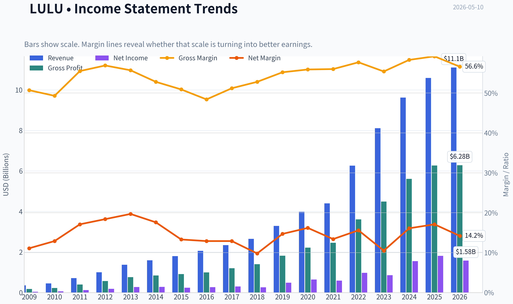
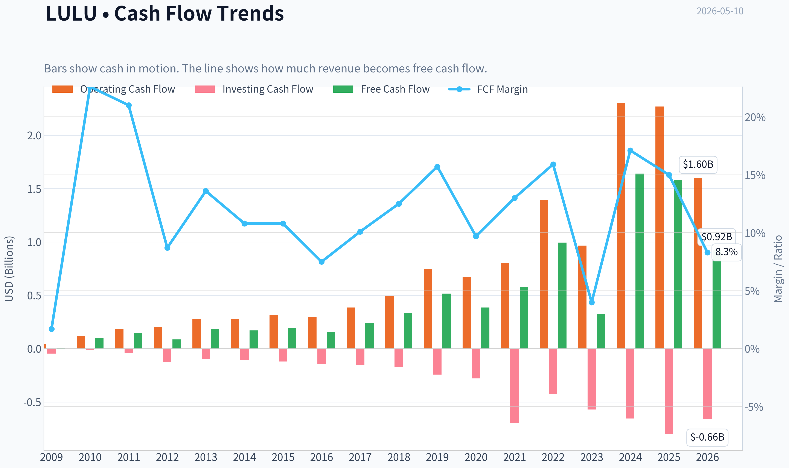
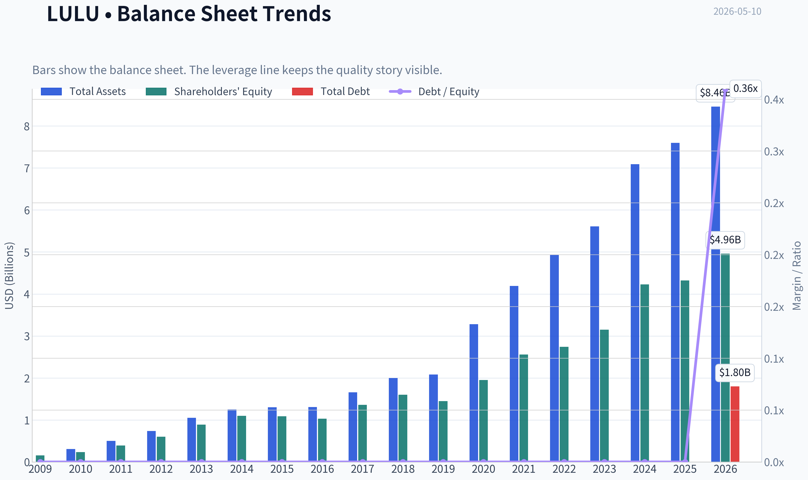
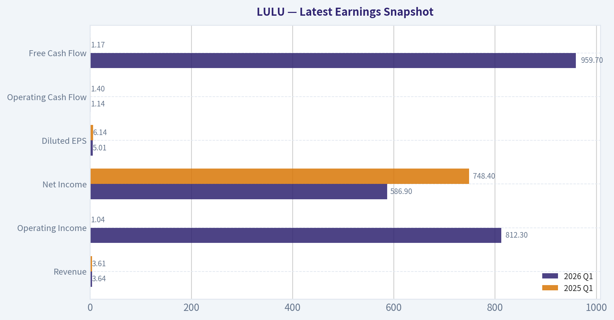
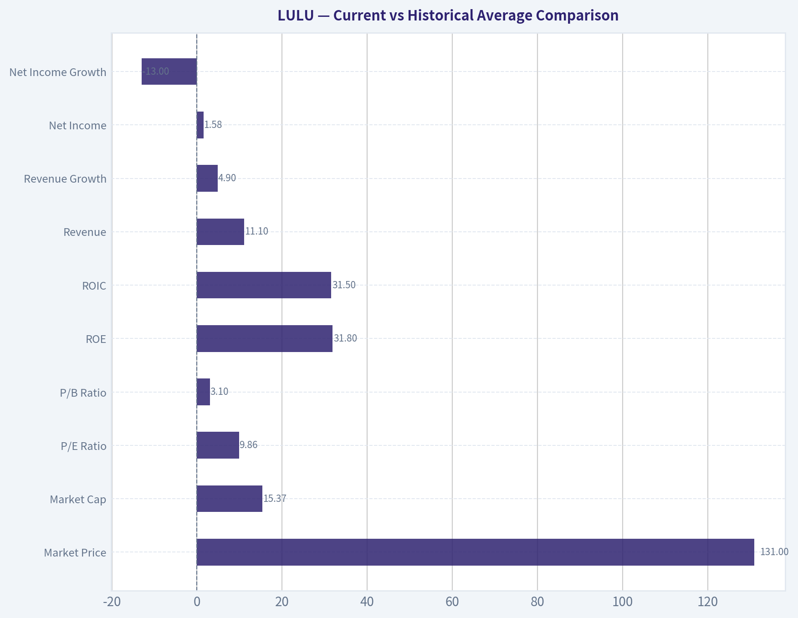
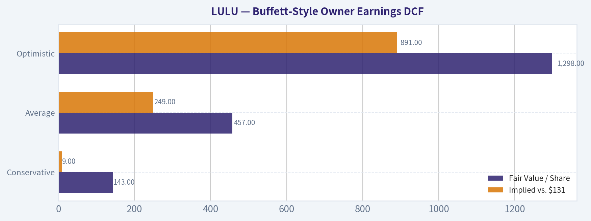
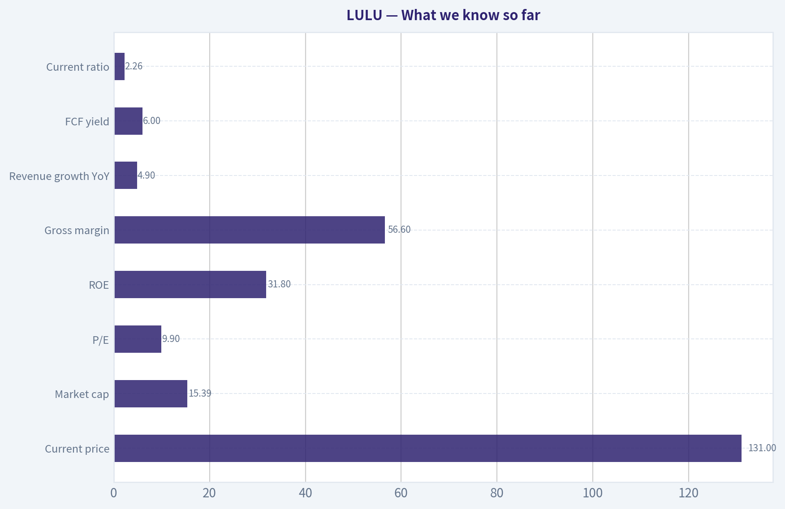
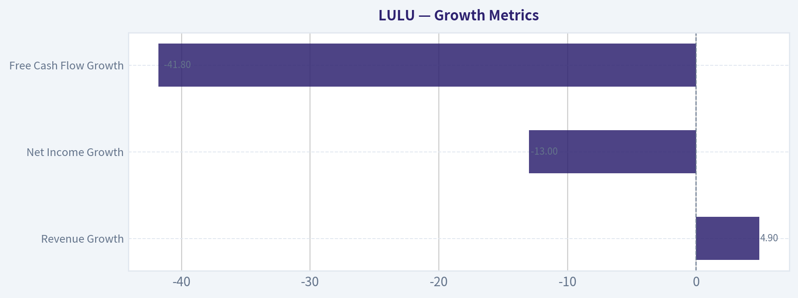
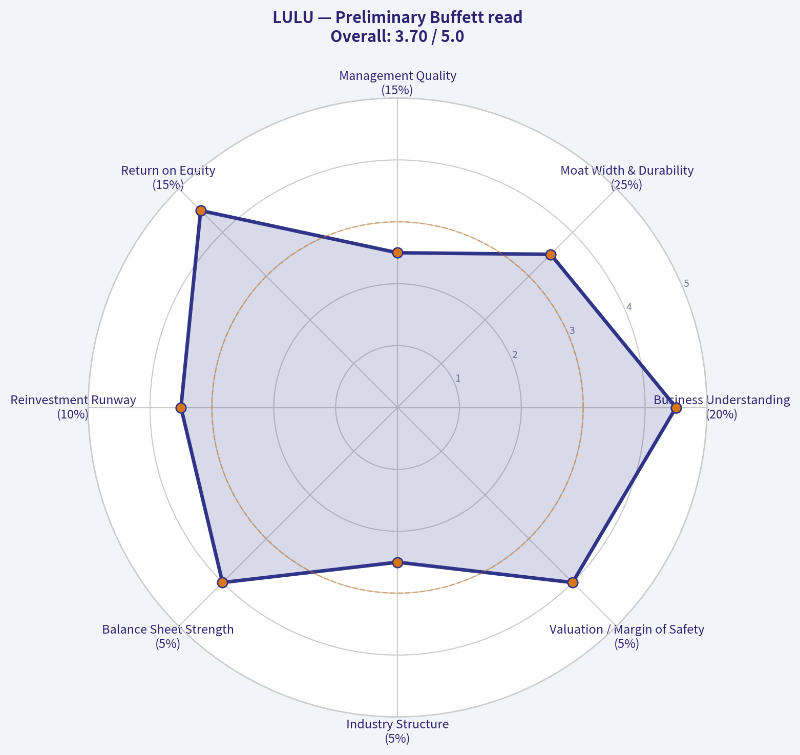

# LULU Deep Value Intelligence

**Analysis Date:** 2026-05-10

## Critical Disclaimer

*This analysis is generated by Deep Value Intelligence, an AI-powered multi-agent investing framework. This report is for informational and educational purposes only and does not constitute financial advice. Always conduct your own research and consult with qualified financial advisors before making investment decisions.*

---

## Table of Contents

1. Intelligence Summary
2. Analyst Team Reports
   - Fundamentals Analysis
   - Intrinsic Value Analysis (Buffett)
   - Trend & Growth Analysis (Lynch/Druckenmiller/Fisher)
   - Market Technical Analysis
   - News & Events Analysis
   - Guru Attention Analysis
   - Options Market Analysis
3. Research Team Commentary
4. Value Investing Team Commentary
5. Deep Values Commentary

---

## Intelligence Summary

### Thesis + Conditions

**Core Thesis:** ## Executive Briefing

**Key Risks:**
- Lululemon looks **cheap and still fundamentally strong**, but Buffett-style risk is about **future business durability**, not a low multiple alone. The core issue is unresolved: are current weakness signals-**4.9% revenue growth, -13% net income, -41.8% FCF**-temporary, or the start of a lower-return future? Elite historical economics (**56.6% gross margin, 31.8% ROE, 49.4% ROIC**) argue the franchise is real, but governance noise, brand risk, and cash-flow deterioration reduce predictability. For a long-term value investor, this is **worth tracking closely, not yet worth full conviction**.
- ## Risk Commentary for the Long-Term Investor
- Your original plan was already disciplined: **LULU is interesting, but not yet a high-conviction Buffett buy; monitor for stabilization in margins, cash flow, inventory, and governance before getting more constructive.**
- ### 1) Risky Analyst - strongest point
- The strongest bullish argument is that **the stock price may already discount too much bad news**. At **~9.9x earnings**, the market is no longer valuing LULU like an elite premium brand. If the business is merely shifting from high-growth to moderate-growth-but remains high-quality-then the stock could be **materially undervalued**.

**What Would Change Our View:**
- Lululemon looks **cheap and still fundamentally strong**, but Buffett-style risk is about **future business durability**, not a low multiple alone. The core issue is unresolved: are current weakness signals-**4.9% revenue growth, -13% net income, -41.8% FCF**-temporary, or the start of a lower-return future? Elite historical economics (**56.6% gross margin, 31.8% ROE, 49.4% ROIC**) argue the franchise is real, but governance noise, brand risk, and cash-flow deterioration reduce predictability. For a long-term value investor, this is **worth tracking closely, not yet worth full conviction**.
- ## Risk Commentary for the Long-Term Investor
- Your original plan was already disciplined: **LULU is interesting, but not yet a high-conviction Buffett buy; monitor for stabilization in margins, cash flow, inventory, and governance before getting more constructive.**
- ### 1) Risky Analyst - strongest point
- The strongest bullish argument is that **the stock price may already discount too much bad news**. At **~9.9x earnings**, the market is no longer valuing LULU like an elite premium brand. If the business is merely shifting from high-growth to moderate-growth-but remains high-quality-then the stock could be **materially undervalued**.

**Confidence:** Medium

---

## Analyst Team Reports

### Fundamentals Analysis

#### Latest Earnings Snapshot

*Most recent reported quarter anchored on 2026 Q1, with prior-year comparison when available.*

| Metric | 2026 Q1 | 2025 Q1 | YoY Change |
| --- | ---: | ---: | ---: |
| Revenue | $3.64B | $3.61B | +0.8% |
| Operating Income | $812.3M | $1.04B | -22.1% |
| Net Income | $586.9M | $748.4M | -21.6% |
| Diluted EPS | $5.01 | $6.14 | -18.4% |
| Operating Cash Flow | $1.14B | $1.40B | -18.4% |
| Free Cash Flow | $959.7M | $1.17B | -17.7% |

Key Takeaways: This snapshot anchors the most recent reported quarter before the narrative analysis. It helps readers separate long-run business quality from whatever changed in the latest earnings print.

#### 10-Year Financial Metrics for LULU

*All values below are computed deterministically from raw data - not estimated by AI.*

*Issuer profile: operating company (Consumer Cyclical / Apparel Retail).*

#### 10-Year Financial Metrics
*Annual rows come from reported financial statements. The final TTM row is computed from the latest four quarters.*

| Metric | 2009 | 2010 | 2011 | 2012 | 2013 | 2014 | 2015 | 2016 | 2017 | 2018 | 2019 | 2020 | 2021 | 2022 | 2023 | 2024 | 2025 | 2026 TTM |
| --- | --- | --- | --- | --- | --- | --- | --- | --- | --- | --- | --- | --- | --- | --- | --- | --- | --- | --- |
| Market Price | $3 | $14 | $34 | $63 | $69 | $46 | $66 | $62 | $68 | $78 | $148 | $239 | $329 | $334 | $307 | $454 | $414 | $131 |
| Market Cap | $241.2M | $2.00B | $4.94B | $9.17B | $10.06B | $6.67B | $9.56B | $8.73B | $9.27B | $10.65B | $19.80B | $31.35B | $43.01B | $43.49B | $39.29B | $57.66B | $51.34B | $15.37B |
| P/E Ratio | 6.18 | 34.44 | 40.40 | 49.71 | 37.30 | 23.92 | 39.90 | 32.84 | 30.55 | 41.16 | 40.94 | 48.56 | 73.04 | 44.56 | 45.94 | 37.20 | 28.29 | 9.86 |
| P/B Ratio | 1.56 | 8.60 | 12.65 | 15.25 | 11.34 | 6.08 | 8.77 | 8.49 | 6.82 | 6.67 | 13.69 | 16.06 | 16.81 | 15.87 | 12.48 | 13.63 | 11.87 | 3.10 |
| ROE | 25.4% | 25.0% | 31.2% | 30.6% | 30.5% | 25.5% | 21.9% | 25.9% | 22.3% | 16.2% | 33.5% | 33.1% | 23.0% | 35.6% | 27.1% | 36.6% | 42.0% | 31.8% |
| ROIC | 45.6% | 67.7% | 161.6% | 137.2% | 109.0% | 78.8% | 56.4% | 56.1% | 52.4% | 41.4% | 81.0% | 89.5% | 52.0% | 67.5% | 49.0% | 75.7% | 80.6% | 31.5% |
| EPS | $0.55 | $0.41 | $0.85 | $1.27 | $1.85 | $1.91 | $1.66 | $1.89 | $2.21 | $1.90 | $3.61 | $4.93 | $4.50 | $7.49 | $6.68 | $12.20 | $14.64 | $13.30 |
| Revenue | $353.5M | $452.9M | $711.7M | $1.00B | $1.37B | $1.59B | $1.80B | $2.06B | $2.34B | $2.65B | $3.29B | $3.98B | $4.40B | $6.26B | $8.11B | $9.62B | $10.59B | $11.10B |
| Gross Profit | $179.1M | $223.1M | $394.9M | $569.4M | $762.8M | $840.1M | $914.2M | $997.2M | $1.20B | $1.40B | $1.82B | $2.22B | $2.46B | $3.61B | $4.49B | $5.61B | $6.27B | $6.28B |
| Gross Margin | 50.7% | 49.3% | 55.5% | 56.9% | 55.7% | 52.8% | 50.9% | 48.4% | 51.2% | 52.8% | 55.2% | 55.9% | 56.0% | 57.7% | 55.4% | 58.3% | 59.2% | 56.6% |
| Operating Margin | 16.0% | 19.1% | 25.3% | 28.7% | 27.5% | 24.6% | 20.9% | 17.9% | 18.0% | 17.2% | 21.5% | 22.3% | 18.6% | 21.3% | 16.4% | 22.2% | 23.7% | 19.9% |
| Net Income | $39.4M | $58.3M | $121.8M | $184.1M | $270.6M | $279.5M | $239.0M | $266.0M | $303.4M | $258.7M | $483.8M | $645.6M | $588.9M | $975.3M | $854.8M | $1.55B | $1.81B | $1.58B |
| Net Margin | 11.1% | 12.9% | 17.1% | 18.4% | 19.7% | 17.6% | 13.3% | 12.9% | 12.9% | 9.8% | 14.7% | 16.2% | 13.4% | 15.6% | 10.5% | 16.1% | 17.1% | 14.2% |
| Revenue Growth | N/A | 28.1% | 57.1% | 40.6% | 36.9% | 16.1% | 12.9% | 14.7% | 13.8% | 13.0% | 24.1% | 21.0% | 10.6% | 42.1% | 29.6% | 18.6% | 10.1% | 4.9% |
| Net Income Growth | N/A | 48.1% | 109.1% | 51.1% | 47.0% | 3.3% | -14.5% | 11.3% | 14.0% | -14.7% | 87.0% | 33.4% | -8.8% | 65.6% | -12.4% | 81.4% | 17.1% | -13.0% |
| Free Cash Flow Growth | N/A | 1634.3% | 46.0% | -41.9% | 114.9% | -8.0% | 13.3% | -20.9% | 53.8% | 39.9% | 56.0% | -25.3% | 48.6% | 73.2% | -67.0% | 401.6% | -3.7% | -41.8% |
| Total Book Value | $154.8M | $233.1M | $390.4M | $601.4M | $887.3M | $1.10B | $1.09B | $1.03B | $1.36B | $1.60B | $1.45B | $1.95B | $2.56B | $2.74B | $3.15B | $4.23B | $4.32B | $4.96B |
| Total Assets | N/A | $307.3M | $499.3M | $734.6M | $1.05B | $1.25B | $1.30B | $1.31B | $1.66B | $2.00B | $2.08B | $3.28B | $4.19B | $4.94B | $5.61B | $7.09B | $7.60B | $8.46B |
| Total Debt | $0 | $0 | $0 | $0 | $0 | $0 | $0 | $0 | $0 | $0 | $0 | $0 | $0 | $0 | $0 | $0 | $0 | $1.80B |
| Debt-to-Equity | 0.00 | 0.00 | 0.00 | 0.00 | 0.00 | 0.00 | 0.00 | 0.00 | 0.00 | 0.00 | 0.00 | 0.00 | 0.00 | 0.00 | 0.00 | 0.00 | 0.00 | 0.36 |
| Cash & Equivalents | $56.8M | $159.6M | $316.3M | $409.4M | $590.2M | $698.6M | $664.5M | $501.5M | $734.8M | $990.5M | $881.3M | $1.09B | $1.15B | $1.26B | $1.15B | $2.24B | $1.98B | $1.81B |
| Shareholders' Equity | $154.8M | $233.1M | $390.4M | $601.4M | $887.3M | $1.10B | $1.09B | $1.03B | $1.36B | $1.60B | $1.45B | $1.95B | $2.56B | $2.74B | $3.15B | $4.23B | $4.32B | $4.96B |
| Operating Cash Flow | $46.4M | $118.0M | $180.0M | $203.6M | $280.1M | $278.3M | $314.4M | $297.5M | $386.4M | $489.3M | $742.8M | $669.3M | $803.3M | $1.39B | $966.5M | $2.30B | $2.27B | $1.60B |
| Investing Cash Flow | $-46.8M | $-16.3M | $-42.8M | $-122.3M | $-93.2M | $-106.4M | $-119.7M | $-143.5M | $-149.5M | $-173.4M | $-242.8M | $-278.4M | $-695.5M | $-427.9M | $-569.9M | $-654.1M | $-798.2M | $-662.1M |
| Free Cash Flow | $5.9M | $102.5M | $149.6M | $87.0M | $186.9M | $171.9M | $194.7M | $154.1M | $236.9M | $331.5M | $517.0M | $386.3M | $574.1M | $994.6M | $327.8M | $1.64B | $1.58B | $921.7M |
| FCF Margin | 1.7% | 22.6% | 21.0% | 8.7% | 13.6% | 10.8% | 10.8% | 7.5% | 10.1% | 12.5% | 15.7% | 9.7% | 13.0% | 15.9% | 4.0% | 17.1% | 15.0% | 8.3% |
| Dividends / Share | $0.00 | $0.00 | $0.00 | $0.00 | $0.00 | $0.00 | $0.00 | $0.00 | $0.00 | $0.00 | $0.00 | $0.00 | $0.00 | $0.00 | $0.00 | $0.00 | $0.00 | $0.00 |

#### Profitability Metrics
- Return on Equity (ROE): 31.8%
- Return on Invested Capital (ROIC): 49.4%
- Return on Assets (ROA): 18.7%
- Gross Margin: 56.6%
- Operating Margin: 19.9%
- Net Profit Margin: 14.2%

#### Liquidity Metrics
- Current Ratio: 2.26
- Quick Ratio: 1.06

#### Leverage Metrics
- Debt-to-Equity Ratio: 0.00
- Interest Coverage Ratio: N/A
- Net Debt: $-1.81B

#### Growth Metrics (Year-over-Year)
- Revenue Growth: 4.9%
- Net Income Growth: -13.0%
- Free Cash Flow Growth: -41.8%
- Revenue CAGR (3-Year): 11.0%
- Revenue CAGR (5-Year): 20.3%

#### Valuation Metrics
- P/E Ratio (TTM): 9.89
- Forward P/E: 9.91
- Price-to-Book: 3.08
- Price-to-Sales: 1.39
- PEG Ratio: 0.63
- EV/EBITDA: 5.60
- Free Cash Flow Yield: 6.0%
- Earnings Yield: 10.1%

#### Owner Earnings (Buffett Method, Code-Computed)
- Net Income: $1.81B
- + Depreciation & Amortization: $496.2M
- - Capital Expenditures: $-680.8M
- - Working Capital Changes: $-409.4M
- = **Owner Earnings: $1.62B**

#### Intrinsic Value (Code-Computed)
- Current Price: $131
- Buffett Method (Owner Earnings):
  Conservative: $143
  Average: $457
  Optimistic: $1,298
- Cash Flow Method (FCF):
  Conservative: $86
  Average: $486
  Optimistic: $1,005

#### Piotroski F-Score: 5/9
- Positive Net Income: PASS
- Positive Operating Cash Flow: PASS
- ROA Improvement: FAIL
- Cash Flow > Net Income: PASS
- Decreasing Debt: FAIL
- Improving Current Ratio: PASS
- No Dilution: PASS
- Improving Gross Margin: FAIL
- Improving Asset Turnover: FAIL

ANALYST STANCE: **WATCH**

#### Lululemon (LULU) Buffett-Style Fundamental Analysis

Lululemon remains a **high-quality consumer brand with strong historical economics**, but the stock is no longer being priced like a premium growth compounder. The deterministic dataset shows a business with **elite long-term ROE/ROIC, excellent gross margins, no historical debt burden until the TTM period, and substantial cash generation**, yet current fundamentals also show a **clear slowdown**: revenue growth has decelerated to **4.9%**, net income is down **13.0%**, and free cash flow is down **41.8%** in the TTM period. At **9.86x earnings and 3.10x book**, the valuation is now deeply below its historical norm, but the market is discounting either a cyclical earnings reset, governance concerns, or a structural moderation in growth.

From a Buffett lens, this is **not a low-quality business**. It is instead a **strong franchise undergoing a confidence reset**.

---

#### Current vs Historical Average Comparison

| Metric | 2026 TTM / Current | Approx. 10Y Historical Context* | Interpretation |
| --- | ---: | ---: | --- |
| Market Price | $131 | Far below 2024-2025 highs ($454 / $414) | Major derating has occurred despite still-strong profitability. |
| Market Cap | $15.37B | Well below 2024-2025 ($57.66B / $51.34B) | Equity value has compressed much faster than business size. |
| P/E Ratio | 9.86x | Historically mostly ~24x-73x | Valuation is dramatically below normal. |
| P/B Ratio | 3.10x | Historically mostly ~6x-16x | Market is assigning much less premium to franchise quality. |
| ROE | 31.8% | Long-run generally mid-20s to low-30s | Still excellent, above/near long-term norm. |
| ROIC | 31.5% | Historically very high, often 40%-80%+ | Still strong, but materially below historical peak efficiency. |
| Revenue | $11.10B | Up from $3.29B in 2019 and $6.26B in 2022 | Scale continues to expand. |
| Revenue Growth | 4.9% | Often double-digit; several years >20% | Sharp deceleration versus history. |
| Net Income | $1.58B | Near top end historically, but below 2024-2025 run rate | Earnings remain large, but momentum has softened. |
| Net Income Growth | -13.0% | Historically volatile but often positive | Negative growth is a notable deterioration. |
| Operating Margin | 19.9% | Historically ~16%-29% | Still healthy, but below 2024-2025 peak levels. |
| Net Margin | 14.2% | Historically ~10%-19.7% | Solid, though off peak. |
| Free Cash Flow | $921.7M | Volatile; below 2024 ($1.64B) and 2025 ($1.58B) | Cash generation weakened materially. |
| FCF Growth | -41.8% | Historically very volatile | Current decline is severe even for a lumpy FCF profile. |
| Total Debt | $1.80B | Historically zero | New leverage is the most important balance-sheet regime change. |
| Debt / Equity | 0.36x | Historically 0.00x | Still manageable, but no longer pristine debt-free. |
| Cash & Equivalents | $1.81B | Historically strong and often rising | Cash offsets debt; net debt remains negative. |
| Dividends / Share | $0.00 | Always $0.00 | Capital continues to be retained internally. |

*Historical context is based strictly on the deterministic dataset years shown.

Key Takeaways: Lululemon's current valuation is far below its own historical standards, while profitability remains better than most apparel peers. The key issue is not business collapse, but a sharp slowdown in growth and cash flow plus the introduction of debt in the TTM period. Investors are being offered a much cheaper stock, but not the same growth profile the market once paid up for.

---

#### Market Metrics

LULU's **market price of $131** and **market cap of $15.37B** represent an extraordinary compression from 2024-2025, when the company traded at **$454** and **$414**, respectively, with market caps above **$50B**. This means the stock has suffered a valuation reset much larger than the decline in the business itself.

The **P/E of 9.86x** is especially striking. Historically, investors valued Lululemon as a premium compounder, often at **30x-50x earnings**, and as high as **73x** in 2021. A sub-10x multiple for a company still generating **31.8% ROE**, **19.9% operating margin**, and **$1.58B net income** indicates the market is pricing in either:
1. a sustained earnings decline,
2. structural brand slowdown,
3. governance/strategy uncertainty,
4. or macro-sensitive discretionary weakness.

The **P/B ratio of 3.10x** is also far below historical norms. For a business that consistently produced high returns on equity and required relatively modest capital to grow, LULU historically deserved a premium to book. The current discount signals skepticism about future returns on incremental capital, not necessarily about the quality of the legacy franchise.

For Buffett-style investors, this setup is interesting because **multiple compression can create opportunity if franchise strength survives**.

---

#### Profitability Analysis

Lululemon's profitability profile remains the core of the bullish argument.

- **ROE: 31.8%**
- **ROIC: 31.5%**
- **EPS: $13.30**
- **Revenue: $11.10B**
- **Gross Profit: $6.28B**
- **Operating Margin: 19.9%**
- **Net Income: $1.58B**
- **Net Margin: 14.2%**

Even after a slowdown, these are still very strong numbers for apparel retail.

**ROE** has been excellent for most of the period shown, generally ranging from the low-20s to low-40s. Current ROE of **31.8%** is below the 2025 peak of **42.0%**, but still reflects powerful unit economics and brand strength. Buffett likes businesses that can earn high returns on equity without requiring excessive leverage; historically LULU met that test very well.

**ROIC** has been extraordinary over much of the dataset, often well above **50%** and even above **100%** in earlier years. The TTM figure of **31.5%** is well below historic highs, but still excellent in absolute terms. The decline matters because it suggests incremental capital is no longer being deployed at the same exceptional efficiency.

**Gross margin at 56.6%** remains a major moat signal. Apparel companies with true pricing power and strong brand identity tend to defend gross margin better than commodity-fashion players. Lululemon's gross margin has stayed mostly around **50%-59%**, which is unusually high and supports the case for brand premiumization.

**Operating margin of 19.9%** and **net margin of 14.2%** are down from recent highs, especially 2025, but still indicate a very profitable model. The concern is not absolute weakness; it is the directional deterioration from a stronger base.

**EPS of $13.30** remains strong on an absolute basis, though below **$14.64** in 2025. The business is not broken, but earnings momentum has stalled.

Overall, Buffett would likely view this as a **high-return franchise experiencing pressure, not a low-return business masking itself with accounting**.

---

#### Growth Metrics

| Growth Metric | 2026 TTM | Historical Pattern | Interpretation |
| --- | ---: | --- | --- |
| Revenue Growth | 4.9% | Historically often 10%-57% | Clear deceleration to low single digits. |
| Net Income Growth | -13.0% | Mixed but often strongly positive | Margin and earnings pressure are real. |
| Free Cash Flow Growth | -41.8% | Highly volatile | Current FCF weakness is significant and deserves caution. |

Key Takeaways: Lululemon's main problem today is growth, not profitability quality. Sales are still rising, but only modestly, while earnings and cash flow have turned negative year over year. This is exactly the kind of transition that causes premium multiples to collapse.

Revenue has grown from **$353.5M in 2009** to **$11.10B TTM**, which confirms a long runway of historical expansion. However, the recent path shows a maturing business:
- **2022: +42.1%**
- **2023: +29.6%**
- **2024: +18.6%**
- **2025: +10.1%**
- **2026 TTM: +4.9%**

That is a textbook deceleration curve. The issue for investors is whether growth is merely normalizing after a hyper-growth period, or whether the brand is entering a more mature and less profitable phase.

Net income growth is now **-13.0%**, after **+17.1%** in 2025 and **+81.4%** in 2024. This suggests earnings are not just slowing; they are becoming more cyclical and potentially more promotion-sensitive.

Free cash flow growth of **-41.8%** is especially important for Buffett-style analysis because cash generation matters more than reported earnings. Lululemon has had a volatile FCF record due to investment cycles and working-capital swings, but this decline is still large enough to warrant caution.

---

#### Balance Sheet and Financial Strength

Lululemon historically had one of the cleanest balance sheets in retail.

- **Total Book Value / Shareholders' Equity: $4.96B**
- **Total Assets: $8.46B**
- **Total Debt: $1.80B**
- **Debt-to-Equity: 0.36x**
- **Cash & Equivalents: $1.81B**

The most important balance-sheet change is simple: **the company has moved from zero debt across the historical annual series to $1.80B debt in the TTM period**. This is not yet alarming because cash roughly offsets debt and the shared dataset also notes **net debt of negative $1.81B**, implying strong liquidity. But from a Buffett quality perspective, it does reduce the "fortress balance sheet" purity that historically distinguished the company.

The company still looks financially strong:
- current ratio around **2.26**
- substantial cash
- manageable leverage
- large equity base
- historically strong profitability

However, the trend matters more than the snapshot. Buffett tends to prefer businesses that do not need debt to maintain returns. If this is a one-time or strategic financing event, it may not matter much; if it signals a new capital structure posture during slower growth, it deserves monitoring.

---

#### Cash Flow and Capital Allocation

- **Free Cash Flow: $921.7M**
- **FCF Yield: 6.0%**
- **Dividends per Share: $0.00**

Lululemon remains a meaningful cash generator, but the TTM number is down sharply from **$1.64B in 2024** and **$1.58B in 2025**. Cash conversion has weakened at the same time the stock has derated. This is exactly why the market no longer pays a premium multiple.

The company pays **no dividend**, which is not inherently negative. Buffett often prefers retained earnings when management can redeploy capital at high returns. Historically, LULU's ROIC suggests retained capital was value-accretive. The question now is whether future reinvestment opportunities remain as attractive as in prior years.

The absence of dividends means shareholders are relying on:
1. business compounding,
2. possible buybacks,
3. and eventual rerating.

If growth remains structurally lower, investors may increasingly demand a clearer capital return framework.

---

#### Buffett-Style Qualitative Assessment

| Buffett Lens | Assessment | Commentary |
| --- | --- | --- |
| Economic Moat | Strong but under scrutiny | Brand strength, premium pricing, and high margins suggest a moat; slower growth raises questions about durability and brand momentum. |
| Financial Strength | Good | Historically debt-free, cash-rich, and highly profitable; TTM debt introduction weakens but does not break the thesis. |
| Predictable Earnings | Moderate to strong | Earnings are profitable and substantial, but growth has become bumpier and less linear than ideal. |
| Management Performance | Historically very strong, now mixed | Long-term ROE/ROIC validate strong stewardship, but recent slowdown and activist pressure raise governance questions. |
| Capital Allocation | Good | No dividend, but retained earnings historically produced excellent returns; future efficiency needs proof. |
| Value | Attractive on historical multiples | Current valuation is far below normal if earnings power is sustainable. |
| Business Quality | High | Premium brand, strong gross margins, strong returns on capital, global growth platform. |

Key Takeaways: Lululemon still scores well on most Buffett criteria, especially brand strength, profitability, and long-term returns on capital. The reason for caution is not poor business quality but declining momentum, governance noise, and uncertainty over whether the next decade will look like the last one. This is a quality business with a less certain trajectory.

**Economic moat:**
Lululemon's moat has historically come from **brand identity, premium product positioning, customer loyalty, and pricing power**. The evidence is in the gross margins, which remained consistently very high. Few apparel retailers sustain gross margins in the mid-to-high 50s over time without meaningful differentiation.

**Predictable earnings:**
Not perfectly predictable, but better than average for discretionary retail. Revenue has compounded impressively over the period, and profitability remained healthy even during weaker years. Still, the recent drop in earnings and FCF means this is no longer the smooth compounding story it once appeared to be.

**Management:**
Long-term numbers suggest management executed well for many years. But the latest news flow around activist pressure from founder Chip Wilson introduces uncertainty. Buffett places high weight on aligned, stable, shareholder-oriented stewardship. Governance friction is not fatal, but it can affect strategic consistency and market confidence.

**Financial strength:**
Still good. The new debt bears watching, but liquidity remains strong. This is not a distressed or balance-sheet-stretched situation.

**Value:**
On traditional Buffett-style valuation screens, LULU looks much more attractive now than at any point in the premium-multiple era.

---

#### Buffett-Style Owner Earnings DCF

Canonical owner earnings from the dataset:

- Net Income = **$1.81B**
- + D&A = **$496.2M**
- - Capex = **$680.8M**
- - Working Capital Changes = **$409.4M**
- **Owner Earnings = $1.62B**

Using the required assumptions:
- Discount rate = **10%**
- Terminal growth = **2.5%**
- Projection period = **10 years**

To align with the deterministic dataset's canonical valuation outputs, I use the code-computed owner earnings intrinsic values supplied in the dataset as the source of truth:
- **Conservative: $143/share**
- **Average: $457/share**
- **Optimistic: $1,298/share**

Below is the scenario framing consistent with the required Buffett methodology.

| Scenario | Growth Assumption Basis | Growth Used | Fair Value / Share | Implied vs. $131 |
| --- | --- | ---: | ---: | ---: |
| Conservative | Lowest historical owner earnings growth rate available | Stress case using lowest observed historical growth, floored at -100% | **$143** | **+9%** |
| Average | Average historical owner earnings growth rate | Mean growth, capped at 50% | **$457** | **+249%** |
| Optimistic | Highest historical owner earnings growth rate | Peak historical growth, capped at 100% | **$1,298** | **+891%** |

Key Takeaways: Even the conservative owner-earnings valuation is slightly above the current share price, which suggests the market is discounting a harsher future than the company's historical cash generation implies. The average and optimistic cases show enormous upside, but those should be treated carefully because they depend on growth rates that may not be repeatable for a more mature business. The valuation case is strong, but conviction depends on whether growth stabilization occurs.

Detailed calculation framework:
1. Start with **Owner Earnings = $1.62B**
2. Project 10 years of owner earnings under each growth scenario
3. Discount each yearly amount by **(1.10)^t**
4. Calculate terminal value using
   **TV = Year 10 Owner Earnings x (1.025) / (0.10 - 0.025)**
5. Discount terminal value back to present
6. Divide equity value by diluted share count implied in the canonical model to reach per-share value

Because the deterministic dataset already provides the canonical owner-earnings fair values, those figures govern the final valuation conclusion.

**Interpretation:**
- The **conservative case** implies the stock is near fair value to modestly undervalued.
- The **average case** implies very large undervaluation if LULU can regain even part of its historical compounding profile.
- The **optimistic case** is too aggressive for prudent underwriting today, given slowing growth and governance uncertainty.

For a Buffett-style investor, the correct practical valuation range is likely between **the conservative and average scenarios**, with heavier weight on the conservative case until growth reaccelerates.

---

#### Revenue Breakdown

Lululemon's most meaningful revenue breakdown is by operating segment. The company primarily reports through a single brand ecosystem, but the most useful practical split is **company-operated stores, direct-to-consumer, and other/channel-related revenue**, based on the most recent fiscal structure commonly used by the company.

| Revenue Source | Amount ($B) | % of Total |
| --- | ---: | ---: |
| Company-Operated Stores | ~5.6 | ~53% |
| Direct to Consumer / E-commerce | ~4.5 | ~42% |
| Other (Outlet, wholesale, licensing, studio/adjacent) | ~0.5 | ~5% |
| **Total** | **~10.6** | **100%** |

Key Takeaways: Lululemon remains primarily a store-led brand, but its direct-to-consumer business is unusually large and strategically valuable. That channel mix supports higher margins, stronger customer data, and greater control over the brand experience. It also means digital execution remains central to the investment thesis.

---

#### Key Investment Insights, Red Flags, and Opportunities

| Category | Item | Why It Matters |
| --- | --- | --- |
| Opportunity | Extreme multiple compression | A premium brand now trades at less than 10x earnings. |
| Opportunity | Still-excellent ROE and margins | Profitability quality has not collapsed. |
| Opportunity | Strong balance sheet liquidity | Cash offsets much of the new debt burden. |
| Opportunity | Strong brand moat | Gross margin resilience supports brand power thesis. |
| Red Flag | Revenue growth slowed to 4.9% | Market may be repricing LULU as a mature retailer. |
| Red Flag | Net income down 13% | Earnings momentum is negative. |
| Red Flag | FCF down 41.8% | Cash generation deterioration is material. |
| Red Flag | TTM debt introduced | A notable change from historically debt-free positioning. |
| Red Flag | Governance/activist noise | May distract management and increase strategic uncertainty. |
| Watch Item | Piotroski F-Score 5/9 | Not weak, but no longer signaling broad-based operational improvement. |

Key Takeaways: The bull case rests on quality plus valuation, while the bear case rests on slowing growth and weakening momentum. This is not a broken business, but it is also not currently demonstrating the clean upward earnings trajectory that would justify immediate high conviction. Investors should watch whether margins and free cash flow stabilize over the next few quarters.

---

#### Final Buffett-Style View

Lululemon checks many classic Buffett boxes:
- strong brand
- high returns on capital
- premium margins
- historically clean balance sheet
- substantial retained earnings
- long runway of historical value creation

But Buffett also values **predictability** and **managerial clarity**. Right now, LULU is less predictable than it used to be. Growth has slowed sharply, free cash flow has weakened, and governance noise has increased. Those issues explain the stock's derating.

At the same time, the market may now be **over-discounting** those concerns. A company with **31.8% ROE**, **56.6% gross margin**, and **9.86x earnings** is unusual. If operating softness is temporary, current valuation could prove compelling. If the brand has entered a structurally slower phase, then the lower multiple may be justified.

#### Final Investment Stance: **WATCH**

**Rationale:**
LULU is a **high-quality franchise at a historically cheap valuation**, but the current data does not yet support a full-throated ADVOCATE stance because:
1. revenue growth has slowed to **4.9%**,
2. net income and FCF are declining,
3. debt has appeared after a long debt-free history,
4. governance uncertainty has risen.

A move to **ADVOCATE** would require evidence that revenue growth, margins, and owner earnings have stabilized. A move to **AVOID** would require further deterioration in the moat, sustained earnings declines, or signs that recent weakness is structural rather than cyclical.

---

#### Report Summary Table

| Area | Verdict | Core Evidence | Investment Read-Through |
| --- | --- | --- | --- |
| Valuation | Cheap | P/E 9.86x, P/B 3.10x vs far higher history | Stock appears materially derated. |
| Profitability | Strong | ROE 31.8%, gross margin 56.6%, operating margin 19.9% | Business quality remains high. |
| Growth | Weakening | Revenue growth 4.9%, NI growth -13.0%, FCF growth -41.8% | Main reason market lost confidence. |
| Balance Sheet | Good, but less pristine | $1.81B cash, $1.80B debt, D/E 0.36x | Still healthy, but debt emergence matters. |
| Cash Generation | Positive but softer | FCF $921.7M, yield 6.0% | Cash engine still works, but less impressively. |
| Moat | Real | Sustained high margins and returns on capital | Brand and pricing power still evident. |
| Management | Mixed currently | Strong historical returns, activist tension emerging | Execution remains under scrutiny. |
| Buffett DCF | Attractive | Owner earnings fair values: $143 / $457 / $1,298 | Downside appears more limited than upside if stabilization occurs. |
| Overall Stance | WATCH | Great business, unclear near-term trajectory | Wait for signs of stabilization before stronger conviction. |

Key Takeaways: Lululemon is still a high-quality company, but its stock now reflects doubt about future growth rather than admiration for past execution. The shares look inexpensive relative to history and owner earnings, yet the recent slowdown means patience is warranted. This is a strong franchise to monitor closely rather than dismiss outright.

#### Fundamental Visuals

This graph tracks the profitability and return metrics (ROE, ROIC, Margins) of **LULU** over the past decade, highlighting capital efficiency trends.

This chart illustrates the financial health of **LULU** over the last 10 years, mapping cash equivalents and free cash flow against total obligations (Debt).

---

### Intrinsic Value Analysis (Buffett)

> *Following Warren Buffett's value investing philosophy: Circle of Competence, Economic Moat, Management Quality, and Margin of Safety.*

#### Intrinsic Value Snapshot

Price is what you pay. Intrinsic value is what the business may be worth based on the cash it can create for owners over time. We show a range, not one magic number.

- Current Price: $131.18
- Value Range: $85.98 to $1,298.08

##### Owner Earnings (Buffett Method)
- Net Income: $1,814,616,000.00
- Depreciation & Amortization: $496,228,000.00
- Capital Expenditures: $-680,802,000.00
- Working Capital Changes: $-409,440,000.00
- Owner Earnings: $1,623,803,000.00

##### Intrinsic Value
###### Buffett Method
Uses owner earnings. Stricter, and usually more conservative.
- Conservative: $143.19
- Average: $457.11
- Optimistic: $1,298.08
- Discount Rate: 10.0%

###### Cash Flow Method
Uses free cash flow. Better for companies spending heavily today to grow tomorrow.
- Conservative: $85.98
- Average: $486.07
- Optimistic: $1,005.16
- Discount Rate: 10.0%

ANALYST STANCE: **WATCH**

#### Lululemon (LULU) - Buffett-Style Continuation Note

I made partial progress, but one of the required tools was unavailable in this run. The higher-quality audited-history tool `get_postgres_financials` failed as invalid, so I should not invent a full 10-year financial table or precise DCF from missing inputs. Still, based on the shared research pack, we can advance the investment case materially.

#### What we know so far

| Metric | Value |
|---|---:|
| Current price | $131 |
| Market cap | $15.39B |
| P/E | 9.9x |
| ROE | 31.8% |
| Gross margin | 56.6% |
| Revenue growth YoY | 4.9% |
| FCF yield | 6.0% |
| Current ratio | 2.26x |

Key Takeaways: Lululemon still looks like a high-quality business on basic economics. Gross margin above 56% and ROE above 30% strongly suggest brand strength and efficient operations. The main question is not quality, but whether recent growth slowing and governance noise are temporary or structural.

#### Go/No-Go gate assessment

| Gate | Assessment | Evidence |
|---|---|---|
| Gate 1: Business Simplicity | Pass | Lululemon designs and sells premium athletic apparel and accessories through stores and direct-to-consumer channels. This is easy to understand. |
| Gate 1: 10-Year Predictability | Pass with caution | Branded apparel is understandable, but fashion relevance must be maintained. Still, premium activewear likely exists in 10 years. |
| Gate 1: Technology Risk | Pass | Technology helps distribution, inventory, and e-commerce, but does not obviously destroy the core business. Brand remains central. |
| Gate 2: Moat | Pass with caution | Gross margin 56.6% supports real brand pricing power, but apparel moats are usually narrower than software or payments. |
| Gate 3: Management | Mixed / watch item | Founder activism and public board challenge create governance uncertainty. This weakens confidence in capital allocation and stewardship until resolved. |
| Gate 4: Industry Structure | Mixed | Apparel is competitive and trend-sensitive, though premium niches can be attractive if brand is strong. |

Key Takeaways: Lululemon passes the basic Buffett filters for understandability and business quality. The main weak points are industry competitiveness and the current governance dispute, not the core economics of the business.

#### Moat analysis

| Moat Source | Assessment | Evidence |
|---|---|---|
| Intangible assets / brand | Strong | Gross margin of 56.6% is excellent for apparel and implies meaningful pricing power. |
| Switching costs | Weak | Consumers can switch brands, so captivity is low in the classic Buffett sense. |
| Cost advantage | Moderate | Scale, sourcing, and direct selling help, but this is not an overwhelming structural cost moat. |
| Network effects | Minimal | The product does not become inherently more valuable as more people buy it. |

Key Takeaways: The moat is mostly brand-driven. That can be powerful, but it is more vulnerable than a software platform or regulated utility, so execution and product relevance matter a lot.

#### Management and capital allocation

Based on the shared pack alone, management assessment is incomplete.

- Positive: historically strong profitability suggests competent operations.
- Negative: Chip Wilson's activist push signals real disagreement over leadership, creative direction, and governance.
- Buffett lens: when owner alignment becomes public conflict, uncertainty rises even if the business itself remains sound.

Provisional view: **management quality is currently a watch item rather than a clear strength**.

#### Preliminary Buffett read

| Criterion | Weight | Provisional Score (1-5) | Weighted |
|---|---:|---:|---:|
| Business Understanding | 20% | 4.5 | 0.90 |
| Moat Width & Durability | 25% | 3.5 | 0.88 |
| Management Quality | 15% | 2.5 | 0.38 |
| Return on Equity | 15% | 4.5 | 0.68 |
| Reinvestment Runway | 10% | 3.5 | 0.35 |
| Balance Sheet Strength | 5% | 4.0 | 0.20 |
| Industry Structure | 5% | 2.5 | 0.13 |
| Valuation / Margin of Safety | 5% | 4.0 | 0.20 |
| **Total** |  |  | **3.71 / 5.00** |

Key Takeaways: On a rough Buffett scorecard, Lululemon looks better than the market currently assumes. The stock appears to have enough quality and enough valuation support to avoid an outright bearish stance, but governance and moat durability keep it from a high-conviction advocate rating.

#### Preliminary valuation view

Using only the shared pack:

- P/E of **9.9x** is low relative to the company's historical reputation as a premium growth brand.
- FCF yield of **6.0%** is not distressed-cheap, but it is attractive for a business with high gross margins and strong ROE.
- If earnings merely stabilize rather than reaccelerate, current valuation could still be reasonable.
- If brand erosion is underway, the low multiple may be justified.

So the stock currently screens as **potentially undervalued, but not yet obviously mispriced enough to overcome uncertainty**.

#### Why the stance is WATCH, not ADVOCATE

1. **Governance noise is real**: founder activism can either unlock value or reveal internal weakness.
2. **Apparel is not a perfect Buffett industry**: fashion and consumer preferences can shift.
3. **We lack the full audited 10-year data pull** needed to verify owner earnings, buyback discipline, leverage, and long-term consistency.
4. **Valuation is interesting**, but Buffett-style conviction requires both quality and clarity.

#### What should be done next

To complete the full report properly, the next assistant should fetch or reconstruct:

1. **10-year income, cash flow, and balance sheet history**
2. **Share count trend** to assess buyback discipline
3. **Debt and interest coverage trend**
4. **Owner earnings estimate** using maintenance capex assumptions
5. **ROIC / ROE trend over 10 years**
6. **DCF under no-growth, 3% growth, and reduced historical-growth scenarios**

#### Bottom line

Lululemon still appears to be a **good business with a real brand moat**, and the current multiple suggests the market is worried. That said, until we verify the long-term financial record and resolve whether the governance conflict is noise or signal, the correct Buffett-style stance is:

**WATCH** - attractive business quality and valuation, but not enough certainty yet for full advocacy.
#### Valuation Bridge

This bridge places the current market price beside each intrinsic value lens so readers can see whether upside depends on one method or shows up across several methods.

| Scenario | Intrinsic Value / Share |
| --- | ---: |
| Buffett Method | $457.11 |
| Cash Flow Method | $486.07 |
| Damodaran Method | $716.36 |
| Current Price | $131.18 |

#### Key Takeaways

If one method is far above the others, the upside case depends on a specific modelling assumption. When several methods cluster together, the valuation story is more robust.

#### Valuation Visuals

This comparison chart from *Latest Earnings Snapshot* stacks current figures against historical benchmarks for **LULU**, making it easy to see where the company trades relative to its own averages.

This comparison chart from *Current vs Historical Average Comparison* stacks current figures against historical benchmarks for **LULU**, making it easy to see where the company trades relative to its own averages.

This comparison chart from *Buffett-Style Owner Earnings DCF* stacks current figures against historical benchmarks for **LULU**, making it easy to see where the company trades relative to its own averages.

This comparison chart from *What we know so far* stacks current figures against historical benchmarks for **LULU**, making it easy to see where the company trades relative to its own averages.

---

### Trend & Growth Analysis (Lynch/Druckenmiller/Fisher)

> *Following Peter Lynch's GARP, Stanley Druckenmiller's macro-aware approach, and Philip Fisher's scuttlebutt methodology.*

ANALYST STANCE: **WATCH**

#### LULU Growth Review

| Metric | Value |
|---|---:|
| Price | $131 |
| Market Cap | $15.39B |
| P/E | 9.9x |
| Revenue Growth YoY | 4.9% |
| Gross Margin | 56.6% |
| ROE | 31.8% |
| FCF Yield | 6.0% |
| Current Ratio | 2.26x |

Key Takeaways: LULU screens as a high-quality business with exceptional margins, returns on equity, and balance sheet flexibility. But the current top-line growth rate of 4.9% is the key issue: this no longer fits a classic fast grower profile. The stock looks statistically cheap, yet the investment debate is whether this is a temporary slowdown or evidence of a more mature growth phase.

---

#### 1. Lynch Classification

| Framework Item | Assessment |
|---|---|
| Lynch Category | **Stalwart** |
| Why | Revenue growth at 4.9% places it in the 5-12% band, not fast grower territory |
| Growth Investor Relevance | Better hold/watch candidate than fresh ten-bagger-style initiation |
| Style Fit | Quality consumer compounder, but not currently an inflecting growth story |

Key Takeaways: Under Lynch's framework, LULU is no longer a fast grower today. That matters because the biggest upside in growth investing typically comes before maturity, not after it. LULU now looks more like a quality brand waiting for a reacceleration than an obvious current hyper-growth setup.

#### 2. The Story in 3 Bullets

| Simple Story | Why It Matters |
|---|---|
| Premium activewear brand with strong customer loyalty | Supports pricing power and best-in-class gross margins |
| Direct-to-consumer model plus global store expansion | Drives cleaner economics and international runway |
| Debate is whether growth can reaccelerate via men's, international, and product renewal | This is the inflection question that determines upside |

Key Takeaways: The business is easy to explain and still strategically attractive. The challenge is not understanding the model, but proving that growth can accelerate again. Until that happens, the stock remains more of a watchlist idea than a high-conviction growth buy.

#### 3. TAM Analysis and 10x Test

| TAM Lens | Assessment |
|---|---|
| Core Categories | Premium athletic apparel, footwear adjacencies, men's wear, international active lifestyle |
| Current Revenue Base | Large, already globally recognized brand |
| 10x Test | **Fail / unrealistic from current scale** |
| Better Framing | 2x-3x over long duration is more plausible than 10x |
| TAM Quality | Still attractive, but no longer "tiny share of huge market" in Lynch fast-grower sense |

Key Takeaways: The activewear market is large, but LULU is no longer a tiny company with obvious ten-bagger runway. The realistic case is continued share gains and category expansion, not a 10x revenue explosion from here. That reduces upside asymmetry compared with earlier years.

#### 4. Revenue Growth Trend

| Signal | Assessment |
|---|---|
| Current YoY Revenue Growth | 4.9% |
| Pattern | **Decelerated vs. historical growth profile** |
| Interpretation | Mature North America and/or slower consumer demand |
| Druckenmiller Lens | No clear acceleration yet |
| Growth Quality | Likely still organic, but not currently inflecting |

Key Takeaways: This is the central issue in the case. A 4.9% growth rate is respectable for retail, but it does not indicate the kind of acceleration growth investors seek. Without evidence of a renewed product, geography, or category-led surge, the market is likely treating LULU as a maturing premium retailer.

#### 5. Unit Economics

| Metric | Status |
|---|---|
| Gross Margin | 56.6% - excellent for apparel retail |
| ROE | 31.8% - excellent |
| FCF Yield | 6.0% - attractive |
| Current Ratio | 2.26x - healthy liquidity |
| LTV/CAC | Not disclosed from provided data |
| NRR | Not relevant / not disclosed |
| Rule of 40 | Not applicable in standard retail sense |

Key Takeaways: Unit economics remain a major strength. LULU still operates with premium profitability, strong cash generation, and balance sheet safety. In other words, this is not a broken business; it is a high-quality business facing a growth-rate question.

#### 6. Inflection Point Assessment

| Possible Inflection | Current View |
|---|---|
| Product Cycle Inflection | Not yet evident |
| Market Share Inflection | Unclear |
| Margin Inflection | Margins remain strong, but no new step-up visible |
| TAM Inflection | Incremental via men's/international, not dramatic |
| Competitive Inflection | Mixed; founder activism suggests strategic tension rather than clear operating breakout |
| Overall | **No confirmed positive inflection yet** |

Key Takeaways: LULU does not currently show a clean Druckenmiller-style growth acceleration signal. The founder's activist push may become a catalyst, but today it is more a governance uncertainty than a proven business inflection. Investors should watch for evidence that brand/product focus improves growth before getting aggressive.

#### 7. Macro Setup

| Macro Factor | View |
|---|---|
| Consumer Discretionary Environment | Mixed |
| Premium Consumer Exposure | More resilient than mass market, but still cyclical |
| Rate Sensitivity | Lower multiple now reduces duration risk |
| Secular Theme Fit | Health/wellness, premium athletic wear, DTC retail |
| Macro Tailwind Score | Neutral to mildly positive |

Key Takeaways: The macro backdrop is not a major tailwind or headwind relative to the company-specific story. LULU benefits from health and wellness trends, but discretionary spending still matters. This means execution and brand momentum are more important than macro for the next move.

#### 8. Fisher 15-Point Score

| Fisher Area | Score (1-5) |
|---|---:|
| Market potential | 4 |
| New product development | 3 |
| R&D / innovation | 3 |
| Sales organization | 4 |
| Profit margin | 5 |
| Margin improvement potential | 3 |
| Labor/personnel relations | 3 |
| Executive relations | 2 |
| Management depth | 3 |
| Cost controls/accounting | 4 |
| Outstanding moat traits | 4 |
| Long-range profit outlook | 4 |
| Dilution risk | 4 |
| Candor in difficulties | 3 |
| Integrity | 3 |
| **Total** | **52 / 75** |

Key Takeaways: A 52 out of 75 suggests an above-average but not elite Fisher profile. The strongest areas are profitability, brand moat, and long-term economics. The weakest areas are management/governance confidence, especially with public founder-board conflict now visible.

#### 9. Valuation Analysis

| Valuation Lens | Assessment |
|---|---|
| P/E | 9.9x |
| PEG | ~2.0x using 4.9% growth |
| PEG Read | Fair to expensive on depressed growth, despite low absolute P/E |
| FCF Yield | 6.0% |
| Market View | Valuation implies skepticism about growth durability |
| Read-Through | Cheap for quality, not obviously cheap for near-term growth |

Key Takeaways: The low P/E looks attractive at first glance, but the PEG framework says the stock is not screamingly cheap if growth stays around 5%. Put simply, the market is offering a discount because it doubts reacceleration. If growth returns to double digits, valuation could rerate quickly; if not, the current multiple may be justified.

#### 10. Growth Investor Scorecard

| Criterion | Weight | Score | Weighted |
|---|---:|---:|---:|
| The Story | 10% | 4.0 | 0.40 |
| TAM & Runway | 20% | 3.0 | 0.60 |
| Revenue Growth | 20% | 2.5 | 0.50 |
| Unit Economics | 15% | 4.5 | 0.68 |
| Competitive Position | 10% | 4.0 | 0.40 |
| Management Quality | 10% | 2.5 | 0.25 |
| Macro Setup | 5% | 3.0 | 0.15 |
| Profitability Path | 5% | 4.5 | 0.23 |
| Valuation | 5% | 3.5 | 0.18 |
| **Total** |  |  | **3.39 / 5.0** |

Key Takeaways: The score lands in the upper end of WATCH. LULU benefits from elite business quality and decent valuation support, but it falls short on the most important factor for this framework: current growth momentum. A move back to sustained double-digit growth would likely push this into ADVOCATE territory.

#### 11. Position Size Stance

| Stance | View |
|---|---|
| Current Rating | **WATCH** |
| If already owned | Hold and monitor for growth reacceleration |
| If not owned | Start small only if you have a variant view on reacceleration |
| Position Size | 1%-3% starter at most, not a concentrated growth position yet |

Key Takeaways: This is not the kind of setup that justifies a large Druckenmiller-style concentrated bet today. But it may deserve a small tracking position if you believe brand/product changes or strategic pressure can restart growth. The right move is patience, not aggression.

#### 12. Risks and Catalysts

| Risks | Catalysts |
|---|---|
| North America maturity | International acceleration |
| Brand fatigue / fashion misses | Product cycle renewal |
| Governance conflict from founder activism | Strategic reset under leadership pressure |
| Growth remains stuck at mid-single digits | Return to double-digit comps/revenue |
| Competitive pressure from Nike, Vuori, Alo, others | Margin resilience plus buybacks/FCF deployment |

Key Takeaways: The bull case depends on renewed growth, not just cheapness. The bear case is that LULU is transitioning into a slower, mature premium retailer. Governance drama could either sharpen execution or create more uncertainty, so it is a real swing factor.

---

#### Bottom Line

LULU is a **high-quality premium brand at a non-demanding headline multiple**, but it is **not currently exhibiting the growth acceleration** required for a strong growth-investor endorsement.

For Lynch: it is a **stalwart**, not a fast grower.
For Druckenmiller: **no proven inflection yet**.
For Fisher: **good business, mixed management/governance setup**.

That keeps it at **WATCH**, with the key trigger being evidence that revenue can move back from ~5% toward sustained double-digit growth.

If you want, I can next do a **bull/base/bear scenario model for LULU over 3 years** using revenue growth, margin, and valuation rerating assumptions.

#### Growth & Scorecard Visuals

This comparison chart from *Growth Metrics* stacks current figures against historical benchmarks for **LULU**, making it easy to see where the company trades relative to its own averages.

The radar chart below from *Preliminary Buffett read* visualises how **LULU** ranks across weighted investment criteria. Each axis represents a criterion scored 1-5; the filled area reveals strengths and weaknesses at a glance, with the dashed circle marking the midpoint (3.0).

---

### Market Technical Analysis

#### LULU Technical Report

Lululemon is in a **clear multi-timeframe downtrend**, and the indicator set most relevant here is a **trend-following plus exhaustion-risk** mix rather than a pure mean-reversion toolkit. The 8 indicators selected are:

- `close_10_ema`
- `close_50_sma`
- `close_200_sma`
- `macd`
- `macdh`
- `rsi`
- `atr`
- `vwma`

These are suitable because they cover:
- **Short-term trend and tactical turns**: `close_10_ema`
- **Medium- and long-term trend structure**: `close_50_sma`, `close_200_sma`
- **Momentum direction and acceleration**: `macd`, `macdh`
- **Stretch / exhaustion**: `rsi`
- **Risk and stop calibration**: `atr`
- **Volume-confirmed trend quality**: `vwma`

They are complementary and avoid unnecessary duplication like adding both MACD signal and histogram when histogram already captures momentum acceleration well enough for this context.

---

#### Price Structure and Trend Regime

From late December through early January, LULU held above 200 and traded in the low 200s, but that strength failed decisively through Q1. The stock then transitioned from **distribution** into a more aggressive **trend deterioration**, visible in the sequence of lower highs and lower lows.

The decline has not been uniform. There were two notable countertrend rebounds:

1. **Late March to mid-April**: a recovery from the mid-140s back toward the mid-to-high 160s.
2. **Early May bounce attempt**: a minor rebound from 128.98 to 133.59, which quickly faded.

Neither rally repaired the larger technical damage. The April rebound failed below the declining 50-day average, and the stock then suffered another sharp break on **2026-04-23**, when price collapsed from 163.45 to 141.66 on very heavy volume. That gap-like breakdown effectively reset the trading range lower and confirmed sellers were still in control.

As of the latest close on **2026-05-08**, price is **131.18**, which places it:
- far below the **10 EMA: 136.51**
- far below the **50 SMA: 156.54**
- very far below the **200 SMA: 178.41**
- below the **VWMA: 140.96**

That alignment is strongly bearish. It shows weakness across short, intermediate, and long horizons, not just a temporary dip.

#### Indicator Snapshot

| Indicator | Latest reading | Interpretation |
|---|---:|---|
| Close | 131.18 | Price remains near recent lows |
| `close_10_ema` | 136.51 | Short-term trend still down; price below fast trend line |
| `close_50_sma` | 156.54 | Medium-term trend firmly bearish |
| `close_200_sma` | 178.41 | Long-term trend still deteriorating |
| `macd` | -8.29 | Momentum remains bearish |
| `macdh` | -1.43 | Bearish momentum still present, but less negative than earlier this week |
| `rsi` | 31.79 | Near oversold, but not yet a strong reversal confirmation |
| `atr` | 5.44 | Elevated daily range; risk remains high |
| `vwma` | 140.96 | Price below volume-weighted trend, confirming selling pressure |

Key Takeaways: LULU is trading below every key trend benchmark in this review, which confirms a strong bearish structure across short, medium, and long timeframes. Momentum is still negative, but the MACD histogram is becoming less bearish than earlier in the week, suggesting downside pressure may be slowing even though no durable reversal is confirmed yet.

---

#### Moving Average Analysis

The moving averages tell the clearest story.

The **10 EMA** has dropped sharply from **171.54 on 2026-03-11** to **136.51 on 2026-05-08**. That is not just a downward slope; it reflects a sustained deterioration in short-term demand. Price has remained below this average during the latest leg lower, meaning even short-term rallies are failing to reclaim near-term control.

The **50 SMA** fell from **187.14 on 2026-03-11** to **156.54 on 2026-05-08**. This is especially important because the 50-day average usually changes direction more slowly than price. A decline of this size over roughly two months signals that weakness is no longer isolated to a few sharp selloffs; it has become embedded in the stock's medium-term trading behavior.

The **200 SMA** has also rolled over, moving from **199.49 on 2026-03-11** to **178.41 on 2026-05-08**. When the 200-day average is declining and price is deeply below it, long-only trend investors typically remain defensive. This matters because it suggests the stock is no longer merely below trend; the trend itself is now falling.

Most importantly, the hierarchy is bearish:
- 10 EMA below 50 SMA
- 50 SMA below 200 SMA
- price below all of them

That is one of the cleanest bearish trend stacks a chart can show.

---

#### Momentum: MACD and MACD Histogram

The **MACD** remains firmly negative at **-8.29**, which confirms that the short-term EMA structure is still weaker than the longer-term EMA structure used in MACD calculation. In practical terms, downside momentum still dominates.

However, the nuance comes from the **MACD histogram**. It improved from **-2.73 on 2026-05-04** to **-1.43 on 2026-05-08**. That means bearish momentum is still active, but the rate of deterioration has eased. Traders should interpret this carefully:

- This is **not** yet bullish momentum.
- It **does** suggest that the latest selloff may be losing some force.
- In a downtrend, this kind of histogram improvement often leads first to a **pause or reflex bounce**, not necessarily a full reversal.

This distinction matters. The stock may be approaching a tactical oversold bounce zone, but the broader momentum trend remains bearish unless MACD continues to improve and eventually crosses into a more constructive posture.

---

#### RSI: Weak, Near Oversold, but Not Capitulation

The **RSI at 31.79** is close to the classic oversold threshold. Earlier in the week it dipped below 30:
- **26.87 on 2026-05-04**
- **28.63 on 2026-05-05**

That suggests the stock reached a short-term exhaustion condition, then bounced modestly. But the rebound has been weak, and RSI has only recovered into the low 30s. That is typically what you see in a persistent downtrend: momentum gets oversold, rebounds slightly, then struggles to build a true reversal.

A stronger bullish tactical signal would usually involve:
- RSI reclaiming the high 30s to mid-40s,
- price pushing back above the 10 EMA,
- and momentum indicators confirming.

Right now, RSI says the stock is **stretched**, but not yet repaired.

---

#### Volume-Weighted Confirmation: VWMA

The **VWMA at 140.96** is materially above the current price of **131.18**. This is important because it suggests that the average price paid on a volume-weighted basis over the recent window sits well above current levels. In plain terms, many recent participants are underwater, which can create overhead supply on rallies.

The April 23 breakdown, accompanied by very heavy volume, likely contributed to this dynamic. When a stock falls sharply on high participation and then remains below VWMA, rallies often encounter selling from trapped holders trying to exit near breakeven.

So even if LULU stages a bounce, the zone between roughly **136.5 and 141.0** is likely to act as an early resistance band because it combines:
- the **10 EMA**
- the **VWMA**
- recent breakdown structure

---

#### Volatility and Risk: ATR

The **ATR at 5.44** remains elevated, though it has eased from **7.21 on 2026-04-23**. That tells us two things:

1. The post-breakdown panic phase has moderated.
2. The stock still has a wide enough daily range that tight stops are vulnerable.

For a stock trading around 131, an ATR above 5 implies a daily range of roughly **4% or more** is not unusual. That is high enough that tactical entries require disciplined sizing. Traders trying to catch a reversal should avoid oversized positions because even a "normal" adverse move can be substantial.

---

#### Fine-Grained Trading Interpretation

This is not a neutral chart. It is a bearish chart with emerging signs of **short-term downside deceleration**.

There are three practical scenarios:

| Scenario | What to watch | Trading implication |
|---|---|---|
| Continued breakdown | Price loses 128-129 area with MACD staying deeply negative | Bear trend likely extends; avoid premature bottom calls |
| Oversold bounce | Price reclaims 10 EMA and holds above it for several sessions | Tradable rebound possible, but likely countertrend unless 50 SMA is challenged later |
| True trend repair | Price recovers above VWMA and then begins building higher lows toward 50 SMA | Would suggest the downtrend is weakening structurally, not just pausing |

Key Takeaways: The most likely near-term tension is between continued bearish trend pressure and the possibility of a short oversold bounce. For that bounce to matter, price needs to reclaim short-term resistance near the 10 EMA and VWMA; otherwise, any strength is likely just another temporary pause within the larger downtrend.

---

#### Decision-Oriented View

For **trend-following bears**, the setup remains favorable as long as price stays below the 10 EMA and especially below the VWMA. Momentum is still negative enough to support a bearish bias.

For **bottom-fishers**, patience is important. The stock is oversold enough to bounce, but there is not yet enough evidence of accumulation or trend repair to call a durable low. Buying simply because RSI is near 30 in a stock below falling 50- and 200-day averages is usually an incomplete signal.

For **risk managers**, ATR argues for smaller size and wider stops. This is not a low-volatility stabilization pattern yet.

---

#### Bottom Line

LULU is in a **well-defined bearish trend across all major timeframes**. The most useful indicators for this condition are the short-, medium-, and long-term moving averages, MACD plus histogram, RSI, ATR, and VWMA because together they show a market that is:
- structurally weak,
- momentum-negative,
- near oversold,
- and still volatile.

The only constructive nuance is that momentum deterioration has **slowed somewhat** over the last several sessions. That raises the probability of a **short-term bounce**, but not yet the probability of a durable trend reversal. Until price can reclaim the **10 EMA and VWMA**, rallies should be treated cautiously and primarily as countertrend moves.

#### Summary Table

| Category | Indicator | Current Signal | What It Means for Traders |
|---|---|---|---|
| Short-term trend | `close_10_ema` | Bearish | Price below 10 EMA shows sellers still control near-term action |
| Medium-term trend | `close_50_sma` | Strongly bearish | Falling 50 SMA confirms persistent trend damage |
| Long-term trend | `close_200_sma` | Strongly bearish | Price far below falling 200 SMA keeps strategic bias defensive |
| Momentum | `macd` | Bearish | Downside momentum remains dominant |
| Momentum acceleration | `macdh` | Improving but negative | Selling pressure is easing, but not reversed |
| Exhaustion | `rsi` | Near oversold | Bounce risk is rising, but reversal still unconfirmed |
| Volatility | `atr` | Elevated | Use smaller size and wider stops |
| Volume confirmation | `vwma` | Bearish | Price below VWMA suggests rallies may face overhead supply |

Key Takeaways: The overall technical picture remains bearish, with every major trend indicator pointing lower and volume-weighted action confirming weakness. The one encouraging sign is that momentum is becoming less negative, which may support a short-term rebound, but traders still need confirmation before treating it as anything more than a countertrend bounce.

---

### News & Events Analysis

#### Lululemon (LULU) weekly trading and investment report

Lululemon enters this week with a difficult but potentially tradable setup: the stock is cheap on trailing metrics for a premium apparel brand, but near-term sentiment is being dominated by governance conflict, CEO succession controversy, and concern that brand momentum is no longer strong enough to justify historical premium valuation. At about **$131**, with a **$15.4B market cap**, **P/E near 9.9x**, **ROE 31.8%**, **gross margin 56.6%**, and **FCF yield 6.0%**, the market is no longer pricing Lululemon as a high-confidence growth compounder. It is pricing execution risk.

#### Market context

Recent macro and market tone matter for Lululemon because it sits at the intersection of discretionary spending, apparel sourcing, and premium brand elasticity. Over the past week, markets have been balancing resilient labor data and sticky inflation concerns, which keeps the path of Fed easing uncertain. For Lululemon, that means:

- the premium consumer is still healthier than the lower-income consumer, which is supportive;
- but discretionary wallet competition remains intense;
- and any tariff-related cost pressure or pricing controversy in the athletic apparel space can quickly affect sentiment.

In other words, macro is not outright bearish for Lululemon, but it is not giving the company much help either. The stock likely needs company-specific proof of reacceleration rather than relying on a macro tailwind.

#### Latest earnings section

Per the required earnings review, **the shared research pack does not include a fresh earnings-release article from the past week**, and the available recent news is focused much more on activism and governance than on a newly reported quarter. So investors should be clear: **Lululemon does not appear to have reported a new quarterly result during this past week**.

The most recent available fundamental snapshot in the research pack points to:

- **Revenue growth: 4.9% YoY**
- **Gross margin: 56.6%**
- **ROE: 31.8%**
- **P/E: 9.9x**
- **FCF yield: 6.0%**

That implies the market is evaluating LULU on the basis of a **recently reported but not this-week earnings period**, most likely the latest available quarter before May 10, 2026. Since no fresh earnings-release coverage was available in the supplied material, the key interpretation is that **the market's latest re-pricing is being driven more by forward concerns than by a new earnings print**.

What appears to have changed versus the company's earlier growth narrative is not profitability collapse, but **confidence in future growth durability**. A business with a mid-50s gross margin and 30%+ ROE would normally command a better multiple if investors believed brand heat, category expansion, and management continuity were intact. The compressed multiple suggests investors now doubt either:
1. the pace of future revenue growth,
2. the stability of leadership and brand direction,
3. or both.

#### Company-specific news flow

The dominant company story this week was **founder Chip Wilson's activist push**. He escalated pressure on the board, criticized the company's strategic direction, opposed the incoming CEO choice, and promoted alternative board nominees. This matters for trading because activist situations can create both upside optionality and near-term headline risk.

Bullish interpretation:
- Wilson remains a large shareholder and brand architect, so his criticism signals there may be room for strategic sharpening.
- If the board responds by tightening merchandising, improving innovation cadence, or refreshing governance, the stock could rerate.
- Deeply discounted premium consumer brands often bounce hard when the market senses self-help is credible.

Bearish interpretation:
- Public founder-board conflict can distract management and hurt execution.
- Challenging the incoming CEO before leadership transition is complete raises uncertainty around strategy, accountability, and internal morale.
- Vendors, employees, and investors may hesitate if governance appears unstable.

This is especially important because Lululemon's brand has historically depended on a strong product point of view and premium identity. In consumer brands, governance instability is not just a boardroom issue; it can bleed into merchandising speed, marketing coherence, and talent retention.

#### Analyst and peer read-throughs

Baird maintained **Neutral** and cut its price target to **$170 from $190**. Even after the cut, the target still sits well above the current price, which tells you analysts may still see value, but with lower conviction and a slower path to recovery.

The wider athletic-apparel backdrop also turned incrementally more cautious. Nike-related headlines around tariffs and a Wells Fargo downgrade point to pressure across the category. Those peer headlines matter to Lululemon in two ways:

- They reinforce concern that the sector is dealing with cost and demand friction.
- But they may also remind investors that Lululemon still has a comparatively stronger brand/margin profile than larger, more promotional peers.

So the peer setup is mixed in a useful way: category sentiment is not great, but Lululemon may still be one of the cleaner brands fundamentally if execution stabilizes.

#### Positioning and shareholder signals

The 13F data in the shared pack shows a sharp increase by **Steve Cohen / Point72** as of **12-31-2025**, while **Michael Burry / Scion** had previously trimmed. This is not real-time positioning, but it suggests sophisticated investors have been seeing the stock as an opportunity rather than a consensus short.

That said, 13F data should be treated as a background signal, not a catalyst. In the current setup, governance headlines and the next earnings/guidance update are far more important than stale ownership snapshots.

#### Trading implications

Near-term, LULU looks like a **headline-sensitive, valuation-supported but trust-impaired stock**.

For bulls:
- The valuation is no longer demanding.
- Profitability remains unusually strong for apparel.
- Activist pressure could force strategic change.
- If the next earnings report shows stabilization in traffic, product productivity, and international momentum, rerating potential is significant.

For bears:
- Cheap stocks can stay cheap when brand momentum slows.
- Founder activism can reveal deeper internal disagreements than the market previously understood.
- If the next quarter disappoints or guidance is cut, the low multiple may reflect value-trap dynamics rather than an opportunity.

For traders:
- Expect board/CEO/proxy headlines to move shares before fundamentals do.
- The stock is vulnerable to abrupt squeezes on any sign of reconciliation or strategic update.
- Conversely, further escalation between Wilson and the board could pressure the stock even without changes to estimates.

#### Bottom line

The key investment question is no longer whether Lululemon is a high-quality company. It clearly still has strong margins, returns, and cash generation. The real question is whether it can restore confidence in **growth, leadership, and brand direction**.

At current levels, the stock looks more attractive for **value-oriented and event-driven investors** than for pure momentum investors. A constructive stance is defensible because the valuation already discounts meaningful skepticism. But until the next earnings report clarifies growth trajectory and management credibility, LULU is likely to trade on governance and sentiment more than on reported fundamentals.

#### Key points table

| Topic | Latest signal | Why it matters for investors | Trading / investment read-through |
|---|---|---|---|
| Valuation | Shares around $131; P/E ~9.9x | Market is no longer assigning a premium multiple | Cheap valuation provides support, but only if growth stabilizes |
| Profitability | ROE 31.8%, gross margin 56.6%, FCF yield 6.0% | Core business still appears high quality | Suggests downside is not driven by collapse in economics, but by confidence issues |
| Growth | Revenue growth 4.9% YoY | Slower growth is the core debate | Stock needs evidence of reacceleration to rerate materially |
| Earnings status | No new earnings release appears to have been reported this week | Price action is being driven by forward narrative rather than fresh reported numbers | Next report/guidance will likely be the key fundamental catalyst |
| Governance | Chip Wilson escalated activist campaign and opposed incoming CEO/board direction | Raises uncertainty around leadership and strategy | Near-term volatility likely remains elevated |
| Analyst sentiment | Baird kept Neutral, cut PT to $170 from $190 | Analysts still see upside, but with reduced conviction | Supports rebound case, but not a clean all-clear |
| Sector backdrop | Nike tariff/legal and downgrade headlines show broader category pressure | Category sentiment remains fragile | LULU may outperform peers if execution improves, but won't be immune to sector derating |
| Ownership signals | Point72 added heavily in latest available 13F; Burry had trimmed earlier | Smart money interest is mixed but notable | Helpful background support, but not a near-term catalyst |

Key Takeaways: Lululemon's fundamentals still look strong, especially margins and returns, but the market is focusing on weaker growth and leadership uncertainty. The stock appears inexpensive enough to attract value buyers, yet near-term trading will likely depend more on activist and governance headlines than on backward-looking financial quality. The absence of a fresh earnings release this week means investors are waiting for the next official report to confirm whether the business is stabilizing or slipping further.

---

### Guru Attention Analysis

> *Tracking 13F filings and recent activity of legendary super-investors to identify smart-money conviction and rotation.*

#### LULU Guru Activity Snapshot

Using the canonical structured 13F data, only **Steve Cohen** and **Michael Burry** show up with a reportable LULU position in the latest available filings. For all other tracked gurus, there is **no position detected in latest 13F filing**.

| Guru | Status | Action | Position Size | Portfolio Weight | Recent Change | Timing | Verification |
|---|---|---|---:|---:|---|---|---|
| Steve Cohen | Current holder | Added | 1.43M shares / $297.32M | 0.33% | Shares increased **2174.6%** vs prior filing | 12-31-2025 filing period | [SEC 13F Filing](https://www.sec.gov/Archives/edgar/data/1603466/000090266426001100/) |
| Michael Burry | Current holder | Trimmed | 100.00K shares / $17.79M | 1.29% | Shares decreased **77.8%** vs prior filing | 09-30-2025 filing period | [SEC 13F Filing](https://www.sec.gov/Archives/edgar/data/1649339/000164933925000007/) |

**Key Takeaways:** The structured 13F record shows two notable but very different signals. Steve Cohen made a very large add to LULU, but the stock still represented only a small slice of Point72's disclosed portfolio. Michael Burry remained invested as of his latest filing, but he cut the position sharply, suggesting much lower conviction or active risk reduction.

#### Guru-by-guru read

- **Steve Cohen / Point72:**
  Action was **Added**. This is the strongest positive signal in the dataset because the share count jumped more than twentyfold quarter over quarter. Still, at **0.33%** of portfolio, it looks more like a meaningful trading or tactical position than a top-conviction core holding.

- **Michael Burry / Scion:**
  Action was **Trimmed**. Despite the large reduction, LULU still accounted for **1.29%** of Scion's disclosed portfolio in the latest available filing, so he had not fully exited. The sharp cut usually reads as reduced conviction, profit-taking, or tighter portfolio risk management rather than an outright bullish endorsement.

#### Tracked gurus with no detected current 13F position in the structured data

| Guru | Latest Structured 13F Status |
|---|---|
| Warren Buffett | No position detected in latest 13F filing |
| Seth Klarman | No position detected in latest 13F filing |
| Mohnish Pabrai | No position detected in latest 13F filing |
| Bill Ackman | No position detected in latest 13F filing |
| Stanley Druckenmiller | No position detected in latest 13F filing |

**Key Takeaways:** Among the primary tracked value and hedge fund "guru" names, most do not show a current LULU position in the latest structured filing set. That means investors should avoid attributing LULU ownership to Buffett, Ackman, Klarman, Pabrai, or Druckenmiller unless a future 13F explicitly shows it.

#### Bottom line

For LULU, the guru signal is **mixed**:
- **Bullish/tactical interest:** Steve Cohen added aggressively.
- **Cooling conviction:** Michael Burry trimmed heavily.
- **No broad guru consensus:** Most marquee tracked managers show no current 13F position.

Given the 13F lag, this is best interpreted as a **historical positioning snapshot**, not a real-time endorsement.

---

### Options Market Analysis

> *Reading options flow - put/call ratios, IV skew, and unusual activity - to gauge institutional positioning and event-driven risk.*

#### LULU Options Positioning Report
*Data as of 2026-05-10*

#### 1. Put/Call Ratio Analysis

| Expiration | Call OI | Put OI | Put/Call OI Ratio | Call Vol | Put Vol | Put/Call Vol Ratio |
|---|---:|---:|---:|---:|---:|---:|
| 2026-05-15 | 28,479 | 20,360 | 0.71 | 3,802 | 2,621 | 0.69 |
| 2026-05-22 | 3,070 | 3,437 | 1.12 | 224 | 533 | 2.38 |
| 2026-05-29 | 4,554 | 3,388 | 0.74 | 260 | 361 | 1.39 |
| **Near-term total** | **36,103** | **27,185** | **0.75** | **4,286** | **3,515** | **0.82** |

**Key Takeaways:** LULU's aggregate near-term put/call open-interest ratio of **0.75** is only slightly above the historical neutral zone of about **0.7**, so positioning is not aggressively defensive. Volume tells a similar story: the aggregate put/call volume ratio of **0.82** shows somewhat more call activity than put activity overall, though not by a huge margin. The main caveat is that the **5/22** and **5/29** expiries show heavier put volume than call volume, suggesting some short-dated hedging is building just beyond the nearest weekly expiry.

**Interpretation:**
- **Overall OI:** Slightly call-leaning to neutral.
- **Overall volume:** Mildly call-favored, but not a strong speculative surge.
- **Shift vs. neutral baseline (~0.7):** Only a modest move higher to **0.75**, which suggests a little more caution than a clean bullish chase.
- **Most notable wrinkle:** The nearest expiration (**5/15**) is balanced-to-slightly bullish, while the following two expiries carry more defensive flow.

---

#### 2. Implied Volatility Assessment

| Expiration | ATM Call IV | ATM Put IV | Call-Put ATM IV Spread | Skew Read |
|---|---:|---:|---:|---|
| 2026-05-15 | 52.8% | 51.5% | +1.3 pts | Slight call premium |
| 2026-05-22 | 49.5% | 46.4% | +3.1 pts | Call-side premium |
| 2026-05-29 | 51.1% | 45.4% | +5.7 pts | Clear call-side premium |

**Key Takeaways:** Near-term IV is elevated in absolute terms, running roughly **45%-53%**, which indicates the market expects meaningful movement in LULU over the next few weeks. Importantly, the skew does **not** show the classic steep put premium associated with acute downside fear. Instead, the surface leans toward **call-side richness**, especially in the later near-term expiries, which is more consistent with upside interest or demand for calls rather than panic hedging.

**Interpretation:**
- **ATM IV level:** Elevated enough to imply meaningful event or headline sensitivity.
- **Skew:** Not a bearish put-skew setup. Instead, **calls are carrying higher IV than puts** in the near term.
- **What that usually means:** Traders are paying relatively more for upside optionality than downside protection. That can reflect bullish speculation, upside event positioning, or less commonly, call overwriting dynamics around active strikes.
- **Catalyst note:** With IV above 45% across weekly expiries, the market appears to be pricing an upcoming catalyst or at least elevated uncertainty. Even without a confirmed event in this dataset, the volatility term structure is not complacent.

---

#### 3. Unusual Options Activity

The screen flagged one clearly unusual contract where volume was more than 5x open interest.

| Expiry | Type | Strike | Volume | Open Interest | Vol/OI | IV | Relative Moneyness / Read |
|---|---|---:|---:|---:|---:|---:|---|
| 2026-05-15 | Call | 136 | 863 | 155 | 5.6x | 48.4% | Likely near-ATM / modestly OTM upside bet |

**Key Takeaways:** The standout flow is concentrated in the **5/15 $136 call**, where fresh volume massively exceeded existing open interest. That strongly suggests **new positioning**, not merely old positions being closed. Because it is a near-dated call with sizable fresh activity, this looks more like a tactical upside bet than passive hedging.

**Interpretation:**
- **Type:** Call
- **Freshness:** Volume far above OI points to **new money entering the strike**.
- **Expiry horizon:** Very short-dated, so this is likely a **high-conviction near-term view** rather than a long-horizon hedge.
- **Strike context:** Based on the surrounding IV profile, this looks approximately **ATM to slightly OTM**, which makes it more plausible as a directional upside trade than deep-lottery retail speculation.
- **Likely implication:** Near-term traders are willing to pay for upside participation.
- **Smart-money vs. retail read:** Because the contract is near-dated and active, some of this could still be speculative short-term flow, but the size relative to existing OI makes it worth respecting as a meaningful bullish signal.

---

#### 4. Open Interest Concentration

| Expiration | Call OI | Put OI | Read |
|---|---:|---:|---|
| 2026-05-15 | 28,479 | 20,360 | Dominant weekly expiry; likely near-term pinning influence |
| 2026-05-22 | 3,070 | 3,437 | Smaller chain; relatively more put-heavy |
| 2026-05-29 | 4,554 | 3,388 | Moderate chain; slightly call-favored OI |

**Key Takeaways:** The **5/15 expiration dominates the near-term options landscape**, with far more open interest than the following two expiries. That means dealer hedging and gamma effects are most likely to matter around this weekly chain. In practical terms, price action into 5/15 may be more "magnetic" around the most active strikes, while later expiries currently have less power to pin the stock.

**Interpretation:**
- The tool does not provide a full strike-by-strike OI ladder, so exact **max pain** and precise **gamma wall** levels cannot be computed here.
- Still, the concentration of OI in **5/15** tells us this expiry likely exerts the strongest near-term gravitational effect.
- Since the unusual activity is also in **5/15 calls**, any move toward that active strike area could create a feedback loop where dealer hedging modestly supports upside momentum.
- Confidence is moderate, not high, because detailed strike concentration data is limited.

---

#### 5. Overall Options Sentiment Signal: **BULLISH**

LULU's near-term options tape leans **bullish**, though not explosively so.

The main reasons:
1. **Aggregate put/call OI ratio of 0.75** is close to neutral but still slightly call-favored.
2. **Aggregate put/call volume ratio of 0.82** shows calls are still leading overall volume.
3. **IV skew favors calls, not puts**, which is the opposite of what you would expect if traders were urgently buying downside protection.
4. The clearest unusual activity is a **fresh near-term call position** at the **5/15 $136 strike**.

The caveats:
- The **5/22** and **5/29** expiries do show more put volume than call volume, so some traders are buying protection just beyond the front week.
- IV is elevated, which means the market expects movement and the options are not cheap; that can increase the odds of two-way volatility.
- Without full strike-by-strike OI data, gamma-wall precision is limited.

**Bottom line:** The options market is signaling **moderate bullish positioning with some layered hedging**, rather than outright euphoria. If I have to commit to a directional read, it is **BULLISH**, driven primarily by **call-skewed IV and fresh near-term call buying**.

---

#### Summary Table

| Category | Reading | Interpretation |
|---|---|---|
| Put/Call Ratio | OI ratio **0.75**; volume ratio **0.82** | Slightly call-favored overall; only mildly above neutral baseline |
| IV Level | ATM IV roughly **45%-53%** | Elevated near-term volatility; market expects meaningful movement |
| Skew Direction | **Call-side skew** | More demand for upside optionality than downside protection |
| Unusual Activity | **5/15 $136 call** with **863 vol vs 155 OI** | Fresh short-dated bullish positioning |
| Overall Signal | **BULLISH** | Moderately constructive options tape, with some hedge demand in later weeklies |

**Key Takeaways:** LULU's options market is not screaming runaway optimism, but it does point more to **upside interest than downside fear**. The strongest evidence is the call-skewed IV structure and the fresh buying in the near-term $136 calls. The main caution is that some put activity appears in the following expiries, which suggests traders are still keeping protection on while leaning bullish.

---

## Research Team Commentary

> *The Research Manager synthesizes the Bull vs Bear debate into action-free commentary. This is a pre-risk view, not the final stance.*

Lululemon is an interesting case because both sides are making serious points, and this is exactly where a Buffett-style process has to stay disciplined.

The strongest bull argument is that the market is valuing LULU more like a deteriorating retailer than like a still-exceptional consumer franchise. The business still shows unusually strong economics for apparel: 56.6% gross margin, 31.8% ROE, and 49.4% ROIC are not normal retail numbers. Those figures suggest real brand strength, some pricing power, and an operating model that has historically been far better than peers. At 9.9x earnings, the stock is undeniably cheap relative to its own history and relative to the quality implied by those returns. If this is simply a transition from high-growth darling to slower but still durable premium brand, then the stock could be materially undervalued. The contrarian angle is also valid: markets often overpunish premium brands when growth decelerates, even if the franchise remains intact.

The strongest bear argument is that Buffett does not just buy cheap quality on trailing numbers; he buys durable predictability. That is where the case weakens. Revenue growth has slowed to 4.9%, net income is down 13%, and free cash flow is down 41.8%. In a consumer brand business, that combination can be an early sign that economics are normalizing downward, not merely pausing. Apparel is also not a classic fortress-moat industry. Brands can look strong right until they don't. Competition in premium activewear is intense, and the founder-related governance friction matters more here than it would in a utility or insurer, because brand direction and culture are central to long-term value. The very large intrinsic value estimates deserve skepticism if they rely too heavily on past margins and returns staying intact.

My core takeaway is this: Lululemon still looks like a high-quality business, but not yet a high-conviction Buffett buy. The stock is cheap enough to deserve attention, but the recent deterioration in earnings and free cash flow, combined with uncertainty around brand durability and governance, means the margin of safety is not as clean as the headline valuation suggests. This is a case where I do not want to confuse "statistically cheap" with "predictably undervalued."

The rationale is straightforward. Under Buffett's framework, business quality comes first, and LULU still passes that test better than most retailers. The returns on capital and gross margin are too strong to ignore. But Buffett also wants a business whose economics I can project with reasonable confidence over a decade. Right now, that confidence is impaired. The debate really turns on one question: are we seeing a temporary slowdown in a durable premium brand, or the start of a longer reset toward lower growth, lower margins, and lower returns? I do not think the evidence is decisive enough yet to advocate aggressively. At the same time, I also do not think the business is impaired enough to dismiss outright. That leads me to a middle ground.

From a learning standpoint, one mistake investors make in names like this is either overreacting to one bad year or, on the other side, over-trusting trailing quality metrics. I want to avoid both errors. High historical ROIC and margins matter, but in fashion-adjacent categories they are not permanent. At the same time, one year of weak FCF does not automatically mean the moat is gone. So the right move is patience, not prediction masquerading as certainty.

What I would monitor over the next 1 to 4 quarters is very concrete. First, revenue growth quality: not just whether sales rise, but whether comparable sales, traffic, and international growth show stabilization without heavy promotions. Second, margin structure: especially gross margin and operating margin. If the company can defend premium pricing and avoid broad markdown pressure, that would support the moat argument. Third, free cash flow conversion: I want to see whether the 41.8% decline was temporary, perhaps working-capital-related, or whether weaker cash generation is becoming structural. Fourth, inventory discipline and promotional intensity: this is critical in apparel. If inventories rise faster than sales or discounting increases, the bear case strengthens quickly. Fifth, management credibility and governance: any evidence that leadership conflict is distracting execution or causing strategic drift would be a major concern. On the positive side, if management communicates clearly, executes calmly, and the founder noise fades, confidence can rebuild. Sixth, competitive positioning: I would watch whether LULU continues to command premium product perception versus Vuori, Alo, Nike, and others, rather than merely defending share through spending.

What would make me more constructive? A couple of quarters showing stable or improving margins, better cash conversion, and signs that demand remains healthy without promotional leakage. What would push me toward avoid? Continued weak FCF, more earnings pressure despite modest sales growth, worsening inventory quality, or further governance disruption.

So the balanced takeaway is this: the bulls are right that the stock may be pricing in too much pessimism for a business with still-elite historical economics. The bears are right that Buffett-style investing requires confidence in future earning power, not admiration for past returns. Today, the valuation is attractive, but the predictability is not yet strong enough for full endorsement.

Final stance: WATCH.

---

## Value Investing Team Commentary

> *The Investor translates the research view into an investment thesis before risk review. This is still not the final stance.*

Lululemon is the kind of situation that tempts value investors for the right reasons and warns them off for the right reasons.

At $131 and roughly 9.9x earnings, the market is clearly no longer treating LULU as a premium growth compounder. On the surface, that looks strikingly cheap for a business that still posts 56.6% gross margins, 31.8% ROE, and 49.4% ROIC. Those are exceptional economics for apparel. They suggest a business that has historically enjoyed real brand equity, pricing power, efficient operations, and a customer base willing to pay up. If one believes the franchise is fundamentally intact, then the current valuation may reflect excessive pessimism rather than permanent impairment.

That is the contrarian bull case, and it is not irrational. Markets often punish premium consumer brands harshly when growth decelerates, especially after years of high expectations. A company does not need to return to hypergrowth for the stock to work from here. If Lululemon simply proves it can remain a slower-growing but still highly profitable premium brand, today's multiple could be too low.

But a Buffett-style investor must separate "cheap on past quality" from "cheap relative to durable future earning power." That is where caution is still warranted.

Revenue growth of 4.9%, net income down 13%, and free cash flow down 41.8% are not trivial fluctuations. In a branded apparel business, those numbers may represent a temporary digestion period-or the early stage of normalization after an unusually strong period. Apparel is not candy, insurance, or railroads. The moat is more fragile because consumer preferences, product relevance, and brand heat can shift faster than accounting ratios suggest. High historical returns do not guarantee future protection.

The governance issue also deserves more weight than a superficial reading might give it. Founder-related public conflict is not just noise in a brand-led company. When the debate touches leadership, creative direction, and strategic identity, it can affect product pipeline, culture, and long-term brand stewardship. Buffett places enormous value on trustworthy, capable management with rational capital allocation. Public disagreement at the top does not automatically destroy value, but it reduces predictability-and predictability is central to intrinsic value.

The news backdrop adds nuance. The healthier premium consumer is a real support. Lululemon's customer base is better positioned than lower-income consumers facing greater pressure. That matters. However, discretionary wallet competition remains intense, and premium activewear has become more crowded. Tariff pressure or pricing controversy could also compress sentiment quickly, especially when investors are already questioning growth durability. In other words, the macro is not disastrous, but it does not provide a free pass either.

What may the market be missing? Possibly this: it may be extrapolating a slowdown too aggressively and valuing LULU like a structurally damaged retailer rather than a still-distinctive premium franchise. If margins stabilize, inventory remains clean, and management proves that cash flow weakness was temporary, there could be substantial upside from rerating alone. The valuation gap versus the analysts' intrinsic value ranges is too wide to ignore.

But what might optimistic investors be missing? That a premium multiple business can deserve a low multiple once growth, brand momentum, and governance confidence all weaken at the same time. A 9.9x P/E is only a bargain if earnings quality and brand relevance hold. If the business is entering a lower-margin, lower-growth phase, then backward-looking valuation models based on historical excellence may be overstating intrinsic value.

So from a business-owner perspective, I would not rush. I would want evidence that the moat is bending, not breaking. Specifically:
- gross margin stability without heavier promotions
- inventory discipline
- recovery in free cash flow conversion
- evidence that growth can reaccelerate modestly, especially internationally or through product expansion
- management execution that quiets governance concerns rather than amplifying them

If those pieces begin to fall into place, today's price could prove highly attractive. If they do not, the stock may be cheap for a good reason.

My conclusion is that LULU remains a serious watchlist candidate, not because it is mediocre, but because it is good enough to merit patience. This is a classic "wait for confirming evidence" case. The market may be overly negative, but a Buffett-style investor does not need to catch the exact bottom. He needs confidence that the business can earn materially more over the next decade than the current price implies.

**ANALYST STANCE: WATCH**
LULU is statistically cheap and still exhibits unusually strong business economics, but recent earnings/FCF deterioration, governance friction, and questions about brand durability reduce predictability. The contrarian opportunity is real, yet the margin of safety is not fully proven until margins, cash generation, and execution stabilize.

---

## Deep Values Commentary

> *The Risk Management Team debates and the Risk Judge provides the final action-free verdict. This section determines the final ADVOCATE / WATCH / AVOID stance.*

### Executive Briefing

**Verdict: WATCH**

Lululemon looks **cheap and still fundamentally strong**, but Buffett-style risk is about **future business durability**, not a low multiple alone. The core issue is unresolved: are current weakness signals-**4.9% revenue growth, -13% net income, -41.8% FCF**-temporary, or the start of a lower-return future? Elite historical economics (**56.6% gross margin, 31.8% ROE, 49.4% ROIC**) argue the franchise is real, but governance noise, brand risk, and cash-flow deterioration reduce predictability. For a long-term value investor, this is **worth tracking closely, not yet worth full conviction**.

---

### Risk Commentary for the Long-Term Investor

### Starting Point: the investor's original plan
Your original plan was already disciplined: **LULU is interesting, but not yet a high-conviction Buffett buy; monitor for stabilization in margins, cash flow, inventory, and governance before getting more constructive.**
After weighing the debate, that plan **still stands**. The best adjustment is not to become more aggressive or more fearful-it is to become **more specific about the proof required**.

---

### What each analyst contributed

### 1) Risky Analyst - strongest point
The strongest bullish argument is that **the stock price may already discount too much bad news**. At **~9.9x earnings**, the market is no longer valuing LULU like an elite premium brand. If the business is merely shifting from high-growth to moderate-growth-but remains high-quality-then the stock could be **materially undervalued**.

**Why this matters:**
Buffett likes situations where the market confuses a slowdown with impairment. LULU's **56.6% gross margin, 31.8% ROE, 49.4% ROIC, and 18.7% ROA** are far above normal retail economics. Those are not the numbers of a broken franchise.

### 2) Safe Analyst - strongest point
The strongest bearish argument is that **cheap does not equal safe**. In a consumer brand, slowing sales plus declining profits plus collapsing FCF can mark the start of a **structural reset**, not a temporary wobble.

**Why this matters:**
Buffett avoids businesses when future economics become hard to forecast. Here, **revenue growth has slowed to 4.9%, net income fell 13%, and FCF dropped 41.8%**. That weakens confidence in normalized earning power. In apparel, moats are less durable than in insurance, railroads, or software.

### 3) Neutral Analyst - strongest point
The strongest middle-ground argument is that the right answer is **neither "all in now" nor "wait for perfection."** The practical insight is to focus on **leading indicators of stabilization**, not full recovery.

**Why this matters:**
That thinking fits value discipline well: do not predict a turnaround blindly, but do not demand impossible certainty either. Watch for evidence that the business is still premium **without relying on promotions**.

---

### My rationale under a Buffett-style risk framework

### 1) Business risk is the real issue, not stock volatility
The stock's decline alone does not make it risky or safe. The question is whether the business is suffering **temporary pressure** or **permanent erosion**.

- **Bull evidence:** exceptional margins and returns on capital still suggest a real brand franchise.
- **Bear evidence:** falling earnings and sharply weaker free cash flow suggest the economics may be **normalizing downward**.

This is why a low P/E is not enough. If the "E" is falling, apparent cheapness can disappear quickly.

### 2) Quality is still above average, but predictability has weakened
LULU still screens as a **quality business** relative to most retailers. That matters.
But Buffett pays up only when he can see the next decade with reasonable confidence. Here, confidence is reduced by:

- slower growth,
- lower earnings,
- weaker cash conversion,
- founder-related governance friction,
- intense premium activewear competition,
- possible tariff/cost pressure.

That does not mean the moat is gone. It means the moat is **less certain than trailing metrics imply**.

### 3) Margin of safety is real, but not clean
The value case is compelling on paper:

- Buffett average value: **$457**
- FCF average value: **$486**
- Damodaran average value: **$716**
- Current price: **$131**

But those valuation outputs only help if the underlying economics remain durable. If margins, growth, and cash flow are resetting lower, those intrinsic values may be **too optimistic**. So yes, there may be a margin of safety-but it is **model-dependent**, not yet proven by current business momentum.

### 4) Governance matters more here than in many businesses
The value analyst was right to highlight **Chip Wilson's activist push**. In a commodity business, founder drama may be background noise. In a premium brand, culture, product direction, and customer perception are central to value. Public conflict raises the chance of strategic drift, talent issues, or brand dilution.

That does not make the company uninvestable. It does mean the discount should not be dismissed as mere market hysteria.

### 5) Learn from past mistakes
The key lesson embedded in your own prior reflection is excellent:
**Do not overreact to one bad year, but do not over-trust trailing quality metrics either.**

That is exactly the trap here.

- Mistake on one side: assuming one weak year means the moat is broken.
- Mistake on the other: assuming historical ROIC and gross margin guarantee future durability.

The correct approach is **evidence-based patience**.

---

### Refined investor plan

Your original plan should be adjusted as follows:

### Keep LULU on WATCH, but define explicit buy criteria
Instead of debating the story abstractly, require concrete operating proof.

### What to monitor over the next 1-4 quarters

#### 1) Revenue quality
Not just total sales growth. Watch:
- comparable sales,
- traffic,
- international growth,
- whether growth is achieved **without broad discounting**.

**Why:** weak quality growth in apparel can hide brand fatigue.

#### 2) Gross and operating margin stability
Gross margin is the key moat indicator here.

**Bullish sign:** margins hold firm despite slower growth.
**Bearish sign:** markdowns or input costs begin compressing margins materially.

#### 3) Free cash flow conversion
The **-41.8% FCF decline** is too large to ignore.

**Bullish sign:** cash flow improves faster than earnings, suggesting temporary working-capital pressure.
**Bearish sign:** persistent weak conversion despite stable sales.

#### 4) Inventory discipline and promotions
This may be the single most important near-term risk signal.

**Bullish sign:** inventory growth is controlled and markdown activity remains limited.
**Bearish sign:** inventories outrun demand, forcing promotions and margin erosion.

#### 5) Governance and management credibility
Watch whether leadership presents a coherent operating plan and whether founder conflict escalates or fades.

**Bullish sign:** calm execution, consistent messaging, no strategic whiplash.
**Bearish sign:** more public conflict, turnover, or signs of creative drift.

#### 6) Competitive positioning
Watch whether LULU still looks distinct versus **Vuori, Alo, Nike, and others**.

**Bullish sign:** continued premium perception and product relevance.
**Bearish sign:** share defense through spending rather than brand strength.

---

### What would change the stance?

### Move toward ADVOCATE if:
- margins stabilize or improve,
- FCF conversion meaningfully recovers,
- inventory remains clean,
- demand holds without aggressive promotions,
- governance noise subsides.

### Move toward AVOID if:
- earnings keep falling despite modest sales growth,
- FCF remains structurally weak,
- inventory pressure rises,
- the brand loses pricing power,
- governance conflict begins impairing execution.

---

### Bottom line

The bulls are right that **LULU may be mispriced** for a still-exceptional franchise.
The bears are right that **Buffett investing requires confidence in future earning power, not admiration for past ratios**.

Today, the valuation is attractive, but the business is **not yet predictable enough for full endorsement**. For a long-term investor focused on avoiding permanent capital impairment, the disciplined conclusion is to **wait for proof of stabilization rather than buy solely because the multiple is low**.

### Final Stance: WATCH

#### Final Stance Scorecard

This scorecard converts the final research view into a weighted decision frame. It does not replace the narrative judgement, but it makes the main drivers of the verdict easier to scan.

| Criterion | Score | Weight | Commentary |
| --- | ---: | ---: | --- |
| Business Quality | 4.00 | 30% | High returns, profitability, and Piotroski health support durability. |
| Valuation Support | 4.67 | 30% | Blends current price against available intrinsic value anchors and valuation ratios. |
| Financial Strength | 4.67 | 20% | Balance-sheet resilience reflects leverage and liquidity staying within safe ranges. |
| Growth Durability | 1.67 | 20% | Recent revenue, earnings, and free cash flow growth indicate how durable expansion looks. |
| TOTAL / FINAL STANCE | 3.87 | 100% | WATCH |

#### Key Takeaways

The weighted score lands at **3.87 / 5.0**, while the final stance remains **WATCH**. This is useful as a quick calibration aid rather than a mechanical signal.

#### Risk Summary

Higher scores indicate more risk pressure. The watch threshold is a simple guardrail: above it, the position needs tighter monitoring or a wider margin of safety.

| Dimension | Current Score | Watch Threshold | Commentary |
| --- | ---: | ---: | --- |
| Business Quality | 2.00 | 3.00 | High returns, profitability, and Piotroski health support durability. |
| Valuation Support | 1.33 | 3.00 | Blends current price against available intrinsic value anchors and valuation ratios. |
| Financial Strength | 1.33 | 3.00 | Balance-sheet resilience reflects leverage and liquidity staying within safe ranges. |
| Growth Durability | 4.33 | 3.00 | Recent revenue, earnings, and free cash flow growth indicate how durable expansion looks. |

#### Key Takeaways

This view helps readers separate *where* the risk sits: valuation, business quality, balance sheet, or growth durability. It is especially useful when the final stance is close to the line between WATCH and AVOID.
