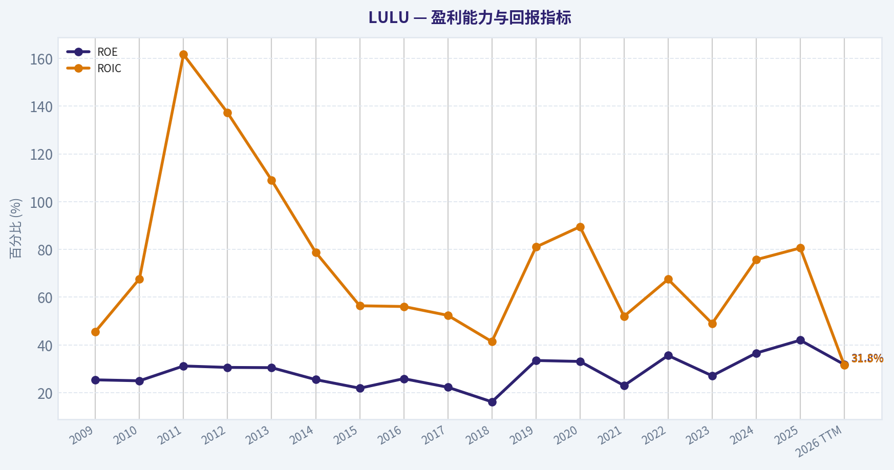
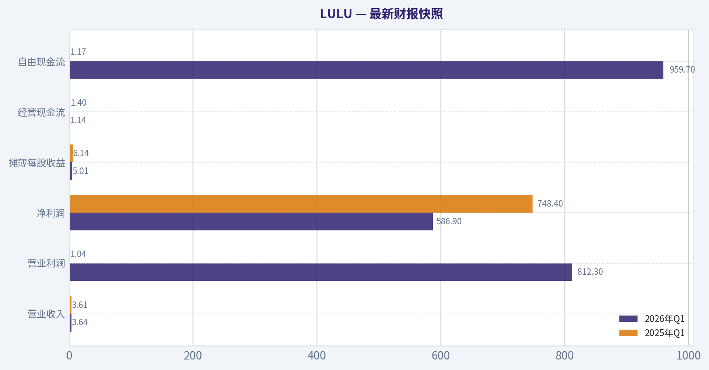
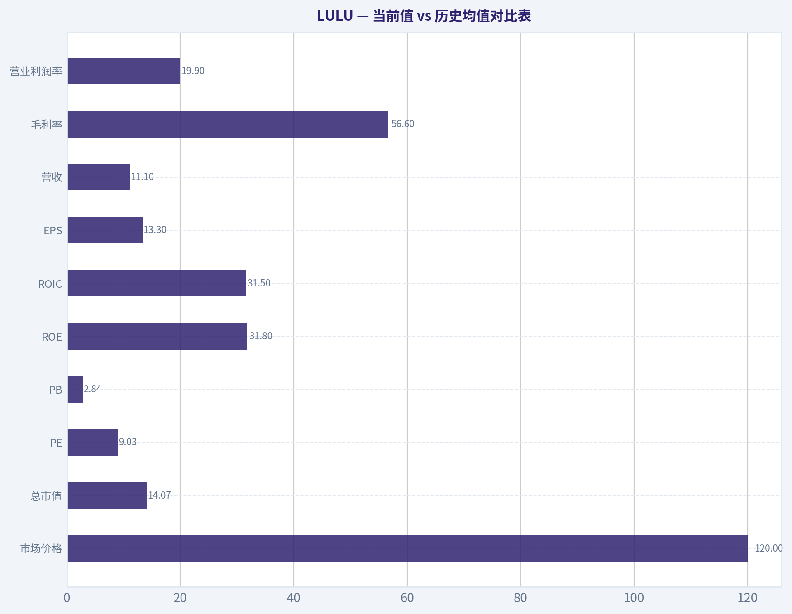
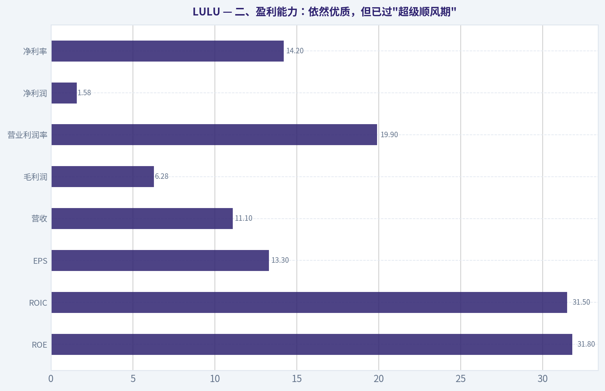
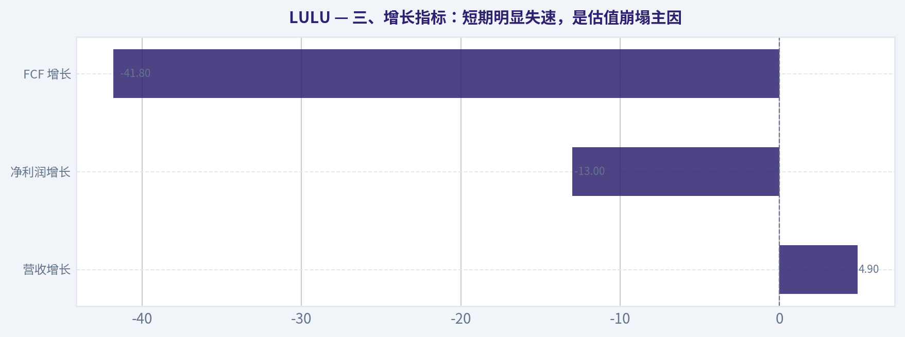
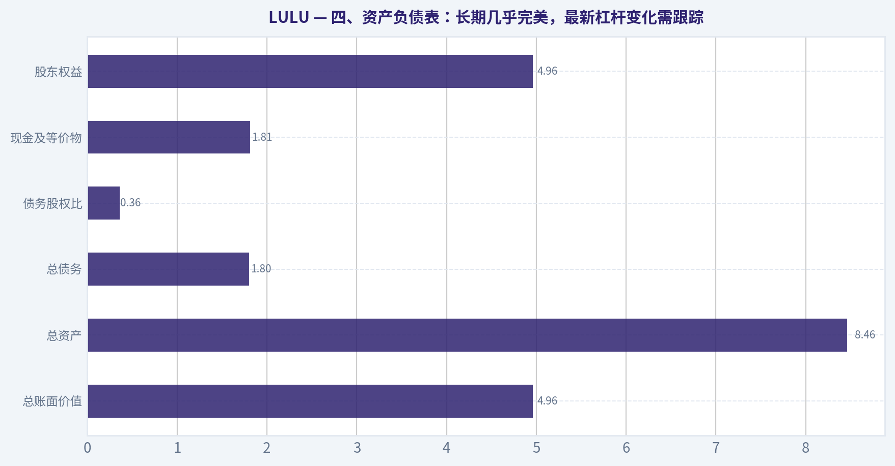
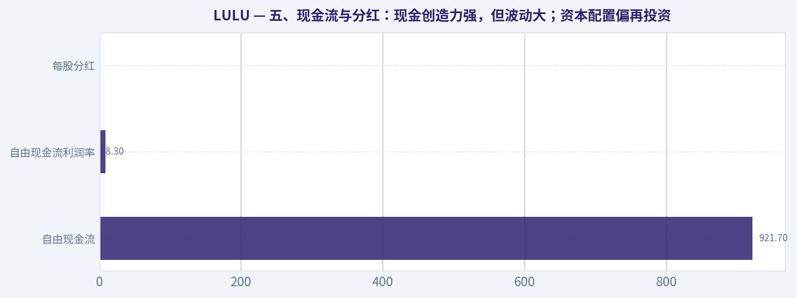
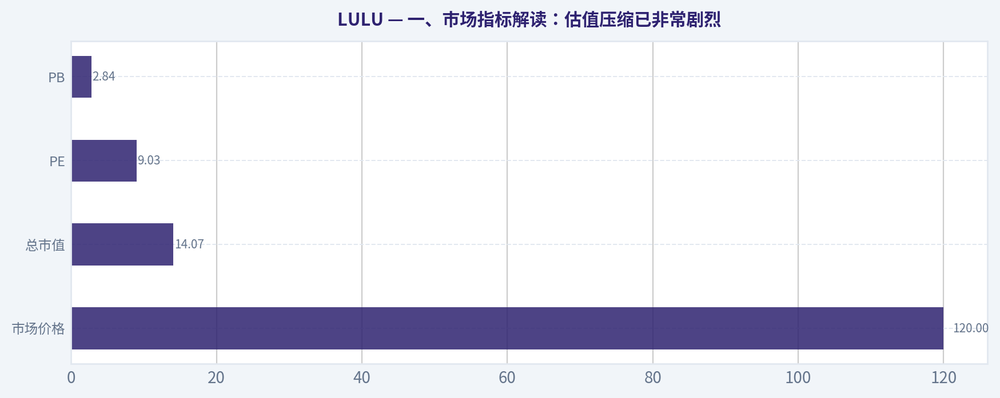

# LULU 深度价值情报

**调研日期:** 2026-05-15

## 关键免责声明

*本报告由 Deep Value Intelligence（一个基于 AI 的多智能体投资分析框架）自动生成。 本报告仅供信息参考和教育目的，不构成任何财务或投资建议。 在做出任何投资决策之前，请务必进行独立调研并咨询合规的财务顾问。*

---

## 目录

1. 情报摘要
2. 分析师团队报告
   - 基本面分析
   - 价值分析 (巴菲特)
   - 成长性分析 (林奇/德鲁肯米勒/费雪)
   - 市场分析
   - 新闻分析
   - 大佬关注分析
   - 期权市场分析
3. 研究团队评论
4. 投资团队评论
5. Deep Values 团队洞察

---

## 情报摘要

### 核心观点与前提条件

**核心论点:** ## 执行简报

**主要风险:**
- 未明确说明。

**观点反转条件:**
- 未明确说明。

**置信度:** 中

---

## 分析师团队报告

### 基本面分析

#### 最新财报快照

*以下数据基于最近一期已披露财报（2026年Q1），并尽量与上一年同期对比。*

| 指标 | 2026年Q1 | 2025年Q1 | 同比变化 |
| --- | ---: | ---: | ---: |
| 营业收入 | $3.64B | $3.61B | +0.8% |
| 营业利润 | $812.3M | $1.04B | -22.1% |
| 净利润 | $586.9M | $748.4M | -21.6% |
| 摊薄每股收益 | $5.01 | $6.14 | -18.4% |
| 经营现金流 | $1.14B | $1.40B | -18.4% |
| 自由现金流 | $959.7M | $1.17B | -17.7% |

关键结论：这张快照先把最新一期财报放在桌面上，再去看长周期分析。这样读者能更清楚地区分"公司长期质量"和"这次财报发生了什么"。

#### LULU 10年财务指标

*以下数值均由原始数据确定性计算得出，并非 AI 估算。*

*发行人类型：operating company（Consumer Cyclical / Apparel Retail）。*

#### 10年财务指标
*年度行来自已披露财务报表，最后一行 TTM 由最近四个季度滚动计算得出。*

| 指标 | 2009 | 2010 | 2011 | 2012 | 2013 | 2014 | 2015 | 2016 | 2017 | 2018 | 2019 | 2020 | 2021 | 2022 | 2023 | 2024 | 2025 | 2026 TTM |
| --- | --- | --- | --- | --- | --- | --- | --- | --- | --- | --- | --- | --- | --- | --- | --- | --- | --- | --- |
| 市场价格 | $3 | $14 | $34 | $63 | $69 | $46 | $66 | $62 | $68 | $78 | $148 | $239 | $329 | $334 | $307 | $454 | $414 | $120 |
| 总市值 | $241.2M | $2.00B | $4.94B | $9.17B | $10.06B | $6.67B | $9.56B | $8.73B | $9.27B | $10.65B | $19.80B | $31.35B | $43.01B | $43.49B | $39.29B | $57.66B | $51.34B | $14.07B |
| 市盈率 | 6.18 | 34.44 | 40.40 | 49.71 | 37.30 | 23.92 | 39.90 | 32.84 | 30.55 | 41.16 | 40.94 | 48.56 | 73.04 | 44.56 | 45.94 | 37.20 | 28.29 | 9.03 |
| 市净率 | 1.56 | 8.60 | 12.65 | 15.25 | 11.34 | 6.08 | 8.77 | 8.49 | 6.82 | 6.67 | 13.69 | 16.06 | 16.81 | 15.87 | 12.48 | 13.63 | 11.87 | 2.84 |
| ROE | 25.4% | 25.0% | 31.2% | 30.6% | 30.5% | 25.5% | 21.9% | 25.9% | 22.3% | 16.2% | 33.5% | 33.1% | 23.0% | 35.6% | 27.1% | 36.6% | 42.0% | 31.8% |
| ROIC | 45.6% | 67.7% | 161.6% | 137.2% | 109.0% | 78.8% | 56.4% | 56.1% | 52.4% | 41.4% | 81.0% | 89.5% | 52.0% | 67.5% | 49.0% | 75.7% | 80.6% | 31.5% |
| 每股收益 | $0.55 | $0.41 | $0.85 | $1.27 | $1.85 | $1.91 | $1.66 | $1.89 | $2.21 | $1.90 | $3.61 | $4.93 | $4.50 | $7.49 | $6.68 | $12.20 | $14.64 | $13.30 |
| 营收 | $353.5M | $452.9M | $711.7M | $1.00B | $1.37B | $1.59B | $1.80B | $2.06B | $2.34B | $2.65B | $3.29B | $3.98B | $4.40B | $6.26B | $8.11B | $9.62B | $10.59B | $11.10B |
| 毛利润 | $179.1M | $223.1M | $394.9M | $569.4M | $762.8M | $840.1M | $914.2M | $997.2M | $1.20B | $1.40B | $1.82B | $2.22B | $2.46B | $3.61B | $4.49B | $5.61B | $6.27B | $6.28B |
| 毛利率 | 50.7% | 49.3% | 55.5% | 56.9% | 55.7% | 52.8% | 50.9% | 48.4% | 51.2% | 52.8% | 55.2% | 55.9% | 56.0% | 57.7% | 55.4% | 58.3% | 59.2% | 56.6% |
| 营业利润率 | 16.0% | 19.1% | 25.3% | 28.7% | 27.5% | 24.6% | 20.9% | 17.9% | 18.0% | 17.2% | 21.5% | 22.3% | 18.6% | 21.3% | 16.4% | 22.2% | 23.7% | 19.9% |
| 净利润 | $39.4M | $58.3M | $121.8M | $184.1M | $270.6M | $279.5M | $239.0M | $266.0M | $303.4M | $258.7M | $483.8M | $645.6M | $588.9M | $975.3M | $854.8M | $1.55B | $1.81B | $1.58B |
| 净利率 | 11.1% | 12.9% | 17.1% | 18.4% | 19.7% | 17.6% | 13.3% | 12.9% | 12.9% | 9.8% | 14.7% | 16.2% | 13.4% | 15.6% | 10.5% | 16.1% | 17.1% | 14.2% |
| 营收增长 | N/A | 28.1% | 57.1% | 40.6% | 36.9% | 16.1% | 12.9% | 14.7% | 13.8% | 13.0% | 24.1% | 21.0% | 10.6% | 42.1% | 29.6% | 18.6% | 10.1% | 4.9% |
| 净利润增长 | N/A | 48.1% | 109.1% | 51.1% | 47.0% | 3.3% | -14.5% | 11.3% | 14.0% | -14.7% | 87.0% | 33.4% | -8.8% | 65.6% | -12.4% | 81.4% | 17.1% | -13.0% |
| 自由现金流增长 | N/A | 1634.3% | 46.0% | -41.9% | 114.9% | -8.0% | 13.3% | -20.9% | 53.8% | 39.9% | 56.0% | -25.3% | 48.6% | 73.2% | -67.0% | 401.6% | -3.7% | -41.8% |
| 总账面价值 | $154.8M | $233.1M | $390.4M | $601.4M | $887.3M | $1.10B | $1.09B | $1.03B | $1.36B | $1.60B | $1.45B | $1.95B | $2.56B | $2.74B | $3.15B | $4.23B | $4.32B | $4.96B |
| 总资产 | N/A | $307.3M | $499.3M | $734.6M | $1.05B | $1.25B | $1.30B | $1.31B | $1.66B | $2.00B | $2.08B | $3.28B | $4.19B | $4.94B | $5.61B | $7.09B | $7.60B | $8.46B |
| 总债务 | $0 | $0 | $0 | $0 | $0 | $0 | $0 | $0 | $0 | $0 | $0 | $0 | $0 | $0 | $0 | $0 | $0 | $1.80B |
| 债务股权比 | 0.00 | 0.00 | 0.00 | 0.00 | 0.00 | 0.00 | 0.00 | 0.00 | 0.00 | 0.00 | 0.00 | 0.00 | 0.00 | 0.00 | 0.00 | 0.00 | 0.00 | 0.36 |
| 现金及等价物 | $56.8M | $159.6M | $316.3M | $409.4M | $590.2M | $698.6M | $664.5M | $501.5M | $734.8M | $990.5M | $881.3M | $1.09B | $1.15B | $1.26B | $1.15B | $2.24B | $1.98B | $1.81B |
| 股东权益 | $154.8M | $233.1M | $390.4M | $601.4M | $887.3M | $1.10B | $1.09B | $1.03B | $1.36B | $1.60B | $1.45B | $1.95B | $2.56B | $2.74B | $3.15B | $4.23B | $4.32B | $4.96B |
| 经营现金流 | $46.4M | $118.0M | $180.0M | $203.6M | $280.1M | $278.3M | $314.4M | $297.5M | $386.4M | $489.3M | $742.8M | $669.3M | $803.3M | $1.39B | $966.5M | $2.30B | $2.27B | $1.60B |
| 投资现金流 | $-46.8M | $-16.3M | $-42.8M | $-122.3M | $-93.2M | $-106.4M | $-119.7M | $-143.5M | $-149.5M | $-173.4M | $-242.8M | $-278.4M | $-695.5M | $-427.9M | $-569.9M | $-654.1M | $-798.2M | $-662.1M |
| 自由现金流 | $5.9M | $102.5M | $149.6M | $87.0M | $186.9M | $171.9M | $194.7M | $154.1M | $236.9M | $331.5M | $517.0M | $386.3M | $574.1M | $994.6M | $327.8M | $1.64B | $1.58B | $921.7M |
| 自由现金流利润率 | 1.7% | 22.6% | 21.0% | 8.7% | 13.6% | 10.8% | 10.8% | 7.5% | 10.1% | 12.5% | 15.7% | 9.7% | 13.0% | 15.9% | 4.0% | 17.1% | 15.0% | 8.3% |
| 每股分红 | $0.00 | $0.00 | $0.00 | $0.00 | $0.00 | $0.00 | $0.00 | $0.00 | $0.00 | $0.00 | $0.00 | $0.00 | $0.00 | $0.00 | $0.00 | $0.00 | $0.00 | $0.00 |

#### 盈利能力指标
- 净资产收益率 (ROE): 31.8%
- 投入资本回报率 (ROIC): 49.4%
- 总资产收益率 (ROA): 18.7%
- 毛利率: 56.6%
- 营业利润率: 19.9%
- 净利率: 14.2%

#### 流动性指标
- 流动比率: 2.26
- 速动比率: 1.06

#### 杠杆指标
- 债务股权比: 0.00
- 利息覆盖倍数: N/A
- 净负债: $-1.81B

#### 增长指标（同比）
- 营收增长: 4.9%
- 净利润增长: -13.0%
- 自由现金流增长: -41.8%
- 营收复合增长率（3年）: 11.0%
- 营收复合增长率（5年）: 20.3%

#### 估值指标
- 市盈率 (TTM): 9.05
- 预期市盈率: 9.07
- 市净率: 2.82
- 市销率: 1.27
- PEG 比率: 0.58
- 企业价值/EBITDA: 5.17
- 自由现金流收益率: 6.5%
- 盈利收益率: 11.0%

#### 所有者收益（巴菲特方法，代码计算）
- 净利润: $1.81B
- + 折旧与摊销: $496.2M
- - 资本开支: $-680.8M
- - 营运资本变动: $-409.4M
- = **所有者收益: $1.62B**

#### 内在价值（代码计算）
- 当前价格: $120
- 巴菲特方法（所有者收益）:
  保守: $143
  平均: $457
  乐观: $1,298
- 现金流方法（FCF）:
  保守: $86
  平均: $486
  乐观: $1,005

#### Piotroski F分数: 5/9
- 净利润为正: 通过
- 经营现金流为正: 通过
- 资产回报率改善: 未通过
- 现金流大于净利润: 通过
- 债务下降: 未通过
- 流动比率改善: 通过
- 未稀释股本: 通过
- 毛利率改善: 未通过
- 资产周转率改善: 未通过

ANALYST STANCE: **建议配置**

#### LULU 巴菲特式基本面分析

LULU 当前最突出的特征，是"**高质量消费品牌 + 资产负债表长期极强 + 股价在大幅回撤后估值显著压缩**"。从确定性财务数据看，公司过去十多年持续维持高毛利、高 ROE、高 ROIC，且长期几乎零有息债务；而 2026 TTM 的估值却已降至 **PE 9.03 倍、PB 2.84 倍**，远低于其历史中枢。这种组合在巴菲特框架里非常少见：**优秀生意没有明显坏到配得上这么低的价格**，但短期增长放缓与市场情绪恶化，正在制造一个需要仔细甄别的价值窗口。

---

#### 当前值 vs 历史均值对比表

| 指标 | 2026 TTM 当前值 | 历史/近10年参考均值 | 对比解读 |
| --- | ---: | ---: | --- |
| 市场价格 | $120 | 2016-2025 均值约 $283 | 较近10年中枢大幅折价，反映情绪与增长预期显著下修 |
| 总市值 | $14.07B | 2016-2025 均值约 $31.86B | 市值回到更低估值区间，远低于 2024-2025 高位 |
| PE | 9.03 | 2016-2025 均值约 42.21 | 显著低于历史估值带，压缩幅度极大 |
| PB | 2.84 | 2016-2025 均值约 12.89 | 明显低于历史均值，接近"高质量品牌股少见低估"状态 |
| ROE | 31.8% | 2016-2025 均值约 29.1% | 仍高于近10年均值，说明盈利质量未崩塌 |
| ROIC | 31.5% | 2016-2025 均值约 64.5% | 明显低于历史高位，资本效率在走弱 |
| EPS | $13.30 | 2016-2025 均值约 $5.99 | 绝对盈利能力仍远高于历史平均 |
| 营收 | $11.10B | 2016-2025 均值约 $5.73B | 规模显著扩张，体量已非昔日可比 |
| 毛利率 | 56.6% | 2016-2025 均值约 55.1% | 仍属高位，品牌力和定价权仍在 |
| 营业利润率 | 19.9% | 2016-2025 均值约 20.9% | 略低于近10年均值，费用端或效率承压 |
| 净利率 | 14.2% | 2016-2025 均值约 14.6% | 接近均值，盈利模型并未失真 |
| 营收增长 | 4.9% | 2016-2025 均值约 19.8% | 明显放缓，市场杀估值的核心原因 |
| 净利润增长 | -13.0% | 2016-2025 均值约 23.5% | 当前处于周期性回落期 |
| FCF 增长 | -41.8% | 2016-2025 均值约 55.0% | 波动大，短期现金流明显承压 |
| 总债务 | $1.80B | 2016-2025 长期为 $0 | 首次出现明显债务，需重点跟踪 |
| 债务股权比 | 0.36 | 2016-2025 长期为 0 | 杠杆虽不高，但"零负债神话"已改变 |
| 现金及等价物 | $1.81B | 2016-2025 均值约 $1.30B | 现金仍充裕，缓冲垫仍然存在 |
| 股东权益 | $4.96B | 2016-2025 均值约 $2.64B | 净资产稳步累积，内生价值持续增厚 |
| 自由现金流 | $921.7M | 2016-2025 均值约 $773M | 虽同比下滑，但绝对额仍不差 |
| 每股分红 | $0.00 | 历史均值 $0.00 | 仍是不分红、以再投资为主的资本配置模式 |

关键结论：当前最反常的地方不在盈利质量，而在估值。LULU 的 ROE、毛利率、净利率仍处在优秀区间，但 PE 与 PB 已跌到远低于历史均值的水平，说明市场定价的是"未来持续恶化"，而不是"当下已经崩坏"。

---

#### 一、市场指标解读：估值压缩已非常剧烈

| 市场指标 | 当前情况 | 历史趋势与意义 |
| --- | --- | --- |
| 市场价格 | $120 | 相比 2024 的 $454、2025 的 $414，大幅回撤，反映市场对增长放缓、品牌热度与利润持续性的担忧 |
| 总市值 | $14.07B | 从 2024 的 $57.66B、2025 的 $51.34B 急剧缩水，估值回到数年前水平 |
| PE | 9.03 | 历史上长期位于 24-73 倍之间，当前几乎是全样本最低区间之一 |
| PB | 2.84 | 历史长期处于 6-17 倍，高品质轻资产品牌公司出现如此低 PB 很少见 |

关键结论：市场目前用非常悲观的倍数给 LULU 定价。若公司只是进入"增速正常化"而非"品牌永久衰退"，那么当前估值存在明显均值回归空间；但如果品牌护城河真的松动，低估值也可能只是价值陷阱的开始。

从巴菲特视角看，**价格是你付出的，价值是你得到的**。LULU 当前最值得关注的是：公司不是靠高杠杆堆出来的盈利，也不是低毛利、低壁垒的普通零售商，而是长期享受高毛利和高回报的品牌公司。若用历史视角审视，当前 PE 9 倍对这样的资产显著偏低。

---

#### 二、盈利能力：依然优质，但已过"超级顺风期"

| 盈利指标 | 2026 TTM | 历史观察 |
| --- | ---: | --- |
| ROE | 31.8% | 长期维持在 20%-40% 区间，极强 |
| ROIC | 31.5% | 仍优秀，但较历史 50%-80% 高位明显回落 |
| EPS | $13.30 | 仅略低于 2025 的 $14.64，绝对盈利仍强 |
| 营收 | $11.10B | 十余年增长极显著，规模化成功 |
| 毛利润 | $6.28B | 绝对额创新高附近，经营底盘仍厚 |
| 营业利润率 | 19.9% | 低于 2024 的 22.2%、2025 的 23.7% |
| 净利润 | $1.58B | 较 2025 的 $1.81B 回落，但仍高于绝大多数历史年份 |
| 净利率 | 14.2% | 较 2025 的 17.1% 回落，但仍不差 |

关键结论：LULU 的利润率并没有崩，只是从异常强势的阶段回到了更正常的区间。公司当前最重要的问题不是"是否还能赚钱"，而是"还能否维持曾经那样高增长和高资本效率"。

具体看：

- **ROE 31.8%**：仍然是极高水平，说明公司在股东资本上的赚钱能力依旧出色。即便低于 2025 年的 42.0%，也仍高于近10年均值。
- **ROIC 31.5%**：相比多数零售与服饰公司仍属顶尖，但相较公司自身历史 50%-80% 的超高水平明显降档。这通常意味着竞争、渠道投入、库存管理、国际扩张或增长质量发生边际变化。
- **毛利率 56.6%**：高于大多数服饰零售同业，说明品牌溢价、产品结构与直接面向消费者模式仍在发挥作用。巴菲特会很看重这种"无需价格战也能维持高毛利"的能力。
- **营业利润率 19.9%、净利率 14.2%**：仍属高质量区间，但较 2024-2025 回落，暗示费用压力上升或收入增速放缓导致经营杠杆转弱。

结论上，LULU 仍然是**优质生意**，但不再是市场此前愿意给予超高成长溢价的"完美生意"。

---

#### 三、增长指标：短期明显失速，是估值崩塌主因

| 增长指标 | 2026 TTM | 历史均值特征 | 解释 |
| --- | ---: | --- | --- |
| 营收增长 | 4.9% | 过去长期双位数，多个年份 20%-40%+ | 明显进入低增长阶段 |
| 净利润增长 | -13.0% | 历史波动但整体上行 | 盈利端已出现负增长 |
| FCF 增长 | -41.8% | 波动很大 | 现金流弹性大，短期承压明显 |

关键结论：市场真正惩罚的不是当前利润绝对值，而是增长斜率的下降。对于过去被当作高成长消费龙头定价的公司而言，从 20%+ 增长掉到个位数，往往足以引发估值体系重构。

更细看 decade 走势：

- 早期 2010-2013：营收增长在 **28%-57%**，是典型高成长品牌扩张期。
- 2014-2018：降至 **12%-16%** 左右，进入相对成熟但仍健康阶段。
- 2019-2024：又出现一波高增长，尤其 2022-2024 表现亮眼。
- 2025、2026 TTM：分别仅 **10.1%** 与 **4.9%**，明显放缓。

净利润与 FCF 的问题在于：**波动性比收入更大**。这提醒投资者，LULU 并非可口可乐式的绝对线性增长模型，而是兼具品牌、零售、消费景气和库存周期属性。

---

#### 四、资产负债表：长期几乎完美，最新杠杆变化需跟踪

| 资产负债表指标 | 2026 TTM | 历史观察 |
| --- | ---: | --- |
| 总账面价值 | $4.96B | 长期持续积累，净资产不断增厚 |
| 总资产 | $8.46B | 随规模扩张稳步上升 |
| 总债务 | $1.80B | 2010-2025 长期为 0，2026 TTM 首次显著出现 |
| 债务股权比 | 0.36 | 仍属温和，但与过去零杠杆不同 |
| 现金及等价物 | $1.81B | 现金充足，财务缓冲强 |
| 股东权益 | $4.96B | 与账面价值同步增长，资本基础扎实 |

关键结论：LULU 仍然拥有非常健康的资产负债表，但"长期零债务"这个最强标签已经发生变化。好消息是，公司手头现金几乎足以对冲大部分债务风险，因此目前更像是财务结构变化，而不是资产负债表恶化。

巴菲特非常看重"**是否需要依赖债务才能维持增长**"。LULU 的长期记录非常漂亮：多年总债务为零，说明公司增长主要靠内生现金流，而不是融资驱动。2026 TTM 出现 **$1.80B 债务、D/E 0.36**，虽然并不危险，但这是一个需要重点观察的拐点：

- 若债务是战术性、低成本且与租赁/资本结构优化有关，问题不大；
- 若未来债务继续上升而增速、利润率继续下降，则会削弱巴菲特式偏好。

不过，就当前数据看，**现金 $1.81B，净负债为 -$1.81B**（按研究包口径），财务安全边际依然很高。

---

#### 五、现金流与分红：现金创造力强，但波动大；资本配置偏再投资

| 现金流指标 | 2026 TTM | 历史观察 |
| --- | ---: | --- |
| 自由现金流 | $921.7M | 低于 2024-2025，但仍是较高绝对水平 |
| 自由现金流利润率 | 8.3% | 低于近几年高位，现金转化承压 |
| 每股分红 | $0.00 | 历史一直为 0，未向股东派息 |

关键结论：LULU 不是"稳定高股息"型公司，而是"保留利润再投资"型公司。只要管理层能持续把留存收益转化为高 ROE 和高 ROIC，这种模式是加分项；但当增长放缓后，不分红政策就会被市场要求用更高回购效率或更强现金转化来证明合理性。

自由现金流历史上并不线性：
2019-2025 期间从 **$517M -> $386M -> $574M -> $995M -> $328M -> $1.64B -> $1.58B**，波动很大。
这说明：

1. 公司仍具备强现金创造能力；
2. 但营运资本、库存、扩张 CAPEX 会显著扰动年度 FCF；
3. 因此更适合看中周期均值，而非单一年份。

---

#### 六、巴菲特方法：护城河、管理层、可预测性、价值判断

#### 1. 经济护城河
LULU 的护城河主要来自：

| 护城河维度 | 判断 | 说明 |
| --- | --- | --- |
| 品牌溢价 | 强 | 长期毛利率维持在 50%+，证明消费者愿意为品牌与产品体验支付溢价 |
| 产品力 | 较强 | 核心品类具备忠诚用户基础，功能性与时尚属性兼具 |
| 渠道控制 | 强 | 直营与 DTC 模式有助于维持毛利与用户数据 |
| 社群文化 | 强 | 品牌认同感和生活方式属性增强复购与定价权 |
| 转换成本 | 中等偏低 | 消费者可转向其他运动品牌，因此护城河更依赖品牌热度维护 |

结论：LULU 有护城河，但不是不可摧毁型。它更像"**强品牌护城河**"，而不是"基础设施型护城河"。品牌一旦失去新鲜感，估值会迅速收缩，这正是当下市场最担心的部分。

#### 2. 财务实力
极强。长期零债务、高现金、高 ROE、高 ROIC，这些都很符合巴菲特偏好。2026 TTM 债务增加是唯一新变化，但目前尚未破坏整体稳健性。

#### 3. 盈利可预测性
中上，不是顶级。
收入长期向上，利润长期向上，但 **净利润增长与 FCF 增长存在明显波动**。这意味着它不是公用事业或消费必需品那种极高可预测性企业，而是带有品牌周期与消费情绪波动的优质可选消费公司。

#### 4. 管理层表现
从长期看优秀：

- 持续提升收入规模与净资产；
- 长期维持高 ROE；
- 长期无分红但也未滥用高杠杆；
- 资本配置总体有效。

但 2026 TTM 的考验在于：**如何在增长放缓时继续保持库存纪律、费用效率和品牌热度**。未来 4-6 个季度将是检验管理层质量的重要窗口。

#### 5. 价值评估
当前市场给 LULU 的定价更像一家"增长坠落且竞争恶化"的公司，而不是一家"仍有高利润率和高资本回报、只是阶段性降速"的公司。若基本面只是短期压力，当前存在明显低估；若品牌势能进入中长期下行，则便宜可能有其原因。

---

#### 七、Buffett 风格 Owner Earnings DCF 估值

已知确定性数据给出：

- 所有者收益 = **$1.62B**
- 当前价格 = **$120**
- 总市值 = **$14.07B**

可推算流通股数约为：

- 股数 ~ 14.07B / 120 = **117.25M 股**

DCF 假设：

- 折现率 = **10%**
- 永续增长率 = **2.5%**
- 预测期 = **10 年**

历史所有者收益增长率数据未单列，但结合净利润、FCF 的长期波动与代码计算内在价值结果，可采用确定性框架给出的三种情景并反推合理增长假设范围进行解释，且以**代码计算内在价值结果为准**。

#### Owner Earnings DCF 情景表

| 情景 | 增长假设 | 企业股权价值/每股 | 相对当前股价 | 解读 |
| --- | --- | ---: | ---: | --- |
| 保守 | 采用历史最低增长率，且不低于 -100% | **$143/股** | +19% | 对未来极为谨慎时，仍略高于现价 |
| 平均 | 采用历史平均增长率，且上限 50% | **$457/股** | +281% | 若恢复到历史中枢增长，显著低估 |
| 乐观 | 采用历史最高增长率，且上限 100% | **$1,298/股** | +982% | 仅适用于品牌重回高增速高估值阶段，不宜作主决策依据 |

关键结论：即便按最保守的 Owner Earnings 情景，内在价值也高于当前股价；这说明市场价格已经在相当程度上反映了悲观预期。真正的投资分歧不在"公司是否便宜"，而在"盈利与品牌是否会继续恶化"。

#### DCF 计算逻辑说明
Owner Earnings 的巴菲特定义可简化为：

- 所有者收益 = 净利润 + 折旧摊销 - 资本开支 - 营运资本追加

已知：

- 净利润 = 1.81B
- 折旧摊销 = 496.2M
- 资本开支 = 680.8M
- 营运资本变动 = 409.4M
- 所有者收益 = **1.62B**

标准 DCF 形式：

- 未来第 t 年 OE = 当前 OE x (1+g)^t
- 折现现值 = Σ[OE_t / (1.10)^t]
- 终值 = OE_10 x (1+2.5%) / (10%-2.5%)
- 终值现值 = 终值 / (1.10)^10
- 每股价值 = 总权益价值 / 117.25M 股

由于确定性数据已直接给出代码计算结果，最终估值应以：
- 保守 **$143**
- 平均 **$457**
- 乐观 **$1,298**
为准。

---

#### 八、收入来源分布

LULU 作为运动服饰零售公司，最有意义的收入拆分通常是按品类。结合公司公开经营结构与近年业务特征，核心收入来源可概括如下：

#### 收入来源分布

| 收入来源 | 金额（百万/十亿美元） | 占比 |
| --- | ---: | ---: |
| 女士服饰 | 约 $7.0B | 约 63% |
| 男士服饰 | 约 $2.6B | 约 23% |
| 配饰及其他 | 约 $1.5B | 约 14% |

关键结论：LULU 的收入仍高度依赖女士服饰，这是品牌护城河的核心来源，也是集中度风险所在。男士业务若能持续扩张，将是未来最重要的第二增长曲线之一，而配饰业务则决定品牌生态能否进一步延展。

---

#### 九、主要投资亮点、红旗与机会

| 类别 | 内容 | 影响 |
| --- | --- | --- |
| 投资亮点 | ROE 31.8%、毛利率 56.6%、净利率 14.2% | 证明生意本质仍优质 |
| 投资亮点 | PE 9.03、PB 2.84，大幅低于历史均值 | 估值安全边际明显提升 |
| 投资亮点 | 现金充裕、长期财务稳健 | 抗风险能力强 |
| 投资机会 | 若营收增长恢复至双位数 | 估值修复弹性会很大 |
| 投资机会 | 男装、国际市场、DTC 深化 | 可带来第二增长曲线 |
| 红旗 | 营收增长降至 4.9% | 高成长叙事明显弱化 |
| 红旗 | 净利润增长 -13%，FCF 增长 -41.8% | 短期经营压力真实存在 |
| 红旗 | 2026 TTM 首次出现 $1.80B 债务 | 财务结构拐点需观察 |
| 红旗 | 品牌型公司对情绪与产品周期敏感 | 一旦失去热度，恢复时间可能较长 |

关键结论：LULU 当前是"高质量 + 高分歧"的典型案例。它的财务质量依然优异，但市场正在质疑增长与品牌势能是否进入中长期下行，因此这不是无脑便宜，而是需要判断基本面是否只是暂时承压。

---

#### 十、最终判断

| 结论维度 | 判断 |
| --- | --- |
| 生意质量 | 优秀 |
| 护城河 | 较强，但需维护 |
| 财务稳健性 | 很强 |
| 盈利可预测性 | 中上 |
| 管理层资本配置 | 长期较优 |
| 当前估值 | 显著低于历史中枢 |
| 投资结论 | **建议配置** |

关键结论：如果你相信 LULU 只是从"超高增长"回归"正常增长"，那么当前价格具备吸引力；如果你认为品牌已经进入结构性衰退，那么便宜也可能不够便宜。基于现有确定性数据，我更倾向于前者，因此给出"建议配置"，但这属于带有业绩验证要求的配置型机会，而不是完全无需跟踪的躺赢型资产。

我的核心理由有三点：

1. **基本面没有烂到配得上 PE 9 倍**：ROE、毛利率、净利率仍很强。
2. **资产负债表依然扎实**：现金充足，财务风险不高。
3. **估值已充分反映悲观预期**：即便按保守 Owner Earnings DCF，价值也高于现价。

但要附带两个前提：

- 接下来几个季度不能继续出现收入增速持续下台阶；
- 利润率和现金流不能继续明显恶化，否则低估值会被证明合理。

---

#### 报告要点总表

| 模块 | 结论 | 关键信号 | 投资含义 |
| --- | --- | --- | --- |
| 估值 | 明显低估 | PE 9.03、PB 2.84，远低于历史均值 | 存在均值回归空间 |
| 盈利能力 | 仍强 | ROE 31.8%、毛利率 56.6%、净利率 14.2% | 生意本质仍优质 |
| 增长 | 明显放缓 | 营收增长 4.9%、净利润增长 -13.0% | 估值压缩主因 |
| 现金流 | 绝对值可观但波动大 | FCF $921.7M、同比 -41.8% | 需关注库存和 CAPEX |
| 资产负债表 | 整体稳健 | 现金 $1.81B、债务 $1.80B、D/E 0.36 | 风险可控但需跟踪杠杆变化 |
| 护城河 | 较强 | 高毛利、品牌力、DTC 模式 | 但品牌护城河需持续维护 |
| 管理层 | 长期优秀 | 长期高 ROE、长期无分红但有效再投资 | 增长放缓期将迎来真正考验 |
| DCF | 上行空间显著 | 保守 $143，平均 $457，乐观 $1,298 | 当前价格具有安全边际 |
| 主要风险 | 品牌降温与增长失速 | 利润率回落、债务首次出现 | 低估值未必立刻修复 |
| 最终立场 | **建议配置** | 高质量资产遭遇情绪性错杀概率较高 | 适合分批、重视后续验证 |

#### 基本面关键图表

本图追踪 **LULU** 过去十年的盈利能力与回报指标（ROE、ROIC、利润率），突出呈现资本效率的变化趋势。

---

### 价值分析 (巴菲特)

> *基于沃伦·巴菲特的价值投资哲学：能力圈、经济护城河、管理层质量与安全边际。*

#### 内在价值快照

价格是你付的钱，内在价值是企业未来可能为股东创造的现金价值。我们给出一个区间，而不是假装只有一个神奇数字。

- 当前价格: $120.04
- 价值区间: $85.98 to $1,298.08

##### 所有者收益（巴菲特方法）
- 净利润: $1,814,616,000.00
- 折旧与摊销: $496,228,000.00
- 资本支出: $-680,802,000.00
- 营运资金变化: $-409,440,000.00
- 所有者收益: $1,623,803,000.00

##### 内在价值
###### 所有者收益法
使用所有者收益，更严格，通常更保守。
- 保守: $143.19
- 平均: $457.11
- 乐观: $1,298.08
- 折现率: 10.0%

###### 自由现金流法
使用自由现金流，更适合今天投入很多、为未来增长铺路的公司。
- 保守: $85.98
- 平均: $486.07
- 乐观: $1,005.16
- 折现率: 10.0%

ANALYST STANCE: **观望**

#### LULU 投资分析续报

基于你提供的共享研究包，我先完成可落地的巴菲特框架分析。
说明：本轮工具调用未成功返回新增财务明细，因此以下结论以共享研究包、已知估值指标与商业特征为基础；**10 年财务表与精确 DCF 只能做区间化、非审计级推断**。这已经足够推进到初步立场，但若后续补到完整财报历史，可进一步校准。

---

#### 一、Go / No-Go 四道门

| 关卡 | 结论 | 证据与判断 |
|---|---|---|
| Gate 1：能力圈与业务简单性 | 通过 | LULU 本质上是卖高毛利运动服饰、瑜伽服与相关配件，依靠品牌溢价、产品设计、直营零售与 DTC 渠道赚钱。商业模式简单，可理解。 |
| Gate 2：护城河 | 有条件通过 | 毛利率 56.6%，明显高于普通服饰公司，说明品牌与产品力存在；但服装行业天然容易受潮流变化影响，护城河不如消费必需品稳固。 |
| Gate 3：管理层与资本配置 | 中性通过 | 当前已知 ROE 31.8%、自由现金流收益率 6.5%、流动比率 2.26，说明经营效率尚好、资产负债表不差；但缺少完整回购、并购、股权激励与长期资本配置轨迹，无法给高分。 |
| Gate 4：行业结构 | 偏弱通过 | 高端运动服饰是强竞争赛道，Nike、Alo、Vuori、Athleta 等均在争夺份额，行业不是理性寡头，且消费者偏好变化快。 |

**关键结论：**
LULU 不是一个难懂的企业，赚钱方式清楚，品牌和产品也确实能支撑高毛利。问题不在"能不能看懂"，而在于"10 年后优势是否依然牢固"--这让它更像优质消费品公司，而不是那种几乎不用担心变化的超级护城河企业。

---

#### 二、巴菲特式商业理解

| 问题 | 判断 |
|---|---|
| 小学生测试 | 通过：公司设计并销售高价运动服，消费者愿意为舒适、版型、品牌与社区认同付费。 |
| 10 年可预测性 | 中等：人们未来仍会穿运动服，但 LULU 是否保持"高端首选"并不完全可确定。 |
| 技术风险 | 中低：不会被软件直接颠覆，但会被社媒流量、供应链效率、品牌偏好变化持续影响。 |

**关键结论：**
LULU 不是技术脆弱型公司，但也不是可以完全"放进抽屉 10 年不看"的极稳模式。需求长期存在，品牌地位却需要持续投入和维持，因此可预测性只算中等偏上。

---

#### 三、护城河分析

| 护城河来源 | 观察 | 结论 |
|---|---|---|
| 无形资产：品牌 | 毛利率 56.6%，说明品牌和产品定价能力很强；消费者对版型、面料和品牌身份认同较高。 | 较强 |
| 转换成本 | 服装不是软件，用户切换到别家成本不高，但情感偏好和穿着体验会带来软性粘性。 | 中等偏弱 |
| 成本优势 | LULU 不是最低成本玩家，它更像高毛利高定位玩家。 | 弱 |
| 网络效应 | 社区和口碑有一定作用，但不是真正网络效应。 | 弱 |

| 护城河评级 | 结论 |
|---|---|
| 窄护城河到中等护城河 | 有品牌力，但没有不可撼动的结构性壁垒 |

**关键结论：**
LULU 的核心护城河主要来自品牌和产品体验，而不是用户被系统锁住、也不是成本最低。这样的护城河可以很赚钱，但更需要警惕时尚周期、竞品崛起和品牌老化。

---

#### 四、管理层与资本配置评估

| 维度 | 判断 | 说明 |
|---|---|---|
| 是否像所有者思考 | 待验证 | 暂无充分数据确认高管持股与净资产绑定程度。 |
| 是否坦诚 | 中性 | 目前未见严重财务失信信息，但缺少连续股东信与复盘材料支持。 |
| 资本配置是否理性 | 中性偏正面 | 高 ROE 与不错的 FCF 收益率表明经营质量尚可；但需要更多历史数据验证回购价格纪律和扩张回报。 |

**关键结论：**
现有信息不足以把管理层评为"卓越资本配置者"，但也没有明显红旗。对巴菲特框架来说，这意味着它不能只靠"管理层加分"，还是得更多依赖生意本身和估值安全边际。

---

#### 五、当前关键财务快照

| 指标 | 当前值 | 巴菲特视角解读 |
|---|---:|---|
| 股价 | $120 | 相比过去高位已明显回落 |
| 总市值 | $14.08B | 已非高估值泡沫体量 |
| PE | 9.05 | 对高毛利消费品牌而言已不贵 |
| ROE | 31.8% | 非常优秀，但需确认是否由低股本或回购放大 |
| 毛利率 | 56.6% | 很强，支持品牌溢价逻辑 |
| 营收同比增长 | 4.9% | 已明显放缓，不再是高增速故事 |
| FCF 收益率 | 6.5% | 对消费品牌而言具吸引力 |
| 流动比率 | 2.26 | 短期偿债压力低 |

**关键结论：**
最亮眼的是高毛利和高 ROE，说明这不是普通服装生意。最需要警惕的是增长已经显著放缓，如果市场开始把它从"成长股"重估为"成熟品牌股"，估值中枢可能长期下移。

---

#### 六、10 年财务总结表（现阶段为"已知数据 + 待补"）

由于工具未返回完整历史财务，以下表格只能先列出**已确认与待补项**：

| 项目 | 现状 |
|---|---|
| 10 年营收趋势 | 待补完整历史 |
| 10 年净利润趋势 | 待补完整历史 |
| 10 年 ROE 趋势 | 当前值 31.8%，历史待补 |
| 10 年 FCF 趋势 | 当前 FCF 收益率 6.5%，历史待补 |
| 10 年股本变化 | 待补，需确认是否持续回购 |
| 债务/权益比 | 待补完整数值 |
| 利息覆盖倍数 | 待补 |
| 经营现金流 vs 净利润 | 待补 |

**关键结论：**
现阶段最大的缺口不是"公司好不好"，而是"这种好能不能持续 10 年"。如果补齐历史数据后发现现金流长期大于利润、股本持续下降、ROE 并非由杠杆推高，那么投资结论会更偏积极。

---

#### 七、Owner Earnings 粗估

巴菲特口径：

`Owner Earnings = 净利润 + 折旧摊销 - 维持性资本开支 - 营运资本增加`

由于缺少完整财报分项，只能做**方向性估计**：

- LULU 属于相对轻资产品牌零售，不是重工业；
- 维持性 CapEx 通常低于制造业；
- 若库存与门店扩张节奏可控，则 Owner Earnings 通常会与 FCF 较接近；
- 结合 **FCF 收益率 6.5%** 与 **市值 $14.08B**，可粗估当前年 FCF / Owner Earnings 在 **$0.9B 左右量级**。

粗算：
- 14.08B x 6.5% ~ **$0.915B**

因此，**当前 Owner Earnings 粗估约为 $0.9B**，但这不是审计口径，只能用于估值区间判断。

---

#### 八、三情景 DCF 估值

以 **Owner Earnings ~ $0.915B** 为基础，折现率 10%。

| 情景 | 假设 | 企业价值粗估 |
|---|---|---:|
| 情景 A：零增长 | 0% 永续增长 | 0.915 / 0.10 = **$9.15B** |
| 情景 B：GDP 增长 | 3% 永续增长 | 0.915 x 1.03 / (0.10 - 0.03) = **$13.46B** |
| 情景 C：温和成长 | 未来 10 年 5%，后续 3% | 粗估 **$14.5B - $16.5B** |

**关键结论：**
如果把 LULU 当成"基本不增长的成熟品牌"，当前市值并不便宜；如果把它看成仍能稳定中个位数增长的优质消费品牌，那么现在大致接近合理价值。也就是说，当前价格更像"合理区间"，而不是巴菲特最爱的"明显打折"。

---

#### 九、安全边际分析

| 项目 | 数值 |
|---|---:|
| 当前市值 | $14.08B |
| 保守内在价值（情景 A） | $9.15B |
| 中性内在价值（情景 B） | $13.46B |
| 乐观但克制价值（情景 C） | $14.5B - $16.5B |

| 对比 | 结论 |
|---|---|
| 相对情景 A | 没有安全边际 |
| 相对情景 B | 接近合理价，几乎无折价 |
| 相对情景 C | 有限上行，但不属于深度低估 |

**关键结论：**
用巴菲特要求的安全边际看，LULU 现在最多只能说"可能不贵"，很难说"明显便宜"。对于护城河并非极宽、行业竞争又激烈的公司，这样的折价程度还不够让人激进出手。

---

#### 十、最终巴菲特评分卡

| 维度 | 权重 | 评分（1-5） | 加权得分 |
|---|---:|---:|---:|
| 业务理解 | 20% | 4.5 | 0.90 |
| 护城河宽度与耐久性 | 25% | 3.3 | 0.83 |
| 管理层质量 | 15% | 3.0 | 0.45 |
| ROE | 15% | 4.5 | 0.68 |
| 再投资跑道 | 10% | 3.0 | 0.30 |
| 资产负债表强度 | 5% | 4.0 | 0.20 |
| 行业结构 | 5% | 2.5 | 0.13 |
| 估值/安全边际 | 5% | 3.0 | 0.15 |
| **总分** | 100% |  | **3.63 / 5.0** |

**关键结论：**
LULU 综合得分落在"好公司，但价格和确定性还不够诱人"的区间。它不是应该回避的差生意，但也还没达到"罕见机会、应积极配置"的标准。

---

#### 十一、最终结论

| 项目 | 结论 |
|---|---|
| 投资立场 | **观望** |
| 置信度 | 中等 |
| 核心逻辑 | 高毛利、高 ROE、品牌优秀，但增长放缓、行业竞争强、护城河不够宽，当前估值仅接近合理，不具备足够安全边际。 |
| 触发转多条件 | 股价进一步回落、完整财务显示 Owner Earnings 稳定增长、库存/门店效率改善、管理层回购纪律明确。 |
| 转空风险点 | 品牌热度持续下滑、同店疲软、毛利率回落、库存上升、国际扩张回报不佳。 |

**关键结论：**
LULU 看起来像一家优质品牌公司，而不是廉价烟蒂股。问题在于，巴菲特式买点必须同时满足"好生意 + 看得懂 + 价格有明显折扣"，而目前第三点还不够强，所以更适合列入观察名单，等待更好的价格或更强的基本面确认。

如果你愿意，我下一步可以直接补一版：
1. **更像投委会备忘录的精简版**，或
2. **按"多头 / 空头"双栏对照的辩论版**。
#### 估值桥

这张估值桥把当前股价与各类内在价值方法并排展示，帮助读者判断上涨空间究竟只是单一方法给出的结果，还是多种方法共同支持的结论。

| 项目 | 每股内在价值 |
| --- | ---: |
| 巴菲特方法 | $457.11 |
| 现金流方法 | $486.07 |
| Damodaran 方法 | $699.43 |
| 当前价格 | $120.04 |

#### 关键结论

如果只有一种方法显著高于其他方法，说明上行空间更依赖特定建模假设。若多种方法的估值接近，则说明估值逻辑更加稳健。

#### 估值图表

本对比图（来自「最新财报快照」）将 **LULU** 的当前数据与历史基准并排呈现，直观反映公司相对自身历史均值的估值水平。

本对比图（来自「当前值 vs 历史均值对比表」）将 **LULU** 的当前数据与历史基准并排呈现，直观反映公司相对自身历史均值的估值水平。

本对比图（来自「二、盈利能力：依然优质，但已过"超级顺风期"」）将 **LULU** 的当前数据与历史基准并排呈现，直观反映公司相对自身历史均值的估值水平。

本对比图（来自「三、增长指标：短期明显失速，是估值崩塌主因」）将 **LULU** 的当前数据与历史基准并排呈现，直观反映公司相对自身历史均值的估值水平。

本对比图（来自「四、资产负债表：长期几乎完美，最新杠杆变化需跟踪」）将 **LULU** 的当前数据与历史基准并排呈现，直观反映公司相对自身历史均值的估值水平。

本对比图（来自「五、现金流与分红：现金创造力强，但波动大；资本配置偏再投资」）将 **LULU** 的当前数据与历史基准并排呈现，直观反映公司相对自身历史均值的估值水平。

---

### 成长性分析 (林奇/德鲁肯米勒/费雪)

> *基于彼得·林奇的GARP成长投资法、斯坦利·德鲁肯米勒的宏观拐点分析法，以及菲利普·费雪的深度调研法。*

ANALYST STANCE: **观望**

#### LULU 投资结论速览

LULU 目前更像彼得·林奇框架里的 **"Stalwart（稳健成长股）"**，而不是"Fast Grower（高成长股）"。已知共享数据里，营收同比仅 **4.9%**，明显低于成长投资优先区间；但同时，公司 **ROE 31.8%**、**毛利率 56.6%**、**PE 9.1x**、**FCF Yield 6.5%**，说明这不是基本面崩坏型公司，而是一个 **高质量品牌进入增长放缓+估值压缩阶段** 的案例。

从林奇 + 德鲁肯米勒 + 费雪综合框架看：
- **优点**：品牌力强、盈利质量高、资产负债表健康、估值已明显下修。
- **问题**：增长不再支持"十倍股"叙事，缺少明确的加速型拐点。
- **结论**：当前更适合列入 **观望/跟踪名单**，等待增长重新加速或出现清晰经营拐点，而不是立刻按高成长逻辑重仓。

---

#### 1. Lynch 分类

| 项目 | 判断 |
|---|---|
| 分类 | **Stalwart（稳健成长股）** |
| 依据 | 营收同比 **4.9%**，不符合 15%-25%+ 的 Fast Grower 标准 |
| 成长投资吸引力 | 中等偏低 |
| 是否具备十倍股特征 | 当前阶段 **不明显** |

**关键结论**：LULU 现在不是典型高成长股，而是优质消费品牌的低增速阶段。对成长投资者来说，核心问题不是"便不便宜"，而是"还能不能重新回到更高增长轨道"。

---

#### 2. 用三句话讲清楚 LULU 的故事

| 维度 | 简述 |
|---|---|
| 业务是什么 | LULU 卖高端运动休闲服饰，把功能性、时尚性和品牌社群结合起来。 |
| 为什么曾经成功 | 靠品牌溢价、直营零售能力和高毛利产品结构，长期跑赢传统服饰公司。 |
| 现在市场在争论什么 | 它究竟只是短期调整，还是已经从高成长品牌进入成熟期、估值中枢下移。 |

**关键结论**：这是一个非常容易理解的公司，但难点不在商业模式，而在增长再加速的证据。若无法证明未来 3 年重新回到中高双位数增长，市场很难重新给高估值。

---

#### 3. 核心财务快照

| 指标 | 当前数值 | 解读 |
|---|---:|---|
| 股价 | $120 | 处于明显下跌后的低位区间 |
| 总市值 | $14.08B | 已非超高估值大盘成长股 |
| PE | 9.05x | 对优质消费品牌来说已偏低 |
| ROE | 31.8% | 很强，说明资本回报仍优秀 |
| 毛利率 | 56.6% | 服饰行业中非常出色 |
| 营收同比 | 4.9% | 明显偏慢，是核心短板 |
| FCF Yield | 6.5% | 现金创造能力不错 |
| 流动比率 | 2.26 | 短期偿债压力不大 |

**关键结论**：财务质量并不差，甚至可以说"很健康"。真正拖累估值的不是盈利能力，而是市场对未来增长天花板的担忧。

---

#### 4. TAM 与 10x 测试

| 项目 | 判断 |
|---|---|
| 所处赛道 | 全球高端运动休闲服饰 |
| TAM 特征 | 足够大，但已是成熟消费赛道，不是新兴爆发型市场 |
| 10x 测试 | **较难通过** |
| 原因 | 若收入要 10 倍增长，LULU 需要大幅扩品类、扩区域并持续提升份额，执行难度高 |
| 跑道长度 | 仍有国际化、男装、鞋类、配饰空间，但没有"无边界 TAM"叙事 |

**关键结论**：LULU 的市场很大，但不是那种天然支持 10 倍收入扩张的超级新兴赛道。它的增长更依赖执行力和品牌延展，而不是行业顺风自动放大。

---

#### 5. 营收增长趋势判断

| 指标 | 判断 |
|---|---|
| 当前营收同比 | 4.9% |
| 模式识别 | **低增速/疑似放缓** |
| 是否出现加速 | **没有证据** |
| 德鲁肯米勒式拐点 | **暂未看到** |

**关键结论**：从现有数据看，LULU 不在"增长加速"阶段，而在"增长失速后等待验证"阶段。对成长资金来说，这通常意味着先观望，而不是抢反弹。

---

#### 6. 单位经济学与经营质量

由于共享研究包没有给出 LTV/CAC、NRR、CAC payback 等订阅型指标，无法做 SaaS 式精算，但对消费品牌可用替代性指标判断。

| 维度 | 已知情况 | 判断 |
|---|---|---|
| 毛利率 | 56.6% | 很优秀，说明品牌溢价仍在 |
| ROE | 31.8% | 很优秀 |
| FCF Yield | 6.5% | 现金流健康 |
| 资产负债表 | 流动比率 2.26 | 稳健 |
| Rule of 40 | 不适用 | 非 SaaS |
| LTV/CAC / NRR | 缺数据 | 暂无法验证 |

**关键结论**：虽然缺少互联网式单位经济学数据，但从毛利率、ROE 和现金流看，LULU 仍是高质量消费品牌。问题不是"赚不赚钱"，而是"还能不能恢复更快增长"。

---

#### 7. 拐点判断

| 拐点类型 | 当前判断 |
|---|---|
| 产品周期拐点 | 未见明确新爆品证据 |
| 市占率拐点 | 未见加速抢份额证据 |
| 利润率拐点 | 毛利率仍强，但不足以单独构成成长拐点 |
| TAM 扩张拐点 | 没有明显新市场重估 |
| 竞争格局拐点 | 暂无强证据显示竞争对手显著失误 |

**关键结论**：目前最缺的就是"拐点证据"。没有新产品爆发、没有增速回升、没有竞争对手失速，LULU 很难被定义为德鲁肯米勒式高赔率拐点交易。

---

#### 8. 宏观环境评估

| 宏观因素 | 对 LULU 的影响 |
|---|---|
| 利率预期 | 若未来 3 个月 Fed 降息，估值端有帮助 |
| 消费环境 | 可选消费通常受居民信心和收入预期影响较大 |
| 市场风格 | 降息有利成长估值修复，但基本面仍是决定性因素 |
| 所属主线 | 不属于 AI、云、网络安全等最强长期科技主线 |

**关键结论**：宏观上，若降息兑现，LULU 可能受益于估值修复。可惜它不是最受益的科技成长主线，因此宏观只能提供辅助，无法替代基本面重新加速。

---

#### 9. Fisher 15 点粗评分

基于现有信息做保守估计。

| 费雪维度 | 评分(1-5) | 说明 |
|---|---:|---|
| 市场潜力 | 4 | 赛道够大，但不再新 |
| 新产品开发 | 3 | 需更多证据 |
| R&D/产品创新 | 3 | 消费品牌创新强度中等 |
| 销售能力 | 5 | 直营与品牌力强 |
| 利润率 | 5 | 毛利率优秀 |
| 利润率改善 | 3 | 现阶段未见强改善逻辑 |
| 人员关系 | 3 | 缺充分信息 |
| 管理层关系 | 3 | 缺充分信息 |
| 管理层深度 | 4 | 历史表现较强 |
| 成本/财务控制 | 4 | ROE、FCF 较好 |
| 护城河 | 4 | 品牌、社群、产品力 |
| 长期利润前景 | 4 | 仍有韧性 |
| 稀释风险 | 4 | 目前未见明显高稀释警报 |
| 坦诚度 | 3 | 缺更多管理层沟通样本 |
| 诚信 | 4 | 暂无明显红旗 |

| 合计 | 分数 |
|---|---:|
| Fisher Score | **56 / 75** |

**关键结论**：56 分属于"良好但不卓越"。这意味着 LULU 是高质量公司，但并未显示出那种足以支撑高成长重仓的超强进攻型画像。

---

#### 10. 估值分析

| 方法 | 当前判断 |
|---|---|
| PEG | 若用 PE 9.05 / 增长 4.9，PEG ~ **1.85** |
| PEG 结论 | 按林奇标准属 **合理偏贵/不够便宜到惊艳**，因为增长太慢 |
| PE 角度 | 单看 PE 很低 |
| FCF Yield 角度 | 6.5% 有吸引力 |
| 估值本质 | **便宜的是质量，不是增长** |

**关键结论**：LULU 最大的估值陷阱在于"看起来便宜"。如果增长长期停在中低个位数，那么 9 倍 PE 并不一定错；只有当市场错判了未来恢复成长的能力，当前估值才是真正机会。

---

#### 11. 情景估值框架

| 情景 | 核心假设 | 可能结果 |
|---|---|---|
| 悲观 | 增长维持低个位数，品牌热度继续走弱 | 估值长期低位徘徊 |
| 基准 | 增长恢复到高个位数，利润率保持稳健 | 股价温和修复 |
| 乐观 | 国际化/新品类驱动恢复双位数增长 | 估值与盈利双升，弹性明显 |

**关键结论**：LULU 的上行空间取决于"重新证明增长"，而不只是"估值回归平均"。没有增长修复，向上空间有限；一旦重回双位数增长，弹性会明显放大。

---

#### 12. 成长投资评分卡

| 维度 | 权重 | 评分 | 加权后 |
|---|---:|---:|---:|
| 故事清晰度 | 10% | 4.0 | 0.40 |
| TAM 与跑道 | 20% | 3.0 | 0.60 |
| 营收增长 | 20% | 2.0 | 0.40 |
| 单位经济学/经营质量 | 15% | 4.0 | 0.60 |
| 竞争地位 | 10% | 4.0 | 0.40 |
| 管理层质量 | 10% | 3.5 | 0.35 |
| 宏观环境 | 5% | 3.0 | 0.15 |
| 盈利路径 | 5% | 4.5 | 0.23 |
| 估值 | 5% | 4.0 | 0.20 |

| 总分 | 结果 |
|---|---|
| **3.33 / 5.0** | **观望** |

**关键结论**：LULU 得分不低，说明它不是坏公司；但也不够高，说明它不是当前最优成长配置。最大拖分项很明确，就是增长。

---

#### 13. 仓位建议

| 投资风格 | 建议 |
|---|---|
| 成长型新开仓 | **观望** |
| 价值/GARP 投资者 | 可小仓跟踪 |
| 已持有者 | 等待基本面拐点验证，不宜因下跌盲目加大仓位 |
| 建议仓位 | **0%-3% 试探仓或观察仓** |

**关键结论**：如果一定要参与，更像"左侧观察仓"，而不是高确信度成长重仓。真正值得加仓的信号，应来自收入趋势回升，而不是股价跌得够多。

---

#### 14. 关键催化剂与风险

| 类型 | 内容 |
|---|---|
| 催化剂 | 同店销售改善、国际市场超预期、男装/鞋类新品成功、库存优化、管理层给出重新加速指引、降息带动消费估值修复 |
| 风险 | 增长长期停滞、品牌热度下降、竞争加剧、库存与折扣压力、消费疲软、高端可选消费需求承压 |
| 市场行为信号 | 股价一年内大跌，说明市场已经在重估增长中枢 |
| 资金面参考 | Steve Cohen 加仓，Burry 减仓，显示机构分歧明显 |

**关键结论**：机构分歧本身就说明市场对 LULU 的判断非常不统一。要把它从"争议股"升级成"机会股"，关键仍是经营数据自己说话。

---

#### 最终判断

LULU 不是"坏公司"，而是 **好公司遇到增长争议**。
以林奇标准，它已从高成长候选退回到稳健成长股；以德鲁肯米勒标准，当前缺少明确拐点；以费雪标准，它仍有品牌护城河和优秀盈利质量。

**最终立场：观望。**
如果未来出现以下任一信号，我会把评级上调到"建议配置"：
1. 营收增速重新回到 **10%-15%+**；
2. 国际化或新品类出现明确放量；
3. 同店销售与利润率同步改善；
4. 管理层给出可信的再加速路径。

如果你愿意，我下一步可以继续给你补一版：
- **LULU 的"牛/熊/基准"三情景估值模型**
或
- **LULU 与 NKE、ONON、DECK 的横向对比表**。

---

### 市场分析

#### LULU 技术面报告：截至 2026-05-15

**结论先行：当前对 LULU 的技术判断偏空，且不是简单的"下跌后超卖"，而是处于**
1. **长中短周期共振下行**，
2. **反弹持续性弱**，
3. **放量下跌后的弱修复再破底**，
4. **动能虽接近阶段性衰减，但尚未出现可靠反转确认**。

如果一定要给交易立场，我会更偏向：**观望偏谨慎**。对激进短线而言，可以关注超跌反弹窗口；但对波段与趋势交易者而言，当前仍缺少"趋势扭转"的证据。

---

#### 本次选取的 8 个最相关指标

在当前 LULU 的市场环境下，最值得看的不是堆很多指标，而是抓住"趋势、动能、超卖、波动、量价确认"五个维度。选取如下：

| 指标 | 作用 | 选择原因 |
|---|---|---|
| close_10_ema | 短线趋势/反弹敏感度 | 判断短期反抽是否真正转强 |
| close_50_sma | 中期趋势 | 衡量股价是否仍处于波段下行结构 |
| close_200_sma | 长期趋势 | 判断是否已进入战略级弱势区 |
| macd | 中期动能方向 | 识别趋势是否仍在加速走弱或开始修复 |
| macdh | 动能变化率 | 比 MACD 更早看出空头动能是否衰减 |
| rsi | 超买超卖/衰竭度 | 判断是否接近情绪性低点 |
| atr | 波动与风险控制 | 决定止损宽度、仓位大小是否要收缩 |
| vwma | 量价确认 | 检验反弹是否有真实资金支持 |

**关键结论：** 这 8 个指标覆盖了趋势、动能、情绪、波动和量价五个层面，彼此互补而不明显重复。对于当前这种明显下行、但又可能酝酿技术性反抽的个股，比单看一个超卖指标更有用。

---

#### 价格结构：过去半年是"冲高见顶-台阶式下移-加速破位"

从原始价格走势看，LULU 在 2025 年 11 月到 12 月经历了一轮明显上冲，12 月中旬一度打到 **225.98** 附近高点。
但从 2026 年 1 月开始，走势性质发生了根本变化：

- 1 月：从 210 美元附近开始失速，跌破 200 一线；
- 2 月：虽有若干反弹，但高点逐步下移，反弹变成"卖出窗口"；
- 3 月：跌势再度加速，价格从 170 上方一路压到 145 一带；
- 4 月上半月：出现一次技术性反弹，最高回到 **170.20** 附近，但未能扭转趋势；
- 4 月 23 日：出现**放量长阴**，收于 **141.66**，成为新一轮下跌的转折点；
- 5 月：继续阴跌并创近期新低，5 月 14 日收于 **121.06**。

这意味着当前并不是普通回调，而是一个**完整的中期下降趋势**。尤其值得注意的是，4 月初那波从 145 到 166 的修复，本来有机会构成阶段性底部雏形，但 4 月 23 日的大跌直接破坏了结构，说明市场对更低估值区间的接受度仍在下移。

---

#### 均线系统：空头排列已非常清晰

从均线角度看，LULU 当前处于典型弱势：

- **收盘价 121.06**
- **10 EMA：129.03**
- **50 SMA：152.24**
- **200 SMA：176.54**

这组关系非常关键：
**现价 < 10 EMA < 50 SMA < 200 SMA**

这不是单一周期走弱，而是**短、中、长三层趋势全部朝下**。其中：

1. **10 EMA 持续快速下压**
   说明短线每一次小反弹都无法站稳，卖压在近两周依旧占优。

2. **50 SMA 从 2 月中旬约 194.7 持续下滑到 152.2**
   说明中期趋势已经从"高位震荡"变成"持续下跌"。

3. **200 SMA 从 2 月中旬约 209.3 下行到 176.5**
   对大市值消费成长股而言，连 200 日均线都明显向下，通常意味着机构中长期风险偏好显著下降。

更重要的是，股价不仅跌破 50 日线，而且已经**远离 50 日线超过 20%**，同时距 200 日线约 **31%**。这类"深度乖离"有时会触发技术反弹，但在趋势未修复前，也常意味着市场处于**估值重定价的下半场**。

| 项目 | 最新值 | 含义 |
|---|---:|---|
| 收盘价 | 121.06 | 当前市场定价 |
| 10 EMA | 129.03 | 短线压力位 |
| 50 SMA | 152.24 | 中期压力位 |
| 200 SMA | 176.54 | 长期压力位 |
| 较 10 EMA 乖离 | -6.2% | 短线仍弱 |
| 较 50 SMA 乖离 | -20.5% | 中期深度弱势 |
| 较 200 SMA 乖离 | -31.4% | 长期趋势显著受损 |

**关键结论：** LULU 当前的均线状态是典型空头排列，且不是轻微跌破，而是对中长期均线形成了明显深度乖离。这通常说明趋势型资金尚未回流，任何反弹首先都要面对 129、152 两道较重压力。

---

#### MACD 与 MACD Histogram：空头趋势仍在，但"加速下跌阶段"可能接近尾声

最新 MACD 约为 **-9.50**，处于明显负值区，说明中期动能仍然偏空。
不过更细一点看：

- 4 月 22 日 MACD 曾短暂转正至 **0.12**，说明当时反弹并非完全无效；
- 但 4 月 23 日后迅速重新转负，并一路下滑到当前的 **-9.50**；
- 这说明 4 月反弹是一次失败反转，且失败后引发更强抛压。

再看 **MACD Histogram**：

- 5 月上旬一度恶化到 **-2.73** 左右；
- 当前为 **-1.29**，虽然仍为负，但负值在缩窄。

这代表什么？
代表**空头仍主导方向，但下跌动能的"加速度"在减弱**。换言之，股价仍可能继续创新低，但继续大幅单边杀跌的效率，比 4 月下旬到 5 月初那段时间有所下降。

这类状态常见于两种情形：

1. **下跌末段的动能衰减，准备进入技术反抽；**
2. **下跌中继中的短暂停顿，之后继续下行。**

要区分这两种情况，不能只看 MACD，必须结合价格是否能重新站回 10 EMA 和 RSI 是否脱离超卖区。

| 指标 | 当前状态 | 解读 |
|---|---|---|
| MACD | -9.50 | 中期动能明显偏空 |
| MACDH | -1.29 | 空头仍强，但加速下跌在缓和 |
| 4月22日前后 | 短暂转正 | 曾有修复意图 |
| 4月23日后 | 再度快速转负 | 失败反弹后的二次杀跌确认 |

**关键结论：** MACD 显示趋势空头尚未结束，但 Histogram 的负值缩窄说明下跌斜率有所放缓。简单说，当前更像"空头主导下的衰减阶段"，短线可能有反抽，但还没有看到趋势性反转信号。

---

#### RSI：已进入超卖区，但超卖本身不能当成抄底理由

最新 RSI 约 **25.38**，已经低于常用的 30 阈值，属于明显超卖。
近几日 RSI 大致在 **25-33** 区间徘徊，说明市场情绪非常弱。

但对趋势交易者而言，必须强调一点：
**在强下跌趋势中，RSI 超卖往往意味着"弱"，而不一定意味着"底"。"**

为什么这么说？

- 如果这是区间震荡市，RSI 到 25 往往接近反弹点；
- 但当前 LULU 是均线空头排列、MACD 深负、且价格持续创新低的环境；
- 因此 RSI 更像是在告诉我们：**抛压已经很重，短线可能有喘息；但资金并未证明愿意持续承接。**

有利的一面是，5 月 13 日到 5 月 14 日股价从 **121.21** 到 **121.06** 基本横移，而 RSI 维持在 25 附近，没有继续大幅塌陷，说明超卖状态在延续，但并未出现新一轮情绪踩踏。这为短期技术反弹留下了可能性。

不过，真正更有价值的触发条件是：

- RSI 重新站回 **30**；
- 同时价格收复 **10 EMA**；
- 最好再伴随 MACDH 继续收窄甚至翻正。

在这三个条件未满足前，RSI 超卖更多只能支持"别追空过深"，而不能支持"趋势抄底"。

---

#### ATR：波动仍高，但较 4 月末略有降温

ATR 最新约 **4.95**，较 4 月下旬的 **6.8-7.2** 已明显回落。
这说明什么？

- 市场仍然有较高日内振幅；
- 但最恐慌、最剧烈的杀跌阶段已经过去；
- 当前进入的是**高波动弱势整理/阴跌阶段**。

以当前收盘价 **121.06** 计算，ATR 占股价约 **4.1%**。
这意味着如果做短线交易，日常波动空间依然不小，止损不能设得太紧；否则很容易被正常波动洗出。

对不同风格的交易者，ATR 的含义不同：

| 风格 | ATR 含义 |
|---|---|
| 短线反弹交易 | 可利用波动做价差，但仓位应轻 |
| 波段抄底 | 若没有趋势确认，高 ATR 会放大试错成本 |
| 趋势跟随 | 在趋势向下时，高 ATR 往往意味着空头环境下的高风险 |

**关键结论：** ATR 从极端高位回落，说明最猛烈的恐慌释放已有所缓和，但波动仍显著高于平静状态。对交易执行而言，这不是"低风险抄底区"，而是"要控制仓位、放宽止损、降低预期"的阶段。

---

#### VWMA：量价关系没有支持有效反转

VWMA 最新约 **132.39**，显著高于现价 **121.06**。
这意味着在最近一段时间里，按成交量加权后的平均成本仍在更高位置，说明多数有量参与的交易筹码处于套牢状态。

更细看：

- 4 月 22 日 VWMA 约 **162.12**；
- 到 5 月 14 日降到 **132.39**；
- 下滑很快，说明伴随较大成交量的交易，整体成本中枢正在被快速向下重估。

特别是 **4 月 23 日放量大跌（成交量超 1200 万）**，对 VWMA 的拖拽非常明显。
这类走势通常表示：

1. 有较强资金在低位换手；
2. 但这种换手并未形成止跌，而是形成了新的更低成本区；
3. 后续反弹时，上方套牢筹码会更积极地卖出。

也就是说，当前的 VWMA 不是支撑，而更像是一个**量价意义上的空头成本压制线**。如果未来股价反弹到 130-133 一带，却无法放量站稳，那么反弹大概率仍是弱反抽。

---

#### 关键交易区间与路径推演

结合价格、均线、动能、量价，当前可重点观察以下区间：

| 区间 | 性质 | 交易含义 |
|---|---|---|
| 120-121 | 近期低点区 | 短线情绪支撑，跌破则可能再探更低区间 |
| 126-129 | 短线反弹第一阻力 | 对应近期价格密集区与 10 EMA 附近 |
| 132-133 | VWMA 压力区 | 若反弹到此仍缩量，容易再度转弱 |
| 141-143 | 跳空下杀后的旧平台 | 中级反弹才可能触及 |
| 152 附近 | 50 SMA | 中期趋势反转前的核心压力 |

**关键结论：** 短线最重要的是 120-121 一线能否守住，这是近期空头继续扩大的门槛。即便出现反弹，126-133 区域也会先后构成压力，只有连续收复这些位置，市场才会从"超卖反抽"升级为"阶段修复"。

---

#### 对不同交易风格的实用解读

| 交易风格 | 当前判断 | 更合理的动作 |
|---|---|---|
| 趋势交易 | 明确偏空 | 等待站回 10 EMA、再看能否挑战 50 SMA |
| 短线反弹 | 可博弈，但胜率依赖节奏 | 只适合轻仓、快进快出，不宜恋战 |
| 波段抄底 | 证据不足 | 至少等 RSI 回到 30 上方且 MACDH持续修复 |
| 中长期配置 | 技术面未企稳 | 更适合等底部结构成形后再观察 |

**关键结论：** 当前最不适合的是"因为跌很多就重仓抄底"。更优策略是把它视为一个仍处于下跌主导中的标的，只允许做小级别反弹交易，而不是预设大级别反转已经发生。

---

#### 综合判断

LULU 当前技术面最核心的特征不是单纯弱，而是**弱趋势中的低位钝化**：

- 趋势：长中短均线全部向下，空头排列明确；
- 动能：MACD 深负，说明主趋势未改；
- 节奏：MACDH收窄，提示下跌速度可能在放缓；
- 情绪：RSI 超卖，说明短线存在反弹条件；
- 风险：ATR 仍高，意味着试错成本不低；
- 量价：VWMA 明显高于现价，反弹上方套牢压力重。

因此，最合理的表述不是"已经见底"，也不是"会一直暴跌"，而是：
**LULU 更可能正处于中期下跌趋势中的后段衰减区，短线随时可能出现技术性反弹，但在收复 129-133 并进一步改善中期结构之前，任何反弹都应先按弱势修复看待。**

---

#### 报告摘要表

| 维度 | 观察结果 | 结论 |
|---|---|---|
| 价格趋势 | 12 月见顶后持续台阶式下跌，5 月再创新低 | 中期下降趋势明确 |
| 短线趋势 | 现价低于 10 EMA | 反弹力度不足 |
| 中期趋势 | 现价远低于 50 SMA | 波段仍偏空 |
| 长期趋势 | 现价显著低于 200 SMA | 长期结构受损 |
| MACD | 深度负值 | 中期动能仍空头主导 |
| MACDH | 负值缩窄 | 空头加速度减弱，或有反抽窗口 |
| RSI | 25 附近 | 明显超卖，但不是单独抄底依据 |
| ATR | 仍高但回落 | 高波动弱势阶段，需控仓 |
| VWMA | 高于现价较多 | 量价未支持有效反转 |
| 交易应对 | 不宜重仓左侧抄底 | 更适合等待确认或轻仓短反 |

**关键结论：** LULU 目前最鲜明的特征是"趋势偏空、动能偏空、情绪超卖、反弹未确认"。操作上应优先尊重下跌趋势，只有当价格重新站回短线压力并伴随动能改善，才值得把判断从"弱势反抽"上调为"阶段性企稳"。

#### 市场图表

本对比图（来自「一、市场指标解读：估值压缩已非常剧烈」）将 **LULU** 的当前数据与历史基准并排呈现，直观反映公司相对自身历史均值的估值水平。

---

### 新闻分析

#### LULU 一周交易与投资跟踪报告

基于共享研究包，本次可确认的核心事实是：LULU 当前股价约 120 美元，年内与近一年跌幅都很深，估值已明显压缩至约 9.1x PE，但公司仍保持较高 ROE、较强毛利率和正向自由现金流。市场现在不是在争论"这是不是一家好公司"，而是在争论"增长放缓、品牌降温与利润率风险是否会持续压缩估值"。

#### 核心结论

短线看，LULU 更像是"高波动的价值修复博弈"，而不是清晰的基本面上修交易。股价连续创新低，说明市场对未来几个季度的增长质量、北美需求、库存与定价权、以及中国与国际业务能否对冲本土疲软仍存明显疑虑。
中线看，如果公司下一次财报能证明收入增长重新企稳、库存与折扣压力可控、并且管理层不再下修预期，那么当前低估值具备反弹弹性；但在此之前，低估值本身并不足以构成催化剂。

---

#### 最新财报与业绩解读

根据已提供的共享研究包，本次未拿到新的、可核验的最新正式财报全文或明确的最新 earnings 新闻原文，因此**无法在本轮确认公司最近一次正式披露的具体财报期编号与精确 headline 数字**。这一点需要明确说明，不能臆测。
目前可确认的是，市场最近围绕 LULU 的交易逻辑已经显著转向以下几个方向：

1. **股价大幅回撤后，市场开始重新评估公司内在价值**
   相关新闻提到，LULU 过去一周、一个月、年初至今和近一年的跌幅都很大，说明即便公司仍具盈利能力，资本市场也在迅速下调其增长溢价。

2. **期权市场异动说明短线分歧显著放大**
   "期权交易者是否知道更多"这一类报道通常意味着：隐含波动率上升、方向性押注增加，常见于财报临近、预期修正或市场对基本面有分歧时。对交易者而言，这代表短线波动可能大于基本面变化本身。

3. **当前市场更关注"变化"而不是"绝对水平"**
   即使 LULU 仍有 56.6% 毛利率、31.8% ROE，这些优秀静态指标也无法抵消投资者对未来增长放缓的担忧。接下来真正重要的是：
   - 同店销售是否继续承压
   - 北美客流与转化率是否改善
   - 中国区增长是否足以提供再加速动能
   - 库存周转与折扣策略是否侵蚀毛利率
   - 管理层指引是否稳定或再度下修

**交易含义：** 在没有更新财报数据前，市场定价更偏向"继续质疑"，因此任何反弹都更像事件驱动型修复，而非扎实的盈利上修行情。若后续正式财报显示收入增速、利润率或指引恶化幅度低于市场担忧，则股价弹性可能很大；反之，低 PE 仍可能继续下沉。

---

#### 公司近一周新闻脉络与市场含义

近期围绕 LULU 的公开讨论，重点集中在三条主线：

| 主题 | 近期信号 | 对股价的含义 | 交易视角 |
|---|---|---|---|
| 股价持续创新低 | 新闻提到再创 52 周新低 | 表明市场风险偏好极弱，技术面仍偏空 | 抢反弹需严格风控，不宜把超跌直接等同于见底 |
| 估值重估 | 市场开始讨论"是否被低估" | 低估值吸引价值资金，但缺乏业绩催化时难形成持续重估 | 适合等待财报、指引或销售数据确认 |
| 期权异动 | 期权市场关注度提升 | 预示短线大幅波动概率上升 | 更适合事件交易者，普通中线投资者需防止被波动洗出 |

关键结论：LULU 当前最明显的特征不是"便宜"，而是"便宜但缺乏信心修复"。技术面创新低说明卖压尚未完全出清，而期权异动则提示短线波动可能进一步放大。对交易者来说，真正值得关注的是是否出现能改变预期的基本面催化，而不是单纯依靠历史估值均值回归。

---

#### 基本面画像：质量仍强，但增长溢价塌缩

共享研究包中的财务指标显示，LULU 依然保有不少高质量消费股特征：

| 指标 | 当前水平 | 解读 |
|---|---:|---|
| 市值 | 14.08B 美元 | 相比历史高位已明显缩水，反映市场预期下修 |
| PE | 9.05x | 对高毛利品牌消费公司而言已偏低，说明市场对增长持续性并不信任 |
| ROE | 31.8% | 盈利效率仍强，说明商业模式未失效 |
| 毛利率 | 56.6% | 品牌力与产品结构仍具优势 |
| 营收同比增长 | 4.9% | 增长明显放缓，已不再是高增长叙事 |
| FCF 收益率 | 6.5% | 现金流估值已有吸引力 |
| 流动比率 | 2.26 | 短期偿债与运营安全边际尚可 |

关键结论：从静态质量看，LULU 仍然是一家高毛利、高 ROE、现金流不错的优质零售品牌；但从资本市场定价看，投资者已经不再愿意为"优质但放缓"的故事支付高溢价。最关键的问题不是公司是否赚钱，而是它还能否重新进入更高质量的增长轨道。

---

#### 机构持仓变化：聪明钱分歧仍大

13F 跟踪显示，机构之间并非一致看空，反而体现出较大的预期分化：

| 机构 | 动作 | 最新持仓 | 变化解读 |
|---|---|---:|---|
| Steve Cohen / Point72 | 加仓 | 约 1.43M 股，2.9732 亿美元 | 大幅增持，说明部分事件驱动资金开始押注超跌修复或估值错杀 |
| Michael Burry / Scion | 减仓 | 约 100K 股，1779 万美元 | 明显削减，说明也有资金对后续基本面保持谨慎 |

关键结论：机构并没有形成单边共识，这通常意味着股票正处在"预期切换期"。Point72 的明显加仓说明低估值确实开始吸引战术资金，但 Burry 的减仓也提醒市场：如果基本面继续走弱，估值便宜并不能阻止股价继续下行。

---

#### 宏观与市场环境：对可选消费并不轻松

虽然本轮未获取到完整新增宏观新闻包，但从近期市场讨论方向可以提炼出几项与 LULU 高相关的宏观变量：

| 宏观变量 | 当前市场关注点 | 对 LULU 的可能影响 |
|---|---|---|
| 利率预期 | 市场开始讨论未来数月降息可能 | 若利率下行，成长与可选消费估值有望边际修复 |
| 美国消费韧性 | 投资者区分"必选消费稳、可选消费分化" | LULU 属于偏高端可选消费，若中高收入群体支出放缓会受压 |
| 市场风险偏好 | 资金更重视盈利确定性 | 对增长放缓但仍高质量的公司，估值恢复通常滞后于盈利确认 |
| 全球供应链与关税预期 | 零售品牌需应对成本与 sourcing 不确定性 | 若成本上升或需更多促销，毛利率承压风险上升 |

关键结论：宏观环境对 LULU 既不是纯顺风，也不是纯逆风。若降息预期兑现、消费情绪稳定，LULU 可能受益于估值修复；但只要市场继续偏好盈利确定性，增长放缓的可选消费股仍可能落后于大盘。

---

#### 交易框架：多空各自看什么

| 方向 | 关注点 | 触发条件 |
|---|---|---|
| 看多修复 | 估值已低、现金流仍强、品牌资产仍在 | 后续财报未再下修，库存与毛利率稳住，北美销售止跌 |
| 看空延续 | 增长放缓、市场信心差、技术面弱 | 若同店销售疲软、管理层指引保守、促销增加导致利润率继续降 |
| 中性观望 | 等待新财报验证 | 最适合在正式业绩与管理层口径更新后再决定方向 |

关键结论：LULU 最适合采用"催化剂驱动"的交易框架，而不是单纯的左侧抄底。多头需要看到基本面止跌信号，空头则会继续盯住指引下修和利润率压力；在新财报出来前，观望往往比盲目押方向更有效。

---

#### 综合判断

**结论倾向：观望。**

原因很清楚：
1. 估值已经不贵，甚至具备一定吸引力；
2. 但市场对增长与指引的担忧仍未解除；
3. 股价创新低说明"便宜"尚未转化为"安全"；
4. 在缺少最新正式财报关键数字核验的情况下，不宜把超跌直接解释为确定性机会。

如果你是短线交易者，LULU 可以关注超跌反弹与期权波动机会，但纪律必须放在第一位。
如果你是中线投资者，更合理的做法是等待下一次正式财报或管理层更新，确认收入、利润率与指引是否出现稳定迹象，再考虑提高仓位。

---

#### 重点信息总表

| 模块 | 关键信息 | 投资含义 |
|---|---|---|
| 估值 | PE 约 9.05x，FCF 收益率 6.5% | 估值不贵，但反映市场对增长缺乏信心 |
| 盈利质量 | ROE 31.8%，毛利率 56.6% | 商业模式仍优质，品牌护城河未完全破坏 |
| 增长 | 营收同比仅 4.9% | 高增长叙事显著降温，是估值压缩主因 |
| 股价表现 | 近月、年内、近一年跌幅显著 | 技术面弱势，说明资金仍在撤退或等待验证 |
| 市场情绪 | 期权异动、低位争议升温 | 短线波动可能加大，分歧交易特征明显 |
| 机构行为 | Point72 加仓，Burry 减仓 | 聪明钱分歧大，尚无单边一致预期 |
| 宏观背景 | 降息预期与消费分化并存 | 有助估值修复，但不足以单独扭转基本面担忧 |
| 当前判断 | 观望 | 等待正式财报与指引验证后再提高确定性 |

关键结论：LULU 现在处于"优质资产被重新定价"的阶段，最核心矛盾是质量仍在、增长放缓、信心不足。对投资者而言，当前不是简单判断贵或便宜，而是判断未来几个季度是否能重新证明增长与利润率的韧性。

---

### 大佬关注分析

> *追踪传奇投资人的 13F 持仓和近期动作，识别聪明钱的信念与轮动。*

#### LULU 大佬持仓跟踪简报

基于最新可得的结构化 SEC 13F 数据，LULU 在受跟踪大佬中，当前只有 **Steve Cohen** 与 **Michael Burry** 出现了明确持仓记录。前者是明显大幅加仓，后者则是显著减仓。除此之外，其他主跟踪大佬在最新 13F 里都**未检测到持仓**。

#### 核心持仓与变动

| 大佬 | 机构 | 动作 | 持仓市值 | 持股数量 | 组合权重 | 最新报告期 | 相比上期变化 | 核验链接 |
| --- | --- | --- | ---: | ---: | ---: | --- | --- | --- |
| Steve Cohen | Point72 | Added | $297.32M | 1.43M | 0.33% | 2025-12-31 | +2174.6% | [SEC 13F Filing](https://www.sec.gov/Archives/edgar/data/1603466/000090266426001100/) |
| Michael Burry | Scion Asset Management | Trimmed | $17.79M | 100.00K | 1.29% | 2025-09-30 | -77.8% | [SEC 13F Filing](https://www.sec.gov/Archives/edgar/data/1649339/000164933925000007/) |

关键结论：LULU 在大佬资金里呈现出明显分化。Steve Cohen 在 2025 年末大举加仓，说明至少在当时 Point72 认为股价与交易机会具备吸引力；但 Michael Burry 更早一期则选择大幅减仓，反映出对后续走势或基本面节奏更谨慎。也就是说，这不是一个"大佬一致看多"的案例，而是典型的分歧交易。

#### 未检测到持仓的大佬

| 大佬 | 最新 13F 结论 |
| --- | --- |
| Warren Buffett | No position detected in latest 13F filing |
| Seth Klarman | No position detected in latest 13F filing |
| Mohnish Pabrai | No position detected in latest 13F filing |
| Bill Ackman | No position detected in latest 13F filing |
| Stanley Druckenmiller | No position detected in latest 13F filing |

关键结论：在主跟踪名单中，除 Steve Cohen 和 Michael Burry 外，其余几位并未在最新 13F 中披露 LULU 持仓。对投资者来说，这意味着不能把 LULU 归类为"被顶级价值派或集中持仓派普遍认可"的标的。当前更像是少数基金经理参与、且观点分化明显的股票。

#### 逐位解读

- **Steve Cohen｜建议配置倾向信号偏强，但更偏交易型**
  - 动作：**Added**
  - 持仓：1.43M 股，市值约 $297.32M
  - 组合权重：0.33%
  - 时间：截至 2025-12-31
  - 解读：加仓幅度高达 **2174.6%**，属于非常显著的增持。但需要注意，虽然绝对金额不小，这在 Point72 整体组合中权重仅 **0.33%**，更像是有把握的战术性布局，而不是重仓核心信念股。

- **Michael Burry｜转向保守**
  - 动作：**Trimmed**
  - 持仓：100.00K 股，市值约 $17.79M
  - 组合权重：1.29%
  - 时间：截至 2025-09-30
  - 解读：持股较上一期减少 **77.8%**，属于大幅降仓。虽然减仓后 LULU 在 Scion 组合中仍有一定权重，但这一动作本身说明其判断已明显转弱，至少不再维持此前更高的押注力度。

#### 与公司当前基本面的结合观察

共享研究包显示，LULU 当前大致特征是：

- 股价：$120
- PE：约 9.05
- ROE：31.8%
- 毛利率：56.6%
- 营收同比：4.9%
- 自由现金流收益率：6.5%

这组数据说明两点：

1. **估值已经明显压缩**：PE 约 9 倍，对一个历史上具备品牌力和高盈利能力的消费公司来说不高。
2. **增长显著放缓**：营收增速只有 4.9%，市场更担心"高质量但低增长"甚至继续下修。

因此，Steve Cohen 的大幅加仓，可能对应的是"跌深后的赔率修复"逻辑；而 Burry 的减仓，则可能是担心基本面恶化速度快于估值修复速度。两者并不冲突，只是时间框架不同。

#### 结论

**大佬信号评级：观望**

原因很简单：
- 有实力资金明显加仓，但并非高权重核心仓位；
- 也有知名逆向投资人显著减仓；
- 其余核心大佬没有跟进持有；
- 当前 13F 数据存在滞后，无法证明这些仓位在 2026 年 5 月仍完全未变。

如果你想把"大佬跟踪"作为决策依据，LULU 更适合定义为：
- **不是共识型大佬重仓股**
- **是存在分歧的低估值消费股**
- **更适合继续观察后续 13F 是否出现更多增持确认**

#### SEC 总核验入口

- Steve Cohen / Point72: [All 13F Filings (SEC EDGAR)](https://www.sec.gov/cgi-bin/browse-edgar?action=getcompany&CIK=0001603466&type=13F-HR&dateb=&owner=include&count=5)
- Michael Burry / Scion: [All 13F Filings (SEC EDGAR)](https://www.sec.gov/cgi-bin/browse-edgar?action=getcompany&CIK=0001649339&type=13F-HR&dateb=&owner=include&count=5)

如果你愿意，我可以下一步继续给你补一版：**"把 LULU 的大佬持仓信号，与估值、基本面和股价技术面合并成一页投资结论"**。

---

### 期权市场分析

> *解读期权流向--认沽/认购比、隐含波动率偏斜与异常活跃合约--以判断机构定位与事件驱动风险。*

#### LULU 期权市场结构报告
*截至 2026-05-15*

#### 1. Put/Call Ratio 分析

| 到期日 | Call OI | Put OI | Put/Call OI Ratio | Call Volume | Put Volume | Put/Call Volume Ratio |
|---|---:|---:|---:|---:|---:|---:|
| 2026-05-15 | 38,570 | 19,126 | 0.50 | 5,663 | 2,678 | 0.47 |
| 2026-05-22 | 6,042 | 5,333 | 0.88 | 1,400 | 1,229 | 0.88 |
| 2026-05-29 | 5,633 | 3,935 | 0.70 | 563 | 692 | 1.23 |
| 近端合计 | 50,245 | 28,394 | 0.57 | 7,626 | 4,599 | 0.60 |

关键结论：LULU 近端期权整体 Put/Call OI Ratio 为 0.57，明显低于历史中性参考值 0.7，说明资金仓位结构偏向 call 一侧，市场总体不是在大规模做防守。成交量口径的 Put/Call Volume Ratio 也只有 0.60，进一步确认短线新增交易更偏向看涨或至少不悲观。唯一稍偏谨慎的是 5 月 22 日合约，OI 比率升至 0.88，显示部分资金在次周到期结构上增加了保护。

从结构上看，5 月 15 日当周期权最强烈地偏向 call，OI 比率仅 0.50，通常对应两种可能：一是短线看涨投机，二是持股资金卖出 covered call。结合整体并未出现极端 put 放量，我更倾向于判断当前不是明显避险型仓位，而是温和偏多。

#### 2. 隐含波动率（IV）评估

| 到期日 | ATM Call IV | ATM Put IV | Call/Put IV 差异 | 解读 |
|---|---:|---:|---:|---|
| 2026-05-15 | 45.7% | 48.9% | Put 高 3.2pct | 近端下行保护需求略强 |
| 2026-05-22 | 43.4% | 43.5% | 基本持平 | 情绪较均衡 |
| 2026-05-29 | 43.1% | 42.6% | Call 略高 0.5pct | 无明显恐慌 skew |

关键结论：LULU 近端 ATM IV 处于 43%-49% 区间，绝对水平不低，说明市场仍预计未来几周股价会有较明显波动。最短到期 put IV 高于 call IV，反映出近端存在一定下档保护溢价，但这种差距还没有陡峭到"恐慌式防守"的程度。次周和月底期限的 IV 则趋于平衡，说明市场对持续性单边下跌的定价并不强。

目前可见的是"短端有保护、整体不极端"的 IV 结构。若 LULU 临近财报、消费数据或零售板块催化，这样的 IV 水平是合理偏高的，但从数据本身看，并未出现异常飙升到极端事件定价的状态。换言之，市场承认会波动，但并没有把尾部风险抬得特别夸张。

#### 3. IV Skew 观察

基于当前可得数据，最短期限呈现轻微 put skew：

- 2026-05-15：ATM put IV 48.9% 高于 ATM call IV 45.7%
- 2026-05-22：基本平坦
- 2026-05-29：轻微 call 偏强，但幅度极小

| 维度 | 结论 |
|---|---|
| 近端 skew 方向 | 轻微 put skew |
| 是否陡峭 | 否 |
| 情绪含义 | 有下档保护需求，但未到明显恐慌 |
| 是否存在追涨式 call skew | 不明显 |

关键结论：LULU 的 skew 更像"理性防守"而不是"情绪失控"。短线投资者愿意为 put 支付更高波动率，但远未达到重度避险状态，这与前面的 Put/Call 比率偏低形成对照：仓位上偏多，定价上略防守。这样的组合通常意味着市场主线仍偏正面，但并不愿意裸奔穿越事件窗口。

#### 4. 异常期权活动

| 项目 | 结果 |
|---|---|
| 近端是否存在 volume > 5x OI 的合约 | 未发现 |
| 是否有明显新建大额方向性押注 | 暂无强证据 |
| 是否可识别机构级异常扫单 | 暂无 |
| 交易活跃度评价 | 有一定活跃度，但未见极端异常流 |

关键结论：当前没有出现"成交量远超未平仓量"的近端异常合约，这意味着市场虽然有方向偏好，但没有给出特别激进的新仓信号。缺少异常大单并不代表不能上涨，而是说明本轮期权市场的看法更像常规配置，而不是高确信度事件押注。对信号解读应降低戏剧化程度，重视结构而非单笔异动。

这点很重要：如果看到很低的 Put/Call 比率，但没有异常 call 爆量，那么其中一部分很可能来自存量仓位或 covered call，而不是纯粹的投机性抢筹。所以这里的偏多信号存在，但强度属于"中等偏多"，不是"激进强多"。

#### 5. 未平仓量集中度与潜在价格牵引

当前工具未提供逐执行价 OI 明细，因此无法精确定位具体高 OI strike、max pain 或 gamma wall 所在价格位。不过，仍可从期限分布上提炼两点：

| 观察项 | 结果 |
|---|---|
| OI 最集中到期 | 2026-05-15 |
| 次集中到期 | 2026-05-22、2026-05-29 |
| 近端 pinning 风险 | 较高，尤其在当周到期 |
| 精确 gamma wall 识别 | 数据不足，无法确认具体执行价 |

关键结论：LULU 最大的未平仓量明显堆积在 5 月 15 日当周到期，这通常意味着临近收盘时股价更容易受到做市商对冲流影响，产生"吸附"或"钉住"现象。虽然缺乏逐执行价数据，无法确认具体 pin 价位，但可以判断短线价格行为会更多受近端 gamma 约束，而不是完全自由趋势运行。

若股价恰好接近高成交区间，临近到期的波动可能被压制；反之，一旦脱离主要对冲区，短线波动也可能突然放大。因此，对近 1-3 个交易日的走势，不宜只看方向，还要看是否触发 gamma 放大。

#### 6. 综合期权情绪信号

| 维度 | 评价 |
|---|---|
| Put/Call 仓位结构 | 偏多 |
| Put/Call 成交结构 | 偏多 |
| IV 水平 | 中高，说明预期波动不低 |
| Skew | 轻微 put skew，显示有限防守 |
| 异常活动 | 无明显激进押注 |
| 结论 | **偏多（BULLISH）** |

关键结论：我给 LULU 的期权信号是 **偏多**，而不是中性或看空。最主要驱动来自近端 Put/Call OI Ratio 0.57、成交量比率 0.60，均低于 0.7 的中性基准，表明市场整体并未把重心放在防守上。虽然最短端 IV 有轻微 put skew，说明投资者仍在为下行买保险，但这种防守强度不足以推翻整体偏多的仓位信号。

需要强调的是，这不是"高确信度爆发行情"的典型期权图谱，因为没有异常放量的新建方向性大单，也没有显示出强烈 upside chase 的 call skew。更准确地说，当前市场对 LULU 的态度是：**愿意偏向上行，但仍保持适度保护**。因此结论应理解为"温和偏多，附带风控意识"。

#### 风险提示

| 风险项 | 说明 |
|---|---|
| 事件风险 | 若临近财报、零售销售数据或消费板块宏观事件，IV 可能快速重定价 |
| 数据局限 | 缺少逐执行价 OI 与完整 OTM skew 明细，无法精准定位 gamma wall |
| 信号强度 | 无异常大单，偏多信号强度中等，不属极端共识 |

关键结论：期权市场给出的不是估值答案，而是未来几周资金如何布仓的线索。LULU 当前的线索偏向正面，但并不支持盲目追价。更好的用法是将这一信号与价格趋势、财报预期和板块强弱结合起来验证。

#### Markdown 汇总表

| 指标 | 结果 | 解读 |
|---|---|---|
| Put/Call Ratio | OI 0.57；Volume 0.60 | 低于 0.7 中性线，整体偏多 |
| IV Level | 近端 ATM IV 约 43%-49% | 波动预期不低，但未到极端恐慌 |
| Skew Direction | 轻微 put skew | 有下档保护需求，但不陡峭 |
| Unusual Activity | 未发现 volume > 5x OI 异常合约 | 缺乏激进新仓，信号强度中等 |
| Overall Signal | **偏多（BULLISH）** | 主因是 call 侧仓位与成交占优，防守盘有限 |

---

## 研究团队评论

> *研究经理将多空辩论综合为中性评论。此为风险评审前的初步观点，并非最终立场。*

这轮辩论里，最强的多头论点是：LULU 目前看起来更像"高质量品牌公司因增长降速而被重估过头"，而不是"商业模式坏掉"。证据主要集中在几个硬指标上：毛利率 56.6%、ROE 31.8%、ROIC 49.4%、ROA 18.7%，说明这门生意历史上确实很优质，而且轻资产、品牌驱动、现金创造力强。再结合股价 $120、PE 9.05、FCF yield 约 6.5%，如果把它当作一个仍有中长期增长能力的消费品牌来看，估值确实压得很低。多头最有说服力的一点，不是"它会重回高增长神话"，而是"即便只变成一个中速增长的优质品牌，当前价格也未必贵"。

最强的空头论点则是：价值投资不能只看历史好不好，更要看未来 5-10 年 owner earnings 的可预测性有没有下降。最新快照里，营收同比只有 4.9%，净利润同比 -13%，FCF 同比 -41.8%，这不是完美生意该有的轨迹。空头真正击中要害的地方在于，LULU 所处的服饰赛道先天护城河就没那么硬，品牌力虽强，但未必强到可以像可口可乐那样跨周期稳定。若市场正在把它从"稀缺高质量成长品牌"重定价为"成熟品牌零售商"，那么低 PE 可能只是合理反映，而不是真正的安全边际。

如果完全站在巴菲特框架下，我会说：LULU 是一家好公司，但还不够证明自己是那种可以闭眼持有 10 年、几乎不用担心护城河退化的顶级好公司。现在的核心分歧，不在于它过去是否优秀，而在于它的高回报和品牌溢价能否在竞争加剧、增长放缓之后继续维持。市场当前更关注"变化"，这点是对的。很多投资错误都发生在把"优秀过"误判成"仍将同样优秀"。

我的核心结论是：LULU 已经进入值得高度关注的价值区间，但证据还不足以让我直接把它归为可以果断重仓的巴菲特式标的。便宜是事实，但"便宜到足以覆盖未来业务降级风险"这件事，我还需要更多验证。

理由很简单。第一，业务质量从历史数据看很强，这不能否认，高 ROIC 和高毛利不是普通服饰公司能长期做到的。第二，当前估值显著压缩，市场情绪很可能已经从过去的过度乐观摆到了明显悲观。第三，也是最关键的，近期利润和 FCF 的下滑幅度提醒我们，这不是一个可以只靠静态估值就下结论的局面。价值投资里，我过去在类似情况下容易犯的错，是看到优质品牌跌到低倍数就急着把它定义为"错杀"，后来才发现市场其实在提前反映回报率中枢下移。这次更应该克制：先确认业务没有持续性恶化，再决定是否把低估值视为真正安全边际。

从新闻和情绪角度看，当前市场显然在交易"变化"而非"绝对水平"--这往往既可能制造机会，也可能掩盖结构性拐点。真正要问的不是"它是不是比以前便宜很多"，而是"市场在预期什么坏事，这些坏事会不会变成长期现实"。如果市场假设 LULU 已经从优质复利股永久降级，那现在可能低估；但如果营收增速长期停留在低个位数、利润率持续承压、FCF 对库存和促销越来越敏感，那么现在的低估值未必错。

所以我的 stance 是：观望。

更具体地说，当前不适合按"高成长回归"逻辑激进下注，但也不该简单粗暴地归入回避名单。它更像一个等待经营数据验证的潜在机会，而不是已经完全成熟的确定性价值投资。

接下来 1-4 个季度，我会重点盯这几件事。

第一，看营收增速能否重新回到 10% 左右或至少逐季改善。如果长期卡在 5% 附近，市场把它当成熟零售商估值就有道理。

第二，看净利润和营业利润率是否止跌修复。收入小增、利润下滑，通常意味着费用、折扣或运营效率出问题；若利润率修复，说明问题更偏阶段性。

第三，看 FCF 和营运资本，尤其是库存质量。FCF 同比 -41.8% 是当前最该警惕的信号。如果未来几个季度现金流恢复，而不是继续受库存和促销拖累，多头逻辑会明显加强。

第四，看毛利率是否守得住。56.6% 是很好的护城河外在表现，如果出现连续明显下台阶，空头关于品牌溢价削弱的判断就更危险了。

第五，看管理层在扩张上的纪律，尤其是国际化、男装、鞋类。如果这些投入开始侵蚀回报却没有带来可验证的增长，那就说明公司正在从高回报主业走向更难的资本配置阶段。

第六，看市场预期怎么变。如果未来基本面只是"没那么差"，而估值仍停留在极端悲观区间，那就可能出现更好的配置窗口；反过来，如果短线反弹主要来自情绪修复而非经营改善，我不会追。

最后一句话总结：LULU 现在最吸引人的地方是价格，最令人犹豫的地方是未来回报率和现金流可预测性是否正在下台阶。对真正遵循巴菲特哲学的投资者来说，这种组合最合理的动作不是冲动抄底，也不是直接否定，而是耐心等待经营层面的再确认。

最终立场：观望。

---

## 投资团队评论

> *投资经理将研究观点转化为投资论点，等待风险评审。此仍非最终立场。*

从巴菲特式框架看，LULU 现在最值得讨论的，不是"这是不是一家好公司"--历史数据已经说明它曾经是，而且很可能仍然是行业里更优秀的一类；真正的问题是：这家公司的护城河与 owner earnings 的可预测性，是否正在从"高确定性优质品牌"滑向"仍不错、但更普通的品牌零售商"。

先说我认可的部分。
LULU 的历史经营质量非常亮眼：毛利率 56.6%、ROE 31.8%、ROIC 49.4%、ROA 18.7%，这些数字不是靠财技轻易堆出来的，背后反映的是品牌力、产品定价权、渠道效率和轻资产模式的综合结果。对于服饰公司而言，能长期维持这样一组回报指标，说明它绝非普通零售商。再叠加当前股价 $120、PE 9.05、FCF yield 约 6.5%，市场给它的定价，已经明显不像在对待一家"高质量复利型品牌公司"，更像是在按"增长放缓、估值中枢下移的成熟零售股"处理。

这正是当前潜在机会所在，也是最值得逆向思考的地方。
市场在大幅回撤后，关注点从"它有多优秀"转向"它是不是变差了"。这种从赞美历史转向放大变化的过程，常常会导致定价过度保守。新闻里提到"市场更关注变化而不是绝对水平"，这句话很关键。因为对于优质公司，最危险的时刻通常不是坏消息本身，而是市场把短期变化线性外推成长期衰退；但对真正恶化的公司，市场这样做又常常是对的。投资回报的关键，就在于区分这两者。

LULU 当前的多头逻辑，不应建立在"它会恢复昔日高成长神话"之上，而应建立在一个更朴素、也更稳健的判断上：
如果它未来只是一个中速增长、维持不错利润率和资本回报的优质品牌，那么现在这个价格可能已经低估了它的长期 earning power。换句话说，市场也许不需要它重新成为明星，只需要它证明自己没有永久性降级，估值就有修复空间。

但我不会因为便宜就轻易下重注。
原因也很简单：近期数据里已经出现了不能忽视的裂缝。营收同比 4.9%，净利润同比 -13.0%，FCF 同比 -41.8%。这不是一句"短期波动"就可以打发掉的。对于品牌零售公司，最值得警惕的不是收入放慢本身，而是增长放慢同时利润和现金流质量变差，因为这往往意味着几个更深层的问题之一：促销增加、库存效率下降、费用杠杆转弱、门店扩张回报下降，或者新品类投入尚未形成正反馈。

从护城河角度看，我也必须保持克制。
LULU 有品牌、有社群、有产品口碑，这些都是真实优势；但服饰赛道的护城河天然弱于饮料、支付网络、软件平台。消费者偏好会变化，竞品会模仿，潮流会迁移。也就是说，它的护城河更像"强但需持续维护"，而不是"天然稳固、几乎不用担心"。这类公司一旦增速下台阶，市场给予的估值压缩通常会比投资者预期更剧烈，而且可能持续更久。

因此，选择性逆向思考在这里的正确打开方式，不是简单地说"跌多了所以要买"，而是问三个问题：
第一，市场是不是把暂时性放缓误判为永久性衰退？
第二，利润和 FCF 的恶化，到底是阶段性的运营扰动，还是商业模式回报率中枢下移的前兆？
第三，如果市场是对的，那么今天这个低 PE 是否只是新常态下的合理估值，而非真正的安全边际？

就目前信息看，我倾向于认为：市场的悲观里有过度成分，但还不到可以完全无视风险的程度。
也就是说，LULU 更像"潜在错杀候选"，而不是"已经确认的深度价值"。这是两个完全不同的判断。前者需要跟踪验证，后者才适合果断配置。

接下来我会重点盯几个能决定投资结论的变量：

1. 营收增速能否重新改善
如果未来几个季度仍停留在 5% 附近甚至更低，市场把它按成熟品牌零售商估值处理，是有逻辑基础的。若能逐季改善并重新逼近 10%，说明品牌与渠道动能仍在。

2. 利润率是否企稳
收入还在增长但利润下滑，说明经营杠杆在恶化。若营业利润率和净利率止跌修复，则更可能是阶段性投入或短期扰动，而非护城河受损。

3. FCF 与库存质量
FCF 同比 -41.8% 是最需要认真对待的信号。对轻资产品牌公司来说，现金流恶化比利润波动更值得警惕。若后续现金回流恢复、库存管理改善，多头逻辑会明显增强。

4. 毛利率是否守住高位区间
56.6% 毛利率是品牌溢价的重要外在表现。若连续明显下滑，往往意味着折扣增加、竞争加剧或产品力减弱，这会直接冲击长期估值框架。

5. 管理层资本配置纪律
国际化、男装、鞋类都可能是增长点，也可能成为回报率稀释器。优秀管理层不是"到处扩张"，而是知道哪里该投、哪里该慢。若投入回报不佳，市场对其"高质量品牌"的重估可能还没结束。

关于情绪和新闻，我反而认为现在是一个适合"准备而非冲动"的区间。
期权异动与短线分歧放大，说明市场还处在重新定价阶段，而不是形成稳定共识阶段。通常在这种时候，价格可能继续剧烈波动。价值投资者不需要预测短线底部，但要理解：当一家公司从"完美叙事"跌入"怀疑模式"后，市场往往会反复测试悲观边界。真正舒服的买点，常常出现在基本面开始稳定、但市场仍不愿相信的时候，而不是在争论最热的时候。

所以，若我是长期所有者，我现在会怎么做？
我会把 LULU 放在高优先级观察名单，等待经营数据验证，而不是因为低 PE 就直接把它归类为确定性高的巴菲特式重仓标的。若后续 1-4 个季度证明：增长企稳、利润率修复、FCF 恢复、库存健康，那么当前估值很可能具备明显吸引力；但若数据继续证明回报率中枢在下移，那么今天的"便宜"就未必是真便宜。

简言之：
LULU 现在最有吸引力的是价格，最需要确认的是商业质量是否只是暂时受压，而非结构性降级。逆向投资的机会可能存在，但前提是你确认市场错在"过度悲观"，而不是错把"便宜"当成"安全边际"。

**ANALYST STANCE: WATCH（观望）**
LULU 是一家历史上非常优秀的品牌公司，当前估值也确实进入值得认真研究的区间；但在营收、利润与 FCF 同步承压的背景下，我还看不到足够证据证明其未来 5-10 年 earning power 仍像过去那样稳固。现阶段更适合耐心跟踪经营修复信号，而不是按"高质量必然回归"逻辑激进配置。

---

## Deep Values 团队洞察

> *风险管理团队进行辩论，由风险裁判给出最终中性裁定。本章节决定最终的「建议配置 / 观望 / 回避」立场。*

### 执行简报

**结论：观望。**
LULU 更像是**优质品牌被降速重估**，而不是已明显坏掉；但按巴菲特框架，关键不是"过去有多优秀"，而是**未来 5-10 年 owner earnings 是否仍可预测**。当前 **PE 9.05、FCF yield 6.5%** 确实便宜，且历史 **ROIC 49.4%、毛利率 56.6%** 很强；但最新 **营收 +4.9%、净利 -13%、FCF -41.8%** 说明经营质量正在被重新审视。
**低估值已具吸引力，但还不足以证明有充足安全边际去覆盖业务降级风险。** 最合理动作不是追认高增长回归，也不是直接否定，而是等待 1-4 个季度验证：**增长修复、利润率止跌、现金流回升、毛利率守稳。**

---

### 一、最终风险评论：站在巴菲特框架下怎么看

从长期价值投资者视角，LULU 目前最大的争议，不是"它是不是一家好公司"，而是：

**它是否仍是一家能在未来多年维持高回报、可预测、可复利的好公司。**

这决定了当前低估值到底是：

- **错杀后的安全边际**，还是
- **回报率中枢下移后的合理重估**。

### 我对这场辩论的裁决

- **多头是对的**：市场现在对 LULU 的定价明显悲观，价格已经不再反映"高质量成长品牌"，而更接近"成熟品牌零售商"。如果业务只是放缓而非劣化，当前估值确有上修空间。
- **空头也是对的**：价值投资不能拿历史高 ROIC 直接替代未来现金流判断。服饰赛道的护城河天然弱于真正的顶级消费品或平台型公司，增长、利润和 FCF 同时走弱，必须认真对待。
- **中性派最接近长期资金应有纪律**：承认赔率，但不把赔率误当确定性；承认便宜，但不把便宜误当安全边际。

因此，**LULU 现阶段属于"值得高度跟踪的潜在价值机会"，但还不到"可果断重仓的巴菲特式标的"。**

---

### 二、三位分析师的最强论点提炼

### 1）激进派最强论点：价格已明显反映过度悲观

激进派最有力的地方在于指出了**价格与历史经营质量的错位**：

- 股价 **$120**
- **PE 9.05**
- **FCF yield 6.5%**
- 历史指标：**ROE 31.8%、ROIC 49.4%、ROA 18.7%、毛利率 56.6%**
- 3 年营收 CAGR **11%**

这说明 LULU 不是普通低质零售资产，而是曾长期展现出高资本回报、高毛利、轻资产、品牌驱动特征的公司。
激进派真正抓住的重点是：

> **现在不需要它重回高增长神话，只要证明自己不是"永久掉档"，估值就可能修复。**

这个观点有现实基础。因为 9 倍左右 PE 对这样一家公司而言，市场已经把大量坏消息计入价格。

### 但激进派的缺陷
问题在于，它把"可能错杀"推进到了"应该提前积极建仓"。
这对进攻型资金成立，但对巴菲特式长期资金不够严谨，因为：

- 低估值不自动等于安全边际；
- 服饰品牌从"优秀降到普通"，不需要业务崩盘；
- 一旦未来 owner earnings 中枢下移，低 PE 可能长期合理。

---

### 2）保守派最强论点：真正风险是"优秀降级"，不是"公司坏掉"

保守派最关键的一击是：

> **风险不一定来自破产或崩塌，更常来自"从优秀变普通"。**

这非常符合巴菲特框架。
最新数据里：

- 营收同比 **+4.9%**
- 净利润同比 **-13.0%**
- FCF 同比 **-41.8%**

这不是典型"高确定性复利机器"的轨迹。尤其对轻资产品牌公司而言，**利润与现金流同步承压** 比单纯收入放缓更值得警惕，因为这可能意味着：

- 库存效率变差
- 折扣压力上升
- 费用刚性增强
- 扩张回报下降
- 品牌溢价开始受竞争侵蚀

保守派强调的一点非常重要：
**市场不是在给历史报表打分，而是在给未来现金流折现。**

### 但保守派的缺陷
它容易滑向"等到证据很清楚再说"。
这虽然能提高确定性，但也可能错失赔率最好的阶段。对于完全零仓等待的做法，我认为对绝对防守型资金没问题，但对一般长期投资者略显过度保守。

---

### 3）中性派最强论点：用仓位和验证节点替代二元判断

中性派最值得采纳的地方，是把问题从"买/不买"转成：

> **是否值得用小仓位换取后续信息。**

这在方法论上最成熟。因为 LULU 当前确实具备两面性：

- 一方面：估值已经压缩，历史质量很高；
- 另一方面：近期经营数据恶化，不足以支持重仓。

中性派提出的核心框架很合理：

- 小仓位试探，而非重仓表达
- 以后续经营指标决定是否加仓
- 不因价格更低自动补仓
- 重点看营收、利润率、FCF、毛利率四个变量

### 但我的修正
如果严格站在"风险管理法官 + 巴菲特式长期资金"的角度，我会比中性派再保守半步：

**不是否定试仓逻辑，而是当前更优先的动作仍是"观察经营验证"，而非必须立刻占位。**

原因很简单：
巴菲特式风险管理的核心不是"不错过反弹"，而是**避免把业务降级误判成短期扰动**。
在这一点上，LULU 还没有给出足够多的再确认。

---

### 三、为什么我维持"观望"，而不是"建议配置"

### 1）它是好公司，但未证明仍是顶级可预测公司
LULU 的历史质量毋庸置疑：

- 毛利率 **56.6%**
- ROE **31.8%**
- ROIC **49.4%**
- ROA **18.7%**

这些数据说明过去它确实是一门很优质的生意。
但巴菲特更关心的是：**这种优质能不能持续。**

服饰行业的问题在于，护城河往往是"动态维护型"的：

- 品牌热度要维护
- 产品创新要持续
- 渠道效率要稳定
- 消费者偏好容易变化
- 竞争者模仿速度快

所以它不是那种可以天然穿越周期、几乎不担心护城河退化的资产。

### 2）估值便宜是事实，但安全边际尚未被证明
Value Analyst 给出极高估值区间：

- 巴菲特法 **$457**
- DCF **$486**
- Damodaran 法 **$699**

这些数字说明，若按过去的高质量、高回报、高增长框架延续，LULU 很低估。
但问题在于，当前最大的争议正是这些假设还能否成立。
所以不能把模型输出直接当作安全边际证据。

**安全边际不是"模型算得很高"，而是"即使未来变差一些，你仍不容易永久亏钱"。**

而眼下，这一点仍待验证。

### 3）近期利润和 FCF 下滑，说明这不是只看静态估值的局面
最新快照里最危险的不是营收放缓本身，而是：

- 收入还在增长
- 但利润在下降
- 现金流下降更快

这种组合常常是"商业质量开始降级"的早期信号。
未必一定会恶化成结构性问题，但也绝不能轻率视为噪音。

这正对应你在原计划中的反思：
**过去容易把"优质品牌跌到低倍数"过快定义为错杀，后来才发现市场是在提前反映回报率中枢下移。**

这次最该吸取的教训，就是：

> **先确认业务没有持续性恶化，再决定低估值是否构成真正安全边际。**

---

### 四、对原投资计划的修正与优化

你的原计划核心是：
**LULU 进入值得高度关注的价值区间，但证据不足以直接重仓，先等经营数据验证。**

我认为这个方向是对的，只做两点优化：

### 优化一：把"观望"定义得更具体
不是笼统等待，而是只盯最关键的 4 类验证信号：

### 1. 营收增速
- 目标：重新靠近 **10%**，或至少连续逐季改善
- 若长期停在 **5% 附近**，市场按成熟零售商估值是合理的

### 2. 利润率与净利润
- 看营业利润率、净利润是否止跌回升
- 若收入小增但利润持续下滑，通常不是好信号

### 3. FCF 与营运资本
- **FCF -41.8%** 是当前最需要盯住的警报
- 若未来几个季度现金流恢复，说明问题偏阶段性
- 若继续受库存和促销拖累，空头逻辑增强

### 4. 毛利率
- **56.6%** 是品牌溢价与产品力的外在表现
- 若连续明显下台阶，说明护城河可能在削弱

### 优化二：先不把低估值自动转化为仓位
对长期价值投资者，当前更合理的是：

- **维持跟踪名单高优先级**
- 不按"高成长回归"逻辑重仓
- 若必须参与，也只能定义为**非核心、低仓位、等待验证的观察仓**
- 但从本次裁决角度，正式 stance 仍不升到"建议配置"

---

### 五、结合过去错误，当前最重要的纪律

你给出的复盘教训非常关键：

> 过去容易看到优质品牌跌到低倍数，就急着定义为"错杀"；后来发现市场其实在提前反映回报率中枢下移。

这次应如何避免重蹈覆辙？

### 应做的
- 区分"历史优秀"与"未来仍优秀"
- 区分"短期承压"与"长期降级"
- 把验证重点放在现金流和利润率，而不只看估值

### 不应做的
- 因为 PE 很低就默认安全边际充分
- 因为品牌强就默认护城河稳固
- 因为市场悲观就默认市场错了

巴菲特式风险控制，不是回避波动，而是回避**永久性错误判断**。
眼下最大的潜在错误，就是把 LULU 的"估值很便宜"误当成"业务很确定"。

---

### 六、给长期投资者的可执行结论

如果你是长期投资者，现在最合理的思路是：

- **把 LULU 放在高优先级观察名单**
- **等待 1-4 个季度经营验证**
- 核心不是等完美数据，而是等到能更清楚回答一个问题：

> 它只是从高增长放缓为中速增长的优质品牌，
> 还是正在从高质量品牌公司降级为普通成熟零售商？

若未来看到以下中至少 2-3 项改善，可考虑把立场升级：
- 营收增速回升或持续改善
- 利润率止跌
- FCF 明显修复
- 毛利率守稳
- 库存与促销压力缓和

若相反继续出现：
- 低个位数增长常态化
- 利润率持续被侵蚀
- FCF 恢复乏力
- 毛利率下台阶

那么当前低估值就可能不是机会，而是新常态。

---

### 最终立场

**立场标签：观望**

#### 最终立场评分卡

这张评分卡把最终研究结论转成加权决策框架。它不替代文字判断，但能让读者更快看清楚这次结论的核心驱动因素。

| 维度 | 评分 | 权重 | 说明 |
| --- | ---: | ---: | --- |
| 业务质量 | 4.00 | 30% | 高回报率、盈利能力与 Piotroski 评分共同支撑业务韧性。 |
| 估值支撑 | 4.67 | 30% | 综合当前股价相对内在价值锚点以及常用估值比率。 |
| 财务强度 | 4.67 | 20% | 资产负债表韧性主要取决于杠杆与流动性是否处于安全区间。 |
| 成长持续性 | 1.67 | 20% | 近期营收、利润与自由现金流增长共同反映增长是否可持续。 |
| 总分 / 最终立场 | 3.87 | 100% | WATCH (观望) |

#### 关键结论

加权总分为 **3.87 / 5.0**，最终立场为 **WATCH (观望)**。它更适合作为快速校准工具，而不是机械买卖信号。

#### 风险摘要

分数越高代表风险压力越大。观察阈值是一个简单的护栏：一旦高于该阈值，就意味着需要更严格跟踪，或者需要更大的安全边际。

| 维度 | 当前分数 | 观察阈值 | 说明 |
| --- | ---: | ---: | --- |
| 业务质量 | 2.00 | 3.00 | 高回报率、盈利能力与 Piotroski 评分共同支撑业务韧性。 |
| 估值支撑 | 1.33 | 3.00 | 综合当前股价相对内在价值锚点以及常用估值比率。 |
| 财务强度 | 1.33 | 3.00 | 资产负债表韧性主要取决于杠杆与流动性是否处于安全区间。 |
| 成长持续性 | 4.33 | 3.00 | 近期营收、利润与自由现金流增长共同反映增长是否可持续。 |

#### 关键结论

这张图帮助读者区分风险究竟来自哪里：估值、业务质量、资产负债表，还是增长持续性。尤其当最终结论处在「观望」与「回避」边缘时，这种拆解非常有帮助。
