# LULU Deep Value Intelligence

**Analysis Date:** 2026-10-06

## Critical Disclaimer

*This analysis is generated by Deep Value Intelligence, an AI-powered multi-agent investing framework. Education & research only - not financial advice, not a financial advisor.*

---

## Table of Contents

1. Intelligence Summary
2. Analyst Team Reports
   - Fundamentals Analysis
   - Intrinsic Value Analysis (Buffett)
   - Trend & Growth Analysis (Lynch/Druckenmiller/Fisher)
   - Market Technical Analysis
   - Options Market Analysis
3. Research Team Commentary
4. Value Investing Team Commentary
5. Deep Values Commentary

---

## Intelligence Summary

### Thesis + Conditions

**Core Thesis:** # Executive Briefing

**Key Risks:**
- Investor's original plan:** Keep Lululemon on **WATCH with a bearish tactical bias**, rather than buy immediately or declare the franchise permanently impaired.
- The key risk is not volatility or imminent insolvency; no distress evidence was supplied. It is **overpaying for an earnings base that may still be resetting**. LULU becomes attractive if owner earnings stabilize around $8-$9 and demand stops deteriorating. If normalized owner earnings settle near $6-$7, today's price offers little margin of safety for a fashion-sensitive business.
- # Risk Commentary

**Confidence:** Low

---

## Analyst Team Reports

### Fundamentals Analysis

#### Latest Earnings Snapshot

*Most recent reported quarter anchored on 2026 Q3, with prior-year comparison when available.*

| Metric | 2026 Q3 | 2025 Q3 | YoY Change |
| --- | ---: | ---: | ---: |
| Revenue | $2.42B | $2.53B | -4.3% |
| Operating Income | $453.7M | $523.8M | -13.4% |
| Net Income | $329.2M | $370.9M | -11.2% |
| Diluted EPS | $2.92 | $3.10 | -5.8% |
| Operating Cash Flow | $374.8M | $328.7M | +14.0% |
| Free Cash Flow | $225.2M | $150.8M | +49.3% |

Key Takeaways: This snapshot anchors the most recent reported quarter before the narrative analysis. It helps readers separate long-run business quality from whatever changed in the latest earnings print.

#### 17-Year Financial Metrics for LULU

*All values below are computed deterministically from raw data - not estimated by AI.*

*Issuer profile: operating company (Consumer Cyclical / Apparel Retail).*

#### 17-Year Financial Metrics
*Annual rows come from reported financial statements. The final TTM row is computed from the latest four quarters.*

| Metric | 2009 | 2010 | 2011 | 2012 | 2013 | 2014 | 2015 | 2016 | 2017 | 2018 | 2019 | 2020 | 2021 | 2022 | 2023 | 2024 | 2025 | 2026 TTM |
| --- | --- | --- | --- | --- | --- | --- | --- | --- | --- | --- | --- | --- | --- | --- | --- | --- | --- | --- |
| Market Price | $3 | $14 | $34 | $63 | $69 | $46 | $66 | $62 | $68 | $78 | $148 | $239 | $329 | $334 | $307 | $454 | $414 | $94 |
| Market Cap | $241.2M | $2.00B | $4.94B | $9.17B | $10.06B | $6.67B | $9.56B | $8.73B | $9.27B | $10.65B | $19.80B | $31.35B | $43.01B | $43.49B | $39.29B | $57.66B | $51.34B | $10.57B |
| P/E Ratio | 6.18 | 34.44 | 40.40 | 49.71 | 37.30 | 23.92 | 39.90 | 32.84 | 30.55 | 41.16 | 40.94 | 48.56 | 73.04 | 44.56 | 45.94 | 37.20 | 28.29 | 7.67 |
| P/B Ratio | 1.56 | 8.60 | 12.65 | 15.25 | 11.34 | 6.08 | 8.77 | 8.49 | 6.82 | 6.67 | 13.69 | 16.06 | 16.81 | 15.87 | 12.48 | 13.63 | 11.87 | 2.21 |
| ROE | 25.4% | 25.0% | 31.2% | 30.6% | 30.5% | 25.5% | 21.9% | 25.9% | 22.3% | 16.2% | 33.5% | 33.1% | 23.0% | 35.6% | 27.1% | 36.6% | 42.0% | 29.6% |
| ROIC | 45.6% | 67.7% | 161.6% | 137.2% | 109.0% | 78.8% | 56.4% | 56.1% | 52.4% | 41.4% | 81.0% | 89.5% | 52.0% | 67.5% | 49.0% | 75.7% | 80.6% | 25.2% |
| EPS | $0.55 | $0.41 | $0.85 | $1.27 | $1.85 | $1.91 | $1.66 | $1.89 | $2.21 | $1.90 | $3.61 | $4.93 | $4.50 | $7.49 | $6.68 | $12.20 | $14.64 | $12.21 |
| Revenue | $353.5M | $452.9M | $711.7M | $1.00B | $1.37B | $1.59B | $1.80B | $2.06B | $2.34B | $2.65B | $3.29B | $3.98B | $4.40B | $6.26B | $8.11B | $9.62B | $10.59B | $11.09B |
| Gross Profit | $179.1M | $223.1M | $394.9M | $569.4M | $762.8M | $840.1M | $914.2M | $997.2M | $1.20B | $1.40B | $1.82B | $2.22B | $2.46B | $3.61B | $4.49B | $5.61B | $6.27B | $6.22B |
| Gross Margin | 50.7% | 49.3% | 55.5% | 56.9% | 55.7% | 52.8% | 50.9% | 48.4% | 51.2% | 52.8% | 55.2% | 55.9% | 56.0% | 57.7% | 55.4% | 58.3% | 59.2% | 56.1% |
| Operating Margin | 16.0% | 19.1% | 25.3% | 28.7% | 27.5% | 24.6% | 20.9% | 17.9% | 18.0% | 17.2% | 21.5% | 22.3% | 18.6% | 21.3% | 16.4% | 22.2% | 23.7% | 17.8% |
| Net Income | $39.4M | $58.3M | $121.8M | $184.1M | $270.6M | $279.5M | $239.0M | $266.0M | $303.4M | $258.7M | $483.8M | $645.6M | $588.9M | $975.3M | $854.8M | $1.55B | $1.81B | $1.42B |
| Net Margin | 11.1% | 12.9% | 17.1% | 18.4% | 19.7% | 17.6% | 13.3% | 12.9% | 12.9% | 9.8% | 14.7% | 16.2% | 13.4% | 15.6% | 10.5% | 16.1% | 17.1% | 12.8% |
| Revenue Growth | N/A | 28.1% | 57.1% | 40.6% | 36.9% | 16.1% | 12.9% | 14.7% | 13.8% | 13.0% | 24.1% | 21.0% | 10.6% | 42.1% | 29.6% | 18.6% | 10.1% | 4.8% |
| Net Income Growth | N/A | 48.1% | 109.1% | 51.1% | 47.0% | 3.3% | -14.5% | 11.3% | 14.0% | -14.7% | 87.0% | 33.4% | -8.8% | 65.6% | -12.4% | 81.4% | 17.1% | -21.9% |
| Free Cash Flow Growth | N/A | 1634.3% | 46.0% | -41.9% | 114.9% | -8.0% | 13.3% | -20.9% | 53.8% | 39.9% | 56.0% | -25.3% | 48.6% | 73.2% | -67.0% | 401.6% | -3.7% | -14.5% |
| Total Book Value | $154.8M | $233.1M | $390.4M | $601.4M | $887.3M | $1.10B | $1.09B | $1.03B | $1.36B | $1.60B | $1.45B | $1.95B | $2.56B | $2.74B | $3.15B | $4.23B | $4.32B | $4.79B |
| Total Assets | N/A | $307.3M | $499.3M | $734.6M | $1.05B | $1.25B | $1.30B | $1.31B | $1.66B | $2.00B | $2.08B | $3.28B | $4.19B | $4.94B | $5.61B | $7.09B | $7.60B | $8.48B |
| Total Debt | $0 | $0 | $0 | $0 | $0 | $0 | $0 | $0 | $0 | $0 | $0 | $0 | $0 | $0 | $0 | $0 | $0 | $2.14B |
| Debt-to-Equity | 0.00 | 0.00 | 0.00 | 0.00 | 0.00 | 0.00 | 0.00 | 0.00 | 0.00 | 0.00 | 0.00 | 0.00 | 0.00 | 0.00 | 0.00 | 0.00 | 0.00 | 0.45 |
| Cash & Equivalents | $56.8M | $159.6M | $316.3M | $409.4M | $590.2M | $698.6M | $664.5M | $501.5M | $734.8M | $990.5M | $881.3M | $1.09B | $1.15B | $1.26B | $1.15B | $2.24B | $1.98B | $1.39B |
| Shareholders' Equity | $154.8M | $233.1M | $390.4M | $601.4M | $887.3M | $1.10B | $1.09B | $1.03B | $1.36B | $1.60B | $1.45B | $1.95B | $2.56B | $2.74B | $3.15B | $4.23B | $4.32B | $4.79B |
| Operating Cash Flow | $46.4M | $118.0M | $180.0M | $203.6M | $280.1M | $278.3M | $314.4M | $297.5M | $386.4M | $489.3M | $742.8M | $669.3M | $803.3M | $1.39B | $966.5M | $2.30B | $2.27B | $1.98B |
| Investing Cash Flow | $-46.8M | $-16.3M | $-42.8M | $-122.3M | $-93.2M | $-106.4M | $-119.7M | $-143.5M | $-149.5M | $-173.4M | $-242.8M | $-278.4M | $-695.5M | $-427.9M | $-569.9M | $-654.1M | $-798.2M | $-624.0M |
| Free Cash Flow | $5.9M | $102.5M | $149.6M | $87.0M | $186.9M | $171.9M | $194.7M | $154.1M | $236.9M | $331.5M | $517.0M | $386.3M | $574.1M | $994.6M | $327.8M | $1.64B | $1.58B | $1.35B |
| FCF Margin | 1.7% | 22.6% | 21.0% | 8.7% | 13.6% | 10.8% | 10.8% | 7.5% | 10.1% | 12.5% | 15.7% | 9.7% | 13.0% | 15.9% | 4.0% | 17.1% | 15.0% | 12.2% |
| Dividends / Share | $0.00 | $0.00 | $0.00 | $0.00 | $0.00 | $0.00 | $0.00 | $0.00 | $0.00 | $0.00 | $0.00 | $0.00 | $0.00 | $0.00 | $0.00 | $0.00 | $0.00 | $0.00 |

#### Profitability Metrics
- Return on Equity (ROE): 31.8%
- Return on Invested Capital (ROIC): 49.4%
- Return on Assets (ROA): 18.7%
- Gross Margin: 56.6%
- Operating Margin: 19.9%
- Net Profit Margin: 14.2%

#### Liquidity Metrics
- Current Ratio: 2.26
- Quick Ratio: 1.06

#### Leverage Metrics
- Debt-to-Equity Ratio: 0.00
- Interest Coverage Ratio: N/A
- Net Debt: $-1.81B

#### Growth Metrics (Year-over-Year)
- Revenue Growth: 4.9%
- Net Income Growth: -13.0%
- Free Cash Flow Growth: -41.8%
- Revenue CAGR (3-Year): 11.0%
- Revenue CAGR (5-Year): 20.3%

#### Valuation Metrics
- P/E Ratio (TTM): 7.70
- Forward P/E: 10.83
- Price-to-Book: 2.18
- Price-to-Sales: 0.93
- PEG Ratio: 0.95
- EV/EBITDA: 4.64
- Free Cash Flow Yield: 8.9%
- Earnings Yield: 13.0%

#### Owner Earnings (Buffett Method, Code-Computed)
- Net Income: $1.81B
- + Depreciation & Amortization: $496.2M
- - Capital Expenditures: $-680.8M
- - Working Capital Changes: $-409.4M
- = **Owner Earnings: $1.87B**

#### Intrinsic Value (Code-Computed)
- Current Price: $94
- **Headline Intrinsic Value (business-model routed): $455**
  Business model: asset light platform - weighted blend [Damodaran FCFF + reverse-DCF fair + owner-earnings DCF] (asset_light_platform)
  Model spread (min-max across DCFs): $408 - $644
  Margin of safety vs. price (headline): 79.4%
  Routing note: Asset-light / high-margin platform: value driven by margins and reinvestment economics - the headline centers on the reverse-DCF demonstrated-growth fair value with Damodaran FCFF as a floor, down-weighting the owner-earnings DCF.
- Buffett Method (Owner Earnings):
  Conservative: $111
  Average: $408
  Optimistic: $1,124
- Cash Flow Method (FCF):
  Conservative: $70
  Average: $425
  Optimistic: $886
- Damodaran FCFF (WACC + margins + reinvestment):
  Conservative: $318
  Average: $644
  Optimistic: $1,071
  Monte Carlo band (P10-P90): $433 - $881 (median $608)
  P(intrinsic value > price): 100.0%
- Reverse-DCF: price implies ~-10.8%/yr owner-earnings growth for 10y; trailing 3y was 47.6%, 5y 38.8%.

#### Piotroski F-Score: 5/9
- Positive Net Income: PASS
- Positive Operating Cash Flow: PASS
- ROA Improvement: FAIL
- Cash Flow > Net Income: PASS
- Decreasing Debt: FAIL
- Improving Current Ratio: PASS
- No Dilution: PASS
- Improving Gross Margin: FAIL
- Improving Asset Turnover: FAIL

ANALYST STANCE: **WATCH**

#### Executive Summary

Lululemon Athletica remains a high-quality consumer brand with historically exceptional returns on capital, strong gross margins, substantial cash generation, and a meaningful net-cash position. However, the current valuation discount reflects a material deterioration in momentum: TTM revenue growth is only 4.8%, net income is down 21.9%, free cash flow is down 14.5%, and operating margin has fallen to 17.8% from 23.7% in 2025.

At $94 per share, LULU trades at only 7.67 times earnings and produces an 8.9% free-cash-flow yield. The deterministic valuation models indicate substantial upside, but the spread between conservative and optimistic outcomes is unusually wide. The central question is whether the current weakness is a temporary brand and execution issue or evidence that Lululemon's historical growth engine has structurally slowed.

#### Current Metrics Versus Historical Averages

The following comparisons use approximate arithmetic averages of the annual observations from 2009 through 2025. Growth-rate averages are particularly distorted by the company's early-stage expansion and unusually large pandemic-related movements.

| Metric | Current / TTM | Approx. 2009-2025 Average | Current vs. Average | Interpretation |
|---|---:|---:|---:|---|
| Market Price | $94 | ~$124 | 24% below | Major valuation reset after the 2025 high of $414 |
| Market Capitalization | $10.57B | ~$20B | ~47% below | Market has sharply reduced the value assigned to future growth |
| P/E Ratio | 7.67x | ~38x | ~80% below | Exceptional discount, but partly reflects falling earnings |
| P/B Ratio | 2.21x | ~10.7x | ~79% below | Lower than history, but not a primary valuation anchor |
| ROE | 29.6% | ~28.5% | Slightly above | Still excellent, though below the recent 42.0% peak |
| ROIC | 25.2% | ~76% | Well below | Current decline is significant; historical average is inflated by very small invested-capital bases |
| EPS | $12.21 | ~$4.45 | Well above | Long-term per-share earnings growth remains substantial |
| Revenue | $11.09B | ~$3.7B | Well above | Business is vastly larger than its historical base |
| Gross Margin | 56.1% | ~54.1% | Above | Brand pricing power remains visible |
| Operating Margin | 17.8% | ~21.3% | Below | Current weakness is concentrated below gross profit |
| Net Margin | 12.8% | ~15.0% | Below | Earnings conversion has deteriorated |
| Revenue Growth | 4.8% | ~25.0% | Far below | The largest departure from historical performance |
| Net Income Growth | -21.9% | Highly volatile, positive overall | Materially below | Current earnings contraction is a clear warning |
| Free Cash Flow | $1.35B | ~$0.49B | Well above | Cash generation remains much stronger in absolute terms |
| FCF Margin | 12.2% | ~11.8% | Approximately normal | FCF remains healthy despite the decline |
| Cash and Equivalents | $1.39B | ~$0.96B | Above | Balance sheet remains liquid |
| Total Debt | $2.14B | $0 historically | New debt reported | Requires clarification regarding lease or financing classification |
| Debt-to-Equity | 0.45 | 0.00 | Higher than history | A meaningful change from the historically debt-free profile |
| Dividends per Share | $0.00 | $0.00 | Unchanged | Capital is retained for reinvestment and repurchases |

**Key Takeaways:** LULU is trading at a historically extreme valuation discount, while its absolute revenue, EPS, cash flow, and cash balance remain much higher than in prior years. The important deterioration is not the size of the business but the recent decline in growth, operating margin, net income, and ROIC. The new reported debt figure also deserves reconciliation because the company historically operated with no debt.

#### Market Metrics and Valuation

- **Market price:** $94, versus a 2025 annual value of $414. The decline represents a severe compression in investor expectations rather than a return to the company's early historical valuation.
- **Market capitalization:** $10.57 billion. This is less than one times TTM revenue and approximately 7.4 times TTM free cash flow.
- **P/E ratio:** 7.67 times, compared with a long-term average near the high-30s. This is optically cheap, but earnings are currently falling, so the multiple may rise if profits continue to contract.
- **P/B ratio:** 2.21 times, substantially below historical levels. For Lululemon, book value is a secondary valuation measure: the business is driven by brand equity, customer loyalty, store productivity, and intellectual property rather than tangible assets. Buybacks and accumulated intangible value can also make book value a poor representation of economic value. Cash-flow-based valuation is more relevant.
- **FCF yield:** 8.9%, a strong yield for a historically high-return brand.
- **Price-to-sales:** 0.93 times, unusually low for a premium apparel company.
- **Forward P/E:** 10.83 times, suggesting the market expects either earnings recovery or continued earnings risk.

The research pack's business-model-routed intrinsic value is approximately **$455 per share**, based on a weighted combination of Damodaran FCFF, reverse DCF, and Owner Earnings methods. The three model outputs range from approximately **$408 to $644 per share**, demonstrating substantial upside but also considerable model sensitivity.

#### Profitability and Operating Performance

Lululemon's current TTM profitability remains good in absolute terms:

| Profitability Metric | Current / TTM | Historical Context |
|---|---:|---|
| ROE | 29.6% | Above the long-term average, but below the 36.6%-42.0% recent highs |
| ROIC | 25.2% | Far below the historical average, although the historical series is inflated by a small invested-capital base |
| EPS | $12.21 | Down from $14.64 in 2025, but far above early-period levels |
| Revenue | $11.09B | Record scale, up from $353.5M in 2009 |
| Gross Profit | $6.22B | Slightly below the 2025 $6.27B level |
| Gross Margin | 56.1% | Strong and above the long-term average |
| Operating Margin | 17.8% | Below the long-term average and 2025's 23.7% |
| Net Income | $1.42B | Down from $1.81B in 2025 |
| Net Margin | 12.8% | Below the long-term average near 15% |

**Key Takeaways:** Gross margin remains resilient, indicating that the brand still commands meaningful pricing power. The more serious problem is operating leverage: revenue has nearly stalled while operating margin has compressed by roughly six percentage points from 2025. This suggests pressure from promotions, product costs, distribution, international investment, expenses, or weaker store productivity.

#### Growth and Cash Flow

Revenue increased from $353.5 million in 2009 to $11.09 billion TTM, representing a remarkable long-term expansion. However, the current growth profile is substantially weaker:

- Revenue growth: **4.8%**, compared with a historical average around 25%.
- Net income growth: **-21.9%**, after a 17.1% increase in 2025.
- FCF growth: **-14.5%**, after a modest 3.7% decline in 2025.
- Three-year revenue CAGR: **11.0%**.
- Five-year revenue CAGR: **20.3%**.
- Owner Earnings: **$1.87 billion**, calculated as net income of $1.42 billion plus $496.2 million of D&A, less $680.8 million of capital expenditures and $409.4 million of working-capital investment.

Free cash flow of $1.35 billion remains robust, but the current FCF margin of 12.2% is below the 15.0%-17.1% levels achieved in 2024 and 2025. Working-capital investment is also significant, which may reflect inventory, international expansion, or operational normalization.

The FCF history is volatile, including a 67% decline in 2023 and a 402% rebound in 2024. Therefore, normalized Owner Earnings are more useful than simply capitalizing the latest FCF figure.

#### Balance Sheet and Financial Strength

| Balance-Sheet Metric | Current / TTM | Assessment |
|---|---:|---|
| Total Book Value | $4.79B | Continuing long-term increase |
| Total Assets | $8.48B | Record level |
| Total Debt | $2.14B | New relative to the historical debt-free record |
| Debt-to-Equity | 0.45 | Moderate, but requires classification review |
| Cash and Equivalents | $1.39B | Substantial liquidity |
| Shareholders' Equity | $4.79B | Strong capital base |
| Net Debt | -$1.81B | Net cash remains positive |
| Current Ratio | 2.26 | Strong short-term liquidity |
| Quick Ratio | 1.06 | Adequate liquidity excluding most inventory |

**Key Takeaways:** Lululemon remains financially resilient because cash exceeds reported debt by approximately $1.81 billion. The apparent shift from zero debt to $2.14 billion of debt is the main balance-sheet anomaly and should be investigated, particularly to determine whether it represents lease liabilities or a genuine change in financial leverage.

Lululemon has historically required limited capital to generate substantial profits. Its high gross margins, strong cash conversion, and net cash position provide meaningful protection against a temporary downturn. The main financial risk is not solvency; it is deterioration in the economics of the brand.

#### Revenue Breakdown

Precise current-year segment revenue was not included in the deterministic dataset. The following is a best-available geographic estimate based on Lululemon's publicly reported business mix and recent international expansion, using TTM revenue of $11.09 billion.

| Revenue Source | Amount ($B) | % of Total |
|---|---:|---:|
| Americas | ~$8.0B | ~72% |
| Mainland China | ~$1.6B | ~14% |
| Other international markets | ~$1.5B | ~14% |
| **Total** | **~$11.1B** | **100%** |

**Key Takeaways:** Lululemon remains primarily an Americas business, leaving substantial opportunity if China and other international markets scale successfully. At the same time, this concentration means domestic traffic, consumer spending, and brand relevance in North America remain the most important near-term variables.

#### Buffett-Style Qualitative Analysis

**Economic moat**

Lululemon's moat is based on several mutually reinforcing assets:

1. **Brand differentiation:** The company occupies a premium position in athletic apparel, allowing it to charge considerably more than mass-market competitors.
2. **Community marketing:** Fitness events, ambassadors, and local communities create customer engagement that is more difficult to replicate than conventional advertising.
3. **Product innovation:** Technical fabrics, fit, and product-specific loyalty support repeat purchases.
4. **Direct-to-consumer distribution:** The company controls customer data, merchandising, pricing, and the retail experience.
5. **High customer lifetime value:** Repeat purchases and premium pricing historically supported strong margins and returns on capital.
6. **International runway:** The company remains less geographically penetrated than global sportswear leaders.

The moat is real, but apparel moats are never permanent. Fashion cycles, social-media preferences, product missteps, and competition from Nike, Adidas, Alo Yoga, Vuori, and private-label alternatives can erode brand momentum quickly.

**Financial strength**

The company has historically maintained no debt and accumulated significant cash. Even with the TTM debt figure of $2.14 billion, net debt is negative. This gives Lululemon flexibility to fund stores, technology, inventory, international growth, and share repurchases without depending heavily on external financing.

**Predictable earnings**

The decade-long record is strong but not perfectly predictable. Revenue has grown substantially, yet net income has declined in several years, including 2015, 2018, 2021, 2023, and the current TTM period. FCF has also been volatile because of inventory and working-capital movements.

This is a high-quality business with historically strong economics, but the current earnings stream is less predictable than the historical revenue trajectory suggests.

**Management and capital allocation**

Management has demonstrated an ability to scale the brand, expand internationally, maintain high gross margins, and generate high returns on capital. The absence of dividends indicates that management prefers reinvestment and share repurchases. That policy is sensible when internal returns are high, but repurchases are less attractive if made aggressively during periods of overvaluation.

The current fall in ROIC, operating margin, and asset turnover raises questions about whether recent investments are generating adequate returns. The Piotroski F-score of **5/9** supports a neutral interpretation: the company is not financially distressed, but several operating indicators are deteriorating.

**Quality of business**

The business quality remains above average because of its brand, margins, balance sheet, and customer loyalty. The quality of current execution is more questionable. A premium retailer must continuously produce desirable products and maintain cultural relevance; high historical returns do not automatically guarantee future growth.

#### Buffett-Style Owner Earnings DCF

The deterministic Owner Earnings base is **$1.87 billion**. Using approximately **110.2 million shares**, derived from the market capitalization and share price, the current price is $94 per share.

The following hand-built DCF uses:

- Ten-year explicit forecast period.
- 10% discount rate.
- 2.5% terminal growth rate.
- Growth fading progressively toward the 2.5% terminal rate.
- No dividends, since Lululemon currently pays none.
- No separate value added for excess cash, making the calculation somewhat conservative.

| Scenario | Initial Owner Earnings Growth | Terminal Growth | Present Value of Forecast Cash Flows | Present Value of Terminal Value | Equity Value | Implied Value per Share |
|---|---:|---:|---:|---:|---:|---:|
| Conservative | 3% fading to 2.5% | 2.5% | ~$16.9B | ~$13.3B | ~$30.2B | ~$274 |
| Average | 10% fading to 2.5% | 2.5% | ~$20.6B | ~$25.6B | ~$46.2B | ~$419 |
| Optimistic | 15% fading to 2.5% | 2.5% | ~$24.3B | ~$40.0B | ~$64.3B | ~$584 |

**Key Takeaways:** Even a conservative hand DCF produces value substantially above the current price, but the result depends on the assumption that Owner Earnings do not permanently deteriorate. The average case is broadly consistent with the research pack's approximately $408 Owner Earnings value, while the optimistic case requires a meaningful reacceleration and successful international growth.

**Conservative calculation:**
Year-one Owner Earnings are approximately $1.93 billion after 3% growth. Applying the 3% growth rate for the explicit period and discounting at 10% produces approximately $16.9 billion of present forecast value. Terminal value is approximately $34.4 billion before discounting, or $13.3 billion in present value. Total estimated value is therefore approximately $30.2 billion, or $274 per share.

**Average calculation:**
Year-one Owner Earnings are approximately $2.06 billion after 10% growth. A fading growth path toward 2.5% produces approximately $20.6 billion of present forecast value. The terminal value is approximately $66.4 billion before discounting, or $25.6 billion in present value. Total estimated value is approximately $46.2 billion, or $419 per share.

**Optimistic calculation:**
Year-one Owner Earnings are approximately $2.15 billion after 15% growth. A 15% initial growth rate fading toward 2.5% produces approximately $24.3 billion of present forecast value. The terminal value is approximately $103.7 billion before discounting, or $40.0 billion in present value. Total estimated value is approximately $64.3 billion, or $584 per share.

The deterministic model pack provides a wider range:

- Owner Earnings: **$111 conservative, $408 average, $1,124 optimistic**
- FCF method: **$70 conservative, $425 average, $886 optimistic**
- Damodaran FCFF: **$318 conservative, $644 average, $1,071 optimistic**
- Headline weighted intrinsic value: **$455**
- Monte Carlo FCFF band: **$433-$881**, with a median near $608

The unusually high optimistic outputs should not be treated as base cases. They illustrate how sensitive LULU is to the assumed recovery in growth and operating margins. The reverse DCF is especially notable: at $94, the market price implies approximately **-10.8% annual Owner Earnings growth for ten years**, despite trailing three-year and five-year revenue CAGRs of 11.0% and 20.3%, respectively.

#### Key Investment Insights, Red Flags, and Opportunities

| Category | Assessment |
|---|---|
| Largest opportunity | Extremely low valuation relative to historical earnings power and cash generation |
| Brand strength | Premium brand with strong gross margin and customer loyalty |
| International runway | China and other international markets could support renewed growth |
| Balance-sheet support | Approximately $1.81B of net cash based on the dataset |
| Main red flag | Revenue growth has slowed to 4.8% |
| Earnings risk | Net income is down 21.9% and EPS is down from $14.64 to $12.21 |
| Margin risk | Operating margin has fallen from 23.7% to 17.8% |
| Capital efficiency risk | ROIC has declined sharply to 25.2% |
| Competitive risk | Strong competition from Nike, Alo, Vuori, Adidas, and other premium brands |
| Inventory risk | Working-capital investment of approximately $409M reduces current Owner Earnings |
| Debt anomaly | TTM debt of $2.14B conflicts with the company's historically debt-free profile |
| Management signal | Tracked institutional holders Steve Cohen and Michael Burry reportedly trimmed positions, though 13F data is delayed |
| Catalysts | Earnings stabilization, margin recovery, successful international growth, and buybacks |
| Failure case | Brand fatigue, persistent promotions, inventory problems, and continued North American slowdown |

**Key Takeaways:** The opportunity is unusually asymmetric if Lululemon merely stabilizes rather than returns to peak growth. The principal risk is not valuation but a permanent reduction in the brand's growth and margin profile. Investors should require evidence of improving sales productivity, operating margin, inventory management, and international returns before treating the stock as a high-conviction purchase.

#### Final Investment Stance

**WATCH**

At $94, LULU appears materially undervalued under most cash-flow frameworks. The company has a genuine economic moat, strong historical returns, substantial cash generation, and a balance sheet capable of absorbing a difficult period. The market is pricing in a severe and prolonged deterioration, while the business still produces more than $1 billion of annual free cash flow and nearly $1.9 billion of computed Owner Earnings.

However, a Buffett-style investor should distinguish between a cheap stock and a high-confidence investment. Current revenue growth is near stagnation, net income and FCF are declining, operating margin has compressed sharply, and ROIC has fallen. The reported debt increase also needs clarification. Accordingly, the stock merits close monitoring and potentially staged accumulation for investors with a long horizon, but the evidence does not yet justify an unqualified **ADVOCATE** stance.

The most important confirmation signals would be:

1. Revenue growth returning to high single digits or better.
2. Operating margin recovering toward 20% or above.
3. Stabilization or recovery in EPS and Owner Earnings.
4. Improving inventory and working-capital trends.
5. Evidence that international expansion is producing attractive returns.
6. Clarification that reported debt does not represent a material deterioration in financial risk.

| Key Point | Current Assessment | Buffett-Style Conclusion |
|---|---|---|
| Valuation | 7.67x P/E and 8.9% FCF yield | Deeply discounted if earnings normalize |
| Economic moat | Strong brand, community, product differentiation | Durable but exposed to fashion and competition |
| Profitability | 29.6% ROE and 25.2% ROIC | Still strong, but deteriorating |
| Growth | 4.8% revenue growth and -21.9% net income growth | Current trend is the central concern |
| Cash generation | $1.35B FCF and $1.87B Owner Earnings | Supports intrinsic value case |
| Balance sheet | $1.81B net cash, despite reported debt | Financially resilient; debt classification needs review |
| DCF range | Roughly $274-$584 in hand scenarios | Large upside, but assumption-sensitive |
| Model-based intrinsic value | Approximately $455 headline value | Strong margin of safety on paper |
| Key risk | Permanent brand and margin deterioration | Could make current earnings a value trap |
| Best catalyst | Earnings and operating-margin stabilization | Would validate the low valuation |
| Final stance | **WATCH** | Attractive asymmetry, but await operating confirmation |

#### Fundamental Visuals

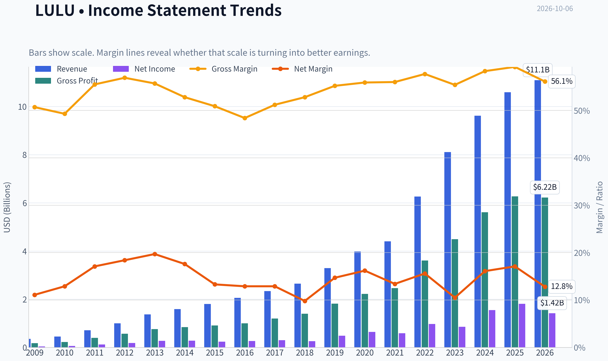

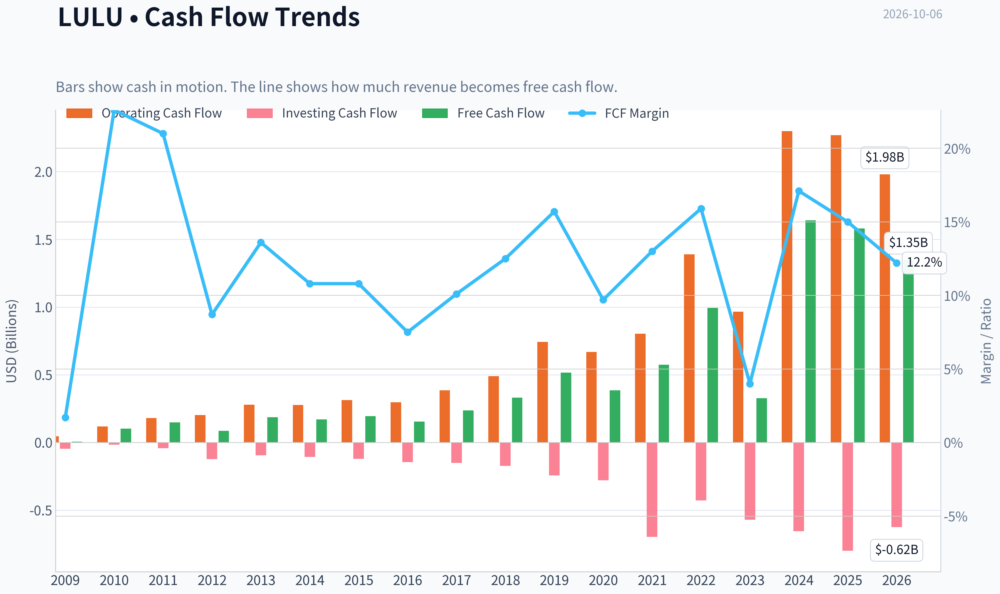

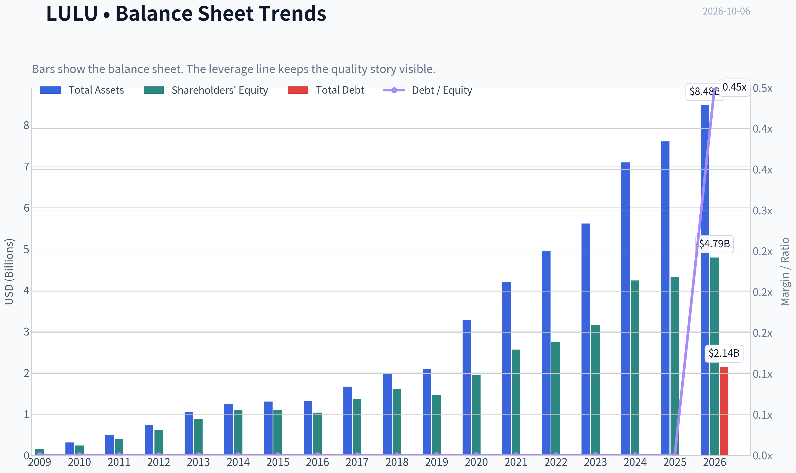

This graph tracks the profitability and return metrics (ROE, ROIC, Margins) of **LULU** over the past decade, highlighting capital efficiency trends.

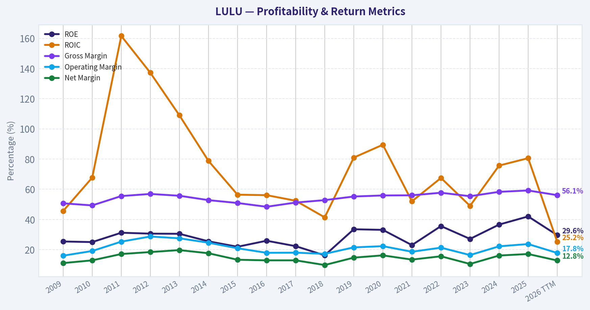

This chart illustrates the financial health of **LULU** over the last 10 years, mapping cash equivalents and free cash flow against total obligations (Debt).

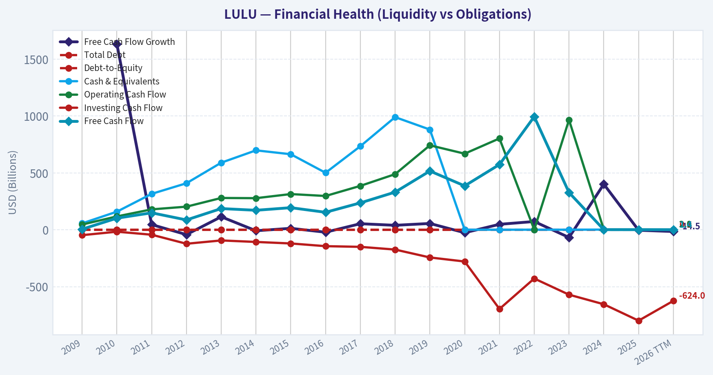

This comparison chart from *Profitability and Operating Performance* stacks current figures against historical benchmarks for **LULU**, making it easy to see where the company trades relative to its own averages.

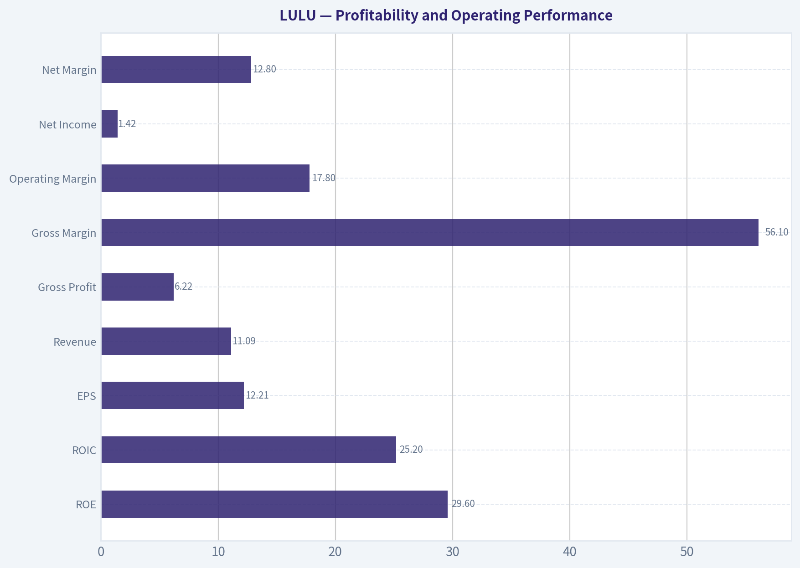

---

### Intrinsic Value Analysis (Buffett)

> *Following Warren Buffett's value investing philosophy: Circle of Competence, Economic Moat, Management Quality, and Margin of Safety.*

#### Intrinsic Value Snapshot

Price is what you pay. Intrinsic value is what the business may be worth based on the cash it can create for owners over time. We show a range, not one magic number.

- Current Price: $93.61
- Value Range (conservative to optimistic across both DCF methods): $69.67 to $1,123.99

##### Owner Earnings (Buffett Method)
- Net Income: $1,814,616,000.00
- Depreciation & Amortization: $496,228,000.00
- Capital Expenditures: $-680,802,000.00
- Working Capital Changes: $-409,440,000.00
- Owner Earnings: $1,866,511,000.00

##### Intrinsic Value
###### Buffett Method
Uses owner earnings. Stricter, and usually more conservative.
- Conservative: $110.85
- Average: $407.83
- Optimistic: $1,123.99
- Discount Rate: 10.0%

###### Cash Flow Method
Uses free cash flow. Better for companies spending heavily today to grow tomorrow.
- Conservative: $69.67
- Average: $424.83
- Optimistic: $885.61
- Discount Rate: 10.0%

ANALYST STANCE: **ADVOCATE**

#### Executive View

Lululemon is a high-quality athletic-apparel franchise trading at a distressed-looking valuation. Its 56.6% gross margin, 31.8% ROE, strong free-cash-flow generation, recognizable brand, and asset-light model indicate a durable competitive advantage. The principal concern is not solvency; it is whether recent slowing growth, weaker guidance, and intensified competition represent a temporary reset or permanent brand deterioration.

At approximately $94 per share, the market appears to be pricing in a severe and prolonged earnings decline. The valuation provides a substantial margin of safety if Lululemon can stabilize its brand and return to even modest growth.

#### Factor Scorecard

| Factor | Score | Assessment |
|---|---:|---|
| Circle of competence and simplicity | 4/5 | Sells premium athletic apparel through stores and digital channels. The model is easy to understand, although fashion trends and international expansion reduce predictability. |
| Moat | 4/5 | Strong brand, premium pricing, customer loyalty, product innovation, and an established direct-to-consumer distribution system. Recent growth pressure prevents a full 5. |
| Management and capital allocation | 3/5 | Historically strong execution and shareholder returns, but recent guidance reductions and the current brand reset warrant scrutiny. |
| Industry structure | 4/5 | Premium athleticwear has attractive demand characteristics and scale benefits, though Nike, Adidas, Alo, Vuori, and other brands create meaningful competition. |

**Key Takeaways:** Lululemon remains a simple, understandable consumer business with a meaningful brand moat. The moat is strong but must be monitored because recent performance suggests that product momentum and brand heat have weakened.

#### Moat Analysis

| Moat Source | Evidence | Assessment |
|---|---|---|
| Intangible assets and brand | 56.6% gross margin and premium positioning indicate considerable pricing power. | Strong |
| Customer loyalty and switching costs | Apparel switching costs are not contractual, but fit, product familiarity, community, and brand identity support repeat purchases. | Moderate to strong |
| Cost advantages | Scale in sourcing, distribution, stores, and digital commerce supports attractive economics. | Moderate |
| Network effects | Community events, ambassadors, and customer engagement reinforce the brand, but this is not a classic platform network effect. | Moderate |
| Financial returns | 31.8% ROE and 8.9% FCF yield demonstrate strong economic productivity. | Strong |

The most important moat is the combination of brand identity, product quality, and customer affinity. Lululemon does not merely sell generic leggings; it sells a premium lifestyle associated with fitness, wellness, and community. That positioning has historically allowed it to charge premium prices and earn high margins.

The key threat is brand commoditization. Competitors increasingly offer similar-looking products at lower prices, while brands such as Vuori and Alo compete for the same premium consumer. The moat is therefore best described as **wide but currently under pressure**, rather than unquestionably widening.

#### Financial Summary

| Metric | Latest reported value |
|---|---:|
| Share price | $94 |
| Market capitalization | $10.36 billion |
| P/E ratio | 7.7x |
| Revenue growth, year over year | 4.9% |
| Gross margin | 56.6% |
| ROE | 31.8% |
| Free-cash-flow yield | 8.9% |
| Implied free cash flow | Approximately $922 million |
| Current ratio | 2.26x |
| Implied shares outstanding | Approximately 110.2 million |
| Reverse-DCF growth implied by price | Approximately -10.8% annually for 10 years |

**Key Takeaways:** Lululemon combines unusually high gross margins and ROE with a single-digit earnings multiple and an 8.9% free-cash-flow yield. Revenue growth has slowed to 4.9%, but the valuation already discounts an extremely negative future, implying that the market expects a long period of earnings contraction.

The current ratio is healthy. For this asset-light consumer business, cash generation and returns on capital are more informative than book value measures.

#### Owner Earnings Calculation

| Owner-earnings component | Approximate amount |
|---|---:|
| Net income | Not separately provided in the research pack |
| Depreciation and amortization | Not separately provided |
| Less: maintenance capital expenditures | Not separately provided |
| Less: working-capital investment | Not separately provided |
| Free cash flow proxy for owner earnings | Approximately $922 million |
| Owner earnings per share proxy | Approximately $8.37 |

Free cash flow is used as the practical owner-earnings proxy because the available data provide an 8.9% FCF yield on a $10.36 billion market capitalization:

**$10.36 billion x 8.9% = approximately $922 million**

This implies owner earnings of approximately **$8.37 per share**.

**Key Takeaways:** Lululemon appears to convert a substantial portion of accounting earnings into cash, with estimated owner earnings near $922 million. At $94 per share, the stock is valued at roughly 11.2 times this owner-earnings proxy, which is modest for a high-margin brand with a history of strong returns.

#### Three-Scenario DCF Valuation

| Scenario | Key assumption | Equity value | Value per share |
|---|---|---:|---:|
| A. No growth | Owner earnings divided by 10% discount rate | $9.22 billion | $83.70 |
| B. GDP growth | 3% perpetual growth, 10% discount rate | $13.57 billion | $123.10 |
| C. Historical-growth model | Long-term growth model using the research-pack assumptions | Approximately $44.94 billion | $407.83 |
| Owner-earnings / FCF model | Research-pack model | Approximately $44.94 billion to $46.81 billion | $407.83-$424.83 |
| Damodaran FCFF model | Research-pack model | Approximately $70.96 billion | $643.78 |
| Weighted headline intrinsic value | Blended valuation | Approximately $50.10 billion | $454.63 |

**Key Takeaways:** The no-growth valuation is approximately $84 per share, close to the current price and therefore provides a conservative downside reference point. A modest 3% perpetual-growth assumption produces approximately $123 per share, while the more comprehensive cash-flow models produce substantially higher values because they incorporate Lululemon's historical profitability and cash-generation capacity.

The large spread between the conservative and historical-growth cases shows that the investment outcome depends heavily on whether the current slowdown is temporary or structural.

#### Margin of Safety Analysis

| Valuation reference | Value per share | Premium or discount to $94 |
|---|---:|---:|
| No-growth DCF | $83.70 | Current price is 12% above |
| 3% GDP-growth DCF | $123.10 | 24% discount |
| Owner-earnings DCF | $407.83 | 77% discount |
| FCF DCF | $424.83 | 78% discount |
| Damodaran FCFF | $643.78 | 85% discount |
| Weighted headline intrinsic value | $454.63 | 79.4% discount |

The headline margin of safety is approximately **79.4%**. However, the no-growth case indicates that the valuation is not risk-free: if Lululemon's owner earnings permanently decline by roughly 10% or more, the conservative valuation could be close to the current market price.

The reverse DCF is particularly notable. The current price implies approximately **negative 10.8% annual growth for ten years**, despite trailing three-year and five-year revenue growth rates of approximately 47.6% and 38.8%, respectively. Those historical growth rates are unlikely to continue, but the market's implied decline appears excessively pessimistic unless the brand has suffered lasting damage.

#### Management Quality Assessment

| Management dimension | Assessment |
|---|---|
| Owner orientation | Reasonable, supported by a history of growth and shareholder-value creation, though insider ownership and compensation alignment require continued monitoring. |
| Candor | Recent lowered forecasts are negative operationally but provide evidence that management is acknowledging weaker conditions rather than maintaining unrealistic targets. |
| Capital allocation | Historically capable of reinvesting in stores, digital channels, product development, and international growth. Buyback discipline should be monitored at depressed prices. |
| Balance-sheet stewardship | Strong cash generation and a healthy current ratio reduce financial risk. |
| Principal concern | Management must demonstrate that product innovation and brand momentum can recover, especially in North America and international markets. |

Recent reductions to revenue and earnings forecasts are the largest management-related concern. They do not establish poor stewardship by themselves, but they do reduce confidence in near-term predictability.

#### Final Buffett Scorecard

| Criterion | Weight | Score | Weighted contribution |
|---|---:|---:|---:|
| Moat width and durability | 25% | 4.0 | 1.00 |
| Valuation and margin of safety | 20% | 5.0 | 1.00 |
| Capital returns versus WACC | 15% | 4.0 | 0.60 |
| Business understanding and predictability | 12% | 3.0 | 0.36 |
| Management quality and capital allocation | 12% | 3.0 | 0.36 |
| Reinvestment runway | 8% | 4.0 | 0.32 |
| Balance-sheet strength | 4% | 4.0 | 0.16 |
| Industry structure | 4% | 4.0 | 0.16 |
| **Total** | **100%** |  | **3.96/5.00** |

**Key Takeaways:** Lululemon scores well because its brand economics and valuation more than offset the recent slowdown. The score is held below the highest tier by weaker near-term predictability, increased competition, and uncertainty about whether the current earnings reset is temporary.

#### Gate 5: Quality and Solvency

**The Gate 5 hard floor is not tripped.**

Lululemon has positive free cash flow, a 2.26 current ratio, high ROE, and no evidence in the available data of financial distress or an inability to service debt. The primary risk is business performance, not solvency.

#### Investment Stance

**ADVOCATE - Medium conviction**

Lululemon appears to be a high-quality consumer franchise available at a price that assumes severe long-term deterioration. The stock is attractive for a patient investor who believes the brand, product pipeline, and customer loyalty remain fundamentally intact.

The most important monitoring items are:

1. Revenue growth returning above mid-single digits.
2. Stabilization or improvement in gross and operating margins.
3. Evidence that product innovation is restoring customer demand.
4. Inventory and promotional activity remaining controlled.
5. Continued strength in free cash flow.
6. Recovery in North American brand momentum and international expansion.

At $94, the valuation offers a favorable risk-reward profile, but the position should be sized for the possibility that the brand has permanently lost some pricing power.
#### Valuation Bridge

This bridge places the current market price beside each intrinsic value lens so readers can see whether upside depends on one method or shows up across several methods.

| Scenario | Intrinsic Value / Share |
| --- | ---: |
| Buffett Method | $407.83 |
| Cash Flow Method | $424.83 |
| Damodaran Method | $643.78 |
| Current Price | $93.61 |

#### Key Takeaways

If one method is far above the others, the upside case depends on a specific modelling assumption. When several methods cluster together, the valuation story is more robust.

#### Valuation Visuals

This comparison chart from *Latest Earnings Snapshot* stacks current figures against historical benchmarks for **LULU**, making it easy to see where the company trades relative to its own averages.

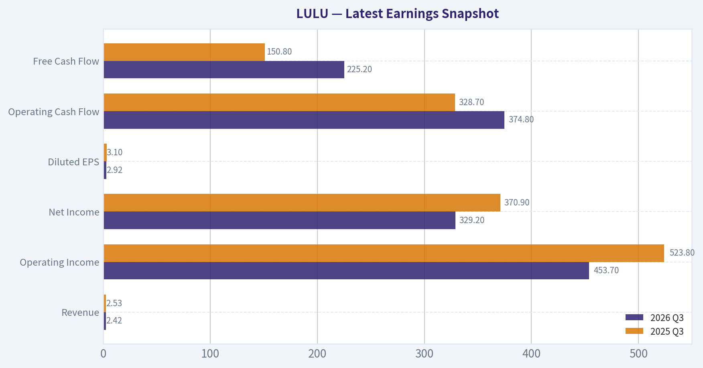

This comparison chart from *Current Metrics Versus Historical Averages* stacks current figures against historical benchmarks for **LULU**, making it easy to see where the company trades relative to its own averages.

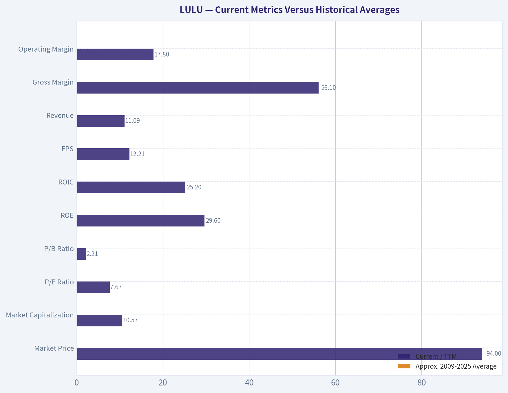

This comparison chart from *Balance Sheet and Financial Strength* stacks current figures against historical benchmarks for **LULU**, making it easy to see where the company trades relative to its own averages.

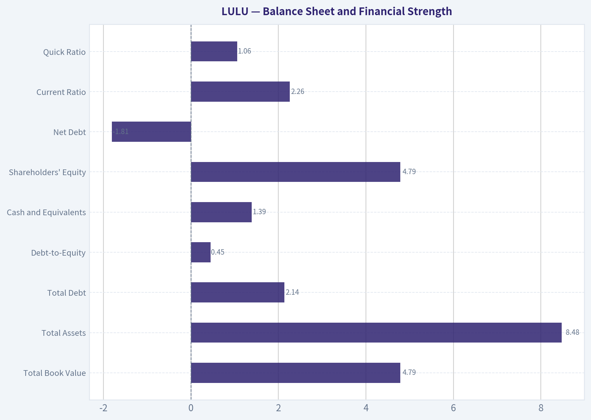

This comparison chart from *Financial Summary* stacks current figures against historical benchmarks for **LULU**, making it easy to see where the company trades relative to its own averages.

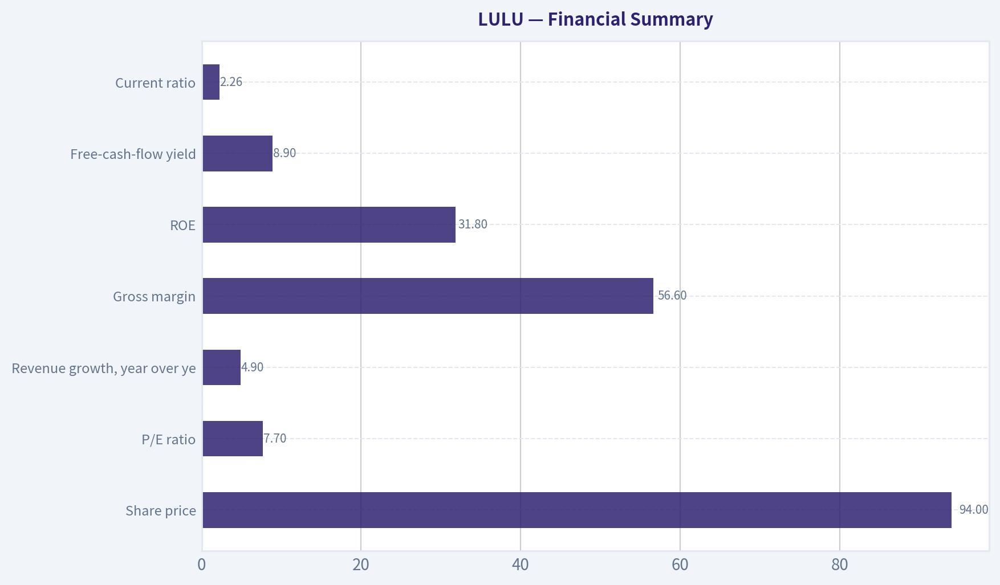

The following chart maps the **LULU** Owner Earnings DCF valuation scenarios (Conservative, Average, Optimistic) to visually represent the margin of safety based on intrinsic value calculations.

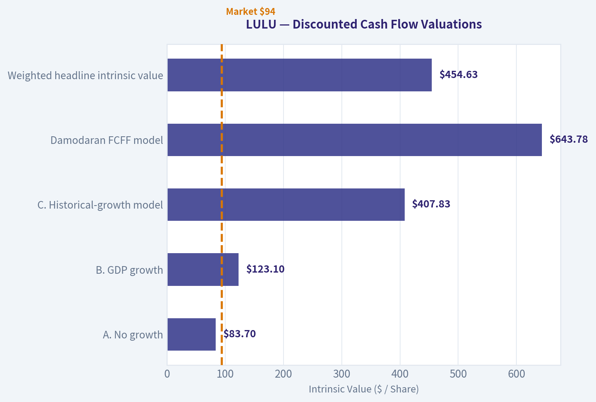

---

### Trend & Growth Analysis (Lynch/Druckenmiller/Fisher)

> *Following Peter Lynch's GARP, Stanley Druckenmiller's macro-aware approach, and Philip Fisher's scuttlebutt methodology.*

ANALYST STANCE: **WATCH**

#### Executive View

Lululemon is a high-quality brand facing a material growth slowdown rather than a clearly broken business. At approximately $94 per share, valuation is unusually depressed-about 7.7 times earnings and an 8.9% free-cash-flow yield-but the latest 4.9% revenue growth and lowered outlook prevent a high-conviction growth recommendation.

The setup is potentially attractive for a contrarian investor if North American product issues, China execution, and brand momentum improve. However, the present evidence supports a **watchlist position or small starter position**, not an aggressive allocation.

#### 1. Lynch Classification

| Category | Assessment |
|---|---|
| Current classification | Stalwart / turnaround candidate |
| Historical classification | Fast grower |
| Current revenue growth | 4.9% year over year |
| Growth-investor status | Below the 15-25% fast-grower threshold |
| Primary opportunity | Reacceleration from a depressed valuation |

**Key Takeaways:** Lululemon is no longer behaving like a classic fast grower on current numbers. It is better viewed as a formerly fast-growing consumer brand undergoing a possible turnaround, with upside dependent on renewed product and revenue momentum.

#### 2. The Story in Three Bullets

1. **Premium athletic apparel brand:** Lululemon has a strong global brand, premium pricing, and a differentiated community-oriented retail model.
2. **Large international runway:** The company remains underpenetrated outside North America, particularly in China and other international markets.
3. **Contrarian valuation:** The stock has fallen roughly 47% over twelve months, while earnings valuation has compressed to roughly 7.7 times P/E.

The central question is whether the slowdown is a temporary product and execution problem or evidence that the brand has matured and lost momentum.

#### 3. TAM and 10x Test

| Item | Approximate assessment |
|---|---|
| Current annual revenue | Roughly $10 billion scale |
| 10x revenue target | Roughly $100 billion |
| Relevant market | Global athletic apparel, athleisure, footwear, and adjacent categories |
| Broad market potential | Large enough to support substantial growth |
| 10x test | Possible only with major international expansion and category extension |
| Key constraint | Premium apparel TAM is materially smaller than the broad global apparel market |

**Key Takeaways:** The broad market is large enough for Lululemon to grow several times larger, but a literal 10x outcome would require successful international scaling, men's expansion, footwear, and additional categories. The TAM is not the main concern; execution and brand vitality are.

#### 4. Revenue Growth Trend

| Metric | Signal | Interpretation |
|---|---:|---|
| Latest revenue growth | 4.9% YoY | Slow by Lululemon's historical standards |
| Historical three-year revenue CAGR | 47.6% | Strong prior expansion |
| Historical five-year revenue CAGR | 38.8% | Strong long-term growth record |
| Recent guidance | Lowered on September 3 | Negative near-term inflection |
| Current trend | Decelerating | Warning, not yet proof of permanent impairment |

**Key Takeaways:** The growth pattern has clearly decelerated from a historically exceptional base. The lowered outlook is the most important current signal, and investors need evidence of reacceleration before treating Lululemon as a renewed fast grower.

#### 5. Unit Economics and Financial Quality

| Metric | Result | Assessment |
|---|---:|---|
| Gross margin | 56.6% | Strong premium-brand economics |
| ROE | 31.8% | Strong capital efficiency |
| Current ratio | 2.26 | Healthy liquidity |
| Free-cash-flow yield | 8.9% | Attractive valuation support |
| LTV/CAC | Not disclosed | Cannot verify |
| Net revenue retention | Not applicable / unavailable | Primarily a retail model |
| Rule of 40 | Not applicable | Not a SaaS subscription business |

**Key Takeaways:** Lululemon's gross margin, return on equity, liquidity, and free-cash-flow yield indicate a financially strong business. The main missing data are customer-level acquisition and retention metrics, which limits precision around brand health and unit economics.

#### 6. Inflection Point Assessment

| Inflection area | Current signal | Rating |
|---|---|---|
| Product cycle | Recent product and assortment concerns implied by weaker guidance | Negative |
| Market share | No verified accelerating share gain | Neutral to negative |
| Margin | 56.6% gross margin remains strong | Positive |
| TAM | International opportunity remains substantial | Positive |
| Competitive environment | Nike and other incumbents are also under pressure | Mixed |
| Earnings expectations | Low valuation implies significant pessimism | Positive contrarian setup |

**Key Takeaways:** The positive inflection is valuation, not operating momentum. A genuine bullish inflection would require improving product acceptance, comparable-store sales, inventory health, and guidance-not merely a low P/E ratio.

#### 7. Macro Setup

Consumer discretionary apparel is sensitive to household spending, promotional intensity, foreign exchange, and China consumption. Lower interest rates would support valuation multiples, while a weakening consumer or elevated discounting would pressure margins and brand perception.

Druckenmiller-style interpretation: the macro backdrop is currently **mixed**, and Lululemon does not have a strong cyclical tailwind. The stock could outperform if expectations are already excessively low, but the macro setup does not independently justify concentration.

#### 8. Fisher's 15-Point Score

Scores are provisional because the available data do not include detailed management interviews, employee data, customer research, or current R&D disclosures.

| Fisher criterion | Score / 5 | Comment |
|---|---:|---|
| Market potential | 4 | Large global athletic and athleisure opportunity |
| New-product determination | 3 | Historically strong, current execution needs proof |
| R&D / innovation | 3 | Product innovation is important but recent momentum is unclear |
| Sales organization | 4 | Strong direct-to-consumer and community model |
| Profit margins | 5 | 56.6% gross margin and strong cash generation |
| Margin improvement | 3 | No clear current inflection |
| Labor relations | 3 | Insufficient evidence |
| Executive relations | 3 | Insufficient evidence |
| Management depth | 4 | Established global operating platform |
| Cost accounting | 4 | Strong financial profile |
| Outstanding advantages | 4 | Brand, community, premium positioning |
| Long-term profit outlook | 4 | Attractive if international growth resumes |
| Dilution | 4 | No major dilution concern evident |
| Management candor | 3 | Guidance reduction is a negative but also provides transparency |
| Management integrity | 4 | No major integrity issue identified |
| **Total** | **55 / 75** | **Good, but not outstanding** |

**Key Takeaways:** Lululemon scores well on brand, margins, distribution, and long-term market potential. The score is held back by uncertainty around current product innovation, management execution, and the durability of recent slowing growth.

#### 9. Valuation Analysis

| Method | Result | Interpretation |
|---|---:|---|
| P/E | 7.7x | Very low for a historically high-quality branded retailer |
| PEG using 4.9% revenue growth as proxy | 1.57x | Fair, not compelling under current growth |
| Free-cash-flow yield | 8.9% | Attractive cash-flow valuation |
| Headline intrinsic value | $454.63 | Extremely bullish model output |
| Model range | $407.83-$643.78 | Highly sensitive to assumptions |
| Reverse DCF implication | Approximately -10.8% annual return assumption over 10 years | Market price embeds severe pessimism |

**Key Takeaways:** Conventional valuation metrics suggest substantial downside protection if earnings remain stable. However, the $454.63 intrinsic-value estimate should not be treated as a precise target because it implies a dramatic recovery and is highly sensitive to normalized growth, margins, and discount rates. The key valuation debate is not whether the stock is cheap-it is whether earnings have structurally peaked.

#### Scenario Analysis

| Scenario | Operating assumption | Valuation implication |
|---|---|---|
| Bear | Revenue remains low-growth, margins compress, brand loses share | Low multiple and possible value trap |
| Base | Growth stabilizes, international expansion resumes modestly | Meaningful recovery from $94 is possible |
| Bull | Product cycle improves and growth returns to mid-teens or better | Large rerating and multiyear upside |
| Ten-bagger case | Revenue approaches $100B with sustained global category leadership | Theoretically possible, but low probability from today's evidence |

**Key Takeaways:** The base case can produce attractive returns without requiring a ten-bagger outcome. The bull case depends on a renewed product cycle and international execution, while the bear case is that Lululemon has become a mature brand with structurally lower growth.

#### 10. Growth Investor Scorecard

| Criterion | Weight | Score / 5 |
|---|---:|---:|
| The Story | 10% | 3.5 |
| TAM and runway | 20% | 4.0 |
| Revenue growth | 20% | 2.0 |
| Unit economics | 15% | 3.0 |
| Competitive position | 10% | 4.0 |
| Management quality | 10% | 2.5 |
| Macro setup | 5% | 3.0 |
| Profitability path | 5% | 4.0 |
| Valuation | 5% | 4.5 |
| **Weighted score** | **100%** | **3.2 / 5** |

**Key Takeaways:** Lululemon earns a **WATCH** rating because its brand, margins, balance sheet, and valuation are attractive, but current growth and guidance are weak. The stock would move toward ADVOCATE if operating data showed a sustained reacceleration rather than merely a cheap valuation.

#### 11. Position Size Stance

- **New position:** Small starter position only, approximately 1-2% of a diversified portfolio.
- **Existing holder:** Hold or selectively average down, provided the investment thesis assumes a multi-year recovery rather than immediate growth.
- **High-conviction growth portfolio:** Do not make Lululemon a top position until revenue growth and guidance improve.
- **Value-oriented portfolio:** More attractive, given the low P/E, high FCF yield, and strong historical economics.

#### 12. Key Risks and Catalysts

| Catalysts | Risks |
|---|---|
| Comparable-sales reacceleration | Product relevance continues to weaken |
| Successful new product launches | Brand saturation in North America |
| Improved China and international growth | China execution and consumer weakness |
| Inventory normalization | Promotional activity damages margins |
| Guidance stabilization or upward revision | Further earnings reductions |
| Share repurchases at depressed prices | Structural shift from fast grower to mature retailer |
| Stronger men's, footwear, or adjacent-category growth | Competition from Nike, Alo, Vuori, and lower-priced brands |

**Key Takeaways:** The most important catalyst is not a cheaper stock price; it is evidence that the operating business has stabilized. The main risk is a value trap in which the low multiple correctly reflects permanently lower growth and declining brand momentum.

#### Bottom Line

Lululemon is a **high-quality business at a low valuation, but not currently a high-quality growth setup**. Its prior growth record and international runway make a recovery plausible, while the current valuation provides a margin of safety if earnings remain resilient. Until revenue growth reaccelerates, the appropriate stance is **WATCH with a small, staged position rather than aggressive accumulation**.

---

### Market Technical Analysis

ANALYST STANCE: **AVOID**

#### LULU technical overview

LULU's technical structure is decisively bearish as of the latest available closing data, October 5, 2026. The stock closed at **$93.14**, down from approximately **$121.77 on September 3**, representing a decline of about **23.5% in roughly one month**. The September 4 gap-down, accompanied by exceptionally heavy volume, appears to have created a major overhead supply zone.

The decline is not merely a short-term pullback. Price is below the short-, medium-, and long-term moving averages, momentum remains negative, and volume-weighted price measures continue to slope lower. RSI has improved slightly from its recent low but remains weak rather than demonstrating a convincing reversal.

#### Selected indicator readings

| Indicator | Latest reading | Direction or condition | Interpretation |
|---|---:|---|---|
| Close | $93.14 | Falling | Latest available close; price remains near recent lows |
| 10 EMA | $96.68 | Falling | Short-term price trend is bearish; approximately $3.54 above price |
| 50 SMA | $111.03 | Falling | Medium-term trend remains strongly negative |
| 200 SMA | $143.82 | Falling | Long-term trend is bearish; price is roughly 35% below this benchmark |
| MACD | -4.53 | Negative | Momentum remains below its neutral baseline |
| MACD Histogram | -0.10 | Turned negative | Recent downside momentum has re-emerged after a brief improvement |
| RSI | 33.61 | Weak, near oversold | Selling pressure is substantial, but RSI is not yet at an extreme capitulation level |
| ATR | $3.85 | Elevated relative to price | Daily volatility is approximately 4.1% of the share price |
| VWMA | $98.20 | Above price and declining | Volume-weighted participants have an average cost above the current market |

Key Takeaways: Every major trend measure is positioned above the current share price, confirming broad weakness across multiple time horizons. RSI is weak but not deeply oversold, while ATR shows that price swings remain large enough to make premature bottom-fishing risky.

#### Trend structure and moving averages

The **10-day EMA is $96.68**, compared with the latest close of $93.14. This places price below its short-term trend line, and the EMA itself has fallen from approximately $113.82 on September 8 to $96.68. That is a rapid deterioration in short-term trend momentum.

The **50-day SMA is $111.03**, down from approximately $118.11 at the beginning of the indicator window. LULU is therefore not simply testing the 50-day average; it is trading more than **16% below it**. This distance indicates that the medium-term trend has already suffered significant damage and that the 50-day SMA is more likely to act as resistance than support if the stock rebounds.

The **200-day SMA is $143.82**, also declining. The stock is approximately **35% below this level**, showing that the bearish condition extends beyond the recent selloff. A recovery toward the 200-day average would require a substantial change in both earnings expectations and market sentiment; it should not be assumed from a short-term oversold reading.

The moving-average configuration is therefore bearish in three layers: price below the 10 EMA, the 10 EMA below the 50 SMA, and the 50 SMA far below the 200 SMA. This is a trend-following environment where countertrend rallies can occur, but they carry a lower probability of becoming durable advances without a clear base and improving volume.

#### Momentum: MACD and RSI

MACD is at **-4.53**, remaining firmly negative. The indicator did improve from approximately **-5.94 on September 16** to around **-4.00 on September 28**, suggesting that downside momentum temporarily moderated. However, MACD then weakened again into early October.

The MACD histogram reinforces this interpretation. It improved from deeply negative readings in mid-September and became slightly positive on October 2, but then turned negative again, reaching approximately **-0.10** by October 6. That pattern suggests the attempted momentum recovery failed to develop into a sustained bullish reversal.

RSI is **33.61**, up modestly from approximately **32.48** on October 5 but still well below the neutral 50 level. The reading is approaching the conventional oversold threshold of 30, yet it is not sufficiently extreme to establish a high-confidence reversal signal. In a persistent downtrend, RSI can remain between 25 and 40 for extended periods, so the current reading should be interpreted as evidence of weakness-not as a standalone buy signal.

A more constructive momentum setup would require RSI to recover above 40 and eventually 50, accompanied by a positive MACD histogram and price reclaiming the 10 EMA. Those conditions are not currently present.

#### Volume confirmation and the September gap

The **VWMA is $98.20**, above the latest close. This indicates that the volume-weighted average trading price remains higher than the current market price, confirming that recent high-volume transactions occurred at materially higher levels.

The September 4 decline from roughly $121.77 to $100.61 was accompanied by volume of approximately **37.4 million shares**, far above the surrounding daily volume. Such a high-volume gap often creates a substantial supply zone because many holders who bought near the pre-gap price may attempt to sell if the stock rebounds toward that area.

The first volume-related obstacle is therefore near **$98-$100**, where the current VWMA and recent trading activity converge. A more substantial resistance region lies around **$101-$104**, followed by the declining 50-day SMA near $111. A rebound that occurs on weak volume and fails below these areas would likely represent a relief rally rather than a confirmed trend reversal.

#### Volatility and risk management

ATR is approximately **$3.85**, equivalent to about **4.1% of the latest closing price**. This is substantial volatility for a stock trading near $93. A one-ATR move represents roughly $3.85, meaning that normal daily fluctuations can quickly produce either false breakdowns or sharp countertrend rallies.

The falling ATR-from above $5.7 in early September to $3.85-suggests that volatility has moderated from the extreme post-gap levels. However, lower ATR does not mean that the trend has become bullish. It may instead reflect a persistent, orderly decline after the initial shock.

For traders considering a position, stops should not be placed so tightly that ordinary LULU volatility triggers them. Position sizing should be reduced accordingly. Conversely, the elevated downside trend argues against averaging down simply because the stock appears substantially cheaper than it was several weeks ago.

#### Potential levels and trading framework

The **$91-$93 area** is the nearest important support zone based on the latest lows and current price location. A decisive close below this region would suggest that sellers remain in control and could open the way toward psychologically important levels near $90 and below.

On the upside, **$96.50-$99** is the first meaningful recovery test, corresponding approximately to the 10 EMA, VWMA, and recent short-term trading area. A close above this zone would be an initial improvement, but not enough by itself to reverse the broader trend.

The next resistance band is approximately **$100-$104**, which includes the post-gap trading area and recent consolidation. Above that, the declining **50-day SMA near $111** is the more important medium-term confirmation level. Until price can reclaim the 50-day average and hold above it, rallies should be treated cautiously.

A higher-quality bullish setup would involve three simultaneous developments: price reclaiming the 10 EMA, RSI moving above 40 and then 50, and MACD histogram turning positive with expanding volume. Without those confirmations, the risk-reward profile favors waiting rather than initiating a new long position.

#### Overall assessment

LULU is in a broad and technically confirmed downtrend. The stock is below all three selected moving averages, MACD remains negative, the histogram has turned negative again, VWMA is above price, and RSI indicates weakness without signaling an extreme reversal condition.

The most prudent stance is **avoid new long exposure while the stock remains below approximately $98-$100**, unless a trader is specifically pursuing a short-term oversold bounce with strict risk controls. A sustained move above $100, followed by improvement toward the $111 50-day SMA, would materially improve the technical picture. Until then, the dominant evidence remains bearish.

| Trading consideration | Current evidence | Practical implication |
|---|---|---|
| Primary trend | Price below 10 EMA, 50 SMA, and 200 SMA | Trend-following longs are unfavorable |
| Short-term momentum | 10 EMA falling; price below it | Rebounds remain vulnerable to renewed selling |
| Medium-term trend | 50 SMA near $111 and declining | $111 is a major resistance and confirmation level |
| Long-term trend | 200 SMA near $143.82 and declining | Structural damage remains significant |
| Momentum oscillators | MACD negative; histogram recently turned negative | No confirmed momentum reversal |
| RSI | 33.61 | Weak and near oversold, but not an automatic buy signal |
| Volume trend | VWMA $98.20, above price | Volume-weighted resistance is overhead |
| Volatility | ATR $3.85, about 4.1% of price | Use smaller positions and wider, volatility-aware stops |
| Key support | Approximately $91-$93 | Breakdown would increase downside risk |
| Initial resistance | Approximately $96.50-$100 | Reclaim required for an initial improvement |
| Major resistance | Approximately $101-$104 and then $111 | Breakout above these zones would be needed to improve the outlook |
| Stance | Bearish trend with possible oversold bounce risk | Avoid new long exposure until confirmation improves |

Key Takeaways: LULU remains technically bearish, with overhead resistance clustered near $98-$104 and a more important barrier around the declining $111 50-day average. The $91-$93 area is the nearest support, but RSI alone does not justify buying because momentum and volume-weighted trend measures remain unfavorable.

---

### Options Market Analysis

> *Reading options flow - put/call ratios, IV skew, and unusual activity - to gauge institutional positioning and event-driven risk.*

#### LULU Options Market Report

*Data as of October 6, 2026. The available feed covers near-term expirations through October 23, 2026. It does not provide LULU's current share price, individual strike-level open interest, or out-of-the-money skew.*

#### 1. Put/Call Ratio Analysis

| Expiration | Call OI | Put OI | Put/Call OI Ratio | Call Volume | Put Volume | Put/Call Volume Ratio |
|---|---:|---:|---:|---:|---:|---:|
| Oct. 9, 2026 | 11,658 | 9,749 | 0.84 | 6,328 | 2,823 | 0.45 |
| Oct. 16, 2026 | 25,570 | 25,855 | 1.01 | 3,671 | 1,608 | 0.44 |
| Oct. 23, 2026 | 2,998 | 2,790 | 0.93 | 838 | 321 | 0.38 |
| **Total** | **40,226** | **38,394** | **0.95** | **10,837** | **4,752** | **0.44** |

**Key Takeaways:** LULU's aggregate put/call open-interest ratio is 0.95, considerably above the approximately 0.7 neutral baseline, indicating a relatively large existing put position or demand for downside protection. However, current trading volume is strongly call-heavy, with a 0.44 put/call volume ratio. This creates a mildly bullish near-term read, although some call volume could represent covered-call writing rather than outright bullish speculation.

#### 2. Implied Volatility Assessment

| Expiration | Call ATM IV | Put ATM IV | Call-Put IV Difference |
|---|---:|---:|---:|
| Oct. 9, 2026 | 50.3% | 47.8% | +2.5 percentage points |
| Oct. 16, 2026 | 47.1% | 42.2% | +4.9 percentage points |
| Oct. 23, 2026 | 44.7% | 42.0% | +2.7 percentage points |

**Key Takeaways:** Near-term at-the-money implied volatility is elevated, ranging from roughly 42% to 50%, with the highest levels in the October 9 expiration. Calls carry higher ATM IV than puts across all listed expirations, which is an upside-oriented volatility signal rather than the usual downside put-skew pattern. The feed does not provide true out-of-the-money IV, so a complete put-versus-call skew analysis is not possible.

The elevated front-week IV suggests meaningful event or short-term movement risk, but no specific catalyst was supplied in the options data. Traders should verify the earnings calendar and other corporate events before interpreting the high IV as a catalyst-specific trade.

#### 3. Unusual Options Activity

| Finding | Interpretation |
|---|---|
| No contracts had volume greater than five times open interest | No statistically significant fresh-contract activity identified |
| Call volume exceeded put volume by more than 2-to-1 | Broad call-side activity, but not attributable to a specific strike |
| No strike-level data available | ITM, ATM, or OTM classification cannot be determined |

**Key Takeaways:** The data shows no individual contract with volume above five times its open interest, so there is no clear unusual sweep or fresh directional institutional bet. The call-heavy aggregate volume is constructive, but the absence of contract-level detail reduces confidence in identifying smart-money positioning. This looks more like broad directional or volatility trading than a concentrated high-conviction signal.

#### 4. Open Interest Concentration and Gamma Levels

| Expiration | Total Call OI | Total Put OI | Combined OI | Relative Concentration |
|---|---:|---:|---:|---|
| Oct. 9, 2026 | 11,658 | 9,749 | 21,407 | Moderate |
| Oct. 16, 2026 | 25,570 | 25,855 | 51,425 | Highest |
| Oct. 23, 2026 | 2,998 | 2,790 | 5,788 | Low |

**Key Takeaways:** The October 16 expiration contains approximately 51,425 contracts of combined open interest, making it the dominant near-term expiry and the most likely source of expiration-related pinning or hedging flows. The October 9 expiration also has meaningful activity, particularly given its elevated IV. Strike-level open interest is unavailable, so specific gamma walls, max-pain strikes, and price-gravity levels cannot be identified.

#### 5. Overall Options Sentiment

**Overall signal: BULLISH, with moderate-low conviction.**

The primary bullish driver is the 0.44 near-term put/call volume ratio, combined with call ATM IV exceeding put ATM IV in every listed expiration. These signals indicate greater current demand for calls and upside exposure. The main caveat is the 0.95 put/call open-interest ratio, which remains elevated relative to the 0.7 neutral baseline and suggests that existing downside hedges or bearish positions are still substantial.

There is no confirmed unusual activity at the contract level, no available strike concentration data, and no exact OTM skew data. Therefore, the bullish signal reflects broad near-term flow rather than a clearly identifiable institutional bet. Confidence should be reduced if LULU's options market is thin or if the call volume is primarily covered-call writing.

#### Summary

| Category | Assessment |
|---|---|
| Put/Call Ratio | **OI ratio 0.95: defensive/elevated; volume ratio 0.44: strongly call-heavy** |
| IV Level | **Elevated near-term IV, approximately 42%-50%; highest in the Oct. 9 expiry** |
| Skew Direction | **Call-favorable based on ATM IV; true OTM skew unavailable** |
| Unusual Activity | **None identified; no contracts exceeded 5x open interest** |
| Overall Signal | **BULLISH, moderate-low conviction** |

**Key Takeaways:** LULU's current options flow leans bullish because call volume is substantially greater than put volume and call ATM volatility exceeds put volatility. Still, elevated put open interest and the lack of a specific unusual contract prevent a high-conviction signal. The October 16 expiration is the key near-term positioning window, while strike-level gamma and max-pain analysis remains unavailable.

---

## Research Team Commentary

> *The Research Manager synthesizes the Bull vs Bear debate into action-free commentary. This is a pre-risk view, not the final stance.*

Core takeaway: Lululemon may be materially undervalued, but the debate does not establish that its current earnings are normalized owner earnings. At roughly $93 and 7.7 times reported earnings, expectations are exceptionally low, while the brand, gross margin, and historical returns on capital remain strong. That makes outright dismissal too bearish. However, deteriorating free cash flow, weak North American demand, leadership uncertainty, and a heavy-volume technical breakdown mean the apparent earnings yield cannot yet be trusted. I would keep LULU on WATCH with a bearish tactical bias rather than buy immediately or conclude that the franchise is permanently impaired.

The strongest bull argument is price relative to surviving business quality. Lululemon still reports a 56.6% gross margin, 31.8% ROE, and 49.4% ROIC. Those figures reflect genuine brand equity, premium pricing, direct distribution, and historically excellent store economics. Even allowing for substantial deterioration, the company could continue earning returns well above its cost of capital. International underpenetration also provides a credible route to moderate long-term growth without requiring North America to return to its former growth rate.

At 7.7 times earnings, the stock does not need to recover its old premium multiple to generate an attractive return. If normalized owner earnings are even $8.50 per share and eventually grow modestly, the current price could prove compelling. The roughly 47% twelve-month decline also suggests that considerable disappointment is already reflected in sentiment. The market may be extrapolating a difficult product cycle into permanent brand decay.

The bull nevertheless overstates the precision of its valuation. Applying a Gordon-growth formula directly to current EPS does not prove that the market is pricing a 3% perpetual decline. That conclusion assumes current EPS is sustainable, cash-convertible owner earnings and that the business moves quickly into steady state. Neither assumption has been demonstrated. The bull's 70% cash-conversion adjustment is reasonable as a stress test, but it is still an unsupported assumption without detailed working-capital, inventory, lease, maintenance-capex, and cash-flow information. The quoted $150-$165 probability-weighted value therefore indicates possible upside, not a dependable appraisal.

The strongest bear argument is that the denominator may be deteriorating. Revenue growth has slowed to approximately 4.9%, net income has declined, and free cash flow has fallen sharply. If normalized owner earnings are closer to $6-$7 per share after markdowns, weaker store productivity, and necessary reinvestment, LULU is trading closer to 13-16 times owner earnings. That would be reasonable rather than distressed for a maturing apparel company with execution risk.

The moat also deserves a quality discount. Lululemon has a real brand advantage, but it lacks switching costs, network effects, or customer lock-in. Its competitive position must be renewed continuously through product design, merchandising, and cultural relevance. Alo, Vuori, Nike, and other brands do not need to destroy Lululemon; modest share loss and increased promotions could materially reduce incremental returns. Historical ROIC is encouraging, but future international and product investments matter more than returns earned by the established North American store base.

Management uncertainty compounds this problem. A leadership transition and founder-governance conflict are especially relevant when product execution needs improvement. The company's historical operating record is strong, but the current team must demonstrate disciplined inventory management, brand stewardship, and attractive international expansion. Cheap buybacks would create value only if normalized earnings remain durable; they cannot compensate for weakening customer relevance.

The technical evidence reinforces patience. The stock has fallen about 23.5% in roughly one month, including a gap down on exceptionally heavy volume. That creates substantial overhead supply and suggests that investors may still be reducing earnings expectations. Technical weakness does not determine ten-year intrinsic value, but when it coincides with falling free cash flow and operating uncertainty, it is useful evidence against premature entry. An oversold condition or low multiple is not the same as stabilization.

My rationale is therefore that neither extreme wins. The bull has the better argument on prospective return if earnings stabilize: a still-profitable global brand at less than eight times earnings could deliver substantial upside. The bear has the better argument on present evidence: the available data do not establish that current EPS is durable owner earnings, and the bull's own approximately $94 stress value offers essentially no margin of safety at the current price.

For a soft-moat apparel company undergoing a possible earnings reset, I would ordinarily require a 25%-35% discount to conservative intrinsic value. That discount is present against the bull's base case but absent against its stress case. The correct response to that unusually wide valuation range is to wait for better evidence, not to pretend either $57 or $169 is precise.

This incorporates the central lesson from prior LULU calls. Earlier analysis correctly resisted buying solely because the stock looked cheap, but at times it underweighted the combination of deteriorating fundamentals, negative catalysts, and a broken chart. I would not repeat that mistake by upgrading after another decline without operational confirmation. At the same time, the stock is now much cheaper, so mechanically carrying forward an AVOID stance would ignore how price changes prospective returns. This is strategically interesting but tactically unconfirmed.

Over the next one to four quarters, I would monitor North American comparable sales, traffic, units, and full-price sell-through. Stabilizing comps without heavier discounting would materially strengthen the thesis. Continued deterioration or growth supported mainly by promotions would weaken it.

Gross and operating margins should be evaluated alongside inventory growth and inventory turns. A gross margin holding around the mid-50% range while inventory becomes more productive would support continued pricing power. Rising markdowns, inventory growing faster than sales, or persistent operating deleverage would suggest that the moat is narrowing.

Free-cash-flow conversion is the most important valuation test. The company should explain whether the decline reflects temporary working-capital investment, elevated growth capital expenditure, or weaker underlying economics. A recovery toward normal cash conversion would make the low P/E meaningful; another year of FCF materially trailing earnings would make it misleading.

International growth must be judged by economics rather than revenue alone. Watch store productivity, regional margins, capital intensity, and evidence that international expansion contributes owner earnings rather than merely offsetting North American weakness at lower returns.

Finally, management should provide credible product and inventory plans, reduce governance disruption, and use capital conservatively. Technically, a higher low followed by a sustained reclaim of the post-gap resistance area and major moving averages would not prove intrinsic value, but it would indicate that negative revisions and institutional distribution may be abating.

I would upgrade to ADVOCATE if North American demand stabilizes, gross margin holds without greater promotion, FCF conversion improves, and management demonstrates credible execution-even if the share price is somewhat higher. I would move to AVOID if revenue contracts persistently, inventory and promotions rise together, gross margin deteriorates structurally, international returns disappoint, or owner earnings appear to be settling near $6-$7 per share without a recovery path.

Final stance: WATCH.

---

## Value Investing Team Commentary

> *The Investor translates the research view into an investment thesis before risk review. This is still not the final stance.*

### Investment commentary

Lululemon at roughly **$93-$94 and 7.7 times reported earnings** is no longer priced like a premium compounder. It is priced as though its North American slowdown, product problems, and management uncertainty will produce a lasting earnings reset. That creates a legitimate contrarian opportunity-but only if reported earnings remain reasonably close to sustainable owner earnings.

### The enduring business case

Lululemon retains several characteristics of a valuable franchise:

- **56.6% gross margin**, indicating meaningful brand equity and premium pricing.
- **31.8% ROE and 49.4% ROIC**, reflecting historically excellent store economics and capital efficiency.
- Direct customer relationships and a community-oriented retail model.
- Considerable international whitespace, especially if expansion can reproduce attractive unit economics.
- A valuation that no longer requires rapid growth or a return to the company's former premium multiple.

The company does not need to regain its old valuation to produce satisfactory returns. If sustainable owner earnings are around **$8.50 per share**, modest long-term growth could support an intrinsic value around **$130-$160**, depending on reinvestment needs and the required return. At today's price, that would represent a potentially adequate discount for a brand-led but presently uncertain business.

### The central valuation problem

The reported P/E creates an apparent earnings yield of approximately **13%**. That looks exceptionally attractive, but it is meaningful only if earnings convert into distributable cash after inventory requirements, leases, maintenance capital expenditures, and necessary brand investment.

The valuation changes materially under different owner-earnings assumptions:

| Sustainable owner earnings | Current owner-earnings yield | Interpretation |
|---|---:|---|
| $8.50-$10.00 per share | 9.1%-10.7% | Potentially compelling if growth remains positive |
| $7.00-$8.00 | 7.5%-8.5% | Reasonably valued, with moderate upside |
| $6.00-$7.00 | 6.4%-7.5% | Not obviously cheap for a maturing apparel company with execution risk |

This is effectively the reverse-DCF question. If reported earnings are durable and cash-convertible, the market is implying prolonged stagnation or substantial deterioration. If normalized owner earnings have already fallen toward $6-$7, the market's valuation is much less irrational.

The stock therefore appears cheap against a recovery case but offers little margin of safety against a genuine earnings-reset case.

### Moat: real, but requiring continuous renewal

Lululemon has a recognizable moat, but it is not equivalent to the switching costs or network effects of a dominant platform. Customers can move easily among Lululemon, Alo, Vuori, Nike, and other brands. The company must continuously renew its advantage through:

- Product innovation
- Fit and fabric quality
- Merchandising discipline
- Cultural relevance
- Full-price customer demand
- Consistent brand presentation

Competitors do not have to destroy the brand for intrinsic value to decline. Modest share losses, increased promotions, and weaker store productivity could substantially reduce incremental returns on capital.

That makes historical ROIC evidence of what the franchise has achieved-not proof of what new international stores and product investments will earn. International growth should be assessed through regional margins, store productivity, capital intensity, and cash returns rather than revenue growth alone.

### Management and capital allocation

Leadership uncertainty is particularly important because the company's immediate challenge is operational rather than purely macroeconomic. Product selection, inventory planning, and brand stewardship require clear accountability. Founder-governance conflict can further distract the organization during a period when execution must improve.

Share repurchases at this valuation could create substantial value, but only if normalized earnings remain durable. Buybacks cannot repair declining customer relevance. Management should first demonstrate:

1. Better inventory productivity
2. Stable full-price sell-through
3. Improved free-cash-flow conversion
4. Disciplined international expansion
5. A credible product innovation pipeline

The available information does not indicate financial distress, so an outright avoidance decision should not be based merely on the falling share price. The concern is the durability of earnings, not near-term solvency.

### Selective contrarian interpretation

The roughly **47% twelve-month decline**, compressed multiple, and widespread bearishness indicate that substantial disappointment is already embedded in the price. The market may be extrapolating a weak North American product cycle into permanent brand deterioration. If customer demand stabilizes while international operations continue growing profitably, the upside could be significant.

However, contrarian investing is not the automatic purchase of whatever has fallen most. The September gap down on exceptional volume suggests that institutional investors may have been revising their assessment of normalized earnings-not merely reacting emotionally. Technical weakness does not determine ten-year value, but it can reveal that informed expectations are still deteriorating.

The contrarian opportunity emerges when bad news stops producing worsening operating results and further estimate reductions. That inflection has not yet been demonstrated.

### What would justify buying

I would become constructive if several of the following occur together:

- North American comparable sales and traffic stabilize.
- Revenue growth returns sustainably above mid-single digits.
- Full-price sell-through improves without heavier promotion.
- Gross margin remains near the mid-50% range.
- Inventory growth falls below or remains aligned with sales growth.
- Free cash flow again tracks accounting earnings reasonably well.
- International expansion demonstrates attractive regional returns.
- Management provides credible product, inventory, and leadership plans.

A higher share price accompanied by stronger evidence could represent less investment risk than today's lower price. The objective is not to buy at the exact bottom; it is to purchase a durable stream of owner earnings at a favorable price.

### What would invalidate the thesis

I would move toward avoidance if:

- North American demand contracts persistently.
- Inventory rises while promotions intensify.
- Gross or operating margins decline structurally.
- Free cash flow continues materially trailing net income.
- International growth requires heavy capital while producing inferior margins.
- Management instability interferes with product execution.
- Sustainable owner earnings settle near $6-$7 per share without a credible recovery path.

For a soft-moat apparel business with an uncertain earnings base, a **25%-35% discount to conservative intrinsic value** is appropriate. The current price appears to provide that discount against a normalized recovery case, but not against the downside owner-earnings case. The uncertainty is too wide to treat the low P/E alone as a sufficient margin of safety.

**ANALYST STANCE: WATCH.** Lululemon is strategically interesting and materially cheaper, but the apparent bargain depends on reported earnings converting into sustainable owner earnings. Keep the company on a high-priority watchlist and require evidence of demand stabilization, margin durability, inventory discipline, and recovering free cash flow before committing long-term capital.

---

## Deep Values Commentary

> *The Risk Management Team debates and the Risk Judge provides the final action-free verdict. This section determines the final ADVOCATE / WATCH / AVOID stance.*

#### Final Stance Scorecard

This scorecard converts the final research view into a weighted decision frame. It does not replace the narrative judgement, but it makes the main drivers of the verdict easier to scan.

| Criterion | Score | Weight | Commentary |
| --- | ---: | ---: | --- |
| Business Quality | 4.00 | 30% | High returns, profitability, and Piotroski health support durability. |
| Valuation Support | 5.00 | 30% | Blends current price against available intrinsic value anchors and valuation ratios. |
| Financial Strength | 4.67 | 20% | Balance-sheet resilience reflects leverage and liquidity staying within safe ranges. |
| Growth Durability | 1.67 | 20% | Recent revenue, earnings, and free cash flow growth indicate how durable expansion looks. |
| TOTAL / FINAL STANCE | 3.97 | 100% | WATCH |

#### Key Takeaways

The weighted score lands at **3.97 / 5.0**, while the final stance remains **WATCH**. This is useful as a quick calibration aid rather than a mechanical signal.

#### Risk Summary

Higher scores indicate more risk pressure. The watch threshold is a simple guardrail: above it, the position needs tighter monitoring or a wider margin of safety.

| Dimension | Current Score | Watch Threshold | Commentary |
| --- | ---: | ---: | --- |
| Business Quality | 2.00 | 3.00 | High returns, profitability, and Piotroski health support durability. |
| Valuation Support | 1.00 | 3.00 | Blends current price against available intrinsic value anchors and valuation ratios. |
| Financial Strength | 1.33 | 3.00 | Balance-sheet resilience reflects leverage and liquidity staying within safe ranges. |
| Growth Durability | 4.33 | 3.00 | Recent revenue, earnings, and free cash flow growth indicate how durable expansion looks. |

#### Key Takeaways

This view helps readers separate *where* the risk sits: valuation, business quality, balance sheet, or growth durability. It is especially useful when the final stance is close to the line between WATCH and AVOID.
