# LULU Deep Value Intelligence

**Analysis Date:** 2026-11-21

## Critical Disclaimer

*This analysis is generated by Deep Value Intelligence, an AI-powered multi-agent investing framework. Education & research only - not financial advice, not a financial advisor.*

---

## Table of Contents

1. Intelligence Summary
2. Analyst Team Reports
   - Fundamentals Analysis
   - Intrinsic Value Analysis (Buffett)
   - Trend & Growth Analysis (Lynch/Druckenmiller/Fisher)
   - Market Technical Analysis
   - Options Market Analysis
3. Research Team Commentary
4. Value Investing Team Commentary
5. Deep Values Commentary

---

## Intelligence Summary

### Thesis + Conditions

**Core Thesis:** **Verdict: Lululemon remains a high-quality, financially resilient franchise whose $103 quotation appears to discount a materially weaker future than current evidence proves.** An 8.45 P/E, 56.6% gross margin, no conventional debt, and historically exceptional capital returns provide substantial protection against an ordinary slowdown.

**Key Risks:**
- The central risk is not solvency or short-term volatility; it is **permanent brand erosion**. Revenue growth of 4.9%, stronger competition, layoffs, and selective price increases raise legitimate questions about traffic, unit demand, and incremental returns. However, they do not yet demonstrate sustained loss of pricing power or customer relevance.
- The Risky Analyst correctly distinguishes a slowdown from permanent impairment:
- No conventional debt materially reduces refinancing and distress risk.

**Confidence:** Low

---

## Analyst Team Reports

### Fundamentals Analysis

#### Latest Earnings Snapshot

*Most recent reported quarter anchored on 2026 Q3, with prior-year comparison when available.*

| Metric | 2026 Q3 | 2025 Q3 | YoY Change |
| --- | ---: | ---: | ---: |
| Revenue | $2.42B | $2.53B | -4.3% |
| Operating Income | $453.7M | $523.8M | -13.4% |
| Net Income | $329.2M | $370.9M | -11.2% |
| Diluted EPS | $2.92 | $3.10 | -5.8% |
| Operating Cash Flow | $374.8M | $328.7M | +14.0% |
| Free Cash Flow | $225.2M | $150.8M | +49.3% |

Key Takeaways: This snapshot anchors the most recent reported quarter before the narrative analysis. It helps readers separate long-run business quality from whatever changed in the latest earnings print.

#### 17-Year Financial Metrics for LULU

*All values below are computed deterministically from raw data - not estimated by AI.*

*Issuer profile: operating company (Consumer Cyclical / Apparel Retail).*

#### 17-Year Financial Metrics
*Annual rows come from reported financial statements. The final TTM row is computed from the latest four quarters.*

| Metric | 2009 | 2010 | 2011 | 2012 | 2013 | 2014 | 2015 | 2016 | 2017 | 2018 | 2019 | 2020 | 2021 | 2022 | 2023 | 2024 | 2025 | 2026 TTM |
| --- | --- | --- | --- | --- | --- | --- | --- | --- | --- | --- | --- | --- | --- | --- | --- | --- | --- | --- |
| Market Price | $3 | $14 | $34 | $63 | $69 | $46 | $66 | $62 | $68 | $78 | $148 | $239 | $329 | $334 | $307 | $454 | $414 | $103 |
| Market Cap | $482.4M | $2.00B | $4.94B | $9.17B | $10.06B | $6.67B | $9.56B | $8.73B | $9.27B | $10.65B | $19.80B | $31.35B | $43.01B | $43.49B | $39.29B | $57.66B | $51.33B | $11.59B |
| P/E Ratio | 12.36 | 34.44 | 40.40 | 49.71 | 37.30 | 23.92 | 39.90 | 32.84 | 30.55 | 41.16 | 40.94 | 48.56 | 73.04 | 44.56 | 45.94 | 37.20 | 28.29 | 8.40 |
| P/B Ratio | 3.12 | 8.60 | 12.65 | 15.25 | 11.34 | 6.08 | 8.77 | 8.49 | 6.82 | 6.67 | 13.69 | 16.06 | 16.81 | 15.87 | 12.48 | 13.63 | 11.87 | 2.42 |
| ROE | 25.4% | 25.0% | 31.2% | 30.6% | 30.5% | 25.5% | 21.9% | 25.9% | 22.3% | 16.2% | 33.5% | 33.1% | 23.0% | 35.6% | 27.1% | 36.6% | 42.0% | 29.6% |
| ROIC | 45.6% | 67.7% | 161.6% | 137.2% | 109.0% | 78.8% | 56.4% | 56.1% | 52.4% | 41.4% | 81.0% | 89.5% | 52.0% | 67.5% | 49.0% | 75.7% | 80.6% | 25.2% |
| EPS | $0.28 | $0.41 | $0.85 | $1.27 | $1.85 | $1.91 | $1.66 | $1.89 | $2.21 | $1.90 | $3.61 | $4.93 | $4.50 | $7.49 | $6.68 | $12.20 | $14.64 | $12.21 |
| Revenue | $353.5M | $452.9M | $711.7M | $1.00B | $1.37B | $1.59B | $1.80B | $2.06B | $2.34B | $2.65B | $3.29B | $3.98B | $4.40B | $6.26B | $8.11B | $9.62B | $10.59B | $11.09B |
| Gross Profit | $179.1M | $223.1M | $394.9M | $569.4M | $762.8M | $840.1M | $914.2M | $997.2M | $1.20B | $1.40B | $1.82B | $2.22B | $2.46B | $3.61B | $4.49B | $5.61B | $6.27B | $6.22B |
| Gross Margin | 50.7% | 49.3% | 55.5% | 56.9% | 55.7% | 52.8% | 50.9% | 48.4% | 51.2% | 52.8% | 55.2% | 55.9% | 56.0% | 57.7% | 55.4% | 58.3% | 59.2% | 56.1% |
| Operating Margin | 16.0% | 19.1% | 25.3% | 28.7% | 27.5% | 24.6% | 20.9% | 17.9% | 18.0% | 17.2% | 21.5% | 22.3% | 18.6% | 21.3% | 16.4% | 22.2% | 23.7% | 17.8% |
| Net Income | $39.4M | $58.3M | $121.8M | $184.1M | $270.6M | $279.5M | $239.0M | $266.0M | $303.4M | $258.7M | $483.8M | $645.6M | $588.9M | $975.3M | $854.8M | $1.55B | $1.81B | $1.42B |
| Net Margin | 11.1% | 12.9% | 17.1% | 18.4% | 19.7% | 17.6% | 13.3% | 12.9% | 12.9% | 9.8% | 14.7% | 16.2% | 13.4% | 15.6% | 10.5% | 16.1% | 17.1% | 12.8% |
| Revenue Growth | N/A | 28.1% | 57.1% | 40.6% | 36.9% | 16.1% | 12.9% | 14.7% | 13.8% | 13.0% | 24.1% | 21.0% | 10.6% | 42.1% | 29.6% | 18.6% | 10.1% | 4.8% |
| Net Income Growth | N/A | 48.1% | 109.1% | 51.1% | 47.0% | 3.3% | -14.5% | 11.3% | 14.0% | -14.7% | 87.0% | 33.4% | -8.8% | 65.6% | -12.4% | 81.4% | 17.1% | -21.9% |
| Free Cash Flow Growth | N/A | 1634.3% | 46.0% | -41.9% | 114.9% | -8.0% | 13.3% | -20.9% | 53.8% | 39.9% | 56.0% | -25.3% | 48.6% | 73.2% | -67.0% | 401.6% | -3.7% | -14.5% |
| Total Book Value | $154.8M | $233.1M | $390.4M | $601.4M | $887.3M | $1.10B | $1.09B | $1.03B | $1.36B | $1.60B | $1.45B | $1.95B | $2.56B | $2.74B | $3.15B | $4.23B | $4.32B | $4.79B |
| Total Assets | N/A | $307.3M | $499.3M | $734.6M | $1.05B | $1.25B | $1.30B | $1.31B | $1.66B | $2.00B | $2.08B | $3.28B | $4.19B | $4.94B | $5.61B | $7.09B | $7.60B | $8.48B |
| Total Debt | $0 | $0 | $0 | $0 | $0 | $0 | $0 | $0 | $0 | $0 | $0 | $0 | $0 | $0 | $0 | $0 | $0 | $2.14B |
| Debt-to-Equity | 0.00 | 0.00 | 0.00 | 0.00 | 0.00 | 0.00 | 0.00 | 0.00 | 0.00 | 0.00 | 0.00 | 0.00 | 0.00 | 0.00 | 0.00 | 0.00 | 0.00 | 0.45 |
| Cash & Equivalents | $56.8M | $159.6M | $316.3M | $409.4M | $590.2M | $698.6M | $664.5M | $501.5M | $734.8M | $990.5M | $881.3M | $1.09B | $1.15B | $1.26B | $1.15B | $2.24B | $1.98B | $1.39B |
| Shareholders' Equity | $154.8M | $233.1M | $390.4M | $601.4M | $887.3M | $1.10B | $1.09B | $1.03B | $1.36B | $1.60B | $1.45B | $1.95B | $2.56B | $2.74B | $3.15B | $4.23B | $4.32B | $4.79B |
| Operating Cash Flow | $46.4M | $118.0M | $180.0M | $203.6M | $280.1M | $278.3M | $314.4M | $297.5M | $386.4M | $489.3M | $742.8M | $669.3M | $803.3M | $1.39B | $966.5M | $2.30B | $2.27B | $1.98B |
| Investing Cash Flow | $-46.8M | $-16.3M | $-42.8M | $-122.3M | $-93.2M | $-106.4M | $-119.7M | $-143.5M | $-149.5M | $-173.4M | $-242.8M | $-278.4M | $-695.5M | $-427.9M | $-569.9M | $-654.1M | $-798.2M | $-624.0M |
| Free Cash Flow | $5.9M | $102.5M | $149.6M | $87.0M | $186.9M | $171.9M | $194.7M | $154.1M | $236.9M | $331.5M | $517.0M | $386.3M | $574.1M | $994.6M | $327.8M | $1.64B | $1.58B | $1.35B |
| FCF Margin | 1.7% | 22.6% | 21.0% | 8.7% | 13.6% | 10.8% | 10.8% | 7.5% | 10.1% | 12.5% | 15.7% | 9.7% | 13.0% | 15.9% | 4.0% | 17.1% | 15.0% | 12.2% |
| Dividends / Share | $0.00 | $0.00 | $0.00 | $0.00 | $0.00 | $0.00 | $0.00 | $0.00 | $0.00 | $0.00 | $0.00 | $0.00 | $0.00 | $0.00 | $0.00 | $0.00 | $0.00 | $0.00 |

#### Profitability Metrics
- Return on Equity (ROE): 31.8%
- Return on Invested Capital (ROIC): 49.4%
- Return on Assets (ROA): 18.7%
- Gross Margin: 56.6%
- Operating Margin: 19.9%
- Net Profit Margin: 14.2%

#### Liquidity Metrics
- Current Ratio: 2.26
- Quick Ratio: 1.06

#### Leverage Metrics
- Debt-to-Equity Ratio: 0.00
- Interest Coverage Ratio: N/A
- Net Debt: $-1.81B

#### Growth Metrics (Year-over-Year)
- Revenue Growth: 4.9%
- Net Income Growth: -13.0%
- Free Cash Flow Growth: -41.8%
- Revenue CAGR (3-Year): 11.0%
- Revenue CAGR (5-Year): 20.3%

#### Valuation Metrics
- P/E Ratio (TTM): 8.45
- Forward P/E: 11.91
- Price-to-Book: 2.39
- Price-to-Sales: 1.07
- PEG Ratio: 1.03
- EV/EBITDA: 5.08
- Free Cash Flow Yield: 7.8%
- Earnings Yield: 11.8%

#### Owner Earnings (Buffett Method, Code-Computed)
- Net Income: $1.81B
- + Depreciation & Amortization: $496.2M
- - Capital Expenditures: $-680.8M
- + Working Capital (cash-flow statement; negative = cash tied up): $-409.4M
- = **Owner Earnings: $1.47B**

#### Intrinsic Value (DeepValues app - SEC filings pipeline)
- **Intrinsic value (DeepValues app, the headline): $268.24** - Owner Earnings (Buffett), method buffett-1986-v2, as of 2026-11-21 (FY2026)
  Range (conservative - optimistic): $187.77 - $268.24
  Margin of safety vs. price: 61.7% (price $102.62)
  Inputs the app used (ttm_2027Q2): after-tax operating income $1.4B (operating income $2.0B, tax 29.5%) + D&A $0.5B - capex charge $0.7B (three-year average capex/revenue x trailing revenue; reported capex $0.6B) - working capital $0.0B = owner earnings $1.2B.
  Growth 10.0% fading to 2.5% terminal (min(owner-earnings CAGR, 5-year revenue CAGR), clamped [0, 10%]); discount rate 8.3% (30Y Treasury 5.31% + 3 pts (as of 2026-11-20)); net cash $1.8B (cash $1.8B + marketable securities $0.0B - debt $0.0B); 113M shares.
- Owner Earnings (Buffett): $187.77 / $268.24 / $268.24 (conservative / base / optimistic) ← headline
- Free cash flow DCF: $76.40 / $467.16 / $659.92 (conservative / base / optimistic)
- Damodaran two-stage FCFF: $318.47 / $490.53 / $592.58 (conservative / base / optimistic)
  This is THE intrinsic value: quote it as the intrinsic value and measure margin of safety against it. Any DVI scenario figures elsewhere are a secondary cross-check, not the value.

#### DVI scenario model (secondary cross-check - NOT the intrinsic value)
DVI's own Yahoo-based scenarios, shown only as a sensitivity check. Do not quote these as the intrinsic value; the intrinsic value is the DeepValues app value above.
- Current Price: $103
- DVI scenario value (business-model routed): $581
  Business model: asset light platform - weighted blend [Damodaran FCFF + reverse-DCF fair + owner-earnings DCF] (asset_light_platform)
  Model spread (min-max across DCFs): $425 - $679
  Margin of safety vs. price (headline): 82.3%
  Routing note: Asset-light / high-margin platform: value driven by margins and reinvestment economics - the headline centers on the reverse-DCF demonstrated-growth fair value with Damodaran FCFF as a floor, down-weighting the owner-earnings DCF.
- Buffett Method (Owner Earnings):
  Conservative: $177
  Average: $610
  Optimistic: $1,177
- Cash Flow Method (FCF):
  Conservative: $70
  Average: $425
  Optimistic: $886
- Damodaran FCFF (WACC + margins + reinvestment):
  Conservative: $334
  Average: $679
  Optimistic: $1,132
  Monte Carlo band (P10-P90): $453 - $935 (median $643)
  P(intrinsic value > price): 100.0%
- Reverse-DCF: price implies ~-16.0%/yr owner-earnings growth for 10y; trailing 3y was 30.7%, 5y 28.5%.

#### Piotroski F-Score: 4/9
- Positive Net Income: PASS
- Positive Operating Cash Flow: PASS
- ROA Improvement: FAIL
- Cash Flow > Net Income: PASS
- Decreasing Debt: FAIL
- Improving Current Ratio: PASS
- No Dilution: FAIL
- Improving Gross Margin: FAIL
- Improving Asset Turnover: FAIL

ANALYST STANCE: **Neutral**

#### Executive Summary

lululemon athletica remains a high-quality consumer brand with historically strong returns, premium gross margins, substantial cash generation, and a long record of revenue expansion. However, the latest TTM period shows a meaningful deceleration: revenue growth is approximately 4.8%, net income is down 21.9%, free cash flow is down 14.5%, operating margin has compressed to 17.8%, and ROIC has fallen to 25.2%.

At a deterministic price of $103 and market capitalization of $11.59 billion, valuation is substantially below the company's 10-year historical averages and below the DeepValues Owner Earnings intrinsic value of $268.24. The discount is financially interesting, but the deterioration in growth, margins, and earnings quality means the market is pricing in a serious reset rather than merely a temporary valuation anomaly.

The evidence supports a **Neutral** stance: the valuation appears materially discounted, but confirmation of margin stabilization, earnings recovery, and normalized free cash flow would be important to the thesis.

#### Current Metrics Versus 10-Year Averages

The comparison below uses the 2017-2026 TTM rows from the deterministic dataset. It is a comparison table, not a replacement historical dataset.

| Metric | Current / 2026 TTM | 10-Year Average | Interpretation |
|---|---:|---:|---|
| Market Price | $103 | $247.40 | 58% below average; reflects severe multiple and earnings-re-rating |
| Market Cap | $11.59B | $31.74B | 63% below average |
| P/E Ratio | 8.40x | 39.86x | Exceptionally below history, although current earnings may be temporarily elevated or unstable |
| P/B Ratio | 2.42x | 11.63x | Far below history; secondary signal because brand value and buybacks distort book value |
| ROE | 29.6% | 29.9% | Approximately normalized |
| ROIC | 25.2% | 61.4% | Materially below history; important deterioration |
| EPS | $12.21 | $7.04 | Still above the historical average despite recent decline |
| Revenue | $11.09B | $6.23B | Long-term scale has expanded substantially |
| Gross Margin | 56.1% | 55.8% | Approximately historical average |
| Operating Margin | 17.8% | 19.3% | Below average, indicating operating deleverage or higher costs |
| Net Income | $1.42B | $889M | Above average, but down sharply from 2025 |
| Net Margin | 12.8% | 13.7% | Slightly below average |
| Revenue Growth | 4.8% | 18.8% | Major slowdown |
| Net Income Growth | -21.9% | 24.1% | Significant negative deviation |
| Free Cash Flow Growth | -14.5% | 56.3% | Negative current trend; average is distorted by large base effects |
| Total Book Value | $4.79B | $2.82B | Long-term balance-sheet growth |
| Total Assets | $8.48B | $4.49B | Business has more than doubled its asset base |
| Total Debt | $2.14B | $214M | Current debt is a major departure from the historical zero-debt pattern |
| Debt-to-Equity | 0.45x | Approximately 0.05x | Higher leverage than historical norm |
| Cash and Equivalents | $1.39B | $1.29B | Approximately average in absolute terms, but lower relative to current scale |
| Free Cash Flow | $1.35B | $794M | Still structurally strong despite recent decline |
| Dividends per Share | $0.00 | $0.00 | No dividend; capital is retained for reinvestment and repurchases |

**Key Takeaways:** The valuation metrics are dramatically below historical levels, while revenue, EPS, book value, assets, and free cash flow remain well above their long-term averages. The central concern is not the historical quality of the business but the sharp deterioration in current growth, ROIC, operating margin, and net income. The reported current debt also represents a significant change from the company's historically debt-free profile, although the summary leverage section elsewhere in the dataset reports zero debt, so debt classification requires reconciliation.

#### Market Metrics

The deterministic current figures are:

| Market Metric | Current Value | Historical Context |
|---|---:|---|
| Market Price | $103 | Far below the 2017-2026 average of $247.40 |
| Total Market Capitalization | $11.59B | Far below the 10-year average of $31.74B |
| P/E Ratio | 8.40x | Versus a 10-year average of approximately 39.86x |
| P/B Ratio | 2.42x | Versus a 10-year average of approximately 11.63x |

**Key Takeaways:** LULU is trading at a valuation multiple substantially below its own decade-long range. The low P/E is notable because the company still generates positive earnings and cash flow, but it may partly reflect investor concern that current earnings and margins are not representative of normalized profitability. P/B is supportive but should not be treated as a standalone bargain indicator because lululemon's brand equity, intellectual property, retail network, and potential repurchases are not fully captured in book value.

The current market capitalization differs slightly from the separately summarized $11.89 billion figure; the deterministic financial table is treated as canonical at $11.59 billion.

#### Profitability and Operating Performance

Lululemon's long-term profitability remains impressive:

- Current ROE is 29.6%, essentially in line with the 29.9% 10-year average.
- Current ROIC is 25.2%, well below the 61.4% 10-year average. This is the most important profitability warning.
- Gross margin is 56.1%, almost exactly in line with the 55.8% historical average.
- Operating margin is 17.8%, below the 19.3% average.
- Net margin is 12.8%, below the 13.7% average.
- Current EPS of $12.21 remains above the historical average of $7.04, but EPS has declined from $14.64 in 2025.
- Revenue of $11.09 billion is well above the $6.23 billion 10-year average, showing that the company has achieved substantial scale.
- Net income of $1.42 billion remains above the $889 million average but is down 21.9% year over year.

The combination of stable gross margin and weaker operating and net margins suggests that the recent problem is not primarily product-level gross economics. It is more consistent with operating expenses, inventory and demand management, geographic investment, store productivity, pricing, or other below-gross-profit pressures.

ROE remains strong, but the stable ROE should not obscure the decline in ROIC. ROE can be supported by leverage, buybacks, or a smaller equity base, whereas ROIC more directly tests the economics of the operating business.

#### Growth Analysis

The long-term growth record is a major source of the company's moat:

- Revenue expanded from $353.5 million in 2009 to $11.09 billion currently.
- Revenue growth was frequently in the double digits and reached 42.1% in 2022.
- The latest 4.8% growth rate is the weakest in the presented period aside from the initial unavailable year.
- Net income growth has been volatile, with strong rebounds in several years but declines in 2015, 2018, 2021, 2023, and the latest TTM period.
- Free cash flow has also been volatile, affected by working capital and investment cycles. The current decline of 14.5% is less alarming than the 67.0% decline in 2023, but it still signals reduced conversion momentum.

The 5-year revenue CAGR of 20.3% and 3-year CAGR of 11.0% show that the business was still compounding rapidly over medium-term periods. The gap between those figures and the latest 4.9% growth rate is evidence of a clear deceleration rather than a normal fluctuation.

#### Balance Sheet and Financial Strength

| Balance-Sheet Metric | Current Value | Historical Comparison |
|---|---:|---|
| Total Book Value | $4.79B | Above 10-year average of $2.82B |
| Total Assets | $8.48B | Above 10-year average of $4.49B |
| Total Debt | $2.14B | Historically zero through 2025 |
| Debt-to-Equity | 0.45x | Far above the historical norm |
| Cash and Equivalents | $1.39B | Approximately near the 10-year average of $1.29B |
| Shareholders' Equity | $4.79B | Same as reported book value |
| Net Debt | Approximately -$1.81B in the summary dataset | Indicates net cash when using the summarized debt and cash figures |

**Key Takeaways:** The company has a substantially larger balance sheet than it did a decade ago and still maintains significant liquidity. However, the reported $2.14 billion of debt is inconsistent with the separate summary showing zero debt and net cash of $1.81 billion. This data inconsistency should be resolved before relying heavily on leverage-based valuation conclusions, although the company's cash generation provides a meaningful financial cushion either way.

The current ratio is 2.26 and the quick ratio is 1.06. These indicate reasonable liquidity, but current and quick ratios are less informative than cash flow quality for a profitable apparel retailer with inventory as a meaningful working-capital component.

#### Cash Flow and Capital Allocation

Current free cash flow is $1.35 billion, representing a 12.2% FCF margin. That remains a strong absolute result, although it is below the 15.0% margin in 2025 and the 15.9% 10-year average from the presented period.

The deterministic Owner Earnings calculation is:

| Owner Earnings Component | Amount |
|---|---:|
| Net Income | $1.81B |
| Add: Depreciation and Amortization | $496.2M |
| Less: Capital Expenditures | ($680.8M) |
| Working Capital Adjustment | ($409.4M) |
| Computed Owner Earnings | $1.47B |

**Key Takeaways:** Lululemon has historically converted profits into substantial cash, but working-capital investment can create meaningful year-to-year volatility. The $1.47 billion computed Owner Earnings figure is stronger than the $1.35 billion reported free cash flow, but the separate DeepValues model uses a more conservative $1.2 billion normalized Owner Earnings figure after-tax operating income and a normalized capital-expenditure charge. That conservatism is appropriate given current growth and margin uncertainty.

The company has paid no dividends throughout the dataset. This is consistent with a growth-oriented retailer that historically retained cash for stores, international expansion, digital infrastructure, product development, and repurchases. The absence of dividends increases the importance of reinvestment returns and repurchase discipline.

#### Revenue Breakdown

The deterministic dataset does not provide a current product-line or geographic revenue split. The following is a directional geographic estimate based on lululemon's publicly reported business structure and the current revenue base; it is not a canonical company-reported segmentation table.

| Revenue Source | Amount ($B, estimated) | % of Total |
|---|---:|---:|
| Americas | $8.87B | 80% |
| China Mainland | $1.11B | 10% |
| Other International Markets | $1.11B | 10% |
| **Total** | **$11.09B** | **100%** |

**Key Takeaways:** The business remains predominantly exposed to the Americas, making North American consumer demand, brand health, and store productivity especially important. International markets, particularly China Mainland and other expansion regions, provide the principal long-term runway but also add execution, currency, and competitive risks. Precise current segment amounts should be confirmed against the latest regulatory filing because the deterministic dataset does not include them.

#### Buffett-Style Business Quality Assessment

| Buffett Criterion | Assessment | Evidence |
|---|---|---|
| Economic moat | Strong but not unassailable | Premium brand, differentiated product design, community-based marketing, direct retail presence, and pricing power |
| Earnings predictability | Historically good, currently weakened | Long revenue expansion record, but recent net income and FCF declines |
| Capital intensity | Moderate | Store expansion and technology require investment, but FCF remains substantial |
| Pricing power | Historically strong | Gross margin has remained near 56% despite scale and cycles |
| Reinvestment economics | Historically excellent, currently deteriorating | Very high historical ROIC, but current ROIC has fallen to 25.2% |
| Balance-sheet strength | Generally solid, data reconciliation needed | Cash generation and liquidity are strong; reported debt is a new concern |
| Management execution | Strong long-term record, recent pressure | Scale expansion succeeded, but current margin and growth slowdown requires renewed execution |
| Dividend policy | No dividend | Retains capital for reinvestment and shareholder-return programs |

**Key Takeaways:** Lululemon has many characteristics of a Buffett-quality consumer franchise: a recognizable brand, high gross margins, substantial cash generation, and historically excellent returns on capital. The current issue is durability at the margin: competition from Alo, Vuori, Athleta, and other athletic-apparel brands may pressure customer acquisition, pricing, and store productivity. The moat remains credible, but the recent results do not yet demonstrate that the moat is widening.

#### DCF Valuation

The DeepValues Owner Earnings model is the primary intrinsic-value reference in the dataset:

- Headline intrinsic value: **$268.24 per share**
- Conservative-to-optimistic range: **$187.77 to $268.24**
- Current price used by the model: approximately $102.62
- Margin of safety relative to the headline value: **61.7%**
- Normalized Owner Earnings used by the app: approximately $1.2 billion
- Discount rate: 8.3%
- Terminal growth rate: 2.5%
- Net cash assumption: approximately $1.8 billion
- Share count: approximately 113 million

The app's conservative case is more cautious than its base case because it emphasizes normalized operating earnings and a lower sustainable growth assumption. Its optimistic value is capped at the same $268.24 headline value rather than extending the valuation into an aggressive high-growth outcome.

##### Hand Owner Earnings DCF Sanity Check

For an independent sanity check, the deterministic Owner Earnings figure of $1.47 billion is used, together with approximately 113 million shares and $1.8 billion of net cash. The model assumes:

- Ten-year explicit forecast period
- 10% discount rate
- 2.5% perpetual growth
- Growth fades toward the terminal rate after the explicit period
- Net cash is added to operating value

| Scenario | Initial Owner Earnings Growth | Approximate Equity Value | Approximate Value per Share | Interpretation |
|---|---:|---:|---:|---|
| Conservative | 3% | $21.3B | $188 | GDP-like growth and limited multiple support |
| Average | 7% | $31.0B | $274 | Recovery toward a durable mid-single-digit growth profile |
| Optimistic | 10%, fading to 2.5% | $36.6B | $324 | Successful international growth and margin recovery |

**Key Takeaways:** The hand DCF produces a conservative value close to the DeepValues conservative figure and an average case close to the $268.24 headline intrinsic value. The optimistic case is higher, but it depends on restoring stronger growth and operating leverage, so it should not be treated as the central conclusion. The substantial spread between the conservative and optimistic outcomes shows that the key valuation variable is normalized growth and margin recovery, not the terminal value formula alone.

A simplified conservative calculation illustrates the mechanics:

- Year-one Owner Earnings: $1.47B x 1.03 = approximately $1.51B.
- Present value of the ten-year growing cash-flow stream: approximately $9.0B.
- Year-ten Owner Earnings: approximately $1.98B.
- Terminal value at year ten: $1.98B x 1.025 ÷ (10.0% - 2.5%) = approximately $27.0B.
- Present value of terminal value: approximately $10.4B.
- Operating value: approximately $19.4B.
- Add net cash of approximately $1.8B.
- Equity value: approximately $21.3B.
- Divide by approximately 113 million shares: approximately $188 per share.

The DCF is highly sensitive to three assumptions:

1. Whether current earnings represent a trough or a new normal.
2. Whether operating margin can return toward the historical 19%-22% range.
3. Whether international expansion produces attractive incremental returns rather than merely increasing sales and assets.

The reverse-DCF cross-check is highly favorable: the price implies approximately negative 16% annual Owner Earnings growth over ten years in the secondary DVI model, despite historical three-year and five-year Owner Earnings growth rates of approximately 30.7% and 28.5%. This indicates that the current price embeds a very pessimistic scenario. However, reverse-DCF results are only useful if the starting Owner Earnings base is normalized correctly.

#### Risks and Red Flags

| Risk or Red Flag | Why It Matters |
|---|---|
| Growth slowdown | Current revenue growth of 4.8% is far below the 18.8% decade average |
| Earnings decline | Net income is down 21.9% year over year |
| ROIC compression | Current ROIC of 25.2% is well below the 61.4% historical average |
| Operating-margin pressure | Current 17.8% margin is below the 19.3% decade average |
| Competitive intensity | Alo, Vuori, Athleta, and other brands may pressure market share and customer acquisition |
| International execution | Expansion creates growth potential but adds currency, cultural, and operational complexity |
| Inventory and working capital | Working-capital requirements have materially affected free cash flow |
| Debt inconsistency | The dataset reports both current debt of $2.14B and a separate zero-debt summary |
| Piotroski F-Score of 4/9 | Signals deterioration in several recent operating and balance-sheet dimensions |
| No dividend | Shareholder returns depend on reinvestment and repurchase effectiveness |

The Piotroski score is particularly informative because it flags failures in ROA improvement, debt reduction, dilution, gross-margin improvement, and asset turnover. It does not indicate financial distress by itself, but it confirms that the latest period is weaker across multiple dimensions rather than being solely a valuation-driven market reaction.

#### Opportunities and Positive Catalysts

| Opportunity | Valuation or Business Significance |
|---|---|
| Brand normalization | Recovery in customer demand could restore revenue growth |
| Margin recovery | Returning toward historical operating margins would materially increase Owner Earnings |
| International runway | China Mainland and other markets remain less penetrated than the Americas |
| Strong gross margin | Current gross margin remains approximately historical-average quality |
| Cash generation | FCF remains above $1 billion despite recent weakness |
| Low valuation | P/E and price-to-sales are well below historical levels |
| Net cash potential | If the summary debt figures are correct, balance-sheet risk is limited |
| Operating leverage | Better store productivity and expense control could improve earnings faster than revenue |
| Share repurchases | At a depressed valuation, repurchases could be accretive if funded from durable excess cash flow |

#### Final Investment Assessment

Lululemon combines a high-quality brand, strong gross margins, significant historical growth, and strong long-term returns on capital. Those attributes support a durable economic moat. The stock's current valuation is also unusually depressed relative to its own history and to the DeepValues intrinsic-value estimate.

The principal limitation is that the latest data show genuine business deterioration: revenue growth has slowed sharply, net income and free cash flow are declining, operating margin is below average, and ROIC has fallen substantially. The market may be discounting a temporary cyclical setback, but it may also be recognizing greater competitive pressure and a lower sustainable growth rate.

The evidence therefore supports **Neutral** rather than a stronger stance. The valuation implies considerable upside under normalized growth and margin assumptions, while the conservative DCF still indicates value above the current price. However, the thesis depends on proving that the current earnings decline is reversible and that the brand can maintain premium economics amid intensifying competition.

| Key Point | Assessment |
|---|---|
| Business quality | Strong brand and historically attractive economics |
| Current profitability | Still good in absolute terms, but weakening versus history |
| Growth profile | Long-term compounder; latest growth has materially slowed |
| Balance sheet | Liquidity appears adequate; debt data require reconciliation |
| Cash flow | Strong absolute FCF, but recent negative growth |
| Valuation | Deeply discounted versus historical multiples |
| Primary upside driver | Revenue reacceleration and operating-margin recovery |
| Primary risk | Current slowdown becomes a structurally lower-growth regime |
| DeepValues intrinsic value | $268.24 per share |
| Conservative DCF sanity check | Approximately $188 per share |
| Average DCF sanity check | Approximately $274 per share |
| Final stance | **Neutral** |

**Key Takeaways:** Lululemon's valuation appears materially below intrinsic-value estimates, but the discount is accompanied by real deterioration in growth, margins, ROIC, and earnings. The research conclusion is therefore a watchful one: the company remains a potentially durable franchise, but the valuation case is most credible if operating performance stabilizes and begins to normalize.

#### Fundamental Visuals

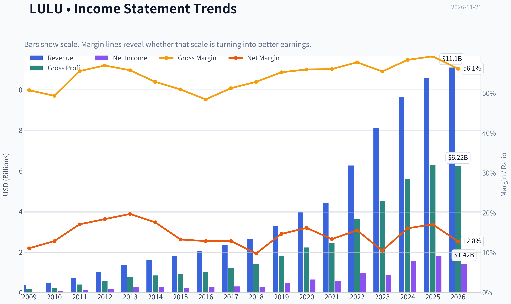

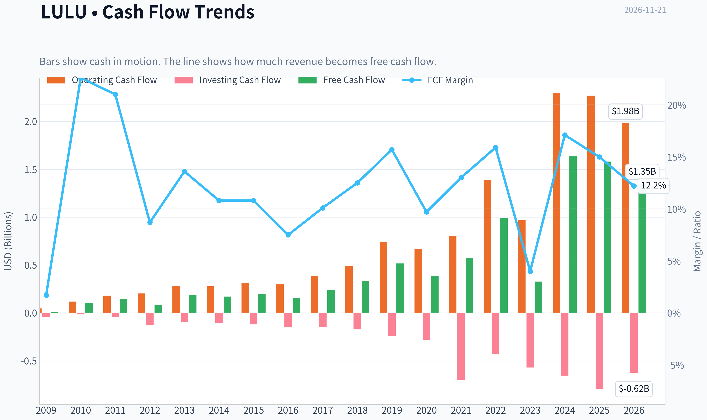

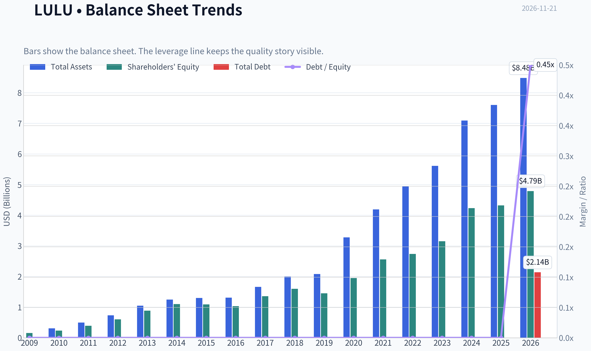

This graph tracks the profitability and return metrics (ROE, ROIC, Margins) of **LULU** over the past decade, highlighting capital efficiency trends.

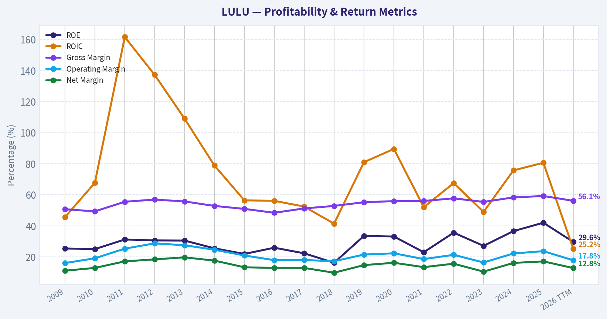

This chart illustrates the financial health of **LULU** over the last 10 years, mapping cash equivalents and free cash flow against total obligations (Debt).

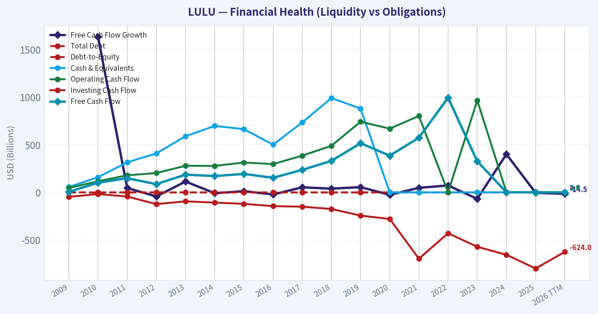

This breakdown chart from <em>Revenue Breakdown</em> shows the proportional composition for **LULU** - useful for understanding what drives or risks the business.

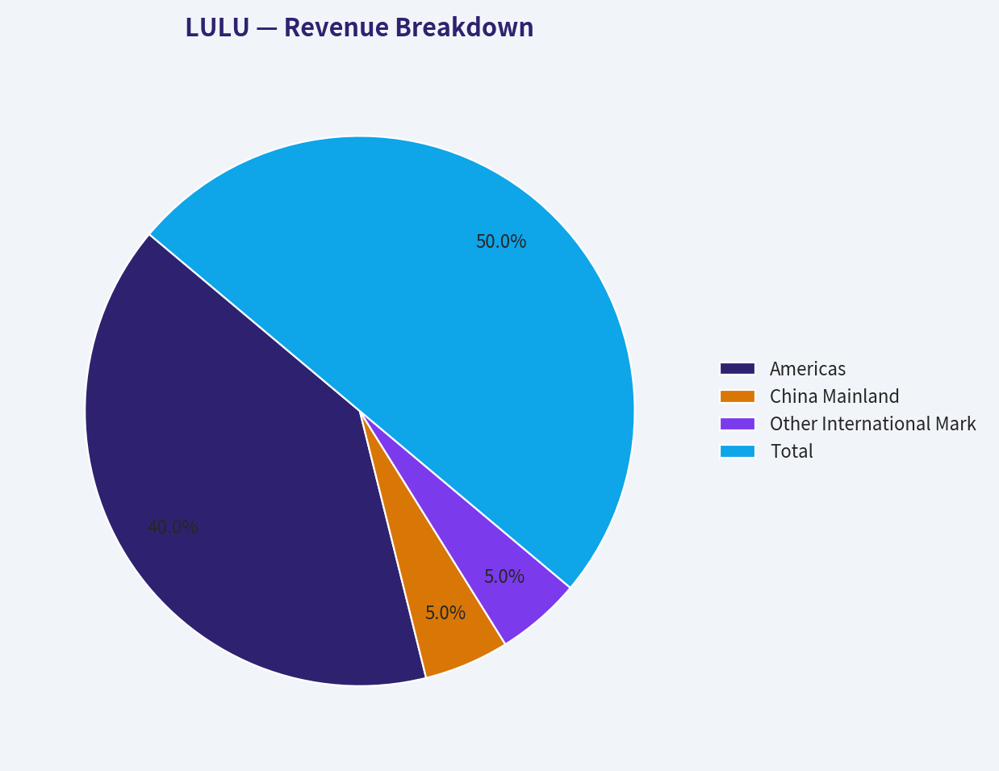

---

### Intrinsic Value Analysis (Buffett)

> *Following Warren Buffett's value investing philosophy: Circle of Competence, Economic Moat, Management Quality, and Margin of Safety.*

#### Intrinsic Value Snapshot

Price is what you pay. Intrinsic value is what the business may be worth based on the cash it can create for owners over time. We show a range, not one magic number.

- Current Price: $102.62
- Value Range (conservative to optimistic across both DCF methods): $76.40 to $659.92

##### Owner Earnings (Buffett Method)
- Net Income: $1,814,616,000.00
- Depreciation & Amortization: $496,228,000.00
- Capital Expenditures: $-680,802,000.00
- Working Capital Changes: $-409,440,000.00
- Owner Earnings: $1,470,436,580.48

##### Intrinsic Value
###### Buffett Method
Uses owner earnings. Stricter, and usually more conservative.
- Conservative: $187.77
- Average: $268.24
- Optimistic: $268.24
- Discount Rate: 8.3%

###### Cash Flow Method
Uses free cash flow. Better for companies spending heavily today to grow tomorrow.
- Conservative: $76.40
- Average: $467.16
- Optimistic: $659.92
- Discount Rate: 9.1%

ANALYST STANCE: **Bullish**

#### Executive Conclusion

lululemon remains a high-quality consumer brand with strong gross margins, substantial cash generation, no debt, and a meaningful global runway. Growth has slowed to 4.9% year over year, while Vuori, Alo, and other competitors are increasing pressure on the athleisure category. However, the current valuation of approximately $103 per share is substantially below the DeepValues intrinsic value of $268.24, creating a 61.7% margin of safety.

The principal risk is not solvency or business failure; it is whether lululemon can restore stronger growth and defend its premium brand positioning. On the available evidence, the valuation more than compensates for that uncertainty.

#### 1. Factor Scorecard

| Factor | Score | Assessment |
|---|---:|---|
| Circle of competence and simplicity | 4.0/5 | Simple model: design and sell premium athletic apparel through stores and digital channels. Brand and fashion execution create some forecasting uncertainty. |
| Durable competitive advantage | 4.5/5 | Strong brand, premium pricing, high gross margin, customer loyalty, product ecosystem, and established retail scale. Competitive pressure prevents a perfect score. |
| Management and capital allocation | 3.5/5 | Historically effective brand building and international expansion. Recent layoffs and slower growth suggest execution pressure, while detailed evidence on long-term compensation alignment is less clear. |
| Industry structure | 4.0/5 | Attractive premium apparel economics and significant scale advantages, although fashion competition is active and brand preferences can change. |

**Gate 5 - Quality and solvency:** **Not tripped.** Earnings growth has slowed, but the company has approximately $1.8 billion of net cash and no reported debt. There is no evidence of deteriorating fundamentals combined with financial distress.

#### 2. Moat Analysis

| Moat source | Evidence | Assessment |
|---|---|---|
| Brand and intangible assets | 56.6% gross margin and premium pricing indicate meaningful brand value. | Strong |
| Switching costs | Apparel switching costs are limited, but community, product quality, fit familiarity, and brand identity support repeat purchases. | Moderate |
| Cost advantages | Global scale, direct-to-consumer distribution, and inventory/data capabilities support attractive economics. | Strong |
| Network effects | Traditional network effects are limited, although community-led marketing and customer engagement reinforce the brand. | Moderate |

**Key Takeaways:** lululemon's moat is primarily brand-driven rather than based on customer captivity or a hard network effect. The 56.6% gross margin is strong financial evidence that customers accept premium pricing. The moat is best described as **wide but facing competitive pressure**, rather than unambiguously widening.

#### 3. Management Quality and Capital Allocation

Management has demonstrated an ability to build a globally recognized brand, expand direct-to-consumer distribution, and generate high returns without relying on debt. The company's net cash position limits financial risk and gives management flexibility to fund stores, digital capabilities, product development, and international expansion.

The weaker evidence concerns current execution. Revenue growth of 4.9% is materially below the growth rates associated with lululemon's strongest expansion periods. Reported layoffs and increased competition from Vuori and Alo suggest that management must improve product innovation, marketing relevance, and international productivity.

**Assessment: 3.5/5.** Management appears capable and financially disciplined, but current brand momentum warrants monitoring.

#### 4. Financial Summary

| Metric | Latest available figure |
|---|---:|
| Share price | $103 |
| Market capitalization | $11.89 billion |
| P/E ratio | 8.4x |
| Revenue growth, year over year | 4.9% |
| Gross margin | 56.6% |
| ROE | 31.8% |
| Free-cash-flow yield | 7.8% |
| Owner earnings | $1.2 billion |
| Cash and marketable securities | $1.8 billion |
| Debt | $0.0 billion |
| Net cash | $1.8 billion |
| Shares outstanding used in valuation | 113 million |

**Key Takeaways:** lululemon combines a 56.6% gross margin with 31.8% ROE and a 7.8% free-cash-flow yield. The balance sheet is exceptionally strong because the company has net cash and no reported debt. The main financial concern is the modest 4.9% revenue growth rate, not profitability or solvency.

#### 5. Owner Earnings Calculation

| Owner earnings component | Amount |
|---|---:|
| After-tax operating income | $1.4 billion |
| Depreciation and amortization | +$0.5 billion |
| Capital expenditure charge | -$0.7 billion |
| Working capital investment | -$0.0 billion |
| **Estimated owner earnings** | **$1.2 billion** |

The owner earnings estimate is approximately $10.62 per share based on 113 million shares outstanding. Operating economics are supported by high margins and strong cash generation, while the capital expenditure burden remains manageable relative to earnings.

#### 6. Three-Scenario DCF Valuation

These scenarios are sensitivity checks. The official intrinsic value used for the investment conclusion is the DeepValues app value shown below.

| Scenario | Key assumptions | Estimated value per share |
|---|---|---:|
| A: No growth | Owner earnings capitalized at 10%, plus net cash | $122 |
| B: GDP-like growth | 3% annual growth, 10% discount rate, plus net cash | $172 |
| C: Historical-growth cross-check | 7.5% growth for 10 years, fading to 2.5% terminal growth, plus net cash | $225 |
| DeepValues headline intrinsic value | 10% growth fading to 2.5%, 8.3% discount rate, $1.8 billion net cash | **$268.24** |

**Key Takeaways:** Even the conservative no-growth framework produces value above the current price, although it is materially below the DeepValues headline value. The growth-sensitive scenarios range from approximately $172 to $225 per share, while the app's more favorable discount-rate and operating assumptions produce $268.24.

#### 7. Margin of Safety Analysis

| Valuation measure | Amount |
|---|---:|
| Current price | $103 |
| DeepValues intrinsic value | $268.24 |
| Conservative app value | $187.77 |
| Margin of safety versus headline intrinsic value | 61.7% |
| Discount to conservative app value | Approximately 45% |

For a wide-moat consumer brand, a 10% to 15% discount can be sufficient when growth and returns are highly predictable. lululemon currently trades at a substantially larger discount to both the headline and conservative intrinsic-value estimates. The valuation therefore provides meaningful protection against slower growth, brand pressure, or a less favorable discount rate.

#### 8. Final Buffett Scorecard

| Criterion | Weight | Score | Weighted contribution |
|---|---:|---:|---:|
| Moat width and durability | 25% | 4.5 | 1.13 |
| Valuation and margin of safety | 20% | 5.0 | 1.00 |
| Capital returns versus WACC | 15% | 4.5 | 0.68 |
| Business understanding and predictability | 12% | 4.0 | 0.48 |
| Management quality and capital allocation | 12% | 3.5 | 0.42 |
| Reinvestment runway | 8% | 4.0 | 0.32 |
| Balance-sheet strength | 4% | 5.0 | 0.20 |
| Industry structure | 4% | 4.0 | 0.16 |
| **Total** | **100%** |  | **4.39/5.00** |

**Key Takeaways:** The score is supported by brand strength, high returns, net cash, and a substantial valuation discount. The deductions are concentrated in slower recent growth, competitive threats, and uncertainty over whether the brand can regain its prior expansion pace. The overall score falls within the "wonderful business at a fair-or-better price" range.

#### 9. Investment Stance and Conviction

**ANALYST STANCE: Bullish**

**Conviction: Moderate to high.**

lululemon has the characteristics of a Buffett-style compounder: a recognizable brand, premium gross margins, strong returns on equity, cash generation, and a debt-free balance sheet. The valuation is unusually favorable relative to the company's historical economics and the DeepValues intrinsic-value estimate.

The principal issue is growth durability. If revenue growth remains near 5% for an extended period, intrinsic value would likely be closer to the conservative scenario range than the headline app value. Even so, the current valuation provides a substantial cushion, and the evidence does not support the market price fully reflecting the company's brand economics and net-cash balance.
#### Valuation Bridge

This bridge places the current market price beside each intrinsic value lens so readers can see whether upside depends on one method or shows up across several methods.

| Scenario | Intrinsic Value / Share |
| --- | ---: |
| Buffett Method | $268.24 |
| Cash Flow Method | $467.16 |
| Damodaran Method | $490.53 |
| Current Price | $102.62 |

#### Key Takeaways

If one method is far above the others, the upside case depends on a specific modelling assumption. When several methods cluster together, the valuation story is more robust.

#### Valuation Visuals

This comparison chart from *Latest Earnings Snapshot* stacks current figures against historical benchmarks for **LULU**, making it easy to see where the company trades relative to its own averages.

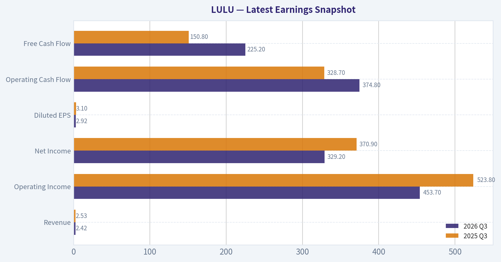

This comparison chart from *Current Metrics Versus 10-Year Averages* stacks current figures against historical benchmarks for **LULU**, making it easy to see where the company trades relative to its own averages.

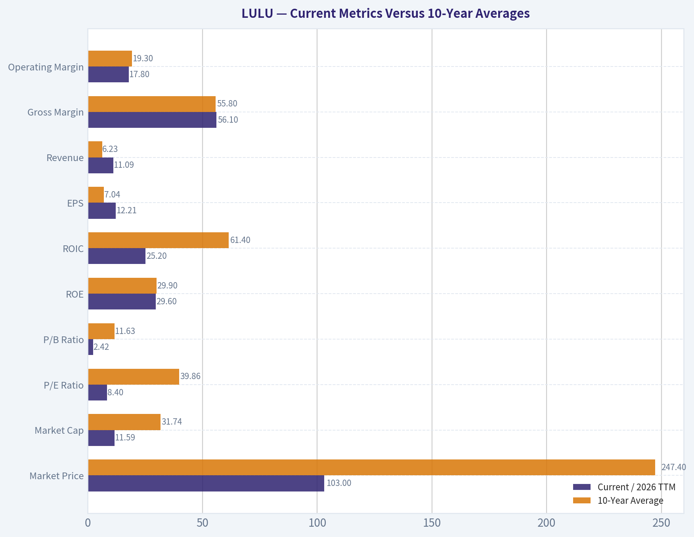

This comparison chart from *Balance Sheet and Financial Strength* stacks current figures against historical benchmarks for **LULU**, making it easy to see where the company trades relative to its own averages.

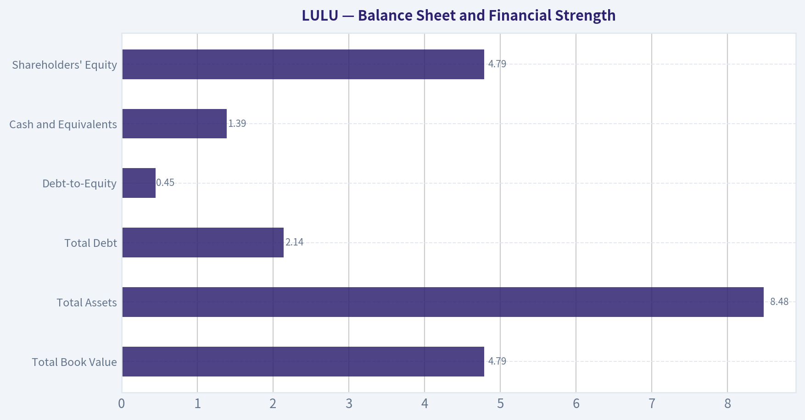

The following chart maps the **LULU** Owner Earnings DCF valuation scenarios (Conservative, Average, Optimistic) to visually represent the margin of safety based on intrinsic value calculations.

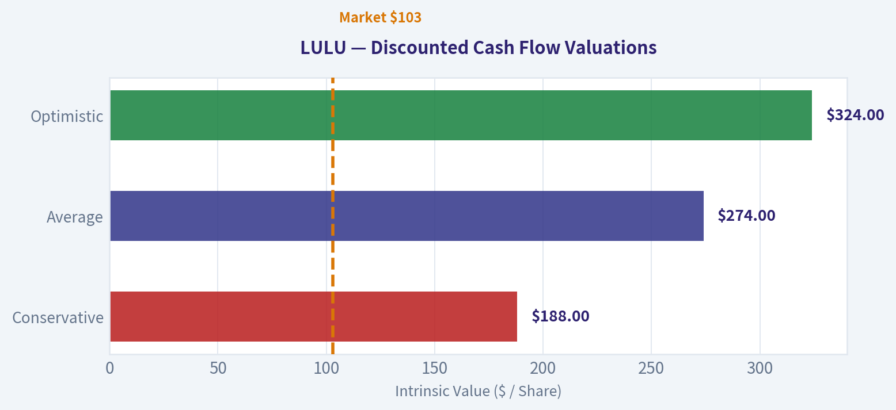

---

### Trend & Growth Analysis (Lynch/Druckenmiller/Fisher)

> *Following Peter Lynch's GARP, Stanley Druckenmiller's macro-aware approach, and Philip Fisher's scuttlebutt methodology.*

ANALYST STANCE: **Neutral**

#### 1. Lynch Classification

**Stalwart transitioning toward a challenged fast grower.** Lululemon's historical brand strength and profitability resemble a high-quality growth company, but the latest 4.9% revenue growth is well below the 15-25% threshold for a fast grower. The current setup is more about whether a growth reacceleration can emerge than about already-proven rapid expansion.

#### 2. The Story in Three Bullets

- Lululemon owns a premium athletic-apparel brand with strong gross margins, global recognition, and a differentiated community-oriented retail model.
- International expansion, men's apparel, digital commerce, and adjacent categories provide avenues for renewed growth.
- Competition from Vuori, Alo, and other brands is increasing while recent layoffs and modest price increases suggest the business is navigating a softer operating period.

#### 3. Key Financial Snapshot

| Metric | Reading | Interpretation |
|---|---:|---|
| Share price | $103 | Current market reference |
| Market capitalization | $11.89B | Mid-sized global consumer brand |
| Revenue growth | 4.9% YoY | Stalwart-level, not fast-grower-level |
| P/E ratio | 8.45x | Low relative to premium consumer-growth history |
| Gross margin | 56.6% | Strong brand economics |
| ROE | 31.8% | High capital efficiency |
| FCF yield | 7.8% | Meaningful cash-flow support |
| Current ratio | 2.26x | Solid near-term liquidity |
| Net cash | Approximately $1.8B | Balance-sheet strength |

**Key Takeaways:** Lululemon remains highly profitable, asset-efficient, and financially liquid. The central weakness is growth: 4.9% revenue expansion is insufficient by itself to justify a traditional fast-growth classification. The low P/E and high FCF yield indicate that the market is already discounting meaningful execution and competitive concerns.

#### 4. The TAM and 10x Test

The relevant opportunity spans premium athletic apparel, women's and men's activewear, international markets, footwear, accessories, and digital commerce. The company's exact current revenue was not available in the supplied data, so a precise 10x revenue calculation cannot be completed reliably.

| TAM Factor | Assessment |
|---|---|
| Core athleticwear market | Large and globally established |
| Premium activewear growth | Moderate, with selective category expansion |
| International runway | Meaningful, especially outside North America |
| Men's apparel | Additional category opportunity |
| Product adjacency | Potential runway through footwear, accessories, and lifestyle products |
| 10x revenue test | Not fully calculable without verified current revenue |
| Market saturation risk | Increasing in core North American women's apparel |

**Key Takeaways:** Lululemon has a sizeable addressable market, but the opportunity is no longer an undiscovered niche. International expansion and category development could extend the runway, while North American competition limits the probability of effortless 10x growth from the existing base.

#### 5. Revenue Growth Trend

| Indicator | Current Evidence | Direction |
|---|---|---|
| Revenue growth | 4.9% YoY | Slow |
| Historical brand momentum | Previously much stronger than current growth | Decelerated |
| Competitive environment | Vuori and Alo gaining attention | Worsening |
| Pricing | Modest price increases referenced in coverage | Limited offset |
| Workforce actions | Approximately 150 layoffs reported | Efficiency response |
| Reacceleration evidence | Not yet established | Unconfirmed |

**Key Takeaways:** The available evidence points to deceleration rather than acceleration. There is no verified multi-quarter pattern showing a renewed inflection, so the investment case depends on future evidence from international growth, product innovation, and market-share stabilization.

#### 6. Unit Economics and Profitability

| Metric | Available Data | Assessment |
|---|---:|---|
| Gross margin | 56.6% | Strong |
| FCF margin | Not provided | Cannot calculate |
| Rule of 40 | Not calculable | Growth plus FCF margin unavailable |
| LTV/CAC | Not provided | Cannot verify |
| Net revenue retention | Not applicable / unavailable | Primarily a consumer apparel model |
| ROE | 31.8% | Excellent |
| FCF yield | 7.8% | Supportive |

**Key Takeaways:** Gross margin, ROE, and free-cash-flow yield indicate a high-quality economic model. However, the lack of disclosed CAC, LTV, and detailed customer-retention metrics limits confidence in the underlying consumer unit economics. The business is financially efficient, but its growth engine is currently unproven.

#### 7. Inflection Point Assessment

| Potential Inflection | Evidence | Status |
|---|---|---|
| Product cycle | Product innovation remains strategically important, but no quantified breakout was provided | Unconfirmed |
| Market share | Competitive pressure from Vuori and Alo | Negative risk |
| Margin | Strong gross margin remains intact | Positive |
| TAM | International and men's categories provide room | Potential |
| Competitive positioning | Brand remains differentiated, but relative momentum appears weaker | Mixed |
| Earnings outlook | Low valuation creates operating leverage if growth recovers | Potential |

**Key Takeaways:** The strongest existing positives are brand economics and valuation. The key missing ingredient is a demonstrated growth inflection. Until revenue growth accelerates or market-share data improves, the thesis remains a recovery-and-reacceleration scenario rather than a confirmed momentum story.

#### 8. Macro Setup

The macro backdrop is mixed for a premium consumer growth company.

- The 30-year Treasury yield is approximately 5.31%, creating a relatively high discount rate for long-duration growth assets.
- Premium discretionary spending may remain sensitive to employment, household confidence, and real-income trends.
- A stronger global consumer cycle would support international expansion and apparel demand.
- Higher rates and cautious consumers are headwinds, although Lululemon's net-cash balance reduces financial stress.

#### 9. Fisher 15-Point Assessment

| Fisher Criterion | Score / 5 | Rationale |
|---|---:|---|
| Market potential | 4 | Large global activewear opportunity |
| New-product determination | 4 | Product innovation is central to the brand |
| R&D / product development | 3 | Evidence is qualitative in supplied data |
| Sales organization | 4 | Strong retail and digital distribution |
| Profit margins | 5 | 56.6% gross margin and strong cash generation |
| Margin direction | 3 | Current direction not fully established |
| Labor relations | 3 | Layoffs create some uncertainty |
| Executive relations | 3 | Insufficient evidence |
| Management depth | 3 | Insufficient evidence |
| Cost analysis | 4 | Strong operating model and liquidity |
| Outstanding aspects | 4 | Brand, community, and premium positioning |
| Long-range outlook | 3 | Attractive but facing category competition |
| Dilution | 4 | No major dilution issue indicated |
| Candor | 3 | Insufficient evidence |
| Integrity | 4 | No material integrity concern supplied |

**Total: 54 / 75**

**Key Takeaways:** The Fisher score is at the upper end of the average range but below the threshold for a clearly outstanding growth company. Lululemon scores best on brand economics, margins, distribution, and market opportunity; it scores lower where current growth momentum, management evidence, and competitive durability are less certain.

#### 10. Valuation Analysis

| Method | Result | Interpretation |
|---|---:|---|
| P/E | 8.45x | Low for a historically premium growth brand |
| PEG using 4.9% revenue growth as proxy | Approximately 1.72 | Fair rather than clearly inexpensive on current growth |
| FCF yield | 7.8% | Strong cash-flow valuation support |
| Owner Earnings conservative value | $187.77 | Above current price |
| Owner Earnings base value | $268.24 | Substantially above current price |
| FCFF cross-check range | $318.47-$592.58 | More optimistic and assumption-sensitive |
| DeepValues headline intrinsic value | $268.24 | Approximately 61.7% above the $102.62 reference price |

**Key Takeaways:** Valuation appears attractive if Lululemon can stabilize and eventually restore moderate growth. The PEG calculation is only a rough proxy because revenue growth is being used instead of earnings growth. The intrinsic-value models show substantial potential undervaluation, but that conclusion is highly dependent on normalization assumptions, especially the modeled 10% growth rate fading to 2.5%.

#### 11. Growth Investor Scorecard

| Criterion | Weight | Score / 5 | Weighted Contribution |
|---|---:|---:|---:|
| The story | 10% | 3.5 | 0.35 |
| TAM and runway | 20% | 3.5 | 0.70 |
| Revenue growth | 20% | 2.0 | 0.40 |
| Unit economics | 15% | 3.5 | 0.53 |
| Competitive position | 10% | 3.5 | 0.35 |
| Management quality | 10% | 3.0 | 0.30 |
| Macro setup | 5% | 2.5 | 0.13 |
| Profitability path | 5% | 4.0 | 0.20 |
| Valuation | 5% | 4.5 | 0.23 |
| **Total** | **100%** |  | **3.19 / 5.00** |

**Key Takeaways:** The overall score lands in the Neutral range. Valuation, profitability, brand strength, and balance-sheet quality are compelling, but current revenue growth and competitive momentum prevent a high-conviction growth classification.

#### 12. Valuation Sensitivity

| Scenario | Operating Assumption | Valuation Implication |
|---|---|---|
| Bear | Growth remains near low single digits and competitive pressure persists | Current valuation may be justified or only modestly attractive |
| Base | Growth gradually reaccelerates through international, men's, and product expansion | Owner-earnings value of $268.24 appears supportable |
| Bull | Brand momentum returns, international growth accelerates, and margins remain strong | FCFF models imply materially higher value, though assumptions are aggressive |
| Stress case | Multi-year revenue stagnation or sustained market-share loss | Intrinsic-value estimates would decline sharply |

**Key Takeaways:** The valuation has a favorable asymmetric structure only if the business avoids prolonged stagnation. The market appears to be pricing Lululemon closer to a mature or impaired consumer brand, while intrinsic-value models assume meaningful normalization. The gap between those views is the primary source of potential upside and risk.

#### 13. Catalysts and Risks

| Catalysts | Risks |
|---|---|
| Reacceleration in comparable-store sales | Continued share loss to Vuori, Alo, and other brands |
| Strong international growth | Premium-consumer spending weakness |
| Successful men's and adjacent-category expansion | Brand relevance weakening among younger consumers |
| Product innovation restoring traffic | Persistent low-single-digit revenue growth |
| Operating leverage and sustained cash generation | Layoffs signaling deeper organizational or demand issues |
| Share repurchases supported by excess cash | Valuation models overstating normalized growth |

#### Bottom Line

Lululemon is a **high-quality, profitable consumer brand at a potentially distressed growth valuation**, but the current evidence does not yet show the accelerating revenue trend required for a classic Lynch fast-grower thesis. The most important confirmation would be sustained revenue reacceleration accompanied by stable gross margins and improving competitive momentum. At approximately $103, the supplied intrinsic-value models indicate substantial valuation support, but the evidence currently supports **Neutral** rather than **Bullish** because the growth inflection remains unconfirmed.

---

### Market Technical Analysis

ANALYST STANCE: **Neutral**

#### LULU technical analysis

**Data status.** The latest available trading session is November 20, 2026, because November 21 was a weekend. LULU closed at **$102.62**, down from $105.53 the prior session. The analysis applies only to lululemon athletica inc. (Nasdaq: LULU).

#### Trend structure

LULU remains in a pronounced longer-term downtrend. The closing price is approximately **19.8% below the 200-day SMA of $128.00**, and the 200-day average itself is declining. This indicates that the weakness is not limited to a short-lived pullback; the broader trend has deteriorated materially.

The medium-term picture is less negative but still fragile. The close is only about **1.1% above the 50-day SMA of $101.54**, while that average is also trending downward. This places the price near an important medium-term trend reference, but the narrow margin leaves little evidence of a durable trend reversal.

Short-term momentum has weakened again. The close is **3.4% below the 10-day EMA of $106.22** and **5.2% below the volume-weighted moving average of $108.24**. The VWMA remains above the price, suggesting that recent trading activity has been concentrated at higher levels than the latest close.

#### Price action and momentum

The recent price pattern shows a sharp decline from the November 4 close of $112.06 to $102.62 on November 20. The rebound from the October low near $91.88 reached $112.53 on November 9, but that recovery failed to establish a sequence of higher highs. The subsequent lower highs and lower closes point to renewed selling pressure after the October recovery.

The MACD remains positive at **0.89**, which means the faster exponential averages are still above the slower reference on the indicator's scale. However, MACD has fallen substantially from **3.13 on November 9** and **1.98 on November 13**. That decline shows that upside momentum has been fading rapidly, even though the MACD has not yet turned negative.

RSI stands at **45.97**, down from **63.73 on November 9**. This is a neutral-to-soft reading rather than an oversold one. It indicates that momentum has weakened, but the indicator does not yet show the type of extreme downside pressure commonly associated with a technically exhausted decline.

#### Volatility and volume context

ATR has risen to **$4.67**, equivalent to roughly **4.6% of the latest closing price**. Volatility is therefore elevated relative to the stock's current price. ATR increased from approximately $3.5 in mid-October, confirming that recent daily price ranges have widened.

The Bollinger middle line is **$107.41**, placing the close about **4.5% below** that 20-day benchmark. The middle line rose through much of October and early November, but its advance has flattened recently. The price's position below the middle band reflects negative short-term location, though the available output does not include the upper and lower band values needed to assess whether the stock is at an extreme volatility boundary.

Volume was notably strong during the November 18 rebound, when the stock traded about 3.69 million shares, and again on November 20, with roughly 4.02 million shares. Despite this activity, the rebound did not persist. That combination suggests that participation has increased around volatile moves, but volume has not yet produced a sustained price recovery.

#### Valuation implications from the technical evidence

The technical evidence does not support a conclusion that the market has established a durable recovery trend at approximately $102.62. The price is near the 50-day SMA, but remains decisively below the declining 200-day SMA, the 10-day EMA, the VWMA, and the Bollinger middle line.

The primary constructive feature is that the price is well above the October low and MACD remains marginally positive. However, those signals are offset by the declining long-term averages, weakening RSI, falling MACD, and renewed distance below short-term reference levels. From a technical valuation perspective, the current price reflects substantial deterioration from the prior year's levels, but the indicators do not yet provide strong confirmation that the market is assigning improving value to the shares.

#### Indicator selection

The selected indicators are deliberately complementary:

- **close_10_ema:** Short-term price momentum.
- **close_50_sma:** Medium-term trend structure.
- **close_200_sma:** Long-term trend confirmation.
- **macd:** Momentum direction and changes in trend force.
- **rsi:** Momentum intensity and potential exhaustion.
- **boll:** Position relative to the 20-day volatility benchmark.
- **atr:** Current trading-range volatility.
- **vwma:** Price trend adjusted for trading volume.

Together, these indicators cover trend, momentum, volatility, and volume without adding redundant oscillators.

| Indicator / measure | Latest reading | Recent interpretation | Technical implication |
|---|---:|---|---|
| Closing price | $102.62 | Fell from $112.53 on November 9 to $102.62 on November 20 | Recovery has lost momentum |
| 10-day EMA | $106.22 | Price is below the short-term average | Short-term bias is weak |
| 50-day SMA | $101.54 | Price is only modestly above it; SMA is declining | Medium-term trend remains fragile |
| 200-day SMA | $128.00 | Price is about 19.8% below it; SMA is declining | Long-term trend remains clearly negative |
| MACD | 0.89 | Down from 3.13 on November 9 | Positive momentum has weakened materially |
| RSI | 45.97 | Down from 63.73 on November 9 | Neutral-to-soft momentum, not oversold |
| Bollinger middle | $107.41 | Price is about 4.5% below the 20-day benchmark | Negative short-term price location |
| ATR | $4.67 | Higher than mid-October levels | Elevated daily volatility |
| VWMA | $108.24 | Price is about 5.2% below the volume-weighted average | Recent volume-weighted trading occurred at higher prices |

**Key Takeaways:** LULU's long-term trend remains decisively negative because the price is well below a declining 200-day average. The October recovery has weakened, with the price now below its 10-day EMA, Bollinger midpoint, and VWMA, while MACD and RSI have both deteriorated. Volatility is elevated, and the technical evidence currently describes a fragile rebound within a broader downtrend rather than a confirmed improvement in valuation.

#### Market Visuals

This comparison chart from *Market Metrics* stacks current figures against historical benchmarks for **LULU**, making it easy to see where the company trades relative to its own averages.

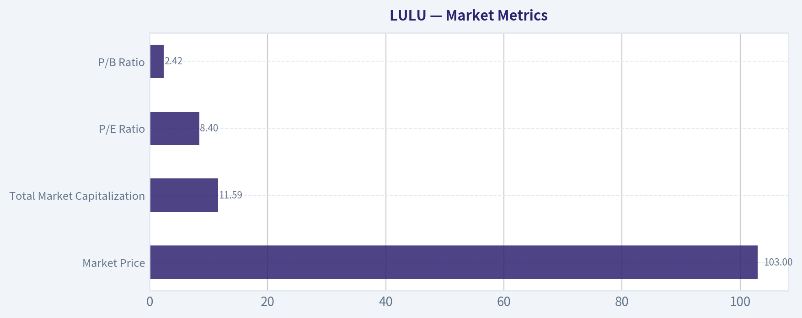

---

### Options Market Analysis

> *Reading options flow - put/call ratios, IV skew, and unusual activity - to gauge institutional positioning and event-driven risk.*

ANALYST STANCE: **BEARISH**

#### LULU Options Market Overview

Data is for near-term expirations as of November 21, 2026. The options market shows a modestly defensive bias, driven primarily by aggregate put open interest and elevated put concentration in the December 11 expiration. However, the absence of unusually large fresh trades reduces conviction.

| Expiration | Call OI | Put OI | Put/Call OI | Call Volume | Put Volume | Put/Call Volume | Call ATM IV | Put ATM IV |
|---|---:|---:|---:|---:|---:|---:|---:|---:|
| Nov. 27, 2026 | 7,168 | 6,579 | 0.92 | 3,078 | 2,892 | 0.94 | 54.4% | 56.9% |
| Dec. 4, 2026 | 3,325 | 3,386 | 1.02 | 782 | 1,422 | 1.82 | 58.2% | 57.1% |
| Dec. 11, 2026 | 2,599 | 4,001 | 1.54 | 764 | 376 | 0.49 | 73.9% | 69.0% |
| **Near-term total** | **13,092** | **13,966** | **1.07** | **4,624** | **4,690** | **1.01** | - | - |

**Key Takeaways:** Aggregate put open interest exceeds call open interest, with a 1.07 ratio versus the approximately 0.70 neutral baseline. This indicates more defensive exposure than a typical neutral options market. Volume is essentially balanced overall, although December 4 shows distinctly heavier put activity while December 11 has the highest put open-interest concentration.

#### Put/Call Ratio Analysis

The overall put/call open-interest ratio of 1.07 is meaningfully above the historical neutral reference of approximately 0.70. This can reflect downside hedging, bearish speculation, or existing call positions being closed; the data alone cannot distinguish among those explanations.

The November 27 ratio of 0.92 is only mildly defensive, while December 11 stands out at 1.54. The overall put/call volume ratio is 1.01, indicating that current trading activity is balanced rather than dominated by aggressive put buying.

#### Implied Volatility Assessment

| Expiration | Call ATM IV | Put ATM IV | ATM Put Minus Call IV | Assessment |
|---|---:|---:|---:|---|
| Nov. 27, 2026 | 54.4% | 56.9% | +2.5 percentage points | Mild downside protection premium |
| Dec. 4, 2026 | 58.2% | 57.1% | -1.1 percentage points | Essentially balanced |
| Dec. 11, 2026 | 73.9% | 69.0% | -4.9 percentage points | Elevated event-window volatility, with call IV higher at the money |
| **OI-weighted indication** | **~59.2%** | **~60.4%** | **+1.2 percentage points** | Mild overall put premium |

**Key Takeaways:** Near-term implied volatility is elevated, particularly for December 11, where ATM IV is roughly 69% to 74%. The available data contains ATM volatility only, so a true out-of-the-money put-versus-call skew cannot be calculated. The small overall put IV premium suggests modest downside hedging demand, but it is not a steep fear skew.

The December 11 volatility elevation may indicate an expected catalyst or event window, but no specific catalyst is identified in the supplied data. It should therefore be treated as event-related uncertainty rather than attributed to a confirmed earnings or corporate announcement.

#### Unusual Options Activity

No contracts met the supplied unusual-activity threshold of volume greater than five times open interest.

| Category | Finding | Interpretation |
|---|---|---|
| Fresh high-volume contracts | None identified | No clear evidence of concentrated new directional bets |
| Smart-money signal | Not established | Contract-level trade direction and execution details are unavailable |
| Retail speculation signal | Not established | No isolated volume spike was reported |
| Overall activity | Balanced volume | Directional conviction appears limited |

**Key Takeaways:** The data does not show contracts with volume exceeding five times open interest, so there is no clear fresh institutional-style sweep or isolated speculative surge. The bearish read comes from the structure of open interest rather than from a specific unusual trade.

#### Open Interest Concentration and Gamma Levels

Strike-level open interest was not included in the data, so specific strike-based gamma walls, maximum-pain levels, and likely pinning prices cannot be identified.

At the expiration level, the largest total open interest is concentrated in:

| Expiration | Total OI | Share of Near-Term OI | Market Implication |
|---|---:|---:|---|
| Nov. 27, 2026 | 13,747 | 50.8% | Most important immediate expiration |
| Dec. 4, 2026 | 6,711 | 24.8% | Secondary near-term concentration |
| Dec. 11, 2026 | 6,600 | 24.4% | Highest volatility and defensive put concentration |
| **Total** | **27,058** | **100%** | - |

**Key Takeaways:** More than half of near-term open interest expires on November 27, making that expiration the most relevant for short-horizon volatility and potential price pinning. December 11 has the strongest put concentration and the highest implied volatility, but strike-level data is required to determine whether it creates a stabilizing gamma wall or an amplifying downside exposure.

#### Overall Options Sentiment

The overall signal is **BEARISH**, but with moderate rather than high conviction.

The primary bearish evidence is:

- Aggregate put/call open interest of 1.07, well above the approximately 0.70 neutral baseline.
- December 11 put/call open interest of 1.54.
- Slightly higher overall put IV than call IV.
- Heavier put volume than call volume for the December 4 expiration.

Counterbalancing factors include:

- Aggregate put/call volume is almost exactly neutral at 1.01.
- The nearest November 27 expiration has a sub-1.00 put/call open-interest ratio.
- No unusual contracts exceeded the five-times-volume-to-open-interest threshold.
- The available data does not provide OTM skew or strike-level gamma information.

The evidence therefore implies a modestly defensive options market and does not support a strongly optimistic short-term valuation interpretation. Confidence is reduced because contract-level unusual activity, strike concentration, and true OTM skew are unavailable.

#### Summary

| Metric | Assessment |
|---|---|
| Put/Call Ratio | Bearish-leaning: 1.07 OI ratio versus ~0.70 neutral; volume ratio near neutral at 1.01 |
| IV Level | Elevated, especially December 11 at approximately 69% to 74% ATM IV |
| Skew Direction | Mild overall put premium; true OTM skew unavailable |
| Unusual Activity | None detected under the volume greater than five-times-OI threshold |
| Overall Signal | **BEARISH**, with moderate conviction and limited fresh-flow confirmation |

**Key Takeaways:** LULU's near-term options structure is modestly bearish because puts outnumber calls in open interest, particularly in the December 11 expiration. Volatility is elevated, but the lack of unusual contract-level activity and the nearly neutral volume ratio indicate that the signal is defensive rather than aggressively directional.

---

## Research Team Commentary

> *The Research Manager synthesizes the Bull vs Bear debate into action-free commentary. This is a pre-risk view, not the final stance.*

Core Takeaway: Lululemon still appears to be a high-quality franchise priced for a much more serious deterioration than the evidence currently demonstrates. At roughly $103, an 8.45 P/E, a debt-free balance sheet, 56.6% gross margin, and historically exceptional returns on capital provide meaningful valuation support. The $268.24 DeepValues estimate should not be accepted at face value, but the valuation gap is large enough to survive substantial reductions in growth, margins, and the terminal multiple. The decisive uncertainty is whether slowing growth reflects temporary execution and demand pressure or a lasting loss of brand relevance. On balance, the evidence leans favorable, although conviction should remain below that assigned to a more predictable consumer-staples franchise.

The strongest bull argument is not simply that the shares look statistically inexpensive. Lululemon retains premium brand recognition, an established direct-to-consumer ecosystem, strong store and digital capabilities, and multiple avenues for long-term expansion in international markets, men's apparel, and adjacent categories. Its 49.4% reported ROIC and 31.8% ROE show that the historical business required relatively little capital to generate substantial profits. With no debt, the company can absorb a softer consumer environment or product mistakes without refinancing pressure. If earnings merely stabilize and subsequently grow at a moderate rate, rather than returning to the company's former pace, the current multiple appears undemanding.

The bear side is strongest when it challenges the durability rather than the existence of the moat. Athletic apparel has low customer switching costs, and Alo, Vuori, Nike, and other competitors can target the same premium consumer. Brand recognition does not guarantee continued pricing power. That must be demonstrated through traffic, repeat purchasing, full-price sell-through, market share, and controlled customer-acquisition costs. Growth of 4.9%, layoffs, and price increases are not proof of permanent impairment, but together they justify scrutiny of whether North America is maturing and whether new growth initiatives will earn returns comparable to the core women's business.

The historical 49.4% ROIC also should not be projected mechanically. Brand-building and customer-acquisition spending are expensed, which can make an asset-light company's accounting capital base look unusually small. More importantly, average historical ROIC says little about the incremental returns from the next international store, footwear launch, or digital marketing campaign. The investment thesis depends on incremental returns remaining attractive, not on past returns remaining visible in reported ratios.

The valuation nevertheless provides a substantial counterweight to these risks. At the reported earnings multiple, earnings could decline materially before the valuation would resemble that of an ordinary mature apparel company. For example, even a hypothetical 30% reduction in current earnings would leave the shares at roughly 12 times that lower earnings base. That does not eliminate downside if the brand enters sustained decline, but it suggests the market already discounts more than a routine slowdown.

The $268.24 intrinsic-value estimate is best treated as an optimistic central case rather than a precise appraisal. It represents more than 20 times current reported earnings and therefore likely assumes some combination of renewed growth, durable premium margins, and a healthier long-term multiple. A more conservative appraisal should haircut both normalized earnings and the terminal multiple. Even reducing the model value by 40% to 50% would produce an indicative range of approximately $134 to $161, still above the stated market price. That sensitivity is more persuasive than the headline 61.7% discount, though it remains contingent on current earnings being broadly real and repeatable.

From a Buffett-style perspective, this is a good business with a meaningful but not impregnable moat. It is neither financially distressed nor dependent on heroic growth to justify the current quotation. The market seems to be treating the recent slowdown as at least partly structural, while the operating evidence so far establishes competitive pressure but not permanent franchise impairment. Bearish options positioning may signal near-term anxiety, but it has little relevance to ten-year cash-generating capacity.

The main lesson from similar analytical mistakes is not to equate a famous brand, low P/E, or model-generated discount with certainty. Historical ROIC can conceal weakening incremental economics, and apparel earnings can appear inexpensive immediately before markdowns or margin compression. Conversely, it would also be a mistake to treat every deceleration as permanent when the company retains high margins, financial flexibility, and global expansion capacity. The appropriate discipline is to require operating confirmation while recognizing that the valuation already embeds substantial skepticism.

Monitoring Plan: Over the next one to four quarters, the most important evidence will be Americas comparable sales, separated into traffic and average transaction value. Improving traffic and healthy unit volumes would be more convincing than revenue supported mainly by price increases. Full-price sell-through, markdown activity, gross margin, and inventory growth relative to sales will show whether pricing power remains intact. Inventory consistently growing faster than revenue, heavier promotions, or gross-margin compression would strengthen the structural bear case.

International comparable sales, new-store productivity, and regional profitability should reveal whether overseas growth is producing attractive incremental returns rather than merely adding revenue. Men's apparel and adjacent categories should be assessed by sustained demand and contribution economics, not launch publicity. Operating margin and free-cash-flow conversion should also be compared with reported earnings to identify whether cost reductions are preserving genuine economics or only near-term accounting margins.

Evidence that would strengthen the thesis includes stabilization or acceleration in Americas traffic, inventory growth at or below sales growth, resilient gross margin, continued international momentum, and free cash flow tracking earnings. Evidence that would weaken it includes several quarters of market-share loss, rising promotions, declining repeat engagement, persistent inventory imbalances, lower returns from new stores, or earnings support coming mainly from layoffs and price increases rather than healthy demand. The DeepValues appraisal should be refreshed using normalized earnings and conservative incremental-return assumptions as those results arrive.

Final stance: Bullish.

---

## Value Investing Team Commentary

> *The Investor translates the research view into an investment thesis before risk review. This is still not the final stance.*

### Lululemon: Fundamental and Contrarian Assessment

Lululemon presents an unusual combination: a premium consumer brand with historically exceptional returns, a debt-free balance sheet, and a valuation that implies a much more severe deterioration than the current evidence conclusively establishes. At approximately $103 and 8.45 times reported earnings, the market is assigning limited value to renewed growth and appears to be treating recent weakness as potentially structural.

That skepticism is understandable. Revenue growth of 4.9%, layoffs, price increases, and intensifying competition from Alo, Vuori, Nike, and other brands indicate that the company is no longer operating in an unchallenged category. Athletic apparel also has lower switching costs than many technology or subscription businesses. Brand preference can weaken quickly if product innovation, design relevance, or community engagement deteriorates.

However, the bearish interpretation may be extrapolating a difficult period too far. Lululemon still has several characteristics of a high-quality franchise:

- Gross margin of 56.6% indicates meaningful pricing power and brand differentiation.
- Reported ROIC of 49.4% and ROE of 31.8% demonstrate historically strong economics.
- The absence of conventional debt provides resilience during softer demand conditions.
- The company retains expansion opportunities in men's apparel, international markets, digital commerce, footwear, and adjacent categories.
- Its direct-to-consumer model and community-oriented retail approach remain differentiated relative to many apparel competitors.

The key question is not whether Lululemon remains a recognizable brand. It is whether the brand can continue generating attractive **incremental** returns. Historical ROIC may overstate future economics because marketing and brand investment are expensed, keeping accounting invested capital low. New stores, international markets, footwear, and digital customer acquisition may produce lower returns than the mature women's apparel business. This is the central analytical risk.

The DeepValues estimate of $268.24 is useful as a reference point but should not be treated as a precise appraisal. It likely assumes a meaningful recovery in growth, continued premium margins, and a relatively healthy terminal valuation. A conservative framework should normalize earnings, reduce assumptions about expansion, and apply a lower terminal multiple. Even so, the valuation appears to retain a considerable margin of safety if current earnings are broadly repeatable. A hypothetical 30% earnings decline would still imply roughly 12 times the reduced earnings base, which is not an excessive valuation for a debt-free brand with substantial growth optionality.

The reverse-DCF implication is therefore favorable, but not risk-free. The current quotation appears to require neither a return to Lululemon's former growth rate nor flawless execution. It does, however, require that the company avoid a prolonged decline in brand relevance and preserve a significant portion of its historical profitability. If margins compress materially while revenue growth remains weak, the apparent low multiple could prove less attractive than it currently appears.

### What the Sentiment Signals Reveal

Elevated put/call open interest and slightly higher put implied volatility indicate substantial near-term caution. That positioning has little direct bearing on ten-year cash-generation capacity, but it does reveal that investors are focused on downside risks involving consumer demand, competition, and earnings revisions.

The contrarian opportunity lies in the possibility that the market is treating a cyclical or execution-related slowdown as permanent impairment. The contrarian danger is assuming that negative sentiment itself creates an opportunity when it may instead be correctly identifying a weakening brand. Sentiment should therefore remain secondary to operating evidence.

The most important indicators are:

1. **Americas traffic:** Improving traffic would be more meaningful than revenue growth driven mainly by price increases.
2. **Full-price sell-through and markdowns:** These will reveal whether premium pricing remains credible.
3. **Inventory relative to revenue:** Persistent inventory growth above sales growth would suggest demand misalignment.
4. **Gross and operating margins:** Resilience would support the durability of the brand; sustained compression would challenge the valuation case.
5. **International store productivity:** International expansion must generate attractive incremental returns, not merely increase reported revenue.
6. **Free-cash-flow conversion:** Cash generation should remain broadly consistent with accounting earnings.
7. **Men's and adjacent-category economics:** New initiatives should be evaluated by repeat demand and profitability rather than launch enthusiasm.

Layoffs and price increases can support short-term earnings, but they are not substitutes for healthy demand. A stronger thesis would require evidence that traffic, repeat engagement, inventory discipline, and cash generation are stabilizing without relying primarily on cost reductions.

### Conclusion

Lululemon remains a high-quality but not unassailable consumer franchise. The moat is based on brand strength, product credibility, community, and direct customer relationships rather than high switching costs. Those advantages can endure for many years, but they require continual product and brand execution.

At the stated valuation, the market appears to discount a substantial amount of deterioration. The DeepValues estimate is probably optimistic in its unadjusted form, yet even materially lower assumptions can leave the valuation looking reasonable if earnings remain durable. The evidence currently supports the view that sentiment may be more pessimistic than the underlying long-term economics, while the operating data still warrant close scrutiny.

**ANALYST STANCE: Bullish** - The valuation appears favorable relative to a conservative assessment of normalized earnings and long-term franchise value, although conviction depends on stabilization in traffic, margins, inventory discipline, and incremental returns from international and adjacent-category expansion.

---

## Deep Values Commentary

> *The Risk Management Team debates and the Risk Judge provides the final action-free verdict. This section determines the final Bullish / Neutral / Bearish stance.*

#### Final Stance Scorecard

This scorecard converts the final research view into a weighted decision frame. It does not replace the narrative judgement, but it makes the main drivers of the verdict easier to scan.

| Criterion | Score | Weight | Commentary |
| --- | ---: | ---: | --- |
| Business Quality | 4.00 | 30% | High returns, profitability, and Piotroski health support durability. |
| Valuation Support | 4.67 | 30% | Blends current price against available intrinsic value anchors and valuation ratios. |
| Financial Strength | 4.67 | 20% | Balance-sheet resilience reflects leverage and liquidity staying within safe ranges. |
| Growth Durability | 1.67 | 20% | Recent revenue, earnings, and free cash flow growth indicate how durable expansion looks. |
| TOTAL / FINAL STANCE | 3.87 | 100% | Bearish |

#### Key Takeaways

The weighted score lands at **3.87 / 5.0**, while the final stance remains **Bearish**. This is useful as a quick calibration aid rather than a mechanical signal.

#### Risk Summary

Higher scores indicate more risk pressure. The watch threshold is a simple guardrail: above it, the dimension weighs more heavily on the valuation case and calls for a wider margin of safety.

| Dimension | Current Score | Watch Threshold | Commentary |
| --- | ---: | ---: | --- |
| Business Quality | 2.00 | 3.00 | High returns, profitability, and Piotroski health support durability. |
| Valuation Support | 1.33 | 3.00 | Blends current price against available intrinsic value anchors and valuation ratios. |
| Financial Strength | 1.33 | 3.00 | Balance-sheet resilience reflects leverage and liquidity staying within safe ranges. |
| Growth Durability | 4.33 | 3.00 | Recent revenue, earnings, and free cash flow growth indicate how durable expansion looks. |

#### Key Takeaways

This view helps readers separate *where* the risk sits: valuation, business quality, balance sheet, or growth durability. It is especially useful when the final stance is close to the line between Neutral and Bearish.
