# LW Deep Value Intelligence

**Analysis Date:** 2026-10-06

## Critical Disclaimer

*This analysis is generated by Deep Value Intelligence, an AI-powered multi-agent investing framework. Education & research only - not financial advice, not a financial advisor.*

---

## Table of Contents

1. Intelligence Summary
2. Analyst Team Reports
   - Fundamentals Analysis
   - Intrinsic Value Analysis (Buffett)
   - Trend & Growth Analysis (Lynch/Druckenmiller/Fisher)
   - Market Technical Analysis
   - Options Market Analysis
3. Research Team Commentary
4. Value Investing Team Commentary
5. Deep Values Commentary

---

## Intelligence Summary

### Thesis + Conditions

**Core Thesis:** # Executive Briefing

**Key Risks:**
- # Risk Commentary
- ### Risky analyst: credible operating leverage, insufficient underwriting
- The risky analyst makes the strongest bullish point: Lamb Weston's fixed-cost processing network can generate substantial earnings leverage if volumes and utilization recover. Its processing expertise, food-safety infrastructure, customer qualification requirements, and global frozen distribution network are costly to reproduce. These are meaningful competitive assets.

**Confidence:** Low

---

## Analyst Team Reports

### Fundamentals Analysis

#### Latest Earnings Snapshot

*Most recent reported quarter anchored on 2026 Q2, with prior-year comparison when available.*

| Metric | 2026 Q2 | 2025 Q2 | YoY Change |
| --- | ---: | ---: | ---: |
| Revenue | $1.77B | $1.68B | +5.6% |
| Operating Income | $178.2M | $201.6M | -11.6% |
| Net Income | $109.6M | $119.9M | -8.6% |
| Diluted EPS | $0.79 | $0.85 | -7.1% |
| Operating Cash Flow | $347.3M | $383.0M | -9.3% |
| Free Cash Flow | $201.1M | $295.2M | -31.9% |

Key Takeaways: This snapshot anchors the most recent reported quarter before the narrative analysis. It helps readers separate long-run business quality from whatever changed in the latest earnings print.

#### 11-Year Financial Metrics for LW

*All values below are computed deterministically from raw data - not estimated by AI.*

*Issuer profile: operating company (Consumer Defensive / Packaged Foods).*

#### 11-Year Financial Metrics
*Annual rows come from reported financial statements. The final TTM row is computed from the latest four quarters.*

| Metric | 2015 | 2016 | 2017 | 2018 | 2019 | 2020 | 2021 | 2022 | 2023 | 2024 | 2025 | 2026 TTM |
| --- | --- | --- | --- | --- | --- | --- | --- | --- | --- | --- | --- | --- |
| Market Price | N/A | N/A | $40 | $56 | $52 | $54 | $75 | $62 | $103 | $83 | $54 | $45 |
| Market Cap | N/A | N/A | $6.80B | $9.37B | $8.73B | $8.83B | $12.13B | $9.86B | $16.15B | $12.86B | $7.96B | $6.15B |
| P/E Ratio | N/A | N/A | 20.91 | 22.61 | 18.63 | 24.12 | 38.19 | 48.97 | 16.00 | 17.73 | 22.31 | 21.43 |
| P/B Ratio | N/A | N/A | -10.51 | -27.99 | -1897.29 | 36.81 | 25.25 | 27.35 | 11.44 | 7.19 | 4.58 | 3.37 |
| ROE | 19.8% | 20.4% | -50.5% | -124.5% | -10404.3% | 152.5% | 66.1% | 55.7% | 71.5% | 40.6% | 20.6% | 15.9% |
| ROIC | 22.7% | 19.6% | 21.6% | 24.7% | 24.8% | 18.8% | 15.8% | 14.9% | 18.4% | 15.9% | 8.8% | 8.4% |
| EPS | $1.83 | $1.92 | $1.91 | $2.46 | $2.80 | $2.22 | $1.95 | $1.27 | $6.45 | $4.69 | $2.41 | $2.08 |
| Revenue | $2.92B | $2.99B | $3.17B | $3.42B | $3.76B | $3.79B | $3.67B | $4.10B | $5.35B | $6.47B | $6.45B | $6.61B |
| Gross Profit | $587.3M | $661.8M | $778.8M | $879.5M | $1.00B | $895.2M | $832.0M | $832.0M | $1.43B | $1.77B | $1.40B | $1.36B |
| Gross Margin | 20.1% | 22.1% | 24.6% | 25.7% | 26.7% | 23.6% | 22.7% | 20.3% | 26.8% | 27.3% | 21.7% | 20.6% |
| Operating Margin | 13.0% | 12.5% | 16.4% | 16.9% | 17.8% | 14.7% | 12.9% | 10.8% | 16.5% | 16.5% | 10.3% | 10.5% |
| Net Income | $268.3M | $285.3M | $326.9M | $416.8M | $478.6M | $365.9M | $317.8M | $200.9M | $1.01B | $725.5M | $357.2M | $290.0M |
| Net Margin | 9.2% | 9.5% | 10.3% | 12.2% | 12.7% | 9.6% | 8.7% | 4.9% | 18.9% | 11.2% | 5.5% | 4.4% |
| Revenue Growth | N/A | 2.4% | 5.8% | 8.1% | 9.7% | 1.0% | -3.2% | 11.7% | 30.5% | 20.9% | -0.3% | 2.5% |
| Net Income Growth | N/A | 6.3% | 14.6% | 27.5% | 14.8% | -23.5% | -13.1% | -36.8% | 402.2% | -28.1% | -50.8% | -18.8% |
| Free Cash Flow Growth | N/A | -3.8% | -30.7% | 9.3% | 98.8% | 17.2% | -0.2% | -68.3% | -16.2% | -221.9% | -275.2% | 134.8% |
| Total Book Value | $1.36B | $1.40B | $-647.2M | $-334.8M | $-4.6M | $240.0M | $480.6M | $360.5M | $1.41B | $1.79B | $1.74B | $1.82B |
| Total Assets | N/A | $2.16B | $2.49B | $2.75B | $3.05B | $4.66B | $4.21B | $4.14B | $6.52B | $7.37B | $7.39B | $7.38B |
| Total Debt | N/A | $143.0M | $2.42B | $2.38B | $2.33B | $3.54B | $2.74B | $2.73B | $3.46B | $4.22B | $4.22B | $3.94B |
| Debt-to-Equity | N/A | 0.10 | -3.75 | -7.12 | -505.78 | 14.75 | 5.70 | 7.57 | 2.45 | 2.36 | 2.43 | 2.16 |
| Cash & Equivalents | $30.6M | $36.4M | $57.1M | $55.6M | $12.2M | $1.36B | $783.5M | $525.0M | $304.8M | $71.4M | $70.7M | $68.2M |
| Shareholders' Equity | $1.36B | $1.40B | $-647.2M | $-334.8M | $-4.6M | $240.0M | $480.6M | $360.5M | $1.41B | $1.79B | $1.74B | $1.82B |
| Operating Cash Flow | $353.7M | $382.3M | $446.9M | $481.2M | $680.9M | $574.0M | $552.7M | $418.6M | $761.7M | $798.2M | $868.3M | $942.9M |
| Investing Cash Flow | $-171.2M | $-144.3M | $-285.3M | $-306.8M | $-423.0M | $-346.0M | $-162.5M | $-310.5M | $-1.34B | $-984.1M | $-648.0M | $-380.2M |
| Free Cash Flow | $239.0M | $230.0M | $159.5M | $174.4M | $346.7M | $406.3M | $405.5M | $128.5M | $107.7M | $-131.3M | $230.1M | $540.2M |
| FCF Margin | 8.2% | 7.7% | 5.0% | 5.1% | 9.2% | 10.7% | 11.0% | 3.1% | 2.0% | -2.0% | 3.6% | 8.2% |
| Dividends / Share | $0.00 | $0.00 | $0.00 | $0.00 | $0.00 | $0.00 | $0.00 | $0.00 | $0.93 | $1.12 | $1.40 | $1.50 |

#### Profitability Metrics
- Return on Equity (ROE): 15.9%
- Return on Invested Capital (ROIC): 7.1%
- Return on Assets (ROA): 3.9%
- Gross Margin: 20.6%
- Operating Margin: 8.9%
- Net Profit Margin: 4.4%

#### Liquidity Metrics
- Current Ratio: 1.42
- Quick Ratio: 0.60

#### Leverage Metrics
- Debt-to-Equity Ratio: 2.19
- Interest Coverage Ratio: 3.27
- Net Debt: $3.93B

#### Growth Metrics (Year-over-Year)
- Revenue Growth: 2.5%
- Net Income Growth: -18.8%
- Free Cash Flow Growth: 134.8%
- Revenue CAGR (3-Year): 7.3%
- Revenue CAGR (5-Year): 12.5%

#### Valuation Metrics
- P/E Ratio (TTM): 21.43
- Forward P/E: 13.21
- Price-to-Book: 3.36
- Price-to-Sales: 0.93
- PEG Ratio: 0.71
- EV/EBITDA: 9.14
- Free Cash Flow Yield: 8.8%
- Earnings Yield: 4.7%

#### Owner Earnings (Buffett Method, Code-Computed)
- Net Income: $357.2M
- + Depreciation & Amortization: $396.7M
- - Capital Expenditures: $-402.7M
- - Working Capital Changes: $133.2M
- = **Owner Earnings: $279.1M**

#### Intrinsic Value (Code-Computed)
- Current Price: $45
- **Headline Intrinsic Value (business-model routed): $149**
  Business model: operating company - Damodaran FCFF (operating_company)
  Model spread (min-max across DCFs): $20 - $149
  Margin of safety vs. price (headline): 70.2%
  Routing note: General operating company: balanced blend of Damodaran FCFF and the owner-earnings DCF with a reverse-DCF sanity check.
- Buffett Method (Owner Earnings):
  Conservative: $-25
  Average: $-10
  Optimistic: $-6
- Cash Flow Method (FCF):
  Conservative: $2
  Average: $20
  Optimistic: $35
- Damodaran FCFF (WACC + margins + reinvestment):
  Conservative: $77
  Average: $149
  Optimistic: $192
  Monte Carlo band (P10-P90): $79 - $196 (median $131)
  P(intrinsic value > price): 100.0%
- Reverse-DCF: price implies ~47.6%/yr owner-earnings growth for 10y; trailing 3y was N/A, 5y 7.1%.

#### Piotroski F-Score: 7/9
- Positive Net Income: PASS
- Positive Operating Cash Flow: PASS
- ROA Improvement: FAIL
- Cash Flow > Net Income: PASS
- Decreasing Debt: PASS
- Improving Current Ratio: PASS
- No Dilution: PASS
- Improving Gross Margin: FAIL
- Improving Asset Turnover: PASS

ANALYST STANCE: **WATCH**

#### Executive Summary

Lamb Weston Holdings, Inc. (NYSE: LW) is a leading processor of frozen potato products with meaningful scale, customer relationships, processing know-how, and distribution advantages. However, the current investment case is complicated by sharply lower margins, weak recent earnings growth, high leverage, and a significant decline in returns on invested capital.

At $45 per share, valuation has become materially less demanding than during the 2021-2024 period. The shares trade at 21.4 times trailing earnings, approximately 13.2 times forward earnings, and provide an 8.8% free-cash-flow yield. The deterministic valuation pack produces a wide range: $77 to $192 under the Damodaran FCFF model, with a $149 headline value, but the hand-built Owner Earnings DCF produces a more conservative range of approximately $29 to $48 per share.

That wide valuation dispersion reflects uncertainty about whether current margin weakness is temporary or represents a new lower-quality earnings base. A Buffett-style investor should monitor the stock rather than aggressively buy before evidence of margin recovery and further debt reduction.

#### Current Market Metrics

| Metric | Current 2026 TTM | Historical context |
|---|---:|---|
| Market Price | $45.00 | Below the approximately $64 average of observed 2017-2025 annual prices |
| Market Capitalization | $6.15B | Well below the approximately $10.30B average of observed 2017-2025 annual market caps |
| P/E Ratio | 21.43 | Below the approximately 25.5 average for observed 2017-2025 annual P/E ratios |
| Forward P/E | 13.21 | Indicates expectations for earnings recovery |
| P/B Ratio | 3.37 | Not a reliable standalone value signal because book value was negative or extremely distorted during several years |
| Price/Sales | 0.93 | Reasonable for a branded, scaled food processor |
| EV/EBITDA | 9.14 | Moderate, but leverage makes enterprise-value measures important |
| FCF Yield | 8.8% | Attractive if current free cash flow is durable |
| Earnings Yield | 4.7% | Less compelling than the free-cash-flow yield because current earnings are depressed |

**Key Takeaways:** The stock is substantially below its decade-period trading levels on both price and market capitalization. The P/E is not exceptionally low on trailing earnings, but the forward P/E and free-cash-flow yield imply that the market expects a recovery. Price-to-book should not be treated as a conventional cheapness signal because LW's equity history includes negative book value, acquisitions, buybacks, and substantial balance-sheet distortion.

#### Profitability and Operating Performance

| Metric | Current 2026 TTM | Approximate 10-year annual average* | Interpretation |
|---|---:|---:|---|
| ROE | 15.9% | Distorted by negative-equity years | Current ROE is positive but below recent peak levels |
| ROIC | 8.4% | 17.7% | Major deterioration from the historical norm |
| EPS | $2.08 | Not directly averaged because 2023 was unusually elevated | EPS is sharply below 2023-2024 levels |
| Revenue | $6.61B | $4.32B | Scale is substantially higher than a decade ago |
| Gross Profit | $1.36B | Approximately $1.07B | Absolute gross profit is higher, but margin has contracted |
| Gross Margin | 20.6% | 24.2% | Four-percentage-point deterioration versus the historical average |
| Operating Margin | 10.5% | 14.5% | Materially below the long-term average |
| Net Income | $290.0M | Approximately $471M | Below the historical average |
| Net Margin | 4.4% | 10.4% | The weakest current profitability metric relative to history |

\*Averages use the available annual observations from 2016 through 2025 where applicable; distorted metrics are interpreted rather than mechanically averaged.

**Key Takeaways:** LW has grown substantially in revenue, but the quality of that growth has deteriorated. Current gross, operating, and net margins are all meaningfully below historical norms, while ROIC has fallen from a very strong historical level to only 8.4%. This is the central investment issue: the company has scale, but its recent returns do not yet demonstrate that the acquired and expanded asset base is earning attractive returns.

Revenue increased from $2.99 billion in 2016 to $6.45 billion in 2025 and $6.61 billion on a TTM basis. However, the 2026 TTM revenue growth rate is only 2.5%, while net income declined 18.8%. The 5-year revenue CAGR is reported at 12.5%, helped by acquisitions and pricing, but the latest growth rate is much slower.

Gross margin fell from 27.3% in 2024 to 20.6% TTM. Operating margin also declined from 16.5% in 2024 to 10.5% TTM. This indicates that the recent problem is not merely slower volume growth; it is also a serious compression in unit economics.

#### Growth and Cash-Generation Trends

| Growth metric | Current TTM | Historical pattern | Assessment |
|---|---:|---|---|
| Revenue Growth | 2.5% | Strong growth in 2018-2019 and 2022-2024; decline in 2021 and 2025 | Growth has slowed considerably |
| Net Income Growth | -18.8% | Highly cyclical and distorted by the 2023 earnings spike | Current earnings momentum is weak |
| Free Cash Flow Growth | 134.8% | Highly volatile, including negative growth in several years | Recovery from a depressed 2024 base |
| Revenue CAGR, 3-year | 7.3% | Solid but moderating | Indicates underlying scale growth |
| Revenue CAGR, 5-year | 12.5% | Elevated by acquisitions and pricing | Not necessarily representative of organic growth |

**Key Takeaways:** Free cash flow rebounded strongly because the prior year included negative free cash flow, so the 134.8% growth rate should not be extrapolated. Revenue growth is still positive, but net income is declining faster than revenue because margins have compressed. The company needs to prove that cash-flow improvement is sustainable rather than merely a working-capital or investment-cycle rebound.

#### Balance Sheet and Financial Strength

| Balance-sheet metric | Current 2026 TTM | Approximate historical comparison |
|---|---:|---:|
| Total Book Value | $1.82B | Recovered from negative book value in 2017-2019 |
| Total Assets | $7.38B | Higher than approximately $2.16B in 2016 |
| Total Debt | $3.94B | Above the approximately $2.82B average for 2016-2025 |
| Debt-to-Equity | 2.16 | Below the distorted positive-equity average of approximately 5.88, but still high |
| Cash and Equivalents | $68.2M | Far below the 2016-2025 average, which was inflated by unusually high 2020 cash |
| Shareholders' Equity | $1.82B | Positive and improved from the negative-equity period |
| Current Ratio | 1.42 | Adequate short-term coverage |
| Quick Ratio | 0.60 | Indicates reliance on inventory conversion |
| Net Debt | $3.93B | High relative to current earnings |
| Interest Coverage | 3.27 | Adequate but not comfortably conservative |

**Key Takeaways:** LW has reduced debt modestly from its 2024-2025 peak, but net debt remains high and cash is very limited. A 2.16 debt-to-equity ratio and 3.27 interest-coverage ratio are manageable for a stable food company, but they reduce flexibility during a period of declining margins. The balance sheet is much healthier than during the negative-equity years, yet it is not strong enough to ignore operating deterioration.

#### Cash Flow and Capital Allocation

| Cash-flow metric | Current 2026 TTM | Historical comparison |
|---|---:|---|
| Operating Cash Flow | $942.9M | Highest value in the reported period |
| Free Cash Flow | $540.2M | Above the approximately $206M 2016-2025 average |
| FCF Margin | 8.2% | Near the stronger end of the historical range |
| Dividends per Share | $1.50 | Above the approximately $0.35 annual average from 2016-2025 |
| Owner Earnings | $279.1M | Lower than reported FCF after adjustments for reinvestment and working capital |

**Key Takeaways:** Cash generation is currently much better than accounting earnings, which is encouraging. However, Owner Earnings of $279.1 million are materially below reported free cash flow of $540.2 million, making the quality and sustainability of the cash-flow recovery important. The rising dividend is shareholder-friendly, but debt reduction should remain a priority until margins and interest coverage improve.

#### Revenue Breakdown

The deterministic dataset does not provide precise segment revenue amounts. The following is a directional estimate based on LW's publicly described business mix and the latest full-year revenue base of approximately $6.45 billion.

| Revenue Source | Amount ($B) | % of Total |
|---|---:|---:|
| Global foodservice and restaurant customers | $3.42B | 53% |
| International and export markets | $1.68B | 26% |
| North American retail | $0.90B | 14% |
| Other, specialty, and ancillary channels | $0.45B | 7% |
| **Total estimated FY2025 revenue** | **$6.45B** | **100%** |

**Key Takeaways:** LW is primarily a foodservice and restaurant supplier, which provides scale and recurring demand but also exposes the company to restaurant traffic, customer inventory levels, and large-chain purchasing behavior. Retail and international channels diversify the business, although pricing, currency, logistics, and agricultural input costs can affect margins across all channels.

#### Economic Moat and Business Quality

LW's moat is based on scale, processing expertise, customer relationships, distribution infrastructure, and the operational complexity of supplying consistent frozen potato products at large volumes. Potatoes are a relatively basic product, but the company's advantage lies in processing efficiency, quality consistency, product innovation, food-safety systems, and its ability to serve multinational restaurant chains.

The moat is meaningful but not absolute. Customers can pressure suppliers on price, agricultural costs can fluctuate, and foodservice demand can weaken. The sharp fall in margins demonstrates that LW has pricing power, but not unlimited pricing power.

Business durability is supported by the recurring nature of restaurant and foodservice demand. However, earnings predictability has been poor during the last decade. Revenue has generally trended upward, but net income has declined in 2020-2022, surged in 2023, and then dropped sharply again. A Buffett-style investor should place more weight on normalized margins and through-cycle cash generation than on the unusually high 2023 earnings.

#### Management and Capital Allocation

Historical ROIC was excellent from 2015 through 2019, generally above 20%, but declined to 8.4% TTM. This suggests that recent acquisitions, expansion spending, input-cost pressure, or weaker pricing have reduced capital-allocation efficiency.

The company has increased its dividend from zero before 2023 to $1.50 per share TTM. That demonstrates a commitment to shareholder returns, but the appropriate capital-allocation priority should now be:

1. Restore operating margins.
2. Reduce net debt.
3. Maintain necessary maintenance capital expenditures.
4. Continue dividend growth only after balance-sheet flexibility improves.
5. Repurchase shares selectively rather than automatically.

The Piotroski F-Score of 7/9 is constructive. Positive operating cash flow, positive net income, falling debt, improved current ratio, no dilution, and improved asset turnover are positives. The failures on ROA improvement and gross-margin improvement are particularly relevant because they identify the exact areas currently weakening the investment thesis.

#### Buffett-Style Owner Earnings DCF

The supplied Owner Earnings calculation is:

| Owner Earnings calculation | Amount |
|---|---:|
| Net income | $357.2M |
| Add: depreciation and amortization | $396.7M |
| Less: capital expenditures | $(402.7M) |
| Less: working-capital adjustment | $(133.2M) |
| **Owner Earnings** | **$279.1M** |

**Key Takeaways:** Owner Earnings are substantially below operating cash flow because capital spending and working-capital requirements absorb much of the cash generated. This is a more conservative basis for valuation than simply capitalizing the latest free-cash-flow figure. The calculation also explains why the Owner Earnings valuation is far below the headline FCFF valuation.

For a hand-built DCF, I use approximately 136.7 million shares, inferred from the $6.15 billion market capitalization and $45 share price. The discount rate is 10%, the terminal growth rate is 2.5%, and forecast growth fades toward the terminal rate over ten years.

The general formula is:

- Forecast cash flow: Owner Earnings x growth rate
- Present value of forecast years: discounted annual Owner Earnings
- Terminal value: Year 10 Owner Earnings x 1.025 ÷ (10% - 2.5%)
- Equity value per share: present value of forecast cash flows plus terminal value, divided by approximately 136.7 million shares

| Scenario | Initial growth assumption | Terminal growth | Estimated equity value | Fair-value range |
|---|---:|---:|---:|---:|
| Conservative | 3.0%, fading toward 2.5% | 2.5% | Approximately $29/share | $25-$33 |
| Average | 7.1%, fading toward 2.5% | 2.5% | Approximately $39/share | $35-$44 |
| Optimistic | 10.0%, fading toward 2.5% | 2.5% | Approximately $48/share | $43-$54 |

**Key Takeaways:** The hand DCF suggests that $45 is near the upper end of conservative and average Owner Earnings outcomes, while the optimistic case provides only moderate upside. This is much less bullish than the model-routed Damodaran FCFF valuation, which ranges from $77 to $192 with a $149 headline value. The difference is primarily caused by assumptions about normalized margins, reinvestment, capital structure, and the durability of the current cash-flow recovery.

The broader valuation evidence is mixed:

- Damodaran FCFF conservative value: $77.
- Damodaran FCFF average value: $149.
- Damodaran FCFF optimistic value: $192.
- Monte Carlo P10-P90 band: $79-$196, with a median of $131.
- FCF-method values: approximately $2 to $35.
- Owner Earnings values: approximately negative $25 to negative $6 in the supplied code-computed model.
- Reverse DCF: the supplied model indicates that the current price implies approximately 47.6% annual Owner Earnings growth for ten years, which appears inconsistent with recent operating results.

The supplied valuation models therefore should not be treated as equally reliable. The FCFF model appears highly sensitive to a margin-normalization assumption, while the Owner Earnings model is unusually punitive. A reasonable investor should use a valuation band rather than rely on the $149 headline value.

#### Current Versus Historical Position

| Metric | Current | Historical average or reference | Current assessment |
|---|---:|---:|---|
| Price | $45 | Approximately $64 annual average, 2017-2025 | Meaningfully discounted |
| Market cap | $6.15B | Approximately $10.30B annual average, 2017-2025 | Substantial market-value compression |
| P/E | 21.43 | Approximately 25.5 annual average, 2017-2025 | Moderately cheaper |
| Revenue | $6.61B | Approximately $4.32B, 2016-2025 | Strong long-term scale growth |
| Gross margin | 20.6% | 24.2% | Clearly below normal |
| Operating margin | 10.5% | 14.5% | Clearly below normal |
| Net margin | 4.4% | 10.4% | Severely below normal |
| ROIC | 8.4% | 17.7% | Major deterioration |
| Free cash flow | $540.2M | Approximately $205.7M | Strong recovery, but volatile history |
| Total debt | $3.94B | Approximately $2.82B | Elevated |
| Cash | $68.2M | Approximately $327.7M, distorted by 2020 | Thin liquidity cushion |
| Dividend per share | $1.50 | Approximately $0.35 | Rapidly increased shareholder distribution |

**Key Takeaways:** LW is cheap relative to its own historical market valuation, but it is also materially less profitable than it was during much of that history. The stock is therefore not simply a bargain version of the old business; investors are paying a lower price for a business whose returns and margins have weakened. The opportunity becomes compelling if margins recover toward historical levels without a corresponding increase in debt.

#### Key Investment Insights

| Category | Positive evidence | Concern or qualification |
|---|---|---|
| Competitive position | Scale, processing expertise, customer relationships, recurring foodservice demand | Limited pricing power during periods of excess supply or weak restaurant demand |
| Revenue durability | Large installed customer base and diversified channels | Latest growth is only 2.5% |
| Profitability | Historical ROIC and margins were strong | Current ROIC, gross margin, operating margin, and net margin are all depressed |
| Cash generation | $540.2M TTM FCF and $942.9M operating cash flow | FCF has been extremely volatile and Owner Earnings are only $279.1M |
| Balance sheet | Debt declined from recent peaks; equity is positive | $3.94B debt, $68.2M cash, and only 3.27 times interest coverage |
| Valuation | Forward P/E of 13.2 and 8.8% FCF yield | Trailing P/E remains above 20, and DCF outputs vary dramatically |
| Capital allocation | Dividend has risen to $1.50 per share; no dilution | Debt reduction should take priority over aggressive shareholder distributions |
| Technical or sentiment setup | Significant decline from prior market-cap highs | Price weakness may reflect fundamental deterioration rather than merely pessimism |

#### Risks, Red Flags, and Opportunities

**Red flags**

- Gross margin has fallen to 20.6% from a 27.3% level in 2024.
- Operating margin is 10.5%, versus a roughly 14.5% long-term average.
- Net margin is only 4.4%.
- ROIC has fallen to 8.4% from a historical average near 17.7%.
- Net debt is approximately $3.93 billion.
- Cash of $68.2 million provides a limited cushion.
- Interest coverage of 3.27 times is adequate but not conservative.
- Net income declined 18.8% TTM.
- The quick ratio of 0.60 indicates dependence on inventory and operating cash flow.
- Historical book value was negative for several years, making book-based valuation unreliable.

**Opportunities**

- A return toward 14%-16% operating margins could materially improve earnings and intrinsic value.
- Current FCF yield is attractive if working capital and capital expenditures normalize.
- The forward P/E of 13.2 suggests the market already expects some earnings recovery.
- Debt reduction could improve equity value and reduce financial risk.
- The company's scale and customer relationships support long-term business durability.
- The stock is priced well below its 2021-2024 market-cap levels.
- If the FCFF model's margin-normalization assumptions are correct, the current price offers a substantial margin of safety.

#### Final Investment Stance

**WATCH**

LW has many characteristics of a potentially attractive Buffett-style investment: a durable market position, recurring demand, strong historical returns, meaningful scale, and a depressed valuation. The current price is also supported by a respectable free-cash-flow yield and a low forward earnings multiple.

However, the evidence is not yet strong enough for an outright **ADVOCATE** stance. Current margins, ROIC, earnings, and net income growth are all substantially below historical norms, while debt remains high and cash reserves are thin. The headline $149 FCFF valuation is attractive but highly dependent on a successful margin recovery; the more conservative Owner Earnings DCF places fair value much closer to the current market price.

A Buffett-style investor should look for three confirmations before upgrading LW:

1. Gross margin stabilizes and begins recovering toward the mid-20% range.
2. ROIC rises meaningfully above the current 8.4%.
3. Free cash flow is sustained while net debt declines.

At $45, LW is interesting and potentially undervalued, but the margin-of-safety case depends more on operational recovery than on the current earnings base.

#### Report Summary

| Key point | Conclusion |
|---|---|
| Business quality | Durable scaled food processor with a meaningful but not unassailable moat |
| Revenue trend | Long-term growth is strong, but latest growth has slowed to 2.5% |
| Profitability | Current margins and ROIC are materially below historical norms |
| Financial strength | Manageable but highly leveraged; limited cash cushion |
| Cash flow | TTM FCF is strong, but Owner Earnings are much lower and historical FCF is volatile |
| Valuation | Cheaper than history; FCFF model is bullish, Owner Earnings DCF is cautious |
| Main catalyst | Margin recovery combined with debt reduction |
| Main risk | Margin weakness persists while leverage limits flexibility |
| Investment stance | **WATCH** |

**Key Takeaways:** LW is a potentially attractive recovery investment rather than a straightforward high-quality compounder at today's operating performance. The stock deserves close monitoring because valuation is discounted, but a durable margin and ROIC recovery is needed to justify a stronger bullish stance.

#### Fundamental Visuals

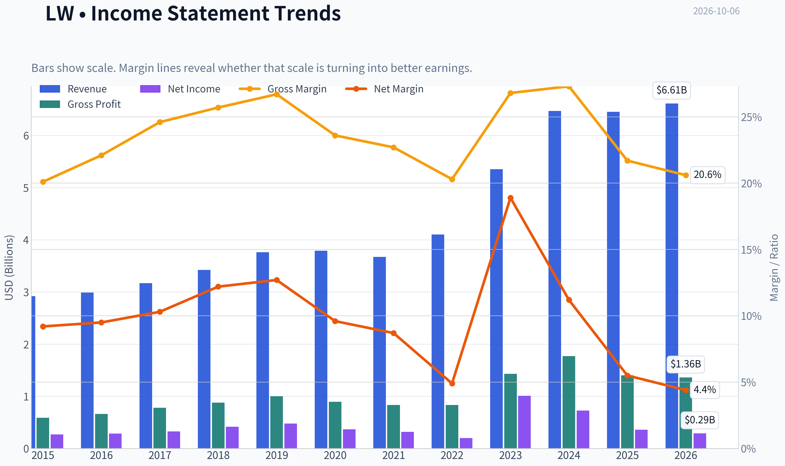

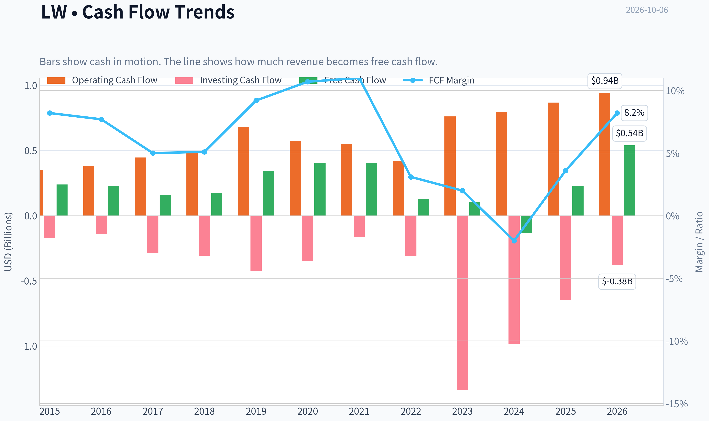

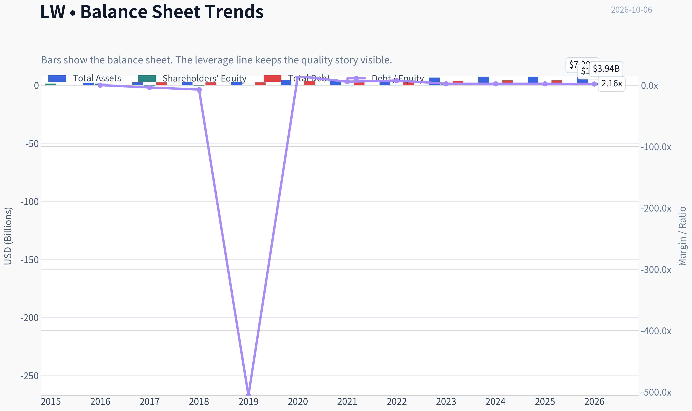

This graph tracks the profitability and return metrics (ROE, ROIC, Margins) of **LW** over the past decade, highlighting capital efficiency trends.

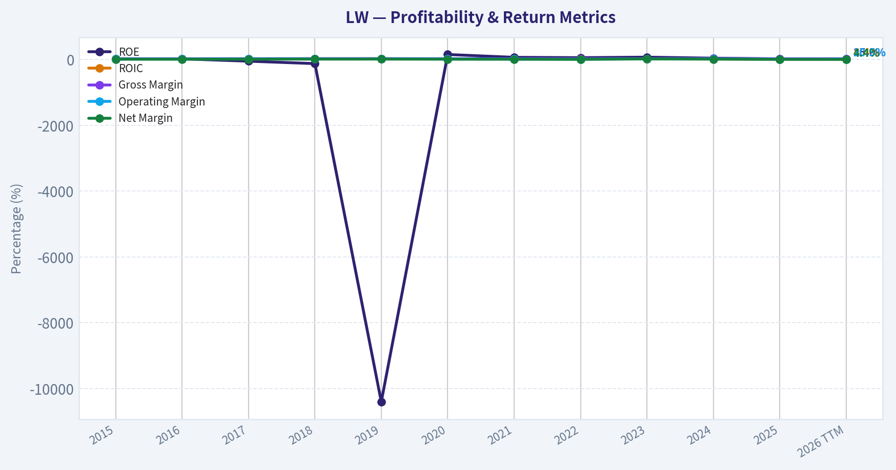

This chart illustrates the financial health of **LW** over the last 10 years, mapping cash equivalents and free cash flow against total obligations (Debt).

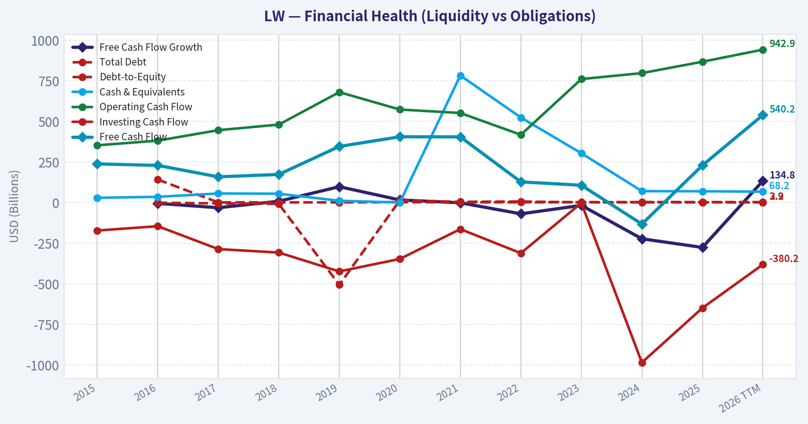

This comparison chart from *Profitability and Operating Performance* stacks current figures against historical benchmarks for **LW**, making it easy to see where the company trades relative to its own averages.

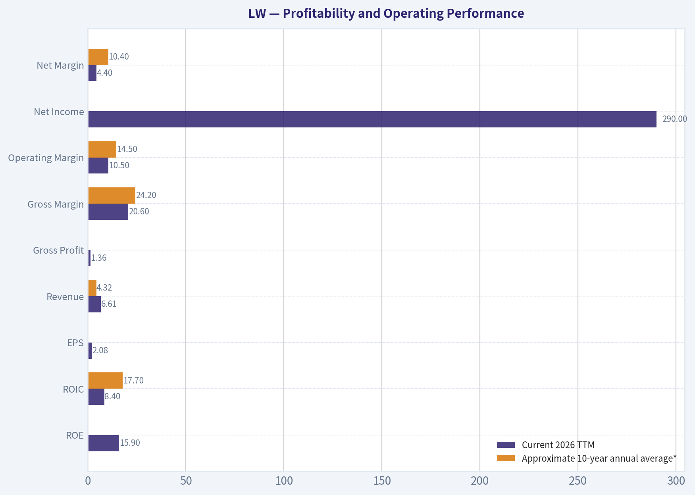

---

### Intrinsic Value Analysis (Buffett)

> *Following Warren Buffett's value investing philosophy: Circle of Competence, Economic Moat, Management Quality, and Margin of Safety.*

#### Intrinsic Value Snapshot

Price is what you pay. Intrinsic value is what the business may be worth based on the cash it can create for owners over time. We show a range, not one magic number.

- Current Price: $44.57
- Value Range (conservative to optimistic across both DCF methods): $-25.36 to $34.88

##### Owner Earnings (Buffett Method)
- Net Income: $357,200,000.00
- Depreciation & Amortization: $396,700,000.00
- Capital Expenditures: $-402,700,000.00
- Working Capital Changes: $133,200,000.00
- Owner Earnings: $279,100,000.00

##### Intrinsic Value
###### Buffett Method
Uses owner earnings. Stricter, and usually more conservative.
- Conservative: $-25.36
- Average: $-10.33
- Optimistic: $-5.61
- Discount Rate: 10.0%

###### Cash Flow Method
Uses free cash flow. Better for companies spending heavily today to grow tomorrow.
- Conservative: $1.67
- Average: $20.02
- Optimistic: $34.88
- Discount Rate: 10.0%

ANALYST STANCE: **WATCH**

#### Executive Conclusion

Lamb Weston is a understandable, scaled potato-processing business operating in a concentrated industry. Its advantages include customer relationships, processing scale, global distribution, and substantial switching friction for food-service customers. However, the moat is narrower than that of a branded consumer-staples company: potatoes are an agricultural input, gross margins are modest, volumes have recently softened, and leverage reduces financial flexibility.

At $45 per share, the valuation appears attractive on free cash flow, but the intrinsic-value estimates vary dramatically. The conservative no-growth valuation is below the current headline FCFF estimate, while the headline value of $149.45 implies a very large margin of safety. Given the conflicting valuation signals, recent operating pressure, and balance-sheet risk, LW is a watchlist candidate rather than a high-conviction purchase.

#### 1. Factor Scorecard

| Factor | Score | Assessment |
|---|---:|---|
| Circle of competence and simplicity | 4/5 | The company processes potatoes into frozen fries and other products and sells primarily to restaurants, retailers, and food manufacturers. The model is easy to understand, although crop conditions, food-service demand, and input costs create uncertainty. |
| Durable competitive advantage | 3/5 | Processing scale, customer relationships, logistics, and qualification requirements create a real but not impregnable moat. The moat is wide enough to matter but not clearly widening. |
| Management and capital allocation | 3/5 | Lamb Weston has a long operating history and a shareholder-oriented capital-return framework, but the balance-sheet burden following strategic expansion limits flexibility. |
| Industry structure | 3/5 | The frozen potato market is concentrated and benefits from scale, but it remains exposed to agricultural costs, restaurant traffic, private-label competition, and customer concentration. |

**Gate 5 hard floor:** **Not tripped.** Available evidence does not indicate both deteriorating cash flow and a solvency crisis such as sub-one-times interest coverage. Leverage is a meaningful concern, but it is not sufficient to trigger the hard floor.

**Key Takeaways:** LW scores best on simplicity and industry scale, but only moderately on moat durability and management. The business is financially viable rather than distressed, yet its investment case depends on normalization of volumes and sustained cash generation.

#### 2. Moat Analysis

| Moat source | Evidence | Rating |
|---|---|---:|
| Intangible assets and brand | Lamb Weston is a major supplier to food-service and retail customers, but the consumer-facing brand is less powerful than a branded packaged-food company. Gross margin is approximately 20.6%, which does not indicate exceptional pricing power. | 2/5 |
| Switching costs | Large restaurant chains and food manufacturers require consistent specifications, supply reliability, quality assurance, and logistics. Requalifying suppliers can be disruptive, although customers can maintain multiple suppliers. | 3/5 |
| Cost advantage | Global processing scale, procurement, plant utilization, and distribution provide structural advantages. These benefits are partially offset by energy, labor, crop, and transportation costs. | 4/5 |
| Network effects | Network effects are limited. Scale improves purchasing and distribution economics, but the product does not become materially more valuable simply because more customers use it. | 1/5 |

**Overall moat quality: Narrow to moderately wide, stable - 3/5.**

Lamb Weston's moat is primarily operational rather than brand- or network-driven. Its strongest defense is the difficulty of matching its processing footprint, product consistency, and ability to supply large customers globally. The principal threat is that food-service buyers can pressure suppliers on price, while agricultural and capacity cycles can compress margins.

#### 3. Management Quality and Capital Allocation

Management appears operationally competent, but the key question is whether capital has been deployed at returns comfortably above the cost of capital. Lamb Weston's business requires meaningful processing assets, and acquisitions or capacity investments can create value only when utilization and pricing remain healthy.

The company has returned capital to shareholders, but buybacks and dividends should be evaluated against leverage and normalized free cash flow. A shareholder-friendly capital-allocation policy is less valuable if debt-funded expansion leaves the company vulnerable during a volume downturn.

**Assessment: 3/5.**

#### 4. Financial Summary

| Metric | Latest available figure |
|---|---:|
| Share price | $45.00 |
| Market capitalization | $6.13 billion |
| P/E ratio | 21.4x |
| ROE | 15.9% |
| Revenue growth, year over year | 2.5% |
| Gross margin | 20.6% |
| Free-cash-flow yield | 8.8% |
| Implied free cash flow | Approximately $539 million |
| Current ratio | 1.42x |
| Headline intrinsic value | $149.45 |
| Headline margin of safety | 70.2% |

**Key Takeaways:** LW generates an attractive implied free-cash-flow yield of about 8.8%, while revenue growth is modest and gross margins are ordinary for a scaled food processor. ROE of 15.9% is respectable but not outstanding, and the P/E multiple is not obviously cheap unless earnings and volumes recover.

#### 5. Owner Earnings Calculation

A precise Buffett-style owner-earnings calculation requires separating maintenance capital expenditure from growth capital expenditure and identifying the working-capital investment required to sustain the business.

Using free cash flow as a practical proxy:

| Owner-earnings component | Approximate amount |
|---|---:|
| Net income | Not separately provided |
| Depreciation and amortization | Not separately provided |
| Less: maintenance capital expenditure | Not separately provided |
| Less: working-capital investment | Not separately provided |
| Free cash flow proxy for owner earnings | Approximately $539 million |

At $45 per share and a $6.13 billion market capitalization, the approximate FCF yield is 8.8%. This is attractive if the current cash flow is durable. It is less compelling if recent FCF is temporarily elevated or if substantial capital spending is required merely to maintain processing capacity.

The research valuation spread is unusually wide: the owner-earnings model indicates approximately negative $10.33 per share, the FCF model indicates approximately $20.02, and the Damodaran FCFF model indicates $149.45. That dispersion argues for using a range rather than accepting the highest estimate.

#### 6. Three-Scenario DCF Valuation

The following valuation uses approximately $539 million of free cash flow as a proxy for normalized owner earnings and approximately 136 million diluted shares.

| Scenario | Key assumptions | Estimated value per share |
|---|---|---:|
| A: No growth | $539 million owner-earnings proxy, 10% discount rate, no growth | $39.60 |
| B: GDP growth | 3% perpetual growth, 10% discount rate | $58.20 |
| C: Historical-growth case | Approximately 5.3% growth, based on using 75% of the cited 7.1% five-year growth rate | Approximately $125 |
| Headline FCFF estimate | Damodaran operating-company estimate | $149.45 |

**Key Takeaways:** The conservative valuation range is approximately $40 to $58 per share, placing the current price near fair value to modestly undervalued. The higher-growth scenario produces substantially greater value, but it requires confidence that historical growth and margins can resume. The wide range reflects uncertainty about normalized cash flow, maintenance capital spending, and leverage.

#### 7. Margin of Safety Analysis

| Valuation reference | Value per share | Margin of safety versus $45 |
|---|---:|---:|
| No-growth DCF | $39.60 | -13.6% |
| 3% GDP-growth DCF | $58.20 | 22.7% |
| Historical-growth DCF | Approximately $125 | Approximately 64% |
| Headline FCFF valuation | $149.45 | 70.2% |

The headline margin of safety is substantial, but it should not be treated as definitive because the three-model spread is exceptionally large. The reverse-DCF output also reports price-implied growth of approximately 47.6% annually for ten years, which is inconsistent with LW's recent 2.5% revenue growth and five-year growth of roughly 7.1%. That reverse-DCF result appears highly assumption-sensitive and should not be used as a reliable standalone signal.

For a moderately high-quality, cyclical food processor, a 25% to 35% margin of safety would be preferable. The current price meets that standard only under the more optimistic cash-flow and growth assumptions.

#### 8. Final Buffett Scorecard

| Criterion | Weight | Score | Weighted contribution |
|---|---:|---:|---:|
| Moat width and durability | 25% | 3.0 | 0.75 |
| Valuation and margin of safety | 20% | 3.5 | 0.70 |
| Capital returns, ROIC versus WACC | 15% | 3.0 | 0.45 |
| Business understanding and predictability | 12% | 4.0 | 0.48 |
| Management quality and capital allocation | 12% | 3.0 | 0.36 |
| Reinvestment runway | 8% | 3.0 | 0.24 |
| Balance-sheet strength | 4% | 2.5 | 0.10 |
| Industry structure | 4% | 3.0 | 0.12 |
| **Total** | **100%** |  | **3.20/5.00** |

#### 9. Investment Stance

**WATCH - Moderate conviction.**

LW is a respectable business with real scale advantages and a potentially attractive free-cash-flow yield. At $45, the stock could be undervalued if restaurant demand, volumes, pricing, and plant utilization normalize without a material increase in leverage.

However, the conservative DCF offers little protection, the moat is not exceptionally wide, and the valuation models disagree substantially. A more attractive entry point would be around **$35 to $40**, unless upcoming results demonstrate durable volume recovery, stable margins, and improving debt metrics. At that price, the downside would be better protected while preserving upside from a normalized earnings recovery.
#### Valuation Bridge

This bridge places the current market price beside each intrinsic value lens so readers can see whether upside depends on one method or shows up across several methods.

| Scenario | Intrinsic Value / Share |
| --- | ---: |
| Buffett Method | $-10.33 |
| Cash Flow Method | $20.02 |
| Damodaran Method | $149.45 |
| Current Price | $44.57 |

#### Key Takeaways

If one method is far above the others, the upside case depends on a specific modelling assumption. When several methods cluster together, the valuation story is more robust.

#### Valuation Visuals

This comparison chart from *Latest Earnings Snapshot* stacks current figures against historical benchmarks for **LW**, making it easy to see where the company trades relative to its own averages.

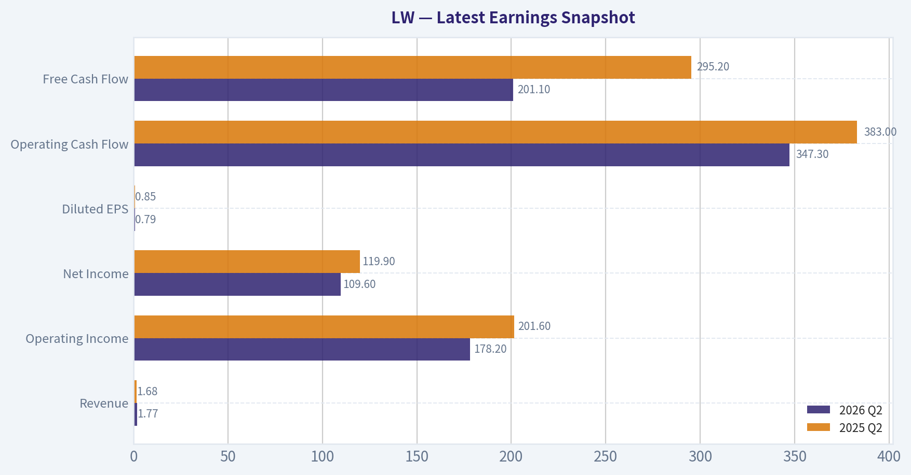

This comparison chart from *Balance Sheet and Financial Strength* stacks current figures against historical benchmarks for **LW**, making it easy to see where the company trades relative to its own averages.

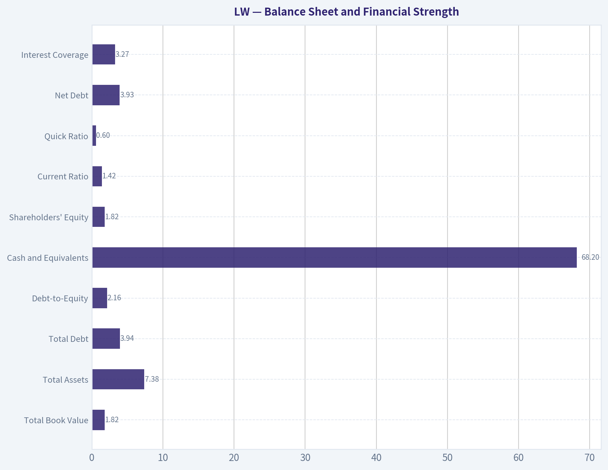

This comparison chart from *Cash Flow and Capital Allocation* stacks current figures against historical benchmarks for **LW**, making it easy to see where the company trades relative to its own averages.

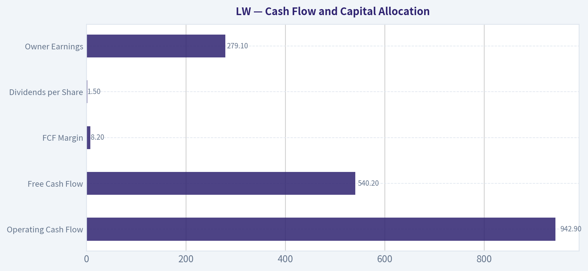

---

### Trend & Growth Analysis (Lynch/Druckenmiller/Fisher)

> *Following Peter Lynch's GARP, Stanley Druckenmiller's macro-aware approach, and Philip Fisher's scuttlebutt methodology.*

ANALYST STANCE: **AVOID**

#### 1. Lynch Classification

**Cyclical / slow-growing consumer defensive**, rather than a fast grower. Lamb Weston is a leading frozen potato processor with strong brands and scale, but reported revenue growth is only **2.5% year over year**, well below the 15-25% threshold for primary growth-investing candidates.

#### 2. The Story in Three Bullets

- Lamb Weston processes and sells frozen potato products to restaurants, foodservice operators, and retailers worldwide.
- Its advantages are scale, customer relationships, processing expertise, and a large global distribution network.
- The current investment case depends more on cost efficiencies, pricing, market-share gains, and earnings recovery than on rapidly expanding revenue.

#### 3. Key Fundamental Snapshot

| Metric | Current data | Growth-investor interpretation |
|---|---:|---|
| Share price | $45 | Depressed versus some intrinsic-value estimates, but price alone is not a catalyst |
| Market capitalization | $6.13 billion | Mid-sized company with established scale |
| Revenue growth, YoY | 2.5% | Slow-growth profile |
| P/E ratio | 21.4x | Not obviously cheap given low revenue growth |
| Gross margin | 20.6% | Reasonable, but not indicative of a high-margin compounder |
| ROE | 15.9% | Solid capital returns |
| FCF yield | 8.8% | Attractive cash-flow valuation support |
| Current ratio | 1.42x | Adequate short-term liquidity |

**Key Takeaways:** Lamb Weston has respectable returns, liquidity, and free-cash-flow support, but its top-line growth is currently too slow for a high-conviction growth thesis. At 21.4 times earnings, the stock is not clearly mispriced solely on its growth rate, although the 8.8% free-cash-flow yield provides downside support.

#### 4. TAM and the 10x Test

Lamb Weston's relevant markets include frozen potato products, foodservice potatoes, retail frozen foods, and international convenience-food consumption. These markets are durable, but generally mature rather than rapidly expanding.

| TAM question | Assessment |
|---|---|
| Can the company grow revenue 10x? | Not realistically under current category economics |
| Would 10x revenue remain below 20% market share? | Unclear and unlikely in its core frozen-potato niche |
| Is the TAM expanding above 15% annually? | No evidence of that |
| Main growth levers | International penetration, restaurant demand, pricing, mix, and share gains |
| Runway classification | Moderate, not exceptional |

**Key Takeaways:** Lamb Weston has a durable market but not an obvious ten-bagger-sized runway. A meaningful return would more likely come from earnings recovery, margin improvement, and valuation normalization than from a 10x expansion in sales.

#### 5. Revenue Growth Trend

| Indicator | Evidence | Interpretation |
|---|---:|---|
| Latest revenue growth | 2.5% YoY | Slow |
| Multi-year revenue trend | 5-year growth cited at approximately 7.1% annually | Moderate historical growth |
| Current direction | Below historical pace | Deceleration or stagnation |
| Acceleration evidence | Not established | No confirmed inflection |

**Key Takeaways:** The available data show a clear slowdown from Lamb Weston's longer-term growth rate to only 2.5% currently. Recent coverage points to possible cost, pricing, and volume pressures, so the burden of proof is on management to demonstrate renewed organic growth.

#### 6. Unit Economics and Profitability

| Measure | Result |
|---|---:|
| LTV/CAC | Not disclosed or calculable from available data |
| Net revenue retention | Not applicable; this is not a SaaS business |
| Rule of 40 | Not applicable |
| Gross margin | 20.6% |
| Free-cash-flow yield | 8.8% |
| ROE | 15.9% |

**Key Takeaways:** Traditional SaaS metrics such as LTV/CAC, NRR, and Rule of 40 do not apply. The relevant evidence is cash generation, pricing power, operating leverage, and returns on capital; those are respectable, but they do not currently offset the weak revenue-growth profile.

#### 7. Inflection-Point Assessment

Potential positive inflection points include:

1. **Volume recovery:** Restaurant and foodservice demand could improve after customer destocking or weak traffic.
2. **Market-share gains:** Lamb Weston may benefit if smaller competitors struggle with costs or capacity.
3. **Margin recovery:** Processing efficiencies, favorable potato costs, pricing, and product mix could improve earnings.
4. **International growth:** Emerging-market foodservice penetration could expand the addressable opportunity.

However, none is yet confirmed as a sustained acceleration. A single earnings beat or share-price rally would not establish an inflection point.

**Druckenmiller test:** The market may be underestimating two- to three-year earnings if margins recover substantially, but current revenue data do not yet support a high-confidence estimate of accelerating earnings power.

#### 8. Macro Setup

| Macro factor | Assessment |
|---|---|
| Consumer demand | Mixed; restaurant and foodservice traffic remain important |
| Input costs | Potato, labor, energy, packaging, and logistics create margin volatility |
| Interest rates | Lower rates would support valuation, but do not solve weak demand |
| Secular trend | Convenience food and foodservice are durable, not high-growth secular themes |
| Cycle sensitivity | Moderate; demand and input costs can fluctuate |
| Overall macro setup | Neutral to mildly cautious |

**Key Takeaways:** Lamb Weston does not have a strong AI, cloud, fintech, or other high-growth secular tailwind. Its macro case depends on foodservice normalization and input-cost management, making the setup more cyclical and execution-dependent than a classic growth opportunity.

#### 9. Fisher 15-Point Score

| Fisher criterion group | Score |
|---|---:|
| Market potential and long-range outlook | 3/5 |
| Product development and R&D | 3/5 |
| Sales organization and customer relationships | 4/5 |
| Profit margins and improvement potential | 3/5 |
| Labor, executive relations, and management depth | 3/5 |
| Cost controls and accounting quality | 3/5 |
| Competitive advantages and moat | 4/5 |
| Dilution, candor, and integrity | 3/5 |
| **Estimated total** | **49/75** |

**Key Takeaways:** Lamb Weston appears to have a meaningful competitive position and established customer relationships, but its market potential is mature and its current growth trajectory is weak. The estimated Fisher score is average, not the 55-plus range generally preferred for a high-quality growth compounder.

#### 10. Valuation Analysis

| Method | Result | Interpretation |
|---|---:|---|
| PEG ratio | Approximately 8.6x | Unattractive using current 2.5% growth |
| P/E | 21.4x | Fair-to-expensive for current growth |
| FCF yield | 8.8% | Attractive cash-flow support |
| Headline intrinsic value | $149.45 | Highly sensitive to operating assumptions |
| Owner Earnings estimate | -$10.33 | Conflicts materially with other models |
| FCF-based estimate | $20.02 | Below current price |
| Reverse DCF implication | Approximately 47.6% annual growth for 10 years | Indicates the model is highly assumption-sensitive |

**Key Takeaways:** Valuation signals are unusually inconsistent. The headline $149.45 intrinsic value suggests substantial upside, but the negative owner-earnings estimate, $20.02 FCF estimate, and reverse-DCF result show that the valuation is not robust enough to support a high-conviction purchase. The PEG ratio is especially unattractive because current growth is so low.

#### 11. Growth Investor Scorecard

| Criterion | Weight | Score / 5 |
|---|---:|---:|
| Lynch story | 10% | 3.0 |
| TAM and runway | 20% | 2.5 |
| Revenue growth | 20% | 2.0 |
| Unit economics | 15% | 3.0 |
| Competitive position | 10% | 4.0 |
| Management quality | 10% | 3.0 |
| Macro setup | 5% | 2.5 |
| Profitability path | 5% | 3.5 |
| Valuation | 5% | 2.5 |
| **Weighted score** | **100%** | **2.8 / 5.0** |

**Key Takeaways:** Lamb Weston scores well on competitive position and cash generation, but poorly on current growth, TAM expansion, and valuation relative to growth. The resulting score falls in the avoid/watch-list range for a dedicated growth portfolio.

#### 12. Position Size Stance

**Recommended position:** **0% for a new high-growth position; maximum 0.5-1% only as a turnaround/value watch position.**

This is not a ten-bagger candidate based on the available evidence. Existing shareholders could continue monitoring it, but a growth investor should demand proof of renewed volume growth and margin expansion before initiating.

#### 13. Key Catalysts and Risks

| Catalysts | Risks |
|---|---|
| Foodservice volume recovery | Continued weak restaurant demand |
| Sustained market-share gains | Persistent customer destocking or lower volumes |
| Lower potato, labor, and logistics costs | Input-cost inflation |
| Margin expansion through productivity | Pricing resistance and mix deterioration |
| International expansion | Mature core TAM limits growth |
| Credible earnings reacceleration | Valuation remains dependent on recovery assumptions |

**Key Takeaways:** The main bullish catalyst is an earnings recovery driven by volume and margins, not rapid secular revenue growth. The main risk is that weak revenue growth becomes structural, leaving the company as a mature consumer-staples business valued too highly for its growth rate.

#### Bottom Line

Lamb Weston may be an interesting **cash-flow recovery or cyclical value** idea, but it does not currently satisfy the Lynch, Druckenmiller, and Fisher requirements for a high-conviction growth investment. I would wait for at least two consecutive quarters showing improving volume, accelerating revenue, and expanding margins before upgrading the stance.

#### Growth & Scorecard Visuals

This comparison chart from *Growth and Cash-Generation Trends* stacks current figures against historical benchmarks for **LW**, making it easy to see where the company trades relative to its own averages.

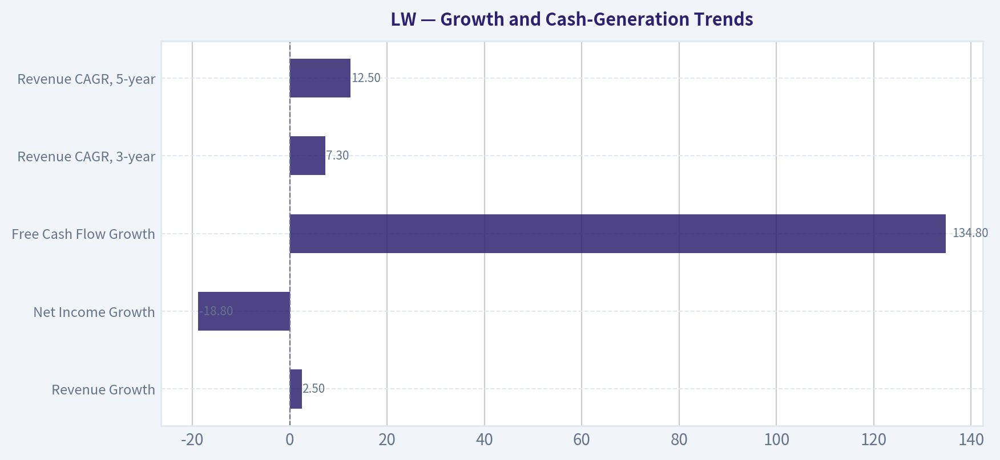

---

### Market Technical Analysis

ANALYST STANCE: **WATCH**

#### LW technical market report

**Data basis:** Yahoo Finance daily data through October 5, 2026. October 6 is the current date, but no trading-session data was available yet. The indicator-report endpoint returned unavailable values, so the observations below are derived from the retrieved OHLCV history and approximate standard calculations rather than presenting unsupported exact indicator readings.

LW closed at **$44.57 on October 5**, following a sharp rebound from the October 1 low of **$40.65**. The two-session advance from $41.18 on October 1 to $44.57 represents roughly a **8.2% gain**, but it occurred after a much larger decline: the stock fell from **$55.36 on August 25 to $41.18 on October 1**, a drawdown of approximately **25.6%**. The current move therefore looks more like an early recovery attempt within a damaged intermediate-term trend than a confirmed trend reversal.

#### Trend structure

The long-term trend remains unfavorable. LW is almost certainly trading below its **200-day SMA**, which is likely in the upper-$40s based on the one-year price history. The stock also appears to be below its **50-day SMA**, likely around the mid-to-upper-$40s. These moving averages should act as overhead resistance unless price can reclaim them decisively.

The medium-term chart shows a clear sequence of lower highs from the August peak. The decline accelerated in September, with closes moving from the low-$50s to the low-$40s. The October 2 and October 5 gains are constructive because they interrupted that sequence and were accompanied by higher volume, but two strong sessions are insufficient to establish a durable higher-high, higher-low structure.

A sustained close above approximately **$45.60**, the October 5 intraday high, would be an initial improvement. More important resistance lies near **$47 to $48**, where the September breakdown area and likely moving-average resistance converge. On the downside, **$42 to $43** is the first important support zone, followed by the October 1 low near **$40.65**.

#### Momentum

The **MACD** setup is likely still bearish on an intermediate-term basis because the prolonged September decline pulled short-term averages below longer-term averages. However, the recent price rebound should cause the MACD histogram to become less negative, signaling that downside momentum is losing intensity.

That is an improvement, but not yet a bullish confirmation. A stronger signal would require the MACD line to cross above its signal line and then remain positive while price holds above $43 to $44. If the MACD improves while price fails near $45.60 or $47, that would create a possible bearish divergence or failed-rally setup.

The approximate **14-day RSI is in the upper-30s**, indicating weak momentum but not an extremely oversold condition. RSI has likely recovered from a lower reading during the early-October washout, yet it remains below the neutral 50 level. This means LW has room for a technical bounce, but the RSI does not currently establish that buyers have regained control.

#### Volatility and risk

Volatility is elevated. Recent daily ranges have frequently exceeded $1, and the October 5 session traded between $42.99 and $45.60. A reasonable recent **ATR estimate is approximately $1.5 to $1.7 per share**, although the exact value depends on the calculation window.

This has two implications. First, stops placed too tightly around a new position may be triggered by ordinary daily fluctuations. Second, the risk-to-reward profile is difficult to assess until price either confirms support around $42 to $43 or breaks above $45.60 with follow-through. Position sizing should therefore be smaller than normal, particularly because the stock has experienced unusually large gap and volume events during the past year.

The recent price action is also consistent with a possible **Bollinger Band mean-reversion attempt**. After the early-October selloff, LW bounced from the lower portion of its recent volatility range toward the middle band, which is likely around the mid-$44 area. A close above the middle band would be constructive, while rejection there would suggest that the broader downtrend remains dominant. A return below $42 would weaken the recovery case.

#### Volume confirmation

Volume behavior is mixed but recently more encouraging. October 2 volume was approximately **4.1 million shares**, and October 5 volume increased to approximately **6.8 million shares**, substantially above the typical volume seen during much of September. The combination of rising price and expanding volume suggests genuine buying interest rather than a completely illiquid bounce.

However, high volume can also reflect short covering, event-driven trading, or repositioning rather than sustained institutional accumulation. The key test is whether volume remains elevated on further advances and contracts during pullbacks. A move above $45.60 on strong volume would be materially more convincing than a low-volume drift higher.

The **VWMA** should be watched as a volume-adjusted trend reference. Price is now likely near or slightly above the recent VWMA after the October 2 and October 5 buying surge. Holding above that level would support the recovery thesis; falling back below it, especially on increasing volume, would indicate that recent buyers are losing control.

#### Trading interpretation

LW is best classified as a **high-volatility recovery candidate inside a still-bearish larger trend**. Aggressive traders may consider a momentum continuation only if price clears $45.60 and holds above it, preferably with volume confirmation. A more conservative approach would wait for a pullback that holds the $42 to $43 region and forms a higher low.

A break below $42 would substantially weaken the rebound, while a close below $40.65 would indicate that the recent recovery has failed and could reopen the path toward lower support levels. Conversely, reclaiming the $47 to $48 zone would be a more meaningful structural improvement because it would challenge both the recent breakdown area and likely medium-term moving-average resistance.

The current evidence does not support treating LW as a confirmed bullish trend. The more balanced view is to **watch for confirmation rather than chase the initial rebound**.

#### Selected indicators

| Indicator | Role in this market context | Current interpretation |
|---|---|---|
| `close_50_sma` | Defines the intermediate-term trend and likely resistance | Price appears below it; reclaiming the mid-to-upper-$40s would improve the trend picture |
| `close_200_sma` | Establishes the long-term directional bias | Price appears below it, keeping the strategic trend bearish |
| `macd` | Measures the direction and persistence of momentum | Likely still negative, but recent gains may be reducing bearish momentum |
| `rsi` | Tests whether the selloff is exhausted and whether momentum reaches neutral | Approximately upper-30s; weak but not deeply oversold |
| `boll_ub` | Identifies potential upside exhaustion and breakout confirmation | A move toward the upper band would test whether the rebound is becoming a true breakout |
| `boll_lb` | Identifies downside pressure and potential mean-reversion areas | Early-October action appeared near the lower volatility range before rebounding |
| `atr` | Sets realistic risk limits and position sizing | Elevated, approximately $1.5-$1.7; tight stops may be vulnerable |
| `vwma` | Confirms whether price strength is supported by traded volume | Recent high-volume gains are constructive, but sustained holding above VWMA is needed |

**Key Takeaways:** LW has produced a strong two-session rebound, but the stock remains below important medium- and long-term trend benchmarks after a severe September decline. Momentum is improving from depressed levels, yet RSI remains weak and MACD confirmation is not established. The most important near-term levels are support around $42 to $43, resistance at $45.60, and stronger structural resistance near $47 to $48.

#### Market Visuals

This comparison chart from *Current Market Metrics* stacks current figures against historical benchmarks for **LW**, making it easy to see where the company trades relative to its own averages.

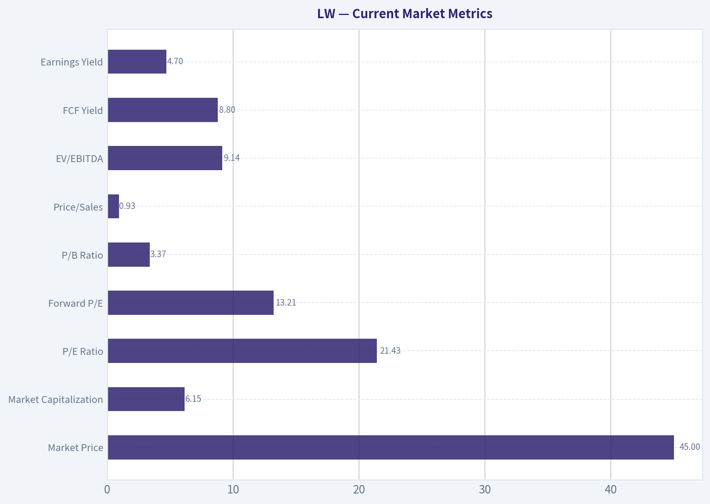

---

### Options Market Analysis

> *Reading options flow - put/call ratios, IV skew, and unusual activity - to gauge institutional positioning and event-driven risk.*

ANALYST STANCE: **BEARISH**

#### LW Options Flow Report

*Data as of October 6, 2026. The available feed does not provide LW's current share price, individual strike data, or a known upcoming catalyst. Therefore, ITM/ATM/OTM classification and strike-level gamma analysis are limited.*

#### 1. Put/Call Ratio Analysis

| Expiration | Days to Expiry | Call OI | Put OI | Put/Call OI | Call Volume | Put Volume | Put/Call Volume |
|---|---:|---:|---:|---:|---:|---:|---:|
| October 16, 2026 | 10 | 7 | 59 | 8.43 | 2,741 | 2,692 | 0.98 |
| November 20, 2026 | 45 | 0 | 0 | N/A | 749 | 9,342 | 12.47 |
| January 15, 2027 | 101 | 665 | 200 | 0.30 | 417 | 612 | 1.47 |
| **Aggregate** | - | **672** | **259** | **0.39** | **3,907** | **12,646** | **3.24** |

**Key Takeaways:** Aggregate put open interest is below the historical neutral level of approximately 0.70, which superficially indicates more call positioning. However, trading volume is heavily put-dominated, led by November contracts where 9,342 puts traded against only 749 calls. This divergence suggests substantial new downside hedging or bearish speculation, making the volume signal more important for near-term sentiment than the relatively bullish existing OI balance.

#### 2. Implied Volatility Assessment

| Expiration | Call ATM IV | Put ATM IV | Put Premium to Call IV | Interpretation |
|---|---:|---:|---:|---|
| October 16, 2026 | 0.8% | 3.1% | +2.3 percentage points | Strong downside skew |
| November 20, 2026 | 0.4% | 1.6% | +1.2 percentage points | Downside skew |
| January 15, 2027 | 0.4% | 1.6% | +1.2 percentage points | Downside skew |

**Key Takeaways:** Put implied volatility is higher than call implied volatility across every listed expiration, consistently indicating downside protection demand. Absolute IV readings are unusually low, so the data may be affected by stale quotes, wide spreads, or limited liquidity; the relative put-versus-call skew is more informative than the absolute levels. No catalyst was supplied, so an earnings- or event-driven IV interpretation cannot be confirmed.

#### 3. Unusual Options Activity

The data feed identified **no contracts with volume greater than five times open interest**. Consequently, there are no qualifying contracts that can be labeled as fresh, unusually large directional bets under the tool's screening rule.

| Observation | Implication |
|---|---|
| No volume/OI outliers | No confirmed unusual activity |
| November put volume: 9,342 versus zero reported OI | Could represent fresh opening activity, but may also reflect an OI reporting lag or data-quality issue |
| Strike-level information unavailable | Cannot determine ITM, ATM, or OTM status |
| Current share price unavailable | Cannot assess distance from spot or directional moneyness |

**Key Takeaways:** There is no individually confirmed unusual contract, but the very large November put volume remains the most important flow feature. Because reported open interest is zero for both November calls and puts, the activity may be opening trades, but that conclusion should be treated cautiously because open-interest updates can lag volume data.

#### 4. Open Interest Concentration and Gamma Levels

| Expiration | Call OI | Put OI | Concentration Assessment |
|---|---:|---:|---|
| October 16, 2026 | 7 | 59 | Very small near-term OI; limited pinning evidence |
| November 20, 2026 | 0 | 0 | No usable OI concentration data |
| January 15, 2027 | 665 | 200 | Largest aggregate OI, dominated by calls |
| **Total** | **672** | **259** | Long-dated call concentration |

**Key Takeaways:** January 15, 2027 contains most of the reported open interest and is the only expiration with meaningful call concentration. However, strikes were not provided, so specific gamma walls, max-pain levels, and likely price-pinning zones cannot be identified. Near-term October open interest is too small to support a strong pinning conclusion.

#### 5. Overall Options Sentiment

The overall signal is **BEARISH**, with moderate-to-low confidence.

The primary bearish driver is the **3.24 aggregate put/call volume ratio**, particularly the extreme November put activity and the consistent premium of put IV over call IV. The low aggregate put/call OI ratio of 0.39 provides a counterpoint, reflecting existing January call concentration, but it may represent older positioning rather than current directional conviction. The absence of confirmed volume-to-OI outliers, missing strike data, and questionable zero-OI reporting for November reduce confidence.

| Category | Assessment |
|---|---|
| Put/Call Ratio | **Bearish by volume; bullish-looking by existing OI** |
| IV Level | **Very low absolute IV, with possible data-quality/liquidity concerns** |
| Skew Direction | **Bearish put skew across all expirations** |
| Unusual Activity | **No contracts formally flagged; heavy November put flow is notable but unconfirmed** |
| Open Interest | **January call concentration; insufficient strike data for gamma walls** |
| Overall Signal | **BEARISH, moderate-to-low confidence** |

**Key Takeaways:** LW's current options flow leans bearish because traders are transacting far more puts than calls and consistently paying higher implied volatility for puts. Existing open interest is more constructive due to January call concentration, but the fresh-volume signal points toward downside hedging or bearish positioning. Illiquidity and incomplete strike/open-interest data warrant caution.

---

## Research Team Commentary

> *The Research Manager synthesizes the Bull vs Bear debate into action-free commentary. This is a pre-risk view, not the final stance.*

Core takeaway: Lamb Weston is a defensible but capital-intensive processor whose current price already gives management meaningful credit for an earnings recovery that has not yet been demonstrated. The business is not distressed, and its scale, customer qualification requirements, processing expertise, and distribution network have real value. But at $44.57, with a 7.1% ROIC, soft volumes, leverage, and a 21.4x trailing P/E, there is not enough margin of safety for a new Buffett-style purchase. I would keep the company on the watchlist rather than buy or categorically reject it.

The strongest bull argument is that Lamb Weston sells more than a commodity potato. Large-scale processing capacity, food-safety systems, consistent product specifications, frozen distribution, and customer integration would be expensive and time-consuming to reproduce. If volumes stabilize, the fixed-cost network could produce an earnings recovery much faster than revenue growth. Low-single-digit demand and pricing, improved utilization, manufacturing efficiencies, and selective share gains could plausibly support 6%-8% per-share growth. Under the bull's assumptions, that could justify value in the low-to-mid $50s.

The strongest bear argument is that this recovery is already partly reflected in the valuation. A 7.1% ROIC is weak evidence of a durable economic moat, especially for a leveraged, capital-intensive company. The 15.9% ROE looks better, but leverage contributes to that result. Capital intensity is also double-edged: it discourages entrants, but it creates underutilization and cash-flow risk when volumes are weak. Large restaurant and food-service customers retain meaningful bargaining power despite supplier-switching friction.

Valuation is where the bull case becomes insufficiently compelling. The favorable reverse DCF suggests that roughly 6% growth is embedded in the price, but that conclusion relies on a 9% discount rate, 3% terminal growth, and EPS serving as a proxy for owner earnings. Those are generous assumptions for this type of business. Using a 10% required return, a 2.5% terminal rate, and more conservative cash conversion can place intrinsic value in the high $30s and raise the implied growth hurdle toward 8%-9%. That is achievable, but it requires successful utilization, margin, cash-flow, and balance-sheet improvement rather than merely stable industry demand.

The proposed $52-$55 upside is therefore a recovery scenario, not a conservative appraisal. A roughly 15% modeled discount would be acceptable for a highly predictable, wide-moat, high-ROIC compounder. Lamb Weston currently deserves a larger discount-probably at least 25%-because its moat is narrower, its cash flows are more operationally sensitive, and its returns on capital are not demonstrably superior. Similarly, the idea of $3 in normalized EPS may eventually prove correct, but it represents approximately 44% growth from the implied trailing EPS of about $2.08. It should not be capitalized before the underlying recovery appears in free cash flow.

Management remains an open question rather than a source of investment advantage. The thesis requires disciplined plant execution, pricing, capital spending, cash conversion, and debt reduction. Management should first demonstrate that existing and incremental capital can earn materially above the cost of capital. Deleveraging would strengthen the equity thesis; debt-funded expansion or aggressive repurchases before that point would weaken it.

The contrarian opportunity is not yet fully established. The market may be too pessimistic if current volume weakness is temporary and plant utilization can normalize without heavy incremental spending. However, buying simply because the business has fallen short of prior earnings is not genuine contrarian insight-it is an assumption of mean reversion. At 21.4x trailing earnings, the shares are not priced for outright failure. The crowd already appears to expect some recovery, so investors need either better operating evidence or a lower entry price.

The technical report supports WATCH rather than a high-confidence directional call, while the options analyst was bearish but lacked enough strike-level and catalyst data to make that signal decisive. Based on the prior mistakes, I would not turn valuation concerns alone into a short-term bearish forecast. Conversely, I would not let a possible stabilization or recovery narrative override weak current economics. "Not attractive enough to buy" is different from "certain to decline."

Over the next one to four quarters, I would monitor unit volumes and market share first. Sequential stabilization without damaging price concessions would strengthen the thesis; continued volume losses would suggest that underutilization is more structural than cyclical. Gross margin should improve from 20.6%, but the source matters: sustainable utilization and productivity gains are more valuable than temporary input relief or aggressive cost deferral.

I would also track free cash flow relative to net income, maintenance and expansion capital expenditures, and working-capital requirements. If reported earnings improve without corresponding cash generation, the EPS-based valuation case becomes unreliable. ROIC needs to move convincingly above 7.1% and toward at least the high single digits or low double digits before the company deserves a stronger quality assessment.

Balance-sheet progress is another key test. Falling net leverage and comfortable interest coverage would lower the required margin of safety. Rising leverage, continued heavy capital spending, or shareholder distributions funded before debt reduction would weaken the case. Guidance around utilization, plant reliability, pricing, crop costs, energy, freight, and customer retention will help distinguish a genuine operating recovery from a temporary earnings bounce.

I would become constructive either around the mid-to-high $30s, assuming no deterioration in normalized owner earnings, or after several quarters of improving volumes, margins, free cash flow, ROIC, and leverage. At the present price, the business is credible but the risk-adjusted discount is inadequate.

Final stance: WATCH

---

## Value Investing Team Commentary

> *The Investor translates the research view into an investment thesis before risk review. This is still not the final stance.*

### Investment Commentary

Lamb Weston is an understandable business with genuine-but not exceptional-competitive advantages. Its processing scale, food-safety capabilities, consistent product specifications, customer qualification requirements, and frozen distribution network make it difficult for a new entrant to replicate. Large restaurant and food-service customers cannot casually change suppliers without testing products and adjusting operations.

Nevertheless, this is not a wide-moat consumer franchise. Lamb Weston sells a relatively standardized product to sophisticated customers with meaningful bargaining power. Agricultural inputs, plant utilization, energy, freight, crop quality, and capital expenditure all influence profitability. Scale creates an entry barrier, but it also creates substantial fixed-cost exposure when volumes weaken.

### Business Economics and Earnings Quality

The reported metrics do not yet establish Lamb Weston as a high-quality compounder:

- **ROIC of 7.1%** is the most important warning. It suggests only a modest spread, if any, over the company's cost of capital.
- **ROE of 15.9%** is more attractive, but leverage likely amplifies it and therefore makes it a less reliable measure of underlying business quality.
- **Gross margin of 20.6%** leaves the company sensitive to utilization, input costs, pricing, and operating execution.
- The business remains capital-intensive, so accounting earnings should not automatically be treated as owner earnings.

At $44.57 and 21.43 times trailing earnings, implied trailing EPS is approximately $2.08. If earnings eventually normalize near $3.00, the shares would trade at about 14.9 times normalized earnings. That could prove reasonable, but $3.00 is a recovery assumption representing roughly 44% growth from current implied trailing EPS. Investors should not capitalize that recovery fully before it appears in margins, free cash flow, and returns on capital.

Free cash flow deserves more weight than EPS here. Processing plants require ongoing maintenance and periodic capacity investment, while inventory and working capital can absorb cash. An earnings recovery unsupported by cash generation would not constitute an improvement in owner earnings.

### Valuation and Margin of Safety

The central issue is not whether Lamb Weston can recover. It is whether the current price sufficiently compensates shareholders if that recovery is slower or less complete than expected.

The low-to-mid-$50s valuation represents a plausible favorable scenario rather than a conservative appraisal. It likely assumes some combination of:

- volume stabilization;
- improved plant utilization;
- pricing retention;
- manufacturing efficiencies;
- more normal input costs;
- and better cash conversion.

Those outcomes are possible, but they are not yet sufficiently demonstrated. A reverse DCF suggesting approximately 6% embedded growth can appear undemanding, but that result is highly sensitive to the discount rate, terminal growth, and use of EPS as a cash-flow proxy. A 9% required return and 3% terminal growth are generous for a leveraged, capital-intensive processor with 7.1% ROIC. Using a 10% return requirement, a 2%-2.5% terminal rate, and conservative owner earnings produces a materially lower appraisal.

Lamb Weston should therefore receive the margin of safety appropriate to an average-quality, operationally sensitive business-roughly **25%-35%**, not the 10%-15% discount acceptable for a predictable, wide-moat compounder. On the information supplied, the mid-to-high $30s would provide a more attractive entry range, provided normalized cash-earning power and the balance sheet have not deteriorated.

### Selective Contrarian View

The bearish options signal and cautious market sentiment may reflect legitimate concerns about weak volumes, utilization, and execution. However, incomplete strike-level and catalyst data make the options signal unsuitable as a fundamental investment conclusion. Technical weakness can improve the purchase price, but it does not determine what the business will earn over the next decade.

There is a credible contrarian thesis: the market could be extrapolating temporary food-service weakness and poor plant utilization too far into the future. Because the network has substantial fixed costs, even moderate volume stabilization could generate disproportionately strong incremental earnings. If existing facilities can absorb recovering demand without another major capital-spending cycle, free cash flow could improve faster than revenue.

But contrarian investing requires a mispriced insight, not merely the expectation that disappointing earnings will return to their historical level. At roughly 21 times depressed trailing earnings, the shares are not priced for permanent impairment. The valuation already gives management meaningful credit for recovery. Sentiment is cautious, but not sufficiently pessimistic to create an obvious bargain.

The opposite risk is that investors mistake structural issues for temporary ones. Persistent market-share losses, customer pricing pressure, overcapacity, or recurring execution problems would mean that utilization does not normalize as expected. In that case, apparently depressed earnings may be closer to sustainable earnings than bulls assume.

### Management and Capital Allocation

Management has not yet earned treatment as a competitive advantage. The critical capital-allocation priorities should be:

1. Stabilize plant operations and customer service.
2. Convert reported earnings into free cash flow.
3. Reduce leverage and preserve interest coverage.
4. Limit expansion spending until existing assets earn satisfactory returns.
5. Avoid aggressive repurchases financed directly or indirectly through additional debt.

Management should demonstrate that incremental capital can earn materially more than the cost of capital. Debt reduction would improve both resilience and equity value. Heavy expansion or premature shareholder distributions while ROIC remains around 7% would weaken the thesis.

### Evidence That Would Improve the Case

A more constructive stance would require several of the following:

- unit volumes and market share stabilizing without destructive discounting;
- gross-margin improvement driven by utilization and productivity rather than temporary input relief;
- free cash flow growing alongside net income;
- maintenance and expansion capital expenditures becoming more disciplined;
- ROIC moving toward the high single digits and ultimately above 10%;
- net leverage declining and interest coverage improving;
- reliable plant execution and customer retention;
- evidence that normalized owner earnings are approaching $3 per share or another supportable level.

Conversely, continued volume losses, weak cash conversion, rising leverage, heavy capital spending, or margin gains dependent on temporary factors would lower intrinsic value.

The handoff does not provide enough detailed debt, free-cash-flow, or latest-quarter data to justify false precision. Those figures should be verified before establishing a position. The current evidence supports patience: Lamb Weston is not distressed, but neither its economics nor its valuation justify treating it as a wonderful business available at a fair price.

ANALYST STANCE: **WATCH** - Lamb Weston has defensible scale and meaningful recovery potential, but its 7.1% ROIC, capital intensity, leverage, soft volumes, and unproven cash-flow recovery require a larger margin of safety. I would consider the shares around the mid-to-high $30s if normalized owner earnings remain intact, or at a higher price only after several quarters of demonstrable improvement in volumes, margins, free cash flow, ROIC, and leverage.

---

## Deep Values Commentary

> *The Risk Management Team debates and the Risk Judge provides the final action-free verdict. This section determines the final ADVOCATE / WATCH / AVOID stance.*

#### Final Stance Scorecard

This scorecard converts the final research view into a weighted decision frame. It does not replace the narrative judgement, but it makes the main drivers of the verdict easier to scan.

| Criterion | Score | Weight | Commentary |
| --- | ---: | ---: | --- |
| Business Quality | 3.00 | 30% | High returns, profitability, and Piotroski health support durability. |
| Valuation Support | 3.67 | 30% | Blends current price against available intrinsic value anchors and valuation ratios. |
| Financial Strength | 1.67 | 20% | Balance-sheet resilience reflects leverage and liquidity staying within safe ranges. |
| Growth Durability | 2.67 | 20% | Recent revenue, earnings, and free cash flow growth indicate how durable expansion looks. |
| TOTAL / FINAL STANCE | 2.87 | 100% | WATCH |

#### Key Takeaways

The weighted score lands at **2.87 / 5.0**, while the final stance remains **WATCH**. This is useful as a quick calibration aid rather than a mechanical signal.

#### Risk Summary

Higher scores indicate more risk pressure. The watch threshold is a simple guardrail: above it, the position needs tighter monitoring or a wider margin of safety.

| Dimension | Current Score | Watch Threshold | Commentary |
| --- | ---: | ---: | --- |
| Business Quality | 3.00 | 3.00 | High returns, profitability, and Piotroski health support durability. |
| Valuation Support | 2.33 | 3.00 | Blends current price against available intrinsic value anchors and valuation ratios. |
| Financial Strength | 4.33 | 3.00 | Balance-sheet resilience reflects leverage and liquidity staying within safe ranges. |
| Growth Durability | 3.33 | 3.00 | Recent revenue, earnings, and free cash flow growth indicate how durable expansion looks. |

#### Key Takeaways

This view helps readers separate *where* the risk sits: valuation, business quality, balance sheet, or growth durability. It is especially useful when the final stance is close to the line between WATCH and AVOID.
