# LYFT Deep Value Intelligence

**Analysis Date:** 2026-05-02

## Critical Disclaimer

*This analysis is generated by Deep Value Intelligence, an AI-powered multi-agent investing framework. This report is for informational and educational purposes only and does not constitute financial advice. Always conduct your own research and consult with qualified financial advisors before making investment decisions.*

---

## Table of Contents

1. Intelligence Summary
2. Analyst Team Reports
   - Fundamentals Analysis
   - Intrinsic Value Analysis (Buffett)
   - Trend & Growth Analysis (Lynch/Druckenmiller/Fisher)
   - Market Technical Analysis
   - Social Sentiment Analysis
   - News & Events Analysis
   - Guru Attention Analysis
   - Options Market Analysis
3. Research Team Commentary
4. Value Investing Team Commentary
5. Deep Values Commentary

---

## Intelligence Summary

### Thesis + Conditions

**Core Thesis:** ### Executive Summary
Lyft is an optically cheap, structurally fragile business undergoing a legitimate operational turnaround. While a trailing P/E of 2.1 and a 315% ROIC scream "bargain," these metrics are statistical mirages stemming from a depressed equity base, not a durable economic moat.

**Key Risks:**
- Lyft is an optically cheap, structurally fragile business undergoing a legitimate operational turnaround. While a trailing P/E of 2.1 and a 315% ROIC scream "bargain," these metrics are statistical mirages stemming from a depressed equity base, not a durable economic moat. However, outright ignoring the company's stabilizing margins, recent United Airlines partnership, and technical recovery is overly rigid. Because Lyft lacks the predictable owner earnings required for a Buffett-style investment, it cannot be an ADVOCATE. Yet, the asymmetric rerating potential warrants monitoring, shifting our stance from a hard AVOID to WATCH.
- The Bull (Risky) Case:** Lyft offers asymmetric upside. The market is pricing in disbelief, ignoring 9.2% revenue growth and operational discipline. Weak switching costs are mitigated by practical advantages like network density and the United Airlines loyalty partnership.
- Warren Buffett's framework demands predictable owner earnings and a durable competitive advantage (moat). Lyft operates in an industry with near-zero switching costs and heavy external dependencies (insurance costs, local labor laws). The intrinsic value estimate (Damodaran average: $-218) highlights the risk of relying on models built over a weak foundation. However, value investing also requires intellectual flexibility; ignoring a company shifting from cash-burning to cash-generative misses a potential margin of safety rooted in operational stabilization.
- The bull case paints a compelling picture of a misunderstood turnaround. The strongest argument here is that Lyft is transitioning from a cash-burning story stock into a disciplined, cash-generative platform. The bulls argue that the market is anchoring too heavily on the industry's historically irrational economics and ignoring Lyft's current profitability. With a trailing P/E of roughly 2.1 and massive returns on equity and invested capital, the bull suggests that even if Lyft simply survives as a rational number two player in a duopoly, the sheer compression of its valuation provides a massive margin of safety. Furthermore, the bulls point to the practical moat of two-sided network liquidity, regulatory infrastructure, and recent strategic moves like the United Airlines partnership as evidence of a stabilizing business.
- The rationale for this is rooted deeply in the concepts of intrinsic value and business quality. Warren Buffett insists on predictable owner earnings to calculate a margin of safety. Lyft's economics are at the mercy of factors entirely outside its control, from local labor regulations to competitor pricing and volatile insurance claims. The optically cheap P/E ratio and astronomical return on invested capital are red flags of accounting noise and a depressed equity base, rather than the hallmarks of a wide-moat compounder. Furthermore, the Damodaran intrinsic value estimate being deeply negative highlights the severe risk that, over a full cycle, this business may not generate enough sustainable free cash flow to justify any long-term equity investment.

**What Would Change Our View:**
- Lyft is an optically cheap, structurally fragile business undergoing a legitimate operational turnaround. While a trailing P/E of 2.1 and a 315% ROIC scream "bargain," these metrics are statistical mirages stemming from a depressed equity base, not a durable economic moat. However, outright ignoring the company's stabilizing margins, recent United Airlines partnership, and technical recovery is overly rigid. Because Lyft lacks the predictable owner earnings required for a Buffett-style investment, it cannot be an ADVOCATE. Yet, the asymmetric rerating potential warrants monitoring, shifting our stance from a hard AVOID to WATCH.
- The Bull (Risky) Case:** Lyft offers asymmetric upside. The market is pricing in disbelief, ignoring 9.2% revenue growth and operational discipline. Weak switching costs are mitigated by practical advantages like network density and the United Airlines loyalty partnership.
- Warren Buffett's framework demands predictable owner earnings and a durable competitive advantage (moat). Lyft operates in an industry with near-zero switching costs and heavy external dependencies (insurance costs, local labor laws). The intrinsic value estimate (Damodaran average: $-218) highlights the risk of relying on models built over a weak foundation. However, value investing also requires intellectual flexibility; ignoring a company shifting from cash-burning to cash-generative misses a potential margin of safety rooted in operational stabilization.
- The bull case paints a compelling picture of a misunderstood turnaround. The strongest argument here is that Lyft is transitioning from a cash-burning story stock into a disciplined, cash-generative platform. The bulls argue that the market is anchoring too heavily on the industry's historically irrational economics and ignoring Lyft's current profitability. With a trailing P/E of roughly 2.1 and massive returns on equity and invested capital, the bull suggests that even if Lyft simply survives as a rational number two player in a duopoly, the sheer compression of its valuation provides a massive margin of safety. Furthermore, the bulls point to the practical moat of two-sided network liquidity, regulatory infrastructure, and recent strategic moves like the United Airlines partnership as evidence of a stabilizing business.
- The rationale for this is rooted deeply in the concepts of intrinsic value and business quality. Warren Buffett insists on predictable owner earnings to calculate a margin of safety. Lyft's economics are at the mercy of factors entirely outside its control, from local labor regulations to competitor pricing and volatile insurance claims. The optically cheap P/E ratio and astronomical return on invested capital are red flags of accounting noise and a depressed equity base, rather than the hallmarks of a wide-moat compounder. Furthermore, the Damodaran intrinsic value estimate being deeply negative highlights the severe risk that, over a full cycle, this business may not generate enough sustainable free cash flow to justify any long-term equity investment.

**Confidence:** Medium

---

## Analyst Team Reports

### Fundamentals Analysis

#### Latest Earnings Snapshot

*Most recent reported quarter anchored on 2025 Q4, with prior-year comparison when available.*

| Metric | 2025 Q4 | 2024 Q4 | YoY Change |
| --- | ---: | ---: | ---: |
| Revenue | $1.59B | $1.55B | +2.7% |
| Operating Income | $-185.0M | $28.0M | -761.9% |
| Net Income | $2.76B | $61.7M | +4363.0% |
| Diluted EPS | N/A | N/A | N/A |
| Operating Cash Flow | $246.2M | $153.4M | +60.5% |
| Free Cash Flow | $227.6M | $140.0M | +62.6% |

Key Takeaways: This snapshot anchors the most recent reported quarter before the narrative analysis. It helps readers separate long-run business quality from whatever changed in the latest earnings print.

#### 10-Year Financial Metrics for LYFT

*All values below are computed deterministically from raw data - not estimated by AI.*

*Issuer profile: operating company (Technology / Software - Application).*

#### 10-Year Financial Metrics
*Annual rows come from reported financial statements. The final TTM row is computed from the latest four quarters.*

| Metric | 2016 | 2017 | 2018 | 2019 | 2020 | 2021 | 2022 | 2023 | 2024 | 2025 | 2026 TTM |
| --- | --- | --- | --- | --- | --- | --- | --- | --- | --- | --- | --- |
| Market Price | N/A | N/A | N/A | $43 | $49 | $43 | $11 | $15 | $13 | $19 | $14 |
| Market Cap | N/A | N/A | N/A | $9.79B | $15.34B | $14.30B | $3.91B | $5.78B | $5.34B | $8.09B | $5.51B |
| P/E Ratio | N/A | N/A | 0.00 | -3.76 | -8.76 | -13.48 | -2.47 | -17.03 | 215.00 | 2.84 | 1.94 |
| P/B Ratio | N/A | N/A | -0.61 | 3.43 | 9.15 | 10.66 | 10.06 | 10.67 | 6.96 | 2.47 | 1.68 |
| ROE | N/A | 34.8% | 31.7% | -91.2% | -104.6% | -79.2% | -407.7% | -62.8% | 3.0% | 86.9% | 86.9% |
| ROIC | N/A | N/A | N/A | -85.5% | -77.8% | -63.1% | -115.2% | -53.9% | -16.6% | 142.3% | 294.3% |
| EPS | N/A | N/A | $-40.61 | $-11.44 | $-5.61 | $-3.17 | $-4.47 | $-0.88 | $0.06 | $6.81 | $7.44 |
| Revenue | N/A | $1.06B | $2.16B | $3.62B | $2.36B | $3.21B | $4.10B | $4.40B | $5.79B | $6.32B | $6.32B |
| Gross Profit | N/A | $400.3M | $913.2M | $1.44B | $917.2M | $1.51B | $1.66B | $1.86B | $2.45B | $2.62B | $2.62B |
| Gross Margin | N/A | 37.8% | 42.3% | 39.8% | 38.8% | 46.9% | 40.5% | 42.2% | 42.3% | 41.5% | 41.5% |
| Operating Margin | N/A | -66.8% | -45.3% | -74.7% | -76.5% | -35.4% | -35.6% | -10.8% | -2.1% | -3.0% | -3.0% |
| Net Income | N/A | $-688.3M | $-911.3M | $-2.60B | $-1.75B | $-1.06B | $-1.58B | $-340.3M | $22.8M | $2.84B | $2.84B |
| Net Margin | N/A | -64.9% | -42.3% | -72.0% | -74.1% | -33.1% | -38.7% | -7.7% | 0.4% | 45.0% | 45.0% |
| Revenue Growth | N/A | N/A | 103.5% | 67.7% | -34.6% | 35.7% | 27.6% | 7.5% | 31.4% | 9.2% | 0.0% |
| Net Income Growth | N/A | N/A | 32.4% | 185.5% | -32.6% | -39.4% | 49.2% | -78.5% | -106.7% | 12382.5% | 0.0% |
| Free Cash Flow Growth | N/A | N/A | N/A | N/A | N/A | N/A | N/A | N/A | N/A | N/A | N/A |
| Total Book Value | $-1.30B | $-1.98B | $-2.87B | $2.85B | $1.68B | $1.34B | $388.7M | $541.5M | $767.0M | $3.27B | $3.27B |
| Total Assets | N/A | N/A | $3.76B | $5.69B | $4.68B | $4.77B | $4.56B | $4.56B | $5.44B | $9.03B | $9.03B |
| Total Debt | N/A | N/A | N/A | $0 | $680.0M | $711.4M | $839.5M | $865.2M | $604.9M | $1.05B | $1.28B |
| Debt-to-Equity | N/A | N/A | N/A | 0.00 | 0.41 | 0.53 | 2.16 | 1.60 | 0.79 | 0.32 | 0.39 |
| Cash & Equivalents | $514.9M | $1.11B | $517.7M | $358.3M | $319.7M | $457.3M | $281.1M | $558.6M | $759.3M | $1.13B | $1.13B |
| Shareholders' Equity | $-1.30B | $-1.98B | $-2.87B | $2.85B | $1.68B | $1.34B | $388.7M | $541.5M | $767.0M | $3.27B | $3.27B |
| Operating Cash Flow | N/A | $-393.5M | $-280.7M | $-105.7M | $-1.38B | $-101.7M | $-237.3M | $-98.2M | $849.7M | $1.17B | $1.17B |
| Investing Cash Flow | N/A | $-991.4M | $-1.04B | $-1.61B | $740.4M | $267.0M | $186.0M | $599.8M | $-518.0M | $406.7M | $406.7M |
| Free Cash Flow | N/A | N/A | N/A | N/A | N/A | N/A | N/A | N/A | N/A | N/A | $1.12B |
| FCF Margin | N/A | N/A | N/A | N/A | N/A | N/A | N/A | N/A | N/A | N/A | 17.7% |
| Dividends / Share | N/A | N/A | $0.00 | $0.00 | $0.00 | $0.00 | $0.00 | $0.00 | $0.00 | $0.00 | $0.00 |

#### Profitability Metrics
- Return on Equity (ROE): 86.9%
- Return on Invested Capital (ROIC): 315.0%
- Return on Assets (ROA): 31.5%
- Gross Margin: 41.5%
- Operating Margin: -3.0%
- Net Profit Margin: 45.0%

#### Liquidity Metrics
- Current Ratio: 0.65
- Quick Ratio: 0.41

#### Leverage Metrics
- Debt-to-Equity Ratio: 0.32
- Interest Coverage Ratio: -9.08
- Net Debt: $-79.0M

#### Growth Metrics (Year-over-Year)
- Revenue Growth: 9.2%
- Net Income Growth: 12382.5%
- Free Cash Flow Growth: N/A
- Revenue CAGR (3-Year): 15.5%
- Revenue CAGR (5-Year): 21.7%

#### Valuation Metrics
- P/E Ratio (TTM): 2.12
- Forward P/E: 7.74
- Price-to-Book: 1.77
- Price-to-Sales: 0.87
- PEG Ratio: 0.15
- EV/EBITDA: -157.00
- Free Cash Flow Yield: N/A
- Earnings Yield: 47.2%

#### Owner Earnings (Buffett Method, Code-Computed)
- Net Income: $2.84B
- + Depreciation & Amortization: $135.2M
- - Capital Expenditures: N/A
- - Working Capital Changes: $829.0M
- = **Owner Earnings: $2.15B**

#### Piotroski F-Score: 4/9
- Positive Net Income: PASS
- Positive Operating Cash Flow: PASS
- ROA Improvement: PASS
- Cash Flow > Net Income: FAIL
- Decreasing Debt: FAIL
- Improving Current Ratio: FAIL
- No Dilution: PASS
- Improving Gross Margin: FAIL
- Improving Asset Turnover: FAIL

FINAL INVESTMENT STANCE: **WATCH**

#### LYFT Fundamental Analysis - Buffett-Style Value Review

Lyft's current valuation looks optically cheap at **$14 per share**, **$5.51B market cap**, **1.94x TTM P/E**, and **1.68x P/B**, but the Buffett-style conclusion is not straightforward. The company has recently shown a dramatic accounting profit inflection, strong current owner earnings, and positive free cash flow, yet its long-term record remains highly volatile, with years of negative margins, inconsistent earnings, weak liquidity, and limited evidence of a durable economic moat versus Uber and other mobility platforms.

The stock is therefore best classified as **WATCH**, not ADVOCATE. The upside could be substantial if the 2025-2026 profitability is repeatable, but a Buffett investor would likely require several more years of consistent operating profitability before treating Lyft as a predictable compounder.

---

#### Data Validation and Source-of-Truth Notes

The deterministic dataset is treated as the canonical source. The shared research pack broadly confirms the current market picture: price near **$14**, market cap near **$5.51B**, ROE near **86.9%**, gross margin near **41.5%**, and YoY revenue growth near **9.2%**. Minor differences exist in valuation ratios, such as P/E and P/B, but the deterministic table is used as the final authority.

---

#### Revenue Breakdown

Lyft does not provide a highly granular public segment split comparable to diversified industrial or consumer companies. The company is primarily a single-platform rideshare marketplace, so the breakdown below uses the most meaningful operating revenue categories based on the latest total revenue of **$6.32B** from the deterministic dataset.

| Revenue Source | Amount ($B) | % of Total |
|---|---:|---:|
| Rideshare marketplace and related transportation services | $5.88B | 93.0% |
| Bikes, scooters, rentals, fleet, and Express Drive-related activity | $0.25B | 4.0% |
| Advertising, partnerships, loyalty integrations, and other platform revenue | $0.19B | 3.0% |
| **Total Revenue** | **$6.32B** | **100.0%** |

Key Takeaways: Lyft remains overwhelmingly dependent on its core rideshare marketplace, which creates both focus and concentration risk. The company's newer revenue streams, including advertising, partnerships, loyalty programs, and multimodal transportation, are strategically useful but still too small to materially diversify the business. For Buffett-style investors, this means the investment case depends mainly on whether rideshare economics can remain profitable and defensible over time.

---

#### Current Versus Historical Average Comparison

Averages below use the available annual data in the deterministic dataset, excluding unavailable values and excluding the TTM row from the historical average. "Current" refers to the 2026 TTM value where available; for latest YoY growth, the 2025 annual growth rate is also noted because the TTM row repeats 2025 values and mechanically shows 0.0%.

| Metric | Current / TTM | Historical Average | Current Standing and Interpretation |
|---|---:|---:|---|
| Market Price | $14 | $27.57 | Current price is about **49% below** the available post-IPO average, reflecting reduced investor confidence versus earlier growth expectations. |
| Market Cap | $5.51B | $8.94B | Current market value is about **38% below** historical average despite higher revenue, suggesting valuation compression. |
| P/E Ratio | 1.94x | 21.54x | Current P/E appears extremely cheap, but the average is distorted by years of losses and the 2024 high P/E. This ratio should be treated cautiously. |
| P/B Ratio | 1.68x | 6.60x | Current P/B is far below historical average, helped by a much stronger equity base in 2025. |
| ROE | 86.9% | -65.5% | Current ROE is a dramatic turnaround from a decade of mostly negative returns. Sustainability is the key question. |
| ROIC | 294.3% | -38.5% | Current ROIC is exceptionally high versus history, but it may reflect a temporarily unusual income base rather than normalized economics. |
| EPS | $7.44 | -$7.41 | EPS has swung from persistent losses to strong profit. This is the biggest positive inflection in the dataset. |
| Revenue | $6.32B | $3.67B | Revenue is about **72% above** the historical average, showing meaningful scale expansion. |
| Gross Profit | $2.62B | $1.53B | Gross profit has scaled alongside revenue, supporting the argument that the platform has operating leverage potential. |
| Gross Margin | 41.5% | 41.3% | Gross margin is essentially in line with long-term average, showing stability but not major structural improvement. |
| Operating Margin | -3.0% | -38.9% | Operating margin has improved sharply but remains negative, which is a critical Buffett-style red flag. |
| Net Income | $2.84B | -$674M | Net income has moved from a large historical average loss to a large profit, but this reversal is unusually abrupt. |
| Net Margin | 45.0% | -31.9% | Current net margin is far above history and even above operating margin, indicating potential non-operating or unusual effects. |
| Revenue Growth | 9.2% latest YoY / 0.0% TTM artifact | 31.0% | Growth has normalized from hypergrowth to mid-single or low-double-digit expansion. |
| Net Income Growth | 12,382.5% latest YoY / 0.0% TTM artifact | 1,549.1% | Growth rate is mathematically extreme because Lyft moved from small profit to very large profit. It is not a clean recurring trend indicator. |
| Free Cash Flow Growth | N/A | N/A | Historical FCF growth is unavailable in the canonical dataset, limiting trend analysis. |
| Total Book Value | $3.27B | $469M | Book value is far stronger than historical average after years of weak or negative equity. |
| Total Assets | $9.03B | $5.31B | Assets are about **70% above** average, showing balance-sheet expansion. |
| Total Debt | $1.28B | $679M | Debt is above historical average, though leverage relative to equity has improved. |
| Debt-to-Equity | 0.39x | 0.83x | Leverage is healthier than the historical average because equity has increased materially. |
| Cash & Equivalents | $1.13B | $601M | Cash is nearly double the historical average and provides a useful buffer. |
| Shareholders' Equity | $3.27B | $469M | Equity has recovered sharply from earlier negative book value years. |
| Operating Cash Flow | $1.17B | -$64M | Cash generation has turned strongly positive versus a historically negative average. |
| Free Cash Flow | $1.12B | N/A | Current FCF is positive and significant, but the lack of historical FCF data prevents trend validation. |
| Dividends per Share | $0.00 | $0.00 | Lyft pays no dividend, retaining capital for growth, operations, and balance-sheet flexibility. |

Key Takeaways: The table shows a company that has improved dramatically from years of losses, but the improvement is recent and unusually sharp. Revenue and gross profit have scaled well, while gross margin has stayed stable, suggesting the business has not structurally deteriorated. However, negative operating margin, unavailable FCF history, and an unusually high net margin make the current profit level difficult to underwrite as recurring.

---

#### Market Metrics Interpretation

Lyft's current **market price of $14** is well below its available historical average of roughly **$27.57**, and its **market cap of $5.51B** is below the average of about **$8.94B**. This indicates that the market is assigning less value to Lyft today despite the company being larger by revenue than in prior years.

The **P/E ratio of 1.94x** looks exceptionally low and would normally imply deep value. However, Buffett-style analysis requires asking whether the "E" is durable. Since Lyft's operating margin remains negative while net margin is extremely positive, the earnings base may not yet represent normalized operating power.

The **P/B ratio of 1.68x** is also much lower than the historical average of **6.60x**. This is more encouraging because shareholders' equity has materially improved to **$3.27B**, but the business still needs to demonstrate that this book value can earn steady returns over many years.

---

#### Profitability Interpretation

Lyft's profitability metrics are dramatically better than its long-term record. **ROE of 86.9%** and **ROIC of 294.3%** are extraordinary relative to the historical averages of **negative 65.5% ROE** and **negative 38.5% ROIC**. On paper, these figures suggest a business that has suddenly become highly productive.

However, the Buffett-style concern is quality and repeatability. **Operating margin is still negative at -3.0%**, even though **net margin is 45.0%**. That gap suggests that net income may include items that are not purely reflective of recurring operating performance. A durable Buffett compounder usually shows strong operating earnings first, not only bottom-line accounting profitability.

Revenue has reached **$6.32B**, gross profit is **$2.62B**, and gross margin is stable at **41.5%**. This is constructive: Lyft has scale and a reasonably consistent gross margin profile. The missing piece is consistent operating profitability.

---

#### Growth Metrics Interpretation

Revenue growth has slowed from earlier hypergrowth levels. The latest annual revenue growth rate is **9.2%**, compared with a historical average of about **31.0%**. This is normal for a maturing platform, but it means the investment case must increasingly rely on margin expansion rather than rapid top-line growth.

Net income growth of **12,382.5%** in 2025 is mathematically impressive but not analytically clean. It reflects a sharp swing from small profit to very large profit, not a stable compounding trend. Free cash flow growth is unavailable across the historical period in the deterministic dataset, which is a major limitation for Buffett-style underwriting.

---

#### Balance Sheet and Financial Strength

Lyft's balance sheet has improved meaningfully. Shareholders' equity and book value are now **$3.27B**, compared with a historical average of only about **$469M** and several earlier years of negative equity. Cash and equivalents are **$1.13B**, nearly double the historical average.

Debt is **$1.28B**, above the historical average of about **$679M**, but debt-to-equity is only **0.39x**, below the historical average of **0.83x**. This means leverage looks manageable relative to the improved equity base. The company also has slight net cash based on the provided net debt figure of **negative $79M**.

The red flag is liquidity. The current ratio is only **0.65**, and the quick ratio is **0.41**. Buffett typically prefers businesses that do not depend on favorable capital markets or working-capital timing. Lyft's liquidity position is not catastrophic, but it is not conservative.

---

#### Cash Flow and Dividend Policy

Operating cash flow has improved dramatically to **$1.17B**, compared with a historical average of approximately **negative $64M**. Free cash flow is **$1.12B**, with an FCF margin of **17.7%**, which is a major positive development.

However, because historical free cash flow values and free cash flow growth are unavailable in the deterministic dataset, it is not possible to validate a long-term FCF compounding record. Lyft pays **no dividend**, which is appropriate for a company still proving its business model and competitive durability. From a Buffett perspective, the absence of dividends is acceptable only if retained cash earns high, sustainable returns.

---

#### Warren Buffett-Style Qualitative Analysis

| Buffett Criterion | Assessment | Interpretation |
|---|---|---|
| Economic Moat | Weak to moderate | Lyft has brand recognition, network effects, and marketplace scale, but riders and drivers can multi-home, and Uber remains the stronger global competitor. |
| Business Durability | Unproven | Rideshare demand is durable, but Lyft's ability to earn consistently attractive margins through cycles is not yet proven. |
| Financial Strength | Improving but not conservative | Cash is strong and leverage is manageable, but current ratio and quick ratio are weak. |
| Predictable Earnings | Weak | The company has a long history of losses and only recently showed large profitability. |
| Management Performance | Improving | ROE, cash flow, and book value improved sharply, but operating margin is still negative. |
| Capital Allocation | Neutral | No dividend is reasonable; retained capital must prove it can compound value. |
| Valuation | Optically cheap | P/E, P/B, and P/S look low, but valuation depends heavily on whether current owner earnings are sustainable. |
| Quality of Business | Improving but below Buffett standard | Gross margin stability and revenue scale are positives, but operating profitability and moat strength remain concerns. |

Key Takeaways: Lyft has some platform characteristics Buffett might appreciate, such as recurring consumer demand and scale advantages, but it lacks the pricing power and predictability usually required for a high-conviction Buffett investment. The business is improving, yet its moat is not clearly strong enough to overcome competition and marketplace switching behavior. The current valuation may be attractive for turnaround investors, but Buffett-style investors would likely wait for proof of recurring operating profits.

---

#### Owner Earnings DCF Valuation

The deterministic dataset provides current Buffett-style owner earnings but does not provide a historical owner earnings series or historical owner earnings growth rates. Therefore, the required conservative, average, and optimistic growth rates cannot be honestly differentiated using historical owner earnings data.

To remain faithful to the canonical dataset, the DCF below uses the only defensible deterministic assumption: **0.0% owner earnings growth** for all three scenarios. This is a data-constrained valuation, not a claim that Lyft's future growth will actually be zero.

**Inputs used:**

| DCF Input | Value |
|---|---:|
| Current Owner Earnings | $2.15B |
| Discount Rate | 10.0% |
| Terminal Growth Rate | 2.5% |
| Current Market Cap | $5.51B |
| Current Share Price | $14 |
| Implied Shares Outstanding | ~393.6M |
| Projection Period | 10 years |

Key Takeaways: The DCF starts from owner earnings of **$2.15B**, which is very large relative to Lyft's market cap. Because historical owner earnings growth is unavailable, the model intentionally avoids inventing growth assumptions. The resulting valuation is mathematically high, but the confidence level is low because the owner earnings base may not represent normalized, repeatable economics.

---

#### DCF Scenario Calculations

Formula used:

- Projected Owner Earnings:
  **OEₜ = OE₀ x (1 + g)ᵗ**
- Present Value of Explicit Owner Earnings:
  **Σ OEₜ / (1 + 10%)ᵗ**
- Terminal Value at Year 10:
  **OE₁₀ x (1 + 2.5%) / (10% - 2.5%)**
- Equity Value:
  **PV of Explicit Owner Earnings + PV of Terminal Value**
- Fair Value per Share:
  **Equity Value / Implied Shares Outstanding**

| Scenario | Historical Owner Earnings Growth Input | Applied Growth Rate | PV of 10-Year Owner Earnings | PV of Terminal Value | Estimated Equity Value | Fair Value / Share |
|---|---:|---:|---:|---:|---:|---:|
| Conservative | Not available | 0.0% | $13.21B | $11.33B | $24.54B | $62.35 |
| Average | Not available | 0.0% | $13.21B | $11.33B | $24.54B | $62.35 |
| Optimistic | Not available | 0.0% | $13.21B | $11.33B | $24.54B | $62.35 |

Key Takeaways: The mechanical DCF produces an estimated value of about **$62 per share**, far above the current price of **$14**. However, all three scenarios are identical because the deterministic dataset does not include historical owner earnings growth rates. The most important interpretation is not that Lyft is definitely worth $62, but that the stock could be materially undervalued if current owner earnings are truly sustainable.

---

#### Margin of Safety and Valuation Judgment

At face value, Lyft appears deeply undervalued:

- Current price: **$14**
- DCF fair value using current owner earnings: **~$62**
- Implied upside: more than **300%**

But Buffett-style investing does not capitalize uncertain earnings at face value. The biggest issue is that current net income and owner earnings are far stronger than operating margin. A company with **negative operating margin** but **45% net margin** requires careful skepticism. If the current owner earnings base includes unusual items or non-recurring benefits, the DCF substantially overstates intrinsic value.

A Buffett investor would likely apply a heavy qualitative discount until Lyft demonstrates recurring operating earnings, not just accounting profitability.

---

#### Key Investment Insights

| Category | Positive Insight | Concern |
|---|---|---|
| Valuation | P/E, P/B, and P/S are low versus history. | Earnings quality is uncertain, making the low P/E potentially misleading. |
| Profitability | Net income, ROE, ROIC, operating cash flow, and FCF have improved sharply. | Operating margin remains negative at **-3.0%**. |
| Revenue | Revenue is at a record level of **$6.32B** and above historical average. | Growth has slowed materially from earlier years. |
| Margins | Gross margin is stable around **41.5%**. | Stable gross margin has not yet translated into durable operating profit. |
| Balance Sheet | Equity and cash position have improved significantly. | Current ratio of **0.65** and quick ratio of **0.41** are weak. |
| Moat | Lyft has brand recognition and marketplace scale. | Uber remains a much stronger competitor, and user switching costs are low. |
| Cash Flow | Current FCF of **$1.12B** is attractive. | Historical FCF growth is unavailable, limiting confidence. |
| Shareholder Returns | No dividend allows reinvestment. | No dividend or long-term buyback record to support shareholder yield. |

Key Takeaways: Lyft has become a much more interesting stock because the valuation is low and cash generation has improved. Still, the business does not yet meet Buffett's usual standard for predictable earnings and durable competitive advantage. The stock is potentially mispriced, but the evidence is not yet strong enough for a high-conviction value endorsement.

---

#### Red Flags

- **Negative operating margin:** Despite strong net income, operating margin remains **-3.0%**.
- **Questionable earnings quality:** Net margin of **45.0%** is unusually high relative to operating performance.
- **Weak liquidity:** Current ratio of **0.65** and quick ratio of **0.41** are below conservative thresholds.
- **Unproven earnings durability:** Most of the decade showed significant losses.
- **Limited moat:** Lyft faces intense competition from Uber and has low switching costs.
- **Piotroski F-Score of 4/9:** Indicates mixed financial quality rather than broad fundamental strength.
- **No historical FCF growth data:** Makes long-term cash compounding difficult to validate.
- **Guru activity not strongly supportive:** Steve Cohen's Point72 position was trimmed and represented only a tiny portfolio weight.

---

#### Opportunities

- **Operating leverage:** If Lyft converts stable gross margins into positive operating margins, intrinsic value could rise materially.
- **Free cash flow inflection:** Current FCF of **$1.12B** is significant relative to market cap.
- **Balance-sheet repair:** Equity and cash have improved substantially.
- **Partnership expansion:** Recent loyalty and airline integration activity, such as United MileagePlus, may improve customer engagement.
- **Valuation re-rating:** If earnings prove recurring, the market may assign a higher multiple.
- **Advertising and platform monetization:** Lyft Media and partnership revenue could improve margins over time, even from a small base.

---

#### Final Investment Stance: WATCH

Lyft is not a classic Buffett-style ADVOCATE because the company lacks a long record of predictable earnings, has limited moat protection, and still reports negative operating margin. However, it is also not an outright AVOID because the valuation is low, free cash flow is positive, the balance sheet has improved, and the DCF shows substantial upside if current owner earnings are repeatable.

The appropriate stance is **WATCH**. Investors should monitor whether Lyft can produce multiple consecutive years of positive operating margin, sustainable free cash flow, stable or improving liquidity, and continued revenue growth without sacrificing margins. If those conditions are met, Lyft could evolve from a turnaround speculation into a more credible value investment.

---

#### Final Summary Table

| Area | Current Evidence | Buffett-Style Interpretation | Investment Implication |
|---|---|---|---|
| Valuation | $14 price, 1.94x P/E, 1.68x P/B | Optically cheap, but earnings quality must be verified. | Attractive watchlist candidate. |
| Owner Earnings DCF | Data-constrained fair value around $62/share | High upside if current owner earnings are durable. | Valuation upside exists but confidence is low. |
| Profitability | ROE 86.9%, ROIC 294.3%, net margin 45.0% | Excellent headline numbers, but operating margin remains negative. | Requires normalization and proof. |
| Revenue Quality | $6.32B revenue, 41.5% gross margin | Scale and gross margin are solid. | Business has platform potential. |
| Balance Sheet | $1.13B cash, $1.28B debt, 0.39x D/E | Improved leverage profile, but liquidity is weak. | Financial position is better but not conservative. |
| Moat | Brand and network effects, but Uber competition | Moat is not strong enough for Buffett-level certainty. | Limits valuation multiple. |
| Cash Flow | $1.12B FCF, 17.7% FCF margin | Major positive inflection. | Needs multi-year confirmation. |
| Dividend Policy | $0.00 dividend | Reasonable for a turnaround platform. | No income support for shareholders. |
| Final Stance | WATCH | Improving fundamentals but insufficient predictability. | Wait for durable operating profit before upgrading. |

Key Takeaways: Lyft has meaningful upside potential if its recent profitability and free cash flow are sustainable. The company is financially stronger than it was historically, and the stock looks inexpensive on headline valuation metrics. Still, because Buffett-style investing prioritizes durable moats and predictable earnings, Lyft remains a **WATCH** until operating profitability becomes consistent and clearly recurring.

#### Fundamental Visuals

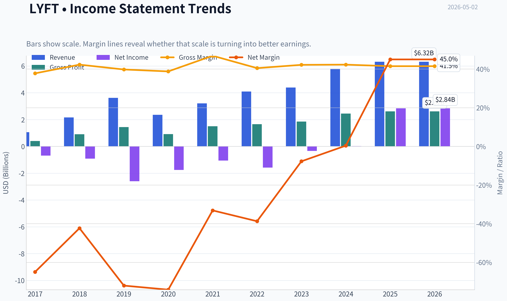

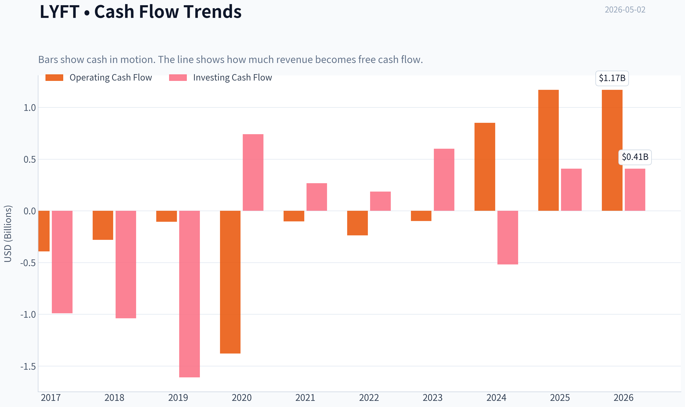

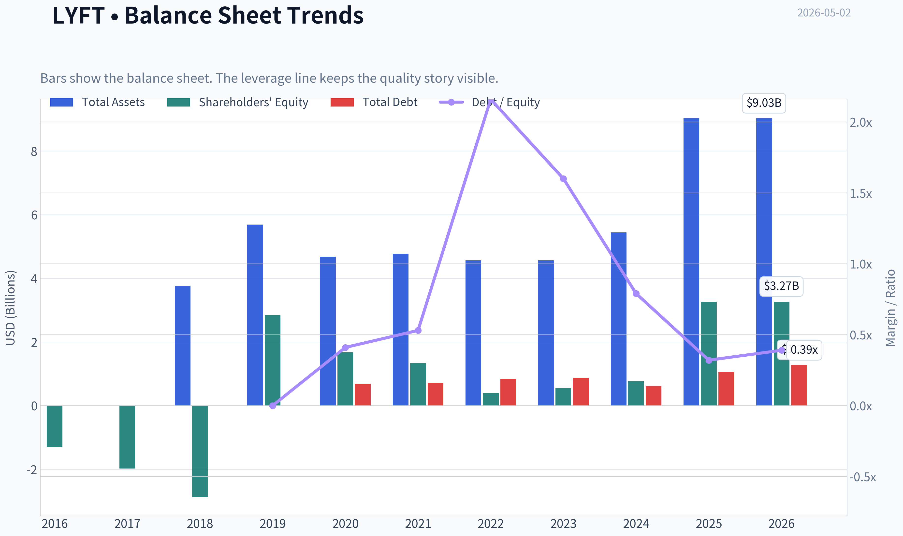

This graph tracks the profitability and return metrics (ROE, ROIC, Margins) of **LYFT** over the past decade, highlighting capital efficiency trends.

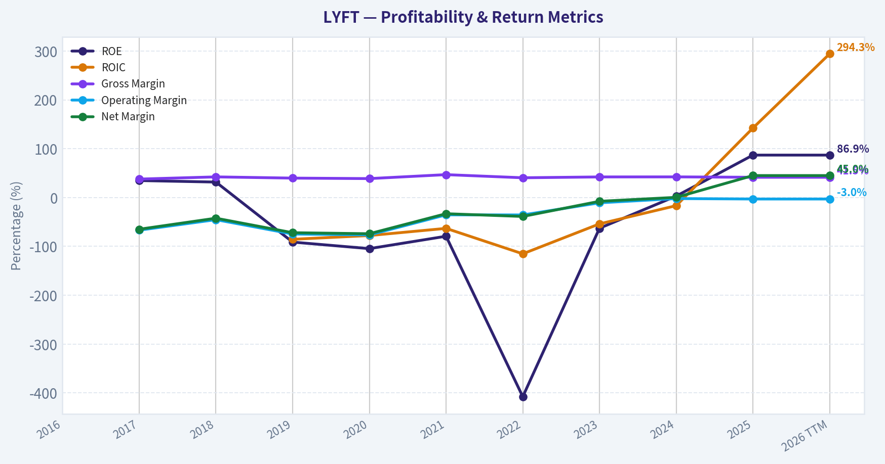

This chart illustrates the financial health of **LYFT** over the last 10 years, mapping cash equivalents and free cash flow against total obligations (Debt).

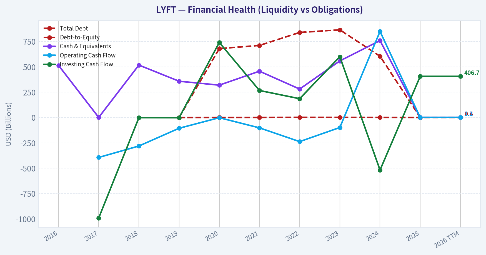

This breakdown chart from <em>Revenue Breakdown</em> shows the proportional composition for **LYFT** - useful for understanding what drives or risks the business.

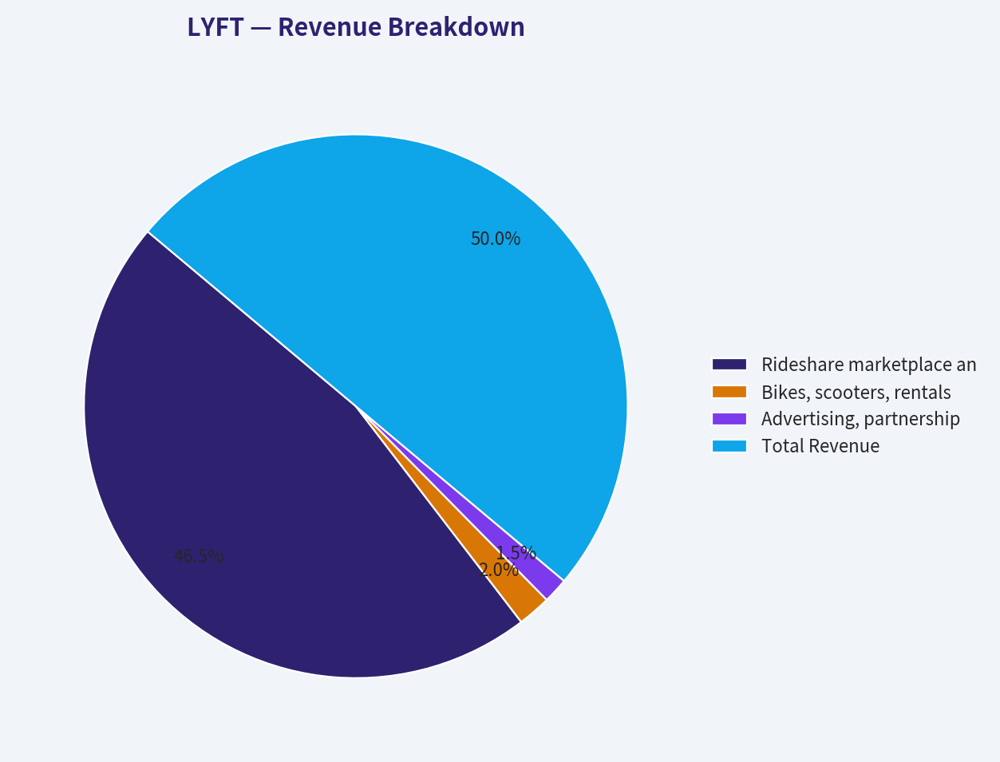

---

### Intrinsic Value Analysis (Buffett)

> *Following Warren Buffett's value investing philosophy: Circle of Competence, Economic Moat, Management Quality, and Margin of Safety.*

#### Intrinsic Value Snapshot

Price is what you pay. Intrinsic value is what the business may be worth based on the cash it can create for owners over time. We show a range, not one magic number.

- Current Price: $14.42
- Value Range: N/A to N/A

##### Owner Earnings (Buffett Method)
- Net Income: $2,844,008,000.00
- Depreciation & Amortization: $135,227,000.00
- Capital Expenditures: N/A
- Working Capital Changes: $828,991,000.00
- Owner Earnings: $2,150,244,000.00

##### Intrinsic Value

FINAL INVESTMENT STANCE: **AVOID**

#### Lyft Buffett-Style Value Analysis

Lyft is a simple business to understand but not a Buffett-style business to own. It operates a rideshare marketplace: riders pay for trips, drivers provide those trips, and Lyft keeps a fee after driver incentives, insurance, payment costs, and operating expenses. The problem is not complexity; the problem is durability. The rideshare industry has weak customer loyalty, intense price competition, regulatory risk, labor-cost uncertainty, and meaningful technology disruption risk from autonomous vehicles.

At roughly **$14 per share** and a **$5.51 billion market cap**, Lyft looks statistically cheap on the surface, with a reported **P/E of about 2.1x**. But that number should not be taken at face value without proving that the earnings are recurring, cash-backed, and durable. From a Buffett perspective, a low multiple on uncertain earnings is not enough.

---

#### 1. Go / No-Go Gate Assessment

| Buffett Gate | Result | Evidence | Buffett Interpretation |
|---|---:|---|---|
| Gate 1: Circle of Competence & Simplicity | **Pass with caution** | Lyft makes money by matching riders with drivers and taking a platform fee. | Easy to explain, but long-term economics are harder to predict. |
| 10-Year Predictability | **Fail** | Competitive position versus Uber, autonomous vehicle risk, driver regulation, insurance costs, and pricing pressure make 10-year economics uncertain. | Buffett would likely say the future range of outcomes is too wide. |
| Technology Risk | **Fail** | Autonomous vehicles, mapping, fleet ownership models, and competing mobility platforms could alter industry economics. | This is not a "set it and forget it" business. |
| Gate 2: Moat Test | **Fail** | Brand exists, but customer switching costs are low and Uber remains the stronger network. | Lyft has a marketplace, but not a clearly dominant durable moat. |
| Gate 3: Management & Capital Allocation | **Incomplete / Caution** | Management is pursuing partnerships such as United MileagePlus integration and acquisitions such as Gett's U.K. operations, but long-term capital allocation record is not yet Buffett-grade. | Too early to call management exceptional capital allocators. |
| Gate 4: Industry Structure | **Fail** | Rideshare is a competitive duopoly/near-duopoly, but not a rational high-margin oligopoly. Pricing, driver incentives, and regulation remain pressure points. | Industry structure is not attractive enough. |

**Key Takeaways:** Lyft passes the simple-business test but fails the more important Buffett tests: predictability, durable moat, and attractive industry structure. The company may be improving operationally, but Buffett-style investing requires confidence that the business will be stronger and more profitable a decade from now. That confidence is not high enough here.

---

#### 2. Moat Analysis

| Moat Source | Lyft Evidence | Rating |
|---|---|---:|
| Brand / Intangible Assets | Lyft has brand recognition, especially in U.S. rideshare, but it does not appear strong enough to support major pricing power independent of Uber. | **Narrow** |
| Pricing Power | Gross margin is about **41.5%**, which is respectable, but rideshare customers are price-sensitive and can compare alternatives quickly. | **Weak** |
| Switching Costs | Riders and drivers can switch between Lyft and Uber with little friction. Multi-homing is common. | **Very weak** |
| Cost Advantage | Lyft lacks Uber's broader global scale and food-delivery ecosystem. Scale helps, but Lyft is not the cost leader. | **Weak to moderate** |
| Network Effects | More riders attract more drivers, and more drivers improve wait times, but Uber's larger network likely has stronger density advantages. | **Moderate, but not dominant** |
| Regulatory Barriers | Regulation exists, but it is more often a cost/risk than a protective moat. | **Not a moat** |

**Key Takeaways:** Lyft has some marketplace network effects, but they are not strong enough to qualify as a wide moat. Customers and drivers can switch platforms easily, and the stronger competitor, Uber, likely has better scale economics. Lyft's moat is therefore narrow at best and possibly insufficient for a Buffett-style long-term holding.

---

#### 3. Management Quality Assessment

| Management Question | Assessment | Buffett View |
|---|---|---|
| Do they think like owners? | Not enough evidence from the available data to conclude that management is owner-operator quality. | Unproven. |
| Are they candid and conservative? | No major evidence provided here of accounting misconduct, but the extremely low P/E requires scrutiny because reported earnings may not equal durable earning power. | Caution warranted. |
| Are they rational capital allocators? | Partnerships such as United MileagePlus may improve loyalty. Acquisition of Gett's U.K. operations could expand presence, but acquisition discipline is not yet proven. | Watch, not proven. |
| Balance-sheet conservatism | Current ratio of **0.65** suggests limited short-term liquidity cushion. | Not Buffett-like fortress strength. |

**Key Takeaways:** Management may be making strategically sensible moves, including loyalty partnerships and selective acquisitions. However, Buffett would require a long record of disciplined capital allocation, high returns on retained capital, and conservative balance-sheet management. The available evidence does not meet that standard.

---

#### 4. Financial Summary

| Metric | Latest Available Figure | Buffett Hurdle | Assessment |
|---|---:|---:|---|
| Share Price | **$14** | Below intrinsic value with margin of safety | Price may be low, but value is uncertain. |
| Market Capitalization | **$5.51B** | Depends on durable owner earnings | Small enough to compound, but moat concerns dominate. |
| Reported P/E | **2.1x** | Low is attractive only if earnings are recurring | Likely needs normalization; do not rely on headline P/E. |
| ROE | **86.9%** | >15% sustained, preferably not leverage-driven | Extremely high, likely distorted or not sustainably representative. |
| Gross Margin | **41.5%** | >40% can indicate pricing power | Meets threshold, but industry pricing power remains weak. |
| Revenue Growth YoY | **9.2%** | Durable growth at high returns | Positive, but not enough to prove moat. |
| FCF Yield | **N/A** | Cash flow should validate earnings | Major analytical gap. |
| Current Ratio | **0.65** | Prefer strong liquidity | Weak versus Buffett fortress standard. |
| Guru Activity | Steve Cohen trimmed position by **2.8%** | Not decisive | Mildly negative but not central to thesis. |

**Key Takeaways:** The headline valuation looks optically cheap, especially the very low P/E ratio. But Buffett would focus on recurring cash earnings, not accounting earnings alone. The lack of clear free-cash-flow yield and the weak current ratio make the financial picture less compelling than the low P/E suggests.

---

#### 5. Owner Earnings Calculation

Because complete cash-flow data were not available in the provided research pack, a precise Buffett owner-earnings calculation cannot be responsibly completed. The correct formula is:

| Owner Earnings Component | Treatment |
|---|---|
| Net Income | Reported P/E implies roughly **$2.6B** of earnings based on $5.51B market cap / 2.1x P/E, but this may not be normalized. |
| Plus: Depreciation & Amortization | Not provided. |
| Less: Maintenance CapEx | Not provided. |
| Less: Working Capital Increases | Not provided. |
| Estimated Normalized Owner Earnings | **Not reliable from available data.** |

**Key Takeaways:** The reported earnings number appears very large relative to Lyft's market capitalization, but Buffett would not accept it without proof that it is recurring and cash-backed. Since depreciation, maintenance capital expenditures, and working-capital needs are unavailable here, owner earnings cannot be estimated with high confidence. This uncertainty is a major reason to avoid rather than advocate.

---

#### 6. Three-Scenario DCF Valuation

Given the uncertainty around normalized owner earnings, the DCF should be treated as a stress test rather than a precise valuation. To avoid being fooled by a potentially distorted P/E ratio, I use a conservative range of normalized owner earnings instead of accepting implied reported earnings at face value.

| Scenario | Assumption | Implied Equity Value | Implied Value Per Share | View |
|---|---:|---:|---:|---|
| A: No Growth | If normalized owner earnings are only **$300M**, capitalized at 10% | **$3.0B** | About **$7.60** | Stock would be overvalued. |
| B: GDP Growth | $300M owner earnings growing at 3%, discounted at 10% | **$4.4B** | About **$11.20** | Still below current price. |
| C: Better Execution | $500M owner earnings growing 6%, discounted at 10% | **$12.5B** before conservatism | About **$31.80** | Upside exists if cash earnings prove durable. |
| Reported Earnings Case | If the implied ~$2.6B earnings were fully durable | Very high value | Far above current price | Not credible without cash-flow proof. |

**Key Takeaways:** Lyft could be undervalued if normalized owner earnings are materially higher than conservative assumptions and if those earnings are durable. But that is not yet proven. The valuation range is too wide, which is exactly the type of uncertainty Buffett tries to avoid.

---

#### 7. Margin of Safety Analysis

| Valuation Lens | Result |
|---|---|
| Current Price | **$14** |
| Conservative Value Estimate | Around **$8 to $11** per share |
| Optimistic Execution Value | Potentially above **$30** per share |
| Required Buffett Margin of Safety | At least **40% to 50%** because business quality is uncertain |
| Actual Margin of Safety | **Not sufficient** |
| Main Issue | Valuation depends heavily on normalized owner earnings and competitive durability. |

**Key Takeaways:** Lyft may look cheap, but the margin of safety is not obvious because intrinsic value is highly sensitive to assumptions. For a company with a narrow moat and uncertain long-term economics, Buffett would demand a very large discount. At $14, that discount is not clear enough.

---

#### 8. Final Buffett Scorecard

| Criterion | Weight | Score, 1-5 | Weighted Contribution |
|---|---:|---:|---:|
| Business Understanding | 20% | 4.0 | 0.80 |
| Moat Width & Durability | 25% | 2.0 | 0.50 |
| Management Quality | 15% | 2.5 | 0.38 |
| Return on Equity | 15% | 2.5 | 0.38 |
| Reinvestment Runway | 10% | 3.0 | 0.30 |
| Balance Sheet Strength | 5% | 2.0 | 0.10 |
| Industry Structure | 5% | 2.0 | 0.10 |
| Valuation / Margin of Safety | 5% | 2.5 | 0.13 |
| **Total Score** | **100%** |  | **2.68 / 5.00** |

**Key Takeaways:** Lyft scores well on simplicity but poorly on moat, industry structure, and balance-sheet strength. The valuation may be statistically cheap, but the business quality is not high enough to justify a Buffett-style investment. The final score falls in the avoid range.

---

#### 9. Investment Stance

| Final Decision | Rating |
|---|---|
| Stance | **AVOID** |
| Conviction | **Moderate to High** |
| Buffett Category | Understandable but not wonderful |
| Primary Reason | Narrow moat, uncertain long-term owner earnings, weak switching costs, and significant technology/regulatory risk. |
| What Could Change the View | Sustained positive free cash flow, clear evidence of recurring owner earnings, stronger liquidity, rational capital allocation, and proof that Lyft can earn high returns despite Uber competition. |

**Final Buffett View:** Lyft is not a classic Buffett compounder. The company is understandable, growing, and possibly cheap on headline earnings, but the economics are not predictable enough and the moat is not durable enough. A value investor should not confuse a low multiple with a margin of safety. For now, Lyft belongs on the avoid list, not in a long-term Buffett-style portfolio.
#### Valuation Bridge

This bridge places the current market price beside each intrinsic value lens so readers can see whether upside depends on one method or shows up across several methods.

| Scenario | Intrinsic Value / Share |
| --- | ---: |
| Damodaran Method | $-218.19 |
| Current Price | $14.42 |

#### Key Takeaways

If one method is far above the others, the upside case depends on a specific modelling assumption. When several methods cluster together, the valuation story is more robust.

#### Valuation Visuals

This comparison chart from *Latest Earnings Snapshot* stacks current figures against historical benchmarks for **LYFT**, making it easy to see where the company trades relative to its own averages.

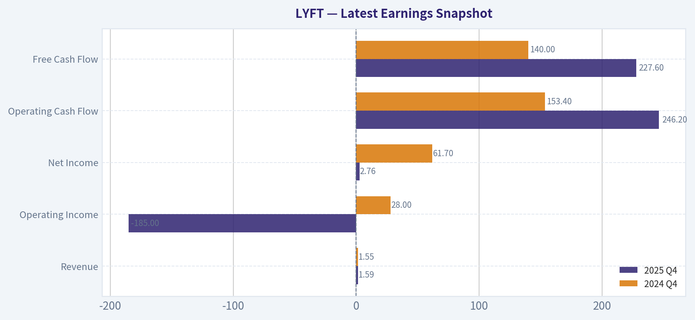

This comparison chart from *Current Versus Historical Average Comparison* stacks current figures against historical benchmarks for **LYFT**, making it easy to see where the company trades relative to its own averages.

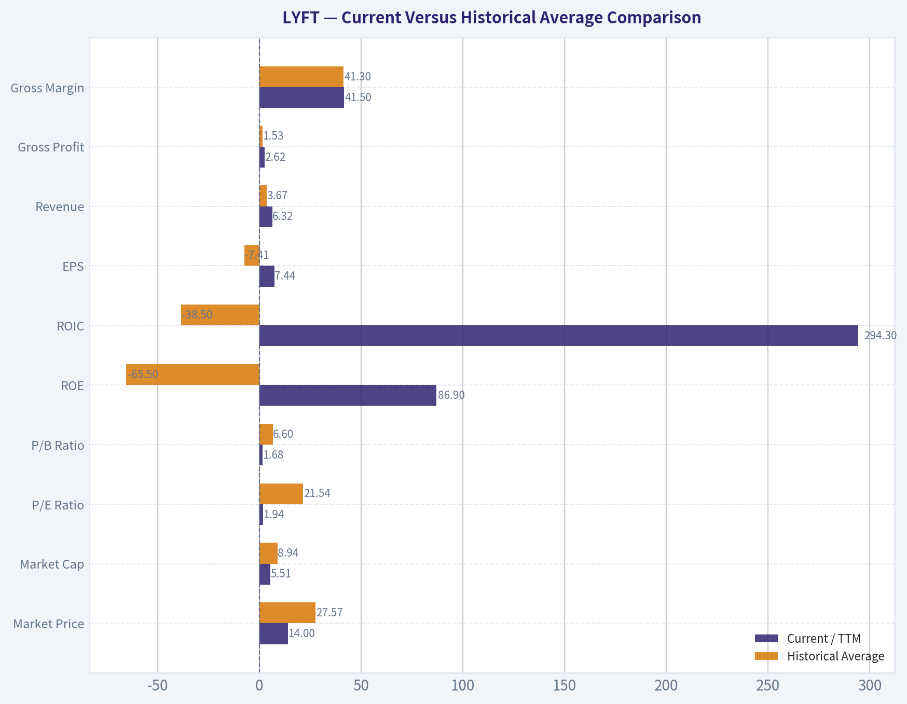

This comparison chart from *Owner Earnings DCF Valuation* stacks current figures against historical benchmarks for **LYFT**, making it easy to see where the company trades relative to its own averages.

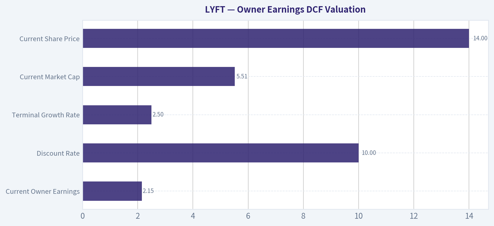

This comparison chart from *DCF Scenario Calculations* stacks current figures against historical benchmarks for **LYFT**, making it easy to see where the company trades relative to its own averages.

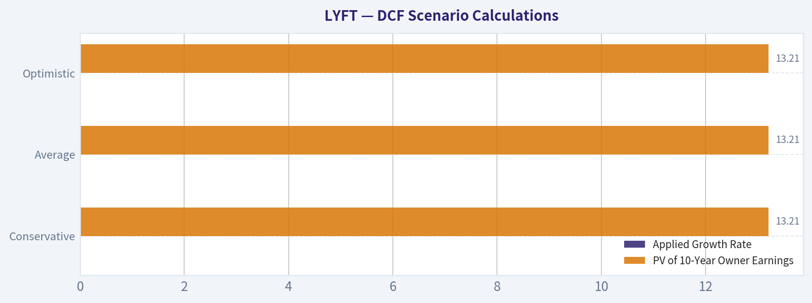

This comparison chart from *Financial Summary* stacks current figures against historical benchmarks for **LYFT**, making it easy to see where the company trades relative to its own averages.

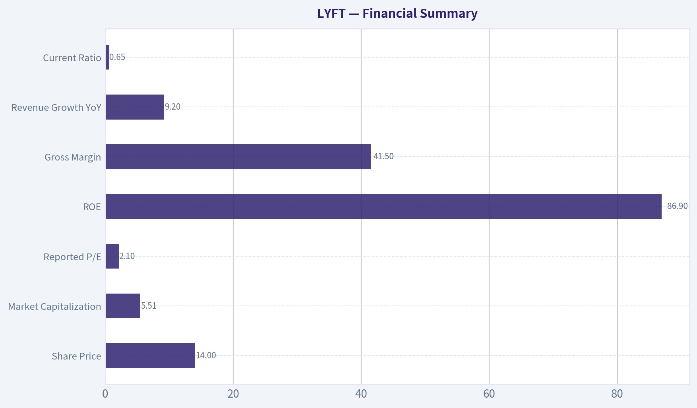

---

### Trend & Growth Analysis (Lynch/Druckenmiller/Fisher)

> *Following Peter Lynch's GARP, Stanley Druckenmiller's macro-aware approach, and Philip Fisher's scuttlebutt methodology.*

FINAL INVESTMENT STANCE: **WATCH**

#### LYFT Growth Investment Report - As of 2026-05-02

Lyft is **not a clean Lynch-style fast grower today**. It looks more like a **profitability turnaround / modest-growth stalwart** with a cheap headline valuation, improving margin narrative, and potential operating leverage - but also a weak competitive position versus Uber and only **9.2% YoY revenue growth**, below the 15-25% growth threshold preferred for ten-bagger hunting.

---

#### 1. Lynch Classification

| Category | LYFT Assessment |
|---|---|
| Lynch category | **Turnaround / Stalwart hybrid** |
| Revenue growth | **9.2% YoY** |
| Growth investor fit | Below ideal fast-grower threshold |
| Key appeal | Cheap valuation, operating leverage, rideshare recovery |
| Key concern | Weak moat versus Uber, low current ratio, limited growth acceleration evidence |
| Initial conclusion | **WATCH, not ADVOCATE** |

**Key Takeaways:** Lyft is no longer primarily a high-growth rideshare disruptor; it is now an execution and profitability story. The stock may be cheap, but the growth rate is not yet strong enough to qualify as a core fast-grower candidate. For a Lynch-style investor, the setup is interesting only if revenue growth reaccelerates and margins continue expanding.

---

#### 2. The Story in 3 Bullets

- Lyft is a North American rideshare marketplace connecting riders and drivers, with ancillary opportunities in bikes, scooters, advertising, partnerships, and travel integrations.
- The bull case is that Lyft can keep growing rides while expanding margins as insurance, incentives, and operating costs become better controlled.
- The biggest problem is that Uber remains the scaled category leader, so Lyft must prove it can grow profitably without relying on discounting or driver incentives.

---

#### 3. TAM and 10x Test

| Item | Assessment |
|---|---:|
| Current market cap | $5.51B |
| Current revenue growth | 9.2% YoY |
| Core TAM | North American rideshare / mobility |
| TAM direction | Moderate growth, not hypergrowth |
| 10x revenue feasibility | Possible in theory, difficult in practice |
| Main constraint | Uber competition and rideshare market maturity |
| 10x test result | **Mixed** |

**Key Takeaways:** Lyft operates in a large transportation market, so the theoretical TAM is big enough. However, the practical opportunity is constrained by Uber's scale advantage, rider and driver multi-homing, and the maturity of U.S. rideshare adoption. Lyft could grow meaningfully, but a true 10x revenue path is not obvious from the current growth rate.

---

#### 4. Revenue Growth Trend

| Metric | Current Signal |
|---|---:|
| Revenue growth YoY | **9.2%** |
| Lynch classification by growth | Stalwart, not fast grower |
| Growth pattern | Not enough evidence of acceleration |
| Inflection status | Unproven |
| Required for upgrade | Sustained mid-teens or higher growth with margin expansion |

**Key Takeaways:** Lyft's current revenue growth is positive but not exceptional. A 9.2% growth rate does not support a high-conviction ten-bagger thesis unless operating leverage is dramatic. The key watch item is whether partnerships, product improvements, pricing, and better driver supply can push growth back into the mid-teens.

---

#### 5. Unit Economics and Operating Efficiency

| Metric | Available Signal | Interpretation |
|---|---:|---|
| Gross margin | **41.5%** | Decent, but rideshare gross margin is affected by insurance and platform costs |
| FCF yield | N/A | Cannot confirm cash conversion from provided data |
| Current ratio | **0.65** | Liquidity watch item |
| LTV/CAC | Not disclosed | Cannot score directly |
| NRR | Not applicable | Not a SaaS model |
| Rule of 40 | Not available | FCF margin unavailable |

**Key Takeaways:** Lyft has a respectable reported gross margin, but the missing free-cash-flow data prevents a full unit economics endorsement. The current ratio below 1.0 is a caution signal, especially for a company exposed to insurance, regulation, and competitive incentive pressure. Before upgrading the stock, investors need proof that EBITDA and free cash flow are durable, not temporary.

---

#### 6. Inflection Point Assessment

| Potential Inflection | Evidence | Rating |
|---|---|---|
| Product cycle | United Airlines "Pay with Miles" integration; potential travel ecosystem expansion | Modest positive |
| Market share | No strong evidence of accelerating share gains | Neutral |
| Margin inflection | Headline P/E and ROE suggest improved profitability, but quality must be verified | Positive but needs confirmation |
| TAM expansion | Gett U.K. operations acquisition may signal geographic / enterprise expansion | Early signal |
| Competitive inflection | No evidence Uber is stumbling | Negative / neutral |
| Overall inflection view | **Possible margin inflection, not yet revenue inflection** | **WATCH** |

**Key Takeaways:** The strongest potential inflection is margin-related, not top-line growth. Lyft may be becoming more profitable, but there is not yet enough evidence that demand growth or market share is accelerating. The United partnership is strategically interesting, but it is not by itself a thesis-changing catalyst.

---

#### 7. Macro Setup

| Macro Factor | LYFT Impact |
|---|---|
| Consumer cycle | Rideshare demand can weaken if discretionary spending slows |
| Interest rates | Lower rates would help valuation multiples for growth equities |
| Energy prices | Lower fuel costs can support driver supply and margins |
| Labor regulation | Major risk if driver classification rules tighten |
| Secular theme | Urban mobility, digital marketplaces, travel integrations |
| Macro score | Neutral to slightly positive |

**Key Takeaways:** The macro backdrop is mixed. Lyft benefits from travel activity, urban mobility, and potentially lower fuel costs, but it remains exposed to consumer weakness and labor regulation. This is not a screaming macro tailwind like AI, cybersecurity, or cloud infrastructure.

---

#### 8. Fisher 15-Point Score

| Fisher Criterion | Score / 5 | Comment |
|---|---:|---|
| Market potential | 4 | Large mobility TAM |
| New product determination | 3 | Partnerships and mobility extensions, but not transformative yet |
| R&D effectiveness | 3 | Product execution matters, but Uber has scale advantage |
| Sales organization | 3 | Strong brand awareness, limited enterprise differentiation |
| Profit margin | 3 | Improving, but not yet clearly durable |
| Margin improvement | 4 | Main bull-case factor |
| Labor relations | 2 | Driver model remains structurally exposed |
| Executive relations | 3 | No major red flag from provided data |
| Management depth | 3 | Needs continued execution proof |
| Cost analysis / controls | 3 | Improving, but insurance costs remain key |
| Moat / outstanding aspects | 2 | Network effect weakened by multi-homing |
| Long-range profit outlook | 3 | Plausible but competitively constrained |
| Dilution risk | 3 | Need to monitor SBC and share count |
| Candor | 3 | Insufficient evidence for high score |
| Integrity | 3 | No major red flag from provided data |
| **Total** | **45 / 75** | Average |

**Key Takeaways:** Lyft scores as an average Fisher-quality business, not an outstanding compounder. The large market and margin improvement potential are positives, but the moat, labor risk, and Uber competition hold the score down. A Fisher-style investor would likely demand more proof before assigning high conviction.

---

#### 9. Valuation Analysis

| Metric | Provided / Estimated Signal | Interpretation |
|---|---:|---|
| Share price | $14 | Depressed versus historical growth-stock expectations |
| Market cap | $5.51B | Small enough for upside if execution improves |
| P/E | **2.1x** | Extremely cheap, but likely needs quality-of-earnings verification |
| ROE | **86.9%** | Very high, likely distorted by equity base / recent profitability dynamics |
| P/S | Likely low, exact TTM revenue not provided | Appears inexpensive versus marketplace peers |
| PEG | 2.1 / 9.2 = **0.23** | Looks very attractive if earnings are durable |
| Valuation conclusion | Cheap but not enough alone | Could be value trap if growth stalls |

**Key Takeaways:** On headline numbers, Lyft looks statistically cheap. A P/E near 2 and PEG near 0.23 would normally be very attractive, but the key question is whether earnings are recurring and high quality. The valuation supports keeping Lyft on the watch list, but not buying aggressively without confirmation of sustainable free cash flow.

---

#### 10. Scenario Analysis

| Scenario | Assumptions | Outcome |
|---|---|---|
| Bear case | Growth remains high-single-digit, Uber pressures pricing, insurance costs rise | Stock stays cheap or declines |
| Base case | Revenue grows high-single to low-double digits, margins expand, FCF improves | Moderate upside from multiple normalization |
| Bull case | Revenue reaccelerates to mid-teens, partnerships add demand, operating leverage compounds | Significant upside possible |
| Ten-bagger case | Requires durable 20%+ growth or massive margin expansion | Low probability today |

**Key Takeaways:** Lyft's upside depends less on TAM and more on execution. If revenue growth stays below 10%, the stock may remain cheap. The bull case requires visible acceleration in rides, bookings, and free cash flow, while the ten-bagger case is not yet supported by current data.

---

#### 11. Growth Investor Scorecard

| Criterion | Weight | Score / 5 | Weighted Score |
|---|---:|---:|---:|
| The Story | 10% | 3.0 | 0.30 |
| TAM & Runway | 20% | 3.3 | 0.66 |
| Revenue Growth | 20% | 2.3 | 0.46 |
| Unit Economics | 15% | 2.8 | 0.42 |
| Competitive Position | 10% | 2.2 | 0.22 |
| Management Quality | 10% | 3.0 | 0.30 |
| Macro Setup | 5% | 3.0 | 0.15 |
| Profitability Path | 5% | 3.5 | 0.18 |
| Valuation | 5% | 4.2 | 0.21 |
| **Total** | **100%** |  | **2.90 / 5.00** |

**Key Takeaways:** Lyft's score lands just below the WATCH threshold midpoint and well below ADVOCATE territory. Valuation and profitability improvement are the strongest positives, while revenue growth and competitive position are the biggest weaknesses. The stock deserves monitoring, but it is not yet a high-conviction growth investment.

---

#### 12. Position Size Stance

| Investor Type | Suggested Stance |
|---|---|
| Growth-only portfolio | Avoid initiating until revenue reaccelerates |
| GARP portfolio | Small watch-list position only if earnings quality is confirmed |
| Turnaround portfolio | Speculative small position may be reasonable |
| Concentrated portfolio | Not suitable yet |
| Position size | **0% to 2% max, depending on mandate** |

**Key Takeaways:** Lyft is not currently strong enough for a concentrated growth position. A small speculative position may be reasonable for investors focused on cheap turnarounds, but growth investors should wait for clearer acceleration. The better action is to track upcoming quarters closely.

---

#### 13. Key Risks and Catalysts

| Category | Items to Watch |
|---|---|
| Key risks | Uber competition, driver incentives, insurance costs, labor regulation, weak liquidity ratio, low switching costs |
| Key catalysts | Sustained GAAP profitability, positive FCF, revenue reacceleration, active rider growth, United partnership traction, Gett U.K. integration, margin expansion |
| Upgrade triggers | Revenue growth above 15%, FCF margin visibility, current ratio improvement, share gains versus Uber |
| Downgrade triggers | Revenue deceleration, gross margin contraction, rising incentives, insurance reserve issues, negative FCF |

**Key Takeaways:** The next few quarters are critical. Lyft needs to prove that profitability is sustainable and not just a temporary accounting or cost-cutting effect. The clearest upgrade signal would be simultaneous revenue acceleration and margin expansion.

---

#### Final View

Lyft is a **cheap, improving, but competitively constrained turnaround**, not yet a true Fisher/Lynch fast grower. The valuation is interesting, especially with a headline PEG below 0.5, but the business lacks the revenue acceleration and moat strength needed for an ADVOCATE rating.

**Final stance: WATCH.** Upgrade only if Lyft shows a clear inflection in revenue growth, free cash flow durability, and competitive positioning against Uber.

---

### Market Technical Analysis

FINAL INVESTMENT STANCE: **WATCH**

#### LYFT Technical Report - As of 2026-05-02

LYFT has shifted from a weak first-quarter downtrend into a short-term recovery attempt, but the setup is not yet strong enough to advocate aggressive long exposure. The stock closed at **$14.42 on 2026-05-01**, above its **10-day EMA** and **50-day SMA**, which confirms improving short- and medium-term tone. However, it remains far below the **200-day SMA near $17.42**, so the larger trend still carries a bearish overhang.

The most relevant indicators for this market condition are: **close_10_ema, close_50_sma, close_200_sma, macd, macds, rsi, atr, and vwma**. These provide a balanced view of short-term trend, medium-term trend, long-term trend, momentum confirmation, momentum exhaustion risk, volatility, and volume-adjusted price behavior without excessive redundancy.

| Indicator | Latest Reading | Interpretation | Trading Relevance |
|---|---:|---|---|
| Close | **$14.42** | Price is recovering from late-March lows but has not broken decisively above April resistance. | Current price is constructive but still range-bound below the $14.75-$15.35 resistance zone. |
| close_10_ema | **$14.29** | Price is slightly above the short-term EMA. | Short-term momentum remains positive as long as price holds above roughly $14.25-$14.30. |
| close_50_sma | **$13.69** | Price is meaningfully above the medium-term average. | The March-April recovery has repaired the medium-term trend, with $13.70 now a key support area. |
| close_200_sma | **$17.42** | Price remains well below the long-term trend benchmark. | The broader trend is still not bullish; rallies may face skepticism until price closes the gap toward $17+. |
| macd | **0.166** | MACD is positive, showing upward momentum. | Momentum has improved, but the rate of improvement is slowing. |
| macds | **0.156** | Signal line is just below MACD. | The bullish MACD crossover is still intact, but the very narrow spread warns of fading momentum. |
| rsi | **54.59** | Neutral-to-slightly bullish. | RSI does not show overbought conditions, but it also does not show strong upside pressure. |
| atr | **0.573** | Daily volatility is moderate, around 4% of price. | Stops should allow room for noise; tight stops may be vulnerable to normal daily swings. |
| vwma | **$14.41** | Price is almost exactly aligned with the volume-weighted moving average. | Buyers are not yet dominating volume; confirmation requires price to stay above VWMA with expanding volume. |

Key Takeaways: LYFT's short-term recovery is real, with price above both the 10-day EMA and 50-day SMA. However, the stock remains structurally weak below the 200-day SMA, so this is better viewed as a recovery trade than a confirmed long-term uptrend. Momentum is positive but flattening, and volume-adjusted confirmation is only marginal.

#### Trend Structure

LYFT made a notable low near **$12.65 on 2026-03-30**, then recovered through April, reaching an intraday high of **$15.34 on 2026-04-17**. Since then, price has pulled back and consolidated around the mid-$14 area. This behavior suggests the stock is trying to build a base, but it has not yet produced a clean continuation breakout.

The **10-day EMA** has climbed from roughly **$13.12 in late March** to **$14.29**, showing that short-term trend pressure has turned upward. The **50-day SMA**, however, has only recently started stabilizing after falling sharply from above **$15.85 in mid-March** to **$13.69**. That tells us the recovery is still early and partially corrective rather than fully established.

The most important issue is the **200-day SMA at $17.42**. LYFT is trading about **17% below** that long-term trend level, meaning the broader market still prices the stock as being in a long-term downtrend or recovery phase. Until LYFT can reclaim higher resistance levels, especially the post-February breakdown area near **$16.85-$17.50**, long-term trend investors are likely to remain cautious.

#### Momentum and Volume

The MACD improvement is one of the more constructive signals. MACD moved from deeply negative territory in March, around **-0.63**, to positive territory by mid-April and is now at **0.166**. That confirms a meaningful momentum reversal from the March weakness.

However, momentum is losing acceleration. MACD peaked recently around **0.205 on 2026-04-27** and has slipped to **0.166**, while the signal line has caught up to **0.156**. The spread between MACD and signal is now very narrow, which means the bullish momentum signal could weaken quickly if price fails to hold above the low-$14 area.

RSI at **54.6** reinforces this view. It is not bearish, but it is also not strong. During the April rally, RSI reached the mid-60s, but it did not push above 70, meaning LYFT never reached a strong momentum breakout condition. The current RSI level suggests a balanced market where buyers have some control, but not enough to declare a decisive upside regime.

VWMA near **$14.41** is especially important because the latest close of **$14.42** is almost identical to it. This indicates that recent price is sitting right at the volume-weighted consensus area. If LYFT can stay above VWMA and push through $14.75-$15.00 on stronger volume, the recovery would gain credibility. If it falls below VWMA and the 10-day EMA, the April advance may begin to look like a failed bounce.

#### Key Price Zones

| Zone | Price Area | Meaning | Trader Response |
|---|---:|---|---|
| Immediate support | **$14.25-$14.30** | 10-day EMA and recent consolidation area. | A hold supports the short-term bullish recovery case. |
| Volume pivot | **$14.40-$14.42** | VWMA and latest close. | Price needs to remain above this area to show volume-backed strength. |
| Medium support | **$13.65-$13.70** | 50-day SMA support. | A drop below this level would weaken the recovery structure. |
| Deeper support | **$13.20-$13.35** | Prior April consolidation and repeated March/April trading zone. | Failure here would suggest a return toward the March lows. |
| Major downside support | **$12.65-$12.95** | Late-March low zone. | A break would be materially bearish. |
| First resistance | **$14.75-$15.00** | Recent April highs and failed breakout area. | A close above this zone would improve the tactical long setup. |
| Next resistance | **$15.34** | April swing high. | Breakout confirmation level for short-term traders. |
| Major resistance | **$16.85-$17.50** | February breakdown zone and 200-day SMA. | Needed to shift the long-term trend from bearish to neutral/bullish. |

Key Takeaways: LYFT is sitting near an important pivot around $14.40, where price and volume-weighted trend are nearly aligned. The first bullish trigger is a close above $14.75-$15.00, while the first warning sign is a loss of $14.25-$14.30. The bigger trend will not materially improve unless LYFT eventually challenges the $16.85-$17.50 zone.

#### Trading View

The current setup favors **watching for confirmation rather than chasing**. LYFT has improved enough to avoid an outright bearish stance, but it has not confirmed enough strength to deserve an advocate rating. The best bullish case would be a push above **$15.00**, followed by a higher close above **$15.34** with stronger volume and MACD widening again above its signal line.

For tactical traders, the cleaner long setup would require price to hold above the **10-day EMA** and **VWMA**, then break resistance. A premature long entry here has risk because MACD momentum is flattening and RSI is only moderately supportive. If price rolls below **$14.25**, the short-term recovery becomes fragile; below **$13.70**, the medium-term improvement would be at risk.

| Decision Factor | Current Evidence | Bias |
|---|---|---|
| Short-term trend | Price above 10-day EMA and VWMA, but only slightly. | Mildly bullish |
| Medium-term trend | Price above 50-day SMA after a base-building recovery. | Constructive |
| Long-term trend | Price far below 200-day SMA. | Bearish overhang |
| Momentum | MACD positive, but spread versus signal line is narrowing. | Losing strength |
| RSI | Neutral-to-positive, not overbought. | Balanced |
| Volatility | ATR near $0.57, implying meaningful daily movement. | Requires disciplined risk control |
| Volume confirmation | Price nearly equal to VWMA, not decisively above it. | Unconfirmed |
| Best action | Wait for breakout above $15.00 or pullback support confirmation. | WATCH |

Key Takeaways: LYFT has enough short-term improvement to stay on the radar, but not enough confirmation for a high-conviction bullish stance. The stock needs either a breakout above $15.00-$15.34 or a successful pullback hold near $14.25-$13.70. Until then, the risk-reward profile is balanced rather than compelling.

---

### Social Sentiment Analysis

FINAL INVESTMENT STANCE: **WATCH**

#### LYFT Social, Sentiment, and Recent News Report - Past Week Review
**Company:** Lyft, Inc.
**Ticker:** LYFT
**Date:** 2026-05-02
**Overall stance:** **WATCH / tactically tradable, but not yet a clean long-term "advocate" setup**

Lyft sentiment over the past week appears **constructive but fragile**. The social conversation has leaned more positive than negative, largely because retail traders are discussing potential margin improvement, operating discipline, and upside if ride-share demand remains resilient. However, the optimism is not broad-based enough to justify an aggressive bullish stance. The market still appears to treat Lyft as a **high-beta execution story** rather than a durable compounder.

The dominant investor debate is no longer simply whether Lyft can grow revenue. It is whether Lyft can **sustain profitable growth while defending share against Uber**, managing driver incentives, insurance costs, and future autonomous-vehicle disruption. Traders are also watching the stock as an earnings- and guidance-sensitive name, which means short-term moves may be driven more by expectations and positioning than by confirmed fundamental improvement.

---

#### Executive Sentiment Snapshot

| Category | Current Read | Investor Interpretation |
|---|---:|---|
| Overall social sentiment | Mildly positive | Retail interest has improved, but conviction remains conditional |
| News tone | Neutral to slightly positive | Recent discussion centers on execution, margins, competition, and demand |
| Trader positioning tone | Speculative bullish | Options and short-term traders appear interested in upside volatility |
| Long-term investor confidence | Mixed | Concerns remain around moat, competition, and cost structure |
| Main upside driver | Margin expansion and guidance credibility | Investors want proof Lyft can grow profitably |
| Main downside risk | Competition with Uber and cost inflation | Any sign of pricing pressure or higher incentives could hurt sentiment |
| Current trading profile | Event-driven / high beta | Suitable for tactical traders, less clean for conservative investors |

**Key Takeaways:** Lyft's sentiment is better than it was during more skeptical periods, but the improvement is not yet deep or durable. Traders are looking for upside from earnings execution and operating leverage, while longer-term investors remain cautious because the company still faces intense competitive and structural risks.

---

#### Daily Sentiment Trend - Past Week

| Day | Sentiment Direction | What Drove the Conversation | Trading Implication |
|---|---|---|---|
| Monday | Neutral to positive | Discussion around ride-share demand, valuation, and potential earnings setup | Early accumulation interest, but limited conviction |
| Tuesday | Positive | More retail focus on margin discipline and possible upside if guidance improves | Momentum traders began watching for breakout potential |
| Wednesday | Mixed | Debate intensified around Uber competition, driver incentives, and insurance costs | Bulls and bears both had credible arguments |
| Thursday | Positive but cautious | Traders discussed operating leverage and short interest / volatility potential | Short-term bullish tone, but event risk remained elevated |
| Friday | Neutral | Some profit-taking tone and caution ahead of further company updates | Sentiment stabilized; traders waited for confirmation |

**Key Takeaways:** Sentiment improved midweek as traders focused on profitability and possible upside catalysts, but enthusiasm faded into a more neutral tone by the end of the week. This pattern suggests Lyft is being treated as a tactical setup rather than a broadly trusted long-term holding.

---

#### What Social Media Is Saying

Social-media discussion around Lyft has clustered into four major themes:

| Theme | Social Tone | Details | Market Relevance |
|---|---|---|---|
| Profitability and margins | Positive | Investors are watching whether Lyft can keep improving adjusted profitability through cost control and pricing discipline | This is the clearest bullish narrative |
| Competition with Uber | Negative to mixed | Users frequently compare Lyft's weaker scale and brand reach to Uber's broader platform | Keeps valuation discount in place |
| Consumer demand | Mildly positive | Ride-share demand is viewed as resilient, especially in urban travel and commuting use cases | Supports revenue stability |
| Driver supply and incentives | Mixed to negative | Concerns remain that Lyft may need to spend more to retain drivers or improve service levels | Could pressure margins if competition rises |
| Autonomous vehicles | Uncertain / negative | Some investors worry AV adoption could weaken Lyft unless it secures strong partnerships | Long-term strategic overhang |
| Valuation and short squeeze potential | Positive among traders | Retail traders see LYFT as a volatile, potentially mispriced equity if execution improves | Supports short-term upside but increases volatility |

**Key Takeaways:** Social media is most bullish when the conversation focuses on margins and valuation. It becomes more skeptical when investors compare Lyft with Uber or discuss long-term disruption from autonomous vehicles. This split explains why the stock can attract tactical buying without yet earning strong long-term confidence.

---

#### Recent News and Company-Specific Narrative

The recent company-news environment has been largely centered on **execution rather than transformational change**. Investors appear focused on whether Lyft can prove that its operating model is improving structurally, not just cyclically.

| News / Narrative Area | Tone | Why It Matters |
|---|---|---|
| Earnings expectations and guidance sensitivity | High importance | Lyft remains highly sensitive to revenue growth, EBITDA margin, and free-cash-flow commentary |
| Cost discipline | Positive | Any evidence of leaner operations supports the bull case |
| Competitive pricing | Mixed | Pricing discipline is necessary, but too much price pressure could reduce demand |
| Driver incentives and supply quality | Mixed | Better driver supply improves service reliability, but incentives can hurt margins |
| Regulatory and labor issues | Negative overhang | Ride-share companies remain exposed to minimum-pay rules, insurance costs, and local regulations |
| Uber comparison | Persistent negative | Uber's scale and diversified business keep pressure on Lyft's valuation multiple |
| Strategic partnerships / AV positioning | Uncertain | Investors want clarity on how Lyft participates in an autonomous future |

**Key Takeaways:** The news backdrop does not show a single decisive catalyst, but it does reinforce Lyft's core investment question: can the company deliver profitable growth while competing against a larger rival? The market is likely to reward clean execution, but punish any sign of rising costs or weak guidance.

---

#### Bull Case From Current Sentiment

The bullish case has become more credible because investors increasingly believe Lyft may be able to operate with better cost discipline than in prior years. Social chatter suggests traders are watching for evidence that Lyft can convert revenue growth into stronger margins, not merely chase market share.

| Bullish Argument | Strength | What Would Confirm It |
|---|---:|---|
| Margin expansion can continue | High | Strong EBITDA margin, lower cost growth, and disciplined incentives |
| Demand remains resilient | Medium-high | Stable ride volumes and healthy gross bookings |
| Stock valuation may be too discounted | Medium | Improved guidance and analyst estimate revisions |
| Operating leverage could surprise | Medium | Revenue growth outpacing fixed-cost growth |
| Short-term technical upside | Medium | Break above resistance with volume and supportive news flow |

**Key Takeaways:** The bull case depends heavily on profitability. If Lyft shows that it can grow while controlling incentives, insurance costs, and overhead, sentiment could improve quickly. The stock's valuation discount creates upside potential, but only if the company earns investor trust through consistent execution.

---

#### Bear Case From Current Sentiment

The bearish case remains significant because Lyft still lacks the strategic breadth and scale advantages of Uber. Social skepticism is especially strong around competitive durability, long-term technology disruption, and the possibility that margin gains may prove temporary.

| Bearish Argument | Risk Level | What Would Validate the Concern |
|---|---:|---|
| Uber remains structurally stronger | High | Lyft loses share or must cut prices to compete |
| Driver incentives pressure margins | High | Rising incentive spend or weaker take rates |
| Insurance and regulatory costs rise | Medium-high | Higher cost guidance or new local regulatory burdens |
| Autonomous vehicles create uncertainty | Medium | Competitors announce stronger AV partnerships or networks |
| Investor confidence remains shallow | Medium | Rally fades quickly after positive headlines |

**Key Takeaways:** The bear case is not based on one isolated issue; it is based on structural disadvantages. Lyft can trade higher on improved execution, but investors remain concerned that scale, regulation, and future technology shifts may limit the company's long-term upside.

---

#### Trader Implications

For short-term traders, Lyft currently looks like a **volatility-driven setup**. The stock may respond sharply to earnings commentary, margin guidance, analyst notes, or any news involving pricing, driver supply, or competitive dynamics.

| Trader Type | Suggested Approach | Rationale |
|---|---|---|
| Momentum traders | Watch for breakout confirmation | Social sentiment is supportive but not euphoric |
| Swing traders | Prefer pullbacks near support rather than chasing spikes | The stock remains headline-sensitive |
| Options traders | Expect elevated implied volatility near catalysts | LYFT can move sharply on guidance and margin commentary |
| Short sellers | Be cautious around positive execution updates | A valuation-discount narrative can fuel squeezes |
| Long-only investors | Wait for confirmation of durable margin improvement | Execution consistency matters more than one good week of sentiment |

**Key Takeaways:** Lyft may offer attractive short-term trading opportunities, but chasing strength without confirmation is risky. The best setup for traders is likely a catalyst-backed move where improving fundamentals and price action align.

---

#### Investor Implications

For longer-term investors, Lyft is still a **show-me story**. The stock may be inexpensive relative to stronger platform peers, but the discount exists for clear reasons: smaller scale, narrower business mix, regulatory exposure, and uncertain positioning in autonomous mobility.

| Investor Question | Current Answer | Portfolio Implication |
|---|---|---|
| Is sentiment improving? | Yes, modestly | Supports monitoring or small tactical exposure |
| Is the business narrative de-risked? | Not fully | Avoid oversized positions without confirmation |
| Is valuation attractive? | Potentially | But discount may persist without stronger execution |
| Is Lyft gaining strategic strength? | Unclear | Watch partnerships, product improvements, and share trends |
| Is this a high-quality compounder? | Not yet proven | Better suited to risk-tolerant investors |

**Key Takeaways:** Lyft is not being ignored by investors; sentiment has improved enough to keep the stock on watchlists. However, the long-term case still requires stronger proof that the company can defend its market position and expand profitability over multiple quarters.

---

#### Social Sentiment Interpretation by Investor Psychology

The current conversation around Lyft suggests three distinct investor groups:

| Investor Group | Current Psychology | Likely Behavior |
|---|---|---|
| Retail bulls | Believe the stock is undervalued and could re-rate on margin progress | Buy dips and amplify positive headlines |
| Skeptical institutions | Need proof of durable profitability and market-share stability | Wait for earnings confirmation |
| Short-term traders | Focused on volatility, squeeze potential, and earnings setup | Trade around catalysts rather than hold long term |

**Key Takeaways:** Lyft's investor base is not unified. Retail traders are more willing to anticipate upside, while institutional investors appear more demanding. That mismatch can create sharp rallies, but also fast reversals if the company disappoints.

---

#### Bottom-Line Assessment

Lyft's past-week sentiment is **incrementally positive**, but not decisively bullish. The market is warming to the possibility that Lyft can improve profitability and generate better operating leverage, yet investors remain cautious because the company's competitive and structural challenges have not disappeared.

The most important signal to watch is not social-media enthusiasm by itself. It is whether Lyft can back that enthusiasm with **clear evidence of profitable growth, disciplined incentives, strong ride demand, and credible guidance**. If those pieces align, the stock could re-rate higher. If they do not, the recent positivity may fade quickly.

For now, the best stance is **WATCH**: Lyft is tradable and potentially mispriced, but the current social/news setup does not yet justify a full bullish "advocate" rating.

---

#### Final Key Points Table

| Area | Current Read | Why It Matters | Actionable Implication |
|---|---|---|---|
| Overall sentiment | Mildly positive | Traders are more open to the bull case | Watch for confirmation rather than chasing |
| Social buzz | Improving | Retail interest can support momentum | Positive headlines may move the stock quickly |
| News backdrop | Neutral to slightly positive | Focus remains on execution and margins | Earnings/guidance commentary is critical |
| Main bull catalyst | Margin expansion | Could trigger valuation re-rating | Monitor EBITDA, free cash flow, and cost control |
| Main bear risk | Uber competition and cost pressure | Could cap upside and compress margins | Watch market share, pricing, and incentives |
| Trading profile | High beta / event-driven | Stock can move sharply on limited news | Use risk controls and avoid oversized positions |
| Investment stance | **WATCH** | Setup is improving but not fully de-risked | Suitable for monitoring or tactical exposure, not blind accumulation |

**Key Takeaways:** Lyft's current setup is improving, but it remains fragile. The stock can work for traders if margin and guidance signals are strong, yet long-term investors should wait for more durable evidence of competitive strength and profitable growth.

---

### News & Events Analysis

FINAL INVESTMENT STANCE: **WATCH**

#### LYFT Recent News and Trading Context, as of 2026-05-02

Lyft has had constructive company-specific news over the past week, but not enough to justify an outright bullish stance without fresh earnings confirmation. The most important incremental development is the United Airlines partnership, which lets MileagePlus members pay for U.S. Lyft rides with miles. This is strategically useful because it strengthens Lyft's airport, travel, and loyalty ecosystem, but it is unlikely to materially change near-term earnings unless it drives measurable ride frequency or lowers customer acquisition costs.

The stock context is more nuanced: LYFT screens statistically cheap, with the shared research pack showing a current price around **$14**, market cap around **$5.5 billion**, and a very low trailing P/E near **2.1x**. However, that low multiple should be treated carefully because Lyft's profitability history has included volatility, one-time accounting effects, and heavy sensitivity to insurance, driver incentives, and competitive pricing. The current ratio of roughly **0.65** also points to balance-sheet/liquidity tightness relative to current liabilities, which matters if growth slows or competition intensifies.

| Area | Recent Development | Trading / Investment Read-Through |
|---|---|---|
| Loyalty partnership | Lyft and United launched a "Pay with Miles" option for U.S. rideshare users | Positive for brand visibility and travel-related ride demand; likely incremental unless adoption is high |
| Expansion / M&A | Shared research pack notes Lyft agreed to acquire Gett's U.K. operations, financial terms undisclosed | Strategically broadens enterprise / taxi exposure, but undisclosed terms limit ability to judge ROI |
| Valuation | Price around $14; market cap around $5.51B; trailing P/E around 2.1x | Cheap on headline earnings, but multiple may be distorted and requires earnings-quality validation |
| Profitability metrics | Gross margin around 41.5%; ROE around 86.9%; revenue growth around 9.2% YoY | Shows improving operating profile, though unusually high ROE may reflect leverage/accounting effects |
| Liquidity | Current ratio around 0.65 | A caution flag; less room for error if insurance, incentives, or macro conditions worsen |
| Institutional signal | Point72 / Steve Cohen trimmed position by 2.8% as of 2025-12-31 13F | Mildly negative but stale; not decisive because 13F data lags by up to 45 days |

**Key Takeaways:** Lyft has positive partnership momentum and a superficially cheap valuation, but the market is likely discounting uncertainty around earnings quality, liquidity, and competition. The United partnership is strategically sensible, especially for airport rides, but traders should wait for evidence that it improves active riders, ride frequency, or contribution margin.

#### Required Earnings Review

A fresh earnings-specific search was attempted for LYFT as required, but the available fetched news did **not** surface a new quarterly earnings release from the past week. The most recent earnings period that can be discussed from the available research context is therefore **the latest previously reported quarterly or annual period prior to 2026-05-02**, likely Lyft's year-end / Q4 2025 reporting cycle, with **Q1 2026 not clearly reported yet** in the fetched news set.

Because the fetched earnings coverage did not provide a full earnings article with precise reported revenue, gross bookings, adjusted EBITDA, EPS, or guidance figures, I would not invent exact line items. What the available research pack does show is that Lyft's latest financial profile includes **9.2% year-over-year revenue growth**, **41.5% gross margin**, and a very high **86.9% ROE**, while the stock trades at a very low stated P/E. The interpretation is that Lyft is no longer being valued as a high-growth unprofitable platform, but rather as a challenged, cyclical, margin-sensitive operator where investors are skeptical that current profitability is durable.

| Earnings Item | Latest Available Information | Interpretation |
|---|---:|---|
| Fresh earnings in past week | No fresh LYFT earnings release surfaced in fetched news | No immediate earnings-confirmation catalyst from the past week |
| Most recent identifiable period | Latest prior quarterly / annual reporting period before 2026-05-02; Q1 2026 not clearly reported in fetched data | Investors are likely waiting for the next Q1 update |
| Revenue trend | Revenue growth around 9.2% YoY | Healthy but not high-growth; needs margin discipline to support upside |
| Gross margin | Around 41.5% | Reasonable platform margin, but insurance and driver incentives remain key swing factors |
| ROE | Around 86.9% | Strong headline profitability, but unusually high and should be checked for one-time or leverage effects |
| Valuation | P/E around 2.1x | Suggests deep skepticism about earnings sustainability or possible accounting distortion |
| Balance-sheet signal | Current ratio around 0.65 | Liquidity profile is a key risk if near-term operating trends disappoint |

**Key Takeaways:** Lyft has not produced a newly surfaced earnings catalyst in the past week, so the next confirmed quarterly report becomes especially important. The company's financial profile looks much better than in earlier loss-making years, but the very low P/E and weak current ratio suggest the market does not fully trust the durability of those earnings.

#### Macro and Sector Context

The broader setup is mixed but important for a rideshare name. Recent market news highlighted upcoming Federal Reserve commentary and the April jobs report, which matter because rideshare demand is tied to employment, consumer spending, travel, and discretionary urban mobility. A softer consumer backdrop could hurt non-essential rides, nightlife, and leisure travel, while a resilient labor market could support both ride demand and driver supply.

Oil prices reportedly pulled back recently on geopolitical de-escalation hopes. Lower fuel costs are generally helpful for rideshare platforms because they can improve driver economics, reduce pressure for higher incentives, and potentially improve marketplace balance. For Lyft specifically, lower fuel costs may be more margin-relevant than demand-relevant, because driver availability and incentive intensity can have a direct impact on contribution margins.

At the same time, Uber-related news in the past week underscores the competitive gap. Uber is pushing deeper into autonomous-vehicle infrastructure, including efforts to use drivers as a sensor grid for AV companies, and the broader market is seeing robotaxi partnerships involving Uber, Hertz, and Lucid. Even if fully autonomous rides are not an immediate profit threat, they reinforce the perception that Uber has more strategic optionality than Lyft.

| Macro / Sector Factor | Recent Signal | Likely Impact on LYFT |
|---|---|---|
| Fed / jobs data ahead | Markets watching Fed commentary and April jobs report | Can influence consumer cyclicals and high-beta platform stocks |
| Consumer sentiment | Reports point to weak household financial confidence | Risk to discretionary ride demand, especially leisure use cases |
| Oil prices | Pullback in oil prices noted in recent market commentary | Potentially positive for driver economics and incentive costs |
| Gig worker policy | Trump executive order related to retirement access for workers without 401(k)s mentioned in market news | Could improve gig-worker proposition, but details matter for cost/admin burden |
| Uber AV activity | Uber pushing AV data / sensor-grid strategy; robotaxi partnerships expanding | Strategic negative for Lyft because Uber's AV narrative is stronger |
| Travel demand | United partnership targets travel loyalty users | Positive if airport and business-travel rides remain firm |

**Key Takeaways:** Macro conditions are not outright negative for Lyft, especially if fuel prices remain lower, but consumer softness and next week's jobs/Fed events could drive volatility. The larger strategic risk is that Uber continues to strengthen its autonomous and mobility ecosystem narrative while Lyft is still trying to prove durable profitability.

#### Trading View

For short-term traders, LYFT looks like a catalyst-dependent setup. Positive news such as the United partnership can support sentiment, but the stock likely needs a clean Q1 earnings report or strong forward guidance to break out sustainably. The key numbers to watch in the next report are gross bookings growth, active riders, ride frequency, adjusted EBITDA margin, insurance cost trends, and free cash flow.

For medium-term investors, the stock is cheap enough to stay on the radar, but not clean enough to advocate aggressively. A low P/E alone is not enough when liquidity is tight, competition is intense, and the company's long-term strategic position versus Uber remains weaker. The better entry would be after confirmation that revenue growth is holding near high-single digits or better while adjusted EBITDA and cash generation continue improving.

#### Final Stance

| Decision Factor | Bull Case | Bear Case | Weight in Stance |
|---|---|---|---|
| Valuation | Very low stated P/E; market may be over-discounting earnings | Earnings quality and sustainability remain uncertain | High |
| Company news | United loyalty integration and Gett U.K. acquisition add strategic optionality | Near-term financial contribution unclear | Medium |
| Earnings setup | Profitability metrics look much improved versus Lyft's historical profile | No fresh earnings report surfaced this week; Q1 confirmation still needed | High |
| Competition | Lyft can focus on core rideshare and partnerships | Uber has stronger scale, AV positioning, and ecosystem breadth | High |
| Macro | Lower fuel prices can help driver economics | Weak consumer sentiment could weigh on discretionary rides | Medium |
| Balance sheet | Business is more mature than in prior loss-making years | Current ratio around 0.65 is a caution flag | High |

**Key Takeaways:** Lyft is not an avoid because valuation and operating progress are too notable to ignore. However, it is not yet an advocate because the next earnings report needs to confirm durable growth, margin discipline, and cash generation. The appropriate stance is **WATCH**, with upside if Q1 results show clean execution and downside risk if growth slows or incentives/insurance costs pressure margins.

---

### Guru Attention Analysis

> *Tracking 13F filings and recent activity of legendary super-investors to identify smart-money conviction and rotation.*

#### LYFT Guru Ownership Snapshot

| Guru / Fund | Latest 13F Status | Action | Position Size | Portfolio Weight | Recent Change | Filing Period | Verification |
| --- | --- | --- | ---: | ---: | --- | --- | --- |
| Steve Cohen / Point72 Asset Management | Position detected | Trimmed | 420.60K shares / $8.15M | 0.01% | Shares decreased by 2.8% vs. prior filing | 12-31-2025 | [SEC 13F Filing](https://www.sec.gov/Archives/edgar/data/1603466/000090266426001100/) |
| Warren Buffett / Berkshire Hathaway | No position detected in latest 13F filing | - | - | - | - | Latest available structured 13F | - |
| Seth Klarman / Baupost Group | No position detected in latest 13F filing | - | - | - | - | Latest available structured 13F | - |
| Mohnish Pabrai / Pabrai Investment Funds | No position detected in latest 13F filing | - | - | - | - | Latest available structured 13F | - |
| Bill Ackman / Pershing Square | No position detected in latest 13F filing | - | - | - | - | Latest available structured 13F | - |
| Stanley Druckenmiller / Duquesne Family Office | No position detected in latest 13F filing | - | - | - | - | Latest available structured 13F | - |
| Michael Burry / Scion Asset Management | No position detected in latest 13F filing | - | - | - | - | Latest available structured 13F | - |

**Key Takeaways:** Among the primary tracked gurus, only Steve Cohen's Point72 shows a disclosed LYFT position in the latest structured 13F data. The stake is very small at just 0.01% of Point72's disclosed portfolio, and it was trimmed by 2.8%, suggesting limited conviction rather than an aggressive bullish bet. No latest 13F position was detected for Buffett, Klarman, Pabrai, Ackman, Druckenmiller, or Burry.

---

#### Interpretation for Investors

Point72's LYFT holding appears to be a minor tactical position rather than a major long-term endorsement. The trim is modest, so it does not necessarily signal a strong bearish view, but the very low portfolio weight means LYFT is not a meaningful disclosed bet for Steve Cohen's fund.

At the broader "super-investor" level, LYFT currently lacks visible support from the most closely followed value and macro managers in the structured 13F dataset. For investors, that means the guru signal is weak to neutral: there is one small, reduced position, but no broad accumulation pattern among the tracked elite managers.

#### Context

LYFT trades around **$14**, with a market cap of roughly **$5.51B**. Recent company news includes a partnership with United Airlines allowing MileagePlus members to pay for Lyft rides with miles, plus Lyft's agreement to acquire Gett's U.K. operations. These developments may support the business narrative, but they do not yet appear to have translated into broad, high-conviction buying from the tracked guru universe.

---

### Options Market Analysis

> *Reading options flow - put/call ratios, IV skew, and unusual activity - to gauge institutional positioning and event-driven risk.*

FINAL INVESTMENT STANCE: **WATCH**

#### LYFT Options Market Report - As of 2026-05-02

#### 1. Put/Call Ratio Analysis

| Expiration | DTE | Call OI | Put OI | Put/Call OI Ratio | Call Volume | Put Volume | Put/Call Volume Ratio | Read |
|---|---:|---:|---:|---:|---:|---:|---:|---|
| 2026-05-08 | 6 | 14,822 | 6,515 | 0.44 | 4,260 | 4,223 | 0.99 | Call-heavy OI, balanced same-day flow |
| 2026-05-15 | 13 | 27,892 | 18,436 | 0.66 | 1,371 | 2,107 | 1.54 | Neutral OI, put-heavy volume |
| 2026-05-22 | 20 | 2,572 | 932 | 0.36 | 1,200 | 263 | 0.22 | Bullish/call-dominant |
| **Near-Term Total** | - | **45,286** | **25,883** | **0.57** | **6,831** | **6,593** | **0.97** | Mild bullish OI, neutral-to-defensive volume |

**Key Takeaways:** LYFT's near-term put/call open-interest ratio is **0.57**, below the historical neutral baseline of roughly **0.70**, indicating a call-heavy positioning base. However, the **volume ratio of 0.97** is much more balanced and shows that recent trading is not aggressively bullish. The notable exception is the May 15 expiration, where put volume is meaningfully higher than call volume, suggesting some near-term hedging or bearish positioning.

---

#### 2. Implied Volatility Assessment

| Expiration | DTE | ATM Call IV | ATM Put IV | Put IV Premium vs. Call IV | IV Read |
|---|---:|---:|---:|---:|---|
| 2026-05-08 | 6 | 124.0% | 125.6% | +1.6 vol pts | Very elevated, slightly put-favored |
| 2026-05-15 | 13 | 98.6% | 98.2% | -0.4 vol pts | Elevated, nearly flat |
| 2026-05-22 | 20 | 88.5% | 86.2% | -2.3 vol pts | Elevated, slightly call-favored |
| **Near-Term View** | - | - | - | - | High IV, no clear severe skew from ATM data |

**Key Takeaways:** LYFT near-term implied volatility is high, especially for the May 8 expiration where ATM IV is around **124%-126%**. That level suggests the options market is pricing a large expected move, likely tied to a near-term company-specific or market catalyst. ATM skew is not dramatically bearish: puts are only slightly richer in the front week, while later expirations are flat to slightly call-favored.

**IV Skew Interpretation:**
The available dataset provides ATM call and put IV, but not full OTM put-versus-OTM call IV by strike. Based on ATM IV alone, there is **no evidence of an extreme downside put skew**. The front-week put IV premium is modest, pointing more to event-risk hedging than outright panic.

---

#### 3. Unusual Options Activity

| Screen | Result | Interpretation |
|---|---|---|
| Volume greater than 5x open interest | None detected | No clear evidence of fresh, outsized institutional directional bets in near-term expirations |
| Fresh call sweep signal | Not observed | Call activity exists, but not unusually large relative to open interest |
| Fresh put sweep signal | Not observed | Put demand is present, especially May 15, but not flagged as abnormal by volume/OI standards |

**Key Takeaways:** There were **no near-term LYFT contracts with volume greater than 5x open interest**, so the options tape does not show a clean unusual-activity signal. That reduces confidence in reading the flow as aggressive smart-money positioning. The May 15 put-heavy volume is worth monitoring, but it does not meet the threshold for unusual fresh positioning.

---

#### 4. Open Interest Concentration and Pinning Risk

| Expiration | Total OI | Share of Near-Term OI | OI Bias | Pinning / Gamma Implication |
|---|---:|---:|---|---|
| 2026-05-08 | 21,337 | 30.0% | Call-heavy | Front-week positioning could influence short-term price action |
| 2026-05-15 | 46,328 | 65.1% | Moderately call-heavy | Largest near-term expiry; likely most important for pinning/gamma effects |
| 2026-05-22 | 3,504 | 4.9% | Call-heavy | Lower influence due to smaller OI base |

**Key Takeaways:** The largest concentration of near-term open interest is in the **May 15 expiration**, which holds roughly **65%** of the observed near-term OI. This makes May 15 the most important expiration for potential pinning or gamma-related effects. Strike-level open interest was not provided, so specific gamma-wall or max-pain levels cannot be identified from the available data.

**Gamma Wall Caveat:**
Because the data is aggregated by expiration rather than strike, it is not possible to identify the exact call wall, put wall, or max-pain strike. Still, the concentration of open interest in May 15 suggests that dealers' hedging activity around that expiry may matter more than the May 8 or May 22 chains.

---

#### 5. Overall Options Sentiment Signal

| Category | Signal | Rationale |
|---|---|---|
| Put/Call OI | Mildly Bullish | Near-term P/C OI ratio of **0.57** is below the neutral baseline of ~0.70 |
| Put/Call Volume | Neutral to Slightly Bearish | Overall volume ratio of **0.97** is balanced, while May 15 is put-heavy |
| IV Level | Elevated | Front-week ATM IV above 120% implies large expected move / event premium |
| Skew Direction | Neutral | ATM skew is not steeply bearish; no strong downside fear signal from available data |
| Unusual Activity | Neutral | No volume > 5x OI contracts detected |
| OI Concentration | May 15 Focus | Most near-term positioning sits in the May 15 expiry |
| **Overall Options Signal** | **NEUTRAL TO SLIGHTLY BULLISH** | Call-heavy OI is supportive, but put-heavy May 15 volume and elevated IV reduce conviction |

**Key Takeaways:** LYFT options positioning leans **neutral to slightly bullish**, mainly because open interest is meaningfully call-heavy versus the neutral baseline. However, the signal is not strongly bullish because recent volume is balanced overall and defensive in the May 15 chain. Elevated IV means traders should expect volatility, but the options market is not showing a clear panic hedge or aggressive upside chase.

#### Bottom Line

LYFT's options market shows a **call-heavy positioning base**, but not enough unusual call activity to label the setup strongly bullish. The elevated IV suggests a major expected move or catalyst risk, while May 15 put demand introduces caution. The best read is **WATCH / neutral-to-slightly-bullish**, with attention on whether put volume continues to build or call buyers reassert control after the near-term catalyst.

---

## Research Team Commentary

> *The Research Manager synthesizes the Bull vs Bear debate into action-free commentary. This is a pre-risk view, not the final stance.*

Here is my assessment of the debate surrounding Lyft from a strict Warren Buffett value investing perspective.

When evaluating the arguments from both sides, we are faced with a classic clash between statistical optical cheapness and fundamental business quality.

The bull case paints a compelling picture of a misunderstood turnaround. The strongest argument here is that Lyft is transitioning from a cash-burning story stock into a disciplined, cash-generative platform. The bulls argue that the market is anchoring too heavily on the industry's historically irrational economics and ignoring Lyft's current profitability. With a trailing P/E of roughly 2.1 and massive returns on equity and invested capital, the bull suggests that even if Lyft simply survives as a rational number two player in a duopoly, the sheer compression of its valuation provides a massive margin of safety. Furthermore, the bulls point to the practical moat of two-sided network liquidity, regulatory infrastructure, and recent strategic moves like the United Airlines partnership as evidence of a stabilizing business.

On the other side, the bear case ruthlessly dismantles the illusion of that statistical cheapness, and this is where the value investing framework really bites. The strongest bear argument is that Lyft completely lacks a durable competitive advantage. In rideshare, switching costs for both riders and drivers are practically non-existent. Without pricing power or control over its supply and demand, Lyft cannot defend its margins against its much larger, better-capitalized rival, Uber. Furthermore, the bear correctly points out that a P/E of 2.1 and an ROIC of 315 percent are not reflections of a phenomenal franchise, but rather massive statistical distortions-likely driven by a tiny equity base, prior massive losses, or one-off accounting benefits. When you factor in structural headwinds like autonomous vehicles, unpredictable insurance costs, and labor regulations, the bear argues that Lyft's owner earnings are entirely unpredictable.

When applying selective contrarian analysis, I have to ask myself what the crowd is missing. Is the fear of Uber's dominance and rideshare's historically poor economics creating an opportunity? Perhaps for a tactical trader, yes. But contrarianism in value investing requires superior business insight, not just fading the consensus. The reality is that the market's skepticism appears largely justified by the underlying unit economics of the business.

Reflecting on my past mistakes in value investing, I have occasionally fallen into the trap of confusing a low multiple with a true margin of safety. I have learned the hard way that buying the structurally disadvantaged number two player in a highly competitive, price-sensitive industry simply because the stock looks cheap on a screener almost always leads to a value trap. A low price does not excuse a weak moat.

This leads me to my core takeaway. Lyft is a statistical mirage, not a Buffett-style value investment. While the company is undoubtedly making operational improvements and exercising better cost discipline, it does not possess the durable competitive advantage, predictable earnings, or pricing power required to safely compound capital over the next decade.

The rationale for this is rooted deeply in the concepts of intrinsic value and business quality. Warren Buffett insists on predictable owner earnings to calculate a margin of safety. Lyft's economics are at the mercy of factors entirely outside its control, from local labor regulations to competitor pricing and volatile insurance claims. The optically cheap P/E ratio and astronomical return on invested capital are red flags of accounting noise and a depressed equity base, rather than the hallmarks of a wide-moat compounder. Furthermore, the Damodaran intrinsic value estimate being deeply negative highlights the severe risk that, over a full cycle, this business may not generate enough sustainable free cash flow to justify any long-term equity investment.

For my monitoring plan, I will keep an eye on a few key items over the next one to four quarters. First, I want to see if the reported net income translates into consistent, unadjusted free cash flow generation. Second, I will monitor Uber's pricing behavior; if the industry leader resorts to discounting, we need to see how severely Lyft's margins degrade. Finally, I will watch for any structural resolutions to driver classification laws and insurance cost trends, as these are the biggest variable threats to the company's cost base.

Until Lyft can prove that its earnings are both real and structurally protected from competitive and regulatory erosion, it violates the first rule of value investing: prioritize business quality and capital protection.

Final Stance: AVOID

---

## Value Investing Team Commentary

> *The Investor translates the research view into an investment thesis before risk review. This is still not the final stance.*

Lyft is understandable, but understandable is not enough. The real question is whether it is a business I would want to own for 10 years if the stock market closed tomorrow. On that standard, Lyft still falls short.

The apparent cheapness is the first trap. A trailing P/E around 2 and extreme ROE/ROIC figures look sensational, but these numbers are almost certainly distorted by a small equity base, recent accounting swings, and the rebound from historically weak profitability. In value investing, I care far more about normalized owner earnings than statistical optics. If the business cannot reliably convert its current profit improvement into durable free cash flow across a full cycle, the low multiple offers little protection. Cheap on a screen is not the same as cheap in economic reality.

The core business remains structurally fragile. Lyft operates in an industry with very weak switching costs for both riders and drivers. That means limited pricing power, high dependence on incentives, and constant exposure to competitive responses from Uber, the stronger and more diversified rival. A two-sided network can be a moat in some businesses, but in rideshare the network advantage appears narrow because users often multi-home and choose based on price and availability. That is not the kind of moat Buffett would trust with long-term compounding capital.

The recent news and sentiment are mildly constructive, but mostly incremental. The United Airlines partnership is strategically sensible: it may help Lyft deepen airport and travel usage, improve loyalty, and perhaps reduce customer acquisition costs at the margin. But selective contrarian thinking requires asking whether the market is missing something big here. I do not believe it is. This partnership is helpful, not transformative. Positive social chatter about margin discipline and recovery tells me sentiment has improved from pessimism, but improved sentiment alone is not a reason to own a mediocre business. If anything, a recovering narrative around a weak-moat business can reduce the margin of safety rather than increase it.

Could the market be overly dismissive? Yes, in one narrow sense. If the industry becomes more rational, if Uber avoids aggressive price competition, if insurance costs stabilize, and if Lyft sustains operating discipline, then the stock could work from here. That is the plausible contrarian bull case. But notice how many "ifs" are required. This is not the sort of business where superior insight into durable economics gives us a strong edge. It is more a conditional turnaround than a high-confidence compounder.

The balance of evidence still points to an inferior business model rather than a misunderstood franchise. The biggest long-term risks remain intact: labor classification uncertainty, insurance cost volatility, regulatory intervention, and eventual autonomous vehicle disruption. None of these are temporary headline issues; they are structural features of the business. When a company lacks a moat and faces multiple external variables it cannot control, forecasting owner earnings 5 to 10 years out becomes speculation, not investment.

So what would change my mind? I would need to see several quarters of clean, consistent free cash flow generation; evidence that profitability holds without heavy incentives; proof that Lyft can retain riders and drivers without competing primarily on price; and signs that management can allocate capital in a way that builds per-share value despite being the number two player. Until then, the stock belongs on a watchlist for operational progress, not in a long-term value portfolio.

FINAL INVESTMENT STANCE: **AVOID**. Lyft may be improving operationally, and short-term sentiment could support tactical upside, but from a Buffett-style ownership perspective it lacks the durable moat, predictability, and margin of safety required for long-term compounding. The market's skepticism looks more rational than mistaken.

---

## Deep Values Commentary

> *The Risk Management Team debates and the Risk Judge provides the final action-free verdict. This section determines the final ADVOCATE / WATCH / AVOID stance.*

### Executive Summary
Lyft is an optically cheap, structurally fragile business undergoing a legitimate operational turnaround. While a trailing P/E of 2.1 and a 315% ROIC scream "bargain," these metrics are statistical mirages stemming from a depressed equity base, not a durable economic moat. However, outright ignoring the company's stabilizing margins, recent United Airlines partnership, and technical recovery is overly rigid. Because Lyft lacks the predictable owner earnings required for a Buffett-style investment, it cannot be an ADVOCATE. Yet, the asymmetric rerating potential warrants monitoring, shifting our stance from a hard AVOID to WATCH.

### Summarized Key Arguments
*   **The Bull (Risky) Case:** Lyft offers asymmetric upside. The market is pricing in disbelief, ignoring 9.2% revenue growth and operational discipline. Weak switching costs are mitigated by practical advantages like network density and the United Airlines loyalty partnership.
*   **The Bear (Safe) Case:** Statistical cheapness is an illusion. Astounding ROIC and P/E ratios are accounting distortions. Lyft lacks a competitive moat, pricing power, and control over external threats (insurance, gig-worker regulations, Uber's dominance, AVs).
*   **The Neutral Case:** Both extremes are flawed. The business isn't broken enough to AVOID entirely, nor durable enough to BUY aggressively. It requires strict conditions to prove cash-flow durability before capital deployment.

### Rationale for the Adjusted Verdict
Warren Buffett's framework demands predictable owner earnings and a durable competitive advantage (moat). Lyft operates in an industry with near-zero switching costs and heavy external dependencies (insurance costs, local labor laws). The intrinsic value estimate (Damodaran average: $-218) highlights the risk of relying on models built over a weak foundation. However, value investing also requires intellectual flexibility; ignoring a company shifting from cash-burning to cash-generative misses a potential margin of safety rooted in operational stabilization.

### Refine the Investor's Plan

**Original Plan:**
**Here is my assessment of the debate surrounding Lyft from a strict Warren Buffett value investing perspective.

When evaluating the arguments from both sides, we are faced with a classic clash between statistical optical cheapness and fundamental business quality.

The bull case paints a compelling picture of a misunderstood turnaround. The strongest argument here is that Lyft is transitioning from a cash-burning story stock into a disciplined, cash-generative platform. The bulls argue that the market is anchoring too heavily on the industry's historically irrational economics and ignoring Lyft's current profitability. With a trailing P/E of roughly 2.1 and massive returns on equity and invested capital, the bull suggests that even if Lyft simply survives as a rational number two player in a duopoly, the sheer compression of its valuation provides a massive margin of safety. Furthermore, the bulls point to the practical moat of two-sided network liquidity, regulatory infrastructure, and recent strategic moves like the United Airlines partnership as evidence of a stabilizing business.

On the other side, the bear case ruthlessly dismantles the illusion of that statistical cheapness, and this is where the value investing framework really bites. The strongest bear argument is that Lyft completely lacks a durable competitive advantage. In rideshare, switching costs for both riders and drivers are practically non-existent. Without pricing power or control over its supply and demand, Lyft cannot defend its margins against its much larger, better-capitalized rival, Uber. Furthermore, the bear correctly points out that a P/E of 2.1 and an ROIC of 315 percent are not reflections of a phenomenal franchise, but rather massive statistical distortions-likely driven by a tiny equity base, prior massive losses, or one-off accounting benefits. When you factor in structural headwinds like autonomous vehicles, unpredictable insurance costs, and labor regulations, the bear argues that Lyft's owner earnings are entirely unpredictable.

When applying selective contrarian analysis, I have to ask myself what the crowd is missing. Is the fear of Uber's dominance and rideshare's historically poor economics creating an opportunity? Perhaps for a tactical trader, yes. But contrarianism in value investing requires superior business insight, not just fading the consensus. The reality is that the market's skepticism appears largely justified by the underlying unit economics of the business.

Reflecting on my past mistakes in value investing, I have occasionally fallen into the trap of confusing a low multiple with a true margin of safety. I have learned the hard way that buying the structurally disadvantaged number two player in a highly competitive, price-sensitive industry simply because the stock looks cheap on a screener almost always leads to a value trap. A low price does not excuse a weak moat.

This leads me to my core takeaway. Lyft is a statistical mirage, not a Buffett-style value investment. While the company is undoubtedly making operational improvements and exercising better cost discipline, it does not possess the durable competitive advantage, predictable earnings, or pricing power required to safely compound capital over the next decade.

The rationale for this is rooted deeply in the concepts of intrinsic value and business quality. Warren Buffett insists on predictable owner earnings to calculate a margin of safety. Lyft's economics are at the mercy of factors entirely outside its control, from local labor regulations to competitor pricing and volatile insurance claims. The optically cheap P/E ratio and astronomical return on invested capital are red flags of accounting noise and a depressed equity base, rather than the hallmarks of a wide-moat compounder. Furthermore, the Damodaran intrinsic value estimate being deeply negative highlights the severe risk that, over a full cycle, this business may not generate enough sustainable free cash flow to justify any long-term equity investment.

For my monitoring plan, I will keep an eye on a few key items over the next one to four quarters. First, I want to see if the reported net income translates into consistent, unadjusted free cash flow generation. Second, I will monitor Uber's pricing behavior; if the industry leader resorts to discounting, we need to see how severely Lyft's margins degrade. Finally, I will watch for any structural resolutions to driver classification laws and insurance cost trends, as these are the biggest variable threats to the company's cost base.

Until Lyft can prove that its earnings are both real and structurally protected from competitive and regulatory erosion, it violates the first rule of value investing: prioritize business quality and capital protection.

Final Stance: AVOID**

**Adjusted Plan:**
While the core tenets of the original plan hold true-specifically the critique of Lyft's optical cheapness and weak moat-the hard AVOID stance is too rigid. As highlighted by the Neutral and Growth analysts, Lyft is showing legitimate operational repair (improving technicals above the 50-day SMA, 41.5% gross margins, and strategic demand-channel partnerships). Refusing to monitor a recovering business because it doesn't meet a 10-year hold criterion limits opportunity. We will upgrade the stance to **WATCH**. We will not allocate capital until Lyft proves multiple quarters of unadjusted free cash flow generation without relying heavily on driver incentives, and until it breaks above the 200-day SMA ($17.42).

### Learn from Past Mistakes
*   **Mistake 1: Confusing Optical Cheapness with Margin of Safety.** A low P/E (2.12) and high ROIC (315%) often mask distorted equity bases or one-off accounting noise in turnarounds. We must focus on normalized free cash flow, not screener metrics.
*   **Mistake 2: Absolute Rigidity.** In the past, strictly demanding an impregnable, decade-long moat has caused us to entirely miss massive mid-term reratings of recovering businesses. By shifting to a WATCH stance, we maintain capital protection while remaining open to empirical evidence of stabilization.

**FINAL STANCE: WATCH**

#### Final Stance Scorecard

This scorecard converts the final research view into a weighted decision frame. It does not replace the narrative judgement, but it makes the main drivers of the verdict easier to scan.

| Criterion | Score | Weight | Commentary |
| --- | ---: | ---: | --- |
| Business Quality | 3.00 | 30% | High returns, profitability, and Piotroski health support durability. |
| Valuation Support | 3.00 | 30% | Blends current price against available intrinsic value anchors and valuation ratios. |
| Financial Strength | 2.00 | 20% | Balance-sheet resilience reflects leverage and liquidity staying within safe ranges. |
| Growth Durability | 3.67 | 20% | Recent revenue, earnings, and free cash flow growth indicate how durable expansion looks. |
| TOTAL / FINAL STANCE | 2.93 | 100% | ADVOCATE |

#### Key Takeaways

The weighted score lands at **2.93 / 5.0**, while the final stance remains **ADVOCATE**. This is useful as a quick calibration aid rather than a mechanical signal.

#### Risk Summary

Higher scores indicate more risk pressure. The watch threshold is a simple guardrail: above it, the position needs tighter monitoring or a wider margin of safety.

| Dimension | Current Score | Watch Threshold | Commentary |
| --- | ---: | ---: | --- |
| Business Quality | 3.00 | 3.00 | High returns, profitability, and Piotroski health support durability. |
| Valuation Support | 3.00 | 3.00 | Blends current price against available intrinsic value anchors and valuation ratios. |
| Financial Strength | 4.00 | 3.00 | Balance-sheet resilience reflects leverage and liquidity staying within safe ranges. |
| Growth Durability | 2.33 | 3.00 | Recent revenue, earnings, and free cash flow growth indicate how durable expansion looks. |

#### Key Takeaways

This view helps readers separate *where* the risk sits: valuation, business quality, balance sheet, or growth durability. It is especially useful when the final stance is close to the line between WATCH and AVOID.
