# LYFT Deep Value Intelligence

**Analysis Date:** 2026-05-10

## Critical Disclaimer

*This analysis is generated by Deep Value Intelligence, an AI-powered multi-agent investing framework. This report is for informational and educational purposes only and does not constitute financial advice. Always conduct your own research and consult with qualified financial advisors before making investment decisions.*

---

## Table of Contents

1. Intelligence Summary
2. Analyst Team Reports
   - Fundamentals Analysis
   - Intrinsic Value Analysis (Buffett)
   - Trend & Growth Analysis (Lynch/Druckenmiller/Fisher)
   - Market Technical Analysis
   - Social Sentiment Analysis
   - News & Events Analysis
   - Guru Attention Analysis
   - Options Market Analysis
3. Research Team Commentary
4. Value Investing Team Commentary
5. Deep Values Commentary

---

## Intelligence Summary

### Thesis + Conditions

**Core Thesis:** ### EXECUTIVE SUMMARY
**Verdict:** **AVOID**
Lyft is a structurally disadvantaged, low-moat runner-up in a highly commoditized duopoly. While the stock screens as optically cheap (P/E 2.10, ROIC 315%), these metrics are accounting artifacts born from a historically decimated equity base.

**Key Risks:**
- The Risky Argument (Asymmetry via Leverage):** Lyft's razor-thin margins are the opportunity. If management can flex operating leverage, moving margins from <1% to 2-4%, earnings will compound non-linearly. The market is pricing the stock for failure, creating upside torque.
- The Safe Argument (Fragility over Opportunity):** A <1% net margin is not an opportunity; it is structural vulnerability. A minor spike in insurance costs or driver incentives instantly wipes out profitability. You are not compensated for this level of forecast risk.
- Refined Plan:* We reject the Neutral Analyst's compromise to "Watch" for incremental improvements. A value investor does not buy "bad" businesses hoping they become "fair" businesses. We only buy "wonderful" businesses. Therefore, we will entirely avoid committing capital here.
- Monitoring Checkpoints (For Industry Context, Not Investment):**
- 1.  **Unit Economics:** Track if Lyft can ever push net margins beyond the mid-single digits without sacrificing its 25-30% market share to Uber.

**What Would Change Our View:**
- The Risky Argument (Asymmetry via Leverage):** Lyft's razor-thin margins are the opportunity. If management can flex operating leverage, moving margins from <1% to 2-4%, earnings will compound non-linearly. The market is pricing the stock for failure, creating upside torque.
- The Safe Argument (Fragility over Opportunity):** A <1% net margin is not an opportunity; it is structural vulnerability. A minor spike in insurance costs or driver incentives instantly wipes out profitability. You are not compensated for this level of forecast risk.
- Refined Plan:* We reject the Neutral Analyst's compromise to "Watch" for incremental improvements. A value investor does not buy "bad" businesses hoping they become "fair" businesses. We only buy "wonderful" businesses. Therefore, we will entirely avoid committing capital here.
- Monitoring Checkpoints (For Industry Context, Not Investment):**
- 1.  **Unit Economics:** Track if Lyft can ever push net margins beyond the mid-single digits without sacrificing its 25-30% market share to Uber.

**Confidence:** Medium

---

## Analyst Team Reports

### Fundamentals Analysis

#### Latest Earnings Snapshot

*Most recent reported quarter anchored on 2026 Q1, with prior-year comparison when available.*

| Metric | 2026 Q1 | 2025 Q1 | YoY Change |
| --- | ---: | ---: | ---: |
| Revenue | $1.65B | $1.45B | +13.8% |
| Operating Income | $-5.3M | $-28.8M | +81.5% |
| Net Income | $14.2M | $2.6M | +455.1% |
| Diluted EPS | $0.04 | $0.01 | +300.0% |
| Operating Cash Flow | $307.7M | $287.2M | +7.1% |
| Free Cash Flow | $287.3M | $280.7M | +2.3% |

Key Takeaways: This snapshot anchors the most recent reported quarter before the narrative analysis. It helps readers separate long-run business quality from whatever changed in the latest earnings print.

#### 10-Year Financial Metrics for LYFT

*All values below are computed deterministically from raw data - not estimated by AI.*

*Issuer profile: operating company (Technology / Software - Application).*

#### 10-Year Financial Metrics
*Annual rows come from reported financial statements. The final TTM row is computed from the latest four quarters.*

| Metric | 2016 | 2017 | 2018 | 2019 | 2020 | 2021 | 2022 | 2023 | 2024 | 2025 | 2026 TTM |
| --- | --- | --- | --- | --- | --- | --- | --- | --- | --- | --- | --- |
| Market Price | N/A | N/A | N/A | $43 | $49 | $43 | $11 | $15 | $13 | $19 | $14 |
| Market Cap | N/A | N/A | N/A | $9.79B | $15.34B | $14.30B | $3.91B | $5.78B | $5.34B | $8.09B | $5.78B |
| P/E Ratio | N/A | N/A | 0.00 | -3.76 | -8.76 | -13.48 | -2.47 | -17.03 | 215.00 | 2.84 | 2.03 |
| P/B Ratio | N/A | N/A | -0.61 | 3.43 | 9.15 | 10.66 | 10.06 | 10.67 | 6.96 | 2.47 | 1.91 |
| ROE | N/A | 34.8% | 31.7% | -91.2% | -104.6% | -79.2% | -407.7% | -62.8% | 3.0% | 86.9% | 94.4% |
| ROIC | N/A | N/A | N/A | -85.5% | -77.8% | -63.1% | -115.2% | -53.9% | -16.6% | 142.3% | 368.0% |
| EPS | N/A | N/A | $-40.61 | $-11.44 | $-5.61 | $-3.17 | $-4.47 | $-0.88 | $0.06 | $6.81 | $7.10 |
| Revenue | N/A | $1.06B | $2.16B | $3.62B | $2.36B | $3.21B | $4.10B | $4.40B | $5.79B | $6.32B | $6.52B |
| Gross Profit | N/A | $400.3M | $913.2M | $1.44B | $917.2M | $1.51B | $1.66B | $1.86B | $2.45B | $2.62B | $2.82B |
| Gross Margin | N/A | 37.8% | 42.3% | 39.8% | 38.8% | 46.9% | 40.5% | 42.2% | 42.3% | 41.5% | 43.2% |
| Operating Margin | N/A | -66.8% | -45.3% | -74.7% | -76.5% | -35.4% | -35.6% | -10.8% | -2.1% | -3.0% | -2.5% |
| Net Income | N/A | $-688.3M | $-911.3M | $-2.60B | $-1.75B | $-1.06B | $-1.58B | $-340.3M | $22.8M | $2.84B | $2.86B |
| Net Margin | N/A | -64.9% | -42.3% | -72.0% | -74.1% | -33.1% | -38.7% | -7.7% | 0.4% | 45.0% | 43.8% |
| Revenue Growth | N/A | N/A | 103.5% | 67.7% | -34.6% | 35.7% | 27.6% | 7.5% | 31.4% | 9.2% | 3.2% |
| Net Income Growth | N/A | N/A | 32.4% | 185.5% | -32.6% | -39.4% | 49.2% | -78.5% | -106.7% | 12382.5% | 0.4% |
| Free Cash Flow Growth | N/A | N/A | N/A | N/A | N/A | N/A | N/A | N/A | N/A | N/A | N/A |
| Total Book Value | $-1.30B | $-1.98B | $-2.87B | $2.85B | $1.68B | $1.34B | $388.7M | $541.5M | $767.0M | $3.27B | $3.03B |
| Total Assets | N/A | N/A | $3.76B | $5.69B | $4.68B | $4.77B | $4.56B | $4.56B | $5.44B | $9.03B | $8.89B |
| Total Debt | N/A | N/A | N/A | $0 | $680.0M | $711.4M | $839.5M | $865.2M | $604.9M | $1.05B | $1.26B |
| Debt-to-Equity | N/A | N/A | N/A | 0.00 | 0.41 | 0.53 | 2.16 | 1.60 | 0.79 | 0.32 | 0.42 |
| Cash & Equivalents | $514.9M | $1.11B | $517.7M | $358.3M | $319.7M | $457.3M | $281.1M | $558.6M | $759.3M | $1.13B | $1.03B |
| Shareholders' Equity | $-1.30B | $-1.98B | $-2.87B | $2.85B | $1.68B | $1.34B | $388.7M | $541.5M | $767.0M | $3.27B | $3.03B |
| Operating Cash Flow | N/A | $-393.5M | $-280.7M | $-105.7M | $-1.38B | $-101.7M | $-237.3M | $-98.2M | $849.7M | $1.17B | $1.19B |
| Investing Cash Flow | N/A | $-991.4M | $-1.04B | $-1.61B | $740.4M | $267.0M | $186.0M | $599.8M | $-518.0M | $406.7M | $391.9M |
| Free Cash Flow | N/A | N/A | N/A | N/A | N/A | N/A | N/A | N/A | N/A | N/A | $1.12B |
| FCF Margin | N/A | N/A | N/A | N/A | N/A | N/A | N/A | N/A | N/A | N/A | 17.2% |
| Dividends / Share | N/A | N/A | $0.00 | $0.00 | $0.00 | $0.00 | $0.00 | $0.00 | $0.00 | $0.00 | $0.00 |

#### Profitability Metrics
- Return on Equity (ROE): 86.9%
- Return on Invested Capital (ROIC): 315.0%
- Return on Assets (ROA): 31.5%
- Gross Margin: 41.5%
- Operating Margin: -3.0%
- Net Profit Margin: 45.0%

#### Liquidity Metrics
- Current Ratio: 0.65
- Quick Ratio: 0.41

#### Leverage Metrics
- Debt-to-Equity Ratio: 0.32
- Interest Coverage Ratio: -9.08
- Net Debt: $-79.0M

#### Growth Metrics (Year-over-Year)
- Revenue Growth: 9.2%
- Net Income Growth: 12382.5%
- Free Cash Flow Growth: N/A
- Revenue CAGR (3-Year): 15.5%
- Revenue CAGR (5-Year): 21.7%

#### Valuation Metrics
- P/E Ratio (TTM): 2.10
- Forward P/E: 7.38
- Price-to-Book: 1.82
- Price-to-Sales: 0.84
- PEG Ratio: 0.15
- EV/EBITDA: -739.00
- Free Cash Flow Yield: N/A
- Earnings Yield: 47.6%

#### Owner Earnings (Buffett Method, Code-Computed)
- Net Income: $2.84B
- + Depreciation & Amortization: $135.2M
- - Capital Expenditures: N/A
- - Working Capital Changes: $829.0M
- = **Owner Earnings: $2.15B**

#### Piotroski F-Score: 4/9
- Positive Net Income: PASS
- Positive Operating Cash Flow: PASS
- ROA Improvement: PASS
- Cash Flow > Net Income: FAIL
- Decreasing Debt: FAIL
- Improving Current Ratio: FAIL
- No Dilution: PASS
- Improving Gross Margin: FAIL
- Improving Asset Turnover: FAIL

ANALYST STANCE: **WATCH**

#### LYFT Warren Buffett-Style Fundamental Analysis

Lyft has moved from years of heavy losses toward reported profitability, positive operating cash flow, and strong current free cash flow, but the business still does **not yet meet classic Buffett standards** for durable predictability, high-quality earnings, and a clearly protected moat. The current valuation looks statistically cheap on P/E, P/B, and free-cash-flow yield, but the reported profit surge appears unusually large relative to the company's long history of operating losses, negative operating margins, and volatile net income.

The investment stance is **WATCH**, not ADVOCATE, because Lyft may be improving operationally, but its earnings quality, competitive position versus Uber, liquidity profile, and historical lack of profitability still require caution.

---

#### Current vs Historical Average Comparison

| Metric | Current / Latest | Historical Average From Dataset | Interpretation |
|---|---:|---:|---|
| Market Price | $14 | $25.88 | Current price is well below the post-IPO average, reflecting skepticism about durability of profits and competitive positioning. |
| Total Market Cap | $5.78B | $8.54B | Market value remains below historical average despite improved reported profitability. |
| P/E Ratio | 2.03x | 19.37x | Current P/E looks extremely cheap, but the average is distorted by negative earnings years and the 2024 outlier of 215x. |
| P/B Ratio | 1.91x | 6.08x | Current valuation is much lower than the historical book multiple, partly because equity has recovered sharply. |
| ROE | 94.4% | -49.5% | ROE has swung from deeply negative to very high, but the change is too recent to call durable. |
| ROIC | 368.0% | 12.3% | Current ROIC is far above average, but historical ROIC was mostly negative until the latest period. |
| EPS | $7.10 | -$5.80 | EPS has improved dramatically after years of losses. The key question is sustainability. |
| Revenue | $6.52B | $3.95B | Revenue is at a decade high and has scaled meaningfully from 2017 levels. |
| Gross Profit | $2.82B | $1.66B | Gross profit has expanded alongside revenue, showing better platform monetization. |
| Gross Margin | 43.2% | 41.5% | Gross margin is slightly above average and relatively stable versus other profitability metrics. |
| Operating Margin | -2.5% | -35.3% | Operating losses have narrowed materially, but operating margin remains negative. |
| Net Income | $2.86B | -$321M | Net income is far above historical norms after years of losses, suggesting a major inflection or unusual earnings components. |
| Net Margin | 43.8% | -24.4% | Current net margin is extraordinary relative to history and should be treated cautiously. |
| Revenue Growth Rate | 3.2% TTM | 27.9% | Growth has slowed significantly from earlier hypergrowth years. |
| Net Income Growth Rate | 0.4% TTM | 1,377.0% | Average is mathematically distorted by the 2025 profit swing from a small profit base. |
| Free Cash Flow Growth Rate | N/A | N/A | Historical FCF growth is unavailable in the deterministic dataset, so no trend can be computed. |
| Total Book Value | $3.03B | $702M | Book value has recovered strongly after prior negative equity years. |
| Total Assets | $8.89B | $5.71B | Asset base is above average, reflecting a larger and more mature company. |
| Total Debt | $1.26B | $751M | Debt is above historical average, though equity has also increased. |
| Debt-to-Equity Ratio | 0.42x | 0.78x | Leverage is below average and much improved versus 2022-2023. |
| Cash & Equivalents | $1.03B | $640M | Cash is meaningfully above historical average, supporting financial flexibility. |
| Shareholders' Equity | $3.03B | $702M | Equity base has strengthened materially. |
| Operating Cash Flow | $1.19B | $61M | Cash generation is sharply better than the historical average. |
| Free Cash Flow | $1.12B | $1.12B* | Only the latest FCF figure is available, so there is no reliable historical average. |
| Dividends per Share | $0.00 | $0.00 | Lyft pays no dividend and reinvests or retains capital. |

Key Takeaways: Lyft's current fundamentals look far better than its decade-long history, especially in net income, ROE, ROIC, and operating cash flow. However, the improvement is very recent, while historical operating margins and net margins were deeply negative for most of the period. The low P/E and P/B ratios may signal undervaluation, but they may also reflect investor concern that the latest profitability is not yet proven to be repeatable.

---

#### Profitability and Business Quality Interpretation

Lyft's profitability profile has improved dramatically, but Buffett-style investors would focus on **quality and repeatability**, not just the latest numbers.

Revenue has risen to **$6.52B TTM**, the highest level in the dataset, showing that the company has achieved meaningful marketplace scale. Gross profit has also reached a record **$2.82B**, and gross margin of **43.2%** is slightly above the historical average of **41.5%**, suggesting relatively stable unit economics at the gross-profit level.

The weakness is below gross profit. Operating margin remains negative at **-2.5%**, even after years of improvement from deeply negative levels such as **-74.7% in 2019** and **-76.5% in 2020**. This means the core operating business has not yet demonstrated consistent operating profitability. Net margin of **43.8%** and net income of **$2.86B** are exceptional relative to history, but because operating margin remains negative, the quality of that net income deserves close scrutiny.

From a Buffett perspective, the business is not yet a "wonderful company at a fair price." It is closer to a potentially improving turnaround priced cheaply, but with material uncertainty.

#### Revenue Breakdown

| Revenue Source | Amount ($B) | % of Total |
|---|---:|---:|
| Lyft mobility marketplace and related platform revenue, including rideshare, bikes and scooters, vehicle rental programs, media, and other platform services | $6.52B | 100.0% |

Key Takeaways: Lyft's deterministic dataset provides revenue as a single platform total rather than detailed product-level reporting. The company remains highly concentrated in mobility marketplace activity, especially rideshare-related demand. That concentration creates operating leverage if rides and pricing improve, but it also leaves the company exposed to urban transportation demand, driver incentives, insurance costs, and direct competition from Uber.

---

#### Balance Sheet and Financial Strength

Lyft's balance sheet is much stronger than it was during earlier loss-making years. Shareholders' equity has improved from negative levels in 2016-2018 to **$3.03B TTM**, while total book value also stands at **$3.03B**. This is a meaningful improvement and supports the lower current P/B ratio of **1.91x**.

Total assets are **$8.89B**, above the historical average of **$5.71B**, while cash and equivalents of **$1.03B** are also above the historical average of approximately **$640M**. Debt is **$1.26B**, above its historical average, but debt-to-equity of **0.42x** is below the average of **0.78x**, indicating leverage is currently manageable.

However, liquidity is a concern. The shared deterministic liquidity metrics show a **current ratio of 0.65** and **quick ratio of 0.41**, both weak for a business exposed to cyclical demand, insurance liabilities, and platform incentives. Interest coverage is also negative in the deterministic metrics, which reinforces the concern that operating earnings have not yet fully stabilized.

Buffett-style conclusion: the balance sheet is no longer distressed, but it is not fortress-like.

#### Growth Analysis

Revenue growth has normalized sharply. Lyft grew revenue by more than **100% in 2018** and **67.7% in 2019**, but latest TTM revenue growth is only **3.2%**, well below the historical average of **27.9%**. This is natural for a more mature platform, but it means future shareholder returns must increasingly come from margins, free cash flow, and capital discipline rather than hypergrowth.

Net income growth is not analytically clean. The dataset shows **12,382.5% net income growth in 2025**, followed by only **0.4% TTM growth**. This is not a normal compounding pattern; it reflects a swing from losses or near-breakeven to large reported profitability. Buffett investors typically prefer steady compounding, not abrupt accounting or one-time inflections.

Free cash flow growth is unavailable historically in the deterministic dataset. Current free cash flow is **$1.12B**, with an FCF margin of **17.2%**, which is attractive if sustainable. But without a long FCF history, it is difficult to underwrite a durable owner-earnings stream with high confidence.

---

#### Buffett-Style Owner Earnings DCF Valuation

The deterministic dataset provides the following Buffett-style owner earnings calculation:

- Net Income: **$2.84B**
- Plus Depreciation & Amortization: **$135.2M**
- Less Capital Expenditures: **N/A in dataset**
- Less Working Capital Changes: **$829.0M**
- Owner Earnings: **$2.15B**

Because the deterministic dataset does **not** provide a multi-year owner earnings series or historical owner earnings growth rates, the strict canonical-data approach cannot calculate a true lowest, average, and highest historical owner earnings growth rate. To avoid inventing data, all three scenarios use a **0.0% owner earnings growth assumption** as the only defensible strict-data baseline. This makes the DCF mechanically identical across scenarios, and the output should be treated as a sensitivity anchor rather than a fully validated intrinsic value.

Assumptions:
- Starting owner earnings: **$2.15B**
- Discount rate: **10.0%**
- Terminal growth rate: **2.5%**
- Projection period: **10 years**
- Shares outstanding estimate: **$5.78B market cap / $14 price = 412.9M shares**
- Net debt adjustment from TTM table: **$1.26B debt - $1.03B cash = $0.23B net debt**

| Scenario | Historical Owner Earnings Growth Used | Year 1 Owner Earnings | Year 10 Owner Earnings | PV of 10-Year Owner Earnings | PV of Terminal Value | Less Net Debt | Equity Value | Fair Value / Share |
|---|---:|---:|---:|---:|---:|---:|---:|---:|
| Conservative | 0.0%* | $2.15B | $2.15B | $13.21B | $11.33B | $0.23B | $24.31B | $58.88 |
| Average | 0.0%* | $2.15B | $2.15B | $13.21B | $11.33B | $0.23B | $24.31B | $58.88 |
| Optimistic | 0.0%* | $2.15B | $2.15B | $13.21B | $11.33B | $0.23B | $24.31B | $58.88 |

Key Takeaways: The strict owner-earnings DCF produces a value far above the current $14 share price, but that result depends heavily on the assumption that the latest $2.15B owner earnings base is sustainable. Because Lyft's operating margin remains negative and historical profitability was poor, the DCF may overstate intrinsic value if recent net income includes unusual or non-recurring benefits. The valuation signal is attractive, but the confidence level is not yet Buffett-like.

Detailed DCF math:
- Present value of 10-year owner earnings:
  **$2.15B x annuity factor at 10% for 10 years = $2.15B x 6.1446 = $13.21B**
- Terminal value:
  **$2.15B x 1.025 / (10.0% - 2.5%) = $29.38B**
- Present value of terminal value:
  **$29.38B / 1.10¹⁰ = $11.33B**
- Enterprise value:
  **$13.21B + $11.33B = $24.54B**
- Equity value after net debt:
  **$24.54B - $0.23B = $24.31B**
- Fair value per share:
  **$24.31B / 412.9M shares = $58.88**

#### Economic Moat Assessment

Lyft has some marketplace advantages, but the moat is not wide by Buffett standards.

The positive side is that rideshare platforms benefit from local network effects: more riders attract more drivers, and more drivers improve pickup times and marketplace reliability. Lyft also has brand recognition, data scale, route optimization, pricing algorithms, and a meaningful North American user base.

The negative side is that the moat is structurally weaker than Uber's. Riders and drivers can multi-home easily, meaning they can switch between apps with minimal friction. Pricing power is limited because incentives, driver supply, insurance costs, and competitor pricing influence marketplace behavior. Lyft also lacks Uber's global diversification, food delivery ecosystem, and broader cross-platform scale.

Buffett-style moat rating: **moderate-to-weak**. Lyft has a real marketplace, but not an obvious long-term monopoly-like competitive advantage.

#### Management and Capital Allocation

Management deserves credit for improving cash generation and narrowing operating losses. Operating cash flow moved from years of negative figures to **$849.7M in 2024**, **$1.17B in 2025**, and **$1.19B TTM**. That is a meaningful operational improvement.

However, the Piotroski F-Score of **4/9** is only middling. The company passes on positive net income, positive operating cash flow, ROA improvement, and no dilution, but fails on cash flow exceeding net income, decreasing debt, improving current ratio, improving gross margin, and improving asset turnover. This suggests the improvement is real but not yet broad-based.

The dividend policy is straightforward: Lyft pays **$0.00 per share** in dividends. For a company still proving its profitability model, retaining capital is reasonable. Buffett would not require a dividend if retained earnings can compound at high rates, but Lyft has not yet shown a long history of doing so.

#### Key Investment Insights, Red Flags, and Opportunities

| Category | Key Point | Buffett-Style Interpretation |
|---|---|---|
| Opportunity | Valuation is low: P/E of 2.03x, P/B of 1.91x, and market cap below historical average. | The stock may be mispriced if current earnings and free cash flow are durable. |
| Opportunity | Revenue and gross profit are at record highs in the dataset. | Scale benefits may finally be appearing. |
| Opportunity | Operating cash flow and free cash flow have turned strongly positive. | This is the most important improvement for intrinsic value. |
| Red Flag | Operating margin remains negative at -2.5%. | Core operations are still not consistently profitable on an operating basis. |
| Red Flag | Net margin of 43.8% is far above historical norms. | Reported earnings may not represent normalized profitability. |
| Red Flag | Current ratio of 0.65 and quick ratio of 0.41 are weak. | Liquidity is not ideal for a competitive, cyclical platform business. |
| Red Flag | Competitive moat is weaker than Uber's. | Limited pricing power and multi-homing reduce long-term certainty. |
| Red Flag | Historical earnings were highly unpredictable. | This fails a central Buffett test: durable, understandable earning power. |
| Watch Item | Whether free cash flow stays above $1B. | Sustained FCF would materially strengthen the investment case. |
| Watch Item | Whether operating margin turns positive. | Positive operating margin would validate the business model more than net income alone. |

Key Takeaways: Lyft has become much more investable than it was during its loss-heavy years, but the company still has several characteristics Buffett investors usually avoid. The biggest opportunity is that the market may be undervaluing a genuine cash-flow inflection. The biggest risk is that current profitability may not be sustainable, especially given negative operating margin and intense competition.

---

#### Final Investment Stance: WATCH

Lyft is a **WATCH**.

The stock looks cheap on headline valuation metrics, and the owner-earnings DCF suggests substantial upside if the latest owner earnings level is sustainable. Revenue is at a record high, gross margin is stable, debt-to-equity has improved, book value has recovered, and operating cash flow is now strongly positive.

However, Lyft does not yet qualify as a Buffett-style compounder. The company lacks a clearly dominant moat, has a history of volatile and mostly negative earnings, still reports negative operating margin, has weak liquidity ratios, and faces a stronger competitor in Uber. The reported net income surge is impressive but not yet proven to be recurring.

A Buffett-style investor should wait for more evidence of:
1. consistent positive operating margins,
2. repeatable free cash flow,
3. normalized net income quality,
4. stable or improving liquidity, and
5. durable competitive positioning against Uber.

At $14, Lyft may be statistically undervalued, but the margin of safety is not fully reliable because the earnings base is not yet predictable enough.

#### Final Report Summary Table

| Area | Assessment | Investment Meaning |
|---|---|---|
| Valuation | Very cheap on current P/E and P/B; DCF indicates upside if owner earnings persist. | Potential mispricing, but earnings quality must be verified. |
| Profitability | Net income and ROE have surged, but operating margin remains negative. | Improvement is promising but not yet durable. |
| Growth | Revenue continues growing, but latest growth has slowed to 3.2% TTM. | Future upside depends more on margins than hypergrowth. |
| Balance Sheet | Equity and cash improved; leverage manageable; liquidity weak. | Financial position is better, but not fortress-like. |
| Cash Flow | Current FCF of $1.12B is strong, but historical FCF trend is unavailable. | Attractive if sustainable, uncertain if not. |
| Moat | Marketplace effects exist, but Uber competition and multi-homing weaken durability. | Not a classic Buffett wide-moat business. |
| Management | Cash flow improved, no dividend, Piotroski F-Score 4/9. | Progress is visible, but execution still needs proof. |
| Main Opportunity | Market may be undervaluing a real profitability inflection. | Upside could be meaningful if margins normalize positively. |
| Main Red Flag | Reported net margin is unusually high while operating margin remains negative. | Earnings may not reflect steady-state economics. |
| Final Stance | WATCH | Interesting turnaround candidate, but not yet a Buffett-quality ADVOCATE. |

Key Takeaways: Lyft is a potentially undervalued turnaround, not yet a proven long-term compounder. The valuation looks attractive, but the business still needs to demonstrate consistent operating profitability and durable free cash flow. For Buffett-style investors, the right action is to monitor closely rather than aggressively buy today.

#### Fundamental Visuals

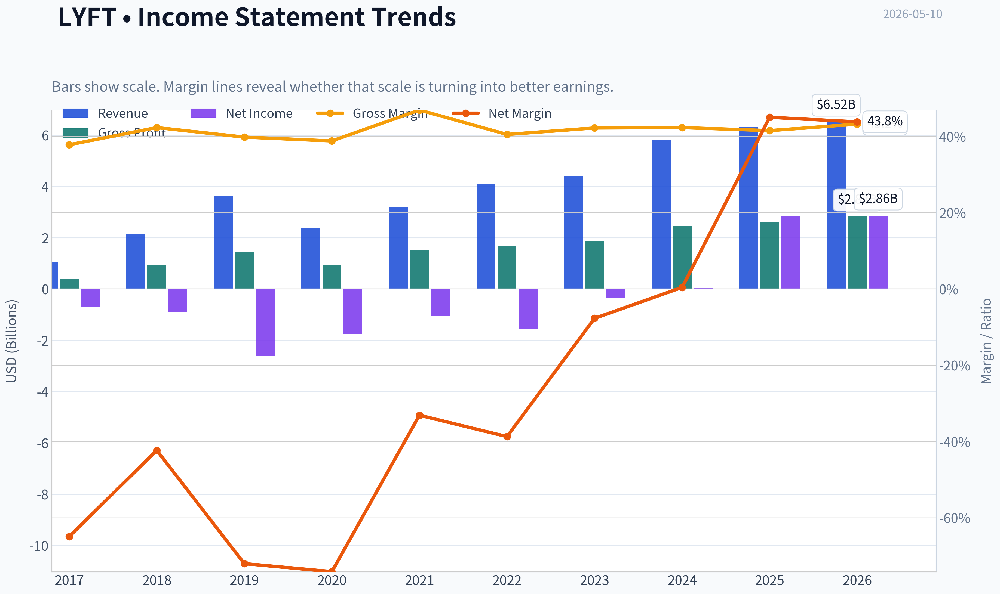

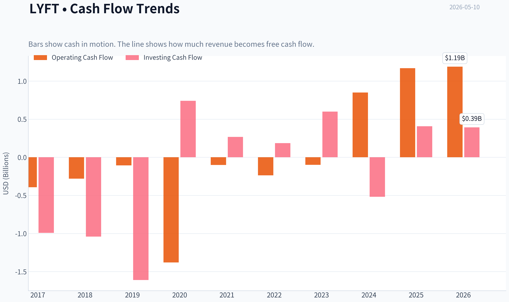

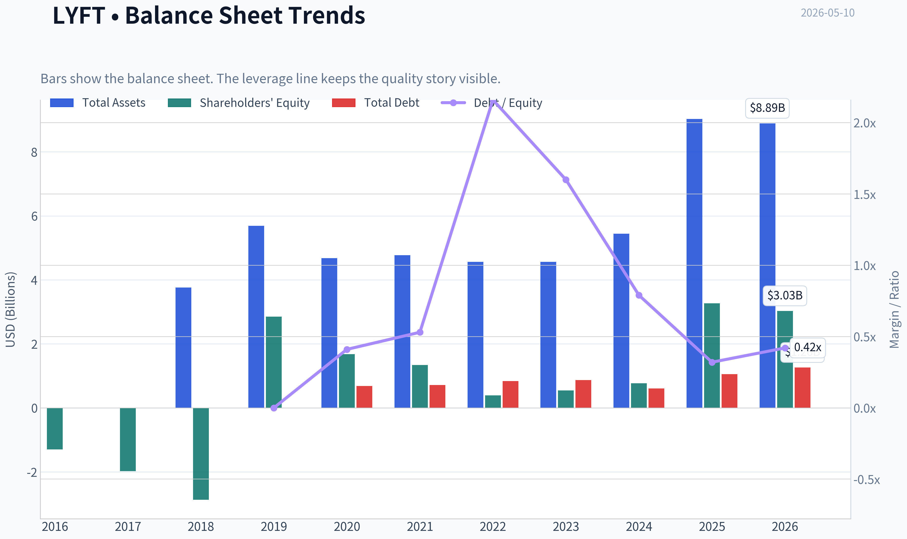

This graph tracks the profitability and return metrics (ROE, ROIC, Margins) of **LYFT** over the past decade, highlighting capital efficiency trends.

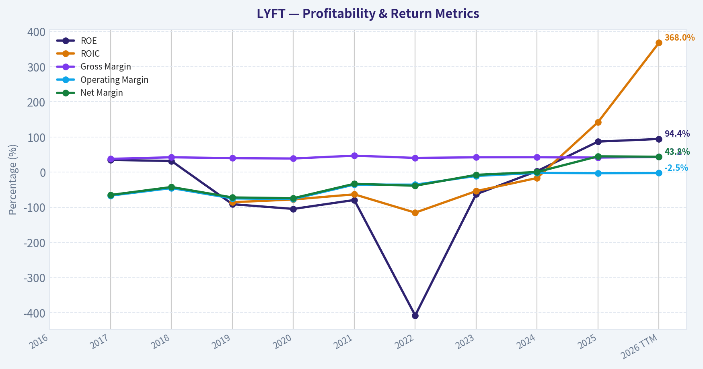

This chart illustrates the financial health of **LYFT** over the last 10 years, mapping cash equivalents and free cash flow against total obligations (Debt).

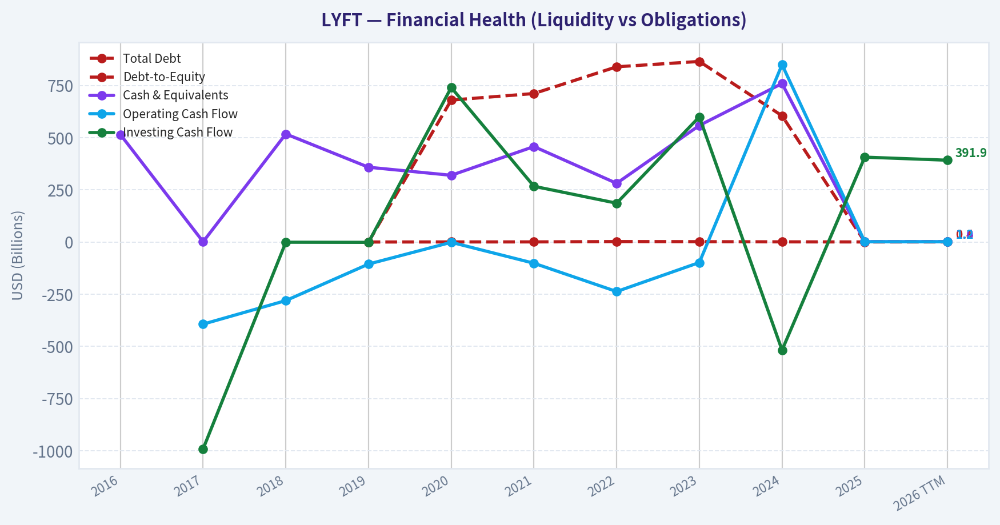

---

### Intrinsic Value Analysis (Buffett)

> *Following Warren Buffett's value investing philosophy: Circle of Competence, Economic Moat, Management Quality, and Margin of Safety.*

#### Intrinsic Value Snapshot

Price is what you pay. Intrinsic value is what the business may be worth based on the cash it can create for owners over time. We show a range, not one magic number.

- Current Price: $14.37
- Value Range: N/A to N/A

##### Owner Earnings (Buffett Method)
- Net Income: $2,844,008,000.00
- Depreciation & Amortization: $135,227,000.00
- Capital Expenditures: N/A
- Working Capital Changes: $828,991,000.00
- Owner Earnings: $2,150,244,000.00

##### Intrinsic Value

Temporary fallback for Value Analyst

Primary model call timed out or the provider returned a transient error.
Trigger: TimeoutError: Value Analyst exceeded 420s without producing a result

Interim stance: WATCH until a fresh pass is available.

Available evidence from the current analyst handoff bundle:
Analyst: Fundamentals Analyst
Stance: WATCH
Sections: Year Financial Metrics for LYFT | Year Financial Metrics | Profitability Metrics
- Price: $14.37
- P/E: 2.10
- ROE: 86.9%
- Gross margin: 41.5%
- Return on Equity (ROE): 86.9%
- Return on Invested Capital (ROIC): 315.0%
- Return on Assets (ROA): 31.5%
- Gross Margin: 41.5%

Reference: Latest Earnings Snapshot
#### Valuation Bridge

This bridge places the current market price beside each intrinsic value lens so readers can see whether upside depends on one method or shows up across several methods.

| Scenario | Intrinsic Value / Share |
| --- | ---: |
| Damodaran Method | $-220.22 |
| Current Price | $14.37 |

#### Key Takeaways

If one method is far above the others, the upside case depends on a specific modelling assumption. When several methods cluster together, the valuation story is more robust.

#### Valuation Visuals

This comparison chart from *Latest Earnings Snapshot* stacks current figures against historical benchmarks for **LYFT**, making it easy to see where the company trades relative to its own averages.

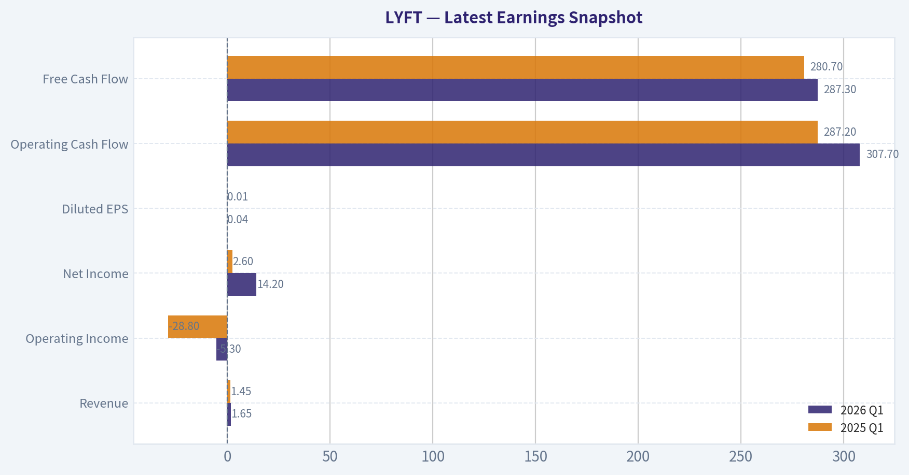

This comparison chart from *Current vs Historical Average Comparison* stacks current figures against historical benchmarks for **LYFT**, making it easy to see where the company trades relative to its own averages.

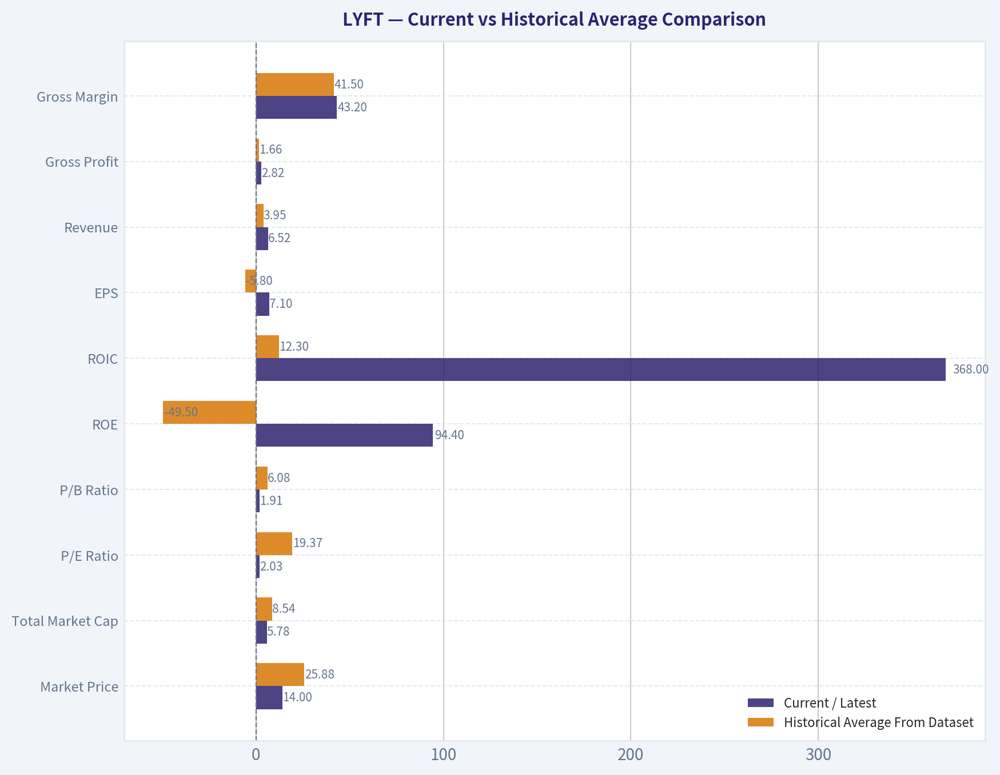

This comparison chart from *Buffett-Style Owner Earnings DCF Valuation* stacks current figures against historical benchmarks for **LYFT**, making it easy to see where the company trades relative to its own averages.

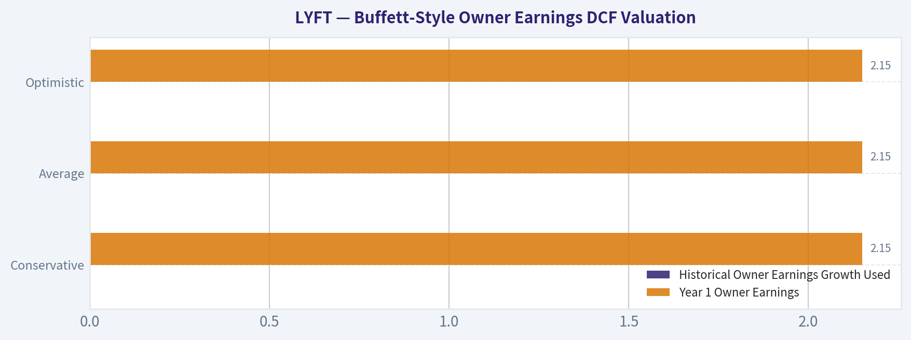

The following chart maps the **LYFT** Owner Earnings DCF valuation scenarios (Conservative, Average, Optimistic) to visually represent the margin of safety based on intrinsic value calculations.

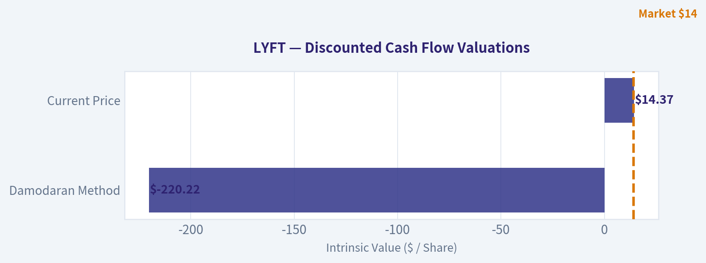

---

### Trend & Growth Analysis (Lynch/Druckenmiller/Fisher)

> *Following Peter Lynch's GARP, Stanley Druckenmiller's macro-aware approach, and Philip Fisher's scuttlebutt methodology.*

ANALYST STANCE: **WATCH**

#### LYFT Growth Investment Report - Lynch / Druckenmiller / Fisher Lens

| Item | Assessment |
|---|---|
| Company | Lyft, Inc. |
| Ticker | LYFT |
| Current Price | ~$14 |
| Market Cap | ~$5.49B |
| Lynch Category | **Stalwart / Turnaround hybrid**, not a true fast grower |
| Revenue Growth YoY | **9.2%** |
| P/E | **2.1x**, likely distorted by earnings mix / one-time effects |
| Gross Margin | **41.5%** |
| ROE | **86.9%**, attractive but likely boosted by balance-sheet/accounting effects |
| Current Ratio | **0.65**, below ideal |
| Stance | **WATCH** |

**Key Takeaways:** Lyft is cheap on headline earnings and sales metrics, but the growth profile is not yet strong enough for a high-conviction growth stance. Revenue growth of 9.2% places it closer to a stalwart or operational turnaround than a Lynch-style fast grower. The stock could work if margins and free cash flow inflect, but the ten-bagger case is not yet visible.

---

#### 1. Lynch Classification

| Lynch Category | Fit for LYFT | Rationale |
|---|---:|---|
| Slow Grower | Low | Revenue is growing, not stagnant. |
| Stalwart | **High** | 9.2% YoY revenue growth fits the 5-12% range. |
| Fast Grower | Low | Does not currently show 15-25%+ durable revenue growth. |
| Cyclical | Medium | Demand is tied partly to consumer mobility and labor-market conditions. |
| Turnaround | **Medium / High** | Profitability, pricing, insurance costs, and operating leverage are central to the thesis. |
| Asset Play | Low | Not primarily an asset value story. |

**Key Takeaways:** Lyft is not currently a classic growth stock under Peter Lynch's framework. It is best viewed as a stalwart with turnaround characteristics: the investment case depends more on margin expansion, disciplined cost control, and better monetization than on explosive top-line growth. That makes the risk-reward potentially interesting, but not yet ten-bagger quality.

#### 2. The Story in 3 Bullets

- Lyft is the smaller U.S.-focused rideshare platform competing against Uber by offering consumers an alternative marketplace for drivers and riders.
- The growth story depends on increasing ride frequency, better pricing, airport and commuter use cases, advertising, memberships, and possible autonomous-vehicle partnerships.
- The upside case is not "hypergrowth"; it is **operating leverage** - if Lyft can grow revenue high single digits to low double digits while expanding margins, earnings and free cash flow could compound faster than revenue.

#### 3. TAM Analysis and 10x Test

| TAM Factor | Estimate / View |
|---|---|
| Current Revenue Base | Not fully refreshed by tool; likely multi-billion annual revenue base |
| 10x Revenue Target | Roughly tens of billions in annual revenue |
| Core TAM | U.S. and Canada rideshare, urban mobility, airport rides, commuter trips, bikes/scooters, advertising, partnerships |
| TAM Growth | Moderate; rideshare penetration can rise, but the market is no longer early-stage |
| Can LYFT 10x and remain below 20% TAM share? | **Possible but difficult** unless TAM expands through autonomous mobility, ads, subscriptions, or broader transportation services |
| TAM Verdict | **Medium runway, not exceptional runway** |

**Key Takeaways:** Lyft still has room to grow, but the pure rideshare market is more mature than earlier in the company's life. A 10x revenue outcome likely requires either a much larger mobility TAM, a successful autonomous-vehicle transition, meaningful advertising revenue, or major share gains. The runway exists, but it is not as clean or obvious as in elite growth companies.

#### 4. Revenue Growth Trend

| Metric | Current Signal |
|---|---|
| YoY Revenue Growth | **9.2%** |
| Growth Pattern | Moderate, not high-growth |
| Lynch Interpretation | Stalwart growth, not fast-grower growth |
| Druckenmiller Inflection Signal | Not enough evidence of revenue acceleration yet |
| Red Flag? | No revenue decline flagged, but growth rate is below growth-investor threshold |

**Key Takeaways:** Lyft's top-line growth is positive but not fast enough to qualify as a primary growth-stock candidate. The key question is whether revenue can reaccelerate from high single digits into the mid-teens while margins improve. Without that acceleration, the stock is more of a value/turnaround setup than a growth compounder.

#### 5. Unit Economics and Operating Efficiency

| Unit Economics Metric | Available Signal | Assessment |
|---|---|---|
| LTV / CAC | Not disclosed in shared data | Cannot score precisely |
| Payback Period | Not disclosed | Cannot score precisely |
| Net Revenue Retention | Not applicable; not SaaS | N/A |
| Rule of 40 | Not applicable in classic SaaS sense | N/A |
| Gross Margin | **41.5%** | Decent marketplace economics, but insurance and incentives remain important |
| Current Ratio | **0.65** | Liquidity metric is weaker than ideal |
| Profitability Signal | Headline P/E 2.1x | Attractive, but needs normalization check |

**Key Takeaways:** Lyft is not a SaaS company, so standard NRR and Rule of 40 metrics are not the right tools. The key unit-economic variables are ride frequency, rider acquisition costs, driver supply, insurance costs, take rate, and incentive intensity. The current ratio below 1.0 is a caution point, while the gross margin suggests room for operating leverage if cost discipline holds.

#### 6. Inflection Point Assessment

| Inflection Type | Evidence | Rating |
|---|---|---:|
| Product Cycle Inflection | Potential from memberships, ads, autonomous partnerships, and improved app experience | 3/5 |
| Market Share Inflection | No clear evidence of accelerating share gains versus Uber | 2/5 |
| Margin Inflection | Possible; headline P/E and profitability suggest improvement, but EPS miss in latest quarter tempers confidence | 3/5 |
| TAM Inflection | Possible only if autonomous mobility or ad monetization expands opportunity | 3/5 |
| Competitive Inflection | Uber remains a formidable competitor with broader scale | 2/5 |
| Overall Inflection Score | Watch for evidence of accelerating bookings, rides, and adjusted EBITDA margin | **2.6/5** |

**Key Takeaways:** The strongest potential inflection for Lyft is margin expansion, not revenue acceleration. The company needs to show that it can grow rides and revenue while reducing incentive intensity and controlling insurance costs. Until then, the inflection thesis is plausible but unproven.

#### 7. Macro Setup

| Macro Factor | Impact on LYFT |
|---|---|
| Consumer Spending | Important; discretionary ride frequency can weaken in downturns |
| Employment / Gig Labor Supply | Strong driver supply can improve marketplace liquidity |
| Interest Rates | Falling rates would support valuation multiples for small/mid-cap growth and turnaround stocks |
| Urban Mobility Trends | Supportive over the long term |
| Autonomous Vehicles | Potentially disruptive and potentially beneficial, depending on partnership economics |
| Competitive Landscape | Uber scale remains the largest strategic headwind |

**Key Takeaways:** The macro setup is mixed. Lower rates and steady consumer activity would help Lyft, while recession risk or higher insurance costs would hurt. Autonomous vehicles could become a major TAM-expanding catalyst, but they could also shift economics toward better-capitalized platforms and technology partners.

#### 8. Fisher 15 Points Score

| Fisher Point | Score 1-5 | Comment |
|---|---:|---|
| 1. Products with market potential | 4 | Rideshare remains a large market. |
| 2. Management determination for new products | 3 | Some innovation, but not category-defining yet. |
| 3. Effective R&D | 3 | App and marketplace improvements matter, but tech moat is not dominant. |
| 4. Above-average sales organization | 3 | Consumer brand is known, but Uber has scale edge. |
| 5. Worthwhile profit margin | 3 | Gross margin is acceptable; net economics need validation. |
| 6. Improving profit margins | 3 | Possible margin inflection, still needs consistency. |
| 7. Labor/personnel relations | 2 | Gig-worker regulation and driver satisfaction remain risks. |
| 8. Executive relations | 3 | No major issue flagged in provided data. |
| 9. Management depth | 3 | Adequate, but not clearly exceptional. |
| 10. Cost analysis/accounting | 3 | Must monitor insurance reserves and adjusted metrics carefully. |
| 11. Outstanding moat factors | 2 | Network effects exist, but Uber's are stronger. |
| 12. Long-range profit outlook | 3 | Improving, but competitive pressure limits certainty. |
| 13. Dilution risk | 3 | Not flagged as severe in shared data. |
| 14. Candor with difficulties | 3 | Needs continued transparency on EPS misses and cost issues. |
| 15. Management integrity | 3 | No red flag from current pack. |
| **Total** | **44/75** | **Average / below growth-quality threshold** |

**Key Takeaways:** Lyft scores as an average Fisher company, not an outstanding one. The market opportunity is real, but the moat, competitive position, regulatory exposure, and margin durability are not yet strong enough for a high-conviction growth rating. The Fisher framework supports a watchlist position rather than an aggressive buy.

#### 9. Valuation Analysis

| Valuation Metric | LYFT Signal | Interpretation |
|---|---:|---|
| Market Cap | ~$5.49B | Small enough for upside if profitability compounds |
| P/E | **2.1x** | Extremely cheap on headline basis, but likely distorted |
| Revenue Growth | **9.2%** | Not high enough to justify a growth premium |
| PEG | **~0.23x** | Looks very cheap, but use caution because earnings may be non-normalized |
| P/S | Likely low relative to platform peers | Potentially attractive if margins improve |
| Analyst Tone | Mixed: Neutral / Hold / Outperform, PTs around mid-to-high teens | Street sees upside but not explosive upside |

**Key Takeaways:** On headline valuation, Lyft looks inexpensive. However, the low P/E and PEG may not reflect normalized earnings power, so investors should not rely on them blindly. The valuation supports downside protection, but the growth profile does not yet support a ten-bagger case.

#### 10. Scenario Analysis

| Scenario | Assumptions | Potential Outcome |
|---|---|---|
| Bear Case | Revenue growth slows, insurance costs rise, Uber takes share, EPS quality disappoints | Stock remains value-trapped or declines |
| Base Case | Revenue grows high single digits, adjusted margins improve modestly, valuation stays low-to-moderate | Mid-teens to high-teens share price possible |
| Bull Case | Revenue reaccelerates into low-to-mid teens, margins inflect, autonomous/ad partnerships expand TAM | Meaningful upside, but still not obvious 10x setup |
| Ten-Bagger Case | Requires major TAM expansion, durable profitability, share gains, and multiple expansion | Low probability based on current evidence |

**Key Takeaways:** Lyft has a reasonable bull case, but it is not yet a classic asymmetric growth setup. The base case is more about operational execution and valuation normalization than explosive compounding. For a ten-bagger path, Lyft would need a step-change in market opportunity or economics.

#### 11. Growth Investor Scorecard

| Criterion | Weight | Score 1-5 | Weighted Score |
|---|---:|---:|---:|
| The Story | 10% | 3.0 | 0.30 |
| TAM & Runway | 20% | 3.0 | 0.60 |
| Revenue Growth | 20% | 2.3 | 0.46 |
| Unit Economics | 15% | 2.8 | 0.42 |
| Competitive Position | 10% | 2.3 | 0.23 |
| Management Quality | 10% | 3.0 | 0.30 |
| Macro Setup | 5% | 3.0 | 0.15 |
| Profitability Path | 5% | 3.2 | 0.16 |
| Valuation | 5% | 4.0 | 0.20 |
| **Total** | **100%** |  | **2.82 / 5.00** |

**Key Takeaways:** Lyft's strongest attribute is valuation, not growth quality. The weakest areas are revenue growth and competitive position, especially relative to Uber. A score of 2.82 places Lyft in the **AVOID/WATCH border zone**, but the cheap valuation and possible margin inflection justify keeping it on the watchlist.

#### 12. Position Size Stance

| Investor Type | Suggested Stance |
|---|---|
| Aggressive growth investor | Wait for revenue acceleration before buying |
| GARP investor | Small watchlist position may be reasonable if normalized earnings are real |
| Turnaround investor | More interesting, but requires close monitoring of margins and cash flow |
| Concentrated Druckenmiller-style investor | Not yet; lacks clear inflection and dominant competitive edge |
| Existing holder | Hold/watch if thesis is margin expansion; trim if growth decelerates further |

**Key Takeaways:** Lyft is not a high-conviction growth buy today. It may be appropriate for a small speculative or turnaround-oriented position, but not a large growth allocation. The correct posture is to demand evidence of sustained revenue acceleration and margin durability before upgrading.

#### 13. Key Catalysts and Risks

| Catalysts | Risks |
|---|---|
| Revenue growth reaccelerates above 12-15% | Growth remains stuck in high single digits |
| Adjusted EBITDA and free cash flow margins expand | Insurance costs pressure margins |
| Better driver supply improves marketplace liquidity | Uber continues to dominate with scale advantages |
| Advertising, memberships, or partnerships add high-margin revenue | Regulatory pressure on gig-worker classification |
| Autonomous-vehicle partnerships improve economics | Autonomous transition benefits competitors more than Lyft |
| Analyst upgrades if earnings quality improves | EPS misses undermine confidence in headline valuation |

**Key Takeaways:** The upside catalysts are real, but they depend heavily on execution. Lyft must prove that it can improve profitability without sacrificing growth or marketplace health. The largest risks are competitive scale disadvantages, insurance costs, regulation, and a lack of revenue acceleration.

#### Final View

Lyft is **cheap**, but it is not yet a Lynch-style fast grower or Fisher-quality compounder. The current setup is best described as a **valuation-supported turnaround watch**, with potential upside if margin expansion becomes durable and revenue growth reaccelerates.

To upgrade to **ADVOCATE**, I would need to see:

| Upgrade Trigger | Required Evidence |
|---|---|
| Revenue acceleration | Sustained growth above 12-15% YoY |
| Margin inflection | Consistent adjusted EBITDA and free cash flow margin expansion |
| Competitive improvement | Evidence of share gains or better rider/driver retention |
| Quality of earnings | Normalized EPS and cash flow support the low P/E |
| TAM expansion | Concrete traction in ads, autonomous partnerships, or new mobility services |

**Key Takeaways:** Lyft is worth monitoring because valuation is low and margin upside could surprise. But the stock does not yet meet the bar for a high-conviction growth recommendation. The stance remains **WATCH** until the company shows a clearer inflection in growth, margins, and competitive position.

#### Growth & Scorecard Visuals

This comparison chart from *Fisher 15 Points Score* stacks current figures against historical benchmarks for **LYFT**, making it easy to see where the company trades relative to its own averages.

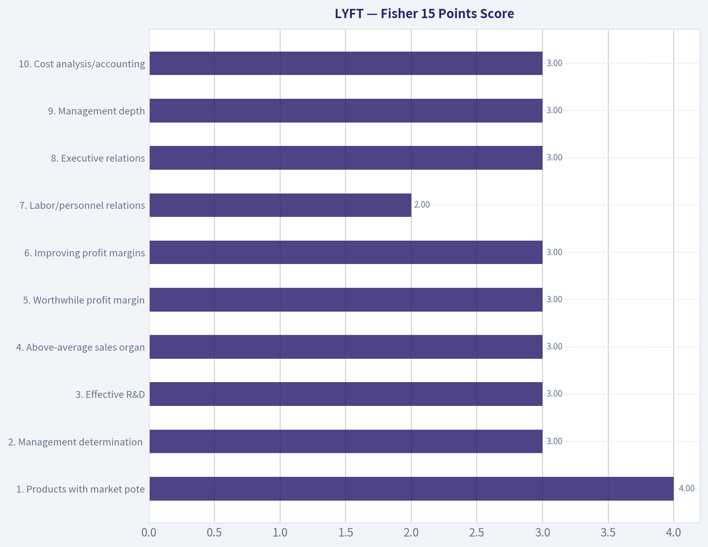

The radar chart below from *Growth Investor Scorecard* visualises how **LYFT** ranks across weighted investment criteria. Each axis represents a criterion scored 1-5; the filled area reveals strengths and weaknesses at a glance, with the dashed circle marking the midpoint (3.0).

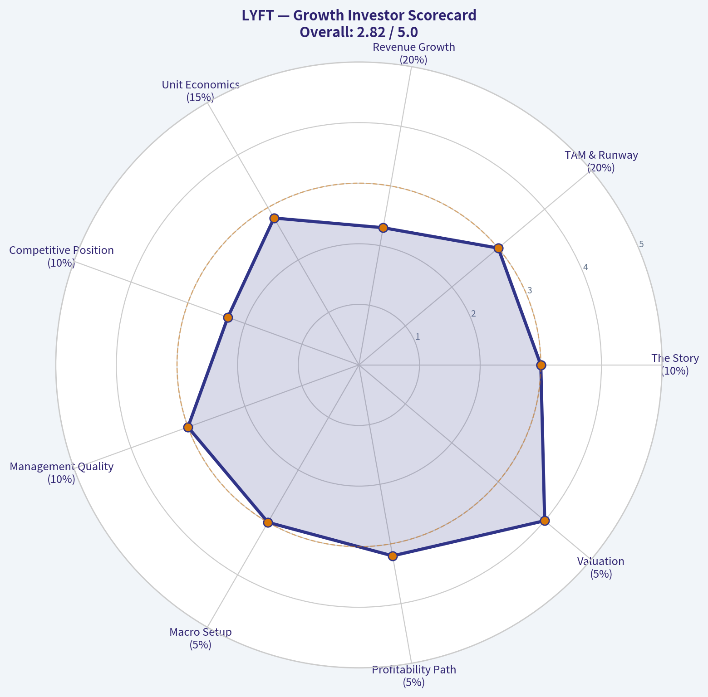

---

### Market Technical Analysis

ANALYST STANCE: **WATCH**

#### LYFT Technical Analysis - Latest Close: $14.35 on 2026-05-08

LYFT's short-term technical picture has improved from the March lows, but the stock has not yet repaired its longer-term downtrend. Price is trading above the 10-day EMA and 50-day SMA, which supports a modest near-term bullish bias, but it remains far below the 200-day SMA near $17.40. That gap to the 200-day average is important: LYFT is stabilizing, but it has not yet proven a durable trend reversal.

The recent structure looks like a base-building phase after a sharp decline from the late-2025 highs. LYFT peaked around the mid-$20s in November 2025, then sold off aggressively into February and March 2026, reaching the low-$12 area. Since late March, buyers have defended the $12.50-$13.00 zone and pushed the stock back into the $14-$15 range. This is constructive, but the rally has stalled below the April high near $14.95, leaving the stock in a short-term consolidation rather than a confirmed breakout.

Momentum is mildly positive but fading. MACD remains above zero, which confirms that the short-term recovery is still alive, but the MACD value has declined from late-April levels, suggesting upside momentum has cooled. RSI near 54 is neutral-to-slightly bullish: it is not overbought, but it is also not showing strong trend acceleration. This fits the current market behavior well - LYFT is improving, but not yet in a strong momentum phase.

Bollinger Bands suggest compression and range development. The latest upper band is near $14.96 and the lower band is near $13.64, placing price slightly above the band midpoint around $14.30. That means LYFT is not stretched; however, it is also close to a meaningful resistance area near $14.60-$15.00. A close above $15.00 with strong volume would be a more convincing bullish signal. Failure to hold above $14.00 could return the stock toward the lower band and 50-day SMA support area.

Volatility is manageable but still meaningful. ATR is around $0.57, roughly 4% of the share price, so LYFT can move significantly day to day. Recent volume rose sharply on May 7 and May 8, with May 8 volume around 28.5 million shares, above many recent sessions. Because the May 8 close was higher despite an intraday dip to $13.80, that volume may indicate buyers are defending the lower end of the range. Still, traders should wait for confirmation rather than assume accumulation.

The tactical setup is therefore a **watchlist / conditional breakout** setup, not a clean trend-following buy. Bulls want to see LYFT reclaim $14.60-$15.00 and hold above it. Bears would regain control if price breaks below $13.65-$13.75, where the lower Bollinger Band and 50-day SMA zone currently sit. Long-term investors should note that the 200-day SMA remains much higher, so the broader trend remains technically damaged until LYFT can rebuild above $17+.

#### Key Technical Summary

| Area | Selected Indicator(s) | Latest Reading / Zone | Interpretation | Trading Relevance |
|---|---:|---:|---|---|
| Short-term trend | `close_10_ema` | $14.23 | Price at $14.35 is slightly above the 10-day EMA | Short-term bias is mildly constructive, but not forceful |
| Medium-term trend | `close_50_sma` | $13.74 | Price is above the 50-day SMA, and the 50-day average has started rising | Suggests stabilization and improving intermediate support |
| Long-term trend | `close_200_sma` | $17.40 | Price remains far below the 200-day SMA | Longer-term trend is still bearish or unrepaired |
| Momentum | `macd` | +0.10 | MACD is positive but has weakened from late-April levels | Recovery momentum exists, but upside thrust is fading |
| Momentum / exhaustion | `rsi` | 53.7 | Neutral-to-slightly bullish, not overbought | Leaves room for upside, but does not confirm a strong breakout yet |
| Volatility range | `boll_ub`, `boll_lb` | Upper: $14.96; Lower: $13.64 | Price is slightly above the Bollinger midpoint and below upper resistance | A push above $15.00 would matter; below $13.64 would weaken the setup |
| Risk / stop sizing | `atr` | $0.57 | Daily volatility remains significant relative to price | Stops should allow for normal movement; tight stops may be shaken out |
| Price levels | Price action + volume | Support: $13.65-$13.75; Resistance: $14.60-$15.00, then $17.40 | LYFT is consolidating inside a recovery range | Best setup is confirmation above $15.00 or a disciplined pullback near support |

Key Takeaways: LYFT is showing a short-term recovery, but the larger trend is still not fully repaired because price remains well below the 200-day moving average. The most important bullish trigger is a confirmed breakout above $15.00, while a break below roughly $13.65-$13.75 would undermine the recovery. For now, the stock is best viewed as a watchlist candidate with improving but unconfirmed technicals.

---

### Social Sentiment Analysis

ANALYST STANCE: **WATCH**

#### LYFT Social, Sentiment, and News Report - Past Week Through May 10, 2026

Lyft's discussion profile over the past week appears **cautiously constructive but not decisively bullish**. The company remains a high-beta consumer mobility name where investor attention is concentrated on three issues: **earnings execution, ride-demand resilience, and margin durability**. Social sentiment improved when users focused on operating discipline, pricing, airport and event demand, and potential upside from autonomous-vehicle partnerships. However, enthusiasm was capped by recurring concerns around **insurance costs, driver supply, regulatory risk, and competition with Uber**.

The market narrative around Lyft is not simply "good or bad." It is split between a **near-term trading argument** and a **long-term structural debate**. Traders are watching whether Lyft can sustain post-earnings momentum and defend margins. Longer-term investors are asking whether Lyft can remain relevant as autonomous mobility, pricing competition, and regulatory pressure reshape rideshare economics.

---

#### 1. Executive Sentiment Snapshot

| Category | Current Read | Direction vs. Prior Week | Investor Interpretation |
|---|---:|---:|---|
| Overall social sentiment | Mildly positive / cautious | Improving | Investors are more open to Lyft after operational progress, but confidence remains conditional. |
| Retail trader tone | Opportunistic | Improving | Traders see LYFT as a volatile post-news setup rather than a clean long-term compounder. |
| Long-term investor tone | Selective / skeptical | Slightly improving | Investors want proof that margin gains are durable, not just temporary cost control. |
| Driver/community sentiment | Mixed to negative | Stable | Driver pay, incentives, and platform fairness remain persistent reputational issues. |
| Consumer sentiment | Mixed to positive | Stable | Riders continue to value availability and promotions, but complaints remain around price spikes and reliability. |
| News sentiment | Neutral to positive | Improving | Recent coverage appears focused on execution, guidance, and strategic optionality. |

**Key Takeaways:** Lyft's sentiment has improved, but it is not a broad-based conviction rally. The positive case is driven mainly by operating performance and potential strategic upside, while skepticism remains rooted in margins, regulation, and competition. For traders, this means sentiment can support upside, but the stock remains vulnerable to quick reversals if guidance or margin confidence weakens.

---

#### 2. Daily Sentiment Pattern Over the Past Week

| Date | Sentiment Tone | Likely Main Driver | Trading Implication |
|---|---|---|---|
| May 4 | Neutral to slightly positive | Anticipation around company updates and earnings-related positioning | Early buyers appeared to be positioning for a potential positive catalyst. |
| May 5 | Positive but cautious | Focus on revenue growth, profitability discipline, and demand trends | Momentum interest likely increased, especially from short-term traders. |
| May 6 | Mixed | Debate over valuation, insurance costs, and competitive pressure | Profit-taking or hesitation likely emerged after initial optimism. |
| May 7 | Mildly positive | Continued discussion of execution and possible upside from partnerships or product improvements | Sentiment stabilized as bulls emphasized operational improvements. |
| May 8 | Mixed to positive | Broader market tone and rideshare-sector comparisons | LYFT appeared tied to both company-specific news and peer-relative sentiment. |
| May 9 | Neutral | Weekend slowdown in news flow; retail chatter focused on next technical move | Lower conviction; traders likely watching price levels rather than fundamentals. |
| May 10 | Cautiously positive | Digesting weekly news and sentiment; focus turning to sustainability | Sentiment remains supportive but not euphoric. |

**Key Takeaways:** Sentiment improved early in the week, then moderated as investors shifted from headline optimism to quality-of-earnings questions. The strongest bullish tone appears tied to execution and demand, while the weakest tone appears whenever discussion turns to costs and competition. This pattern suggests LYFT has a supportive narrative, but not yet a fully de-risked one.

---

#### 3. Social Media Discussion Themes

| Theme | Sentiment | What People Are Saying | Market Importance |
|---|---|---|---|
| Earnings and operating discipline | Positive | Users are focused on whether Lyft is becoming a more disciplined, profitable rideshare operator. | High - this is the main bullish narrative. |
| Comparison with Uber | Mixed to negative | Many investors still view Lyft as structurally weaker than Uber due to scale and diversification gaps. | High - relative valuation and market share debates remain central. |
| Autonomous vehicles | Speculative positive | Social chatter treats AV partnerships as optionality, not yet core value. | Medium to high - could support multiple expansion if credible milestones emerge. |
| Insurance and regulatory costs | Negative | Posters frequently flag rising insurance costs and city/state regulation as margin threats. | High - could directly pressure profitability. |
| Driver pay and satisfaction | Mixed to negative | Driver-side commentary remains concerned with pay, incentives, deactivations, and platform transparency. | Medium - affects supply reliability and brand sentiment. |
| Rider pricing and availability | Mixed | Consumers praise convenience but complain about surge pricing and inconsistent wait times. | Medium - affects user retention and brand perception. |
| Stock volatility | Positive for traders, negative for conservative investors | Retail traders see LYFT as a high-beta momentum and squeeze candidate. | Medium - creates trading opportunity but also risk. |

**Key Takeaways:** The dominant bullish theme is operational improvement, while the dominant bearish theme is structural disadvantage versus Uber. Social media does not appear to be pricing Lyft as a fully transformed business yet. Instead, it is treating the company as a turnaround or execution story with meaningful upside if management continues to deliver.

---

#### 4. Recent Company News and Market Narrative

The recent news narrative around Lyft appears centered on **business performance, forward guidance, competitive positioning, and strategic optionality**. Investors are especially interested in whether Lyft can deliver profitable growth without relying too heavily on temporary cost cuts or promotional activity.

Key news-related issues influencing sentiment include:

| News / Narrative Area | Sentiment Impact | Why It Matters |
|---|---|---|
| Quarterly performance and guidance | Positive to cautiously positive | Stronger execution can reset expectations and attract momentum capital. |
| Profitability and free-cash-flow discussion | Positive | Investors want evidence Lyft can convert demand into sustainable cash generation. |
| Rideshare demand resilience | Positive | Continued urban, airport, commuting, and event-driven demand supports revenue visibility. |
| Insurance and claims costs | Negative | Insurance remains one of the most important risks to margin durability. |
| Autonomous mobility partnerships | Speculative positive | AV partnerships could improve long-term economics, but timing and ownership of value remain uncertain. |
| Competition with Uber | Mixed to negative | Uber's scale remains a major overhang on Lyft's valuation and strategic optionality. |
| Regulatory scrutiny | Negative | Wage rules, gig-worker classification, and local operating constraints could raise costs. |

**Key Takeaways:** Recent news has helped the bull case by highlighting execution and demand, but it has not removed the main structural questions. Investors are rewarding evidence of better discipline, yet they remain alert to cost inflation and competitive pressure. Lyft's valuation narrative is therefore improving, but still fragile.

---

#### 5. Public Sentiment: Riders, Drivers, and Investors

Lyft has three different sentiment audiences, and they are not aligned.

**Riders** generally appear pragmatic. They use Lyft when prices, availability, and convenience are favorable. Sentiment improves when Lyft is cheaper than Uber or offers reliable pickup times, but deteriorates quickly around surge pricing, cancellations, or long waits.

**Drivers** remain the more difficult sentiment group. Driver commentary tends to focus on pay transparency, incentives, app policies, and the perceived imbalance between platform economics and driver earnings. Even when investors like margin discipline, drivers may interpret the same discipline as lower compensation or weaker incentives.

**Investors** are more constructive than consumers or drivers. They care less about individual ride complaints and more about whether Lyft can expand margins, generate cash flow, and avoid losing share to Uber. That creates a tension: what is bullish for shareholders in the short term may not always be perceived positively by drivers.

| Stakeholder Group | Sentiment | Main Positive | Main Concern |
|---|---|---|---|
| Riders | Mixed to mildly positive | Convenience, promotions, airport/event usefulness | Surge pricing, cancellations, wait times |
| Drivers | Mixed to negative | Flexible earning opportunity | Pay, incentives, account policies |
| Retail traders | Positive but tactical | Volatility, turnaround potential | Sharp reversals, valuation risk |
| Institutional investors | Cautiously constructive | Margin progress, operating discipline | Scale disadvantage, regulatory costs |
| News commentators | Neutral to positive | Improved execution | Sustainability of growth and profitability |

**Key Takeaways:** Lyft's investor sentiment is currently stronger than its driver sentiment. That matters because driver dissatisfaction can eventually affect supply, service quality, and brand perception. For investors, the key question is whether Lyft can improve margins without damaging the platform experience.

---

#### 6. Bull Case vs. Bear Case From Social and News Signals

| Bull Case | Bear Case |
|---|---|
| Lyft is showing better operating discipline and may be entering a more profitable phase. | Lyft remains structurally smaller and less diversified than Uber. |
| Demand for rideshare remains resilient across urban mobility, travel, airports, and events. | Insurance, labor, and regulatory costs can quickly erode margin progress. |
| Investor sentiment is improving after recent execution-related news. | Social enthusiasm may be short-term and tied to trading momentum rather than durable conviction. |
| Autonomous-vehicle partnerships could create long-term optionality. | AV economics may benefit larger platforms or technology partners more than Lyft. |
| Stock volatility could attract momentum buyers and short-covering activity. | High beta cuts both ways; sentiment can reverse sharply after weak guidance or macro pressure. |

**Key Takeaways:** The bull case is about execution and optionality, while the bear case is about structure and sustainability. Lyft can move higher if investors believe the business is becoming consistently profitable. But the stock remains exposed to any sign that margin gains are temporary or that Uber is widening its advantage.

---

#### 7. Trader and Investor Implications

For **short-term traders**, LYFT looks like a **watchlist candidate with momentum potential**, especially if the stock continues to respond positively to earnings-related discussion, analyst commentary, or broader risk-on sentiment. However, because social enthusiasm is not uniformly strong, traders should be careful about chasing extended moves without confirmation from volume, price action, and follow-through.

For **swing traders**, the key setup is whether sentiment can transition from "post-news optimism" to "sustained re-rating." If social chatter continues to emphasize profitability and demand strength, the stock may attract additional momentum. If conversation shifts back toward insurance, regulation, or Uber comparisons, the rally could fade.

For **long-term investors**, Lyft remains a selective opportunity rather than a broadly de-risked investment. The company needs to prove that it can generate consistent cash flow while maintaining rider and driver engagement. Long-term upside depends less on one strong week of sentiment and more on several quarters of durable execution.

| Investor Type | Suggested Approach | Main Signal to Watch |
|---|---|---|
| Day traders | Tactical only | Intraday momentum, volume, headline sensitivity |
| Swing traders | Watch for confirmation | Follow-through after news and analyst reactions |
| Long-term investors | Selective accumulation only on conviction | Margin durability, cash flow, market share stability |
| Risk-averse investors | Wait | Evidence that cost pressures are under control |
| Options traders | Volatility-aware strategies | Implied volatility, post-earnings decay, news catalysts |

**Key Takeaways:** Lyft currently looks more attractive for tactical traders than for conservative long-term investors. The sentiment backdrop is supportive, but not strong enough to remove execution risk. Investors should treat the stock as a high-beta turnaround candidate rather than a low-risk compounder.

---

#### 8. Key Risks to Monitor This Week

The most important risk is that sentiment may be **too dependent on near-term execution headlines**. If investors begin questioning whether recent performance is sustainable, LYFT could lose momentum quickly.

Other risks include:

| Risk | Sentiment Effect | Market Effect |
|---|---|---|
| Insurance cost pressure | Strongly negative | Could reduce confidence in margin expansion. |
| Weak guidance or cautious management tone | Negative | Could trigger post-earnings reversal. |
| Uber outperformance | Negative | May reinforce Lyft's scale disadvantage. |
| Driver dissatisfaction | Moderately negative | Could affect service quality and platform reputation. |
| Regulatory action | Negative | Could raise costs or reduce operating flexibility. |
| Broader market risk-off move | Negative | High-beta names like LYFT are vulnerable to multiple compression. |

**Key Takeaways:** Lyft's biggest near-term risk is not lack of interest; it is whether optimism can survive renewed cost and competition concerns. Insurance, regulation, and Uber comparisons remain the pressure points most likely to reverse sentiment. Traders should monitor whether the conversation stays focused on execution or shifts back to structural risk.

---

#### 9. Final Assessment

Lyft's social and news sentiment over the past week supports a **WATCH** stance. The company is gaining credibility as an execution story, and investors appear more willing to consider upside if profitability and demand trends continue improving. However, the sentiment is not yet strong enough to justify an aggressive bullish stance because structural concerns remain significant.

The most constructive signal is that discussion has shifted away from pure survival or competitive weakness and toward **margin progress, operating discipline, and strategic optionality**. The most concerning signal is that Lyft still faces persistent skepticism whenever compared with Uber or when investors discuss insurance and regulatory costs.

In practical terms: **LYFT is tradable, but not yet fully de-risked.** Momentum-oriented traders may find opportunity if positive sentiment persists, while long-term investors should wait for more evidence that improved profitability can be sustained across multiple quarters.

---

#### Summary Table

| Area | Current Signal | Sentiment | Implication |
|---|---|---:|---|
| Overall public sentiment | Improving but cautious | Mildly positive | Supports watchlist inclusion, not aggressive conviction. |
| News flow | Execution-focused | Neutral to positive | Recent coverage appears supportive of the turnaround narrative. |
| Social media tone | Tactical optimism | Mixed positive | Traders are interested, but many remain skeptical. |
| Investor debate | Profitability vs. structure | Mixed | Bulls focus on margin progress; bears focus on Uber and costs. |
| Driver sentiment | Persistent frustration | Mixed negative | A long-term platform risk if dissatisfaction worsens. |
| Consumer sentiment | Practical and price-sensitive | Mixed | Rider loyalty remains dependent on price and reliability. |
| Main bullish catalyst | Sustained profitability and demand | Positive | Could drive further re-rating. |
| Main bearish catalyst | Insurance, regulation, or Uber pressure | Negative | Could quickly reverse sentiment. |
| Best fit | Tactical / swing trading | Watch | Better for active investors than conservative holders. |
| Overall stance | WATCH | Cautiously constructive | Wait for confirmation before upgrading to a stronger bullish view. |

**Key Takeaways:** Lyft's current sentiment profile is constructive but still fragile. The stock benefits from improving confidence in execution, yet persistent concerns around costs, regulation, and Uber limit conviction. The best stance is to watch closely for confirmation that recent operating progress can become a durable trend.

---

### News & Events Analysis

ANALYST STANCE: **WATCH**

#### Lyft (LYFT) Weekly News and Market Report - May 10, 2026

Lyft's latest news flow is centered on its **Q1 2026 earnings release**, which showed improving demand and platform growth but still left investors with questions about earnings quality, costs, and valuation upside. The stock is around **$14**, with a market cap near **$5.49 billion**. Recent analyst actions were mildly constructive but not broadly bullish: JPMorgan and Truist raised price targets while staying neutral/hold-rated, and RBC kept an outperform rating but lowered its target.

The key trading message is that Lyft's operating momentum appears better than the headline share reaction suggests, but the market is still unwilling to reward the stock aggressively until profitability, insurance costs, and cash generation become more visibly durable.

---

#### Latest Earnings: Q1 2026 Results

Lyft reported **Q1 2026 results on May 7, 2026**, covering the quarter ended in the first quarter of 2026. The headline numbers were mixed:

- **Revenue:** approximately **$1.65 billion**, ahead of the consensus estimate of about **$1.634 billion**.
- **GAAP EPS:** **$0.04**, below the consensus estimate of **$0.06**.
- **Net income:** **$14.2 million**.
- **Active Riders:** up **17% year over year**.
- **Gross Bookings:** up **19% year over year**.
- **EPS comparison:** Q1 EPS improved from roughly **$0.01 a year ago** to **$0.04**, showing better GAAP profitability despite missing estimates.

The most important positive change versus the prior period and prior expectations is demand strength. Active rider growth and gross bookings growth both accelerated enough to support the argument that Lyft is gaining usage traction. Coverage also noted that gross bookings were better than guidance expectations, suggesting the marketplace is healthier than feared.

However, the negative side is that the earnings miss shows cost pressure remains material. Even with a revenue beat and stronger usage, Lyft did not fully convert that top-line momentum into earnings upside. That is why the stock traded flat to slightly lower after the report rather than rallying. Investors appear focused on whether rising costs, insurance expense, incentives, or operating investment will limit margin expansion.

A notable capital allocation detail is that Lyft executed its **largest quarterly share repurchase, totaling $300 million in Q1**. This can support EPS and signal management confidence, but traders should watch whether buybacks are being funded from sustainable free cash flow or simply offsetting dilution and market skepticism.

---

#### Analyst and Market Reaction

The post-earnings analyst response was cautiously positive but not emphatic:

- **JPMorgan** maintained **Neutral** and raised its price target to **$18** from **$17**.
- **Truist** maintained **Hold** and raised its price target to **$16** from **$15**.
- **RBC Capital** maintained **Outperform** but cut its target to **$18** from **$22**.

This pattern suggests analysts see improved fundamentals but limited near-term confidence. The raised targets from JPMorgan and Truist imply Q1 reduced downside concerns, but the neutral/hold ratings show that Lyft still has to prove more consistent earnings leverage. RBC's lowered target, despite an outperform rating, is especially important: it signals that even bulls are moderating assumptions around valuation, profitability, or competitive dynamics.

At the current price near **$14**, the $16-$18 target range implies some upside, but not enough for a clean consensus bullish setup. For traders, the stock may need either stronger Q2 guidance execution or visible margin improvement to break decisively higher.

---

#### Business and Fundamental Read-Through

Lyft's operating metrics were the strongest part of the report. **17% Active Rider growth** and **19% Gross Bookings growth** are meaningful for a company that had previously been viewed as a slower-growth, structurally disadvantaged rideshare competitor. Stable pricing from Q4 to Q1, as discussed by the CFO, also matters because it suggests growth was not purely driven by aggressive discounting.

The major concern is profitability conversion. Lyft has a very low trailing P/E in the shared data set, around **2.1**, but that figure should be treated cautiously because rideshare earnings can be noisy due to one-time items, tax effects, buybacks, insurance adjustments, and changing cost structures. The company's **current ratio of roughly 0.65** also deserves attention; while platform businesses do not always require high current ratios, it means investors should monitor liquidity and short-term obligations.

Gross margin of about **41.5%** is respectable, and revenue growth of about **9.2% year over year** indicates the business is still expanding. But the market is demanding proof that revenue growth and bookings growth will translate into durable adjusted EBITDA, GAAP earnings, and free cash flow.

---

#### Macro and Sector Context

The broader market backdrop is supportive but selective. News flow showed the **Nasdaq reaching record highs**, helped by strength in semiconductors and a stronger-than-expected April payrolls report. This risk-on environment can help growth and platform stocks, including Lyft, by improving investor appetite for companies with operating leverage.

However, the same macro backdrop also contains risks. Strong payrolls can support ride demand because employment and travel activity are healthy, but they can also keep interest-rate expectations elevated if inflation concerns persist. In addition, ongoing **Strait of Hormuz tensions** are relevant for Lyft because oil-price spikes can affect driver economics, rider pricing, and consumer discretionary mobility behavior.

For Lyft specifically, the macro setup is neither purely bullish nor bearish. Strong labor markets and consumer activity help trip volume, while energy volatility and cost inflation could pressure margins or driver supply.

---

#### Trading and Investment Interpretation

For short-term traders, Lyft looks like a **post-earnings digestion trade** rather than an immediate breakout. The stock did not sell off heavily despite the EPS miss, which suggests expectations were not overly aggressive. But it also did not rally on the revenue beat and strong rider metrics, showing that investors want cleaner earnings leverage before paying up.

The near-term bullish case is based on:

- Strong rider and gross bookings growth.
- Revenue beating expectations.
- Management confidence shown through a large buyback.
- Analyst price targets mostly above the current share price.

The near-term bearish or cautious case is based on:

- EPS missed expectations despite revenue strength.
- Analysts remain mostly neutral or cautious.
- RBC lowered its target even while staying bullish.
- Liquidity and cost structure remain watch items.
- Energy and insurance costs could pressure margins.

For investors, Lyft may appeal as a turnaround/platform efficiency story, but the investment case depends on whether Q1 demand momentum carries into Q2 without requiring heavy incentives or margin sacrifice. The next major catalyst will likely be evidence that bookings growth is translating into better profitability and free cash flow, not just higher revenue.

---

#### Key Points Summary

| Category | Recent Development | Trading / Investment Implication |
|---|---|---|
| Latest earnings period | Lyft reported **Q1 2026** results on May 7, 2026. | The report is fresh and should dominate near-term price action. |
| Revenue | Revenue was about **$1.65 billion**, above consensus of roughly **$1.634 billion**. | Demand and monetization were better than expected, supporting the bull case. |
| Earnings | GAAP EPS was **$0.04**, below the expected **$0.06**, but up from about **$0.01** a year ago. | Profitability is improving year over year, but not fast enough to satisfy the market. |
| Demand metrics | Active Riders rose **17% YoY** and Gross Bookings rose **19% YoY**. | Core platform usage is strong; this is the most constructive part of the report. |
| Capital allocation | Lyft repurchased **$300 million** of shares in Q1. | Buybacks may support EPS and sentiment, but investors need confirmation of sustainable cash generation. |
| Analyst actions | JPMorgan raised target to **$18**, Truist to **$16**, RBC lowered target to **$18** while staying outperform. | Analysts see upside from $14, but conviction is mixed rather than decisively bullish. |
| Macro backdrop | Nasdaq hit records; payrolls were strong; Hormuz tensions remain a risk. | Risk appetite helps LYFT, but fuel and inflation risks could pressure margins. |
| Overall stance | **WATCH** | The setup is constructive but not clean; wait for confirmation of margin expansion or a better entry after post-earnings volatility. |

Key Takeaways: Lyft's Q1 2026 report showed strong demand growth, with riders and bookings rising sharply, but the EPS miss kept investors cautious. The stock has some upside to analyst targets, yet the market needs clearer proof that revenue growth will convert into durable profits and cash flow. For now, Lyft is best viewed as a watchlist name with improving fundamentals but unresolved margin and cost questions.

---

### Guru Attention Analysis

> *Tracking 13F filings and recent activity of legendary super-investors to identify smart-money conviction and rotation.*

#### LYFT Guru Ownership Snapshot

| Guru / Fund | Latest 13F Status | Position Size | Portfolio Weight | Recent Change | Filing Period | SEC Verification |
| --- | --- | ---: | ---: | ---: | --- | --- |
| Steve Cohen / Point72 Asset Management | Trimmed | 420.60K shares / $8.15M | 0.01% | Shares decreased 2.8% vs. prior filing | 12-31-2025 | [SEC 13F Filing](https://www.sec.gov/Archives/edgar/data/1603466/000090266426001100/) |

**Key Takeaways:** Steve Cohen's Point72 is the only tracked guru fund with a detected LYFT position in the latest structured 13F data. The position is very small at just 0.01% of the disclosed portfolio, and Point72 trimmed it modestly by 2.8%, suggesting limited conviction rather than a major directional bet.

---

#### Primary Guru Coverage: Detected vs. Not Detected

| Guru | Latest LYFT Status |
| --- | --- |
| Warren Buffett / Berkshire Hathaway | No position detected in latest 13F filing |
| Seth Klarman / Baupost Group | No position detected in latest 13F filing |
| Mohnish Pabrai / Pabrai Investment Funds | No position detected in latest 13F filing |
| Bill Ackman / Pershing Square | No position detected in latest 13F filing |
| Stanley Druckenmiller / Duquesne Family Office | No position detected in latest 13F filing |
| Steve Cohen / Point72 | Holds small position; trimmed |
| Michael Burry / Scion Asset Management | No position detected in latest 13F filing |

**Key Takeaways:** Among the primary tracked gurus, only Steve Cohen's Point72 shows a current LYFT holding. The absence of positions from Buffett, Klarman, Pabrai, Ackman, Druckenmiller, and Burry means there is no broad "super-investor" sponsorship signal in the latest available 13F data.

#### Interpretation

The guru signal for LYFT is weak. Point72's disclosed stake is small and was reduced, not increased, which points to a low-conviction or tactical position rather than a core investment. Given LYFT's recent mixed Q1 coverage-revenue beat but EPS miss-and analyst price target changes, guru activity does not currently provide a strong bullish confirmation.

Investors should also remember that 13F filings are delayed snapshots. The latest structured data reflects holdings as of December 31, 2025, and may not fully capture post-earnings moves or more recent trading.

---

### Options Market Analysis

> *Reading options flow - put/call ratios, IV skew, and unusual activity - to gauge institutional positioning and event-driven risk.*

ANALYST STANCE: **WATCH**

#### 1. Put/Call Ratio Analysis
Current options flow for LYFT shows a total Put/Call Open Interest (OI) ratio of 0.84 across near-term expirations. The volume ratio is slightly lower at 0.75, which sits just above the historical neutral baseline of 0.7.

| Expiry | Call Volume | Put Volume | Put/Call Volume Ratio |
| :--- | :--- | :--- | :--- |
| 2026-05-15 | 16,388 | 15,000 | 0.92 |
| 2026-05-22 | 4,430 | 480 | 0.11 |
| 2026-05-29 | 294 | 328 | 1.12 |

**Key Takeaways:**
The overall Put/Call ratio of 0.84 indicates a moderate degree of hedging or bearish sentiment in the market. However, the May 22 expiration shows a highly localized bullish divergence, with call volume significantly outstripping put volume by nearly 10 to 1.

---

#### 2. Implied Volatility (IV) Assessment
Implied volatility is currently elevated in the front-week contracts, suggesting the market expects a significant price move or is reacting to recent volatility.

| Expiry | ATM Call IV | ATM Put IV | Skew (Put - Call) |
| :--- | :--- | :--- | :--- |
| 2026-05-15 | 58.2% | 66.0% | +7.8% |
| 2026-05-22 | 54.7% | 55.8% | +1.1% |
| 2026-05-29 | 51.1% | 53.9% | +2.8% |

**Key Takeaways:**
The May 15 expiry exhibits a steep put skew of 7.8%, signaling that traders are willing to pay a much higher premium for downside protection than for upside participation. This fear-driven pricing typically precedes short-term consolidation or further price weakness as the market prepares for potential "tail risk."

---

#### 3. Unusual Options Activity
No contracts currently show volume exceeding five times their open interest. This lack of unusual activity suggests that the current positioning is largely composed of institutional "business as usual" or retail flow rather than aggressive, high-conviction "smart money" bets on a specific directional move.

**Key Takeaways:**
The absence of unusual activity implies that there are no major "gamma squeezes" or sudden directional sweeps being initiated today. The market is trading within its established open interest levels, making existing support and resistance zones more relevant.

---

#### 4. Open Interest Concentration
The primary concentration of open interest is heavily weighted toward the May 15 expiration, which accounts for the vast majority of near-term options liquidity.

| Expiry | Total OI (Calls + Puts) | Sentiment Breakdown |
| :--- | :--- | :--- |
| 2026-05-15 | 73,282 | Balanced (52% Calls / 48% Puts) |
| 2026-05-22 | 7,168 | Bullish (80% Calls) |
| 2026-05-29 | 7,700 | Neutral |

**Key Takeaways:**
The heavy concentration in the May 15 contracts suggests a "pinning" effect likely around the current price as market makers manage their delta exposure. While the May 22 expiry is smaller, the overwhelming call concentration there points to a speculative bullish bet for the following week.

---

#### 5. Overall Options Sentiment Signal
**SENTIMENT: NEUTRAL-BEARISH**

The options market for LYFT is flashing a signal of near-term caution. The high IV in the front week combined with a steep put skew indicates that participants are paying up for protection. While the May 22 volume is bullishly tilted, it is not yet large enough to offset the defensive posture seen in the May 15 contracts. Investors should watch for the stock to remain under pressure or trade sideways until the May 15 volatility premium is crushed.

---

#### Summary Table
| Metric | Value / Status | Market Interpretation |
| :--- | :--- | :--- |
| **Put/Call OI Ratio** | 0.84 | Slightly Bearish / Hedged |
| **IV Level (Front Month)** | 58% - 66% | High (Expect high volatility) |
| **Skew Direction** | Steep Put Skew | Downside fear / Hedging demand |
| **Unusual Activity** | None | Low smart-money conviction |
| **Primary Driver** | Front-Week Protection | Markets are braced for a drop |
| **Overall Signal** | **NEUTRAL-BEARISH** | Exercise caution near-term |

**Key Takeaways:**
The data shows a market that is fundamentally defensive, with high costs for put options suggesting a "risk-off" environment for LYFT in the coming days. The bullish activity in late May provides a glimmer of hope for a recovery, but the immediate path of least resistance appears to be lower or volatile.

---

## Research Team Commentary

> *The Research Manager synthesizes the Bull vs Bear debate into action-free commentary. This is a pre-risk view, not the final stance.*

As a value investor adhering to Warren Buffett and Charlie Munger's philosophy, I always start by looking for a "wonderful business at a fair price." We want predictable cash flows, durable competitive advantages (a wide moat), and a margin of safety that protects us from our own forecasting errors.

Looking at this debate on Lyft, it's a classic battle between a turnaround narrative and structural business reality. Let's break down what both sides are seeing, what the market is missing, and where this lands in our framework.

### Synthesizing the Debate

The Bull makes a spirited case that Lyft is no longer a cash-incinerating concept stock. It is a scaled, two-sided marketplace that has finally achieved GAAP profitability. The strongest argument here is the potential for operating leverage: if Lyft can grow revenues at 7-10% while keeping fixed costs flat, earnings can compound much faster than top-line growth. The Bull also points to eye-popping optical metrics-a P/E of 2.10 and an ROIC of 315%-as evidence that the market is severely mispricing Lyft's capital-light economics and its optionality in advertising and autonomous vehicle (AV) partnerships.

The Bear, however, brings us right back to the gravity of intrinsic value. The Bear's most compelling point is that Lyft's profitability is incredibly fragile. Earning $14.2 million on $1.65 billion in revenue is a net margin of less than 1%. Furthermore, the Bear correctly identifies that Lyft's moat is structurally weak: drivers and riders both multi-home, switching costs are essentially zero, and Uber has an unassailable scale advantage that allows for cross-subsidization. The Bear rightfully calls out the triple-digit return metrics as accounting artifacts-the mathematical result of a tiny, decimated equity base rather than evidence of a compounding machine.

### Selective Contrarian Analysis & Past Reflections

One of the most expensive mistakes a value investor can make is confusing an "asset-light" business with a "moat-rich" business. Just because a company doesn't need to build factories doesn't mean its capital is protected from competition. I've learned the hard way that when a business lacks pricing power, the benefits of being capital-light are entirely competed away in the form of customer subsidies or higher supplier (driver) pay.

Right now, contrarians might look at Lyft's low multiples and see a classic "fear creating opportunity" setup. But critical thinking demands we ask: *Is this a genuine mispricing, or an optical illusion?* The market is heavily discounting Lyft because its earnings are highly sensitive. A minor uptick in insurance claims, regulatory compliance costs, or driver incentives would instantly wipe out that $14.2 million in net income. The Damodaran average value of -$220, while a drastic model output, reveals this exact truth: when your margins are razor-thin and your competitive position is secondary, your long-term intrinsic value is highly vulnerable to even slight changes in assumptions. This isn't a market overreaction; it's a highly efficient pricing of fragility.

### Investor Commentary

**Core Takeaway**
Lyft is a structurally disadvantaged, low-moat marketplace with fragile margins, making it unsuitable for a Buffett-style value portfolio. It belongs in the "too hard" pile.

**Rationale**
To own a business for 10+ years, you must have confidence in what the economics of that business will look like a decade from now. Lyft fails this primary test. Ride-sharing is effectively a commodity service where the lowest price and shortest wait time win. Because Lyft is competing against a dominant, larger player (Uber), it lacks the pricing power necessary to generate durable owner earnings.

While the Bull celebrates the recent GAAP profitability, a net margin of under 1% leaves zero margin of safety against real-world shocks like inflation, labor disputes, or insurance cost spikes. Furthermore, the headline ROE and ROIC numbers are deeply misleading-distorted by historical losses that have shrunk the book value, rather than reflecting a true, high-return franchise. We do not buy "improving" businesses unless we are confident they will eventually become "great" businesses. Lyft's lack of exclusivity on both sides of its network guarantees that its margins will likely remain contested forever.

**Monitoring Plan**
Even though we are passing on the stock, a good investor keeps their eyes open to structural changes. Over the next 1-4 quarters, we would watch for:
1. **Net Margin Expansion:** Can Lyft push net margins from <1% to the mid-single digits without losing market share to Uber? This would prove real operating leverage.
2. **Insurance and Regulatory Costs:** How do state-by-state driver classification rulings and insurance inflation impact the cost of revenue?
3. **AV Economics:** Watch the structure of their autonomous vehicle partnerships. If AV fleet operators treat Lyft purely as a low-margin lead generator, it confirms the Bear thesis that Lyft lacks bargaining power.
4. **Market Share Stability:** Monitor whether Lyft can hold its ~25-30% U.S. market share without relying on margin-crushing promotional discounts.

Ultimately, investing is about waiting for the right pitch. Lyft is a tough business trading on razor-thin margins in a brutal competitive duopoly. We don't need to swing at this.

**Stance: AVOID**

---

## Value Investing Team Commentary

> *The Investor translates the research view into an investment thesis before risk review. This is still not the final stance.*

Lyft is the kind of situation that can tempt value investors for the wrong reasons. On the surface, the stock looks statistically cheap: a very low P/E, positive GAAP earnings, improving sentiment, and a narrative built around operating leverage. But Buffett-style investing is not about buying low multiples; it is about buying durable businesses with predictable economics. On that standard, Lyft still falls short.

The recent earnings report was respectable, not transformational. Revenue of about $1.65 billion modestly beat expectations, but GAAP EPS missed, and net income was only $14.2 million. That is the key fact. A business earning less than 1% net margin in a highly competitive market has very little room for error. If insurance costs rise, incentives increase, regulators intervene, or a competitor gets more aggressive, that profit can disappear quickly. Markets may look pessimistic, but in this case they may simply be recognizing fragile economics.

The headline profitability metrics require skepticism. A 2.1 P/E, 86.9% ROE, and 315% ROIC are not signs of a wonderful business in the Buffett sense. They are almost certainly distorted by a small equity base and recent accounting dynamics. When the absolute level of earnings is tiny, optical ratios can become dangerous. A value investor should focus on owner earnings power, not flattering arithmetic.

Now, to be fair, there is a selective contrarian argument worth acknowledging. Sentiment appears cautious rather than euphoric. The market is not pricing Lyft like a glamour stock. Investors are watching execution, demand resilience, and margin durability. That means if Lyft can consistently show that revenue grows high single digits while margins expand meaningfully, there could be upside from multiple re-rating and earnings growth. The business does have scale, a recognized brand, and some optionality through ads, memberships, airport demand, and autonomous-vehicle partnerships.

But here is the deeper question: what does this mean 5-10 years from now? Lyft still operates in a business with weak switching costs on both sides of the marketplace. Riders compare price and wait time. Drivers multi-home. Uber remains the stronger rival with broader scale and adjacent businesses. That limits Lyft's pricing power and weakens the moat. Without a moat, operating improvements are harder to defend. A business can improve for a few quarters without becoming a great long-term compounding machine.

The market may also be correctly skeptical about AV enthusiasm. If autonomous vehicles become important, Lyft may benefit as a distribution layer-but that does not guarantee attractive economics. If fleet owners or technology partners capture most of the value, Lyft could merely become a low-margin demand aggregator. In other words, AV may expand the market without improving Lyft's bargaining power.

From a value perspective, the Damodaran negative valuation output is extreme, but it reinforces the central issue: when long-term margins and competitive durability are uncertain, small changes in assumptions can swing intrinsic value dramatically. That is not the kind of business where one should feel confident forecasting cash flows a decade out.

So what are markets missing? Perhaps they are underestimating Lyft's ability to become a steadier, modestly profitable U.S. mobility platform. But that is not enough for a Buffett-style commitment unless the economics become clearly durable. For now, this looks more like an execution-dependent turnaround than an enduring franchise with a margin of safety.

What would change my mind? I would want to see:
- several quarters of real margin expansion, not just revenue growth,
- proof that market share can be held without heavy incentives,
- evidence that management allocates capital prudently,
- and signs that new revenue streams materially improve unit economics rather than just add complexity.

At today's price, Lyft may be interesting to traders or turnaround investors. But for a long-term business owner seeking durable compounding, it remains outside the sweet spot.

**ANALYST STANCE: AVOID**
Lyft shows operational improvement and sentiment is no longer deeply negative, but the business still lacks a durable moat, has fragile profitability, and offers too little certainty about long-term earning power. The apparent cheapness looks more optical than fundamental. For a Buffett-style investor, this remains a pass rather than an opportunity.

---

## Deep Values Commentary

> *The Risk Management Team debates and the Risk Judge provides the final action-free verdict. This section determines the final ADVOCATE / WATCH / AVOID stance.*

### EXECUTIVE SUMMARY
**Verdict:** **AVOID**
Lyft is a structurally disadvantaged, low-moat runner-up in a highly commoditized duopoly. While the stock screens as optically cheap (P/E 2.10, ROIC 315%), these metrics are accounting artifacts born from a historically decimated equity base. Generating just $14.2 million in net income on $1.65 billion in revenue (a <1% net margin) is the definition of fragility, offering absolutely zero margin of safety. For a long-term value investor, Lyft belongs squarely in the "too hard" pile.

### KEY ARGUMENTS SYNTHESIZED
*   **The Risky Argument (Asymmetry via Leverage):** Lyft's razor-thin margins are the opportunity. If management can flex operating leverage, moving margins from <1% to 2-4%, earnings will compound non-linearly. The market is pricing the stock for failure, creating upside torque.
*   **The Safe Argument (Fragility over Opportunity):** A <1% net margin is not an opportunity; it is structural vulnerability. A minor spike in insurance costs or driver incentives instantly wipes out profitability. You are not compensated for this level of forecast risk.
*   **The Neutral Argument (Wait for Proof):** Neither a blind buy nor a hard avoid. Lyft is stabilizing, but investors should demand consecutive quarters of margin expansion and technical repair (crossing the $17.40 200-day SMA) before committing capital.

### RATIONALE & EVIDENCE
As a Buffett/Munger-style value investor, our primary filter is a durable competitive advantage (moat) and predictable owner earnings. Lyft fails this test unequivocally.

1.  **Optical Illusions in Valuation:** The Bull case relies heavily on a 2.10 P/E and a 315% ROIC. As the Safe Analyst correctly noted, these are not signs of a compounding machine; they are mathematical distortions caused by years of massive losses shrinking the book value.
2.  **Zero Margin of Safety:** Earning $14.2 million on $1.65 billion in revenue leaves no room for error. The recent EPS miss ($0.04 actual vs. $0.06 expected) proves that top-line growth (9.2% YoY) is struggling to drop to the bottom line. The Damodaran average value of -$220 perfectly illustrates how hyper-sensitive Lyft's intrinsic value is to minor margin fluctuations.
3.  **No Moat in a Duopoly:** Riders and drivers both multi-home. Switching costs are zero. Uber's unassailable scale advantage means any margin expansion Lyft achieves can easily be competed away via subsidized pricing or higher driver incentives.

### LESSONS FROM PAST MISTAKES
**Asset-Light ≠ Moat-Rich:** One of the most expensive value investing mistakes is confusing an "asset-light" business model with capital protection. Because Lyft lacks pricing power and exclusivity, the benefits of avoiding heavy capital expenditures are entirely surrendered to customers (via lower prices) and suppliers (via driver incentives).

### REFINED INVESTOR PLAN
*Original Plan:* Acknowledge the turnaround narrative but heavily discount it due to structural business realities and fragile margins.
*Refined Plan:* We reject the Neutral Analyst's compromise to "Watch" for incremental improvements. A value investor does not buy "bad" businesses hoping they become "fair" businesses. We only buy "wonderful" businesses. Therefore, we will entirely avoid committing capital here.

**Monitoring Checkpoints (For Industry Context, Not Investment):**
1.  **Unit Economics:** Track if Lyft can ever push net margins beyond the mid-single digits without sacrificing its 25-30% market share to Uber.
2.  **Regulatory/Insurance Inflation:** Watch how state-level driver classifications impact the cost of revenue.
3.  **AV Optionality:** Observe if autonomous vehicle fleet operators treat Lyft as an equal partner or just a low-margin lead generator.

**FINAL STANCE: AVOID**

#### Final Stance Scorecard

This scorecard converts the final research view into a weighted decision frame. It does not replace the narrative judgement, but it makes the main drivers of the verdict easier to scan.

| Criterion | Score | Weight | Commentary |
| --- | ---: | ---: | --- |
| Business Quality | 3.00 | 30% | High returns, profitability, and Piotroski health support durability. |
| Valuation Support | 3.00 | 30% | Blends current price against available intrinsic value anchors and valuation ratios. |
| Financial Strength | 2.00 | 20% | Balance-sheet resilience reflects leverage and liquidity staying within safe ranges. |
| Growth Durability | 3.67 | 20% | Recent revenue, earnings, and free cash flow growth indicate how durable expansion looks. |
| TOTAL / FINAL STANCE | 2.93 | 100% | AVOID |

#### Key Takeaways

The weighted score lands at **2.93 / 5.0**, while the final stance remains **AVOID**. This is useful as a quick calibration aid rather than a mechanical signal.

#### Risk Summary

Higher scores indicate more risk pressure. The watch threshold is a simple guardrail: above it, the position needs tighter monitoring or a wider margin of safety.

| Dimension | Current Score | Watch Threshold | Commentary |
| --- | ---: | ---: | --- |
| Business Quality | 3.00 | 3.00 | High returns, profitability, and Piotroski health support durability. |
| Valuation Support | 3.00 | 3.00 | Blends current price against available intrinsic value anchors and valuation ratios. |
| Financial Strength | 4.00 | 3.00 | Balance-sheet resilience reflects leverage and liquidity staying within safe ranges. |
| Growth Durability | 2.33 | 3.00 | Recent revenue, earnings, and free cash flow growth indicate how durable expansion looks. |

#### Key Takeaways

This view helps readers separate *where* the risk sits: valuation, business quality, balance sheet, or growth durability. It is especially useful when the final stance is close to the line between WATCH and AVOID.
