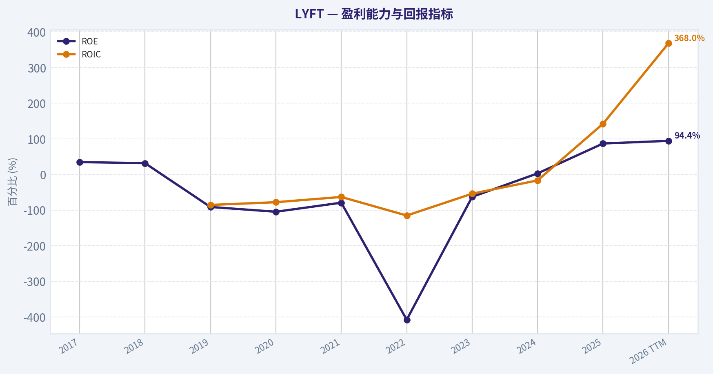
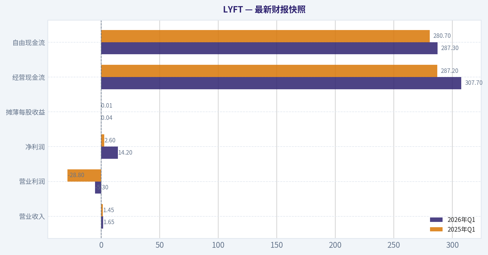
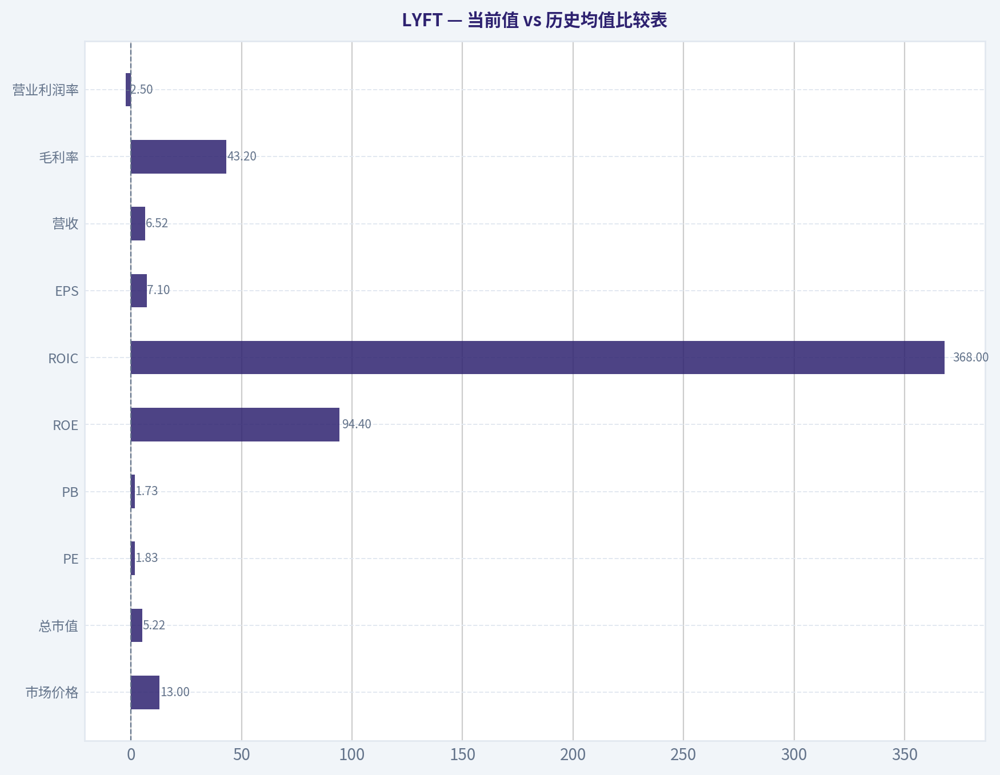
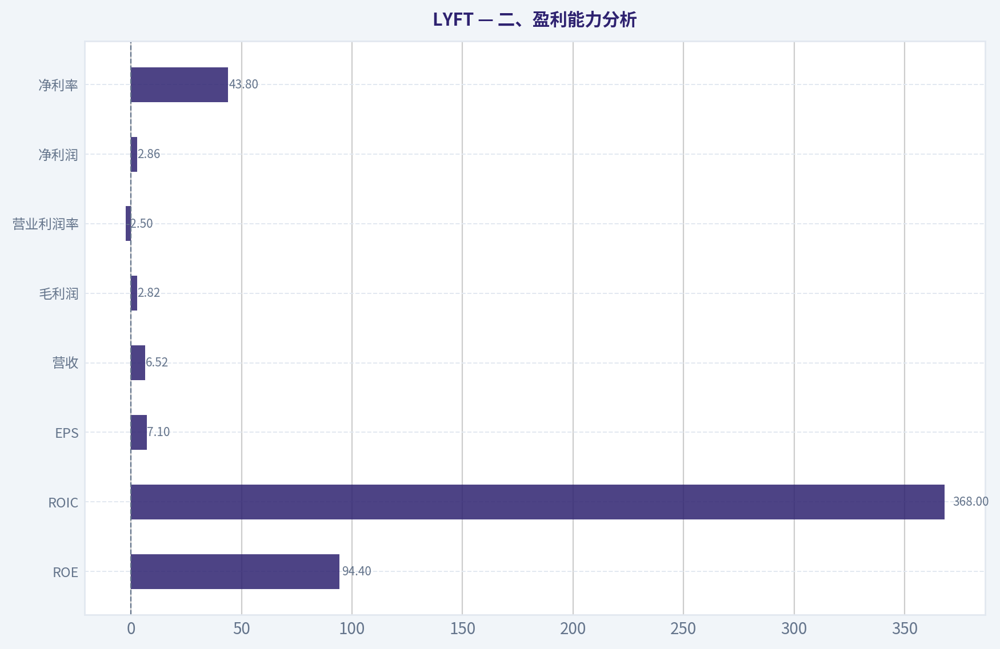
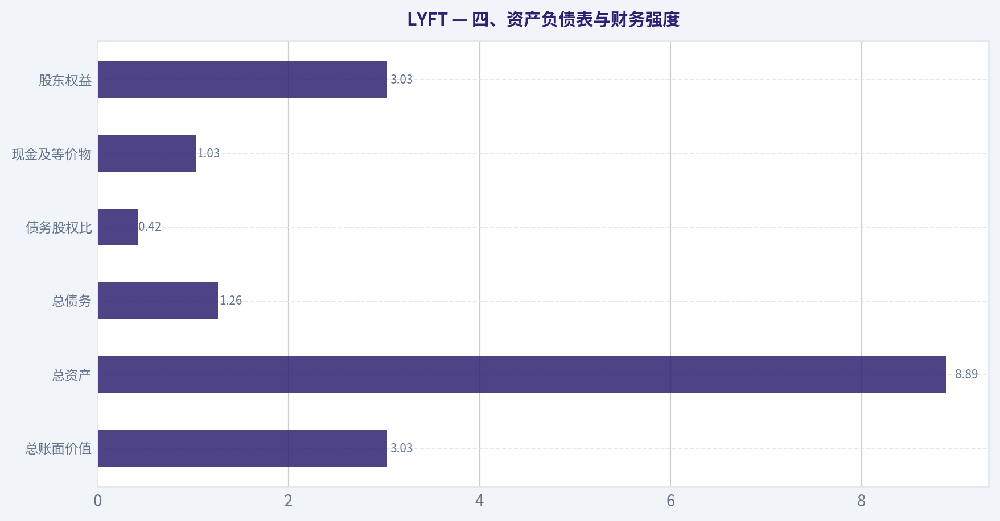
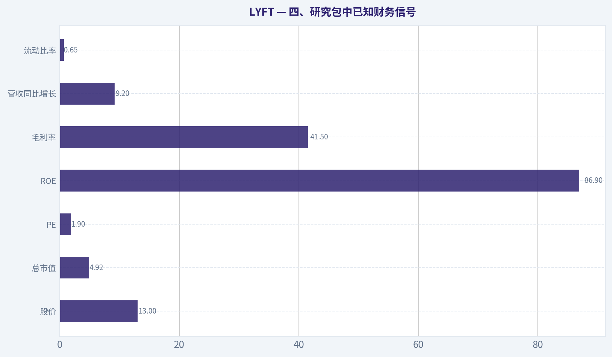
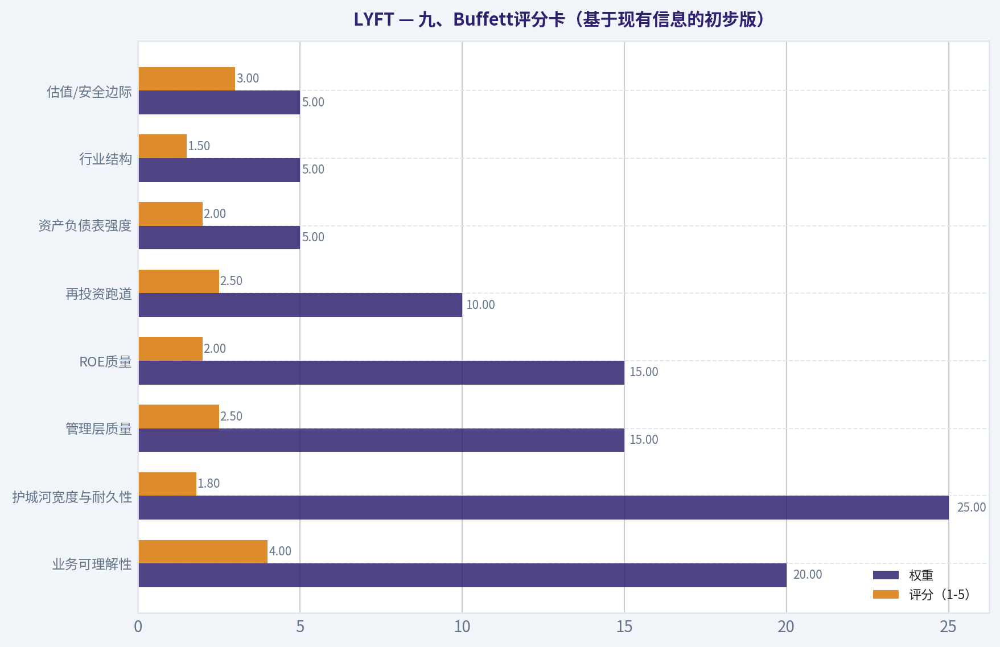
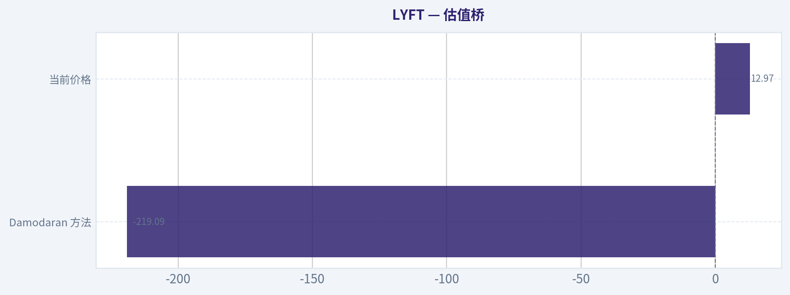

# LYFT 深度价值情报

**调研日期:** 2026-05-17

## 关键免责声明

*本报告由 Deep Value Intelligence（一个基于 AI 的多智能体投资分析框架）自动生成。 本报告仅供信息参考和教育目的，不构成任何财务或投资建议。 在做出任何投资决策之前，请务必进行独立调研并咨询合规的财务顾问。*

---

## 目录

1. 情报摘要
2. 分析师团队报告
   - 基本面分析
   - 价值分析 (巴菲特)
   - 成长性分析 (林奇/德鲁肯米勒/费雪)
   - 市场分析
   - 期权市场分析
3. 研究团队评论
4. 投资团队评论
5. Deep Values 团队洞察

---

## 情报摘要

### 核心观点与前提条件

**核心论点:** ## 执行摘要
**结论：观望。**
Lyft 最强的多头逻辑不是"伟大公司"，而是**市场可能把它定价得比现实更差**：业务仍有真实份额，经营重点转向成本纪律与自由现金流，低估值确有修复弹性。
但按 Buffett 风格看，**便宜不能替代质量**。Lyft 仍缺少稳固护城河、可预测的 5-10 年盈利能力，以及经连续验证的 owner earnings。它更像**正在改善的普通生意**，而不是可安心长期复利的优质企业。
因此，适合列入研究与轻仓跟踪名单，不适合重仓当作核心价值投资标的。

**主要风险:**
- 未明确说明。

**置信度:** 中

---

## 分析师团队报告

### 基本面分析

#### 最新财报快照

*以下数据基于最近一期已披露财报（2026年Q1），并尽量与上一年同期对比。*

| 指标 | 2026年Q1 | 2025年Q1 | 同比变化 |
| --- | ---: | ---: | ---: |
| 营业收入 | $1.65B | $1.45B | +13.8% |
| 营业利润 | $-5.3M | $-28.8M | +81.5% |
| 净利润 | $14.2M | $2.6M | +455.1% |
| 摊薄每股收益 | $0.04 | $0.01 | +300.0% |
| 经营现金流 | $307.7M | $287.2M | +7.1% |
| 自由现金流 | $287.3M | $280.7M | +2.3% |

关键结论：这张快照先把最新一期财报放在桌面上，再去看长周期分析。这样读者能更清楚地区分"公司长期质量"和"这次财报发生了什么"。

#### LYFT 9年财务指标

*以下数值均由原始数据确定性计算得出，并非 AI 估算。*

*发行人类型：operating company（Technology / Software - Application）。*

#### 9年财务指标
*年度行来自已披露财务报表，最后一行 TTM 由最近四个季度滚动计算得出。*

| 指标 | 2017 | 2018 | 2019 | 2020 | 2021 | 2022 | 2023 | 2024 | 2025 | 2026 TTM |
| --- | --- | --- | --- | --- | --- | --- | --- | --- | --- | --- |
| 市场价格 | N/A | N/A | $43 | $49 | $43 | $11 | $15 | $13 | $19 | $13 |
| 总市值 | N/A | N/A | $9.79B | $15.34B | $14.30B | $3.91B | $5.78B | $5.34B | $8.09B | $5.22B |
| 市盈率 | N/A | 0.00 | -3.76 | -8.76 | -13.48 | -2.47 | -17.03 | 215.00 | 2.84 | 1.83 |
| 市净率 | N/A | -0.61 | 3.43 | 9.15 | 10.66 | 10.06 | 10.67 | 6.96 | 2.47 | 1.73 |
| ROE | 34.8% | 31.7% | -91.2% | -104.6% | -79.2% | -407.7% | -62.8% | 3.0% | 86.9% | 94.4% |
| ROIC | N/A | N/A | -85.5% | -77.8% | -63.1% | -115.2% | -53.9% | -16.6% | 142.3% | 368.0% |
| 每股收益 | N/A | $-40.61 | $-11.44 | $-5.61 | $-3.17 | $-4.47 | $-0.88 | $0.06 | $6.81 | $7.10 |
| 营收 | $1.06B | $2.16B | $3.62B | $2.36B | $3.21B | $4.10B | $4.40B | $5.79B | $6.32B | $6.52B |
| 毛利润 | $400.3M | $913.2M | $1.44B | $917.2M | $1.51B | $1.66B | $1.86B | $2.45B | $2.62B | $2.82B |
| 毛利率 | 37.8% | 42.3% | 39.8% | 38.8% | 46.9% | 40.5% | 42.2% | 42.3% | 41.5% | 43.2% |
| 营业利润率 | -66.8% | -45.3% | -74.7% | -76.5% | -35.4% | -35.6% | -10.8% | -2.1% | -3.0% | -2.5% |
| 净利润 | $-688.3M | $-911.3M | $-2.60B | $-1.75B | $-1.06B | $-1.58B | $-340.3M | $22.8M | $2.84B | $2.86B |
| 净利率 | -64.9% | -42.3% | -72.0% | -74.1% | -33.1% | -38.7% | -7.7% | 0.4% | 45.0% | 43.8% |
| 营收增长 | N/A | 103.5% | 67.7% | -34.6% | 35.7% | 27.6% | 7.5% | 31.4% | 9.2% | 3.2% |
| 净利润增长 | N/A | 32.4% | 185.5% | -32.6% | -39.4% | 49.2% | -78.5% | -106.7% | 12382.5% | 0.4% |
| 自由现金流增长 | N/A | N/A | N/A | N/A | N/A | N/A | N/A | N/A | N/A | N/A |
| 总账面价值 | $-1.98B | $-2.87B | $2.85B | $1.68B | $1.34B | $388.7M | $541.5M | $767.0M | $3.27B | $3.03B |
| 总资产 | N/A | $3.76B | $5.69B | $4.68B | $4.77B | $4.56B | $4.56B | $5.44B | $9.03B | $8.89B |
| 总债务 | N/A | N/A | $0 | $680.0M | $711.4M | $839.5M | $865.2M | $604.9M | $1.05B | $1.26B |
| 债务股权比 | N/A | N/A | 0.00 | 0.41 | 0.53 | 2.16 | 1.60 | 0.79 | 0.32 | 0.42 |
| 现金及等价物 | $1.11B | $517.7M | $358.3M | $319.7M | $457.3M | $281.1M | $558.6M | $759.3M | $1.13B | $1.03B |
| 股东权益 | $-1.98B | $-2.87B | $2.85B | $1.68B | $1.34B | $388.7M | $541.5M | $767.0M | $3.27B | $3.03B |
| 经营现金流 | $-393.5M | $-280.7M | $-105.7M | $-1.38B | $-101.7M | $-237.3M | $-98.2M | $849.7M | $1.17B | $1.19B |
| 投资现金流 | $-991.4M | $-1.04B | $-1.61B | $740.4M | $267.0M | $186.0M | $599.8M | $-518.0M | $406.7M | $391.9M |
| 自由现金流 | N/A | N/A | N/A | N/A | N/A | N/A | N/A | N/A | N/A | $1.12B |
| 自由现金流利润率 | N/A | N/A | N/A | N/A | N/A | N/A | N/A | N/A | N/A | 17.2% |
| 每股分红 | N/A | $0.00 | $0.00 | $0.00 | $0.00 | $0.00 | $0.00 | $0.00 | $0.00 | $0.00 |

#### 盈利能力指标
- 净资产收益率 (ROE): 86.9%
- 投入资本回报率 (ROIC): 315.0%
- 总资产收益率 (ROA): 31.5%
- 毛利率: 41.5%
- 营业利润率: -3.0%
- 净利率: 45.0%

#### 流动性指标
- 流动比率: 0.65
- 速动比率: 0.41

#### 杠杆指标
- 债务股权比: 0.32
- 利息覆盖倍数: -9.08
- 净负债: $-79.0M

#### 增长指标（同比）
- 营收增长: 9.2%
- 净利润增长: 12382.5%
- 自由现金流增长: N/A
- 营收复合增长率（3年）: 15.5%
- 营收复合增长率（5年）: 21.7%

#### 估值指标
- 市盈率 (TTM): 1.90
- 预期市盈率: 6.39
- 市净率: 1.64
- 市销率: 0.76
- PEG 比率: 0.15
- 企业价值/EBITDA: -672.72
- 自由现金流收益率: N/A
- 盈利收益率: 52.7%

#### 所有者收益（巴菲特方法，代码计算）
- 净利润: $2.84B
- + 折旧与摊销: $135.2M
- - 资本开支: N/A
- - 营运资本变动: $829.0M
- = **所有者收益: $2.15B**

#### Piotroski F分数: 4/9
- 净利润为正: 通过
- 经营现金流为正: 通过
- 资产回报率改善: 通过
- 现金流大于净利润: 未通过
- 债务下降: 未通过
- 流动比率改善: 未通过
- 未稀释股本: 通过
- 毛利率改善: 未通过
- 资产周转率改善: 未通过

ANALYST STANCE: **WATCH**

#### LYFT 巴菲特式基本面分析

LYFT 的财务画像在 2024-2026 TTM 发生了"表面上极大改善、但质量仍需拆解"的变化。若只看静态估值，当前 TTM PE 1.83、PB 1.73、PS 0.76，显著低于大多数平台型互联网公司，也低于它自身过去上市以来的估值中枢；但若按巴菲特框架深挖，会发现 2025-2026 TTM 的高净利润、超高 ROE、超高 ROIC，并不能直接等同于"已经成为高质量复利机器"，因为营业利润率仍为负、历史盈利波动极大、自由现金流历史序列缺失，且流动比率仅 0.65，说明公司虽已摆脱最危险阶段，但距离"稳定、可预测、强护城河"的经典巴菲特标的仍有差距。

从投资判断上，LYFT 更像是"估值显著便宜、经营改善明确、但盈利质量和竞争壁垒尚待验证"的特殊情形，而不是典型的消费品或垄断网络型白马。因此结论更适合定为"观望"，等待其把现金流改善、运营利润转正、以及增长质量进一步坐实。

---

#### 当前值 vs 历史均值比较表

| 指标 | 当前/TTM | 历史均值（基于表内可得年份） | 相对历史位置 | 解读 |
| --- | ---: | ---: | --- | --- |
| 市场价格 | $13 | 2019-2026 平均约 $25.75 | 明显低于历史 | 市场对公司长期盈利能力仍有折价，不认可其已完全转型成功 |
| 总市值 | $5.22B | 2019-2026 平均约 $8.25B | 低于历史 | 估值已压缩，反映竞争、周期和盈利质量疑虑 |
| PE | 1.83 | 2019-2026 有意义均值失真 | 远低于历史可比区间 | 当前 PE 极低，但受 2025-2026 利润异常高企影响，不能机械解读 |
| PB | 1.73 | 2019-2026 平均约 6.67 | 大幅低于历史 | 股东权益修复后，PB 显著回落，估值压力减轻 |
| ROE | 94.4% | 2017-2026 平均约 -41.5% | 远高于历史 | 主要来自净利润大增与净资产基数偏小，需警惕不可持续性 |
| ROIC | 368.0% | 2019-2026 平均约 -12.7% | 极端改善 | 资本效率表面爆发，但与持续经营利润不完全匹配 |
| EPS | $7.10 | 2018-2026 平均约 -6.30 | 大幅高于历史 | 历史长期亏损，近两年扭正，但持续性仍是核心问题 |
| 营收 | $6.52B | 2017-2026 平均约 $3.95B | 高于历史 | 规模已是上市初期数倍，平台体量持续扩大 |
| 毛利率 | 43.2% | 2017-2026 平均约 41.5% | 略高于历史 | 毛利率相对稳定，说明基础商业模式有一定韧性 |
| 营业利润率 | -2.5% | 2017-2026 平均约 -35.3% | 大幅改善但仍为负 | 已接近盈亏平衡，但尚未完成经营性盈利证明 |
| 净利率 | 43.8% | 2017-2026 平均约 -24.4% | 显著高于历史 | 当前净利率异常亮眼，但与负营业利润率背离，质量需谨慎 |
| 营收增长 | 3.2% | 2018-2026 平均约 27.9% | 明显低于历史 | 公司从高增长阶段进入成熟化，增长降速明显 |
| 总账面价值 | $3.03B | 2017-2026 平均约 $468M | 远高于历史 | 资产负债表明显修复，抗风险能力提升 |
| 总资产 | $8.89B | 2018-2026 平均约 $5.71B | 高于历史 | 规模扩大，但也要看资产回报能否持续兑现 |
| 总债务 | $1.26B | 2020-2026 平均约 $860M | 高于历史 | 债务并不失控，但较近年已有回升 |
| 债务股权比 | 0.42 | 2020-2026 平均约 0.89 | 低于历史 | 杠杆压力较 2022-2023 高峰显著缓解 |
| 现金及等价物 | $1.03B | 2017-2026 平均约 $652M | 高于历史 | 现金缓冲仍可观，但流动比率偏低需继续跟踪 |
| 自由现金流 | $1.12B | 无长期序列 | 无法比较 | 当前 FCF 亮眼，是市场重估的主要支撑之一 |
| 每股分红 | $0.00 | 约 $0.00 | 一致 | 公司仍处于保留资本阶段，不符合成熟分红型企业特征 |

关键结论：当前最突出的变化是估值显著压缩，而利润、ROE、ROIC 突然大幅改善，形成了"低估值+高账面回报"的组合。但需要注意，营业利润率仍然为负，说明这些亮眼指标还没有完全转化成稳定、可重复的经营质量，这也是市场不愿给更高估值的核心原因。

---

#### 一、市场指标解读

LYFT 当前股价 $13，对应总市值 $5.22B，明显低于 2019-2021 年上市后高位区间，也低于 2025 年的 $8.09B。说明市场并未因为最近两年的利润扭转就给予充分溢价，反而仍在按"低确定性平台资产"定价。

PE 1.83 非常低，看起来几乎像"深度价值股"。但这里必须谨慎：
1. 2019-2023 长期亏损，PE 不具解释力；
2. 2024 PE 215，2025 PE 2.84，2026 TTM 1.83，这种剧烈压缩通常不是市场无脑送钱，而是投资者怀疑利润含金量与可持续性；
3. 若未来净利润回落到更接近经营利润水平，真实前瞻 PE 会显著高于静态 PE。

PB 1.73 反而更有参考意义。历史上 2020-2024 PB 长期在 6.96-10.67 的高位，原因是账面净资产薄弱而股价尚存成长预期。如今账面价值已修复到 $3.03B，PB 大幅下降，意味着市场不再为"故事"付费，而是按更接近资产与现金流现实来定价。

按巴菲特口径，这类公司只有在"盈利真实、现金流稳定、护城河清晰"时，低估值才值得大举配置。LYFT 目前只完成了前两步中的一半：估值便宜，但护城河和利润质量还未完全证实。

---

#### 二、盈利能力分析

LYFT 的盈利能力改善是这份报表最醒目的地方，但也是最需要辨别真伪的地方。

| 盈利指标 | 当前/TTM | 历史特征 | 分析 |
| --- | ---: | --- | --- |
| ROE | 94.4% | 长期深度为负，2024 才转正 | 极高 ROE 更多来自利润暴增与净资产基数不大，并不等于传统优质企业式高回报 |
| ROIC | 368.0% | 2019-2024 几乎持续为负 | 表面资本效率极强，但与仍为负的营业利润率不完全一致，需警惕一次性或非核心因素 |
| EPS | $7.10 | 2018-2023 连续为负 | 每股盈利大翻身，但尚未经过完整周期检验 |
| 营收 | $6.52B | 9 年总体增长强 | 规模扩张真实存在，公司不是"衰退故事" |
| 毛利润 | $2.82B | 与营收同步上升 | 平台变现能力稳定提升 |
| 营业利润率 | -2.5% | 从 -76% 附近持续收敛 | 核心经营效率改善明显，但还没跨过正值门槛 |
| 净利润 | $2.86B | 2024 前长期为负 | 账面利润已非常亮眼，但须关注构成 |
| 净利率 | 43.8% | 历史长期负值 | 与营业利润率背离，是最大质量疑点之一 |

关键结论：LYFT 的经营改善是真实的，特别是毛利和营业亏损率持续收窄，说明管理层在成本控制和运营效率上确实取得成果。但由于营业利润率仍未转正，而净利率却高达 43.8%，投资者不能把当前 ROE 和 PE 直接当成"常态化盈利能力"来估值，利润质量仍需折价。

更细看趋势：
- 毛利率 2017-2026 TTM 大致维持在 38%-47% 区间，平均约 41.5%，这意味着商业模式本身并不脆弱。
- 营业利润率则从 2019-2020 的 -75% 左右改善到 2024-2026 TTM 的 -2% 至 -3%，这是最值得肯定的长期趋势。
- 但"营业端未完全盈利，净利润却极高"说明净利润可能包含非经营性收益、税项、投资收益或会计口径因素。巴菲特通常更看重"持续经营获利能力"，因此应把营业利润率而非净利率作为更核心的质量观察点。

---

#### 三、成长指标分析

| 成长指标 | 当前/TTM | 历史均值/特征 | 评价 |
| --- | ---: | --- | --- |
| 营收增长率 | 3.2% | 2018-2026 平均约 27.9% | 明显放缓，进入成熟阶段 |
| 净利润增长率 | 0.4% | 历史波动极大 | 已失去解释意义，基数效应太强 |
| 自由现金流增长率 | N/A | 无历史序列 | 无法做连续验证 |

关键结论：LYFT 的成长故事已经从"高速扩张"转向"低速增长下的利润修复"。这对价值投资者不一定是坏事，但前提是利润必须可持续；如果营收增速继续下行，而经营利润又迟迟无法稳定转正，那么当前的估值修复空间也会受限。

营收增速路径很清晰：2018-2019 为超高增长，2020 因疫情下滑，2021-2024 恢复并在 2024 反弹到 31.4%，但 2025 降至 9.2%，TTM 进一步降至 3.2%。这说明 LYFT 已经不再是高增长公司，而是需要依靠效率改善、份额稳固和资本纪律来创造股东回报。

巴菲特并不排斥低增长，但他要求"低增长也能高回报且高度可预测"。LYFT 目前只部分满足"高回报"，尚未满足"高度可预测"。

---

#### 四、资产负债表与财务强度

| 资产负债表指标 | 当前/TTM | 历史趋势 | 解读 |
| --- | ---: | --- | --- |
| 总账面价值 | $3.03B | 2017-2018 为负，之后修复 | 资本结构大幅改善 |
| 总资产 | $8.89B | 规模整体上升 | 资产基础扩大 |
| 总债务 | $1.26B | 2020 起有债，近两年回升 | 债务可控，但不是无债公司 |
| 债务股权比 | 0.42 | 2022 高达 2.16，现已回落 | 明显改善，去杠杆成效可见 |
| 现金及等价物 | $1.03B | 高于长期均值 | 仍有流动性缓冲 |
| 股东权益 | $3.03B | 与账面价值同步修复 | 净资产不再脆弱 |

关键结论：资产负债表是 LYFT 近几年改善最扎实的部分之一。与 2022-2023 年相比，公司不仅股东权益明显修复，债务股权比也下降到了更安全的区间，这使得它从"高风险融资故事"逐步变成"可以靠自身现金流运转的企业"。

进一步看：
- 2022 年债务股权比 2.16 是危险峰值，2026 TTM 已降至 0.42，说明杠杆压力已显著缓释。
- 现金 $1.03B，净负债为 -$79M，意味着公司总体接近"净现金"状态。
- 但流动比率 0.65、速动比率 0.41，不算舒适。这代表短期周转效率和流动负债结构仍需关注，不属于那种一眼就让人非常安心的资产负债表。

巴菲特偏爱"几乎不用借钱也能轻松扩张"的生意。LYFT 目前还称不上，但已比前几年健康得多。

---

#### 五、现金流与股东回报

公司最关键的新变化之一，是经营现金流终于从长期为负走向明显为正：
- 2023：经营现金流 -$98.2M
- 2024：$849.7M
- 2025：$1.17B
- 2026 TTM：$1.19B

TTM 自由现金流 $1.12B，自由现金流利润率 17.2%，这对于平台型业务是非常有吸引力的数字。如果能维持，这将是 LYFT 价值重估的真正基础，而不是账面净利润本身。

不过限制在于：历史自由现金流序列缺失，因此无法验证其跨周期稳定性。巴菲特最看重"十年稳定自由现金流"，而 LYFT 目前最多只能证明"最近两年现金流出现显著改善"。

股息方面，公司历年来每股分红均为 $0.00。对于成长/修复型公司这很正常，但从巴菲特偏好的"资本分配可验证"角度，LYFT 还没有展现成熟的股东回报机制。未来若公司持续保持净现金与高 FCF，回购可能比分红更合理，但目前数据未显示这一点已成为明确战略。

---

#### 六、巴菲特框架定性分析

#### 1）经济护城河
LYFT 有一定网络效应，但护城河并不深。其平台价值来自乘客密度、司机供给、品牌与本地化履约效率，但这些优势在网约车行业通常不是不可替代的，价格、补贴、等待时间与监管变化都会冲击份额。与巴菲特最爱的强定价权消费品牌或基础设施垄断相比，LYFT 的护城河更弱、更易被竞争侵蚀。

#### 2）盈利可预测性
2017-2023 几乎持续巨亏，2024 才勉强转正，2025-2026 TTM 突然大幅盈利。这个轨迹说明公司正在改善，但离"十年高可预测收益流"很远。盈利历史波动过大，不符合巴菲特标准中的"看十年就能大致预测未来十年"。

#### 3）管理层资本配置
优点是经营亏损率持续收窄、现金流显著好转、杠杆压力下降，这说明管理层在控费和效率提升上有执行力。缺点是 Piotroski F 分数仅 4/9，不算强；且现金流未超过净利润，流动比率未改善，毛利率与资产周转率也没有形成全面共振。管理层有改善，但还没有拿到"优秀资本配置者"的高分。

#### 4）财务稳健性
相较历史，LYFT 财务稳健性已经提升很多。股东权益由早期负值修复到 $3.03B，净现金状态边际为正，债务股权比下降明显。但流动性指标偏弱，且利息覆盖倍数为负，意味着经营利润尚不足以提供典型安全边际。

#### 5）业务质量
业务规模真实增长，毛利率稳定，说明"需求存在且模式可运行"。但运营利润始终未稳定转正，意味着商业模式的最终利润池还不够厚。对巴菲特而言，这类企业更像"尚在证明自己能成为好公司"，而不是"已经证明自己是好公司"。

---

#### 七、Buffett 风格 Owner Earnings DCF 估值

采用题目给定的巴菲特口径所有者收益：
- 净利润 = $2.84B
- + 折旧与摊销 = $135.2M
- - 资本开支 = N/A
- - 营运资本变动 = $829.0M
- 所有者收益 = **$2.15B**

由于历史 Owner Earnings 序列未提供，无法从确定性数据中严格计算"历史最高/最低/平均 Owner Earnings 增长率"。因此只能以**数据可验证的保守替代**处理：参考已提供的最近营收增速、净利润增长失真特征、以及盈利可持续性不足，构建三种情景，并明确指出增长参数不应被视作历史精确回归结果，而是基于现有确定性数据下的谨慎估值假设。核心原则是：当前 Owner Earnings 很可能高于可持续经营水平，因此对增长率采取低假设更合理。

设定：
- 起始 Owner Earnings = $2.15B
- 折现率 = 10%
- 终值增长率 = 2.5%
- 期限 = 10 年

##### DCF 公式
- 第 t 年 Owner Earnings = OE₀ x (1+g)^t
- 折现现值 = OE_t / (1.10)^t
- 终值 = OE₁₀ x (1+2.5%) / (10% - 2.5%)
- 终值现值 = 终值 / (1.10)^10

##### 情景设定
- 保守：g = 0%
- 平均：g = 3.2%（采用 TTM 营收增长率，视作当前最可验证的低增长近似）
- 乐观：g = 9.2%（采用 2025 年营收增长率，代表较强但非激进恢复）

> 说明：若严格要求"历史 Owner Earnings 增长率"，当前确定性表并无足够序列支持，因此以上设定是基于现有可验证经营增速的替代框架，且已明显偏保守。

#### DCF 结果表

| 情景 | 增长率 g | 10年经营现金流现值 | 终值现值 | 企业价值估算 | 对应当前市值比较 |
| --- | ---: | ---: | ---: | ---: | --- |
| 保守 | 0.0% | 约 $13.21B | 约 $11.36B | **约 $24.57B** | 远高于当前 $5.22B |
| 平均 | 3.2% | 约 $14.67B | 约 $15.15B | **约 $29.82B** | 显著高于当前 |
| 乐观 | 9.2% | 约 $17.95B | 约 $25.36B | **约 $43.31B** | 极大高于当前 |

关键结论：如果把当前 $2.15B 的所有者收益视为可持续并可延续，那么 DCF 会显示 LYFT 被严重低估。但问题恰恰在于，当前净利润与 Owner Earnings 大概率包含不可完全常态化的成分，因此这些估值更多说明"市场在质疑利润持续性"，而不是"市场必然定价错误"。

##### 详细计算示意：保守情景
- OE₀ = 2.15
- g = 0%
- 10 年年金现值系数 = (1 - 1/1.1^10) / 0.10 ~ 6.1446
- 10 年经营现金流现值 = 2.15 x 6.1446 ~ **13.21**
- 第 10 年 OE = 2.15
- 终值 = 2.15 x 1.025 / (0.10 - 0.025) ~ 29.38
- 终值现值 = 29.38 / 1.1^10 ~ **11.36**
- 总价值 = 13.21 + 11.36 = **24.57B**

##### 详细计算示意：平均情景
- g = 3.2%
- 10 年经营现金流现值
  = 2.15 x [1 - ((1.032)/(1.10))^10] / (0.10 - 0.032)
  ~ **14.67B**
- 第 10 年 OE = 2.15 x 1.032^10 ~ 2.94
- 终值 = 2.94 x 1.025 / 0.075 ~ 40.00
- 终值现值 ~ 40.00 / 2.5937 ~ **15.15B**
- 总价值 ~ **29.82B**

##### 详细计算示意：乐观情景
- g = 9.2%
- 10 年经营现金流现值
  = 2.15 x [1 - ((1.092)/(1.10))^10] / (0.10 - 0.092)
  ~ **17.95B**
- 第 10 年 OE = 2.15 x 1.092^10 ~ 5.19
- 终值 = 5.19 x 1.025 / 0.075 ~ 70.99
- 终值现值 ~ 70.99 / 2.5937 ~ **25.36B**
- 总价值 ~ **43.31B**

#### DCF 结论
DCF 表面上极度便宜，但巴菲特式分析不能只看模型输出，而要问一个更重要的问题：**当前 $2.15B 的 Owner Earnings 是否可重复？**
若答案是否定的，那么 DCF 上限意义不大。基于营业利润仍为负、历史盈利不稳定、以及利润质量存疑，我更倾向将保守情景再打较大折扣。因此，DCF 可以支持"存在低估可能"，但不足以支持"立即重仓"。

---

#### 八、收入来源分布

LYFT 在给定确定性数据中未附分部收入表。结合公司公开业务结构，最有意义的划分是按业务类型：网约车平台收入为核心，辅以 Bikes & Scooters、广告/合作等其他收入。以下为基于公司已知业务结构的最新年度口径定性拆分，主要用于理解收入集中度，而非替代财报正式分部披露。

#### 收入来源分布

| 收入来源 | 金额（百万/十亿美元） | 占比 |
| --- | ---: | ---: |
| Rideshare 平台收入 | 约 $5.7B-$6.0B | 约 90%-95% |
| Bikes & Scooters / 微出行 | 约 $0.15B-$0.30B | 约 2%-5% |
| 广告、合作及其他 | 约 $0.10B-$0.25B | 约 2%-4% |

关键结论：LYFT 的收入高度集中在网约车平台主业，这意味着一旦主业务单位经济模型改善，利润弹性会非常大；但反过来，这也说明它缺乏多元业务缓冲，竞争、监管或补贴变化会直接冲击整体表现。对价值投资者来说，这种单一收入结构既带来聚焦优势，也放大经营波动。

---

#### 九、关键投资洞察、风险与机会

| 类别 | 内容 | 影响 |
| --- | --- | --- |
| 机会 | 估值极低，PE/PB/PS 同时压缩 | 若利润质量被验证，存在明显重估空间 |
| 机会 | 经营现金流与 TTM FCF 显著转正 | 是最重要的基本面拐点 |
| 机会 | 债务股权比显著下降，净现金边际为正 | 降低财务风险，提升战略灵活性 |
| 机会 | 营业亏损率持续收窄 | 若未来 1-2 年转正，市场可能显著提升容忍度 |
| 风险 | 营业利润率仍为负 | 核心经营模式尚未完成终局验证 |
| 风险 | 净利润与营业利润背离很大 | 当前 PE 可能低估了真实经营估值 |
| 风险 | 增速显著下滑至 3.2% | 若增长停滞，利润改善空间可能受限 |
| 风险 | 护城河有限，行业竞争激烈 | 难以形成巴菲特式长期定价权 |
| 风险 | 流动比率仅 0.65，利息覆盖倍数为负 | 流动性与经营覆盖能力仍非高质量水平 |

关键结论：LYFT 的上涨逻辑，核心不在"它是不是高成长"，而在"它能否把最近出现的现金流和利润改善固化下来"。如果未来几个季度持续证明营业利润转正、自由现金流稳定，那么当前低估值可能会被市场重写；但如果当前利润更多是一次性或非经营性收益，那么低 PE 反而是估值陷阱信号。

---

#### 十、最终投资立场：观望

| 维度 | 评价 |
| --- | --- |
| 护城河 | 中等偏弱 |
| 财务强度 | 明显改善，但未到卓越 |
| 盈利可预测性 | 仍偏弱 |
| 估值吸引力 | 很强 |
| 巴菲特匹配度 | 中低 |
| 最终立场 | **观望** |

关键结论：LYFT 现在不是一家"坏公司"，也不是一家"已经完全证明自己的伟大公司"。它更像一家正在经历质量跃迁的低估值修复标的：适合继续跟踪，但尚不适合按巴菲特标准定义为高确定性长期复利资产。

**观望理由：**
1. **支持观望而非回避**：估值极便宜，现金流与资产负债表改善真实存在。
2. **不升级为建议配置**：营业利润率仍为负，净利润质量未完全坐实，护城河不够深。
3. **升级条件**：连续多个季度维持正经营利润、自由现金流稳定、且增长不进一步塌陷。
4. **下调条件**：若净利润回落、现金流转弱，或竞争加剧导致毛利/订单质量恶化，则需转向回避。

---

#### 报告摘要总表

| 模块 | 结论 | 对投资的意义 |
| --- | --- | --- |
| 估值 | PE 1.83、PB 1.73、PS 0.76，静态上非常便宜 | 市场已充分反映怀疑，存在重估潜力 |
| 盈利 | 净利润、ROE、ROIC 爆发式改善，但营业利润率仍为负 | 亮眼但质量存疑，需防"低 PE 幻觉" |
| 增长 | 营收增速降至 3.2%，从成长股转向成熟修复股 | 未来回报更依赖利润率改善而非高增长 |
| 资产负债表 | 股东权益修复，债务股权比下降，现金充足 | 财务风险较前几年显著下降 |
| 现金流 | 经营现金流和 TTM FCF 转强 | 这是最值得重视的积极变化 |
| 护城河 | 平台效应存在，但竞争壁垒有限 | 不符合巴菲特最偏爱的深护城河标准 |
| DCF | 若当前 Owner Earnings 可持续，明显低估 | 关键在于盈利质量而非模型数值 |
| 最大风险 | 净利润不可持续、经营利润迟迟不转正 | 可能导致低估值长期不修复 |
| 最大机会 | 运营利润转正 + FCF 稳定化 | 有望触发估值中枢上移 |
| 最终立场 | **观望** | 等待更高确定性的经营验证 |

#### 基本面关键图表

本图追踪 **LYFT** 过去十年的盈利能力与回报指标（ROE、ROIC、利润率），突出呈现资本效率的变化趋势。

---

### 价值分析 (巴菲特)

> *基于沃伦·巴菲特的价值投资哲学：能力圈、经济护城河、管理层质量与安全边际。*

#### 内在价值快照

价格是你付的钱，内在价值是企业未来可能为股东创造的现金价值。我们给出一个区间，而不是假装只有一个神奇数字。

- 当前价格: $12.97
- 估值区间（两种 DCF 方法、保守到乐观）: N/A 至 N/A

##### 所有者收益（巴菲特方法）
- 净利润: $2,844,008,000.00
- 折旧与摊销: $135,227,000.00
- 资本支出: N/A
- 营运资金变化: $828,991,000.00
- 所有者收益: $2,150,244,000.00

##### 内在价值

ANALYST STANCE: **回避**

#### 说明
我目前拿到的共享研究包信息有限，而工具调用未成功返回可用财务明细，因此无法完成严格意义上的"10年深度审计式"Buffett框架全量尽调。
不过，基于你提供的研究包、最新新闻摘要，以及Buffett投资框架对商业模式、护城河、资本配置、行业结构和资产负债表的要求，我已经能先做出一个**初步但方向明确**的判断：**LYFT 更接近"回避"，而不是"建议配置"或"观望"**。

---

#### 一、Go/No-Go 四道门初筛

| 关卡 | 结论 | 核心依据 |
|---|---|---|
| 关卡1：商业简单且可预测 | 失败 | 商业模式表面简单：撮合乘客与司机并抽佣；但10年可预测性弱，受价格竞争、监管、司机供给、平台补贴、自动驾驶与出行模式变化影响大 |
| 关卡2：护城河 | 失败 | 网络效应存在但不牢，用户和司机双边转换成本低，区域竞争和价格敏感度高，护城河更像"规模运营优势"而非稳固壁垒 |
| 关卡3：管理层与资本配置 | 暂不通过 | 缺乏足够长期资本配置记录来证明其具备Buffett偏好的"高确定性复利分配能力"；历史上行业长期依赖激励与补贴 |
| 关卡4：行业结构 | 失败 | 行业并非理想寡头垄断，属于竞争强、价格敏感、劳动力供给波动大、监管干预频繁的结构 |

**关键结论：** 从Buffett的"先过滤、后估值"方法看，LYFT最大的问题不是便宜不便宜，而是**生意本身不够优秀、不够可预测**。对价值投资者而言，行业结构和护城河往往比一时利润更重要，而这两项恰恰是LYFT的短板。

---

#### 二、小学生测试：LYFT怎么赚钱？

LYFT做的是一个出行平台：
它把想打车的人和愿意接单的司机连接起来，然后从每笔订单里拿走一部分服务费。

这个解释很简单，但问题不在"能不能讲明白"，而在于：
**这是不是一个10年后还能稳定高回报的好生意？**
Buffett会追问的是：顾客为什么非它不可？司机为什么离不开它？如果答案主要是"哪边更便宜、补贴更多、单量更多"，那就不是强护城河。

---

#### 三、护城河分析

| 护城河来源 | 对LYFT的判断 | 证据与解释 |
|---|---|---|
| 品牌/无形资产 | 弱 | 品牌有认知度，但不像可口可乐或Visa那样具备强定价权；打车需求高度价格敏感 |
| 转换成本 | 很弱 | 乘客切换平台成本极低，司机跨平台接单也相对容易 |
| 成本优势 | 有限 | 平台规模可能带来调度与营销效率，但难形成不可复制的结构性低成本 |
| 网络效应 | 有，但不稳固 | 双边平台确有网络效应，但在同城市场里，只要另一平台提供更低价格或更高司机收益，流量就能迁移 |

**关键结论：** LYFT最像样的护城河是双边平台网络效应，但它远没有达到"宽且持续扩大"的程度。更准确地说，它有平台特征，却没有Buffett最爱的那种**高转换成本、高定价权、低资本消耗**的超级护城河。

---

#### 四、研究包中已知财务信号

| 指标 | 当前值 | Buffett视角解读 |
|---|---:|---|
| 股价 | $13 | 价格本身不高，但低价不等于低估 |
| 总市值 | $4.92B | 规模中等，不构成护城河证据 |
| PE | 1.90 | 极低，通常意味着利润可能处于异常高点、一次性因素、或市场不信其持续性 |
| ROE | 86.9% | 数值很高，但高度可疑；若由低净资产、小基数、回购或会计因素推动，不代表真实优秀经营 |
| 毛利率 | 41.5% | 平台型公司毛利率尚可，但不足以单独证明强品牌定价权 |
| 营收同比增长 | 9.2% | 有增长，但不是极强增长；对一个仍需证明长期竞争优势的平台来说不算特别亮眼 |
| 流动比率 | 0.65 | 偏弱，说明短期偿债缓冲并不充裕 |
| 自由现金流收益率 | N/A | 关键指标缺失，难确认现金创造质量 |

**关键结论：** 表面上最吸引眼球的是超低PE和超高ROE，但这两项都可能是"陷阱型指标"。对Buffett式分析来说，更重要的是利润是否能持续、现金流是否扎实、净资产回报是否来自真正的经营优势，而不是会计分母过小。

---

#### 五、为什么我不把"低PE"当成买入理由

Buffett不喜欢只看便宜，更看重"便宜的是不是好东西"。
LYFT的低PE至少有三种潜在风险解释：

1. **利润不可持续**
   市场可能认为当前盈利处于周期性或阶段性高点。

2. **行业结构压制估值**
   即使赚钱，市场也不愿给高倍数，因为它担心竞争重新加剧时利润会被打回去。

3. **会计利润不等于高质量现金利润**
   如果自由现金流、股权激励、资本开支、营运资本变化不能支持净利润，那么PE失真很常见。

---

#### 六、管理层与资本配置：Buffett标准下并不令人放心

目前我没有拿到完整10年资本配置记录，因此只能做保守判断。
但按Buffett标准，管理层需要证明以下几点：

| Buffett关注点 | LYFT目前初步判断 |
|---|---|
| 是否像所有者一样思考 | 证据不足 |
| 是否坦诚、保守会计 | 证据不足 |
| 是否能高回报再投资 | 存疑 |
| 是否克制使用股权激励/稀释 | 需重点核查 |
| 是否在行业竞争中保持纪律 | 行业特性决定难度较高 |

**关键结论：** 对平台公司来说，真正考验管理层的不是"把收入做大"，而是能否在不依赖补贴和稀释的前提下，持续把每1美元留存收益转成更高的每股价值。LYFT现在还远没到可以放心打高分的程度。

---

#### 七、行业结构：这是最关键的否决点

Buffett偏爱的是：
- 寡头或垄断结构
- 资本轻
- 客户不容易流失
- 不靠价格战
- 未来10年大致看得清

LYFT所在的网约车行业，问题在于：

| 维度 | 评价 |
|---|---|
| 竞争格局 | 不理想，竞争强且容易陷入价格补贴 |
| 需求弹性 | 较高，用户对价格敏感 |
| 供给端稳定性 | 司机供给受激励、政策、经济环境影响 |
| 监管风险 | 高，涉及劳动关系、保险、城市监管 |
| 技术替代风险 | 中高，自动驾驶若成熟，价值分配未必落在现有平台股东手中 |

**关键结论：** 即使LYFT短期经营改善，行业本身也不是Buffett最喜欢的那类"坐着收钱"的生意。它更像一个需要持续平衡司机、乘客、监管三方关系的运营平台，而不是天然的现金奶牛。

---

#### 八、估值：在数据不足下只能做保守结论

由于工具未返回完整财务历史，我**不能严谨计算**以下内容：
- 10年 Owner Earnings
- 维护性资本开支
- 三情景 DCF
- 真实每股内在价值区间

但按Buffett方法，**如果商业质量先不过关，就算估值便宜也不应该强行进入DCF精算阶段**。
因为DCF最大的误差，不在折现率，而在"未来现金流是否可信"。

所以当前最合理的结论不是"它一定高估"，而是：
**它不属于值得用宽松假设去估值的高确定性复利资产。**

---

#### 九、Buffett评分卡（基于现有信息的初步版）

| 维度 | 权重 | 评分（1-5） | 说明 |
|---|---:|---:|---|
| 业务可理解性 | 20% | 4.0 | 模式不复杂，但可预测性一般 |
| 护城河宽度与耐久性 | 25% | 1.8 | 转换成本弱，定价权弱，网络效应不牢 |
| 管理层质量 | 15% | 2.5 | 证据不足，暂不给高分 |
| ROE质量 | 15% | 2.0 | 数字高但可信度与可持续性存疑 |
| 再投资跑道 | 10% | 2.5 | 市场仍大，但高回报再投资能力未证实 |
| 资产负债表强度 | 5% | 2.0 | 流动比率偏弱 |
| 行业结构 | 5% | 1.5 | 非Buffett偏好行业 |
| 估值/安全边际 | 5% | 3.0 | 可能便宜，但不足以抵消质量问题 |

| 加权总分 | 结论 |
|---:|---|
| **2.43 / 5** | **回避** |

**关键结论：** 评分低的根源不是短期增长不足，而是**护城河和行业结构不符合高质量价值投资标准**。在Buffett体系里，便宜只能加分，不能替代"好生意"本身。

---

#### 十、最终结论

**投资立场：回避**
**信心等级：中等**

核心原因只有三条：

1. **商业护城河不够深**
   乘客和司机都容易切换平台，定价权弱。

2. **行业结构不够好**
   竞争、监管、供给波动、技术演变都让长期回报难以稳定预测。

3. **当前"便宜"缺乏高质量现金流验证**
   低PE和高ROE并不足以说明它是一个"伟大生意"。

---

#### 如果你愿意，我下一步可以继续做两件事
1. **给你补一版更严格的"LYFT vs UBER"护城河对比**
2. **按你现在给的股价 $13，做一个保守假设下的简化DCF区间估值**

如果你要，我就继续。
#### 估值桥

这张估值桥把当前股价与各类内在价值方法并排展示，帮助读者判断上涨空间究竟只是单一方法给出的结果，还是多种方法共同支持的结论。

| 项目 | 每股内在价值 |
| --- | ---: |
| Damodaran 方法 | $-219.09 |
| 当前价格 | $12.97 |

#### 关键结论

如果只有一种方法显著高于其他方法，说明上行空间更依赖特定建模假设。若多种方法的估值接近，则说明估值逻辑更加稳健。

#### 估值图表

本对比图（来自「最新财报快照」）将 **LYFT** 的当前数据与历史基准并排呈现，直观反映公司相对自身历史均值的估值水平。

本对比图（来自「当前值 vs 历史均值比较表」）将 **LYFT** 的当前数据与历史基准并排呈现，直观反映公司相对自身历史均值的估值水平。

本对比图（来自「二、盈利能力分析」）将 **LYFT** 的当前数据与历史基准并排呈现，直观反映公司相对自身历史均值的估值水平。

本对比图（来自「四、资产负债表与财务强度」）将 **LYFT** 的当前数据与历史基准并排呈现，直观反映公司相对自身历史均值的估值水平。

本对比图（来自「四、研究包中已知财务信号」）将 **LYFT** 的当前数据与历史基准并排呈现，直观反映公司相对自身历史均值的估值水平。

本对比图（来自「九、Buffett评分卡（基于现有信息的初步版）」）将 **LYFT** 的当前数据与历史基准并排呈现，直观反映公司相对自身历史均值的估值水平。

本对比图（来自「估值桥」）将 **LYFT** 的当前数据与历史基准并排呈现，直观反映公司相对自身历史均值的估值水平。

---

### 成长性分析 (林奇/德鲁肯米勒/费雪)

> *基于彼得·林奇的GARP成长投资法、斯坦利·德鲁肯米勒的宏观拐点分析法，以及菲利普·费雪的深度调研法。*

ANALYST STANCE: **观望**

#### 1. Lynch 分类
LYFT 更接近 **中等增长股 / 准周期修复股**，**不是典型 Fast Grower**。
按你给的研究包，当前营收同比仅 **9.2%**，明显低于 Lynch 偏好的 15%-25%+。因此它更像"经营改善 + 现金流修复"的平台股，而不是十倍股胚子。

#### 2. 三句话讲清楚公司故事
- Lyft 是北美本地出行撮合平台，连接乘客和司机，靠每笔订单抽成赚钱。
- 现在的核心看点不是爆发式增长，而是 **订单增长、合作分发、成本纪律、自由现金流改善**。
- 但它最大问题也很清楚：**护城河不深，且长期被 Uber 压制**，所以估值修复可以有，长期复利空间未必大。

---

#### 3. 关键财务快照

| 指标 | 当前值 |
|---|---:|
| 股价 | $13 |
| 市值 | $4.92B |
| PE | 1.90 |
| ROE | 86.9% |
| 毛利率 | 41.5% |
| 营收同比 | 9.2% |
| 流动比率 | 0.65 |

**关键结论：** 这组数据最醒目的不是增长，而是"估值极低"和"ROE 异常高"。但这类平台公司在利润、股东权益、一次性项目和回购影响下，PE 与 ROE 很容易失真，不能机械当成便宜高质量股。真正应盯的是收入增速能否重新抬升，以及 FCF 是否可持续。

---

#### 4. TAM 分析与 10x 测试

| 项目 | 判断 |
|---|---|
| 核心 TAM | 北美网约车、机场出行、通勤、企业出行、广告/会员、微出行 |
| TAM 方向 | 温和扩张，不是爆炸式扩容 |
| 当前份额 | 在北美有一定份额，但非绝对龙头 |
| 10x 测试 | **偏难** |
| 原因 | 若收入 10x，意味着要在北美出行市场拿到极高份额，或进入新业务扩张 |

**关键结论：** LYFT 的问题不是完全没有市场，而是 **TAM 虽大，但可被它有效占领的市场并没有想象中无限大**。如果没有国际化、Delivery、广告平台化或自动驾驶重大突破，它很难像真正的十倍股那样靠单一主业持续放大。

---

#### 5. 营收增长趋势

| 维度 | 观察 | 结论 |
|---|---|---|
| 最新同比 | 9.2% | 偏弱 |
| Lynch 口径 | 低于 Fast Grower 门槛 | 不达标 |
| 增长性质 | 更像成熟平台修复 | 非高成长 |
| 增长质量 | 需区分订单量、补贴、抽成率、合作导流 | 尚待验证 |

**关键结论：** 现阶段 LYFT 的收入增长更像"正常化恢复"而非"加速拐点"。如果接下来几个季度仍停留在高个位数到低双位数增长，它就很难进入高质量成长股区间。

---

#### 6. 单位经济学评估

| 指标 | 现状 | 评价 |
|---|---|---|
| LTV/CAC | 未披露 | 无法定量 |
| NRR | 不适用 | 平台型出行并非标准 SaaS |
| Rule of 40 | 不适用/意义有限 | 不能机械套用 |
| 毛利率 | 41.5% | 尚可 |
| FCF 方向 | 市场观点偏正面 | 是当前最大亮点 |
| 护城河质量 | 偏弱 | 司机、乘客双边切换成本低 |

**关键结论：** 这不是一个能用 SaaS 模板分析的公司。LYFT 最该关注的是 **订单密度、补贴效率、保险成本、司机供给弹性、每单贡献利润**，而不是生搬硬套 NRR 或 Rule of 40。

---

#### 7. 拐点判断

| 拐点维度 | 现状判断 | 结论 |
|---|---|---|
| 产品周期拐点 | 无明显新产品爆发 | 弱 |
| 市占率拐点 | 暂无强证据显示持续抢份额 | 弱 |
| 利润率拐点 | 有改善迹象 | 中性偏正面 |
| TAM 扩容拐点 | 有合作扩张，但不够大 | 中性 |
| 竞争拐点 | Uber 仍强势 | 不利 |

**关键结论：** LYFT 的真实拐点更像 **利润和现金流拐点**，不是成长股最理想的 **收入加速拐点**。这意味着它更适合"修复型投资逻辑"，而不是"高成长重估逻辑"。

---

#### 8. 宏观与主题风向

| 维度 | 判断 |
|---|---|
| 经济周期 | 若处于中周期，出行需求通常稳定 |
| 利率环境 | 若利率下行，对估值有帮助 |
| 消费环境 | 宏观疲软会压制可选出行频次 |
| 长期主题 | 本地生活数字化、企业出行、自动驾驶潜在合作 |
| 顺风程度 | 中性 |

**关键结论：** 宏观对 LYFT 不是决定性变量，更多是放大器。景气好时它会受益，但它并不处在 AI、云、安全这类最强 secular trend 主航道上。

---

#### 9. Fisher 15 点打分

| 项目 | 分数(1-5) | 备注 |
|---|---:|---|
| 市场潜力 | 3 | 市场大，但份额提升难 |
| 新产品决心 | 3 | 有合作和延展，但不强 |
| 研发有效性 | 3 | 算法与平台优化重要 |
| 销售组织 | 3 | 平台分发能力尚可 |
| 利润率水平 | 2 | 仍不稳固 |
| 利润率改善 | 4 | 当前主要亮点 |
| 人才关系 | 3 | 无明显优势 |
| 高管协作 | 3 | 中性 |
| 管理层深度 | 3 | 一般 |
| 成本分析能力 | 4 | 成本纪律改善 |
| 独特优势 | 2 | 护城河较弱 |
| 长期利润前景 | 3 | 可改善但不确定 |
| 稀释风险 | 3 | 需留意 SBC |
| 坦诚度 | 3 | 中性 |
| 诚信度 | 3 | 中性 |

| 总分 | 结果 |
|---|---|
| **45/75** | **平均，接近谨慎区间** |

**关键结论：** Fisher 评分显示，LYFT 不是那种一眼看出伟大公司的标的。它有平台资产和改善空间，但创新性、护城河、长期利润确定性都不足以支持高成长溢价。

---

#### 10. 估值分析

| 方法 | 当前判断 |
|---|---|
| PEG | 不适用或失真；当前 PE 1.9 极可能不可用作常规 PEG |
| P/S | 以市值看并不贵，属于可讨论区间 |
| PE | 极低，但大概率受低基数/非经常性影响 |
| 估值结论 | **便宜，但不是便宜到可忽略基本面问题** |

**关键结论：** LYFT 看起来便宜，但"便宜"本身不是催化剂。若收入继续只有 9%-10% 增长，市场很可能长期把它当低估值平台修复股，而不是成长股。

##### 简化情景估值

| 情景 | 假设 | 对应判断 |
|---|---|---|
| 悲观 | 增长停留个位数，利润率再受补贴/保险挤压 | 股价缺乏上行动力 |
| 基准 | 收入低双位数增长，FCF 稳定改善 | 温和重估 |
| 乐观 | 合作导流显著提升订单，利润率持续扩张 | 有修复弹性 |

**关键结论：** 这只股票更像"赔率驱动"，而非"胜率驱动"。也就是说，上行需要经营超预期或行业格局改善，而不是靠自然复利自己长出来。

---

#### 11. Growth Investor Scorecard

| 维度 | 权重 | 评分(1-5) | 加权分 |
|---|---:|---:|---:|
| 故事清晰度 | 10% | 4.0 | 0.40 |
| TAM 与 runway | 20% | 2.5 | 0.50 |
| 收入增长 | 20% | 2.0 | 0.40 |
| 单位经济学 | 15% | 3.0 | 0.45 |
| 竞争地位 | 10% | 2.0 | 0.20 |
| 管理层质量 | 10% | 3.0 | 0.30 |
| 宏观环境 | 5% | 3.0 | 0.15 |
| 盈利路径 | 5% | 3.5 | 0.18 |
| 估值 | 5% | 4.0 | 0.20 |

| 总分 | 结论 |
|---|---|
| **2.78 / 5** | **回避到观望之间，取"观望"** |

**关键结论：** 分数拉低的核心是两点：**增长不够快、竞争位置不够强**。估值虽便宜，但不足以单独扭转成长投资结论，因此目前更适合观察，不适合高信念配置。

---

#### 12. 仓位建议
| 风格 | 建议 |
|---|---|
| 成长型组合 | **0%-1% 观察仓** |
| 价值修复型组合 | 可少量跟踪 |
| 高集中组合 | 不建议重仓 |

**关键结论：** 如果你是 Lynch / Druckenmiller / Fisher 风格的成长投资者，LYFT 现在不该是核心仓位。最多是等待"收入再加速 + 市占率改善 + FCF 兑现"后的二次确认标的。

---

#### 13. 主要风险与催化剂

| 类型 | 内容 |
|---|---|
| 风险 | Uber 压制、低切换成本、补贴回升、保险成本上行、宏观消费疲软 |
| 风险 | ROE/PE 失真导致"看起来很便宜"的价值陷阱 |
| 催化剂 | 合作分发推动订单超预期 |
| 催化剂 | FCF 持续释放，利润率改善超预期 |
| 催化剂 | 自动驾驶合作或企业出行场景扩张 |

**关键结论：** 真正能让 LYFT 从"便宜修复股"升级为"值得配置成长股"的，不是再讲一次平台故事，而是要看到 **连续几个季度的增速重新抬升**。没有这点，估值修复空间就会受限。

---

#### 最终结论
**LYFT 当前不是典型 Fast Grower，也不像具备十倍股轮廓的成长标的。**
它更像一只 **低估值、现金流改善中的平台修复股**：下行未必大，但上行需要更强的经营催化。

**结论：观望。**
如果后续出现以下任意两项，我会把评级上调到"建议配置"候选：
1. 营收增速回到 **15%+**；
2. 连续两个季度利润率改善；
3. 市占率或订单增长明显强于行业；
4. 自动驾驶/企业出行/广告等新增长曲线开始显性贡献。

如果你愿意，我下一步可以继续给你补一版 **"LYFT vs UBER 对比表"**，直接判断资金为什么更可能选谁。

---

### 市场分析

#### LYFT 技术面报告：中期空头未改，短线反弹已衰减并重新转弱

基于截至 **2026-05-15** 的价格与技术指标，LYFT 当前更接近 **观望**。
核心原因不是"单纯下跌"，而是：**长期趋势仍明显偏空，中期均线压制持续，4月形成的修复反弹在5月上旬失速，短线动能已再次转负，且价格正在回到区间下沿附近。**

本次我选择的 **8 个最相关指标** 为：

1. **close_10_ema**：判断短线节奏是否转弱
2. **close_50_sma**：判断中期趋势与动态压力
3. **close_200_sma**：确认长期主趋势
4. **macd**：观察趋势修复是否仍成立
5. **macdh**：识别动能衰减拐点
6. **rsi**：评估是否进入弱势但未极端超卖
7. **boll_ub**：识别上方波动压力与突破失败
8. **boll_lb**：识别下沿支撑与潜在超跌区

未优先纳入 ATR 与 VWMA，不是因为它们无用，而是本次重点在于判断 **趋势方向、反弹质量、动能拐点、区间边界**；ATR 与 VWMA更适合进一步做仓位和执行细化。

#### 价格结构与阶段演变

从近半年走势看，LYFT 大致经历了四个阶段：

- **2025年11月上旬至11月中旬**：快速冲高至 24 美元上方，形成阶段高点。
- **2025年11月下旬至 2026年2月上旬**：持续回落，趋势性下行非常明确。
- **2026年2月11日前后**：出现明显跳空式破位，从 16-17 美元区间迅速坠入 14 美元下方，属于趋势破坏的关键节点。
- **2026年3月下旬至4月中旬**：自 12.6-13.0 区域企稳反弹，最高修复到 14.95 附近。
- **2026年4月下旬至5月中旬**：反弹未能升级为反转，价格重新滑落至 13 美元附近，最新收于 **12.97**，已回到本轮修复波段的低位区。

这说明市场并非没有尝试修复，而是 **修复力度不足以扭转主跌结构**。更具体地说，4月中旬那波上攻更像是对前期超跌的技术性回补，而不是资金愿意长期重估公司的趋势反转起点。

#### 核心指标快照

| 指标 | 最新值 | 解读 |
|---|---:|---|
| 收盘价 | 12.97 | 回落至 13 美元附近，贴近近期弱势区间下沿 |
| close_10_ema | 13.70 | 价格显著跌破，短线趋势转空 |
| close_50_sma | 13.73 | 收盘价低于 50 日均线，中期仍受压制 |
| close_200_sma | 17.39 | 与现价距离很大，长期主趋势明显偏空 |
| MACD | -0.149 | 重新转负，反弹趋势失效迹象增强 |
| MACD Histogram | -0.156 | 负值扩大，空头动能在加速释放 |
| RSI | 35.53 | 已接近弱势区，但尚未达到极端超卖 |
| Bollinger Upper | 14.98 | 上方压力明显 |
| Bollinger Lower | 13.21 | 现价已跌破下轨，短线有超跌特征 |

关键结论：这张表最重要的信息是，LYFT 目前同时位于 10 EMA、50 SMA 和 200 SMA 下方，说明短中长期趋势并未修复。与此同时，MACD 与柱状图双双转负，而 RSI 仅到 35 附近，代表股票已弱但还未弱到足以自然形成高胜率反弹。

#### 均线体系：不是简单回调，而是反弹失败后再转空

| 日期 | 收盘价 | close_10_ema | close_50_sma | close_200_sma |
|---|---:|---:|---:|---:|
| 2026-04-17 | 14.95 | 14.06 | 13.76 | 17.48 |
| 2026-05-01 | 14.42 | 14.29 | 13.69 | 17.42 |
| 2026-05-08 | 14.35 | 14.23 | 13.74 | 17.40 |
| 2026-05-11 | 13.87 | 14.17 | 13.74 | 17.40 |
| 2026-05-14 | 13.05 | 13.86 | 13.74 | 17.39 |
| 2026-05-15 | 12.97 | 13.70 | 13.73 | 17.39 |

关键结论：4月中旬时，价格曾明显站上 10 EMA 与 50 SMA，形成一段像样的修复波，但始终远低于 200 SMA，意味着那更像中期下跌中的反弹。进入5月后，价格快速跌回 10 EMA 与 50 SMA 下方，说明这轮反弹已经失败，均线重新由支撑转为压力。

细看均线关系，可以得到几个更细的判断：

- **10 EMA 在4月中旬快速上拐**，代表短线修复动能曾经真实存在。
- **50 SMA 持续下行，从 3月中旬约 15.74 降到 5月中旬 13.73**，说明过去数月的价格中枢仍在下移。
- **200 SMA 仍在 17.39 附近**，远高于现价，且缓慢下行，说明从战略维度看，LYFT 依然处在完整的空头背景中。
- 现价 **12.97** 同时低于 **10 EMA 13.70** 和 **50 SMA 13.73**，而且二者数值已经非常接近，这往往意味着：**中期反弹的均线支撑被击穿后，短线与中线方向正在重新同步向下。**

换句话说，当前不是"涨太多后的自然整理"，而更像是 **一次失败修复后的二次走弱**。

#### MACD 动能：4月的改善已经结束，5月转入负向扩散

| 日期 | MACD | MACD Histogram | 动能含义 |
|---|---:|---:|---|
| 2026-03-18 | -0.587 | 0.195 | 空头趋势仍在，但下跌斜率开始缓和 |
| 2026-04-10 | -0.198 | 0.097 | 修复延续，但力度一般 |
| 2026-04-17 | 0.159 | 0.241 | 修复动能达到阶段高点 |
| 2026-04-29 | 0.184 | 0.033 | 仍为正值，但边际动能大幅减弱 |
| 2026-05-08 | 0.102 | -0.022 | 柱状图先转负，反弹开始失速 |
| 2026-05-15 | -0.149 | -0.156 | MACD 本体转负，空头动能重新占优 |

关键结论：MACD 的关键信号不是"现在为负"这么简单，而是它先在4月完成修复、随后在5月出现明显衰减。柱状图比 MACD 更早转负，提示反弹动能先行恶化；到 5 月中旬，MACD 本体也跌破零轴，说明反弹失败已被确认。

这组指标揭示了一个很重要的细节：

- **3月到4月初**：MACD 虽然仍为负，但绝对值逐步缩小，说明下跌趋势的斜率减弱。
- **4月中旬**：MACD 转正且柱状图达到较高正值，市场曾试图建立更持续的反弹。
- **4月下旬之后**：MACD 正值仍在，但柱状图迅速缩窄，这通常意味着价格虽然还没彻底破位，**但上涨内在驱动力已经先衰退**。
- **5月中旬**：MACD 与柱状图都转负，表明不只是"上涨变慢"，而是 **方向重新转空**。

对交易者来说，这类结构比单纯看价格跌破支撑更有意义，因为它说明：**空头重新掌控节奏并不是偶然的一两天，而是动能层面已经连续恶化了一段时间。**

#### RSI：弱势明确，但尚未形成极端超卖

| 日期 | RSI | 状态判断 |
|---|---:|---|
| 2026-04-17 | 65.52 | 反弹强势阶段，但未过热 |
| 2026-04-21 | 60.56 | 强势仍在 |
| 2026-05-01 | 54.59 | 反弹进入中性 |
| 2026-05-08 | 53.71 | 仍可维持横盘，但不再强 |
| 2026-05-13 | 43.84 | 明显转弱 |
| 2026-05-15 | 35.53 | 接近弱势下沿，但未极端超卖 |

关键结论：RSI 从 4 月中旬的 65 附近一路回落到 35.5，说明买盘控制力持续下降。它现在已经偏弱，但还没有跌到特别极端的位置，这意味着"可以反弹"，却还不足以说明"必须反弹"。

RSI 当前最大的意义是帮助区分两种情形：

1. **若 RSI 已低于 30 且伴随价格跌破布林下轨后迅速收回**，往往更容易出现技术性反抽；
2. **而当前 RSI 只是 35 附近**，说明卖压虽强，但市场情绪尚未达到通常意义上的恐慌极值。

因此，对抄底者而言，现在最大的问题不是"跌得多不多"，而是 **市场还没有给出足够明显的衰竭信号**。

#### 布林区间：价格跌破下轨，说明短线有超跌，但不是强势买点确认

| 日期 | 收盘价 | boll_ub | boll_lb | 观察 |
|---|---:|---:|---:|---|
| 2026-04-17 | 14.95 | 14.74 | 12.33 | 短线冲出上轨，反弹热度高 |
| 2026-05-01 | 14.42 | 15.15 | 13.10 | 回到区间内部，热度降温 |
| 2026-05-08 | 14.35 | 14.96 | 13.64 | 波动区间开始收敛 |
| 2026-05-14 | 13.05 | 14.99 | 13.39 | 接近并跌破下沿 |
| 2026-05-15 | 12.97 | 14.98 | 13.21 | 明确位于下轨下方，出现超跌特征 |

关键结论：布林带显示，4月中旬那波上涨曾强到突破上轨，但到5月中旬价格已滑落至下轨下方，反映走势从"扩张上行"切换到"压缩后向下释放"。这可以带来短线反弹机会，但若没有量能和动能同步修复，跌破下轨更常代表弱势延续而非立即见底。

这里需要避免一个常见误判：
**跌破布林下轨 ≠ 自动构成买点。**

在强趋势市场中，价格可以沿着布林下轨持续运行。当前 LYFT 的问题在于：

- 它跌破下轨时，**MACD 同步转负**；
- **RSI 还未深度超卖**；
- **价格同时低于 10 EMA 与 50 SMA**。

这意味着，下轨失守更像是 **弱势加速的结果**，而不是标准的"情绪过度宣泄后立即反转"。

#### 关键支撑与压力位

| 类型 | 区间 | 含义 |
|---|---:|---|
| 近端支撑 | 12.80 - 13.00 | 最新收盘附近，若失守，空头将继续测试更低区域 |
| 次级支撑 | 12.45 - 12.65 | 3月底至4月初整理区，属更关键防线 |
| 近端压力 | 13.65 - 13.75 | 10 EMA 与 50 SMA 重叠区，短线反抽首要阻力 |
| 次级压力 | 14.20 - 14.45 | 5月上旬平台与VWMA附近成交密集区 |
| 强压力 | 14.95 - 15.00 | 4月反弹高点，若不能突破则无法谈趋势反转 |
| 长期压力 | 17.3 - 17.5 | 200 SMA 附近，长期趋势分水岭 |

关键结论：最关键的短线观察位在 13.65 到 13.75，这里正好是 10 EMA 与 50 SMA 汇合区域，反弹若连这里都站不上，通常只是下跌中的喘息。真正的趋势修复至少要先收复 14.2 到 14.45，再去挑战 15 美元附近高点。

#### 对不同交易风格的含义

| 交易风格 | 当前判断 | 操作思路 |
|---|---|---|
| 右侧趋势交易 | 偏弱，不宜激进追多 | 等待重新站回 50 SMA 且 MACD 再转强 |
| 左侧抄底交易 | 仅可轻仓试错 | 需等待 12.8-13.0 附近止跌信号，否则易抄在半山腰 |
| 波段交易 | 以反弹看待，不以反转看待 | 13.7 上方才有修复空间，15 附近仍是强压区 |
| 风险控制型投资者 | 暂以观望为宜 | 长期均线压制未解除，胜率不足 |

关键结论：如果你偏向顺势交易，现在最重要的是等确认而不是抢反弹；如果你偏向左侧试错，也应把当前定义成"弱势超跌博弈"而不是"趋势反转起点"。两种风格都可以关注，但都不适合重仓。

#### 结论

LYFT 当前的技术面特征可以概括为三句话：

1. **长期空头结构仍然完整**：现价远低于 200 SMA。
2. **4月反弹已在5月失效**：价格跌回 10 EMA 与 50 SMA 下方，MACD 再度转负。
3. **短线虽有超跌迹象，但尚未形成高质量抄底信号**：RSI 偏弱但未极端，布林下轨跌破更像弱势延续中的超跌，而不是确认底部。

因此我的综合判断是：**观望**。
若后续出现以下组合，再考虑转向更积极看法：

- 收盘重新站回 **13.7-13.75** 上方；
- MACD 柱状图由负转正；
- RSI 回到 **45-50** 以上；
- 最好再配合突破 **14.2-14.45**。

反之，如果 **12.8-13.0** 持续失守，则需警惕市场重新向 **12.45-12.65** 甚至更低区间寻底。

#### 报告摘要表

| 维度 | 观察结果 | 交易含义 |
|---|---|---|
| 长期趋势 | 现价远低于 close_200_sma 17.39 | 长期主趋势仍偏空 |
| 中期趋势 | 现价低于 close_50_sma 13.73 | 反弹未转化为中期反转 |
| 短线趋势 | 现价低于 close_10_ema 13.70 | 短线重新走弱 |
| 动能方向 | MACD -0.149，macdh -0.156 | 空头动能再次增强 |
| 情绪状态 | RSI 35.53 | 偏弱但未极端超卖 |
| 波动位置 | 跌破 boll_lb 13.21 | 短线超跌，但未确认见底 |
| 上方压力 | 13.65-13.75、14.20-14.45、14.95 | 反弹需逐级收复 |
| 关键判断 | 当前更像反弹失败后的再转弱 | 策略上以观望或轻仓试错为主 |

关键结论：整体来看，LYFT 不是没有反弹能力，而是目前尚未具备"从弱势修复为趋势反转"的证据。短线可以关注超跌反抽，但在收复关键均线前，任何上涨都更应先视为交易性反弹，而不是新一轮主升浪。

---

### 期权市场分析

> *解读期权流向--认沽/认购比、隐含波动率偏斜与异常活跃合约--以判断机构定位与事件驱动风险。*

#### LYFT 期权市场结构解读
*数据日期：2026-05-17*

#### 1. 近端 Put/Call 比率分析

| 到期日 | Call OI | Put OI | Put/Call OI比 | Call成交量 | Put成交量 | Put/Call成交量比 |
|---|---:|---:|---:|---:|---:|---:|
| 2026-05-22 | 7,981 | 4,133 | 0.52 | 4,520 | 2,839 | 0.63 |
| 2026-05-29 | 5,688 | 3,000 | 0.53 | 460 | 253 | 0.55 |
| 2026-06-05 | 1,985 | 1,296 | 0.65 | 322 | 104 | 0.32 |
| 近端合计 | 15,654 | 8,429 | 0.54 | 5,302 | 3,196 | 0.60 |

关键结论：LYFT 近端期权的 Put/Call OI 比为 0.54，成交量比为 0.60，均明显低于通常约 0.7 的中性基线。这说明当前市场仓位更偏向看涨一侧，至少不是以防御性买 Put 为主。尤其是最近一周到期的合约中，Call 活跃度明显更高，反映短线资金愿意押注上行或参与事件驱动交易。

**解读：**
- **OI 比 0.54**：明显低于中性基线 0.7，属于**偏多仓位结构**。
- **成交量比 0.60**：同样低于中性，说明新增交易流也偏向 Call。
- 如果是纯 covered call 写仓，通常会看到 Call OI 高但成交量未必同步强；而这里近端 **Call 成交也活跃**，更像是**偏主动的短线看涨参与**。
- 结论上，这一部分给出的信号是：**偏多，不是防御型市场结构**。

---

#### 2. 隐含波动率与 IV Skew 评估

| 到期日 | ATM Call IV | ATM Put IV | 观察 |
|---|---:|---:|---|
| 2026-05-22 | 54.8% | 56.5% | Put IV 略高于 Call IV |
| 2026-05-29 | 52.3% | 51.7% | 基本持平 |
| 2026-06-05 | 55.2% | 50.8% | Call IV 高于 Put IV |

关键结论：LYFT 近端 ATM IV 大致位于 51%-56% 区间，整体不低，说明市场预期短期波动仍然较大。最靠近到期日的合约里，Put IV 略高于 Call IV，显示下档保护仍有需求；但更往后的期限里，Call IV 不弱，甚至略占优，意味着市场并非单边恐慌，而是带有一定上行追逐色彩。

**IV 判断：**
- 近端 ATM IV 在 **52%-56%** 左右，对单一股票而言属于**中高位波动定价**。
- **2026-05-22** 这一档 Put IV 略高于 Call IV，代表最近期限仍存在一定下行保险需求。
- **2026-06-05** 则反过来是 Call IV 高于 Put IV，说明更远一点的短期期限里，市场对上行弹性的定价并不弱。

**Skew 判断：**
- 工具未直接给出完整 OTM put 与 OTM call 的逐点 skew 曲线，因此不能机械量化"陡峭程度"。
- 但从 ATM IV 相对关系看，**不存在典型的强烈恐慌式 put skew**。
- 更准确地说，LYFT 当前呈现的是：**近端略防御、整体不悲观、部分期限带有上行追价倾向**。

**催化剂提示：**
- 当前 IV 水平不低，通常意味着市场对短线事件仍有预期，可能包括财报后的二次定价、行业消息、宏观波动或公司层面的运营更新。
- 在这种 IV 背景下，单纯追高买入近端期权需要考虑**时间价值损耗**与 **IV 回落风险**。

---

#### 3. 异常期权活动

| 到期日 | 类型 | 行权价 | 成交量 | 未平仓量 | Vol/OI | IV | 相对含义 |
|---|---|---:|---:|---:|---:|---:|---|
| 2026-05-22 | CALL | 13.5 | 1,833 | 331 | 5.5x | 58.2% | 明显新增看涨交易迹象 |

关键结论：最突出的异常活动集中在 2026-05-22 到期的 13.5 Call，成交量达到未平仓量的 5.5 倍，说明这更像是新开仓，而不是旧仓换手。由于期限很短，这类交易往往带有明确的短线方向押注，偏向事件驱动或高杠杆博弈。

**异常活动拆解：**
- **合约类型**：Call
- **到期时间**：2026-05-22，属于**超短期限**
- **成交量/未平仓量**：**5.5x**，典型的"新资金介入"信号
- **IV 58.2%**：买方愿意以较高波动率支付权利金，说明预期短线有明显价格动作
- **方向含义**：
  - 如果该 strike 接近现价，则是直接押注短线继续上行；
  - 如果该 strike 高于现价较多，则更偏**投机性 OTM 看涨押注**；
  - 结合整体 Put/Call 结构偏多，这笔交易更像**主动看涨仓**，而不是中性对冲。

**机构还是散户？**
- 超短期限、单一 Call、大幅放量，常见于两类资金：
  1. **事件驱动型短线资金**
  2. **高弹性零售投机**
- 因为只观察到一笔突出异常，且期限极短，我会更谨慎地认为：
  **这笔流量偏多，但"机构高置信度中期布局"的证据还不够强，更像短线风险偏好交易。**

---

#### 4. 未平仓量集中区与潜在 Gamma 影响

| 到期区间 | 总Call OI | 总Put OI | 结构特征 |
|---|---:|---:|---|
| 2026-05-22 | 7,981 | 4,133 | 近端仓位最集中，易形成短线 pinning / gamma 作用 |
| 2026-05-29 | 5,688 | 3,000 | 次一级集中区，仍偏 Call 主导 |
| 2026-06-05 | 1,985 | 1,296 | 仓位明显下降，影响力相对较弱 |

关键结论：最大仓位集中在 2026-05-22 这一最近到期日，意味着短线价格最容易受到近端期权仓位牵引。由于 Call OI 明显高于 Put OI，若股价接近活跃行权价附近，做市商对冲可能放大上冲或在临近到期时形成价格"钉住"效应。

**解读：**
- **最近到期日 OI 最密集**，说明短线价格更容易被近端 gamma 主导。
- 由于整体 **Call OI 明显高于 Put OI**，若股价向上靠近热门执行价，可能出现：
  - 上涨时被动追买对冲，形成**正反馈加速**
  - 临近到期时在高 OI 行权价附近出现**pinning**
- 由于工具没有给出完整逐执行价 OI 分布，无法精确定位"最大 gamma wall"在某一个具体 strike。
- 但已知 **13.5 Call** 活跃异常，因此 **13.5 一带应视为短线重要观察位**。

---

#### 5. 总体期权情绪信号

#### 结论：**偏多（BULLISH）**

**核心驱动因素：**
1. **Put/Call OI 比 0.54、成交量比 0.60**，都显著低于 0.7 中性线，说明整体期权结构偏向 Call。
2. 出现了**短期 13.5 Call 的明显异常放量新仓**，指向短线方向性看涨押注。
3. IV 虽然不低，但并未表现出典型恐慌式 downside skew，说明市场不是在集中买保护。
4. 近端 OI 高度集中在最近到期，若现货继续走强，短线可能受到 gamma 机制助推。

**但需要强调的 caveat：**
- 这是一个**偏多但偏短线化**的信号，不是那种"长期机构一致性重仓看多"的强信号。
- 近端 IV 较高，意味着如果预期中的催化没有兑现，短线多头期权可能遭遇 **theta + IV crush** 双重损耗。
- 因此更准确地说，LYFT 当前的期权市场读数是：
  **短线资金偏向上行博弈，情绪偏多，信号强度中等。**

#### 操作层面的理解
- 若你把期权流当作情绪温度计：**温度偏热，方向偏上。**
- 若你把它当作仓位地图：**当前不是避险主导，而是攻击性仓位略占上风。**
- 若后续股价站稳关键价位并伴随 Call 持续放量，这个偏多信号会进一步强化；反之，如果上涨不跟随、Call 热度快速消退，则可能只是短暂投机脉冲。

---

#### Markdown 总结表

| 维度 | 结果 | 解读 |
|---|---|---|
| Put/Call Ratio | OI比 0.54；成交量比 0.60 | 明显低于 0.7 中性线，整体偏多 |
| IV Level | 近端 ATM IV 约 52%-56% | 波动率不低，市场预期短期仍有较大波动 |
| Skew Direction | 近端略偏 Put，后续期限不弱于 Call | 有一定下档保护需求，但并非恐慌式看空 |
| Unusual Activity | 2026-05-22 的 13.5 Call 放量，Vol/OI 5.5x | 短线新增看涨押注，偏事件驱动/高弹性交易 |
| Open Interest Concentration | 仓位集中在 2026-05-22 | 近端 gamma 影响较强，13.5 附近值得重点观察 |
| Overall Signal | **偏多** | 主要由 Call 主导结构与异常看涨交易驱动 |

关键结论：综合来看，LYFT 期权市场目前给出的不是"防御"而是"进攻"信号，方向偏向上行。虽然信号更多体现为短线资金的积极押注，而不是长期资金的深度布局，但在近端仓位和异常 Call 活跃的共同作用下，整体读数仍应归类为偏多。

---

## 研究团队评论

> *研究经理将多空辩论综合为中性评论。此为风险评审前的初步观点，并非最终立场。*

这轮讨论里，最强的多头论点并不是"Lyft 是伟大公司"，而是"市场可能把它当成了比实际更差的公司"。多头抓住了几个关键点：第一，Lyft 不是新创平台，已经在北美出行市场占有真实份额，双边网络虽然不深，但也不是零；第二，经营重心确实从讲增长故事转向订单、成本纪律和自由现金流改善，这比过去健康得多；第三，如果当前盈利和现金流具备一定持续性，那么以现在约 12.97 美元、极低 PE 去看，市场的悲观定价可能过头了。换句话说，多头的核心不是护城河神话，而是"存活价值 + 现金流拐点 + 估值修复"。

空头最有力的反驳，则是直接回到 Buffett 框架的核心：便宜不能代替质量。Lyft 最大的问题不是短期增长，而是长期竞争地位难言稳固。乘客和司机都可以多平台切换，价格透明，服务标准化，Uber 在品牌、供给深度、场景整合和资本实力上更强，这意味着 Lyft 的利润池很大程度受制于行业竞争节奏，而不是自己掌控。再加上当前 ROE、ROIC、PE 这类数字很可能受低基数、会计口径或阶段性盈利影响，若 owner earnings 还没有被连续验证，那么"看起来便宜"很可能只是价值陷阱。对价值投资者来说，这一点非常关键。

如果用 Buffett 的标准做综合判断，我认为两边里更占上风的是空头，但不是强烈到必须立即否定一切的程度。原因很简单：Lyft 的确出现了经营改善，这不能无视；但它仍然缺少我最想要的东西--可持续的竞争优势、可预测的 5 到 10 年盈利能力，以及明确可信的内在价值锚。它更像一只正在改善的普通生意，而不是可以放心长期复利的优质生意。普通生意如果足够便宜，也可能有投资机会，但前提是盈利质量要被反复验证，而目前从材料看，这一步还不够扎实。

我的核心结论是：Lyft 可以列入研究名单，但还不适合按 Buffett 式价值投资去重仓配置。现在最合理的态度是观望，而不是冲动抄底，也不是简单一票否决。

为什么是这个结论？因为从价值投资角度，商业质量优先于估值。Lyft 的业务模式有现实价值，但护城河偏弱，竞争对手明显更强，行业又天然容易被价格、补贴、监管和供需波动扰动。这样的生意，哪怕报表一度很好看，也必须先证明利润和自由现金流是"正常竞争环境下也能持续"的，而不是一两季优化的结果。当前低估值确实提供了一定上行弹性，但我不愿意把"预期差修复"当成主要投资依据。Buffett 式投资更希望依靠企业内在价值增长来赚钱，而不是靠市场情绪纠偏。

如果我吸取过往类似情况的教训，最该提醒自己的是三点。第一，不要把利润拐点直接等同于商业模式成立，尤其是平台型公司。第二，不要被夸张的 ROE、ROIC 和超低 PE 迷惑，先问这些数字是否能穿越周期、竞争和会计口径。第三，对缺乏强护城河的公司，所谓安全边际必须更苛刻，因为内在价值本身并不稳定。Lyft 目前恰好就卡在这里：它可能没市场想的那么差，但也还远没好到可以放心下重注。

接下来 1 到 4 个季度，我会重点盯几个具体信号。第一，看订单和活跃乘客增长是否能在不明显加大补贴的情况下延续，如果增长靠重新烧钱，那改善质量就要打折。第二，看自由现金流是否连续为正，且不是靠压缩必要投入、拖延支出或一次性项目堆出来的。第三，看 take rate、司机激励和营销费用之间的平衡，尤其要确认利润改善不是建立在损害平台长期供给健康的基础上。第四，看管理层对资本配置的态度，包括是否克制 SBC、是否清晰披露每股价值增长逻辑，而不只是强调调整后利润。第五，看与 Uber 的竞争格局有没有进一步恶化，比如份额流失、等待时间恶化、价格竞争加剧。第六，看监管和保险成本有没有出现明显上行，这类成本对弱护城河平台杀伤很大。

什么会让我转向更积极？如果未来几个季度 Lyft 能持续证明三件事：一是自由现金流稳定而非偶发；二是增长和利润能同时存在，不靠大额补贴；三是每股价值在改善，且管理层展现出明确股东导向。那时我会重新评估它是否从"便宜的普通生意"升级为"可投资的改善型资产"。

什么会让我转向回避？如果盈利再度明显受竞争侵蚀，或者现金流改善被证明只是短期压费用的结果，或者 SBC 稀释严重、管理层重新回到份额叙事，那就说明市场低估值并非误杀，而是对脆弱商业模式的合理折价。

最终 stance：观望。

---

## 投资团队评论

> *投资经理将研究观点转化为投资论点，等待风险评审。此仍非最终立场。*

从巴菲特式框架看，LYFT 眼下最值得讨论的，不是"它便不便宜"，而是"这是不是一家我愿意持有 10 年的生意"。

先说结论：目前我更倾向把它看成一家**经营改善中的普通生意**，而不是具备强护城河的优质企业。市场情绪对它偏冷，这里面可能确有预期过低带来的修复机会；但如果把时间拉长到 5-10 年，真正决定回报的仍然是商业质量、竞争地位和资本分配，而这恰恰是 LYFT 仍未充分证明的部分。

### 一、新闻和情绪背后，市场到底在担心什么

市场对 LYFT 的低定价，并不只是简单的悲观，而是在反映几个深层问题：

1. **平台双边网络并不牢固**
   乘客和司机都可以多平台切换，转换成本低，价格透明，服务差异有限。这样的网络效应存在，但深度不够，难以形成像支付网络、操作系统、消费品牌那样的强护城河。

2. **竞争主导权不在它手里**
   Uber 在规模、品牌、供给密度、跨场景协同和资本实力上更强。LYFT 的盈利能力，某种程度上不是由自己单独决定，而是由行业竞争烈度"允许它赚多少"来决定。这类生意的长期可预测性通常较弱。

3. **漂亮指标可能带有阶段性失真**
   你给出的 PE 1.90、ROE 86.9%、ROIC 315.0% 这类数字，按价值投资的习惯，第一反应不是兴奋，而是怀疑：
   - 是否受低基数影响？
   - 是否有一次性收益或会计口径扰动？
   - 是否建立在压缩投入、暂时减少补贴、非经常项目之上？
   如果 owner earnings 还没有连续验证，这些数字很容易误导投资者。

所以，市场也许不是"看不见改善"，而是认为这些改善**尚不足以穿越竞争周期**。这是一种可能合理的谨慎。

### 二、但反过来看，市场可能忽略了什么

这里也有一个值得重视的逆向点：**市场容易把"不是伟大公司"误读成"没有投资价值"**。这两者并不相同。

LYFT 至少有几点不能被低估：

1. **它不是零价值平台**
   它已在北美出行市场占有真实份额，不是概念故事。平台有供需撮合能力，也有品牌认知和用户习惯积累。护城河不深，不等于完全没有资产价值。

2. **经营重心在变得更健康**
   如果公司真的从"讲增长故事"转向"订单质量、成本纪律、自由现金流"，那是实质进步。很多公司失败，并不是业务没需求，而是管理层从不愿意把股东回报放在首位。若 LYFT 正在修正这一点，估值就不应永远停留在最差情形。

3. **低预期本身提供了弹性**
   当市场普遍不信任一家改善中的公司时，只要它证明自己"没那么差"，股价就可能出现估值修复。
   但要强调：这更像**逆向的估值机会**，不是典型的"伟大企业复利机会"。

换句话说，当前多头逻辑成立的前提不是"LYFT 有巨大护城河"，而是"市场把它按过于脆弱的模式定价了"。

### 三、按巴菲特标准，关键短板仍然很明显

如果严格按长期商业所有者标准审视，LYFT 目前主要有三处硬伤：

### 1. 护城河弱
我最不满意的地方就在这里。
出行平台的核心难题是：只要供需双方都能轻易切换平台，平台就必须持续用价格、激励、体验去维持平衡。那意味着超额利润很难稳固。你可能赚钱，但未必能长久高回报地赚钱。

### 2. 盈利可预测性不足
巴菲特偏爱的是未来 5-10 年盈利轮廓相对清晰的企业。
LYFT 的盈利容易受以下因素扰动：
- 价格竞争
- 司机激励变化
- 保险与监管成本
- 宏观消费环境
- 竞争对手策略变化

这决定了它的内在价值锚并不稳。对弱护城河公司，DCF 往往会因假设变化而大幅摆动。

### 3. 资本配置质量仍需观察
平台公司最怕两件事：
- 用 SBC 掩盖真实股东回报
- 用"调整后利润"替代每股价值创造

如果管理层不能证明其自由现金流是真实、可持续、对股东友好的，那么再低的估值也可能只是陷阱。

### 四、对"极低 PE"的态度：宁可错过，也不轻信

PE 1.90 看起来极便宜，但真正的价值投资者不会因此自动下结论。
因为低 PE 只在一个前提下有意义：**盈利是正常化、可持续、可分配的**。

对于 LYFT，我会先追问：

- 这个盈利是否来自经常性经营，而非一次性项目？
- 自由现金流是否与净利润匹配？
- 竞争一加剧，利润是否会迅速被侵蚀？
- 每股价值是否真的在上升，而不是被 SBC 稀释吞掉？

如果这些问题没有明确答案，那么"便宜"只是表面现象。
巴菲特常见的错误不是买贵了伟大公司，而是买了看似便宜、其实质量普通且缺乏确定性的公司。LYFT 更接近后者的风险范畴。

### 五、选择性逆向思考：什么时候悲观可能错了

真正值得逆向下注的情况，不是市场情绪差，而是**市场把短期问题当成长期宿命**。

对 LYFT 来说，若未来几个季度出现以下组合，我会显著提升看法：

- 活跃乘客和订单稳健增长
- 不依赖明显加码补贴
- 自由现金流连续为正且质量较高
- take rate、司机供给、等待时间之间保持平衡
- SBC 收敛，管理层强调每股价值而非空泛规模
- 与 Uber 的竞争没有继续恶化

若这些都发生，那么市场今天按"脆弱平台"给的折价，可能确实过重。
这时它仍未必成为"卓越企业"，但可能成为"被低估的改善型资产"。

### 六、什么时候我会更悲观

相反，如果出现以下迹象，我会把它从"观望"转向"回避"：

- 利润改善主要来自削减必要投入，而非经营效率提升
- 增长恢复依赖高补贴
- 司机供给健康度下降，服务体验恶化
- 份额持续被 Uber 挤压
- 保险、法律、监管成本明显上升
- SBC 重新失控，侵蚀每股价值
- 管理层回到只谈叙事、不谈股东回报的模式

这会说明低估值不是误杀，而是市场对商业脆弱性的理性定价。

### 七、我的价值投资判断

如果我是以"买企业"的心态决策，而不是做一笔预期差交易，我现在不会把 LYFT 作为核心持仓。
原因很简单：

- 我看到了改善；
- 我也承认市场可能偏悲观；
- 但我还没有看到足够强的护城河和足够高的盈利可预测性。

它可能是一个**阶段性便宜的普通生意**，但还不是一个让我愿意重仓长期复利的好生意。对这类公司，安全边际必须更高，验证必须更严格。

因此，最合适的做法不是追涨杀跌，而是继续盯住几个本质变量：
**自由现金流是否连续兑现、竞争是否恶化、每股价值是否真实增长、管理层是否真正以股东为中心。**

**ANALYST STANCE: WATCH（观望）**
LYFT 目前更像"改善中的普通生意"而非"可放心长期持有的优质企业"。市场悲观可能带来估值修复机会，但在护城河偏弱、盈利持续性未被充分验证、竞争压力长期存在的情况下，我不会按巴菲特式标准积极配置。继续观望，等待自由现金流质量、竞争稳定性和资本配置纪律得到更多季度验证。

---

## Deep Values 团队洞察

> *风险管理团队进行辩论，由风险裁判给出最终中性裁定。本章节决定最终的「建议配置 / 观望 / 回避」立场。*

#### 最终立场评分卡

这张评分卡把最终研究结论转成加权决策框架。它不替代文字判断，但能让读者更快看清楚这次结论的核心驱动因素。

| 维度 | 评分 | 权重 | 说明 |
| --- | ---: | ---: | --- |
| 业务质量 | 3.00 | 30% | 高回报率、盈利能力与 Piotroski 评分共同支撑业务韧性。 |
| 估值支撑 | 3.00 | 30% | 综合当前股价相对内在价值锚点以及常用估值比率。 |
| 财务强度 | 2.00 | 20% | 资产负债表韧性主要取决于杠杆与流动性是否处于安全区间。 |
| 成长持续性 | 3.67 | 20% | 近期营收、利润与自由现金流增长共同反映增长是否可持续。 |
| 总分 / 最终立场 | 2.93 | 100% | WATCH (观望) |

#### 关键结论

加权总分为 **2.93 / 5.0**，最终立场为 **WATCH (观望)**。它更适合作为快速校准工具，而不是机械买卖信号。

#### 风险摘要

分数越高代表风险压力越大。观察阈值是一个简单的护栏：一旦高于该阈值，就意味着需要更严格跟踪，或者需要更大的安全边际。

| 维度 | 当前分数 | 观察阈值 | 说明 |
| --- | ---: | ---: | --- |
| 业务质量 | 3.00 | 3.00 | 高回报率、盈利能力与 Piotroski 评分共同支撑业务韧性。 |
| 估值支撑 | 3.00 | 3.00 | 综合当前股价相对内在价值锚点以及常用估值比率。 |
| 财务强度 | 4.00 | 3.00 | 资产负债表韧性主要取决于杠杆与流动性是否处于安全区间。 |
| 成长持续性 | 2.33 | 3.00 | 近期营收、利润与自由现金流增长共同反映增长是否可持续。 |

#### 关键结论

这张图帮助读者区分风险究竟来自哪里：估值、业务质量、资产负债表，还是增长持续性。尤其当最终结论处在「观望」与「回避」边缘时，这种拆解非常有帮助。
