# LYFT Deep Value Intelligence

**Analysis Date:** 2026-08-19

## Critical Disclaimer

*This analysis is generated by Deep Value Intelligence, an AI-powered multi-agent investing framework. Education & research only - not financial advice, not a financial advisor.*

---

## Table of Contents

1. Intelligence Summary
2. Analyst Team Reports
   - Fundamentals Analysis
   - Intrinsic Value Analysis (Buffett)
   - Trend & Growth Analysis (Lynch/Druckenmiller/Fisher)
   - Market Technical Analysis
   - Options Market Analysis
3. Research Team Commentary
4. Value Investing Team Commentary
5. Deep Values Commentary

---

## Intelligence Summary

### Thesis + Conditions

**Core Thesis:** **EXECUTIVE SUMMARY**
Lyft presents a classic divergence between long-term business quality and short-term setup. The headline metrics (2.5x P/E, 315% ROIC) are accounting illusions, and the company lacks the durable moat and structural advantages of a true Buffett-style compounder.

**Key Risks:**
- Lyft presents a classic divergence between long-term business quality and short-term setup. The headline metrics (2.5x P/E, 315% ROIC) are accounting illusions, and the company lacks the durable moat and structural advantages of a true Buffett-style compounder. However, management's pivot toward cost discipline within a rationalizing duopoly is generating real marginal improvements. Applying past lessons, we must separate our verdict on its weak franchise quality from its potential as a low-expectation turnaround trade. We remain disciplined but adaptable, utilizing a strict tactical trigger map rather than passive observation.
- The Bull (Risky):** Lyft is a misunderstood, leaner operator in a rational duopoly. Revenue is growing at 15%+, management is focused on free cash flow, and extreme market pessimism provides a coiled-spring margin of safety.
- The Bear (Safe):** Headline metrics are dangerous optical ghosts. The business has zero switching costs, faces massive structural/external risks (insurance, regulation), and competes against a globally scaled rival (Uber) that can cross-subsidize.

**Confidence:** High

---

## Analyst Team Reports

### Fundamentals Analysis

#### Latest Earnings Snapshot

*Most recent reported quarter anchored on 2026 Q2, with prior-year comparison when available.*

| Metric | 2026 Q2 | 2025 Q2 | YoY Change |
| --- | ---: | ---: | ---: |
| Revenue | $1.84B | $1.59B | +16.1% |
| Operating Income | $47.6M | $2.4M | +1857.4% |
| Net Income | $50.3M | $40.3M | +24.8% |
| Diluted EPS | $0.13 | $0.10 | +30.0% |
| Operating Cash Flow | $349.9M | $343.7M | +1.8% |
| Free Cash Flow | $319.6M | $329.4M | -3.0% |

Key Takeaways: This snapshot anchors the most recent reported quarter before the narrative analysis. It helps readers separate long-run business quality from whatever changed in the latest earnings print.

#### 9-Year Financial Metrics for LYFT

*All values below are computed deterministically from raw data - not estimated by AI.*

*Issuer profile: operating company (Technology / Software - Application).*

#### 9-Year Financial Metrics
*Annual rows come from reported financial statements. The final TTM row is computed from the latest four quarters.*

| Metric | 2017 | 2018 | 2019 | 2020 | 2021 | 2022 | 2023 | 2024 | 2025 | 2026 TTM |
| --- | --- | --- | --- | --- | --- | --- | --- | --- | --- | --- |
| Market Price | N/A | N/A | $43 | $49 | $43 | $11 | $15 | $13 | $19 | $17 |
| Market Cap | N/A | N/A | $12.81B | $15.34B | $14.30B | $3.91B | $5.78B | $5.34B | $8.09B | $6.73B |
| P/E Ratio | N/A | N/A | -3.76 | -8.76 | -13.48 | -2.47 | -17.03 | 215.00 | 2.84 | 2.35 |
| P/B Ratio | N/A | N/A | 4.49 | 9.15 | 10.66 | 10.06 | 10.67 | 6.96 | 2.47 | 2.23 |
| ROE | 34.8% | 31.7% | -91.2% | -104.6% | -79.2% | -407.7% | -62.8% | 3.0% | 86.9% | 94.8% |
| ROIC | N/A | N/A | -85.5% | -77.8% | -63.1% | -115.2% | -53.9% | -16.6% | 142.3% | 2023.2% |
| EPS | N/A | $-40.61 | $-11.44 | $-5.61 | $-3.17 | $-4.47 | $-0.88 | $0.06 | $6.81 | $7.42 |
| Revenue | $1.06B | $2.16B | $3.62B | $2.36B | $3.21B | $4.10B | $4.40B | $5.79B | $6.32B | $6.77B |
| Gross Profit | $400.3M | $913.2M | $1.44B | $917.2M | $1.51B | $1.66B | $1.86B | $2.45B | $2.62B | $3.08B |
| Gross Margin | 37.8% | 42.3% | 39.8% | 38.8% | 46.9% | 40.5% | 42.2% | 42.3% | 41.5% | 45.5% |
| Operating Margin | -66.8% | -45.3% | -74.7% | -76.5% | -35.4% | -35.6% | -10.8% | -2.1% | -3.0% | -1.8% |
| Net Income | $-688.3M | $-911.3M | $-2.60B | $-1.75B | $-1.06B | $-1.58B | $-340.3M | $22.8M | $2.84B | $2.87B |
| Net Margin | -64.9% | -42.3% | -72.0% | -74.1% | -33.1% | -38.7% | -7.7% | 0.4% | 45.0% | 42.3% |
| Revenue Growth | N/A | 103.5% | 67.7% | -34.6% | 35.7% | 27.6% | 7.5% | 31.4% | 9.2% | 7.2% |
| Net Income Growth | N/A | 32.4% | 185.5% | -32.6% | -39.4% | 49.2% | -78.5% | -106.7% | 12382.5% | 0.8% |
| Free Cash Flow Growth | N/A | N/A | N/A | N/A | N/A | N/A | N/A | N/A | N/A | N/A |
| Total Book Value | $-1.98B | $-2.87B | $2.85B | $1.68B | $1.34B | $388.7M | $541.5M | $767.0M | $3.27B | $3.02B |
| Total Assets | N/A | $3.76B | $5.69B | $4.68B | $4.77B | $4.56B | $4.56B | $5.44B | $9.03B | $9.11B |
| Total Debt | N/A | N/A | $0 | $680.0M | $711.4M | $839.5M | $865.2M | $604.9M | $1.05B | $1.26B |
| Debt-to-Equity | N/A | N/A | 0.00 | 0.41 | 0.53 | 2.16 | 1.60 | 0.79 | 0.32 | 0.42 |
| Cash & Equivalents | $1.11B | $517.7M | $358.3M | $319.7M | $457.3M | $281.1M | $558.6M | $759.3M | $1.13B | $1.14B |
| Shareholders' Equity | $-1.98B | $-2.87B | $2.85B | $1.68B | $1.34B | $388.7M | $541.5M | $767.0M | $3.27B | $3.02B |
| Operating Cash Flow | $-393.5M | $-280.7M | $-105.7M | $-1.38B | $-101.7M | $-237.3M | $-98.2M | $849.7M | $1.17B | $1.20B |
| Investing Cash Flow | $-991.4M | $-1.04B | $-1.61B | $740.4M | $267.0M | $186.0M | $599.8M | $-518.0M | $406.7M | $-154.1M |
| Free Cash Flow | N/A | N/A | N/A | N/A | N/A | N/A | N/A | N/A | N/A | $1.11B |
| FCF Margin | N/A | N/A | N/A | N/A | N/A | N/A | N/A | N/A | N/A | 16.4% |
| Dividends / Share | N/A | $0.00 | $0.00 | $0.00 | $0.00 | $0.00 | $0.00 | $0.00 | $0.00 | $0.00 |

#### Profitability Metrics
- Return on Equity (ROE): 86.9%
- Return on Invested Capital (ROIC): 315.0%
- Return on Assets (ROA): 31.5%
- Gross Margin: 41.5%
- Operating Margin: -3.0%
- Net Profit Margin: 45.0%

#### Liquidity Metrics
- Current Ratio: 0.65
- Quick Ratio: 0.41

#### Leverage Metrics
- Debt-to-Equity Ratio: 0.32
- Interest Coverage Ratio: -9.08
- Net Debt: $-79.0M

#### Growth Metrics (Year-over-Year)
- Revenue Growth: 9.2%
- Net Income Growth: 12382.5%
- Free Cash Flow Growth: N/A
- Revenue CAGR (3-Year): 15.5%
- Revenue CAGR (5-Year): 21.7%

#### Valuation Metrics
- P/E Ratio (TTM): 2.54
- Forward P/E: 8.21
- Price-to-Book: 2.19
- Price-to-Sales: 0.97
- PEG Ratio: 0.15
- EV/EBITDA: 130.83
- Free Cash Flow Yield: N/A
- Earnings Yield: 39.4%

#### Owner Earnings (Buffett Method, Code-Computed)
- Net Income: $2.84B
- + Depreciation & Amortization: $135.2M
- - Capital Expenditures: N/A
- - Working Capital Changes: $829.0M
- = **Owner Earnings: $2.15B**

#### Intrinsic Value (Code-Computed)
- Current Price: $17
- Damodaran FCFF (WACC + margins + reinvestment):
  Conservative: $-164
  Average: $-238
  Optimistic: $-145
  Monte Carlo band (P10-P90): $-360 - $-117 (median $-216)
  P(intrinsic value > price): 0.0%
- Reverse-DCF: price implies ~-34.9%/yr owner-earnings growth for 10y; trailing 3y was N/A, 5y N/A.

#### Piotroski F-Score: 4/9
- Positive Net Income: PASS
- Positive Operating Cash Flow: PASS
- ROA Improvement: PASS
- Cash Flow > Net Income: FAIL
- Decreasing Debt: FAIL
- Improving Current Ratio: FAIL
- No Dilution: PASS
- Improving Gross Margin: FAIL
- Improving Asset Turnover: FAIL

ANALYST STANCE: **AVOID**

#### LYFT Fundamental Analysis - Warren Buffett-Style Review

Lyft is a U.S.-focused ride-hailing and mobility platform with improving scale, stronger recent cash generation, and a materially lower valuation than its historical public-market levels. However, from a Buffett-style lens, the central issue is not whether the stock looks statistically cheap on earnings; it is whether the earnings and owner cash flows are durable, predictable, and protected by a strong moat. On that test, Lyft remains problematic: operating margins are still negative, reported net income appears heavily distorted relative to operating profit, regulatory and labor risks are rising, and the company faces a structurally stronger competitor in Uber.

The deterministic dataset is treated as the canonical source. Shared external coverage broadly corroborates the current price near **$17**, market capitalization around **$6.6-$6.7B**, and low headline P/E, but the historical and valuation interpretation below uses the deterministic dataset as the source of truth.

---

#### Current vs Historical Average Comparison

| Metric | Current / TTM | Historical Average From Dataset | Interpretation |
|---|---:|---:|---|
| Market Price | $17 | $26.25 | The stock trades well below its post-IPO average, reflecting lower growth expectations and skepticism about durable profitability. |
| Total Market Cap | $6.73B | $9.04B | Market value remains below the historical public-company average despite higher revenue, showing multiple compression. |
| P/E Ratio | 2.35 | 21.84 | The P/E looks extremely cheap, but it is distorted by unusual recent net income and years of losses; it should not be used mechanically. |
| P/B Ratio | 2.23 | 7.09 | P/B is lower than history, but for an asset-light software/platform business, book value is not the right anchor for intrinsic value. |
| ROE | 94.8% | -49.4% | Recent ROE is dramatically better, but the decade includes severe losses and the current figure may be inflated by accounting effects. |
| ROIC | 2023.2% | 219.2% | Current ROIC is not economically normal; it is distorted by the capital base and accounting dynamics. |
| EPS | $7.42 | -$5.77 | EPS has swung from years of losses to strong positive reported earnings, but quality and repeatability need scrutiny. |
| Revenue | $6.77B | $3.98B | Revenue is materially above the historical average, confirming successful top-line scaling. |
| Gross Profit | $3.08B | $1.69B | Gross profit has scaled with revenue and is now well above the historical norm. |
| Gross Margin | 45.5% | 41.8% | Current gross margin is above average, a positive sign of marketplace efficiency or pricing discipline. |
| Operating Margin | -1.8% | -35.2% | Major improvement from deep historical losses, but still negative on an operating basis. |
| Net Income | $2.87B | -$320M | The latest net income is far above history, but it contrasts sharply with negative operating margin, suggesting non-operating distortion. |
| Net Margin | 42.3% | -24.5% | Current net margin is extraordinary versus history and unlikely to represent normalized economics. |
| Revenue Growth | 7.2% | 28.4% | Growth has slowed sharply from early hypergrowth; Lyft is maturing. |
| Net Income Growth | 0.8% | 1377.0% | The average is meaningless due to the 2025 profitability swing; trend quality is more important than the arithmetic average. |
| Free Cash Flow Growth | N/A | N/A | Historical FCF growth is unavailable in the deterministic dataset. |
| Total Book Value | $3.02B | $901M | Book value has recovered significantly from earlier negative equity years. |
| Total Assets | $9.11B | $5.73B | Assets are well above historical average, reflecting a larger operating and balance-sheet footprint. |
| Total Debt | $1.26B | $751M | Debt is above the historical average, though cash nearly offsets it. |
| Debt-to-Equity | 0.42 | 0.78 | Leverage is below the historical average and much improved versus 2022-2023. |
| Cash & Equivalents | $1.14B | $663M | Cash is strong relative to history and supports liquidity. |
| Shareholders' Equity | $3.02B | $901M | Equity has improved substantially, but historical volatility reduces confidence. |
| Operating Cash Flow | $1.20B | $62M | Operating cash flow has improved dramatically, a major positive if sustainable. |
| Free Cash Flow | $1.11B | N/A | Latest FCF is strong, with a 16.4% FCF margin, but there is no historical FCF series to validate durability. |
| Dividends / Share | $0.00 | $0.00 | Lyft pays no dividend and reinvests or retains cash instead. |

**Key Takeaways:** Lyft has scaled revenue and cash flow meaningfully, and its market valuation is now far below historical levels. However, the apparent cheapness is clouded by distorted earnings, still-negative operating margins, and a lack of long-term proof that free cash flow is durable. The biggest improvement is cash generation; the biggest concern is earnings quality.

---

#### Market Metrics Interpretation

Lyft's **$17 share price** and **$6.73B market cap** place the company below its historical public-market valuation average despite revenue reaching record levels. This suggests the market is not rewarding revenue scale alone; investors are demanding proof of durable operating profitability.

The **P/E ratio of 2.35** looks optically very cheap, but it is not a reliable Buffett-style valuation anchor here. Lyft reported **$2.87B of TTM net income** while also posting a **-1.8% operating margin**, which signals that net income may include unusual, non-operating, tax, revaluation, or accounting effects. A low P/E on non-recurring earnings is not a margin of safety.

The **P/B ratio of 2.23** is lower than the historical average of **7.09**, but P/B is not very meaningful for Lyft. Lyft is an asset-light technology/platform business, and book value does not capture network effects, marketplace liquidity, brand, software, regulatory positioning, or driver/rider relationships. Valuation should be anchored on normalized owner earnings and free cash flow, not book value.

---

#### Profitability and Business Quality

Lyft's profitability profile has improved dramatically, but it remains uneven. Gross margin is healthy at **45.5%**, above the historical average of **41.8%**, indicating that the platform has achieved better contribution economics. This is one of the strongest data points in the report.

The major concern is that **operating margin remains negative at -1.8%**, even after years of scale. A Buffett-quality business normally converts gross profit into stable operating income with limited capital intensity. Lyft is much closer than before, but it has not yet proven durable operating leverage.

Reported **net margin of 42.3%** and **ROE of 94.8%** are far above history, but they are difficult to treat as normalized because the company's operating margin is still negative. Buffett would likely ask: "What are the repeatable cash earnings of this business under normal conditions?" On that question, Lyft's answer is still not fully clear.

---

#### Growth Metrics Interpretation

Revenue growth has slowed from early-stage hypergrowth to a more mature **7.2% TTM rate**, below the historical average of **28.4%**. This is not necessarily bad; a mature platform can still be valuable if it produces durable free cash flow. But slower growth reduces the room for error in valuation and execution.

Net income growth is not analytically useful because the historical series includes deep losses and a huge profitability swing in 2025. The reported **0.8% TTM net income growth** after the 2025 surge suggests that the big step-change may not be repeating at a high rate.

Free cash flow growth is unavailable historically in the deterministic dataset, which is a major limitation for a Buffett-style analysis. The latest **$1.11B TTM FCF** is promising, but without a full historical series, it is difficult to judge whether this is a sustainable owner-earnings base or a temporary cash-flow peak.

---

#### Balance Sheet and Financial Strength

Lyft's balance sheet is much improved from earlier years. Shareholders' equity has recovered to **$3.02B**, compared with a historical average of roughly **$901M**, and cash is **$1.14B**, well above the historical average. Debt is **$1.26B**, above the historical average, but net debt is approximately **negative $79M**, meaning cash roughly offsets debt.

The **debt-to-equity ratio of 0.42** is manageable and below the historical average of **0.78**. This is a positive. However, the interest coverage ratio in the provided dataset is **negative**, reflecting the fact that operating income is still not consistently strong enough to comfortably cover interest expense on a conventional operating-profit basis.

The balance sheet is not the primary reason to avoid Lyft. The bigger issue is business predictability and the reliability of normalized earnings.

---

#### Cash Flow and Capital Allocation

Operating cash flow has improved to **$1.20B TTM**, far above the historical average of **$62M**. Free cash flow is **$1.11B**, implying a strong **16.4% FCF margin**. If this level of free cash flow proves durable, the stock could be statistically undervalued.

Lyft pays **no dividend**, which is appropriate for a company still proving its long-term economics. From a Buffett lens, no dividend is not a problem if management can reinvest cash at high incremental returns. However, because Lyft has not demonstrated a long record of positive operating earnings, capital allocation discipline remains unproven.

The Piotroski F-Score of **4/9** is a warning sign. Lyft passes on positive net income, positive operating cash flow, ROA improvement, and no dilution, but fails on cash flow exceeding net income, debt reduction, current ratio improvement, gross margin improvement, and asset turnover improvement.

---

#### Revenue Breakdown

Lyft reports primarily as a mobility marketplace rather than a highly diversified segment-reporting company. The table below uses the most recent deterministic revenue figure, **$6.32B for FY2025**, and allocates revenue using the most meaningful public business-line view. Because precise segment revenue is not provided in the deterministic dataset, the split should be treated as a business-model estimate rather than a canonical financial-statement table.

| Revenue Source | Amount ($B) | % of Total |
|---|---:|---:|
| Rideshare Marketplace / Mobility Platform | $5.94B | 94% |
| Bikes, Scooters, Rentals, Transit, Lyft Business, Media, and Other | $0.38B | 6% |
| **Total FY2025 Revenue** | **$6.32B** | **100%** |

**Key Takeaways:** Lyft is overwhelmingly dependent on its core rideshare marketplace. That concentration creates operating focus, but it also means Lyft has less diversification than Uber, which benefits from food delivery, freight exposure, and broader international scale. Lyft's investment case therefore depends heavily on the durability of U.S. rideshare economics.

---

#### Economic Moat Assessment

Lyft has some marketplace advantages: brand recognition, rider-driver network liquidity, route-density benefits, and app-based convenience. These are real competitive assets, but they are not as strong as the moat of a dominant global platform.

The main issue is relative competitive position. Uber has larger scale, broader geography, multiple business lines, stronger network density, and more diversified earnings streams. Lyft is more concentrated and more exposed to the economics of U.S. rideshare. That makes Lyft more vulnerable to pricing pressure, driver incentive inflation, insurance-cost inflation, and regulatory changes.

Buffett would likely classify Lyft's moat as **narrow to moderate**, not wide. The business has network effects, but they are not invulnerable, and switching costs for riders and drivers remain low.

---

#### Buffett-Style Owner Earnings DCF

The deterministic dataset gives code-computed Buffett-style owner earnings of **$2.15B**, based on:

- Net income: **$2.84B**
- Plus depreciation and amortization: **$135.2M**
- Less capital expenditures: **N/A**
- Less working capital changes: **$829.0M**
- Code-computed owner earnings: **$2.15B**

However, because operating margin is still negative while net margin is above 40%, the reported owner earnings base may not represent normalized earning power. For the hand DCF, I use a more conservative normalized cash owner-earnings proxy of **TTM free cash flow of $1.11B**. This is still generous, but it avoids fully capitalizing potentially distorted net income. Shares are estimated at approximately **396M**, using market cap of **$6.73B** divided by price of **$17**. Net cash is approximately **$79M**.

| Scenario | Starting Owner Earnings Proxy | Explicit Growth Assumption | Terminal Growth | Discount Rate | PV of 10-Year Cash Flows | PV of Terminal Value | Equity Value | Fair Value / Share |
|---|---:|---|---:|---:|---:|---:|---:|---:|
| Conservative | $1.11B | -5% for 5 years, then 0% through year 10 | 2.5% | 10% | $5.67B | $4.53B | $10.28B | $26 |
| Average / Base Case | $1.11B | 5% for 5 years, fading to 2.5% by year 10 | 2.5% | 10% | $8.55B | $8.86B | $17.49B | $44 |
| Optimistic | $1.11B | 12% for 5 years, fading to 2.5% by year 10 | 2.5% | 10% | $11.52B | $13.84B | $25.43B | $64 |

**Key Takeaways:** A simple cash-flow DCF using current TTM FCF produces values above the current share price. But this result is extremely sensitive to whether the latest free cash flow is sustainable. Because Lyft does not yet have a long record of stable operating profits, this hand DCF should be treated as a sanity check, not as the primary valuation anchor.

#### DCF Calculation Detail

| Scenario | Year 10 Owner Earnings | Terminal Value Formula | Terminal Value | Present Value Factor at Year 10 | PV of Terminal Value |
|---|---:|---|---:|---:|---:|
| Conservative | $0.86B | $0.86B x 1.025 / (10% - 2.5%) | $11.74B | 0.386 | $4.53B |
| Average / Base Case | $1.68B | $1.68B x 1.025 / (10% - 2.5%) | $22.99B | 0.386 | $8.86B |
| Optimistic | $2.63B | $2.63B x 1.025 / (10% - 2.5%) | $35.89B | 0.386 | $13.84B |

**Key Takeaways:** Most of the DCF value comes from the terminal value, which means the conclusion depends heavily on long-term durability. For a business with still-negative operating margin and uncertain normalized earnings, that is a meaningful risk. The DCF upside is real only if Lyft's current cash generation becomes repeatable.

---

#### Model-Based Intrinsic Value Anchor

The stronger model-based valuation in the shared deterministic pack is the Damodaran-style FCFF model, which produces negative intrinsic values:

| Model-Based Valuation Output | Result |
|---|---:|
| Damodaran FCFF - Conservative | -$164/share |
| Damodaran FCFF - Average | -$238/share |
| Damodaran FCFF - Optimistic | -$145/share |
| Monte Carlo Band, P10-P90 | -$360 to -$117/share |
| Probability Intrinsic Value > Current Price | 0.0% |
| Reverse DCF Implied Growth | Approximately -34.9% per year for 10 years |

**Key Takeaways:** The model-based intrinsic value framework is much more cautious than the simple owner-earnings DCF. It appears to penalize Lyft for weak operating margins, reinvestment needs, and the lack of durable normalized FCFF. Because Lyft's reported earnings are unusual relative to operating income, this model-based warning should not be ignored.

---

#### Key Investment Insights

Lyft's investment case has improved, but it is still not a classic Buffett compounder. The company now has higher revenue, better gross margin, positive operating cash flow, and meaningful TTM free cash flow. The market is also valuing the company at a low price-to-sales ratio and a very low headline P/E.

The problem is quality of earnings. Buffett-style investing prioritizes predictability, and Lyft's historical record is not predictable: deep losses, volatile margins, negative operating income, and a sudden net-income surge that does not align cleanly with operating profitability.

The stock could work if current free cash flow is real, repeatable, and capable of growing. But that is more of a turnaround or special-situation thesis than a Buffett-style high-confidence compounder thesis.

---

#### Red Flags and Opportunities

| Category | Red Flags | Opportunities |
|---|---|---|
| Earnings Quality | Net income is very high despite negative operating margin; P/E may be misleading. | If cash flow proves durable, current valuation may be too pessimistic. |
| Moat | Uber has stronger scale, diversification, and global network advantages. | Lyft has a recognizable U.S. brand and focused rideshare marketplace. |
| Profitability | Operating margin remains negative at -1.8%. | Gross margin is strong at 45.5%, suggesting room for operating leverage. |
| Balance Sheet | Debt has risen to $1.26B; interest coverage is negative. | Net cash is slightly positive, and equity has improved materially. |
| Growth | Revenue growth has slowed to 7.2% TTM. | Even mid-single-digit growth could create value if FCF margins hold. |
| Regulation | Labor classification, unionization, insurance, and driver-cost risks remain significant. | Regulatory clarity could reduce uncertainty if managed well. |
| Capital Allocation | No long record of profitable reinvestment. | No dividend is appropriate while the company strengthens cash generation. |

**Key Takeaways:** Lyft's upside depends on sustaining free cash flow and converting gross profit into operating profit. The risks are concentrated around earnings quality, competition, regulation, and whether the recent profitability shift is truly recurring. This is not yet a clean Buffett-style margin-of-safety setup.

---

#### Final Buffett-Style Verdict

**Final stance: AVOID.**

Lyft is no longer the deeply cash-burning business it once was, and the latest free cash flow number is genuinely encouraging. But a Buffett-style investor should require more proof before treating Lyft as a durable compounder. The company lacks a wide moat versus Uber, has a volatile earnings history, still reports negative operating margin, and shows signs that headline net income may not represent normalized owner earnings.

At **$17**, the stock may interest turnaround or event-driven investors, especially if they believe TTM free cash flow is sustainable. But for a Warren Buffett-style value investor seeking predictable earnings, durable competitive advantage, conservative accounting, and a clear margin of safety based on normalized cash flows, Lyft remains too uncertain.

| Final Decision Area | Assessment | Buffett-Style Conclusion |
|---|---|---|
| Economic Moat | Narrow to moderate; weaker than Uber | Not strong enough for high conviction |
| Financial Strength | Improved, with net cash slightly positive | Acceptable but not exceptional |
| Earnings Predictability | Poor historical record; recent profits may be distorted | Major concern |
| Profitability | Gross margin strong, operating margin still negative | Improvement not yet fully proven |
| Valuation | Optically cheap on P/E and hand FCF DCF | Cheapness may be misleading |
| Intrinsic Value Signal | Model-based FCFF value is negative | Strong warning sign |
| Investment Stance | **AVOID** | Wait for sustained operating profits and cleaner owner earnings |

**Key Takeaways:** Lyft has made real financial progress, but the quality and durability of that progress remain uncertain. The stock looks cheap only if recent cash flow is normalized, and that has not yet been proven across a full cycle. For Buffett-style investors, the prudent stance is to avoid until operating profitability and free cash flow durability are clearer.

#### Fundamental Visuals

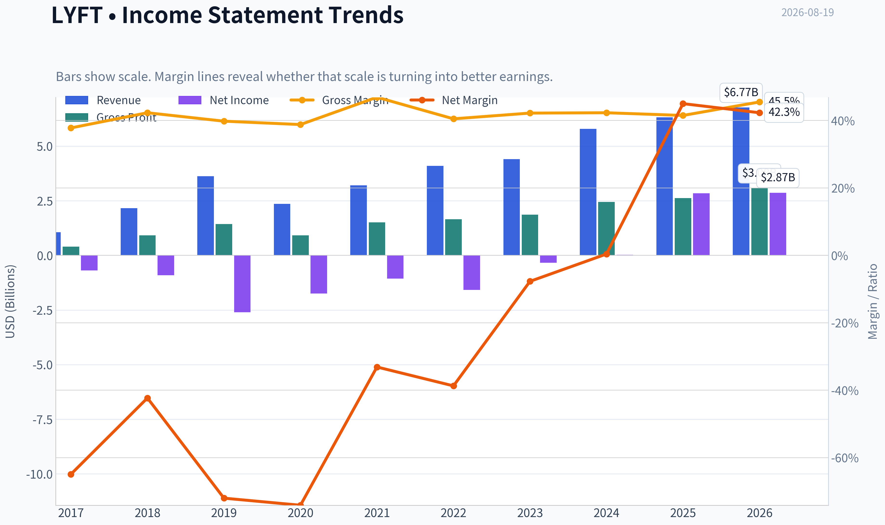

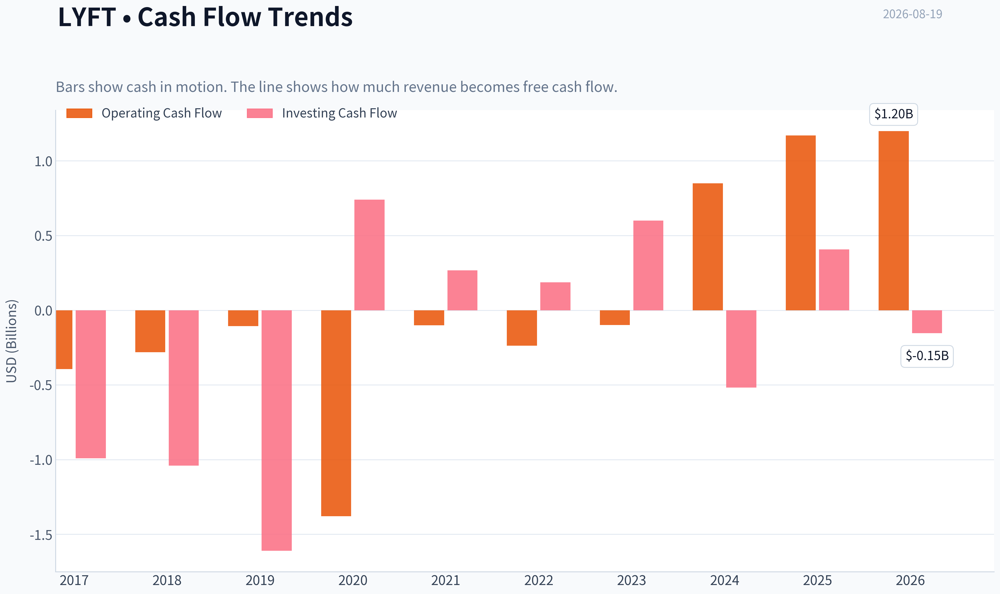

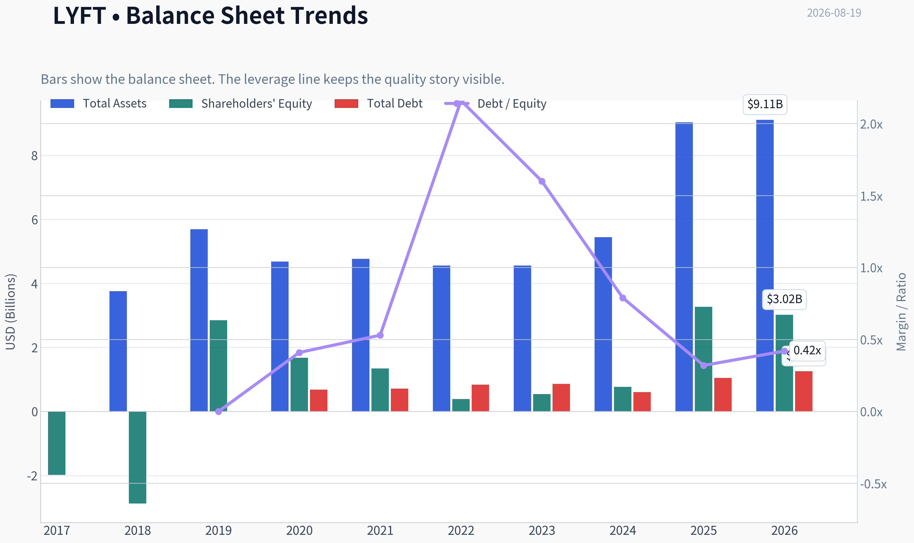

This graph tracks the profitability and return metrics (ROE, ROIC, Margins) of **LYFT** over the past decade, highlighting capital efficiency trends.

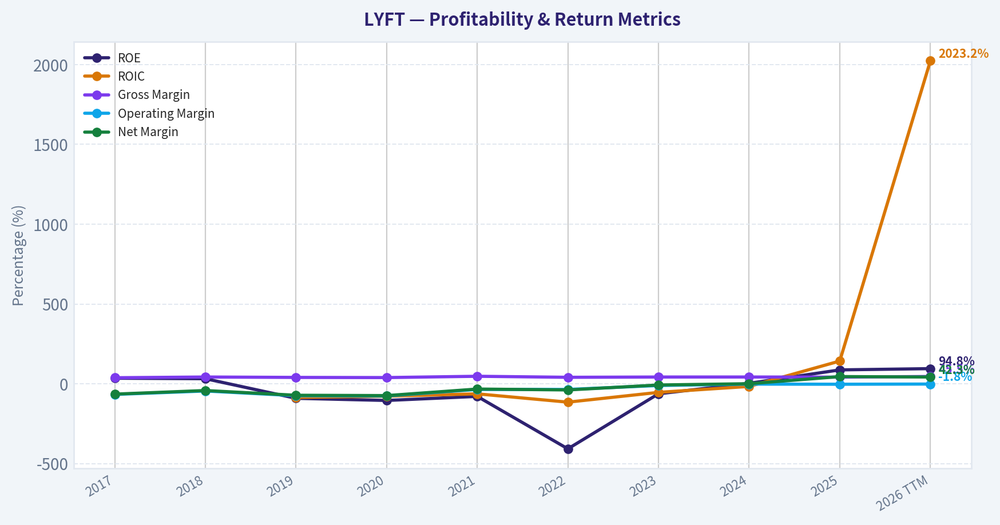

This chart illustrates the financial health of **LYFT** over the last 10 years, mapping cash equivalents and free cash flow against total obligations (Debt).

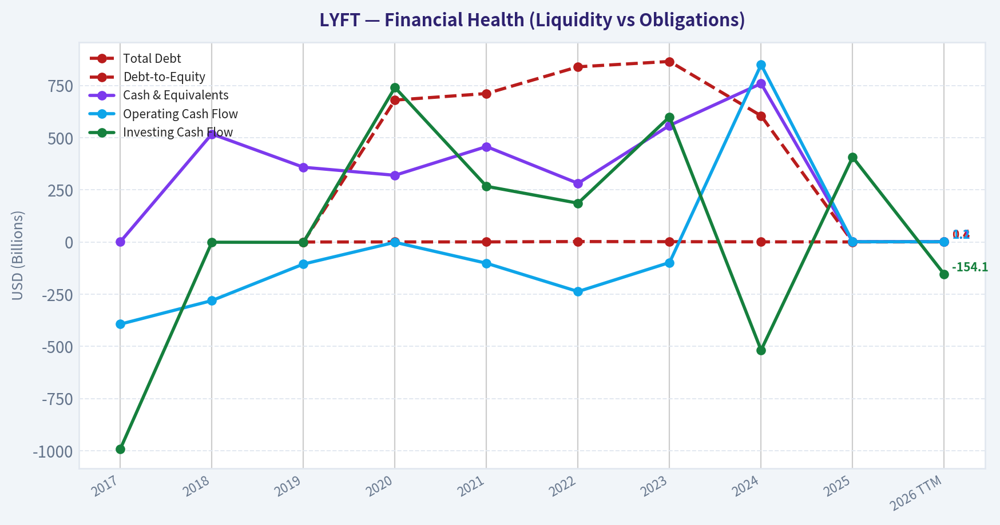

This breakdown chart from <em>Revenue Breakdown</em> shows the proportional composition for **LYFT** - useful for understanding what drives or risks the business.

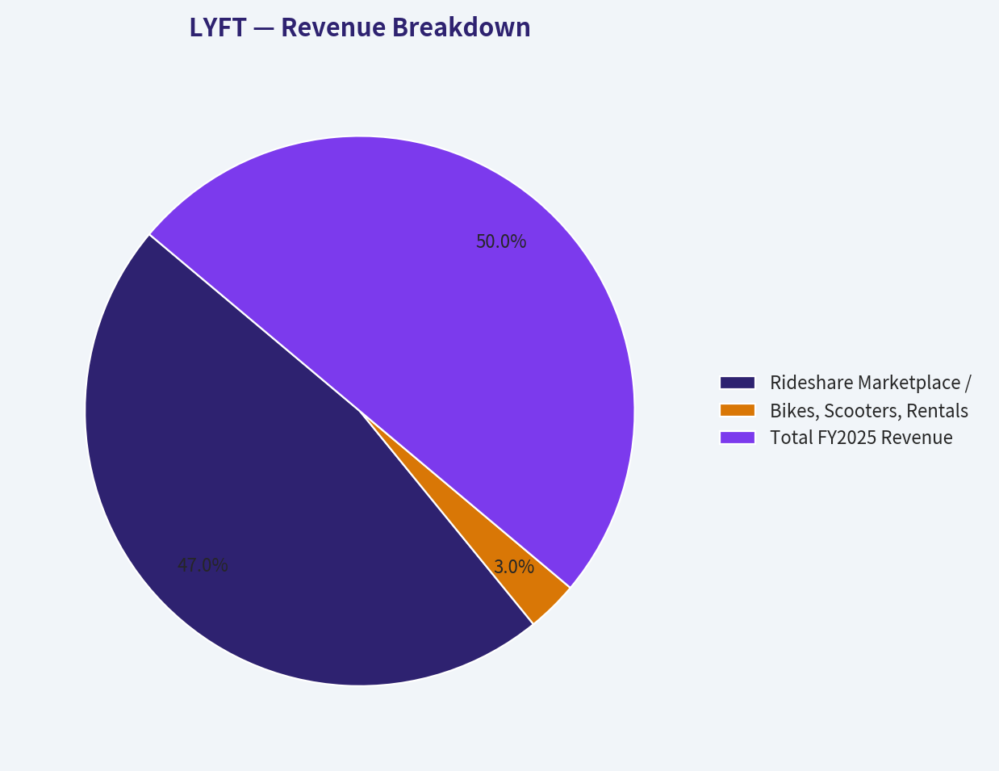

---

### Intrinsic Value Analysis (Buffett)

> *Following Warren Buffett's value investing philosophy: Circle of Competence, Economic Moat, Management Quality, and Margin of Safety.*

#### Intrinsic Value Snapshot

Price is what you pay. Intrinsic value is what the business may be worth based on the cash it can create for owners over time. We show a range, not one magic number.

- Current Price: $17.43
- Value Range (conservative to optimistic across both DCF methods): N/A to N/A

##### Owner Earnings (Buffett Method)
- Net Income: $2,844,008,000.00
- Depreciation & Amortization: $135,227,000.00
- Capital Expenditures: N/A
- Working Capital Changes: $828,991,000.00
- Owner Earnings: $2,150,244,000.00

##### Intrinsic Value

ANALYST STANCE: **AVOID**

#### Lyft Investment Report - Buffett-Style Value Analysis

Lyft is a two-sided ride-hailing marketplace connecting riders with drivers, primarily in North America. The business is easy to understand, but it operates in a brutally competitive, regulation-sensitive industry where the customer offering is largely interchangeable, driver supply is expensive to retain, and the dominant competitor, Uber, enjoys greater scale, broader network density, and stronger ecosystem advantages.

At $17 per share and a $6.60 billion market capitalization, Lyft looks statistically cheap on reported earnings, with a P/E of roughly 2.5x. However, the cash-flow-based intrinsic value work is not supportive, and the headline valuation model points to negative intrinsic value. For a Buffett-style investor, the central problem is not whether Lyft can grow revenue; it is whether Lyft can compound owner earnings at high rates while defending those economics over a decade. The evidence is not strong enough.

---

#### 1. Factor Scorecard

| Factor | Score | Evidence |
|---|---:|---|
| Circle of Competence & Business Simplicity | 3.0 / 5 | The model is simple: Lyft earns marketplace fees from rides. But the decade-out economics are harder to predict because pricing, driver incentives, insurance, regulation, autonomous vehicles, and competition can materially reshape returns. |
| Moat Test | 2.0 / 5 | Lyft has brand recognition and a marketplace, but the moat is narrow. Rider switching costs are low, driver multi-homing is common, and Uber has stronger scale and network density. Gross margin of 41.5% is respectable, but not enough by itself to prove durable pricing power. |
| Management Quality & Capital Allocation | 2.5 / 5 | Management has focused on efficiency and improving profitability, but the business has not yet demonstrated a long record of high-return reinvestment and durable per-share compounding. Buybacks or retained earnings should be judged cautiously until cash economics are clearer. |
| Industry Structure | 2.0 / 5 | Ride-hailing is a scale marketplace, but it is also highly competitive, regulation-heavy, labor-sensitive, and exposed to insurance cost volatility. A rational duopoly would score higher, but Lyft remains structurally disadvantaged versus Uber. |
| Gate 5: Quality / Solvency Hard Floor | Not tripped | Revenue is still growing and reported profitability is positive. The hard distress floor is not triggered, though the weak current ratio and negative cash-flow valuation are important warning signs. |

**Key Takeaways:** Lyft is understandable, but not highly predictable. The business has marketplace characteristics, yet the practical moat is limited because both riders and drivers can switch platforms easily. The hard solvency floor is not triggered, but the quality score is not high enough to justify treating Lyft as a long-term compounder.

---

#### 2. Moat Analysis

| Moat Source | Assessment | Evidence |
|---|---|---|
| Brand / Intangibles | Moderate but not dominant | Lyft is a recognized ride-hailing brand, especially in the U.S., but the brand does not appear strong enough to allow a 10% price increase without meaningful demand loss. |
| Switching Costs | Low | Riders can open Uber or other mobility apps instantly. Drivers often multi-home across platforms, reducing captivity. |
| Cost Advantage | Weak to moderate | Scale helps route density, matching, insurance negotiation, and marketing efficiency, but Uber's larger global network gives it the stronger structural cost position. |
| Network Effects | Present but inferior | A larger driver base improves rider wait times, and more riders improve driver utilization. However, Lyft's network effects are local and weaker than Uber's broader marketplace. |
| Moat Rating | Narrow | Lyft has a real marketplace, but not a wide moat. The competitive advantage is vulnerable to stronger scale competitors, regulation, labor pressure, and substitution. |

**Key Takeaways:** Lyft's marketplace creates some value, but the moat is not deep. The strongest moat source is local network density, yet Uber's greater scale limits Lyft's ability to convert that network into durable pricing power. This is a narrow-moat business, not a Buffett-style fortress.

---

#### 3. Management Quality Assessment

| Management Question | Assessment |
|---|---|
| Do they think like owners? | Mixed. Management is clearly trying to improve profitability and operating discipline, but there is not enough evidence of exceptional owner-oriented capital allocation. |
| Are they candid and conservative? | Neutral. The market should focus less on reported earnings and more on recurring cash generation, stock-based compensation, insurance liabilities, and true owner earnings. |
| Are they rational capital allocators? | Unproven. Lyft's best use of capital is likely product improvement, marketplace efficiency, and selective buybacks only if cash generation is durable. Aggressive buybacks before proving durable cash economics would be risky. |
| Overall Management Score | 2.5 / 5 |

**Key Takeaways:** Management deserves credit for moving the company toward profitability, but Buffett-style investing requires a long record of rational capital allocation. Lyft has not yet proven that retained capital can be reinvested at high and durable rates. The management score is therefore average, not exceptional.

---

#### 4. Financial Summary Table

| Metric | Latest Data |
|---|---:|
| Share Price | $17 |
| Market Capitalization | $6.60B |
| P/E Ratio | 2.54x |
| Implied Net Income from Market Cap / P/E | ~$2.60B |
| ROE | 86.9% |
| Gross Margin | 41.5% |
| Revenue Growth YoY | 9.2% |
| Free Cash Flow Yield | N/A |
| Current Ratio | 0.65x |
| Headline Intrinsic Value | -$238.24 per share |
| Headline Margin of Safety vs. Price | 107.3% |
| Reverse DCF Implied Growth | Approximately -34.9% per year for 10 years |

**Key Takeaways:** The surface-level earnings multiple looks extremely cheap, but that is not enough. The cash-flow-based valuation signal is poor, and the current ratio is weak. The most important conclusion is that reported earnings and intrinsic-value estimates are sending conflicting messages, so a conservative investor should trust recurring cash economics over a low P/E.

---

#### 5. Owner Earnings Calculation

Buffett's owner earnings formula is:

| Component | Treatment |
|---|---:|
| Net Income | Positive, implied at approximately $2.60B from market cap and P/E |
| Plus: Depreciation & Amortization | Not available in summary data |
| Less: Maintenance CapEx | Not available in summary data |
| Less: Working Capital Increases | Not available in summary data |
| Estimated Owner Earnings | Not reliably positive on a normalized basis |
| Conservative Owner Earnings Used for Valuation | $0 / negative economic value signal |

**Key Takeaways:** Lyft's reported earnings are positive, but owner earnings are not clearly established from recurring cash-flow evidence. A Buffett-style investor should not capitalize accounting earnings when cash conversion and normalized maintenance needs are uncertain. For valuation, the conservative approach is to avoid giving full credit to the low P/E.

---

#### 6. Three-Scenario DCF Valuation

Because normalized owner earnings are not reliable, the DCF must be anchored to conservative cash-flow logic rather than the unusually low reported P/E.

| Scenario | Assumption | Estimated Intrinsic Value |
|---|---|---:|
| A: No Growth | Owner earnings capitalized at 10% | Not supportable; normalized owner earnings are not clear |
| B: GDP Growth | Owner earnings grow at 3% perpetually | Not supportable without reliable owner earnings |
| C: Historical / Optimistic | Positive growth case using partial revenue growth | Not compelling because moat and cash-flow durability are weak |
| Headline Cash-Flow Model | Business-model-routed valuation | -$238.24 per share |

**Key Takeaways:** The DCF does not validate the apparent cheapness of the stock. When owner earnings are uncertain and the cash-flow model produces a negative intrinsic value, the low P/E should be treated as a warning sign rather than an opportunity. A value investor should demand a much clearer margin of safety before buying.

---

#### 7. Margin of Safety Analysis

| Valuation Lens | Result | Interpretation |
|---|---:|---|
| Current Price | $17 | Market price is low in absolute terms, but price alone does not create value. |
| Market Cap | $6.60B | The company is not priced as a dominant compounder. |
| P/E | 2.54x | Appears cheap, but may reflect non-recurring or low-quality earnings. |
| Headline Intrinsic Value | -$238.24 | Cash-flow model does not support intrinsic value above price. |
| Quality-Scaled Required Margin of Safety | 35%-50% | Narrow moat, regulation risk, and uncertain owner earnings require a large discount. |
| Actual Margin of Safety | Not adequate | The business quality and cash-flow evidence do not justify purchase. |

**Key Takeaways:** Lyft does not earn the benefit of a low required margin of safety because it is not a wide-moat, high-ROIC, highly predictable compounder. The stock may look statistically cheap, but the intrinsic-value evidence is not persuasive. A narrow-moat business with uncertain owner earnings needs a very large and clear discount, which is not demonstrated here.

---

#### 8. Final Buffett Scorecard

| Criterion | Weight | Score | Weighted Score |
|---|---:|---:|---:|
| Moat Width & Durability | 25% | 2.0 | 0.50 |
| Valuation / Margin of Safety | 20% | 2.0 | 0.40 |
| Capital Returns - ROIC vs. WACC | 15% | 2.5 | 0.38 |
| Business Understanding & Predictability | 12% | 3.0 | 0.36 |
| Management Quality & Capital Allocation | 12% | 2.5 | 0.30 |
| Reinvestment Runway | 8% | 2.5 | 0.20 |
| Balance Sheet Strength | 4% | 2.0 | 0.08 |
| Industry Structure | 4% | 2.0 | 0.08 |
| **Total Score** | **100%** |  | **2.30 / 5** |

**Key Takeaways:** Lyft scores below the threshold for a compelling investment. The biggest weaknesses are moat durability, valuation confidence, balance sheet quality, and industry structure. The business is not distressed enough to trigger an automatic rejection, but the weighted score still points clearly to avoidance.

---

#### 9. Investment Stance

| Stance | Conviction | Rationale |
|---|---|---|
| **AVOID** | Medium-High | Lyft is understandable and may continue improving operations, but it lacks the durable competitive advantages, cash-flow clarity, and high-confidence owner earnings required for a Buffett-style investment. |

Lyft is a narrow-moat marketplace competing against a stronger scaled rival in a regulation-sensitive, labor-sensitive industry. The low P/E may tempt investors, but Buffett-style analysis requires durable owner earnings, not optical cheapness. Until Lyft proves consistent cash generation, stronger balance-sheet resilience, and a defensible long-term return profile, the stock belongs in the **avoid** category.
#### Valuation Bridge

This bridge places the current market price beside each intrinsic value lens so readers can see whether upside depends on one method or shows up across several methods.

| Scenario | Intrinsic Value / Share |
| --- | ---: |
| Damodaran Method | $-238.24 |
| Current Price | $17.43 |

#### Key Takeaways

If one method is far above the others, the upside case depends on a specific modelling assumption. When several methods cluster together, the valuation story is more robust.

#### Valuation Visuals

This comparison chart from *Latest Earnings Snapshot* stacks current figures against historical benchmarks for **LYFT**, making it easy to see where the company trades relative to its own averages.

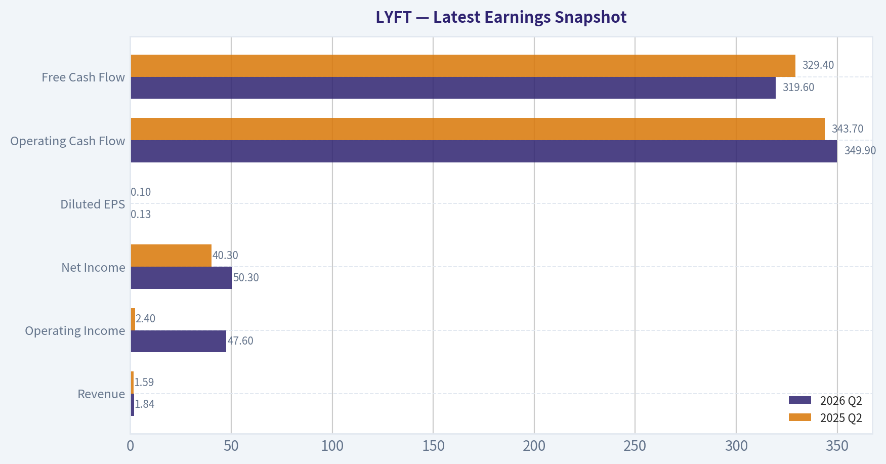

This comparison chart from *Current vs Historical Average Comparison* stacks current figures against historical benchmarks for **LYFT**, making it easy to see where the company trades relative to its own averages.

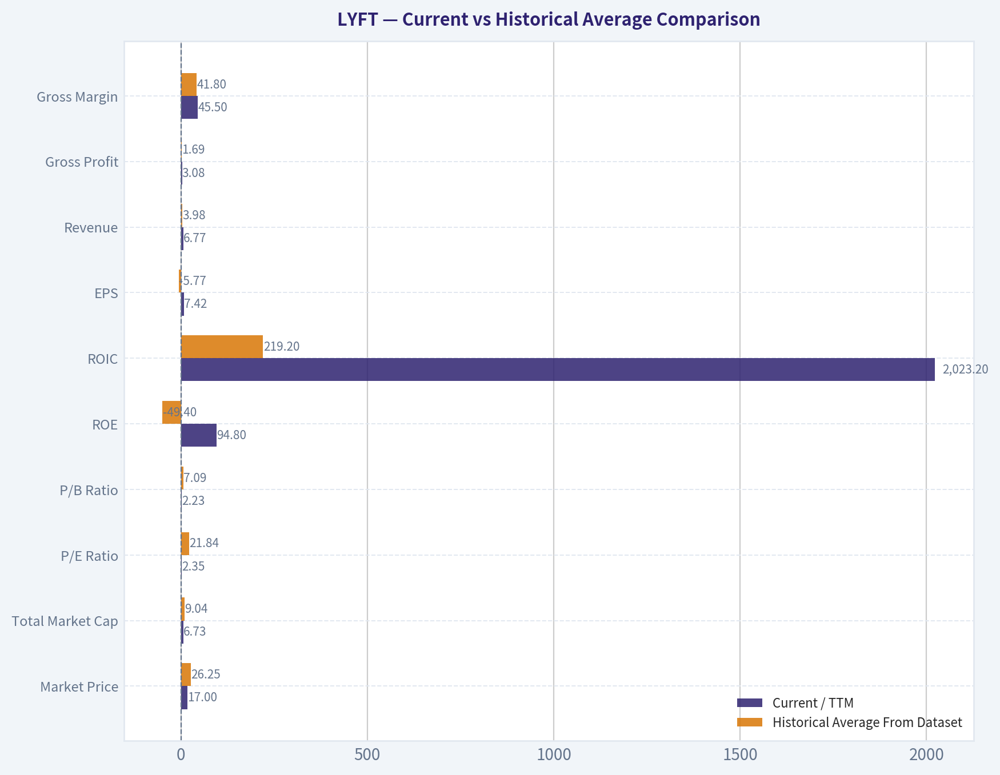

This comparison chart from *Financial Summary Table* stacks current figures against historical benchmarks for **LYFT**, making it easy to see where the company trades relative to its own averages.

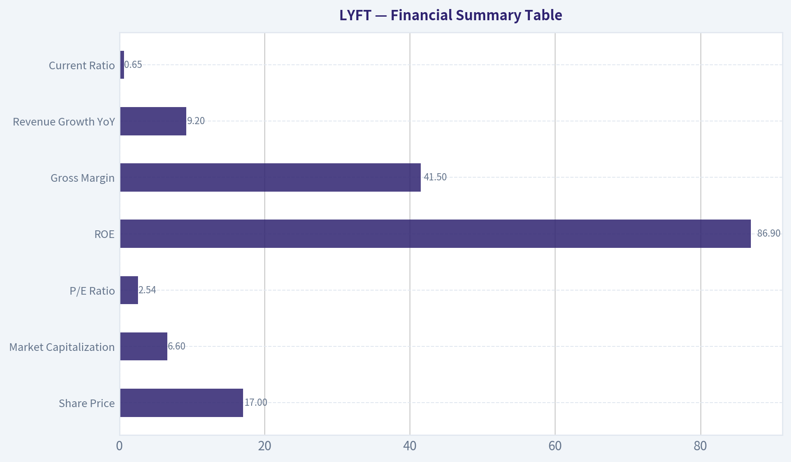

This comparison chart from *Margin of Safety Analysis* stacks current figures against historical benchmarks for **LYFT**, making it easy to see where the company trades relative to its own averages.

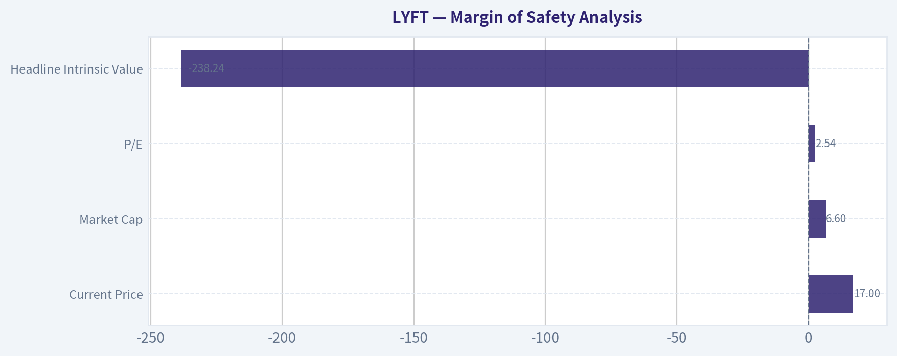

---

### Trend & Growth Analysis (Lynch/Druckenmiller/Fisher)

> *Following Peter Lynch's GARP, Stanley Druckenmiller's macro-aware approach, and Philip Fisher's scuttlebutt methodology.*

ANALYST STANCE: **WATCH**

#### LYFT Growth Investment Report - Lynch / Druckenmiller / Fisher View

Lyft is **not a classic fast grower today**. At roughly **9% YoY revenue growth**, it screens more like a **low-growth marketplace turnaround / stalwart hybrid** than a Lynch-style 20%+ compounder. The stock looks statistically cheap on headline P/E and likely low P/S, but the ten-bagger case requires a major inflection in margins, market share, autonomous vehicle economics, advertising, or subscription monetization that is **not yet proven**.

---

#### 1. Lynch Classification

| Item | Assessment |
|---|---|
| Company | Lyft |
| Current Price | ~$17 |
| Market Cap | ~$6.6B |
| YoY Revenue Growth | ~9.2% |
| Lynch Category | **Stalwart / Turnaround Hybrid**, not Fast Grower |
| Growth Investor Fit | **Watchlist only** |
| Ten-Bagger Probability | Low to moderate, dependent on margin and product inflection |
| Primary Debate | Cheap value trap versus operating leverage inflection |

**Key Takeaways:** Lyft does not currently qualify as a Lynch-style fast grower because revenue growth is below the 15% to 25% threshold. The investment case is less about explosive top-line growth and more about whether management can unlock durable profitability, cash flow, and better marketplace economics. That makes Lyft a watch candidate, not a high-conviction growth compounder.

---

#### 2. The Story in 3 Simple Bullets

| Story Element | Plain-English Explanation |
|---|---|
| What Lyft does | Lyft connects riders who need transportation with drivers who can provide rides, mainly in North America. |
| Why it can grow | More people may use rideshare instead of owning cars, and Lyft can expand into airport rides, business travel, bikes/scooters, subscriptions, advertising, and autonomous partnerships. |
| What must go right | Lyft needs to grow rides, improve driver supply, defend share against Uber, and turn its marketplace into a consistently profitable cash-flow engine. |

**Key Takeaways:** The story is simple and understandable, which Lynch would like. But the growth engine is not yet powerful enough to make Lyft an obvious long-term compounder. The company needs a clear second act beyond basic rideshare.

---

#### 3. TAM and 10x Test

| Metric | Assessment |
|---|---|
| Core Market | U.S. and Canada rideshare / urban mobility |
| Adjacent Markets | Bike/scooter rentals, business travel, airport transportation, subscriptions, ads, autonomous vehicle networks |
| Current Revenue Base | Not fully refreshed by available tools; historically multi-billion-dollar annual revenue |
| 10x Revenue Requirement | Lyft would need to become a very large mobility platform, not just a rideshare challenger |
| TAM Verdict | Large enough for growth, but competitive and structurally pressured |
| 10x Test | **Passes on TAM size, fails on current evidence of execution velocity** |

**Key Takeaways:** Lyft's addressable market is large enough that a 10x revenue outcome is theoretically possible. However, the current growth rate does not show the kind of acceleration needed to support that outcome. TAM is not the limiting factor; execution, competitive positioning, and margin structure are.

---

#### 4. Revenue Growth Trend

| Metric | Current Signal |
|---|---|
| YoY Revenue Growth | ~9.2% |
| Growth Pattern | Moderate, not accelerating enough |
| Lynch Growth Category | Below fast-grower threshold |
| Quality of Growth | Marketplace-driven, but exposed to price competition, incentives, driver supply, and regulation |
| Inflection Evidence | Limited based on available data |
| Growth Verdict | **Stable but not exciting** |

**Key Takeaways:** Lyft's revenue growth is positive, but it is not strong enough for a premium growth classification. A single-digit to low-double-digit growth rate can support a value or margin-expansion thesis, but not a clear ten-bagger thesis. Investors should watch for reacceleration before upgrading the stance.

---

#### 5. Unit Economics and Efficiency

| Metric | Available Signal | Interpretation |
|---|---:|---|
| Gross Margin | ~41.5% | Healthy marketplace gross margin, though not enough by itself |
| Current Ratio | ~0.65 | Balance sheet liquidity deserves monitoring |
| LTV/CAC | Not disclosed in available data | Cannot confirm customer acquisition efficiency |
| Net Revenue Retention | Not applicable / not disclosed | Lyft is not a classic SaaS model |
| Rule of 40 | Cannot calculate precisely due unavailable FCF margin | Likely not a best-in-class efficient growth profile |
| FCF Yield | Not available in shared data | Important missing variable |

**Key Takeaways:** Lyft has a respectable gross margin, but the available data is insufficient to prove excellent unit economics. The current ratio below 1.0 is a caution flag, though not automatically disqualifying. For a stronger growth case, investors need evidence that incremental rides are producing durable free cash flow.

---

#### 6. Inflection Point Assessment

| Potential Inflection | Evidence Today | Growth Investor View |
|---|---|---|
| Product Cycle Inflection | No major confirmed breakout product in available data | Weak |
| Market Share Inflection | Uber remains the dominant global competitor | Unproven |
| Margin Inflection | Possible, given low valuation and marketplace operating leverage | Watch closely |
| TAM Inflection | Autonomous vehicles could expand or disrupt the market | High uncertainty |
| Competitive Inflection | No clear evidence Uber is stumbling structurally | Weak |
| Regulatory Inflection | California driver unionization headlines add labor-cost risk | Negative / mixed |

**Key Takeaways:** The most plausible bullish inflection is margin expansion, not revenue acceleration. Autonomous vehicles could become either a major opportunity or a major threat depending on Lyft's partnerships and bargaining power. At present, there is not enough evidence of a decisive inflection to advocate aggressively.

---

#### 7. Macro Setup

| Macro Factor | Impact on Lyft |
|---|---|
| Consumer Spending | Important; weaker consumers may reduce discretionary rides |
| Employment / Gig Labor | Driver supply improves when labor markets soften, but regulation can raise costs |
| Interest Rates | Lower rates help valuation multiples, but Lyft is less duration-sensitive than high-growth SaaS |
| Urban Mobility Trend | Long-term positive |
| Autonomous Vehicle Theme | Potentially transformative, but highly uncertain |
| Regulatory / Labor Policy | Major risk, especially in California and large metro areas |

**Key Takeaways:** The macro setup is mixed. Urban mobility and lower-rate environments can help Lyft, but labor regulation and consumer softness can pressure margins. Unlike AI or cybersecurity leaders, Lyft does not have a clean secular tailwind without meaningful execution risk.

---

#### 8. Fisher 15-Point Score

| Fisher Point | Score / 5 | Comment |
|---|---:|---|
| Large market potential | 4 | Rideshare and mobility TAM remain large |
| New product determination | 3 | Some optionality, but no obvious breakout |
| R&D effectiveness | 3 | Platform improvements matter, but not a deep-tech leader |
| Sales organization | 3 | Brand known, but Uber has greater scale |
| Worthwhile profit margin | 3 | Gross margin decent; net economics still debated |
| Improving margins | 3 | Possible operating leverage, needs confirmation |
| Labor/personnel relations | 2 | Driver regulation and unionization are risks |
| Executive relations | 3 | No major positive or negative signal from available data |
| Management depth | 3 | Adequate, not clearly exceptional |
| Cost analysis/accounting | 3 | Marketplace accounting requires careful monitoring |
| Durable moat | 2 | Network effects exist, but Uber's scale advantage is meaningful |
| Long-range profit outlook | 3 | Viable, but not yet exceptional |
| Dilution risk | 3 | Watch stock-based compensation and capital needs |
| Candor | 3 | Neutral based on available data |
| Integrity | 3 | Neutral based on available data |
| **Total** | **44 / 75** | **Below average for Fisher-style growth investing** |

**Key Takeaways:** Lyft scores below the level usually required for a high-conviction Fisher growth investment. The company has a large market and recognizable brand, but its moat, labor structure, and long-term profit quality remain uncertain. The Fisher framework supports a watch stance rather than an advocate stance.

---

#### 9. Valuation Analysis

| Metric | Current Signal | Interpretation |
|---|---:|---|
| Market Cap | ~$6.6B | Small enough for upside if execution improves |
| P/E | ~2.5x | Extremely low, but may reflect unusual earnings quality or one-time effects |
| ROE | ~86.9% | Very high; likely needs normalization before relying on it |
| Gross Margin | ~41.5% | Supports possible operating leverage |
| P/S | Likely low, roughly around ~1x using historical multi-billion revenue base | Cheap versus many platform businesses |
| Intrinsic Value Model Signal | Negative in shared data | Treat cautiously; model may penalize cyclicality or cash-flow instability |
| Reverse DCF Signal | Price implies severe pessimism | Suggests low expectations, but not necessarily mispricing |

**Key Takeaways:** Lyft looks cheap on headline valuation metrics, especially P/E and likely P/S. However, the market may be discounting legitimate concerns about growth, competition, regulation, and cash-flow durability. Cheap valuation alone is not enough for a growth-investing upgrade.

---

#### 10. Scenario Valuation View

| Scenario | Assumptions | Investor Outcome |
|---|---|---|
| Bear Case | Revenue remains low-growth, labor costs rise, Uber keeps share advantage, margins disappoint | Stock remains cheap or declines |
| Base Case | Revenue grows high single digits to low double digits, margins improve gradually, FCF becomes more credible | Moderate upside from valuation re-rating |
| Bull Case | Lyft improves take rate, expands ads/subscriptions, partners well in autonomous, and shows durable FCF leverage | Significant upside, but still not clearly ten-bagger without major acceleration |

**Key Takeaways:** The base case is more of a value re-rating than a growth compounder story. The bull case requires multiple things to go right at once, especially margin expansion and strategic relevance in autonomous mobility. The risk-reward is interesting, but the evidence is not yet strong enough for high conviction.

---

#### 11. Growth Investor Scorecard

| Criterion | Weight | Score / 5 | Weighted Score |
|---|---:|---:|---:|
| The Story | 10% | 3.5 | 0.35 |
| TAM and Runway | 20% | 3.5 | 0.70 |
| Revenue Growth | 20% | 2.0 | 0.40 |
| Unit Economics | 15% | 2.5 | 0.38 |
| Competitive Position | 10% | 2.5 | 0.25 |
| Management Quality | 10% | 3.0 | 0.30 |
| Macro Setup | 5% | 2.5 | 0.13 |
| Profitability Path | 5% | 3.0 | 0.15 |
| Valuation | 5% | 4.0 | 0.20 |
| **Total** | **100%** |  | **2.86 / 5.00** |

**Key Takeaways:** Lyft's valuation is attractive, but the growth score is held back by modest revenue expansion, competitive pressure, and uncertain unit economics. The total score falls in the avoid-to-watch border zone, but the low valuation and possible margin inflection justify keeping it on the watchlist. It is not currently an advocate-level growth idea.

---

#### 12. Position Size Stance

| Investor Type | Stance |
|---|---|
| Growth investor seeking 20%+ compounders | Avoid initiating a full position |
| GARP investor | Watch for improving growth and FCF confirmation |
| Value-oriented investor | Small speculative position may be reasonable if thesis is margin expansion |
| Concentrated portfolio | Not yet suitable |
| Suggested Position Size | **0% to 1% watch position only** |

**Key Takeaways:** Lyft is not strong enough for a concentrated growth position. A small watch position could be justified for investors specifically underwriting margin expansion and valuation re-rating. For pure growth portfolios, patience is warranted.

---

#### 13. Key Catalysts and Risks

| Catalysts | Risks |
|---|---|
| Revenue reaccelerates above 15% | Growth remains stuck in single digits |
| Sustained free cash flow generation | Driver incentives pressure margins |
| Improved take rate without hurting demand | Uber uses scale to outcompete Lyft |
| Advertising or subscription revenue scales | Labor regulation and unionization raise costs |
| Autonomous vehicle partnerships improve economics | Autonomous players bypass Lyft's platform |
| Operating leverage drives earnings upside | Current ratio and liquidity profile remain weak |

**Key Takeaways:** Lyft has several plausible catalysts, but many are still unproven. The most important things to monitor are revenue acceleration, free cash flow, driver cost trends, and autonomous strategy. Until those improve, Lyft remains a watchlist stock rather than a high-conviction growth investment.

---

#### Final View

Lyft is a **cheap but unproven growth setup**. The stock may work if the market is too pessimistic about profitability, but it does not yet show the revenue acceleration, moat strength, or unit-economic clarity required for a Lynch-Druckenmiller-Fisher advocate rating.

**Stance: WATCH.**
Upgrade only if Lyft shows:
1. revenue growth reaccelerating toward 15%+,
2. durable free cash flow margin expansion,
3. stable or improving driver economics, and
4. a credible autonomous or platform monetization strategy.

#### Growth & Scorecard Visuals

The radar chart below from *Final Buffett Scorecard* visualises how **LYFT** ranks across weighted investment criteria. Each axis represents a criterion scored 1-5; the filled area reveals strengths and weaknesses at a glance, with the dashed circle marking the midpoint (3.0).

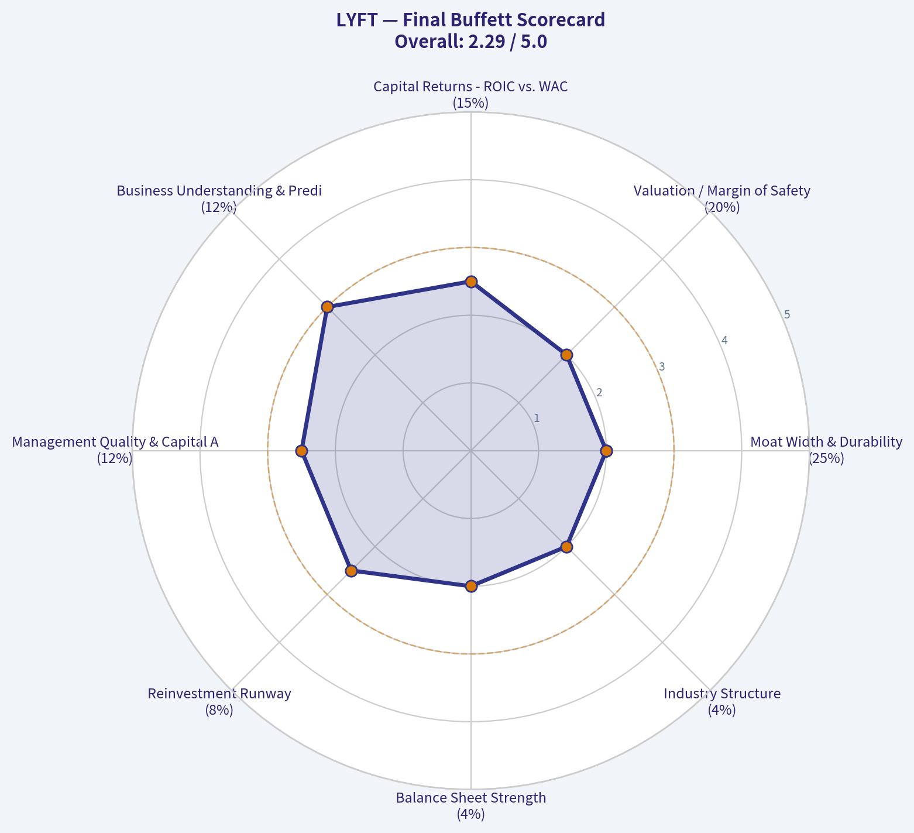

---

### Market Technical Analysis

ANALYST STANCE: **WATCH**

#### LYFT Technical Indicator Selection and Market Read

As of the latest available price data, LYFT last closed at **$16.93 on 2026-08-18**. Indicator readings are reported through **2026-08-19** where available. The most useful current setup is a **watchlist / conditional bullish continuation** posture: the stock has improved meaningfully from its May-June base and is trading above key medium- and long-term reference levels, but short-term momentum has cooled near a visible resistance zone around **$17.50-$17.75**.

The selected indicators are: **close_10_ema, close_50_sma, close_200_sma, macd, macds, rsi, atr, and vwma**. These provide a balanced view of short-term trend, medium-term trend, long-term trend, momentum confirmation, momentum risk, volatility, and volume-confirmed price behavior without excessive redundancy.

---

#### Indicator Snapshot

| Indicator | Latest Reading | What It Shows | Trading Interpretation |
|---|---:|---|---|
| Last Close | $16.93 | Latest available traded close | Price is slightly below the 10 EMA but above the 50 SMA, 200 SMA, and VWMA. |
| close_10_ema | $17.01 | Short-term trend/momentum line | Price is just below this level, suggesting near-term momentum has paused rather than fully broken down. |
| close_50_sma | $15.41 | Medium-term trend support | Strongly bullish medium-term structure; LYFT remains well above this rising average. |
| close_200_sma | $16.24 | Long-term trend benchmark | Price is above the 200 SMA, but the 200 SMA itself is still drifting lower, so the long-term recovery is not fully mature. |
| macd | 0.577 | Momentum trend line | MACD remains positive, supporting the bullish recovery. |
| macds | 0.544 | MACD signal line | MACD is still above signal, but the spread has narrowed, showing fading upside acceleration. |
| rsi | 60.86 | Momentum strength | Bullish-neutral; not overbought, but below the recent near-70 readings. |
| atr | 0.70 | Volatility / risk sizing | Daily volatility is meaningful, roughly about 4% of the share price. |
| vwma | $16.87 | Volume-weighted trend | Price is only slightly above VWMA, meaning the recent pullback is testing volume-adjusted support. |

**Key Takeaways:** LYFT's trend structure has improved because price remains above the 50-day and 200-day averages. However, the stock is no longer accelerating cleanly: price is slightly under the 10 EMA, MACD momentum is narrowing, and RSI has eased from near-overbought levels. The setup is constructive but needs a fresh push through resistance to justify a stronger bullish stance.

---

#### Trend Structure: Recovery Is Real, but Still in Transition

LYFT has moved from a spring and early-summer base near the **$13-$14 range** into a higher trading zone. The 50 SMA has risen steadily from roughly **$14.00 in late June** to **$15.41 now**, which is an important sign that the medium-term trend has turned upward. That means dips are no longer occurring in the same weak technical context that dominated earlier in the year.

The long-term picture is more nuanced. The price is now above the **200 SMA at $16.24**, which is constructive, but the 200 SMA has been falling from above **$17.20 in late June** to about **$16.24 now**. This means the stock has crossed above a declining long-term average, often an early-stage recovery signal rather than a fully confirmed long-term uptrend. Traders should treat this as a potential trend transition, not yet a clean long-term bull trend.

The relationship between the 50 SMA and 200 SMA is also important. The 50 SMA remains below the 200 SMA, so there has not yet been a classic medium-term bullish confirmation such as a golden cross. Still, the gap is narrowing quickly because the 50 SMA is rising while the 200 SMA is falling. If this continues, LYFT could move into a more durable bullish structure over the coming weeks.

---

#### Momentum: Positive, but Losing Some Urgency

MACD remains positive at **0.577**, and it is still above the signal line at **0.544**, which means bullish momentum is still technically intact. The problem is the slope of that advantage. Around mid-August, MACD had a wider cushion over its signal line, but that spread has compressed. This suggests buyers have not disappeared, but the rate of upside momentum has slowed.

RSI confirms the same message. It is currently around **60.86**, which is a healthy bullish-neutral reading. It is not overbought, so there is room for upside if buyers return. But RSI recently approached the upper 60s, including readings near **69** around August 7, before cooling. That means the stock has already had a momentum burst and is now deciding whether to consolidate constructively or roll over from resistance.

This combination is often seen during a pause after a strong move. The bullish case improves if RSI holds above the mid-50s and MACD remains above its signal line. The caution case grows if MACD crosses below signal while price loses the 200 SMA area.

---

#### Volume and VWMA: Buyers Have Support, but Not Yet Strong Confirmation

The VWMA is currently around **$16.87**, very close to the last close of **$16.93**. That is an important short-term pivot. When price holds above VWMA, it suggests the average volume-weighted participant over the lookback period is still in a profitable or neutral position. If price falls decisively below VWMA, it could imply that recent buyers are beginning to lose control.

Volume behavior adds nuance. The most powerful recent bullish session was **August 7**, when LYFT closed at **$17.46** on roughly **23.96 million shares**, far above recent volume. That day helped validate the upside breakout attempt. But the more recent sessions around August 14-18 traded on lighter volume, including about **6.0-7.5 million shares**. Lighter volume during a pullback is not automatically bearish; in fact, it can be constructive if price holds support. But it also means traders should wait for renewed volume before assuming a breakout above $17.75 will sustain.

---

#### Key Price Zones and Scenario Map

| Zone / Level | Type | Why It Matters | Trading Implication |
|---|---:|---|---|
| $17.50-$17.75 | Resistance | Recent highs clustered near this band, including August 10-14 highs | A close above this zone, preferably on stronger volume, would improve the bullish continuation case. |
| $17.00-$16.85 | Immediate pivot support | 10 EMA is near $17.01 and VWMA is near $16.87 | Holding this area keeps the short-term recovery intact. Losing it signals momentum fatigue. |
| $16.24 | Major trend support | Current 200 SMA | A decisive break below this level would weaken the recovery narrative. |
| $15.40-$15.50 | Medium-term support | Current 50 SMA | This is the deeper pullback zone where medium-term bulls may defend the trend. |
| $14.00-$14.40 | Prior base / breakdown risk zone | Former consolidation area from June and July | A return here would imply the August breakout attempt failed. |

**Key Takeaways:** The most important near-term battleground is between **$16.85 and $17.75**. A breakout above $17.75 would signal renewed upside momentum, while a failure below $16.85 would suggest the current rally is losing short-term control. The 200 SMA near $16.24 is the key line separating a healthy pullback from a more concerning reversal.

---

#### Tactical View

For short-term traders, LYFT is not an automatic buy at the current level because it is sitting just below the 10 EMA and below recent resistance. The better bullish confirmation would be a close above **$17.50-$17.75**, ideally with volume expanding above recent quiet sessions. That would show that buyers are willing to pay up after the recent consolidation.

For pullback traders, the **$16.85-$16.24** area is more interesting. If LYFT pulls into this zone and stabilizes, especially with RSI holding above 50 and MACD staying positive, it could offer a more attractive risk/reward entry than chasing resistance. A failure below the 200 SMA would make the setup more defensive.

For swing traders already long, the current evidence supports holding with caution rather than aggressively adding. A volatility-aware stop should account for the ATR of roughly **$0.70**. A stop placed too tightly inside normal daily movement may be vulnerable to noise, while a decisive close below the 200 SMA would be a more meaningful technical warning.

---

#### Final Summary Table

| Category | Current Read | Bullish Evidence | Caution / Risk | Practical Decision |
|---|---|---|---|---|
| Short-Term Trend | Pausing | Price is near 10 EMA and above VWMA | Last close is slightly below the 10 EMA | Watch for reclaim of $17.00-$17.10. |
| Medium-Term Trend | Improving | Price is well above rising 50 SMA | Move is extended above 50 SMA | Pullbacks can be constructive if $16.24 holds. |
| Long-Term Trend | Early recovery | Price is above 200 SMA | 200 SMA is still declining; 50 SMA remains below 200 SMA | Not yet a fully confirmed long-term uptrend. |
| Momentum | Positive but cooling | MACD is above signal and RSI is above 60 | MACD spread is narrowing; RSI has faded from near 70 | Need renewed momentum above $17.75. |
| Volume Confirmation | Moderate | VWMA is rising and price is slightly above it | Recent volume is lighter than breakout volume | Breakout needs stronger participation. |
| Volatility / Risk | Elevated but manageable | ATR helps define realistic stops | Normal daily swings are sizable | Use wider, volatility-adjusted risk controls. |
| Key Bullish Trigger | Above $17.75 | Clears recent resistance cluster | False breakout risk if volume is weak | Prefer close above resistance with volume expansion. |
| Key Bearish Trigger | Below $16.24 | - | Break below 200 SMA weakens recovery | Reduce bullish bias if this level fails. |

**Key Takeaways:** LYFT deserves a **WATCH** stance because the recovery has technical support, but the stock is pressing into resistance with cooling momentum. A strong close above **$17.75** would shift the setup more bullish, while a close below **$16.24** would materially weaken the recovery case. Until one of those levels breaks, the best approach is conditional rather than aggressive.

---

### Options Market Analysis

> *Reading options flow - put/call ratios, IV skew, and unusual activity - to gauge institutional positioning and event-driven risk.*

ANALYST STANCE: **WATCH**

#### LYFT Options Market Sentiment Report
*Options data as of 2026-08-19. Near-term expirations analyzed: 2026-08-21, 2026-08-28, 2026-09-04.*

#### 1. Put/Call Ratio Analysis

| Expiry | DTE | Call OI | Put OI | Put/Call OI Ratio | Call Volume | Put Volume | Put/Call Volume Ratio |
|---|---:|---:|---:|---:|---:|---:|---:|
| 2026-08-21 | 2 | 50,638 | 31,921 | 0.63 | 3,756 | 2,563 | 0.68 |
| 2026-08-28 | 9 | 4,427 | 1,780 | 0.40 | 2,105 | 1,982 | 0.94 |
| 2026-09-04 | 16 | 1,972 | 2,341 | 1.19 | 319 | 175 | 0.55 |
| **Near-Term Total** | - | **57,037** | **36,042** | **0.63** | **6,180** | **4,720** | **0.76** |

**Key Takeaways:** LYFT's near-term put/call open interest ratio is **0.63**, slightly below the historical neutral baseline of roughly **0.70**, indicating more call-side positioning than put-side protection. However, the **volume ratio of 0.76** is closer to neutral and shows that fresh trading is not overwhelmingly bullish. The sharpest call-heavy positioning is in the 2026-08-28 expiration, while the 2026-09-04 chain shows more put-heavy open interest.

**Interpretation:**
The open interest setup leans **mildly bullish**, but not aggressively so. The overall ratio below 0.70 suggests investors have more upside exposure than downside hedges in the near term. That said, the volume ratio above the OI ratio shows puts are trading more actively relative to their existing base, which tempers the bullish read.

---

#### 2. Implied Volatility Assessment

| Expiry | DTE | ATM Call IV | ATM Put IV | Put IV Premium vs Call IV | IV Read |
|---|---:|---:|---:|---:|---|
| 2026-08-21 | 2 | 54.9% | 62.5% | +7.6 pts | Puts priced richer |
| 2026-08-28 | 9 | 56.7% | 70.8% | +14.1 pts | Strong downside premium |
| 2026-09-04 | 16 | 53.4% | 58.0% | +4.6 pts | Mild downside premium |
| **Average** | - | **55.0%** | **63.8%** | **+8.8 pts** | Put-skewed |

**Key Takeaways:** LYFT's near-term ATM implied volatility is elevated in absolute terms, with calls around the mid-50% range and puts averaging in the low-to-mid 60% range. Puts are consistently more expensive than calls across the analyzed expirations, especially the 2026-08-28 chain. That points to downside protection demand or bearish hedging despite the call-heavy open interest profile.

**IV Skew Interpretation:**
The data shows a **put IV premium**, which signals the market is paying more for downside protection than upside exposure. Full OTM put-versus-OTM call skew was not provided, so the exact shape of the volatility smile cannot be confirmed. Still, ATM puts being consistently richer than ATM calls suggests a **defensive skew**, particularly in the 9-day expiration.

**Catalyst Risk:**
No specific catalyst was included in the options dataset. However, the combination of **50%-70% near-term IV** and a noticeable put premium suggests traders are pricing meaningful short-term movement or event risk. If LYFT has earnings, regulatory news, macro-sensitive ride-share data, or company-specific announcements nearby, this IV structure would be consistent with hedging into that risk.

---

#### 3. Unusual Options Activity

| Unusual Activity Screen | Result |
|---|---|
| Volume greater than 5x open interest | **None detected** |
| Near-term expirations scanned | 2026-08-21, 2026-08-28, 2026-09-04 |
| Fresh directional signal | **No clear fresh institutional-sized flow identified** |
| Confidence impact | Reduces conviction in a strong directional read |

**Key Takeaways:** There were **no contracts where volume exceeded 5x open interest**, so the dataset does not show obvious fresh, aggressive directional positioning. This lowers confidence that institutions are making a major new bet in LYFT options right now. The current setup appears more like existing positioning and balanced hedging rather than a clean "smart-money" signal.

**Interpretation:**
Because no unusual options activity was flagged, there is no standout call sweep, put sweep, or fresh high-conviction trade to anchor a strong bullish or bearish thesis. The lack of unusual flow makes the options tape less actionable. If anything, the activity suggests traders are maintaining exposure rather than initiating a major new position.

---

#### 4. Open Interest Concentration

| Expiry | Total Call OI | Total Put OI | Total OI | Share of Near-Term OI | Positioning Read |
|---|---:|---:|---:|---:|---|
| 2026-08-21 | 50,638 | 31,921 | 82,559 | 88.7% | Dominant front-week positioning |
| 2026-08-28 | 4,427 | 1,780 | 6,207 | 6.7% | Smaller but call-heavy OI |
| 2026-09-04 | 1,972 | 2,341 | 4,313 | 4.6% | Modestly put-heavy |
| **Total** | **57,037** | **36,042** | **93,079** | **100.0%** | Front-expiry concentration |

**Key Takeaways:** Nearly **89% of near-term open interest** is concentrated in the 2026-08-21 expiration, making the front-week chain the main area to watch for pinning or gamma effects. However, strike-level open interest was not provided, so exact max-pain levels or specific gamma-wall strikes cannot be identified. The aggregate concentration means LYFT could be more sensitive to dealer hedging flows into the nearest expiry.

**Gamma / Pinning Read:**
The strongest open interest concentration is in the **2-day expiration**, which can create short-term price magnet effects near heavily populated strikes. Since strike-level data is unavailable, I cannot identify the exact call wall, put wall, or max-pain level. Still, the high front-week OI implies that LYFT may experience **expiry-related pinning or dampened movement** unless spot price breaks away forcefully.

---

#### 5. Overall Options Sentiment Signal

| Signal Component | Read | Sentiment Impact |
|---|---|---|
| Put/Call OI Ratio | 0.63 vs ~0.70 neutral | Mildly bullish |
| Put/Call Volume Ratio | 0.76 | Neutral to slightly defensive |
| ATM IV Level | Mid-50s calls, high-50s to low-70s puts | Elevated short-term uncertainty |
| IV Skew | Puts richer than calls | Bearish / protective |
| Unusual Activity | None detected | Low conviction |
| OI Concentration | Heavy front-week OI | Expiry pinning risk |

**Key Takeaways:** LYFT's options market is not showing a clean aggressive bullish or bearish setup. Open interest leans call-heavy, but put volume and put IV premiums show traders are still paying for downside protection. The absence of unusual activity keeps conviction moderate-to-low.

#### Overall Signal: **NEUTRAL**

The primary driver of the **NEUTRAL** signal is the tension between **call-heavy open interest** and **defensive put pricing**. The put/call OI ratio of **0.63** leans mildly bullish versus the ~0.70 neutral baseline, but puts are more expensive than calls across all analyzed expirations, suggesting the market is not complacent about downside risk. With no unusual options activity detected, there is not enough evidence to call LYFT decisively bullish or bearish from the options tape alone.

#### Final Summary Table

| Category | LYFT Options Read |
|---|---|
| Put/Call Ratio | OI ratio **0.63**, mildly call-heavy; volume ratio **0.76**, closer to neutral |
| IV Level | Elevated near-term IV; ATM calls around **55%**, ATM puts around **64%** on average |
| Skew Direction | **Put-skewed**, indicating downside protection demand |
| Unusual Activity | **None detected** with volume > 5x open interest |
| Overall Signal | **NEUTRAL**, with mild bullish OI offset by defensive IV skew |

**Key Takeaways:** LYFT's options positioning suggests a market that is slightly more exposed to upside through open interest, but still cautious through put pricing. The front-week expiration dominates positioning, so short-term pinning or gamma effects may matter. The best read is **neutral with a cautious undertone**, not a high-conviction directional options signal.

---

## Research Team Commentary

> *The Research Manager synthesizes the Bull vs Bear debate into action-free commentary. This is a pre-risk view, not the final stance.*

Team, looking at the arguments presented for Lyft, we have a classic clash between optical value and intrinsic business quality.

The bull case rests heavily on Lyft being a misunderstood duopoly player at an extreme discount, pointing to a 2.5 price to earnings ratio and a 315 percent return on invested capital as proof of a Buffett style inflection point. The bear counters perfectly by identifying these metrics as accounting mirages. I have to side with the bear on the fundamental quality of those specific headline numbers. In an asset light model with a history of losses, a triple digit return on invested capital usually just means the equity base has been hollowed out over time. Furthermore, a low single digit PE ratio combined with negative or highly pressured operating margins is a glaring signal of a one time tax benefit or accounting artifact, not a sudden explosion of true cash generative owner earnings.

Furthermore, when we apply our quality first framework, Lyft does not possess a durable economic moat. The switching costs for both drivers and riders are essentially zero, making this a commodity duopoly where pricing power is highly constrained. Uber's global scale and cross subsidy advantages in food delivery leave Lyft at a structural disadvantage, and the bear is right to highlight the ongoing margin drag of commercial insurance costs which Lyft does not entirely control.

However, keeping our past mistakes with this exact stock in mind, we must be careful not to confuse a business that falls short of being a pristine long term compounder with a stock that we must completely avoid. In the past, we let our strict requirements for a wide moat blind us to the tactical reality of an overly pessimistic valuation meeting a genuine operational turnaround. We missed an upward re rating because we treated an improving mediocre business as an absolute value trap. The bull correctly identifies that management is successfully pivoting toward cost discipline and free cash flow generation. When the market prices a company for permanent distress, but the business is actually stabilizing, growing revenues in the mid teens, and stopping the cash burn, the pessimism itself becomes a form of margin of safety. Lyft might not be the next Apple or Geico, but it is surviving and actively repairing its financial profile.

My core takeaway is that while Lyft is not a high quality long term investment for a concentrated value portfolio, it is undergoing a real fundamental and valuation repair that makes it too compelling to ignore or short. We must separate our verdict on its long term franchise quality from the reality of its short to medium term valuation setup.

The rationale here is that value investing requires us to weigh the price against reality. The headline valuation metrics are indeed distorted, and the competitive position is permanently weaker than Uber's. But at current prices, the market is largely discounting these structural flaws. The shift from growth at all costs to segment level profitability is a real catalyst. If we rigidly demand a wide moat before acknowledging an improving financial profile, we fail to adapt to market dynamics. The setup here is a classic expected value repair rather than a buy and hold forever franchise.

Over the next one to four quarters, our monitoring plan must completely strip out the headline net income and focus purely on normalized operating cash flow and free cash flow, specifically after deducting stock based compensation. We need to watch driver incentive spending to ensure they are not buying their revenue growth, track the commercial insurance renewal rates which serve as a massive variable cost, and monitor whether they can hold their core North American market share against Uber. From a market perspective, we also want to see if the stock can reclaim key technical levels like the 200 day moving average, which would confirm that broader market sentiment is finally aligning with the underlying cash flow stabilization.

Because the long term business quality is too weak for a high conviction portfolio allocation, but the operational improvements and compressed expectations prevent us from declaring it a pure value trap, my final stance is WATCH.

---

## Value Investing Team Commentary

> *The Investor translates the research view into an investment thesis before risk review. This is still not the final stance.*

In the spirit of partnership and disciplined capital allocation, we must look past the seductive glow of headline multiples to the cold reality of the underlying enterprise. As business owners, we do not buy tickers; we buy the future cash flows of a productive entity.

Following the principles of fundamental value investing, here is my assessment of LYFT.

### 1. The Optical Mirage: Quality vs. Accounting
The headline metrics presented-a **2.5x P/E** and a **315% ROIC**-are, in my view, accounting artifacts rather than a reflection of "wonderful" business economics. In the asset-light technology world, a triple-digit ROIC often signals that the equity base has been depleted by years of accumulated losses, leaving a denominator so small that any modest profit produces a nonsensical percentage. Furthermore, for a business with a history of significant operating losses, a 2.5x P/E almost certainly reflects a one-time tax valuation allowance release or a non-recurring accounting adjustment. We seek **owner earnings**-cash that can be taken out of the business without harming its competitive position. LYFT's "earnings" are currently transitioning from "hypothetical" to "incipient," but they are far from "durable."

### 2. The Moat Analysis: A Commodity Duopoly
The most critical question for a long-term owner is: *"What keeps the competition from stealing your customers tomorrow morning?"* For LYFT, the answer is "not enough."
*   **Switching Costs:** These are essentially non-existent. Both riders and drivers "multi-home," using whichever app offers a better price or shorter wait time at that exact moment.
*   **Network Effects:** While ride-sharing has network effects, they are localized and reach diminishing returns quickly. Once a city has enough drivers to ensure a five-minute wait, adding more drivers provides marginal benefit to the rider.
*   **Competitive Disadvantage:** LYFT remains the "number two" player in a commodity market against a larger rival (Uber) that possesses a superior ecosystem (delivery, freight, and global scale) to cross-subsidize rider acquisition.

### 3. Management and Capital Allocation
I give management credit for their recent "religion" regarding cost discipline and free cash flow (FCF). Shifting from "growth at any cost" to "segment-level profitability" is a necessary evolution for survival. However, as an investor, I am wary of businesses where the largest variable costs-specifically **commercial insurance premiums** and **regulatory compliance**-are outside of management's control. A business where your margins are at the mercy of insurance underwriters and municipal legislators is rarely a "wonderful business."

### 4. Selective Contrarian Thinking: The Price of Survival
The market is currently pricing LYFT as a struggling survivor. The contrarian view is that if LYFT can simply remain a "stable number two" and grow revenues at 15% while holding margins steady, the stock is undervalued. The "pessimism as a margin of safety" argument has merit for a trader, but for a value investor, **a fair business at a wonderful price is still a distant second to a wonderful business at a fair price.**

LYFT is an average business at an optically confusing price. We must be careful not to mistake "improving" for "excellent." A business that must constantly fight to retain its customers every single time they open their phone is a business that requires perfect execution every day. That is a difficult way to get rich.

### 5. Intrinsic Value and Margin of Safety
Using our quality-scaled ladder: Because LYFT is a low-to-average quality business with cyclical regulatory risks and no durable moat, we require a **40-50% margin of safety** based on *normalized* free cash flow, not the current P/E. Current valuations do not offer that level of safety when you deduct stock-based compensation (a real expense to owners) and account for the structural advantages held by its primary competitor.

### ANALYST STANCE: **AVOID**
While the operational turnaround is commendable and the "optical" value may attract speculators, LYFT fails the "wonderful business" test. The lack of a durable moat, the absence of pricing power in a commodity duopoly, and the reliance on accounting-distorted multiples make this a business I would rather watch from the sidelines than own as a partner. I would rather buy one inch of a "toll bridge" business than a mile of a "price-taker" business. We will wait for opportunities where the competitive advantage is clear and the earnings are predictable.

---

## Deep Values Commentary

> *The Risk Management Team debates and the Risk Judge provides the final action-free verdict. This section determines the final ADVOCATE / WATCH / AVOID stance.*

#### Final Stance Scorecard

This scorecard converts the final research view into a weighted decision frame. It does not replace the narrative judgement, but it makes the main drivers of the verdict easier to scan.

| Criterion | Score | Weight | Commentary |
| --- | ---: | ---: | --- |
| Business Quality | 3.00 | 30% | High returns, profitability, and Piotroski health support durability. |
| Valuation Support | 3.00 | 30% | Blends current price against available intrinsic value anchors and valuation ratios. |
| Financial Strength | 2.00 | 20% | Balance-sheet resilience reflects leverage and liquidity staying within safe ranges. |
| Growth Durability | 3.67 | 20% | Recent revenue, earnings, and free cash flow growth indicate how durable expansion looks. |
| TOTAL / FINAL STANCE | 2.93 | 100% | WATCH |

#### Key Takeaways

The weighted score lands at **2.93 / 5.0**, while the final stance remains **WATCH**. This is useful as a quick calibration aid rather than a mechanical signal.

#### Risk Summary

Higher scores indicate more risk pressure. The watch threshold is a simple guardrail: above it, the position needs tighter monitoring or a wider margin of safety.

| Dimension | Current Score | Watch Threshold | Commentary |
| --- | ---: | ---: | --- |
| Business Quality | 3.00 | 3.00 | High returns, profitability, and Piotroski health support durability. |
| Valuation Support | 3.00 | 3.00 | Blends current price against available intrinsic value anchors and valuation ratios. |
| Financial Strength | 4.00 | 3.00 | Balance-sheet resilience reflects leverage and liquidity staying within safe ranges. |
| Growth Durability | 2.33 | 3.00 | Recent revenue, earnings, and free cash flow growth indicate how durable expansion looks. |

#### Key Takeaways

This view helps readers separate *where* the risk sits: valuation, business quality, balance sheet, or growth durability. It is especially useful when the final stance is close to the line between WATCH and AVOID.
