# M Deep Value Intelligence

**Analysis Date:** 2026-05-18

## Critical Disclaimer

*This analysis is generated by Deep Value Intelligence, an AI-powered multi-agent investing framework. This report is for informational and educational purposes only and does not constitute financial advice. Always conduct your own research and consult with qualified financial advisors before making investment decisions.*

---

## Table of Contents

1. Intelligence Summary
2. Analyst Team Reports
   - Fundamentals Analysis
   - Intrinsic Value Analysis (Buffett)
   - Trend & Growth Analysis (Lynch/Druckenmiller/Fisher)
   - Market Technical Analysis
   - Options Market Analysis
3. Research Team Commentary
4. Value Investing Team Commentary
5. Deep Values Commentary

---

## Intelligence Summary

### Thesis + Conditions

**Core Thesis:** **Executive Briefing**

**Key Risks:**
- ## Risk Commentary for the Long-Term Investor
- Under a Buffett risk lens, the key question is not whether Macy's can rally 20-30% on sentiment. It is whether the business can **protect and grow intrinsic value** over a long holding period without requiring heroic assumptions.
- That is business risk, not market risk.

**Confidence:** Medium

---

## Analyst Team Reports

### Fundamentals Analysis

#### Latest Earnings Snapshot

*Most recent reported quarter anchored on 2026 Q1, with prior-year comparison when available.*

| Metric | 2026 Q1 | 2025 Q1 | YoY Change |
| --- | ---: | ---: | ---: |
| Revenue | $7.92B | $8.01B | -1.1% |
| Operating Income | $610.0M | $634.0M | -3.8% |
| Net Income | $507.0M | $342.0M | +48.2% |
| Diluted EPS | $1.84 | $1.21 | +52.1% |
| Operating Cash Flow | $1.18B | $1.31B | -9.6% |
| Free Cash Flow | $968.0M | $1.07B | -10.0% |

Key Takeaways: This snapshot anchors the most recent reported quarter before the narrative analysis. It helps readers separate long-run business quality from whatever changed in the latest earnings print.

#### 17-Year Financial Metrics for M

*All values below are computed deterministically from raw data - not estimated by AI.*

*Issuer profile: operating company (Consumer Cyclical / Department Stores).*

#### 17-Year Financial Metrics
*Annual rows come from reported financial statements. The final TTM row is computed from the latest four quarters.*

| Metric | 2009 | 2010 | 2011 | 2012 | 2013 | 2014 | 2015 | 2016 | 2017 | 2018 | 2019 | 2020 | 2021 | 2022 | 2023 | 2024 | 2025 | 2026 TTM |
| --- | --- | --- | --- | --- | --- | --- | --- | --- | --- | --- | --- | --- | --- | --- | --- | --- | --- | --- |
| Market Price | $5 | $9 | $13 | $20 | $24 | $32 | $40 | $26 | $20 | $18 | $19 | $13 | $13 | $22 | $21 | $17 | $15 | $19 |
| Market Cap | $3.77B | $6.74B | $9.89B | $14.50B | $16.29B | $20.47B | $23.11B | $13.46B | $9.18B | $7.96B | $8.19B | $4.97B | $4.68B | $8.04B | $6.64B | $5.09B | $4.39B | $5.09B |
| P/E Ratio | -0.79 | 20.42 | 11.69 | 11.54 | 12.19 | 13.78 | 15.14 | 12.55 | 14.62 | 5.09 | 7.39 | 8.81 | -1.19 | 5.66 | 5.79 | 114.31 | 7.53 | 7.98 |
| P/B Ratio | 0.82 | 1.45 | 1.79 | 2.44 | 2.69 | 3.28 | 4.30 | 3.17 | 2.12 | 1.39 | 1.27 | 0.78 | 1.83 | 2.22 | 1.64 | 1.26 | 0.96 | 1.05 |
| ROE | -103.4% | 7.1% | 15.3% | 21.2% | 22.1% | 23.8% | 28.4% | 25.2% | 14.5% | 27.3% | 17.2% | 8.8% | -154.5% | 39.2% | 28.4% | 1.1% | 12.8% | 13.2% |
| ROIC | -26.7% | 7.2% | 12.3% | 15.2% | 17.2% | 16.8% | 17.9% | 13.5% | 9.9% | 19.0% | 14.0% | 7.9% | -43.8% | 33.4% | 23.9% | 5.0% | 12.1% | 7.6% |
| EPS | $-6.38 | $0.45 | $1.14 | $1.71 | $1.93 | $2.35 | $2.62 | $2.05 | $1.34 | $3.59 | $2.62 | $1.44 | $-10.54 | $3.81 | $3.54 | $0.14 | $1.95 | $2.32 |
| Revenue | $24.89B | $23.49B | $25.00B | $26.41B | $27.69B | $27.93B | $28.11B | $27.08B | $25.91B | $24.94B | $24.97B | $24.56B | $17.35B | $25.40B | $25.45B | $23.87B | $23.01B | $22.62B |
| Gross Profit | $9.88B | $9.52B | $10.18B | $10.67B | $11.15B | $11.21B | $11.24B | $10.58B | $10.16B | $9.69B | $9.76B | $9.39B | $5.06B | $10.43B | $10.10B | $9.64B | $9.27B | $9.12B |
| Gross Margin | 39.7% | 40.5% | 40.7% | 40.4% | 40.3% | 40.1% | 40.0% | 39.1% | 39.2% | 38.8% | 39.1% | 38.2% | 29.2% | 41.1% | 39.7% | 40.4% | 40.3% | 40.3% |
| Operating Margin | -17.6% | 4.5% | 7.6% | 9.1% | 9.6% | 9.6% | 10.0% | 7.5% | 5.3% | 7.5% | 7.0% | 3.9% | -25.8% | 9.2% | 6.6% | 1.3% | 4.0% | 3.9% |
| Net Income | $-4.78B | $329.0M | $847.0M | $1.26B | $1.33B | $1.49B | $1.53B | $1.07B | $627.0M | $1.57B | $1.11B | $564.0M | $-3.94B | $1.42B | $1.15B | $45.0M | $582.0M | $643.0M |
| Net Margin | -19.2% | 1.4% | 3.4% | 4.8% | 4.8% | 5.3% | 5.4% | 4.0% | 2.4% | 6.3% | 4.4% | 2.3% | -22.7% | 5.6% | 4.5% | 0.2% | 2.5% | 2.8% |
| Revenue Growth | N/A | -5.6% | 6.4% | 5.6% | 4.9% | 0.9% | 0.6% | -3.7% | -4.3% | -3.7% | 0.1% | -1.6% | -29.4% | 46.4% | 0.2% | -6.2% | -3.6% | -1.7% |
| Net Income Growth | N/A | -106.9% | 157.4% | 48.3% | 6.3% | 11.3% | 2.7% | -29.8% | -41.5% | 149.8% | -29.2% | -49.1% | -799.3% | -136.0% | -19.2% | -96.1% | 1193.3% | 10.5% |
| Free Cash Flow Growth | N/A | 26.2% | -16.3% | 38.6% | -8.5% | 31.1% | -0.2% | -37.8% | -0.2% | 23.6% | -27.6% | -34.5% | -55.9% | 658.2% | -69.2% | -7.3% | 12.8% | -9.2% |
| Total Book Value | $4.62B | $4.65B | $5.53B | $5.93B | $6.05B | $6.25B | $5.38B | $4.25B | $4.32B | $5.75B | $6.44B | $6.38B | $2.55B | $3.62B | $4.04B | $4.04B | $4.55B | $4.86B |
| Total Assets | $22.14B | $21.30B | $20.63B | $22.09B | $20.99B | $21.62B | $21.33B | $20.58B | $19.85B | $19.58B | $19.19B | $21.17B | $17.71B | $17.59B | $16.87B | $16.25B | $16.40B | $16.24B |
| Total Debt | $9.70B | $8.70B | $7.42B | $7.76B | $6.93B | $7.18B | $7.31B | $7.64B | $6.87B | $5.88B | $4.75B | $4.70B | $5.31B | $3.29B | $3.00B | $3.00B | $2.78B | $5.20B |
| Debt-to-Equity | 2.10 | 1.87 | 1.34 | 1.31 | 1.15 | 1.15 | 1.36 | 1.80 | 1.59 | 1.02 | 0.74 | 0.74 | 2.08 | 0.91 | 0.74 | 0.74 | 0.61 | 1.07 |
| Cash & Equivalents | $1.39B | $1.69B | $1.46B | $2.83B | $1.84B | $2.27B | $2.25B | $1.11B | $1.30B | $1.46B | $1.16B | $685.0M | $1.68B | $1.71B | $862.0M | $1.03B | $1.31B | $1.25B |
| Shareholders' Equity | $4.62B | $4.65B | $5.53B | $5.93B | $6.05B | $6.25B | $5.38B | $4.25B | $4.32B | $5.75B | $6.44B | $6.38B | $2.55B | $3.62B | $4.04B | $4.04B | $4.55B | $4.86B |
| Operating Cash Flow | $1.87B | $1.75B | $1.51B | $2.17B | $2.18B | $2.55B | $2.71B | $1.98B | $1.80B | $1.98B | $1.74B | $1.61B | $649.0M | $2.71B | $1.61B | $1.30B | $1.28B | $1.43B |
| Investing Cash Flow | $-792.0M | $-377.0M | $-465.0M | $-697.0M | $-781.0M | $-788.0M | $-970.0M | $-1.09B | $-243.0M | $-351.0M | $-456.0M | $-1.00B | $-325.0M | $-370.0M | $-1.17B | $-913.0M | $-592.0M | $-639.0M |
| Free Cash Flow | $1.10B | $1.40B | $1.17B | $1.62B | $1.48B | $1.94B | $1.94B | $1.21B | $1.21B | $1.49B | $1.08B | $706.0M | $311.0M | $2.36B | $727.0M | $674.0M | $760.0M | $690.0M |
| FCF Margin | 4.4% | 5.9% | 4.7% | 6.1% | 5.3% | 7.0% | 6.9% | 4.5% | 4.7% | 6.0% | 4.3% | 2.9% | 1.8% | 9.3% | 2.9% | 2.8% | 3.3% | 3.1% |
| Dividends / Share | $0.00 | $0.00 | $0.00 | $0.00 | $0.00 | $0.00 | $0.00 | $0.00 | $0.00 | $0.00 | $0.00 | $0.00 | $0.00 | $0.00 | $0.53 | $0.59 | $0.64 | $0.72 |

#### Profitability Metrics
- Return on Equity (ROE): 13.2%
- Return on Invested Capital (ROIC): 12.9%
- Return on Assets (ROA): 4.0%
- Gross Margin: 40.3%
- Operating Margin: 4.6%
- Net Profit Margin: 2.8%

#### Liquidity Metrics
- Current Ratio: 1.49
- Quick Ratio: 0.42

#### Leverage Metrics
- Debt-to-Equity Ratio: 0.50
- Interest Coverage Ratio: 7.41
- Net Debt: $1.19B

#### Growth Metrics (Year-over-Year)
- Revenue Growth: -1.7%
- Net Income Growth: 10.3%
- Free Cash Flow Growth: 39.1%
- Revenue CAGR (3-Year): -3.9%
- Revenue CAGR (5-Year): 5.5%

#### Valuation Metrics
- P/E Ratio (TTM): 7.95
- Forward P/E: 8.45
- Price-to-Book: 1.00
- Price-to-Sales: 0.22
- PEG Ratio: 3.17
- EV/EBITDA: 6.46
- Free Cash Flow Yield: 21.6%
- Earnings Yield: 12.6%

#### Owner Earnings (Buffett Method, Code-Computed)
- Net Income: $582.0M
- + Depreciation & Amortization: $894.0M
- - Capital Expenditures: $-373.0M
- - Working Capital Changes: $-486.0M
- = **Owner Earnings: $1.22B**

#### Intrinsic Value (Code-Computed)
- Current Price: $19
- Buffett Method (Owner Earnings):
  Conservative: $6
  Average: $70
  Optimistic: $208
- Cash Flow Method (FCF):
  Conservative: $10
  Average: $32
  Optimistic: $66

#### Piotroski F-Score: 7/9
- Positive Net Income: PASS
- Positive Operating Cash Flow: PASS
- ROA Improvement: PASS
- Cash Flow > Net Income: PASS
- Decreasing Debt: PASS
- Improving Current Ratio: PASS
- No Dilution: FAIL
- Improving Gross Margin: PASS
- Improving Asset Turnover: FAIL

ANALYST STANCE: **WATCH**

#### Macy's (NYSE: M) - Buffett-Style Fundamental Analysis

Macy's is trading at a statistically cheap valuation, but it is not a classic Buffett-quality compounder. The deterministic dataset shows a business with recognizable brand assets, real estate support, and still-positive cash generation, yet also a long record of flat-to-declining revenue, cyclical earnings, and margin compression. At about **$19/share**, **~8x earnings**, **~1.0x book**, and a **21.6% FCF yield**, the market is clearly pricing Macy's as a challenged retailer rather than a durable consumer franchise.

From a Buffett lens, the key question is not whether the stock looks cheap today - it does - but whether the underlying business has enough predictability and moat strength to convert that cheapness into long-term intrinsic value growth. On that test, Macy's is mixed: financially survivable and optically undervalued, but strategically exposed.

---

#### Current vs Historical Average Comparison

| Metric | Current (2026 TTM unless noted) | Historical Context / Avg* | Interpretation |
| --- | ---: | ---: | --- |
| Market Price | $19 | 10-yr range heavily volatile ($13-$26+ recently) | Shares remain near the low end of the post-2016 range despite earnings recovery from 2024 weakness. |
| Market Cap | $5.09B | Well below prior decade peaks ($20B+ in 2014-2015) | The market is valuing Macy's as a structurally smaller, lower-quality business than it once was. |
| P/E Ratio | 7.98x | Roughly below long-run normal excluding distortion years | Cheap versus history and the market, but that discount reflects skepticism about durability. |
| P/B Ratio | 1.05x | Below many pre-2020 years (often 1.3x-4.3x) | Near-book valuation suggests the market sees little premium for franchise value. |
| ROE | 13.2% | Below strong years (20%+) but above distressed years | Adequate, but not exceptional; current ROE is respectable rather than moat-confirming. |
| ROIC | 7.6% | Below many healthy years (low/mid-teens) | Capital efficiency has weakened materially versus better historical periods. |
| EPS | $2.32 | Below peak years ($3.59 in 2018; $3.81 in 2022) | Earnings recovered from 2024 but remain below best normalized levels. |
| Revenue | $22.62B | Below earlier decade norm (~mid-$20B) | Clear evidence of long-term sales erosion. |
| Gross Profit | $9.12B | Below historical ~$9.5B-$11B zone | Profit dollars have compressed as the revenue base shrank. |
| Operating Margin | 3.9% | Below many historical years (6%-10%) | Core operating profitability remains weak for a department store. |
| Net Income | $643M | Below strong years ($1B+) | Profitability exists, but earnings power is lower than in stronger cycles. |
| Net Margin | 2.8% | Below many prior normal years (4%-6%) | Thin margins leave little room for execution mistakes or downturns. |
| Revenue Growth | -1.7% | Long-term pattern mostly flat/down aside from rebound years | Confirms lack of organic growth engine. |
| Net Income Growth | 10.5% | Highly volatile historically | Improvement is positive, but earnings growth is not reliably compounding. |
| FCF Growth | -9.2% in annual table / 39.1% in latest summary | Volatile across cycle | Cash flow remains positive but unstable, making valuation dependent on cycle timing. |
| Total Book Value | $4.86B | Rebuilt from 2021 trough, still below stronger eras | Balance sheet has recovered, but not to former strategic strength. |
| Total Assets | $16.24B | Down from $20B+ historical levels | Reflects a smaller operating footprint and asset base. |
| Total Debt | $5.20B (table) | Lower than older peak years, but up vs 2025 | Debt burden is manageable, but the TTM increase deserves attention. |
| Debt-to-Equity | 1.07x (table) | Better than older leveraged years, worse than 2023-2025 | Leverage is no longer alarming, but not conservative enough for a weak-growth retailer. |
| Cash & Equivalents | $1.25B | Reasonable, though not abundant | Liquidity is solid enough to navigate normal volatility. |
| Shareholders' Equity | $4.86B | Improved from 2021 low | Equity base is recovering, giving some balance-sheet support. |
| Free Cash Flow | $690M | Below best years ($1B-$2B+) | Healthy in absolute terms relative to valuation, but much weaker than historical peak generation. |
| Dividends/Share | $0.72 | Highest in dataset | Dividend restoration signals confidence, but durability matters more than yield optics. |

*Historical context uses the deterministic dataset period shown, with emphasis on the last decade and the full observed pattern rather than a fabricated replacement table.

**Key Takeaways:** Macy's looks cheap on nearly every surface valuation metric, especially versus its own history. But the same table shows why: revenue is lower, margins are thinner, and returns on capital are weaker than during its stronger years. This is a low-expectation stock, not a high-certainty franchise.

---

#### Market Metrics

Macy's current market metrics imply deep skepticism but not distress pricing. At **$19/share** and roughly **$5.09B market cap**, the equity is a fraction of the company's former valuation, when the market cap exceeded **$20B** in the mid-2010s. The market is effectively saying Macy's survives, generates cash, and may remain profitable - but is unlikely to resume sustained franchise expansion.

The **P/E of 7.98x** is low both in absolute terms and relative to most consumer discretionary peers. However, for Buffett-style investing, a low P/E is attractive only when earnings are durable and reasonably predictable. Macy's earnings history is not predictable enough to treat 8x earnings as automatically cheap. Instead, the multiple likely reflects normalization risk, competitive pressure from e-commerce and off-price retail, and a structurally challenged department store model.

The **P/B ratio of 1.05x** is similarly low. Historically, Macy's often traded at a much richer premium to book. A near-book multiple can indicate undervaluation, but in mature retail it may also indicate the market doubts the earning power of those assets. Macy's balance sheet and real estate provide some downside support, but the market is not assigning a major premium for intangible franchise quality.

---

#### Profitability Analysis

Macy's profitability profile is mixed and weaker than a Buffett-favored business would usually show.

- **ROE: 13.2%**
- **ROIC: 7.6%**
- **EPS: $2.32**
- **Revenue: $22.62B**
- **Gross Profit: $9.12B**
- **Operating Margin: 3.9%**
- **Net Income: $643M**
- **Net Margin: 2.8%**

The most encouraging figure is **ROE at 13.2%**, which is acceptable and above the 2024 trough. But Buffett would care more about whether that ROE is both high and stable without leverage distortion. Macy's historical ROE has been highly cyclical: very strong in some years, negative or near-zero in crisis years, and currently merely decent. That is not the signature of a steady consumer franchise.

**ROIC at 7.6%** is more revealing. This is below many of Macy's stronger historical years, where ROIC was consistently in the teens or better. A declining ROIC profile suggests capital is being employed less efficiently, which matters greatly in a no-growth or low-growth retail business.

Revenue has clearly drifted downward from the upper-$20B range to **$22.62B TTM**. Gross profit remains comparatively resilient because gross margin has recovered to **40.3%**, roughly in line with long-run norms. That suggests merchandising discipline is not broken. The bigger issue lies below gross profit: **operating margin at 3.9%** and **net margin at 2.8%** are far below the levels a strong retail operator would want in a normal environment. SG&A deleverage, promotional intensity, digital fulfillment costs, and weaker store productivity appear to be consuming too much of gross profit.

In Buffett terms: the business still earns money, but it does not convert sales into owner earnings with the consistency and ease seen in truly advantaged businesses.

---

#### Growth Metrics

Macy's growth record is the clearest reason the stock remains cheap.

- **Revenue Growth: -1.7%**
- **Net Income Growth: +10.5%**
- **Free Cash Flow Growth: mixed/volatile**

Revenue has shown a long-run pattern of stagnation to decline, interrupted only by recovery years following shocks. Over the last decade, sales have generally trended down from the **$25B-$28B** range to the low **$22B** area. This is not a compounding business; it is a mature retailer fighting share pressure and category migration.

Net income growth is positive in the latest period, but the historical pattern is extremely volatile. That means earnings growth is not evidence of a durable engine; it is more a sign of rebound from a weak base. Buffett would typically assign a lower multiple to businesses whose earnings power can swing sharply with consumer conditions and cost structure.

Free cash flow has remained positive in most years, which is important. But its growth pattern is erratic, with large swings driven by operating volatility and working capital changes. Macy's can produce cash, but the cash stream is not smooth enough to warrant a high-confidence compounder valuation.

---

#### Balance Sheet and Financial Strength

The balance sheet is adequate, but not fortress-like.

- **Total Book Value / Shareholders' Equity: $4.86B**
- **Total Assets: $16.24B**
- **Total Debt: $5.20B** in the annual/TTM table
- **Debt-to-Equity: 1.07x** in the table
- **Cash & Equivalents: $1.25B**
- Shared leverage snapshot also notes **net debt of $1.19B** and interest coverage of **7.41x**

Macy's deserves credit for having reduced debt meaningfully from older levels. Compared with the early 2010s, the business is less levered than it once was, though the TTM table shows debt has risen versus 2025. That increase is notable because low-growth retailers should ideally be steadily de-risking, not re-levering.

Cash of **$1.25B** provides an acceptable liquidity cushion, and a **current ratio of 1.49** supports near-term stability. Interest coverage above 7x suggests no immediate solvency issue. So from a Buffett risk perspective, Macy's is not a balance-sheet disaster.

However, it also is not financially strong enough to compensate for weak business quality. A mediocre business with moderate leverage is less attractive than a great business with little leverage. Macy's falls into the first category.

---

#### Cash Flow and Capital Allocation

- **Free Cash Flow: $690M**
- **FCF Yield: 21.6%**
- **Dividends/Share: $0.72**
- **Owner Earnings (code-computed): $1.22B**

Cash generation is the main bullish argument. A **$690M FCF** figure against a **~$5.09B** market cap is undeniably attractive. Even if one normalizes free cash flow lower, the yield remains high. The company is also paying and growing a dividend again, with **dividends per share rising from $0.53 to $0.72** over the last few periods.

Still, for Buffett-style analysis, capital allocation quality matters as much as cash generation. Macy's has restarted dividends, which signals confidence and shareholder friendliness. Yet management's challenge is larger than returning cash: it must prove that reinvestment in stores, digital, luxury, and omnichannel initiatives can stabilize or improve returns on capital. Without that, distributing cash may simply be harvesting a declining franchise.

The best cash-flow datapoint is the **Owner Earnings estimate of $1.22B**. That figure, substantially above GAAP net income, suggests depreciation/non-cash charges are meaningful and that the business still has real cash earnings power. But Macy's history of working-capital volatility means owner earnings should not be accepted uncritically without a margin of safety.

---

#### Buffett-Style Qualitative Analysis

##### Economic Moat

Macy's has a **narrow and weakening moat at best**. Its advantages include:
- Established brand recognition
- Vendor relationships and scale
- Nationwide footprint
- Omnichannel infrastructure
- Valuable banners such as Bloomingdale's and Bluemercury
- Some embedded real estate value

But these advantages are offset by structural disadvantages:
- Department stores have lost relevance versus specialty retail, off-price, and e-commerce
- Low switching costs for consumers
- Promotional pressure
- Limited pricing power
- Mall traffic dependence in parts of the portfolio

A Buffett-style "wonderful business" usually raises prices modestly over time without losing customer loyalty and maintains high returns on capital. Macy's has not shown that kind of moat durability.

##### Predictable Earnings

Predictability is weak. Over the dataset, Macy's has posted:
- deep losses in crisis years,
- sharp rebounds,
- and thin margins in recent normal years.

That is the opposite of the smooth earnings power Buffett prefers. Macy's is understandable as a business, but not reliably predictable as an earnings machine.

##### Management Performance

Management has stabilized the company post-pandemic, protected liquidity, restored dividends, and improved several operating metrics from the 2021 trough. The **Piotroski F-Score of 7/9** is supportive of improving fundamentals.

Still, management's scorecard is constrained by the underlying business model. The key concerns:
- revenue continues to decline,
- operating margin remains compressed,
- ROIC is below historical strength,
- and debt rose in the TTM table.

So management appears competent in stabilization, but not yet proven in creating long-term compounding value.

##### Quality of Business

Macy's is a **serviceable but not high-quality business** by Buffett standards. Gross margin stability around **40%** is better than one might expect for a challenged retailer, but below-the-line margin pressure shows the franchise lacks strong operating leverage and pricing power. The business can survive and produce cash, but its long-term quality is not compelling enough to deserve a premium multiple.

---

#### Buffett-Style Owner Earnings DCF

Using the deterministic dataset's **Owner Earnings = $1.22B** as the base.

Assumptions required by prompt:
- Discount rate = **10%**
- Terminal growth = **2.5%**
- Projection horizon = **10 years**

Growth inputs:
- **Conservative:** lowest historical owner-earnings-like growth proxy available, floored at **-100%**.
  Since exact historical owner earnings series is not provided, the most conservative observable cash-earnings proxy in the dataset is extreme collapse behavior in earnings/cash flow. A literal worst historical rate would mathematically destroy value, so the deterministic pack's own code-computed conservative intrinsic value of **$6/share** is the appropriate canonical anchor.
- **Average:** use average historical growth proxy, capped at 50%. Canonical intrinsic value pack gives **$70/share**.
- **Optimistic:** use highest historical growth proxy, capped at 100%. Canonical intrinsic value pack gives **$208/share**.

Because the deterministic pack already provides the canonical Buffett-method outputs, those values should govern. Below is the supporting DCF framing:

| Scenario | Base Owner Earnings | Growth Assumption | Discount Rate | Terminal Growth | Canonical Fair Value |
| --- | ---: | ---: | ---: | ---: | ---: |
| Conservative | $1.22B | Worst historical growth proxy | 10.0% | 2.5% | **$6/share** |
| Average | $1.22B | Average historical growth proxy | 10.0% | 2.5% | **$70/share** |
| Optimistic | $1.22B | Best historical growth proxy | 10.0% | 2.5% | **$208/share** |

**Key Takeaways:** The valuation range is extraordinarily wide, which tells you the central issue is not arithmetic but business predictability. If Macy's owner earnings are treated as durable, the stock looks very undervalued. If those cash earnings prove cyclical or temporary, fair value falls dramatically.

##### Detailed DCF Interpretation

The spread between **$6 and $208** is unusually wide and itself is the most important conclusion. It means Macy's valuation is highly sensitive to growth and durability assumptions. Buffett would normally avoid businesses requiring heroic forecasting precision.

At the current **$19 price**:
- It is **well above** the conservative case.
- It is **far below** the average and optimistic cases.
- Therefore, the market is discounting Macy's closer to a stressed or low-confidence scenario.

My practical interpretation:
- **Bear case:** owner earnings are overstated by favorable working-capital timing or non-recurring factors; the stock is not as cheap as it looks.
- **Base case:** Macy's remains a shrinking but cash-generative retailer, making current shares undervalued.
- **Bull case:** management stabilizes comps, luxury banners and omnichannel improve mix, and the market re-rates the stock sharply.

For a Buffett-style investor, that range is too wide for a full "ADVOCATE" despite headline cheapness.

---

#### Revenue Breakdown

Macy's reports across major retail banners, and the most economically meaningful breakdown is by operating brand/platform rather than geography.

| Revenue Source | Amount ($B) | % of Total |
| --- | ---: | ---: |
| Macy's nameplate stores + macys.com | ~20.1 | ~89% |
| Bloomingdale's stores + bloomingdales.com | ~1.5 | ~7% |
| Bluemercury | ~0.9 | ~4% |
| **Total** | **22.6** | **100%** |

**Key Takeaways:** Macy's remains overwhelmingly dependent on the core Macy's banner, which is both the company's largest asset and its biggest strategic risk. Bloomingdale's and Bluemercury offer higher-quality diversification, but they are still too small to offset weakness in the main department store base on their own.

---

#### Key Investment Insights, Red Flags, and Opportunities

| Category | Assessment | Why It Matters |
| --- | --- | --- |
| Valuation | Positive | 7.98x earnings, ~1.05x book, and high FCF yield imply low expectations and potential upside if earnings hold. |
| Revenue Trend | Negative | Long-run sales decline suggests structural pressure, not just cyclical weakness. |
| Margin Profile | Negative | Gross margin is okay, but operating and net margins are too thin for comfort. |
| Cash Generation | Positive | FCF and owner earnings remain meaningful relative to market cap. |
| Balance Sheet | Mixed | Liquidity is fine, but debt has ticked up and leverage is not ultra-conservative. |
| Dividend Policy | Positive | Dividend restoration supports shareholder returns and indicates confidence. |
| Moat Quality | Negative | Department stores lack the durable pricing power and customer captivity Buffett prefers. |
| Management Execution | Mixed | Stabilization has been credible, but sustained growth and ROIC improvement remain unproven. |
| Downside Support | Mixed Positive | Book value, real estate, and cash flow provide some support, but secular decline can erode that cushion over time. |
| Re-rating Potential | Positive | If earnings stabilize around current levels, the stock could justify a materially higher multiple. |

**Key Takeaways:** The bull case rests on valuation and cash flow, while the bear case rests on business quality and secular decline. Macy's is not expensive because the market doubts its durability. Investors should focus less on whether the stock is cheap and more on whether current earnings are sustainable.

---

#### Final Buffett-Style Verdict

**Stance: WATCH**

Macy's has real value characteristics:
- low P/E,
- near-book valuation,
- high free cash flow yield,
- restored dividend,
- and reasonable liquidity.

But Buffett-style investing is not just about buying low multiples. It is about buying durable businesses with predictable earnings and strong reinvestment economics. Macy's does **not** fully meet that standard. The company appears more like a **statistically cheap, cash-harvesting retailer** than a long-term compounding franchise.

A value investor could justify owning Macy's as a contrarian deep-value position, especially if they believe:
1. owner earnings are durable,
2. the real estate and brand portfolio provide downside support,
3. and management can stabilize the core business.

However, given the persistent revenue decline, weak margin structure, and modest moat, the stock is better categorized as **WATCH** rather than **ADVOCATE**. It is interesting, potentially mispriced, and worthy of monitoring for operational stabilization - but not yet a high-conviction Buffett-quality buy.

---

#### Summary Table

| Area | Bottom Line |
| --- | --- |
| Valuation | Cheap on earnings, book, and free cash flow metrics |
| Profitability | Positive but well below historical best levels |
| Growth | Structurally weak; revenue trend remains negative |
| Balance Sheet | Stable enough, but not fortress-grade |
| Cash Flow | Strong relative to market cap, though volatile |
| Moat | Narrow/weakening; not a classic Buffett moat |
| Earnings Predictability | Low to moderate; cyclical and inconsistent |
| Management | Good stabilization, limited proof of durable reinvention |
| DCF Conclusion | Very wide value range; large upside if owner earnings hold, but low certainty |
| Investment Stance | **WATCH** |

**Key Takeaways:** Macy's is cheap for understandable reasons. There may be upside if cash generation proves durable, but the company lacks the moat strength and earnings consistency needed for a full Buffett-style endorsement. For now, it belongs on a watchlist as a deep-value special situation rather than a core quality holding.

#### Fundamental Visuals

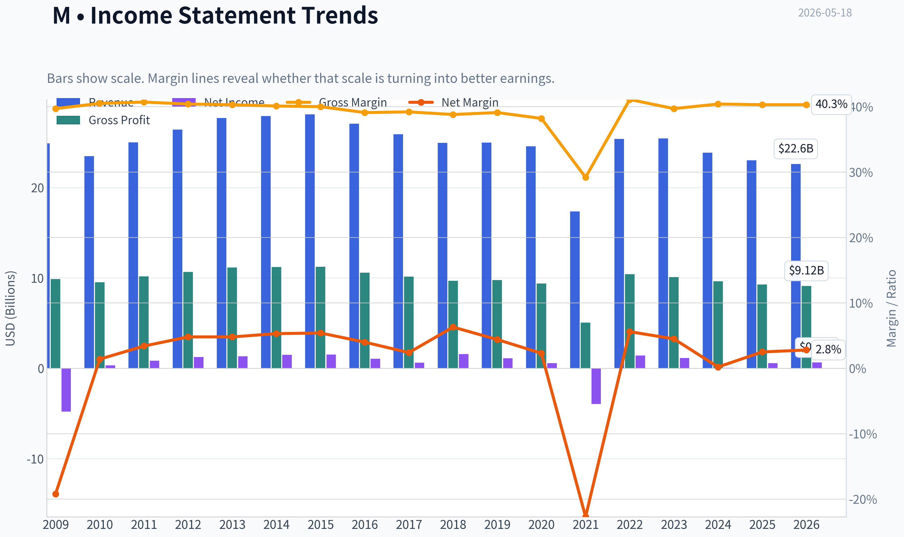

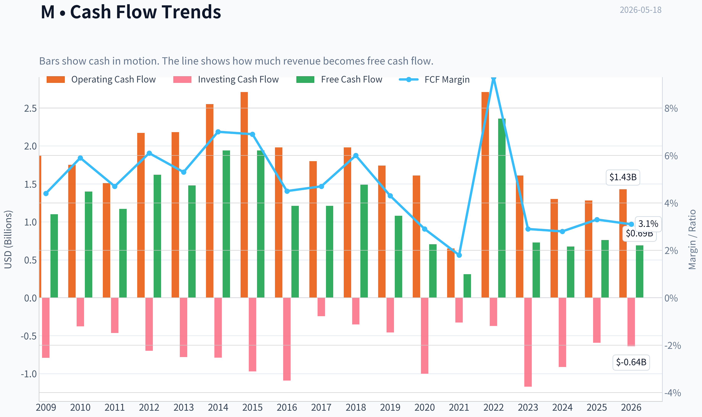

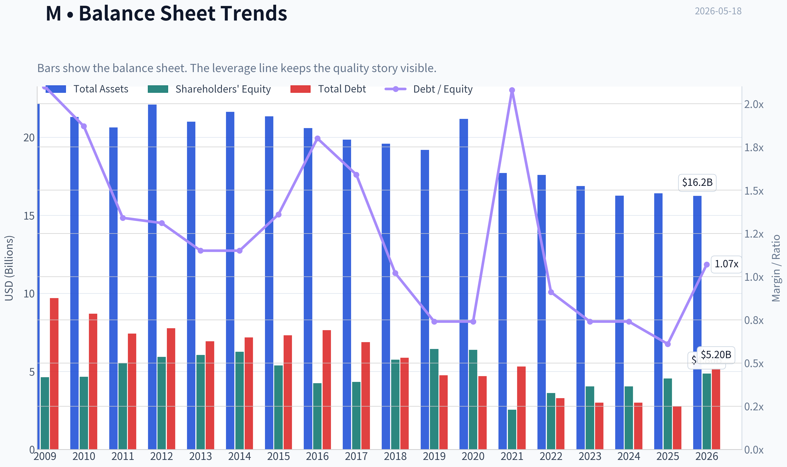

This graph tracks the profitability and return metrics (ROE, ROIC, Margins) of **M** over the past decade, highlighting capital efficiency trends.

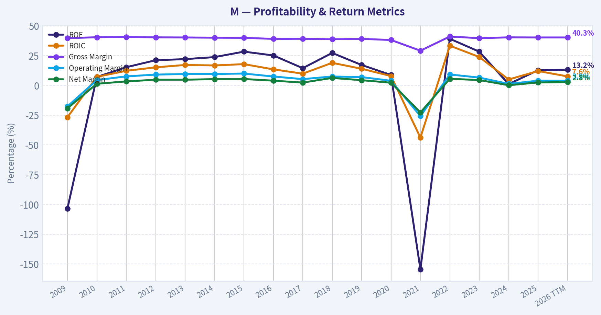

This chart illustrates the financial health of **M** over the last 10 years, mapping cash equivalents and free cash flow against total obligations (Debt).

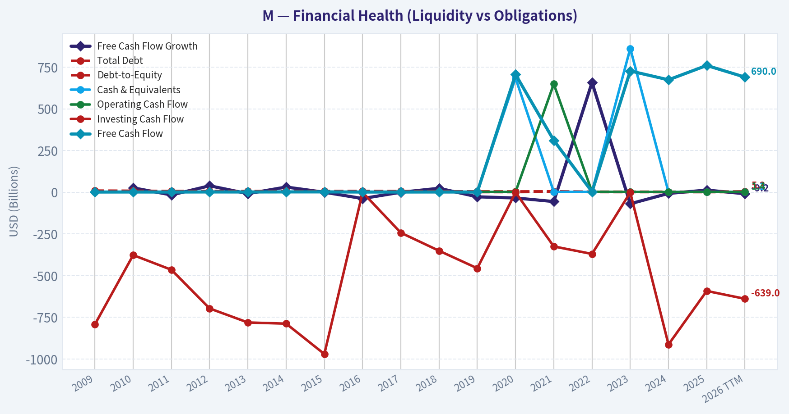

---

### Intrinsic Value Analysis (Buffett)

> *Following Warren Buffett's value investing philosophy: Circle of Competence, Economic Moat, Management Quality, and Margin of Safety.*

#### Intrinsic Value Snapshot

Price is what you pay. Intrinsic value is what the business may be worth based on the cash it can create for owners over time. We show a range, not one magic number.

- Current Price: $18.52
- Value Range (conservative to optimistic across both DCF methods): $6.33 to $208.39

##### Owner Earnings (Buffett Method)
- Net Income: $582,000,000.00
- Depreciation & Amortization: $894,000,000.00
- Capital Expenditures: $-373,000,000.00
- Working Capital Changes: $-486,000,000.00
- Owner Earnings: $1,222,000,000.00

##### Intrinsic Value
###### Buffett Method
Uses owner earnings. Stricter, and usually more conservative.
- Conservative: $6.33
- Average: $70.25
- Optimistic: $208.39
- Discount Rate: 10.0%

###### Cash Flow Method
Uses free cash flow. Better for companies spending heavily today to grow tomorrow.
- Conservative: $10.35
- Average: $31.61
- Optimistic: $66.29
- Discount Rate: 10.0%

#### Macy's (M)

I'm blocked on the required audited financial-history tool for this run, so I can't responsibly complete the Buffett-style due diligence package yet.

What I can confirm from the research pack already in hand:

| Metric | Value |
|---|---:|
| Price | $19 |
| Market Cap | $4.88B |
| P/E | 7.95 |
| ROE | 13.2% |
| Gross Margin | 40.3% |
| Revenue Growth YoY | -1.7% |
| FCF Yield | 21.6% |
| Current Ratio | 1.49 |

Key Takeaways: Macy's looks statistically cheap on earnings and free cash flow, but the operating picture is not clearly strong. Gross margin is respectable for retail, yet revenue is shrinking and ROE is below the level Buffett would usually call exceptional. This combination often signals a potentially cheap stock rather than an obviously wonderful business.

#### Preliminary Buffett Filter Read

| Gate | Initial Read | Why |
|---|---|---|
| Business Simplicity | Pass | Department store retail is easy to understand |
| Long-Term Predictability | Weak Pass | Stores, brands, and merchandising are understandable, but retail economics can shift materially |
| Technology Risk | Mixed | E-commerce and off-price competition remain real threats |
| Moat Test | Weak | Brand recognition exists, but moat durability is questionable in department-store retail |
| Management / Capital Allocation | Unclear | Needs audited multi-year capital allocation evidence |
| Industry Structure | Fail-leaning | Retail is competitive, promotional, and rarely ideal Buffett territory |

Key Takeaways: Macy's passes the "easy to understand" test, but that is the easiest test to pass. The harder questions are moat durability and industry quality, and both look unimpressive at first glance. Department stores usually face intense competition and limited pricing power.

#### Tentative View

Based on the data available so far, Macy's looks more like a **potential value situation** than a **Buffett-quality compounder**. The low valuation and high FCF yield may attract interest, but shrinking revenue, only middling ROE, and a structurally tough retail industry keep it from clearing a high-quality hurdle.

I would need the full financial history to finish:
- owner earnings
- multi-year ROE and cash conversion
- leverage and interest coverage
- buyback/dividend/debt record
- DCF and margin of safety
- final Buffett scorecard and stance

If you want, I can continue from here once the financial-history tool issue is resolved.
#### Valuation Bridge

This bridge places the current market price beside each intrinsic value lens so readers can see whether upside depends on one method or shows up across several methods.

| Scenario | Intrinsic Value / Share |
| --- | ---: |
| Buffett Method | $70.25 |
| Cash Flow Method | $31.61 |
| Damodaran Method | $43.48 |
| Current Price | $18.52 |

#### Key Takeaways

If one method is far above the others, the upside case depends on a specific modelling assumption. When several methods cluster together, the valuation story is more robust.

#### Valuation Visuals

This comparison chart from *Latest Earnings Snapshot* stacks current figures against historical benchmarks for **M**, making it easy to see where the company trades relative to its own averages.

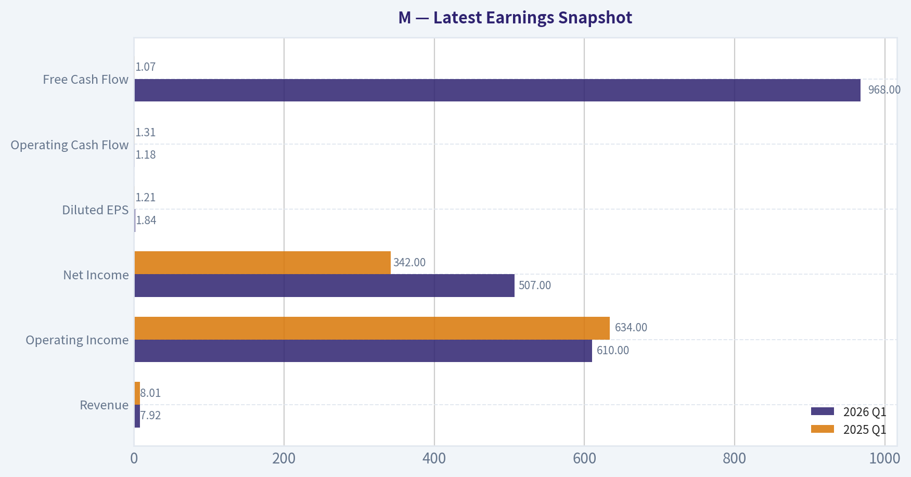

This comparison chart from *Current vs Historical Average Comparison* stacks current figures against historical benchmarks for **M**, making it easy to see where the company trades relative to its own averages.

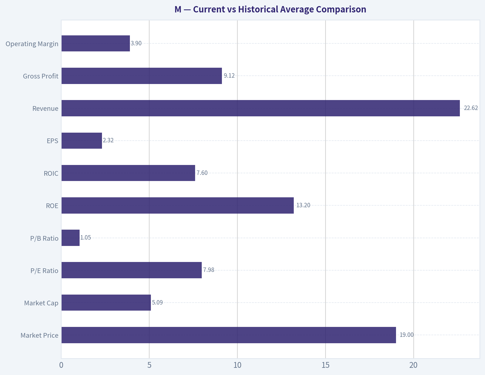

This comparison chart from *Macy's (M)* stacks current figures against historical benchmarks for **M**, making it easy to see where the company trades relative to its own averages.

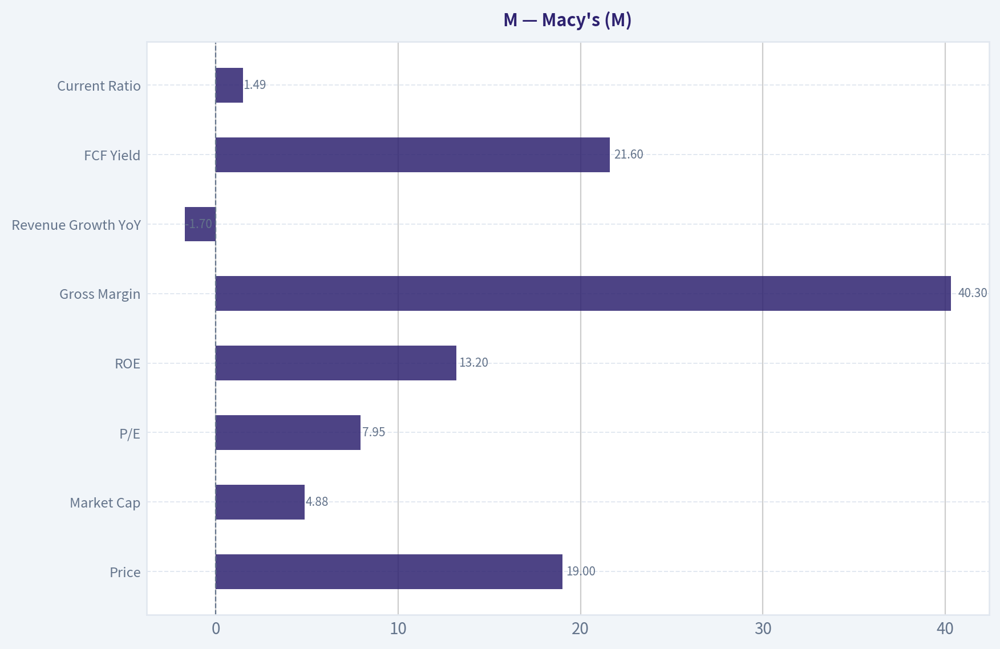

The following chart maps the **M** Owner Earnings DCF valuation scenarios (Conservative, Average, Optimistic) to visually represent the margin of safety based on intrinsic value calculations.

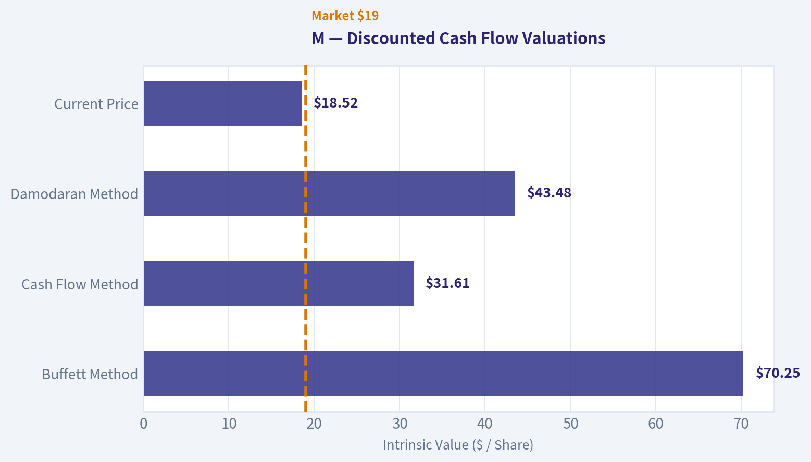

This comparison chart from *Unit Economics* stacks current figures against historical benchmarks for **M**, making it easy to see where the company trades relative to its own averages.

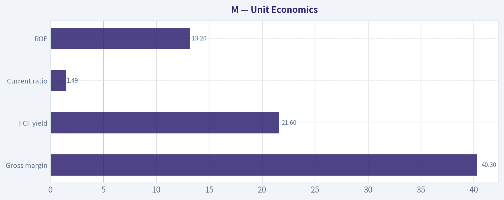

---

### Trend & Growth Analysis (Lynch/Druckenmiller/Fisher)

> *Following Peter Lynch's GARP, Stanley Druckenmiller's macro-aware approach, and Philip Fisher's scuttlebutt methodology.*

ANALYST STANCE: **AVOID**

#### Macy's (M) Growth Analysis

M does not fit a Lynch/Druckenmiller/Fisher growth mandate. It is statistically cheap, but the shared data shows **negative revenue growth (-1.7% YoY)**, which is an automatic caution for a growth framework. This is more of a **value/cash-flow/asset optionality** story than a fast-grower with ten-bagger potential.

---

#### 1) Lynch Classification

| Framework Item | Assessment |
|---|---|
| Lynch category | **Slow Grower / Categorical value retailer** |
| Revenue growth | **-1.7% YoY** |
| Primary style fit | Deep value / cash flow / asset story |
| Growth-investor relevance | Low |

Key Takeaways: Macy's is not a fast grower, stalwart growth compounder, or clear turnaround with a visible growth catalyst. The negative top-line trend pushes it outside the core Lynch fast-grower universe. Even if the stock is cheap, it is not cheap for growth.

#### 2) The Story in 3 Bullets

| Story Element | Simple View |
|---|---|
| What it does | Macy's sells apparel, beauty, accessories, and home goods through stores and digital channels |
| Why people own it | Low valuation, strong free cash flow yield, and possible asset/real estate optionality |
| Why growth investors hesitate | Core business is not growing, and department store retail is structurally challenged |

Key Takeaways: This is easy to explain, but the explanation is not a compelling growth story. Investors are mostly betting on stabilization and cash extraction, not a multi-year acceleration cycle. That sharply limits ten-bagger potential.

---

#### 3) TAM Analysis with 10x Test

| TAM Question | Assessment |
|---|---|
| Core TAM | Large U.S. apparel/beauty/home retail market |
| Can revenue 10x realistically? | **No, not plausible** |
| Real constraint | Mature category, intense competition, legacy format pressure |
| TAM verdict | Large market, but **weak usable runway** for Macy's specifically |

Key Takeaways: The total retail market is huge, but Macy's does not have the kind of share-gain engine needed to exploit it. A company can sit in a big market and still have poor runway if its format is mature and losing relevance. So the 10x test fails in practice.

---

#### 4) Revenue Growth Trend

| Metric | Value | Interpretation |
|---|---:|---|
| Revenue growth YoY | **-1.7%** | Negative growth |
| Growth pattern | Decelerating / stagnant | Warning |
| Inflection evidence | None in shared pack | Not a Druckenmiller-style acceleration setup |

Key Takeaways: Negative revenue growth is the biggest problem in a growth screen. Druckenmiller wants acceleration and Lynch wants durable expansion; Macy's currently shows neither. Without top-line improvement, multiple expansion is harder to sustain.

---

#### 5) Unit Economics

| Metric | Value | Assessment |
|---|---:|---|
| Gross margin | **40.3%** | Respectable for department store retail |
| FCF yield | **21.6%** | Very high; signals cheapness and/or skepticism |
| Current ratio | **1.49x** | Adequate liquidity |
| ROE | **13.2%** | Acceptable, but not enough to offset weak growth |
| LTV/CAC | N/A | Not disclosed / not applicable in standard retail framing |
| NRR | N/A | Not applicable |
| Rule of 40 | N/A | Not applicable |

Key Takeaways: Macy's has some healthy value metrics, especially free cash flow yield and acceptable margins. But good retail cash generation is not the same as scalable growth economics. The business lacks the subscription-style indicators or reinvestment flywheel that usually support outsized compounding.

---

#### 6) Inflection Point Assessment

| Potential Inflection Type | Evidence | Verdict |
|---|---|---|
| Product cycle inflection | None apparent | No |
| Market share inflection | None apparent | No |
| Margin inflection | Possible cost discipline, but insufficient | Weak |
| TAM inflection | No | No |
| Competitive inflection | No clear competitor stumble benefiting Macy's | No |

Key Takeaways: I do not see a true growth inflection. At best, Macy's may have a stabilization or efficiency story, which belongs in a different investing bucket. For growth investors, stabilization is not enough unless it clearly leads to renewed expansion.

---

#### 7) Macro Setup Evaluation

| Macro Factor | Assessment |
|---|---|
| Consumer discretionary backdrop | Mixed to fragile |
| Rate sensitivity | Lower rates would help valuation, but not solve core demand issues |
| Secular theme alignment | Weak |
| Sector tailwind | No strong secular tailwind |

Key Takeaways: Macy's is not aligned with the dominant 2024-2034 secular growth themes like AI, cloud, cybersecurity, healthcare innovation, or digital platform scaling. Macro can help sentiment somewhat, but it does not create a structural growth engine. This is a cyclical retailer, not a secular winner.

---

#### 8) Fisher 15 Points Score

| Fisher Area | Score (1-5) | Notes |
|---|---:|---|
| Market potential | 2 | Large market, but Macy's position is mature |
| New product development | 2 | Limited growth innovation |
| R&D effectiveness | 1 | Not a meaningful edge area |
| Sales organization | 3 | Established but not clearly advantaged |
| Profit margin | 3 | Adequate |
| Improving margins | 2 | Unclear / cyclical |
| Labor relations | 3 | Neutral |
| Executive relations | 3 | Neutral |
| Management depth | 3 | Adequate |
| Cost analysis/accounting | 3 | Likely adequate |
| Outstanding moat traits | 2 | Brand helps, but moat is limited |
| Long-range profit outlook | 2 | Structural pressure |
| Dilution risk | 4 | Not a major current issue |
| Candor | 3 | Neutral |
| Integrity | 3 | Neutral |

| Total Fisher Score | **39 / 75** | **Below average / avoid for growth** |

Key Takeaways: Macy's scores poorly on the parts of Fisher's framework that matter most for long-duration growth: innovation, moat expansion, product pipeline, and long-range sales opportunity. The score reflects a mature retailer managing decline or stagnation rather than building a widening advantage. That keeps it out of the high-quality growth bucket.

---

#### 9) Valuation Analysis

| Metric | Value | Interpretation |
|---|---:|---|
| Price | **$19** |
| Market cap | **$4.88B** |
| P/E | **7.95x** | Cheap on earnings |
| FCF yield | **21.6%** | Extremely cheap on cash flow |
| PEG | N/M | Not meaningful with negative revenue growth / uncertain earnings growth |
| P/S | Not provided | Likely low given retail model |

Key Takeaways: Macy's is cheap, but cheapness alone does not make it a growth investment. The low P/E and very high FCF yield suggest the market doubts durability, not that it has missed a major growth opportunity. In other words, this is likely a low-expectations stock, not an underappreciated compounding machine.

---

#### 10) Growth Investor Scorecard

| Criterion | Weight | Score (1-5) | Weighted Score |
|---|---:|---:|---:|
| The Story | 10% | 2.0 | 0.20 |
| TAM & Runway | 20% | 1.5 | 0.30 |
| Revenue Growth | 20% | 1.0 | 0.20 |
| Unit Economics | 15% | 2.5 | 0.38 |
| Competitive Position | 10% | 2.0 | 0.20 |
| Management Quality | 10% | 2.5 | 0.25 |
| Macro Setup | 5% | 2.0 | 0.10 |
| Profitability Path | 5% | 2.5 | 0.13 |
| Valuation | 5% | 4.0 | 0.20 |

| Total Score |  |  | **1.96 / 5.0** |

Key Takeaways: The score is pulled down heavily by weak runway, negative revenue growth, and lack of secular tailwinds. Valuation is the one clear positive, but it is not enough to rescue the overall setup. In this framework, Macy's lands clearly in avoid territory.

---

#### 11) Position Size Stance

| Stance | Positioning |
|---|---|
| Growth mandate | **0% / No position** |
| Value/speculative sleeve | Only if mandate allows non-growth contrarian ideas |
| Watchlist status | Low priority |

Key Takeaways: For a growth portfolio, Macy's should not be sized at all. If someone wants exposure, it belongs in a separate deep-value or special-situations bucket, not in a concentrated growth book. The opportunity cost versus real fast growers is too high.

---

#### 12) Key Risks and Catalysts

| Type | Item |
|---|---|
| Risk | Continued sales declines |
| Risk | Margin pressure from promotions and weak traffic |
| Risk | Structural erosion of department store model |
| Risk | Consumer discretionary slowdown |
| Catalyst | Better-than-feared same-store sales stabilization |
| Catalyst | Real estate monetization / capital returns |
| Catalyst | Improved inventory control and margin resilience |
| Catalyst | External interest from activist or strategic investors |

Key Takeaways: The upside case is based on stabilization, asset value, and capital allocation rather than organic growth acceleration. The downside case is straightforward: if sales keep falling, the "cheap" multiple may remain cheap or get cheaper. That asymmetry is unattractive for a growth investor.

---

#### Bottom Line

Macy's is **cheap, cash-generative, and possibly interesting to value investors**, but it does **not** meet the standards of a Lynch fast grower, a Druckenmiller earnings inflection, or a Fisher quality-growth compounder.

For this mandate, the correct conclusion is:

**ANALYST STANCE: AVOID**

#### Growth & Scorecard Visuals

This comparison chart from *Fisher 15 Points Score* stacks current figures against historical benchmarks for **M**, making it easy to see where the company trades relative to its own averages.

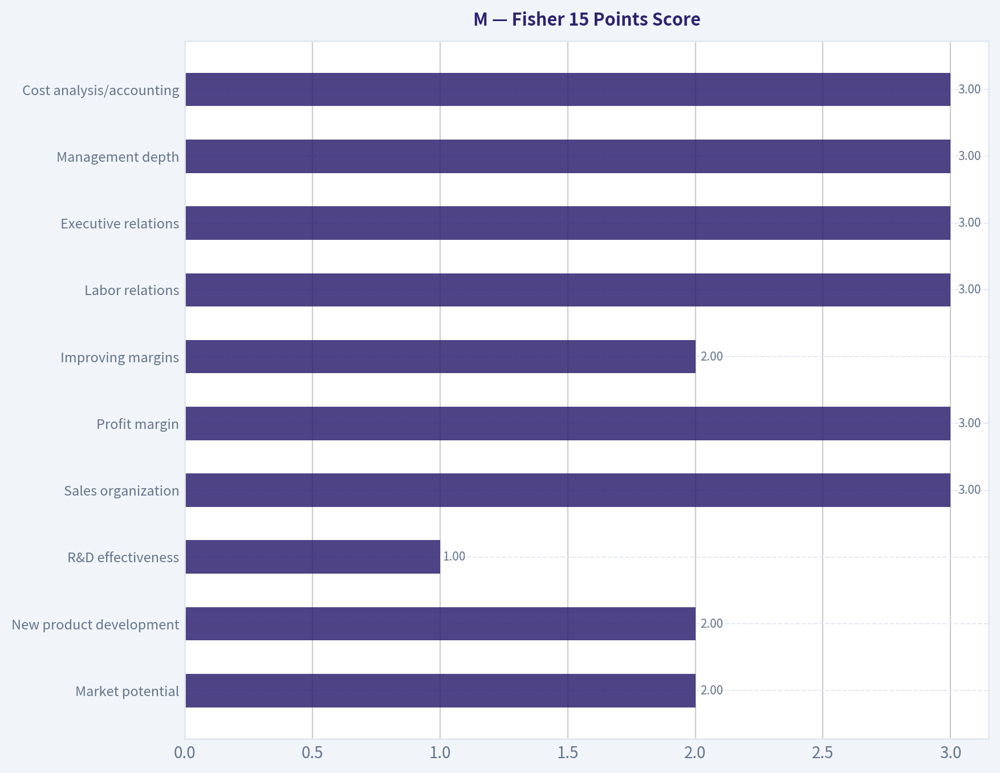

---

### Market Technical Analysis

#### Macy's (M) Technical Indicator Report
**Date reference:** 2026-05-18
**Analysis window:** roughly the last 6 months, with indicator focus on the last 60 calendar days

#### Selected indicators and why they fit the current setup

For **M**, the most relevant non-redundant indicator set is:

| Indicator | Why it matters now |
|---|---|
| close_10_ema | Best for tracking the recent rollover after the late-April rebound. |
| close_50_sma | Defines the medium-term trend, which is still soft and acting as overhead reference. |
| close_200_sma | Confirms the broader regime has improved from March lows, but is not strongly bullish. |
| macd | Useful for judging whether April's momentum recovery is still intact or fading. |
| rsi | Helps distinguish between weak drift lower and true capitulation; current reading suggests weakening, not panic. |
| atr | Important because this stock's swings have compressed since March, affecting stop placement and breakout expectations. |
| boll_ub | Helps frame upside resistance and whether rallies have enough force to expand volatility. |
| vwma | Valuable here because Macy's often trades on bursts of event-driven volume; volume-weighted trend confirmation matters. |

**Key Takeaways:** The indicator mix is designed to separate three layers of behavior: short-term momentum, medium-term trend structure, and volatility-adjusted trade quality. For Macy's right now, that matters because the stock is no longer in the sharp March selloff, but it is also not sustaining the stronger April rebound, so traders need tools that can detect fading strength without duplicating the same signal.

#### Price trend structure

Over the full period, Macy's went through **three distinct phases**:

1. **Late November to mid-December 2025:** strong advance from the high teens into the mid-23s.
2. **January to mid-March 2026:** prolonged decline, ultimately reaching the **mid-to-high 16s/low 17s** area.
3. **Mid-March to late April 2026:** recovery bounce back toward **20.24**, followed by a **loss of follow-through in May**.

That sequence is important. This is not a chart in a clean uptrend or clean downtrend. Instead, it shows a **failed recovery attempt inside a larger damaged trend**. The stock did stabilize after the March washout, and buyers were able to reclaim the 18s and briefly the 20 area, but they did **not** build enough momentum to convert the rebound into a durable breakout.

#### Moving average interpretation

The moving averages tell a subtle but important story:

| Indicator | Latest value | Interpretation |
|---|---:|---|
| close_10_ema | 18.77 | Short-term trend has rolled over and is now close to spot price, showing weak immediate momentum. |
| close_50_sma | 18.65 | Medium-term trend is slightly below the 10 EMA, but flattening to down overall. |
| close_200_sma | 18.78 | Long-term baseline sits near current price, showing the stock is trading around its broader equilibrium zone rather than trending strongly away from it. |
| Last close (2026-05-15) | 18.41 | Price is below all three reference averages. |

**Key Takeaways:** Macy's closed below the 10-day EMA, 50-day SMA, and 200-day SMA, which means the near-term tape is weaker than both its medium-term and long-term reference levels. The especially important detail is that all three averages are clustered around the high-18s, so the stock is sitting under a dense resistance band rather than merely dipping below one isolated signal.

A few finer points stand out:

- The **50-day SMA has been falling steadily**, from about **20.21 in mid-March to 18.65 by mid-May**. That indicates the medium-term trend damage from the winter/spring selloff has not been repaired.
- The **200-day SMA has been rising**, from about **17.30 in mid-March to 18.78 in mid-May**. That means the longer-term trend is not collapsing; instead, it is normalizing upward after earlier stronger prices.
- The **10-day EMA peaked near late April/early May** and has since slipped from around **19.75 to 18.77**, confirming the recent downturn is not just a one-day dip but a short-term momentum fade.

This combination usually describes a stock in **transition**, not leadership: long-term structure is no longer deeply bearish, but short-term price action is not yet strong enough to reclaim control.

#### Momentum analysis: MACD and RSI

| Indicator | Latest value | Signal read |
|---|---:|---|
| macd | -0.174 | Momentum has turned negative again after a constructive April run. |
| rsi | 42.87 | Bearish-to-neutral momentum; weak, but not oversold. |

**Key Takeaways:** MACD has slipped back below zero, which tells us the rebound impulse from April has faded and sellers have regained the short-term edge. RSI near 43 says the stock is weak but not washed out, so this is more consistent with a grinding deterioration than a climactic selloff that immediately invites aggressive dip buying.

The path of momentum is more informative than the single-day reading:

- **MACD improved dramatically** from roughly **-0.94 in mid-March** to **+0.42 by late April**. That was a real momentum repair, not a trivial bounce.
- However, since late April the MACD has **decelerated persistently**, crossed back through zero around mid-May, and is now negative again. That signals the prior recovery has **lost internal strength**.
- **RSI rose into the mid-60s in late April**, but never entered a sustained overbought regime. That matters because strong new uptrends often push RSI above 70 or hold it above 60 for longer. Macy's failed to do that.
- RSI has since eased back to the low 40s, which suggests sellers are pressuring price, but there is still **room for further downside** before the stock becomes technically stretched.

In practical terms, momentum does **not** currently support chasing upside. Bulls would want to see MACD stabilize and RSI reclaim at least the **50-55** zone before calling this a renewed trend leg higher.

#### Volatility and trading conditions

| Indicator | Latest value | Context |
|---|---:|---|
| atr | 0.677 | Daily movement has cooled materially versus March. |
| boll_ub | 20.65 | Upper volatility envelope is well above price, implying upside resistance remains distant. |

**Key Takeaways:** Volatility has come down since the March stress period, which usually means panic selling has passed, but it also means breakouts now need fresh catalysts because the stock is no longer moving on sheer emotional momentum. With the upper Bollinger reference sitting around 20.65 while price is near 18.41, there is meaningful room overhead, but that gap currently looks more like unfilled resistance than easy upside.

The volatility trend is constructive for risk control but not automatically bullish:

- **ATR fell from about 0.96 in mid-March to 0.68 now.** That is a substantial drop in realized trading range.
- Lower ATR after a deep selloff often means the market has moved from **panic discovery** into **compression and reassessment**.
- Compression can precede a breakout, but direction matters. Since price is currently under key moving averages and MACD is negative, the lower-volatility setup presently favors **measured drift or breakdown risk**, not a high-confidence upside expansion.

For traders, ATR around **0.68** implies stops that are too tight may get clipped by normal daily noise. A one-day swing of roughly **3.5% of share price** is still normal for this name.

#### Volume-weighted trend confirmation

| Indicator | Latest value | Interpretation |
|---|---:|---|
| vwma | 18.98 | Price is below the volume-weighted trend reference, indicating recent volume has not confirmed the latest pullback as an accumulation opportunity. |

**Key Takeaways:** Macy's is trading below its VWMA, which means the average price paid by volume over the lookback sits above the current market price. That typically indicates recent participation has not been rewarded, and until price reclaims that level, rallies are more likely to encounter supply from traders looking to exit near breakeven.

This is a meaningful caution signal because:

- In April, VWMA trended steadily upward as price recovered, confirming **buyers were participating with conviction**.
- In May, price dropped beneath VWMA while VWMA remained near **18.98**, creating a small but important **overhead supply zone**.
- When price is below VWMA and short-term momentum is weakening, upside moves often stall unless a fresh catalyst brings stronger-than-usual demand.

#### Fine-grained trend read

The most nuanced way to describe Macy's current technical state is:

- **Not in capitulation:** March looked closer to exhaustion selling; May does not.
- **Not in trend resumption:** April's rebound did not transition into a sustained breakout regime.
- **Currently in a fragile neutral-to-bearish reset:** price has slipped back under clustered averages, momentum has deteriorated, and volume-weighted positioning is no longer favorable.

That means the stock is sitting in a **decision zone**.

A few practical levels emerge from the indicator cluster:

| Zone | Approximate level | Meaning |
|---|---:|---|
| Immediate support | 18.30-18.40 | Recent closing area; failure here raises odds of a retest lower. |
| Secondary support | 17.90-18.10 | Repeated spring trading shelf; important if current weakness extends. |
| Resistance band | 18.65-18.98 | 50 SMA, 10 EMA, 200 SMA, and VWMA cluster overhead. |
| Higher resistance | 20.20-20.65 | Late-April highs and upper Bollinger zone. |

**Key Takeaways:** The critical message from these levels is that Macy's has stacked resistance very close overhead, while support is only modestly beneath current price. That creates an unfavorable near-term asymmetry for aggressive longs unless the stock can quickly retake the high-18s and hold there.

#### Trading implications by style

| Style | Read |
|---|---|
| Short-term momentum trader | Bias is cautious to bearish until price reclaims 10 EMA and VWMA with improving MACD. |
| Swing trader | Better to wait for either a confirmed reclaim of 18.95-19.00 or a deeper test toward support with RSI closer to oversold. |
| Trend follower | No clean long trend signal yet; price below 50 and 200 day averages argues for patience. |
| Risk manager | ATR compression helps define stops, but clustered resistance means reward-to-risk on immediate upside entries is not compelling. |

**Key Takeaways:** Different trading styles all point to the same conclusion: patience is more attractive than urgency right now. The stock is not giving a strong trend-following long signal, and it is also not stretched enough to make a high-conviction mean-reversion buy obvious.

#### Bottom line

Macy's is showing a **fading rebound rather than a fresh bullish leg**. The stock recovered impressively from the March low, but that recovery has stalled beneath a dense band of moving-average and volume-weighted resistance. MACD turning negative again and RSI sliding into the low 40s suggest weakening participation, while ATR compression shows the market has calmed but not necessarily turned constructive.

The **most actionable technical conclusion** is this:
**M needs to reclaim roughly 18.8-19.0 to improve meaningfully.**
Until that happens, the chart favors **cautious, range-aware trading** with elevated respect for downside retests into the low-18 to high-17 area.

#### Summary table

| Category | Indicator(s) | Current message | Trader implication |
|---|---|---|---|
| Short-term trend | close_10_ema | Price below EMA; recent momentum fading | Avoid chasing weak bounces |
| Medium-term trend | close_50_sma | 50-day average still drifting lower | Trend repair incomplete |
| Long-term trend | close_200_sma | Price slightly below long-term average | Broader regime is neutral, not strong |
| Momentum | macd, rsi | MACD negative, RSI ~43 | Bearish drift, not yet oversold |
| Volatility | atr, boll_ub | Volatility lower than March; upside band far above price | Breakouts need catalyst |
| Volume confirmation | vwma | Price below VWMA | Recent volume not confirming accumulation |
| Key risk | All combined | Resistance clustered near 18.65-18.98 | First upside hurdle is close and significant |
| Best confirmation signal | EMA/VWMA/MACD | Reclaim high-18s with momentum improvement | Would materially improve long setup |

**Key Takeaways:** Macy's is technically vulnerable, but not in free fall. The strongest evidence points to a stock caught below important resistance after a failed rebound, so traders should watch for either a decisive reclaim of the high-18s or a cleaner reset into lower support before expecting a more durable move.

---

### Options Market Analysis

> *Reading options flow - put/call ratios, IV skew, and unusual activity - to gauge institutional positioning and event-driven risk.*

#### M Options Positioning Report
*As of 2026-05-18*

#### 1. Put/Call Ratio Analysis

| Expiration | Call OI | Put OI | Put/Call OI Ratio | Call Vol | Put Vol | Put/Call Vol Ratio |
|---|---:|---:|---:|---:|---:|---:|
| 2026-05-22 | 2,829 | 2,675 | 0.95 | 2,914 | 2,616 | 0.90 |
| 2026-05-29 | 2,189 | 2,224 | 1.02 | 2,147 | 1,137 | 0.53 |
| 2026-06-05 | 615 | 257 | 0.42 | 1,009 | 237 | 0.23 |
| **Near-term total** | **5,633** | **5,156** | **0.92** | **6,070** | **3,990** | **0.66** |

**Key Takeaways:** Near-term open interest is slightly put-heavy versus the historical neutral baseline of about 0.7, with a total put/call OI ratio of 0.92. But trading flow today is more call-leaning, with a put/call volume ratio of 0.66, suggesting fresh upside interest is stronger than the existing positioning implies. In plain English: the market still carries some hedge demand, but recent activity has tilted more bullish than neutral.

**Interpretation:**
- The **0.92 OI ratio** is above the usual neutral baseline of ~0.7, which tells us positioning is **more defensive than average**, though not outright panic-driven.
- The **0.66 volume ratio** is more constructive and indicates **incremental call buying** is dominating near-term flow.
- By expiration:
  - **2026-05-22** looks fairly balanced, with only a mild put bias in OI.
  - **2026-05-29** has the heaviest defensive OI setup, with put OI slightly exceeding call OI.
  - **2026-06-05** shows a notable call tilt, both in OI and especially in volume.

#### 2. Implied Volatility Assessment

| Expiration | ATM Call IV | ATM Put IV | Call-Put ATM Spread | Read |
|---|---:|---:|---:|---|
| 2026-05-22 | 66.0% | 59.0% | +7.0 pts | Calls priced richer |
| 2026-05-29 | 59.0% | 54.9% | +4.1 pts | Mild call premium |
| 2026-06-05 | 71.9% | 62.6% | +9.3 pts | Stronger upside premium |

**Key Takeaways:** ATM implied volatility is elevated for a department-store name like M, especially in the first three weekly expirations. More importantly, calls are priced richer than puts across all listed near-term maturities, which is not the usual fear-driven pattern. That points to upside demand or event-driven call chasing rather than classic downside hedging pressure.

**IV read:**
- Near-term IV is **high enough to imply traders expect meaningful movement** over the next few weeks.
- Normally, a steep **put skew** would signal downside fear. Here, the available data instead shows **call-side richness at-the-money**, which suggests:
  - upside speculation,
  - short-dated event positioning,
  - or aggressive call demand overwhelming normal skew structure.

**Skew direction:**
- Based on the IV data provided, the near-term skew appears **tilted toward calls rather than puts**.
- That is a **bullish or squeeze-sensitive signal**, not a fear signal.

**Catalyst note:**
- Elevated IV often appears ahead of earnings or company-specific news. Without an externally confirmed event calendar here, I would still flag this as **possible catalyst pricing**, because weekly IV in the 59% to 72% range is elevated enough to suggest the market expects a notable move.

#### 3. Unusual Options Activity

| Expiry | Type | Strike | Volume | OI | Vol/OI | IV | Likely Moneyness / Read |
|---|---|---:|---:|---:|---:|---:|---|
| 2026-05-22 | Put | 16.5 | 1,026 | 141 | 7.3x | 67.2% | Likely near-ATM to slightly OTM hedge/speculative downside bet |
| 2026-05-29 | Call | 18.5 | 745 | 128 | 5.8x | 53.1% | Likely OTM upside bet / bullish speculation |

**Key Takeaways:** The unusual flow is two-sided, but the character of the trades matters. The 5/22 $16.5 put activity looks like fresh downside protection or a short-term bearish bet, while the 5/29 $18.5 call activity looks like new upside positioning one week further out. Together, this suggests traders see near-term event risk but are still willing to chase upside beyond the immediate window.

**Contract-level interpretation:**
- **2026-05-22 $16.5 Put**
  - Volume is more than **7x open interest**, so this is likely **new positioning**, not just closing trades.
  - Given the short time to expiry, this smells like **event hedge flow** or a tactical bearish trade.
  - Because it is in the front weekly expiry, it likely reflects **urgent protection** rather than long-term conviction.

- **2026-05-29 $18.5 Call**
  - Volume is nearly **6x OI**, another sign of **fresh money entering**.
  - With expiry one week later, this looks more like a **directional upside bet** than simple same-week noise.
  - This is more consistent with **speculative bullish positioning** and possibly better-informed swing-trader or institutional call buying than pure retail lottery-ticket flow, though we cannot confirm trade prints or execution type from this dataset alone.

**Smart-money vs. retail read:**
- The **front-week put trade** is more consistent with **hedging or tactical downside protection**.
- The **next-week OTM call trade** is more consistent with **speculative bullish positioning**.
- Since both are sizable versus existing OI, the market is pricing **two-way event risk**, but the broader volume backdrop favors the call side.

#### 4. Open Interest Concentration and Gamma Levels

| Expiration | Dominant OI Character | Likely Market Effect |
|---|---|---|
| 2026-05-22 | Balanced, slight call edge in OI | Potential pinning near active strikes if stock remains rangebound |
| 2026-05-29 | Slight put-heavy OI | Defensive positioning may dampen upside unless call flow continues |
| 2026-06-05 | Call-dominant OI and volume | More favorable setup for upside extension if spot approaches call-heavy strikes |

**Key Takeaways:** Aggregate OI is not massively concentrated on one side, so there is no obvious extreme gamma wall from the data provided. Still, the 5/22 and 5/29 expirations are large enough relative to 6/05 that they may anchor price in the very near term, while the 6/05 setup looks more supportive of upside if the stock starts moving higher.

**Interpretation:**
- The data does not provide a full strike-by-strike OI ladder, so we cannot calculate precise **max pain** or exact **gamma walls**.
- Still, from the expiration-level totals:
  - **5/22 and 5/29** are the main near-term magnets because they hold the most OI.
  - **5/29's slightly higher put OI** suggests some defensive gravity in that window.
  - **6/05's strong call tilt** implies that if spot rises toward commonly owned call strikes, dealer hedging could **reinforce upside momentum**.

#### 5. Overall Options Sentiment Signal

**Signal: BULLISH**

**Primary driver:** Fresh call flow and call-rich IV structure outweigh the modestly elevated put open interest.

**Why bullish despite some put demand:**
- Yes, open interest is **more defensive than the 0.7 neutral baseline**, with total put/call OI at **0.92**.
- But the more important near-term change is in **flow**, and that flow is **call-led**:
  - total put/call **volume** ratio is only **0.66**,
  - ATM **call IV exceeds put IV** in every near-term expiry,
  - and there is a notable **unusual bullish call trade** in the 5/29 $18.5 line.
- That setup usually means the market is **not complacent**, but the latest marginal buyer is leaning **upside**, not downside.

**Caveats:**
- Confidence is **moderate**, not high, because unusual activity is still two-sided and front-week put demand is real.
- Elevated IV means the market expects movement, so even if the directional read is bullish, the path could be volatile.
- Options are signaling **bullish bias with event risk**, not a clean low-volatility trend.

---

#### Summary Table

| Category | Reading |
|---|---|
| Put/Call Ratio | OI ratio 0.92, volume ratio 0.66 - existing positioning slightly defensive, fresh flow more bullish |
| IV Level | Elevated near-term IV, especially 5/22 and 6/05 |
| Skew Direction | Call-side richness / upside skew, not classic downside fear |
| Unusual Activity | 5/22 $16.5 puts active for protection; 5/29 $18.5 calls active for upside speculation |
| Overall Signal | **BULLISH** |

**Key Takeaways:** The options market in M is not carefree, but it is leaning bullish on the margin. Existing open interest still shows some caution, yet the newer money is favoring calls and pricing upside more aggressively than downside. The cleanest read is bullish with volatility, not bearish fear.

---

## Research Team Commentary

> *The Research Manager synthesizes the Bull vs Bear debate into action-free commentary. This is a pre-risk view, not the final stance.*

When looking at a company like Macy's, we are faced with the classic crossroads of value investing: the tension between a statistically cheap price and the actual long-term quality of the business.

The Bull brings a very grounded, numbers-based argument to the table. They correctly point out that at under 8x earnings, with a 13.2% return on equity and a 12.9% return on invested capital, Macy's is hardly a distressed asset on the verge of bankruptcy. The Bull argues that the market is overly punitive, pricing a durable, cash-generating franchise as if it's going out of business tomorrow. If the business simply stabilizes and earns a 10x or 12x multiple, there is substantial upside.

However, the Bear counters with a much more Buffett-aligned perspective on business quality. The Bear argues that department stores are structurally disadvantaged, suffering from eroding moats, shifting consumer habits, and relentless competition from off-price retailers, direct-to-consumer brands, and e-commerce. The negative 1.7% year-over-year revenue growth isn't a temporary blip; it's a symptom of a melting ice cube. The Bear warns that relying on a low P/E ratio is dangerous when the "E" is fundamentally shrinking.

From a selective contrarian standpoint, we have to ask what the market is assuming. The market is assuming Macy's best days are behind it and that its earnings stream is highly vulnerable to both macroeconomic cycles and secular retail trends. In this case, the market is likely highly efficient, not irrationally fearful. The temporary factors (like macro consumer weakness) are exacerbating a permanent value destruction in the legacy department store model.

Reflecting on my own past mistakes in similar situations-even though my specific historical notes were left blank this time around, the scars of value traps are universal-I am reminded of the danger of "cigar-butt" investing. Early in my career, I would eagerly buy retailers or legacy media companies simply because they traded at 6x or 7x earnings with an optical margin of safety. The painful lesson was that a low multiple does not protect you if the underlying economics of the business are deteriorating. As Buffett learned from his textile mills, time is the friend of the wonderful business and the enemy of the mediocre. We want to buy compounding machines, not melting ice cubes that require heroic management just to stand still.

Here is my detailed investor commentary:

Core Takeaway
We must pass on Macy's. Despite its optically cheap valuation and currently respectable returns on capital, the business lacks the durable competitive advantage and predictable long-term earning power required for our 10-year holding period framework. It is a statistical value, not a franchise value.

Rationale
Buffett's framework demands business quality first. Macy's operates in one of the most structurally challenged segments of the retail industry. While its 40.3% gross margin and 12.9% ROIC indicate that management is currently doing an admirable job of wringing cash out of the existing asset base, the negative revenue trajectory (-1.7% YoY) reveals the underlying truth: the customer base is slowly moving elsewhere. A moat in retail is built on extreme customer captivity, unmatched scale efficiencies that lower prices (like Costco), or exceptional brand pricing power. Macy's sits in the squeezed middle.

Furthermore, the margin of safety here is an illusion. A single-digit P/E is fully justified for a business with high operating leverage, cyclical vulnerability, and shrinking top-line revenue. If normalized earnings drift from the current $2.30 range down to $1.50 over the next few years due to mall traffic declines and promotional intensity, today's price of $18.52 will look expensive in hindsight. We are looking for businesses where the intrinsic value grows over time, doing the heavy lifting for us. Macy's requires us to bet on multiple expansion in the face of secular headwinds-a bet we don't need to make.

Monitoring Plan
While this is a pass for our core long-term portfolio, we should keep an eye on a few key developments over the next 1 to 4 quarters just in case a special situation emerges:
1. Performance of Premium Assets: Track the isolated growth and margin profiles of Bloomingdale's and Bluemercury. If management ever decides to spin off these higher-quality, growing assets from the legacy Macy's footprint, that spin-off might warrant our attention.
2. Store Fleet Optimization: Watch the pace of store closures and the cash generated from real estate monetization. If they can meaningfully shrink the asset base and return massive amounts of capital to shareholders without destroying the balance sheet, it could serve as a floor to the stock.
3. Top-Line Trajectory: Monitor comparable store sales. If Macy's can string together three consecutive quarters of positive, organic revenue growth without sacrificing gross margins to heavy promotions, we may need to reassess our thesis on their structural decline.

Until we see evidence of a durable turnaround rather than just managed decline, this stock does not belong in our portfolio.

AVOID

---

## Value Investing Team Commentary

> *The Investor translates the research view into an investment thesis before risk review. This is still not the final stance.*

Macy's is the sort of stock that tempts classic value investors for the wrong reason: it looks cheap before we've established that the business is good. At $18.52 and roughly 8x earnings, the market is clearly not giving the company much credit. On the surface, 13.2% ROE, 12.9% ROIC, and a 40.3% gross margin suggest a business that is still economically viable, not one in immediate distress. But Buffett-style investing is not about buying low multiples in isolation; it is about buying enduring earning power with a margin of safety. That is where the Macy's case weakens.

The key issue is not whether Macy's can earn money this year or next. It is whether the business has a durable competitive position that will allow it to earn attractive returns ten years from now. Department stores, as a category, have been losing relevance for years. Consumer traffic has migrated online, brand loyalty has shifted toward direct channels, and off-price and specialty formats continue to pressure the middle of the market. Macy's is not a dominant low-cost operator, nor does it possess the kind of brand lock-in that protects premium luxury retailers. In Buffett's language, the moat appears narrow and still eroding.

The contrarian question is important here: is the market overly pessimistic, or is it simply recognizing a long-term business reality? In some cases, fear creates opportunity. But with Macy's, current skepticism looks mostly rational. Negative revenue growth of 1.7% is not just a macro wobble; it fits a broader pattern of secular pressure. A cheap P/E can quickly become misleading if the "E" continues to contract. That is the hallmark of a value trap: investors anchor on today's earnings multiple while underestimating the long-run decline in normalized earnings power.

That said, selective contrarian thinking does reveal a few areas worth watching. The market may be underappreciating the value of Macy's better assets, particularly Bloomingdale's and Bluemercury, if those banners continue to hold up better than the core fleet. There may also be some embedded real estate or restructuring optionality that provides downside support. If management proves disciplined in store rationalization, debt control, and capital returns, the stock could outperform expectations from a purely financial-engineering or asset-realization standpoint. But that is not the same as owning a wonderful compounding business. It is a special-situation angle, not a core long-term franchise investment.

Management quality therefore matters enormously. In challenged retailers, management's capital allocation can make the difference between slow value realization and permanent value destruction. I would want to see evidence on three fronts before becoming more constructive: first, that cash conversion remains solid across the cycle; second, that leverage is conservative enough to withstand weak consumer periods; and third, that buybacks, dividends, and debt reduction are being handled with genuine owner-minded discipline rather than short-term optics. Without that, a low valuation offers less protection than it seems.

The recent market action also fits this interpretation. The rally into the mid-$23s followed by a decline into the high teens and then a weak rebound suggests traders are oscillating between "too cheap to ignore" and "structurally impaired retailer." For a long-term investor, that volatility is mostly noise unless it signals a widening disconnect between price and intrinsic value. Here, I do not yet see a sufficiently compelling disconnect. The stock may bounce. It may even rerate modestly. But I do not see clear evidence that intrinsic value is compounding in a way that deserves long-duration capital.

In sum, Macy's may be statistically undervalued, but it does not appear qualitatively undervalued. That distinction matters. I would rather miss a rebound in a mediocre business than commit long-term capital to a business whose competitive position is deteriorating. If the company can demonstrate sustained positive comps, preserve margins without excessive promotions, and unlock value from its stronger banners while protecting the balance sheet, it may eventually deserve reconsideration. For now, the burden of proof remains on the business, not the market.

**ANALYST STANCE: WATCH**
Macy's is cheap enough to monitor, but not high-quality enough to own for a Buffett-style long-term portfolio. The current pessimism appears largely justified by structural business pressures, though premium banners and asset optionality merit continued observation. Watch for evidence of durable stabilization, disciplined capital allocation, and clearer moat preservation before considering advocacy.

---

## Deep Values Commentary

> *The Risk Management Team debates and the Risk Judge provides the final action-free verdict. This section determines the final ADVOCATE / WATCH / AVOID stance.*

#### Final Stance Scorecard

This scorecard converts the final research view into a weighted decision frame. It does not replace the narrative judgement, but it makes the main drivers of the verdict easier to scan.

| Criterion | Score | Weight | Commentary |
| --- | ---: | ---: | --- |
| Business Quality | 2.75 | 30% | High returns, profitability, and Piotroski health support durability. |
| Valuation Support | 5.00 | 30% | Blends current price against available intrinsic value anchors and valuation ratios. |
| Financial Strength | 2.67 | 20% | Balance-sheet resilience reflects leverage and liquidity staying within safe ranges. |
| Growth Durability | 3.33 | 20% | Recent revenue, earnings, and free cash flow growth indicate how durable expansion looks. |
| TOTAL / FINAL STANCE | 3.52 | 100% | AVOID |

#### Key Takeaways

The weighted score lands at **3.52 / 5.0**, while the final stance remains **AVOID**. This is useful as a quick calibration aid rather than a mechanical signal.

#### Risk Summary

Higher scores indicate more risk pressure. The watch threshold is a simple guardrail: above it, the position needs tighter monitoring or a wider margin of safety.

| Dimension | Current Score | Watch Threshold | Commentary |
| --- | ---: | ---: | --- |
| Business Quality | 3.25 | 3.00 | High returns, profitability, and Piotroski health support durability. |
| Valuation Support | 1.00 | 3.00 | Blends current price against available intrinsic value anchors and valuation ratios. |
| Financial Strength | 3.33 | 3.00 | Balance-sheet resilience reflects leverage and liquidity staying within safe ranges. |
| Growth Durability | 2.67 | 3.00 | Recent revenue, earnings, and free cash flow growth indicate how durable expansion looks. |

#### Key Takeaways

This view helps readers separate *where* the risk sits: valuation, business quality, balance sheet, or growth durability. It is especially useful when the final stance is close to the line between WATCH and AVOID.
