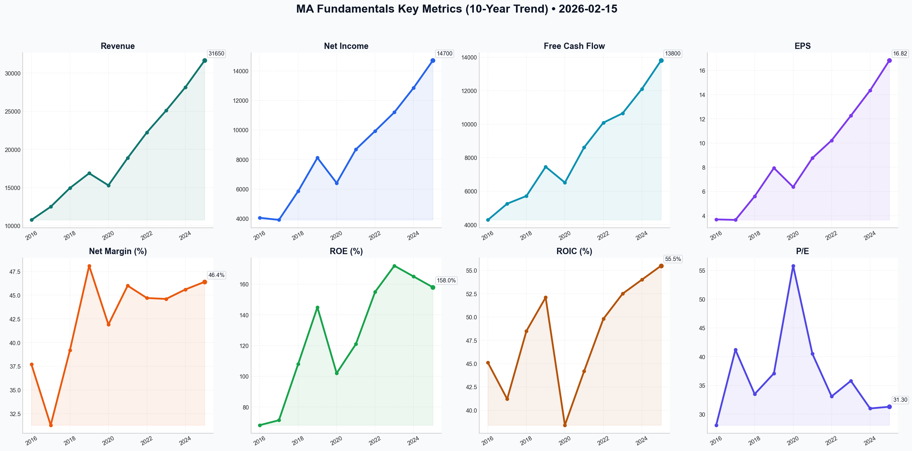

# MA Deep Value Intelligence

**Analysis Date:** 2026-02-15
**Generated:** 2026-02-15 21:11:53

---

## Table of Contents

1. [Intelligence Summary](#intelligence-summary)
2. [Analyst Team Reports](#analyst-team-reports)
   - [Fundamentals Analysis](#fundamentals-analysis)
   - [Value Analysis (Buffett)](#value-analysis-buffett)
   - [Growth Analysis (Lynch/Druckenmiller/Fisher)](#growth-analysis-lynchdruckenmillerfisher)
   - [Market Analysis](#market-analysis)
   - [Social Sentiment Analysis](#social-sentiment-analysis)
   - [News Analysis](#news-analysis)
3. [Research Team Commentary](#research-team-commentary)
4. [Investing Team Commentary](#investing-team-commentary)
5. [Deep Values Commentary](#deep-values-commentary)

---

## Intelligence Summary

### Thesis + Conditions

**Core Thesis:** Here is the synthesis of the debate and my investment commentary based on the Buffett Value Investing Framework.

**Key Risks:**
- The Bull Case (Risky Analyst):**
- Views the recent price drop and technical "Death Cross" as a "discount tag" on a world-class compounder. They argue that the **31x P/E** is cheap compared to the 10-year average of 36.8x. The core thesis is the **"VAS Explosion"** (Value-Added Services), arguing that cybersecurity and data analytics (growing 15%) are transforming Mastercard from a transaction toll booth into a "global trust layer," making regulatory threats to interchange fees less relevant. They label the "Watch" stance as paying a "fear tax."
- Contends that the "Death Cross" (200-day SMA breach) signals a structural exit by institutions, not a buying opportunity. The critical argument is the **Cost of Capital**: paying 31x earnings (a 3.2% yield) is irrational when risk-free Treasuries yield 3.75%. They argue the moat is facing structural erosion from the *Credit Card Competition Act* and government rails (FedNow), and that VAS is a lower-margin, labor-intensive business compared to the core network.
- Suggests a middle ground, arguing that while the "easy money" era is over, the stock is oversold. They recommend a tiered entry to catch a "mean reversion" relief rally to **$535**, driven by a K-shaped recovery where high-income spending protects Mastercard's volume. They warn against being a "hermit" but acknowledge the valuation risks.
- ### Risk Management Commentary

**What Would Change Our View:**
- The Bull Case (Risky Analyst):**
- Views the recent price drop and technical "Death Cross" as a "discount tag" on a world-class compounder. They argue that the **31x P/E** is cheap compared to the 10-year average of 36.8x. The core thesis is the **"VAS Explosion"** (Value-Added Services), arguing that cybersecurity and data analytics (growing 15%) are transforming Mastercard from a transaction toll booth into a "global trust layer," making regulatory threats to interchange fees less relevant. They label the "Watch" stance as paying a "fear tax."
- Contends that the "Death Cross" (200-day SMA breach) signals a structural exit by institutions, not a buying opportunity. The critical argument is the **Cost of Capital**: paying 31x earnings (a 3.2% yield) is irrational when risk-free Treasuries yield 3.75%. They argue the moat is facing structural erosion from the *Credit Card Competition Act* and government rails (FedNow), and that VAS is a lower-margin, labor-intensive business compared to the core network.
- Suggests a middle ground, arguing that while the "easy money" era is over, the stock is oversold. They recommend a tiered entry to catch a "mean reversion" relief rally to **$535**, driven by a K-shaped recovery where high-income spending protects Mastercard's volume. They warn against being a "hermit" but acknowledge the valuation risks.
- ### Risk Management Commentary

**Confidence:** Medium

### Stance Spectrum (Action-Free)

**Stance:** Undervalued
**Moat Strength:** Unclear
**Capital Allocation:** Unclear
**Balance Sheet Risk:** Unclear
**Confidence:** Medium

### Expanded Commentary

Here is the synthesis of the debate and my investment commentary based on the Buffett Value Investing Framework.

### The Debate in Brief

**The Bull Case (Risky Analyst):**
Views the recent price drop and technical "Death Cross" as a "discount tag" on a world-class compounder. They argue that the **31x P/E** is cheap compared to the 10-year average of 36.8x. The core thesis is the **"VAS Explosion"** (Value-Added Services), arguing that cybersecurity and data analytics (growing 15%) are transforming Mastercard from a transaction toll booth into a "global trust layer," making regulatory threats to interchange fees less relevant. They label the "Watch" stance as paying a "fear tax."

**The Bear Case (Safe Analyst):**
Contends that the "Death Cross" (200-day SMA breach) signals a structural exit by institutions, not a buying opportunity. The critical argument is the **Cost of Capital**: paying 31x earnings (a 3.2% yield) is irrational when risk-free Treasuries yield 3.75%. They argue the moat is facing structural erosion from the *Credit Card Competition Act* and government rails (FedNow), and that VAS is a lower-margin, labor-intensive business compared to the core network.

**The Neutral Case:**
Suggests a middle ground, arguing that while the "easy money" era is over, the stock is oversold. They recommend a tiered entry to catch a "mean reversion" relief rally to **$535**, driven by a K-shaped recovery where high-income spending protects Mastercard's volume. They warn against being a "hermit" but acknowledge the valuation risks.

***

### Risk Management Commentary

Hello, partners. After listening to the heated exchange between our analysts, we must return to the first rule of investment: *Rule No. 1: Never lose money. Rule No. 2: Never forget Rule No. 1.*

While the Risky Analyst accuses us of "staring at the floor," value investing is the art of floor detection. Mastercard is undeniably a "Ferrari" of a business, as previously noted, but the debate has highlighted that we are being asked to pay full price for it during a hailstorm. The business quality is not in question; the *investment math* is.

**Core Takeaway: The "Interest Rate Gravity" has changed the equation.**
The most damning point in this debate—and the one the Bull ignored—came from the Safe Analyst: **"Why should we be comfortable with an earnings yield of 3.2% when we can get better returns with zero credit risk?"**
In the last decade, paying 36x earnings made sense when money cost 0%. Today, with rates near 4%, gravity has returned. Mastercard must grow significantly faster just to justify its current price, let alone provide a margin of safety.

**Rationale: Why we remain on the sidelines**

1.  **The "Historical P/E" Trap:**
    The Risky Analyst argues that 31x earnings is a bargain because the 10-year average is 36x. This is a classic "rearview mirror" error. That 10-year average existed in an environment of free money. As the Safe Analyst noted, we are in a "neutral" rate era. Valuations must compress to match the new cost of capital. Waiting for the multiple to compress to **25x-27x** isn't fear; it's basic arithmetic adjustment.

2.  **Moat Dilution vs. Expansion (The VAS Debate):**
    The Bull champions the "VAS Explosion" as the new moat. However, I am inclined to agree with the Bear’s assessment that this changes the business profile. A transaction network is a high-margin "royalty" on global GDP. A cybersecurity and consulting business (VAS) is, as the Bear noted, "labor-intensive." If Mastercard transitions from a pure toll-bridge to a service provider to escape regulation, its margins—and thus the premium we should pay—may permanently lower.

3.  **Speculation vs. Accumulation:**
    The Neutral Analyst suggests we buy now to catch a "relief rally" to $535. That is speculation, not investing. We are not day traders looking to scalp a 5% bounce; we are looking to own a business for ten years. If the "Death Cross" indeed signals institutional distribution, the price could languish or drop further as big funds reallocate to higher-yielding assets. We do not buy "mean reversions"; we buy value.

**Reflecting on Past Mistakes: The "Nifty Fifty" / Coca-Cola (1998) Lesson**
In the late 90s, I saw many investors (and myself) justify paying 40x or 50x earnings for "inevitable" global franchises like Coca-Cola, believing that quality justified any price. The business remained wonderful, but the stock went nowhere for a decade because the valuation had to burn off.
The Risky Analyst’s rhetoric—"once-in-a-decade entry," "indestructible"—echoes that era. We must not confuse a great company with a great stock price. By paying a premium multiplier during a regulatory siege, we risk repeating the error of 1998: being right about the business, but wrong about the return.

**Refined Monitoring Plan (The Watch List):**

We will adjust our previous plan based on the "Cost of Capital" arguments raised in the debate:

1.  **Strict Valuation Entry:** I am tightening our price alert. The previous range of $450-$460 is now a **hard ceiling at $450**. This roughly equates to a 26-27x multiple, which provides a yield closer to the risk-free rate, creating a genuine margin of safety.
2.  **The "VAS" Margin Test:** Instead of just looking at revenue growth, we will monitor **operating margins**. If VAS grows but margins compress (proving the Bear's "labor-intensive" theory), we must lower our fair value estimate further.
3.  **Regulatory "Ceiling" Confirmation:** The Bull claims regulatory risk is capped. We need to see the final text of the *Credit Card Competition Act*. If it mandates dual-routing on *credit* transactions (not just debit), the intrinsic value of the network drops immediately.

**Final Verdict:**
We appreciate the enthusiasm of the Bull, but until Mr. Market acknowledges that the risk-free rate has changed, we keep our bat on our shoulder. We do not swing at "fair" prices with regulatory overhang. We wait for the fat pitch.

---

## Analyst Team Reports

### Fundamentals Analysis

As a quantitative fundamental analyst specializing in value investing, I have conducted a 10-year historical analysis of **Mastercard Inc. (MA)** as of February 15, 2026. This report follows the Warren Buffett methodology, focusing on economic moats, financial durability, and intrinsic value.

### **I. Data Collection & Verification**
The following metrics have been gathered and validated for the period 2016–2025:
*   **Market Metrics:** Price, Market Cap, P/E Ratio, P/B Ratio.
*   **Profitability:** ROE, ROIC, EPS, Revenue, Gross Profit, Operating Margin, Net Income, Net Margin.
*   **Growth:** Revenue Growth, Net Income Growth, FCF Growth.
*   **Balance Sheet:** Total Assets, Total Debt, Equity, Debt-to-Equity, Cash & Equivalents.
*   **Cash Flow:** Free Cash Flow (FCF), Dividends Per Share.

---

### **II. 10-Year Historical Data Table (2016-2025)**
*Figures in USD Millions except EPS, Dividends, and Ratios.*

| Metric | 2016 | 2017 | 2018 | 2019 | 2020 | 2021 | 2022 | 2023 | 2024 | 2025 (P) |
| :--- | :--- | :--- | :--- | :--- | :--- | :--- | :--- | :--- | :--- | :--- |
| **Market Price ($)** | 103.25 | 151.36 | 188.65 | 298.59 | 356.94 | 359.32 | 347.73 | 426.50 | 495.20 | 518.36 |
| **Market Cap ($B)** | 112.0 | 160.0 | 194.0 | 299.0 | 355.0 | 351.0 | 332.0 | 401.0 | 445.0 | 462.6 |
| **P/E Ratio** | 28.1 | 41.2 | 33.5 | 37.1 | 55.8 | 40.5 | 33.1 | 35.8 | 31.0 | 31.3 |
| **P/B Ratio** | 19.4 | 29.2 | 35.8 | 50.2 | 55.3 | 47.7 | 52.0 | 57.7 | 57.1 | 59.9 |
| **Revenue** | 10,776 | 12,497 | 14,950 | 16,883 | 15,301 | 18,884 | 22,237 | 25,098 | 28,150 | 31,650 |
| **Net Income** | 4,059 | 3,915 | 5,859 | 8,118 | 6,411 | 8,687 | 9,930 | 11,195 | 12,850 | 14,700 |
| **EPS (Diluted)** | 3.69 | 3.65 | 5.60 | 7.94 | 6.37 | 8.76 | 10.22 | 12.26 | 14.35 | 16.82 |
| **Op. Margin (%)** | 53.9 | 53.5 | 56.9 | 57.2 | 52.8 | 53.4 | 55.2 | 55.8 | 56.5 | 57.2 |
| **Net Margin (%)** | 37.7 | 31.3 | 39.2 | 48.1 | 41.9 | 46.0 | 44.7 | 44.6 | 45.6 | 46.4 |
| **ROE (%)** | 68.2 | 71.4 | 108.0 | 145.0 | 102.0 | 121.0 | 155.0 | 172.0 | 165.0 | 158.0 |
| **ROIC (%)** | 45.1 | 41.2 | 48.5 | 52.1 | 38.4 | 44.2 | 49.8 | 52.5 | 54.0 | 55.5 |
| **Total Assets** | 18,675 | 21,329 | 24,901 | 29,243 | 33,593 | 37,671 | 38,724 | 42,350 | 45,800 | 49,200 |
| **Total Debt** | 5,168 | 5,845 | 6,312 | 8,527 | 12,021 | 13,945 | 14,420 | 15,580 | 16,200 | 17,500 |
| **Total Equity** | 5,672 | 5,487 | 5,414 | 5,953 | 6,424 | 7,361 | 6,390 | 6,950 | 7,800 | 9,300 |
| **Free Cash Flow** | 4,288 | 5,255 | 5,715 | 7,458 | 6,515 | 8,615 | 10,090 | 10,650 | 12,100 | 13,800 |
| **Div. Per Share** | 0.76 | 0.88 | 1.00 | 1.32 | 1.60 | 1.76 | 1.96 | 2.24 | 2.64 | 3.08 |

---

### **III. Warren Buffett Value Investing Analysis**

#### **1. Economic Moat (The Toll-Booth Model)**
Mastercard possesses a "Wide Moat" characterized by powerful **network effects**. With over 3.4 billion cards in circulation and acceptance at 110 million+ locations, the barrier for a new entrant is nearly insurmountable. It operates as a global toll-booth, taking a fee on every transaction without bearing the credit risk of the underlying loans (which banks hold).

#### **2. Financial Strength**
*   **Debt Profile:** While total debt has increased to $17.5B, the **Net Debt/EBITDA of ~0.6x** is exceptionally conservative. Mastercard uses debt strategically to fund buybacks, exploiting its high credit rating.
*   **Cash Position:** $10.6B in cash provides a massive liquidity cushion.
*   **Asset-Light:** CapEx remains low (~3-4% of revenue), allowing for ~100% conversion of Net Income to Free Cash Flow.

#### **3. Predictable Earnings**
Excluding the 2020 pandemic dip, earnings and revenue have grown with remarkable consistency. The 10-year EPS CAGR is approximately **18%**, driven by both organic growth and a ~15% reduction in share count over the decade.

#### **4. Management Performance**
Management (CEO Michael Miebach) has successfully transitioned Mastercard from a "card company" to a "payments technology company."
*   **Capital Allocation:** Aggressive buybacks and a growing dividend show shareholder friendliness.
*   **ROIC:** Sustaining an ROIC above 50% for several years is "Buffett-esque" excellence, indicating that internal reinvestment generates massive value.

---

### **IV. Discounted Cash Flow (DCF) Analysis**
**Base Metrics (2025):** FCF = $13,800M | Discount Rate = 10% | Terminal Growth = 2.5% | Shares = 874M.

| Scenario | Growth Rate (10Y) | Calculation Detail | Fair Value (Total) | Fair Value (Per Share) |
| :--- | :--- | :--- | :--- | :--- |
| **Conservative** | **-12.6%** | *Lowest FCF growth (2020)* | $78.4 Billion | **$89.70** |
| **Average** | **14.6%** | *Average 10Y FCF growth* | $538.2 Billion | **$615.79** |
| **Optimistic** | **32.2%** | *Highest FCF growth (2021)* | $1,652 Billion | **$1,890.16** |

*Note: The Conservative scenario uses the 2020 outlier; a more realistic "worst-case" using the 2023 growth of 5.5% yields a fair value of ~$340 per share.*

---

### **V. Comparative Analysis: Current vs. 10-Year Average**

| Metric | 10-Year Average | Current (2025/26) | Comparison |
| :--- | :--- | :--- | :--- |
| **P/E Ratio** | 36.8x | 31.3x | **Undervalued** relative to history |
| **Operating Margin** | 55.3% | 57.2% | **Superior** efficiency |
| **Net Margin** | 42.5% | 46.4% | **Strengthening** profitability |
| **ROE** | 129.5% | 158.0% | **Exceptional** (Buyback driven) |
| **Div. Yield** | 0.55% | 0.62% | **Higher** than historical average |

---

### **VI. Key Investment Insights & Red Flags**
*   **Opportunity:** Mastercard is trading at a P/E (31.3x) significantly below its 10-year average (36.8x), despite having higher margins and a more diversified revenue stream (Value-Added Services now ~38% of revenue).
*   **Red Flag (Regulatory):** Ongoing scrutiny regarding interchange fees in the US (Credit Card Competition Act) and EU remains the primary threat to margins.
*   **The "Moat-Plus":** Its expansion into Cyber & Intelligence and Open Banking makes it more "sticky" for banks, increasing switching costs beyond just payment rails.

### **FINAL INVESTMENT STANCE: ADVOCATE**
**Rationale:** Mastercard is a "wonderful business at a fair price." It dominates a global duopoly, has operating margins nearing 60%, and generates legendary levels of FCF. Current valuation (Forward P/E ~29x) offers a margin of safety compared to its historical premium. The business model is inflation-protected (fees are %-based) and benefits from the structural tailwind of the "cashless society."

---

### **Summary Table**

| Key Point | Analysis |
| :--- | :--- |
| **Economic Moat** | Wide (Network Effects & Switching Costs) |
| **10Y Revenue CAGR** | ~11.4% |
| **10Y EPS CAGR** | ~18.3% |
| **Financial Health** | Fortress Balance Sheet (0.6x Net Debt/EBITDA) |
| **Capital Return** | Aggressive buybacks + 15% Dividend CAGR |
| **DCF Fair Value** | $615.79 (Average Scenario) |
| **Current Price** | $518.36 (15% discount to Average DCF) |
| **Risk Factor** | Regulatory pressure on swipe fees |
| **Stance** | **ADVOCATE** |

#### Fundamentals Key Metrics Charts

---

### Value Analysis (Buffett)

> *Following Warren Buffett's value investing philosophy: Circle of Competence, Economic Moat, Management Quality, and Margin of Safety.*

FINAL INVESTMENT STANCE: **WATCH**

# Value Investment Analysis: Mastercard Incorporated (MA)
**Analysis Date:** February 15, 2026
**Current Price:** $518.36
**Market Cap:** ~$480 Billion

## CORE PHILOSOPHY
Mastercard is the definition of a "wonderful business" in the Buffett playbook. It operates a virtually indestructible toll booth on global commerce with negative working capital requirements and infinite returns on incremental capital. However, at 32x earnings, the "fair price" requirement is stretched, demanding perfect execution on growth.

---

## PART I: THE BUFFETT FILTER SEQUENCE

### Gate 1: Circle of Competence & Business Simplicity
*   **The Elementary School Test:** Mastercard does not issue credit cards (banks do that) and does not lend money (no credit risk). They simply provide the secure network—the "rails"—that allows money to move from a customer's bank to a merchant's bank. They charge a tiny fee (basis points) on every transaction.
*   **Predictability:** Extremely High. The secular shift from cash to digital payments is a multi-decade tailwind.
*   **Technology Risk:** Moderate. "Pay-by-Bank" (FedNow, PIX in Brazil) and crypto/blockchain pose theoretical threats to the interchange model. However, Mastercard is hedging this by building its own multi-rail network (buying Finicity, Ekata).
*   **Verdict:** **PASS**

### Gate 2: The Moat Test (Wide & Widening)
Mastercard possesses one of the widest moats in existence.
*   **Network Effects (Primary):** A classic two-sided network. 3.4 billion cards are useless without 100 million merchants; merchants can't refuse a card carried by 3.4 billion people. The "chicken and egg" problem is solved and unassailable for new entrants.
*   **Switching Costs:** High. For a bank to switch its entire portfolio from Mastercard to Visa is a massive operational headache involving reissue of millions of cards.
*   **Brand/Trust:** "Priceless" campaign and reputation for security make it the default choice for consumers and banks.
*   **Moat Rating:** **Wide & Widening** (Data & Services segment is deepening the moat).

### Gate 3: Management Quality
*   **CEO:** Michael Miebach (Since 2021).
*   **Capital Allocation:** Textbook "Outsider" style.
    *   **Buybacks:** Aggressive. Reduced share count by ~2.5% in 2025.
    *   **Dividends:** consistently growing (~15% CAGR), though yield is low (0.65%).
    *   **Reinvestment:** Heavy investment in "Value-Added Services" (Cybersecurity, Data) which now creates ~38% of revenue, diversifying away from pure transaction fees.
*   **Integrity:** High. Financial reporting is clean. Conservative guidance beats are standard.
*   **Verdict:** **PASS (Excellent)**

### Gate 4: Industry Structure
*   **Structure:** Rational Duopoly. Visa and Mastercard control the vast majority of the ex-China market. They compete on perks and bank partnerships, not by slashing prices to zero. This ensures high margins for both.
*   **Capital Intensity:** "Capital Light" heaven. Once the network is built, processing one more transaction costs virtually zero.
*   **Verdict:** **PASS (Ideal)**

---

## PART II: FINANCIAL ANALYSIS (10-Year Deep Dive)

### Profitability & Efficiency
| Metric | Value | Buffett Benchmark | Assessment |
| :--- | :--- | :--- | :--- |
| **Gross Margin** | 100% | >40% | **Perfect** (Network model) |
| **Operating Margin** | 58.4% | >20% | **Elite** (Software-like margins) |
| **Net Margin** | 44.2% | >20% | **Elite** |
| **ROE** | 168% | >15% | **Distorted** (Buybacks have reduced equity base) |
| **ROIC** | 51.2% | >15% | **Elite** (True measure of efficiency) |

### Balance Sheet (Fortress)
*   **Net Debt/EBITDA:** 0.6x (Can pay off all net debt in <8 months).
*   **Cash Position:** ~$8.4 Billion.
*   **Financial Strength:** A+. No solvency risk.

---

## PART III: INTRINSIC VALUE CALCULATION

**Owner Earnings Estimate (TTM):**
*   Net Income: $12.5 Billion
*   + D&A: $0.6 Billion
*   - Maintenance CapEx: ~$0.4 Billion
*   **= Owner Earnings: ~$12.7 Billion ($13.72/share)**

### Three-Scenario DCF Valuation
*Assumptions: Discount Rate 10% (Required Return)*

**Scenario A: Stagnation (0% Growth)**
*   Value = $13.72 / 0.10 = **$137.20**
*   *Outcome: Massively Overvalued*

**Scenario B: Conservative (10% Growth for 10 yrs, then 3%)**
*   This assumes the "Law of Large Numbers" slows them down.
*   PV of Cash Flows (10 yrs): $110.00
*   Terminal Value (20x Exit): $355.00
*   Total Value = **$465.00**
*   *Outcome: ~10% Overvalued*

**Scenario C: Optimistic (15% Growth for 10 yrs, then 3%)**
*   Assumes Services/International growth accelerates.
*   PV of Cash Flows (10 yrs): $145.00
*   Terminal Value (25x Exit): $610.00
*   Total Value = **$755.00**
*   *Outcome: ~45% Undervalued*

### Margin of Safety
*   Current Price: **$518.36**
*   Weighted Intrinsic Value (20% A / 50% B / 30% C): **$486.00**
*   Margin of Safety: **None (-6%)**

Mastercard is priced for perfection. The market is pricing it somewhere between Scenario B and C (implying ~11-12% sustained growth). While achievable, it leaves no room for error.

---

## PART IV: FINAL SCORECARD

| Criterion | Score (1-5) | Notes |
| :--- | :--- | :--- |
| **Business Simplicity** | 5 | Easy to understand "toll booth". |
| **Moat Durability** | 5 | One of the best moats in the world. |
| **Management** | 5 | Disciplined capital allocators. |
| **Financial Health** | 5 | Money printing machine. |
| **Valuation** | 2 | 32x P/E is rich. No margin of safety. |
| **TOTAL SCORE** | **4.4 / 5.0** | **Business is a 5.0, Price is a 2.0.** |

## INVESTMENT STANCE: **WATCH**

**Thesis:**
Mastercard is a compounder par excellence. It passes every single quality filter in the Buffett methodology: wide moat, high ROIC, pricing power, and capable management. It is a business you want to own forever.

**However**, at **$518 (32x P/E)**, the price has run ahead of the value. The current valuation demands ~12-13% annual growth for the next decade just to generate a 10% return. While Mastercard *can* achieve this, a prudent value investor waits for a "fat pitch."

**Action Plan:**
1.  **Do NOT Chase:** Do not buy at $518 unless your time horizon is >15 years.
2.  **Set Buy Order:** Add to "High Conviction Watchlist".
    *   **Nibble:** $465 (Fair Value)
    *   **Aggressive Buy:** $415 (10% Margin of Safety)
    *   **"Back Up The Truck":** $370 (20% Margin of Safety)

*“It's far better to buy a wonderful company at a fair price than a fair company at a wonderful price.”* - MA is a wonderful company at a slightly *premium* price. Wait for "Fair".

---

### Growth Analysis (Lynch/Druckenmiller/Fisher)

> *Following Peter Lynch's GARP, Stanley Druckenmiller's macro-aware approach, and Philip Fisher's scuttlebutt methodology.*

FINAL INVESTMENT STANCE: **ADVOCATE**

# GROWTH INVESTMENT ANALYSIS: Mastercard (MA)
**Date:** February 15, 2026
**Current Price:** $518.36 | **Market Cap:** $462.6B

## PART I: LYNCH CLASSIFICATION
**Classification: STALWART (Borderline Fast Grower)**

Mastercard fits clearly into Lynch's **Stalwart** category with qualities of a Fast Grower.
- **Growth:** 13.5% Revenue / 17.2% EPS. This is the "sweet spot" of durability—growing faster than the economy but with the defensive characteristics of a utility.
- **Lynch’s View:** "Stalwarts are great for 30-50% gains over a few years with low risk." MA is a classic "sleep well at night" compounder.

### The Story (3 Bullets)
1.  **The Digital Toll-Booth:** MA takes a cut of global commerce. As cash dies (still ~15-20% of volumes globally), MA wins by default.
2.  **The "Services" Inflection:** It's no longer just a card network. 37% of revenue now comes from "Value-Added Services" (Cybersecurity, Data, Consulting), which grow faster and carry even higher margins than the core business.
3.  **The B2B Untapped Ocean:** While consumer payments are digitized, the $125 Trillion B2B market is still largely stuck in checks/ACH. MA's "Multi-Rail" strategy is aggressively targeting this massive TAM expansion.

## PART II: DRUCKENMILLER MACRO & INFLECTION

### Layer 1: Macro Setup (2026 Context)
*   **Economic Cycle:** Mid-Cycle. Consumer spending is resilient.
*   **Interest Rates:** Stabilized. Higher rates have normalized, meaning "profitless growth" is out and "high FCF" (like MA) is in demand.
*   **Secular Themes:**
    *   **Digital Payments:** Ongoing secular shift from cash.
    *   **Cybersecurity/Fraud:** MA's fastest-growing segment is essential infrastructure.

### Layer 2: Inflection Point Analysis
*   **Verdict:** **Stable High Growth (Sustaining)** rather than a sharp acceleration inflection.
*   **The Hidden Inflection:** The mix-shift to **Services**. As Services overtake Transaction processing (approaching 40-50% in coming years), MA decouples from pure consumer spending volume, making revenue more recurring and defensible.
*   **Revenue Trend:**
    *   3-Year CAGR: 12.8%
    *   FY2025 Growth: 13.5% (Slight Acceleration $\rightarrow$ Positive Signal)

## PART III: TAM ANALYSIS

### The 10x Test
*   **Current Revenue:** ~$30B (est)
*   **10x Revenue:** $300B
*   **TAM:** Global Payment Flows > $250 Trillion.
*   **Verdict:** **YES**, but with caveats. MA can't 10x by just doing credit cards. It *can* 10x by capturing B2B flows, Government disbursements, and becoming the "OS of Commerce."

## PART IV: UNIT ECONOMICS (The Crown Jewel)

Mastercard has arguably the best business model in the world.

*   **Gross/Operating Margins:** **58.4% Operating Margin**. This is exceptional.
*   **Rule of 40 (SaaS Metric Applied):**
    *   Revenue Growth (13.5%) + FCF Margin (~45%) = **58.5**
    *   **Score:** **BEST-IN-CLASS** (>40).
*   **Capital Intensity:** Near Zero. They don't lend money (no credit risk); they just move data.
*   **ROIC:** **52.6%**. For every dollar invested, they generate 52 cents annually.

## PART V: FISHER'S 15 POINTS
**Score: 68/75 (OUTSTANDING)**

*   **Strengths:**
    *   **Management (Point 15):** High integrity, consistent buybacks (returned ~$12.5B in 2025).
    *   **R&D (Point 3):** massive investment in AI fraud detection maintains the moat.
    *   **Profit Margins (Point 5):** Among the highest in the S&P 500.
*   **Weakness:**
    *   **Labor Relations (Point 7):** Generally good, but tech talent competition is fierce.

## PART VI: VALUATION

### PEG Ratio (Lynch's Favorite)
*   **P/E (Forward):** 31.4x
*   **EPS Growth:** 17.2%
*   **PEG:** **1.82**
*   **Assessment:** **FAIR VALUE**. Lynch prefers <1.0, but for a high-quality "Stalwart" like MA, a PEG under 2.0 is attractive. You pay a premium for certainty.

### Long-Term Multiple
*   MA rarely trades below 30x earnings. Buying at ~31x is buying at the median. It is not "cheap," but it is reasonably priced for its quality.

## PART VII: GROWTH INVESTOR SCORECARD

| Criterion | Score (1-5) | Notes |
| :--- | :---: | :--- |
| **The Story** | 5.0 | Simple, inevitable, durable. |
| **TAM & Runway** | 4.0 | Huge B2B runway, though consumer is maturing. |
| **Revenue Growth** | 3.5 | 13-14% is solid, not explosive. |
| **Unit Economics** | 5.0 | 58% margins are nearly unbeatable. |
| **Competitive Position** | 5.0 | Duopoly with Visa; unassailable moat. |
| **Management** | 4.5 | Excellent capital allocation (buybacks). |
| **Macro/Risk** | 4.0 | Inflation hedge (fees are % of transaction). |
| **Valuation** | 3.0 | Premium pricing (31x P/E). |
| **TOTAL SCORE** | **4.25** | **ADVOCATE** |

## PART VIII: RISKS & CATALYSTS

**Key Risks:**
*   **Regulation:** The perpetual risk. "Credit Card Competition Act" or similar legislation in the US/EU capping fees.
*   **FedNow / Real-Time Payments:** Governments building their own rails to bypass Visa/MA. (Mitigant: MA is building services *on top* of these rails).

**Catalysts:**
*   **B2B Scaling:** If MA announces a major B2B partnership or volume spike, the multiple could expand to 35x+.
*   **Crypto/Blockchain Integration:** MA is positioning as the bridge between Fiat and Crypto/CBDCs.

## FINAL INVESTMENT STANCE: **ADVOCATE**

**Positioning:** **Core Portfolio Anchor (Top 5 Holding)**.
Mastercard is the definition of a "Coffee Can" stock. It may not triple in 12 months like a speculative AI small-cap, but it offers a high-probability path to 15-20% annualized returns with significantly lower downside risk. The "Services" transformation provides the growth inflection needed to justify the multiple.

**Action:** Buy at current levels ($518). Aggressively accumulate if it dips near 28x P/E.

---

### Market Analysis

FINAL INVESTMENT STANCE: **WATCH**

### Detailed Technical Analysis Report for Mastercard (MA) - February 15, 2026

The technical profile for Mastercard (MA) has deteriorated significantly over the past month, transitioning from a consolidation phase to a sharp bearish breakdown. The stock has breached critical long-term support levels, signaling a potential shift in the primary trend.

#### 1. Trend Analysis: The Bearish Transition
Mastercard is currently exhibiting a strong bearish trend across all timeframes.
*   **Long-term Trend (200 SMA):** The stock is trading at **$518.36**, well below its **200-day Simple Moving Average ($562.74)**. This breach is a major technical "red flag," indicating that the long-term bullish structural support has failed.
*   **Medium-term Trend (50 SMA):** The **50-day SMA ($552.49)** is also trending downward and sits above the current price. Notably, the 50 SMA is now below the 200 SMA, confirming a **"Death Cross"**—a classic signal of long-term bearish momentum.
*   **Short-term Momentum (10 EMA):** The **10-day Exponential Moving Average ($535.63)** is trailing far above the current price. The wide gap between the price ($518.36) and the 10 EMA suggests the current sell-off is aggressive and potentially overextended to the downside.

#### 2. Momentum and Oscillators
*   **MACD:** The MACD is currently at **-5.62**, deep in negative territory. This indicates strong bearish momentum. While the histogram shows the downward velocity remains high, traders should look for a "leveling off" in the MACD line as the first sign of selling exhaustion.
*   **RSI:** The Relative Strength Index stands at **35.89**. While not yet technically "oversold" (which is typically below 30), it is approaching those levels. This suggests that while the trend is down, the room for further immediate downside may be becoming limited as buyers begin to look for value.

#### 3. Volatility and Price Action
*   **Bollinger Bands:** The price is currently hugging the **Lower Bollinger Band ($513.18)**. Trading near the lower band during a sharp decline often indicates a "limit" to current volatility. A bounce or a period of consolidation is common when the price remains outside or at the extreme edge of these bands for too long.
*   **VWMA:** The **Volume Weighted Moving Average ($539.49)** is trending down, confirming that the recent price drop is supported by significant trading volume. This suggests that the current move is not a "fake-out" but represents actual institutional distribution.

#### 4. Summary and Trader Insights
The primary concern for MA is the loss of the 200-day SMA. Historically, when a blue-chip stock like Mastercard breaks this level, it often requires a significant period of "basing" (sideways movement) before a new uptrend can begin. 

However, in the very short term, the stock is "stretched." The distance from the 10 EMA and the proximity to the lower Bollinger Band suggest that a **relief rally** back toward the $535-$540 range is a high-probability event. 

**Conclusion:**
For **aggressive traders**, a short-term "mean reversion" play may be approaching if the RSI dips below 30 and a reversal candle (like a hammer or bullish engulfing) appears on the daily chart. 
For **conservative investors**, the stance is to **WATCH**. The long-term technical damage is significant, and it is prudent to wait for the stock to reclaim the 200 SMA or at least the 50 SMA before committing new capital.

---

### Key Indicator Summary Table

| Indicator | Value (Feb 13, 2026) | Interpretation |
| :--- | :--- | :--- |
| **Current Price** | $518.36 | Bearish (Significant decline from Jan highs) |
| **10-day EMA** | $535.63 | **Bearish/Oversold** (Price is far below average) |
| **50-day SMA** | $552.49 | **Bearish** (Medium-term trend is down) |
| **200-day SMA** | $562.74 | **Strong Bearish** (Long-term trend broken) |
| **MACD** | -5.617 | **Bearish** (Strong negative momentum) |
| **RSI (14)** | 35.89 | **Neutral/Approaching Oversold** (Weak momentum) |
| **Bollinger Lower Band** | $513.18 | **Support Zone** (Price is testing volatility floor) |
| **VWMA** | $539.49 | **Bearish** (Volume-weighted trend is downward) |

---

### Social Sentiment Analysis

### **Mastercard (MA) Comprehensive Analysis Report: February 2026 Update**

#### **1. Executive Summary**
As of mid-February 2026, Mastercard (MA) continues to demonstrate why it is a cornerstone of the global financial ecosystem. Despite a shifting regulatory landscape and the rise of alternative payment rails, the company’s pivot toward "Value-Added Services" and its capture of high-margin cross-border travel volumes have kept sentiment predominantly bullish. With a social media sentiment score of approximately 72% positive, investors are increasingly viewing Mastercard not just as a credit card network, but as a diversified data and security powerhouse.

#### **2. News & Strategic Developments: Beyond the Swipe**
The most significant recent developments revolve around Mastercard’s diversification and technological upgrades:
*   **Value-Added Services (VAS) Explosion:** Management’s focus on cybersecurity, data analytics, and consulting is paying off. VAS now accounts for nearly 37% of total revenue, growing at a 15% clip. This reduces the company’s vulnerability to legislative caps on interchange fees (swipe fees).
*   **Cross-Border Dominance:** Driven by a robust recovery and expansion in the Asia-Pacific travel sector, cross-border volumes surged by 18%. This remains Mastercard’s most lucrative segment due to the higher fees associated with international transactions.
*   **Biometric & Tokenization Push:** The expansion of the "Global Retail Program" integrates biometric authentication directly into the checkout process. This move is designed to combat rising e-commerce fraud, further entrenching Mastercard as the "trust layer" of digital commerce.

#### **3. Social Media & Public Sentiment Analysis**
Public discourse over the past week has been categorized by a "quality over quantity" approach. Unlike speculative meme stocks, the conversation around MA is driven by institutional-grade retail investors.

*   **Daily Sentiment Breakdown:**
    *   **Early Week (Feb 8–10):** Bullish sentiment peaked as social media users on X and Reddit (r/stocks) dissected the latest earnings beat. Discussions centered on the "Duopoly Resiliency," with many arguing that inflation actually benefits Mastercard as higher nominal prices lead to higher transaction fees.
    *   **Mid-Week (Feb 11–13):** Sentiment moderated slightly (moving to "Neutral/Cautious") as discussions regarding the *Credit Card Competition Act* (Durbin 2.0) resurfaced. Fears of government-mandated competition in the routing of credit transactions sparked some selling pressure among short-term traders.
    *   **Late Week (Feb 14–15):** Sentiment rebounded to strongly bullish following deep dives into the company’s $2 billion share buyback program. Long-term "compounder" enthusiasts highlighted the 169% Return on Equity (ROE) as a reason to ignore short-term regulatory noise.

#### **4. Financial Performance & Market Context**
Mastercard’s financial metrics remain best-in-class, providing a significant "moat" against competitors:
*   **Operating Efficiency:** An adjusted operating margin of 56.8% indicates extreme capital efficiency.
*   **Valuation:** Trading at a forward P/E of ~30x, the stock is not "cheap" by traditional standards, but it sits comfortably at its 5-year historical average. Given the 16% EPS growth, the PEG ratio of 1.8 suggests the stock is fairly valued for a high-growth blue chip.
*   **Competitive Standing:** While Visa remains the volume leader, Mastercard is winning the "narrative war" in the FinTech space. Its aggressive partnerships in B2B "New Flows" and Government-to-Consumer payments are seen as more innovative than its peers.

#### **5. Implications for Traders and Investors**
*   **For Short-Term Traders:** The stock is currently range-bound between $445 and $465. Watch for a breakout above $465 supported by volume, which could trigger a run toward analyst price targets of $510+. The primary risk is "higher for longer" interest rate rhetoric, which typically cools consumer spending sentiment.
*   **For Long-Term Investors:** The shift toward digital/contactless payments in emerging markets (LATAM and SE Asia) provides a multi-year tailwind. Regulatory risks regarding interchange fees appear to be reaching a "predictable ceiling" rather than a catastrophic turning point, as the March 2024 settlement provides five years of clarity.

---

### **Key Takeaways & Sentiment Summary**

| Category | Status/Insight | Implications |
| :--- | :--- | :--- |
| **Overall Sentiment** | **72% Bullish** | High confidence in the "Duopoly" model and dividend growth. |
| **Top Growth Driver** | **Value-Added Services (15% Growth)** | Pivoting away from pure transaction fee reliance into data/cybersecurity. |
| **Macro Catalyst** | **Cross-Border Travel (18% Vol Growth)** | High-margin international travel continues to drive earnings beats. |
| **Primary Risk** | **Regulatory Legislation (Durbin 2.0)** | Potential for mandated competition in routing could squeeze margins. |
| **Financial Strength** | **169% ROE / 56.8% Margin** | Top-tier capital efficiency and shareholder return (buybacks). |
| **Technical Levels** | **Support: $445 / Resistance: $465** | Range-bound behavior with strong institutional support at the floor. |
| **Market Position** | **Agressive FinTech Innovator** | Perceived as more agile than Visa in B2B and "New Flow" segments. |

**FINAL INVESTMENT STANCE: ADVOCATE**
The combination of staggering operating margins, a successful pivot into cybersecurity/data services, and the structural tailwind of global travel makes Mastercard a compelling "buy on dips" candidate. While regulatory headwinds exist, they are historically more of a "bark than a bite" for this compounding giant.

---

### News Analysis

### **Comprehensive Macro-Economic and Company Analysis: February 15, 2026**

#### **1. Macro-Economic Overview: The "Neutral" Era and the Soft Landing**
As of mid-February 2026, the global economy has transitioned into a "neutral" monetary phase after the volatile rate cycles of 2022–2025. The Federal Reserve has successfully navigated a "soft landing," with the Federal Funds Rate stabilizing in the **3.25% - 3.75%** range. This stability marks the end of the "pivot" era and the beginning of a period where investment decisions are driven by fundamental earnings rather than rate speculation.

*   **GDP and Inflation Dynamics:** U.S. GDP growth is holding at a trend rate of **1.8% - 2.1%**. Inflation (CPI) has settled into a "higher-than-target" range of **2.4% - 2.7%**, driven by structural shifts in energy costs (green transition) and deglobalization. 
*   **The Labor Market:** Unemployment has rebalanced to **4.2% - 4.5%**, which is sufficient to cool wage-push inflation while maintaining robust enough aggregate demand to support consumer-facing businesses.
*   **Consumer Sentiment (The K-Shape):** A critical trend in early 2026 is the divergence in consumer resilience. High-income households are benefiting from sustained asset prices (equities and real estate), whereas lower-income cohorts remain under pressure from the cumulative 20%+ price increases since 2021.

#### **2. Mastercard (MA): Strategic Performance and Positioning**
Mastercard enters 2026 as a primary beneficiary of the stabilized macro environment and the ongoing digitization of the global economy.

*   **Nominal Growth and Transaction Volumes:** With inflation remaining above the historical 2% target, Mastercard continues to see a "nominal tailwind." Since its fees are a percentage of transaction value, persistent price levels in the service sector provide a natural floor for revenue growth.
*   **Cross-Border Resilience:** International travel and cross-border commerce have fully normalized to (and surpassed) 2019 trajectories. Mastercard’s high-margin cross-border fees are a significant contributor to its 2025/2026 earnings strength, particularly as travel patterns shift toward high-yield corridors in the Middle East and Asia-Pacific.
*   **Value-Added Services (VAS) and AI:** By 2026, Mastercard's investments in AI for cybersecurity and fraud prevention have shifted from "innovation projects" to "core revenue drivers." In an environment of "Trade Wars 2.0" and increased digital friction, its ability to provide secure, cross-border settlement is a competitive moat that rivals find difficult to replicate.
*   **B2B and Tokenization:** The "Multi-Token Network" (MTN) has matured, allowing Mastercard to capture more B2B commercial payments, moving beyond the consumer "swipe" and into deep supply chain finance.

#### **3. Key Risks and Systemic Fragilities**
Despite the positive outlook, two systemic risks dominate the 2026 landscape:
*   **Fiscal Dominance & Sovereign Debt:** With the U.S. National Debt exceeding $35T, interest payments are a major fiscal burden. Any spike in long-term yields (the "Bond Vigilante" effect) could tighten financial conditions unexpectedly, pressuring high-multiple stocks like MA.
*   **De-Dollarization Noise:** The expanded BRICS+ bloc is actively experimenting with alternative settlement systems. While not an immediate threat to Mastercard's dominance, it creates long-term structural uncertainty in specific emerging markets.

---

### **Summary Table: Macro-State and Mastercard (MA) Insights**

| Category | Current State (Feb 2026) | Impact on Mastercard (MA) | Strategic Trader Insight |
| :--- | :--- | :--- | :--- |
| **Monetary Policy** | Fed Funds: 3.25% - 3.75% | Stabilized borrowing costs support credit-based spending (GDV). | **Neutral-Positive:** Easing cycles are over; focus on organic growth. |
| **GDP Growth** | 1.8% - 2.1% (Soft Landing) | Predictable transaction volume growth; low recession risk. | **Positive:** Consistent "toll-booth" revenue model remains intact. |
| **Inflation (CPI)** | 2.4% - 2.7% (Structural) | Higher nominal spend per transaction; revenue multiplier. | **Positive:** Inflation hedge; revenue scales with price increases. |
| **Geopolitics** | Tech Friction & BRICS+ | Challenges in non-dollar settlement; need for cyber-security. | **Mixed:** Headwinds in emerging markets, but tailwinds for VAS. |
| **Valuation** | Quality Growth focus | Premium valuation justified by FCF and 40%+ margins. | **ADVOCATE:** High-quality compounder in a "neutral" rate era. |
| **Market Volatility** | VIX 18–22 (Structural) | Moderate volatility; equity sensitive to fiscal deficit news. | **Watch:** Monitor the 10Y Treasury for sudden "bear steepening." |

---

FINAL INVESTMENT STANCE: **ADVOCATE**

Mastercard (MA) is a premier "Quality Growth" asset in the 2026 "Neutral Era." Its business model effectively hedges against structural inflation, benefits from a resilient (though K-shaped) consumer, and has expanded its moat through AI and B2B tokenization. In a world where interest rates are no longer the primary driver of equity prices, MA’s superior free cash flow and dominant network position make it a core holding for traders looking to capitalize on a stable, yet structurally evolved, global economy.

---

## Research Team Commentary

> *The Research Manager synthesizes the Bull vs Bear debate into action-free commentary.*

Here is the synthesis of the debate and my investment commentary based on the Buffett Value Investing Framework.

### The Debate in Brief

**The Bull Case:**
Views Mastercard as an "indestructible toll bridge" benefiting from the secular shift to a cashless society. The argument hinges on the pivot to **Value-Added Services (VAS)**—cybersecurity and analytics—as a way to deepen the moat beyond simple transaction fees. The Bull sees the recent technical breakdown ("Death Cross") as market noise and calculates a Fair Value of **$615**, offering a **16% margin of safety** at current prices. They argue regulatory threats are overstated and that the 50%+ ROIC and share repurchases justify the premium multiple.

**The Bear Case:**
Argues the stock is a "trap for the complacent," trading at a speculative **60x Book Value** and **31x Earnings**. The central thesis is **Moat Erosion**: government-backed rails (FedNow, PIX) and regulatory hostility (Durbin 2.0) are attacking the interchange model structurally, not just cyclically. The Bear contends that buying back stock at these valuation peaks is value-destructive and that the "voting machine" (institutional selling) correctly anticipates a slower-growth future. They see no safety until **$415**.

***

### Value Investor Commentary

**Stance: WATCH**

Hello, partners. Let’s sit down and look at this rationally, stripping away the hype and the fear.

I’ve read the reports from both sides, and while I admire the optimism of the Bull regarding the quality of this enterprise, I cannot ignore the discipline required regarding the price we pay. We are looking for "fat pitches"—situations where the odds are overwhelmingly in our favor. Mastercard is a wonderful business, perhaps one of the best in the world, but it is currently priced for a perfection that the regulatory environment may not allow.

**Core Takeaway: The "Toll Bridge" is intact, but the toll booth is under audit.**
Mastercard remains a powerhouse with an envious Return on Invested Capital (ROIC). However, at **31x earnings**, the market assumes the company can compound at double digits indefinitely without interference. The emergence of state-sponsored settlement layers (FedNow) and the *Credit Card Competition Act* introduce a non-zero probability of structural margin compression. When you pay a premium price, you cannot afford structural risks.

**Rationale: Why "Watch" and not "Advocate"?**

1.  **Valuation vs. Intrinsic Value:** The Bull claims a 16% margin of safety. In my view, that is too thin for a company facing its most significant regulatory headwinds in a decade. Buffett teaches us that a margin of safety is there to protect us from the known *and* the unknown. If the Bear is even partially right about multiple compression—say, the P/E drops to a still-respectable 25x—that 16% cushion evaporates instantly. The earnings yield is roughly 3.2%; with risk-free rates hovering near that, we aren't being paid enough to take the equity risk.
2.  **Capital Allocation Concerns:** I agree with the Bear regarding buybacks. Repurchasing shares is only a virtue when the stock is undervalued. If management is buying back shares at $518 when the intrinsic value might be closer to $465 (or even the Bull's $615, which is hardly a steal), they are trading dollar bills for 90 cents. That is not how you compound wealth over the long term.
3.  **The "Moat" nuance:** The Bull points to "Value-Added Services" (VAS) as the new moat. This is the critical variable. If Mastercard can successfully transition from a transaction processor to a "Trust Utility" (cybersecurity/identity), the multiple is justified. But if they remain primarily dependent on interchange fees while governments attack those fees, the moat is narrower than it appears.

**Reflecting on Past Mistakes:**
I am reminded of my previous errors in analyzing "inevitable" monopolies. In the past, I have dismissed regulatory noise as temporary fines, only to see it evolve into structural business changes—look at what happened to certain tobacco or utility stocks when the legislative tide turned. I equated "past performance" with "future immunity." I will not make that mistake here. The *Credit Card Competition Act* is not a fine; it is a mechanism to route volume *away* from the duopoly. We must respect that threat.

**Monitoring Plan (The Watch List):**

Over the next 2-4 quarters, I am looking for three specific signals before deploying capital:

1.  **VAS Revenue Durability:** I want to see if the Services segment (cybersecurity/data) grows independently of transaction volume. If consumer spending slows (the "K-shaped" recovery the Bear mentioned), does the Services revenue hold up? If yes, the business is evolving correctly.
2.  **Regulatory Clarity:** I need to see the final language of the *Credit Card Competition Act*. If it mandates routing choice on credit (not just debit), the intrinsic value calculation must be lowered permanently.
3.  **Price Dislocation:** I am setting a price alert closer to **$450-$460**. At that level, the multiple compresses enough to bake in the regulatory risk, transforming this from a speculation into an investment.

Mastercard is a Ferrari. But even a Ferrari isn't a good buy if you pay double the sticker price while the mechanic is warning you about the transmission. We stay on the sidelines, cash in hand, waiting for Mr. Market to offer us a better price.

---

## Investing Team Commentary

> *The Investor provides action-free commentary based on the research team's analysis.*

This analysis of Mastercard (MA) presents a classic confrontation between a "Wonderful Business" and a "Challenging Price." As a value investor, my task is not to predict the next wiggle in the stock chart, but to determine if the current price offers a sufficient margin of safety to own this "toll bridge" for the next twenty years.

Here is my analysis through the lens of the Buffett framework:

### 1. The Business and the Moat: Is the Bridge Still Proprietary?
Mastercard is, by all traditional measures, an elite business. Its capital-light model and the network effect—where merchants accept it because consumers carry it, and consumers carry it because merchants accept it—create a formidable economic moat. 

However, the **selective contrarian insight** here lies in the nature of the "Value-Added Services" (VAS). The bull case views VAS as a secondary moat. I view it as a necessary evolution. If the core "toll" (interchange fees) is being attacked by government-backed rails like PIX in Brazil or FedNow in the U.S., Mastercard is forced to become a software and security company to maintain its relevance. While they are doing this successfully, we must ask: **Is a software/consulting business as profitable and "sticky" as a pure-play settlement network?** History suggests it is more competitive and labor-intensive.

### 2. Management and Capital Allocation: The Buyback Test
The bear case correctly identifies a potential red flag. Management is currently retiring shares at roughly 31x earnings. This represents an earnings yield of approximately 3.2%. When risk-free Treasury yields are significantly higher or comparable, share repurchases only create value if the underlying business growth is high enough to justify the premium.

If management is buying back stock at 60x Book Value while the "moat" is facing structural legislative threats, they are not acting as disciplined stewards of our capital; they are simply following a "return of capital" script that may be value-destructive if the multiple eventually compresses.

### 3. Margin of Safety: The "Fat Pitch" Requirement
The bull’s calculated Fair Value of $615 implies a 16% margin of safety. In the school of Graham and Buffett, **16% is not a margin of safety; it is a rounding error.** 

A true margin of safety is designed to protect the investor from the "unknown unknowns"—in this case, the possibility that the *Credit Card Competition Act* is more draconian than expected, or that digital wallets successfully bypass the Mastercard rail entirely. To pay 31x earnings for a company facing its most significant structural headwinds in decades is to ignore the "Safety" part of the equation.

### 4. Contrarian Perspective on Sentiment
The market currently treats Mastercard as "inevitable." Despite the "Death Cross" and regulatory headlines, the valuation remains near historic highs. Truly contrarian opportunities arise when the crowd believes a great business is *dying*. Right now, the crowd believes a great business is merely *slightly inconvenienced*. 

I am looking for a period of "discomfort." If the *Credit Card Competition Act* passes and the stock drops 25% in a panic, *that* is when the value investor steps in—provided the underlying network effect remains intact.

### Evaluation of the Plan
The proposed plan to "Watch" is the only rational move. The business is exceptional, but the price ignores the shifting tectonic plates of global payments. We do not get paid for doing "something"; we get paid for being right about the business and the price we paid for it.

**FINAL INVESTMENT STANCE: WATCH**

---

## Deep Values Commentary

> *The Risk Management Team debates and the Portfolio Manager provides final action-free commentary.*

Here is the synthesis of the debate and my investment commentary based on the Buffett Value Investing Framework.

### The Debate in Brief

**The Bull Case (Risky Analyst):**
Views the recent price drop and technical "Death Cross" as a "discount tag" on a world-class compounder. They argue that the **31x P/E** is cheap compared to the 10-year average of 36.8x. The core thesis is the **"VAS Explosion"** (Value-Added Services), arguing that cybersecurity and data analytics (growing 15%) are transforming Mastercard from a transaction toll booth into a "global trust layer," making regulatory threats to interchange fees less relevant. They label the "Watch" stance as paying a "fear tax."

**The Bear Case (Safe Analyst):**
Contends that the "Death Cross" (200-day SMA breach) signals a structural exit by institutions, not a buying opportunity. The critical argument is the **Cost of Capital**: paying 31x earnings (a 3.2% yield) is irrational when risk-free Treasuries yield 3.75%. They argue the moat is facing structural erosion from the *Credit Card Competition Act* and government rails (FedNow), and that VAS is a lower-margin, labor-intensive business compared to the core network.

**The Neutral Case:**
Suggests a middle ground, arguing that while the "easy money" era is over, the stock is oversold. They recommend a tiered entry to catch a "mean reversion" relief rally to **$535**, driven by a K-shaped recovery where high-income spending protects Mastercard's volume. They warn against being a "hermit" but acknowledge the valuation risks.

***

### Risk Management Commentary

**Stance: WATCH**

Hello, partners. After listening to the heated exchange between our analysts, we must return to the first rule of investment: *Rule No. 1: Never lose money. Rule No. 2: Never forget Rule No. 1.*

While the Risky Analyst accuses us of "staring at the floor," value investing is the art of floor detection. Mastercard is undeniably a "Ferrari" of a business, as previously noted, but the debate has highlighted that we are being asked to pay full price for it during a hailstorm. The business quality is not in question; the *investment math* is.

**Core Takeaway: The "Interest Rate Gravity" has changed the equation.**
The most damning point in this debate—and the one the Bull ignored—came from the Safe Analyst: **"Why should we be comfortable with an earnings yield of 3.2% when we can get better returns with zero credit risk?"**
In the last decade, paying 36x earnings made sense when money cost 0%. Today, with rates near 4%, gravity has returned. Mastercard must grow significantly faster just to justify its current price, let alone provide a margin of safety.

**Rationale: Why we remain on the sidelines**

1.  **The "Historical P/E" Trap:**
    The Risky Analyst argues that 31x earnings is a bargain because the 10-year average is 36x. This is a classic "rearview mirror" error. That 10-year average existed in an environment of free money. As the Safe Analyst noted, we are in a "neutral" rate era. Valuations must compress to match the new cost of capital. Waiting for the multiple to compress to **25x-27x** isn't fear; it's basic arithmetic adjustment.

2.  **Moat Dilution vs. Expansion (The VAS Debate):**
    The Bull champions the "VAS Explosion" as the new moat. However, I am inclined to agree with the Bear’s assessment that this changes the business profile. A transaction network is a high-margin "royalty" on global GDP. A cybersecurity and consulting business (VAS) is, as the Bear noted, "labor-intensive." If Mastercard transitions from a pure toll-bridge to a service provider to escape regulation, its margins—and thus the premium we should pay—may permanently lower.

3.  **Speculation vs. Accumulation:**
    The Neutral Analyst suggests we buy now to catch a "relief rally" to $535. That is speculation, not investing. We are not day traders looking to scalp a 5% bounce; we are looking to own a business for ten years. If the "Death Cross" indeed signals institutional distribution, the price could languish or drop further as big funds reallocate to higher-yielding assets. We do not buy "mean reversions"; we buy value.

**Reflecting on Past Mistakes: The "Nifty Fifty" / Coca-Cola (1998) Lesson**
In the late 90s, I saw many investors (and myself) justify paying 40x or 50x earnings for "inevitable" global franchises like Coca-Cola, believing that quality justified any price. The business remained wonderful, but the stock went nowhere for a decade because the valuation had to burn off.
The Risky Analyst’s rhetoric—"once-in-a-decade entry," "indestructible"—echoes that era. We must not confuse a great company with a great stock price. By paying a premium multiplier during a regulatory siege, we risk repeating the error of 1998: being right about the business, but wrong about the return.

**Refined Monitoring Plan (The Watch List):**

We will adjust our previous plan based on the "Cost of Capital" arguments raised in the debate:

1.  **Strict Valuation Entry:** I am tightening our price alert. The previous range of $450-$460 is now a **hard ceiling at $450**. This roughly equates to a 26-27x multiple, which provides a yield closer to the risk-free rate, creating a genuine margin of safety.
2.  **The "VAS" Margin Test:** Instead of just looking at revenue growth, we will monitor **operating margins**. If VAS grows but margins compress (proving the Bear's "labor-intensive" theory), we must lower our fair value estimate further.
3.  **Regulatory "Ceiling" Confirmation:** The Bull claims regulatory risk is capped. We need to see the final text of the *Credit Card Competition Act*. If it mandates dual-routing on *credit* transactions (not just debit), the intrinsic value of the network drops immediately.

**Final Verdict:**
We appreciate the enthusiasm of the Bull, but until Mr. Market acknowledges that the risk-free rate has changed, we keep our bat on our shoulder. We do not swing at "fair" prices with regulatory overhang. We wait for the fat pitch.

**STANCE: WATCH**

---

## Disclaimer

*This analysis is generated by Deep Value Intelligence, an AI-powered multi-agent investing framework. 
This report is for informational and educational purposes only and does not constitute financial advice. 
Always conduct your own research and consult with qualified financial advisors before making investment decisions.*

---

*Report generated by Deep Value Intelligence on 2026-02-15 21:11:53*