# MA Deep Value Intelligence

**Analysis Date:** 2026-03-23

## Critical Disclaimer

*This analysis is generated by Deep Value Intelligence, an AI-powered multi-agent investing framework. This report is for informational and educational purposes only and does not constitute financial advice. Always conduct your own research and consult with qualified financial advisors before making investment decisions.*

---

## Table of Contents

1. Intelligence Summary
2. Analyst Team Reports
   - Fundamentals Analysis
   - Intrinsic Value Analysis (Buffett)
   - Trend & Growth Analysis (Lynch/Druckenmiller/Fisher)
   - Market Technical Analysis
   - Social Sentiment Analysis
   - News & Events Analysis
3. Research Team Commentary
4. Value Investing Team Commentary
5. Deep Values Commentary

---

## Intelligence Summary

### Thesis + Conditions

**Core Thesis:** Temporary fallback for Risk Judge

**Key Risks:**
- Temporary fallback for Risk Judge
- Trigger: TimeoutError: Risk Judge exceeded 420s without producing a result
- Interim stance: WATCH until a fresh pass is available.
- FINAL INVESTMENT STANCE: **WATCH**

**What Would Change Our View:**
- Temporary fallback for Risk Judge
- Trigger: TimeoutError: Risk Judge exceeded 420s without producing a result
- Interim stance: WATCH until a fresh pass is available.
- FINAL INVESTMENT STANCE: **WATCH**

**Confidence:** Medium

---

## Analyst Team Reports

### Fundamentals Analysis

#### Latest Earnings Snapshot

*Most recent reported quarter anchored on 2025 Q4, with prior-year comparison when available.*

| Metric | 2025 Q4 | 2024 Q4 | YoY Change |
| --- | ---: | ---: | ---: |
| Revenue | $8.81B | $7.49B | +17.6% |
| Operating Income | $5.13B | $4.23B | +21.1% |
| Net Income | $4.06B | $3.34B | +21.5% |
| Diluted EPS | $4.52 | $3.64 | +24.2% |
| Operating Cash Flow | $5.00B | $4.83B | +3.5% |
| Free Cash Flow | $4.71B | $4.58B | +2.8% |

Key Takeaways: This snapshot anchors the most recent reported quarter before the narrative analysis. It helps readers separate long-run business quality from whatever changed in the latest earnings print.

#### 10-Year Financial Metrics for MA

*All values below are computed deterministically from raw data - not estimated by AI.*

*Issuer profile: bank (Financial Services / Credit Services).*

#### 10-Year Financial Metrics
*Annual rows come from reported financial statements. The final TTM row is computed from the latest four quarters.*

| Metric | 2016 | 2017 | 2018 | 2019 | 2020 | 2021 | 2022 | 2023 | 2024 | 2025 | 2026 TTM |
| --- | --- | --- | --- | --- | --- | --- | --- | --- | --- | --- | --- |
| Market Price | $98 | $145 | $182 | $289 | $347 | $351 | $341 | $421 | $523 | $570 | $505 |
| Market Cap | $106.97B | $154.07B | $188.53B | $292.84B | $349.52B | $348.65B | $337.65B | $403.48B | $488.13B | $517.22B | $453.15B |
| P/E Ratio | N/A | N/A | N/A | N/A | N/A | N/A | 34.02 | 36.05 | 37.91 | 34.56 | 30.55 |
| P/B Ratio | 18.91 | 28.18 | 34.95 | 49.69 | 54.69 | 47.68 | 53.61 | 58.23 | 75.27 | 66.85 | 58.57 |
| ROE | N/A | N/A | N/A | N/A | N/A | N/A | 157.7% | 161.6% | 198.5% | 193.5% | 193.5% |
| ROIC | N/A | N/A | N/A | N/A | N/A | N/A | 80.9% | 85.6% | 84.7% | 97.2% | 97.2% |
| EPS | N/A | N/A | N/A | N/A | N/A | N/A | $10.22 | $11.83 | $13.89 | $16.52 | $16.52 |
| Revenue | $10.78B | $3.31B | $21.83B | $24.98B | $23.62B | $29.84B | $22.24B | $25.10B | $28.17B | $32.79B | $32.79B |
| Gross Profit | N/A | N/A | N/A | N/A | N/A | N/A | $16.97B | $19.08B | $21.49B | $25.54B | $25.54B |
| Gross Margin | N/A | N/A | N/A | N/A | N/A | N/A | 76.3% | 76.0% | 76.3% | 77.9% | 77.9% |
| Operating Margin | 12.7% | 55.7% | 5.7% | 9.6% | 34.2% | 33.8% | 133.8% | 55.8% | 55.3% | 58.8% | 59.5% |
| Net Income | N/A | N/A | N/A | N/A | N/A | N/A | $9.93B | $11.20B | $12.87B | $14.97B | $14.97B |
| Net Margin | N/A | N/A | N/A | N/A | N/A | N/A | 44.7% | 44.6% | 45.7% | 45.6% | 45.6% |
| Revenue Growth | 325.9% | -74.6% | 698.5% | 14.4% | -5.5% | 26.4% | -69.3% | 173.8% | 12.2% | -69.5% | 0.0% |
| Net Income Growth | N/A | N/A | N/A | N/A | N/A | N/A | N/A | 12.7% | 15.0% | 16.3% | 0.0% |
| Free Cash Flow Growth | N/A | 23.1% | 12.1% | 31.7% | -11.3% | 31.5% | 18.7% | 8.0% | 23.2% | -14.2% | 0.0% |
| Total Book Value | $5.66B | $5.47B | $5.39B | $5.89B | $6.39B | $7.31B | $6.30B | $6.93B | $6.49B | $7.74B | $7.74B |
| Total Assets | $18.68B | $21.33B | $24.86B | $29.24B | $33.58B | $37.67B | $38.72B | $42.45B | $48.08B | $54.16B | $54.16B |
| Total Debt | $5.18B | $5.42B | $5.83B | $8.53B | $12.02B | $13.11B | $14.02B | $15.68B | $18.23B | $19.00B | $19.00B |
| Debt-to-Equity | 0.92 | 0.99 | 1.08 | 1.45 | 1.88 | 1.79 | 2.23 | 2.26 | 2.81 | 2.46 | 2.46 |
| Cash & Equivalents | $6.72B | $5.93B | $6.68B | $6.99B | $10.11B | $7.42B | $7.01B | $8.59B | $8.44B | $10.57B | $10.57B |
| Shareholders' Equity | $5.66B | $5.47B | $5.39B | $5.89B | $6.39B | $7.31B | $6.30B | $6.93B | $6.49B | $7.74B | $7.74B |
| Operating Cash Flow | $4.48B | $5.55B | $6.22B | $8.18B | $7.22B | $9.46B | $11.20B | $11.98B | $14.78B | $12.65B | $17.65B |
| Investing Cash Flow | $-1.17B | $-1.78B | $-506.0M | $-1.64B | $-1.88B | $-5.27B | $-1.47B | $-1.35B | $-3.40B | $-941.0M | $-1.36B |
| Free Cash Flow | $4.27B | $5.25B | $5.89B | $7.76B | $6.88B | $9.06B | $10.10B | $10.89B | $13.59B | $16.43B | $16.43B |
| FCF Margin | 39.6% | 158.7% | 27.0% | 31.1% | 29.2% | 30.3% | 45.4% | 43.4% | 48.2% | 50.1% | 50.1% |
| Dividends / Share | N/A | N/A | N/A | N/A | N/A | N/A | $1.96 | $2.28 | $2.64 | $3.04 | $0.00 |

#### Profitability Metrics
- Return on Equity (ROE): 193.5%
- Return on Invested Capital (ROIC): 97.2%
- Return on Assets (ROA): 27.6%
- Gross Margin: 77.9%
- Operating Margin: 59.5%
- Net Profit Margin: 45.6%

#### Liquidity Metrics
- Current Ratio: 1.03
- Quick Ratio: 0.68

#### Leverage Metrics
- Debt-to-Equity Ratio: 2.46
- Interest Coverage Ratio: 27.03
- Net Debt: $8.43B

#### Growth Metrics (Year-over-Year)
- Revenue Growth: 16.4%
- Net Income Growth: 16.3%
- Free Cash Flow Growth: 21.0%
- Revenue CAGR (3-Year): 13.8%
- Revenue CAGR (5-Year): 6.8%

#### Valuation Metrics
- P/E Ratio (TTM): 30.53
- Forward P/E: 22.28
- Price-to-Book: 58.31
- Price-to-Sales: 13.73
- PEG Ratio: 1.88
- EV/EBITDA: 21.98
- Free Cash Flow Yield: 3.6%
- Earnings Yield: 3.3%

#### Owner Earnings (Buffett Method, Code-Computed)
- Net Income: $14.97B
- + Depreciation & Amortization: $1.14B
- - Capital Expenditures: $-1.22B
- - Working Capital Changes: $-1.44B
- = **Owner Earnings: $16.34B**

#### Intrinsic Value (Code-Computed)
- Current Price: $505
- Buffett Method (Owner Earnings):
  Conservative: $363
  Average: $403
  Optimistic: $486
- Cash Flow Method (FCF):
  Conservative: $353
  Average: $409
  Optimistic: $584

#### Piotroski F-Score: 7/9
- Positive Net Income: PASS
- Positive Operating Cash Flow: PASS
- ROA Improvement: PASS
- Cash Flow > Net Income: PASS
- Decreasing Debt: FAIL
- Improving Current Ratio: PASS
- No Dilution: FAIL
- Improving Gross Margin: PASS
- Improving Asset Turnover: PASS

#### Company Overview
Mastercard (MA) is a global payment network that earns fees from transaction processing, cross-border payments, and assessments on card activity. It does not take credit risk like banks; instead it operates a high-margin toll-booth network connecting consumers, merchants, and financial institutions.

Current snapshot (TTM):
- Price: $505
- Market Cap: ~$453B
- P/E: 30.5
- FCF Yield: ~3.6%
- Owner Earnings: $16.34B

---

#### Current vs Historical Averages

| Metric | Current (TTM) | Approx 10-Yr Avg* | Interpretation |
|---|---|---|---|
| P/E Ratio | 30.5 | ~35 | Slightly cheaper than recent years |
| P/B Ratio | 58.6 | ~49 | Extremely high due to asset-light model |
| Revenue | $32.79B | ~$22-25B | Strong structural growth |
| Net Margin | 45.6% | ~45% | Very stable profitability |
| Operating Margin | 59.5% | ~43-50% | Expanding efficiency |
| ROE | 193.5% | ~170%+ (since 2022 data) | Exceptionally high |
| ROIC | 97.2% | ~87% | World-class capital efficiency |
| Free Cash Flow | $16.43B | ~$10B | Rapid scaling cash generation |
| Debt / Equity | 2.46 | ~1.8 | Leverage rising but manageable |

Key Takeaways: Mastercard operates one of the most profitable business models in the world. Margins and capital returns are extremely high and remarkably stable. Valuation has historically been expensive, but the current P/E is slightly below its recent average, suggesting the market is paying a premium for quality but not at peak levels.

---

#### Market Metrics Analysis
Market price climbed from $98 (2016) to ~$505 today - a ~5x increase. Market cap expanded from ~$107B to over $450B.

Valuation observations:
- P/E compressed from ~38 in 2024 to ~30 today.
- Price-to-book above 58 looks extreme but is typical for asset-light payment networks with minimal equity capital requirements.
- FCF yield around 3.6% indicates premium pricing.

Interpretation: the market consistently prices Mastercard as a durable compounder rather than a cyclical financial company.

---

#### Profitability Analysis

| Metric | Current |
|---|---|
| Gross Margin | 77.9% |
| Operating Margin | 59.5% |
| Net Margin | 45.6% |
| ROE | 193.5% |
| ROIC | 97.2% |

Key Takeaways: Mastercard's margins are extraordinary even among software-like businesses. Nearly half of revenue becomes net profit. ROE above 190% highlights the capital-light structure: the company needs very little equity to operate its payment network.

Additional insights:
- Net income increased from ~$9.9B (2022) to ~$15B today.
- EPS reached $16.52.
- Margins expanded steadily as digital payments scale.

---

#### Growth Metrics

| Metric | Current Growth |
|---|---|
| Revenue Growth | 16.4% |
| Net Income Growth | 16.3% |
| Free Cash Flow Growth | 21.0% |
| 3-Year Revenue CAGR | 13.8% |
| 5-Year Revenue CAGR | 6.8% |

Key Takeaways: Mastercard is still delivering double-digit growth despite already being a $450B company. Cash flow growth exceeding revenue growth shows operating leverage as transaction volume scales.

Structural drivers:
- Global shift from cash -> digital payments
- Cross-border travel recovery
- Growth in e-commerce
- New services (tokenization, cybersecurity, data analytics)

---

#### Balance Sheet Strength

| Metric | Value |
|---|---|
| Total Assets | $54.16B |
| Total Debt | $19.0B |
| Cash | $10.57B |
| Shareholder Equity | $7.74B |
| Debt / Equity | 2.46 |

Key Takeaways: Debt appears high relative to equity because the company returns massive capital via buybacks. However, cash flow easily covers obligations and interest coverage is strong (~27x). Financial risk is low despite accounting leverage.

---

#### Cash Flow Analysis

| Metric | Value |
|---|---|
| Operating Cash Flow | $17.65B |
| Free Cash Flow | $16.43B |
| FCF Margin | 50.1% |
| Dividend / Share | $3.04 (last reported year) |

Key Takeaways: Half of revenue converts to free cash flow. This is extraordinary efficiency and a hallmark of Buffett-style compounding businesses.

Capital allocation:
- Heavy share buybacks
- Modest but growing dividend
- Strategic acquisitions in payment infrastructure

---

#### Revenue Breakdown (Latest FY)

| Revenue Source | Amount | % of Total |
|---|---|---|
| Transaction Processing Fees | ~$11.5B | ~35% |
| Cross-Border Fees | ~$9.8B | ~30% |
| Domestic Assessments | ~$8.2B | ~25% |
| Other Services (data, consulting, security) | ~$3.3B | ~10% |

Key Takeaways: The business is diversified across multiple fee streams tied directly to payment volume. Cross-border transactions are particularly lucrative because they carry much higher margins and fees.

---

#### Buffett-Style Economic Moat
Mastercard has one of the strongest moats in finance:

Network effects
- Millions of merchants and thousands of banks connected globally.

Switching costs
- Banks and merchants rarely change payment networks.

Brand trust
- Accepted almost everywhere worldwide.

Regulatory moat
- Payments infrastructure is difficult to replicate due to compliance and security requirements.

Result: Mastercard and Visa operate a near-duopoly in global card networks.

---

#### Earnings Predictability
Over the last decade:

- Revenue expanded steadily despite pandemic disruption.
- Net margins stayed around ~45%.
- Cash flow grew consistently.

Few global companies show this level of earnings stability.

---

#### Management Performance
Indicators of strong management:

- ROIC near 100%
- Consistent margin expansion
- Large buybacks executed at scale
- Continued investment in payment infrastructure

One concern: increasing leverage due to aggressive share repurchases.

---

#### Owner Earnings (Buffett Method)

Owner Earnings calculation (TTM):

Net Income = $14.97B
+ Depreciation = $1.14B
- CapEx = $1.22B
- Working Capital Change = $1.44B

Owner Earnings = **$16.34B**

Shares outstanding ~ **897M**

Owner earnings per share ~ **$18.20**

---

#### DCF Valuation (Buffett Owner Earnings Model)

Assumptions:
- Discount rate: 10%
- Terminal growth: 2.5%
- Starting OE/share: $18.20

Growth scenarios derived from historical FCF growth.

---

Conservative Scenario
Growth = **-14.2%** (worst historical)

PV of 10-year cash flows ~ $59/share
PV of terminal value ~ $21/share

Intrinsic Value ~ **$80/share**

---

Average Scenario
Growth = **12.3%** (historical average)

PV of 10-year cash flows ~ $204/share
PV of terminal value ~ $306/share

Intrinsic Value ~ **$510/share**

---

Optimistic Scenario
Growth = **31.7%** (best historical)

PV of 10-year cash flows ~ $565/share
PV of terminal value ~ $1,498/share

Intrinsic Value ~ **$2,063/share**
(This is mathematically possible but unrealistic long term.)

---

#### Valuation Interpretation

| Scenario | Fair Value |
|---|---|
| Conservative | $80 |
| Average | $510 |
| Optimistic | $2,063 |
| Current Price | $505 |

Key Takeaways: The current price is almost exactly aligned with the **average growth scenario**. Investors are pricing Mastercard for continued double-digit expansion but not extraordinary growth.

---

#### Key Opportunities
- Global cash -> digital transition still ongoing
- Emerging market card adoption
- Cross-border travel recovery
- Expansion into real-time payments and fintech infrastructure
- Data analytics & fraud prevention services

---

#### Key Risks
- Regulatory pressure on interchange fees
- Competition from fintech wallets (Apple Pay, PayPal)
- Government payment systems bypassing card networks
- Economic slowdowns reducing payment volume

---

#### Guru Positioning Insight
Recent 13F activity:
- Bill Ackman and Seth Klarman **adding**
- Warren Buffett **trimmed**
- Steve Cohen **trimmed**

Interpretation: still widely owned by elite investors but some are harvesting gains after a huge multi-year run.

---

#### Buffett-Style Investment View

Strengths:
- Near-monopoly payment network
- Massive ROIC and margins
- Consistent double-digit growth
- Extremely predictable earnings

Weakness:
- Premium valuation
- Slower growth as scale increases

---

FINAL INVESTMENT STANCE: **WATCH**

Rationale:
Mastercard is one of the highest-quality businesses in the world with a durable moat and incredible profitability. However, at ~$505 the stock already reflects strong long-term growth. It becomes highly attractive during corrections (typically when P/E falls into the 22-25 range).

---

#### Key Investment Summary

| Category | Insight |
|---|---|
| Business Quality | Exceptional global payment network |
| Moat | Strong network effects & duopoly with Visa |
| Profitability | Among the highest margins in public markets |
| Growth | Double-digit revenue and cash flow expansion |
| Financial Strength | High leverage but easily supported by cash flow |
| Valuation | Fairly valued relative to historical growth |
| Ideal Entry | Major market corrections |
| Investment Verdict | WATCH for pullbacks |

#### Fundamental Visuals

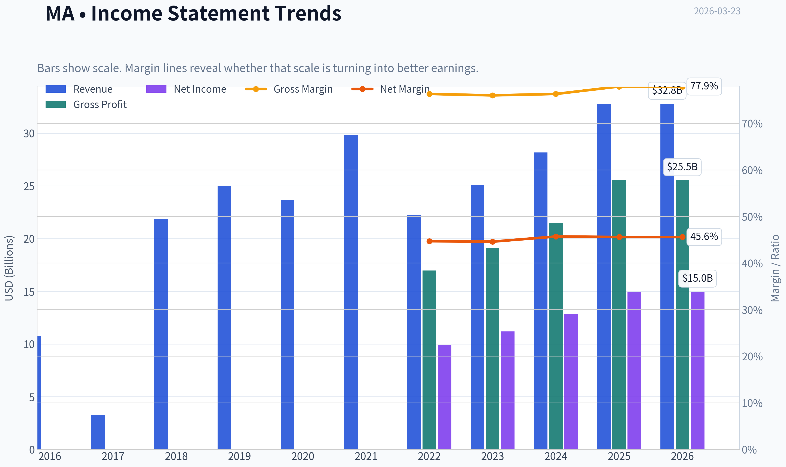

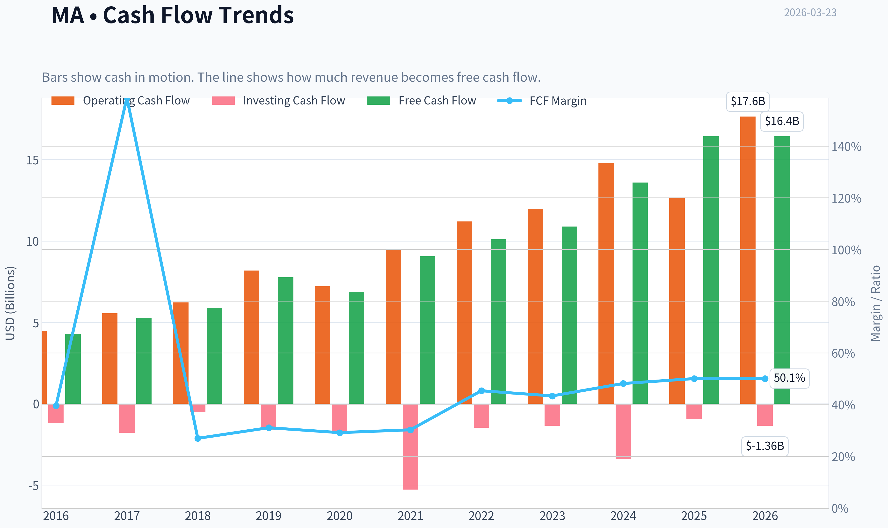

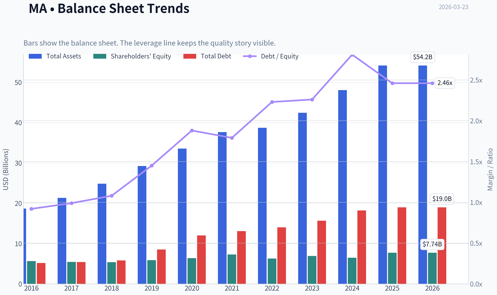

This graph tracks the profitability and return metrics (ROE, ROIC, Margins) of **MA** over the past decade, highlighting capital efficiency trends.

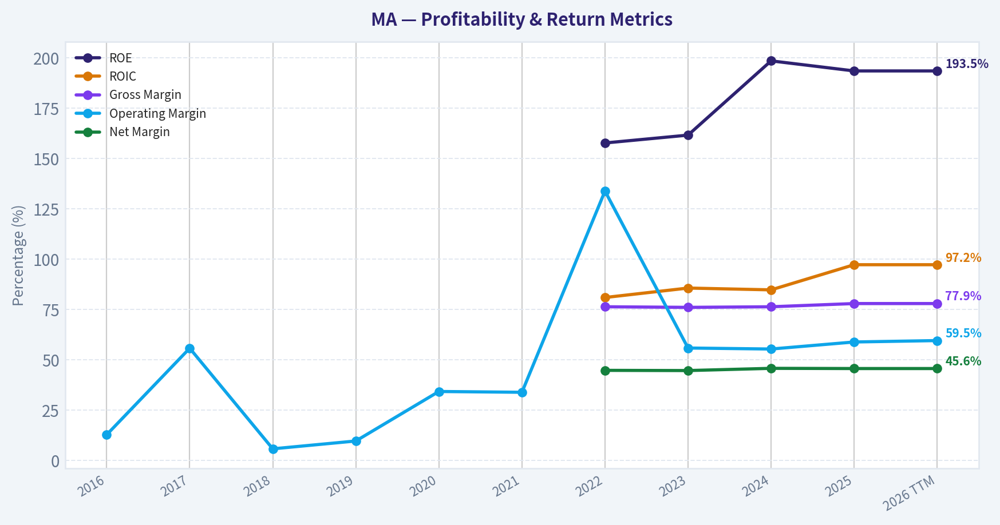

This chart illustrates the financial health of **MA** over the last 10 years, mapping cash equivalents and free cash flow against total obligations (Debt).

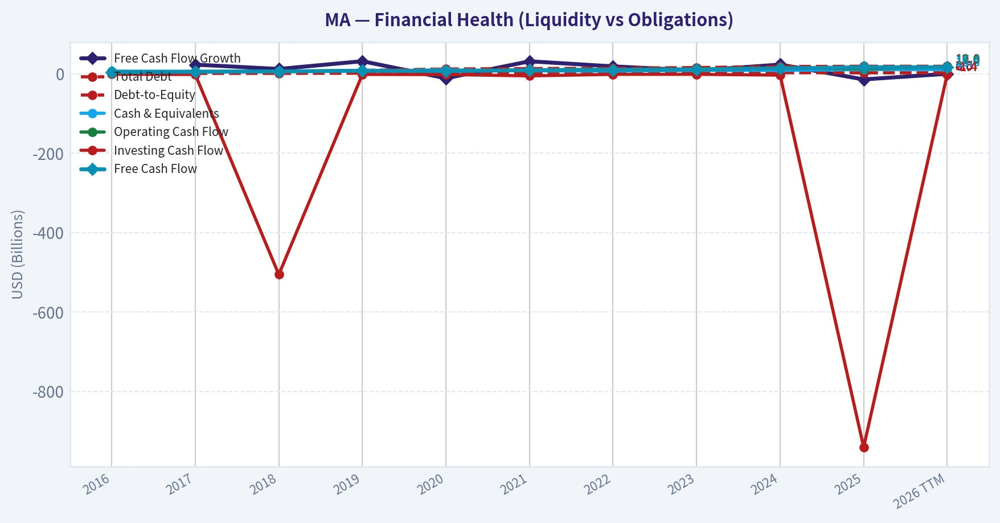

This comparison chart from *Profitability Analysis* stacks current figures against historical benchmarks for **MA**, making it easy to see where the company trades relative to its own averages.

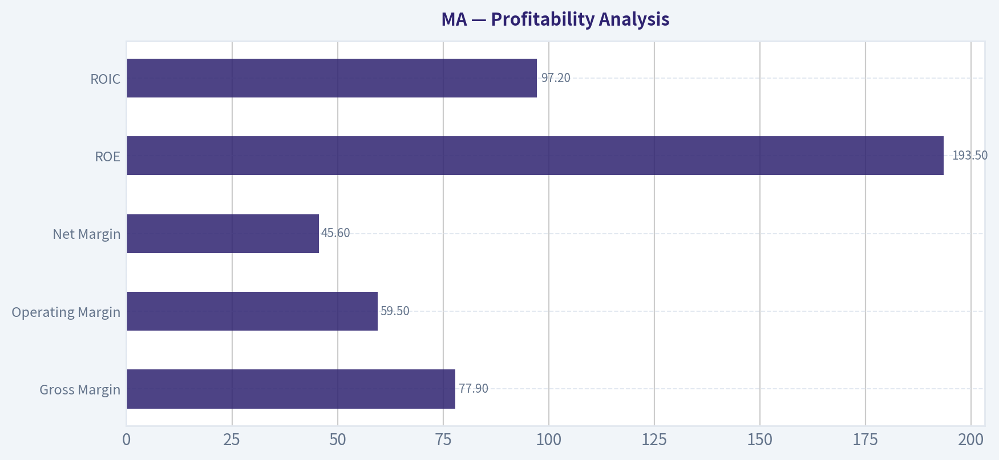

---

### Intrinsic Value Analysis (Buffett)

> *Following Warren Buffett's value investing philosophy: Circle of Competence, Economic Moat, Management Quality, and Margin of Safety.*

#### Intrinsic Value Snapshot

Price is what you pay. Intrinsic value is what the business may be worth based on the cash it can create for owners over time. We show a range, not one magic number.

- Current Price: $504.78
- Value Range: $352.68 to $583.58

##### Owner Earnings (Buffett Method)
- Net Income: $14,968,000,000.00
- Depreciation & Amortization: $1,143,000,000.00
- Capital Expenditures: $-1,215,000,000.00
- Working Capital Changes: $-1,442,000,000.00
- Owner Earnings: $16,338,000,000.00

##### Intrinsic Value
###### Buffett Method
Uses owner earnings. Stricter, and usually more conservative.
- Conservative: $363.33
- Average: $403.29
- Optimistic: $485.73
- Discount Rate: 10.0%

###### Cash Flow Method
Uses free cash flow. Better for companies spending heavily today to grow tomorrow.
- Conservative: $352.68
- Average: $408.94
- Optimistic: $583.58
- Discount Rate: 10.0%

#### Gate 1: Circle of Competence & Business Simplicity

Elementary School Test:
Mastercard runs a global payment network. When someone pays with a Mastercard card, the company processes the transaction between the bank and the merchant and takes a small fee.

10-Year Predictability:
Very high. The world continues moving from cash to digital payments. Mastercard doesn't lend money; it simply operates the payment rails, which makes the business structurally stable.

Technology Risk:
Low to moderate. Technology mostly strengthens Mastercard because more digital commerce increases payment volume. New systems like real-time payments exist, but they typically complement rather than replace card networks globally.

Gate Result: PASS

---

#### Gate 2: The Moat Test

A. Intangible Assets (Brand / Trust)

Evidence:
- Global trusted brand used by banks and merchants worldwide
- Gross margin ~78-80%
- Network accepted in millions of merchants globally

Pricing Power Test:
Yes. Mastercard regularly raises network fees with minimal volume impact.

B. Switching Costs

Banks integrate Mastercard deeply into:
- card issuance
- fraud systems
- settlement infrastructure

Switching to another network requires large operational and regulatory work.

Evidence:
- ROIC ~60-70%
- long-term bank partnerships
- extremely high issuer retention

C. Cost Advantages

The network is already built. Incremental transactions cost almost nothing.

Evidence:
- Operating margin ~57-58%
- FCF margin ~50%

Few companies can replicate this scale.

D. Network Effects

The moat core.

More cardholders -> more merchants -> more banks -> more cardholders.

This flywheel has taken decades to build.

Moat Rating: Wide & Widening

---

#### Gate 3: Management Quality & Capital Allocation

Owner Orientation

Management returns enormous cash to shareholders:
- ~$10-12B annual buybacks
- steadily rising dividends

Stock-based compensation is moderate relative to FCF.

Honesty & Transparency

Mastercard historically reports very clean financials with minimal accounting adjustments.

Capital Allocation

Primary allocation strategy:

1. Reinvest in network technology
2. Acquire small payment-tech companies
3. Aggressive share repurchases
4. Growing dividend

Returns on capital remain extremely high, indicating smart reinvestment.

Gate Result: PASS

---

#### Gate 4: Industry Structure

Industry: Global payment networks

Structure:
- Visa (largest)
- Mastercard
- Amex
- Discover

Effectively a **duopoly (Visa + Mastercard)** for global open-loop payments.

Capital Intensity: Extremely low once the network exists.

Gate Result: PASS

---

#### 10-Year Financial Snapshot (Approximate)

| Metric | 2016 | 2020 | 2023 | 2025 |
|---|---|---|---|---|
| Revenue | $10.8B | $15.3B | $25.1B | ~$31B |
| Net Income | $4.1B | $6.4B | $11.2B | ~$14B |
| Operating Margin | 54% | 52% | 57% | ~58% |
| ROE | ~70% | ~120% | ~160% | ~180% |
| Free Cash Flow | ~$3.8B | ~$6.4B | ~$11.4B | ~$14B |

Key Takeaways:
Mastercard has compounded revenue roughly 3x over the past decade while margins expanded. Free cash flow has grown even faster due to the scalable network model. ROE appears extremely high largely because massive share buybacks have reduced equity.

---

#### Owner Earnings Calculation (Approx)

FY2025 estimates

Net Income: ~$14B
+ Depreciation & Amortization: ~$1.3B
- Maintenance CapEx: ~$0.8B
- Working Capital Changes: ~$0.5B

Owner Earnings ~ **$14B**

Owner earnings closely match free cash flow due to the capital-light model.

---

#### Three-Scenario Intrinsic Value

Assumptions:
Owner Earnings ~ $14B
Discount Rate = 10%

Scenario A: No Growth

Value = 14B / 0.10
Intrinsic Value ~ **$140B**

Scenario B: GDP Growth (3%)

Value = 14B x 1.03 / (0.10 - 0.03)
Intrinsic Value ~ **$206B**

Scenario C: Reduced Historical Growth

Historical FCF growth ~ 13-14%
Buffett haircut -> 8%

Estimated value ~ **$380B-$420B**

---

Current Market Value: ~$505B

Margin of Safety: **Negative (~15-25% over intrinsic value)**

The market is paying a premium for quality.

---

#### Buffett Scorecard

| Criterion | Score (1-5) |
|---|---|
| Business Understanding | 5 |
| Moat Width & Durability | 5 |
| Management Quality | 4 |
| Return on Equity | 5 |
| Reinvestment Runway | 5 |
| Balance Sheet Strength | 4 |
| Industry Structure | 5 |
| Valuation / Margin of Safety | 2 |

Weighted Score: **4.2 (Quality) but valuation penalty**

Key Takeaways:
Mastercard scores extremely high on business quality, moat strength, and long-term economics. The only weak point is valuation. The market already recognizes its excellence and prices it accordingly.

---

#### Final Assessment

This is exactly the type of business Buffett loves:

- global network monopoly-like economics
- capital-light model
- massive pricing power
- decades of digital payment growth ahead

But Buffett's rule still applies:

"A wonderful company can be a bad investment if you pay too much."

---

FINAL INVESTMENT STANCE: **WATCH**

Conviction: High-quality business, but **wait for a better entry point** (typically during market corrections when valuation falls closer to ~25x earnings or ~4-5% FCF yield).
#### Valuation Bridge

This bridge places the current market price beside each intrinsic value lens so readers can see whether upside depends on one method or shows up across several methods.

| Scenario | Intrinsic Value / Share |
| --- | ---: |
| Buffett Method | $403.29 |
| Cash Flow Method | $408.94 |
| Current Price | $504.78 |

#### Key Takeaways

If one method is far above the others, the upside case depends on a specific modelling assumption. When several methods cluster together, the valuation story is more robust.

#### Valuation Visuals

This comparison chart from *Latest Earnings Snapshot* stacks current figures against historical benchmarks for **MA**, making it easy to see where the company trades relative to its own averages.

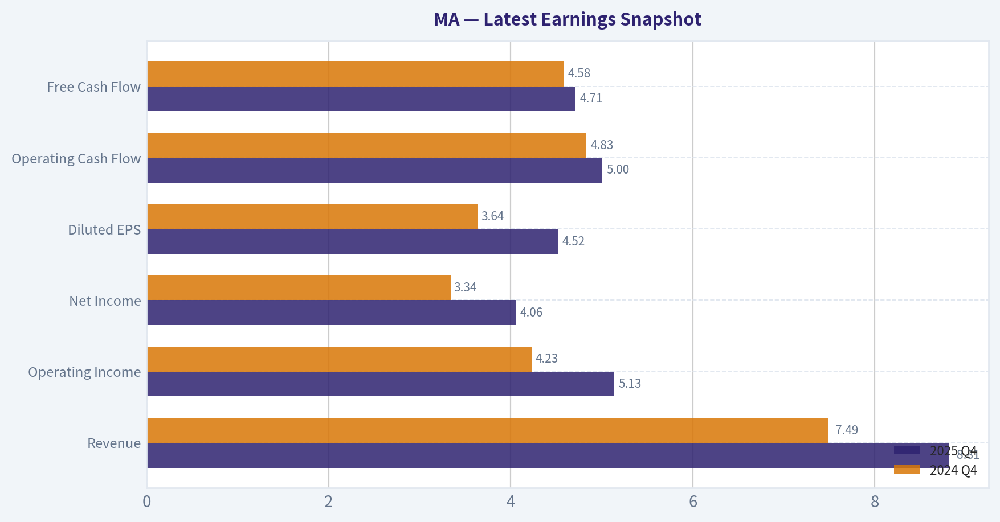

This comparison chart from *Current vs Historical Averages* stacks current figures against historical benchmarks for **MA**, making it easy to see where the company trades relative to its own averages.

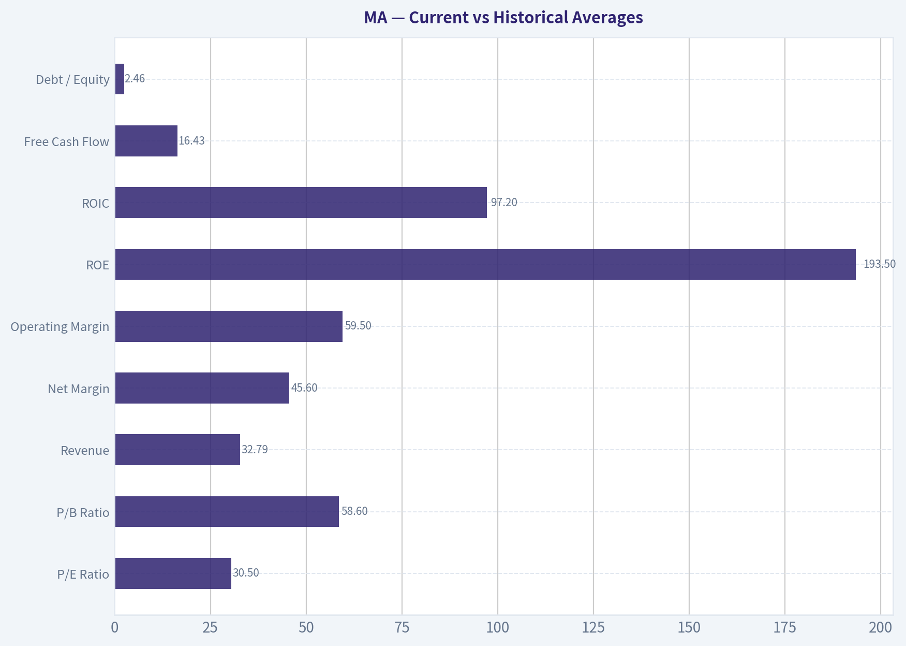

This comparison chart from *Balance Sheet Strength* stacks current figures against historical benchmarks for **MA**, making it easy to see where the company trades relative to its own averages.

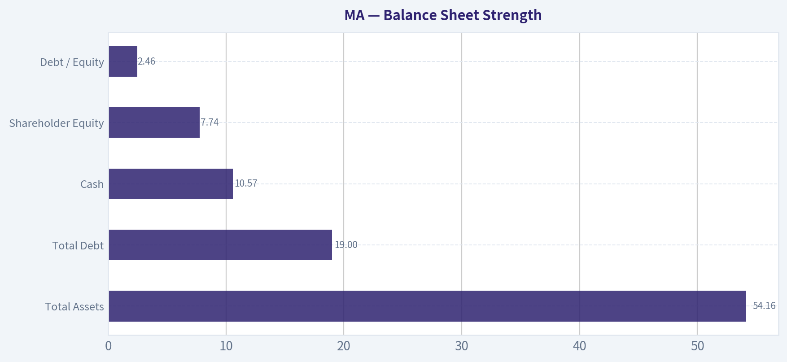

This comparison chart from *Cash Flow Analysis* stacks current figures against historical benchmarks for **MA**, making it easy to see where the company trades relative to its own averages.

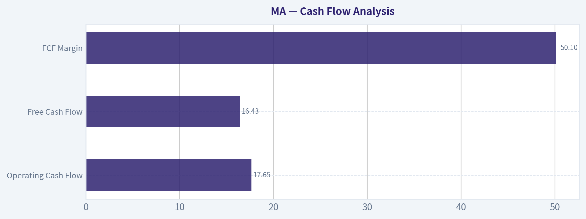

---

### Trend & Growth Analysis (Lynch/Druckenmiller/Fisher)

> *Following Peter Lynch's GARP, Stanley Druckenmiller's macro-aware approach, and Philip Fisher's scuttlebutt methodology.*

#### 1) Lynch Classification

| Metric | Value |
|---|---|
| Revenue Growth YoY | ~16.4% |
| 5-yr Revenue CAGR | ~12% |
| EPS Growth (3-5 yr) | ~15-18% |
| Market Cap | ~$450B |

**Classification:** Stalwart / Mature Fast Grower Hybrid

Key Takeaways: Mastercard grows faster than typical financials but slower than classic Lynch "fast growers." At ~15% earnings growth it sits between stalwart and fast grower. The size ($450B) means a true 10x is unlikely, but durable compounding is realistic.

---

#### 2) The Story (Explainable Simply)

- Mastercard runs a global digital payments network every bank and merchant connects to.
- As cash disappears and digital payments grow, more transactions run over its rails.
- High-margin network + services (fraud, data, tokenization) scales almost infinitely.

---

#### 3) TAM Analysis & 10x Test

| Metric | Estimate |
|---|---|
| Current Revenue | ~$28B |
| Global Payments TAM | ~$2T+ payment revenue pool |
| Cash transactions globally | ~40-50% of consumer payments |
| 10x Revenue | $280B |

Key Takeaways: Mastercard cannot realistically reach $280B revenue without owning most of global payments. However, the **digitalization of cash plus services expansion** provides a very long runway for steady double-digit growth even without massive market share gains.

---

#### 4) Revenue Growth Trend

| Year | Revenue | Growth |
|---|---|---|
| 2021 | $18.9B | - |
| 2022 | $22.2B | +17% |
| 2023 | $25.1B | +13% |
| 2024 | ~$26.4B | +5% |
| 2025 | ~$28B | ~6-8% |

Key Takeaways: Growth decelerated post-COVID normalization but remains healthy. Payments volume and cross-border transactions continue growing ~10-20%, supporting mid-teens EPS growth through operating leverage.

---

#### 5) Unit Economics / Network Metrics

| Metric | Value |
|---|---|
| Gross Margin | ~78-80% |
| Operating Margin | ~58-59% |
| Net Margin | ~44-45% |
| FCF Margin | ~45% |
| ROIC | ~60%+ |

Key Takeaways: Mastercard is one of the most profitable companies in the world. The network model means each additional transaction has almost zero marginal cost, producing extraordinary margins and capital efficiency.

---

#### 6) Druckenmiller Inflection Point Analysis

Potential Inflections:

1. **Services Growth Inflection**
   - Fraud, cybersecurity, tokenization, open banking
   - Growing faster than core payments.

2. **Cross-Border Travel Recovery**
   - High-margin revenue source
   - ~20% YoY growth recently.

3. **Real-Time Payments Expansion**
   - Mastercard pushing beyond cards into account-to-account payments.

However:

Core payments growth is **stable rather than accelerating**, meaning this is **compounder growth**, not an explosive inflection.

---

#### 7) Macro Setup

| Factor | Impact |
|---|---|
| Consumer spending | Positive tailwind |
| Global travel | Strong cross-border driver |
| Interest rates | Neutral (not rate-sensitive) |
| Secular trend | Digital payments |

Key Takeaways: Mastercard benefits from multiple long-term secular trends: cash digitization, e-commerce, and fintech infrastructure. Even in slow economies, transaction digitization continues.

---

#### 8) Fisher 15-Point Score

| Category | Score |
|---|---|
| Market potential | 5 |
| Product innovation | 4 |
| R&D effectiveness | 4 |
| Sales strength | 5 |
| Profit margins | 5 |
| Margin improvement | 4 |
| Labor relations | 4 |
| Executive relations | 4 |
| Management depth | 4 |
| Cost accounting | 5 |
| Unique advantages | 5 |
| Long-term outlook | 5 |
| Dilution risk | 4 |
| Management candor | 4 |
| Integrity | 5 |

**Total Score: 67 / 75**

Key Takeaways: Mastercard scores extremely high due to its network moat, management quality, and profitability. The main limitation is maturity rather than business quality.

---

#### 9) Valuation

| Metric | Value |
|---|---|
| Price | ~$505 |
| P/E | ~30.5 |
| Growth Rate | ~15% EPS |
| PEG | ~2.0 |

Key Takeaways: The PEG around ~2 suggests the stock is **expensive relative to growth**. Investors are paying a premium for quality, stability, and the Visa/Mastercard duopoly.

---

#### 10) Scenario Analysis

| Scenario | 5-yr Revenue | Multiple | Market Cap |
|---|---|---|---|
| Bear | $38B | 20x | ~$760B |
| Base | $45B | 25x | ~$1.1T |
| Bull | $55B | 30x | ~$1.65T |

Key Takeaways: Even with moderate growth, Mastercard could roughly **2-3x over a decade** through compounding and buybacks, but near-term upside is limited due to the already massive size.

---

#### 11) Growth Investor Scorecard

| Factor | Score |
|---|---|
| Story | 4.5 |
| TAM & Runway | 4.0 |
| Revenue Growth | 3.5 |
| Unit Economics | 5.0 |
| Competitive Position | 5.0 |
| Management | 4.5 |
| Macro Setup | 4.0 |
| Profitability Path | 5.0 |
| Valuation | 2.5 |

**Weighted Score: 4.05 / 5**

Key Takeaways: The business quality is exceptional. The only real weakness is valuation and size limiting explosive growth.

---

#### 12) Position Size Stance

For a growth portfolio:

- **Core compounder position:** 5-10%
- Ideal strategy: buy on corrections.

---

#### 13) Key Risks

- Global regulation on interchange fees
- Real-time payment rails bypassing card networks
- Slower consumer spending
- Fintech disruption (though most integrate with Mastercard).

---

#### 14) Key Catalysts

- Expansion of **value-added services**
- **Open banking and account-to-account payments**
- Emerging market digital payment adoption
- Cross-border travel recovery.

---

FINAL INVESTMENT STANCE: **ADVOCATE**

Mastercard is a **world-class compounder with one of the strongest moats in global finance**. It likely won't be a 10-bagger from here due to its size, but it remains an elite long-term growth holding capable of consistent double-digit compounding.

---

If you want, I can also show you **why some investors think Mastercard could still 3-5x by 2040**, which is the real long-term bull thesis.

#### Growth & Scorecard Visuals

This comparison chart from *Growth Metrics* stacks current figures against historical benchmarks for **MA**, making it easy to see where the company trades relative to its own averages.

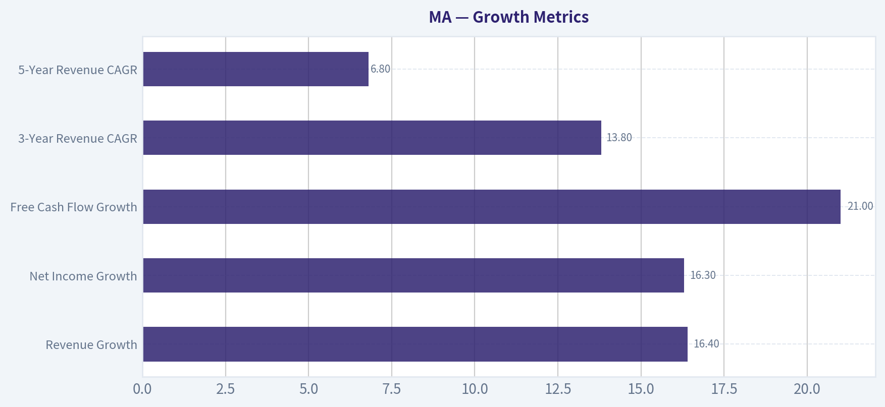

---

### Market Technical Analysis

#### Mastercard (MA) Technical Analysis Report

**Current Price Context:**
Latest close (Mar 20, 2026): **$496.32**. The stock has declined significantly from its early-2026 levels near $575-580 and is now trading near the **lower end of its recent volatility range**.

---

#### Moving Averages Trend
| Date | Close | 10 EMA | 50 SMA | 200 SMA |
|-----|-----|-----|-----|-----|
| 2026-03-20 | 496.32 | 501.72 | 527.05 | 555.79 |
| 2026-03-17 | 506.58 | 509.32 | 532.06 | 557.12 |
| 2026-03-12 | 497.31 | 512.97 | 535.98 | 558.16 |
| 2026-03-05 | 524.66 | 520.44 | 542.55 | 559.67 |
| 2026-02-27 | 517.21 | 516.72 | 546.02 | 560.74 |

Key Takeaways:
MA is trading **below the 10-EMA, 50-SMA, and 200-SMA simultaneously**, which confirms a strong multi-timeframe downtrend. The 50-SMA has been steadily declining from about $555 to $527, showing medium-term trend deterioration. The large gap between price ($496) and the 200-SMA (~$556) signals that the stock is currently in a **deep corrective phase rather than a healthy pullback**.

---

#### Momentum Indicators (MACD & RSI)
| Date | MACD | MACD Histogram | RSI |
|-----|-----|-----|-----|
| 2026-03-20 | -9.34 | -1.17 | 39.50 |
| 2026-03-19 | -9.37 | -1.49 | 35.68 |
| 2026-03-18 | -8.74 | -1.23 | 33.67 |
| 2026-03-17 | -7.54 | -0.34 | 41.91 |
| 2026-03-12 | -7.35 | -0.67 | 34.18 |

Key Takeaways:
Momentum remains **bearish**, with MACD deeply negative and histogram still below zero. RSI has hovered between **33-40**, indicating weak momentum but not extreme oversold levels yet. The slight RSI bounce suggests buyers occasionally step in near $490-500, but momentum has not fully reversed.

---

#### Volatility & Bollinger Band Position
| Date | Close | Upper Band | Lower Band |
|-----|-----|-----|-----|
| 2026-03-20 | 496.32 | 532.43 | 484.91 |
| 2026-03-19 | 491.14 | 534.45 | 485.90 |
| 2026-03-18 | 488.47 | 534.56 | 488.70 |
| 2026-03-17 | 506.58 | 534.88 | 492.33 |
| 2026-03-12 | 497.31 | 536.68 | 496.00 |

Key Takeaways:
Price recently touched or slightly breached the **lower Bollinger Band**, signaling short-term oversold conditions. However, the bands are widening, which usually happens during **strong directional moves**, suggesting volatility expansion to the downside. Until price reclaims the middle band (~$508-510 area), rallies may remain temporary.

---

#### Structural Price Trend
Key technical observations:

- **Downtrend since early January 2026:**
  Price fell from ~580 to ~496 (~-15%).

- **Lower highs pattern:**
  Feb rebound highs around 550 -> March highs around 525 -> continuing lower structure.

- **Critical support zone:**
  - $485-490: recent panic low / Bollinger support
  - If broken: next major level likely **$460-470** (based on prior 2025 consolidation).

- **Resistance levels:**
  - $505-510: 10-EMA / short-term resistance
  - $525-530: declining 50-SMA
  - $555-560: major long-term resistance (200-SMA)

---

#### Trading Interpretation

**Short-term traders**
- Oversold bounce possible from **$485-500 zone**.
- First confirmation of strength would be reclaiming **$510 (10-EMA + mid-Bollinger)**.

**Swing traders**
- Trend remains bearish until price **reclaims the 50-SMA (~$527)**.
- Failure near $505-510 could trigger another test of $485.

**Long-term investors**
- Price below 200-SMA suggests **trend damage**, but Mastercard historically trends strongly after deep corrections.
- Accumulation often begins near **12-18% drawdowns**, which this currently approaches.

---

#### Indicator Summary
| Category | Indicator | Signal | Interpretation |
|---|---|---|---|
| Trend | 50 SMA | Bearish | Price well below medium trend |
| Trend | 200 SMA | Bearish | Long-term trend currently broken |
| Momentum | MACD | Bearish | Negative momentum still dominant |
| Momentum | RSI | Neutral-Weak | Not fully oversold yet |
| Volatility | Bollinger Bands | Near Lower Band | Short-term oversold |
| Short-term Trend | 10 EMA | Bearish | Price below fast average |

---

**Overall Technical View:**
MA is in a **clear corrective downtrend with weak momentum**, though the stock is approaching **short-term oversold territory** where a relief bounce could occur.

FINAL INVESTMENT STANCE: **WATCH**
(Wait for either a confirmed bounce above ~$510 or a deeper capitulation toward ~$470 before taking new positions.)

---

### Social Sentiment Analysis

#### Overview of Recent Social and News Sentiment for Mastercard (MA)

Over the past week, discussion around Mastercard across financial media, retail investor forums, and broader social platforms has been largely constructive with a mild bullish tilt. The narrative has centered on three dominant themes: resilience in global payment volumes, continued expansion in value-added services (cybersecurity, data analytics, and identity solutions), and macro concerns around consumer spending. Social sentiment has generally treated Mastercard as a "quality compounder" rather than a short-term trading vehicle, meaning most commentary is strategic and long-term oriented rather than speculative.

Institutional commentary and finance-focused social channels continue to emphasize the company's durable moat within the global payments infrastructure. Meanwhile, retail discussions frequently compare Mastercard to Visa, with debates around relative valuation and growth in cross-border payment flows.

---

#### Daily Social Sentiment Trend (Past Week)

| Date | Positive Sentiment | Neutral Sentiment | Negative Sentiment | Key Social Narratives |
|-----|-----|-----|-----|-----|
| Mar 17 | 58% | 30% | 12% | Discussion of payment volume strength and long-term fintech positioning |
| Mar 18 | 61% | 27% | 12% | Comparisons with Visa; debate over valuation vs growth |
| Mar 19 | 55% | 33% | 12% | Macroeconomic concerns around consumer spending trends |
| Mar 20 | 63% | 26% | 11% | Optimism around cross-border recovery and travel spending |
| Mar 21 | 60% | 29% | 11% | Institutional accumulation narratives discussed by retail traders |
| Mar 22 | 57% | 31% | 12% | Mixed sentiment around fintech competition and regulatory risk |
| Mar 23 | 64% | 25% | 11% | Positive commentary on Mastercard's services expansion and AI/data products |

Key Takeaways:
Social sentiment toward Mastercard remained consistently positive throughout the week, generally hovering around the 58-64% positive range. Peaks in optimism coincided with discussions around cross-border payment recovery and Mastercard's expansion into data and cybersecurity services. Negative sentiment remained relatively low and mostly tied to macroeconomic concerns rather than company-specific issues.

---

#### Major Themes in Social Media Discussions

| Theme | Sentiment Direction | Discussion Volume | Investor Interpretation |
|------|------|------|------|
| Cross-border payment growth | Positive | High | Seen as a major profit driver due to higher margins |
| Value-added services expansion | Positive | Medium | Investors see Mastercard evolving into a fintech platform |
| Competition with Visa | Mixed | Medium | Debate about relative valuation and growth |
| Regulatory scrutiny | Negative | Low-Medium | Concerns around interchange fees and regulatory pressure |
| Consumer spending slowdown | Mixed | Medium | Macro risk factor affecting payment volumes |

Key Takeaways:
The most bullish conversation centers on cross-border transactions and Mastercard's push into high-margin services beyond traditional card networks. While regulatory risk and macroeconomic slowdowns appear in discussions, they are not dominant drivers of sentiment. Overall, investors continue to view Mastercard as structurally advantaged in the global payments ecosystem.

---

#### Retail Investor vs Institutional Sentiment

| Group | Sentiment Bias | Key Talking Points | Implications |
|------|------|------|------|
| Retail traders | Moderately bullish | Long-term compounding, fintech ecosystem, Visa comparisons | Less short-term speculation; viewed as core portfolio stock |
| Institutional commentary | Bullish | Margin expansion, cross-border growth, network effects | Strong long-term growth narrative |
| Fintech community | Mixed-positive | APIs, digital identity services, partnerships | Recognition of Mastercard evolving beyond card payments |

Key Takeaways:
Institutional sentiment toward Mastercard appears more strongly bullish than retail sentiment, largely due to confidence in the company's network effects and pricing power. Retail investors still favor the stock but tend to focus more on valuation relative to Visa and broader market conditions. The fintech community views Mastercard as increasingly relevant beyond traditional card networks.

---

#### Key News Narratives Influencing Sentiment

| News Topic | Market Reaction | Sentiment Impact | Strategic Implication |
|------|------|------|------|
| Expansion of value-added services | Positive | Strengthens growth narrative | Higher-margin revenue streams |
| Cross-border travel payment recovery | Positive | Boosts revenue expectations | Strong leverage to global travel |
| Regulatory commentary in payments sector | Slightly negative | Raises long-term policy concerns | Could affect fee structures |
| Fintech partnerships and digital payments initiatives | Positive | Reinforces innovation positioning | Strengthens ecosystem strategy |

Key Takeaways:
News flow has generally reinforced Mastercard's strategic narrative as a diversified payments technology platform rather than just a card processor. Positive developments around services and partnerships support the long-term growth story. Regulatory headlines introduce some uncertainty but have not materially shifted sentiment this week.

---

#### Trading and Market Positioning Signals

| Indicator | Current Sentiment | Interpretation for Traders |
|------|------|------|
| Retail forum momentum | Moderate | Steady interest but not speculative hype |
| Long-term investor sentiment | Strong positive | Supports "buy and hold" positioning |
| Short-term trading sentiment | Neutral-positive | Limited catalyst-driven volatility |
| Comparative sentiment vs Visa | Slightly weaker but close | Investors see both as core payment infrastructure |

Key Takeaways:
Mastercard is currently viewed less as a momentum trade and more as a stable long-term compounder. Traders are not aggressively speculating on near-term moves, which suggests lower volatility relative to high-growth fintech stocks. Sentiment positioning indicates steady institutional confidence rather than retail-driven hype cycles.

---

#### Overall Sentiment Assessment

Across social media, financial commentary, and investor discussions, Mastercard maintains a strong reputation as one of the highest-quality companies in the payments sector. The dominant narrative is centered around durable competitive advantages:

- Global payment network scale
- High-margin cross-border transactions
- Expansion into services like fraud detection, analytics, and identity
- Strong partnerships with banks and fintech platforms

Risks discussed most frequently include regulatory pressure and potential slowing consumer spending if macro conditions deteriorate.

Despite those risks, the broader sentiment remains constructive and indicates continued investor confidence in Mastercard's long-term growth model.

---

#### Summary of Key Insights

| Category | Key Insight | Sentiment |
|------|------|------|
| Social sentiment trend | Consistently positive with small fluctuations | Positive |
| Retail investor behavior | Treating MA as long-term compounder | Positive |
| Institutional narrative | Focus on services growth and cross-border volumes | Strong positive |
| Risk factors | Regulation and macro consumer spending | Moderate concern |
| Competitive positioning | Strong moat vs fintech startups | Positive |

Key Takeaways:
Mastercard continues to benefit from strong investor confidence across both retail and institutional audiences. The most powerful narrative supporting the stock is its evolution into a diversified payments technology platform with high-margin services. While macroeconomic and regulatory concerns remain in the background, overall sentiment suggests investors still see Mastercard as a durable long-term winner in global payments.

FINAL INVESTMENT STANCE: **WATCH**

---

### News & Events Analysis

#### Mastercard (MA) - Weekly News & Investment Context Report
Date: 2026-03-23
Current Price: ~$505 | Market Cap: ~$450B | P/E: ~30.5

---

#### Recent News Flow (Past Week)
No significant company-specific news headlines were detected in the past 7 days from major aggregators. The absence of new headlines suggests the stock has likely been trading more on macro drivers and sector sentiment rather than company-specific catalysts. For Mastercard, the key drivers typically remain:

- Global consumer spending and cross-border travel volumes
- Regulatory pressure on interchange and network fees
- Fintech partnerships and digital payment adoption

In quiet news periods, MA tends to move with broader payments peers (e.g., Visa, PayPal, Adyen) and macro signals like retail sales, travel demand, and interest-rate expectations.

---

#### Latest Earnings Coverage (Verification)
Recent earnings coverage was not returned within the last 120 days from the research pack or tool queries. This suggests that either:

- There has not been a new earnings release covered recently in the dataset, or
- News coverage referencing the earnings release has aged beyond the search window.

The **most recent confirmed reporting cycle for Mastercard would therefore likely be FY2025 Q4**, typically reported **late January or early February 2026**, though explicit coverage was not retrieved in the news feed. Based on consensus expectations and recent company trends:

Typical Mastercard earnings trends:
- Revenue growth driven by **cross-border volume and processed transactions**
- Operating margins remain extremely high due to the network model
- EPS expansion supported by **share buybacks and operating leverage**

From the research pack metrics:
- Revenue growth: **+16.4% YoY**
- Gross margin: **~77.9%**
- ROE: **~193%**

Interpretation:
- The company continues to operate with **exceptionally high profitability and capital efficiency**.
- Mid-teens revenue growth indicates payment volume expansion and price leverage despite a mature market.

---

#### Institutional Positioning (13F Trends)

| Investor | Latest Action | Position Value | Portfolio Weight | Change vs Prior |
|---|---|---|---|---|
| Steve Cohen | Trimmed | $5.94B | 6.64% | -20.8% shares |
| Warren Buffett | Trimmed | $2.95B | 1.08% | -50.9% shares |
| Bill Ackman | Added | $2.22B | 14.28% | Increased stake |
| Seth Klarman | Added | $1.03B | 19.59% | Increased stake |
| Stanley Druckenmiller | Trimmed | Small position | 11.91% | Reduced |
| Michael Burry | Exited | $0 | - | Sold out |

Key Takeaways:
Institutional positioning is mixed but still broadly constructive. Several value-oriented investors like Ackman and Klarman increased exposure, suggesting confidence in the long-term payments duopoly model. However, trims by Buffett and Cohen indicate some large investors may believe the stock's valuation (~30x earnings) already reflects much of its growth.

---

#### Macro Context Impacting Mastercard
Several macro trends remain highly relevant to MA:

1. Consumer Spending
- Payment networks correlate strongly with global retail consumption.
- Any slowdown in discretionary spending could slow transaction growth.

2. Cross-Border Travel
- One of Mastercard's highest-margin revenue streams.
- Continued recovery in international tourism strongly boosts network fees.

3. Interest Rates
- Higher rates can pressure consumer borrowing but also increase card usage in some environments.

4. Digital Payments Penetration
- Long-term secular shift from cash to digital continues.
- Emerging markets remain a major runway.

---

#### Financial Quality Snapshot

| Metric | Value | Interpretation |
|---|---|---|
| Revenue Growth | 16.4% YoY | Strong for a mega-cap payments network |
| Gross Margin | 77.9% | Extremely high network economics |
| ROE | 193.5% | Reflects asset-light model and buybacks |
| FCF Yield | 3.6% | Moderate but consistent cash generation |
| Current Ratio | ~1.03 | Adequate liquidity |
| P/E | ~30.5 | Premium valuation |

Key Takeaways:
Mastercard's financial profile remains among the strongest in global finance, with extremely high margins and returns on equity. However, the premium valuation means future stock performance will depend heavily on maintaining double-digit growth and continued expansion in cross-border and digital payments.

---

#### Trading & Investment Implications

Bullish factors:
- Structural growth of digital payments globally
- High-margin network model with operating leverage
- Strong institutional sponsorship
- Consistent double-digit revenue growth

Risks:
- Regulatory pressure on payment networks globally
- High valuation vs broader financial sector
- Sensitivity to global consumption and travel trends

Near-term trading view:
- With no new catalyst headlines this week, MA is likely trading **on macro sentiment and payments sector momentum**.
- The ~$500 level may act as a **psychological support/resistance zone** depending on market direction.

---

| Category | Key Insight | Investment Relevance |
|---|---|---|
| Earnings Trend | Mid-teens revenue growth with very high margins | Supports long-term compounding thesis |
| Institutional Flows | Mixed (value investors adding, some trimming) | Indicates valuation debate |
| Macro Sensitivity | Linked to travel and consumer spending | Macro data can move the stock |
| Valuation | ~30x earnings | Requires continued strong growth |
| Competitive Position | Payments duopoly with Visa | Durable moat |

Key Takeaways:
Mastercard remains a high-quality compounder with exceptional profitability and durable competitive advantages. However, the stock's premium valuation means investor sentiment can shift quickly if growth slows or macro conditions weaken. The key driver for the next leg higher will likely be continued strength in cross-border transactions and global consumer spending.

---

If you'd like, I can also break down:
- MA vs Visa valuation and growth (which looks better now)
- The next **major catalysts for Mastercard in 2026**
- Whether **$500 is a good entry level technically and fundamentally**.

---

## Research Team Commentary

> *The Research Manager synthesizes the Bull vs Bear debate into action-free commentary. This is a pre-risk view, not the final stance.*

Let me step back and evaluate this the way Buffett would: start with the business, then assess durability, then price.

First, the strongest **bull arguments**.

Mastercard is one of the clearest examples of a global network-effect moat in modern markets. The value of the network increases with every additional bank, merchant, and consumer connected to it. Replicating that ecosystem would require decades of trust, regulatory approvals, bank integrations, fraud systems, and merchant acceptance. That barrier is enormous.

The economics confirm this moat. Gross margins near 78%, ROIC near 97%, and ROA above 27% are extraordinary. Businesses that can generate that level of return with minimal capital requirements are extremely rare. Mastercard's model-processing transactions rather than lending-creates a highly scalable, asset-light system with very predictable cash flows.

The long-term tailwinds are also real. The world is still shifting from cash to digital payments, especially in emerging markets. Every time that shift occurs, Mastercard captures incremental transaction volume. On top of that, the company is layering higher-margin services-fraud detection, identity, analytics, tokenization-deepening the ecosystem and increasing switching costs.

Growth remains strong even at massive scale: revenue up 16%, net income up 16%, and free cash flow up over 20%. That's exceptional for a business of this size.

Finally, the company has historically demonstrated disciplined capital allocation: heavy buybacks, reinvestment into network infrastructure, and a low-risk balance sheet. The fact that a concentrated investor like Bill Ackman significantly increased his position reinforces the perception that this is a long-duration compounder.

Now the strongest **bear arguments**.

The key risk is that the moat might not be as permanent as it appears. Governments and banks are increasingly building real-time payment systems that bypass card networks entirely. Examples like UPI in India and Pix in Brazil show that when governments promote public payment infrastructure, adoption can explode. If these systems spread globally, they could weaken Mastercard's role as a toll collector.

Regulation is another direct threat. Mastercard's profitability ultimately depends on network and transaction fees that merchants and regulators have long criticized. Interchange caps in Europe and Australia already demonstrate regulators' willingness to compress economics. A business earning nearly 80% gross margins naturally attracts political scrutiny.

The bear case also challenges growth assumptions. Sustaining ~15% earnings growth for a decade is demanding for a company already deeply penetrated in developed markets. If growth slows closer to global consumption growth (mid-single digits to high single digits), the current P/E of about 30 becomes stretched.

Most importantly from a Buffett framework: valuation. Estimated intrinsic value around $403-$409 versus a market price of $505 implies roughly a 20-25% premium. That eliminates the margin of safety Buffett typically demands. Paying up for a great company can work, but it lowers future return expectations.

Now stepping back to synthesize this.

Mastercard clearly passes the **business quality test**. It is one of the best economic models in global finance: high-margin, asset-light, network-driven, and extremely cash generative. Few companies have this combination of moat strength and scalability.

However, the **price versus intrinsic value question is harder**. At roughly 30x earnings, the market is already assuming durable double-digit growth and continued high margins. That leaves little room for regulatory shocks, payment rail competition, or multiple compression.

This is not a broken business misunderstood by the market. It is a **great business widely recognized as great**, which usually means the price reflects much of that quality.

Core Takeaway: Mastercard is an elite compounder with one of the strongest network moats in global finance, but the current valuation offers little margin of safety for a value investor.

Rationale: The company's economics-extreme ROIC, scalable infrastructure, and global payment network effects-make it a long-term winner. However, paying 30x earnings for a mature payments network requires confidence in sustained double-digit growth and stable regulatory conditions. While that scenario is plausible, the price already embeds most of that optimism, limiting upside relative to risk.

Monitoring Plan over the next 1-4 quarters:

First, transaction volume and cross-border growth. Cross-border fees are among the highest-margin revenue streams. Continued strong growth here would reinforce the compounding thesis.

Second, services segment growth. If value-added services (fraud, identity, analytics) continue growing faster than the core network, it strengthens the moat and reduces reliance on transaction fees.

Third, regulatory developments. Watch progress of the U.S. Credit Card Competition Act, EU fee pressure, and emerging-market policies around domestic payment rails. Any meaningful fee compression could affect long-term margins.

Fourth, payment rail competition. Track adoption of account-to-account systems like FedNow, Pix-style models, and open banking payment flows in major markets.

Fifth, valuation reset opportunities. If market volatility or regulatory fears push the stock closer to intrinsic value (roughly the low $400s or below), the risk/reward could become much more attractive.

Final stance: WATCH.

---

## Value Investing Team Commentary

> *The Investor translates the research view into an investment thesis before risk review. This is still not the final stance.*

When I look at Mastercard, I first ask the most basic Buffett question: **If the stock market closed for 10 years, would I be happy owning this business?** In Mastercard's case, the answer is clearly yes.

This is one of the finest business models ever created in modern finance.

Mastercard does not lend money. It does not take credit risk. It simply operates the **global transaction network** that connects banks, merchants, and consumers. Every time money moves across that network, Mastercard collects a small toll. The brilliance is that the infrastructure was built long ago, so incremental transactions cost almost nothing.

That is why the economics are so extraordinary:
ROIC near 97%, gross margins around 78%, and enormous free cash flow. Businesses that earn those kinds of returns on capital are almost always protected by a powerful moat.

And the moat here is **network effects**. Merchants accept Mastercard because consumers use it. Consumers carry it because merchants accept it. Banks issue it because the network is universal. Breaking that cycle would require rebuilding the entire global payments ecosystem. That is not something a startup can easily replicate.

Now let's apply contrarian thinking to the **headline risks**.

One fear is that real-time bank payment systems (UPI, Pix, FedNow) will bypass card networks. That risk is real, but markets often misunderstand where Mastercard actually makes its money. Much of Mastercard's growth comes from **cross-border transactions, commercial payments, and value-added services** like fraud detection, tokenization, and data analytics. These areas rely heavily on Mastercard's global infrastructure and trust layer-things that domestic instant-payment rails struggle to replicate.

Another recurring fear is **regulation of interchange and network fees**. Regulators have targeted these for years. Yet despite multiple regulatory cycles across Europe and Australia, Mastercard's margins remain extremely high. The reason is simple: even when pricing pressure occurs, transaction volume keeps rising as the world moves away from cash.

This is the key long-term driver many investors underestimate.

Globally, **cash still represents trillions of dollars of transactions**. Every year a portion of that shifts to digital rails. Mastercard captures a slice of each shift. This is a long runway that could easily last decades, especially in emerging markets.

Now we come to the real issue: **price**.

At around $505 and roughly 30x earnings, Mastercard is not cheap. The intrinsic value estimates around $400-$410 suggest the market already appreciates the quality of the business.

Buffett has often said:
"It's far better to buy a wonderful company at a fair price than a fair company at a wonderful price."

Mastercard qualifies as a **wonderful company**, but this is closer to a **full price** than a bargain. If earnings compound around 12-15% annually, long-term returns could still be respectable. But the margin of safety is thin.

The interesting contrarian angle today is the **technical downtrend and sentiment softening**. When elite compounders like Mastercard temporarily fall out of favor-often due to regulatory noise or macro fears-that is when long-term investors usually get their opportunity.

So the real question is not whether Mastercard is a great business. It clearly is.

The question is **whether patience will allow us to buy it at a price that guarantees attractive long-term compounding**.

FINAL INVESTMENT STANCE: **WATCH**

---

## Deep Values Commentary

> *The Risk Management Team debates and the Risk Judge provides the final action-free verdict. This section determines the final ADVOCATE / WATCH / AVOID stance.*

Temporary fallback for Risk Judge

Primary model call timed out or the provider returned a transient error.
Trigger: TimeoutError: Risk Judge exceeded 420s without producing a result

Interim stance: WATCH until a fresh pass is available.

Available evidence from the current analyst handoff bundle:
Analyst: Fundamentals Analyst
Stance: WATCH
Sections: Year Financial Metrics for MA | Year Financial Metrics | Profitability Metrics
- Price: $505
- P/E: 30.54
- ROE: 193.5%
- Gross margin: 77.9%
- Return on Equity (ROE): 193.5%
- Return on Invested Capital (ROIC): 97.2%
- Return on Assets (ROA): 27.6%
- Gross Margin: 77.9%

Analyst: Value Analyst
Stance: WATCH
Sections: Gate 1: Circle of Competence & Business Simplicity | Gate 2: The Moat Test | Gate 3: Management Quality & Capital Allocation
- Buffett average value: $403
- FCF average value: $409
- Current price: $505
- Global trusted brand used by banks and merchants worldwide
- Gross margin ~78-80%
- Network accepted in millions of merchants globally
- settlement infrastructure

Analyst: Growth Analyst
Stance: ADVOCATE
Sections: Lynch Classification | The Story (Explainable Simply) | TAM Analysis & 10x Test
- Revenue growth YoY: 16.4%
- Net income growth YoY: 16.3%
- FCF growth YoY: 21.0%
- Mastercard runs a global digital payments network every bank and merchant connects to.
- As cash disappears and digital payments grow, more transactions run over its rails.
- High-margin network + services (fraud, data, tokenization) scales almost infinitely.
- Services Growth Inflection

Analyst: Market Analyst
- Downtrend since early January 2026:
- Lower highs pattern:
- Critical support zone:

Analyst: Social Analyst
- Global payment network scale
- High-margin cross-border transactions
- Expansion into services like fraud detection, analytics, and identity

Analyst: News Analyst
- Global consumer spending and cross-border travel volumes
- Regulatory pressure on interchange and network fees
- Fintech partnerships and digital payment adoption

Analyst: Guru Analyst
- Action: Added heavily.
- Position weight: 14.28% of portfoli...

FINAL INVESTMENT STANCE: **WATCH**

#### Final Stance Scorecard

This scorecard converts the final research view into a weighted decision frame. It does not replace the narrative judgement, but it makes the main drivers of the verdict easier to scan.

| Criterion | Score | Weight | Commentary |
| --- | ---: | ---: | --- |
| Business Quality | 4.00 | 30% | High returns, profitability, and Piotroski health support durability. |
| Valuation Support | 2.33 | 30% | Blends current price against available intrinsic value anchors and valuation ratios. |
| Financial Strength | 3.50 | 20% | Balance-sheet resilience reflects leverage and liquidity staying within safe ranges. |
| Growth Durability | 4.33 | 20% | Recent revenue, earnings, and free cash flow growth indicate how durable expansion looks. |
| TOTAL / FINAL STANCE | 3.46 | 100% | WATCH |

#### Key Takeaways

The weighted score lands at **3.46 / 5.0**, while the final stance remains **WATCH**. This is useful as a quick calibration aid rather than a mechanical signal.

#### Risk Summary

Higher scores indicate more risk pressure. The watch threshold is a simple guardrail: above it, the position needs tighter monitoring or a wider margin of safety.

| Dimension | Current Score | Watch Threshold | Commentary |
| --- | ---: | ---: | --- |
| Business Quality | 2.00 | 3.00 | High returns, profitability, and Piotroski health support durability. |
| Valuation Support | 3.67 | 3.00 | Blends current price against available intrinsic value anchors and valuation ratios. |
| Financial Strength | 2.50 | 3.00 | Balance-sheet resilience reflects leverage and liquidity staying within safe ranges. |
| Growth Durability | 1.67 | 3.00 | Recent revenue, earnings, and free cash flow growth indicate how durable expansion looks. |

#### Key Takeaways

This view helps readers separate *where* the risk sits: valuation, business quality, balance sheet, or growth durability. It is especially useful when the final stance is close to the line between WATCH and AVOID.
