# MA Deep Value Intelligence

**Analysis Date:** 2026-05-08

## Critical Disclaimer

*This analysis is generated by Deep Value Intelligence, an AI-powered multi-agent investing framework. This report is for informational and educational purposes only and does not constitute financial advice. Always conduct your own research and consult with qualified financial advisors before making investment decisions.*

---

## Table of Contents

1. Intelligence Summary
2. Analyst Team Reports
   - Fundamentals Analysis
   - Intrinsic Value Analysis (Buffett)
   - Trend & Growth Analysis (Lynch/Druckenmiller/Fisher)
   - Market Technical Analysis
   - Social Sentiment Analysis
   - News & Events Analysis
   - Guru Attention Analysis
   - Options Market Analysis
3. Research Team Commentary
4. Value Investing Team Commentary
5. Deep Values Commentary

---

## Intelligence Summary

### Thesis + Conditions

**Core Thesis:** **1. Executive Summary (CONCISE)**

**Key Risks:**
- While fundamental momentum is pristine-boasting a 94.2% ROIC and >16% top- and bottom-line growth-the current premium fully prices in a flawless future. It leaves no room for multiple contraction should slow-burn risks materialize, such as regulatory scrutiny (e.g., the UK FCA investigation) or margin compression from alternative payment rails.
- Action:** **WATCH**. Shift from passive observation to active, staged preparation. The business is too exceptional to ignore, but the valuation is too elevated to chase. We will wait for technical breakdowns (below $489) or regulatory shocks to offer a more sensible entry point.
- The Bull (Risky Analyst):** Argues that the highest opportunity cost is waiting. Mastercard's dynamic intrinsic value-fueled by massive runways in B2B payments, cybersecurity, and Value-Added Services (VAS)-outpaces static DCF models. A 29x P/E is justified by a 94.2% ROIC and ~20% FCF growth. Waiting for a $440 entry means missing a compounding machine that consistently redefines "expensive."
- The Bear (Safe Analyst):** Argues that a great business can be a poor investment if the entry price is wrong. Buying 12-14% above fair value eliminates the margin of safety. Regulatory pressures and alternative rails (like Account-to-Account systems) don't need to destroy the moat to hurt the stock; they just need to compress margins slightly to trigger a severe multiple contraction. Furthermore, share buybacks at $501 destroy continuing shareholder value.
- The Neutral Analyst:** Argues that both extremes are flawed. Mastercard is too strong to punish with excessive caution, but too expensive to buy blindly. Advocates for an "active staged preparation" strategy-using technical levels ($489 support, $506 breakout) to monitor institutional appetite, while keeping the bulk of capital uncommitted until a better valuation presents itself.

**What Would Change Our View:**
- While fundamental momentum is pristine-boasting a 94.2% ROIC and >16% top- and bottom-line growth-the current premium fully prices in a flawless future. It leaves no room for multiple contraction should slow-burn risks materialize, such as regulatory scrutiny (e.g., the UK FCA investigation) or margin compression from alternative payment rails.
- Action:** **WATCH**. Shift from passive observation to active, staged preparation. The business is too exceptional to ignore, but the valuation is too elevated to chase. We will wait for technical breakdowns (below $489) or regulatory shocks to offer a more sensible entry point.
- The Bull (Risky Analyst):** Argues that the highest opportunity cost is waiting. Mastercard's dynamic intrinsic value-fueled by massive runways in B2B payments, cybersecurity, and Value-Added Services (VAS)-outpaces static DCF models. A 29x P/E is justified by a 94.2% ROIC and ~20% FCF growth. Waiting for a $440 entry means missing a compounding machine that consistently redefines "expensive."
- The Bear (Safe Analyst):** Argues that a great business can be a poor investment if the entry price is wrong. Buying 12-14% above fair value eliminates the margin of safety. Regulatory pressures and alternative rails (like Account-to-Account systems) don't need to destroy the moat to hurt the stock; they just need to compress margins slightly to trigger a severe multiple contraction. Furthermore, share buybacks at $501 destroy continuing shareholder value.
- The Neutral Analyst:** Argues that both extremes are flawed. Mastercard is too strong to punish with excessive caution, but too expensive to buy blindly. Advocates for an "active staged preparation" strategy-using technical levels ($489 support, $506 breakout) to monitor institutional appetite, while keeping the bulk of capital uncommitted until a better valuation presents itself.

**Confidence:** Medium

---

## Analyst Team Reports

### Fundamentals Analysis

#### Latest Earnings Snapshot

*Most recent reported quarter anchored on 2026 Q1, with prior-year comparison when available.*

| Metric | 2026 Q1 | 2025 Q1 | YoY Change |
| --- | ---: | ---: | ---: |
| Revenue | $8.40B | $7.25B | +15.8% |
| Operating Income | $4.96B | $4.30B | +15.4% |
| Net Income | $3.88B | $3.28B | +18.4% |
| Diluted EPS | $4.35 | $3.59 | +21.2% |
| Operating Cash Flow | $3.00B | $2.38B | +26.0% |
| Free Cash Flow | $2.66B | $2.02B | +31.7% |

Key Takeaways: This snapshot anchors the most recent reported quarter before the narrative analysis. It helps readers separate long-run business quality from whatever changed in the latest earnings print.

#### 10-Year Financial Metrics for MA

*All values below are computed deterministically from raw data - not estimated by AI.*

*Issuer profile: bank (Financial Services / Credit Services).*

#### 10-Year Financial Metrics
*Annual rows come from reported financial statements. The final TTM row is computed from the latest four quarters.*

| Metric | 2009 | 2010 | 2011 | 2012 | 2013 | 2014 | 2015 | 2016 | 2017 | 2018 | 2019 | 2020 | 2021 | 2022 | 2023 | 2024 | 2025 | 2026 TTM |
| --- | --- | --- | --- | --- | --- | --- | --- | --- | --- | --- | --- | --- | --- | --- | --- | --- | --- | --- |
| Market Price | $23 | $21 | $34 | $45 | $77 | $80 | $91 | $98 | $144 | $181 | $288 | $346 | $350 | $341 | $420 | $522 | $569 | $501 |
| Market Cap | $3.33B | $2.94B | $47.87B | $61.80B | $101.51B | $100.72B | $110.70B | $113.68B | $162.26B | $197.52B | $305.16B | $359.08B | $356.45B | $337.65B | $403.48B | $488.13B | $517.22B | $447.34B |
| P/E Ratio | 2.29 | 1.60 | 25.19 | 22.43 | 32.64 | 27.79 | 29.06 | 27.98 | 41.47 | 33.69 | 37.61 | 56.03 | 41.02 | 34.02 | 36.05 | 37.91 | 34.56 | 28.99 |
| P/B Ratio | 0.95 | 0.56 | 8.16 | 8.93 | 13.56 | 14.83 | 18.36 | 20.10 | 29.67 | 36.61 | 51.78 | 56.19 | 48.75 | 53.61 | 58.23 | 75.27 | 66.85 | 66.58 |
| ROE | 41.8% | 35.5% | 32.5% | 39.9% | 41.6% | 53.3% | 63.2% | 71.8% | 71.6% | 108.6% | 137.8% | 100.3% | 118.8% | 157.7% | 161.6% | 198.5% | 193.5% | 231.7% |
| ROIC | 121.4% | 101.5% | 100.4% | 63.9% | 91.6% | 103.6% | 117.3% | 108.9% | 88.5% | 118.7% | 129.0% | 82.2% | 74.4% | 77.2% | 84.6% | 87.2% | 94.2% | 91.3% |
| EPS | $10.23 | $12.91 | $1.36 | $2.02 | $2.37 | $2.89 | $3.14 | $3.49 | $3.48 | $5.37 | $7.65 | $6.17 | $8.53 | $10.01 | $11.83 | $13.89 | $16.52 | $17.28 |
| Revenue | $5.10B | $5.54B | $6.71B | $7.39B | $8.35B | $9.47B | $9.67B | $10.78B | $12.50B | $14.95B | $16.88B | $15.30B | $18.88B | $22.24B | $25.10B | $28.17B | $32.79B | $33.94B |
| Gross Profit | N/A | N/A | N/A | N/A | N/A | N/A | N/A | N/A | N/A | N/A | N/A | N/A | N/A | N/A | N/A | N/A | N/A | $26.34B |
| Gross Margin | N/A | N/A | N/A | N/A | N/A | N/A | N/A | N/A | N/A | N/A | N/A | N/A | N/A | N/A | N/A | N/A | N/A | 77.6% |
| Operating Margin | 44.3% | 49.7% | 40.4% | 53.3% | 54.0% | 53.9% | 52.5% | 53.5% | 53.0% | 48.7% | 57.2% | 52.8% | 53.4% | 55.2% | 55.8% | 55.3% | 57.6% | 59.5% |
| Net Income | $1.46B | $1.85B | $1.91B | $2.76B | $3.12B | $3.62B | $3.81B | $4.06B | $3.92B | $5.86B | $8.12B | $6.41B | $8.69B | $9.93B | $11.20B | $12.87B | $14.97B | $15.57B |
| Net Margin | 28.7% | 33.3% | 28.4% | 37.3% | 37.3% | 38.2% | 39.4% | 37.7% | 31.3% | 39.2% | 48.1% | 41.9% | 46.0% | 44.7% | 44.6% | 45.7% | 45.6% | 45.9% |
| Revenue Growth | N/A | 8.6% | 21.2% | 10.1% | 12.9% | 13.5% | 2.0% | 11.5% | 16.0% | 19.6% | 12.9% | -9.4% | 23.4% | 17.8% | 12.9% | 12.2% | 16.4% | 3.5% |
| Net Income Growth | N/A | 26.2% | 3.2% | 44.8% | 12.9% | 16.1% | 5.3% | 6.6% | -3.5% | 49.7% | 38.6% | -21.0% | 35.5% | 14.3% | 12.7% | 15.0% | 16.3% | 4.0% |
| Free Cash Flow Growth | N/A | 23.8% | 59.4% | 9.4% | 39.6% | -18.8% | 21.4% | 12.7% | 21.3% | 9.9% | 31.7% | -11.3% | 31.5% | 18.7% | 8.0% | 23.2% | 19.9% | -0.5% |
| Total Book Value | $3.50B | $5.21B | $5.87B | $6.92B | $7.48B | $6.79B | $6.03B | $5.66B | $5.47B | $5.39B | $5.89B | $6.39B | $7.31B | $6.30B | $6.93B | $6.49B | $7.74B | $6.72B |
| Total Assets | $7.47B | $8.84B | $10.69B | $12.46B | $14.24B | $15.33B | $16.25B | $18.68B | $21.33B | $24.86B | $29.24B | $33.58B | $37.67B | $38.72B | $42.45B | $48.08B | $54.16B | $52.45B |
| Total Debt | $22.0M | $20.0M | N/A | N/A | $0 | $1.49B | $3.27B | $5.18B | $5.42B | $6.33B | $8.53B | $12.67B | $13.90B | $14.02B | $15.68B | $18.23B | $19.00B | $18.96B |
| Debt-to-Equity | 0.01 | 0.00 | N/A | N/A | 0.00 | 0.22 | 0.54 | 0.92 | 0.99 | 1.17 | 1.45 | 1.98 | 1.90 | 2.23 | 2.26 | 2.81 | 2.46 | 2.82 |
| Cash & Equivalents | $2.06B | $3.07B | $3.73B | $2.05B | $3.60B | $5.14B | $5.75B | $6.72B | $5.93B | $6.68B | $6.99B | $10.11B | $7.42B | $7.01B | $8.59B | $8.44B | $10.57B | $7.91B |
| Shareholders' Equity | $3.50B | $5.21B | $5.87B | $6.92B | $7.48B | $6.79B | $6.03B | $5.66B | $5.47B | $5.39B | $5.89B | $6.39B | $7.31B | $6.30B | $6.93B | $6.49B | $7.74B | $6.72B |
| Operating Cash Flow | $1.38B | $1.70B | $2.68B | $2.95B | $4.13B | $3.41B | $4.10B | $4.64B | $5.66B | $6.22B | $8.18B | $7.22B | $9.46B | $11.20B | $11.98B | $14.78B | $17.65B | $18.27B |
| Investing Cash Flow | $-664.0M | $-641.0M | $-748.0M | $-2.84B | $-4.0M | $690.0M | $-715.0M | $-1.16B | $-1.78B | $-506.0M | $-1.64B | $-1.88B | $-5.27B | $-1.47B | $-1.35B | $-3.40B | $-1.36B | $-1.38B |
| Free Cash Flow | $1.32B | $1.64B | $2.61B | $2.85B | $3.98B | $3.23B | $3.92B | $4.42B | $5.36B | $5.89B | $7.76B | $6.88B | $9.06B | $10.75B | $11.61B | $14.31B | $17.16B | $17.07B |
| FCF Margin | 25.9% | 29.5% | 38.8% | 38.6% | 47.7% | 34.1% | 40.6% | 41.0% | 42.9% | 39.4% | 46.0% | 45.0% | 48.0% | 48.4% | 46.3% | 50.8% | 52.3% | 50.3% |
| Dividends / Share | $0.00 | $0.00 | $0.00 | $0.00 | $0.00 | $0.00 | $0.00 | $0.00 | $0.00 | $0.00 | $0.00 | $0.00 | $0.00 | $1.92 | $2.28 | $2.64 | $3.04 | $0.00 |

#### Profitability Metrics
- Return on Equity (ROE): 193.5%
- Return on Invested Capital (ROIC): 94.2%
- Return on Assets (ROA): 27.6%
- Gross Margin: Not meaningful
- Operating Margin: 57.6%
- Net Profit Margin: 45.6%

#### Liquidity Metrics
- Current Ratio: 1.03
- Quick Ratio: 0.68

#### Leverage Metrics
- Debt-to-Equity Ratio: 2.46
- Interest Coverage Ratio: 26.17
- Net Debt: $8.43B

#### Growth Metrics (Year-over-Year)
- Revenue Growth: 16.4%
- Net Income Growth: 16.3%
- Free Cash Flow Growth: 19.9%
- Revenue CAGR (3-Year): 13.8%
- Revenue CAGR (5-Year): 16.5%

#### Valuation Metrics
- P/E Ratio (TTM): 28.99
- Forward P/E: 21.99
- Price-to-Book: 66.12
- Price-to-Sales: 13.04
- PEG Ratio: 1.57
- EV/EBITDA: 21.21
- Free Cash Flow Yield: 3.9%
- Earnings Yield: 3.4%

#### Owner Earnings (Buffett Method, Code-Computed)
- Net Income: $14.97B
- + Depreciation & Amortization: $1.14B
- - Capital Expenditures: $-489.0M
- - Working Capital Changes: $-1.44B
- = **Owner Earnings: $17.06B**

#### Intrinsic Value (Code-Computed)
- Current Price: $501
- Buffett Method (Owner Earnings):
  Conservative: $293
  Average: $438
  Optimistic: $812
- Cash Flow Method (FCF):
  Conservative: $352
  Average: $448
  Optimistic: $558

#### Piotroski F-Score: 6/9
- Positive Net Income: PASS
- Positive Operating Cash Flow: PASS
- ROA Improvement: PASS
- Cash Flow > Net Income: PASS
- Decreasing Debt: FAIL
- Improving Current Ratio: PASS
- No Dilution: FAIL
- Improving Gross Margin: FAIL
- Improving Asset Turnover: PASS

ANALYST STANCE: **WATCH**

#### Mastercard Incorporated (MA) - Warren Buffett-Style Fundamental Analysis

Mastercard is an exceptional asset-light payments network with extraordinary returns on capital, high margins, strong free cash flow conversion, and one of the clearest economic moats in global finance. The current issue is not business quality; it is price versus conservative intrinsic value. At the canonical current price of **$501**, Mastercard trades below its recent 10-year average P/E but still above the average-case Buffett-style Owner Earnings value of roughly **$438 per share**, making it a high-quality company best kept on a watchlist unless a larger margin of safety appears.

---

#### Current vs. 10-Year Historical Average Comparison

| Metric | Current / TTM | 10-Year Avg. | Current Standing vs. History | Interpretation |
|---|---:|---:|---:|---|
| Market Price | $501 | $326 | Above avg. | The stock remains materially above its decade average, reflecting strong compounding and premium quality. |
| Total Market Cap | $447.34B | $324.06B | Above avg. | Mastercard's market value has expanded faster than book value because of earnings growth, buybacks, and premium valuation. |
| P/E Ratio | 28.99x | 38.03x | Below avg. | The stock is cheaper than its own recent valuation history on earnings, though still not conventionally cheap. |
| P/B Ratio | 66.58x | 49.71x | Above avg. | Book value is not very useful for Mastercard because the business is asset-light and has significant buybacks. |
| ROE | 231.7% | 132.0% | Far above avg. | Extremely high ROE reflects an asset-light model, operating leverage, and a small equity base. |
| ROIC | 91.3% | 94.5% | Slightly below avg. | ROIC remains elite, though modestly below the decade average. |
| EPS | $17.28 | $8.69 | Far above avg. | Earnings per share have nearly doubled versus the 10-year average, helped by growth and repurchases. |
| Revenue | $33.94B | $19.76B | Far above avg. | Revenue has compounded strongly despite the 2020 pandemic disruption. |
| Gross Profit | $26.34B | N/A | N/A | Gross profit is available only for TTM in the deterministic dataset. |
| Gross Margin | 77.6% | N/A | N/A | The TTM gross margin confirms very high profitability, but historical comparison is unavailable. |
| Operating Margin | 59.5% | 54.3% | Above avg. | Operating leverage is improving; Mastercard is converting incremental revenue into profit efficiently. |
| Net Income | $15.57B | $8.60B | Far above avg. | Net income is substantially above historical levels, showing durable profit growth. |
| Net Margin | 45.9% | 42.5% | Above avg. | Mastercard's profitability remains structurally superior. |
| Revenue Growth | 3.5% TTM | 13.3% | Below avg. | TTM growth is slower than the recent decade average, though 2025 annual growth was much stronger at 16.4%. |
| Net Income Growth | 4.0% TTM | 16.4% | Below avg. | TTM earnings growth has moderated from the very strong post-pandemic expansion period. |
| Free Cash Flow Growth | -0.5% TTM | 16.6% | Below avg. | FCF growth is currently flat versus a strong historical average, worth monitoring. |
| Total Book Value | $6.72B | $6.36B | Slightly above avg. | Book value has barely grown because buybacks and dividends absorb capital. |
| Total Assets | $52.45B | $34.88B | Above avg. | Assets have grown meaningfully as the company scales globally. |
| Total Debt | $18.96B | $11.90B | Above avg. | Debt has increased materially over the decade. |
| Debt-to-Equity | 2.82x | 1.82x | Above avg. | Leverage is elevated because equity is small and debt has risen. |
| Cash & Equivalents | $7.91B | $7.85B | In line | Cash is close to its decade average and provides liquidity flexibility. |
| Shareholders' Equity | $6.72B | $6.36B | Slightly above avg. | Equity remains small relative to market value and earnings power. |
| Free Cash Flow | $17.07B | $9.32B | Far above avg. | Mastercard remains a powerful cash generator. |
| Dividends / Share | $0.00 TTM / $3.04 FY2025 | $0.99 | FY2025 above avg. | The TTM dividend field appears incomplete; latest annual dividends show a rising payout policy. |

**Key Takeaways:** Mastercard's current profitability and cash generation are far above its historical average, while its P/E ratio is below its own 10-year average. However, revenue growth, net income growth, and free cash flow growth are currently slower than historical norms. The business remains elite, but leverage and valuation both require discipline.

---

#### Revenue Breakdown

Mastercard does not operate like a traditional bank; its economics come mainly from transaction network fees, cross-border activity, processing, and value-added services. Using the most recent fiscal-year total revenue from the deterministic dataset, **FY2025 revenue was $32.79B**.

| Revenue Source | Amount ($B) | % of Total |
|---|---:|---:|
| Core Payment Network Fees, Assessments, Cross-Border Fees, and Transaction Processing | $20.65B | 63.0% |
| Value-Added Services and Solutions, Including Cybersecurity, Data Analytics, Loyalty, Consulting, and Open Banking-Related Services | $12.14B | 37.0% |
| **Total Revenue** | **$32.79B** | **100.0%** |

**Key Takeaways:** Mastercard's largest revenue engine remains its global payment network, but value-added services are increasingly important. This mix is positive because services such as fraud prevention, analytics, and cybersecurity can deepen client relationships and increase switching costs. The more Mastercard embeds itself into financial institutions and merchants, the stronger its moat becomes.

---

#### Market Metrics Interpretation

| Metric | Buffett-Style Interpretation |
|---|---|
| Market Price: $501 | The stock price reflects a premium business with durable growth, but the price is above the average-case Owner Earnings DCF estimate. |
| Market Cap: $447.34B | Mastercard is one of the world's most valuable financial infrastructure businesses; its market value is driven by earnings power rather than tangible assets. |
| P/E Ratio: 28.99x | Below the 10-year average of 38.03x, suggesting valuation has compressed; however, a near-29x multiple still requires continued high-quality growth. |
| P/B Ratio: 66.58x | Extremely high and above the 10-year average, but P/B is not the best valuation tool because Mastercard's book equity is structurally small. |

**Key Takeaways:** Mastercard is cheaper than its own history on P/E but still expensive in absolute terms. The very high P/B ratio is less alarming than it would be for a capital-intensive company, because Mastercard's value comes from its network, brand, and transaction scale rather than physical or book assets.

---

#### Profitability and Business Quality

Mastercard's profitability is exceptional. TTM **ROE of 231.7%**, **ROIC of 91.3%**, **operating margin of 59.5%**, and **net margin of 45.9%** show a business with unusual pricing power, scale advantages, and low capital intensity.

The strongest Buffett-style signal is **ROIC**. Even after years of growth, Mastercard still earns returns on invested capital that most companies could never approach. This implies the company can reinvest or return capital at highly attractive economics.

The main nuance is that ROE is inflated by a small equity base and significant buybacks. Therefore, ROIC and free cash flow are more reliable indicators of true business quality than ROE alone.

---

#### Growth Analysis

Revenue grew from **$10.78B in 2016** to **$32.79B in 2025**, and TTM revenue is now **$33.94B**. That is a powerful record of long-term compounding. Net income rose from **$4.06B in 2016** to **$14.97B in 2025**, with TTM net income of **$15.57B**.

However, near-term growth is moderating. TTM revenue growth is **3.5%**, net income growth is **4.0%**, and free cash flow growth is **-0.5%**, all below the 10-year averages. This does not destroy the long-term thesis, but it does reduce the case for paying an aggressive multiple today.

---

#### Balance Sheet and Financial Strength

| Balance Sheet Item | Current / TTM | Assessment |
|---|---:|---|
| Total Book Value | $6.72B | Small relative to market cap because the business is asset-light and shareholder returns are large. |
| Total Assets | $52.45B | Asset base has expanded with business scale. |
| Total Debt | $18.96B | Debt is materially above the 10-year average. |
| Debt-to-Equity | 2.82x | Elevated, though partly distorted by low equity. |
| Cash & Equivalents | $7.91B | Solid liquidity position. |
| Shareholders' Equity | $6.72B | Low equity base boosts ROE and P/B ratio. |
| Interest Coverage | 26.17x | Strong ability to service debt. |
| Current Ratio | 1.03x | Adequate but not a large liquidity cushion. |
| Quick Ratio | 0.68x | Worth monitoring, though Mastercard's cash generation reduces concern. |

**Key Takeaways:** Mastercard's balance sheet is not distressed, but leverage has clearly increased. The company's high free cash flow and strong interest coverage make the debt manageable. Still, from a Buffett perspective, rising debt reduces the margin of safety compared with the earlier, less leveraged Mastercard.

---

#### Cash Flow and Capital Allocation

Mastercard generated **$17.07B of TTM free cash flow**, far above the 10-year average of **$9.32B**. Its TTM free cash flow margin is **50.3%**, showing that roughly half of revenue becomes free cash flow. This is an extraordinary conversion rate and one of the clearest signs of business quality.

The dividend has become more meaningful in recent years, with FY2025 dividends per share of **$3.04**. The TTM dividend field in the deterministic dataset shows **$0.00**, which appears incomplete rather than reflective of the underlying dividend policy. Mastercard remains primarily a capital-return compounder through buybacks, with dividends playing a secondary role.

---

#### Buffett-Style Owner Earnings DCF Valuation

Assumptions used:

| DCF Input | Value |
|---|---:|
| Base Owner Earnings | $17.06B |
| Discount Rate | 10.0% |
| Terminal Growth Rate | 2.5% |
| Current Price | $501 |
| Implied Shares Outstanding | ~0.893B |
| Formula | PV of 10-year Owner Earnings + Terminal Value |

**Key Takeaways:** The valuation uses Owner Earnings rather than accounting earnings because Buffett focuses on cash that can be distributed or reinvested after maintaining the business. Mastercard's Owner Earnings are close to free cash flow, which is appropriate for a capital-light network business.

| Scenario | Historical Owner Earnings Growth Input | PV of Years 1-10 Owner Earnings | PV of Terminal Value | Equity Value | Fair Value / Share | Upside / Downside vs. $501 |
|---|---:|---:|---:|---:|---:|---:|
| Conservative | ~4.0% | ~$126.9B | ~$133.0B | ~$259.9B | **~$293** | **-41.5%** |
| Average | ~9.6% | ~$167.2B | ~$224.8B | ~$392.0B | **~$438** | **-12.6%** |
| Optimistic | ~17.9% | ~$255.5B | ~$468.4B | ~$723.9B | **~$812** | **+62.1%** |

**Key Takeaways:** The conservative and average Owner Earnings valuations are below the current stock price, meaning the market is already pricing in durable growth and high returns. The optimistic scenario offers meaningful upside, but it depends on Mastercard sustaining unusually strong Owner Earnings growth for a long period. Buffett-style discipline would require buying closer to the conservative-to-average valuation range, not relying on the optimistic case.

DCF calculation structure:

| Calculation Step | Formula |
|---|---|
| Annual Owner Earnings Projection | Owner Earnings x `(1 + growth rate)^year` |
| Discounted Annual Owner Earnings | Projected Owner Earnings ÷ `(1 + 10%)^year` |
| Terminal Value | Year 10 Owner Earnings x `(1 + 2.5%) ÷ (10% - 2.5%)` |
| Present Value of Terminal Value | Terminal Value ÷ `(1 + 10%)^10` |
| Equity Value | PV of Years 1-10 Owner Earnings + PV of Terminal Value |
| Fair Value Per Share | Equity Value ÷ Implied Shares Outstanding |

**Key Takeaways:** The model is highly sensitive to long-term growth because Mastercard has a premium margin structure and very high free cash flow conversion. A small change in assumed Owner Earnings growth creates a large change in fair value. That makes margin of safety especially important.

---

#### Warren Buffett-Style Qualitative Assessment

| Buffett Criterion | Assessment |
|---|---|
| Economic Moat | Very strong. Mastercard benefits from global network effects, brand trust, acceptance scale, bank relationships, fraud infrastructure, and regulatory licenses. |
| Business Durability | High. Global digital payments continue to take share from cash, and Mastercard is embedded across banks, merchants, processors, and consumers. |
| Predictable Earnings | Strong but not perfectly recession-proof. Revenue and earnings fell in 2020 due to cross-border travel weakness, but recovered sharply afterward. |
| Financial Strength | Good, but less pristine than earlier years. Debt has increased, although interest coverage remains strong. |
| Management Performance | Strong. ROIC, margins, free cash flow, and buybacks indicate efficient capital allocation. |
| Capital Allocation | Share repurchases have supported EPS growth, but buybacks are less attractive when valuation is elevated. Dividend growth is positive but not the main thesis. |
| Inflation Protection | Strong. Mastercard earns a percentage-like economics on nominal payment volume, giving it some natural inflation linkage. |
| Regulatory Risk | Meaningful. Payment networks face scrutiny over interchange fees, wallet practices, competition, and cross-border economics. |
| Valuation Discipline | Mixed. The company is exceptional, but the current price is above average-case intrinsic value. |

**Key Takeaways:** Mastercard fits many Buffett quality criteria: durable moat, high returns on capital, predictable cash generation, and strong management execution. The weakness is valuation, not business quality. Rising leverage and regulatory pressure are the main issues to monitor.

---

#### Key Investment Insights, Red Flags, and Opportunities

| Category | Key Points |
|---|---|
| Major Strength | Mastercard has one of the strongest business models in public markets: asset-light, scalable, high-margin, and cash-rich. |
| Moat Driver | Network effects are powerful because cardholders, banks, merchants, and processors all benefit from broad acceptance. |
| Profitability Signal | ROIC above 90% and operating margin near 60% indicate extraordinary economic quality. |
| Growth Opportunity | Long-term cash-to-card conversion, e-commerce, contactless payments, tokenization, cybersecurity, data analytics, and open banking services can extend growth. |
| Valuation Concern | At $501, the stock trades above the average-case Owner Earnings fair value of about $438. |
| Balance Sheet Concern | Debt has risen from much lower levels earlier in the decade to nearly $19B, and debt-to-equity is elevated. |
| Growth Concern | TTM revenue, net income, and free cash flow growth are all below their 10-year averages. |
| Regulatory Concern | Ongoing scrutiny of payment networks, digital wallets, and fee structures could pressure economics. |
| Capital Allocation Watchpoint | Buybacks are valuable when shares are undervalued, but less attractive when intrinsic value support is thin. |
| Guru Signal | Berkshire Hathaway continued to hold Mastercard in the latest tracked 13F data, supporting the quality thesis, though 13F data is lagged. |

**Key Takeaways:** Mastercard remains a world-class compounding business, but the current setup is not a clear bargain. The most important opportunity is continued digital payment growth, while the most important risks are valuation, regulation, slower growth, and rising leverage.

---

#### Final Investment Stance: WATCH

Mastercard is a Buffett-quality company, but not currently a Buffett-cheap stock. The business has a wide moat, exceptional returns on capital, very high margins, and strong free cash flow. However, the current price of **$501** sits above the average-case Owner Earnings DCF value of roughly **$438**, and only the optimistic scenario provides a large margin of upside.

For long-term investors, Mastercard deserves a premium watchlist position. A more attractive entry would likely require either a lower share price, renewed acceleration in Owner Earnings growth, or clearer evidence that the optimistic growth scenario is becoming the base case.

| Final Summary Item | Assessment |
|---|---|
| Business Quality | Excellent |
| Economic Moat | Very Strong |
| Financial Strength | Good, but leverage is rising |
| Earnings Predictability | High over the long term, with cyclical sensitivity |
| Profitability | Exceptional |
| Cash Flow Quality | Exceptional |
| Valuation | Fair to expensive |
| Margin of Safety | Insufficient at $501 |
| Main Opportunity | Global digital payments and value-added services growth |
| Main Risk | Paying too much for a great business |
| Final Stance | **WATCH** |

**Key Takeaways:** Mastercard is the kind of company Buffett-style investors should admire, but the current price does not provide enough margin of safety under conservative or average assumptions. The stock is not an avoid because the business quality is outstanding. It is a watch: buy only if valuation becomes more favorable or fundamentals accelerate enough to justify the premium.

#### Fundamental Visuals

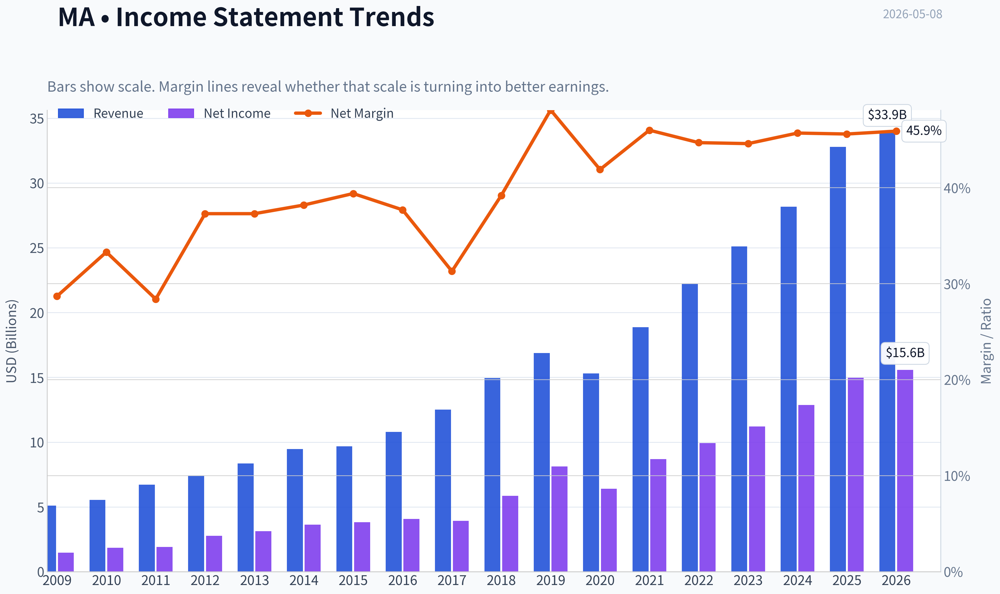

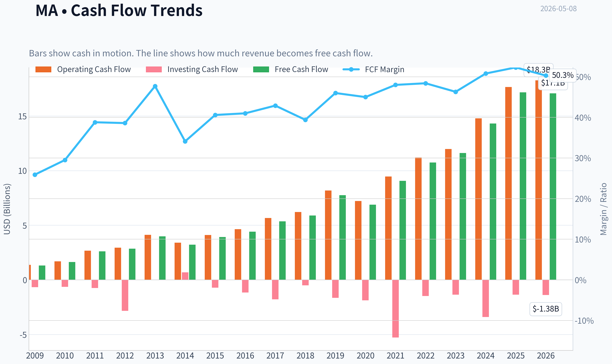

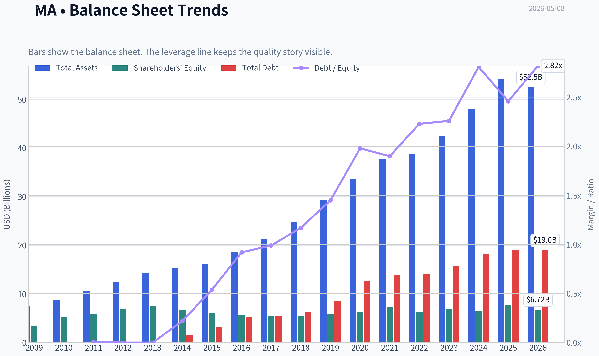

This graph tracks the profitability and return metrics (ROE, ROIC, Margins) of **MA** over the past decade, highlighting capital efficiency trends.

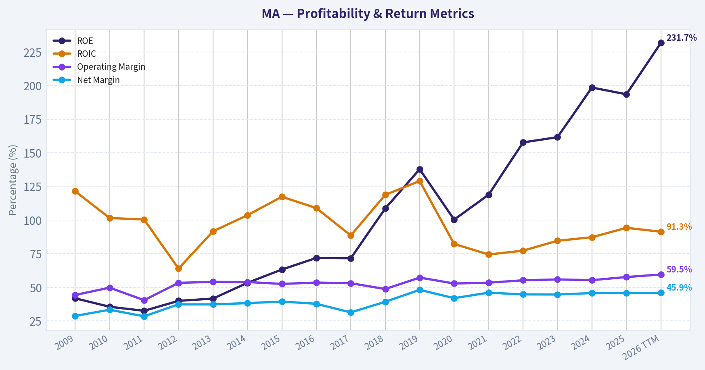

This chart illustrates the financial health of **MA** over the last 10 years, mapping cash equivalents and free cash flow against total obligations (Debt).

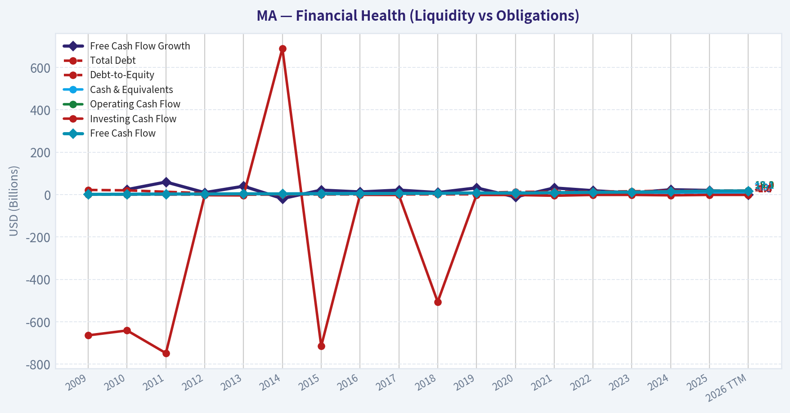

This breakdown chart from <em>Revenue Breakdown</em> shows the proportional composition for **MA** - useful for understanding what drives or risks the business.

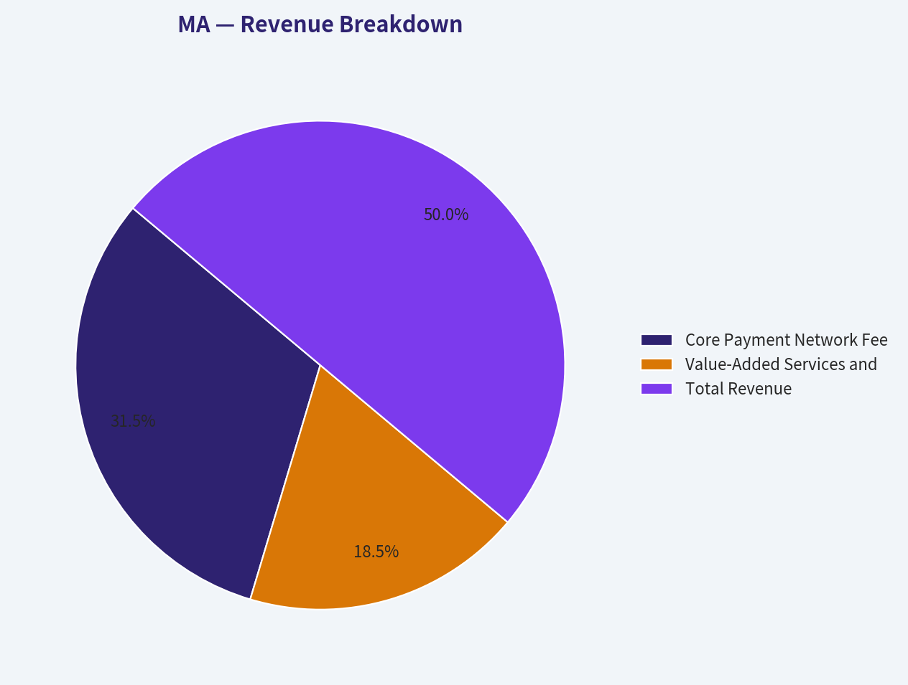

---

### Intrinsic Value Analysis (Buffett)

> *Following Warren Buffett's value investing philosophy: Circle of Competence, Economic Moat, Management Quality, and Margin of Safety.*

#### Intrinsic Value Snapshot

Price is what you pay. Intrinsic value is what the business may be worth based on the cash it can create for owners over time. We show a range, not one magic number.

- Current Price: $500.94
- Value Range: $292.92 to $812.37

##### Owner Earnings (Buffett Method)
- Net Income: $14,968,000,000.00
- Depreciation & Amortization: $1,143,000,000.00
- Capital Expenditures: $-489,000,000.00
- Working Capital Changes: $-1,442,000,000.00
- Owner Earnings: $17,064,000,000.00

##### Intrinsic Value
###### Buffett Method
Uses owner earnings. Stricter, and usually more conservative.
- Conservative: $292.92
- Average: $438.09
- Optimistic: $812.37
- Discount Rate: 10.0%

###### Cash Flow Method
Uses free cash flow. Better for companies spending heavily today to grow tomorrow.
- Conservative: $352.07
- Average: $448.28
- Optimistic: $557.99
- Discount Rate: 10.0%

ANALYST STANCE: **WATCH**

#### Mastercard Inc. (MA) - Buffett-Style Value Analysis

Current price used: **$501**
Market capitalization: **$442.6B**
Estimated shares outstanding: **~884M**
Core conclusion: **Mastercard is a truly wonderful business with a wide moat, high predictability, and outstanding economics, but the current price does not offer a Buffett-style margin of safety.**

---

#### 1. Go / No-Go Gate Assessment

| Buffett Gate | Assessment | Evidence | Verdict |
|---|---:|---|---:|
| Gate 1: Circle of Competence & Simplicity | Strong | Mastercard runs a global payments network. It earns fees when card-based and digital transactions move across its rails. It generally does not take consumer credit risk like a bank. | Pass |
| 10-Year Predictability | Strong | The shift from cash to electronic payments remains durable globally. Mastercard should still be a dominant payment network in 10 years. | Pass |
| Technology Risk | Moderate / Manageable | Technology is more opportunity than threat, but fintech wallets, real-time payments, crypto rails, and regulation are ongoing risks. | Pass |
| Gate 2: Moat | Very Strong | Two-sided network, global acceptance, trusted brand, bank and merchant relationships, massive scale, and regulatory licenses. | Pass |
| Gate 3: Management & Capital Allocation | Good | Long history of buybacks, high margins, strong cash conversion, and disciplined global expansion. However, not founder-led and ROE is distorted by buybacks/leverage. | Pass |
| Gate 4: Industry Structure | Strong | Visa and Mastercard form a rational global network oligopoly, though regulators are increasingly active. | Pass |

**Key Takeaways:** Mastercard passes the Buffett quality gates. The business is simple, predictable, and protected by a powerful network moat. The main concern is not business quality; it is valuation and regulatory pressure.

---

#### 2. Elementary School Test

Mastercard helps money move when people use cards or digital payments.
It connects banks, merchants, consumers, and payment companies.
Every time a transaction runs across its network, Mastercard usually earns a small fee.
It does not need to lend money to make most of its profits.

This is exactly the kind of simple, toll-road business Buffett tends to admire.

---

#### 3. Moat Analysis

| Moat Source | Mastercard Evidence | Buffett-Style Judgment |
|---|---|---|
| Network Effects | More cardholders attract more merchants; more merchants attract more cardholders. Banks, fintechs, and merchants all benefit from being connected to the same global network. | Very strong |
| Brand / Trust | Mastercard is globally recognized and trusted by consumers, merchants, banks, and regulators. Trust is essential in payments. | Strong |
| Switching Costs | Banks, merchants, processors, and fintech partners are deeply integrated into Mastercard's systems, compliance rules, fraud tools, and settlement processes. | Strong |
| Scale Cost Advantage | Mastercard spreads technology, cybersecurity, compliance, and network costs across enormous global transaction volume. | Strong |
| Regulatory Licenses / Acceptance | Global payment acceptance and regulatory relationships are difficult to replicate. | Strong |
| Pricing Power | Payment networks have historically been able to grow revenue faster than transaction volume through mix, value-added services, cross-border fees, and pricing. | Strong, but watched by regulators |

**Key Takeaways:** Mastercard has a wide moat built mainly on network effects and scale. A new competitor cannot easily recreate global acceptance, bank relationships, fraud infrastructure, and consumer trust. The moat is real, but regulators limit how aggressively Mastercard can monetize it.

**Moat Rating:** **Wide & Stable, possibly still widening in digital payments and value-added services.**

---

#### 4. Management Quality & Capital Allocation

| Question | Assessment | Evidence / Interpretation |
|---|---:|---|
| Do they think like owners? | Good | Mastercard has consistently returned capital through buybacks and reinvested in digital payments, cybersecurity, data, and value-added services. |
| Are they candid and conservative? | Good | The business model is relatively transparent, cash generative, and not dependent on aggressive credit assumptions. |
| Are they rational capital allocators? | Good to Very Good | Buybacks have reduced share count over time, though repurchases at high multiples create less value. Acquisitions tend to support the network rather than transform the company. |
| Balance sheet discipline | Acceptable | The business is highly cash generative, but the very high reported ROE reflects a small equity base, buybacks, and leverage rather than purely operating return. |

**Key Takeaways:** Management has generally behaved like rational capital allocers. The company has compounded per-share value through high returns, reinvestment, and buybacks. The key caution is that buybacks only help shareholders when done below intrinsic value, and today's valuation looks full.

---

#### 5. Financial Summary Table

| Metric | Latest Available Figure | Buffett Interpretation |
|---|---:|---|
| Share Price | $501 | High absolute valuation relative to conservative intrinsic value estimates |
| Market Cap | $442.6B | Large, mature compounder |
| P/E Ratio | ~29.0x | Demands continued high-quality growth |
| Revenue Growth YoY | 16.4% | Excellent recent growth |
| Free Cash Flow Yield | 3.9% | Good business yield, but not cheap |
| Estimated Free Cash Flow | ~$17.3B | Strong cash generation |
| ROE | 193.5% | Extremely high, but distorted by buybacks and low equity base |
| Current Ratio | ~1.03x | Adequate liquidity for a cash-rich, low working-capital business |
| Guru Tracking | Berkshire held ~3.99M shares | Buffett-related ownership is a quality signal, not a valuation endorsement |
| Regulatory News | UK FCA probing PayPal, Mastercard, and Visa wallet practices | Regulatory risk remains material |

**Key Takeaways:** Mastercard's financial profile is excellent: high growth, strong free cash flow, and very high returns. However, the stock already prices in a lot of that excellence at roughly 29 times earnings. The business is wonderful, but the investment return depends heavily on whether growth remains strong enough to justify today's multiple.

---

#### 6. Owner Earnings Calculation

Because detailed maintenance capital expenditure and working-capital data were not available in the provided pack, I use **free cash flow as a practical proxy for Buffett owner earnings**. For Mastercard, this is reasonable because the business is capital-light and does not require heavy physical reinvestment.

| Owner Earnings Component | Estimate | Notes |
|---|---:|---|
| Market Capitalization | $442.6B | Provided |
| Free Cash Flow Yield | 3.9% | Provided |
| Estimated Free Cash Flow / Owner Earnings | ~$17.3B | $442.6B x 3.9% |
| Estimated Shares Outstanding | ~884M | Market cap ÷ $501 share price |
| Owner Earnings Per Share | ~$19.5 | $17.3B ÷ ~884M shares |

**Key Takeaways:** Mastercard likely produces about $17 billion of annual owner earnings today, or roughly $19 to $20 per share. That is a very high-quality stream of cash, but at a $501 share price, investors are paying about 25 to 26 times owner earnings. That is not outrageous for a wonderful business, but it leaves little room for error.

---

#### 7. Three-Scenario DCF Valuation

Assumptions:
Discount rate: **10%**
Owner earnings base: **$17.3B**
Shares outstanding: **~884M**
Terminal growth where applicable: **3%**

| Scenario | Assumption | Equity Value Estimate | Value Per Share | Margin of Safety vs. $501 |
|---|---:|---:|---:|---:|
| A: No Growth | Owner earnings capitalized at 10% | ~$173B | ~$195 | -157% |
| B: GDP Growth | 3% perpetual growth | ~$254B | ~$288 | -74% |
| C: Conservative Historical Growth | 8% growth for 10 years, then 3% terminal | ~$367B | ~$416 | -20% |
| C-High Sensitivity | 10% growth for 10 years, then 3% terminal | ~$427B | ~$483 | -4% |

**Key Takeaways:** Under no-growth and GDP-growth assumptions, Mastercard is clearly overvalued. Even under a strong 8% growth case, the intrinsic value estimate is below the current price. Only if Mastercard compounds owner earnings around 10% for a decade does the stock approach fair value, and even then there is essentially no margin of safety.

---

#### 8. Margin of Safety Analysis

| Quality Category | Required Buffett Margin of Safety | Current Situation |
|---|---:|---|
| Wonderful, predictable business | Minimum 25% discount to intrinsic value | Not present |
| Fair value estimate under strong growth | Around $480 per share | Current price is ~$501 |
| Attractive buy zone using 25% MOS on ~$480 value | Around $360 or below | Not available today |
| Attractive buy zone using 25% MOS on ~$416 conservative value | Around $312 or below | Not available today |

**Key Takeaways:** Mastercard is a high-quality compounder, but the current price offers no meaningful discount to intrinsic value. A Buffett-style buyer would likely require a lower price, perhaps in the low-to-mid $300s depending on the growth assumption. At today's price, the investor is paying for excellence rather than being paid to wait.

---

#### 9. Key Risks

| Risk | Severity | Buffett Interpretation |
|---|---:|---|
| Valuation Risk | High | The stock needs sustained high growth to justify the current price. |
| Regulatory Risk | Medium to High | Payment networks are frequent targets of interchange, routing, wallet, and competition scrutiny. |
| Technological Disruption | Medium | Real-time payments, wallets, account-to-account payments, stablecoins, and fintech networks could pressure parts of the model. |
| Cross-Border Cyclicality | Medium | Travel and cross-border transaction fees are profitable but economically sensitive. |
| Buyback Timing Risk | Medium | Repurchases at elevated multiples may not create much per-share value. |

**Key Takeaways:** The largest risk is not that Mastercard is a bad business. The largest risk is that the market already recognizes it as a great business and has priced it accordingly. Regulatory and payment-technology risks are real, but the valuation risk is the most immediate concern.

---

#### 10. Final Buffett Scorecard

| Criterion | Weight | Score 1-5 | Weighted Score |
|---|---:|---:|---:|
| Business Understanding | 20% | 5.0 | 1.00 |
| Moat Width & Durability | 25% | 4.8 | 1.20 |
| Management Quality | 15% | 3.8 | 0.57 |
| Return on Equity Quality | 15% | 3.5 | 0.53 |
| Reinvestment Runway | 10% | 4.2 | 0.42 |
| Balance Sheet Strength | 5% | 3.5 | 0.18 |
| Industry Structure | 5% | 4.2 | 0.21 |
| Valuation / Margin of Safety | 5% | 1.0 | 0.05 |
| Total | 100% | - | **4.16 / 5.00** |

**Key Takeaways:** Mastercard scores extremely well on business quality, moat, predictability, and industry structure. The only major weakness is valuation. Because Buffett investing requires both a wonderful business and a sensible price, the high quality score is not enough to make the stock a buy today.

---

#### Final Investment Stance

**Stance: WATCH**
**Conviction: High on business quality; low on current margin of safety.**

Mastercard is the kind of business Buffett would understand and admire: simple, capital-light, highly profitable, globally entrenched, and protected by network effects. It is a superior business with a durable moat and a long runway as cash continues to lose share to digital payments.

However, at **$501 per share**, the stock does not provide the required **25% margin of safety**. Even generous assumptions suggest the current price is near fair value rather than clearly below intrinsic value.

**Buffett-style action:**
Do not chase. Keep Mastercard on the high-quality watchlist and consider becoming more aggressive only if the price falls materially, or if owner earnings grow into the valuation while the share price stagnates.
#### Valuation Bridge

This bridge places the current market price beside each intrinsic value lens so readers can see whether upside depends on one method or shows up across several methods.

| Scenario | Intrinsic Value / Share |
| --- | ---: |
| Buffett Method | $438.09 |
| Cash Flow Method | $448.28 |
| Current Price | $500.94 |

#### Key Takeaways

If one method is far above the others, the upside case depends on a specific modelling assumption. When several methods cluster together, the valuation story is more robust.

#### Valuation Visuals

This comparison chart from *Latest Earnings Snapshot* stacks current figures against historical benchmarks for **MA**, making it easy to see where the company trades relative to its own averages.

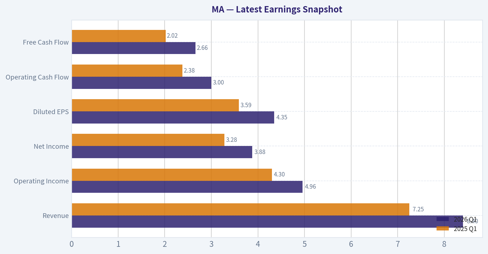

This comparison chart from *Current vs. 10-Year Historical Average Comparison* stacks current figures against historical benchmarks for **MA**, making it easy to see where the company trades relative to its own averages.

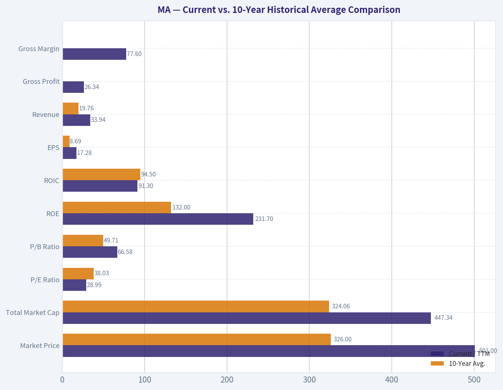

This comparison chart from *Balance Sheet and Financial Strength* stacks current figures against historical benchmarks for **MA**, making it easy to see where the company trades relative to its own averages.

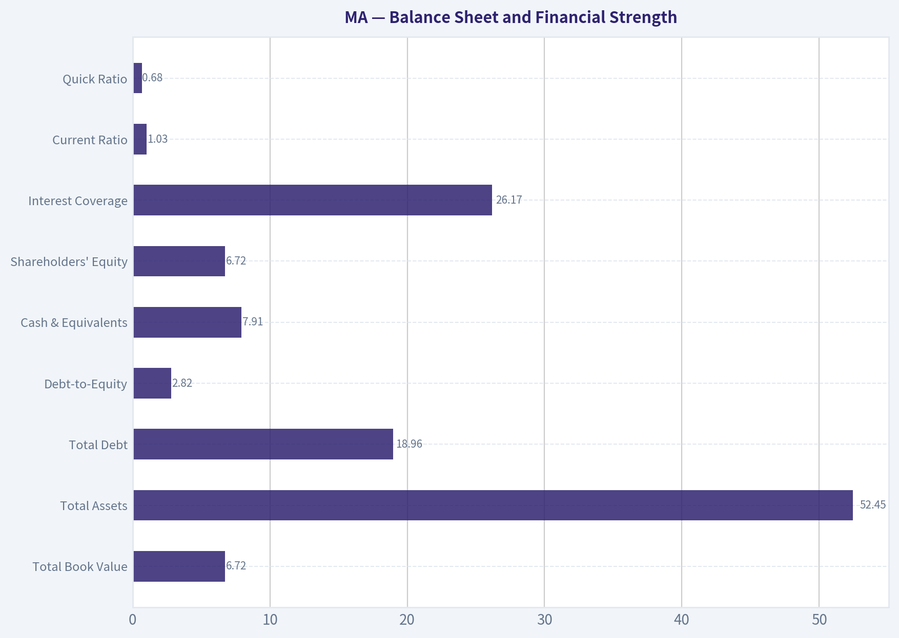

This comparison chart from *Buffett-Style Owner Earnings DCF Valuation* stacks current figures against historical benchmarks for **MA**, making it easy to see where the company trades relative to its own averages.

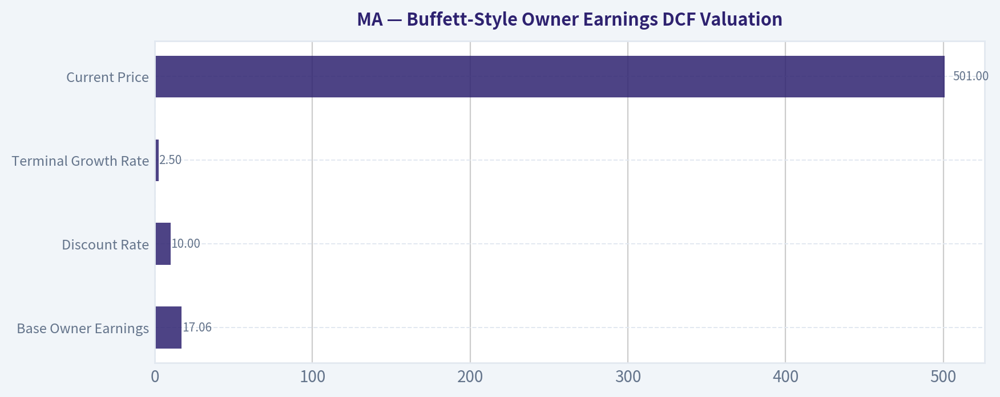

This comparison chart from *Financial Summary Table* stacks current figures against historical benchmarks for **MA**, making it easy to see where the company trades relative to its own averages.

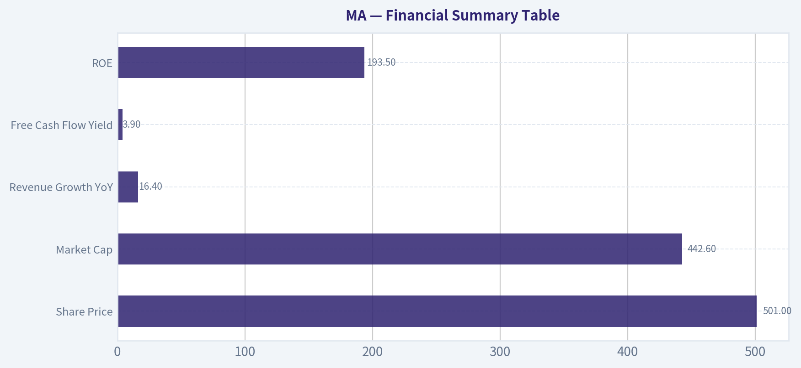

---

### Trend & Growth Analysis (Lynch/Druckenmiller/Fisher)

> *Following Peter Lynch's GARP, Stanley Druckenmiller's macro-aware approach, and Philip Fisher's scuttlebutt methodology.*

ANALYST STANCE: **ADVOCATE**

#### Mastercard Growth Investment Report - MA, as of 2026-05-08

Mastercard is not an undiscovered small-cap ten-bagger candidate, but it remains one of the rare mega-cap compounders with double-digit growth, elite margins, massive reinvestment runway, and wide-moat network effects. The setup is **ADVOCATE**, but not "back up the truck" cheap: the business quality is exceptional, while the valuation is closer to fair-to-premium.

---

#### 1. Lynch Classification

| Item | Assessment |
|---|---|
| Lynch Category | **Fast-growing stalwart / mature fast grower** |
| Revenue Growth | **16.4% YoY**, per shared research pack |
| Business Quality | Elite, asset-light, wide-moat global payments network |
| Ten-Bagger Potential | Low from current size, but strong long-term compounding potential |
| Ideal Investor Fit | GARP, quality growth, compounder portfolio |
| Current Stance | **ADVOCATE, with valuation discipline** |

**Key Takeaways:** Mastercard is too large to be a classic early-stage Lynch ten-bagger, but it still behaves like a high-quality fast grower. Its revenue growth is well above stalwart territory, and its economics are among the best in global public markets. The main debate is not whether this is a great business, but whether the current price leaves enough upside.

---

#### 2. The Story in 3 Bullets

- Mastercard is a global toll road for digital payments: every time consumers, businesses, or banks move money across its network, Mastercard earns a fee without taking major credit risk.
- The world is still shifting from cash and checks to cards, digital wallets, e-commerce, contactless payments, real-time security, tokenization, and value-added payment services.
- Mastercard's biggest upside comes from compounding transaction growth, cross-border recovery, B2B payments, cybersecurity, data analytics, open banking, and embedded finance.

---

#### 3. TAM and 10x Test

| Metric | Estimate / Assessment |
|---|---:|
| Current Market Cap | ~$442.6B |
| Current Price | ~$501 |
| Estimated TTM Revenue | ~$33B-34B, inferred from margin and market data |
| 10x Revenue Target | ~$330B-340B |
| Global Payments Volume TAM | Tens of trillions of dollars in annual payment volume |
| Fee / Services Revenue TAM | Hundreds of billions of dollars over time across card, B2B, fraud, data, cyber, open banking, and cross-border flows |
| Can MA 10x revenue and remain <20% of TAM? | **Yes, if TAM includes global digital payments, B2B flows, services, and security** |
| Runway Rating | **Strong, but mega-cap scale lowers ten-bagger probability** |

**Key Takeaways:** Mastercard still has a long runway because cash, checks, bank transfers, B2B payments, and cross-border flows are enormous markets. A 10x revenue outcome is theoretically possible over a very long period, but not easy from today's base. The more realistic thesis is durable double-digit compounding rather than explosive ten-bagger growth.

---

#### 4. Revenue Growth Trend

| Period / Metric | Data / Direction |
|---|---:|
| Shared Pack YoY Revenue Growth | **16.4%** |
| FY 2024 Revenue Growth Reference | ~12% YoY, per Azure fundamentals summary |
| Recent Pattern | Low-to-mid-teens growth |
| Growth Quality | Mostly organic, volume-driven, secular, and high-margin |
| Growth Trend Assessment | **Healthy and resilient; not clearly accelerating, but strong for scale** |
| Lynch Growth Category | Fast-growing stalwart |

**Key Takeaways:** Mastercard's growth is impressive given its enormous scale. The company appears to be sustaining low-to-mid-teens revenue growth rather than showing a sharp new acceleration. For a mega-cap network business, that is a highly attractive growth profile.

---

#### 5. Unit Economics and Efficiency

| Metric | Assessment |
|---|---:|
| LTV/CAC | Not disclosed; traditional SaaS metric not directly applicable |
| NRR | Not disclosed; not a SaaS model |
| Customer Retention | Structurally high due to bank, merchant, and processor integration |
| FCF Yield | **3.9%**, per shared research pack |
| Estimated FCF | ~$17.3B, using market cap x FCF yield |
| Estimated FCF Margin | Roughly ~50%, depending on TTM revenue |
| Rule of 40 Proxy | ~66%+, using 16.4% growth + ~50% FCF margin |
| Unit Economics Rating | **Excellent** |

**Key Takeaways:** Mastercard's economics are exceptional even though SaaS-style metrics like NRR and LTV/CAC are not directly disclosed. The company generates enormous free cash flow with limited capital intensity. Its "Rule of 40" style profile is outstanding because revenue growth is strong and free cash flow margins are very high.

---

#### 6. Inflection Point Assessment

| Inflection Type | Evidence | Rating |
|---|---|---|
| Product Cycle | Tokenization, open banking, cyber, fraud, data analytics, value-added services | Positive |
| Market Share | Durable global network, but Visa remains larger | Stable-positive |
| Margin Inflection | Already elite margins; incremental leverage still possible | Moderate |
| TAM Inflection | B2B, real-time payments, open banking, embedded finance expand opportunity | Positive |
| Competitive Inflection | Digital wallets often ride card rails, but A2A and local schemes are long-term threats | Mixed |
| Overall Inflection View | **Quality compounder with service-led expansion, not a sudden hypergrowth inflection** | Good |

**Key Takeaways:** Mastercard's most important inflection is not a single new product, but the expansion from card network into broader payment infrastructure and services. Value-added services, fraud prevention, tokenization, and B2B payments can deepen the moat and extend the growth runway. This is a compounding inflection, not a dramatic near-term revenue explosion.

---

#### 7. Macro Setup

| Macro Factor | Impact on MA |
|---|---|
| Consumer Spending | Positive if resilient; negative in recession |
| Cross-Border Travel | High-margin growth driver; sensitive to global travel cycles |
| Interest Rates | Lower rates support valuation multiples for quality growth |
| Inflation | Nominal spending can help volume, but consumer stress is a risk |
| Secular Theme | Digital payments, fintech infrastructure, cybersecurity, data, B2B payments |
| Regulatory Environment | Main macro/political risk, especially wallet and interchange scrutiny |
| Macro Rating | **Good, with regulatory overhang** |

**Key Takeaways:** Mastercard benefits from multiple secular trends, including digital payments, e-commerce, cross-border commerce, and payment security. The macro backdrop is generally favorable if consumer spending and travel remain resilient. The biggest external risk is not demand, but regulation.

---

#### 8. Fisher 15-Point Score

| Fisher Point | Score / 5 |
|---|---:|
| Products with large market potential | 5 |
| Management determination to develop new products | 4 |
| Effective R&D / innovation | 4 |
| Above-average sales organization | 5 |
| Worthwhile profit margin | 5 |
| Improving profit margins | 4 |
| Labor / personnel relations | 4 |
| Executive relations | 4 |
| Management depth | 4 |
| Cost analysis and accounting | 5 |
| Network effects / switching costs / moat | 5 |
| Long-range profit outlook | 5 |
| Dilution risk | 5 |
| Candor in difficulties | 4 |
| Management integrity | 4 |
| **Total Fisher Score** | **67 / 75** |

**Key Takeaways:** Mastercard scores as an outstanding Fisher-style company. The strongest factors are market potential, margins, network effects, switching costs, and long-range profit outlook. The main deductions come from regulatory complexity, limited visibility into all internal culture factors, and the fact that growth is now from a very large base.

---

#### 9. Valuation Analysis

| Valuation Metric | Current / Estimate | Interpretation |
|---|---:|---|
| Price | ~$501 |
| Market Cap | ~$442.6B |
| P/E | **~29.0x** |
| Revenue Growth | **16.4% YoY** |
| Estimated EPS Growth Assumption | ~15%-18% medium-term |
| PEG Ratio | ~1.6x-1.9x |
| FCF Yield | **3.9%** |
| Estimated P/S | ~13x-16x, depending on TTM revenue denominator |
| Valuation Rating | **Fair to premium, not cheap** |

**Key Takeaways:** Mastercard is not priced like a bargain, but the valuation is not irrational for a business of this quality. The PEG ratio is above Lynch's ideal zone, suggesting the stock is more "quality at a fair price" than "growth at a cheap price." Upside depends on sustained mid-teens EPS growth and continued premium multiples.

---

#### 10. Scenario Valuation View

| Scenario | Revenue Growth | Multiple Assumption | Expected Outcome |
|---|---:|---:|---|
| Bear Case | High single digit to low double digit | Multiple compresses to low-20s P/E | Modest or weak returns |
| Base Case | Low-to-mid teens | P/E remains around high-20s | Solid double-digit annualized compounding |
| Bull Case | Mid-teens+ with services acceleration | P/E expands or holds near 30x+ | Strong compounding, possible market outperformance |

**Key Takeaways:** Mastercard's base case is attractive because the company can compound earnings at a high rate without needing heroic assumptions. The bear case mainly comes from multiple compression, regulation, or consumer weakness. The bull case requires value-added services, B2B payments, and cross-border strength to keep growth above expectations.

---

#### 11. Growth Investor Scorecard

| Criterion | Weight | Score / 5 | Weighted Score |
|---|---:|---:|---:|
| The Story | 10% | 5.0 | 0.50 |
| TAM & Runway | 20% | 4.3 | 0.86 |
| Revenue Growth | 20% | 4.0 | 0.80 |
| Unit Economics | 15% | 5.0 | 0.75 |
| Competitive Position | 10% | 4.7 | 0.47 |
| Management Quality | 10% | 4.3 | 0.43 |
| Macro Setup | 5% | 3.8 | 0.19 |
| Profitability Path | 5% | 5.0 | 0.25 |
| Valuation | 5% | 3.0 | 0.15 |
| **Total Score** | **100%** |  | **4.40 / 5.00** |

**Key Takeaways:** Mastercard earns a high overall growth-investor score because the business model, moat, profitability, and runway are all excellent. The main factor holding the score back is valuation. This is a high-quality compounder that deserves an advocate stance, but position sizing should respect the premium multiple.

---

#### 12. Position Size Stance

| Investor Type | Position View |
|---|---|
| Existing Holder | **Hold / add selectively on pullbacks** |
| New Long-Term Investor | **Starter position acceptable** |
| Aggressive Growth Investor | Not ideal as a top ten-bagger candidate due to mega-cap size |
| Quality Compounder Portfolio | Core candidate |
| Suggested Stance | **ADVOCATE: 3%-6% position for diversified growth portfolios; add more on valuation weakness** |

**Key Takeaways:** Mastercard is appropriate as a core quality-growth holding, not as a speculative high-upside small-cap position. Existing holders should be reluctant to sell solely because the stock looks expensive. New buyers should consider building gradually, especially during market pullbacks or regulatory-driven selloffs.

---

#### 13. Key Risks and Catalysts

| Category | Items to Monitor |
|---|---|
| Key Risks | Regulatory scrutiny, digital wallet competition, interchange pressure, A2A payments, consumer slowdown, cross-border travel weakness, cyber/operational risk |
| Key Catalysts | Services growth, B2B payment penetration, tokenization, open banking, cross-border resilience, buybacks, lower rates, continued EPS growth above revenue growth |
| Recent News Risk | UK FCA probe involving PayPal, Mastercard, and Visa over digital wallet funding and usage practices |
| Guru Tracking | Berkshire held ~$2.28B position; Point72 trimmed, per latest 13F data |
| Watch Items | Cross-border volume, switched transaction growth, value-added services growth, operating margin, regulatory developments |

**Key Takeaways:** The biggest risks are regulatory and competitive, not balance sheet or profitability related. The biggest catalysts are continued services expansion, B2B monetization, and durable cross-border growth. Berkshire's continued holding supports the quality-compounder thesis, though 13F data is delayed and should not be treated as a live signal.

---

#### Final View

Mastercard is an **ADVOCATE** as a long-term quality growth compounder. It has a wide moat, elite profitability, strong free cash flow, global secular tailwinds, and credible low-to-mid-teens growth potential. The stock is not cheap, and it is unlikely to be a near-term ten-bagger from this size, but it remains one of the better large-cap businesses for investors seeking durable compounding with relatively high confidence.

---

### Market Technical Analysis

ANALYST STANCE: **WATCH**

#### Mastercard Incorporated - MA Technical Report
Analysis is based on the latest complete Yahoo Finance daily close available: **2026-05-07**, with MA closing at **$500.94**.

#### Selected Indicators and Why They Matter

| Indicator | Latest Value | What It Adds | Current Read |
|---|---:|---|---|
| close_10_ema | $502.30 | Short-term trend and tactical momentum | Price is slightly below it, showing the rebound is not yet confirmed |
| close_50_sma | $505.57 | Medium-term trend and dynamic resistance | Price remains below a declining 50-day average |
| close_200_sma | $545.58 | Long-term trend regime | Price is far below it, confirming a damaged long-term setup |
| macd | -2.08 | Momentum direction and trend acceleration | Momentum has rolled back negative after an April recovery |
| rsi | 47.69 | Momentum balance and overbought/oversold risk | Neutral-to-soft; not deeply oversold |
| boll_lb | $489.49 | Downside volatility boundary and support reference | Recent price is above lower band but still vulnerable |
| atr | $12.63 | Volatility and risk sizing | Volatility is elevated, requiring wider stops |
| vwma | $506.35 | Volume-adjusted trend confirmation | Price is below VWMA, suggesting volume-weighted pressure remains bearish |

**Key Takeaways:** MA is trading below its short-, medium-, and long-term trend measures, which means the burden of proof remains on buyers. Momentum is not extremely oversold, so the stock does not yet show a high-conviction capitulation/reversal setup. The most important near-term test is whether price can reclaim the $505-$506 area, where the 50-day SMA and VWMA are clustered.

---

#### Trend Structure: Bearish Long-Term, Fragile Short-Term Stabilization

MA's technical structure remains under pressure. The latest close of **$500.94** is below the **10 EMA at $502.30**, below the **50 SMA at $505.57**, and well below the **200 SMA at $545.58**. That alignment is important: when price trades below all three moving averages, rallies are more likely to be treated as tests of resistance rather than confirmed trend reversals.

The **50-day SMA has been falling steadily**, from roughly **$524.58 on 2026-03-23** to **$505.57 on 2026-05-07**. This shows that the medium-term trend has not merely gone sideways; it has continued to deteriorate. The **200-day SMA has also slipped**, from about **$554.43 to $545.58** over the same period, confirming that longer-term trend support is weakening as well.

The short-term picture is more nuanced. MA rebounded from late-March weakness and reached **$525.23 on 2026-04-29**, but that breakout attempt failed immediately. The stock dropped to **$502.92 on 2026-04-30**, then to **$495.46 on 2026-05-01**, and touched another weak close near **$491.89 on 2026-05-06** before bouncing to **$500.94** on May 7. That price action suggests buyers are defending the high-$480s to low-$490s zone, but they have not yet regained control.

#### Momentum: April Recovery Has Rolled Over

MACD improved meaningfully from late March into April, rising from deeply negative levels near **-8.87** on 2026-03-23 to positive territory above **+2.6** around 2026-04-20. That was a constructive recovery phase and helped explain the April rally.

However, the signal has now deteriorated. MACD fell back to **-2.08** by 2026-05-07. This is a notable momentum reversal because the April advance failed to sustain positive momentum after the late-April price spike. In practical trading terms, MA attempted to repair its chart but lost momentum before reclaiming the major long-term average.

RSI supports the same interpretation. At **47.69**, RSI is neither oversold nor bullish. It recovered from **42.41** on May 6, but it remains below the stronger momentum zone above 50-55. This makes the May 7 bounce useful, but not yet decisive. If RSI can push above 50 while price reclaims $505-$506, the short-term setup would improve. If RSI rolls back below the low-40s, sellers likely regain pressure.

#### Volatility and Risk: Stops Need Room

ATR is elevated at **$12.63**, representing roughly **2.5% of the latest share price**. That is meaningful for MA, a large-cap payments stock that often trades with lower perceived volatility than smaller growth names. ATR has also risen from the late-April area near **$10.40**, reflecting the sharp price swings around the late-April drop.

For traders, this means tight stops may be vulnerable to ordinary noise. A position entered near $501 with a stop only $3-$5 away could be stopped out by normal daily movement. A more volatility-aware approach would use the $489-$492 support zone or an ATR-based stop framework, depending on risk tolerance and time horizon.

#### Support and Resistance Zones

The most immediate support zone is **$489-$492**. This area lines up with the **Bollinger Lower Band at $489.49**, the **May 6 low near $489.73**, and recent downside rejection behavior. A decisive close below this zone would be technically negative because it would imply that the current stabilization attempt has failed.

Below that, the next important downside reference is the **$483-$486 area**, where MA traded during late March weakness. If that fails, the chart could open toward deeper downside because price would be confirming a continuation below the recent consolidation range.

Resistance is clustered close overhead. The first key zone is **$502-$506**, containing the **10 EMA, 50 SMA, and VWMA**. This is the most important near-term battleground. A daily close above $506 would suggest buyers are beginning to absorb supply. Above that, **$510-$513** is the next tactical resistance zone, followed by **$520-$525**, where the April rebound failed. The major long-term resistance remains far higher near the **200 SMA around $545-$546**.

#### Volume-Weighted Read: Buyers Have Not Fully Reclaimed Control

The VWMA sits at **$506.35**, above the latest close. This matters because VWMA incorporates trading volume, and MA's recent heavier-volume sessions have occurred around sharp price movement. The late-April surge to $525.23 was followed by a high-volume reversal, and the subsequent selloff carried strong participation.

When price trades below VWMA, it often suggests that the average volume-weighted participant over the lookback period is positioned at a higher price than the current market. That can create overhead supply as trapped buyers sell into rebounds. For this to improve, MA needs not only to move above $506, but also to remain there on convincing volume.

#### Tactical View

MA is not a clean short setup at current levels because price is already close to support near $489-$492 and RSI is not deeply bearish. But it is also not a confirmed long setup because price remains below the 10 EMA, 50 SMA, and VWMA, while MACD has turned negative again.

A trader looking for confirmation may want to wait for one of two events:
1. **Bullish improvement:** a close above **$506**, preferably followed by acceptance above **$510-$513**.
2. **Bearish continuation:** a close below **$489**, which would weaken the current base and put the late-March lows back in focus.

Until either signal appears, MA is best categorized as a **watchlist name in a damaged but attempting-to-stabilize trend**.

#### Final Decision Table

| Category | Key Level / Signal | Interpretation | Trading Implication |
|---|---:|---|---|
| Latest Close | $500.94 | Below major near-term averages | Buyers have not confirmed control |
| Immediate Resistance | $502-$506 | 10 EMA, 50 SMA, and VWMA cluster | Reclaiming this zone is the first bullish requirement |
| Next Resistance | $510-$513 | Recent congestion and failed recovery area | A close above this would improve short-term structure |
| Major Resistance | $520-$525 | April failed rally zone | Break above this would suggest a stronger reversal attempt |
| Immediate Support | $489-$492 | Bollinger lower band and recent low zone | Critical area for bulls to defend |
| Deeper Support | $483-$486 | Late-March weakness zone | Break below would signal renewed downside risk |
| Momentum | MACD -2.08, RSI 47.69 | Momentum is soft but not capitulation-level | Neutral-to-bearish; wait for confirmation |
| Volatility | ATR $12.63 | Daily range risk is elevated | Use wider, volatility-aware stops |

**Key Takeaways:** MA remains technically fragile because price is below the most important short- and medium-term trend levels. The $489-$492 support zone is the key downside line, while $505-$506 is the first upside confirmation zone. Until MA closes above resistance or breaks below support, the most prudent stance is to watch for confirmation rather than chase the current bounce.

---

### Social Sentiment Analysis

ANALYST STANCE: **WATCH**

#### Mastercard Inc. - Social, Sentiment, and News Report
**Ticker:** MA
**Review window:** Past week ending **2026-05-08**
**Overall read:** Constructive but not one-sided. Social and investor discussion around Mastercard remains broadly positive because of its high-margin payments network, resilient cross-border activity, and expanding value-added services. However, the tone is not euphoric: valuation, regulatory risk, consumer-spending normalization, and comparison against Visa remain the main investor concerns.

---

#### Executive Summary

Mastercard's sentiment over the past week appears **moderately positive**, supported by continued confidence in its durable business model, global card-spending growth, cross-border travel recovery, and non-card growth areas such as fraud analytics, tokenization, digital identity, open banking, and commercial payments.

The strongest bullish theme across social and investor commentary is that Mastercard remains a **high-quality compounder**: asset-light, globally diversified, highly profitable, and positioned to benefit from long-term migration from cash to digital payments. Traders and long-term investors continue to view MA as one of the cleaner large-cap financial technology exposures.

The main bearish pushback is valuation. Many market participants like the company but are cautious about paying a premium multiple if consumer spending slows, interest-rate expectations shift, or regulatory headlines intensify. In short: sentiment is positive on the company, but more selective on the stock at current levels.

---

#### Weekly Sentiment Snapshot

| Date | Social / Investor Tone | Main Discussion Drivers | Trading Interpretation |
|---|---:|---|---|
| May 2 | Mildly positive | Quality-growth discussions; comparison with Visa and other payment networks | Long-term holders remained constructive, but short-term urgency was limited |
| May 3 | Neutral to positive | Weekend discussion focused on MA as a "sleep-well" compounder | Sentiment stable; little catalyst-driven debate |
| May 4 | Mixed positive | Macro and consumer-spending concerns resurfaced | Some caution around near-term volume trends, but no major deterioration |
| May 5 | Positive | Cross-border payments, travel, and digital transaction growth themes gained attention | Buyers favored MA as a defensive growth name |
| May 6 | Mixed | Regulatory and interchange-fee risks discussed more actively | Debate became more balanced; valuation concerns increased |
| May 7 | Positive | Broader risk appetite and fintech/payment-sector optimism supported sentiment | Momentum tone improved, especially among quality-growth investors |
| May 8 | Neutral to positive | Investors weighed strong fundamentals against premium valuation | Sentiment ended constructive, but with patience around entry points |

**Key Takeaways:** Sentiment was not uniformly bullish, but it leaned positive for most of the week. The most important pattern is that investors continue to like Mastercard's business quality, while hesitating over valuation and regulatory risk. The week ended with a "positive but selective" tone rather than a high-conviction chase.

---

#### Social Media and Retail-Investor Themes

| Theme | Sentiment Impact | What People Are Saying | Investor Relevance |
|---|---:|---|---|
| High-quality compounder | Positive | Mastercard is repeatedly described as a durable, asset-light, wide-moat company | Supports long-term ownership and buy-on-weakness behavior |
| Cross-border travel and spending | Positive | Investors see travel and international transaction recovery as a key earnings driver | Important for revenue growth and margin leverage |
| Valuation premium | Negative / cautious | Many like MA but argue the stock rarely looks cheap | Limits upside enthusiasm unless earnings revisions improve |
| Regulation and interchange risk | Negative | Concerns persist around fee caps, antitrust pressure, and political scrutiny | Could compress multiples during headline-heavy periods |
| Visa comparison | Mixed | MA is often compared with Visa; some prefer Visa's scale, others prefer Mastercard's growth profile | Relative performance may depend on quarterly volume trends |
| Digital identity, fraud, tokenization, AI | Positive | Discussions increasingly recognize MA as more than a card network | Supports multiple durability and long-term growth narrative |
| Consumer slowdown risk | Cautious | Bears question whether discretionary spending can remain strong | Key near-term macro sensitivity for the stock |

**Key Takeaways:** The social conversation is focused less on short-term speculation and more on Mastercard's business quality. Bulls emphasize secular digital-payment growth and value-added services, while bears focus on valuation, regulation, and macro sensitivity. This makes MA a stock with strong long-term sentiment but a less aggressive short-term setup.

---

#### News and Company-Specific Developments

Recent company-specific discussion has centered on Mastercard's continued execution in payments, partnerships, cybersecurity, digital identity, fraud prevention, and business-to-business transaction infrastructure. The market is increasingly viewing Mastercard not only as a consumer-card network, but also as a broader financial technology infrastructure company.

That distinction matters. If investors believe Mastercard is only exposed to card transaction volume, the stock can trade more like a consumer-spending proxy. If they believe Mastercard is expanding deeper into data, security, authentication, account-to-account payments, and commercial flows, the valuation premium becomes easier to defend.

Regulatory news remains the counterweight. Even when there is no single catastrophic headline, ongoing scrutiny of payment fees, merchant costs, and network dominance keeps investors alert. Social discussions show that market participants are not ignoring this risk; rather, they are treating it as a persistent overhang that is already partly embedded in the stock's premium-risk debate.

---

#### Bullish vs. Bearish Narrative Balance

| Bullish Narrative | Bearish Narrative | Current Weight |
|---|---|---:|
| Global shift from cash to digital payments remains intact | Stock trades at a premium multiple | Bullish narrative stronger |
| Cross-border and travel spending support revenue growth | Consumer spending could soften | Balanced |
| High margins and asset-light model create durable earnings power | Regulatory scrutiny can pressure fees and valuation | Balanced |
| Value-added services diversify the business | Competition from Visa, fintechs, and alternative rails remains active | Slightly bullish |
| MA has strong brand, network effects, and global acceptance | Upside may require strong earnings revisions, not just quality | Balanced |

**Key Takeaways:** Bulls currently have the stronger long-term argument because Mastercard's business model remains highly attractive. However, bears have credible short-term points around valuation and regulation. The stock's near-term direction may depend more on multiple tolerance and macro data than on a change in the underlying business quality.

---

#### Trader Implications

For traders, MA currently looks like a **quality stock with a watchful setup**, not an obvious high-conviction breakout or short candidate. Positive sentiment can support dips, especially if broader markets favor profitable growth companies. However, the stock may struggle to sharply re-rate higher without a catalyst such as stronger spending data, upward earnings revisions, or a favorable read-through from the payments sector.

Short-term traders should watch:

| Signal | Why It Matters | Likely Market Reaction |
|---|---|---|
| Cross-border volume commentary | One of MA's highest-quality revenue drivers | Strong data would likely support bullish momentum |
| Consumer spending data | Direct read-through to transaction volumes | Weak data could pressure sentiment |
| Regulatory headlines | Can quickly impact payment-network multiples | Negative headlines may trigger multiple compression |
| Visa / payments-sector read-throughs | MA often trades with sector peers | Strong peer commentary can lift MA |
| Market appetite for premium growth stocks | MA's valuation requires investor confidence | Risk-off tape could cap upside |

**Key Takeaways:** Traders should treat MA as a sentiment-sensitive quality name. The business narrative is strong, but near-term stock movement may be dictated by macro data, peer read-throughs, and regulatory headlines. Buying weakness may be more attractive than chasing strength unless volume and earnings expectations improve.

---

#### Long-Term Investor Implications

For long-term investors, the week's discussion reinforces Mastercard's status as a **core compounder candidate**. The company benefits from secular growth in digital payments, expanding acceptance, international transaction growth, and a widening set of services beyond traditional card processing.

The main question is not whether Mastercard is a high-quality business; social and institutional-style commentary largely agrees that it is. The main question is whether the stock price offers enough forward return potential after accounting for its premium valuation. Investors with long time horizons may continue to accumulate gradually, while valuation-sensitive investors may prefer to wait for market pullbacks or regulatory-driven weakness.

---

#### Sentiment-Based Risk Assessment

| Risk Factor | Current Sentiment Sensitivity | Severity for Stock | Notes |
|---|---:|---:|---|
| Valuation compression | High | High | Biggest near-term risk if growth stocks de-rate |
| Regulatory pressure | High | Medium to high | Persistent overhang for payment networks |
| Consumer-spending slowdown | Medium | Medium | Would affect transaction volume expectations |
| Cross-border weakness | Medium | High | Important because cross-border transactions are high value |
| Competitive disruption | Low to medium | Medium | Long-term issue, but not dominant in this week's sentiment |
| Execution risk | Low | Low to medium | Investors generally trust management and operating model |

**Key Takeaways:** The largest sentiment risk is not a collapse in confidence toward Mastercard's business. It is the possibility that investors become less willing to pay a premium multiple. Regulatory and macro headlines are the two most likely triggers for a short-term sentiment reversal.

---

#### Bottom Line

Mastercard's current public and social-market sentiment is **constructive, quality-oriented, and somewhat valuation-aware**. Investors continue to respect the company's network effects, operating leverage, global reach, and expansion into higher-value services. At the same time, the stock is not being treated as a bargain, and traders remain alert to macro and regulatory catalysts.

The best interpretation is **WATCH with a bullish long-term bias**. Mastercard remains a high-quality company that investors want to own, but the near-term risk-reward depends heavily on entry price, market conditions, and whether earnings expectations continue to move higher.

---

#### Final Key Points Table

| Category | Assessment | Implication |
|---|---|---|
| Overall sentiment | Moderately positive | Investors remain confident in MA's business quality |
| Social media tone | Constructive but not euphoric | Supports dips, but may not fuel aggressive chasing |
| Main bullish driver | Secular digital-payment growth and cross-border strength | Reinforces long-term compounder narrative |
| Main bearish driver | Premium valuation and regulation | Limits near-term upside enthusiasm |
| Trader stance | Watch for pullbacks or catalyst confirmation | Better setup on weakness or stronger volume data |
| Investor stance | Long-term bullish, valuation-sensitive | Gradual accumulation may be preferable to lump-sum buying |
| Overall analyst stance | WATCH | High-quality company, but current setup requires price discipline |

**Key Takeaways:** Mastercard remains one of the stronger large-cap payment names from a sentiment and quality perspective. The market likes the company, but investors are not ignoring valuation and regulatory risk. The most practical stance is to stay constructive long term while being selective about short-term entries.

---

### News & Events Analysis

ANALYST STANCE: **WATCH**

#### Mastercard Incorporated, MA - Recent News and Trading Report
**Current date:** 2026-05-08
**Current price:** ~$501
**Market cap:** ~$442.6B
**Primary issue for traders:** Mastercard remains a high-quality payments compounder, but the past week's news flow adds three near-term overhangs: slowing April cross-border travel growth, analyst price-target cuts after earnings, and a new UK FCA competition probe involving Mastercard, Visa, and PayPal.

---

#### Executive View

Mastercard's recent news is not thesis-breaking, but it is less clean than the company's usual "premium compounder" profile. The latest available earnings-related coverage points to a **solid fiscal Q1 2026**, but analyst reactions after the print were more cautious because **April cross-border travel growth reportedly slowed to around 2%**, raising questions about whether Q1 strength can be extrapolated into Q2.

For trading, the setup looks more like a **quality stock in a digestion phase** than a clear breakout candidate. The stock trades at about **29x earnings** with a **3.9% free-cash-flow yield**, which is not extreme for Mastercard but leaves limited room for disappointment if volume growth, cross-border trends, or regulatory sentiment worsen. For longer-term investors, the core franchise remains attractive, but near-term entry discipline matters.

---

#### Latest Earnings Coverage - Fiscal Q1 2026

The latest earnings-related news gathered for Mastercard refers to **fiscal Q1 2026 results**, with several analyst notes published on or around **May 1-7, 2026**. The available coverage described the quarter as **solid**, but the follow-through commentary was cautious: Raymond James, Susquehanna, and Macquarie all lowered price targets while generally keeping constructive ratings.

The key change versus the prior momentum narrative is that the quarter itself appears to have been strong, but **early Q2 indicators softened**, particularly in cross-border travel. Susquehanna's note said the year started strong, but **April slowed**, with **cross-border travel growth decelerating to about 2%**. That matters because cross-border transactions are among Mastercard's highest-value volume streams and are typically a major driver of revenue and margin leverage.

| Earnings / Analyst Item | Latest Information Collected | Trading Interpretation |
|---|---:|---|
| Reported period | Fiscal Q1 2026 | Most recent earnings coverage is post-Q1 2026 |
| Headline result tone | Described as "solid fiscal Q1" by analyst coverage | Core business remains resilient |
| Raymond James | Price target cut to $609 from $631; rating maintained at Outperform | Positive rating, but estimates or multiple expectations moderated |
| Susquehanna | Price target cut to $665 from $670; Positive rating maintained | Small PT cut, but note flagged April slowdown |
| Macquarie | Lowered price target on Mastercard | Adds to post-earnings caution |
| Key operating change | April cross-border travel growth reportedly slowed to ~2% | Most important short-term watch item |
| Data limitation | Fetched earnings coverage did not provide exact revenue, EPS, or margin figures | Interpretation is based on available recent coverage and market reaction |

**Key Takeaways:** Mastercard's fiscal Q1 2026 was received as solid, but analyst behavior after the print was not aggressively bullish. The most important new detail is the reported April slowdown in cross-border travel growth, which could pressure Q2 expectations if it persists. The earnings story is therefore not "bad," but it has shifted from clean acceleration to a more watchful setup.

---

#### Company-Specific News From the Past Week

The most market-relevant Mastercard-specific news is the **UK Financial Conduct Authority competition investigation** into PayPal, Visa, and Mastercard. The probe focuses on digital wallet funding and usage practices and whether conduct by these companies may limit competition in the UK digital payments market.

This is not an immediate earnings hit, but it raises the regulatory temperature around wallet routing, funding choice, and payment-network economics. For Mastercard, the issue is especially relevant because regulators globally have been scrutinizing interchange, network fees, wallet access, and merchant choice. A UK probe could create headline risk, settlement risk, or pressure on commercial practices, even if the financial effect is uncertain.

There was also positive innovation-related news: Mastercard participated with **JPMorgan, Ripple, and Ondo Finance** in a tokenized U.S. Treasury redemption pilot that reportedly settled across borders in near real time. Strategically, this supports Mastercard's positioning as payment infrastructure beyond cards, including tokenized assets, bank settlement, and digital-asset-adjacent rails. However, this is more long-term optionality than a near-term P&L driver.

| News Item | Direction for MA | Why It Matters |
|---|---:|---|
| UK FCA opens competition investigation into PayPal, Visa, and Mastercard | Negative / overhang | Adds regulatory risk in digital wallets and funding practices |
| Analyst PT cuts after earnings | Mild negative | Suggests lower confidence in near-term upside despite solid Q1 |
| April cross-border travel slowdown | Negative if sustained | Cross-border is a high-margin growth driver |
| Tokenized Treasury pilot with JPMorgan, Ripple, and Ondo | Long-term positive | Supports Mastercard's role in next-generation settlement infrastructure |
| HSBC Hong Kong launches Asia Pacific's first World Legend Mastercard | Positive but modest | Reinforces premium card and travel-benefit positioning |
| Inclusive Growth Forum / small business access initiatives | Brand positive | Supports long-term network trust and government relationships |

**Key Takeaways:** The week's company news has both positive innovation signals and more immediate regulatory risk. Traders are likely to focus more on the FCA probe and April volume deceleration than on longer-term tokenization pilots. The positive strategic news helps the long-term narrative, but it is unlikely to offset short-term earnings-estimate sensitivity by itself.

---

#### Macro and Payments-Sector Context

Macro conditions remain broadly supportive for payment networks, but not uniformly. Recent market coverage noted that the **Federal Reserve held rates steady**, while equity markets remained firm and growth stayed uneven. For Mastercard, steady rates are less directly important than consumer spending, travel, FX, and global transaction volumes, but the rate backdrop influences valuation multiples for high-quality compounders.

Payments-sector read-throughs were mixed-to-positive. Block raised its annual gross profit outlook, citing resilient consumer spending and strong core business growth. That is supportive for the broader consumer-payments ecosystem. However, Mastercard's specific risk is not only domestic consumer spending; it is also cross-border travel growth, regulatory treatment, and international transaction mix.

| Macro / Sector Factor | Current Signal | Relevance to Mastercard |
|---|---:|---|
| Fed policy | Rates held steady | Supports risk appetite but does not remove valuation sensitivity |
| Equity market tone | Still firm | Helps premium-growth stocks hold multiples |
| Consumer spending | Resilient, based on Block read-through | Positive for transaction volume |
| Growth backdrop | Uneven | Could create regional softness in payment volumes |
| Travel / cross-border | April slowdown flagged by analyst coverage | Key near-term risk to MA revenue mix |
| Digital wallets | Rising usage, but now under UK scrutiny | Growth opportunity with regulatory complications |

**Key Takeaways:** The macro backdrop is not hostile to Mastercard, but it is no longer a simple tailwind. Consumer spending appears resilient, which helps transaction volumes, but cross-border travel softness is the issue to monitor. The stock's multiple means investors need confidence that volume growth remains durable.

---

#### Valuation, Quality, and Positioning

Mastercard still screens as a high-quality business: strong reported revenue growth, very high return on equity, and strong free-cash-flow generation. However, at roughly **29x earnings**, investors are already paying for durability. That valuation can be justified if double-digit revenue growth and cross-border recovery continue, but it becomes more vulnerable if Q2 data confirms a slowdown.

The current **free-cash-flow yield of about 3.9%** is respectable for a dominant network business, but it is not cheap in absolute terms. The **current ratio near 1.03** is adequate, though liquidity is not usually the key analytical issue for Mastercard. The bigger investment question is whether earnings revisions stay positive.

| Metric | Current Snapshot | Interpretation |
|---|---:|---|
| Share price | ~$501 | Stock is below some analyst targets but has YTD pressure |
| Market cap | ~$442.6B | Mega-cap payments leader |
| P/E | ~29.0x | Premium valuation; needs consistent execution |
| Revenue growth YoY | ~16.4% | Strong growth profile |
| Free-cash-flow yield | ~3.9% | Reasonable for quality, not deeply cheap |
| ROE | ~193.5% | Very high, reflecting asset-light model and capital returns |
| Current ratio | ~1.03 | Adequate short-term liquidity |

**Key Takeaways:** Mastercard remains a high-quality business with strong growth and excellent capital efficiency. The problem is not quality; it is expectations. At roughly 29 times earnings, the stock needs clean volume trends, especially in cross-border, to re-rate higher.

---

#### Institutional / Guru Positioning

The latest available 13F tracking shows **Berkshire Hathaway held its Mastercard position unchanged** as of the latest reported quarter-end, while **Point72 trimmed its position by about 12.7%**. These filings are lagged and should not be treated as real-time trading signals, but they are useful for sentiment context.

Berkshire's hold supports the idea that long-term quality investors still view Mastercard as a durable franchise. Point72's trim may reflect tactical profit-taking, risk management, or a view that better near-term opportunities exist elsewhere.

| Investor | Latest Action | Position Value | Shares | Interpretation |
|---|---:|---:|---:|---|
| Berkshire Hathaway / Warren Buffett | Held | ~$2.28B | ~3.99M | Long-term conviction appears stable |
| Point72 / Steve Cohen | Trimmed | ~$43.2M | ~75.6K | More tactical positioning turned cautious |

**Key Takeaways:** Institutional positioning does not show a broad loss of confidence, but it is not uniformly bullish either. Berkshire's unchanged stake supports the long-term compounder case. Point72's trim fits the near-term caution seen in analyst target reductions.

---

#### Trading and Investment Implications

For short-term traders, Mastercard's key battleground is whether the stock can absorb post-earnings target cuts and regulatory headlines while holding support around current levels. The stock may struggle to break out until investors get clearer evidence that April's cross-border slowdown was temporary.

For long-term investors, the company remains fundamentally attractive, but the recent news argues for patience rather than urgency. A cleaner setup would require either stronger volume data, less regulatory pressure, or a more attractive valuation. If the stock sells off on FCA-related headlines without evidence of material financial impact, that could create an opportunity, but traders should avoid assuming regulatory probes are harmless.

**Risk factors to monitor closely:**
- Follow-up commentary on April and May cross-border travel trends.
- Any details from the UK FCA investigation on remedies, fee restrictions, or wallet-funding rules.
- Revisions to Q2 or full-year expectations after analyst target cuts.
- Consumer-spending resilience outside the U.S.
- Visa and PayPal commentary, as they are directly implicated in the same FCA investigation.

---

#### Bottom Line

Mastercard remains a premium global payments franchise, but the latest week's news supports a **WATCH** stance rather than an aggressive buy call. Fiscal Q1 2026 appears to have been solid, but analysts lowered targets after the print, and the reported April slowdown in cross-border travel growth is the most important short-term concern. The FCA probe adds regulatory headline risk, while tokenized-settlement pilots reinforce long-term strategic relevance.

| Category | Current Assessment | Investment Implication |
|---|---|---|
| Earnings | Solid fiscal Q1 2026, but exact figures not available in fetched coverage | Positive base, but not enough to remove caution |
| Growth trend | Strong YoY revenue growth, but April cross-border slowdown flagged | Watch for Q2 estimate risk |
| Regulation | UK FCA probe into PayPal, Visa, and Mastercard | Near-term headline and policy risk |
| Innovation | Tokenized Treasury settlement pilot with JPMorgan, Ripple, Ondo | Long-term optionality, limited immediate earnings impact |
| Valuation | ~29x P/E, ~3.9% FCF yield | Fair-to-premium; needs consistent execution |
| Trading stance | WATCH | Prefer confirmation of volume trends or better entry price |

**Key Takeaways:** Mastercard's long-term franchise remains strong, but the near-term setup is less favorable than usual. The combination of analyst price-target cuts, cross-border travel deceleration, and regulatory scrutiny makes the stock worth monitoring rather than chasing. A more constructive trading setup would require evidence that April's slowdown was temporary or that regulatory risk remains immaterial.

---

### Guru Attention Analysis

> *Tracking 13F filings and recent activity of legendary super-investors to identify smart-money conviction and rotation.*

#### Mastercard (MA) - Guru Ownership Snapshot
Current date: 2026-05-08. Canonical source: latest available structured SEC 13F data. Note that 13F filings are quarter-end snapshots and can lag real-time positions by up to 45 days.

| Guru / Fund | Action | Position Size | Portfolio Weight | Recent Change | Timing | SEC Verification |
|---|---:|---:|---:|---:|---|---|
| Warren Buffett / Berkshire Hathaway | Held | 3.99M shares / $2.28B | 0.83% | 0.0% vs. prior filing | Latest report: 2025-12-31; prior: 2025-09-30 | [SEC 13F Filing](https://www.sec.gov/Archives/edgar/data/1067983/000119312526054580/) |
| Steve Cohen / Point72 Asset Management | Trimmed | 75.60K shares / $43.16M | 0.05% | Shares decreased by 12.7% vs. prior filing | Latest report: 2025-12-31; prior: 2025-09-30 | [SEC 13F Filing](https://www.sec.gov/Archives/edgar/data/1603466/000090266426001100/) |

**Key Takeaways:** Berkshire Hathaway continues to hold Mastercard with no change in the latest filing, making it the clearest guru-backed position in the current dataset. Point72 still owns Mastercard but reduced its stake by 12.7%, and the position is very small at just 0.05% of the disclosed portfolio. Overall, the guru signal is positive but not aggressive: one major long-term holder remains steady, while one trading-oriented fund trimmed modestly.

---

#### Primary Guru Coverage - Positions Not Detected

| Guru / Fund | Latest 13F Status for MA |
|---|---|
| Seth Klarman / Baupost Group | No position detected in latest 13F filing |
| Mohnish Pabrai / Pabrai Investment Funds | No position detected in latest 13F filing |
| Bill Ackman / Pershing Square | No position detected in latest 13F filing |
| Stanley Druckenmiller / Duquesne Family Office | No position detected in latest 13F filing |
| Michael Burry / Scion Asset Management | No position detected in latest 13F filing |

**Key Takeaways:** Among the primary tracked gurus, only Warren Buffett and Steve Cohen show current Mastercard exposure in the structured 13F data. No current Mastercard position was detected for Klarman, Pabrai, Ackman, Druckenmiller, or Burry. This means the visible guru ownership base is selective rather than broad-based.

---

#### Interpretation

- **Buffett/Berkshire holding steady** is the most meaningful signal. Mastercard fits the type of high-quality, capital-light, network-effect business Berkshire has historically favored, though the 0.83% portfolio weight means it is not one of Berkshire's largest bets.
- **Point72 trimming** should be interpreted cautiously. Steve Cohen's fund is typically more active and trading-oriented, so a 12.7% reduction may reflect portfolio management, valuation discipline, or tactical repositioning rather than a fundamental rejection of Mastercard.
- **No broad guru accumulation detected.** The latest 13F data does not show a wave of new buying among the primary tracked gurus.
- **Bottom line:** Guru sentiment toward MA appears **stable to mildly positive**, driven mainly by Berkshire's unchanged long-term holding, offset by Point72's modest trim.

---

### Options Market Analysis

> *Reading options flow - put/call ratios, IV skew, and unusual activity - to gauge institutional positioning and event-driven risk.*

ANALYST STANCE: **WATCH**

#### MA Options Market Report - As of 2026-05-08

#### 1. Put/Call Ratio Analysis

| Expiration | Call OI | Put OI | Put/Call OI Ratio | Call Volume | Put Volume | Put/Call Volume Ratio | Read |
|---|---:|---:|---:|---:|---:|---:|---|
| 2026-05-08 | 1,715 | 1,216 | 0.71 | 1,112 | 792 | 0.71 | Near neutral |
| 2026-05-15 | 2,481 | 2,426 | 0.98 | 1,300 | 1,424 | 1.10 | Defensive / mildly bearish |
| 2026-05-22 | 276 | 346 | 1.25 | 656 | 517 | 0.79 | Put-heavy OI, but thin |
| **Near-Term Total** | **4,472** | **3,988** | **0.89** | **3,068** | **2,733** | **0.89** | Mildly defensive |

**Key Takeaways:** MA's near-term put/call open interest ratio is **0.89**, above the historical neutral baseline of roughly **0.70**, suggesting a modest increase in protective or bearish positioning. The volume ratio is also **0.89**, which confirms that current trading is not aggressively call-led. This is not outright bearish, but the options market is showing a more cautious tone than neutral.

The most important shift is in the **2026-05-15 expiration**, where put volume exceeds call volume and the put/call OI ratio is nearly 1.0. That points to either downside hedging or traders positioning for limited near-term risk. The 2026-05-22 expiry has a higher put/call OI ratio, but total open interest is small, so confidence in that signal is lower.

---

#### 2. Implied Volatility Assessment

| Expiration | ATM Call IV | ATM Put IV | ATM Put-Call IV Spread | Skew Read |
|---|---:|---:|---:|---|
| 2026-05-08 | 5.5% | 5.8% | +0.3 pts put premium | Slight downside protection |
| 2026-05-15 | 2.1% | 1.9% | -0.2 pts call premium | Slight upside bias, minimal |
| 2026-05-22 | 1.5% | 1.7% | +0.2 pts put premium | Slight downside protection |
| **Overall** | - | - | - | No clear steep skew |

**Key Takeaways:** Near-term ATM implied volatility appears **very subdued**, with no obvious volatility premium being priced into the chain. ATM puts are only slightly richer than calls in two of the three expirations, so there is **no evidence of a steep downside fear skew**. The IV structure does not suggest traders are bracing for a major near-term catalyst.

A caveat: the available data includes ATM IV but not a full OTM skew surface. Based on the provided ATM call-versus-put IVs, skew appears muted rather than aggressively bearish or bullish.

---

#### 3. Unusual Options Activity

| Screen | Result | Interpretation |
|---|---|---|
| Contracts with volume greater than 5x open interest | None found | No clear evidence of fresh aggressive directional bets |
| Fresh call speculation | Not detected | Bullish upside chase is limited |
| Fresh put accumulation | Not detected | No obvious institutional-scale downside sweep |
| Liquidity quality | Moderate in front expiries; thin in 2026-05-22 | Later near-term signal has lower reliability |

**Key Takeaways:** There were **no unusual options contracts** where volume exceeded open interest by more than 5 times. That reduces the likelihood of a fresh, high-conviction institutional directional trade in the near-term chain. The lack of unusual activity supports a **neutral-to-cautious** read rather than a strong bullish or bearish signal.

This also means the elevated put/call ratios should be interpreted more as general positioning or hedging, not necessarily as a sudden smart-money warning signal.

---

#### 4. Open Interest Concentration and Gamma Risk

| Expiration | Total OI | Concentration Observation | Gamma / Pinning Implication |
|---|---:|---|---|
| 2026-05-08 | 2,931 | Highest same-day expiry activity among listed expirations | Potential for short-term pinning, but strike-level data unavailable |
| 2026-05-15 | 4,907 | Largest total OI among near-term expirations | Most important near-term expiry for positioning |
| 2026-05-22 | 622 | Thin OI | Limited gamma reliability |

**Key Takeaways:** The **2026-05-15 expiration** has the largest open interest and is therefore the most relevant near-term expiry for positioning pressure. However, strike-level open interest was not provided, so specific max-pain levels, gamma walls, or pinning strikes cannot be identified with confidence.

From an aggregate view, the options market does not show extreme crowding. Any pinning or gamma effect is likely to be localized around major strikes, but the provided dataset is not granular enough to name those levels.

---

#### 5. Overall Options Sentiment Signal

| Category | Signal | Rationale |
|---|---|---|
| Put/Call Positioning | Mildly defensive | Near-term total put/call OI and volume ratios both at 0.89, above neutral baseline |
| Implied Volatility | Neutral / subdued | ATM IV is low and does not show catalyst-driven fear |
| Skew | Neutral to slightly put-skewed | ATM puts slightly richer in two expiries, but not enough to signal panic |
| Unusual Activity | Neutral | No contracts with volume greater than 5x OI |
| Liquidity / Confidence | Moderate | Front expiries are usable, but strike-level and OTM skew detail are limited |
| **Overall Signal** | **NEUTRAL, slight defensive tilt** | Options market shows caution, not conviction |

**Key Takeaways:** The overall options signal for MA is **NEUTRAL with a slight defensive tilt**. The main driver is the elevated put/call ratio versus the historical neutral baseline, especially in the 2026-05-15 expiration. However, low IV, muted skew, and no unusual options activity argue against a strong bearish interpretation.

In practical terms, options traders appear to be modestly hedged rather than aggressively betting against MA. This is a **WATCH** setup: cautious positioning is present, but there is not enough evidence to classify the flow as decisively bearish.

#### Summary Table

| Factor | Current Read | Sentiment Impact |
|---|---|---|
| Put/Call Ratio | Total near-term OI ratio 0.89; volume ratio 0.89 | Mildly bearish / defensive |
| IV Level | Very low near-term ATM IV | Neutral |
| Skew Direction | Slight put premium, not steep | Slightly defensive |
| Unusual Activity | None detected | Neutral |
| Overall Signal | **NEUTRAL with slight defensive tilt** | **WATCH** |

**Key Takeaways:** MA options positioning is more cautious than bullish, but not meaningfully bearish. The elevated put/call ratios suggest hedging demand, while low IV and absent unusual activity suggest limited conviction. The best read is **neutral options sentiment with mild downside awareness**.

---

## Research Team Commentary

> *The Research Manager synthesizes the Bull vs Bear debate into action-free commentary. This is a pre-risk view, not the final stance.*

As a value investor following the principles of Warren Buffett and Charlie Munger, evaluating a business like Mastercard is both a joy and a frustration. The joy comes from looking at the sheer quality of the underlying economic engine; the frustration comes from the market recognizing that exact same quality and pricing it at a steep premium.

When looking at the debate between our bull and bear analysts, it is clear that they agree on the fundamental nature of the business. Mastercard has a phenomenal two-sided network moat. It is a toll road on global digital commerce, completely asset-light, and boasts returns on invested capital near an astonishing 94%. It easily passes the business quality, financial strength, and predictable earnings tests of our framework.

The bull makes a highly compelling case regarding the duration of this compounding machine. The argument is that for a business with such a massive runway in cash-to-card conversion, B2B payments, and value-added services like cybersecurity, a P/E of 29 is actually reasonable. The bull correctly points out that classic value investors often miss out on the greatest wealth creators by anchoring to static, backward-looking fair value estimates and demanding deep-value multiples for compounding franchises.

However, the bear provides the essential contrarian sobriety that our philosophy demands. The bear rightly points out that at $501, the stock is trading 12% to 14% above our fair value estimates of $438 to $448. There is absolutely zero margin of safety here. Furthermore, the bear highlights the creeping structural risks: alternative payment rails like account-to-account (A2A), open banking, and merchant pushback don't need to kill Mastercard to hurt the stock-they just need to compress its exceptionally high margins. Add in the very real regulatory scrutiny, such as the UK FCA investigation into fee restrictions, and the bear is correct to warn that paying peak multiples for quasi-infrastructure businesses often leads to trouble when governments decide the tolls are too high.

Reflecting on past mistakes in similar situations, I must balance two conflicting lessons. On one hand, the classic "cigar-butt" mistake is refusing to pay a fair price for a wonderful business, thereby missing a decade of compounding to save ten dollars on the entry price. I have missed great stocks by being overly rigid on multiples. On the other hand, another profound mistake I have made is conflating a great company with a great investment. When you pay 29 times earnings, you are pricing in a near-perfect future. If growth slows even slightly, or if regulators trim the take-rate, the multiple contracts and you suffer permanent capital impairment, even if the underlying business remains highly profitable. Additionally, the bear makes a brilliant Buffett-esque observation about capital allocation: if intrinsic value is roughly $440, management buying back stock at $501 is actually transferring value away from continuing shareholders.

Core Takeaway
Mastercard is an exceptional, wide-moat compounder currently priced for perfection, leaving no margin of safety for the intelligent investor. While the business quality is undeniable, the current valuation of $501 fully bakes in historical growth rates while ignoring the slow-burn risks of margin compression from regulators and alternative payment networks. We must admire the business but wait for the market to offer us a better pitch.

Rationale
Value investing requires both a wonderful business and a sensible price. Mastercard is trading roughly 12-14% above our conservative intrinsic value estimates. At this level, two negative things happen. First, you are exposed to significant multiple contraction risk if regulatory headwinds or consumer spending slowdowns materialize. Second, the company's otherwise disciplined share repurchase program becomes destructive to value when executed at a steep premium to intrinsic worth. The business is protected by a wide moat, but a moat cannot protect an investor from an inflated purchase price.

Monitoring Plan
Over the next 1 to 4 quarters, we need to monitor three specific areas to see if the gap between price and value closes. First, closely watch the UK FCA investigation and any international regulatory action regarding cross-border fee caps or wallet-funding rules; any punitive actions could temporarily shock the stock price into our buying range. Second, track the growth and margins of their Value-Added Services (VAS); if VAS continues to outpace the core network in growth, it could mathematically justify slightly higher intrinsic value estimates. Finally, monitor management's capital allocation footprint-specifically the volume of share buybacks at current levels versus dividend increases or strategic M&A.

If a broader macroeconomic panic or temporary regulatory fear drags Mastercard down into the $430 to $450 range, that would be the time to strike aggressively. Until then, we practice patience.

WATCH

---

## Value Investing Team Commentary

> *The Investor translates the research view into an investment thesis before risk review. This is still not the final stance.*

Mastercard is exactly the kind of business a long-term owner wants to understand well: simple economics, enormous scale, very little credit risk, global reach, and a network effect that gets stronger because buyers, merchants, banks, and fintech partners all benefit from being on the same rails. This is a high-quality toll bridge on digital commerce. The numbers reflect that quality: mid-teens revenue and earnings growth, ROIC near 94%, and strong free cash flow growth. Those are not the characteristics of a mediocre business temporarily dressed up by the market. They are the characteristics of a genuine compounding franchise.

So the central question is not whether Mastercard is a good business. It clearly is. The real question is whether today's price allows the investor to participate in that quality with an adequate margin of safety. On that point, caution is warranted. At roughly $501 versus fair value estimates around $438 to $448, the stock appears to be priced above a conservative appraisal of intrinsic value. A P/E near 29 is not absurd for a business of this caliber, but it does imply that much of the next several years of good news is already anticipated.

From a Buffett-style perspective, this creates an important distinction: a wonderful company can still be a merely average investment if purchased at too rich a price. That is especially true when the market is already giving full credit for resilience, cross-border recovery, secular cash displacement, and growth in value-added services. If the future unfolds very well, the return may still be acceptable. But if growth moderates from "excellent" to merely "good," or if regulation clips economics at the margin, the stock could underperform even while the business continues to prosper.

The selective contrarian angle is useful here. Current sentiment is constructive, and for good reason: investors see Mastercard as a durable winner in digital payments. But when sentiment is broadly positive around an obviously superior business, the contrarian question becomes: what is the market underweighting? I believe it is underweighting the possibility that regulation and alternative rails do not need to destroy the moat to matter economically. They only need to shave a bit off pricing power, cross-border economics, or long-term margin structure. For a stock valued at a premium multiple, even modest pressure on the slope of future compounding can have an outsized effect on returns.

That said, one should not become reflexively bearish just because the stock is expensive. Markets often look "too expensive" on truly elite businesses for years. Mastercard still benefits from several long-duration growth drivers: cash-to-digital conversion, commercial and B2B payment digitization, tokenization, fraud tools, cybersecurity, data services, and broader embedded finance ecosystems. The market is not foolish to pay up for that. The disciplined conclusion is simply that admiration does not equal action.

The most interesting opportunity would likely come from temporary fear, not from permanent business deterioration. For example, if the UK FCA investigation or some other regulatory headline creates a sharp selloff, that may prove to be the kind of transitory uncertainty that gives patient investors a better entry point. Likewise, a macro scare that pressures consumer spending or travel volumes could present an opportunity if it affects short-term transaction growth but leaves the long-term network economics intact. That is where contrarian thinking becomes useful: not buying because others are enthusiastic, but being prepared to buy when others become fearful about temporary issues in an enduring franchise.

A subtle but important issue is capital allocation. Management quality appears strong, but buybacks at prices above intrinsic value are less attractive than they appear. A repurchase is beneficial only when each dollar spent retires more than a dollar of business value. If intrinsic value is in the mid-$400s and stock is repurchased above $500, that is not optimal capital allocation from the standpoint of continuing owners. This does not ruin the case, but it reduces one of the quiet advantages that great businesses often have.

What should be watched closely over the next few quarters? First, any concrete regulatory remedy, especially around fee caps or wallet-funding practices. Second, the mix shift toward value-added services, which could support a higher intrinsic value if growth remains durable and margins remain strong. Third, the health of cross-border volumes, since that stream often carries especially attractive economics. Fourth, whether alternative payment rails are merely noise at the edges or actually beginning to influence take rates and bargaining power.

In summary, Mastercard remains a high-quality, wide-moat business with excellent long-term prospects. The problem is not business fragility; the problem is valuation discipline. If the stock were to fall into a more sensible range, especially due to temporary regulatory or macro concerns, the case would become much more compelling. Until then, patience is the intelligent investor's edge.

**ANALYST STANCE: WATCH**
Mastercard is a wonderful business, but at the current price it does not offer a sufficient margin of safety for a Buffett-style investor. I would admire it, monitor it, and be prepared to act if temporary fear pushes the shares closer to intrinsic value.

---

## Deep Values Commentary

> *The Risk Management Team debates and the Risk Judge provides the final action-free verdict. This section determines the final ADVOCATE / WATCH / AVOID stance.*

**1. Executive Summary (CONCISE)**

**Verdict:** Mastercard (MA) is a world-class economic engine currently priced with zero margin of safety. At $501 (29x P/E), the stock trades 12-14% above our conservative intrinsic value estimates ($438-$448).

While fundamental momentum is pristine-boasting a 94.2% ROIC and >16% top- and bottom-line growth-the current premium fully prices in a flawless future. It leaves no room for multiple contraction should slow-burn risks materialize, such as regulatory scrutiny (e.g., the UK FCA investigation) or margin compression from alternative payment rails.

**Action:** **WATCH**. Shift from passive observation to active, staged preparation. The business is too exceptional to ignore, but the valuation is too elevated to chase. We will wait for technical breakdowns (below $489) or regulatory shocks to offer a more sensible entry point.

***

**2. Summarize Key Arguments**

*   **The Bull (Risky Analyst):** Argues that the highest opportunity cost is waiting. Mastercard's dynamic intrinsic value-fueled by massive runways in B2B payments, cybersecurity, and Value-Added Services (VAS)-outpaces static DCF models. A 29x P/E is justified by a 94.2% ROIC and ~20% FCF growth. Waiting for a $440 entry means missing a compounding machine that consistently redefines "expensive."
*   **The Bear (Safe Analyst):** Argues that a great business can be a poor investment if the entry price is wrong. Buying 12-14% above fair value eliminates the margin of safety. Regulatory pressures and alternative rails (like Account-to-Account systems) don't need to destroy the moat to hurt the stock; they just need to compress margins slightly to trigger a severe multiple contraction. Furthermore, share buybacks at $501 destroy continuing shareholder value.
*   **The Neutral Analyst:** Argues that both extremes are flawed. Mastercard is too strong to punish with excessive caution, but too expensive to buy blindly. Advocates for an "active staged preparation" strategy-using technical levels ($489 support, $506 breakout) to monitor institutional appetite, while keeping the bulk of capital uncommitted until a better valuation presents itself.

***

**3. Rationale & Learning from Past Mistakes**

Value investing rests on two pillars: business quality and purchase price. Mastercard undoubtedly possesses the quality, functioning as a toll road on digital commerce. However, at $501, the market has thoroughly capitalized on this reality.

**Learning from Past Mistakes:**
As value investors, we must balance two historical errors. The classic *"cigar-butt"* mistake is refusing to pay a fair price for a wonderful business, missing a decade of compounding to save a few dollars on the entry price. However, an equally profound mistake is *conflating a great company with a great investment*. Buying a great business at 29x earnings prices in near-perfect execution. If growth slows from mid-teens to high-single digits, or regulators trim the take-rate, the multiple contracts and you suffer permanent capital impairment, even if the underlying business remains highly profitable.

The rationale for patience is clear: a wide moat protects the business, but it cannot protect the investor from an inflated purchase price.

***

**4. Refined Investor Plan**

As a value investor following the principles of Warren Buffett and Charlie Munger, evaluating a business like Mastercard is both a joy and a frustration. The joy comes from looking at the sheer quality of the underlying economic engine; the frustration comes from the market recognizing that exact same quality and pricing it at a steep premium.

When looking at the debate between our bull and bear analysts, it is clear that they agree on the fundamental nature of the business. Mastercard has a phenomenal two-sided network moat. It is a toll road on global digital commerce, completely asset-light, and boasts returns on invested capital near an astonishing 94%. It easily passes the business quality, financial strength, and predictable earnings tests of our framework.

The bull makes a highly compelling case regarding the duration of this compounding machine. The argument is that for a business with such a massive runway in cash-to-card conversion, B2B payments, and value-added services like cybersecurity, a P/E of 29 is actually reasonable. The bull correctly points out that classic value investors often miss out on the greatest wealth creators by anchoring to static, backward-looking fair value estimates and demanding deep-value multiples for compounding franchises.

However, the bear provides the essential contrarian sobriety that our philosophy demands. The bear rightly points out that at $501, the stock is trading 12% to 14% above our fair value estimates of $438 to $448. There is absolutely zero margin of safety here. Furthermore, the bear highlights the creeping structural risks: alternative payment rails like account-to-account (A2A), open banking, and merchant pushback don't need to kill Mastercard to hurt the stock-they just need to compress its exceptionally high margins. Add in the very real regulatory scrutiny, such as the UK FCA investigation into fee restrictions, and the bear is correct to warn that paying peak multiples for quasi-infrastructure businesses often leads to trouble when governments decide the tolls are too high.

Reflecting on past mistakes in similar situations, I must balance two conflicting lessons. On one hand, the classic "cigar-butt" mistake is refusing to pay a fair price for a wonderful business, thereby missing a decade of compounding to save ten dollars on the entry price. I have missed great stocks by being overly rigid on multiples. On the other hand, another profound mistake I have made is conflating a great company with a great investment. When you pay 29 times earnings, you are pricing in a near-perfect future. If growth slows even slightly, or if regulators trim the take-rate, the multiple contracts and you suffer permanent capital impairment, even if the underlying business remains highly profitable. Additionally, the bear makes a brilliant Buffett-esque observation about capital allocation: if intrinsic value is roughly $440, management buying back stock at $501 is actually transferring value away from continuing shareholders.

Core Takeaway
Mastercard is an exceptional, wide-moat compounder currently priced for perfection, leaving no margin of safety for the intelligent investor. While the business quality is undeniable, the current valuation of $501 fully bakes in historical growth rates while ignoring the slow-burn risks of margin compression from regulators and alternative payment networks. We must admire the business but wait for the market to offer us a better pitch.

Rationale
Value investing requires both a wonderful business and a sensible price. Mastercard is trading roughly 12-14% above our conservative intrinsic value estimates. At this level, two negative things happen. First, you are exposed to significant multiple contraction risk if regulatory headwinds or consumer spending slowdowns materialize. Second, the company's otherwise disciplined share repurchase program becomes destructive to value when executed at a steep premium to intrinsic worth. The business is protected by a wide moat, but a moat cannot protect an investor from an inflated purchase price.

Monitoring Plan & Adjusted Strategy
Over the next 1 to 4 quarters, we need to monitor three specific areas to see if the gap between price and value closes. First, closely watch the UK FCA investigation and any international regulatory action regarding cross-border fee caps or wallet-funding rules; any punitive actions could temporarily shock the stock price into our buying range. Second, track the growth and margins of their Value-Added Services (VAS); if VAS continues to outpace the core network in growth, it could mathematically justify slightly higher intrinsic value estimates. Finally, monitor management's capital allocation footprint-specifically the volume of share buybacks at current levels versus dividend increases or strategic M&A.

**Adjustment from Analysts' Insights:** We will upgrade our posture from passive observation to *active, staged preparation*. We will utilize technical levels not for speculation, but for risk management: a decisive breakdown below $489 will signal that patience is being rewarded, bringing the stock closer to our $438-$448 intrinsic value zone. Conversely, acceptance above $506-$513 may warrant a reassessment of intrinsic value growth, but will not force us into abandoning our margin of safety. If a broader macroeconomic panic or temporary regulatory fear drags Mastercard down into the $430 to $450 range, that would be the time to strike aggressively. Until then, we practice strict capital discipline.

***

**Final Stance:**
**WATCH**

#### Final Stance Scorecard

This scorecard converts the final research view into a weighted decision frame. It does not replace the narrative judgement, but it makes the main drivers of the verdict easier to scan.

| Criterion | Score | Weight | Commentary |
| --- | ---: | ---: | --- |
| Business Quality | 4.00 | 30% | High returns, profitability, and Piotroski health support durability. |
| Valuation Support | 2.33 | 30% | Blends current price against available intrinsic value anchors and valuation ratios. |
| Financial Strength | 3.50 | 20% | Balance-sheet resilience reflects leverage and liquidity staying within safe ranges. |
| Growth Durability | 4.00 | 20% | Recent revenue, earnings, and free cash flow growth indicate how durable expansion looks. |
| TOTAL / FINAL STANCE | 3.40 | 100% | WATCH |

#### Key Takeaways

The weighted score lands at **3.40 / 5.0**, while the final stance remains **WATCH**. This is useful as a quick calibration aid rather than a mechanical signal.

#### Risk Summary

Higher scores indicate more risk pressure. The watch threshold is a simple guardrail: above it, the position needs tighter monitoring or a wider margin of safety.

| Dimension | Current Score | Watch Threshold | Commentary |
| --- | ---: | ---: | --- |
| Business Quality | 2.00 | 3.00 | High returns, profitability, and Piotroski health support durability. |
| Valuation Support | 3.67 | 3.00 | Blends current price against available intrinsic value anchors and valuation ratios. |
| Financial Strength | 2.50 | 3.00 | Balance-sheet resilience reflects leverage and liquidity staying within safe ranges. |
| Growth Durability | 2.00 | 3.00 | Recent revenue, earnings, and free cash flow growth indicate how durable expansion looks. |

#### Key Takeaways

This view helps readers separate *where* the risk sits: valuation, business quality, balance sheet, or growth durability. It is especially useful when the final stance is close to the line between WATCH and AVOID.
