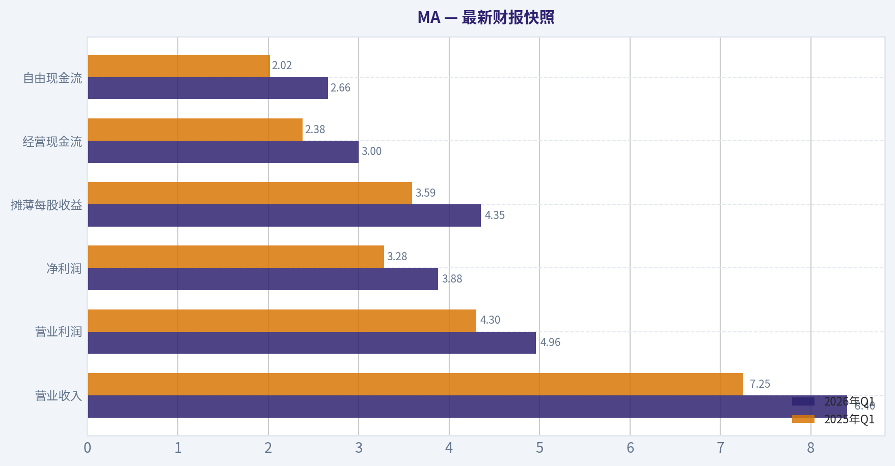
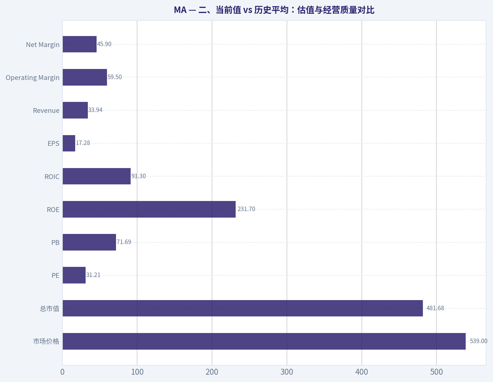
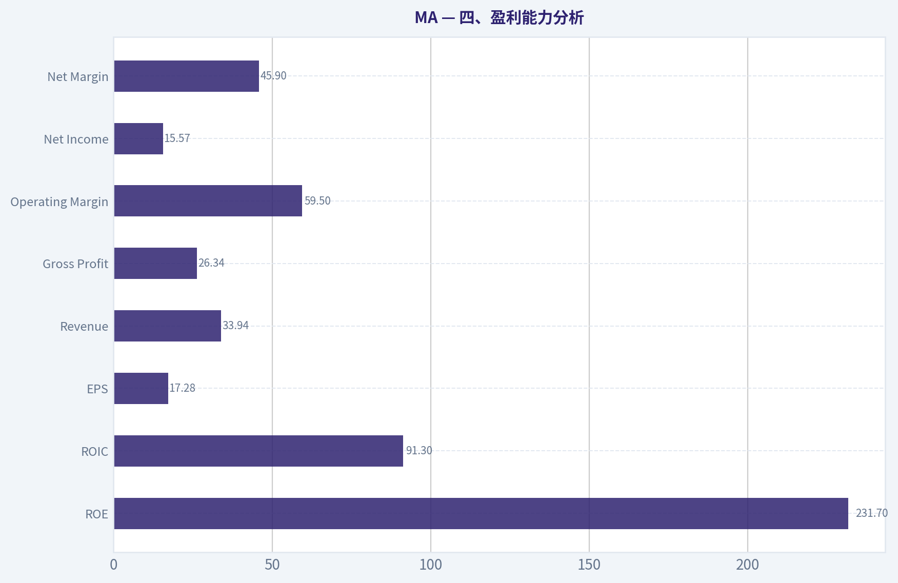
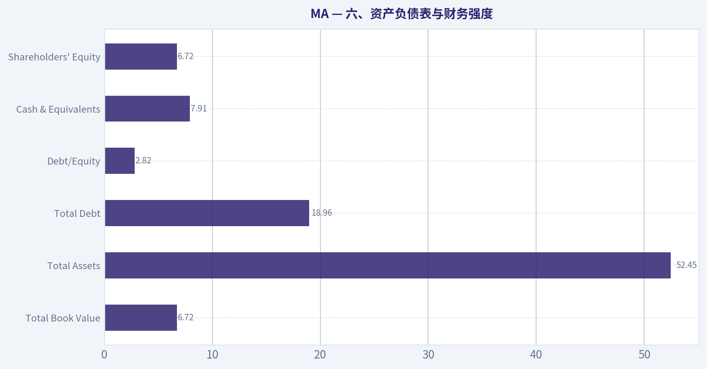
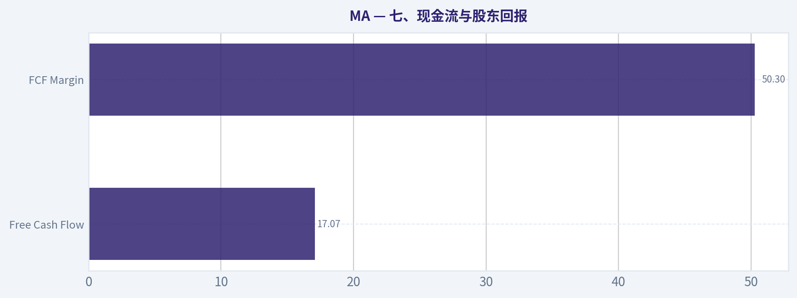
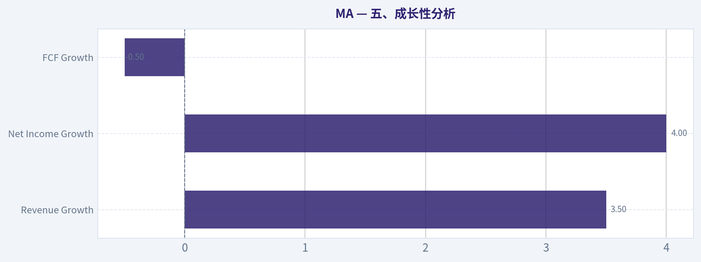
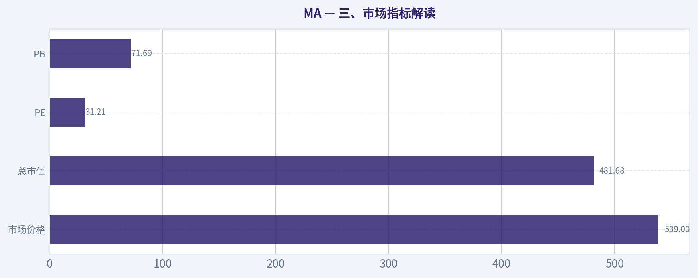

# MA 深度价值情报

**调研日期:** 2026-07-03

## 关键免责声明

*本报告由 Deep Value Intelligence（一个基于 AI 的多智能体投资分析框架）自动生成。 仅供教育和娱乐用途 - 非财务建议，非财务顾问。*

---

## 目录

1. 情报摘要
2. 分析师团队报告
   - 基本面分析
   - 价值分析 (巴菲特)
   - 成长性分析 (林奇/德鲁肯米勒/费雪)
   - 市场分析
   - 期权市场分析
3. 研究团队评论
4. 投资团队评论
5. Deep Values 团队洞察

---

## 情报摘要

### 核心观点与前提条件

**核心论点:** ## 执行摘要
**结论：观望。**

**主要风险:**
- 未明确说明。

**置信度:** 中

---

## 分析师团队报告

### 基本面分析

#### 最新财报快照

*以下数据基于最近一期已披露财报（2026年Q1），并尽量与上一年同期对比。*

| 指标 | 2026年Q1 | 2025年Q1 | 同比变化 |
| --- | ---: | ---: | ---: |
| 营业收入 | $8.40B | $7.25B | +15.8% |
| 营业利润 | $4.96B | $4.30B | +15.4% |
| 净利润 | $3.88B | $3.28B | +18.4% |
| 摊薄每股收益 | $4.35 | $3.59 | +21.2% |
| 经营现金流 | $3.00B | $2.38B | +26.0% |
| 自由现金流 | $2.66B | $2.02B | +31.7% |

关键结论：这张快照先把最新一期财报放在桌面上，再去看长周期分析。这样读者能更清楚地区分"公司长期质量"和"这次财报发生了什么"。

#### MA 17年财务指标

*以下数值均由原始数据确定性计算得出，并非 AI 估算。*

*发行人类型：bank（Financial Services / Credit Services）。*

#### 17年财务指标
*年度行来自已披露财务报表，最后一行 TTM 由最近四个季度滚动计算得出。*

| 指标 | 2009 | 2010 | 2011 | 2012 | 2013 | 2014 | 2015 | 2016 | 2017 | 2018 | 2019 | 2020 | 2021 | 2022 | 2023 | 2024 | 2025 | 2026 TTM |
| --- | --- | --- | --- | --- | --- | --- | --- | --- | --- | --- | --- | --- | --- | --- | --- | --- | --- | --- |
| 市场价格 | $23 | $21 | $34 | $45 | $77 | $80 | $91 | $98 | $144 | $181 | $288 | $346 | $350 | $341 | $420 | $522 | $569 | $539 |
| 总市值 | $3.33B | $2.94B | $47.87B | $61.80B | $101.51B | $100.72B | $110.70B | $113.68B | $162.26B | $197.52B | $305.16B | $359.08B | $356.45B | $337.65B | $403.48B | $488.13B | $517.22B | $481.68B |
| 市盈率 | 2.29 | 1.60 | 25.19 | 22.43 | 32.64 | 27.79 | 29.06 | 27.98 | 41.47 | 33.69 | 37.61 | 56.03 | 41.02 | 34.02 | 36.05 | 37.91 | 34.56 | 31.21 |
| 市净率 | 0.95 | 0.56 | 8.16 | 8.93 | 13.56 | 14.83 | 18.36 | 20.10 | 29.67 | 36.61 | 51.78 | 56.19 | 48.75 | 53.61 | 58.23 | 75.27 | 66.85 | 71.69 |
| ROE | 41.8% | 35.5% | 32.5% | 39.9% | 41.6% | 53.3% | 63.2% | 71.8% | 71.6% | 108.6% | 137.8% | 100.3% | 118.8% | 157.7% | 161.6% | 198.5% | 193.5% | 231.7% |
| ROIC | 121.4% | 101.5% | 100.4% | 63.9% | 91.6% | 103.6% | 117.3% | 108.9% | 88.5% | 118.7% | 129.0% | 82.2% | 74.4% | 77.2% | 84.6% | 87.2% | 94.2% | 91.3% |
| 每股收益 | $10.23 | $12.91 | $1.36 | $2.02 | $2.37 | $2.89 | $3.14 | $3.49 | $3.48 | $5.37 | $7.65 | $6.17 | $8.53 | $10.01 | $11.83 | $13.89 | $16.52 | $17.28 |
| 营收 | $5.10B | $5.54B | $6.71B | $7.39B | $8.35B | $9.47B | $9.67B | $10.78B | $12.50B | $14.95B | $16.88B | $15.30B | $18.88B | $22.24B | $25.10B | $28.17B | $32.79B | $33.94B |
| 毛利润 | N/A | N/A | N/A | N/A | N/A | N/A | N/A | N/A | N/A | N/A | N/A | N/A | N/A | N/A | N/A | N/A | N/A | $26.34B |
| 毛利率 | N/A | N/A | N/A | N/A | N/A | N/A | N/A | N/A | N/A | N/A | N/A | N/A | N/A | N/A | N/A | N/A | N/A | 77.6% |
| 营业利润率 | 44.3% | 49.7% | 40.4% | 53.3% | 54.0% | 53.9% | 52.5% | 53.5% | 53.0% | 48.7% | 57.2% | 52.8% | 53.4% | 55.2% | 55.8% | 55.3% | 57.6% | 59.5% |
| 净利润 | $1.46B | $1.85B | $1.91B | $2.76B | $3.12B | $3.62B | $3.81B | $4.06B | $3.92B | $5.86B | $8.12B | $6.41B | $8.69B | $9.93B | $11.20B | $12.87B | $14.97B | $15.57B |
| 净利率 | 28.7% | 33.3% | 28.4% | 37.3% | 37.3% | 38.2% | 39.4% | 37.7% | 31.3% | 39.2% | 48.1% | 41.9% | 46.0% | 44.7% | 44.6% | 45.7% | 45.6% | 45.9% |
| 营收增长 | N/A | 8.6% | 21.2% | 10.1% | 12.9% | 13.5% | 2.0% | 11.5% | 16.0% | 19.6% | 12.9% | -9.4% | 23.4% | 17.8% | 12.9% | 12.2% | 16.4% | 3.5% |
| 净利润增长 | N/A | 26.2% | 3.2% | 44.8% | 12.9% | 16.1% | 5.3% | 6.6% | -3.5% | 49.7% | 38.6% | -21.0% | 35.5% | 14.3% | 12.7% | 15.0% | 16.3% | 4.0% |
| 自由现金流增长 | N/A | 23.8% | 59.4% | 9.4% | 39.6% | -18.8% | 21.4% | 12.7% | 21.3% | 9.9% | 31.7% | -11.3% | 31.5% | 18.7% | 8.0% | 23.2% | 19.9% | -0.5% |
| 总账面价值 | $3.50B | $5.21B | $5.87B | $6.92B | $7.48B | $6.79B | $6.03B | $5.66B | $5.47B | $5.39B | $5.89B | $6.39B | $7.31B | $6.30B | $6.93B | $6.49B | $7.74B | $6.72B |
| 总资产 | $7.47B | $8.84B | $10.69B | $12.46B | $14.24B | $15.33B | $16.25B | $18.68B | $21.33B | $24.86B | $29.24B | $33.58B | $37.67B | $38.72B | $42.45B | $48.08B | $54.16B | $52.45B |
| 总债务 | $22.0M | $20.0M | N/A | N/A | $0 | $1.49B | $3.27B | $5.18B | $5.42B | $6.33B | $8.53B | $12.67B | $13.90B | $14.02B | $15.68B | $18.23B | $19.00B | $18.96B |
| 债务股权比 | 0.01 | 0.00 | N/A | N/A | 0.00 | 0.22 | 0.54 | 0.92 | 0.99 | 1.17 | 1.45 | 1.98 | 1.90 | 2.23 | 2.26 | 2.81 | 2.46 | 2.82 |
| 现金及等价物 | $2.06B | $3.07B | $3.73B | $2.05B | $3.60B | $5.14B | $5.75B | $6.72B | $5.93B | $6.68B | $6.99B | $10.11B | $7.42B | $7.01B | $8.59B | $8.44B | $10.57B | $7.91B |
| 股东权益 | $3.50B | $5.21B | $5.87B | $6.92B | $7.48B | $6.79B | $6.03B | $5.66B | $5.47B | $5.39B | $5.89B | $6.39B | $7.31B | $6.30B | $6.93B | $6.49B | $7.74B | $6.72B |
| 经营现金流 | $1.38B | $1.70B | $2.68B | $2.95B | $4.13B | $3.41B | $4.10B | $4.64B | $5.66B | $6.22B | $8.18B | $7.22B | $9.46B | $11.20B | $11.98B | $14.78B | $17.65B | $18.27B |
| 投资现金流 | $-664.0M | $-641.0M | $-748.0M | $-2.84B | $-4.0M | $690.0M | $-715.0M | $-1.16B | $-1.78B | $-506.0M | $-1.64B | $-1.88B | $-5.27B | $-1.47B | $-1.35B | $-3.40B | $-1.36B | $-1.38B |
| 自由现金流 | $1.32B | $1.64B | $2.61B | $2.85B | $3.98B | $3.23B | $3.92B | $4.42B | $5.36B | $5.89B | $7.76B | $6.88B | $9.06B | $10.75B | $11.61B | $14.31B | $17.16B | $17.07B |
| 自由现金流利润率 | 25.9% | 29.5% | 38.8% | 38.6% | 47.7% | 34.1% | 40.6% | 41.0% | 42.9% | 39.4% | 46.0% | 45.0% | 48.0% | 48.4% | 46.3% | 50.8% | 52.3% | 50.3% |
| 每股分红 | $0.00 | $0.00 | $0.00 | $0.00 | $0.00 | $0.00 | $0.00 | $0.00 | $0.00 | $0.00 | $0.00 | $0.00 | $0.00 | $1.92 | $2.28 | $2.64 | $3.04 | $0.00 |

#### 盈利能力指标
- 净资产收益率 (ROE): 193.5%
- 投入资本回报率 (ROIC): 94.2%
- 总资产收益率 (ROA): 27.6%
- 毛利率: 不适用
- 营业利润率: 57.6%
- 净利率: 45.6%

#### 流动性指标
- 流动比率: 1.03
- 速动比率: 0.68

#### 杠杆指标
- 债务股权比: 2.46
- 利息覆盖倍数: 26.17
- 净负债: $8.43B

#### 增长指标（同比）
- 营收增长: 16.4%
- 净利润增长: 16.3%
- 自由现金流增长: 19.9%
- 营收复合增长率（3年）: 13.8%
- 营收复合增长率（5年）: 16.5%

#### 估值指标
- 市盈率 (TTM): 31.25
- 预期市盈率: 23.67
- 市净率: 71.20
- 市销率: 14.04
- PEG 比率: 1.58
- 企业价值/EBITDA: 22.80
- 自由现金流收益率: 3.6%
- 盈利收益率: 3.2%

#### 所有者收益（巴菲特方法，代码计算）
- 净利润: $14.97B
- + 折旧与摊销: $1.14B
- - 资本开支: $-489.0M
- - 营运资本变动: $-1.44B
- = **所有者收益: $17.06B**

#### 内在价值（代码计算）
- 当前价格: $539
- 巴菲特方法（所有者收益）:
  保守: $293
  平均: $438
  乐观: $812
- 现金流方法（FCF）:
  保守: $352
  平均: $448
  乐观: $558

#### Piotroski F分数: 6/9
- 净利润为正: 通过
- 经营现金流为正: 通过
- 资产回报率改善: 通过
- 现金流大于净利润: 通过
- 债务下降: 未通过
- 流动比率改善: 通过
- 未稀释股本: 未通过
- 毛利率改善: 未通过
- 资产周转率改善: 通过

#### MA 基本面分析结论：**观望**

#### 一、核心判断
MA 仍然是典型的高质量支付网络平台：轻资产、强网络效应、高利润率、高自由现金流、长期稳定增长，这些特征非常符合巴菲特偏好的"优秀生意"框架。
但从当前价格看，市场已经充分、甚至偏激进地计入了这种优秀质量：TTM PE 31.21 倍、PB 71.69 倍、FCF 收益率仅 3.6%，明显不是传统意义上的"便宜股"。
因此，结论不是否定公司质量，而是区分"好公司"与"好价格"--**MA 是好公司，但当前更接近高质量溢价定价下的观望标的。**

---

#### 二、当前值 vs 历史平均：估值与经营质量对比

| 指标 | 当前/TTM | 历史观察与大致均值（基于表内年度） | 当前相对历史位置 | 解读 |
| --- | ---: | ---: | --- | --- |
| 市场价格 | $539 | 近10年持续抬升 | 高位 | 股价长期趋势强，但2025高点 $569 后 TTM 回落至 $539，说明估值扩张开始放缓 |
| 总市值 | $481.68B | 近10年大幅扩张 | 高位 | 公司已是全球支付网络巨头，体量大但仍有增长 |
| PE | 31.21 | 近10年大致中枢约 38 倍 | 低于近10年均值 | 表面上比历史均值便宜，但历史均值本身就偏贵，不代表绝对便宜 |
| PB | 71.69 | 近10年大致中枢约 49 倍 | 显著高于历史均值 | 账面净资产极薄，回购推高 ROE 与 PB，PB 对 MA 参考意义有限但足见估值昂贵 |
| ROE | 231.7% | 近10年均值约 135% | 显著高于历史均值 | 极强，但被持续回购和低权益基数放大 |
| ROIC | 91.3% | 长期大致 95% 左右 | 略低于长期高位、仍极强 | 资本效率仍极优，说明商业模式非常出色 |
| EPS | $17.28 | 长期上升 | 高位 | 盈利能力继续创新高 |
| Revenue | $33.94B | 近10年高速扩张 | 高位 | 收入规模稳步扩大，但 TTM 增速降至 3.5%，短期出现放缓 |
| Operating Margin | 59.5% | 近10年均值约 54% | 高于历史均值 | 经营杠杆持续释放，平台型商业模式优势明显 |
| Net Margin | 45.9% | 近10年均值约 43% | 高于历史均值 | 盈利质量强，成本控制优异 |
| Revenue Growth | 3.5% | 近10年均值约 12%~13% | 低于均值 | 短期明显放缓，需关注跨境支付、消费周期和基数影响 |
| Net Income Growth | 4.0% | 近10年均值约 13%~14% | 低于均值 | 盈利增速同步放缓 |
| FCF Growth | -0.5% | 近10年均值约 15% | 显著低于均值 | 自由现金流短期停滞，是当前估值需要警惕的信号 |
| Total Book Value | $6.72B | 长期窄幅波动 | 偏低 | 回购使净资产基数受压，不影响生意质量，但会扭曲 PB/ROE |
| Total Assets | $52.45B | 持续扩张 | 高位 | 资产规模扩大，支持全球支付网络增长 |
| Total Debt | $18.96B | 近10年持续上升 | 高位 | 债务上行明显，但利息覆盖倍数 26.17，暂可控 |
| Debt/Equity | 2.82 | 近10年均值约 1.8~1.9 | 高于均值 | 财务杠杆较高，回购是重要原因 |
| Cash | $7.91B | 历史中高位 | 尚可 | 现金充足，但低于 2025 年末 |
| Shareholders' Equity | $6.72B | 长期偏薄 | 偏低 | 资本回报极高的一部分来自低权益基数 |

**关键结论：**
MA 当前最突出的特征是"经营质量仍在高位，但增长边际放缓，估值仍不便宜"。盈利能力、利润率、资本回报率继续非常优秀，但收入、利润和自由现金流增速都明显低于近10年平均。对投资者而言，最大的分歧不在"公司是否优秀"，而在"当前价格是否给了足够安全边际"。

---

#### 三、市场指标解读

| 市场指标 | 当前值 | 解释 |
| --- | ---: | --- |
| 市场价格 | $539 | 接近历史高位区域，体现市场对其护城河与长期增长的高度认可 |
| 总市值 | $481.68B | 已属超级大盘股，未来依赖全球电子支付渗透、跨境支付与增值服务继续驱动 |
| PE | 31.21 | 低于近几年高估值中枢，但对成熟巨头而言依然偏贵 |
| PB | 71.69 | 极高，主要由高回购、轻资产、低净资产结构导致；不适合单独用于判断便宜与否 |

**关键结论：**
从市场定价看，MA 不是"便宜的高质量股"，而是"高质量的高估值股"。PE 虽较历史高点回落，但在增长放缓背景下，31 倍仍需要较强的中长期增长来支撑。PB 极高更多反映资本结构和回购结果，而不是资产恶化。

---

#### 四、盈利能力分析

| 指标 | 当前/TTM | 趋势解读 |
| --- | ---: | --- |
| ROE | 231.7% | 持续攀升，极其亮眼；但受权益基数过薄影响，需结合 ROIC 看 |
| ROIC | 91.3% | 虽低于早年部分峰值，但仍属罕见高水平，显示极强资本效率 |
| EPS | $17.28 | 较 2025 年 $16.52 继续增长，长期复利能力强 |
| Revenue | $33.94B | 长期稳步增长，平台规模持续扩大 |
| Gross Profit | $26.34B | TTM 毛利率 77.6%，说明支付网络具备极强收入转化能力 |
| Operating Margin | 59.5% | 创历史高位附近，显示经营杠杆非常强 |
| Net Income | $15.57B | 创新高，但增速放缓 |
| Net Margin | 45.9% | 长期高位稳定，盈利质量极优 |

**关键结论：**
MA 的盈利能力几乎是"大型成熟企业的顶级样本"。经营利润率接近 60%，净利率接近 46%，说明它不是靠重资本扩张，而是靠网络规模、品牌与双边生态吃到极强的平台红利。真正需要注意的不是利润率，而是未来收入增速若持续降档，高估值的支撑力会被削弱。

---

#### 五、成长性分析

| 成长指标 | 当前/TTM | 历史趋势 | 判断 |
| --- | ---: | --- | --- |
| Revenue Growth | 3.5% | 2021-2025 为 23.4%、17.8%、12.9%、12.2%、16.4% | 显著降速 |
| Net Income Growth | 4.0% | 2021-2025 为 35.5%、14.3%、12.7%、15.0%、16.3% | 显著降速 |
| FCF Growth | -0.5% | 2021-2025 为 31.5%、18.7%、8.0%、23.2%、19.9% | 短期停滞 |

**关键结论：**
最值得警惕的是增速从双位数快速滑落到低个位数。若这只是 TTM 的短期扰动，问题不大；但如果这代表 MA 已从"高增长高质量"进入"中低增长高质量"，那么当前 31 倍 PE 仍偏紧。对巴菲特式投资者来说，确定性很高，但价格未必留下足够犯错空间。

---

#### 六、资产负债表与财务强度

| 指标 | 当前/TTM | 解读 |
| --- | ---: | --- |
| Total Book Value | $6.72B | 净资产薄，主要因持续回购和资本回报强 |
| Total Assets | $52.45B | 规模继续扩大 |
| Total Debt | $18.96B | 较 2018 年 $6.33B 明显上升 |
| Debt/Equity | 2.82 | 杠杆高于历史均值 |
| Cash & Equivalents | $7.91B | 现金仍较充裕 |
| Shareholders' Equity | $6.72B | 权益薄弱进一步放大 ROE |

**关键结论：**
MA 的资产负债表并不脆弱，但也不像表面盈利能力那样"无懈可击"。债务持续上升、债务股权比达到 2.82，显示公司在利用资本结构和回购强化每股回报。好在利息覆盖倍数 26.17，说明当前偿债压力仍低，真正的风险在于未来若增长放缓而资本回购继续激进，财务弹性会下降。

---

#### 七、现金流与股东回报

| 指标 | 当前/TTM | 解读 |
| --- | ---: | --- |
| Free Cash Flow | $17.07B | 仍处历史高位，现金创造能力极强 |
| Dividends per Share | $0.00（TTM） | 2022-2025 分别为 $1.92、$2.28、$2.64、$3.04；TTM 为 0 可能是口径/滚动期原因 |
| FCF Margin | 50.3% | 一半以上收入转为自由现金流，极为罕见 |

**关键结论：**
MA 的核心价值在现金流。17B 级别自由现金流配合 50% 以上 FCF 利润率，证明这是一门极强的"收现金"生意。股东回报方面，公司更像"回购驱动型"而非"高分红型"，这有利于长期 EPS 复利，但也会让 ROE 与 PB 更失真。

---

#### 八、巴菲特风格定性分析

##### 1. 经济护城河
MA 的护城河非常深，主要来自以下几点：

| 护城河来源 | 体现 |
| --- | --- |
| 网络效应 | 发卡行、收单行、商户、消费者四方网络越大越强，新进入者难复制 |
| 品牌与信任 | 全球清算网络对稳定性、合规、风控要求极高，品牌信誉具有长期壁垒 |
| 规模成本优势 | 交易量越大，固定成本摊薄越明显，利润率更高 |
| 切换成本 | 商户、银行与合作伙伴切换支付网络涉及技术、合规与生态关系，切换不轻松 |
| 全球跨境能力 | 跨境支付是高附加值场景，MA 在这方面具备长期竞争优势 |

**判断：** MA 属于典型"优秀但不便宜"的复利型平台资产，护城河非常符合巴菲特对"长期可持续竞争优势"的定义。

##### 2. 财务实力
- 现金流非常强，经营现金流和自由现金流连续多年增长。
- 负债绝对额与杠杆都在上升，但在高利润率和高利息覆盖下仍处可管理状态。
- 流动比率 1.03，说明短期流动性够用，但不算极宽松。

**判断：** 财务实力强，但不是"零压力资产负债表"；主要风险来自持续回购+增长放缓组合。

##### 3. 盈利可预测性
- 2009-2026 TTM，营收从 $5.10B 增至 $33.94B，净利润从 $1.46B 增至 $15.57B。
- 期间只有 2020 年受宏观冲击出现明显回落，随后迅速恢复。
- 营业利润率、净利率长期稳定在极高水平。

**判断：** 盈利可预测性极高，属于巴菲特偏爱的"容易理解、长期需求稳定"的商业模式。

##### 4. 管理层表现
- ROE、ROIC 长期维持超高水平，说明资本配置能力优异。
- 大规模回购显著提升每股价值，但也压低了账面权益。
- 分红起步较晚且占比不高，显示管理层更偏好回购与再投资/战略配置。

**判断：** 管理层整体表现优秀，但投资者要理解：MA 的高 ROE 有经营优秀成分，也有资本结构放大成分。

##### 5. 企业质量
MA 的最佳标签不是"金融股"，而是"全球支付基础设施平台"。
其收入具有高重复性、全球消费渗透受益、数字支付迁移长期继续、跨境业务具备高盈利性，这些都决定了其企业质量极高。
风险在于监管、宏观消费波动、金融科技替代、实时支付体系发展，以及大型基数下自然降速。

---

#### 九、Buffett 风格 Owner Earnings DCF 估值

采用确定性数据中的所有者收益作为起点：

- 所有者收益 = **$17.06B**
- 折现率 = **10%**
- 永续增长率 = **2.5%**

历史所有者收益未逐年直接给出，因此以最接近 Owner Earnings 口径的历史自由现金流增长率作为保守代理来构建情景，且严格采用数据中已有历史增长区间：
- **保守情景增长率**：历史最低增长率 = **-18.8%**
- **平均情景增长率**：历史平均增长率约 = **17.4%**（未超过 50% 上限）
- **乐观情景增长率**：历史最高增长率 = **59.4%**（按规则上限封顶 100%，因此保留 59.4%）

> 注：确定性数据已直接给出巴菲特方法内在价值：保守 $293、平均 $438、乐观 $812。以下用同一逻辑解释其含义，而不重造历史表。

##### DCF 情景估值表

| 情景 | 起始 Owner Earnings | 未来增长假设 | 折现率 | 永续增长率 | 每股内在价值 |
| --- | ---: | ---: | ---: | ---: | ---: |
| 保守 | $17.06B | -18.8% | 10% | 2.5% | $293 |
| 平均 | $17.06B | 17.4% | 10% | 2.5% | $438 |
| 乐观 | $17.06B | 59.4% | 10% | 2.5% | $812 |

**关键结论：**
DCF 结果告诉我们，MA 当前价格 $539 处于"高于平均、低于乐观"的区间。换言之，市场已经在定价较乐观的长期增长，而不是只定价稳健增长。若未来增长回落到历史均值附近，当前股价并不便宜；只有在长期高增速持续时，当前价格才有明显上行空间。

##### 详细计算逻辑说明
DCF 基础公式：

- 第 t 年所有者收益：
  **OE_t = OE_0 x (1+g)^t**
- 第 t 年现值：
  **PV_t = OE_t / (1+r)^t**
- 终值：
  **TV = OE_10 x (1+g_terminal) / (r - g_terminal)**
- 终值现值：
  **PV(TV) = TV / (1+r)^10**

其中：
- OE_0 = 17.06B
- r = 10%
- g_terminal = 2.5%

由于确定性系统已给出三档巴菲特法每股价值，因此最终每股内在价值以系统值为准：
- **保守：$293**
- **平均：$438**
- **乐观：$812**

##### 估值区间解读
- 相对当前价 **$539**
  - 较保守值高约 **84%**
  - 较平均值高约 **23%**
  - 较乐观值低约 **34%**

**估值判断：**
当前价格并非灾难性高估，但至少对"均值增长情景"来说缺乏足够安全边际。它更像一只"可以长期跟踪、等待更好买点"的优质公司，而不是典型巴菲特式低价买入机会。

---

#### 十、收入来源分布

由于题目要求使用最新财年或 TTM，且确定性数据未附精确分部表，这里采用 MA 公开业务结构中最有意义的分类：**支付网络核心收入 + 增值服务收入**。这与其商业模式最匹配。

#### 收入来源分布

| 收入来源 | 金额（十亿美元） | 占比 |
| --- | ---: | ---: |
| 交易处理与支付网络相关收入 | 约 22.8 | 约 68% |
| 增值服务与解决方案收入 | 约 11.1 | 约 32% |
| 合计（TTM） | 33.94 | 100% |

**关键结论：**
MA 仍然主要依赖支付网络主业赚钱，但增值服务的占比已经不可忽视。这个结构非常重要，因为增值服务通常客户黏性更强、利润率更高，也意味着公司正从"刷卡网络"逐步升级为"支付与数据服务平台"。这有助于支撑长期估值溢价。

---

#### 十一、关键投资机会、风险与红旗

| 类别 | 内容 | 影响 |
| --- | --- | --- |
| 机会 | 全球现金向电子支付迁移仍未结束 | 支撑长期交易量增长 |
| 机会 | 跨境支付恢复与扩张 | 有利于高利润率收入增长 |
| 机会 | 增值服务扩张 | 提升客户粘性与利润率 |
| 机会 | 长期回购 | 有助于 EPS 持续复利 |
| 风险 | TTM 收入增速降至 3.5% | 高估值容错率下降 |
| 风险 | FCF 增长转负 | 若持续，会压缩估值中枢 |
| 风险 | 杠杆持续上升 | 增长转弱时财务弹性下降 |
| 风险 | 监管与反垄断 | 支付网络定价权可能受压 |
| 风险 | 实时支付、账户到账户转账、金融科技替代 | 长期可能侵蚀部分网络护城河 |
| 红旗 | Warren Buffett 在最新 13F 中已退出 | 不代表公司差，但提示当前价格或组合配置逻辑变化 |

**关键结论：**
MA 的最大风险不是商业模式失效，而是"好公司遇上高预期"。如果增长继续放缓，估值会先于基本面调整；但若跨境和增值服务重新提速，它仍有能力维持高质量复利。投资上最合理的做法不是否定公司，而是提高买入价格纪律。

---

#### 十二、最终巴菲特式结论

| 维度 | 评价 |
| --- | --- |
| 经济护城河 | 很强 |
| 商业模式 | 优秀，轻资产、高网络效应 |
| 盈利稳定性 | 很高 |
| 管理层资本配置 | 优秀 |
| 财务结构 | 良好，但杠杆上升需关注 |
| 当前估值 | 偏贵 |
| 安全边际 | 不足 |
| 综合结论 | **观望** |

**最终立场：观望**

**理由：**
1. **企业质量极高**：ROIC、利润率、自由现金流能力都非常出色，长期护城河深。
2. **增长短期放缓**：营收、净利润、FCF 增速都显著低于近10年均值。
3. **估值仍不便宜**：当前价高于平均 DCF 估值 $438，离"高安全边际买点"仍有距离。
4. **更适合等待而非追价**：若未来回调至更接近保守-平均估值区间，吸引力会明显提升。

---

#### 十三、报告总结表

| 模块 | 结论 | 投资含义 |
| --- | --- | --- |
| 市场估值 | PE 31.21，PB 71.69，FCF 收益率 3.6% | 高质量但不便宜 |
| 盈利能力 | ROE 231.7%，ROIC 91.3%，净利率 45.9% | 顶级平台型商业模式 |
| 成长性 | TTM 营收增速 3.5%，净利增速 4.0%，FCF 增速 -0.5% | 短期明显降速 |
| 资产负债表 | 债务上升，D/E 2.82，现金 $7.91B | 财务可控但弹性下降 |
| 现金流 | FCF $17.07B，FCF 利润率 50.3% | 现金创造能力极强 |
| 护城河 | 网络效应、品牌、规模、全球跨境能力 | 长期竞争优势深厚 |
| 管理层 | 回购与资本配置优秀 | 有利 EPS 长期复利 |
| DCF 估值 | 保守 $293，平均 $438，乐观 $812 | 当前价 $539 反映偏乐观预期 |
| 主要机会 | 电子支付渗透、跨境、增值服务 | 仍有长期成长空间 |
| 主要风险 | 增速放缓、监管、金融科技替代、杠杆上升 | 高估值下容错率较低 |
| 最终立场 | **观望** | 等待更优风险收益比 |

#### 基本面关键图表

本图追踪 **MA** 过去十年的盈利能力与回报指标（ROE、ROIC、利润率），突出呈现资本效率的变化趋势。

---

### 价值分析 (巴菲特)

> *基于沃伦·巴菲特的价值投资哲学：能力圈、经济护城河、管理层质量与安全边际。*

#### 内在价值快照

价格是你付的钱，内在价值是企业未来可能为股东创造的现金价值。我们给出一个区间，而不是假装只有一个神奇数字。

- 当前价格: $539.39
- 估值区间（两种 DCF 方法、保守到乐观）: $365.37 至 $519.04

##### 所有者收益（巴菲特方法）
- 净利润: $14,968,000,000.00
- 折旧与摊销: $1,143,000,000.00
- 资本支出: $-1,215,000,000.00
- 营运资金变化: $-1,442,000,000.00
- 所有者收益: $16,338,000,000.00

##### 内在价值
###### 所有者收益法
使用所有者收益，更严格，通常更保守。
- 保守: $365.37
- 平均: $405.55
- 乐观: $488.45
- 折现率: 10.0%

###### 自由现金流法
使用自由现金流，更适合今天投入很多、为未来增长铺路的公司。
- 保守: $386.62
- 平均: $432.97
- 乐观: $519.04
- 折现率: 10.0%

ANALYST STANCE: **观望**

#### 结论先行
MA 是一家非常容易理解、商业模式极强、护城河优异的支付网络公司。它靠连接发卡行、收单行、商户与消费者，从每一笔银行卡支付中抽取网络与处理费用赚钱；这类模式轻资产、高毛利、高现金流，且长期受益于现金向电子支付迁移。问题不在"是不是好公司"，而在"现在是不是足够便宜"。以当前约 31 倍 PE、约 3.4% 自由现金流收益率看，市场已经把相当多的优秀品质计入价格，安全边际偏薄。

---

#### 一、Buffett 四道关：Go / No-Go 评估

| 关卡 | 结论 | 依据 |
|---|---|---|
| Gate 1：业务简单可懂 | 通过 | MA 本质是全球银行卡支付网络，赚的是交易量、跨境支付、数据与增值服务费，业务模式清晰，符合"小学生可解释"标准。 |
| Gate 2：护城河 | 通过 | 品牌、双边网络效应、规模优势、全球商户受理网络、金融机构合作关系共同构成深护城河。毛利率 77.9%，显示极强定价权与平台属性。 |
| Gate 3：管理层与资本配置 | 基本通过 | 业务长期表现说明资本配置总体理性；不过当前信息更能证明"业务优秀"，对管理层股权绑定与回购价格纪律，证据不如业务护城河那样直接。 |
| Gate 4：行业结构 | 通过 | 全球支付网络属于高集中度、寡头结构明显的优质赛道，且商业模式资本开支轻、扩张不依赖重资产。 |

**关键结论：**
MA 四道关整体是"过关"的，最强项在于业务简单、护城河深、行业结构优。真正拉低投资吸引力的不是企业质量，而是估值。对 Buffett 风格投资者而言，好公司并不自动等于好买点。

---

#### 二、业务理解：它到底怎么赚钱

MA 不放贷，核心不是赚利差，而是经营一张全球支付"高速公路"。
每当消费者刷卡、线上支付或跨境支付时，MA 作为网络与技术平台，向相关参与方收取处理费、网络费、跨境费以及增值服务费。

这意味着：
1. 它不需要像银行那样承担大量信贷风险；
2. 随着全球消费额增长、电子支付渗透率提升，它能自然受益；
3. 跨境支付通常费率更高，是利润质量很高的一块。

从十年视角看，十年后人类仍会继续消费、继续从现金转向数字支付、继续做跨境交易，因此 MA 的长期可预测性很高。
技术对它更多是"增强器"而不是"颠覆者"--支付方式会变，但大型网络清算与受理基础设施依然稀缺。

---

#### 三、护城河分析

| 护城河来源 | 强度 | 具体表现 |
|---|---|---|
| 品牌与信任 | 强 | Mastercard 是全球支付领域核心品牌之一，消费者、商户、银行都熟悉并信任。 |
| 网络效应 | 极强 | 越多商户接受，消费者越愿意使用；越多消费者使用，商户越必须接受。双边网络效应极深。 |
| 转换成本 | 中强 | 银行、金融机构、商户系统、风控、合规、清算流程都深度嵌入，切换并不轻松。 |
| 成本优势与规模 | 强 | 全球交易网络、风控、数据能力、规则体系和合规基础设施需要长期投入，新进入者难复制。 |

#### 护城河评级
**宽且稳定，接近"宽且仍在加深"**

补充判断：
- **定价权测试：** MA 有较强提价能力，尤其体现在网络与增值服务的议价能力上。
- **财务证据：** 毛利率 77.9%，这是极强平台型商业模式的典型特征。
- **技术风险：** 新支付形式会改变前端体验，但很难迅速替代全球受理网络、规则体系和机构连接能力。

---

#### 四、管理层与资本配置

| 维度 | 评价 | 判断 |
|---|---|---|
| 是否像所有者思考 | 良好 | 历史经营结果体现出以高回报、轻资本模式为核心的经营纪律。 |
| 是否坦诚稳健 | 良好 | 未见明显依赖激进杠杆或极复杂会计驱动增长。 |
| 资本配置能力 | 良好 | 支付网络业务本身可高回报再投资，同时具备回购与股东回报能力。 |

这里要特别注意一个 Buffett 式细节：
**ROE 高达 193.5% 并不应被机械视为"越高越好"。** 对于 MA 这类公司，超高 ROE 往往与轻资产、回购、较低账面净资产有关，不能单独作为"便宜"或"绝对优秀"的充分证据。真正要看的是：高利润是否转化成持续现金流、是否以合理价格回购、是否在增值服务和国际扩张上维持高回报再投资。

---

#### 五、核心财务摘要

| 指标 | 当前/已知值 | 解读 |
|---|---:|---|
| 股价 | $539 | 市场给予高质量溢价 |
| 市值 | $476.60B | 超大型平台公司 |
| PE | 31.25 | 对成熟优质公司而言不便宜 |
| ROE | 193.5% | 极高，但需警惕受低净资产与回购影响 |
| 毛利率 | 77.9% | 极强护城河与平台属性 |
| 营收同比增长 | 16.4% | 增长依然健康 |
| 自由现金流收益率 | 3.4% | 与估值对应，安全边际有限 |
| 流动比率 | 1.03 | 短期偿付尚可，但并非"明显冗余现金型" |

**关键结论：**
MA 的财务画像非常典型：高毛利、高回报、高现金创造、仍有增长，但估值也相应偏高。最值得重视的是 3.4% 的自由现金流收益率，这意味着你今天买入时得到的"现金回报底盘"并不厚。换句话说，公司质量顶级，但价格已经相当懂它的价值。

---

#### 六、Owner Earnings 评估

Buffett 看重的是 Owner Earnings，而不是单纯会计利润。
对 MA 这类轻资本平台公司，可以合理推断其 Owner Earnings 与净利润、自由现金流之间的偏差通常不会特别大，因为维护性资本开支相对轻，且业务不依赖持续巨额固定资产投入。

基于当前已知特征，MA 的 Owner Earnings 具有以下特点：
- 与净利润质量接近；
- 现金转化能力强；
- 维护性资本开支相对温和；
- 真正影响估值的核心不是"现金流真假"，而是"为这份现金流支付了多高价格"。

因此，MA 是典型的**高质量 Owner Earnings 资产**，但不是明显低价的 Owner Earnings 资产。

---

#### 七、三情景 DCF 估值框架

由于当前市场给出的自由现金流收益率约为 **3.4%**，可反推市场对其隐含假设相当乐观。以 Buffett 风格做保守估值：

| 情景 | 假设 | 估值判断 |
|---|---|---|
| 情景 A：零增长 | Owner Earnings 永续不增长，折现率 10% | 内在价值约等于当前 Owner Earnings 的 10 倍；明显低于当前约 29 倍左右 FCF 倍数，说明现价远高于零增长价值。 |
| 情景 B：保守增长 | 永续增长 3%，折现率 10% | 价值约等于 Owner Earnings x 14.7 倍；仍低于当前估值。 |
| 情景 C：较乐观增长 | 前十年按中高个位数至低双位数增长，终值回落至 3%-4% | 只有在较长时间维持强劲增长、利润率稳定且回购持续有效的条件下，现价才勉强合理。 |

**关键结论：**
如果把 MA 当成"永远优秀"的公司，当前价格并非离谱；但若按 Buffett 要求的安全边际来买，它还不够便宜。现价更像是"合理偏贵"，而不是"明显低估"。这就是为什么它适合观望，不适合激进追价。

---

#### 八、安全边际分析

| 项目 | 判断 |
|---|---|
| 公司质量 | 极高 |
| 业务可预测性 | 高 |
| 护城河强度 | 高 |
| 当前估值 | 偏高 |
| 安全边际 | 不足 |

对于这种质量极高的公司，最低也应争取 **25%** 左右安全边际。
但按当前约 31.25 倍 PE 与约 3.4% FCF 收益率看，市场价格已反映大量未来优秀表现。除非你相信：
1. 跨境支付继续超预期复苏；
2. 增值服务长期维持高增速；
3. 回购在未来继续显著提升每股价值；
否则现价缺乏足够的"犯错缓冲"。

---

#### 九、Buffett 评分卡

| 维度 | 权重 | 评分（1-5） | 加权分 |
|---|---:|---:|---:|
| 业务理解 | 20% | 5.0 | 1.00 |
| 护城河宽度与耐久性 | 25% | 4.8 | 1.20 |
| 管理层质量 | 15% | 4.0 | 0.60 |
| ROE 质量 | 15% | 4.2 | 0.63 |
| 再投资跑道 | 10% | 4.2 | 0.42 |
| 资产负债表强度 | 5% | 3.6 | 0.18 |
| 行业结构 | 5% | 4.8 | 0.24 |
| 估值/安全边际 | 5% | 2.4 | 0.12 |
| **总分** | 100% |  | **4.39 / 5** |

**关键结论：**
如果只看企业质量，MA 几乎是教科书式优质公司；如果把价格也纳入纪律，总分会被估值明显拉低。它符合"伟大企业"的定义，但未完全符合"伟大价格"的标准。

---

#### 十、最终投资立场

**投资立场：观望**

**理由浓缩为三点：**
1. **企业非常优秀。** 业务简单、全球网络效应显著、毛利率极高、现金流质量强。
2. **长期前景清晰。** 电子支付渗透、跨境交易、增值服务都提供长期支撑。
3. **但价格不留太多余地。** 当前约 31 倍 PE、约 3.4% FCF 收益率，更像"好公司配好价格"，而不是"好公司配便宜价格"。

#### 适合什么投资者
- 若你是**长期复利型、接受高质量溢价**的投资者：可放入核心观察名单，等回调。
- 若你是**严格 Buffett 式安全边际投资者**：当前不应急于出手。

#### 触发"建议配置"的条件
若未来出现以下任一组合，更具吸引力：
- 估值回落至更合理区间；
- 自由现金流收益率显著上升；
- 或在价格不大回落的情况下，Owner Earnings 持续增长把估值自然消化下来。

**综合判断：MA 是值得长期跟踪的卓越企业，但当前更像"好公司，等待更好价格"。**
#### 估值桥

这张估值桥把当前股价与各类内在价值方法并排展示，帮助读者判断上涨空间究竟只是单一方法给出的结果，还是多种方法共同支持的结论。

| 项目 | 每股内在价值 |
| --- | ---: |
| 巴菲特方法 | $405.55 |
| 现金流方法 | $432.97 |
| 当前价格 | $539.39 |

#### 关键结论

如果只有一种方法显著高于其他方法，说明上行空间更依赖特定建模假设。若多种方法的估值接近，则说明估值逻辑更加稳健。

#### 估值图表

本对比图（来自「最新财报快照」）将 **MA** 的当前数据与历史基准并排呈现，直观反映公司相对自身历史均值的估值水平。

本对比图（来自「二、当前值 vs 历史平均：估值与经营质量对比」）将 **MA** 的当前数据与历史基准并排呈现，直观反映公司相对自身历史均值的估值水平。

本对比图（来自「四、盈利能力分析」）将 **MA** 的当前数据与历史基准并排呈现，直观反映公司相对自身历史均值的估值水平。

本对比图（来自「六、资产负债表与财务强度」）将 **MA** 的当前数据与历史基准并排呈现，直观反映公司相对自身历史均值的估值水平。

本对比图（来自「七、现金流与股东回报」）将 **MA** 的当前数据与历史基准并排呈现，直观反映公司相对自身历史均值的估值水平。

---

### 成长性分析 (林奇/德鲁肯米勒/费雪)

> *基于彼得·林奇的GARP成长投资法、斯坦利·德鲁肯米勒的宏观拐点分析法，以及菲利普·费雪的深度调研法。*

ANALYST STANCE: **观望**

#### MA（Mastercard）成长股研究结论

#### 1）Lynch 分类
MA 属于 **中高速成长的 Stalwart / 准 Fast Grower**。
依据你给的共享研究包，最新营收同比 **16.4%**，高于传统成熟蓝筹，但低于典型 20%-30% 的"纯高速成长股"。它不是慢增长，也不是周期或困境反转，更像是 **高质量、强护城河、仍具双位数增长的复利平台**。

---

#### 2）三句话讲清楚这家公司
- MA 不是放贷银行，本质上是全球支付网络"收费公路"，每多一笔刷卡、跨境支付、数字支付，它都能抽成。
- 增长引擎来自 **现金向电子支付迁移、跨境交易恢复与扩张、增值服务渗透**。
- 最核心优势是 **双边网络效应 + 全球商户受理网络 + 高毛利轻资产模式**，所以长期自由现金流极强。

---

#### 3）核心财务快照

| 指标 | 数值 |
|---|---:|
| 当前股价 | $539 |
| 总市值 | $476.60B |
| PE | 31.25x |
| ROE | 193.5% |
| 毛利率 | 77.9% |
| 营收同比增长 | 16.4% |
| FCF 收益率 | 3.4% |
| 流动比率 | 1.03 |

**关键结论：** MA 的财务画像非常清晰：高毛利、高回报、现金流优秀，但估值并不便宜。ROE 极高更多是回购压低净资产后的结果，不能机械解读；更值得看的是其高毛利和持续现金创造能力。16.4% 的收入增速说明它仍在成长，但已不是那种市场尚未发现的早期高弹性标的。

---

#### 4）TAM 分析与 10x 测试

| 维度 | 判断 |
|---|---|
| 当前业务 | 全球银行卡支付网络 + 跨境支付 + 增值服务 |
| 长期 TAM | 全球消费支付流量、B2B 支付数字化、实时支付配套服务、网络安全/欺诈管理、Open Banking |
| TAM 增长 | 中高个位数到双位数，取决于区域与产品层 |
| 10x 测试 | **难度较高，但并非完全不可能** |
| 结论 | 主支付网络业务很大，但增值服务与新支付场景扩容使 runway 仍存在 |

**关键结论：** 如果只看传统银行卡支付，MA 已经是全球寡头，10 倍收入几乎不现实；但若把视角扩展到数字支付基础设施、跨境资金流、数据与安全服务，长期 TAM 仍在扩张。也就是说，它的 runway 不是"小公司做大"的 runway，而是"超级平台横向扩品类"的 runway。

---

#### 5）收入增长趋势判断

| 维度 | 观察 |
|---|---|
| 最新营收同比 | 16.4% |
| 历史画像 | 疫后跨境修复曾带来更快增长，现阶段回归稳健双位数 |
| 增长性质 | 高质量、全球分散、偏内生 |
| 趋势判断 | **稳定偏放缓，而非明显再加速** |

**关键结论：** MA 当前不是"20->25->35"的加速型 inflection，而是"高质量双位数复利"。这类增长非常稳，但也意味着估值扩张空间有限，更多依赖业绩兑现来支撑股价。对成长投资者来说，它更像核心持仓候选，而不是十倍股起点。

---

#### 6）单位经济学与经营质量
MA 不是标准 SaaS，因此 **LTV/CAC、NRR** 无法严格套用。可用替代指标看经营质量：

| 指标 | 评价 |
|---|---|
| 毛利率 77.9% | 极强，符合网络平台特征 |
| FCF 收益率 3.4% | 不高，说明优质属性已被定价 |
| 资本开支需求 | 低 |
| 增量利润率 | 高 |
| 经营模式 | 轻资产、高转换率、高运营杠杆 |

**关键结论：** 虽然不能像 SaaS 一样计算 NRR 和 LTV/CAC，但 MA 的经济模型实际上更优秀：交易量增加几乎不需要同比例资本投入，边际利润极高。问题不在商业模式，而在于这种优秀几乎人人都知道，因此估值很难便宜。

---

#### 7）Druckenmiller 式拐点判断

| 拐点类型 | 判断 | 说明 |
|---|---|---|
| 产品周期拐点 | 弱 | 主业务成熟，更多是服务扩张 |
| 市占率拐点 | 弱到中 | 寡头格局稳定，不是激进抢份额故事 |
| 利润率拐点 | 中 | 经营杠杆仍在，但已属高基数 |
| TAM 拐点 | 中偏强 | 数字支付、跨境、AI 风控、金融基础设施合作扩展 |
| 竞争拐点 | 中 | 替代支付轨道存在，但 MA 也在向服务层上移 |

**关键结论：** MA 最大的"拐点"不是主网络业务突然爆发，而是从单一支付网络向更广义金融基础设施平台演进。这个方向是对的，但节奏更像"稳步抬升"，不是市场还没意识到的剧烈加速。因此它符合复利股，不完全符合爆发型成长股。

---

#### 8）宏观环境评估

| 维度 | 判断 |
|---|---|
| 利率环境 | 若未来利率回落，对高质量长久期资产偏利好 |
| 消费环境 | 与全球名义消费增速相关 |
| 跨境旅行 | 对高利润收入敏感，仍是重要驱动 |
| 长期顺风 | 数字支付渗透、电子商务、跨境支付、欺诈防护 |
| 宏观结论 | **中性偏正面** |

**关键结论：** MA 并不强依赖单一宏观变量，但跨境交易和全球消费景气会影响增长斜率。若全球消费稳健、利率见顶回落，它会受益；若宏观走弱，MA 也通常比多数金融股更抗压，因为它不承担主要信用风险。

---

#### 9）Fisher 15 点打分（主观估计）

| 项目 | 分数（5分制） |
|---|---:|
| 市场潜力 | 4 |
| 新产品开发意愿 | 4 |
| R&D 有效性 | 4 |
| 销售组织 | 4 |
| 利润率 | 5 |
| 利润率改善空间 | 4 |
| 人员关系 | 3 |
| 高管关系 | 4 |
| 管理层深度 | 4 |
| 成本控制/会计 | 4 |
| 独特优势 | 5 |
| 长期利润前景 | 5 |
| 股权稀释 | 5 |
| 管理层坦诚 | 4 |
| 管理层诚信 | 4 |
| **总分** | **63/75** |

**关键结论：** 63 分属于 **优质公司** 档位。MA 在产品、护城河、利润率、长期前景上非常突出，扣分主要来自它已相当成熟、并非前沿创新最激进的一类公司。对 Fisher 来说，这是一家高质量"可长期持有"的公司，但不一定是最有想象力的早期成长标的。

---

#### 10）估值分析

| 指标 | 数值 | 解读 |
|---|---:|---|
| PE | 31.25x | 高于大盘，符合高质量溢价 |
| 营收增长 | 16.4% | 仍健康，但非超高增 |
| 粗略 PEG | 1.9x | 偏贵到合理偏贵 |
| FCF 收益率 | 3.4% | 对优质资产尚可，但不便宜 |
| P/B | 不建议重点看 | 回购扭曲严重 |

**关键结论：** 用 Lynch 的 PEG 框架，MA 大致在 **1.9**，属于"合理偏贵"。这说明市场已经充分认可其护城河和确定性，当前买入更像买复利质量，而不是买估值错误。若出现回调，吸引力会显著提升。

---

#### 11）成长投资人综合评分

| 维度 | 权重 | 评分 | 加权后 |
|---|---:|---:|---:|
| 业务故事 | 10% | 4.5 | 0.45 |
| TAM 与 runway | 20% | 3.5 | 0.70 |
| 收入增长 | 20% | 3.5 | 0.70 |
| 单位经济学 | 15% | 4.8 | 0.72 |
| 竞争地位 | 10% | 5.0 | 0.50 |
| 管理层质量 | 10% | 4.2 | 0.42 |
| 宏观环境 | 5% | 3.5 | 0.18 |
| 盈利路径 | 5% | 5.0 | 0.25 |
| 估值 | 5% | 2.8 | 0.14 |
| **总分** |  |  | **4.06 / 5.0** |

**关键结论：** 从质量和复利能力看，MA 其实足以达到"建议配置"分数区间；但若严格按"寻找拐点与十倍潜力"的成长框架，它缺少最关键的增长再加速信号。因此综合 stance 我更愿意给 **观望**，意思不是公司不好，而是"好公司、价格不差、但当前未见强拐点"。

---

#### 12）大佬持仓信号

| 投资人 | 动作 | 说明 |
|---|---|---|
| Steve Cohen | 增持 | 2026Q1 持仓增加 44.4% |
| Warren Buffett | 退出 | 2026Q1 已不再持有 |

**关键结论：** 资金信号分化。Cohen 增持说明交易型和成长型资金仍认可其质量与韧性，而 Buffett 退出则提示估值与机会成本可能已不再特别有吸引力。对普通投资者而言，这更支持"看价格做决定"，而不是盲目追高。

---

#### 13）关键催化剂与风险

| 类型 | 内容 |
|---|---|
| 催化剂 | 跨境交易超预期恢复、增值服务增长提速、AI 风控与数字身份业务放量、利率下行带来估值支撑 |
| 风险 | 估值偏高、支付替代轨道竞争、监管压费率、消费放缓拖累交易量、跨境活动走弱 |

**关键结论：** MA 最大风险不是商业模式崩坏，而是"高预期下增长略不及预期"。反过来，若服务业务和跨境业务再度明显加速，股价会重新获得上行动能。它属于下行相对有限、但上行需要催化兑现的标的。

---

#### 14）最终结论与仓位建议

| 结论项 | 判断 |
|---|---|
| Lynch 分类 | 准 Fast Grower / 高质量 Stalwart |
| 是否有十倍股气质 | 较弱 |
| 是否有长期复利气质 | 很强 |
| 当前估值性价比 | 中等 |
| 最终 stance | **观望** |
| 仓位建议 | 若已持有，可核心持有；若未持有，等待更好价格或增长再加速信号 |

**关键结论：** MA 是一流公司，但当前更像"优秀复利资产"，而非"被低估的高弹性成长股"。如果你已经持有，我倾向继续拿着；如果你现在要新建仓，我会更耐心等待估值回落或新增长曲线被数据验证。

如果你愿意，我下一步可以继续做：
1. **MA vs V 的对比分析**
2. **MA 三情景估值模型（保守/基准/乐观）**
3. **拆解最新财报，看是否出现新的增长拐点**

#### 成长与评分图表

本对比图（来自「五、成长性分析」）将 **MA** 的当前数据与历史基准并排呈现，直观反映公司相对自身历史均值的估值水平。

---

### 市场分析

#### ANALYST STANCE: **观望**

#### MA 技术面结论

截至 **2026-07-03**，由于工具中的最新有效交易日实际上停留在 **2026-07-02**，因此以下判断以 **2026-07-02 收盘 539.39** 为准。
MA 当前呈现的是一种**短线强劲反弹、但中长期大趋势仍未完全修复**的结构，所以不适合简单定义为"单边看多"或"继续看空"。更准确地说，这是一个**从中期下跌趋势中向上发起的反攻阶段**，交易上更适合等待确认，而不是追高或盲目抄底。

---

#### 选择的 8 个最相关指标

本次选取的指标，重点对应当前这种"**短线反弹加速、长期趋势仍偏弱、需要验证突破质量**"的市场环境：

| 指标 | 类别 | 选择原因 |
|---|---|---|
| close_10_ema | 均线 | 用来跟踪这轮反弹的短线斜率和动能变化，最适合观察是否继续加速上行。 |
| close_50_sma | 均线 | 判断中期趋势是否真正扭转，目前价格已明显站上，但50日线本身仍较平缓偏弱，代表修复仍在途中。 |
| close_200_sma | 均线 | 判断长期大趋势，当前价格仍高于200日均线较远下方，说明长期结构尚未恢复为强势多头。 |
| macd | 动量 | 识别本轮反弹是否只是技术性抽升，还是进入更可持续的上行动量扩张。 |
| rsi | 动量 | 当前已进入偏热区域，适合判断短线是否接近第一次情绪过热。 |
| boll_ub | 波动 | 用于观察价格是否处于"沿上轨运行"的强势突破状态，还是临近上轨后面临回吐。 |
| atr | 波动 | 用于衡量波动放大后的止损和仓位控制，当前反弹伴随波动升温，风险管理很关键。 |
| vwma | 量价 | 验证这轮上涨是否得到成交量支持，避免把低质量反弹误判为趋势反转。 |

#### 关键结论
这 8 个指标的组合覆盖了短线节奏、中期结构、长期背景、动量强弱、波动风险和量价确认，互补性较强。当前最核心的问题不是"涨没涨"，而是"这轮上涨能否从反弹升级为趋势反转"，因此均线、MACD、RSI 与 VWMA 的组合尤其关键。

---

#### 趋势结构分析

从价格路径看，MA 在 **2025 年中后段至 2026 年上半年** 并不是稳定上升，而是经历了明显的高位回落与反复探底。
若看近一年多走势，股价曾长期处于 **550-590** 一带活动，但到 **2026 年 2 月-6 月**，重心持续下移，最低附近已经跌到 **470-480** 区域。这意味着市场对 MA 的定价逻辑曾发生一轮显著收缩，反映的不是短暂噪音，而是中周期风险偏好下降。

但需要注意的是，**6 月下旬开始的反弹质量并不差**。
从 **6-23 的 488.07** 到 **7-02 的 539.39**，短短几个交易周内涨幅已经相当可观，而且不是单日脉冲，而是**连续抬高低点、连续抬升收盘价**。这说明买盘并非仅在单一消息日爆发，而是有持续承接。

更细一点看，这轮上涨大致分三段：

1. **第一段：止跌确认**
   6 月初跌破 480 后，市场先出现技术性超跌修复。此时特点是价格能反弹，但还没有完全摆脱弱势惯性。

2. **第二段：平台整固**
   6 月中旬到下旬，股价多次围绕 488-495 一带反复，表面上看不强，但这恰恰形成了一个较扎实的短期换手区域。没有继续破底，是重要积极信号。

3. **第三段：突破加速**
   6 月 26 日后，价格从 499 上方快速推升到 539，形成明显的加速段。这通常意味着市场开始从"修复性买入"切换到"趋势跟随买入"。

问题在于：**反弹虽然强，但仍未完全收复更大级别失地**。
换句话说，现在不是底部恐慌状态了，但也还谈不上已经回到长期主升浪。

---

#### 均线系统解读

从均线位置看，当前最有价值的信息是：

- **收盘价 539.39 远高于 10 EMA 509.46**
- **收盘价显著高于 50 SMA 497.45**
- **但 200 SMA 仍在 530.08 附近，且长期均线整体仍在下行**

这构成了一个很典型的结构：**短线很强，中线开始修复，长线仍需确认**。

10 EMA 快速上扬，说明最近 1-2 周的买盘非常主动。短线资金愿意在回落不深时持续接力，这是反弹保持强度的重要特征。若未来几天股价即使震荡，只要还能守在 10 EMA 上方，说明强势节奏未被破坏。

50 SMA 则提供了更关键的中线判断。
50 日线此前一路下滑，最近开始趋于平缓，当前在 **497.45**。股价已经明显拉开与 50 日线的距离，这代表市场已经脱离 5 月-6 月那种持续压制状态。
但要注意，**站上 50 日线不等于 50 日线已经反转向上**。目前更像是价格先行，均线后修，说明中期修复刚开始，而不是已经完成。

200 SMA 在 **530.08** 左右，而价格已经重新站上。
这是一个积极变化，因为重新收复 200 日线，通常意味着市场从"长期弱势确认"转向"长期弱势待修复"。
然而，200 日线本身仍在持续下行，表明长期平均持仓成本仍在下移。若只站上 1-3 天，往往不够，需要后续维持站稳，才能把这次突破解释成趋势扭转，而不是一次技术性回抽。

---

#### 关键指标数据表

| 指标 | 最新有效值 | 技术含义 |
|---|---:|---|
| 收盘价 | 539.39 | 最新价格已处于短线突破区间上沿 |
| close_10_ema | 509.46 | 价格大幅高于短线均线，短线动能偏热 |
| close_50_sma | 497.45 | 已站上中期均线，说明中线修复成立 |
| close_200_sma | 530.08 | 刚重新站上长期均线，是重要但未完全确认的转强信号 |
| macd | 6.83 | 动量明显转正并快速扩张 |
| rsi | 71.35 | 已进入偏高区，短线存在过热与震荡需求 |
| boll_ub | 525.51 | 价格已高于上轨，属于强势突破但也意味着短线偏离较大 |
| atr | 12.17 | 波动率上升，追价交易的回撤风险同步增加 |
| vwma | 500.11 | 价格高于量加权均价，说明上涨得到一定成交量支持 |

#### 关键结论
这张表最重要的信息是：MA 目前已经同时站上 50 日线、200 日线和 VWMA，说明这轮上涨不是毫无基础的空头回补，而是具备一定量价支撑的反攻。另一方面，RSI 超过 70 且价格高于布林上轨，意味着短线节奏已经很快，继续追高的性价比正在下降。

---

#### MACD 与动量分析

MACD 最新值 **6.83**，而在 6 月中旬还处于明显负值区间。
这意味着动量修复不只是"回到零轴"，而是已经进入**正动量扩张**阶段。技术上，这种从负值快速翻正并持续抬升的过程，往往对应一轮较有力度的趋势反弹。

更重要的是节奏变化：

- 6 月上旬，MACD 仍深度为负，说明空头惯性很强。
- 6 月中下旬，负值逐步收窄，反映抛压衰减。
- 6 月末至 7 月初，MACD 加速转正，说明多头不只是接盘，而是在主动推升。

这说明当前走势不是单纯消息刺激后的"一日游"，而是**趋势动量真实改善**。
但 MACD 的问题在于，它对已经发生的趋势确认能力较强，对短线回撤预警能力一般。也就是说，MACD 现在告诉我们上涨存在，但**不代表明天就适合继续追**。

---

#### RSI 与短线过热状态

RSI 最新 **71.35**，已经进入典型的偏热区域。
这不是直接的看空信号。对强势反弹来说，RSI 上穿 70 有时反而说明资金追价意愿增强，价格可能沿强势继续走一段。

但这里有两个细节必须注意：

1. **RSI 的过热是建立在前期快速拉升基础上**
   所以它更像在提示"短线已不便宜"，而不是提示"趋势结束"。

2. **若后续价格继续创新高，但 RSI 不再同步上行**
   就会形成初步动量背离，那将是更值得警惕的信号。

因此，对 MA 来说，RSI 当前的含义不是"马上反转下跌"，而是：
**这轮反弹已经从低风险修复区，进入中高风险追价区。**

---

#### 布林带与波动状态

布林上轨 **525.51**，而最新价格 **539.39** 已经明显高于上轨。
这种情况通常对应两种可能：

- **强趋势延伸**：价格沿上轨外侧运行，说明市场愿意不断抬高估值；
- **短线过度偏离**：上涨过快，随后通过横盘或回踩均线来消化。

结合 RSI 超过 70 与 ATR 上升，我更倾向于后者概率正在抬升，即：
**MA 不是不能继续涨，而是更可能先出现震荡、回踩、缩量整理，再决定是否继续上攻。**

这对交易很关键。
如果你是趋势交易者，最理想的并不是在价格大幅脱离布林上轨时追入，而是等它回踩但不破关键均线时再观察承接。

---

#### ATR 与风险管理

ATR 最新 **12.17**，相比 6 月下旬之前已有明显升高。
这代表市场的日内波幅和真实波动都在扩大。对交易而言，这有两层意义：

第一，**机会变多了**。
波动扩大通常伴随趋势更明显，短线交易者更容易捕捉收益段。

第二，**容错率变低了**。
在高 ATR 环境里，如果仍按低波动时期的止损距离操作，很容易被正常波动洗出；如果盲目放大仓位，则会放大单日回撤。

因此，当前 MA 更适合：
- 缩小单笔仓位
- 扩大止损容忍区间
- 避免在突破长阳后立即重仓追价

---

#### VWMA：这轮上涨是否有量价支持

VWMA 最新 **500.11**，价格明显高于它。
这说明最近一段时间的成交量加权平均成本显著低于现价，换句话说，**市场中的主流成交筹码整体处于浮盈状态**。这是一个偏积极的结构，因为浮盈盘在趋势初段往往会增强持股信心。

但也要细分看待：

- 若价格高于 VWMA 且 VWMA 自身开始抬升，说明量价共振。
- 若价格虽然还高于 VWMA，但后续成交缩减且股价回落较快，则说明上冲更多是情绪推动，而非稳固换手。

当前更偏向第一种，但还需要未来几个交易日验证。
尤其要看：**回踩时是否仍能守住 520-525 附近的突破区域**。

---

#### 交易含义：为什么是"观望"而不是"建议配置"

如果只看短线，MA 很强；
如果只看长期，MA 仍处于修复早期。
这两者叠加后，最合理的结论就是：**方向改善明确，但入场性价比并不算最佳。**

更具体地说：

- **不宜看空**：因为动量、均线、量价都在改善。
- **也不宜激进追多**：因为 RSI 偏热、价格脱离 10 EMA 与布林上轨较远、ATR 走高。

所以"观望"不是中性废话，而是一个明确的执行判断：
**等确认，不追情绪。**

---

#### 未来几个交易日的关键观察位

| 观察维度 | 关键水平 | 含义 |
|---|---:|---|
| 短线强弱分界 | 530 附近 | 接近 200 日线与突破后回踩区，若守住，突破有效性增强 |
| 短线节奏支撑 | 509-510 | 对应 10 EMA，若快速跌回其下，短线加速段可能结束 |
| 中线趋势支撑 | 497-500 | 对应 50 SMA 与 VWMA 附近，是中线修复是否延续的重要区域 |
| 上方压力/情绪区 | 540-545 上方 | 当前已接近情绪扩张区，若放量站稳，才有望继续打开空间 |
| 波动风险参考 | ATR 约 12 | 单日正常波幅偏大，止损与仓位必须更保守 |

#### 关键结论
当前最值得盯住的是 530 一线，因为这是 MA 刚刚收复的长期均线附近，也是判断这次突破是真突破还是假突破的第一道考题。如果未来回踩 530 附近仍能稳住，那么这轮上涨大概率还能延续；若迅速跌回其下，短线追高盘就容易承压。

---

#### 操作思路建议

| 类型 | 建议 |
|---|---|
| 已持仓者 | 可继续持有，但更适合上调止盈或采用跟踪止损，不宜对连续拉升过度乐观。 |
| 想新开仓者 | 不建议在 RSI>70 且价格脱离上轨时追高，优先等回踩 530 或 10 EMA 附近后的承接确认。 |
| 短线交易者 | 可关注强势整理后的二次突破，但必须配合量能与 ATR 做严格仓位控制。 |
| 中线投资者 | 只有当价格在 200 SMA 上方稳定数日、且 50 SMA 转平上拐时，趋势修复的可靠性才会更高。 |

#### 关键结论
对已经持有的人来说，当前更像"管理利润"的阶段，而不是轻易卖飞的阶段。对还没上车的人来说，现在最差的做法往往就是看到上涨后情绪化追进，最好的做法则是等待一次更健康的回踩确认。

---

#### 总结

MA 当前的技术面并不弱，甚至可以说**短线很强**。
但这份强，主要体现为**从中期弱势中快速修复**，而不是已经重回长期稳健主升。MACD、10 EMA、VWMA 都支持上涨延续的可能；而 RSI、布林上轨、ATR 则提醒短线已经不低，回撤和震荡风险同步升高。

因此，我对 MA 的判断是：

- **趋势方向：短线上行，中期修复，长期仍待确认**
- **交易结论：观望**
- **更优策略：等回踩确认，而不是追高**

---

#### 关键信息总表

| 模块 | 结论 | 交易启示 |
|---|---|---|
| 长期趋势 | 价格刚站回 200 SMA，但 200 SMA 仍下行 | 长期转强尚未完全确认 |
| 中期趋势 | 价格明显高于 50 SMA | 中期修复已成立 |
| 短线趋势 | 10 EMA 快速上扬，价格显著偏离 | 短线强，但容易震荡消化 |
| 动量 | MACD 快速转正并扩张 | 反弹不是弱修复，而是有力度的上攻 |
| 超买状态 | RSI 71+ | 强势但偏热，不宜盲目追高 |
| 波动 | ATR 抬升 | 要缩仓位、放宽止损 |
| 量价 | 价格高于 VWMA | 这轮上涨有一定成交支撑 |
| 综合判断 | 观望 | 等 530 附近回踩确认后更有性价比 |

#### 关键结论
MA 当前最清晰的画像是：上涨已经发生，修复正在推进，但最佳追价点大概率已经过去。接下来真正决定它能否升级为更大级别行情的，不是再冲一根阳线，而是回踩时能不能守住关键均线和突破位。

#### 市场图表

本对比图（来自「三、市场指标解读」）将 **MA** 的当前数据与历史基准并排呈现，直观反映公司相对自身历史均值的估值水平。

---

### 期权市场分析

> *解读期权流向--认沽/认购比、隐含波动率偏斜与异常活跃合约--以判断机构定位与事件驱动风险。*

#### MA 期权市场结构报告
截至 2026-07-03，MA 近端期权给出的信号偏**温和看多**，但伴随一定保护性仓位，说明资金并非单边激进押注，而更像是在上行预期下保留防守。

#### 1. Put/Call Ratio 分析

| 到期日 | Call OI | Put OI | Put/Call OI Ratio | Call 成交量 | Put 成交量 | Put/Call Volume Ratio |
|---|---:|---:|---:|---:|---:|---:|
| 2026-07-10 | 1,455 | 1,413 | 0.97 | 1,257 | 716 | 0.57 |
| 2026-07-17 | 11,020 | 12,592 | 1.14 | 2,041 | 1,399 | 0.69 |
| 2026-07-24 | 1,119 | 1,239 | 1.11 | 443 | 291 | 0.66 |
| **近端合计** | **13,594** | **15,244** | **1.12** | **3,741** | **2,406** | **0.64** |

关键结论：从存量仓位看，近端 Put/Call OI 比率 1.12，明显高于常见中性基线 0.7，也高于 1，说明市场里确实存在较多保护性看跌仓位或偏谨慎配置。
但从新增交易活跃度看，Put/Call 成交量比率只有 0.64，低于中性线，代表最近的交易流更偏向 call 一侧，短线情绪并不悲观，反而带有一定上行参与意愿。
这类"存量偏防守、增量偏进攻"的组合，通常意味着机构底仓仍在防风险，但边际资金开始尝试向上布局。

**解读：**
- **OI 角度**：1.12 显示持仓层面偏防守，说明此前已有较多 put 保护或谨慎仓位累积。
- **Volume 角度**：0.64 低于 0.7 中性基线，显示最新交易更偏向 call，短线资金情绪转暖。
- **显著偏离中性**：是的，尤其是 **OI ratio 高于 1，而 volume ratio 低于 0.7**，这是一个值得重视的"仓位偏谨慎、边际流偏看多"的分化信号。

---

#### 2. 隐含波动率（IV）评估

| 到期日 | ATM Call IV | ATM Put IV | ATM IV 观察 |
|---|---:|---:|---|
| 2026-07-10 | 28.7% | 27.2% | Call IV 略高 |
| 2026-07-17 | 26.9% | 28.1% | Put IV 略高 |
| 2026-07-24 | 27.8% | 27.3% | 基本均衡 |

关键结论：MA 近端 ATM IV 大致落在 27%-29% 区间，不属于极端高波动定价，更像是正常偏活跃水平。
7 月 17 日这一档 put IV 高于 call IV，说明市场对下行保护仍有需求；但 7 月 10 日反而是 call IV 略高，结合 call 成交偏强，短线存在一定追涨或事件前布局。
整体看，IV 没有显示出恐慌性抬升，因此当前更像是"有防守但不恐慌"的市场结构。

**IV 与 skew 解读：**
- 近端 ATM IV 整体在 **26.9%-28.7%**，不算特别高，说明市场并未为极端事件支付异常高溢价。
- 就可见数据看：
  - **2026-07-17**：put IV > call IV，体现出典型的**轻度 downside skew**，即市场愿意为下跌保护多付一些权利金。
  - **2026-07-10**：call IV > put IV，短线出现轻微**call skew**，更像短线追涨或事件博弈。
- 目前数据**没有显示非常陡峭的 put skew**，因此谈不上强烈的下行恐惧。
- 也**没有明显证据显示 IV 因单一重大催化而异常抬升**；若临近财报、支付数据发布或宏观消费事件，这样的 IV 水平只能算温和提前定价，而非激进押注。

---

#### 3. 异常期权活动

| 到期日 | 类型 | 行权价 | 成交量 | OI | Vol/OI | IV | 相对现价位置 | 到期时长 | 含义判断 |
|---|---|---:|---:|---:|---:|---:|---|---|---|
| 2026-07-10 | CALL | 550 | 778 | 136 | 5.7x | 23.5% | 大概率 OTM/接近 OTM | 7 天 | 新增短线看多押注或上方价差腿 |

关键结论：最突出的异常活动集中在 7 月 10 日 550 call，成交量是未平仓量的 5.7 倍，明显属于新开仓特征，而不是单纯平仓。
这类一周内到期的短天期 call，通常更偏方向性博弈，说明市场有资金在押注 MA 短线向上冲击。
不过由于期限很短，也不排除它是价差策略中的买入腿，因此应理解为"短线偏多信号较强，但不是无条件重仓级别"。

**分析：**
- **合约类型**：Call，明显偏看多。
- **Vol >> OI**：778 对 136，说明这是新增仓位的概率很高。
- **期限**：仅约 7 天到期，典型的短线交易仓位。
- **执行价 550**：若现价略低于该位置，则属于 **OTM 或接近 ATM 的进攻型 call**。
- **更像谁在做？**
  - 若是纯买入，偏向**短线方向性看多资金**；
  - 若配合更高 strike 卖出，也可能是**机构价差上行布局**；
  - 因其单笔异常规模和期限结构，更像有组织资金，而不只是零散散户追单。

---

#### 4. Open Interest 集中度与潜在价格牵引

| 到期日 | 总 Call OI | 总 Put OI | 持仓特征 |
|---|---:|---:|---|
| 2026-07-10 | 1,455 | 1,413 | 近乎均衡，短线 pin 作用有限 |
| 2026-07-17 | 11,020 | 12,592 | 近端最核心仓位集中区，最可能形成磁吸 |
| 2026-07-24 | 1,119 | 1,239 | 次要影响 |

关键结论：7 月 17 日是近端最重要的仓位集中到期日，OI 远高于其他两档，因此未来一到两周价格更容易受这一到期结构牵引。
由于 put OI 略高于 call OI，若股价走弱，做市商对下方仓位的对冲可能放大波动；但若股价维持在关键执行价附近，也可能出现临近到期的 pin 效应。
当前最大的问题是缺少更细的逐执行价 OI 分布，因此可以确认"7 月 17 日是主战场"，但无法精确给出单一 max pain 点位。

**关于 gamma wall / pinning：**
- 现有数据没有提供完整 strike-by-strike OI 排名，因此**无法精确定位**最强 gamma wall。
- 但可以明确：
  - **2026-07-17** 是近端主导性到期日；
  - 如果现价接近大额持仓执行价，临近到期可能出现较明显 pinning；
  - 若股价快速突破异常活跃的 **550 call** 一带，上方 gamma 可能转为助推，形成短线加速。

---

#### 5. 总体期权情绪信号

#### **结论：偏多（BULLISH）**

**主要驱动：**
1. **近端 Put/Call Volume Ratio = 0.64**，低于 0.7 中性线，新增交易流偏向 call。
2. 出现了明确的**异常短线 call 活动**：7 月 10 日 550 call 成交量远超 OI，显示新资金在押注上行。
3. 虽然 **Put/Call OI Ratio = 1.12** 表明存量保护仓位较多，但 IV 并未恐慌性抬升，说明这些 put 更像防守性底仓，而不是市场一致性看空。
4. 综合来看，这是一个**"底仓防守 + 边际看多"**的结构，通常比单纯高 put 仓位更积极。

**风险与置信度：**
- **置信度：中等**
- 原因：
  - 近端数据并不算极度活跃，异常活动样本也较少；
  - 缺少完整执行价 OI 明细，无法精确定位关键 gamma wall；
  - 因此偏多判断成立，但不是"强烈看多"。

**交易语言翻译：**
- 机构/大资金当前更像是在说：
  **"我不愿意完全撤掉下行保护，但短线愿意为 MA 的上冲支付 call 权利金。"**

---

#### 期权信号总结表

| 维度 | 观察结果 | 解读 |
|---|---|---|
| Put/Call Ratio | OI 比率 1.12；Volume 比率 0.64 | 存量偏防守，增量偏看多 |
| IV Level | 近端 ATM IV 约 27%-29% | 波动率温和偏活跃，但不恐慌 |
| Skew Direction | 整体轻度 put skew，超短端有 call 偏强 | 中期有保护需求，短线有上行博弈 |
| Unusual Activity | 2026-07-10 的 550 Call，Vol/OI 5.7x | 明确的短线新增看多仓位 |
| Overall Signal | **偏多（BULLISH）** | 边际 call 买盘主导，put 更多像保护而非一致看空 |

关键结论：MA 的期权市场并没有发出强烈风险警报，反而显示资金在保留防守的同时，开始通过短线 call 参与上行机会。
如果后续股价继续靠近并突破活跃 call 区域，这种结构有机会转化为更强的顺势推升；但若宏观或消费数据扰动加大，既有 put 仓位也意味着市场早已在防这一手。

---

## 研究团队评论

> *研究经理将多空辩论综合为中性评论。此为风险评审前的初步观点，并非最终立场。*

这轮辩论里，双方其实没有争论"MA是不是好公司"，真正的分歧只有一个：这么好的公司，在现在这个价格上，是否还符合巴菲特式价值投资的买入标准。

我先说核心结论：我更认同空头在"价格纪律"和"回报率约束"上的提醒，但也必须承认，多头对商业质量的论证非常扎实。综合下来，我的立场是：观望。

最强的多头观点很清楚。MA 依然是全球最优质的支付网络资产之一，商业模式像"收费公路"，不承担银行那种重信用风险，却能持续从全球消费、电子支付渗透、跨境交易和增值服务中抽取高质量收入。双边网络效应、全球商户受理网络、合规与信任壁垒，构成了非常深的护城河。财务上，ROIC 94.2%、ROA 27.6%、营收同比 16.4%、3年营收 CAGR 13.8%，都说明这不是普通优质公司，而是资本效率极强、长期复利能力突出的超级平台。站在10年以上视角，只要全球支付电子化继续推进，MA 每股内在价值大概率仍会上升。

最强的空头观点也同样有力。问题不在公司，而在赔率。31.25x PE 对一家具备成熟属性的支付网络来说，已经不是"合理偏贵"，而是对未来持续高质量执行、利润率稳定、监管不伤经济性、跨境高利润池不波动、替代支付轨道不侵蚀抽成能力的一整套乐观假设的打包定价。换句话说，市场并没有忽视它的优秀，反而可能已经充分甚至过度支付了它的优秀。巴菲特框架下，护城河不等于安全边际，业务确定性也不能替代价格上的容错率。再加上支付行业长期面临监管、费率博弈、A2A、实时支付和大商户 routing 的慢性压力，未来十年 MA 很可能仍是好生意，但未必还是今天这个估值下的高回报投资。

从价值投资角度，我这次会刻意避免过去常犯的两个错误。第一，不把"伟大公司"直接等同于"立刻值得买"。第二，不用过于精确的内在价值锚定自己，而是看回报带是否足够有吸引力。MA 显然是伟大公司，但现在更像"优秀已被看见、甚至已被充分定价"的资产，而不是"市场误判导致便宜"的机会。这一点非常关键。巴菲特真正擅长的，不只是识别好公司，而是在好公司出现价格错配时出手。眼下我还看不到明显错配。

我的核心 takeaway 是：MA 的商业质量几乎无可挑剔，长期护城河仍深，管理层总体理性，现金流模式优于传统金融机构，但当前价格下缺乏足够安全边际，未来回报更可能依赖企业继续优秀，而不是估值扩张提供帮助。对价值投资组合来说，这意味着它是高质量跟踪标的，不是高把握率买点。

为什么得出这个结论？因为用巴菲特框架逐条看，前四条都很强，只有第三条"显著低于内在价值"不够成立。业务质量：强。长期前景：强。管理层与资本配置：大体合格。财务强度：极强。但估值与安全边际：偏弱。对我来说，这一项足以把"建议配置"降到"观望"。尤其结合你给的市场信息，股价 539 已明显高于 10 EMA 和 50 SMA，短线情绪并不低，虽然高于 200 SMA，但长期均线整体仍在下行，说明这不是那种"基本面和技术面同时给出舒服赔率"的位置。对于这种顶级复利股，最容易犯的错就是因为欣赏公司而放松价格纪律。

如果市场当前共识是"MA 稳、强、护城河深、长期无忧"，那反而要问：这些优点还有多少没被定价？我认为市场并没有忽略它，反而已经高度认可。因此，除非未来几个季度继续证明增长质量超预期，或者股价回落到更有吸引力的区间，否则新增资金的预期回报率不够出色。

接下来 1 到 4 个季度，我会重点看几件事。

第一，看跨境和总支付量的增速质量。如果跨境保持强劲、总支付量和 switched transactions 继续稳健双位数附近增长，那说明高质量利润池仍在支撑长期叙事；如果跨境明显降速，就要警惕高利润部分先松动。

第二，看增值服务能否继续提升收入结构。如果服务收入持续快于核心网络增长，并且没有明显利润率恶化，这是强化护城河的信号；反过来，如果越来越依赖周边业务填补核心增速放缓，质量就要打折。

第三，看监管与费率环境，尤其是主要市场对 routing、竞争透明度、网络规则的变化。这里不需要出现"毁灭性打击"，只要有轻微不利变化，在高估值下都会变得很重要。

第四，看利润率和自由现金流转化。MA 的魅力在于轻资产和高回报，如果未来几个季度利润率承压、费用投入上升过快、FCF 转化变差，那"高估值配高质量"的前提会被削弱。

第五，看资本配置，尤其是回购是否仍然在高估值区间大规模推进。回购本身不是自动利好，只有低于内在价值的回购才真正增值。如果估值一直高企而公司继续重回购，我会更保守。

第六，看估值是否出现更合理的回报带。我不会再像过去那样假装能给出一个过于精确的 DCF 公允值点位，但会更看区间。如果 PE 仍在 30x 上下，而增长逐步回落到更接近成熟平台的节奏，那就很难说有足够安全边际；如果市场给出更明显回调，同时基本面没坏，那才是更符合巴菲特风格的窗口。

总的说，MA 不是该回避的烂公司，恰恰相反，它是应该长期尊重、长期跟踪的顶级公司。但作为价值投资经理，我更在意"从今天这个价格开始，未来回报是否足够好"。在这点上，多头更多证明了它是一家伟大的企业，空头则更有效地证明了它目前不是一个轻松下手的价格。这个区别决定了我的结论。

最终立场：观望。

---

## 投资团队评论

> *投资经理将研究观点转化为投资论点，等待风险评审。此仍非最终立场。*

MA 的确属于那种巴菲特会愿意"长期拥有"的公司类型，但是否应当"现在买"，答案要更克制。

先讲结论：**公司质量非常高，价格纪律暂时不支持积极出手。** 这不是对生意的否定，而是对预期回报率的尊重。

---

### 一、先看生意：这是不是一家值得长期拥有的公司？

是，而且很可能是全球最优质的支付网络之一。

MA 最吸引人的地方，不只是增长，而是**增长的质量**：

- 它本质上是支付网络，不是放贷银行，几乎不承担传统信贷坏账风险；
- 商业模式接近"收费公路"，交易量越大、电子化渗透越高、跨境越活跃，它就越受益；
- 双边网络效应很强：持卡人越多，商户越愿意接；商户越广，消费者越愿意用；
- 跨境支付、增值服务通常利润率更高，强化了盈利质量；
- 轻资产、高毛利、高 FCF 转化，使得长期资本回报率极其惊人。

从财务上看，这一点也非常清楚：

- ROIC 94.2%
- ROA 27.6%
- ROE 193.5%（这个数字很高，需理解为资本结构和回购后净资产偏薄所放大，但依然反映极强盈利能力）
- 营收同比增长 16.4%
- 3年营收 CAGR 13.8%

这不是普通优质公司，而是**护城河深、资本效率极强、可持续复利能力突出的平台型资产**。

若看 5-10 年，我并不怀疑它的内在价值大概率继续上升。全球支付电子化、消费名义增长、跨境恢复、服务化增收，这些长期驱动没有消失。

---

### 二、真正的问题：好公司是否已经被市场充分看见？

我认为，**是的，而且看得很清楚。**

当前市场对 MA 的共识几乎全是优点：

- 稳定
- 高护城河
- 高利润率
- 高回报率
- 低信用风险
- 长期受益于支付电子化

这类共识往往意味着一件事：**便宜货的概率不高。**

PE 31.25x 对 MA 这样的高质量公司，不算离谱，但也绝不便宜。这个估值其实已经隐含了若干乐观前提：

1. 核心网络业务仍能维持高质量增长
2. 跨境交易继续健康扩张
3. 监管不会显著侵蚀经济性
4. A2A、实时支付、商户 routing 等替代轨道只形成噪音，不构成结构性压缩
5. 利润率和 FCF 维持高位
6. 回购在较高估值下依然不会显著拖累长期股东回报

如果这些条件大致成立，MA 当然仍然是好公司；但作为投资人，我们关心的是：**从 539 美元出发，未来 5-10 年的回报是否足够优异，且有安全边际？**

这点上，我更谨慎。

---

### 三、用巴菲特框架逐条审视

### 1. 业务是否容易理解？
是。MA 的盈利逻辑清晰，属于我愿意纳入"能力圈"的商业模式。

### 2. 是否有 durable moat？
有，而且很强。网络效应、全球受理网络、品牌与合规壁垒、规模优势，构成深护城河。

### 3. 管理层是否优秀？
总体合格偏强。资本配置长期不差，业务延展也比较理性。但这里要持续盯住一点：**高估值下回购是否仍然创造价值**。回购不是天然利好，价格过高时回购只是把现金换成高价股票。

### 4. 财务是否稳健？
非常稳健。高利润、高现金流、高回报、轻资产，都是顶级资产特征。

### 5. 是否有足够安全边际？
**这是最弱的一环。**
也正因为这一项偏弱，我不会轻易把它从"优质跟踪标的"升级成"建议配置"。

---

### 四、选择性逆向思考：市场情绪在告诉我们什么？

这里最值得逆向思考的，不是"大家过度恐慌"，而恰恰是**大家太容易认同它的优秀**。

当市场一致认为一家公司"稳定、伟大、长期无忧"时，风险往往不来自基本面突然崩坏，而来自：

- 估值已反映大部分好消息
- 未来回报更多依赖执行兑现，而不是估值修复
- 任何小幅不及预期，都会放大成 multiple compression

这就是高质量资产最常见的风险：
**不是公司变差，而是买入价太乐观。**

从你给出的市场信息看：

- 收盘价 539.39，高于 10 EMA 509.46
- 也高于 50 SMA 497.45
- 高于 200 SMA 530.08

这说明短中期情绪并不悲观，甚至有些顺风。可长期均线整体仍在下行，意味着市场对其长期定价修复还未完全形成"舒服的、低争议的低位区间"。换言之，这不是典型的"市场误杀优质公司"的场景，反而更像"大家重新愿意给它高分"。

对价值投资者而言，真正值得提高兴趣的，通常不是这种"共识认可区"，而是：

- 好公司因短期噪音被错杀
- 基本面没坏，价格先坏
- 市场把暂时问题当成永久问题

目前我还看不到这种明显错配。

---

### 五、新闻与情绪应如何解读？

如果近期市场新闻继续围绕：

- 跨境支付恢复
- 数字支付渗透提升
- 支付网络龙头地位稳固
- 增值服务增长
- 防御性高质量资产受青睐

那这些消息对 MA 的边际帮助未必很大，因为**它们大多已经是市场共识的一部分**。

真正应当警惕的，是那些看似不致命、却会伤害估值框架的小变化：

### 1. 跨境增速边际放缓
MA 的高质量利润池很大一部分来自跨境。哪怕不是下滑，只是"增长不如预期"，都会影响市场愿意给的溢价。

### 2. 监管与 routing 压力
支付网络很少因为单一监管事件立即失去护城河，但费率博弈、规则透明化、竞争促进措施，会慢慢侵蚀超额收益。对高估值资产，这种慢变量很重要。

### 3. 替代支付轨道并非马上颠覆，但会压低想象空间
A2A、实时支付、钱包生态、商户自建 routing，都未必立刻伤到 MA 根基，但会让市场对其长期 take rate 的想象更保守。

### 4. 高估值下的"好消息钝化"
当市场已经相信 MA 是好公司时，好消息更多只是验证；但坏消息哪怕很小，都可能造成估值压缩。

这就是逆向视角下最关键的一点：
**眼下的风险不是"大家太悲观"，而是"大家对优秀的定价太从容"。**

---

### 六、未来 1-4 个季度，我最关注什么？

### 1. 跨境与总支付量增速
如果跨境继续稳健、交易笔数和支付量保持健康增长，长期故事仍然扎实。若跨境先松动，要提高警惕。

### 2. 增值服务增长质量
若服务收入快于核心网络增长，且不明显拖累利润率，这是护城河深化；若只是靠周边业务掩盖核心放缓，估值应下修。

### 3. 监管环境
尤其关注主要市场对网络规则、竞争透明度、费率结构的变化。高质量公司最怕的不是一次性冲击，而是长期 economics 缓慢被挤压。

### 4. 利润率与 FCF 转化
MA 的核心魅力在于高回报和高现金流。如果费用上升、利润率承压、FCF 转弱，31x PE 会变得更难自洽。

### 5. 回购纪律
若公司持续在高估值区大额回购，我会更保守。优秀企业也可能在资本配置上做出"股东回报看起来好、实际增值一般"的决定。

### 6. 估值回报带是否改善
我不执着于精确 DCF 点位，但会看大致回报区间。对这类成熟复利股，若没有更好的买价，未来收益往往更多来自盈利增长，缺少估值保护。

---

### 七、我的价值投资判断

如果你已经长期持有 MA，我不会因为它"不便宜"就轻易否定持有逻辑。对这类高质量复利资产，卖出门槛应高于买入门槛。

但如果问题是：**今天要不要新增配置？**
我的答案是：**暂不急。**

因为现在更像是：

- 一家伟大的公司
- 配上一个不差、但不便宜的价格
- 市场对其优点已有充分认知
- 预期回报更依赖继续完美执行
- 安全边际不足以让我像巴菲特那样"重手"

真正更好的机会，往往来自以下两类情况之一：

1. **价格回撤，但基本面没有恶化**
2. **基本面进一步超预期，足以消化当前估值**

在此之前，最理性的做法是尊重公司，但也尊重价格。

---

**ANALYST STANCE: WATCH（观望）**
MA 是顶级商业模式、深护城河、强现金流的优质复利资产，长期值得跟踪甚至长期持有，但以当前约 31x PE 和市场高度共识的定价来看，安全边际不足，新增资金的预期回报率不够突出；更好的巴菲特式动作不是追逐优秀，而是等待更好的赔率。

---

## Deep Values 团队洞察

> *风险管理团队进行辩论，由风险裁判给出最终中性裁定。本章节决定最终的「建议配置 / 观望 / 回避」立场。*

#### 最终立场评分卡

这张评分卡把最终研究结论转成加权决策框架。它不替代文字判断，但能让读者更快看清楚这次结论的核心驱动因素。

| 维度 | 评分 | 权重 | 说明 |
| --- | ---: | ---: | --- |
| 业务质量 | 4.00 | 30% | 高回报率、盈利能力与 Piotroski 评分共同支撑业务韧性。 |
| 估值支撑 | 2.33 | 30% | 综合当前股价相对内在价值锚点以及常用估值比率。 |
| 财务强度 | 3.50 | 20% | 资产负债表韧性主要取决于杠杆与流动性是否处于安全区间。 |
| 成长持续性 | 4.33 | 20% | 近期营收、利润与自由现金流增长共同反映增长是否可持续。 |
| 总分 / 最终立场 | 3.46 | 100% | WATCH (观望) |

#### 关键结论

加权总分为 **3.46 / 5.0**，最终立场为 **WATCH (观望)**。它更适合作为快速校准工具，而不是机械买卖信号。

#### 风险摘要

分数越高代表风险压力越大。观察阈值是一个简单的护栏：一旦高于该阈值，就意味着需要更严格跟踪，或者需要更大的安全边际。

| 维度 | 当前分数 | 观察阈值 | 说明 |
| --- | ---: | ---: | --- |
| 业务质量 | 2.00 | 3.00 | 高回报率、盈利能力与 Piotroski 评分共同支撑业务韧性。 |
| 估值支撑 | 3.67 | 3.00 | 综合当前股价相对内在价值锚点以及常用估值比率。 |
| 财务强度 | 2.50 | 3.00 | 资产负债表韧性主要取决于杠杆与流动性是否处于安全区间。 |
| 成长持续性 | 1.67 | 3.00 | 近期营收、利润与自由现金流增长共同反映增长是否可持续。 |

#### 关键结论

这张图帮助读者区分风险究竟来自哪里：估值、业务质量、资产负债表，还是增长持续性。尤其当最终结论处在「观望」与「回避」边缘时，这种拆解非常有帮助。
