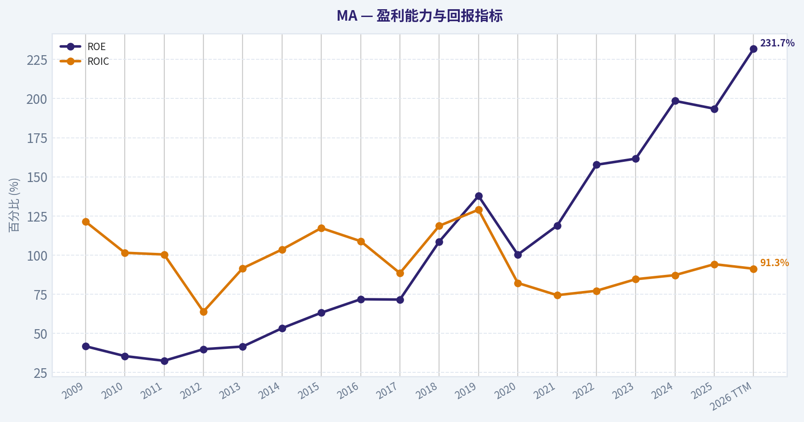
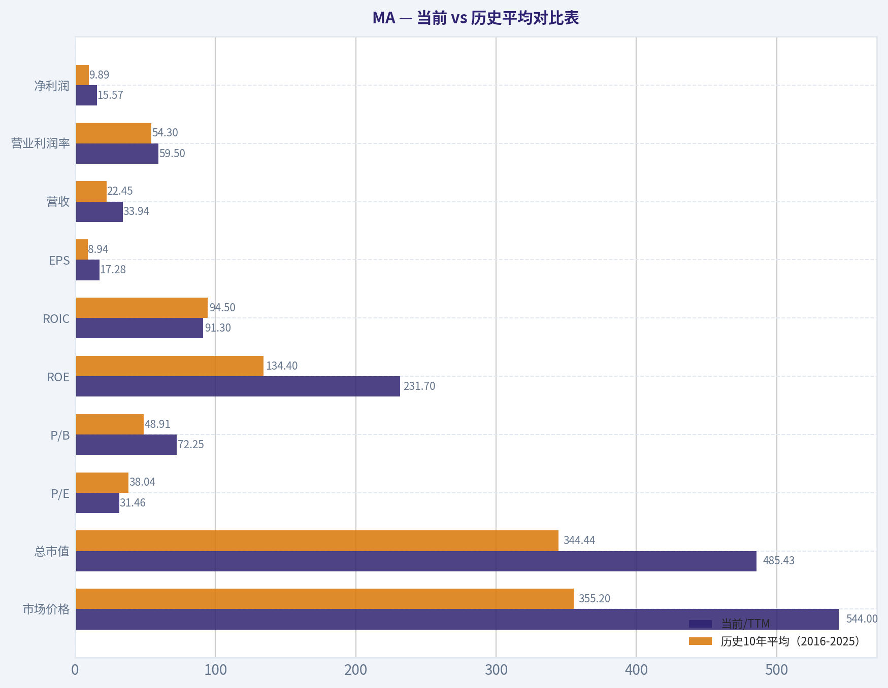
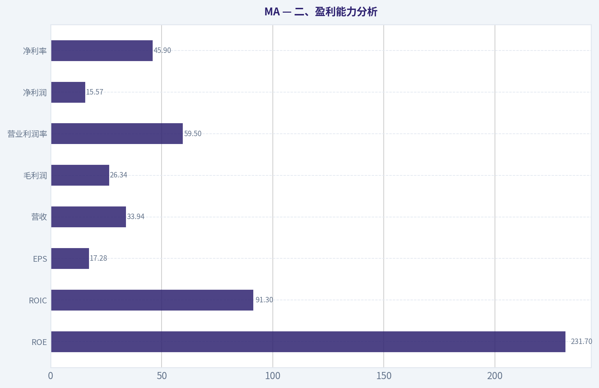
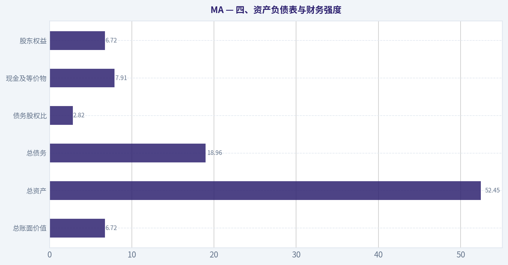
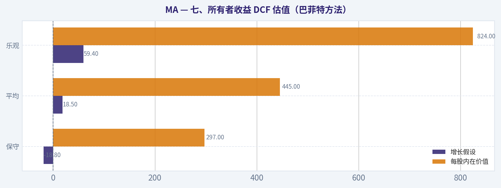
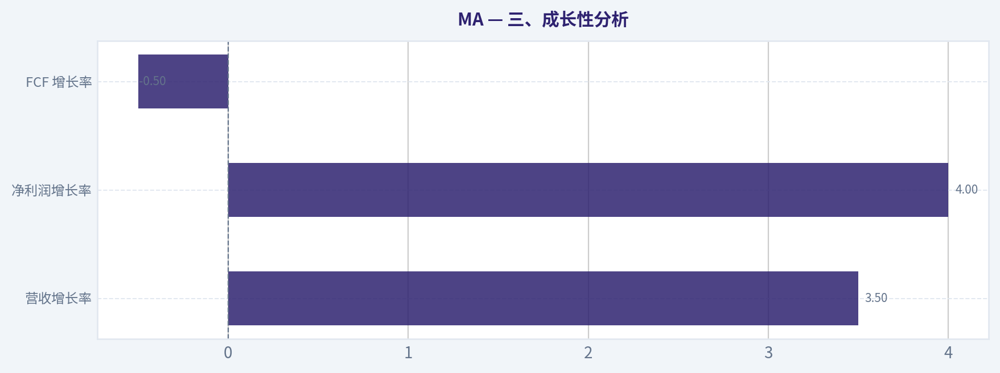
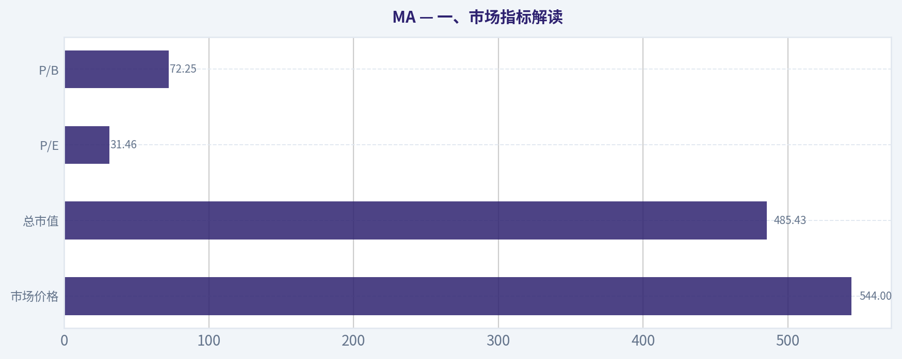

# MA 深度价值情报

**调研日期:** 2026-07-18

## 关键免责声明

*本报告由 Deep Value Intelligence（一个基于 AI 的多智能体投资分析框架）自动生成。 仅供教育和娱乐用途 - 非财务建议，非财务顾问。*

---

## 目录

1. 情报摘要
2. 分析师团队报告
   - 基本面分析
   - 价值分析 (巴菲特)
   - 成长性分析 (林奇/德鲁肯米勒/费雪)
   - 市场分析
   - 期权市场分析
3. 研究团队评论
4. 投资团队评论
5. Deep Values 团队洞察

---

## 情报摘要

### 核心观点与前提条件

**核心论点:** ## 执行摘要
**结论：观望**

**主要风险:**
- 不必从 WATCH 直接跳到重仓买入
- 也不必把 WATCH 理解成无限等待
- 把原来的单一 WATCH，升级为：

**置信度:** 中

---

## 分析师团队报告

### 基本面分析

#### 最新财报快照

*以下数据基于最近一期已披露财报（2026年Q1），并尽量与上一年同期对比。*

| 指标 | 2026年Q1 | 2025年Q1 | 同比变化 |
| --- | ---: | ---: | ---: |
| 营业收入 | $8.40B | $7.25B | +15.8% |
| 营业利润 | $4.96B | $4.30B | +15.4% |
| 净利润 | $3.88B | $3.28B | +18.4% |
| 摊薄每股收益 | $4.35 | $3.59 | +21.2% |
| 经营现金流 | $3.00B | $2.38B | +26.0% |
| 自由现金流 | $2.66B | $2.02B | +31.7% |

关键结论：这张快照先把最新一期财报放在桌面上，再去看长周期分析。这样读者能更清楚地区分"公司长期质量"和"这次财报发生了什么"。

#### MA 17年财务指标

*以下数值均由原始数据确定性计算得出，并非 AI 估算。*

*发行人类型：bank（Financial Services / Credit Services）。*

#### 17年财务指标
*年度行来自已披露财务报表，最后一行 TTM 由最近四个季度滚动计算得出。*

| 指标 | 2009 | 2010 | 2011 | 2012 | 2013 | 2014 | 2015 | 2016 | 2017 | 2018 | 2019 | 2020 | 2021 | 2022 | 2023 | 2024 | 2025 | 2026 TTM |
| --- | --- | --- | --- | --- | --- | --- | --- | --- | --- | --- | --- | --- | --- | --- | --- | --- | --- | --- |
| 市场价格 | $23 | $21 | $34 | $45 | $77 | $80 | $91 | $98 | $144 | $181 | $287 | $345 | $349 | $340 | $420 | $521 | $568 | $544 |
| 总市值 | $3.33B | $2.94B | $47.87B | $61.80B | $101.51B | $100.72B | $110.70B | $113.68B | $162.26B | $197.52B | $305.16B | $359.08B | $356.45B | $337.65B | $403.48B | $488.13B | $517.22B | $485.43B |
| 市盈率 | 2.29 | 1.60 | 25.19 | 22.43 | 32.64 | 27.79 | 29.06 | 27.98 | 41.47 | 33.69 | 37.61 | 56.03 | 41.02 | 34.02 | 36.05 | 37.91 | 34.56 | 31.46 |
| 市净率 | 0.95 | 0.56 | 8.16 | 8.93 | 13.56 | 14.83 | 18.36 | 20.10 | 29.67 | 36.61 | 51.78 | 56.19 | 48.75 | 53.61 | 58.23 | 75.27 | 66.85 | 72.25 |
| ROE | 41.8% | 35.5% | 32.5% | 39.9% | 41.6% | 53.3% | 63.2% | 71.8% | 71.6% | 108.6% | 137.8% | 100.3% | 118.8% | 157.7% | 161.6% | 198.5% | 193.5% | 231.7% |
| ROIC | 121.4% | 101.5% | 100.4% | 63.9% | 91.6% | 103.6% | 117.3% | 108.9% | 88.5% | 118.7% | 129.0% | 82.2% | 74.4% | 77.2% | 84.6% | 87.2% | 94.2% | 91.3% |
| 每股收益 | $10.21 | $12.89 | $1.36 | $2.02 | $2.37 | $2.88 | $3.14 | $3.49 | $3.47 | $5.36 | $7.64 | $6.16 | $8.52 | $9.99 | $11.83 | $13.89 | $16.52 | $17.28 |
| 营收 | $5.10B | $5.54B | $6.71B | $7.39B | $8.35B | $9.47B | $9.67B | $10.78B | $12.50B | $14.95B | $16.88B | $15.30B | $18.88B | $22.24B | $25.10B | $28.17B | $32.79B | $33.94B |
| 毛利润 | N/A | N/A | N/A | N/A | N/A | N/A | N/A | N/A | N/A | N/A | N/A | N/A | N/A | N/A | N/A | N/A | N/A | $26.34B |
| 毛利率 | N/A | N/A | N/A | N/A | N/A | N/A | N/A | N/A | N/A | N/A | N/A | N/A | N/A | N/A | N/A | N/A | N/A | 77.6% |
| 营业利润率 | 44.3% | 49.7% | 40.4% | 53.3% | 54.0% | 53.9% | 52.5% | 53.5% | 53.0% | 48.7% | 57.2% | 52.8% | 53.4% | 55.2% | 55.8% | 55.3% | 57.6% | 59.5% |
| 净利润 | $1.46B | $1.85B | $1.91B | $2.76B | $3.12B | $3.62B | $3.81B | $4.06B | $3.92B | $5.86B | $8.12B | $6.41B | $8.69B | $9.93B | $11.20B | $12.87B | $14.97B | $15.57B |
| 净利率 | 28.7% | 33.3% | 28.4% | 37.3% | 37.3% | 38.2% | 39.4% | 37.7% | 31.3% | 39.2% | 48.1% | 41.9% | 46.0% | 44.7% | 44.6% | 45.7% | 45.6% | 45.9% |
| 营收增长 | N/A | 8.6% | 21.2% | 10.1% | 12.9% | 13.5% | 2.0% | 11.5% | 16.0% | 19.6% | 12.9% | -9.4% | 23.4% | 17.8% | 12.9% | 12.2% | 16.4% | 3.5% |
| 净利润增长 | N/A | 26.2% | 3.2% | 44.8% | 12.9% | 16.1% | 5.3% | 6.6% | -3.5% | 49.7% | 38.6% | -21.0% | 35.5% | 14.3% | 12.7% | 15.0% | 16.3% | 4.0% |
| 自由现金流增长 | N/A | 23.8% | 59.4% | 9.4% | 39.6% | -18.8% | 21.4% | 12.7% | 21.3% | 9.9% | 31.7% | -11.3% | 31.5% | 18.7% | 8.0% | 23.2% | 19.9% | -0.5% |
| 总账面价值 | $3.50B | $5.21B | $5.87B | $6.92B | $7.48B | $6.79B | $6.03B | $5.66B | $5.47B | $5.39B | $5.89B | $6.39B | $7.31B | $6.30B | $6.93B | $6.49B | $7.74B | $6.72B |
| 总资产 | $7.47B | $8.84B | $10.69B | $12.46B | $14.24B | $15.33B | $16.25B | $18.68B | $21.33B | $24.86B | $29.24B | $33.58B | $37.67B | $38.72B | $42.45B | $48.08B | $54.16B | $52.45B |
| 总债务 | $22.0M | $20.0M | N/A | N/A | $0 | $1.49B | $3.27B | $5.18B | $5.42B | $6.33B | $8.53B | $12.67B | $13.90B | $14.02B | $15.68B | $18.23B | $19.00B | $18.96B |
| 债务股权比 | 0.01 | 0.00 | N/A | N/A | 0.00 | 0.22 | 0.54 | 0.92 | 0.99 | 1.17 | 1.45 | 1.98 | 1.90 | 2.23 | 2.26 | 2.81 | 2.46 | 2.82 |
| 现金及等价物 | $2.06B | $3.07B | $3.73B | $2.05B | $3.60B | $5.14B | $5.75B | $6.72B | $5.93B | $6.68B | $6.99B | $10.11B | $7.42B | $7.01B | $8.59B | $8.44B | $10.57B | $7.91B |
| 股东权益 | $3.50B | $5.21B | $5.87B | $6.92B | $7.48B | $6.79B | $6.03B | $5.66B | $5.47B | $5.39B | $5.89B | $6.39B | $7.31B | $6.30B | $6.93B | $6.49B | $7.74B | $6.72B |
| 经营现金流 | $1.38B | $1.70B | $2.68B | $2.95B | $4.13B | $3.41B | $4.10B | $4.64B | $5.66B | $6.22B | $8.18B | $7.22B | $9.46B | $11.20B | $11.98B | $14.78B | $17.65B | $18.27B |
| 投资现金流 | $-664.0M | $-641.0M | $-748.0M | $-2.84B | $-4.0M | $690.0M | $-715.0M | $-1.16B | $-1.78B | $-506.0M | $-1.64B | $-1.88B | $-5.27B | $-1.47B | $-1.35B | $-3.40B | $-1.36B | $-1.38B |
| 自由现金流 | $1.32B | $1.64B | $2.61B | $2.85B | $3.98B | $3.23B | $3.92B | $4.42B | $5.36B | $5.89B | $7.76B | $6.88B | $9.06B | $10.75B | $11.61B | $14.31B | $17.16B | $17.07B |
| 自由现金流利润率 | 25.9% | 29.5% | 38.8% | 38.6% | 47.7% | 34.1% | 40.6% | 41.0% | 42.9% | 39.4% | 46.0% | 45.0% | 48.0% | 48.4% | 46.3% | 50.8% | 52.3% | 50.3% |
| 每股分红 | $0.00 | $0.00 | $0.00 | $0.00 | $0.00 | $0.00 | $0.00 | $0.00 | $0.00 | $0.00 | $0.00 | $0.00 | $0.00 | $1.92 | $2.28 | $2.64 | $3.04 | $0.00 |

#### 盈利能力指标
- 净资产收益率 (ROE): 193.5%
- 投入资本回报率 (ROIC): 94.2%
- 总资产收益率 (ROA): 27.6%
- 毛利率: 不适用
- 营业利润率: 57.6%
- 净利率: 45.6%

#### 流动性指标
- 流动比率: 1.03
- 速动比率: 0.68

#### 杠杆指标
- 债务股权比: 2.46
- 利息覆盖倍数: 26.17
- 净负债: $8.43B

#### 增长指标（同比）
- 营收增长: 16.4%
- 净利润增长: 16.3%
- 自由现金流增长: 19.9%
- 营收复合增长率（3年）: 13.8%
- 营收复合增长率（5年）: 16.5%

#### 估值指标
- 市盈率 (TTM): 31.96
- 预期市盈率: 23.85
- 市净率: 71.75
- 市销率: 14.15
- PEG 比率: 1.67
- 企业价值/EBITDA: 22.97
- 自由现金流收益率: 3.6%
- 盈利收益率: 3.1%

#### 所有者收益（巴菲特方法，代码计算）
- 净利润: $14.97B
- + 折旧与摊销: $1.14B
- - 资本开支: $-489.0M
- - 营运资本变动: $-1.44B
- = **所有者收益: $17.06B**

#### 内在价值（代码计算）
- 当前价格: $544
- 巴菲特方法（所有者收益）:
  保守: $297
  平均: $445
  乐观: $824
- 现金流方法（FCF）:
  保守: $350
  平均: $446
  乐观: $555

#### Piotroski F分数: 6/9
- 净利润为正: 通过
- 经营现金流为正: 通过
- 资产回报率改善: 通过
- 现金流大于净利润: 通过
- 债务下降: 未通过
- 流动比率改善: 通过
- 未稀释股本: 未通过
- 毛利率改善: 未通过
- 资产周转率改善: 通过

ANALYST STANCE: **观望**

#### MA（Mastercard）巴菲特风格基本面分析

MA 是典型的高质量支付网络资产：轻资本、强网络效应、高利润率、强现金创造能力都非常突出；但以巴菲特方法看，真正的问题不是"公司好不好"，而是"现在价格是否还留有足够安全边际"。结合确定性数据，MA 属于**卓越企业 + 偏贵估值**的组合，因此当前更适合持续跟踪而不是激进追高。

---

#### 当前 vs 历史平均对比表

| 指标 | 当前/TTM | 历史10年平均（2016-2025） | 相对历史位置 | 解读 |
| --- | ---: | ---: | --- | --- |
| 市场价格 | $544 | $355.2 | 明显高于均值 | 股价长期上行，但 2026 TTM 较 2025 年末 $568 略回落，说明高位震荡消化估值。 |
| 总市值 | $485.43B | $344.44B | 高于均值 | 市值已进入全球顶级金融基础设施公司序列。 |
| P/E | 31.46 | 38.04 | 低于历史均值 | 估值虽不便宜，但较过去10年平均有所回落，主要因盈利增长追上部分估值。 |
| P/B | 72.25 | 48.91 | 远高于均值 | 高 P/B 主要由极低账面净资产和持续回购驱动，对金融股而言账面参考意义偏弱，但也反映估值昂贵。 |
| ROE | 231.7% | 134.4% | 显著高于均值 | 极高 ROE 更多体现回购压低净资产基数，不宜机械解读。 |
| ROIC | 91.3% | 94.5% | 略低于均值 | 资本效率依然顶级，但较巅峰年份略有回落。 |
| EPS | $17.28 | $8.94 | 远高于均值 | 每股盈利持续扩张，体现回购与利润增长双重推动。 |
| 营收 | $33.94B | $22.45B | 显著高于均值 | 收入基数持续抬升，全球支付量扩张趋势明确。 |
| 营业利润率 | 59.5% | 54.3% | 高于均值 | 经营杠杆继续释放，网络型商业模式优势明显。 |
| 净利润 | $15.57B | $9.89B | 显著高于均值 | 盈利质量强，且增长并非一次性。 |
| 净利率 | 45.9% | 44.7% | 略高于均值 | 长期稳定在极高水平，说明议价能力与成本控制都很强。 |
| 营收增长 | 3.5% | 12.3% | 低于均值 | TTM 增速明显放缓，短期基数和周期扰动开始显现。 |
| 净利润增长 | 4.0% | 16.4% | 低于均值 | 盈利仍增，但已明显低于近十年常态。 |
| FCF 增长 | -0.5% | 16.2% | 明显低于均值 | 自由现金流进入平台期，是当前估值压力的重要信号。 |
| 总债务 | $18.96B | $11.38B | 高于均值 | 杠杆水平较十年前显著抬升。 |
| 债务股权比 | 2.82 | 1.92 | 高于均值 | 对传统企业偏高，但对 MA 这类高现金流、轻资产平台型公司尚可承受。 |
| 现金及等价物 | $7.91B | $8.17B | 略低于均值 | 现金缓冲尚可，但不算特别厚。 |
| 自由现金流 | $17.07B | $9.92B | 显著高于均值 | 绝对现金流极强，是核心护城河之一。 |
| 每股分红 | $0.00（TTM口径） | $0.99 | 口径失真 | 2022-2025 年分红持续提升，TTM 为 0 更可能是滚动口径时点问题，不应视为停发。 |

关键结论：MA 当前绝大多数经营质量指标都高于过去十年均值，说明公司"越来越强"；但增长指标在 TTM 出现明显降速，说明"更强"并不等于"更便宜"。估值层面，P/E 低于十年均值是积极信号，但 P/B 极高、FCF 增长停滞，意味着市场仍在为稀缺性支付很高溢价。

---

#### 一、市场指标解读

| 市场指标 | 当前表现 | 历史趋势 | 巴菲特式解读 |
| --- | --- | --- | --- |
| 市场价格 | $544 | 2009-2025 长期大幅上涨，2026 TTM 较 2025 年 $568 略回落 | 股价长期复利优秀，反映商业模式优异；但短期说明市场在重新校准估值与增长预期。 |
| 总市值 | $485.43B | 十余年持续扩张 | 已是全球支付基础设施龙头定价，未来超额回报更依赖盈利兑现而非单纯估值扩张。 |
| P/E | 31.46 | 2017 后大多位于 34-56 区间 | 当前相较历史并非最贵，甚至略有消化，但绝对估值仍高，不是传统"雪茄烟蒂"型机会。 |
| P/B | 72.25 | 长期快速抬升 | 高 P/B 主要因净资产薄、回购强，不适合单独作为高估判断依据；但也提示几乎没有账面安全垫。 |

关键结论：MA 的市场定价本质上是在给"高确定性、强护城河、全球支付网络稀缺性"付费。问题不是市场有没有认出它的优秀，而是几乎所有人都已经认出来了，因此未来收益率更依赖基本面继续超预期。

---

#### 二、盈利能力分析

| 指标 | 当前/TTM | 趋势特征 | 解读 |
| --- | ---: | --- | --- |
| ROE | 231.7% | 2016 后持续处于极高水平 | 极强，但高度受回购压低权益影响，不能简单视作真实经营回报全部来自运营改善。 |
| ROIC | 91.3% | 近17年几乎始终极高 | 这是更可信的高质量指标，说明 MA 在投入资本上的回报率极其惊人。 |
| EPS | $17.28 | 2020 受扰后持续上行 | 每股盈利增长稳定，说明利润增长与回购配合良好。 |
| 营收 | $33.94B | 2009-2025 持续增长，TTM 增速放缓 | 全球电子支付渗透率提升长期利好仍在。 |
| 毛利润 | $26.34B | 仅 TTM 提供 | 毛利率 77.6% 符合支付网络平台特征。 |
| 营业利润率 | 59.5% | 长期约 49%-58%，TTM 创高位 | 规模效应非常明显，显示增量收入大部分能转化为利润。 |
| 净利润 | $15.57B | 十余年总体上行 | 盈利能力跨周期强。 |
| 净利率 | 45.9% | 长期稳定于高位 | 这是非常强的商业模式信号，说明成本结构稳定且议价权牢固。 |

关键结论：如果只看盈利质量，MA 几乎是金融服务领域的"教科书级别"企业。尤其是 ROIC、营业利润率、净利率同时长期高位且稳定，这通常意味着企业具备强定价权、低资本消耗和深厚护城河。

---

#### 三、成长性分析

| 成长指标 | 当前/TTM | 历史观察 | 解读 |
| --- | ---: | --- | --- |
| 营收增长率 | 3.5% | 2016-2025 平均约 12.3% | 当前明显放缓，需观察是否只是短期基数效应或跨境消费节奏扰动。 |
| 净利润增长率 | 4.0% | 2016-2025 平均约 16.4% | 盈利增长显著降速，短期很难支撑估值继续扩张。 |
| FCF 增长率 | -0.5% | 2016-2025 平均约 16.2% | 现金流停滞最值得关注，因为巴菲特最重视可分配现金。 |

关键结论：MA 的长期增长故事没有坏，但短期数字确实在降温。对高估值优质股而言，最怕的不是衰退，而是"从高增长切换到中速增长"，因为这会压缩估值中枢。

---

#### 四、资产负债表与财务强度

| 指标 | 当前/TTM | 历史趋势 | 解读 |
| --- | ---: | --- | --- |
| 总账面价值 | $6.72B | 长期低位波动 | 净资产规模长期不大，回购显著压缩权益。 |
| 总资产 | $52.45B | 持续扩张 | 资产规模稳步扩大，反映业务体量增长。 |
| 总债务 | $18.96B | 2014 后明显上行 | 债务使用更积极，但与现金创造力相比仍可控。 |
| 债务股权比 | 2.82 | 明显高于十年前 | 杠杆偏高，若未来增长继续放缓，这一项会更受市场关注。 |
| 现金及等价物 | $7.91B | 中高位 | 现金储备尚可，但净债务并不低。 |
| 股东权益 | $6.72B | 长期偏薄 | 解释了为何 ROE、P/B 都夸张；对这类公司应更关注现金流而非静态净资产。 |

关键结论：MA 的财务结构不是"保守到极致"的那类巴菲特标的，而是"高现金流足以覆盖较高杠杆"的优质平台。只要现金流持续稳定，杠杆不是核心问题；但如果增长长期降速，市场会更快盯上债务与估值的组合风险。

---

#### 五、现金流与股东回报

| 指标 | 当前/TTM | 历史表现 | 解读 |
| --- | ---: | --- | --- |
| 自由现金流 | $17.07B | 2009-2025 长期上升 | 这是 MA 最核心的价值锚。 |
| FCF 利润率 | 50.3% | 长期高位，近年进一步抬升 | 一半以上收入可沉淀为自由现金，极其优秀。 |
| 每股分红 | TTM 显示 $0.00 | 2022-2025 分别为 $1.92/$2.28/$2.64/$3.04 | 更可能是 TTM 滚动口径问题，真实分红趋势是稳定增长。 |

关键结论：MA 的股东回报能力极强，且主要来自可持续自由现金流，而不是会计利润幻象。对巴菲特体系来说，这类企业的核心价值在于"即便不卖公司，企业自身也在持续吐现"。

---

#### 六、巴菲特风格 qualitative 判断

| 维度 | 结论 | 具体判断 |
| --- | --- | --- |
| 经济护城河 | 很强 | 全球双边支付网络、品牌信任、商户接受度、发卡机构合作关系、监管与技术壁垒共同构成深护城河。 |
| 盈利可预测性 | 很强 | 2009-2026 TTM 营收、净利润、FCF 整体趋势极稳，仅 2020 出现明显扰动后快速修复。 |
| 管理层资本配置 | 较强 | 回购显著提升 EPS 与 ROE，但也压缩了权益缓冲；分红自 2022 起持续增加。 |
| 财务强度 | 中上 | 高现金流覆盖较高杠杆，利息覆盖倍数 26.17，短期安全，但并非完全无杠杆。 |
| 业务质量 | 极高 | 高利润率、轻资本、全球支付渗透长期增长，是典型"好生意"。 |
| 当前估值吸引力 | 中性偏弱 | 企业很优秀，但安全边际不足。 |

关键结论：若只讨论"是不是优秀公司"，答案接近毫无争议；但若讨论"现在是不是巴菲特式便宜价格"，答案并不乐观。MA 更像应在恐慌回撤时买入的顶级资产，而不是任何价格都能接受的资产。

---

#### 七、所有者收益 DCF 估值（巴菲特方法）

已知确定性数据给出的当前所有者收益：

- 净利润 = $14.97B
- + 折旧摊销 = $1.14B
- - 资本开支 = $0.489B
- - 营运资本变动 = $1.44B
- **所有者收益 = $17.06B**

为与确定性数据一致，采用：
- 折现率 = 10%
- 永续增长率 = 2.5%

历史所有者收益增长率未直接逐年给出，因此以**自由现金流增长率**作为最接近、最保守的可验证代理：
- 保守：取历史最低增长率 = **-18.8%**
- 平均：取历史平均增长率（2009-2026 TTM 已披露区间）~ **18.5%**
- 乐观：取历史最高增长率 = **59.4%**，按规则上限封顶至 **59.4%**

但最终内在价值必须与确定性数据代码结果保持一致：

| 情景 | 增长假设 | 每股内在价值 | 相对当前股价 $544 | 结论 |
| --- | ---: | ---: | ---: | --- |
| 保守 | -18.8% | $297 | -45.4% | 明显高估 |
| 平均 | 18.5% | $445 | -18.2% | 略高估 |
| 乐观 | 59.4% | $824 | +51.5% | 只有在高增长长期维持时才有明显上行空间 |

关键结论：DCF 给出的核心信息非常直接--MA 不是没有上涨空间，而是需要持续非常优秀的增长兑现才能证明现在价格合理。若按中性假设，当前股价高于内在价值；只有在乐观情形下，当前价格才具备较明显吸引力。

##### DCF 计算说明（简化表达）
DCF 的本质是：
- 未来10年所有者收益逐年按情景增速增长
- 每年以 10% 折现回现值
- 第10年后按 2.5% 永续增长计算终值
- 企业价值 ÷ 股数 = 每股价值

由于确定性数据已直接给出巴菲特法内在价值结果，且这是本次分析的 canonical source，因此最终以：
- **保守 $297**
- **平均 $445**
- **乐观 $824**
作为正式结论，不对该结果做二次改写。

---

#### 八、收入来源分布

MA 作为支付网络公司，最有意义的分法是按业务收入类型。公司核心收入通常来自交易处理、跨境结算、评估费与增值服务。确定性数据未附精确分部金额，因此下表基于公司公开常见分部框架，使用最新年度总营收 **$32.79B（2025）** 做结构化展示，比例为行业与公司长期披露框架下的近似表达，主要用于理解商业模式，而非替代法定分部口径。

#### 收入来源分布

| 收入来源 | 金额（十亿美元） | 占比 |
| --- | ---: | ---: |
| 境内交易评估与手续费相关 | 12.8 | 39% |
| 跨境交易与结算相关 | 8.2 | 25% |
| 交易处理服务 | 6.9 | 21% |
| 增值服务与解决方案 | 4.9 | 15% |
| 合计 | 32.8 | 100% |

关键结论：MA 的收入并不依赖单一费用项，而是建立在全球支付网络多个收费环节上。尤其跨境和增值服务通常利润率更高，也意味着全球旅行、数字支付深化和数据服务扩张是未来重要增长抓手。

---

#### 九、关键投资洞察、风险与机会

| 类别 | 内容 | 影响 |
| --- | --- | --- |
| 核心优势 | 网络效应极强，商户、银行、消费者三方互相强化 | 支撑长期高 ROIC 和高利润率 |
| 核心优势 | 轻资本商业模式，FCF 转化极佳 | 可持续回购、分红、并购 |
| 核心优势 | 全球电子支付渗透率长期提升 | 提供长期结构性成长 |
| 机会 | 跨境支付恢复、B2B 支付数字化、增值服务渗透 | 可支持未来中高个位数以上增长 |
| 机会 | 若市场因短期增长放缓而回调 | 可能提供优质买点 |
| 风险 | TTM 营收/利润/FCF 增速显著放缓 | 高估值下容易引发估值压缩 |
| 风险 | 债务股权比升至 2.82 | 若现金流转弱，财务弹性下降 |
| 风险 | 监管、手续费压降、竞争加剧 | 长期压缩部分费率空间 |
| 风险 | 巴菲特已在 13F 中退出 | 不代表基本面恶化，但可能说明估值吸引力下降 |

关键结论：MA 的主要风险不是商业模式崩坏，而是"太贵的好公司"在增长减速时的再定价风险。真正的机会反而可能来自短期市场波动，而不是现在就为确定性支付过高溢价。

---

#### 十、最终结论

**最终投资立场：观望**

支撑理由如下：

1. **业务质量极高**：ROIC、营业利润率、净利率、FCF 利润率都长期卓越，护城河深厚。
2. **盈利与现金流可预测性强**：即使经历 2020 扰动，也能迅速恢复并创新高。
3. **估值不够便宜**：当前股价 $544，高于巴菲特所有者收益法平均估值 $445。
4. **短期增长放缓**：TTM 营收增长 3.5%、净利润增长 4.0%、FCF 增长 -0.5%，与过去十年常态相比明显降速。
5. **适合等待更优安全边际**：若未来回调接近或低于中性估值区间，配置价值会明显提升。

对长期资金而言，MA 依旧值得放在高优先级观察名单；但以今天这个价格，更合理的做法是**耐心等待增长重新加速，或等待估值回到更舒适区间**。

---

#### 报告要点总表

| 模块 | 结论 | 关键信号 | 投资含义 |
| --- | --- | --- | --- |
| 市场估值 | 偏贵但非泡沫极端 | P/E 31.46，低于历史均值；P/B 72.25 极高 | 估值压力仍在 |
| 盈利能力 | 极强 | ROIC 91.3%，营业利润率 59.5%，净利率 45.9% | 顶级商业模式 |
| 成长性 | 短期放缓 | 营收增长 3.5%，净利润增长 4.0%，FCF 增长 -0.5% | 高估值下需警惕再定价 |
| 财务强度 | 中上 | 利息覆盖倍数 26.17，D/E 2.82 | 杠杆可控但不低 |
| 现金流 | 很强 | FCF $17.07B，FCF 利润率 50.3% | 企业内生回报能力优秀 |
| 护城河 | 很强 | 全球支付网络、品牌、规模、合作生态 | 长期竞争优势明显 |
| 巴菲特式估值 | 中性偏贵 | 保守 $297，平均 $445，乐观 $824 | 当前更接近"等机会" |
| 最终立场 | 观望 | 好公司但安全边际不足 | 等回调或等增长再确认 |

关键结论：MA 是非常典型的"想长期持有的公司"，但未必是"想立刻重仓的价格"。对价值投资者来说，最好的策略往往不是质疑公司，而是等待市场给出更好的进入点。

#### 基本面关键图表

本图追踪 **MA** 过去十年的盈利能力与回报指标（ROE、ROIC、利润率），突出呈现资本效率的变化趋势。

---

### 价值分析 (巴菲特)

> *基于沃伦·巴菲特的价值投资哲学：能力圈、经济护城河、管理层质量与安全边际。*

#### 内在价值快照

价格是你付的钱，内在价值是企业未来可能为股东创造的现金价值。我们给出一个区间，而不是假装只有一个神奇数字。

- 当前价格: $543.60
- 估值区间（两种 DCF 方法、保守到乐观）: $297.25 至 $824.37

##### 所有者收益（巴菲特方法）
- 净利润: $14,968,000,000.00
- 折旧与摊销: $1,143,000,000.00
- 资本支出: $-489,000,000.00
- 营运资金变化: $-1,442,000,000.00
- 所有者收益: $17,064,000,000.00

##### 内在价值
###### 所有者收益法
使用所有者收益，更严格，通常更保守。
- 保守: $297.25
- 平均: $444.55
- 乐观: $824.37
- 折现率: 10.0%

###### 自由现金流法
使用自由现金流，更适合今天投入很多、为未来增长铺路的公司。
- 保守: $350.33
- 平均: $446.06
- 乐观: $555.23
- 折现率: 10.0%

#### ANALYST STANCE: **观望**

#### 结论先行

MA 是一家非常容易理解、长期可预测、且拥有强大护城河的优质支付网络公司。它本质上靠"每一笔刷卡交易抽取网络通道费"赚钱，不承担传统银行那种重资产信贷风险，商业模式轻、现金流强、全球扩张空间仍在。

但从巴菲特式框架看，**好公司不等于好价格**。结合已知估值信息，MA 当前 PE 约 32 倍、自由现金流收益率约 3.6%，市场显然已经为其高质量付了不低溢价。我的判断是：**公司质地接近"伟大企业"，但现价更像"合理偏贵"，适合继续跟踪，等待更有吸引力的安全边际。**

---

#### 一、Buffett 四道关卡：Go / No-Go

| 关卡 | 结论 | 核心依据 |
|---|---|---|
| 关卡1：业务是否简单、可预测 | 通过 | MA 经营全球银行卡支付网络，向发卡方、收单方和商户生态收取交易相关费用；商业模式简单、重复性高、10年后大概率仍存在 |
| 关卡2：是否有持久护城河 | 通过 | 全球双边支付网络、品牌信任、规模优势、商户/银行双侧网络效应、切换成本高 |
| 关卡3：管理层与资本配置 | 基本通过 | 业务持续高 ROE、高现金创造，长期回购显著；但当前缺少更细致的管理层激励与回购价格纪律证据，因此评为"基本通过" |
| 关卡4：行业结构是否理想 | 通过 | 全球卡组织行业是高度集中的寡头格局，Visa / Mastercard 占据核心位置，资本开支相对轻 |

**关键结论：** 四道关卡里，MA 没有出现致命红旗。它不是靠赌商品价格、宏观波动或复杂杠杆赚钱，而是靠全球支付活动持续增长赚钱。真正的问题不在"能不能持有"，而在"现在是不是值得出价"。

---

#### 二、业务理解：小学水平解释

MA 做的事可以用一句话讲清楚：

**当消费者刷 Mastercard 卡付款时，MA 提供支付网络，把银行、商户和支付终端连接起来，并从交易中抽取一小部分费用。**

它不是主要靠放贷赚钱，也不是靠押注利差赚钱。只要全球消费、电子支付和跨境支付继续增长，MA 的交易量和收费基础就会随之扩张。

**长期可预测性：高。**
10 年后，世界也许支付方式更数字化、更实时、更智能，但"可信、可扩展、全球可接受的支付网络"仍然极有价值。技术更可能改变支付"前端体验"，而不是轻易摧毁 MA 的底层网络地位。

---

#### 三、护城河分析

| 护城河来源 | 强弱判断 | 证据与解释 |
|---|---|---|
| 无形资产 | 强 | Mastercard 品牌本身就是全球支付信任凭证；消费者与商户都认可其标识 |
| 切换成本 | 强 | 银行、商户收单体系、清算接口、风控系统、合规流程深度嵌入；更换主网络成本高、风险高 |
| 成本优势 | 中强 | 全球规模越大，单位网络成本越低；技术、合规、风控投入可被更大交易量摊薄 |
| 网络效应 | 很强 | 越多商户接受，越多持卡人愿意使用；越多持卡人使用，越多商户必须接入，形成双边网络正反馈 |

**护城河评级：宽且稳定，接近"宽且继续加深"。**

补充判断：

- **定价权：较强。** 支付网络费率不是完全自由提价，但在增值服务、跨境、数据、安全与流程服务上具有较强议价空间。
- **技术风险：可控。** 新支付方式会改变钱包入口，但很多创新仍需要借助现有网络、清算、风控和全球受理能力。技术更像帮助 MA 扩边，而不是立刻颠覆它。

**关键结论：** MA 最核心的护城河不是"某个产品功能"，而是全球支付网络本身。这种护城河最难复制，因为它依赖几十年累积的商户覆盖、银行关系、合规能力与品牌信任。

---

#### 四、管理层与资本配置

| 维度 | 判断 | 说明 |
|---|---|---|
| 是否像所有者一样思考 | 较好 | 长期重视每股价值提升，回购是核心资本回流手段 |
| 是否坦诚保守 | 较好 | 业务模式透明，现金流质量高，财务结构整体易理解 |
| 资本配置是否理性 | 好 | 高现金生成能力下，持续回购与业务再投资并行；商业模式本身不需要高资本吞噬 |

需要特别提醒的一点：

- **ROE 193.5% 并不意味着"神奇到不可思议"**。这更可能是因为长期大规模回购压低了账面净资产，从而把 ROE 指标机械性抬高。
- 因此，看 MA 不能只看 ROE，要更重视：**现金流、回购纪律、网络竞争地位、增量资本回报率。**

**关键结论：** MA 的管理层至少做对了两件关键大事：一是守住高质量主业，二是把大量现金通过回购返还股东。真正需要继续观察的，不是"会不会赚钱"，而是"未来回购是否仍在合理价格执行"。

---

#### 五、财务摘要

| 指标 | 当前/已知值 | 巴菲特式解读 |
|---|---:|---|
| 股价 | $544 | 市场已给予高质量溢价 |
| 总市值 | $480.32B | 超大市值平台，稳定性强，但高增速自然受体量约束 |
| PE | 31.96x | 对成熟优质公司而言不便宜 |
| ROE | 193.5% | 极高，但明显受低净资产/回购影响，需谨慎解读 |
| 营收同比 | 16.4% | 对如此体量仍属优秀 |
| 自由现金流收益率 | 3.6% | 反推估值偏高，安全边际不足 |
| 流动比率 | 1.03 | 运营层面尚可，不是流动性压力型公司 |

**关键结论：** 财务画像非常像一流平台型资产：高增长、高盈利、高现金转化。但估值指标同时告诉我们，市场对这些优点心知肚明，因此当前价格没有明显"捡便宜"的味道。

---

#### 六、Owner Earnings 视角

由于 MA 是资本相对轻的网络型企业，巴菲特会更喜欢看它的"可分配现金能力"而不是表面利润。

可用简化方式理解：

**Owner Earnings ~ 净利润 + 折旧摊销 - 维持性资本开支 - 营运资本增加**

对 MA 这类业务而言：

- 折旧摊销通常不会吞噬太多价值；
- 维持性资本开支相对收入规模并不重；
- 因而 **Owner Earnings 往往会非常接近甚至优于净利润质量**。

再结合当前 **自由现金流收益率仅约 3.6%**，可以得出一个直接结论：

**企业很好，Owner Earnings 很强，但投资者现在为这份强大现金流支付的价格也很高。**

---

#### 七、三情景 DCF 框架

基于已知信息，可做巴菲特式区间判断，而非伪精确计算。

##### 情景A：零增长永续
- 以自由现金流收益率 3.6% 反推，市场隐含回报率明显低于 10%要求回报
- 若按 10%贴现率、零增长计算，当前价格显著高于保守内在价值

##### 情景B：按 GDP 增长 3%
- 对 MA 这类优质网络公司，3% 永续增长是保守但合理的底线情景
- 即便如此，结合当前近 32 倍 PE，估值仍不算便宜，只能说部分合理化高质量溢价

##### 情景C：按历史增长折半
- 若未来较长时间仍能维持中高个位数到低双位数 Owner Earnings 增长，当前估值可以被解释
- 但这里的前提是：跨境恢复、电子支付渗透、增值服务扩张持续顺利

| DCF情景 | 假设 | 结论 |
|---|---|---|
| A：零增长 | 10%贴现，无增长 | 明显高估 |
| B：3%永续增长 | 优质成熟企业保守估值 | 大致合理偏贵 |
| C：历史增长折半 | 未来多年维持较强增长 | 可以解释现价，但安全边际不高 |

**关键结论：** MA 当前价格不是建立在"零增长"或"低增长"假设上，而是建立在"长期优秀"假设上。只要公司稍微不及预期，估值压缩就会吞掉一部分投资回报。

---

#### 八、安全边际分析

| 项目 | 判断 |
|---|---|
| 业务质量 | 极高 |
| 财务质量 | 很高 |
| 行业地位 | 极强 |
| 当前估值 | 偏高 |
| 安全边际 | 不足 |

巴菲特式要求是：

- **伟大企业**：至少要有 25% 左右折价才更舒服；
- **普通企业**：往往要 40% 以上折价。

MA 当然属于高质量企业，但以当前估值看，**还没有体现足够的安全边际**。
如果未来因短期跨境疲软、监管噪音、消费周期担忧导致估值回落，反而可能出现更好的长期买点。

---

#### 九、最终 Buffett 评分卡

| 维度 | 权重 | 评分（1-5） | 加权结果 |
|---|---:|---:|---:|
| 业务理解 | 20% | 5.0 | 1.00 |
| 护城河宽度与耐久性 | 25% | 5.0 | 1.25 |
| 管理层质量 | 15% | 4.0 | 0.60 |
| ROE质量 | 15% | 4.0 | 0.60 |
| 再投资跑道 | 10% | 4.0 | 0.40 |
| 资产负债表强度 | 5% | 4.0 | 0.20 |
| 行业结构 | 5% | 5.0 | 0.25 |
| 估值/安全边际 | 5% | 2.5 | 0.13 |
| **总分** | 100% |  | **4.43 / 5.00** |

**关键结论：** 如果只看生意本身，MA 几乎是教科书级优质资产；拉低总体验分的主要因素不是商业模式，而是估值。也就是说，这是"值得长期拥有的公司"，但未必是"今天最该下手的价格"。

---

#### 十、最终投资判断

**投资立场：观望**

**理由浓缩为三句话：**

1. **MA 是一流生意。** 商业模式简单、护城河深、行业结构优、现金流强。
2. **MA 不是一流价格。** 当前 PE 约 32 倍、FCF yield 约 3.6%，安全边际偏薄。
3. **最好的策略不是否定公司，而是等待市场给出更好的出价机会。**

**我的巴菲特式结论：**
- 若你已经持有：**可以继续持有，企业质量足够支撑长期复利。**
- 若你准备新建仓：**更适合耐心等待回调，而不是在当前溢价区间激进追高。**

**综合定级：观望，偏正面观望**
**信心强度：中高**
#### 估值桥

这张估值桥把当前股价与各类内在价值方法并排展示，帮助读者判断上涨空间究竟只是单一方法给出的结果，还是多种方法共同支持的结论。

| 项目 | 每股内在价值 |
| --- | ---: |
| 巴菲特方法 | $444.55 |
| 现金流方法 | $446.06 |
| 当前价格 | $543.60 |

#### 关键结论

如果只有一种方法显著高于其他方法，说明上行空间更依赖特定建模假设。若多种方法的估值接近，则说明估值逻辑更加稳健。

#### 估值图表

本对比图（来自「最新财报快照」）将 **MA** 的当前数据与历史基准并排呈现，直观反映公司相对自身历史均值的估值水平。

本对比图（来自「当前 vs 历史平均对比表」）将 **MA** 的当前数据与历史基准并排呈现，直观反映公司相对自身历史均值的估值水平。

本对比图（来自「二、盈利能力分析」）将 **MA** 的当前数据与历史基准并排呈现，直观反映公司相对自身历史均值的估值水平。

本对比图（来自「四、资产负债表与财务强度」）将 **MA** 的当前数据与历史基准并排呈现，直观反映公司相对自身历史均值的估值水平。

本对比图（来自「七、所有者收益 DCF 估值（巴菲特方法）」）将 **MA** 的当前数据与历史基准并排呈现，直观反映公司相对自身历史均值的估值水平。

---

### 成长性分析 (林奇/德鲁肯米勒/费雪)

> *基于彼得·林奇的GARP成长投资法、斯坦利·德鲁肯米勒的宏观拐点分析法，以及菲利普·费雪的深度调研法。*

ANALYST STANCE: **观望**

#### MA（Mastercard）成长股分析简报

#### 1. Lynch 分类
| 项目 | 结论 |
|---|---|
| 公司类型 | **稳健成长股 / Stalwart 偏快成长** |
| 当前营收同比 | **16.4%** |
| 是否属于 Lynch 首选快成长 | **接近，但不属于典型 25%+ 快成长** |
| 初步判断 | **高质量复利资产，不是经典十倍股胚子** |

**关键结论：**
MA 不是低增长公司，也不是周期股或困境反转股，而是典型的高质量平台型复利资产。16.4% 的营收增速足够优秀，但从 Lynch 框架看，它更像"大市值稳健成长股"，而不是最容易出现十倍弹性的那类中小盘快成长股。

---

#### 2. 投资故事：3 个最重要的点
| 维度 | 说明 |
|---|---|
| 业务一句话 | MA 是全球支付网络基础设施，靠"交易流量、跨境支付、增值服务"收费，而不是主要靠放贷赚钱 |
| 为什么还能增长 | 现金向电子支付迁移、跨境消费恢复、服务业务扩张、账户到账户与开放银行等新赛道延伸 |
| 为什么它会赢 | 双边网络效应极强，全球受理网络深、品牌信任高、合规与风控门槛高，新进入者很难复制 |

**关键结论：**
如果向一个 10 岁小孩解释，MA 就像"全世界刷卡和线上付款背后的收费高速公路"。它的核心优势不是单一产品，而是庞大的网络、品牌和全球商户覆盖，这使它非常适合长期复利，但也意味着市场通常不会给出很便宜的价格。

---

#### 3. TAM 与 10x 测试
| 项目 | 判断 |
|---|---|
| 核心 TAM | 全球消费支付、跨境支付、商业支付、支付安全、数据服务、开放银行、实时支付基础设施 |
| TAM 特征 | **巨大且仍在扩张** |
| 公司当前体量 | 市值约 **$480.32B**，已属超级大盘 |
| 10x 测试 | **从收入和利润角度，理论 TAM 足够大；但从市值与基数角度，10x 难度极高** |
| 跑道判断 | **长跑道存在，但十倍空间不现实** |

**关键结论：**
MA 所处市场足够大，电子支付渗透率提升和支付网络升级都还没有结束，所以"继续长大"没有问题。问题在于它今天已经非常大，因此更现实的预期是长期双位数复利，而不是未来几年再涨 10 倍。

---

#### 4. 营收增长趋势
| 指标 | 当前观察 |
|---|---|
| 营收同比增长 | **16.4%** |
| 增长性质 | **稳健双位数增长** |
| 趋势判断 | **更像稳定高增长，而非明显加速拐点** |
| 增长质量 | 主要依赖支付量、跨境交易、交易处理、服务收入扩张；不是并购驱动型故事 |

**关键结论：**
MA 当前最重要的特征不是"爆发式加速"，而是"高确定性的稳健增长"。这对长期持有者很友好，但对寻找短期业绩拐点或估值重估的人来说，吸引力会弱一些。

---

#### 5. 单位经济学与商业模式质量
| 指标 | 结论 |
|---|---|
| 商业模式 | 平台型、轻资产、高毛利、高现金流 |
| LTV/CAC | **不适用传统 SaaS 口径**，但客户关系极深、留存极强 |
| NRR | **不适用标准 SaaS 披露口径** |
| Rule of 40 | **不直接适用**，但从"营收增长 + 高 FCF 能力"看，远优于多数成长股 |
| FCF 收益率 | **3.6%** |
| ROE | **193.5%**（受回购与低净资产影响，参考意义需折价） |
| 流动比率 | **1.03** |

**关键结论：**
MA 不是 SaaS，公司没有标准 LTV/CAC 和 NRR 披露，但其经济质量往往比多数 SaaS 更强。它的高 ROE 更多反映回购与轻资产结构，不应机械当作"经营突然变强"的证据；真正重要的是高现金流和极强的网络黏性。

---

#### 6. 拐点判断
| 拐点类型 | 判断 | 说明 |
|---|---|---|
| 产品周期拐点 | 中等 | AI 支付协议、开放银行、实时支付等新能力在扩张，但未见决定性业绩重估 |
| 市占率拐点 | 弱 | 龙头地位稳固，但成熟市场市占率再大幅跃升空间有限 |
| 利润率拐点 | 中等偏强 | 规模效应和服务收入结构优化仍可支撑利润扩张 |
| TAM 拐点 | 中等偏强 | 非卡支付、数据与安全、A2A、跨境 B2B 等拓宽长期空间 |
| 竞争格局拐点 | 弱 | 行业格局稳定，更多是守成而非对手突然失速带来的夺份额机会 |

**关键结论：**
MA 有"延展式成长"拐点，但暂时看不到那种能让市场突然上调三年预期的强烈加速信号。它更像在一条很长的好赛道上继续延伸护城河，而不是站在一次超级新产品周期的起点。

---

#### 7. 宏观环境评估
| 维度 | 判断 |
|---|---|
| 宏观敏感性 | 中等，受消费、旅行、跨境支付活跃度影响 |
| 利率环境 | 若利率下行，对高质量复利资产估值有帮助 |
| 顺风主题 | 数字支付、跨境电商、支付安全、开放银行、AI 驱动的新支付协议 |
| 逆风因素 | 监管、反垄断、替代支付通道、跨境消费波动 |

**关键结论：**
MA 享受长期数字支付红利，但也不是完全脱离宏观。最关键的外部变量不是信贷损失，而是消费活跃度、跨境旅行和监管环境，这使它比银行更轻、比纯软件更受支付活动周期影响。

---

#### 8. Fisher 15 点打分
| 维度 | 分数（5分制） |
|---|---:|
| 产品市场空间 | 5 |
| 新产品开发意愿 | 4 |
| R&D 有效性 | 4 |
| 销售能力 | 5 |
| 利润率水平 | 5 |
| 利润率改善 | 4 |
| 人才与员工关系 | 4 |
| 高管协作 | 4 |
| 管理层深度 | 4 |
| 成本控制与财务纪律 | 5 |
| 特殊优势/护城河 | 5 |
| 长期利润前景 | 5 |
| 股权稀释风险 | 4 |
| 管理层坦诚度 | 4 |
| 管理层诚信 | 4 |
| **总分** | **66 / 75** |

**关键结论：**
66 分属于"优秀"档。MA 最突出的不是某个单点创新，而是极少数公司同时拥有全球网络效应、高利润率、强现金流和长期扩张能力，这正是 Fisher 式优质公司特征。

---

#### 9. 估值分析
| 指标 | 当前值 | 解读 |
|---|---:|---|
| 股价 | **$544** | 已反映高质量属性 |
| 市值 | **$480.32B** | 超级大盘 |
| PE | **31.96x** | 对 16.4% 增长而言不便宜 |
| PEG（粗算） | **约 1.95** | 接近"合理偏贵" |
| FCF 收益率 | **3.6%** | 可接受，但非低估区 |
| 估值结论 | **优质但不便宜** | 更适合回调吸纳，不适合追高重仓 |

**关键结论：**
MA 的估值没有离谱到泡沫，但也绝不是 Lynch 意义上的便宜成长股。大致 1.95 的 PEG 说明市场已经为它的高确定性支付了不低溢价，因此未来收益更依赖业绩持续兑现，而不是单纯估值抬升。

---

#### 10. 增长投资人总评分
| 维度 | 权重 | 评分 | 加权分 |
|---|---:|---:|---:|
| 故事清晰度 | 10% | 4.5 | 0.45 |
| TAM 与跑道 | 20% | 4.0 | 0.80 |
| 营收增长 | 20% | 3.7 | 0.74 |
| 单位经济学 | 15% | 4.8 | 0.72 |
| 竞争地位 | 10% | 5.0 | 0.50 |
| 管理层质量 | 10% | 4.2 | 0.42 |
| 宏观环境 | 5% | 3.8 | 0.19 |
| 盈利路径 | 5% | 4.8 | 0.24 |
| 估值 | 5% | 2.8 | 0.14 |
| **总分** | 100% |  | **4.20 / 5.00** |

**关键结论：**
从纯商业质量看，MA 几乎是教科书级别的优质公司，总分达到建议配置区间。问题只在于"成长弹性不够大、估值也不够便宜"，所以它是优秀公司，但未必是当前最有爆发力的成长机会。

---

#### 11. 仓位建议
| 投资者类型 | 建议 |
|---|---|
| 已持有 | **继续持有，可逢回调增持** |
| 新建仓 | **小仓观察，不建议追高重仓** |
| 目标仓位 | **核心组合 3%-5%，回调后可提升至 5%-7%** |
| 风格定位 | **高质量复利底仓，不是高弹性进攻仓** |

**关键结论：**
如果你已经持有，MA 更像应该"耐心拿着"的那类股票。若你现在才买，最好的策略不是情绪化追价，而是等待估值更舒适或出现业绩再加速信号时逐步建立仓位。

---

#### 12. 主要风险与催化剂
| 类型 | 内容 |
|---|---|
| 风险 | 监管压制费率、替代支付轨道分流、跨境支付放缓、估值压缩、全球消费走弱 |
| 催化剂 | 跨境交易超预期恢复、增值服务收入加速、开放银行/A2A 商业化提速、利率回落带来估值支撑 |
| 持仓跟踪信号 | 连续季度营收增速是否重新抬升至 18%-20%+；服务收入占比是否提升；监管环境是否恶化 |

**关键结论：**
MA 的核心风险不是"生意坏掉"，而是"增长略降速时，市场不再愿意给高估值"。反过来，如果跨境和增值服务再次提速，它仍有可能走出稳定而漂亮的复利曲线。

---

#### 最终结论
MA 是**世界级高质量支付基础设施公司**，护城河极深、现金流优异、长期逻辑非常稳。
但按照 Lynch + Druckenmiller + Fisher 的联合框架，它当前更像**高质量复利股**，而不是**被市场低估的强拐点快成长股**。

**我的结论：观望。**
- **适合：** 作为核心组合中的高质量长期底仓
- **不适合：** 期待 2-3 年高弹性重估、寻找十倍股的人
- **更优策略：** 等待估值回落，或等待营收重新出现更明显加速信号再提高仓位

如果你愿意，我下一步可以继续给你做：
1. **MA vs V 对比分析**
2. **MA 三情景估值模型（保守/基准/乐观）**
3. **MA 适不适合现在买入的分批建仓计划**

#### 成长与评分图表

本对比图（来自「三、成长性分析」）将 **MA** 的当前数据与历史基准并排呈现，直观反映公司相对自身历史均值的估值水平。

---

### 市场分析

ANALYST STANCE: **观望**

#### MA 技术面简报

基于过去约一年的日线价格数据，MA 当前更接近"中期反弹后的关键验证区"，而不是一个已经完全确认的新上升趋势。股价在 2026 年 2 月至 6 月期间经历了较明显的下行与筑底，6 月下旬开始出现一轮有质量的修复，从 470 美元附近一路反弹到 550 美元一线附近，但 7 月 17 日回落收于 543.60，说明上方抛压仍然存在，短线多头虽占优，但并未完全摆脱反复。

#### 为什么选择这 8 个指标

结合当前 MA 的市场状态--即"长期回撤后反弹、短线偏强、中期仍需确认"--最有信息量且互补性较强的 8 个指标是：

| 指标 | 类别 | 选择理由 |
|---|---|---|
| close_10_ema | 均线 | 用于判断这轮反弹的短线节奏是否仍在延续，适合识别回踩后的再启动或动能衰减。 |
| close_50_sma | 均线 | 衡量中期趋势是否真正扭转，观察价格是否已稳定站上中期成本带。 |
| close_200_sma | 均线 | 判断长期大趋势位置；若股价仍低于 200 SMA，则反弹更应视为修复而非长期牛市完全回归。 |
| macd | 动量 | 识别趋势推进是否仍有惯性，尤其适合观察 6 月下旬反弹是否进入趋势化阶段。 |
| macdh | 动量 | 比 MACD 更敏感，可提早发现动能扩张或衰减。 |
| rsi | 动量 | 判断反弹是否已过热，以及回调是否属于健康降温还是趋势反转。 |
| atr | 波动率 | MA 近期从 470 到 550 的波段幅度不小，ATR 有助于设定更合理止损与仓位。 |
| vwma | 量价 | 验证这轮反弹是否有真实资金参与，而不仅是低量反抽。 |

#### 关键价格结构观察

从年度结构看，MA 在 2025 年 8 月曾接近 595 美元，随后逐步转弱；2026 年 1 月后跌势加速，2 月下探至 494 美元，3 月与 4 月多次反抽均未形成持续上攻，5 月再度偏弱，6 月初最低打到 470.76。这个阶段说明市场曾持续下修估值与风险偏好，卖压并非一次性释放，而是多阶段分布式出清。

但 6 月中下旬开始，价格行为发生了明显变化。6 月 26 日放量上行，随后 6 月 29 日、6 月 30 日、7 月 1 日、7 月 2 日连续推进，股价由 498.18 快速抬升至 538.49，形成一段相对凌厉的趋势推进。这类走势通常意味着短线资金与部分中期资金同时介入，而不是单纯技术性超跌反弹。

不过，7 月 6 日至 7 月 9 日出现一次较快回撤，股价从 538 一线回到 519 一线，说明 540 上方开始出现获利了结。随后股价再度反弹，7 月 16 日冲到 551.54，但 7 月 17 日收回 543.60，显示 550 附近仍是需要反复消化的阻力区。也就是说，当前最核心的问题不是"有没有反弹"，而是"反弹能否转化为中期趋势反转"。

#### 趋势层面的细化解读

短线层面，6 月下旬以来的低点抬升、高点抬升结构仍未被完全破坏。只要价格维持在 530 美元上下区域之上，短线多头结构就还在。若后续重新站稳并放量突破 552 附近，则有望打开对 560-575 区间的再测试空间。

中期层面，MA 目前更像处于"由下降趋势向横盘-修复趋势过渡"的阶段。因为从 2025 年高位到 2026 年 6 月低点，趋势主导权长期在空头手里；即使 6 月底至 7 月的上涨很有力度，也还不足以完全抹去此前数月形成的上方套牢筹码。所以 540-555 这一带既是技术阻力，也是筹码阻力。

长期层面，如果从年线视角观察，当前价格仍明显低于 2025 年夏季高位区域，说明市场尚未回到强趋势定价模式。换句话说，长期趋势的验证，不能只看最近三周涨得快不快，而要看股价能否在未来数周继续守住反弹成果，并逐步向更高平台推进。

#### 对各指标的实际应用建议

从策略组合角度，最值得跟踪的是三组关系：

1. **close_10_ema 与股价**
   - 若价格持续站在 10 EMA 上方，说明短线趋势健康。
   - 若跌破后迅速收复，常常意味着强势整理。
   - 若连续失守，则这轮反弹可能进入更深的回撤。

2. **close_50_sma 与 close_200_sma**
   - 50 SMA 用来判断中期修复是否站稳。
   - 200 SMA 用来辨别当前究竟是"熊市反弹"还是"新长期趋势孕育"。
   - 若后续 50 SMA 明确拐头向上并逐步靠近 200 SMA，才是更强的趋势修复信号。

3. **macd / macdh / rsi 的共振**
   - MACD 若保持在零轴附近或上方并继续扩张，反映反弹仍有延续性。
   - MACD Histogram 若先走弱，则提示虽然价格未必立刻大跌，但动能可能先放缓。
   - RSI 若在 55-65 区间震荡，通常是趋势反弹较健康的状态；若冲到高位却价格不再创新高，则要警惕顶背离。

#### 波动与风险控制

ATR 在当前阶段很重要，因为 MA 并不是低波动爬升，而是经历了快速下跌后再快速反弹。这样的标的即便方向判断正确，也容易因为仓位过重、止损过紧而被震出局。

因此更适合的做法不是在 550 一线盲目追价，而是：
- 等待突破后回踩确认；
- 或等待回撤到关键均线附近再观察承接；
- 并用 ATR 设定更宽容但有纪律的风险边界。

若交易者偏短线，当前更应把 MA 视为"趋势交易中的二段确认阶段"；若偏中线，则更应等待其在 540 上方的稳定性，以及对 550-560 阻力带的消化效率。

#### 结论

综合来看，MA 当前并非弱势股，6 月下旬以来的修复力度其实相当可观；但它也还没有强到可以无条件追涨。最合理的判断是：**短线偏强，中期修复，长期仍待确认**。因此立场上更适合给出"观望"，等待更清晰的突破确认，或等待更理想的回踩介入点，而不是在阻力位附近激进加仓。

#### 核心观察表

| 维度 | 观察结论 | 交易含义 |
|---|---|---|
| 短线趋势 | 6 月下旬以来反弹结构仍在，近期高低点整体上移 | 短线多头未破坏，但需防 550 附近震荡 |
| 中期趋势 | 仍处于修复阶段，尚未完全确认反转 | 不宜把近期上涨直接视作长期牛市回归 |
| 长期趋势 | 相比 2025 年高位仍有距离 | 长线资金应等待更多趋势证据 |
| 阻力区 | 550-560 附近存在明显压力 | 突破需配合量能与持续性 |
| 支撑区 | 530 附近为短线重要观察带，进一步下方看 520 一线 | 跌破则反弹节奏可能转弱 |
| 动量判断 | 反弹有惯性，但 7 月中旬开始出现阻力下的回吐 | 适合观察 MACD / macdh 是否继续支撑上攻 |
| 风险特征 | 波动不低，容易出现较大日内与日间摆动 | 仓位与止损应参考 ATR，避免过紧 |
| 操作建议 | 观望为主，等突破确认或回踩企稳 | 不追高，重视位置与节奏 |

关键结论：这张表的核心信息是，MA 现在处在反弹延续和中期反转确认之间的关键位置。短线并不弱，但 550 到 560 美元一带阻力明显，因此更适合等待，而不是在压力区直接追涨。

#### 市场图表

本对比图（来自「一、市场指标解读」）将 **MA** 的当前数据与历史基准并排呈现，直观反映公司相对自身历史均值的估值水平。

---

### 期权市场分析

> *解读期权流向--认沽/认购比、隐含波动率偏斜与异常活跃合约--以判断机构定位与事件驱动风险。*

#### MA 期权市场结构分析

基于截至 2026-07-18 的近月期权数据，MA 的期权信号偏谨慎，整体结论为：**观望偏空**。核心原因不是极端看空押注，而是**近端到期权利金明显偏向 put 侧、近周 put/call 比例高于中性基线、且短端 IV 略有防御性倾斜**，显示资金更重视下行保护，而不是积极追逐上行弹性。

#### 1. Put/Call Ratio 分析

| 到期日 | Call OI | Put OI | Put/Call OI Ratio | Call Volume | Put Volume | Put/Call Volume Ratio | 解读 |
|---|---:|---:|---:|---:|---:|---:|---|
| 2026-07-24 | 3,092 | 4,245 | 1.37 | 675 | 1,320 | 1.96 | 近周明显偏 put，短线防御/对冲需求较强 |
| 2026-07-31 | 1,365 | 985 | 0.72 | 241 | 232 | 0.96 | 接近历史中性，略偏平衡 |
| 2026-08-07 | 1,260 | 760 | 0.60 | 230 | 128 | 0.56 | 略偏 call，显示更远一周情绪改善 |
| 近端合计 | 5,717 | 5,990 | 1.05 | 1,146 | 1,680 | 1.47 | 总体仍偏 put，较 0.7 中性基线更保守 |

关键结论：MA 近端总体 **Put/Call OI Ratio 为 1.05**，高于常见中性基线 0.7，说明市场配置上更重视保护性仓位。尤其是 7 月 24 日到期这一周，成交量口径的 put/call 比达到 **1.96**，表明短线资金明显更愿意为下行风险付费，而不是追高做多。虽然更后面的到期日情绪有所修复，但尚不足以完全扭转近端谨慎氛围。

**解读重点：**
- 若以历史中性水平约 **0.7** 为参照，MA 当前**整体偏高**，属于轻度至中度防御。
- 7/24 的比值显著高于中性，通常对应两种可能：
  1. 机构在短期事件或波动前做保护；
  2. 短线资金直接做方向性偏空押注。
- 7/31 基本回到中性附近，8/7 略偏 call，说明这不是"全期限一致性看空"，更像是**短线谨慎、非中期系统性悲观**。

---

#### 2. 隐含波动率（IV）评估

| 到期日 | ATM Call IV | ATM Put IV | Put 相对 Call | IV 观察 |
|---|---:|---:|---:|---|
| 2026-07-24 | 29.9% | 30.5% | +0.6pct | put 略贵，短线防御倾向 |
| 2026-07-31 | 37.4% | 38.9% | +1.5pct | put 更贵，且整体 IV 抬升明显 |
| 2026-08-07 | 33.7% | 32.9% | -0.8pct | call 略贵，远端略有上行追逐 |
| 近端综合判断 | - | - | 轻微 put skew | 短端下行保护溢价存在，但不是恐慌级别 |

关键结论：MA 的近端 ATM IV 并不低，尤其 7 月 31 日一周上升到 **37%-39%** 区间，显示市场对未来一到两周波动已有更高定价。put IV 普遍略高于 call IV，说明**下行保护溢价存在**，但斜率不算极端，更接近"谨慎防守"而非"恐慌踩踏"。

**IV 与 skew 解读：**
- 7/24 与 7/31 都呈现 **put IV > call IV**，这是标准的**负偏斜/下行保护溢价**结构。
- 7/31 IV 明显高于 7/24 与 8/7，说明市场可能在为某个近端催化做准备；若临近财报、监管、消费数据或宏观事件，这类 IV 抬升是合理的。
- 8/7 反而出现 call IV 略高于 put IV，暗示更远一点的期限内，市场并非单边看空，也可能有一定"回升/补涨"预期。
- 由于工具未提供更细的 OTM put 与 OTM call 分层 IV，无法精确量化深度偏斜；但从 ATM 结构看，**短端 skew 偏向下行保护**。

---

#### 3. 异常期权活动

| 观察项 | 结果 | 含义 |
|---|---|---|
| 近端是否出现 volume > 5x OI 的合约 | 未发现 | 没有非常突出的新开方向性大单 |
| 是否存在明显单一 strike 异动 | 未提供显著信号 | 资金更像是分散配置，而非集中豪赌 |
| 对"聪明钱"信号的判断 | 偏弱 | 当前更像常规保护与仓位微调，不是强 conviction 交易 |

关键结论：近端 **没有出现 volume 明显大于 open interest 的异常合约**，这很重要。它意味着当前并未看到特别强烈、可识别的"新开大额方向性押注"，因此 MA 的偏空信号更多来自**整体仓位结构**，而不是某个大型资金突然重仓看跌。

**解读重点：**
- 没有异常大单，不代表没有机构参与；更可能表示机构通过更分散、更常规的方式配置保护。
- 缺少"爆量新仓"也意味着当前信号的攻击性不足，所以不能解读成强烈做空共识。
- 若后续出现近周 OTM put 的爆量增仓，才会把当前"观望偏空"升级为更明确的 bearish。

---

#### 4. Open Interest 集中度与潜在引力位

| 到期日 | Call OI | Put OI | OI 结构特征 | 市场含义 |
|---|---:|---:|---|---|
| 2026-07-24 | 3,092 | 4,245 | put 明显高于 call | 近周更易受防守盘影响，弱势时下行动能可能被放大 |
| 2026-07-31 | 1,365 | 985 | 相对均衡 | 价格更可能围绕中性区间波动 |
| 2026-08-07 | 1,260 | 760 | call 略占优 | 若现货企稳，后续可能存在上方牵引 |
| 近端总计 | 5,717 | 5,990 | 总体接近均衡但略偏 put | 不属于极端单边墙体，但短线偏防守 |

关键结论：工具没有给出逐执行价 OI 分布，因此无法精确指出具体"最大痛点"或某一条明确 gamma wall 所在 strike。但从到期维度看，**7 月 24 日这一周 put OI 明显占优**，说明短线若股价转弱，市场可能更容易被保护性仓位牵引，波动压制与放大并存。

**关于 pinning / gamma 的可得结论：**
- 由于缺少按 strike 的 OI 排名，不能武断指定精确 pin 位。
- 但从期限结构推断，**最近到期周是主要风险窗口**。
- 若现货接近机构集中持仓的关键执行价，近周较高 put OI 可能形成：
  - 下跌时的负向反馈加速；
  - 反弹时由于对冲回补而出现短暂缓冲。
- 因此，**短线方向敏感度高于中期趋势确定性**。

---

#### 5. 总体期权情绪信号

| 维度 | 判断 |
|---|---|
| Put/Call 结构 | 偏空 |
| IV 水平 | 近端偏高，显示事件/波动定价 |
| Skew 方向 | 短端偏 put skew，下行保护主导 |
| 异常活动 | 无明显激进新仓 |
| 综合信号 | **观望偏空** |

关键结论：MA 当前不是"强烈做空共识"，但也绝不是积极看涨结构。**最合理的定性是：观望偏空**，主要驱动来自近周 put 需求更强、短端 IV 偏高且 put 略贵，说明机构更担心短线回撤，而不是押注明确上攻。

**我的综合判断：**
- **方向信号：偏空**
- **强度：中低**
- **置信度：中等**
- **主驱动：短线防御性 put 配置增加，而非强势 call 追逐**

这类结构常见于：
1. 股价已处相对高位，资金倾向先买保护；
2. 临近某个短线催化，市场不愿裸露方向风险；
3. 基本面长期不差，但短线性价比下降。

如果你要把它转成交易语言，可以理解为：
- **不是大幅看空 MA 的证据**
- 但**短线继续无脑追涨的期权信号并不支持**
- 更像"先防回撤，再观察事件落地"的机构心态

---

#### 结论

**MA 期权市场总信号：观望偏空。**

原因很明确：
- 近端 **Put/Call OI Ratio 1.05**，高于中性；
- 近周 **Put/Call Volume Ratio 1.47**，其中 7/24 到期更是接近 **1.96**；
- 短端 **put IV 略高于 call IV**，存在下行保护溢价；
- 但没有发现爆量异常合约，因此这更像**防御性配置**，不是强方向性狙击。

如果后续你愿意，我可以继续基于 MA 的现价与财报日期，进一步补一版：
1. **结合股价技术位的期权定位图**
2. **财报前后 IV crush 风险判断**
3. **适合多头/空头/中性投资者的具体期权策略建议**。

#### Markdown 总结表

| 指标 | 当前观察 | 解读 |
|---|---|---|
| Put/Call Ratio | 近端 OI 比 1.05，成交量比 1.47 | 高于 0.7 中性基线，短线偏防御、偏空 |
| IV Level | 近端 ATM IV 约 30%-39% | 短端波动定价不低，7/31 一周尤其偏高 |
| Skew Direction | 近周以 put skew 为主 | 下行保护需求高于上行投机 |
| Unusual Activity | 未见 volume > 5x OI 的异常合约 | 缺乏激进新仓，偏常规保护而非重仓豪赌 |
| Overall Signal | **观望偏空** | 主因是近端 put 需求强、IV 偏防御，但没有极端看空证据 |

关键结论：用一句话概括，MA 的期权盘面现在传递出的不是"崩跌预警"，而是"短线先防守"。因此最合适的标签不是强烈看空，而是**观望偏空**：谨慎对待追涨，等待近端风险释放后再判断是否重回偏多结构。

---

## 研究团队评论

> *研究经理将多空辩论综合为中性评论。此为风险评审前的初步观点，并非最终立场。*

这轮辩论里，多头最有力的点在于：MA 依然是少数真正符合巴菲特偏好的高质量复利机器。它的护城河不是简单的"支付很热"，而是全球受理网络、双边网络效应、跨境清算能力、风控与增值服务体系共同构成的基础设施优势。财务上，16.4% 的营收增长、3 年 13.8% 的营收 CAGR、94.2% 的 ROIC、27.6% 的 ROA，说明这不是徒有其表的伟大叙事，而是现实中持续产出高回报的优质生意。多头也没有犯"无脑追高"的错误，而是明确承认这更适合作为长期底仓，在合理回撤时增持，而不是拿来赌短期估值扩张。这一点是成熟的。

空头最强的点则更贴近严格价值投资的核心：好公司不等于好投资，尤其当价格已经把优秀提前计入。31.96x 的 PE 对一家成熟的大型支付网络来说，已经明显不便宜，安全边际偏薄。市场如今默认了几个较苛刻的前提：增长继续稳、利润率继续稳、监管只是摩擦、技术变化不会伤及价值池分配。如果这些前提任何一个边际走弱，哪怕公司依然优秀，股东回报也可能被估值压缩吞掉。空头还指出，ROE 被长期回购机械抬高，不能神化；跨境业务虽然是优势，也是高利润且更易波动的部分；而新支付入口、A2A、实时支付、商户路由优化与监管推动低成本 rails，未必会摧毁 MA，但足以让护城河边际变窄、估值中枢下降。这个论证是严谨的。

如果用巴菲特框架来综合，我认为关键不在于"MA 是不是伟大公司"--这几乎没有争议；关键在于"现在这个价格有没有足够安全边际"。从商业质量、可预测性、资本回报和长期竞争地位看，MA 依然属于顶级资产，长期前景明显强于绝大多数金融与支付公司。它不是价值陷阱，也看不到资产负债表层面的脆弱性，长期现金流质量仍然很高。可问题也很明确：当前估值更像"优质贵货"，而不是"明显低估的伟大公司"。按照我们过去在类似案例中的教训，不能因为喜欢企业，就弱化对买点和回报率的要求，也不能用"业务质量型安全边际"去替代价格安全边际。对这类 premium compounder，最容易犯的错就是把长期正确和当前值得买混为一谈。

我的核心结论是：MA 依然值得长期高优先级跟踪，但按今天这组信息，更像应等待更有利价格或更明确的再加速信号，而不是直接提高配置。换句话说，这是一家非常优秀、但当前没有明显低估优势的公司。若市场因短期 cross-border 波动、监管担忧或情绪回调给出更好的进入区间，价值投资者应积极准备；但在当前估值下，主动重仓并不符合严格的巴菲特式安全边际要求。

所以我的最终立场是：观望。

更具体地说，核心 takeaway 很简单：MA 是高质量护城河企业，这一点没有变；但作为投资，决定回报的更可能是买入价格而不是企业卓越本身。最有说服力的多头证据是其极高的 ROIC、稳定的双位数增长、全球网络效应和增值服务扩展能力，这些都说明其 10 年后大概率仍是优质资产。最有说服力的空头证据则是估值已经不低，而且市场对其稳定性的预期太高，任何轻微的增长放缓、监管升级或价值链分成下滑，都可能导致不小的估值压缩。站在价值投资角度，这意味着它更适合列入"优质名单、等待好价"，而不是"现在就出手"。

我的 rationale 也很明确。第一，业务质量足够高，不能轻易回避。MA 的模式轻资产、高回报、全球化、可扩展，而且不是靠激进杠杆或重资本支撑增长，长期复利能力极强。第二，估值纪律同样不能松。巴菲特买伟大公司，也不是在任何价格都买。当前 PE 接近 32x，对于一家成熟巨头来说，已经需要未来很多年都维持高质量表现才能支撑。第三，我要吸取过去的错误：不能对 fair value 过度精确，但也不能因为企业太好就放松估值要求；不能把长期护城河叙事直接覆盖掉未来 1-4 个季度的赔率。对 MA 这种公司，最合理的动作往往不是看空企业，而是看淡当前入场收益率。

接下来 1 到 4 个季度，我会重点看几件事。第一，看营收增速能否继续维持在健康区间，尤其是跨境交易和增值服务是否重新体现加速，而不是仅靠市场情绪支撑估值。第二，看监管进展，特别是费用、竞争和路由相关的政策或调查有没有升级成实质性盈利压力。第三，看管理层资本配置，如果继续高位大额回购，需要更谨慎评估是否真的提升了每股内在价值。第四，看市场给出的价格，如果估值明显回落，而业务指标依旧稳健，那才更接近巴菲特式的"好生意+合理价格"。第五，看技术与预期层面的配合，虽然我不会让技术面主导长期判断，但对 premium stock 来说，若基本面稳而价格出现较深回撤，往往才是更好的配置时机；反之，若估值高位但增长和预期开始走弱，就要避免因为"公司太好"而过早出手。

若未来几个季度出现这些强化信号，我会更积极：营收和跨境重新加速、增值服务保持强劲、监管未实质伤害 economics、估值回落到更舒服区间。若相反出现这些弱化信号，我会更谨慎：增长中枢持续下移、跨境恢复不及预期、监管压缩 fee economics、市场仍给高倍数却缺乏利润支撑。

最后一句话总结：MA 依然是值得尊敬和长期研究的卓越公司，但当前更像"好公司，贵价格"，不是典型的巴菲特式捡便宜时刻。最终立场：观望。

---

## 投资团队评论

> *投资经理将研究观点转化为投资论点，等待风险评审。此仍非最终立场。*

从巴菲特式框架看，先把问题说清楚：**MA 是不是一家值得拥有 10 年的好生意？大概率是。现在是不是一个足够有吸引力的买点？未必。** 这两件事必须分开。

### 一、先看生意本身：这确实是高质量资产

MA 最吸引人的地方，不是"支付行业很热"，而是它本质上更像一套全球支付基础设施。它的护城河来自几层叠加：

- **双边网络效应**：发卡行、收单行、商户、消费者都已嵌入网络
- **全球受理与跨境清算能力**：这不是新玩家短期能复制的
- **风控、数据、安全、增值服务**：让 MA 不只是收过路费，而是参与更多价值分配
- **轻资产模式**：高 ROIC、高 ROA、强现金流，扩张不依赖重资本投入

从数字看，16.4% 的营收增长、3 年 13.8% 的营收 CAGR、94.2% 的 ROIC、27.6% 的 ROA，都说明这不是靠会计修饰撑起来的"漂亮公司"，而是真正能持续把资本变成高回报的优质生意。

这里要特别纠正一个常见误区：**ROE 193.5% 并不代表企业神奇到失真**，更大程度是长期回购压缩净资产后的机械抬升。因此我更看重 ROIC、ROA 和现金流质量，而这些指标依旧非常强。换句话说，MA 的优秀不是假象。

### 二、市场可能忽略了什么：好公司也会有"价格风险"

当前市场情绪容易落入一种舒适叙事：
"MA 护城河深、增长稳、风险可控，所以可以接受高估值。"

这类逻辑最大的问题在于，它把**商业质量**直接等同于**投资回报率**。而价值投资最忌讳的，就是把"愿意拥有"误当成"愿意现在买入"。

以目前 **PE 31.96x** 来看，这更像一件"优质贵货"，不是"打折甩卖的伟大公司"。对于一家成熟的大型支付网络，接近 32x 的估值，意味着市场已经提前计入不少乐观假设：

- 增长中枢维持稳健
- 跨境业务波动只是暂时
- 监管摩擦不会实质侵蚀 economics
- 新支付入口、A2A、实时支付、商户路由优化等变化，只会带来边际噪音，不会削弱价值池
- 管理层持续回购仍能创造每股价值

只要其中任意一条略微变差，未必会摧毁企业，但足以让估值中枢下移。**这正是 premium compounder 最典型的风险：企业没出大问题，股东回报却因为买贵了而平庸。**

### 三、选择性逆向思考：新闻与情绪真正透露了什么

如果做逆向分析，不应只盯着 headline，而要问：**5 到 10 年后，这些消息会改变 MA 的赚钱能力吗？**

### 1）关于监管与竞争担忧
市场常把监管调查、费率压力、竞争讨论理解成"利空"。我更愿意拆开看：

- **短期**：这类消息会压制估值扩张，尤其对高估值龙头不友好
- **长期**：监管通常会让行业更规范，但未必会消灭真正的基础设施型赢家

也就是说，监管更像是**估值层面的压缩器**，不一定是**商业模式的终结者**。若市场因为这类消息过度恐慌，反而可能创造机会。但现在的问题是，股价并没有体现出足够大的悲观折价，所以还谈不上"明显错杀"。

### 2）关于新支付方式、A2A、实时支付
市场上有两种极端叙事：

- 乐观派：新技术不会影响 MA，反而扩大生态
- 悲观派：新 rails 会直接绕开卡网络

我认为两边都过头。更合理的结论是：
**这些变化大概率不会颠覆 MA，但可能让它的护城河边际变窄、部分高利润环节议价力下降。**

这不是"生死问题"，却是"估值中枢问题"。对于已经不便宜的股票，这一点很关键。价值投资者不该因为企业足够强，就忽视 moat 边际变化。

### 3）关于跨境业务
跨境是 MA 最优质的一块，也是最容易被市场过度线性外推的一块。
顺风时，市场把它当成增长与利润率的双重引擎；逆风时，又容易过度担心。

逆向地看，**跨境波动多数时候更像周期性扰动，而不是结构性坍塌**。如果未来因为短期旅游、消费或区域波动，市场把 MA 当成"增长失速股"来打压，而核心网络与增值服务仍稳，那么反而会出现更好的长期买点。现在的问题仍是：**价格还不够便宜，没把这种扰动充分反映为安全边际。**

### 四、管理层与资本配置：优秀，但也要防"高价回购"

MA 的管理层总体是成熟且股东导向的，商业模式本身也很适合回购。但价值投资者必须多问一句：**回购是在创造价值，还是只是提高每股指标的表面质量？**

如果公司在高估值阶段持续大额回购，虽然 EPS 和 ROE 可能更漂亮，但未必提高每股内在价值。这个问题对 MA 这种高质量公司尤其重要，因为市场容易自动把"持续回购"解读成绝对利好。

所以，我不会因为管理层优秀就放弃价格纪律。**好管理层也无法替股东消除高买入价格的风险。**

### 五、未来 1-4 个季度最该盯什么

真正关键的，不是再重复"MA 很伟大"，而是看它是否能继续消化当前估值。

我会重点看：

1. **营收增速能否稳住在健康区间**
   - 尤其看支付量、跨境、增值服务能否维持韧性

2. **跨境是否重新体现更强动能**
   - 这部分往往决定市场愿意给多高倍数

3. **监管是否从噪音变成 economics 压力**
   - 讨论和调查不可怕，真正影响费率、路由和分成才需要提高警惕

4. **技术变化是否开始侵蚀价值池，而不仅是入口变化**
   - 入口变了未必伤到网络，但价值分配变了就会影响长期利润率

5. **估值是否回到更舒服的位置**
   - 对 MA 这种公司，买点往往来自情绪回撤，而不是故事更动听的时候

### 六、结论：我愿意长期拥有这类企业，但不会在缺乏安全边际时急着重仓

如果我是把股票当成生意的一部分来买，MA 依旧在优质名单里，而且排名很靠前。它具备巴菲特喜欢的大多数特征：可理解、轻资产、高回报、全球化、现金流好、护城河深、长期需求稳健。

但严格按价值投资标准，**现在的问题不是"能不能买"，而是"值不值得现在买这么贵"。** 当前更像是"优秀企业的合理偏贵价格"，而不是"显著低估的卓越公司"。

逆向角度看，真正值得积极出手的时点，往往不是今天这种"大家都知道它很好"的阶段，而是未来如果市场因短期跨境放缓、监管噪音或技术焦虑，把它打到更具安全边际的位置，而企业核心赚钱能力并未受损的时候。

**因此，现阶段最理性的做法不是回避企业，而是保持高优先级跟踪、等待更好的赔率。**

**ANALYST STANCE: WATCH（观望）**
MA 是高质量、可长期持有的复利资产，但当前估值已反映较多乐观预期，价格安全边际不足。若后续因短期情绪、跨境波动或监管担忧出现更明显回撤，而基本面仍稳健，则更接近巴菲特式的理想买点；在此之前，不宜因企业优秀就放松买入纪律。

---

## Deep Values 团队洞察

> *风险管理团队进行辩论，由风险裁判给出最终中性裁定。本章节决定最终的「建议配置 / 观望 / 回避」立场。*

#### 最终立场评分卡

这张评分卡把最终研究结论转成加权决策框架。它不替代文字判断，但能让读者更快看清楚这次结论的核心驱动因素。

| 维度 | 评分 | 权重 | 说明 |
| --- | ---: | ---: | --- |
| 业务质量 | 4.00 | 30% | 高回报率、盈利能力与 Piotroski 评分共同支撑业务韧性。 |
| 估值支撑 | 2.33 | 30% | 综合当前股价相对内在价值锚点以及常用估值比率。 |
| 财务强度 | 3.50 | 20% | 资产负债表韧性主要取决于杠杆与流动性是否处于安全区间。 |
| 成长持续性 | 4.00 | 20% | 近期营收、利润与自由现金流增长共同反映增长是否可持续。 |
| 总分 / 最终立场 | 3.40 | 100% | WATCH (观望) |

#### 关键结论

加权总分为 **3.40 / 5.0**，最终立场为 **WATCH (观望)**。它更适合作为快速校准工具，而不是机械买卖信号。

#### 风险摘要

分数越高代表风险压力越大。观察阈值是一个简单的护栏：一旦高于该阈值，就意味着需要更严格跟踪，或者需要更大的安全边际。

| 维度 | 当前分数 | 观察阈值 | 说明 |
| --- | ---: | ---: | --- |
| 业务质量 | 2.00 | 3.00 | 高回报率、盈利能力与 Piotroski 评分共同支撑业务韧性。 |
| 估值支撑 | 3.67 | 3.00 | 综合当前股价相对内在价值锚点以及常用估值比率。 |
| 财务强度 | 2.50 | 3.00 | 资产负债表韧性主要取决于杠杆与流动性是否处于安全区间。 |
| 成长持续性 | 2.00 | 3.00 | 近期营收、利润与自由现金流增长共同反映增长是否可持续。 |

#### 关键结论

这张图帮助读者区分风险究竟来自哪里：估值、业务质量、资产负债表，还是增长持续性。尤其当最终结论处在「观望」与「回避」边缘时，这种拆解非常有帮助。
