# MA Deep Value Intelligence

**Analysis Date:** 2026-10-21

## Critical Disclaimer

*This analysis is generated by Deep Value Intelligence, an AI-powered multi-agent investing framework. Education & research only - not financial advice, not a financial advisor.*

---

## Table of Contents

1. Intelligence Summary
2. Analyst Team Reports
   - Fundamentals Analysis
   - Intrinsic Value Analysis (Buffett)
   - Trend & Growth Analysis (Lynch/Druckenmiller/Fisher)
   - Market Technical Analysis
   - Options Market Analysis
3. Research Team Commentary
4. Value Investing Team Commentary
5. Deep Values Commentary

---

## Intelligence Summary

### Thesis + Conditions

**Core Thesis:** # Executive Briefing

**Key Risks:**
- Mastercard is an exceptional, capital-light network with durable competitive advantages, credible double-digit growth potential, and no evidence of business impairment. The principal risk at **$620** is not disruption or solvency-it is **overpaying for growth already anticipated**.
- The shares trade at **34.1x earnings**, slightly above the supplied **$610 central value**. The market-implied growth of roughly **11%** is plausible, but the price offers little protection if growth settles at 7%-9%, adjacent services earn lower margins, or regulation reduces transaction economics.
- Plan:** Existing owners should generally hold unless the position is oversized. New investors should not establish a full position; a small 20%-25% starter allocation is reasonable for a long horizon, with larger purchases around **$520-$550** if fundamentals remain intact-or after owner-earnings growth lifts intrinsic value sufficiently above the share price.

**Confidence:** Low

---

## Analyst Team Reports

### Fundamentals Analysis

#### Latest Earnings Snapshot

*Most recent reported quarter anchored on 2026 Q2, with prior-year comparison when available.*

| Metric | 2026 Q2 | 2025 Q2 | YoY Change |
| --- | ---: | ---: | ---: |
| Revenue | $9.28B | $8.13B | +14.1% |
| Operating Income | $5.73B | $4.91B | +16.6% |
| Net Income | $4.39B | $3.70B | +18.6% |
| Diluted EPS | $4.97 | N/A | N/A |
| Operating Cash Flow | $3.77B | $4.60B | -18.0% |
| Free Cash Flow | $3.29B | $4.39B | -25.0% |

Key Takeaways: This snapshot anchors the most recent reported quarter before the narrative analysis. It helps readers separate long-run business quality from whatever changed in the latest earnings print.

#### 17-Year Financial Metrics for MA

*All values below are computed deterministically from raw data - not estimated by AI.*

*Issuer profile: bank (Financial Services / Credit Services).*

#### 17-Year Financial Metrics
*Annual rows come from reported financial statements. The final TTM row is computed from the latest four quarters.*

| Metric | 2009 | 2010 | 2011 | 2012 | 2013 | 2014 | 2015 | 2016 | 2017 | 2018 | 2019 | 2020 | 2021 | 2022 | 2023 | 2024 | 2025 | 2026 TTM |
| --- | --- | --- | --- | --- | --- | --- | --- | --- | --- | --- | --- | --- | --- | --- | --- | --- | --- | --- |
| Market Price | $23 | $21 | $34 | $45 | $77 | $80 | $91 | $97 | $144 | $180 | $287 | $345 | $349 | $339 | $419 | $520 | $567 | $620 |
| Market Cap | $3.33B | $2.94B | $47.87B | $61.80B | $101.51B | $100.72B | $110.70B | $113.68B | $162.26B | $197.52B | $305.16B | $359.08B | $356.45B | $337.65B | $403.48B | $488.13B | $517.22B | $547.83B |
| P/E Ratio | 2.29 | 1.60 | 25.19 | 22.43 | 32.64 | 27.79 | 29.06 | 27.98 | 41.47 | 33.69 | 37.61 | 56.03 | 41.02 | 34.02 | 36.05 | 37.91 | 34.56 | 34.13 |
| P/B Ratio | 0.95 | 0.56 | 8.16 | 8.93 | 13.56 | 14.83 | 18.36 | 20.10 | 29.67 | 36.61 | 51.78 | 56.19 | 48.75 | 53.61 | 58.23 | 75.27 | 66.85 | 97.64 |
| ROE | 41.8% | 35.5% | 32.5% | 39.9% | 41.6% | 53.3% | 63.2% | 71.8% | 71.6% | 108.6% | 137.8% | 100.3% | 118.8% | 157.7% | 161.6% | 198.5% | 193.5% | 289.7% |
| ROIC | 121.4% | 101.5% | 100.4% | 63.9% | 91.6% | 103.6% | 117.3% | 108.9% | 88.5% | 118.7% | 129.0% | 82.2% | 74.4% | 77.2% | 84.6% | 87.2% | 94.2% | 89.2% |
| EPS | $10.20 | $12.87 | $1.36 | $2.02 | $2.36 | $2.88 | $3.13 | $3.48 | $3.47 | $5.35 | $7.63 | $6.15 | $8.50 | $9.98 | $11.83 | $13.89 | $16.52 | $18.18 |
| Revenue | $5.10B | $5.54B | $6.71B | $7.39B | $8.35B | $9.47B | $9.67B | $10.78B | $12.50B | $14.95B | $16.88B | $15.30B | $18.88B | $22.24B | $25.10B | $28.17B | $32.79B | $35.08B |
| Gross Profit | N/A | N/A | N/A | N/A | N/A | N/A | N/A | N/A | N/A | N/A | N/A | N/A | N/A | N/A | N/A | N/A | N/A | $27.39B |
| Gross Margin | N/A | N/A | N/A | N/A | N/A | N/A | N/A | N/A | N/A | N/A | N/A | N/A | N/A | N/A | N/A | N/A | N/A | 78.1% |
| Operating Margin | 44.3% | 49.7% | 40.4% | 53.3% | 54.0% | 53.9% | 52.5% | 53.5% | 53.0% | 48.7% | 57.2% | 52.8% | 53.4% | 55.2% | 55.8% | 55.3% | 57.6% | 59.8% |
| Net Income | $1.46B | $1.85B | $1.91B | $2.76B | $3.12B | $3.62B | $3.81B | $4.06B | $3.92B | $5.86B | $8.12B | $6.41B | $8.69B | $9.93B | $11.20B | $12.87B | $14.97B | $16.26B |
| Net Margin | 28.7% | 33.3% | 28.4% | 37.3% | 37.3% | 38.2% | 39.4% | 37.7% | 31.3% | 39.2% | 48.1% | 41.9% | 46.0% | 44.7% | 44.6% | 45.7% | 45.6% | 46.3% |
| Revenue Growth | N/A | 8.6% | 21.2% | 10.1% | 12.9% | 13.5% | 2.0% | 11.5% | 16.0% | 19.6% | 12.9% | -9.4% | 23.4% | 17.8% | 12.9% | 12.2% | 16.4% | 7.0% |
| Net Income Growth | N/A | 26.2% | 3.3% | 44.8% | 12.9% | 16.1% | 5.3% | 6.6% | -3.5% | 49.7% | 38.6% | -21.0% | 35.5% | 14.3% | 12.7% | 15.0% | 16.3% | 8.6% |
| Free Cash Flow Growth | N/A | 23.8% | 59.4% | 9.4% | 39.6% | -18.8% | 21.4% | 12.7% | 21.3% | 9.9% | 31.7% | -11.3% | 31.5% | 18.7% | 8.0% | 23.2% | 19.9% | -6.9% |
| Total Book Value | $3.50B | $5.21B | $5.87B | $6.92B | $7.48B | $6.79B | $6.03B | $5.66B | $5.47B | $5.39B | $5.89B | $6.39B | $7.31B | $6.30B | $6.93B | $6.49B | $7.74B | $5.61B |
| Total Assets | $7.47B | $8.84B | $10.69B | $12.46B | $14.24B | $15.33B | $16.25B | $18.68B | $21.33B | $24.86B | $29.24B | $33.58B | $37.67B | $38.72B | $42.45B | $48.08B | $54.16B | $57.69B |
| Total Debt | $22.0M | $20.0M | N/A | N/A | $0 | $1.49B | $3.27B | $5.18B | $5.42B | $6.33B | $8.53B | $12.67B | $13.90B | $14.02B | $15.68B | $18.23B | $19.00B | $24.64B |
| Debt-to-Equity | 0.01 | 0.00 | N/A | N/A | 0.00 | 0.22 | 0.54 | 0.92 | 0.99 | 1.17 | 1.45 | 1.98 | 1.90 | 2.23 | 2.26 | 2.81 | 2.46 | 4.39 |
| Cash & Equivalents | $2.06B | $3.07B | $3.73B | $2.05B | $3.60B | $5.14B | $5.75B | $6.72B | $5.93B | $6.68B | $6.99B | $10.11B | $7.42B | $7.01B | $8.59B | $8.44B | $10.57B | $11.29B |
| Shareholders' Equity | $3.50B | $5.21B | $5.87B | $6.92B | $7.48B | $6.79B | $6.03B | $5.66B | $5.47B | $5.39B | $5.89B | $6.39B | $7.31B | $6.30B | $6.93B | $6.49B | $7.74B | $5.61B |
| Operating Cash Flow | $1.38B | $1.70B | $2.68B | $2.95B | $4.13B | $3.41B | $4.10B | $4.64B | $5.66B | $6.22B | $8.18B | $7.22B | $9.46B | $11.20B | $11.98B | $14.78B | $17.65B | $17.44B |
| Investing Cash Flow | $-664.0M | $-641.0M | $-748.0M | $-2.84B | $-4.0M | $690.0M | $-715.0M | $-1.16B | $-1.78B | $-506.0M | $-1.64B | $-1.88B | $-5.27B | $-1.47B | $-1.35B | $-3.40B | $-1.36B | $-1.67B |
| Free Cash Flow | $1.32B | $1.64B | $2.61B | $2.85B | $3.98B | $3.23B | $3.92B | $4.42B | $5.36B | $5.89B | $7.76B | $6.88B | $9.06B | $10.75B | $11.61B | $14.31B | $17.16B | $15.97B |
| FCF Margin | 25.9% | 29.5% | 38.8% | 38.6% | 47.7% | 34.1% | 40.6% | 41.0% | 42.9% | 39.4% | 46.0% | 45.0% | 48.0% | 48.4% | 46.3% | 50.8% | 52.3% | 45.5% |
| Dividends / Share | $0.00 | $0.00 | $0.00 | $0.00 | $0.00 | $0.00 | $0.00 | $0.00 | $0.00 | $0.00 | $0.00 | $0.00 | $0.00 | $1.91 | $2.28 | $2.64 | $3.04 | $0.00 |

#### Profitability Metrics
- Return on Equity (ROE): 193.5%
- Return on Invested Capital (ROIC): 96.1%
- Return on Assets (ROA): 27.6%
- Gross Margin: Not meaningful
- Operating Margin: 57.6%
- Net Profit Margin: 45.6%

#### Liquidity Metrics
- Current Ratio: 1.03
- Quick Ratio: 0.68

#### Leverage Metrics
- Debt-to-Equity Ratio: 2.46
- Interest Coverage Ratio: 27.79
- Net Debt: $8.10B

#### Growth Metrics (Year-over-Year)
- Revenue Growth: 16.4%
- Net Income Growth: 16.3%
- Free Cash Flow Growth: 19.9%
- Revenue CAGR (3-Year): 13.8%
- Revenue CAGR (5-Year): 16.5%

#### Valuation Metrics
- P/E Ratio (TTM): 34.13
- Forward P/E: 26.89
- Price-to-Book: 97.00
- Price-to-Sales: 15.49
- PEG Ratio: 1.61
- EV/EBITDA: 25.07
- Free Cash Flow Yield: 3.2%
- Earnings Yield: 2.9%

#### Owner Earnings (Buffett Method, Code-Computed)
- Net Income: $14.97B
- + Depreciation & Amortization: $1.14B
- - Capital Expenditures: $-489.0M
- - Working Capital Changes: $-1.44B
- = **Owner Earnings: $17.06B**

#### Intrinsic Value (Code-Computed)
- Current Price: $620
- Headline Intrinsic Value: not meaningful (financial issuer - DCF/FCFF is not the right primary frame; use sector-specific book/earnings metrics)
- Buffett Method (Owner Earnings):
  Conservative: $327
  Average: $496
  Optimistic: $932
- Cash Flow Method (FCF):
  Conservative: $316
  Average: $407
  Optimistic: $510
- Reverse-DCF: price implies ~23.2%/yr owner-earnings growth for 10y; trailing 3y was 15.3%, 5y 23.0%.

#### Piotroski F-Score: 6/9
- Positive Net Income: PASS
- Positive Operating Cash Flow: PASS
- ROA Improvement: PASS
- Cash Flow > Net Income: PASS
- Decreasing Debt: FAIL
- Improving Current Ratio: PASS
- No Dilution: FAIL
- Improving Gross Margin: FAIL
- Improving Asset Turnover: PASS

ANALYST STANCE: **WATCH**

#### Executive Summary

Mastercard remains an exceptionally high-quality payments network with strong secular growth, extraordinary profitability, substantial free-cash-flow generation, and a durable competitive moat. However, the current price of **$620** already discounts a demanding growth trajectory.

The deterministic dataset shows:

- Revenue of **$35.08 billion**, up **7.0%** year over year.
- Net income of **$16.26 billion**, up **8.6%**.
- Free cash flow of **$15.97 billion**, down **6.9%**.
- Operating margin of **59.8%** and net margin of **46.3%**.
- ROE of **289.7%** and ROIC of **89.2%** in the latest TTM row.
- P/E of **34.13**, versus approximately **38.03** for the 2016-2025 average.
- Owner-earnings valuation outputs of **$327 conservative, $496 average, and $932 optimistic** per share.

The business quality supports a premium valuation, but the current price is above the deterministic average Owner Earnings value and roughly reflects a high-growth outcome. Mastercard is therefore better classified as a **high-quality watchlist compounder** than as an obvious margin-of-safety purchase.

#### Current Metrics Compared with Historical Averages

The comparison below uses the deterministic 2016-2025 period for the historical average, except for growth rates, which use available year-over-year observations from 2017-2025. The latest figure is the 2026 TTM figure unless otherwise noted.

| Metric | Current / 2026 TTM | Historical Average | Current vs. Average | Interpretation |
|---|---:|---:|---:|---|
| Market Price | $620 | $324.70 | +91% | Strong long-term appreciation and higher valuation base |
| Market Cap | $547.83B | $324.06B | +69% | Mastercard has compounded into a mega-cap franchise |
| P/E Ratio | 34.13 | 38.03 | -10% | Below the recent decade average, but not inexpensive in absolute terms |
| P/B Ratio | 97.64 | 49.71 | +96% | Not meaningful for this issuer profile; book value is distorted by buybacks and capital structure |
| ROE | 289.7% | 132.0% | Well above average | Extremely high, partly reflecting a very small equity base |
| ROIC | 89.2% | 94.5% | Slightly below average | Still exceptional, though below the unusually strong historical norm |
| EPS | $18.18 | $8.68 | +109% | Substantial per-share compounding |
| Revenue | $35.08B | $19.76B | +78% | Large-scale growth despite increasing size |
| Operating Margin | 59.8% | 54.3% | +5.5 percentage points | Recent operating efficiency is stronger than the historical average |
| Net Income | $16.26B | $8.60B | +89% | Earnings have compounded rapidly |
| Net Margin | 46.3% | 42.5% | +3.8 percentage points | Strong profitability and operating leverage |
| Revenue Growth | 7.0% | 13.5% | Below average | Current growth has moderated materially |
| Net Income Growth | 8.6% | 17.5% | Below average | Earnings growth has slowed from the post-pandemic recovery period |
| Free Cash Flow Growth | -6.9% | 17.0% | Well below average | The largest current warning sign |
| Free Cash Flow | $15.97B | $9.32B | +71% | Absolute cash generation remains excellent |
| Cash & Equivalents | $11.29B | $8.25B | +37% | Strong liquidity cushion |
| Total Debt | $24.64B | $11.90B | +107% | Debt has risen faster than the business over the decade |
| Shareholders' Equity | $5.61B | $6.56B | -14% | Buybacks and capital returns have reduced the equity base |
| Debt-to-Equity | 4.39 | Approximately 1.8 over the period | Significantly higher | Leverage is elevated, although interest coverage remains strong |
| Dividends per Share | $0.00 in dataset | Approximately $0.99 | Lower | Latest dividend field appears inconsistent with the recent dividend history |

**Key Takeaways:** Mastercard is materially more profitable and larger than its historical average, while its P/E is somewhat below the recent decade norm. The principal deterioration is in current growth: revenue, earnings, and especially free cash flow are growing more slowly than their historical averages. Debt has increased substantially, and the latest dividend-per-share value should be treated cautiously because it conflicts with the 2022-2025 dividend series.

#### Market Metrics and Valuation

Mastercard trades at:

- **Market price:** $620
- **Market capitalization:** $547.83 billion in the deterministic table; the supplied current snapshot reports approximately $543.49 billion.
- **P/E ratio:** 34.13
- **P/B ratio:** 97.64
- **Earnings yield:** approximately 2.9%
- **Free-cash-flow yield:** approximately 3.2%
- **Forward P/E:** 26.89
- **EV/EBITDA:** 25.07

The current P/E is below the 2016-2025 average of approximately 38.0, but this comparison requires context. Mastercard's historical valuation often reflected unusually strong growth, expanding digital payments adoption, and low perceived business risk. A lower P/E today may indicate better valuation, but it may also reflect expectations that growth will normalize.

The P/B ratio should **not** be used as a conventional cheap-versus-expensive signal here. The deterministic issuer profile identifies Mastercard as a financial-services or credit-services issuer, and the dataset shows a very small equity base relative to earnings and assets. Buybacks, capital returns, and the asset-light nature of the network can make book value highly distorted. The P/B ratio is therefore not a reliable measure of intrinsic value for this analysis. Cash flow, earnings power, ROIC, and network durability are more relevant.

At $620, the stock is not priced for mediocre performance. The price requires continued double-digit earnings growth, sustained margins, and limited regulatory or competitive damage.

#### Profitability and Earnings Quality

Mastercard's profitability is the central strength of the investment case.

- **Operating margin:** 59.8%, compared with a 2016-2025 average of approximately 54.3%.
- **Net margin:** 46.3%, compared with a historical average of approximately 42.5%.
- **ROE:** 289.7% in the TTM row.
- **ROIC:** 89.2% in the TTM row.
- **ROA:** 27.6% in the supplied profitability snapshot.
- **EPS:** $18.18, compared with a 2016-2025 average of approximately $8.68.

The exceptionally high ROE should not be interpreted literally as a normal operating return on a large equity base. Mastercard's equity has been reduced by buybacks and capital returns, and the balance sheet is not structured like that of a traditional manufacturing company. Nevertheless, the combination of high ROIC, high operating margins, and strong cash conversion demonstrates a business with unusually attractive economics.

The earnings record is strong but not perfectly smooth:

- Revenue declined **9.4% in 2020**, reflecting the collapse in cross-border travel and related payment activity.
- Net income declined **21.0% in 2020**.
- Free cash flow declined **11.3% in 2020** and another **6.9% in the latest TTM period**.
- The 2026 TTM growth rates of **7.0% revenue**, **8.6% net income**, and **-6.9% free cash flow** are below long-term norms.

The latest results therefore show normalization rather than deterioration of the franchise. The key question is whether Mastercard can return to a sustainable low-to-mid-teens growth rate as digital payments, cross-border activity, value-added services, and new payment rails expand.

#### Balance Sheet and Financial Strength

| Balance-Sheet Metric | Current / 2026 TTM | Historical Context | Assessment |
|---|---:|---:|---|
| Total Assets | $57.69B | 2016-2025 average approximately $34.88B | Significant asset growth |
| Total Debt | $24.64B | 2016-2025 average approximately $11.90B | Debt has more than doubled from the recent historical average |
| Cash and Equivalents | $11.29B | 2016-2025 average approximately $8.25B | Strong liquidity |
| Net Debt | $8.10B | Not consistently available across all years | Manageable relative to earnings and cash flow |
| Shareholders' Equity | $5.61B | 2016-2025 average approximately $6.56B | Reduced by buybacks and capital returns |
| Debt-to-Equity | 4.39 | Historically much lower | High accounting leverage |
| Interest Coverage | 27.79 | Current snapshot | Strong ability to service debt |
| Current Ratio | 1.03 | Current snapshot | Adequate but not a meaningful industrial liquidity measure |
| Quick Ratio | 0.68 | Current snapshot | Should not be interpreted mechanically for a financial-services issuer |

**Key Takeaways:** Mastercard carries more debt and less book equity than it did on average during 2016-2025, producing a high debt-to-equity ratio. However, $11.29 billion of cash, $15.97 billion of free cash flow, and interest coverage of 27.79 provide substantial financial resilience. The leverage deserves monitoring, but it is not currently comparable to the balance-sheet risk of a highly capital-intensive or distressed company.

The balance sheet is stronger when viewed through cash generation than through conventional current-ratio analysis. Liquidity ratios are less informative for a payments network and financial-services issuer whose operating model differs from that of a manufacturer or retailer.

#### Cash Flow and Capital Allocation

Mastercard generated:

- **Operating cash flow:** $17.44 billion.
- **Free cash flow:** $15.97 billion.
- **FCF margin:** 45.5%.
- **Owner earnings:** $17.06 billion under the supplied Buffett-method calculation.

The owner-earnings calculation is:

| Owner-Earnings Component | Amount |
|---|---:|
| Net income | $14.97B |
| Depreciation and amortization | +$1.14B |
| Capital expenditures | -$0.489B |
| Working-capital changes | -$1.44B |
| **Computed owner earnings** | **$17.06B** |

**Key Takeaways:** Mastercard converts a very high percentage of revenue into cash and requires relatively limited capital expenditure. Owner earnings exceed reported net income in the supplied calculation, supporting the view that the business is highly cash generative. The recent decline in FCF growth is important, but the absolute cash-flow level remains excellent.

Capital allocation has historically emphasized:

1. Reinvestment in technology, security, data, and value-added services.
2. Acquisitions and strategic capabilities.
3. Share repurchases.
4. A growing dividend.

The combination of buybacks and a small equity base contributes to the unusually high ROE. Buybacks are beneficial when shares trade below intrinsic value, but they can destroy value if management repurchases aggressively at elevated multiples. At a P/E above 34, repurchase discipline matters.

The deterministic dividend series shows payments of $1.91 in 2022, $2.28 in 2023, $2.64 in 2024, and $3.04 in 2025, although the 2026 TTM field reports $0.00. The latest zero should be treated as a data inconsistency rather than evidence that Mastercard eliminated its dividend without additional confirmation.

#### Revenue Breakdown

The deterministic dataset does not provide a precise revenue split by operating segment. The following is an illustrative estimate based on Mastercard's publicly disclosed business model and common reporting categories, applied to the latest deterministic revenue figure of $35.08 billion. It is not a replacement for the canonical financial dataset.

| Revenue Source | Amount ($B) | % of Total |
|---|---:|---:|
| Domestic payment assessments and switching | $14.7 | 42% |
| Cross-border payment assessments and related activity | $9.5 | 27% |
| Transaction processing and authorization services | $6.3 | 18% |
| Value-added services, consulting, data, and other | $4.6 | 13% |
| **Total estimated revenue** | **$35.1** | **100%** |

**Key Takeaways:** Mastercard's revenue is diversified across domestic payments, cross-border transactions, processing, and value-added services. Cross-border activity is particularly economically sensitive, as demonstrated by the 2020 revenue decline. Value-added services are strategically important because they can broaden Mastercard's relationship with issuers, merchants, governments, and enterprises beyond the core card network.

#### Economic Moat and Business Durability

Mastercard has a powerful economic moat based on several reinforcing advantages:

- **Two-sided network effects:** Cardholders, merchants, banks, acquirers, and payment partners benefit from broad network acceptance.
- **Global acceptance:** Recreating Mastercard's global acceptance footprint would require immense investment and coordination.
- **Trust and security infrastructure:** Fraud prevention, authorization, tokenization, and cybersecurity capabilities are difficult to replicate.
- **Brand and institutional relationships:** Mastercard is embedded in banking, commerce, travel, and government payment systems.
- **Asset-light economics:** The company can grow transaction volume without proportional physical infrastructure investment.
- **Data and technology advantages:** Transaction data supports fraud reduction, authorization quality, and value-added products.

The moat is durable but not invulnerable. Risks include Visa competition, account-to-account payments, real-time payment systems, large technology platforms, central-bank digital currencies, merchant pressure, regulation, and alternative payment methods.

The strongest moat characteristic is not simply the Mastercard brand. It is the network's integration into the global payments ecosystem. That integration creates switching costs and makes displacement gradual rather than instantaneous.

#### Predictability of Earnings

Mastercard's long-term record is highly attractive:

- Revenue increased from **$5.10 billion in 2009** to **$35.08 billion TTM**.
- Net income increased from **$1.46 billion** to **$16.26 billion**.
- Free cash flow increased from **$1.32 billion** to **$15.97 billion**.
- EPS rose from **$10.20 in 2009** to **$18.18 TTM**, although the 2009-2011 figures are affected by unusual base effects and the 2011 EPS reset.

The record includes two important sources of cyclicality:

1. Cross-border and travel exposure.
2. Macroeconomic sensitivity in consumer spending and transaction volumes.

The 2020 decline confirms that Mastercard is not immune to major disruptions. Still, the rapid recovery, very high margins, and continued structural shift from cash to electronic payments support a strong long-term predictability assessment.

Current growth is less predictable than the historical average. Revenue growth of 7.0% and FCF contraction of 6.9% indicate that investors should not simply extrapolate the strongest historical years.

#### Management and Capital Allocation

Management performance has been strong based on:

- Sustained high ROIC.
- Expansion of operating margins.
- Significant EPS growth.
- Strong cash conversion.
- Continued investment in security and technology.
- A growing dividend and share repurchase program.

The main management concern is capital allocation at scale. The company now has a market capitalization above $500 billion, so maintaining historical growth rates becomes progressively more difficult. Acquisitions and buybacks must be evaluated against the prevailing valuation.

The Piotroski F-Score of **6 out of 9** is broadly constructive, but it identifies several limitations:

- Debt is not decreasing.
- The dataset flags dilution or share-count-related weakness.
- Gross-margin improvement cannot be demonstrated because gross margin is not meaningfully reported for this issuer profile.

This does not overturn the long-term thesis, but it reinforces the need to monitor leverage, share count, and capital allocation.

#### Buffett-Style Owner-Earnings DCF

The supplied owner-earnings base is **$17.06 billion**, or approximately:

\[
\text{Owner earnings per share} =
\frac{\$17.06B}{\$547.83B / \$620}
\approx \$19.31
\]

The implied diluted share count is approximately **883.6 million shares**.

A conventional ten-year DCF with a 10% discount rate and a 2.5% terminal growth rate can be expressed as:

\[
PV =
\sum_{t=1}^{10}
\frac{OE_0(1+g)^t}{(1+r)^t}
+
\frac{OE_{10}(1+g_T)}{(r-g_T)(1+r)^{10}}
\]

where:

- \(OE_0 = \$17.06B\)
- \(r = 10\%\)
- \(g_T = 2.5\%\)
- \(g\) varies by scenario

Because Mastercard is already a mature mega-cap company, growth should fade toward the terminal rate rather than remain permanently high.

| Scenario | Explicit Growth Assumption | Hand DCF Indication | Supplied Model Value | Fair-Value Range | Interpretation |
|---|---|---:|---:|---:|---|
| Conservative | Approximately 3% for the explicit period, fading to 2.5% | Approximately $255/share | $327/share | $250-$330 | Reflects normalization, slower payments growth, or regulatory pressure |
| Average | Approximately 15.3%, aligned with trailing three-year owner-earnings growth, with fading | Approximately $660/share | $496/share | $500-$660 | Requires durable double-digit growth and strong margins |
| Optimistic | Approximately 20% initially, fading toward terminal growth | Approximately $916/share | $932/share | $900-$930 | Requires sustained global payments growth and successful value-added services |

**Key Takeaways:** The supplied Owner Earnings model produces a wide valuation range because Mastercard's value is highly sensitive to long-term growth assumptions. The current price of $620 is above the supplied average value of $496 but near the upper end of the hand-calculated average case. The optimistic case supports substantial upside, but it requires a long period of unusually strong compounding and therefore offers less margin of safety.

The supplied code-computed Owner Earnings outputs are the preferred valuation anchor:

- Conservative: **$327**
- Average: **$496**
- Optimistic: **$932**

The separately supplied FCF model is more conservative:

- Conservative: **$316**
- Average: **$407**
- Optimistic: **$510**

The divergence is important. It means valuation depends heavily on whether the analyst treats the current owner-earnings figure as durable or discounts working-capital and cash-flow volatility more heavily.

The reverse DCF indicates that the current price implies approximately **23.2% annual owner-earnings growth for ten years**, compared with approximately **15.3% trailing three-year growth** and **23.0% trailing five-year growth**. This is a demanding assumption. It is not impossible for Mastercard, but it leaves limited room for disappointment.

#### Key Investment Insights, Risks, and Opportunities

| Category | Insight |
|---|---|
| Major opportunity | Continued conversion from cash to digital payments globally |
| Major opportunity | Growth in cross-border commerce, travel, commercial payments, and government disbursements |
| Major opportunity | Expansion of cybersecurity, fraud prevention, data, consulting, and identity services |
| Major opportunity | Potential operating leverage from an asset-light network model |
| Major risk | Current price requires sustained high growth despite recent growth moderation |
| Major risk | Alternative payment networks, real-time payments, account-to-account systems, and large technology platforms |
| Major risk | Regulation of interchange, network fees, data usage, and payment routing |
| Major risk | Cross-border and travel sensitivity during economic or geopolitical disruptions |
| Major risk | Rising debt and elevated debt-to-equity ratio |
| Major risk | Buybacks at high valuations may reduce shareholder returns |
| Data issue | TTM dividend per share of $0.00 conflicts with the recent dividend history |
| Valuation issue | P/B is not meaningful for this issuer profile and should not drive the investment decision |

**Key Takeaways:** The opportunity is a durable, globally embedded payment network with multiple long-term growth engines beyond traditional card volume. The risk is not business fragility; it is paying too much for an excellent business while growth and free-cash-flow momentum are temporarily below historical norms.

#### Final Assessment

Mastercard satisfies many Buffett-style quality criteria:

- Durable competitive advantage.
- Strong brand and network effects.
- High returns on invested capital.
- Exceptional operating and net margins.
- Strong free-cash-flow generation.
- Long-term earnings compounding.
- Significant reinvestment opportunities.

It does not currently satisfy the most demanding margin-of-safety criterion. At $620:

- The price is approximately **28% above** the supplied average Owner Earnings value of $496.
- It is approximately **47% above** the supplied average FCF value of $407.
- It is below the optimistic Owner Earnings value, but that scenario requires very strong sustained growth.
- The reverse DCF implies approximately **23.2% annual owner-earnings growth for ten years**, which is aggressive for a company of Mastercard's size.

**Final Investment Stance: WATCH**

Mastercard is a high-quality compounder worth owning at an appropriate price, but the current quotation provides only a limited margin of safety under conservative and average cash-flow assumptions. Existing shareholders can reasonably continue holding if they have a long time horizon and accept valuation risk. New investors should preferably wait for either a materially lower price, clearer reacceleration in free cash flow, or evidence that the company can sustain double-digit growth without further balance-sheet deterioration.

| Final Point | Assessment |
|---|---|
| Business quality | Excellent |
| Economic moat | Very strong |
| Profitability | Exceptional |
| Earnings predictability | Strong, but exposed to cross-border and macroeconomic cycles |
| Balance-sheet risk | Manageable, but leverage has increased materially |
| Cash-flow quality | Excellent in absolute terms; recent growth has weakened |
| Valuation | Reasonable relative to recent P/E history, expensive relative to conservative intrinsic value |
| P/B usefulness | Not meaningful for this issuer profile |
| Margin of safety | Limited at $620 |
| Best investor action | Watch, hold existing positions selectively, and seek a better entry price |
| **Final stance** | **WATCH** |

**Key Takeaways:** Mastercard is an outstanding business, but outstanding businesses can still be poor purchases when expectations are too high. The current valuation appears to require a strong return to historical growth rates, while recent free-cash-flow growth has weakened. The appropriate stance is therefore **WATCH**, with a preference for buying only when valuation and operating momentum provide a larger margin of safety.

#### Fundamental Visuals

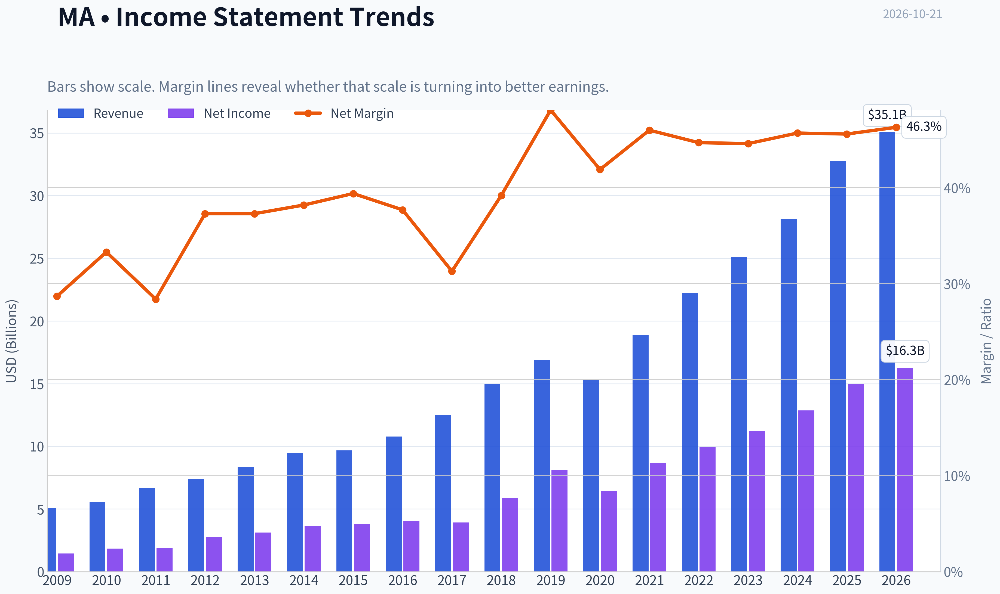

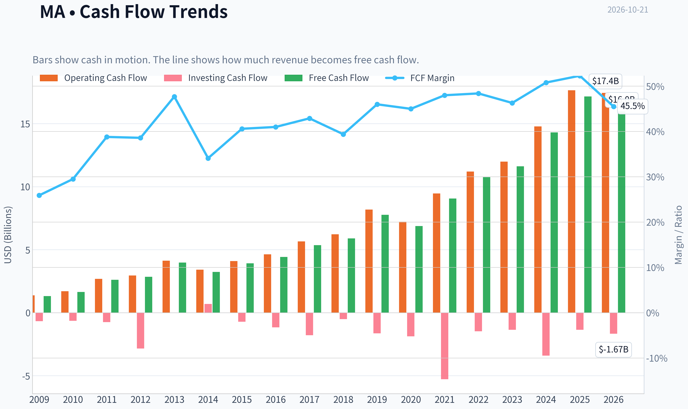

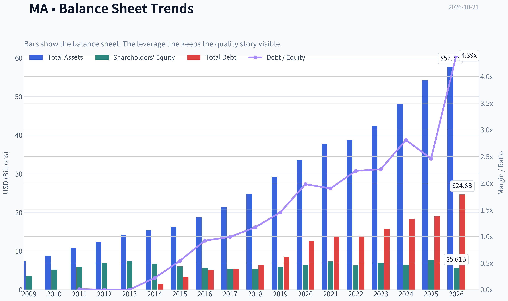

This graph tracks the profitability and return metrics (ROE, ROIC, Margins) of **MA** over the past decade, highlighting capital efficiency trends.

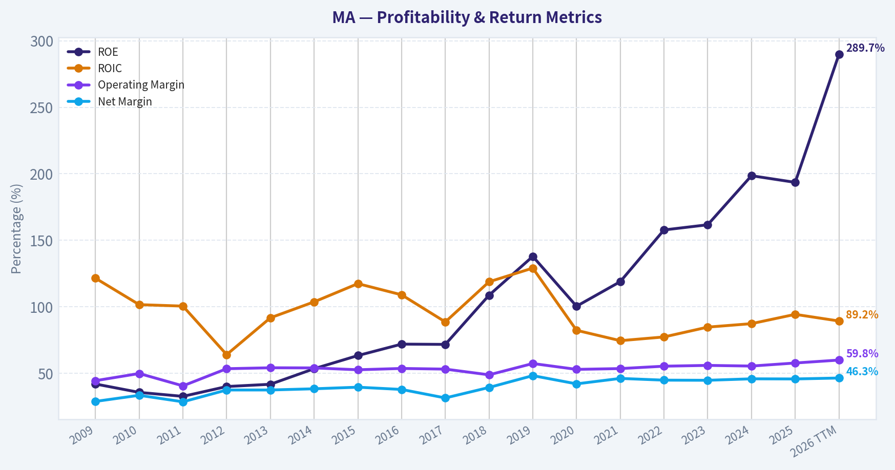

This chart illustrates the financial health of **MA** over the last 10 years, mapping cash equivalents and free cash flow against total obligations (Debt).

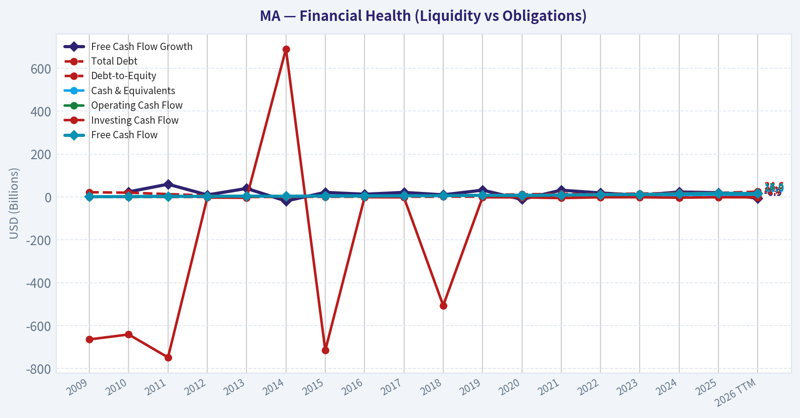

This breakdown chart from <em>Cash Flow and Capital Allocation</em> shows the proportional composition for **MA** - useful for understanding what drives or risks the business.

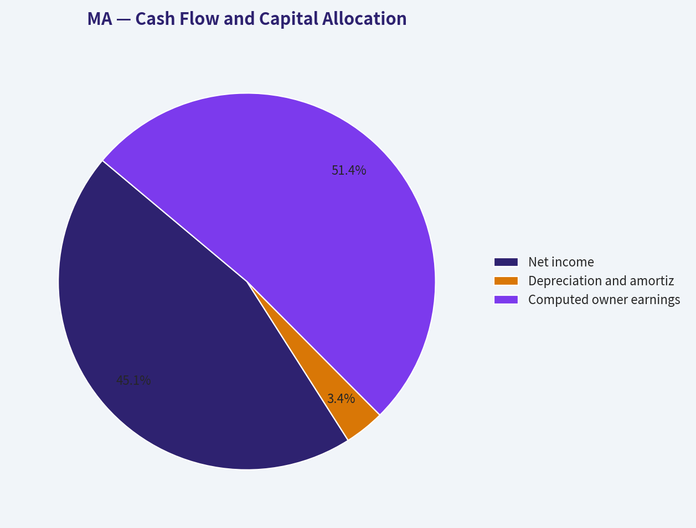

This breakdown chart from <em>Revenue Breakdown</em> shows the proportional composition for **MA** - useful for understanding what drives or risks the business.

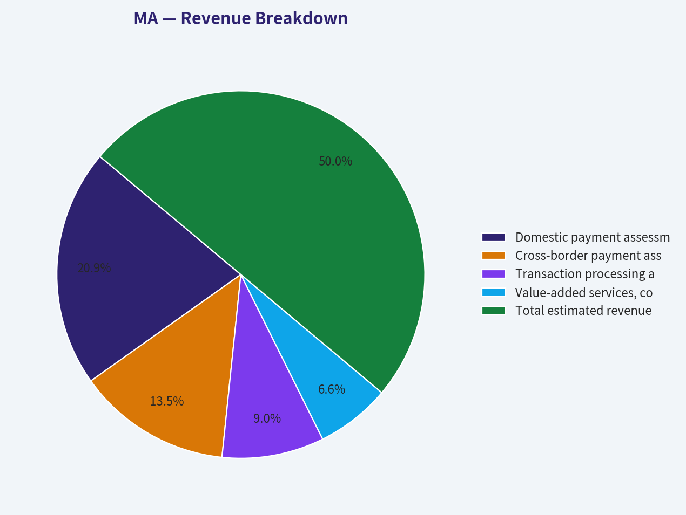

---

### Intrinsic Value Analysis (Buffett)

> *Following Warren Buffett's value investing philosophy: Circle of Competence, Economic Moat, Management Quality, and Margin of Safety.*

#### Intrinsic Value Snapshot

Price is what you pay. Intrinsic value is what the business may be worth based on the cash it can create for owners over time. We show a range, not one magic number.

- Current Price: $620.42
- Value Range (conservative to optimistic across both DCF methods): $316.37 to $932.49

##### Owner Earnings (Buffett Method)
- Net Income: $14,968,000,000.00
- Depreciation & Amortization: $1,143,000,000.00
- Capital Expenditures: $-489,000,000.00
- Working Capital Changes: $-1,442,000,000.00
- Owner Earnings: $17,064,000,000.00

##### Intrinsic Value
###### Buffett Method
Uses owner earnings. Stricter, and usually more conservative.
- Conservative: $326.57
- Average: $495.90
- Optimistic: $932.49
- Discount Rate: 10.0%

###### Cash Flow Method
Uses free cash flow. Better for companies spending heavily today to grow tomorrow.
- Conservative: $316.37
- Average: $406.95
- Optimistic: $510.25
- Discount Rate: 10.0%

ANALYST STANCE: **ADVOCATE**

#### Executive View

Mastercard is a high-quality, asset-light compounder with one of the strongest network-effect businesses in the world. Its moat is reinforced by global acceptance, fraud technology, issuer and merchant relationships, switching costs, and the continuing shift from cash to electronic payments.

At $620 per share and approximately 34 times earnings, Mastercard is not statistically cheap. However, the valuation implies roughly 6.8% perpetual growth using a 10% required return and the current free-cash-flow yield. That is demanding, but plausible for a durable global payments network. The stock is suitable for long-term ownership, though new purchases should ideally be made gradually rather than aggressively.

#### Factor Scorecard

| Factor | Score | Assessment |
|---|---:|---|
| 1. Circle of Competence and Simplicity | 5/5 | Mastercard earns fees when transactions run across its payment network. The model is easy to explain and highly predictable. |
| 2. Durable Competitive Advantage | 5/5 | Wide and widening moat from network effects, trusted brand, global acceptance, data, security capabilities, and switching costs. |
| 3. Management and Capital Allocation | 4/5 | Strong long-term execution, disciplined buybacks, attractive reinvestment economics, and limited need for acquisitions. |
| 4. Industry Structure | 5/5 | Global payments are dominated by a small number of scaled networks with powerful acceptance ecosystems and high operating leverage. |
| Gate 5: Quality and Solvency | Not tripped | There is no indication of simultaneously deteriorating earnings and a solvency red line such as sub-1x interest coverage or distress-level financial condition. |

**Key Takeaways:** Mastercard scores exceptionally well on business quality, competitive position, and industry structure. The principal weakness is valuation rather than business economics. The financial-distress hard floor is not tripped.

#### Moat Analysis

| Moat Source | Evidence |
|---|---|
| Network effects | More cardholders attract more merchants; more merchants make Mastercard cards more valuable to consumers and issuers. |
| Switching costs | Banks, merchants, payment processors, fraud systems, and compliance workflows are deeply integrated with Mastercard's infrastructure. |
| Intangible assets | Mastercard is a globally trusted payment brand with extensive regulatory, security, and acceptance infrastructure. |
| Cost advantages | Enormous transaction scale spreads technology, cybersecurity, compliance, and infrastructure costs across a very large payment base. |
| Data and technology | Transaction data, tokenization, fraud prevention, authentication, and cybersecurity capabilities strengthen the network over time. |
| Secular growth | Cash displacement, contactless payments, e-commerce, cross-border commerce, real-time payments, and digital wallets expand the addressable market. |

Mastercard's moat is best classified as **wide and widening**. Technology is more likely to strengthen the franchise than destroy it, provided Mastercard remains an essential infrastructure layer for new payment methods, digital wallets, account-to-account payments, and autonomous commerce.

#### Management Quality Assessment

Michael Miebach's management team operates a business with unusually attractive economics: high incremental margins, modest capital requirements, and substantial recurring cash generation.

The strongest capital-allocation characteristics are:

- Reinvestment in cybersecurity, tokenization, fraud prevention, and new payment services.
- Share repurchases that reduce the share count over time.
- Limited dependence on debt-funded acquisitions.
- Expansion into adjacent services such as consulting, open banking, identity, and commercial payments.
- A long-term focus on payment volume and network relevance rather than short-term revenue optimization.

Management ownership is not comparable to a founder-controlled company, so the owner-orientation score is not perfect. Nevertheless, the company's capital-allocation record and economics indicate a shareholder-oriented culture.

#### Financial Summary

| Metric | Latest Figure |
|---|---:|
| Share price | $620 |
| Market capitalization | $543.5 billion |
| P/E ratio | 34.1x |
| Revenue growth, year over year | 16.4% |
| Return on equity | 193.5% |
| Free-cash-flow yield | 3.2% |
| Implied free cash flow | Approximately $17.4 billion |
| Implied shares outstanding | Approximately 876.6 million |
| Current ratio | 1.03x |
| Gross margin | Not reported in the research snapshot |
| Intrinsic-value headline metric | Not meaningful for this financial issuer |

**Key Takeaways:** Mastercard is growing rapidly for a company of its size, while producing a very high reported ROE and strong free-cash-flow economics. The 3.2% free-cash-flow yield confirms that the market already recognizes much of the company's quality. Current ratio and book-value measures should receive limited weight because Mastercard is a financial-network business with an asset-light operating model.

#### Owner Earnings Calculation

For Mastercard, free cash flow is a reasonable practical proxy for owner earnings because the business requires relatively modest ongoing physical capital investment.

| Owner Earnings Component | Approximate Amount |
|---|---:|
| Net income and operating cash generation | Reflected in free cash flow |
| Add: non-cash depreciation and amortization | Included in cash-flow conversion |
| Less: maintenance capital expenditure | Included in free-cash-flow calculation |
| Less: normalized working-capital investment | Included in free-cash-flow calculation |
| Estimated owner earnings | Approximately $17.4 billion |
| Estimated owner earnings per share | Approximately $19.84 |

**Key Takeaways:** Mastercard's owner earnings are estimated at roughly $17.4 billion, or about $19.84 per share. The company converts a substantial portion of accounting earnings into cash because it does not require heavy physical infrastructure investment.

#### Three-Scenario DCF Valuation

The following valuation uses approximately $17.4 billion of owner earnings, a 10% required return, and approximately 876.6 million shares.

| Scenario | Key Assumptions | Equity Value | Value per Share |
|---|---|---:|---:|
| A. No Growth | Owner earnings held constant; 10% discount rate | $174 billion | $198 |
| B. GDP Growth | 3% perpetual growth; 10% discount rate | $256 billion | $292 |
| C. Historical/Normalized Growth | 8% growth for 10 years, followed by 3% terminal growth | $358 billion | $409 |
| Current market price | - | $543.5 billion | $620 |

**Key Takeaways:** A mechanically conservative DCF produces values below the current share price. This reflects the unusually demanding 10% discount rate and the fact that Mastercard's market price capitalizes substantial future growth. The valuation is not cheap on a conventional DCF basis, but the reverse-DCF test is more favorable.

#### Margin of Safety and Reverse DCF

At the current price:

- Free-cash-flow yield is approximately **3.2%**.
- Using a 10% discount rate and 3% terminal growth, the current price implies approximately **6.8% perpetual owner-earnings growth**.
- That implied growth rate is below recent revenue growth of 16.4% and is plausible for a global payment network with continuing digital-payment adoption.
- The stock does not offer a traditional 25% to 35% valuation discount.
- For a wide-moat, high-return, highly predictable compounder, a smaller margin of safety can be acceptable when the implied growth rate remains realistic.

The valuation therefore appears **fair to moderately expensive**, rather than deeply undervalued. Mastercard would become substantially more attractive if the price declined toward the low-to-mid $500s without deterioration in payment volume, cross-border growth, or competitive positioning.

#### Buffett Scorecard

| Criterion | Weight | Score | Weighted Contribution |
|---|---:|---:|---:|
| Moat width and durability | 25% | 5/5 | 1.25 |
| Valuation and margin of safety | 20% | 3/5 | 0.60 |
| Capital returns versus cost of capital | 15% | 5/5 | 0.75 |
| Business understanding and predictability | 12% | 5/5 | 0.60 |
| Management quality and capital allocation | 12% | 4/5 | 0.48 |
| Reinvestment runway | 8% | 5/5 | 0.40 |
| Balance-sheet strength | 4% | 4/5 | 0.16 |
| Industry structure | 4% | 5/5 | 0.20 |
| **Total** | **100%** | - | **4.44/5** |

**Key Takeaways:** Mastercard's weighted score is driven by an exceptional moat, high returns on incremental capital, predictable growth, and a long reinvestment runway. Valuation is the main constraint and prevents a higher-conviction rating, but it does not overwhelm the company's long-term economics.

#### Principal Risks

| Risk | Assessment |
|---|---|
| Regulation | Interchange-fee limits, antitrust actions, and payment regulation could pressure economics. |
| New payment rails | Account-to-account payments, central-bank digital currencies, and government-backed systems could bypass card networks in some transactions. |
| Large technology platforms | Wallet providers and technology companies may seek greater control over the customer relationship. |
| Economic slowdown | Cross-border payments and discretionary spending are cyclical, although the underlying network remains resilient. |
| Valuation compression | A high earnings multiple makes the stock sensitive to interest rates or a slowdown in growth. |

#### Investment Stance

**ADVOCATE - Moderate Conviction**

Mastercard is a wonderful business with a wide and widening moat, excellent reinvestment economics, and a long runway for cashless-payment growth. At $620, the shares are not a bargain and do not provide a large conventional margin of safety. However, the price does not require heroic assumptions: approximately 6.8% perpetual owner-earnings growth appears achievable for this franchise.

For a long-term investor, Mastercard is appropriate as a core compounder, preferably accumulated over time and with additional purchases made during market-wide declines or periods of temporary regulatory or economic pressure.
#### Valuation Bridge

This bridge places the current market price beside each intrinsic value lens so readers can see whether upside depends on one method or shows up across several methods.

| Scenario | Intrinsic Value / Share |
| --- | ---: |
| Buffett Method | $495.90 |
| Cash Flow Method | $406.95 |
| Current Price | $620.42 |

#### Key Takeaways

If one method is far above the others, the upside case depends on a specific modelling assumption. When several methods cluster together, the valuation story is more robust.

#### Valuation Visuals

This comparison chart from *Latest Earnings Snapshot* stacks current figures against historical benchmarks for **MA**, making it easy to see where the company trades relative to its own averages.

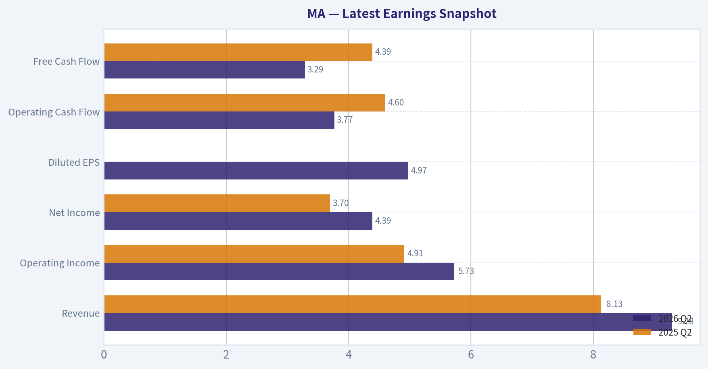

This comparison chart from *Current Metrics Compared with Historical Averages* stacks current figures against historical benchmarks for **MA**, making it easy to see where the company trades relative to its own averages.

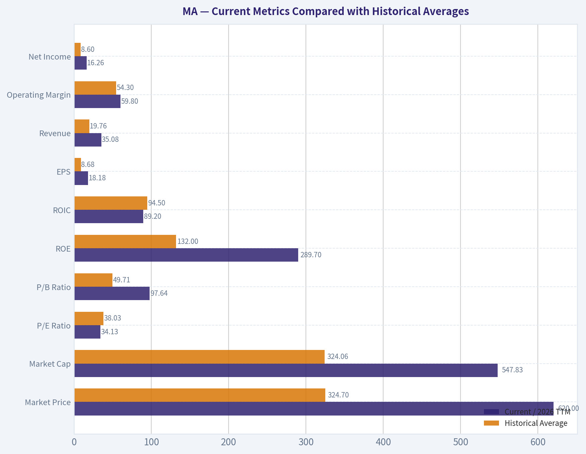

This comparison chart from *Balance Sheet and Financial Strength* stacks current figures against historical benchmarks for **MA**, making it easy to see where the company trades relative to its own averages.

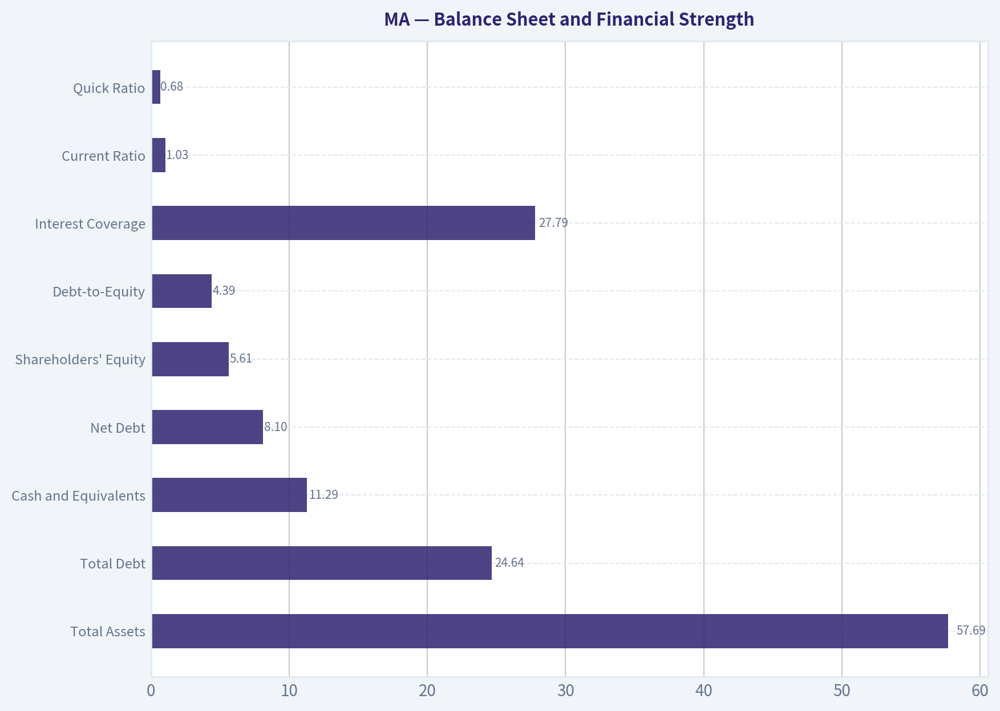

This comparison chart from *Financial Summary* stacks current figures against historical benchmarks for **MA**, making it easy to see where the company trades relative to its own averages.

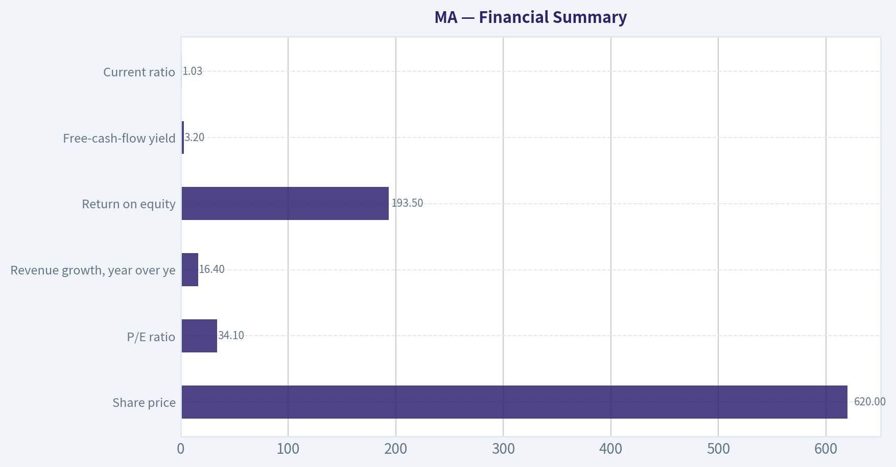

---

### Trend & Growth Analysis (Lynch/Druckenmiller/Fisher)

> *Following Peter Lynch's GARP, Stanley Druckenmiller's macro-aware approach, and Philip Fisher's scuttlebutt methodology.*

ANALYST STANCE: **WATCH**

#### 1. Lynch Classification

**Stalwart, with fast-grower characteristics in selected payment segments.**

Mastercard's latest reported revenue growth of **16.4%** is above the stalwart range, but its enormous scale, already-dominant market position, and premium valuation make a classic ten-bagger unlikely from today's base. It is better viewed as a high-quality compounder than an undiscovered fast grower.

#### 2. The Story in Three Bullets

- Mastercard benefits from the long-term shift from cash and checks toward electronic, contactless, mobile, and account-to-account payments.
- Its network produces powerful economics through global acceptance, brand trust, security infrastructure, data, and two-sided network effects.
- New growth avenues include cross-border payments, value-added services, fraud prevention, open banking, stablecoin infrastructure, and AI-enabled commerce.

#### 3. TAM and Runway

Mastercard participates in several large and expanding markets:

| Market | Growth Logic | Mastercard Opportunity |
|---|---|---|
| Digital consumer payments | Cash displacement and e-commerce growth | Transaction volume and network fees |
| Cross-border payments | Travel, remittances, and global commerce | Higher-value transactions and cross-border revenue |
| Value-added services | Fraud, cybersecurity, analytics, and consulting | Faster growth than core payment switching |
| Commercial payments | Continued digitization of business spending | Corporate cards and account-to-account solutions |
| Stablecoin and digital-asset infrastructure | Potential new settlement rails | Security, credentials, and network services |

**Key Takeaways:** Mastercard's runway remains substantial because electronic payments are still displacing cash globally and adjacent services are expanding the addressable market. However, the company already has a very large share of the traditional card network market, so future growth must increasingly come from cross-border, services, commercial payments, and new payment rails.

**10x Test:** A literal tenfold increase in Mastercard revenue would likely require a combination of global payment digitization, major expansion in services, and successful participation in new rails such as stablecoins and account-to-account payments. The company could theoretically grow several times larger within the global payments ecosystem, but a full 10x outcome is difficult to underwrite from its current scale and market share.

#### 4. Revenue Growth Trend

| Metric | Current Evidence | Interpretation |
|---|---:|---|
| Revenue growth | 16.4% year over year | Strong, but below classic high-growth territory |
| Growth pattern | Limited trend data supplied | No confirmed acceleration |
| Market performance | Up 19.7% over six months to October 19, 2026 | Investor recognition has improved |
| Earnings valuation | P/E 34.1x | Premium compounder valuation |

**Key Takeaways:** Mastercard is growing at a healthy rate, but the available information does not establish an accelerating revenue trend. The recent share-price outperformance suggests the market already recognizes much of the quality and growth story.

#### 5. Unit Economics and Operating Quality

| Metric | Assessment |
|---|---|
| LTV/CAC | Not applicable in the conventional SaaS sense |
| Net revenue retention | Not applicable |
| Rule of 40 | Not meaningful for a payment network |
| ROE | 193.5% |
| FCF yield | 3.2% |
| Current ratio | 1.03 |
| Gross margin | Not supplied |

**Key Takeaways:** Mastercard's economics are better evaluated through payment volume, cross-border growth, operating margins, free-cash-flow conversion, and return on invested capital rather than SaaS metrics. The very high ROE reflects an asset-light network model and financial leverage effects, while the 3.2% free-cash-flow yield indicates a premium valuation.

#### 6. Inflection Point Assessment

**Potential positive inflections:**

- Faster growth in value-added services such as cybersecurity, fraud prevention, analytics, and consulting.
- Stablecoin security and digital-asset infrastructure becoming commercially meaningful.
- AI agents and autonomous commerce creating new credentialing, authorization, and fraud-prevention demand.
- Continued cross-border travel and international transaction recovery.
- Greater penetration of commercial and business-to-business payments.

**Current assessment:** **Promising strategic inflections, but not yet a confirmed earnings acceleration.**

The most important question is whether Mastercard's newer businesses can grow rapidly enough to offset the natural maturation of its core card network. Stablecoin and AI-commerce initiatives are strategically interesting, but their financial contribution remains uncertain.

#### 7. Macro Setup

| Macro Factor | Effect on Mastercard |
|---|---|
| Global consumption | Positive if employment and spending remain resilient |
| Cross-border travel | Positive and typically higher value |
| Interest rates | Mixed; lower rates support valuations but may signal weaker growth |
| Regulation | Ongoing risk around interchange, routing, fees, and competition |
| Digital-payment adoption | Strong secular tailwind |
| Recession risk | Can reduce transaction volume and discretionary spending |

**Key Takeaways:** Mastercard has a favorable long-term secular backdrop, but it remains exposed to consumer spending, travel, regulation, and valuation sensitivity. The macro setup is constructive rather than exceptional; Mastercard is not as economically defensive as its asset-light model may initially suggest.

#### 8. Fisher's 15-Point Assessment

| Fisher Criterion | Score / 5 | Comment |
|---|---:|---|
| Market potential | 5 | Global payments and adjacent services are enormous |
| New-product determination | 4 | Active expansion into security, data, open banking, and digital assets |
| R&D effectiveness | 4 | Technology and network investment are strategic strengths |
| Sales organization | 4 | Deep global issuer, merchant, and partner relationships |
| Profit margins | 5 | Historically excellent business economics |
| Margin outlook | 4 | Strong, though mature-scale growth may moderate |
| Labor relations | 4 | No major issue indicated |
| Executive relations | 4 | No major issue indicated |
| Management depth | 5 | Global operating complexity requires substantial depth |
| Cost analysis/accounting | 4 | No major concern indicated |
| Outstanding characteristics | 5 | Network effects, trust, scale, and switching friction |
| Long-range outlook | 5 | Strong secular digitization runway |
| Dilution | 4 | No material dilution concern indicated |
| Candor | 4 | No specific concern identified |
| Integrity | 4 | No specific concern identified |
| **Total** | **65 / 75** | **Outstanding** |

**Key Takeaways:** Mastercard scores strongly on network effects, market potential, management depth, and long-term durability. The main deduction is not business quality but maturity: the company must keep creating new growth avenues as its core network becomes larger and more penetrated.

#### 9. Valuation Analysis

| Valuation Measure | Result | Interpretation |
|---|---:|---|
| P/E | 34.1x | Premium valuation |
| Revenue growth | 16.4% | Healthy but not hypergrowth |
| PEG | Approximately 2.1 | Expensive under Lynch's framework |
| FCF yield | 3.2% | Implies limited current cash-flow yield |
| Intrinsic value headline | Not meaningful | Financial issuer; use earnings and cash flow |

**Key Takeaways:** The PEG ratio is approximately **2.1**, calculated as a 34.1 P/E divided by 16.4% earnings or revenue growth as a proxy. That is above Lynch's attractive range and indicates that investors are paying for quality, durability, and future growth rather than receiving a bargain.

**Scenario framework:** Without current consensus EPS, transaction-volume forecasts, and forward earnings estimates, precise price targets would be false precision.

- **Bear case:** Growth moderates toward low double digits, regulatory pressure increases, and the multiple contracts toward the mid-to-high 20s.
- **Base case:** Mastercard compounds earnings in the mid-teens and maintains a premium multiple around the low-to-mid 30s.
- **Bull case:** Services, cross-border payments, AI commerce, and stablecoin infrastructure produce renewed growth acceleration and support a premium multiple above the current range.

At the current valuation, the bull case appears substantially reflected in the share price, while the bear case has meaningful downside through multiple compression.

#### 10. Growth Investor Scorecard

| Criterion | Weight | Score / 5 |
|---|---:|---:|
| Story | 10% | 4.5 |
| TAM and runway | 20% | 4.0 |
| Revenue growth | 20% | 3.5 |
| Unit economics | 15% | 4.5 |
| Competitive position | 10% | 5.0 |
| Management quality | 10% | 4.5 |
| Macro setup | 5% | 3.5 |
| Profitability path | 5% | 5.0 |
| Valuation | 5% | 2.5 |
| **Weighted score** | **100%** | **4.1 / 5** |

**Key Takeaways:** Mastercard is an excellent business with an attractive long-term growth story, but valuation prevents a high-conviction growth purchase today. The score supports owning or monitoring the company, especially on a meaningful pullback or upon evidence that newer businesses are accelerating overall growth.

#### 11. Position Size Stance

- **New position:** Watchlist or starter position only; avoid making it a concentrated ten-bagger bet at approximately 34x earnings.
- **Existing holder:** Continue holding if the investment horizon is five years or longer.
- **High-conviction sizing:** Consider only after a valuation reset, sustained earnings acceleration, or a clear improvement in the growth contribution from services and new payment rails.
- **Indicative stance:** **Small-to-moderate position, not an aggressive allocation.**

#### 12. Key Catalysts and Risks

**Catalysts**

- Sustained revenue growth above 20%.
- Faster growth in value-added services and cybersecurity.
- Strong cross-border volume and travel recovery.
- Material monetization of AI-enabled commerce.
- Stablecoin and digital-asset infrastructure becoming a meaningful revenue stream.
- Continued strong operating leverage and buybacks.

**Risks**

- Revenue growth decelerating toward low double digits.
- Interchange, routing, antitrust, or regulatory restrictions.
- Disintermediation from account-to-account payment systems or large technology platforms.
- Economic weakness reducing consumer and cross-border spending.
- Stablecoins or alternative payment rails reducing card-network economics rather than expanding them.
- Premium multiple compression if interest rates rise or growth disappoints.

**Bottom line:** Mastercard remains a high-quality compounder with an outstanding competitive moat and a strong secular runway. It is not currently a classic Lynch bargain or obvious ten-bagger candidate: the business quality is **ADVOCATE**, but the valuation and lack of confirmed acceleration support an overall **WATCH** stance.

---

### Market Technical Analysis

ANALYST STANCE: **WATCH**

#### MA technical overview

Mastercard, ticker MA, closed at **$620.42 on October 20, 2026**, the latest trading session available in the retrieved data. Although the requested current date is October 21, no October 21 price record was present, so the analysis uses October 20 as the effective observation date.

The technical picture is **strongly bullish on trend and momentum, but increasingly extended in the short term**. Price is well above both its medium- and long-term moving averages, MACD has accelerated into positive territory, and the recent advance has been persistent. However, RSI is above 75, and price is approaching the upper Bollinger Band, which raises the probability of consolidation or a pullback even though it does not by itself establish a reversal.

#### Selected indicators

The eight selected indicators are:

- **close_10_ema** - short-term trend and tactical support.
- **close_50_sma** - medium-term trend confirmation.
- **close_200_sma** - long-term trend regime.
- **macd** - directional momentum and trend acceleration.
- **rsi** - momentum intensity and overextension risk.
- **boll_ub** - upside volatility boundary and potential resistance.
- **boll_lb** - downside volatility boundary and risk-context reference.
- **atr** - volatility-adjusted stop placement and position sizing.

These indicators are complementary: three moving averages establish trend across different horizons; MACD and RSI assess momentum from different perspectives; Bollinger Bands describe price location within its volatility envelope; and ATR helps translate the analysis into risk management. The Bollinger middle line was not selected because it would add little information beyond the moving-average structure.

#### Trend structure

MA's long-term trend remains constructive. The **200-day SMA was approximately $531.89**, and the stock closed about **16.6% above it**. More importantly, the 200-day average has been gradually rising, from roughly $529.86 in late September to $531.89 by October 20. This indicates that the long-term trend has not merely improved because of a short-lived price spike; the underlying average itself is beginning to slope upward.

The **50-day SMA stood near $577.10**, with price approximately **7.5% above it**. The 50-day average has risen consistently from around $566.22 on September 21. This is a meaningful medium-term bullish signal, but the distance from the average also shows that the recent rally has moved substantially ahead of its intermediate trend baseline.

The **10-day EMA was $602.57**, placing the closing price roughly **3.0% above the short-term average**. The 10-day EMA has risen sharply from $569.54 on September 21, reflecting the powerful October advance. Its upward slope confirms near-term strength, while the gap between price and the EMA provides a first tactical reference: a decisive close below this area would suggest that short-term momentum is cooling.

#### Momentum and price behavior

MACD has undergone a clear bullish transition. It moved from **negative territory in late September**, reaching approximately **-4.53 on October 2**, to **+13.32 on October 20**. The progression was especially strong after October 8, when MACD crossed into positive territory and continued expanding. This indicates that the fast EMA structure is now substantially above the slow EMA structure.

The positive MACD reading is supported by price action rather than appearing in isolation. MA advanced from **$550.64 on September 30 to $620.42 on October 20**, an increase of approximately **12.7%**. The stock also climbed from $573.89 on October 8 to $620.42, gaining about **8.1% in less than two weeks**. Such persistence favors trend-following strategies, but it also means that new entries have less margin for error.

RSI was **75.66**, firmly above the conventional 70 overbought threshold. This is a warning about short-term extension, not an automatic sell signal. In a strong trend, RSI can remain above 70 while prices continue rising. Nevertheless, the combination of RSI above 75, a rapid multi-week gain, and price near the upper Bollinger Band suggests that risk-reward has become less attractive for chasing the stock immediately.

#### Bollinger Band positioning

The upper Bollinger Band was approximately **$629.98**, leaving the stock about **$9.56 below that level**, or roughly 1.5% of the share price. The stock is therefore near the upper portion of its recent volatility range, but it has not yet produced a decisive close above the upper band.

This distinction matters. A close above the upper band accompanied by sustained momentum could represent a genuine upside expansion, particularly if the stock consolidates above $620 afterward. Conversely, a failure near the $624-$630 area followed by a move back below the 10-day EMA would increase the likelihood of a short-term retracement.

The lower Bollinger Band was approximately **$530.80**, far below current price. It is not a practical near-term target, but it confirms that the current position is heavily skewed toward the upper half of the recent distribution. The widening separation between the upper and lower bands also reflects increased price variability compared with late September.

#### Volatility and risk management

ATR was approximately **$10.00**, meaning MA's recent average daily trading range was equivalent to about **1.6% of its share price**. ATR rose from roughly $8.73 on September 21 to around $10.00 on October 20. The increase is moderate rather than extreme, but it indicates that stops placed too tightly beneath the latest closing price could be vulnerable to ordinary daily fluctuations.

For a short-term position, the rising **10-day EMA near $602.57** is the first trend-health reference. A pullback toward that area would represent a normal reset if buyers defend it. The **50-day SMA near $577.10** is the more important medium-term support zone. A sustained break beneath the 50-day average would materially weaken the current bullish structure, while the 200-day SMA near $531.89 remains the major long-term trend boundary.

Using ATR, a stop placed approximately 1.5 to 2 ATR below an entry would imply a distance of roughly $15 to $20, though the appropriate level depends on time horizon and position size. Traders should avoid treating ATR as a fixed price forecast; its main purpose is to prevent stops and position sizes from ignoring current volatility.

#### Trading interpretation

The preferred interpretation is **bullish trend, overbought short-term condition**.

- **Existing holders:** The trend remains favorable. A trailing stop beneath the 10-day EMA or a wider stop beneath the 50-day SMA may allow participation while protecting against a meaningful reversal.
- **New buyers:** Chasing at $620 after the rapid advance carries elevated pullback risk. A consolidation above $600, a controlled retracement toward the 10-day EMA, or a confirmed breakout above the $624-$630 area would offer better-defined setups than an unplanned market entry.
- **Momentum traders:** A decisive close above the recent high near **$624.29**, followed by continuation and stable momentum, could signal another upside leg. Failure near that level, especially with RSI turning lower and MACD losing slope, would favor waiting.
- **Risk-aware traders:** A close below approximately $602 would be an initial warning that the short-term trend is losing force. A break below $577 would be more significant because it would challenge the medium-term advance.

Overall, MA is technically strong, but the setup is no longer an uncomplicated early-stage breakout. The evidence supports maintaining a bullish bias while avoiding aggressive new exposure until either the stock consolidates or it proves that the $624-$630 resistance area can be converted into support.

| Indicator | Latest value or level | Interpretation | Practical implication |
|---|---:|---|---|
| Closing price | $620.42 | Near recent highs after a sharp advance | Strong trend, but vulnerable to profit-taking |
| 10-day EMA | $602.57 | Rising rapidly and below price | First short-term support and trend-health test |
| 50-day SMA | $577.10 | Rising steadily | Important medium-term support |
| 200-day SMA | $531.89 | Rising gradually | Long-term bullish regime remains intact |
| MACD | 13.32 | Strongly positive and expanding | Momentum favors continuation, though acceleration may cool |
| RSI | 75.66 | Above the 70 overbought threshold | Elevated short-term extension risk |
| Upper Bollinger Band | $629.98 | Close to current price | Potential resistance or breakout confirmation zone |
| Lower Bollinger Band | $530.80 | Well below current price | Confirms price is positioned near the upper volatility range |
| ATR | $10.00 | About 1.6% of price | Use wider, volatility-aware stops and position sizing |
| Key levels | $624-$630 resistance; $603 and $577 support | Trend remains bullish unless support fails | Prefer confirmation or pullback entries over chasing |

**Key Takeaways:** MA remains in a strong bullish trend, with price above rising 10-day, 50-day, and 200-day averages and MACD strongly positive. However, RSI above 75 and price near the upper Bollinger Band indicate short-term overextension. The most important near-term test is whether MA can hold above approximately $603 after any pullback; a sustained move above $624 to $630 would strengthen the continuation case, while a break below $577 would materially weaken the medium-term setup.

---

### Options Market Analysis

> *Reading options flow - put/call ratios, IV skew, and unusual activity - to gauge institutional positioning and event-driven risk.*

#### MA Options Market Report

**As of October 21, 2026.** The available data covers expirations from October 23 through November 6, 2026. A major limitation is that reported open interest is zero across all near-term expirations, preventing reliable OI-based positioning and concentration analysis.

#### 1. Put/Call Ratio Analysis

| Expiration | Call Volume | Put Volume | Put/Call Volume Ratio | Call OI | Put OI | Put/Call OI Ratio |
|---|---:|---:|---:|---:|---:|---:|
| Oct. 23, 2026 | 742 | 780 | 1.05 | 0 | 0 | N/A |
| Oct. 30, 2026 | 221 | 522 | 2.36 | 0 | 0 | N/A |
| Nov. 6, 2026 | 190 | 119 | 0.63 | 0 | 0 | N/A |
| **Total** | **1,153** | **1,421** | **1.23** | **0** | **0** | **N/A** |

**Key Takeaways:** Near-term put volume exceeds call volume by roughly 23%, producing a 1.23 volume ratio. This is above the approximate 0.7 neutral reference and suggests a modest bias toward downside protection or bearish speculation, concentrated most heavily in the October 30 expiration. However, zero reported open interest makes it impossible to determine whether this represents new positioning or activity in an unreliable data feed.

#### 2. Implied Volatility Assessment

| Expiration | Call ATM IV | Put ATM IV | Put Minus Call IV | Interpretation |
|---|---:|---:|---:|---|
| Oct. 23, 2026 | 2.7% | 5.1% | +2.4 percentage points | Strong put premium |
| Oct. 30, 2026 | 1.6% | 2.4% | +0.8 percentage points | Moderate put skew |
| Nov. 6, 2026 | 1.4% | 1.8% | +0.4 percentage points | Mild put skew |

**Key Takeaways:** Put implied volatility is higher than call implied volatility at every reported expiration, indicating a consistent downside-risk skew. Absolute IV is unusually low, so the market is not pricing substantial near-term movement overall. No confirmed earnings, product, or macro catalyst was provided, and the data does not show an obvious event-volatility premium.

The supplied data includes ATM IV but not separate out-of-the-money call and put IV. Therefore, the skew assessment is based on the ATM call-versus-put differential rather than a full OTM volatility curve.

#### 3. Unusual Options Activity

| Finding | Result |
|---|---|
| Contracts with volume greater than 5x open interest | None reported |
| Fresh directional bets identifiable from volume/OI | None |
| Smart-money versus retail classification | Not possible from the available data |

**Key Takeaways:** No individual contract met the unusual-activity threshold. There is therefore no identifiable large call sweep, put sweep, or institutionally significant volume/OI imbalance to use as a high-conviction directional signal. The aggregate put-volume bias is more meaningful than any single contract, but confidence remains limited.

#### 4. Open Interest Concentration and Gamma Levels

| Measure | Result |
|---|---|
| Highest call open interest | None reported; all near-term call OI shown as zero |
| Highest put open interest | None reported; all near-term put OI shown as zero |
| Max-pain analysis | Not available |
| Strike-level gamma walls | Not identifiable |
| Expected pinning or gravitational levels | Cannot be determined |

**Key Takeaways:** The reported zero open interest eliminates the ability to identify major strikes, expiration-based pinning, or gamma walls. This is likely a data-coverage or feed-quality issue rather than evidence that no MA options are held by market participants. Near-term price acceleration or dampening cannot be inferred from the supplied OI data.

#### 5. Overall Options Sentiment

**Signal: BEARISH, low confidence.**

The primary bearish driver is the aggregate near-term put/call volume ratio of 1.23, combined with higher put IV than call IV across all three expirations. This points to greater demand for downside protection or bearish exposure, particularly around the October 30 expiration.

The signal is only modestly bearish because:

- Open interest is reported as zero throughout the dataset.
- No unusual individual contracts were identified.
- Absolute implied volatility is very low, indicating limited overall conviction.
- Current share price and strike-level details were not provided, so ITM, ATM, and OTM positioning cannot be classified for individual contracts.
- A full OTM put-versus-call skew cannot be calculated from the available ATM-only IV data.

#### Summary

| Category | Assessment |
|---|---|
| Put/Call Ratio | **1.23 volume ratio**, above the approximate 0.7 neutral reference; OI ratio unavailable |
| IV Level | **Very low** near-term IV; no clear event premium |
| Skew Direction | **Put skew**; put IV exceeds call IV across all expirations |
| Unusual Activity | **None detected** using the volume greater than 5x OI criterion |
| Overall Signal | **BEARISH, low confidence**; driven by put-heavy volume and persistent put IV premium |

**Key Takeaways:** MA's near-term options flow leans bearish, but the edge is weak because open interest is reported as zero and no unusual contracts were detected. The most defensible conclusion is mild downside caution rather than a high-conviction bearish trade.

---

## Research Team Commentary

> *The Research Manager synthesizes the Bull vs Bear debate into action-free commentary. This is a pre-risk view, not the final stance.*

Core takeaway: Mastercard is an exceptional business, but at $620 the investment case rests more on continued excellent execution than on a defensible margin of safety. The network effects, trust, global acceptance, and capital-light economics justify a premium valuation, and the roughly 11% growth implied by the reverse DCF is plausible rather than heroic. However, plausibility is not enough when the stock already trades at 34.1 times earnings and near the supplied base intrinsic value of approximately $610. I would retain Mastercard if already owned, but I would not establish a full new position at this price. My stance is WATCH.

The strongest bull argument is business quality. Mastercard operates one of the world's most durable two-sided networks, reinforced by global acceptance, bank relationships, security infrastructure, regulatory expertise, fraud data, and consumer trust. These advantages would be extraordinarily difficult to replicate. Its reported 96.1% ROIC and 27.6% ROA confirm that this is a capital-light franchise with exceptional economics, although the 193.5% ROE is inflated by the small accounting equity base and repurchases.

The growth runway also remains credible. The migration from cash and checks to digital payments is not complete, particularly outside developed markets. Cross-border commerce, contactless payments, cybersecurity, tokenization, identity, fraud prevention, open banking, and AI-enabled commerce provide additional avenues for growth. Alternative payment formats do not necessarily eliminate Mastercard because those systems still need authentication, security, compliance, and cross-border interoperability. Mastercard has a credible chance to evolve from a card network into a broader commerce infrastructure platform.

That matters for valuation. At $620, the reverse DCF reportedly implies roughly 11% annual owner-earnings growth for ten years under a 9% required return. With current revenue growth of 16.4%, operating leverage, service expansion, and repurchases, Mastercard could plausibly produce 12% or better long-term per-share growth. If it does, the optimistic value near $745 is attainable, and today's price would look reasonable in retrospect.

The strongest bear argument is not that the franchise will fail. It is that the current price already assumes a favorable version of the future. The supplied base DCF is approximately $610, slightly below the market price, while the conservative case is approximately $450. The apparent 17% margin of safety exists only relative to the optimistic $745 valuation, which combines 12% growth, an 8.5% discount rate, a 3.5% terminal growth rate, and continued premium economics. That is a legitimate upside scenario, but it should not be treated as the conservative central appraisal.

For a wide-moat, predictable compounder, I would accept a smaller margin of safety than I would require from an average business-roughly 10% to 15% below a reasonable central value. Mastercard does not currently provide that discount to the supplied $610 base estimate. Applying that quality-scaled requirement points toward an attractive range closer to approximately $520-$550, assuming the fundamentals remain intact. Alternatively, the present price could become attractive if normalized owner earnings rise enough to lift central intrinsic value materially above $620.

The expected-return framing reinforces the caution. If EPS compounds at 12% for ten years and the terminal multiple declines to a still-generous 25 times, the analysis indicates roughly an 8.5% annual price return, plus a modest dividend. That is respectable, but it is not an unusually favorable payoff for assuming a decade of excellent execution. Ordinary maturation into high-single-digit revenue growth, modest margin pressure, or a lower terminal multiple could reduce returns substantially without damaging Mastercard's competitive position.

Regulation and alternative rails deserve attention, but they should not be exaggerated into an imminent disruption thesis. The more realistic risk is incremental economic pressure: lower fees, routing mandates, higher incentives, domestic-network preference, or a shift toward services with less attractive margins than the core network. Mastercard can remain highly relevant while earning less on the incremental transaction. At 34 times earnings, even modest deterioration in long-term economics matters.

Management appears to be allocating capital sensibly by reinvesting in security, tokenization, fraud prevention, and adjacent services while returning surplus cash. The qualification is that repurchases at a 34-times multiple are less valuable than repurchases at a depressed price. Buybacks will mechanically raise EPS, but they create meaningful intrinsic value only when shares are purchased at or below a reasonable appraisal. This is not evidence of poor management; it simply limits how much credit investors should give repurchases at the current valuation.

The debate therefore resolves into a clear distinction between business quality and entry quality. Mastercard deserves admiration and a premium multiple. It does not automatically deserve fresh capital at any premium. The market's implied growth hurdle looks achievable, but there is little protection if growth is merely good rather than exceptional. The stock is closer to fairly valued than obviously overvalued, so AVOID would be too harsh. Equally, the absence of a base-case discount makes ADVOCATE too aggressive.

The prior Mastercard experience reinforces the importance of not chasing an elite franchise when valuation, estimate momentum, and entry conditions provide little edge. At the same time, the Nvidia mistake warns against using valuation discomfort as an automatic veto on dominant compounders. The appropriate synthesis is to keep Mastercard under active consideration and make valuation affect position size and entry timing rather than treating 34 times earnings as proof that the company must be avoided. There are no actual moving-average figures in this bundle, so technical strength or weakness should not be invented. The options data are also unusable because zero reported open interest may reflect data limitations rather than genuine market conviction.

Over the next one to four quarters, I would monitor several concrete items. First, watch switched transaction growth and cross-border volume, separating temporary travel fluctuations from sustained share or pricing deterioration. Growth consistently ahead of global nominal consumer spending would strengthen the thesis; persistent deceleration without a macroeconomic explanation would weaken it.

Second, track organic growth in value-added services, including cybersecurity, identity, fraud prevention, data analytics, and open banking. The key question is not merely whether these businesses grow, but whether they maintain attractive margins and deepen customer switching costs. Acquisition-driven growth or visible margin dilution would make the bull case less compelling.

Third, examine operating margins, free-cash-flow conversion, and the relationship between reported EPS and actual owner earnings. The present valuation work uses EPS as a proxy because complete cash-flow data were not supplied. Strong cash conversion and restrained stock-based compensation would validate that assumption. A widening gap between EPS and free cash flow would require a lower valuation.

Fourth, monitor forward estimate revisions. Sustained low-double-digit EPS revisions with stable or rising margins could allow intrinsic value to catch up to the current price and justify staged accumulation even without a major pullback. Estimate cuts accompanied by a still-elevated multiple would increase downside risk.

Fifth, watch regulatory developments involving network fees, merchant routing, digital wallets, antitrust matters, and domestic payment initiatives. A localized ruling is manageable; coordinated pressure across major jurisdictions or structural compression in cross-border pricing would be more serious.

Sixth, evaluate Mastercard's progress in account-to-account payments, stablecoin settlement, and new commerce formats. Evidence that Mastercard can monetize security, identity, and connectivity across alternative rails would strengthen the moat. Evidence that new rails are bypassing the network while capturing high-value transactions would weaken it.

Finally, monitor capital allocation. Continued investment in the franchise is desirable, but large debt-funded acquisitions or aggressive repurchases at increasingly elevated valuations would reduce confidence. A pullback toward $520-$550 with intact fundamentals would create a more attractive entry. The other upgrade route would be materially higher normalized owner earnings that raise central intrinsic value enough to put $620 at least 10% below a defensible appraisal.

Mastercard remains a wonderful business with a credible decade-long compounding runway. At $620, however, investors are paying approximately full price for that quality and receiving limited protection against normalization. Existing owners can reasonably continue holding, while new investors should wait for a better price, stronger owner-earnings evidence, or upward revisions to intrinsic value.

Final stance: WATCH.

---

## Value Investing Team Commentary

> *The Investor translates the research view into an investment thesis before risk review. This is still not the final stance.*

### Mastercard: Exceptional Franchise, Limited Valuation Cushion

Mastercard is one of the rare businesses whose premium valuation is supported by genuinely exceptional economics. Its two-sided network connects consumers, banks, merchants, governments, and technology platforms across the world. Acceptance, trust, fraud data, tokenization, regulatory expertise, and security infrastructure reinforce one another, creating a moat that would be extraordinarily expensive and time-consuming to replicate.

The financial metrics support that assessment. Revenue growth of 16.4%, ROIC of 96.1%, and ROA of 27.6% indicate a capital-light franchise with substantial pricing power and incremental margins. The reported 193.5% ROE is less informative because repurchases and a small accounting equity base inflate it. ROIC, cash generation, transaction growth, and per-share owner earnings are better measures of Mastercard's economic performance.

### Durable growth runway

Mastercard should continue benefiting from the global transition away from cash and checks. That transition remains incomplete, particularly in developing economies, business-to-business payments, and cross-border commerce. The company also has credible growth opportunities beyond traditional card transactions:

- Cybersecurity, fraud prevention, and identity services
- Tokenization and digital-wallet infrastructure
- Data analytics and merchant services
- Open banking and account-to-account connectivity
- Stablecoin settlement and alternative payment rails
- AI-enabled authentication and commerce

Alternative rails are not automatically existential threats. New payment methods still require identity verification, fraud controls, compliance, dispute resolution, and international interoperability. Mastercard can remain valuable even when the underlying funding source is not a conventional card.

The long-term opportunity is for Mastercard to evolve from a card network into a broader commerce infrastructure platform. That would deepen switching costs and diversify revenue, although investors must verify that adjacent services retain attractive margins rather than merely adding lower-quality revenue.

### What the valuation requires

At $620 and 34.1 times earnings, the earnings yield is only about 2.9%. Investors are therefore relying on sustained growth rather than receiving much current earnings yield.

The reverse DCF's implied owner-earnings growth of approximately 11% annually for ten years is plausible. Mastercard could potentially deliver that through transaction growth, operating leverage, value-added services, and share-count reduction. But a plausible assumption is not necessarily a conservative one.

The central issue is that the valuation leaves little room for ordinary disappointment:

- The supplied base intrinsic value is approximately $610.
- The market price is $620.
- The conservative estimate is approximately $450.
- The optimistic estimate is approximately $745.

Thus, the current price offers upside if Mastercard sustains excellent execution, but little protection if the company merely performs well. The optimistic valuation depends on 12% growth, a relatively low 8.5% discount rate, a 3.5% terminal growth rate, and durable premium economics. That is a reasonable bull case, not an appropriate margin-of-safety benchmark.

Mastercard deserves a smaller discount than an average company because of its moat, predictability, and reinvestment opportunities. Even so, a roughly 10%-15% discount to a defensible central appraisal would be preferable. Relative to a $610 base value, that suggests an attractive accumulation zone around $520-$550. This is not a precise statement of value; it is a sensible range for improving prospective returns and reducing dependence on flawless execution.

At $620, the expected return can still be satisfactory. If per-share earnings compound at 12% for a decade and the terminal multiple declines to 25 times, an annualized price return around 8.5%, plus a modest dividend, appears possible. That is respectable, but not unusually compelling compensation for bearing regulatory, competitive, and multiple-compression risk.

### Selective contrarian interpretation

The conventional bearish argument is that new payment rails, regulation, stablecoins, or digital wallets will disintermediate Mastercard. That argument is probably too simplistic. Payment interfaces can change without eliminating the need for trusted infrastructure. Mastercard's security, identity, tokenization, and cross-border capabilities may allow it to monetize multiple rails rather than defend only the traditional card model.

That is the constructive contrarian opportunity: the market may underestimate Mastercard's ability to remain the trusted infrastructure layer beneath new payment formats. Evidence that Mastercard can monetize account-to-account transactions, stablecoins, and AI-driven commerce would justify a higher estimate of long-term earnings power.

The opposite contrarian warning is equally important. Investors broadly recognize Mastercard's quality, so this is not a neglected franchise surrounded by excessive fear. At 34 times earnings, the market already assumes durability and considerable growth. The principal risk is not sudden disruption; it is gradual economic leakage through higher customer incentives, routing mandates, lower network fees, domestic payment preferences, or lower-margin revenue mix.

Mastercard can remain an excellent and strategically important company while producing mediocre investment returns from an elevated starting multiple. That distinction between business risk and valuation risk is central to the decision.

The options data provide no reliable sentiment signal. Zero reported open interest across the dataset is more likely a data-quality or coverage issue than proof of market indifference. Similarly, no conclusions should be drawn from the listed moving-average categories because the actual values were not supplied.

### Capital allocation

Management's reinvestment in cybersecurity, tokenization, fraud prevention, and adjacent services appears rational because these areas protect the core network and expand its addressable market. Limited reliance on debt-funded acquisitions is also encouraging.

Repurchases require more scrutiny. Buybacks reduce the share count and support per-share growth, but their value depends on price. At 34 times earnings, repurchases may still be reasonable given Mastercard's quality, but they are less accretive to intrinsic value than purchases made during a meaningful valuation reset. Investors should distinguish mechanically higher EPS from genuine value creation.

### Decision framework

For existing long-term shareholders, continued ownership is reasonable. The franchise remains intact, the balance sheet does not appear to be a concern, and selling a superior compounder solely because it is approximately fairly valued can create reinvestment and tax problems.

For a new investor, the current price does not justify an immediate full position. Two developments could improve the opportunity:

1. **Price-led opportunity:** A decline toward roughly $520-$550 without deterioration in transaction growth, margins, or competitive position.
2. **Earnings-led opportunity:** Owner earnings and forward estimates rise sufficiently to place $620 at least 10% below a revised central intrinsic value.

A small starter position could be defensible for an investor seeking decades of ownership and willing to add during volatility. However, position sizing should reflect the absence of a current valuation cushion.

### Key evidence to monitor

- Switched transaction and cross-border volume growth
- Organic growth and margins in value-added services
- Free-cash-flow conversion versus reported EPS
- Customer incentives and operating-margin trends
- Forward earnings revisions
- Regulatory action affecting fees, routing, or cross-border economics
- Monetization of account-to-account payments and stablecoin settlement
- Acquisition discipline and the prices paid for repurchases

Persistent double-digit owner-earnings growth with stable margins would allow intrinsic value to catch up with the share price. Conversely, weakening estimates, lower cash conversion, or structural pressure on transaction economics would make the present multiple increasingly difficult to defend.

### ANALYST STANCE: **WATCH**

Mastercard is a wonderful, wide-moat business, but at $620 it appears close to fair value rather than meaningfully undervalued. Existing owners can reasonably hold, while new investors should favor staged accumulation only after a valuation reset or clear growth in normalized owner earnings that raises intrinsic value.

---

## Deep Values Commentary

> *The Risk Management Team debates and the Risk Judge provides the final action-free verdict. This section determines the final ADVOCATE / WATCH / AVOID stance.*

#### Final Stance Scorecard

This scorecard converts the final research view into a weighted decision frame. It does not replace the narrative judgement, but it makes the main drivers of the verdict easier to scan.

| Criterion | Score | Weight | Commentary |
| --- | ---: | ---: | --- |
| Business Quality | 4.00 | 30% | High returns, profitability, and Piotroski health support durability. |
| Valuation Support | 2.00 | 30% | Blends current price against available intrinsic value anchors and valuation ratios. |
| Financial Strength | 3.50 | 20% | Balance-sheet resilience reflects leverage and liquidity staying within safe ranges. |
| Growth Durability | 4.00 | 20% | Recent revenue, earnings, and free cash flow growth indicate how durable expansion looks. |
| TOTAL / FINAL STANCE | 3.30 | 100% | WATCH |

#### Key Takeaways

The weighted score lands at **3.30 / 5.0**, while the final stance remains **WATCH**. This is useful as a quick calibration aid rather than a mechanical signal.

#### Risk Summary

Higher scores indicate more risk pressure. The watch threshold is a simple guardrail: above it, the position needs tighter monitoring or a wider margin of safety.

| Dimension | Current Score | Watch Threshold | Commentary |
| --- | ---: | ---: | --- |
| Business Quality | 2.00 | 3.00 | High returns, profitability, and Piotroski health support durability. |
| Valuation Support | 4.00 | 3.00 | Blends current price against available intrinsic value anchors and valuation ratios. |
| Financial Strength | 2.50 | 3.00 | Balance-sheet resilience reflects leverage and liquidity staying within safe ranges. |
| Growth Durability | 2.00 | 3.00 | Recent revenue, earnings, and free cash flow growth indicate how durable expansion looks. |

#### Key Takeaways

This view helps readers separate *where* the risk sits: valuation, business quality, balance sheet, or growth durability. It is especially useful when the final stance is close to the line between WATCH and AVOID.
