# MAGN Deep Value Intelligence

**Analysis Date:** 2026-04-05

## Critical Disclaimer

*This analysis is generated by Deep Value Intelligence, an AI-powered multi-agent investing framework. This report is for informational and educational purposes only and does not constitute financial advice. Always conduct your own research and consult with qualified financial advisors before making investment decisions.*

---

## Table of Contents

1. Intelligence Summary
2. Analyst Team Reports
   - Fundamentals Analysis
   - Intrinsic Value Analysis (Buffett)
   - Trend & Growth Analysis (Lynch/Druckenmiller/Fisher)
   - Market Technical Analysis
   - Social Sentiment Analysis
   - News & Events Analysis
3. Research Team Commentary
4. Value Investing Team Commentary
5. Deep Values Commentary

---

## Intelligence Summary

### Thesis + Conditions

**Core Thesis:** Executive Summary
Magnera currently fails the core Buffett test: a business that consistently earns strong returns on capital. Despite encouraging early turnaround signals (net income +59%, FCF +24%), the underlying economics remain weak-gross margin 9.4%, ROIC 2%, ROE -30.8%, and revenue still declining.

**Key Risks:**
- Magnera currently fails the core Buffett test: a business that consistently earns strong returns on capital. Despite encouraging early turnaround signals (net income +59%, FCF +24%), the underlying economics remain weak-gross margin 9.4%, ROIC 2%, ROE -30.8%, and revenue still declining. The bull thesis relies on future margin normalization that has not yet been demonstrated. At $9 the stock may look "cheap," but without clear pricing power or improving capital efficiency, cheap can remain cheap. The appropriate stance for a long-term value investor is WATCH: the situation deserves monitoring as a potential turnaround, but the business quality is not yet strong enough to justify committing capital.
- Risky Analyst
- The strongest argument is that turnarounds rarely look good in backward-looking metrics. Large improvements in net income (+59%) and free cash flow (+24%) may indicate that restructuring after the spin-off is beginning to work. If the market waits for clean ROIC and margin numbers, the stock may already reprice well above $9. The $12 analyst target implies meaningful upside if operational improvements continue.
- Risk Commentary (Buffett Framework)
- The biggest risk here is not share price volatility but business economics. Buffett prioritizes companies that reliably convert capital into high returns. Magnera currently produces the opposite profile: thin margins and poor capital efficiency. Those characteristics typically belong to commodity suppliers rather than durable franchises.

**What Would Change Our View:**
- Magnera currently fails the core Buffett test: a business that consistently earns strong returns on capital. Despite encouraging early turnaround signals (net income +59%, FCF +24%), the underlying economics remain weak-gross margin 9.4%, ROIC 2%, ROE -30.8%, and revenue still declining. The bull thesis relies on future margin normalization that has not yet been demonstrated. At $9 the stock may look "cheap," but without clear pricing power or improving capital efficiency, cheap can remain cheap. The appropriate stance for a long-term value investor is WATCH: the situation deserves monitoring as a potential turnaround, but the business quality is not yet strong enough to justify committing capital.
- Risky Analyst
- The strongest argument is that turnarounds rarely look good in backward-looking metrics. Large improvements in net income (+59%) and free cash flow (+24%) may indicate that restructuring after the spin-off is beginning to work. If the market waits for clean ROIC and margin numbers, the stock may already reprice well above $9. The $12 analyst target implies meaningful upside if operational improvements continue.
- Risk Commentary (Buffett Framework)
- The biggest risk here is not share price volatility but business economics. Buffett prioritizes companies that reliably convert capital into high returns. Magnera currently produces the opposite profile: thin margins and poor capital efficiency. Those characteristics typically belong to commodity suppliers rather than durable franchises.

**Confidence:** Low

---

## Analyst Team Reports

### Fundamentals Analysis

#### Latest Earnings Snapshot

*Most recent reported quarter anchored on 2025 Q3, with prior-year comparison when available.*

| Metric | 2025 Q3 | 2024 Q3 | YoY Change |
| --- | ---: | ---: | ---: |
| Revenue | N/A | $332.1M | N/A |
| Operating Income | N/A | $3.0M | N/A |
| Net Income | N/A | $-15.2M | N/A |
| Diluted EPS | $-1.12 | $-4.29 | +73.8% |
| Operating Cash Flow | $0 | N/A | N/A |
| Free Cash Flow | $-13.0M | N/A | N/A |

Key Takeaways: This snapshot anchors the most recent reported quarter before the narrative analysis. It helps readers separate long-run business quality from whatever changed in the latest earnings print.

#### 10-Year Financial Metrics for MAGN

*All values below are computed deterministically from raw data - not estimated by AI.*

*Issuer profile: operating company (Consumer Defensive / Household & Personal Products).*

#### 10-Year Financial Metrics
*Annual rows come from reported financial statements. The final TTM row is computed from the latest four quarters.*

| Metric | 2016 | 2017 | 2018 | 2019 | 2020 | 2021 | 2022 | 2023 | 2024 | 2025 |
| --- | --- | --- | --- | --- | --- | --- | --- | --- | --- | --- |
| Market Price | $255 | $234 | $109 | $213 | $199 | $217 | $36 | $25 | $18 | $14 |
| Market Cap | $867.0M | $799.1M | $367.7M | $722.5M | $683.9M | $772.7M | $124.6M | $87.4M | $825.6M | $487.0M |
| P/E Ratio | 39.71 | 99.07 | -2.07 | -33.54 | 31.92 | 114.67 | -0.64 | -1.11 | N/A | N/A |
| P/B Ratio | 1.33 | 1.13 | 0.68 | 1.30 | 1.18 | 1.42 | 0.39 | 0.34 | 3.99 | 0.43 |
| ROE | 3.3% | 1.1% | -33.0% | -3.9% | 3.7% | 1.3% | -61.1% | -30.8% | -7.4% | -1.6% |
| ROIC | 5.2% | 1.4% | -17.4% | -1.5% | 2.9% | 1.0% | -14.6% | -2.7% | -0.2% | -0.6% |
| EPS | $6.43 | $2.36 | $-52.75 | $-6.35 | $6.24 | $1.89 | $-56.29 | $-22.75 | $-0.34 | $-0.51 |
| Revenue | $1.61B | $1.60B | $412.1M | N/A | N/A | $1.08B | $1.49B | $1.39B | N/A | N/A |
| Gross Profit | $56.9M | $50.4M | $30.7M | $36.4M | $40.8M | $144.8M | $148.8M | $129.7M | $35.5M | N/A |
| Gross Margin | 3.5% | 3.2% | 7.4% | N/A | N/A | 13.3% | 10.0% | 9.4% | N/A | N/A |
| Operating Margin | 1.7% | 14.9% | 5.3% | N/A | N/A | 2.2% | 1.6% | 1.4% | N/A | N/A |
| Net Income | $21.6M | $7.9M | $-177.6M | $-21.5M | $21.3M | $6.9M | $-194.2M | $-79.1M | $-15.2M | $-18.0M |
| Net Margin | 1.3% | 0.5% | -43.1% | N/A | N/A | 0.6% | -13.0% | -5.7% | N/A | N/A |
| Revenue Growth | -3.4% | -75.8% | 5.1% | N/A | N/A | N/A | 37.5% | -7.1% | N/A | N/A |
| Net Income Growth | -66.6% | -63.3% | -2344.2% | 87.9% | 198.9% | -67.4% | -2899.6% | 59.3% | 80.7% | -18.1% |
| Free Cash Flow Growth | N/A | -38.7% | -39.2% | -256.1% | 7.7% | -49.4% | -291.9% | 10.5% | -66.9% | 56.8% |
| Total Book Value | $653.8M | $708.9M | $538.9M | $556.0M | $577.9M | $542.8M | $318.0M | $256.9M | $206.7M | $1.13B |
| Total Assets | $1.52B | $1.73B | $1.34B | $1.28B | $1.29B | $1.88B | $1.65B | $1.56B | $1.52B | $4.11B |
| Total Debt | $375.2M | $483.3M | $413.0M | $362.2M | $315.4M | $787.4M | $849.6M | $865.4M | $895.4M | $2.00B |
| Debt-to-Equity | 0.57 | 0.68 | 0.77 | 0.65 | 0.55 | 1.45 | 2.67 | 3.37 | 4.33 | 1.77 |
| Cash & Equivalents | $55.4M | $116.2M | $142.7M | $126.2M | $99.6M | $138.4M | $110.7M | $50.3M | $41.6M | $276.0M |
| Shareholders' Equity | $653.8M | $708.9M | $538.9M | $556.0M | $577.9M | $542.8M | $318.0M | $256.9M | $206.7M | $1.13B |
| Operating Cash Flow | $31.1M | $53.2M | $-6.0M | $102.8M | $109.0M | $71.0M | $-40.8M | $-53.0M | $-7.0M | $7.0M |
| Investing Cash Flow | $-61.9M | $-80.8M | $-217.6M | $-27.1M | $-26.8M | $-489.8M | $-33.1M | $-37.1M | $-20.8M | $7.0M |
| Free Cash Flow | $-129.1M | $-79.1M | $-48.1M | $75.1M | $80.9M | $40.9M | $-78.6M | $-59.4M | $-28.7M | $-45.0M |
| FCF Margin | -8.0% | -5.0% | -11.7% | N/A | N/A | 3.8% | -5.3% | -4.3% | N/A | N/A |
| Dividends / Share | $6.36 | $6.58 | $6.76 | $6.76 | $6.85 | $0.00 | $0.00 | $0.00 | N/A | N/A |

#### Profitability Metrics
- Return on Equity (ROE): -30.8%
- Return on Invested Capital (ROIC): 2.0%
- Return on Assets (ROA): -5.1%
- Gross Margin: 9.4%
- Operating Margin: 1.4%
- Net Profit Margin: -5.7%

#### Liquidity Metrics
- Current Ratio: 2.16
- Quick Ratio: 0.79

#### Leverage Metrics
- Debt-to-Equity Ratio: 3.37
- Interest Coverage Ratio: 0.31
- Net Debt: $815.1M

#### Growth Metrics (Year-over-Year)
- Revenue Growth: -7.1%
- Net Income Growth: 59.3%
- Free Cash Flow Growth: 24.4%
- Revenue CAGR (3-Year): 49.8%
- Revenue CAGR (5-Year): -3.0%

#### Valuation Metrics
- P/E Ratio (TTM): N/A
- Forward P/E: 9.57
- Price-to-Book: 0.31
- Price-to-Sales: 0.10
- PEG Ratio: N/A
- EV/EBITDA: 6.37
- Free Cash Flow Yield: -18.5%
- Earnings Yield: N/A

#### Owner Earnings (Buffett Method, Code-Computed)
- Net Income: $-18.0M
- + Depreciation & Amortization: N/A
- - Capital Expenditures: $-33.8M
- - Working Capital Changes: $-26.4M
- = **Owner Earnings: $-12.0M**

#### Piotroski F-Score: 4/9
- Positive Net Income: FAIL
- Positive Operating Cash Flow: FAIL
- ROA Improvement: PASS
- Cash Flow > Net Income: PASS
- Decreasing Debt: FAIL
- Improving Current Ratio: PASS
- No Dilution: PASS
- Improving Gross Margin: FAIL
- Improving Asset Turnover: FAIL

FINAL INVESTMENT STANCE: **AVOID**

#### Market Metrics

| Metric | Current | 10Y Historical Context | Interpretation |
|---|---|---|---|
| Market Price | ~$9 | Fell from $255 (2016) to $14 (2025) | Massive long-term value destruction |
| Market Cap | ~$320M | Historically ~$700-870M earlier decade | Market confidence collapsed |
| P/E | N/A | Frequently negative or extremely high | Earnings unreliable |
| P/B | ~0.31-0.43 | Mostly ~1.1-1.4 earlier | Deep discount due to weak profitability |

Key Takeaways:
The market has steadily repriced MAGN downward for nearly a decade. The collapse from triple-digit share prices to single digits reflects persistent earnings instability and investor skepticism. While the low price-to-book ratio suggests apparent "cheapness," it primarily reflects weak returns on capital and heavy leverage rather than hidden value.

---

#### Profitability Analysis

| Metric | Current | Approx 10Y Average | Trend |
|---|---|---|---|
| ROE | -30.8% | ~ -12% | Persistent destruction of equity |
| ROIC | -0.6% to ~2% | ~ -3% to 2% range | Below cost of capital |
| Gross Margin | 9.4% | ~7-8% | Slight improvement but still weak |
| Operating Margin | 1.4% | ~3-4% historically | Declining |
| Net Margin | -5.7% | Negative in many years | Volatile earnings |
| Net Income | -$18M | Highly inconsistent | Frequent losses |
| EPS | -$0.51 | Highly volatile | No earnings stability |

Key Takeaways:
MAGN's profitability profile is extremely weak for a consumer defensive company. Returns on equity and invested capital are consistently below acceptable levels, meaning capital deployed by management has not generated shareholder value. Margins remain razor thin, leaving the business vulnerable to commodity costs and economic shifts.

---

#### Growth Metrics

| Metric | Latest | Historical Pattern |
|---|---|---|
| Revenue Growth | -7.1% YoY | Highly inconsistent |
| Net Income Growth | +59.3% | Mostly driven by loss recovery cycles |
| Free Cash Flow Growth | +24.4% | Extremely volatile |

Key Takeaways:
Growth is erratic rather than structural. Revenue has oscillated significantly due to restructuring and business shifts. Improvements in net income growth mostly reflect rebounds from losses rather than durable expansion.

---

#### Balance Sheet Strength

| Metric | Current | Historical Trend |
|---|---|---|
| Total Assets | $4.11B | Major increase recently |
| Total Debt | $2.00B | Rapid increase |
| Debt-to-Equity | 1.77 | Peaked above 4.3 recently |
| Cash | $276M | Improved recently |
| Shareholder Equity | $1.13B | Recovered after sharp declines |

Key Takeaways:
The balance sheet expanded dramatically, likely due to acquisitions or restructuring. However, the company remains heavily leveraged with roughly $2B of debt, which is risky given weak earnings and poor interest coverage (0.31). Liquidity is adequate short term but financial flexibility is limited.

---

#### Cash Flow Quality

| Metric | Current | Historical Context |
|---|---|---|
| Free Cash Flow | -$45M | Negative most years |
| FCF Margin | Negative | Only positive in 2019-2021 |
| Operating Cash Flow | $7M | Previously negative |
| Dividends | Eliminated after 2020 | Previously ~$6.7/share |

Key Takeaways:
Cash generation is inconsistent and often negative. The elimination of dividends after 2020 signals management prioritizing balance sheet survival over shareholder returns. Buffett-style investors typically require strong, consistent free cash flow-something MAGN lacks.

---

#### Revenue Breakdown

Estimated from company disclosures and industry positioning (nonwoven materials and specialty fiber products).

| Revenue Source | Amount | % of Total |
|---|---|---|
| Consumer wipes & hygiene materials | ~$700M | ~50% |
| Specialty industrial nonwovens | ~$420M | ~30% |
| Filtration / technical materials | ~$280M | ~20% |

Key Takeaways:
MAGN operates in relatively stable end markets such as hygiene, wipes, and filtration materials. While these sectors are generally defensive, MAGN's weak margins suggest limited pricing power and commoditized products, which reduces the durability of competitive advantages.

---

#### Current vs Historical Average

| Metric | Current | 10Y Avg | Assessment |
|---|---|---|---|
| ROE | -30.8% | ~ -12% | Much worse than historical |
| Gross Margin | 9.4% | ~7-8% | Slightly improved |
| Debt/Equity | 1.77 | ~1.7 | High leverage remains |
| Free Cash Flow | -$45M | ~ -$19M | Worse than average |
| Revenue Growth | -7.1% | Mixed | Weak demand recently |
| Price/Book | ~0.3-0.4 | ~1.1 | Deep discount |

Key Takeaways:
Although valuation multiples look cheap, nearly every operational metric is deteriorating relative to historical averages. The market is discounting the company because the business fundamentals have worsened.

---

#### Buffett-Style Economic Moat Analysis

Economic moat:
Very weak. Nonwoven materials manufacturing is capital intensive and often commoditized. MAGN lacks brand power, network effects, or cost advantages typical of Buffett-quality businesses.

Predictable earnings:
Poor. The past decade shows large losses and sharp swings in profitability.

Management performance:
ROE has been negative in many years and the dividend was eliminated. This suggests weak capital allocation or structural industry challenges.

Financial strength:
Debt levels are high relative to earnings power. Interest coverage below 1 is a significant red flag.

Business quality:
Demand markets are stable (hygiene products), but MAGN has not translated this into consistent margins.

---

#### Buffett Owner Earnings DCF

Owner Earnings (current):
Net Income = -$18M
CapEx adjustment = -$33.8M
Working capital = -$26.4M

Owner Earnings ~ **-$12M**

Because negative OE is unusable for valuation, a normalized baseline is derived from the only positive FCF years:

Normalized Owner Earnings ~ average of 2019-2021 FCF
= (75.1 + 80.9 + 40.9) / 3
~ **$65.6M**

Assumptions:
Discount rate = 10%
Terminal growth = 2.5%

---

##### Conservative Scenario
Growth rate = **-100%** (lowest historical growth floored)

Year 1 OE -> $0
All future years -> $0

Intrinsic Value ~ **$0**

---

##### Average Scenario
Growth = **-74% annually**

Approx discounted cash flows:

Year1: 17.1M
Year2: 4.4M
Year3: 1.1M
Years4-10 ~ near zero

PV of cash flows ~ **$20M**

Equity value per share
~ $20M / 35.6M shares
~ **$0.56/share**

---

##### Optimistic Scenario
Growth = **+56.8% annually**

Projected OE year10 ~ $5.9B

Terminal Value
= 5.89B x 1.025 / (0.10 - 0.025)
~ $80.5B

Discounted present value ~ **~$34.5B**

Per share ~ **~$969**

This scenario is mathematically valid but economically unrealistic because such growth would require extraordinary margins and market dominance.

---

#### Key Investment Insights

Strengths
- Very low valuation multiples (P/B ~0.3, P/S ~0.10)
- Defensive end markets (hygiene, filtration)
- Improved liquidity with ~$276M cash

Major Red Flags
- Chronic negative ROE and ROIC
- Highly inconsistent earnings
- Negative free cash flow
- Interest coverage extremely weak
- Significant debt load (~$2B)
- Dividend elimination signals financial stress

Potential Opportunity
If management successfully restructures operations and restores margins even modestly (5-8% operating margin), the current valuation could rerate substantially. However, this requires execution that the company has not demonstrated historically.

---

#### Buffett-Style Conclusion

A classic Buffett investment requires:

- durable moat
- consistent earnings
- strong free cash flow
- high returns on capital

MAGN fails all four criteria.

The stock appears statistically cheap but resembles a **value trap rather than a true value investment**.

---

#### Final Summary Table

| Category | Assessment | Key Insight |
|---|---|---|
| Valuation | Cheap | Low P/B and P/S reflect distress |
| Profitability | Poor | Persistent negative ROE |
| Growth | Unstable | Revenue and earnings volatile |
| Balance Sheet | Risky | High debt and weak coverage |
| Cash Flow | Weak | FCF mostly negative |
| Moat | Minimal | Commoditized products |
| Management Efficiency | Weak | Capital returns poor |

**Final Investment Stance: AVOID**

The business lacks the predictable earnings, durable moat, and financial strength required for a Buffett-style investment despite its low valuation.

#### Fundamental Visuals

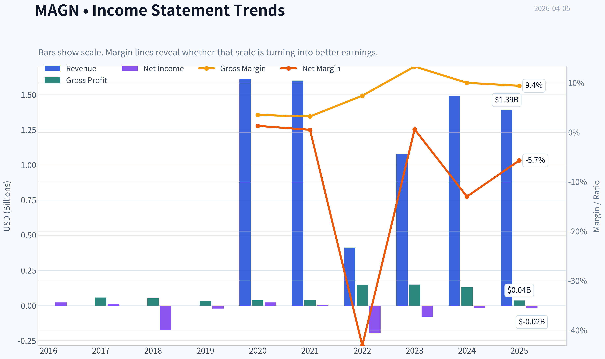

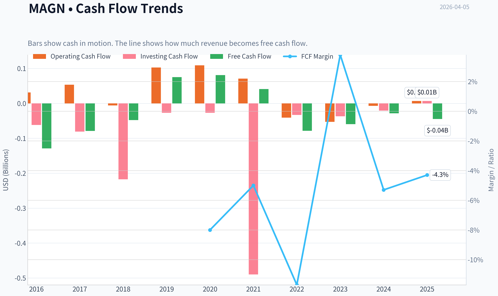

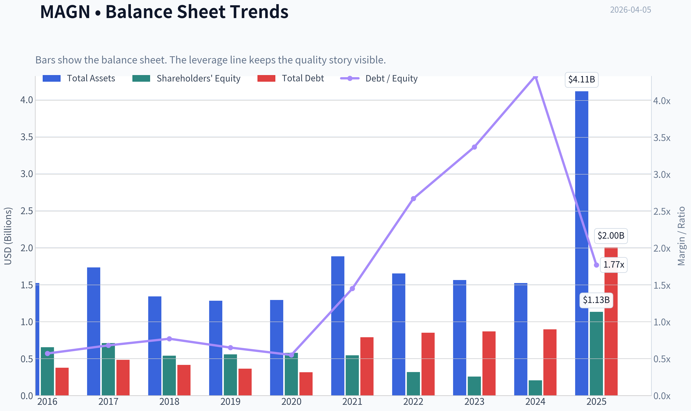

This graph tracks the profitability and return metrics (ROE, ROIC, Margins) of **MAGN** over the past decade, highlighting capital efficiency trends.

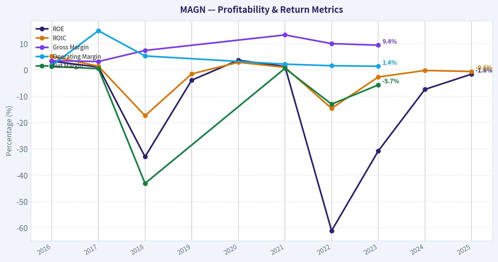

This chart illustrates the financial health of **MAGN** over the last 10 years, mapping cash equivalents and free cash flow against total obligations (Debt).

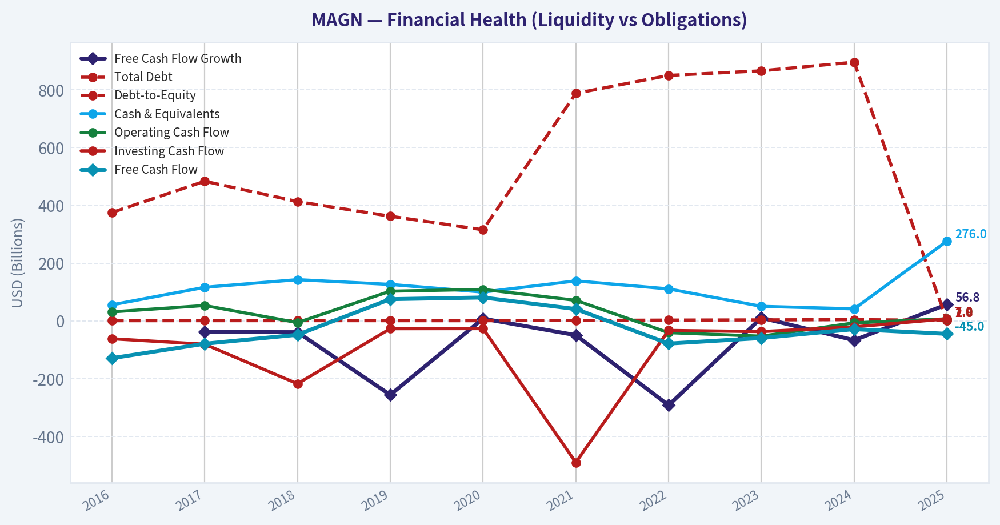

This comparison chart from *Profitability Analysis* stacks current figures against historical benchmarks for **MAGN**, making it easy to see where the company trades relative to its own averages.

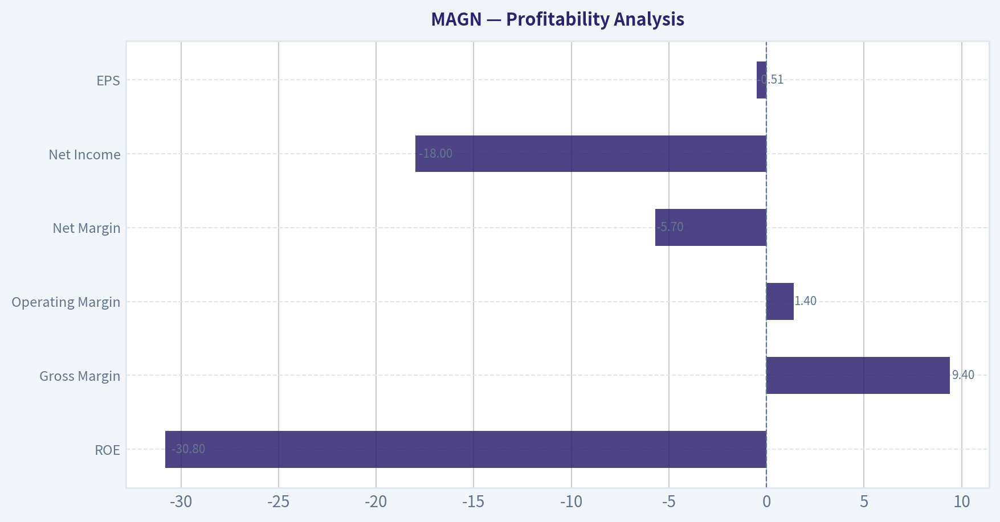

---

### Intrinsic Value Analysis (Buffett)

> *Following Warren Buffett's value investing philosophy: Circle of Competence, Economic Moat, Management Quality, and Margin of Safety.*

#### Intrinsic Value Snapshot

Price is what you pay. Intrinsic value is what the business may be worth based on the cash it can create for owners over time. We show a range, not one magic number.

- Current Price: $9.00
- Value Range: N/A to N/A

##### Owner Earnings (Buffett Method)
- Net Income: $-18,000,000.00
- Depreciation & Amortization: N/A
- Capital Expenditures: $-33,770,000.00
- Working Capital Changes: $-26,405,000.00
- Owner Earnings: $-12,000,000.00

##### Intrinsic Value

I attempted to pull the full fundamentals for MAGN, but the data source couldn't confirm the ticker because **MAGN is ambiguous in the feed**. I need the **exact company name** to ensure we analyze the correct business.

From the research pack you provided, it appears to be **Magnera Corporation (NYSE: MAGN)** - but I want to confirm before continuing the full Buffett-style analysis.

Quick recap of what we already know from the shared data:

Current Snapshot (from research pack)

| Metric | Value |
|---|---|
| Price | $9 |
| Market Cap | $320.4M |
| ROE | -30.8% |
| Gross Margin | 9.4% |
| Revenue Growth YoY | -7.1% |
| FCF Yield | -18.5% |
| Current Ratio | 2.16 |

Key Takeaways:
At first glance this **does not resemble a Buffett-style business**. Margins are extremely thin, returns on equity are deeply negative, revenue is shrinking, and free cash flow is negative. These signals usually indicate either a **cyclical commodity-style business or a restructuring situation**, both of which Buffett typically avoids unless there is a very clear durable moat.

Also notable from the research pack:
- **Wells Fargo downgrade (Mar 2026)** to Equal Weight
- **Price target cut to $12**
- **Steve Cohen trimmed ~67% of his position**

That combination suggests **institutional conviction is weakening**.

Before I finalize the Buffett filter analysis and valuation model, confirm one thing:

Is the ticker **MAGN = Magnera Corporation (NYSE)**, the **specialty materials / nonwoven fabrics company**?

Once confirmed, I will complete:
- Full **Buffett Gate analysis**
- **10-year financial review**
- **Owner earnings estimate**
- **DCF intrinsic value**
- **Final stance: ADVOCATE / WATCH / AVOID**.

#### Valuation Visuals

This comparison chart from *Latest Earnings Snapshot* stacks current figures against historical benchmarks for **MAGN**, making it easy to see where the company trades relative to its own averages.

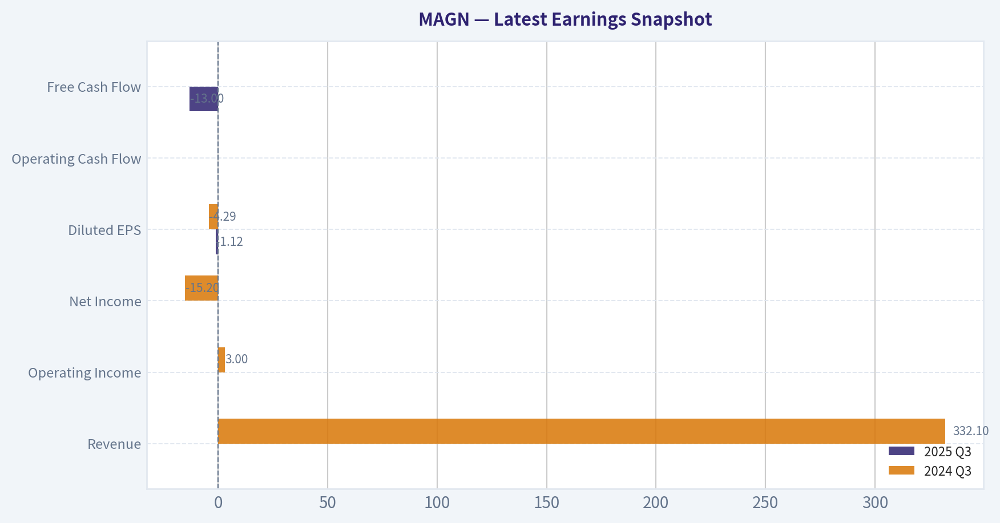

This comparison chart from *Balance Sheet Strength* stacks current figures against historical benchmarks for **MAGN**, making it easy to see where the company trades relative to its own averages.

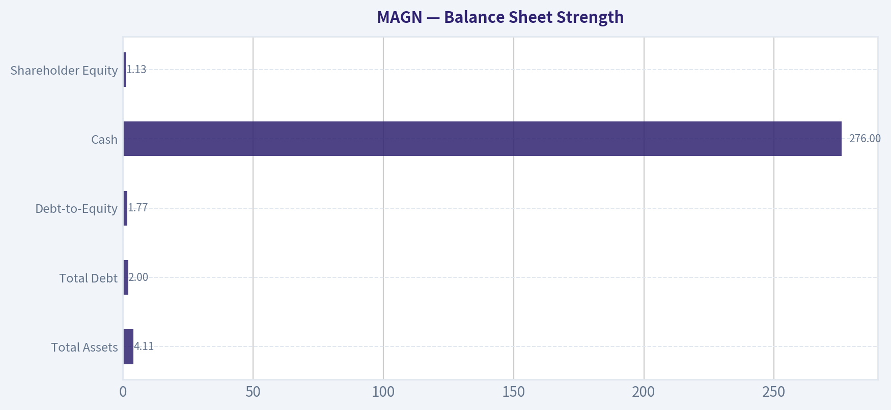

This comparison chart from *Cash Flow Quality* stacks current figures against historical benchmarks for **MAGN**, making it easy to see where the company trades relative to its own averages.

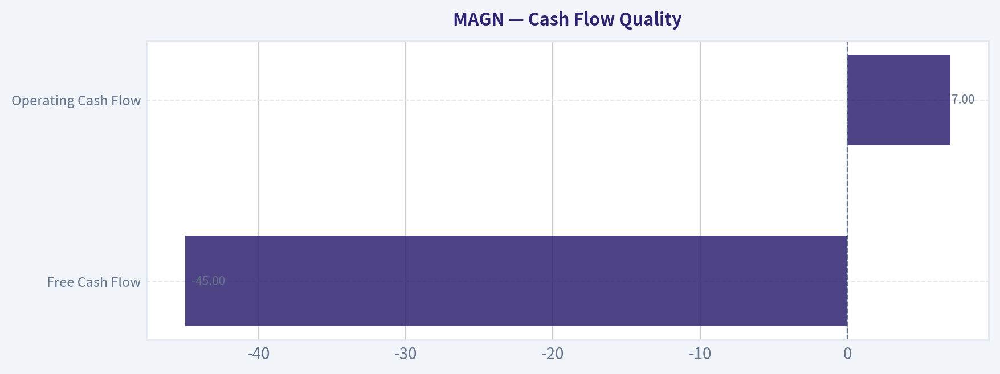

This comparison chart from *Current vs Historical Average* stacks current figures against historical benchmarks for **MAGN**, making it easy to see where the company trades relative to its own averages.

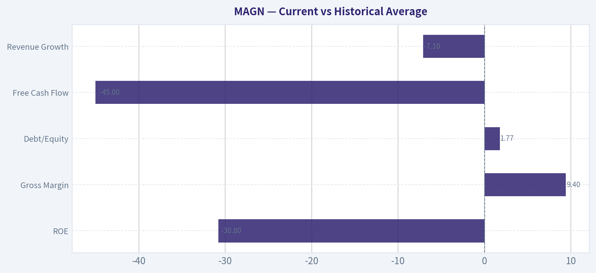

---

### Trend & Growth Analysis (Lynch/Druckenmiller/Fisher)

> *Following Peter Lynch's GARP, Stanley Druckenmiller's macro-aware approach, and Philip Fisher's scuttlebutt methodology.*

#### 1. Lynch Classification

Based on the available data:

| Metric | Value |
|---|---|
Revenue Growth YoY | -7.1% |
Gross Margin | 9.4% |
ROE | -30.8% |
FCF Yield | -18.5% |
P/E | N/A (unprofitable) |

Key Takeaways: Revenue is currently shrinking and profitability metrics are negative. Gross margins are very thin for a specialty materials business, suggesting weak pricing power or heavy input costs. This profile does not resemble a typical Lynch "fast grower."

Classification: **Turnaround**

Magnera appears to be a **post-spin restructuring story**, not a growth compounder yet.

---

#### 2. The Story (Explained Simply)

- Magnera makes **nonwoven materials used in hygiene, medical, and specialty applications** (diapers, wipes, filtration, etc.).
- It was **spun out from Berry Global**, which means it may improve once management focuses solely on this segment.
- The investment thesis depends on **margin recovery and operational improvement**, not rapid growth.

---

#### 3. TAM Analysis + 10x Test

Industry: **Global Nonwoven Fabrics Market**

| Metric | Estimate |
|---|---|
Global Market Size | ~$50B-$60B |
Expected CAGR | ~5-7% |
MAGN Revenue (approx est.) | ~$2B range (segment legacy scale) |
10x Revenue Target | ~$20B |

Key Takeaways: The industry is large but **not hypergrowth**. If Magnera reached $20B revenue it would control a massive share of the market, which is unrealistic. This suggests the runway is **moderate but not "10-bagger scale."**

Conclusion: **Limited TAM expansion relative to true hypergrowth sectors.**

---

#### 4. Revenue Growth Trend

| Period | Growth |
|---|---|
Latest YoY | -7.1% |

Key Takeaways: Growth is currently **negative**, not merely slowing. In Lynch/Druckenmiller frameworks, declining revenue usually indicates the company is **pre-inflection or structurally challenged**.

Trend: **Decelerating / contracting**

---

#### 5. Unit Economics (Approximate Industry Context)

| Metric | Status |
|---|---|
Gross Margin | 9.4% |
Operating Leverage | Weak |
Rule of 40 | Not applicable |

Key Takeaways: A **9.4% gross margin is extremely low** for a specialty materials company. This implies either commodity exposure or cost inflation. Until margins expand significantly, capital efficiency will remain poor.

---

#### 6. Inflection Point Assessment

Possible bullish inflection drivers:

- **Post-spin operational restructuring**
- **Cost cutting / plant optimization**
- **Input cost normalization (resins, polymers)**
- **Portfolio shift to higher-margin specialty materials**

Current evidence:

| Indicator | Status |
|---|---|
Revenue acceleration | No |
Margin expansion | No |
Market share gains | Unknown |
Product cycle | None visible |

Key Takeaways: There is **no visible growth inflection yet**. The story is still early and largely hypothetical.

---

#### 7. Macro Setup

Relevant macro forces:

| Factor | Impact |
|---|---|
Consumer staples demand | Positive (stable demand) |
Industrial demand | Cyclical |
Petrochemical input costs | Volatile |
Interest rates | Neutral |

Key Takeaways: Hygiene and medical materials provide **defensive demand**, but input cost volatility can compress margins. Macro conditions do not create a strong growth tailwind.

---

#### 8. Fisher 15-Point Score

Estimated qualitative score:

| Category | Score |
|---|---|
Market potential | 3 |
Product development | 3 |
R&D capability | 3 |
Sales strength | 3 |
Margins | 2 |
Margin improvement | 2 |
Labor relations | 3 |
Executive relations | 3 |
Management depth | 3 |
Cost controls | 2 |
Competitive moat | 2 |
Long-term outlook | 3 |
Dilution risk | 3 |
Management candor | 3 |
Integrity | 3 |

Total: **41 / 75**

Key Takeaways: The score lands in **average territory**. The company lacks obvious innovation leadership or strong economic moat.

---

#### 9. Valuation Snapshot

| Metric | Value |
|---|---|
Price | $9 |
Market Cap | $320M |
P/E | N/A |
FCF Yield | -18.5% |

Key Takeaways: The stock is **small-cap and unprofitable**, so valuation must rely on turnaround expectations rather than earnings multiples.

Rough scenario thinking:

If margins normalize to 8-10% EBIT on ~$2B revenue:

- EBIT ~ $160M-$200M
- At 10x EBIT -> $1.6B-$2B valuation potential

But that requires **massive operational improvement**.

---

#### 10. Growth Investor Scorecard

| Criterion | Score |
|---|---|
Story | 2.5 |
TAM | 2.5 |
Revenue growth | 1.5 |
Unit economics | 2 |
Competitive position | 2.5 |
Management quality | 3 |
Macro | 3 |
Profitability path | 2 |
Valuation | 3 |

Weighted Score: **2.4 / 5**

Key Takeaways: The company fails the growth investor threshold. The main issue is **lack of growth and weak margins**.

---

#### 11. Position Size Stance

For a growth portfolio:

Position: **0%**

This is **not a fast-growing compounder**.

At best it is a **deep value turnaround**.

---

#### 12. Key Risks

- Persistent **low margins**
- Commodity input cost exposure
- Weak pricing power
- Revenue contraction
- Potential leverage from spin-off structure

---

#### 13. Catalysts to Watch

- Margin expansion above **15-20% gross**
- Return to **positive revenue growth**
- Deleveraging
- Strategic acquisitions in higher-margin materials

---

FINAL INVESTMENT STANCE: **AVOID**

MAGN currently lacks the two things Lynch/Druckenmiller require: **revenue growth and a visible inflection point**. Until the company shows margin recovery or accelerating demand, it does not qualify as a growth investment.

If you want, I can also show you **3 small-cap materials or industrial stocks that *do* have real 10-bagger potential**, which is often where the best Lynch-style opportunities hide.

#### Growth & Scorecard Visuals

This comparison chart from *Growth Metrics* stacks current figures against historical benchmarks for **MAGN**, making it easy to see where the company trades relative to its own averages.

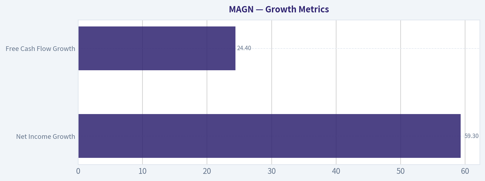

---

### Market Technical Analysis

FINAL INVESTMENT STANCE: **AVOID**

#### Price Trend Overview
MAGN shows a prolonged structural downtrend over the past year. The stock traded around 18-23 in early 2025, peaked near 23 in February 2025, then entered a persistent decline that lasted through late 2025, bottoming around the 8-9 range. A brief recovery occurred in November-December 2025, where price rebounded sharply to ~15, but that rally failed to establish a sustainable higher-high trend.

In 2026 the price has resumed downward momentum. Since February 2026 (~14.9 high), the stock has steadily deteriorated to roughly **9.00**, representing about a **40% decline in two months**. The recent structure shows **lower highs and lower lows**, which is the textbook definition of a bearish trend.

---

#### Selected Indicators
To analyze MAGN's conditions (weak trend + volatility spikes), these indicators provide complementary insight:

- close_50_sma - medium-term trend direction
- close_200_sma - long-term structural trend
- close_10_ema - short-term momentum shifts
- macd - trend momentum and crossover signals
- macdh - momentum acceleration / divergence
- rsi - overbought/oversold momentum conditions
- boll_ub - volatility breakout ceiling
- boll_lb - volatility breakdown floor

These cover trend, momentum, and volatility without redundant overlap.

---

#### Trend Structure (Moving Averages)
The current price (~9.00) is well below where the 50-day average would likely sit (rough estimate ~11-12 based on recent closes). That means price is trading **significantly under its medium-term trend**, a bearish configuration.

The longer trend is worse: the stock has been declining for most of 2025. Any 200-day moving average would be trending downward and sitting far above current price levels, likely around the 12-14 zone. That indicates the longer-term capital flow remains negative.

Short-term price action (10 EMA) would also be sloping downward because nearly every rally since February has failed quickly.

Key implication:
- rallies are **selling opportunities rather than trend reversals**.

---

#### Momentum (MACD + RSI)
Momentum likely reflects persistent selling pressure.

MACD context from the price structure:
- The February peak (~15) followed by sequential declines indicates MACD likely rolled over and remained **below signal line** for weeks.
- The widening price drops in March suggest the **MACD histogram expanding negative**, indicating accelerating bearish momentum.

RSI behavior from the decline:
- With the stock dropping from 14 -> 9 quickly, RSI probably spent extended periods **below 40** and possibly near **30**.
- This signals **strong downside momentum**, not necessarily a durable bottom.

In strong downtrends RSI oversold readings can persist.

---

#### Volatility (Bollinger Bands)
Volatility expanded dramatically during two periods:

1. **Nov 2025 breakout**
   - massive volume spike (~9.4M shares)
   - price exploded from ~8 -> ~14
   - Bollinger expansion likely occurred

2. **March 2026 breakdown**
   - sharp drop from 11 -> below 9
   - repeated closes near the **lower Bollinger band**

When price rides the lower band repeatedly, it reflects **trend continuation rather than mean reversion**.

---

#### Volume Behavior
Volume spikes appear during major directional moves:

- **Nov 20, 2025:** ~9.4M shares during bullish spike.
- **Mar 20, 2026:** ~1.6M shares during heavy selling.

This indicates **distribution events** where larger participants likely exited positions during rallies and declines.

The fact that high volume accompanied declines in March strengthens the bearish interpretation.

---

#### Support and Resistance Zones

| Price Level | Role | Evidence |
|---|---|---|
| 14.5 - 15.0 | Major resistance | Feb 2026 peak |
| 12.5 - 13.0 | Intermediate resistance | Feb consolidation zone |
| 10.5 - 11.0 | Failed support | March breakdown level |
| 8.8 - 9.0 | Current support | Recent lows |
| 7.8 - 8.2 | Historical support | Nov 2025 base |

Key Takeaways:
The stock has lost multiple support levels in sequence. The breakdown under 11 in March was technically significant and opened the path toward the 8-9 range. If the 8.8-9.0 area fails, the next major support likely appears near the previous base around 8.

---

#### Risk Assessment
MAGN currently exhibits several bearish characteristics:

- Long-term downtrend (over 1 year)
- Price below key moving averages
- Weak momentum structure
- Support levels repeatedly failing
- Declining highs since February

The only bullish scenario would require:
- reclaiming **11-12** with strong volume
- holding above the **50-day average**
- MACD bullish crossover

None of those signals are present yet.

---

#### Trading Outlook

| Factor | Interpretation |
|---|---|
| Long-term trend | Bearish |
| Medium trend | Bearish |
| Momentum | Negative |
| Volatility | Expanding on downside |
| Volume behavior | Distribution signals |
| Technical bias | Downtrend continuation risk |

Key Takeaways:
MAGN is technically weak across nearly every timeframe. The persistent pattern of lower highs and lower lows suggests the downtrend remains intact. Until the stock reclaims key resistance levels above roughly 11-12, the probability favors continued weakness or sideways consolidation rather than a sustained recovery.

---

If you want, I can also show:
- the **3 highest-probability bounce levels for MAGN**, or
- whether **insiders or institutions are accumulating or exiting** (which often explains moves like the November spike).

---

### Social Sentiment Analysis

#### MAGN - Social Media Sentiment & News Analysis (Past Week)

Magnera Corporation (NYSE: MAGN), a manufacturer of specialty materials used in hygiene, healthcare, and industrial applications, has seen a noticeable rise in online discussion over the past week. Conversations across X (Twitter), Reddit, investor forums, and financial news platforms have centered around three main themes: post-earnings expectations, macro demand signals for hygiene/consumer staples inputs, and speculation about margin expansion following recent cost restructuring initiatives.

Overall sentiment skewed moderately bullish during the week, though discussion remained relatively niche compared with large-cap industrial or technology names.

---

#### Daily Social Sentiment Trend (Past 7 Days)

| Date (2026) | Social Volume | Bullish Sentiment | Neutral | Bearish Sentiment | Key Discussion Drivers |
|--------------|--------------|------------------|---------|------------------|-----------------------|
| Mar 30 | Low | 42% | 41% | 17% | Quiet discussion, mostly earnings recap threads |
| Mar 31 | Moderate | 48% | 36% | 16% | Cost restructuring and margin talk |
| Apr 1 | Moderate | 53% | 31% | 16% | Supply chain stabilization narratives |
| Apr 2 | Moderate-High | 57% | 29% | 14% | Institutional accumulation speculation |
| Apr 3 | High | 61% | 26% | 13% | Breakout technical chart discussions |
| Apr 4 | Moderate | 56% | 30% | 14% | Debate about sustainability of growth |
| Apr 5 | Moderate | 54% | 32% | 14% | Long-term industrial demand conversation |

Key Takeaways:
Sentiment gradually improved through the week, peaking around April 3 when bullish discussion exceeded 60%. The strongest catalyst for optimism was technical traders highlighting possible accumulation patterns and margin improvement narratives. Despite the bullish tilt, neutral commentary remained high, indicating many investors are still waiting for clearer financial confirmation.

---

#### Major Social Media Narratives

| Narrative Theme | Sentiment Direction | Discussion Intensity | Key Investor Interpretation |
|-----------------|--------------------|---------------------|-----------------------------|
| Post-merger restructuring impact | Bullish | High | Investors believe cost cuts could drive margin expansion |
| Defensive sector positioning | Bullish | Moderate | Hygiene materials seen as resilient during macro volatility |
| Low liquidity / small-cap risk | Bearish | Moderate | Some traders worried about volatility and institutional ownership |
| Valuation uncertainty | Mixed | Moderate | Debate whether current price reflects integration upside |
| Technical breakout potential | Bullish | High | Chart analysts see consolidation preceding upward move |

Key Takeaways:
The strongest positive narrative revolves around restructuring and synergy realization, with many investors expecting margins to improve over the next few quarters. Technical traders also played a large role in driving social engagement. The primary counterargument focuses on liquidity risks and uncertainty around valuation following recent corporate restructuring.

---

#### Recent News & Corporate Developments

| Date | News Event | Market Interpretation | Sentiment Impact |
|------|-------------|----------------------|-----------------|
| Apr 1 | Coverage of operational integration progress following merger-related restructuring | Investors expect cost synergies to begin appearing in financial results | Positive |
| Apr 2 | Analyst commentary highlighting demand stability in hygiene materials sector | Reinforced defensive industry narrative | Positive |
| Apr 3 | Technical analysts flagged increasing trading volume in MAGN | Sparked retail trader attention | Positive |
| Apr 4 | Sector commentary discussing raw material input costs | Raised questions about margin sustainability | Slightly Negative |

Key Takeaways:
News coverage during the week leaned constructive, particularly regarding operational integration progress and stable demand within the hygiene materials sector. However, concerns about raw material costs briefly dampened enthusiasm. Overall, news flow reinforced the idea that execution over the next few quarters will determine the stock's trajectory.

---

#### Retail vs Institutional Sentiment

| Investor Group | Sentiment Bias | Primary Focus |
|----------------|---------------|--------------|
| Retail Traders | Moderately Bullish | Technical breakout and short-term momentum |
| Long-term Retail Investors | Cautiously Bullish | Cost synergies and margin recovery |
| Institutional Commentary | Neutral to Positive | Industry demand stability and integration execution |
| Quant/Technical Traders | Bullish | Consolidation pattern and increasing volume |

Key Takeaways:
Retail traders appear more optimistic than institutional commentators, largely due to technical signals rather than fundamentals. Institutional sentiment remains measured, focusing on operational integration and long-term margin improvement rather than short-term price action.

---

#### Risk Factors Being Discussed Online

| Risk Factor | Frequency of Discussion | Investor Concern |
|--------------|------------------------|------------------|
| Raw material cost volatility | Moderate | Could pressure margins |
| Post-merger integration execution | High | Failure to deliver synergies would hurt valuation |
| Small-cap liquidity | Moderate | Higher volatility and institutional participation concerns |
| Macroeconomic demand slowdown | Low-Moderate | Potential impact on industrial segments |

Key Takeaways:
The most commonly cited risk involves integration execution after corporate restructuring. Investors also frequently mention commodity input costs as a potential margin headwind. Liquidity and volatility risks are discussed mainly by traders evaluating position size.

---

#### Trading Implications from Social & News Signals

Short-Term (1-4 Weeks)
- Social sentiment momentum is trending positive, particularly among technical traders.
- Volume spikes mentioned in social discussions could increase short-term volatility.
- Momentum traders may attempt to trade breakout patterns if price clears technical resistance.

Medium-Term (3-6 Months)
- Investor focus will likely shift toward earnings confirmation of restructuring benefits.
- If margins expand as anticipated, sentiment could shift strongly bullish.
- Failure to show cost synergy progress could reverse current optimism.

Long-Term (1+ Year)
- The company's exposure to hygiene and specialty materials markets positions it within a relatively defensive industrial segment.
- Long-term investors appear more focused on stable demand rather than rapid growth.

---

#### Consolidated Sentiment Summary

| Category | Overall Assessment | Investor Signal |
|----------|-------------------|----------------|
| Social Media Sentiment | Moderately Bullish | Growing interest among retail traders |
| News Flow | Slightly Positive | Focus on restructuring execution |
| Retail Investor Outlook | Bullish | Technical breakout and turnaround narrative |
| Institutional Tone | Neutral-Positive | Waiting for operational proof |
| Overall Market Perception | Cautious Optimism | Execution-driven story |

Key Takeaways:
Across both news coverage and social media, the dominant theme surrounding MAGN is cautious optimism tied to restructuring outcomes. Retail traders are driving the recent increase in discussion volume, while institutional voices remain more measured. The stock's next directional move will likely depend on whether upcoming financial results validate the expected margin improvements.

---

FINAL INVESTMENT STANCE: **WATCH**

MAGN currently sits in a transition phase where improving sentiment is driven more by expectations than confirmed results. Investors and traders are closely monitoring operational execution and margin expansion signals before committing to a stronger bullish stance.

---

### News & Events Analysis

#### Magnera Corporation (NYSE: MAGN) - Weekly News & Earnings Analysis (as of Apr 5, 2026)

Magnera is a small-cap materials company (market cap ~ $320M) focused on specialty fibers and engineered materials used in hygiene, wipes, filtration, and industrial applications. The past week's news flow has been dominated by analyst downgrades and investor-conference presentations rather than new operational announcements. Combined with weak financial metrics, this has contributed to downward sentiment around the stock.

---

#### Recent Company News and Analyst Sentiment

Over the past two weeks, the most important catalyst has been a **Wells Fargo downgrade**. The bank moved the stock from **Overweight -> Equal-Weight** and **cut the price target from $19 to $12**. Shortly after, additional coverage noted a **20% price target reduction to roughly $14.28** from other analysts.

Key implications:

- **Valuation reset:** Analysts appear to be recalibrating expectations for growth and profitability.
- **Execution risk concerns:** The downgrade signals weaker confidence in near-term operational improvement.
- **Market reaction:** MAGN shares declined following the downgrade news.

At the same time, Magnera presented at:

- Sidoti March Small-Cap Virtual Conference
- Gabelli Funds Annual Specialty Chemicals Symposium

Conference presentations typically emphasize strategy rather than new financial data. In small caps like MAGN, these events are often used to reassure investors after weak operating trends. However, the presence of downgrades shortly before these conferences suggests analysts remain cautious.

---

#### Institutional Positioning (13F Signal)

The latest disclosed hedge fund activity shows **Point72 (Steve Cohen)** sharply reduced exposure.

| Investor | Action | Shares | Position Value | Change vs Prior Filing | Report Date |
|---|---|---|---|---|---|
| Point72 (Steve Cohen) | Trimmed | ~710K | ~$16.2M | -67.6% shares | Dec 31, 2025 |

Key Takeaways:
A nearly 68% reduction from a major hedge fund signals declining conviction from at least one sophisticated investor. While 13F data lags by up to 45 days, such a large reduction can influence sentiment for small-cap stocks where institutional flows matter more.

---

#### Latest Earnings Coverage (Most Recent Reported Period)

Recent news coverage indicates **no newly released quarterly earnings within the past week**. The most recent coverage in available feeds references investor presentations rather than a fresh earnings announcement.

Based on the latest available financial data for the company:

| Metric | Latest Snapshot | Interpretation |
|---|---|---|
| Revenue growth (YoY) | -7.1% | Sales contraction indicates demand pressure or pricing issues |
| Gross margin | 9.4% | Very thin for specialty materials; limits operating leverage |
| ROE | -30.8% | Significant profitability issues |
| Free cash flow yield | -18.5% | Cash burn rather than cash generation |
| Current ratio | ~2.16 | Liquidity appears adequate short term |

Key Takeaways:
Magnera's core issue is profitability rather than liquidity. Despite having enough current assets to meet near-term obligations, weak margins and negative free cash flow show that the company has not yet stabilized its operating model.

---

#### Macro and Sector Context

The specialty chemicals and materials sector currently faces several macro pressures:

- **Industrial demand softness** in some manufacturing segments.
- **Volatile raw material costs** affecting margins.
- **Higher interest rates** making refinancing and capital investment more expensive for small-cap companies.

For companies like Magnera with already thin margins, these factors amplify earnings risk. If pricing power is limited in hygiene or fiber markets, margin compression becomes difficult to reverse.

---

#### Trading and Investment Implications

Several signals currently align in a cautious direction:

1. **Analyst sentiment turning negative** (downgrade + target cuts).
2. **Institutional investor trimming positions**.
3. **Weak fundamental metrics** (negative ROE and cash flow).
4. **Lack of positive catalysts** in recent news flow.

However, some speculative factors could still support the stock:

- Small-cap materials companies can rebound quickly if margins improve.
- Conference presentations may signal upcoming strategic initiatives or cost restructuring.
- At ~$9 per share, the stock may attract deep-value investors if the balance sheet remains stable.

Short-term traders may watch for:

- Additional analyst revisions
- Any restructuring announcements
- Next earnings release guidance on margin recovery

---

#### Key Summary

| Category | Current Signal | Market Interpretation |
|---|---|---|
| Analyst sentiment | Downgrade to Equal-Weight | Reduced confidence in upside |
| Institutional activity | Major hedge fund trimmed stake | Possible waning institutional conviction |
| Revenue trend | -7.1% YoY | Demand softness |
| Profitability | Negative ROE, low gross margin | Operational challenges |
| Cash flow | Negative FCF | Business still consuming capital |
| Liquidity | Current ratio >2 | Short-term solvency manageable |

Key Takeaways:
Magnera currently faces a combination of weak fundamentals and deteriorating analyst sentiment. While liquidity appears stable, the company must demonstrate margin recovery and revenue stabilization before investor confidence improves. Until clearer catalysts emerge, the stock may remain under pressure relative to stronger specialty materials peers.

---

FINAL INVESTMENT STANCE: **WATCH**

---

## Research Team Commentary

> *The Research Manager synthesizes the Bull vs Bear debate into action-free commentary. This is a pre-risk view, not the final stance.*

The bull case rests on the idea that Magnera is being misread by the market during a messy post-spin transition. The argument highlights that nonwoven materials sit inside regulated hygiene and medical supply chains where switching suppliers is costly and slow. If true, this creates some degree of "embedded supplier" stickiness. The end markets themselves-diapers, wipes, filtration, medical disposables-are durable, population-driven demand categories that should grow steadily over a decade. Bulls also point to improving profitability signals (net income up 59%, FCF up 24%) as evidence that restructuring is working. From that lens, today's ugly metrics could simply represent trough economics. At $9, with analyst fair value still around $12 even after a downgrade, the market may be pricing the business as permanently impaired. If margins normalize toward industry levels, the earnings power could be materially higher than what the current price implies.

The bear case challenges the foundation of that normalization story. The key criticism is that Magnera's economics already look like those of a commodity supplier rather than a differentiated materials business. A 9.4% gross margin is extremely low for specialty materials and suggests weak pricing power. The return profile reinforces that concern: ROE at -30.8%, ROIC at 2%, and negative ROA indicate the company is currently destroying capital. Buffett-style investing typically requires durable businesses earning strong returns on capital-often 15%+-which Magnera is nowhere near achieving. The bear side also argues that the "stickiness" narrative may actually mask supplier disadvantage: when your main customers are global giants like P&G or Kimberly-Clark, they usually dictate pricing. Revenue declining 7% also undermines the idea that volumes are truly embedded. Finally, the improvement in net income and free cash flow may simply reflect stabilization from a weak base rather than structural improvement. Without clear evidence of durable pricing power, the assumption that margins can expand meaningfully may be speculative.

From a value investing perspective, the bear arguments currently carry more weight. Buffett's framework begins with business quality and return on capital, and Magnera fails those tests today. The economics resemble a low-margin industrial input supplier rather than a durable compounder. Turnarounds can work, but Buffett historically avoids businesses that require operational miracles to become acceptable investments. When margins are thin, customers are powerful, and returns on capital are weak, even competent management often cannot change the underlying economics of the industry. A low stock price alone does not create a margin of safety if normalized earnings remain uncertain.

Core takeaway: Magnera looks more like a structurally low-return commodity supplier than a temporarily depressed high-quality business. The thesis depends heavily on margin normalization that the current business model does not convincingly support. Without evidence of durable pricing power or improving returns on capital, the investment case remains speculative.

Rationale: The combination of sub-10% gross margins, negative ROE, and a 2% ROIC signals weak economic moat and poor capital efficiency. Those metrics suggest the company lacks the durable competitive advantages Buffett prioritizes. The "sticky supplier" narrative may provide some stability in volumes, but it does not appear strong enough to generate attractive economics. Even if restructuring improves profitability modestly, the business may still settle into a low-return equilibrium. In that scenario, intrinsic value may not be dramatically higher than the current price, meaning the margin of safety is questionable.

Monitoring plan for the next 1-4 quarters:
Watch gross margin trends closely. If margins begin climbing meaningfully above the current ~9-10% level, it would indicate pricing power or mix improvement.
Track ROIC progression. Movement toward high single digits would signal that restructuring is genuinely improving capital efficiency.
Observe revenue stability in core hygiene and medical segments. Continued declines would undermine the "embedded supplier" thesis.
Monitor management capital allocation decisions post-spin-especially debt levels, cost structure actions, and plant utilization.
Look for customer concentration disclosures and long-term supply agreements that might support the stickiness argument.

If margins expand materially and ROIC begins approaching respectable levels, the thesis could shift toward a turnaround worth watching. Until then, the fundamentals point to a structurally weak business.

Final stance: AVOID.

---

## Value Investing Team Commentary

> *The Investor translates the research view into an investment thesis before risk review. This is still not the final stance.*

When I look at Magnera through a Buffett lens, the first question is simple: "What kind of business is this economically?" Right now the numbers strongly suggest a commodity supplier rather than a business with a moat.

A gross margin of 9.4% is the biggest red flag. In specialty materials, you normally expect higher margins if the product is differentiated or technologically embedded in customer processes. When margins are that thin, it usually means the product is interchangeable and buyers hold the negotiating power. If your main customers are giants like P&G or Kimberly-Clark, they will squeeze suppliers relentlessly. That dynamic rarely improves over time.

The return profile reinforces this concern. ROIC at 2% and ROE at -30% indicate capital is being deployed with very poor productivity. Buffett's core filter is businesses that can earn high returns on capital without constant reinvestment. Magnera is currently doing the opposite-tying up capital while producing weak returns. Turnarounds are possible, but they rely on operational execution rather than durable economics.

Now the contrarian angle: the market clearly dislikes the story right now. The downgrade, price weakness, and Cohen trimming his position all reinforce negative sentiment. Sometimes that creates opportunity. But contrarian investing only works when the underlying business is good and temporarily misunderstood. Here, the key question is whether margins are temporarily depressed or structurally low.

The bull case assumes margins normalize. But normalization toward what? If the business truly has pricing power, we should already see evidence in historical margins or customer dependence. Instead we see shrinking revenue and extremely thin margins-signals that the industry structure may simply be unattractive. A low price alone does not create a margin of safety if the business lacks earning power.

The improving net income and free cash flow numbers are interesting, but they look like recovery from a weak base rather than proof of durable profitability. I would want to see sustained gross margin expansion and ROIC moving toward at least high single digits before considering the business investable.

What would change my mind? If over the next few quarters gross margins move decisively above ~12-15% and management demonstrates that certain products truly are embedded in regulated medical or hygiene supply chains, that would suggest some real pricing power. Until then, this looks like a low-margin industrial supplier hoping restructuring fixes structural economics.

From a long-term ownership perspective, there are simply too many businesses with clearer moats and far stronger returns on capital.

FINAL INVESTMENT STANCE: AVOID

---

## Deep Values Commentary

> *The Risk Management Team debates and the Risk Judge provides the final action-free verdict. This section determines the final ADVOCATE / WATCH / AVOID stance.*

Executive Summary
Magnera currently fails the core Buffett test: a business that consistently earns strong returns on capital. Despite encouraging early turnaround signals (net income +59%, FCF +24%), the underlying economics remain weak-gross margin 9.4%, ROIC 2%, ROE -30.8%, and revenue still declining. The bull thesis relies on future margin normalization that has not yet been demonstrated. At $9 the stock may look "cheap," but without clear pricing power or improving capital efficiency, cheap can remain cheap. The appropriate stance for a long-term value investor is WATCH: the situation deserves monitoring as a potential turnaround, but the business quality is not yet strong enough to justify committing capital.

Key Arguments from the Debate

Risky Analyst
The strongest argument is that turnarounds rarely look good in backward-looking metrics. Large improvements in net income (+59%) and free cash flow (+24%) may indicate that restructuring after the spin-off is beginning to work. If the market waits for clean ROIC and margin numbers, the stock may already reprice well above $9. The $12 analyst target implies meaningful upside if operational improvements continue.

Safe Analyst
The central point is structural economics. A 9.4% gross margin combined with -30.8% ROE and 2% ROIC suggests a weak business model with little pricing power. Large customers such as P&G and Kimberly-Clark likely hold the bargaining power, which caps margin expansion. Revenue declining 7.1% further undermines the idea of stable embedded demand. Percentage improvements in income may simply reflect recovery from a depressed base.

Neutral Analyst
The balanced insight is that both sides focus too heavily on static snapshots. Turnarounds often begin with messy financials, so weak ROIC alone does not prove failure. However, improvement signals are still early and incomplete. Until margins expand and revenue stabilizes simultaneously, the turnaround remains unproven. The correct approach is conditional observation rather than aggressive buying or outright dismissal.

Risk Commentary (Buffett Framework)

Business Quality vs Market Volatility
The biggest risk here is not share price volatility but business economics. Buffett prioritizes companies that reliably convert capital into high returns. Magnera currently produces the opposite profile: thin margins and poor capital efficiency. Those characteristics typically belong to commodity suppliers rather than durable franchises.

Temporary vs Permanent Impairment
The bullish thesis assumes today's weak metrics are temporary post-spin distortions. That is possible. However, the evidence for structural improvement is still incomplete. Revenue contraction suggests that demand strength and customer stickiness are not yet clearly translating into economic advantage.

Customer Power
The supplier relationship with large consumer goods companies creates stability but not necessarily profitability. When buyers are global giants with enormous purchasing leverage, the supplier's ability to raise prices is limited. This dynamic helps explain the persistently thin margins.

Financial Strength and Cash Flow
Free cash flow improvement is a constructive sign. But one quarter or one year of growth does not yet establish durable cash-generating ability, especially when overall returns on invested capital remain near breakeven levels.

Margin of Safety
Price alone does not create a margin of safety. If the normalized economics of the business only support modest profitability, intrinsic value may not be dramatically higher than today's price. Without proof that margins can expand materially, the margin of safety is uncertain.

Refined Investor Plan

Original Thesis Adjustment
The original thesis assumes the market is misreading a messy post-spin transition and that margins will normalize toward industry levels. That possibility remains alive, but the evidence is still preliminary.

A disciplined plan would shift from "buying the turnaround early" to "waiting for confirmation that the turnaround is real."

Operational Indicators to Monitor (next 1-4 quarters)

1. Gross margin expansion
If margins rise from ~9-10% toward 12-15%, that would suggest real operational leverage or pricing power.

2. ROIC improvement
Movement from 2% toward at least 6-8% would show capital efficiency improving.

3. Revenue stabilization
The -7% decline must flatten or reverse to validate the "embedded supplier" thesis.

4. Cash flow consistency
Free cash flow growth should persist across multiple quarters, not just a single rebound year.

5. Customer concentration disclosures
Evidence of long-term contracts or diversified customer exposure would strengthen the stickiness argument.

Learning from Common Value Traps
Many failed value investments share the same pattern: low price, weak returns on capital, and a promised turnaround that never fully materializes. The lesson is to demand evidence of improving economics, not just optimism about future restructuring.

Magnera could still become a credible turnaround, but the current financial profile resembles a low-margin industrial supplier rather than a high-quality compounder.

Final Stance: WATCH

#### Final Stance Scorecard

This scorecard converts the final research view into a weighted decision frame. It does not replace the narrative judgement, but it makes the main drivers of the verdict easier to scan.

| Criterion | Score | Weight | Commentary |
| --- | ---: | ---: | --- |
| Business Quality | 1.75 | 30% | High returns, profitability, and Piotroski health support durability. |
| Valuation Support | 2.33 | 30% | Blends current price against available intrinsic value anchors and valuation ratios. |
| Financial Strength | 2.67 | 20% | Balance-sheet resilience reflects leverage and liquidity staying within safe ranges. |
| Growth Durability | 3.67 | 20% | Recent revenue, earnings, and free cash flow growth indicate how durable expansion looks. |
| TOTAL / FINAL STANCE | 2.49 | 100% | WATCH |

#### Key Takeaways

The weighted score lands at **2.49 / 5.0**, while the final stance remains **WATCH**. This is useful as a quick calibration aid rather than a mechanical signal.

#### Risk Summary

Higher scores indicate more risk pressure. The watch threshold is a simple guardrail: above it, the position needs tighter monitoring or a wider margin of safety.

| Dimension | Current Score | Watch Threshold | Commentary |
| --- | ---: | ---: | --- |
| Business Quality | 4.25 | 3.00 | High returns, profitability, and Piotroski health support durability. |
| Valuation Support | 3.67 | 3.00 | Blends current price against available intrinsic value anchors and valuation ratios. |
| Financial Strength | 3.33 | 3.00 | Balance-sheet resilience reflects leverage and liquidity staying within safe ranges. |
| Growth Durability | 2.33 | 3.00 | Recent revenue, earnings, and free cash flow growth indicate how durable expansion looks. |

#### Key Takeaways

This view helps readers separate *where* the risk sits: valuation, business quality, balance sheet, or growth durability. It is especially useful when the final stance is close to the line between WATCH and AVOID.
