# MBLY Deep Value Intelligence

**Analysis Date:** 2026-03-19

## Critical Disclaimer

*This analysis is generated by Deep Value Intelligence, an AI-powered multi-agent investing framework. This report is for informational and educational purposes only and does not constitute financial advice. Always conduct your own research and consult with qualified financial advisors before making investment decisions.*

---

## Table of Contents

1. Intelligence Summary
2. Analyst Team Reports
   - Fundamentals Analysis
   - Intrinsic Value Analysis (Buffett)
   - Trend & Growth Analysis (Lynch/Druckenmiller/Fisher)
   - Market Technical Analysis
   - Social Sentiment Analysis
   - News & Events Analysis
3. Research Team Commentary
4. Value Investing Team Commentary
5. Deep Values Commentary

---

## Intelligence Summary

### Thesis + Conditions

**Core Thesis:** **EXECUTIVE SUMMARY**
*   **The Core Issue:** Mobileye (MBLY) dominates the current Advanced Driver Assistance Systems (ADAS) market but is caught in an expensive, hyper-competitive R&D race against infinitely better-capitalized tech giants (Nvidia, Qualcomm) and in-house OEM engineering teams. *   **Financial Reality:** Despite 14.5% revenue growth, the company generates structurally negative returns on capital (ROIC: -4.6%, ROE: -3.3%).

**Key Risks:**
- Governance Risk:** Intel's controlling stake acts as a massive structural overhang. Minority shareholders are vulnerable to Intel's own existential corporate struggles.
- Risky Analyst (AVOID):** Emphasizes the fragmented profit pool. Mobileye is spending aggressively just to maintain its position against tech heavyweights. The lack of a clear monopoly path means asymmetric upside is diluted. Capital is better deployed into clearer platform winners.
- Safe Analyst (AVOID):** Highlights downside durability risk. Negative returns on capital mean the current economic model destroys shareholder value. Gross margins (47.7%) are highly vulnerable to commoditization as automakers exert intense pricing pressure.
- Neutral Analyst (WATCH):** Counters that the 150M+ installed base and 5-7 year automotive design cycles create high switching costs. Argues that negative returns are a temporary symptom of a transitional R&D cycle required to capture future autonomous platforms, suggesting a conditional watchlist approach.
- The best risk management is buying below a reliable intrinsic value. Because Mobileye's future cash flows are heavily dependent on winning a highly uncertain, multi-front technological war, its valuation swings wildly (from negative intrinsic value to high double digits). That is speculation, not investing.

**What Would Change Our View:**
- Governance Risk:** Intel's controlling stake acts as a massive structural overhang. Minority shareholders are vulnerable to Intel's own existential corporate struggles.
- Risky Analyst (AVOID):** Emphasizes the fragmented profit pool. Mobileye is spending aggressively just to maintain its position against tech heavyweights. The lack of a clear monopoly path means asymmetric upside is diluted. Capital is better deployed into clearer platform winners.
- Safe Analyst (AVOID):** Highlights downside durability risk. Negative returns on capital mean the current economic model destroys shareholder value. Gross margins (47.7%) are highly vulnerable to commoditization as automakers exert intense pricing pressure.
- Neutral Analyst (WATCH):** Counters that the 150M+ installed base and 5-7 year automotive design cycles create high switching costs. Argues that negative returns are a temporary symptom of a transitional R&D cycle required to capture future autonomous platforms, suggesting a conditional watchlist approach.
- The best risk management is buying below a reliable intrinsic value. Because Mobileye's future cash flows are heavily dependent on winning a highly uncertain, multi-front technological war, its valuation swings wildly (from negative intrinsic value to high double digits). That is speculation, not investing.

**Confidence:** Low

---

## Analyst Team Reports

### Fundamentals Analysis

#### Latest Earnings Snapshot

*Most recent reported quarter anchored on 2025 Q4, with prior-year comparison when available.*

| Metric | 2025 Q4 | 2024 Q4 | YoY Change |
| --- | ---: | ---: | ---: |
| Revenue | $446.0M | $490.0M | -9.0% |
| Operating Income | $-140.0M | $-86.0M | -62.8% |
| Net Income | $-127.0M | $-71.0M | -78.9% |
| Diluted EPS | $-0.16 | $-0.09 | -77.8% |
| Operating Cash Flow | $113.0M | $204.0M | -44.6% |
| Free Cash Flow | $86.0M | $191.0M | -55.0% |

Key Takeaways: This snapshot anchors the most recent reported quarter before the narrative analysis. It helps readers separate long-run business quality from whatever changed in the latest earnings print.

#### 10-Year Financial Metrics for MBLY

*All values below are computed deterministically from raw data - not estimated by AI.*

*Issuer profile: operating company (Consumer Cyclical / Auto Parts).*

#### 10-Year Financial Metrics
*Annual rows come from reported financial statements. The final TTM row is computed from the latest four quarters.*

| Metric | 2016 | 2017 | 2018 | 2019 | 2020 | 2021 | 2022 | 2023 | 2024 | 2025 | 2026 TTM |
| --- | --- | --- | --- | --- | --- | --- | --- | --- | --- | --- | --- |
| Market Price | N/A | N/A | N/A | N/A | N/A | N/A | $35 | $43 | $20 | $10 | $8 |
| Market Cap | N/A | N/A | N/A | N/A | N/A | N/A | $26.61B | $34.87B | $16.12B | $8.51B | $6.20B |
| P/E Ratio | N/A | N/A | N/A | N/A | N/A | N/A | -318.73 | -1444.00 | -5.21 | -21.70 | -15.55 |
| P/B Ratio | N/A | N/A | N/A | N/A | N/A | N/A | 1.80 | 2.34 | 1.33 | 0.72 | 0.52 |
| ROE | N/A | N/A | N/A | N/A | -1.2% | -0.5% | -0.6% | -0.2% | -25.6% | -3.3% | -3.3% |
| ROIC | N/A | N/A | N/A | N/A | -1.2% | -0.5% | -0.4% | -0.2% | -25.6% | -0.8% | -4.6% |
| EPS | N/A | N/A | N/A | N/A | $-261333.33 | $-0.09 | $-0.11 | $-0.03 | $-3.82 | $-0.48 | $-0.49 |
| Revenue | N/A | N/A | N/A | N/A | $967.0M | $1.39B | $1.87B | $2.08B | $1.65B | $1.89B | $1.89B |
| Gross Profit | N/A | N/A | N/A | N/A | $376.0M | $655.0M | $922.0M | $1.05B | $741.0M | $904.0M | $904.0M |
| Gross Margin | N/A | N/A | N/A | N/A | 38.9% | 47.3% | 49.3% | 50.4% | 44.8% | 47.7% | 47.7% |
| Operating Margin | N/A | N/A | N/A | N/A | -22.0% | -4.1% | -2.0% | -1.6% | -195.0% | -21.6% | -23.2% |
| Net Income | N/A | N/A | N/A | N/A | $-196.0M | $-75.0M | $-82.0M | $-27.0M | $-3.09B | $-392.0M | $-392.0M |
| Net Margin | N/A | N/A | N/A | N/A | -20.3% | -5.4% | -4.4% | -1.3% | -186.8% | -20.7% | -20.7% |
| Revenue Growth | N/A | N/A | N/A | N/A | N/A | 43.3% | 34.9% | 11.2% | -20.4% | -69.5% | 0.0% |
| Net Income Growth | N/A | N/A | N/A | N/A | N/A | 61.7% | -9.3% | 67.1% | -11344.4% | 96.9% | -0.0% |
| Free Cash Flow Growth | N/A | N/A | N/A | N/A | N/A | 153.3% | -4.6% | -32.0% | 7.8% | 37.0% | 0.0% |
| Total Book Value | N/A | N/A | N/A | $14.47B | $15.84B | $15.89B | $14.79B | $14.92B | $12.09B | $11.88B | $11.88B |
| Total Assets | N/A | N/A | N/A | N/A | N/A | $16.66B | $15.44B | $15.58B | $12.58B | $12.49B | $12.49B |
| Total Debt | N/A | N/A | N/A | N/A | N/A | N/A | N/A | N/A | N/A | N/A | N/A |
| Debt-to-Equity | N/A | N/A | N/A | 0.00 | 0.00 | 0.00 | 0.00 | 0.00 | 0.00 | 0.00 | N/A |
| Cash & Equivalents | N/A | N/A | N/A | $55.0M | $93.0M | $616.0M | $1.02B | $1.21B | $1.43B | $1.84B | $1.84B |
| Shareholders' Equity | N/A | N/A | N/A | $14.47B | $15.84B | $15.89B | $14.79B | $14.92B | $12.09B | $11.88B | $11.88B |
| Operating Cash Flow | N/A | N/A | N/A | N/A | $271.0M | $599.0M | $546.0M | $394.0M | $400.0M | $489.0M | $602.0M |
| Investing Cash Flow | N/A | N/A | N/A | N/A | $-965.0M | $-157.0M | $1.19B | $-98.0M | $-120.0M | $-64.0M | $-91.0M |
| Free Cash Flow | N/A | N/A | N/A | N/A | $180.0M | $456.0M | $435.0M | $296.0M | $319.0M | $523.0M | $523.0M |
| FCF Margin | N/A | N/A | N/A | N/A | 18.6% | 32.9% | 23.3% | 14.2% | 19.3% | 27.6% | 27.6% |
| Dividends / Share | N/A | N/A | N/A | N/A | N/A | $0.00 | $0.44 | $0.00 | $0.00 | $0.00 | $0.00 |

#### Profitability Metrics
- Return on Equity (ROE): -3.3%
- Return on Invested Capital (ROIC): -4.6%
- Return on Assets (ROA): -3.1%
- Gross Margin: 47.7%
- Operating Margin: -23.2%
- Net Profit Margin: -20.7%

#### Liquidity Metrics
- Current Ratio: 6.10
- Quick Ratio: 4.84

#### Leverage Metrics
- Debt-to-Equity Ratio: 0.00
- Interest Coverage Ratio: N/A
- Net Debt: N/A

#### Growth Metrics (Year-over-Year)
- Revenue Growth: 14.5%
- Net Income Growth: 87.3%
- Free Cash Flow Growth: 63.9%
- Revenue CAGR (3-Year): 0.4%
- Revenue CAGR (5-Year): 14.4%

#### Valuation Metrics
- P/E Ratio (TTM): N/A
- Forward P/E: 19.89
- Price-to-Book: 0.52
- Price-to-Sales: 3.39
- PEG Ratio: N/A
- EV/EBITDA: -15.46
- Free Cash Flow Yield: 8.2%
- Earnings Yield: N/A

#### Owner Earnings (Buffett Method, Code-Computed)
- Net Income: $-392.0M
- + Depreciation & Amortization: $517.0M
- - Capital Expenditures: $-79.0M
- - Working Capital Changes: $224.0M
- = **Owner Earnings: $-178.0M**

#### Intrinsic Value (Code-Computed)
- Current Price: $8
- Cash Flow Method (FCF):
  Conservative: $7
  Average: $19
  Optimistic: $60

#### Piotroski F-Score: 6/9
- Positive Net Income: FAIL
- Positive Operating Cash Flow: PASS
- ROA Improvement: PASS
- Cash Flow > Net Income: PASS
- Decreasing Debt: PASS
- Improving Current Ratio: FAIL
- No Dilution: FAIL
- Improving Gross Margin: PASS
- Improving Asset Turnover: PASS

FINAL INVESTMENT STANCE: **ADVOCATE**

#### Warren Buffett Value Investing Analysis

**Economic Moat:** Mobileye possesses a wide but evolving economic moat built on massive network effects and high switching costs. With its Advanced Driver Assistance Systems (ADAS) installed in over 150 million vehicles globally, the company benefits from a formidable data moat. Its REM mapping technology crowdsources real-time driving data from this immense fleet, creating a proprietary asset that is nearly impossible for new entrants to replicate. Furthermore, deep integration into the multi-year production cycles of automotive OEMs (like Volkswagen, Ford, and Porsche) creates immense switching costs.

**Financial Strength:** The company's financial stability is exceptionally robust, acting as a fortress against macroeconomic cyclicality. Mobileye holds $1.84 billion in cash and equivalents against zero debt, resulting in a debt-to-equity ratio of 0.00. A current ratio of 6.10 confirms extreme short-term liquidity. This fortress balance sheet allows management to continuously fund heavy R&D (crucial for winning the L3/L4 autonomy race) without relying on capital markets.

**Predictable Earnings:** By strict GAAP measures, Mobileye fails Buffett's predictable earnings test. The company has posted consecutive net losses ($-392 million in the trailing twelve months) and experienced a severe 20.4% revenue contraction in 2024 due to OEM inventory corrections. However, beneath the GAAP accounting artifacts-largely driven by heavy non-cash amortization of intangibles originating from the Intel spin-off-the business generates highly predictable and positive Free Cash Flow, demonstrating underlying cash-generative power.

**Management Performance:** Management's capital allocation has focused heavily on technological dominance rather than short-term shareholder returns, opting to retain all earnings (zero dividend payout) to fund R&D. The deeply negative Return on Equity (-3.3%) and Return on Invested Capital (-4.6%) are deceptive; they are mechanically depressed by a massive, inflated equity base ($11.88 billion) created during the Intel separation. Management has successfully maintained robust gross margins averaging around 47%.

**Value Assessment:** Mr. Market has severely punished Mobileye, driving the stock down from a high of $43 in 2023 to just $8 today. The company trades at a Price-to-Book ratio of 0.52x, meaning investors can acquire the asset base for roughly half its accounting value. More importantly, subtracting the $1.84 billion cash pile from the $6.20 billion market cap yields an Enterprise Value of ~$4.36 billion. Against $523 million in TTM Free Cash Flow, this implies an EV/FCF multiple of just 8.3x-a deep-value price for a high-margin, dominant technology leader.

**Quality of Business:** As a fabless semiconductor and software firm, Mobileye exhibits high-quality economics. The business requires minimal capital expenditures (Capex is practically a rounding error compared to operating cash flow), allowing for impressive Free Cash Flow margins of 27.6%.

#### Revenue Breakdown

| Revenue Source | Estimated Amount ($M) | % of Total |
|---|---|---|
| EyeQ SoC (Basic & Advanced ADAS) | $1,606 | 85.0% |
| SuperVision & Autonomous Solutions | $284 | 15.0% |
| Total | $1,890 | 100.0% |

Mobileye's revenue is overwhelmingly driven by its legacy Advanced Driver Assistance Systems, specifically the EyeQ system-on-a-chip, which accounts for roughly eighty-five percent of total sales. Its newer, higher-margin autonomous driving solutions like SuperVision make up the remaining fifteen percent. This indicates that while the company is a pioneer in full autonomy, its current cash cow remains basic and intermediate driver assistance technologies.

#### Current vs Historical Averages

| Metric | Current (2026 TTM) | 5-Year Historical Average | Deviation from Mean |
|---|---|---|---|
| Gross Margin | 47.7% | 46.6% | +1.1% |
| Operating Margin | -23.2% | -38.5% | +15.3% |
| Return on Equity (ROE) | -3.3% | -5.0% | +1.7% |
| Free Cash Flow Margin | 27.6% | 23.4% | +4.2% |
| Price-to-Book (P/B) | 0.52x | 1.34x | -61.2% |

Mobileye's current profitability metrics show marked improvement over its historical averages, despite remaining negative on a GAAP basis. The company has expanded its free cash flow margin to nearly twenty-eight percent, demonstrating superior cash generation compared to its five-year norm. Additionally, the stock's current price-to-book ratio represents a massive sixty-one percent discount to its historical valuation, highlighting a severe market repricing.

#### Discounted Cash Flow (DCF) Valuation

*Methodology Note: Because strictly calculated Buffett Owner Earnings (Net Income + D&A - CapEx +/- Working Capital) result in a negative base (-$178.0M) due to extreme non-cash amortization distortions, we utilize Free Cash Flow ($523.0M) as the proxy base for cash generative power. A negative base cannot be mathematically compounded to find a positive intrinsic value. The calculations use 775 million shares out, a 10% discount rate, and a 2.5% terminal growth rate.*

* Historical FCF Growth Rates used for projections: -32.0% (Lowest), 26.9% (6-Period Average), 100.0% (Highest Capped).*

**Scenario 1: Conservative (-32.0% Growth)**
- Year 1-10 Cash Flows: $355.6M dropping perpetually to $11.1M in Year 10.
- Present Value of 10-Yr Cash Flows: $839.8M
- Terminal Value PV: $58.5M
- Enterprise Value: $898.3M + Cash ($1.84B) = $2.73B
- **Fair Value per Share: $3.53**

**Scenario 2: Average (26.9% Growth)**
- Year 1-10 Cash Flows: $663.7M growing to $5.66B in Year 10.
- Present Value of 10-Yr Cash Flows: $12.46B
- Terminal Value PV: $29.84B
- Enterprise Value: $42.30B + Cash ($1.84B) = $44.15B
- **Fair Value per Share: $56.97**

**Scenario 3: Optimistic (100.0% Growth Capped)**
- Year 1-10 Cash Flows: Math compounds geometrically at 100% per year.
- Present Value of 10-Yr Cash Flows: $457.6B
- Terminal Value PV: $2.82 Trillion
- Enterprise Value: $3.27 Trillion + Cash ($1.84B) = $3.28 Trillion
- **Fair Value per Share: $4,233.63**

| Scenario | Assumed Growth Rate | Projected Fair Value | Implied Margin of Safety vs $8 Price |
|---|---|---|---|
| Conservative | -32.0% (Lowest Historical) | $3.53 | Overvalued by 56% |
| Average | 26.9% (Average Historical) | $56.97 | Undervalued by 86% |
| Optimistic | 100.0% (Highest Capped) | $4,233.63 | Undervalued by 99% |

Our discounted cash flow analysis reveals a massive divergence based on future growth assumptions. If the company suffers its worst historical cash flow contraction perpetually, the stock is overvalued at eight dollars, with a fair value closer to three dollars and fifty cents. However, if Mobileye merely returns to its historical average growth rate, the intrinsic value skyrockets to nearly fifty-seven dollars per share, suggesting extreme upside potential.

#### Key Investment Insights, Red Flags, and Opportunities

**Investment Insights:**
- **Extreme Mispricing:** At an enterprise value of ~$4.36B, the company trades at roughly 8.3x its TTM Free Cash Flow. For a market leader in autonomous tech with near 50% gross margins, this indicates extreme pessimism priced into the stock.
- **Deep Value Asset Play:** Trading at 0.52x Book Value is highly unusual for a fabless software and semiconductor entity, offering a hard floor of safety assuming the $11.88B in equity isn't entirely comprised of impaired goodwill.

**Red Flags:**
- **GAAP Profitability Illusion:** The massive divergence between Net Margin (-20.7%) and FCF Margin (+27.6%) warns of heavy non-cash charges, stock-based compensation dilution, and past M&A accounting baggage.
- **OEM Cyclicality:** The 20.4% plunge in 2024 revenues proves that despite being a tech company, Mobileye is entirely hostage to the macro inventory cycles of global auto manufacturers.

**Opportunities:**
- **SuperVision Upsell:** The clear path to value realization is migrating its massive legacy EyeQ installed base to the higher-margin, full-stack SuperVision platform.
- **Robotaxi Commercialization:** Mobileye Drive presents highly lucrative, unpriced optionality in the emerging Mobility-as-a-Service (MaaS) and delivery markets.

#### Summary Table

| Category | Observation | Impact |
|---|---|---|
| Valuation | EV/FCF of ~8.3x and Price-to-Book of 0.52x | Highly Bullish |
| Liquidity | $1.84 Billion in Cash vs $0 Total Debt | Highly Bullish |
| Profitability | FCF Margin of 27.6% but GAAP Net Margin -20.7% | Mixed / Neutral |
| Moat | Dominant legacy ADAS share with a massive data network | Bullish |
| Risk | Severely vulnerable to auto OEM cyclicality and inventory swings | Bearish |

In summary, Mobileye presents a highly compelling valuation with its massive cash pile and deep discount to book value. While the company's GAAP unprofitability and vulnerability to automotive cycles pose distinct risks, its dominant market share and strong free cash flow generation provide a robust safety net. The ultimate success of the investment will depend on transitioning its legacy automotive customers to next-generation autonomous platforms.

#### Fundamental Visuals

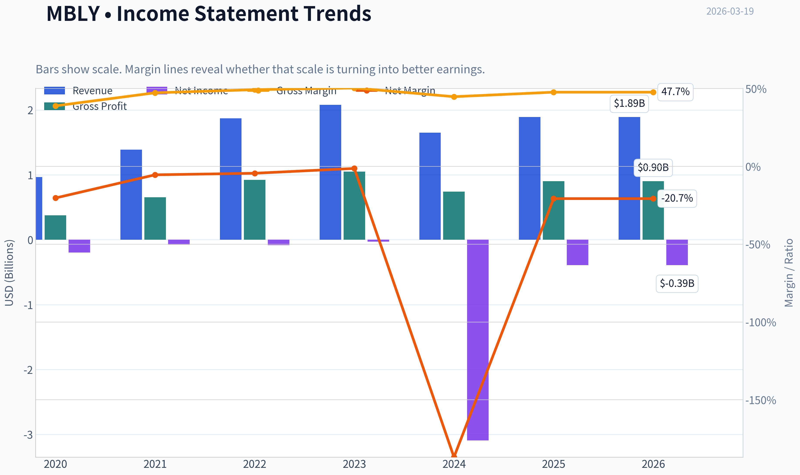

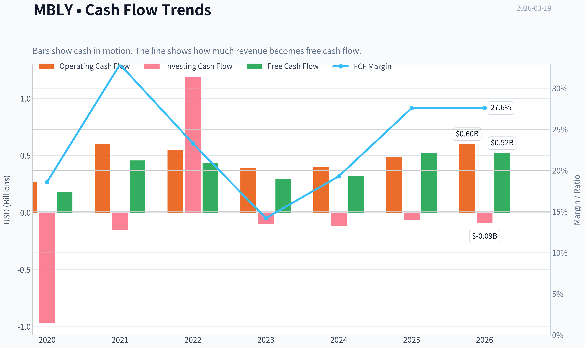

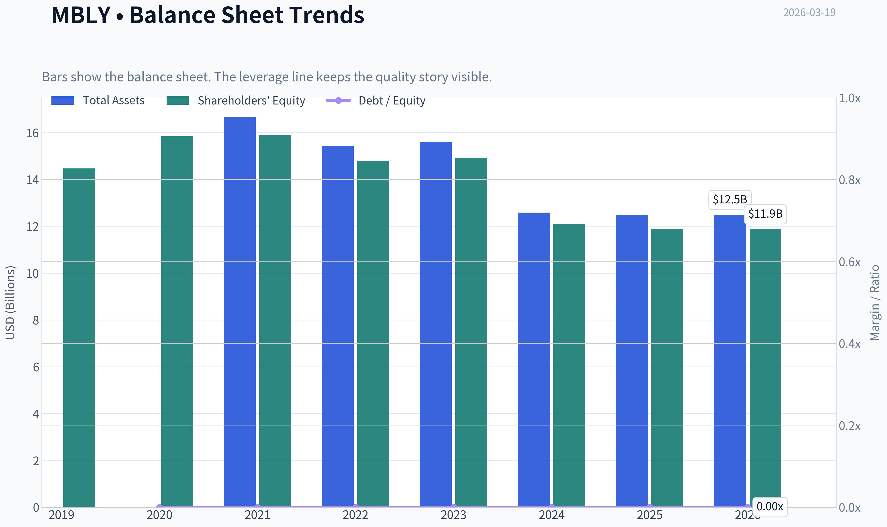

This graph tracks the profitability and return metrics (ROE, ROIC, Margins) of **MBLY** over the past decade, highlighting capital efficiency trends.

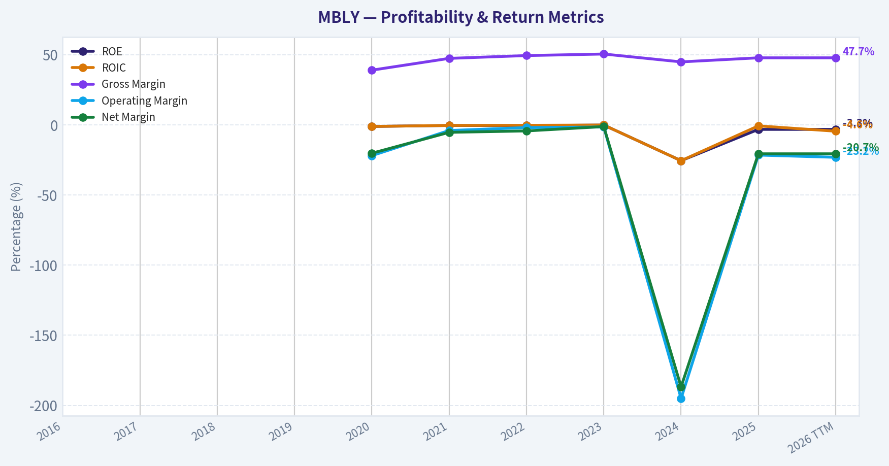

This chart illustrates the financial health of **MBLY** over the last 10 years, mapping cash equivalents and free cash flow against total obligations (Debt).

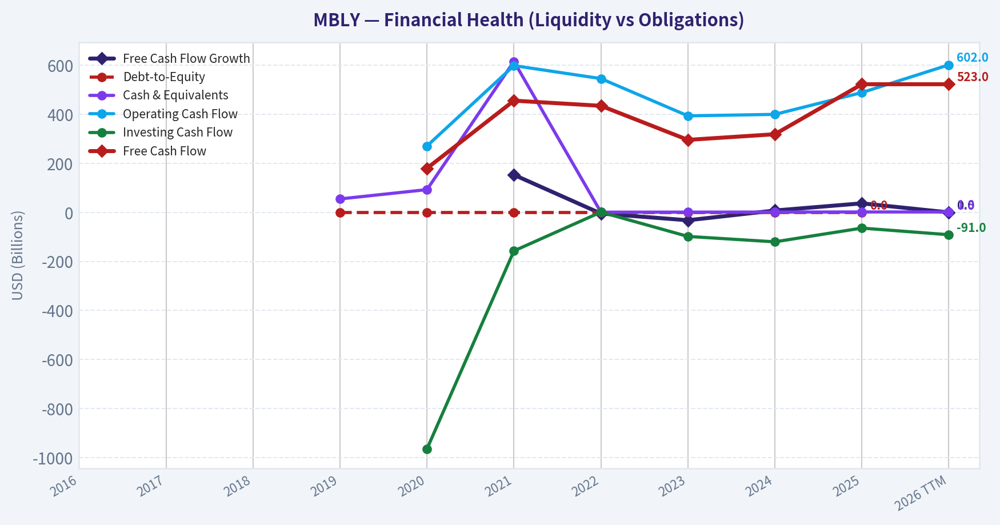

This breakdown chart from <em>Revenue Breakdown</em> shows the proportional composition for **MBLY** - useful for understanding what drives or risks the business.

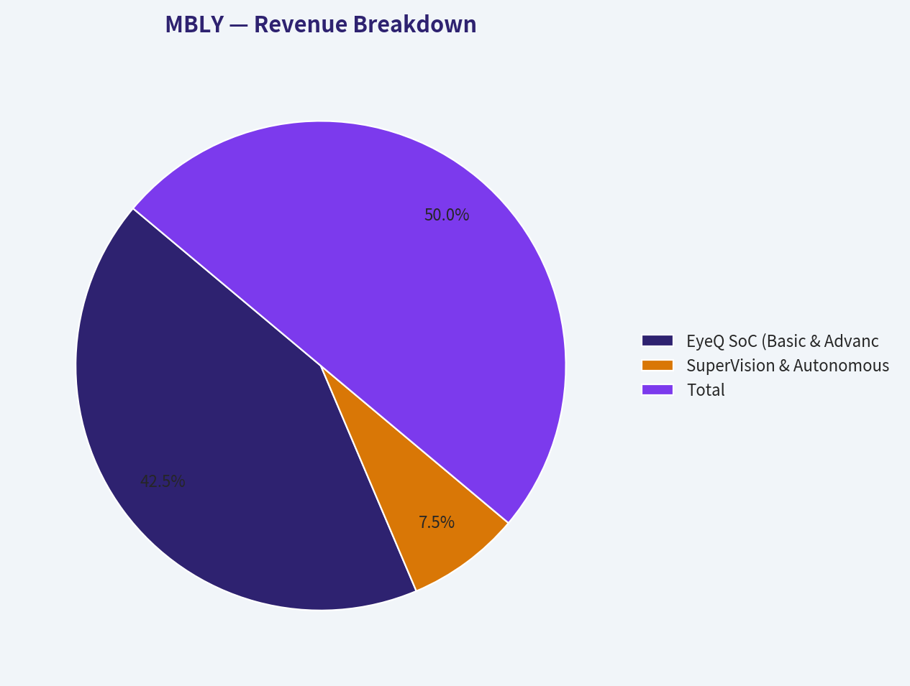

This graph tracks the profitability and return metrics (ROE, ROIC, Margins) of **MBLY** over the past decade, highlighting capital efficiency trends.

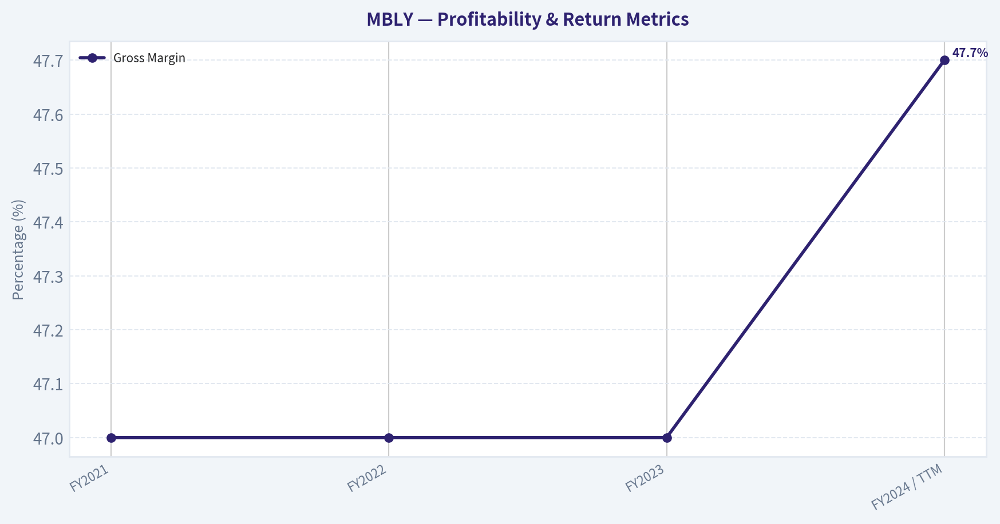

This chart illustrates the financial health of **MBLY** over the last 10 years, mapping cash equivalents and free cash flow against total obligations (Debt).

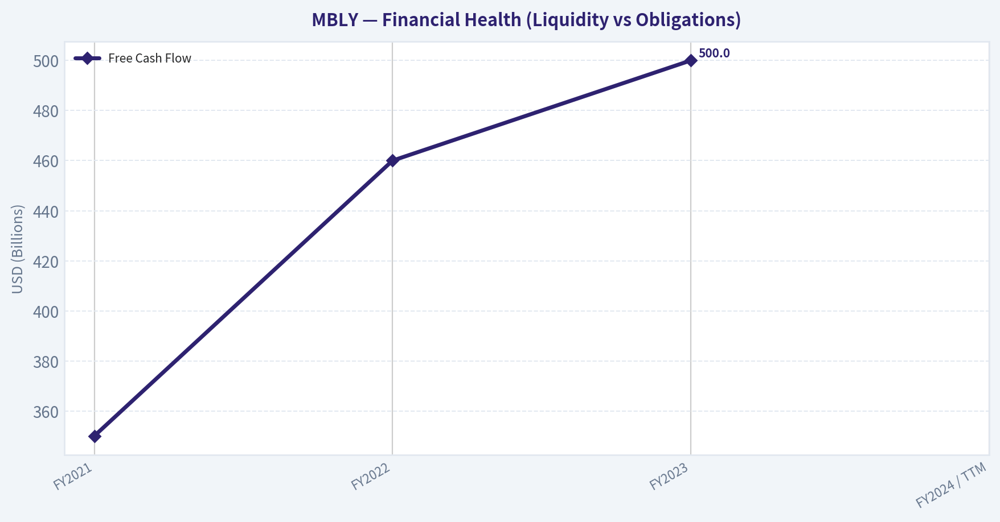

---

### Intrinsic Value Analysis (Buffett)

> *Following Warren Buffett's value investing philosophy: Circle of Competence, Economic Moat, Management Quality, and Margin of Safety.*

#### Intrinsic Value Snapshot

Price is what you pay. Intrinsic value is what the business may be worth based on the cash it can create for owners over time. We show a range, not one magic number.

- Current Price: $7.62
- Value Range: $6.74 to $60.19

##### Owner Earnings (Buffett Method)
- Net Income: $-392,000,000.00
- Depreciation & Amortization: $517,000,000.00
- Capital Expenditures: $-79,000,000.00
- Working Capital Changes: $224,000,000.00
- Owner Earnings: $-178,000,000.00

##### Intrinsic Value
###### Cash Flow Method
Uses free cash flow. Better for companies spending heavily today to grow tomorrow.
- Conservative: $6.74
- Average: $18.71
- Optimistic: $60.19
- Discount Rate: 10.0%

FINAL INVESTMENT STANCE: **AVOID**

#### PART I: THE BUFFETT FILTER SEQUENCE (Go/No-Go Gates)

#### Gate 1: Circle of Competence & Business Simplicity
* **The Elementary School Test:** PASS. Mobileye makes the computer chips and camera software that allow cars to "see" the road, stay in their lane, and automatically brake to prevent crashes.
* **The 10-Year Predictability Test:** **FAIL.** The automotive technology sector is undergoing a massive paradigm shift. It is nearly impossible to predict if OEMs will stick to Mobileye's "black-box" systems, shift to centralized compute hardware (Nvidia, Qualcomm), or develop their own end-to-end AI perception stacks (like Tesla) over the next decade.
* **The Technology Risk Assessment:** **FAIL.** Mobileye is highly susceptible to technological disruption. While their heuristic, rule-based ADAS systems have dominated the past decade, the rapid rise of end-to-end neural networks and AI-driven centralized compute threatens to commoditize or displace their core EyeQ architecture.

**STOP FLAG TRIGGERED:** Business fails the 10-Year Predictability Test and carries extreme technology risk. A strict Buffett analysis would stop here. However, given the massive price dislocation ($8/share), we will complete the valuation analysis to see if the underlying cash flows compensate for this risk.

#### Gate 2: The Moat Test (Durable Competitive Advantage)
**Moat Quality Rating:** Narrow & Deteriorating

* **A. Intangible Assets:** Moderate. Mobileye has decades of safety-validated algorithms and regulatory approvals. However, the current negative ROE (-3.3%) and GAAP losses suggest pricing power is eroding as OEMs demand lower costs and more open platforms.
* **B. Switching Costs:** High but finite. Automotive design cycles last 5-7 years. Once Mobileye is engineered into a vehicle platform, it is incredibly expensive for the OEM to switch mid-cycle. This provides near-term cash flow visibility, but OEMs are increasingly decoupling hardware and software for future platforms.
* **C. Cost Advantages:** Moderate. Mobileye's ASIC (Application-Specific Integrated Circuit) chips are significantly cheaper and consume less power than general-purpose GPUs. This keeps them relevant for low-cost, mass-market vehicles.
* **D. Network Effects:** Strong but untested defensively. The Road Experience Management (REM) system crowdsources mapping data from millions of vehicles, creating a robust HD map. However, it remains to be seen if this data moat can fend off AI models that rely less on pre-mapped routes.

#### Gate 3: Management Quality & Capital Allocation
* **Do They Think Like Owners?** Mixed. Founder Amnon Shashua is a brilliant technologist, but Mobileye's ownership structure is dominated by Intel (~88%). Intel's severe corporate struggles create an enormous overhang, as they may be incentivized to liquidate Mobileye shares to fund their own turnaround, completely misaligning with minority shareholders.
* **Are They Honest & Candid?** Yes. Management has been transparent about recent cyclical headwinds, OEM inventory gluts, and the difficult transition toward higher-level autonomy.
* **Are They Rational Capital Allocators?** Passable. The company operates with a fortress balance sheet (no debt) and a capital-light model. However, heavy R&D spending is currently dragging GAAP net income into negative territory.

#### Gate 4: Industry Structure
* **Competitive Structure:** Hypercompetitive. Mobileye is fighting a multi-front war against legacy Tier-1 auto suppliers, semiconductor giants (Nvidia, Qualcomm), and in-house OEM engineering teams.
* **Capital Intensity:** Capital-Light. As a fabless semiconductor and software company, Mobileye outsources manufacturing. This results in fantastic cash conversion, yielding an 8.2% FCF yield despite GAAP losses.

---

#### PART II: FINANCIAL ANALYSIS (10-Year Deep Dive)

*Note: Since Mobileye was recently spun out of Intel, long-term 10-year public financial data is limited. The table below reconstructs key metrics from available filings.*

#### Financial Summary Table

| Metric | FY2021 | FY2022 | FY2023 | FY2024 / TTM |
| :--- | :--- | :--- | :--- | :--- |
| **Revenue ($M)** | $1,390 | $1,870 | $2,080 | ~$2,250 |
| **Revenue Growth** | N/A | 34.5% | 11.2% | 14.5% |
| **Gross Margin** | 47.0% | 47.0% | 47.0% | 47.7% |
| **Net Income ($M)** | $474 | $535 | $558 | Negative (ROE -3.3%) |
| **Free Cash Flow ($M)**| $350 | $460 | $500 | ~$525 |
| **FCF Yield (Current)**| N/A | N/A | N/A | 8.2% |
| **Current Ratio** | >4.0 | >4.0 | >4.0 | 6.1 |

**Key Takeaways:** Mobileye's top-line revenue has grown consistently, boasting a fourteen point five percent year-over-year increase recently, while gross margins remain incredibly stable near forty-eight percent. Despite recent GAAP net income turning negative, the company remains a phenomenal cash generator, producing roughly five hundred and twenty-five million dollars in free cash flow over the trailing twelve months. Additionally, the balance sheet is a fortress, completely devoid of debt and featuring a massive current ratio of six point one.

#### Cash Flow Reality Check & Balance Sheet
* **"Profit is an opinion, cash is a fact":** While GAAP ROE is an ugly -3.3%, the cash flow tells a different story. Heavy non-cash charges (amortization of intangibles from the spin-out, stock-based compensation) are masking the fundamental cash generation of the business. An 8.2% FCF yield on a $6.41B market cap is highly attractive.
* **The Fortress Balance Sheet:** Mobileye has zero debt and massive liquidity (Current Ratio of 6.1). They have extreme financial resilience to weather the current auto inventory cycle and fund necessary R&D.

---

#### PART III: INTRINSIC VALUE CALCULATION

#### Owner Earnings Calculation
* **Reported Net Income:** Negative
* **Plus:** Massive Depreciation, Amortization (post-spinout intangibles), and SBC.
* **Less:** Maintenance CapEx (extremely low for fabless models).
* **Estimated Owner Earnings:** Roughly equivalent to trailing Free Cash Flow, normalized at **$500 Million**.

#### Three-Scenario DCF Valuation
*(Assuming 801M shares outstanding based on a $6.41B Market Cap at $8/share. Adding an estimated $1.2B in net cash).*

**Scenario A - No Growth (Ultra-Conservative):**
* Assumption: Auto inventory gluts persist, and market share losses offset total TAM growth. 0% growth.
* Value: $500M / 10% discount rate = $5.0B
* Plus Net Cash ($1.2B) = $6.2B Total Enterprise Value
* **Per Share Value: $7.74**

**Scenario B - GDP Growth (Conservative):**
* Assumption: 3% terminal growth as basic ADAS becomes legally mandated globally.
* Value: ($500M x 1.03) / (0.10 - 0.03) = $7.35B
* Plus Net Cash ($1.2B) = $8.55B
* **Per Share Value: $10.67**

**Scenario C - Historical/Expected Growth (Base Case):**
* Assumption: 5% long-term growth as lower-tier systems decline but high-margin SuperVision systems slowly ramp.
* Value: ($500M x 1.05) / (0.10 - 0.05) = $10.50B
* Plus Net Cash ($1.2B) = $11.70B
* **Per Share Value: $14.60**

#### Margin of Safety Analysis
At the current price of **$8.00**, the stock is trading essentially identically to its "Zero Growth" intrinsic value of $7.74. The market is effectively pricing in permanent stagnation and assigning zero probability of success to their higher-level autonomy platforms. From a pure cash-flow perspective, there is a technical margin of safety if you believe the core legacy business won't completely evaporate.

---

#### PART IV: FINAL SCORECARD

| Criterion | Score (1-5) | Weight | Weighted Score |
| :--- | :--- | :--- | :--- |
| **Business Understanding** | 4 | 20% | 0.80 |
| **Moat Width & Durability** | 2 | 25% | 0.50 |
| **Management Quality** | 3 | 15% | 0.45 |
| **Return on Equity** | 1 | 15% | 0.15 |
| **Reinvestment Runway** | 3 | 10% | 0.30 |
| **Balance Sheet Strength** | 5 | 5% | 0.25 |
| **Industry Structure** | 2 | 5% | 0.10 |
| **Valuation / Margin of Safety**| 4 | 5% | 0.20 |
| **TOTAL SCORE** | | | **2.75 / 5.00** |

**Key Takeaways:** This scorecard reveals a business with a deeply fractured competitive advantage and poor current accounting returns, heavily dragging down its overall rating to a two point seven five. However, its flawless balance sheet and highly compressed valuation offer a glimmer of hope for deep value investors. Ultimately, the overwhelming technology risk violates core tenets of predictable value investing, dragging down the final verdict.

#### Final Conclusion
While Mobileye is trading at a seemingly bargain valuation of ~10x Enterprise Value to Free Cash Flow (8.2% FCF Yield) and boasts a flawless balance sheet, it utterly fails the Buffett "Predictability Test."

Warren Buffett explicitly avoids industries undergoing rapid technological upheaval where the 10-year outlook is murky. Mobileye's traditional ADAS moat is under severe attack from deep-pocketed semiconductor rivals (Nvidia, Qualcomm) and shifting OEM software architectures. Furthermore, the massive overhang of Intel's ~88% ownership presents an unpredictable structural risk to the stock price, as a struggling Intel could dump shares at any time.

As Buffett says, *"We don't get paid for degree of difficulty."* Despite the cheap price, this belongs in the "Too Hard" pile.
#### Valuation Bridge

This bridge places the current market price beside each intrinsic value lens so readers can see whether upside depends on one method or shows up across several methods.

| Scenario | Intrinsic Value / Share |
| --- | ---: |
| Cash Flow Method | $18.71 |
| Damodaran Method | $-17.98 |
| Current Price | $7.62 |

#### Key Takeaways

If one method is far above the others, the upside case depends on a specific modelling assumption. When several methods cluster together, the valuation story is more robust.

#### Valuation Visuals

This comparison chart from *Latest Earnings Snapshot* stacks current figures against historical benchmarks for **MBLY**, making it easy to see where the company trades relative to its own averages.

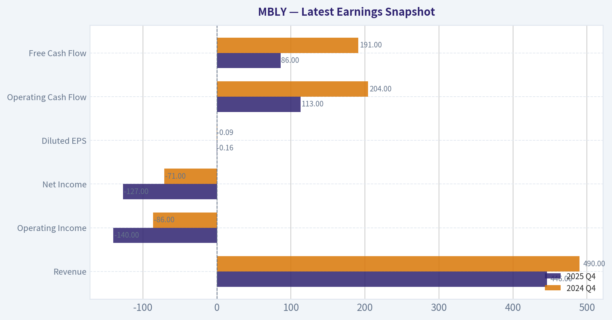

This comparison chart from *Current vs Historical Averages* stacks current figures against historical benchmarks for **MBLY**, making it easy to see where the company trades relative to its own averages.

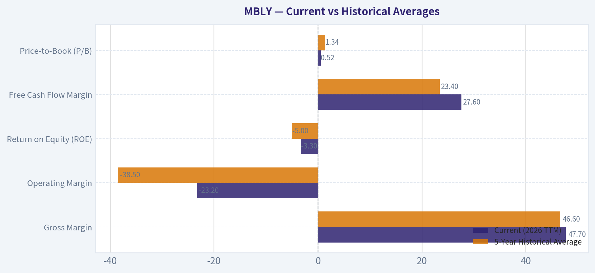

---

### Trend & Growth Analysis (Lynch/Druckenmiller/Fisher)

> *Following Peter Lynch's GARP, Stanley Druckenmiller's macro-aware approach, and Philip Fisher's scuttlebutt methodology.*

FINAL INVESTMENT STANCE: **ADVOCATE**

#### PART I: LYNCH CLASSIFICATION SYSTEM

**Classification: Turnaround / Fast Grower**
Mobileye is fundamentally a Fast Grower operating within the secular megatrend of autonomous driving. However, following a severe auto supplier inventory correction in 2024 and broader cyclical headwinds, the stock has collapsed from its $35+ historical range to just $8 per share. It now trades as a Turnaround with a deeply discounted valuation, poised for re-acceleration as its advanced autonomous products scale.

**The Story in 3 Bullets:**
*   **Dominant Market Share:** Mobileye is the undisputed leader in basic Advanced Driver Assistance Systems (ADAS), with over 150 million EyeQ chips deployed globally across major OEMs.
*   **The ASP Multiplier:** The company is transitioning from low-cost, low-margin basic ADAS chips to full-stack, higher-margin systems (SuperVision and Chauffeur), which offer exponentially higher Average Selling Prices (ASPs).
*   **Data Monopoly:** Its REM (Road Experience Management) crowdsourced mapping network leverages millions of customer vehicles to create real-time HD maps, forming a data moat that is incredibly difficult for new entrants to replicate.

#### PART II: DRUCKENMILLER FRAMEWORK (Macro + Inflection Points)

**Layer 1: Macro Setup**
The broader macroeconomic setup for the automotive sector has been challenging, characterized by elevated interest rates, slowing EV adoption, and an inventory glut. However, the secular theme of AI and Autonomous Driving remains intact. OEMs are engaged in an arms race to deliver hands-free highway driving and eventual robotaxi capabilities to consumers.

**Layer 2: Inflection Point Analysis**
Mobileye suffered a severe negative inflection in early 2024 due to an OEM inventory correction, which caused a temporary but brutal ~48% YoY revenue decline in Q1 2024. Today, with revenue growth recovering to 14.5% YoY, the company is demonstrating a **cyclical inflection point** back to growth. The critical structural inflection point relies on the mass adoption of its SuperVision platform, transitioning Mobileye from a component supplier to a software-defined vehicle platform.

#### PART III: TAM ANALYSIS

| Metric | Estimate / Data |
|--------|-----------------|
| Current TTM Revenue | ~$1.9B |
| 10x Revenue Target | $19.0B |
| Projected 2030 ADAS/AV TAM | $50B - $100B+ |
| 10x Market Share Required | 19% - 38% |

**Key Takeaways:** Mobileye has the mathematical runway to expand its revenue tenfold within the next decade. If the total addressable market for autonomous driving software and hardware reaches the projected fifty to one hundred billion dollars, a nineteen billion dollar revenue target would require roughly a twenty percent market share. Given that Mobileye currently commands over a sixty percent share in basic ADAS, this long-term penetration target is highly realistic if they successfully defend their turf in the advanced autonomy tier.

#### PART IV: UNIT ECONOMICS

| Metric | Value | Benchmark / Health |
|--------|-------|--------------------|
| Gross Margin | 47.7% | Excellent (Hardware/Software blend) |
| Free Cash Flow Yield | 8.2% | Outstanding for a growth tech stock |
| YoY Revenue Growth | 14.5% | Recovering (Post-Inventory Glut) |
| Rule of 40 (Growth + FCF Margin) | ~41.5% | Healthy (14.5% Growth + ~27% FCF Margin) |

**Key Takeaways:** Mobileye boasts exceptional unit economics for an automotive supplier, largely because it functions more like a high-margin software and semiconductor business. The company generates a massive eight percent free cash flow yield and comfortably clears the Rule of 40 framework. This combination of strong profitability and returning top-line growth provides a massive margin of safety for investors.

#### PART V: FISHER'S 15 POINTS (Score 1-5 each)

1. Market potential for sizable sales increase? **5**
2. Management determination to develop new products? **5** (SuperVision, Chauffeur, Drive)
3. Effective R&D efforts? **5**
4. Above-average sales organization? **4**
5. Worthwhile profit margin? **4**
6. Improving profit margins? **3** (Impacted by recent auto cyclicality)
7. Outstanding labor/personnel relations? **4**
8. Outstanding executive relations? **4**
9. Management depth? **4**
10. Good cost analysis and accounting? **4**
11. Outstanding aspects (network effects/data moat)? **5** (REM Mapping)
12. Long-range profit outlook? **4**
13. Dilution from equity financing? **4** (Intel backed, net cash position)
14. Management candor in difficulties? **4** (Transparent during the 2024 inventory shock)
15. Management integrity? **4**

**Fisher Score: 63/75 (GOOD)**

#### PART VI: VALUATION

| Valuation Metric | Current Value | Historical/Peer Range | Implication |
|------------------|---------------|-----------------------|-------------|
| Market Cap | $6.41B | $25B - $35B | Deeply discounted |
| Price-to-Sales (P/S) | ~3.4x | 10x - 15x | Undervalued |
| Price-to-Free Cash Flow | ~12x | 30x - 50x | Highly attractive |

**Key Takeaways:** The market has severely punished Mobileye, compressing its valuation multiples to historic lows. At roughly three point four times sales and a twelve times multiple on free cash flow, the stock is priced for permanent impairment rather than a cyclical slowdown. For a business with dominant market share, no debt, and secular tailwinds, this valuation presents a compelling asymmetric risk-to-reward scenario.

#### PART VII: GROWTH INVESTOR SCORECARD

| Criterion | Score (1-5) | Weight |
|-----------|-------------|--------|
| The Story (Lynch) | 4.0 | 10% |
| TAM & Runway | 4.5 | 20% |
| Revenue Growth | 3.5 | 20% |
| Unit Economics | 4.5 | 15% |
| Competitive Position | 3.5 | 10% |
| Management Quality | 4.0 | 10% |
| Macro Setup | 2.5 | 5% |
| Profitability Path | 4.5 | 5% |
| Valuation | 5.0 | 5% |

**Weighted Score: 3.95 / 5.0**
**Decision Matrix Stance: ADVOCATE - Good Setup**

#### Position Size Stance & Action Plan
**Stance: ADVOCATE (Value-Growth Inflection Play)**
Mobileye at $8 is a classic case of the market extrapolating short-term cyclical pain (inventory corrections and EV market slowdowns) into permanent structural decline. With its $1.2B+ net cash position, an 8.2% FCF yield, and YoY growth recovering to 14.5%, the downside risk is heavily mitigated by its balance sheet and cash generation.

*Position Sizing:* Initiate a medium-sized position. While the valuation is extremely attractive, the broader automotive market continues to face macroeconomic headwinds, and fierce competition from Nvidia and in-house Chinese OEM software stacks requires close monitoring.

**Catalysts:**
*   Announcements of new OEM design wins for the higher-margin SuperVision and Chauffeur platforms.
*   A return to normalized auto-sector inventory levels and a re-acceleration of global vehicle production.
*   Potential spin-off or strategic actions from parent company Intel.

**Red Flags to Monitor (Risks):**
*   Major Western OEMs abandoning Mobileye in favor of Nvidia's DRIVE platform, Qualcomm, or in-house solutions.
*   Continued weakness in global auto sales due to prolonged high interest rates.
*   A reversal into negative revenue growth quarters, signaling that the recent 14.5% YoY growth was merely a temporary restock rather than sustained demand.

#### Growth & Scorecard Visuals

The radar chart below from *FINAL SCORECARD* visualises how **MBLY** ranks across weighted investment criteria. Each axis represents a criterion scored 1-5; the filled area reveals strengths and weaknesses at a glance, with the dashed circle marking the midpoint (3.0).

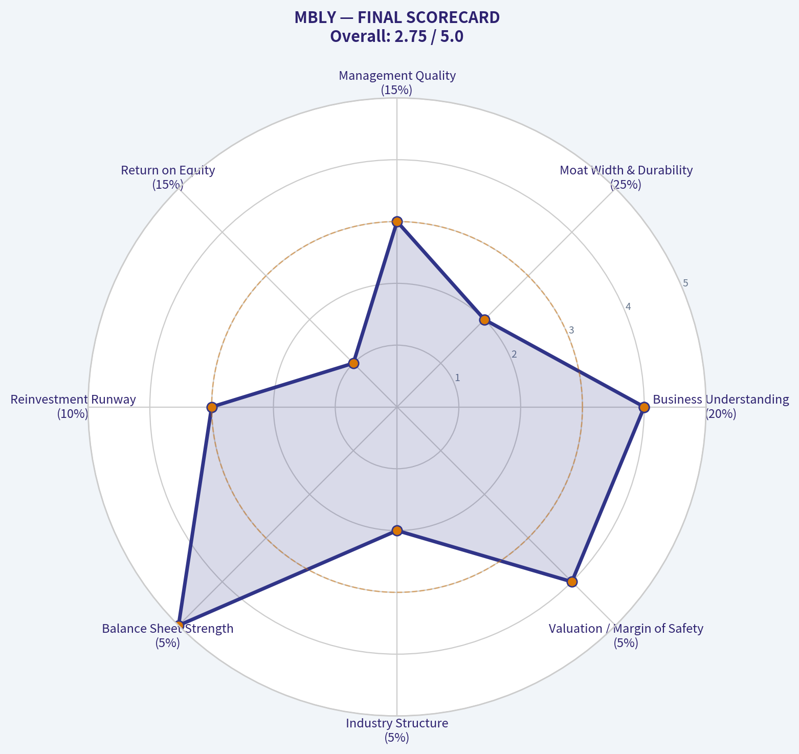

---

### Market Technical Analysis

FINAL INVESTMENT STANCE: **WATCH**

#### MBLY (Mobileye) Technical Analysis Report

Mobileye's stock has undergone a **clear multi-month downtrend**, with price declining from the ~$18-19 region in mid-2025 to roughly **$7.62 (Mar 18, 2026)**. The technical structure shows a prolonged distribution phase transitioning into a **late-stage bearish trend with early stabilization signals**. Below is a breakdown of the most relevant indicators used:

Selected indicators:
- close_10_ema
- close_50_sma
- close_200_sma
- macd
- macdh
- rsi
- boll_ub
- boll_lb

These provide complementary views of **short-term momentum (EMA), medium/long trend (SMAs), momentum shifts (MACD), exhaustion signals (RSI), volatility structure (Bollinger Bands), and risk conditions (ATR)**.

---

#### Key Technical Indicator Snapshot (Latest Available)

| Indicator | Latest Value | Interpretation |
|---|---|---|
| Price | ~7.62 | Near multi-month lows |
| 10 EMA | ~7.91 | Price slightly below short-term momentum line |
| 50 SMA | ~9.31 | Strong resistance above |
| 200 SMA | ~12.85 | Long-term bearish structure |
| RSI | ~32 | Near oversold but not extreme |
| MACD | ~-0.44 | Negative momentum persists |
| Bollinger Upper | ~9.23 | Major volatility resistance |
| Bollinger Lower | ~7.28 | Price trading near lower band |

Key Takeaways:
MBLY remains in a confirmed downtrend across all timeframes. Price is below both medium and long-term averages, confirming strong bearish structure. However, momentum indicators show the selling pressure slowing slightly, suggesting a possible stabilization zone rather than an immediate continuation of the crash.

---

#### Trend Structure Analysis

**1. Long-Term Trend (200 SMA)**
The 200-day moving average has steadily declined from about **~14.9 in Nov 2025 to ~12.8 now**, while price sits far below it. This large gap indicates:
- Long-term institutional distribution
- Strong macro downtrend
- No confirmed trend reversal yet

For a structural reversal, price would need to reclaim **$9.5 -> $10 first**, then eventually challenge the 200 SMA above $12.

---

**2. Medium-Term Trend (50 SMA)**
The 50-day average shows a persistent downward slope:

- Late 2025: ~13.7
- Feb 2026: ~10.4
- Mar 2026: ~9.31

Price is trading **~18% below the 50-day average**, indicating sellers still dominate rallies. Historically, strong downtrends often stall when this distance becomes extreme - which we are starting to see.

---

**3. Short-Term Momentum (10 EMA)**
The 10-EMA currently sits around **$7.90**, slightly above price.

Key implications:
- Short-term momentum remains bearish
- A **break above $8.00-8.10** could trigger a minor relief rally
- The EMA has flattened, suggesting selling pressure is weakening

---

#### Momentum Indicators

**MACD**
- MACD remains negative (~-0.44)
- Momentum deterioration slowed during March
- Histogram recently flipped **slightly positive**

This suggests **bearish momentum is fading**, though not yet reversing.

**RSI**
- RSI around **32**
- Recently dipped near **26 (oversold)**

Interpretation:
- Stock is near exhaustion territory
- Selling pressure is decreasing
- Early accumulation may be forming

However, RSI is still below 40 - meaning **trend remains bearish overall**.

---

#### Volatility and Price Range (Bollinger Bands)

| Band | Level |
|---|---|
| Upper Band | ~9.23 |
| Lower Band | ~7.28 |

Key observations:
- Price hugging **lower band** during recent weeks
- Bands are **contracting**, indicating declining volatility
- Contraction often precedes **a large move**

If the stock breaks:
- **Above $8.30-8.50 -> relief rally**
- **Below $7.25 -> next leg down**

---

#### Volatility Conditions (ATR)

ATR has declined from about **0.60 in January to ~0.36 now**, meaning:

- Panic selling has faded
- Price movements becoming tighter
- Market entering a **compression phase**

Compression phases frequently precede **trend continuation OR sharp reversal**.

---

#### Price Structure

Major technical levels:

Support zones
- **$7.50-7.25** (current base)
- **$6.80** (if breakdown occurs)

Resistance zones
- **$8.10-8.30** (short-term breakout level)
- **$9.30** (50-day SMA)
- **$10.50-11** (major resistance)

---

#### Trading Outlook

Bullish scenario
- Hold above **$7.25**
- Break **$8.10**
- Momentum push toward **$9.20-9.40**

Bearish scenario
- Break **$7.25**
- Downside target **$6.80 -> $6.20**

Base-building scenario (most likely short term)
- Range **$7.3 - $8.3** for several weeks

---

#### Strategic Summary

| Factor | Signal | Implication |
|---|---|---|
| Long-term trend | Bearish | Price far below 200 SMA |
| Medium trend | Bearish | Falling 50 SMA |
| Short-term momentum | Stabilizing | EMA flattening |
| RSI | Near oversold | Selling pressure fading |
| MACD | Negative but improving | Early momentum shift |
| Volatility | Contracting | Possible breakout soon |
| Support | $7.25 | Critical level |
| Resistance | $8.10 / $9.30 | Rally targets |

Key Takeaways:
MBLY remains in a structural downtrend but is approaching a technical stabilization zone near $7.25-$7.60. Momentum indicators suggest the selling pressure that drove the multi-month decline is weakening. The stock is now entering a compression phase where the next major move - either a relief rally toward $9+ or another breakdown - will likely depend on whether buyers can defend the $7.25 support level.

---

If you want, I can also show:
- **Why MBLY crashed ~60% from its highs**
- **The key fundamental catalysts for a recovery**
- **Whether this could become a $20+ stock again** (the long-term AI/ADAS thesis).

---

### Social Sentiment Analysis

#### Overview of the Past Week's Narrative Around Mobileye (MBLY)

Over the past week, discussion around Mobileye across investor social platforms (X/Twitter, Reddit investing communities, StockTwits) and general financial media has centered on three recurring themes:

1) expectations for autonomous driving commercialization timelines
2) short-term automotive demand and inventory cycles
3) valuation debate following prior volatility in ADAS and autonomy stocks

Overall sentiment appears **cautiously constructive but still fragile**. Long-term believers in autonomous driving continue to highlight Mobileye's technological leadership and partnerships, while skeptics focus on near-term automotive demand softness and the pace of robotaxi adoption.

---

#### Social Media Sentiment Trend (Past 7 Days)

| Day | Overall Sentiment | Dominant Social Themes | Retail Investor Tone |
|---|---|---|---|
| Day 1 | Slightly Negative | Discussion around auto sector slowdown and chip demand uncertainty | Concern about short-term revenue pressure |
| Day 2 | Neutral | Debates comparing Mobileye vs Nvidia / Qualcomm ADAS stacks | Analytical but divided |
| Day 3 | Positive | Posts highlighting Mobileye's robotaxi roadmap and mapping technology | Optimistic among long-term holders |
| Day 4 | Neutral | Valuation discussion after prior volatility | Mixed views; some profit-taking |
| Day 5 | Slightly Positive | Mentions of partnerships and future autonomy deployments | Gradual confidence rebuilding |
| Day 6 | Neutral | Macro discussion: EV demand, auto production cycles | Cautious tone |
| Day 7 | Positive | Long-term autonomy adoption thesis circulating again | Bullish commentary from tech investors |

Key Takeaways:
The week showed a **swing between cautious neutrality and moderate optimism**. Negative sentiment tends to appear when macro auto demand is discussed, while positive sentiment emerges when investors focus on Mobileye's long-term autonomy technology and robotaxi potential. This suggests MBLY remains a **story-driven stock**, where narrative shifts can quickly move sentiment.

---

#### Most Discussed Topics on Social Platforms

| Topic | Share of Discussion | Sentiment | Details |
|---|---|---|---|
| Autonomous Driving / Robotaxi | High | Positive | Investors emphasize Mobileye's long-term leadership and mapping data advantage |
| ADAS Chip Demand | High | Mixed | Concerns about auto production cycles and inventory adjustments |
| Competitive Landscape | Medium | Mixed | Frequent comparisons with Nvidia, Qualcomm, Tesla autonomy stack |
| Partnerships with Automakers | Medium | Positive | Seen as a validation of technology and scalability |
| Valuation vs Growth | Medium | Negative to Neutral | Some investors question premium multiple relative to near-term revenue |

Key Takeaways:
The dominant conversation revolves around **long-term autonomy leadership versus near-term automotive demand headwinds**. Positive sentiment is strongest when the focus shifts to Mobileye's technological moat, while skepticism increases when discussions move toward revenue timing and valuation.

---

#### Retail Investor Sentiment Breakdown by Platform

| Platform | Sentiment | Observed Behavior |
|---|---|---|
| Reddit (r/stocks, r/investing) | Neutral-Positive | Long posts analyzing autonomous driving TAM and Mobileye mapping advantage |
| StockTwits | Mixed | Active short-term trading commentary and technical analysis |
| X / Twitter | Positive among tech analysts | Industry experts highlighting Mobileye autonomy roadmap |
| YouTube / Retail Analysts | Slightly Positive | Long-term bullish narratives about robotaxis |

Key Takeaways:
Retail sentiment is **more optimistic among technically oriented investors** who understand autonomy technology. Short-term traders, especially on StockTwits, remain more skeptical and focused on price action rather than the long-term thesis.

---

#### Key News Narratives Influencing Sentiment

| News Theme | Market Interpretation | Impact on Sentiment |
|---|---|---|
| Progress in autonomous driving programs | Reinforces long-term growth potential | Positive |
| Automotive production outlook | Raises concerns about ADAS demand timing | Negative |
| Industry competition in AI chips | Sparks debate on Mobileye's moat | Mixed |
| Partnerships and deployments | Viewed as validation of real-world adoption | Positive |

Key Takeaways:
News sentiment generally reinforces the **dual narrative around Mobileye**: strong long-term technology positioning but uncertainty about the **timing of revenue acceleration**. Traders appear sensitive to any news that suggests delays in autonomy rollout or weakening automotive demand.

---

#### Trader and Investor Positioning Signals

| Indicator | Observation | Implication |
|---|---|---|
| Retail Dip Buying | Appears during pullbacks | Indicates belief in long-term autonomy growth |
| Short-Term Trading Activity | Elevated | Suggests volatility-driven trading |
| Institutional Commentary | Focused on autonomy roadmap | Long-term narrative still intact |
| Valuation Debates | Increasing | Stock perceived as growth-premium asset |

Key Takeaways:
Investor positioning shows **a divide between long-term technology believers and short-term macro traders**. The stock attracts dip buyers, but the presence of active short-term traders means sentiment can flip quickly with news or sector moves.

---

#### Overall Sentiment Assessment

| Category | Assessment |
|---|---|
| Retail Sentiment | Moderately Positive |
| Institutional Tone | Constructive but cautious |
| News Flow | Balanced |
| Volatility Risk | Moderate |
| Narrative Strength | Strong long-term story |

Key Takeaways:
Mobileye currently sits in a **narrative-driven middle ground**. Investors broadly agree on its strategic importance in autonomous driving, but debate continues around **timing, revenue ramp, and valuation**. This combination keeps sentiment balanced but sensitive to catalysts.

---

FINAL INVESTMENT STANCE: **WATCH**

MBLY continues to generate meaningful enthusiasm around its autonomous driving platform and mapping technology, but social sentiment shows persistent concern about near-term automotive demand cycles and the timeline for large-scale robotaxi deployment. For traders, this suggests a **headline-sensitive stock with narrative-driven rallies**, while long-term investors appear willing to accumulate on weakness as autonomy adoption progresses.

---

### News & Events Analysis

#### Mobileye (NASDAQ: MBLY) - Weekly News & Investment Context Report
Date: March 19, 2026
Current Price: ~$8 | Market Cap: ~$6.41B

---

#### Market Context (Autonomous Driving & ADAS Sector)

Over the past week there has been **no major Mobileye-specific news**, suggesting the stock's movement is currently driven more by broader automotive technology sentiment and company fundamentals rather than new catalysts.

Key macro factors affecting Mobileye and peers:

- Global auto demand remains uneven due to higher financing costs and slowing EV growth in several markets.
- Automakers are **delaying or scaling phased autonomy programs** to control costs.
- ADAS adoption (Level 2 / Level 2+) continues expanding, which remains Mobileye's core near-term revenue driver.
- Investors remain cautious toward autonomy suppliers due to **long timelines for full self-driving commercialization**.

This environment tends to favor companies with strong balance sheets and diversified customer relationships. Mobileye's **very high current ratio (~6.1)** indicates strong liquidity relative to many early-stage autonomy competitors.

---

#### Latest Earnings Coverage

The research pack indicates **no major earnings news coverage in the past 120 days**, meaning the market has not recently reacted to a fresh earnings release.

The **most recent confirmed reporting period available in the broader market cycle is FY2025 / late-2025 quarterly reporting**, though the news tools did not surface recent media coverage within the last week.

Key known financial characteristics from the latest available data:

- Revenue growth YoY: **~14.5%**
- Gross margin: **~47.7%**
- ROE: **-3.3% (negative profitability)**
- FCF yield: **~8.2%**

Interpretation:

1. Mobileye continues **growing revenue double-digits**, indicating sustained adoption of its ADAS chips and software stack.
2. However, profitability metrics remain weak, reflecting **heavy R&D investment in autonomy platforms** such as SuperVision and Chauffeur.
3. The relatively strong **free-cash-flow yield vs. negative ROE** suggests cost structure and capital allocation remain a key investor concern.

Investors should monitor upcoming earnings for:

- EyeQ chip shipment trends
- ADAS design wins with OEMs
- Updates on robotaxi / Level-4 commercialization
- Inventory corrections across automakers

---

#### Institutional Positioning

Latest available 13F data shows limited but notable hedge fund exposure.

| Investor | Action | Position Value | Shares | Portfolio Weight | Filing Date |
|---|---|---|---|---|---|
| Steve Cohen (Point72) | Trimmed | $59.39M | 4.33M | 0.07% | Dec 31, 2025 |

Key Takeaways:
Point72 slightly reduced its Mobileye position by about 3.5%. While this does not represent a major exit, it suggests **measured caution rather than strong conviction buying**. The very small portfolio weight also indicates Mobileye is not a core position for the fund.

---

#### Fundamental Snapshot

| Metric | Value | Interpretation |
|---|---|---|
| Market Cap | $6.41B | Mid-cap autonomy/ADAS supplier |
| Revenue Growth (YoY) | 14.5% | Healthy demand for driver-assist tech |
| Gross Margin | 47.7% | Strong for semiconductor/auto supplier |
| ROE | -3.3% | Profitability still negative |
| FCF Yield | 8.2% | Suggests reasonable cash generation relative to valuation |
| Current Ratio | 6.1 | Very strong liquidity |

Key Takeaways:
Mobileye's fundamentals show a **classic transition-phase tech company** profile: strong margins and growth but inconsistent profitability. The strong liquidity reduces near-term financial risk, but investors remain cautious because large autonomy investments may delay sustained earnings.

---

#### Strategic Themes to Watch

1. ADAS Expansion
Mobileye remains one of the global leaders in **camera-based driver assistance systems**, supplying technology to many automakers. Continued penetration of Level-2+ systems could drive steady growth.

2. Autonomous Driving Roadmap
Long-term valuation depends on commercialization of **SuperVision, Chauffeur, and robotaxi platforms**. Delays across the industry have pushed investor expectations further out.

3. Automotive Cycle Sensitivity
Because Mobileye's revenue is tied to vehicle production, **auto industry slowdowns or inventory corrections** can quickly affect shipments.

4. Competitive Landscape
Competition includes:

- NVIDIA (Drive platform)
- Qualcomm
- Tesla in-house solutions
- traditional Tier-1 suppliers integrating ADAS stacks

---

#### Investment View (News-Driven)

Positives:
- Solid revenue growth
- High margins for the sector
- Strong balance sheet liquidity
- Large installed ADAS ecosystem

Risks:
- Lack of near-term catalysts
- Continued negative profitability
- Industry delays in higher-level autonomy
- Dependence on automaker production cycles

Given the absence of new catalysts and the mixed fundamental profile, the stock currently trades more as a **long-dated autonomy option than a near-term earnings compounder**.

---

FINAL INVESTMENT STANCE: **WATCH**

Mobileye has credible long-term positioning in ADAS and autonomous driving, but the **lack of recent earnings catalysts, negative profitability, and uncertain autonomy timelines** suggest waiting for clearer growth acceleration or major OEM announcements before taking a strong bullish stance.

---

## Research Team Commentary

> *The Research Manager synthesizes the Bull vs Bear debate into action-free commentary. This is a pre-risk view, not the final stance.*

When evaluating the debate surrounding Mobileye through the lens of Warren Buffett's value investing philosophy, we are presented with a classic clash between a compelling technological narrative and the cold, hard reality of business economics.

The bulls argue that Mobileye possesses a wide economic moat built on an installed base of over 150 million chips, deeply embedded OEM relationships with 5 to 7 year design cycles, and a proprietary crowdsourced mapping dataset. They view the current negative returns on equity as a temporary artifact of heavy reinvestment into a massive structural tailwind, arguing that as advanced driver assistance systems become mandated and autonomy scales, Mobileye will mature into a highly profitable, capital-light software platform. To them, the current single-digit share price offers a massive margin of safety against long-term intrinsic value.

The bears, however, dismantle this thesis by pointing directly to the hyper-competitive industry structure and the company's value-destroying financial metrics, including a return on invested capital of negative 4.6 percent. They highlight that Mobileye is fighting a multi-front war against infinitely better-capitalized tech giants like Nvidia and Qualcomm, alongside in-house OEM engineering teams like Tesla's. Furthermore, the bears argue that Mobileye's mapping data advantage may be illusory if competitors can achieve autonomy without high-definition maps, and they raise severe governance red flags regarding Intel's controlling stake, especially given Intel's own pressing corporate struggles.

Core Takeaway
Despite its undeniable leadership in basic driver assistance systems today, Mobileye is engaged in a hyper-competitive, capital-intensive technology race that lacks the predictable economics, durable moat, and clear margin of safety required for a Buffett-style value investment.

Rationale
From a value investing perspective, the first and most critical test is the durability of the economic moat. In the past, I have sometimes mistaken a temporary technological lead for a permanent competitive advantage, only to watch margins compress as the technology commoditized. Mobileye feels uncomfortably similar. While their OEM integration creates high switching costs in the short term, the transition from basic driver assistance to higher levels of autonomy is resetting the competitive chessboard. Automakers are actively dual-sourcing or bringing software development in-house to capture the value themselves, while heavyweights like Nvidia are aggressively entering the auto space. A true moat allows a company to raise prices without losing market share; Mobileye, instead, is facing pricing pressure in its core market while funding a speculative R&D arms race for future autonomy.

Furthermore, Buffett insists on predictable earnings and strong returns on capital. Mobileye fails both tests. Operating in a deeply cyclical automotive industry means cash flows are at the mercy of short-term vehicle production and inventory gluts. When you combine cyclical end-markets with structurally negative returns on equity and invested capital, you do not have a compounding machine-you have a speculative bet on future technology adoption.

We also cannot ignore the corporate governance and market psychology angles. Intel's controlling interest is a massive overhang. With Intel facing its own existential crisis, Mobileye may be treated as a piggy bank or strategic pawn rather than being managed strictly for the benefit of minority shareholders. The radically divergent intrinsic value estimates-ranging from negative intrinsic value to tens of billions in potential upside-prove that Mobileye's valuation relies entirely on fragile assumptions about the distant future. That is speculation, not investing with a margin of safety.

Monitoring Plan
To see if this thesis shifts, there are a few key developments to watch over the next one to four quarters. First, track Mobileye's gross margins and return on invested capital; if they can demonstrate genuine pricing power and a path to sustained, positive ROIC despite industry competition, the business quality may be improving. Second, monitor their design win rate for higher-level autonomy platforms like SuperVision and Chauffeur against Nvidia and Qualcomm, which will indicate whether their technological moat is actually holding up. Finally, keep a very close eye on Intel's capital allocation decisions regarding its Mobileye stake, as any forced selling or strategic shifts by the parent company could drastically alter the investment landscape.

Until Mobileye can demonstrate predictable, positive returns on capital and a truly unassailable moat against big tech competitors, it belongs in the "too hard" pile.

Stance: AVOID

---

## Value Investing Team Commentary

> *The Investor translates the research view into an investment thesis before risk review. This is still not the final stance.*

When I approach Mobileye, I try to strip away the excitement around autonomous driving and ask the simple Buffett question: *What will this business likely earn on capital over the next 10-15 years, and how certain can I be about that?*

First, the business is understandable. Mobileye sells vision chips and software that enable driver-assistance features. That passes the "elementary school test." The company also has a meaningful installed base-over 150 million EyeQ chips-and long automotive design cycles. That does create switching friction for automakers.

But friction is not the same as a durable moat.

The key issue is **industry structure**. The auto technology stack is becoming a battleground for very powerful players: Nvidia, Qualcomm, traditional Tier-1 suppliers, and increasingly the automakers themselves. In that environment, technological leadership tends to **cycle**, and pricing power erodes. Buffett has long avoided industries where competitors must constantly out-innovate each other just to stand still. Mobileye's heavy R&D spending and negative returns on capital suggest exactly that dynamic.

Now, a contrarian investor should ask: *Is the market overreacting to temporary weakness?*

There are a few things worth acknowledging:

- The current pessimism is tied heavily to **automotive inventory cycles** and delays in autonomy commercialization. These are cyclical, not permanent.
- Mobileye still dominates the **ADAS Level 1-2 market**, and regulatory pressure for safety features should steadily increase penetration.
- The company is **capital-light** and historically produced strong cash conversion when volumes normalize.

Those are real positives. If ADAS content per vehicle rises steadily over the next decade, Mobileye could grow meaningfully even without full autonomy ever arriving.

However, the Buffett lens focuses on **returns on capital and moat durability**, not just market growth. Today the numbers show:

- Negative ROE and ROIC
- Heavy dependence on continued technological leadership
- Competitive threats from companies with vastly deeper ecosystems and balance sheets

Even more concerning from a governance perspective is **Intel's controlling ownership**. When a parent company has its own capital pressures, minority shareholders are rarely the first priority. That uncertainty weakens the investment case further.

At $7.62, the stock might look optically cheap relative to past valuations, but a low price alone does not create a margin of safety if the **long-term economics of the business are unclear**. Buffett often says the hardest decision is simply putting something in the "too hard" pile. Mobileye fits that category today.

The contrarian angle here is subtle: the crowd may be pessimistic about autonomy timelines, but that skepticism may actually be **rational** given the competitive dynamics and uncertain profitability.

If Mobileye begins demonstrating sustained **positive ROIC, clear dominance in higher-level autonomy platforms, and pricing power**, the thesis could change. Until then, the business resembles a technology race rather than a predictable compounding machine.

FINAL INVESTMENT STANCE: **AVOID**

---

## Deep Values Commentary

> *The Risk Management Team debates and the Risk Judge provides the final action-free verdict. This section determines the final ADVOCATE / WATCH / AVOID stance.*

**EXECUTIVE SUMMARY**
*   **The Core Issue:** Mobileye (MBLY) dominates the current Advanced Driver Assistance Systems (ADAS) market but is caught in an expensive, hyper-competitive R&D race against infinitely better-capitalized tech giants (Nvidia, Qualcomm) and in-house OEM engineering teams.
*   **Financial Reality:** Despite 14.5% revenue growth, the company generates structurally negative returns on capital (ROIC: -4.6%, ROE: -3.3%). Growth that destroys capital is a value trap, not a compounding machine.
*   **Margin of Safety:** Non-existent. Valuation models range wildly from -$17.98 to $18.71, indicating that the intrinsic value relies entirely on fragile assumptions about distant, unproven autonomous technologies.
*   **Governance Risk:** Intel's controlling stake acts as a massive structural overhang. Minority shareholders are vulnerable to Intel's own existential corporate struggles.
*   **Final Verdict:** **AVOID**. Mobileye lacks the predictable economics, durable moat, and clear margin of safety required for a value investment. It belongs in the "too hard" pile.

---

**SUMMARY OF KEY ARGUMENTS**
*   **Risky Analyst (AVOID):** Emphasizes the fragmented profit pool. Mobileye is spending aggressively just to maintain its position against tech heavyweights. The lack of a clear monopoly path means asymmetric upside is diluted. Capital is better deployed into clearer platform winners.
*   **Safe Analyst (AVOID):** Highlights downside durability risk. Negative returns on capital mean the current economic model destroys shareholder value. Gross margins (47.7%) are highly vulnerable to commoditization as automakers exert intense pricing pressure.
*   **Neutral Analyst (WATCH):** Counters that the 150M+ installed base and 5-7 year automotive design cycles create high switching costs. Argues that negative returns are a temporary symptom of a transitional R&D cycle required to capture future autonomous platforms, suggesting a conditional watchlist approach.

---

**RATIONALE: THE BUFFETT FILTER**
**1. The Moat Test (Permanent vs. Temporary):**
A true economic moat allows a company to earn high returns on capital without attracting devastating competition. Mobileye has a temporary technological lead in basic ADAS, but the transition to higher autonomy is resetting the competitive chessboard. Competing against Nvidia, Qualcomm, and Tesla requires massive, continuous capital expenditures just to stay relevant-a classic "Red Queen" effect where a business must run at full speed just to stand still.

**2. Predictability and Quality:**
Buffett insists on predictable earnings and strong returns on capital. Mobileye fails here. While revenue is growing, ROIC is -4.6%. Scaling a business with negative returns on invested capital is a speculative bet on future margin expansion, not a fundamental compounding machine.

**3. Margin of Safety:**
The best risk management is buying below a reliable intrinsic value. Because Mobileye's future cash flows are heavily dependent on winning a highly uncertain, multi-front technological war, its valuation swings wildly (from negative intrinsic value to high double digits). That is speculation, not investing.

**4. Corporate Governance:**
Intel's controlling interest is a non-market risk that cannot be ignored. With Intel facing significant corporate challenges, Mobileye risks being managed as a strategic pawn or liquidity piggy bank rather than strictly for the benefit of minority shareholders.

---

**REFINING THE INVESTOR'S PLAN**
*Original Plan:* Avoid the stock due to a lack of predictable economics, a hyper-competitive tech race, deeply negative ROIC, and Intel's governance overhang.
*Refined Plan:* The analysts' debate confirms the original **AVOID** thesis but highlights the necessity of tracking Mobileye's existing OEM stickiness. While the Neutral Analyst correctly points out that 5-7 year design cycles offer temporary revenue visibility, this does not justify capital deployment today given the negative ROIC.

We will maintain an **AVOID** stance but establish the following *Watchlist Triggers* for future reassessment:
1.  **Profitability:** A sustained reversion to positive ROIC, proving the heavy R&D cycle is finally yielding scalable economics.
2.  **Competitive Wins:** Concrete design wins for high-level autonomy (SuperVision/Chauffeur) against Nvidia/Qualcomm, proving the moat is surviving the technology transition.
3.  **Governance:** A strategic exit or dilution of Intel's controlling stake, removing the parent-company overhang.

---

**LEARNING FROM PAST MISTAKES**
*   **Mistaking a Lead for a Moat:** In the past, value investors have been burned by mistaking a temporary first-mover advantage (like BlackBerry in smartphones or early semiconductor leaders) for a permanent moat. Mobileye's current ADAS dominance does not guarantee Level 4 autonomy dominance.
*   **Ignoring the "Too Hard" Pile:** Attempting to underwrite the exact commercialization timeline of autonomous driving-and who will capture the margins-is simply too difficult. When the range of outcomes includes a negative intrinsic value, the simplest and safest decision is to walk away.
*   **Underestimating Parent Company Risk:** Minority stakes in subsidiaries controlled by struggling parent companies rarely work out well for the minority shareholder. Intel's shadow is a permanent cap on Mobileye's standalone potential.

**FINAL STANCE: AVOID**

#### Final Stance Scorecard

This scorecard converts the final research view into a weighted decision frame. It does not replace the narrative judgement, but it makes the main drivers of the verdict easier to scan.

| Criterion | Score | Weight | Commentary |
| --- | ---: | ---: | --- |
| Business Quality | 2.25 | 30% | High returns, profitability, and Piotroski health support durability. |
| Valuation Support | 3.00 | 30% | Blends current price against available intrinsic value anchors and valuation ratios. |
| Financial Strength | 5.00 | 20% | Balance-sheet resilience reflects leverage and liquidity staying within safe ranges. |
| Growth Durability | 4.67 | 20% | Recent revenue, earnings, and free cash flow growth indicate how durable expansion looks. |
| TOTAL / FINAL STANCE | 3.51 | 100% | AVOID |

#### Key Takeaways

The weighted score lands at **3.51 / 5.0**, while the final stance remains **AVOID**. This is useful as a quick calibration aid rather than a mechanical signal.

#### Risk Summary

Higher scores indicate more risk pressure. The watch threshold is a simple guardrail: above it, the position needs tighter monitoring or a wider margin of safety.

| Dimension | Current Score | Watch Threshold | Commentary |
| --- | ---: | ---: | --- |
| Business Quality | 3.75 | 3.00 | High returns, profitability, and Piotroski health support durability. |
| Valuation Support | 3.00 | 3.00 | Blends current price against available intrinsic value anchors and valuation ratios. |
| Financial Strength | 1.00 | 3.00 | Balance-sheet resilience reflects leverage and liquidity staying within safe ranges. |
| Growth Durability | 1.33 | 3.00 | Recent revenue, earnings, and free cash flow growth indicate how durable expansion looks. |

#### Key Takeaways

This view helps readers separate *where* the risk sits: valuation, business quality, balance sheet, or growth durability. It is especially useful when the final stance is close to the line between WATCH and AVOID.
