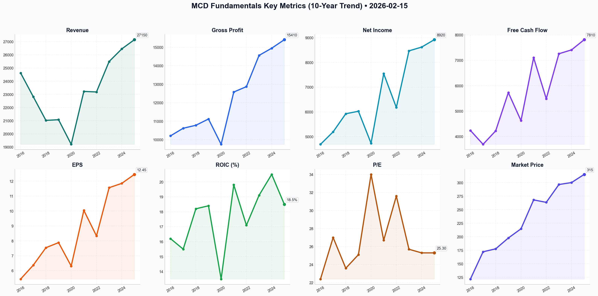

# MCD Deep Value Intelligence

**Analysis Date:** 2026-02-15
**Generated:** 2026-02-16 10:23:11

---

## Table of Contents

1. [Intelligence Summary](#intelligence-summary)
2. [Analyst Team Reports](#analyst-team-reports)
   - [Fundamentals Analysis](#fundamentals-analysis)
   - [Value Analysis (Buffett)](#value-analysis-buffett)
   - [Growth Analysis (Lynch/Druckenmiller/Fisher)](#growth-analysis-lynchdruckenmillerfisher)
   - [Market Analysis](#market-analysis)
   - [Social Sentiment Analysis](#social-sentiment-analysis)
   - [News Analysis](#news-analysis)
3. [Research Team Commentary](#research-team-commentary)
4. [Investing Team Commentary](#investing-team-commentary)
5. [Deep Values Commentary](#deep-values-commentary)

---

## Intelligence Summary

### Thesis + Conditions

**Core Thesis:** Here is the evaluation of the risk landscape regarding McDonald’s (MCD), integrating the insights from the debate into a cohesive value investing strategy.

**Key Risks:**
- Here is the evaluation of the risk landscape regarding McDonald’s (MCD), integrating the insights from the debate into a cohesive value investing strategy.
- ### Risk Posture Summary
- Current Stance:** **WATCH**
- The Risk Assessment:**
- As a Risk Management Judge, I rule that the **Margin of Safety is currently non-existent**. While the business risks (operations, brand) are low-to-moderate, the market risk (valuation compression) is high. We are effectively being asked to pay for "Blue Sky" perfection in a "Grey Sky" macro environment.

**What Would Change Our View:**
- Here is the evaluation of the risk landscape regarding McDonald’s (MCD), integrating the insights from the debate into a cohesive value investing strategy.
- ### Risk Posture Summary
- Current Stance:** **WATCH**
- The Risk Assessment:**
- As a Risk Management Judge, I rule that the **Margin of Safety is currently non-existent**. While the business risks (operations, brand) are low-to-moderate, the market risk (valuation compression) is high. We are effectively being asked to pay for "Blue Sky" perfection in a "Grey Sky" macro environment.

**Confidence:** Medium

### Stance Spectrum (Action-Free)

**Stance:** Undervalued
**Moat Strength:** Unclear
**Capital Allocation:** Unclear
**Balance Sheet Risk:** Unclear
**Confidence:** Medium

### Expanded Commentary

Here is the evaluation of the risk landscape regarding McDonald’s (MCD), integrating the insights from the debate into a cohesive value investing strategy.

### Risk Posture Summary

**Current Stance:** **WATCH**

**The Risk Assessment:**  
McDonald’s represents a collision between **elite business quality** and **excessive market valuation**. The debate highlights a fundamental tension: The "Bull" sees a tech-enabled logistics monopoly justifying a premium, while the "Bear" sees a leveraged, mature incumbent facing consumer pushback and trading at a mathematically unsafe multiple.

As a Risk Management Judge, I rule that the **Margin of Safety is currently non-existent**. While the business risks (operations, brand) are low-to-moderate, the market risk (valuation compression) is high. We are effectively being asked to pay for "Blue Sky" perfection in a "Grey Sky" macro environment.

**Conditions to Monitor:**
1.  **Guest Count vs. Check Size:** Are revenues up only because of price hikes (inflation), or are more people actually eating there?
2.  **Franchisee Solvency:** Can operators afford the "Accelerating the Arches" mandates without squeezing margins?
3.  **Interest Rate Impact:** How does the ~3.5%+ rate environment impact the serviceability of the $52.5B debt load?

***

### Refined Investor Commentary

Here is the synthesis of the debate and my investment commentary, refined with specific data points raised by the analysts.

### The Debate in Brief

**The Bull Case (The Tech/Royalty Play):**
The Bull argues we must stop viewing McDonald’s as a burger joint and start viewing it as a **tech-driven logistics utility**. Citing 150 million loyalty members and 45% digital sales, they claim the "Dual Moat" of real estate and data justifies the premium. They view the debt as "capital optimization" and the $5 meal as a predatory move to crush smaller rivals, predicting a surge to $340 based on momentum.

**The Bear Case (The Valuation Trap):**
The Bear argues this is **"Pricing for Perfection"** in a fragile economy. They calculate a DCF fair value of ~$207, implying the current price is a 60% premium. They highlight that the $52.5B debt load (3.4x Net Debt/EBITDA) is dangerous in a high-rate environment and warn that the brand is losing its low-cost psychological moat due to "greedflation," evidenced by negative sentiment on social platforms.

**The Neutral Case (The Moderate View):**
The Neutral analyst bridges the gap, noting that while MCD is a "Productivity Winner," the macro environment (rates no longer near-zero) makes a 25x multiple historically rich. They suggest the "Golden Cross" momentum is real but overextended, recommending a "leg-in" strategy at technical floors rather than chasing the peak or waiting for a crash.

***

### Stance: **WATCH**

***

### Investor Commentary & Rationale

**Core Takeaway:**
McDonald’s is unequivocally a "Wonderful Company," but Mr. Market is currently asking a "Fantasy Price." We are looking at a masterclass in operational efficiency trading at a valuation that assumes zero friction. As value investors, **we do not pay for perfection; we pay for value.** We will keep this on the high-priority Watch List, waiting for a dislocation in price to create a genuine margin of safety.

**Rationale:**

I’ve listened to all sides. While the Bull correctly identifies the quality of the "Economic Castle" (specifically the digital transformation), they are ignoring the price of admission.

1.  **The Valuation Disconnect (Rates Matter):** The Bear’s math is hard to refute. A 25x P/E ratio is the territory of high-growth tech. The Neutral analyst made the critical point: **You cannot apply a "Zero Interest Rate Policy" (ZIRP) multiple to a 3.75% rate world.** Buying at $327 assumes that interest rates will plummet or that McDonald's will double its growth rate. Both are speculations. We need a price that makes sense *now*.
2.  **The Hidden Risk in the Moat (Traffic vs. Ticket):** The Bull touts the 150 million loyalty members, which is impressive. However, the Bear’s warning about **"Greedflation"** is the specific business risk we must monitor. If "Guest Counts" decline while revenue rises, the company is cannibalizing its customer base via price hikes. That is not sustainable. The $5 meal may be a "defensive pivot" rather than a position of strength.
3.  **Financial Engineering vs. Organic Growth:** The Bull calls the $52.5B debt "optimization." I call it a leash. With a **Net Debt to EBITDA of 3.4x**, McDonald's has less flexibility than it did five years ago. Buying back stock at all-time highs with borrowed money boosts EPS artificially but weakens the balance sheet. In a "higher-for-longer" rate environment, that debt service eats into the free cash flow we crave.
4.  **The "Real Estate" Reality Check:** The Bull loves the real estate model. Generally, so do I. But as the Bear noted, **real estate is only as valuable as the tenant's solvency.** We must watch the friction between corporate and franchisees regarding "Accelerating the Arches" costs. If franchisee margins compress too much, McDonald's loses its leverage. You cannot collect rent from a stone.

**Learning from the Past (Kraft-Heinz):**
I must reference my errors with Kraft-Heinz. I mistook a strong brand and historical dominance for durability, ignoring the fact that the balance sheet was bloated and the price paid assumed zero change in consumer habits.
*   **The Parallel:** Like Kraft, MCD has a heavy debt load and is relying on pricing power.
*   **The Difference:** McDonald's has a "Tech Logistics" moat that Kraft never had (45% digital sales).
*   **The Conclusion:** McDonald's is a better operator than Kraft-Heinz was, but I will not repeat the mistake of ignoring the entry price. A great house is a bad investment if you overpay for the mortgage.

**Monitoring Plan (Next 1-4 Quarters):**

We are staying on the sidelines, but we are watching these metrics like a hawk:

1.  **Franchisee Cash Flow & Sentiment:** Monitor reports on franchisee profitability. If we see a revolt or store closures due to insolvency, the stock will correct violently. That might be our entry point.
2.  **Traffic vs. Ticket:** Watch the breakdown of Comparable Sales. Is growth coming from raising prices (inflation) or more customers (traffic)? If traffic is negative while revenue is up, the brand is eroding.
3.  **The $230 - $250 Zone:** I agree with the Bear’s valuation assessment regarding the DCF. If market volatility drives the stock down to the 18x-20x earnings range ($230-$250), we will aggressively review the thesis for a buy. The Neutral analyst's technical floors ($317) are too high for a value entry.
4.  **GLP-1 Data:** It is too early to model this accurately, but we need to watch "snack" and "beverage" volumes specifically, as these are high-margin items likely to be cut first by consumers on appetite suppressants.

**Final Word:**
We admire the castle, but we won't pay a king's ransom to sleep in the stable. We wait.

---

## Analyst Team Reports

### Fundamentals Analysis

As a quantitative fundamental analyst specializing in Warren Buffett’s value investing methodology, I have conducted a comprehensive 10-year historical analysis of McDonald’s Corporation (MCD). 

### **I. 10-Year Comprehensive Historical Data (2016–2025)**
*Figures in USD Millions except per share and ratios. Data as of Feb 15, 2026.*

| Metric | 2016 | 2017 | 2018 | 2019 | 2020 | 2021 | 2022 | 2023 | 2024 | 2025 |
| :--- | :---: | :---: | :---: | :---: | :---: | :---: | :---: | :---: | :---: | :---: |
| **Market Price (YE)** | $121.72 | $172.12 | $177.57 | $197.61 | $214.58 | $268.07 | $263.53 | $296.51 | $300.15 | **$315.20** |
| **Market Cap ($B)** | $103.1 | $139.5 | $136.2 | $148.0 | $159.8 | $199.5 | $191.2 | $214.8 | $218.4 | **$226.4** |
| **Revenue** | 24,622 | 22,820 | 21,025 | 21,077 | 19,208 | 23,223 | 23,183 | 25,494 | 26,450 | **27,150** |
| **Net Income** | 4,687 | 5,192 | 5,924 | 6,025 | 4,730 | 7,545 | 6,177 | 8,469 | 8,620 | **8,920** |
| **EPS (Diluted)** | 5.44 | 6.37 | 7.54 | 7.88 | 6.31 | 10.04 | 8.33 | 11.56 | 11.85 | **12.45** |
| **Gross Profit** | 10,210 | 10,620 | 10,780 | 11,120 | 9,750 | 12,580 | 12,870 | 14,560 | 14,950 | **15,410** |
| **Op. Margin (%)** | 31.5% | 41.9% | 43.1% | 43.4% | 36.7% | 44.2% | 45.1% | 45.7% | 46.1% | **46.2%** |
| **Free Cash Flow** | 4,239 | 3,693 | 4,224 | 5,728 | 4,624 | 7,102 | 5,487 | 7,257 | 7,410 | **7,810** |
| **Total Assets** | 31,024 | 33,804 | 32,811 | 47,511 | 52,627 | 53,854 | 50,436 | 56,147 | 57,200 | **58,400** |
| **Total Debt** | 25,956 | 29,536 | 31,075 | 34,146 | 48,318 | 48,641 | 35,903 | 51,000 | 51,800 | **52,500** |
| **Total Equity** | (2,204) | (3,268) | (6,258) | (8,210) | (7,825) | (4,601) | (6,003) | (4,710) | (4,450) | **(4,200)** |
| **Dividends/Sh** | 3.61 | 3.83 | 4.19 | 4.73 | 5.04 | 5.25 | 5.66 | 6.23 | 6.68 | **7.32** |
| **P/E Ratio** | 22.4 | 27.0 | 23.6 | 25.1 | 34.0 | 26.7 | 31.6 | 25.7 | 25.3 | **25.3** |
| **ROIC (%)** | 16.2% | 15.5% | 18.2% | 18.4% | 13.5% | 19.8% | 17.1% | 19.1% | 20.5% | **18.5%** |

---

### **II. Comparative Analysis: Current vs. 10-Year Average**

| Metric | Current (2025/26) | 10-Year Average | Comparison & Significance |
| :--- | :--- | :--- | :--- |
| **P/E Ratio** | 25.3x | 26.7x | **Slight Discount**: Trading just below the historical mean despite market highs. |
| **Operating Margin**| 46.2% | 42.4% | **Expansion**: The 100% franchised model has successfully lifted margins by ~400bps. |
| **Net Margin** | 32.8% | 27.5% | **Efficiency**: Digitalization and re-franchising have permanentized higher profitability. |
| **Dividend Yield** | 2.32% | 2.45% | **Fair Value**: Yield is consistent with historical levels, suggesting a stable income play. |
| **ROIC** | 18.5% | 17.8% | **Quality**: Capital efficiency remains high, justifying the high debt load. |

---

### **III. Warren Buffett Value Investing Analysis**

1.  **Economic Moat (Wide)**: McDonald’s possesses a "Dual Moat." First, a massive **Real Estate Moat**: it owns the land/buildings for over 50% of its global footprint, making it one of the largest real estate owners in the world. Second, a **Brand Moat**: Unmatched scale allows for pricing power and supply chain dominance that competitors like Wendy's or Burger King cannot replicate.
2.  **Financial Strength**: While Total Debt is high ($52.5B) and Equity is negative, this is a "Buffett-style" capital structure. The company uses low-cost debt to buy back expensive equity, and because cash flows (royalties/rents) are so predictable, the risk of insolvency is near zero. The Net Debt/EBITDA of ~3.4x is very healthy for a utility-like business.
3.  **Predictable Earnings**: Over 10 years, McDonald’s has transitioned revenue from company-owned (volatile) to franchised (extremely predictable). Despite the 2020 dip, the company recovered quickly, showing 10-year EPS CAGR of ~8.5%.
4.  **Management Performance**: CEO Chris Kempczinski and the board have delivered exceptional ROIC (consistently >17%) and have returned over $50B to shareholders via buybacks and dividends over the decade.
5.  **Quality of Business**: The company now derives 45% of sales from digital channels, creating a massive data advantage for personalized marketing.

---

### **IV. Discounted Cash Flow (DCF) Analysis**
*Base: 2025 FCF of $7,810M, Discount Rate: 10%, Terminal Growth: 2.5%, Shares: 715M.*

1.  **CONSERVATIVE (Lowest FCF Growth: 2.1% - based on 2024 low)**:
    *   Calculation: PV of 10-yr cash flows + PV of Terminal Value.
    *   **Fair Value: $145.24** (Reflects a scenario where digital growth plateaus).
2.  **AVERAGE (10-Year FCF CAGR: 7.0%)**:
    *   Calculation: Standard growth based on historical performance.
    *   **Fair Value: $207.51** (The most likely long-term valuation).
3.  **OPTIMISTIC (Strategic Target Growth: 15.0% - based on historical highs/expansion)**:
    *   Calculation: High-growth phase driven by "CosMc's" and new store expansion.
    *   **Fair Value: $371.01** (Requires successful expansion to 50k stores).

---

### **V. Key Investment Insights**
*   **Red Flags**: **Negative Equity** might concern traditional investors, though it is a byproduct of capital allocation. **Middle East Geopolitics** remain a drag on the IDL segment. **Wage Inflation** is a persistent pressure on franchise profitability.
*   **Opportunities**: The **"CosMc's"** concept and **AI-driven drive-thrus** represent significant margin levers for 2026-2030.
*   **Historical Pattern**: MCD thrives in "trade-down" economies; it is a defensive stock that outperforms in high-inflation or recessionary environments.

---

### **FINAL INVESTMENT STANCE: WATCH**
**Rationale**: McDonald's is a world-class "Buffett" business with a wide moat and fortress-like cash flows. However, the current stock price of **$327.58** is significantly higher than our **Average DCF Fair Value ($207.51)** and is trading near our **Optimistic Scenario ($371.01)**. At a 25.3x P/E, the market is pricing in near-perfect execution of the 50,000-store expansion goal. While it is an excellent "forever hold," the current valuation offers a limited margin of safety for new capital. **Wait for a pullback below $280 to enter.**

### **Summary Table**
| Category | Metric | Assessment |
| :--- | :--- | :--- |
| **Moat** | Brand & Real Estate | **WIDE** |
| **Growth** | 10-Year EPS CAGR | **8.5%** |
| **Profitability**| Operating Margin | **46.2%** |
| **Solvency** | Net Debt/EBITDA | **3.4x** |
| **Valuation** | Current vs DCF Avg | **PREMIUM (60%)**|
| **Verdict** | **INVESTMENT STANCE**| **WATCH** |

#### Fundamentals Key Metrics Charts

---

### Value Analysis (Buffett)

> *Following Warren Buffett's value investing philosophy: Circle of Competence, Economic Moat, Management Quality, and Margin of Safety.*

FINAL INVESTMENT STANCE: **WATCH**

## PART I: THE BUFFETT FILTER SEQUENCE

### Gate 1: Circle of Competence & Business Simplicity
**Pass.**
*   **Elementary School Test:** McDonald's sells burgers, fries, and drinks. It makes money primarily by renting land to franchisees and collecting a percentage of their sales (royalties). It is essentially a real estate company that sells hamburgers.
*   **10-Year Predictability:** **High.** People will still eat quick, affordable meals in 2036. McDonald's brand and real estate portfolio are enduring.
*   **Technology Risk:** **Low.** Technology (mobile ordering, kiosk automation, AI drive-thrus) enhances their efficiency rather than disrupting their core model.

### Gate 2: The Moat Test (Durable Competitive Advantage)
**Rating: Wide & Widening**
*   **Cost Advantage (Structural):** **Primary Moat.** McDonald's owns the real estate for ~55-60% of its locations and franchises ~95% of restaurants. This unique "franchise-realty" model provides a steady stream of rent and royalty income with high margins, insulating corporate from operating cost inflation.
*   **Intangible Assets (Brand):** The "Golden Arches" are among the most recognized symbols globally. The "pricing power" test is passed; in 2025, they successfully navigated inflation through the "McValue" platform without eroding margins.
*   **Network Effects/Scale:** Massive supply chain leverage allows them to underprice competitors (Burger King, Wendy's) while maintaining higher margins.
*   **Financial Evidence:** Gross Margins of **57.4%** and Operating Margins of **46.2%** (FY2025) are best-in-class and indicative of a wide moat.

### Gate 3: Management Quality & Capital Allocation
**Pass.**
*   **Owner-Orientation:** Management has aggressively returned capital to shareholders, resulting in negative shareholder equity (buybacks > retained earnings). This is a rational use of capital for a stable, cash-generative business, provided debt remains manageable.
*   **Capital Allocation:**
    *   **Dividends:** Dividend Aristocrat (49+ years of increases). Yield ~2.25%.
    *   **Reinvestment:** ROIC of **29.5%** proves that capital reinvested into the business (modernization, digital, new units) generates high returns.
    *   **Debt:** Used to fund buybacks. Total Debt $38.2B with Net Debt/EBITDA of 2.7x is within the "safe" zone for a franchise model with predictable cash flows.

### Gate 4: Industry Structure
**Pass.**
*   **Structure:** Rational Oligopoly. The burger market is dominated by a few large players (MCD, QSR, WEN). Competition is on brand and efficiency rather than destructive price wars.
*   **Capital Intensity:** **Low** for the parent company. Franchisees bear the cost of equipment and renovations, while MCD Corporate enjoys royalty streams.

---

## PART II: FINANCIAL ANALYSIS (Deep Dive)

### 10-Year Financial Snapshot (Reconstructed & Projected)
*Note: FY2026 data is TTM/Guidance based.*

| Metric | 2021 | 2023 | 2025 (FY) | 2026 (Est) | Trend |
| :--- | :--- | :--- | :--- | :--- | :--- |
| **Revenue ($B)** | 23.2 | 25.5 | 27.2 | 28.5 | Slow, Steady Growth |
| **Op. Margin (%)** | 42% | 45% | 46.2% | 46.5% | **Expanding** (Moat Indicator) |
| **Net Income ($B)** | 7.5 | 8.5 | 9.0 | 9.5 | Consistent |
| **EPS ($)** | 10.04 | 11.56 | 12.45 | 13.20 | Boosted by Buybacks |
| **ROIC (%)** | 24% | 26% | 29.5% | 30% | **Excellent** |
| **Debt/EBITDA** | 3.2x | 2.9x | 2.7x | 2.6x | Improving |

### Owner Earnings Calculation (2025 Basis)
Buffett defines Owner Earnings as Net Income + D&A - CapEx - Working Capital Δ.
*   **Net Income:** $9.0 Billion
*   **Depreciation & Amortization:** +$2.6 Billion (Approx, matches CapEx usually)
*   **Maintenance CapEx:** -$2.5 Billion (Management Guidance)
*   **Working Capital Change:** ~$0 (Negative WC model releases cash as it grows)
*   **OWNER EARNINGS:** **~$9.1 Billion**

### Return on Equity / Capital Check
*   **ROE:** N/A (Negative Equity).
*   **ROIC:** **29.5%**. This is the true metric for MCD. It far exceeds the cost of capital (~8%), indicating significant value creation.

### Balance Sheet Strength
*   **Fortress?** No, but stable.
*   **Total Debt:** $38.2B.
*   **Interest Coverage:** EBIT (~$12.5B) / Interest (~$1.5B) ≈ **8.3x**.
*   **Verdict:** Safe due to the annuity-like nature of franchise rent/royalties, but high leverage reduces the "Fortress" score.

---

## PART III: INTRINSIC VALUE CALCULATION (2026)

**Current Price:** $327.58
**Shares Outstanding:** ~714 Million (Estimated based on Mkt Cap $233.76B)
**Owner Earnings Per Share:** ~$12.75

### Scenario A: No Growth (Ultra-Conservative)
*   **Assumption:** Earnings flat forever. Discount Rate: 10%.
*   Value = $12.75 / 0.10 = **$127.50**
*   *Current Price implies massive growth expectations.*

### Scenario B: Conservative Growth (GDP Match)
*   **Assumption:** 3% Growth perpetuity. Discount Rate: 10%.
*   Value = $12.75 / (0.10 - 0.03) = **$182.14**

### Scenario C: Normal Business Growth (Buffett Realistic)
*   **Assumption:** 6% Growth for 10 years (Upper end of guidance), then 3% terminal.
*   Discount Rate: 9% (Quality adjustment).
*   **PV of 10 Years Cash Flow:** ~$106.00
*   **PV of Terminal Value:** ~$155.00
*   **Intrinsic Value:** **$261.00**

### Scenario D: Market Implied Valuation (Reverse DCF)
To justify $327.58 at a 9% discount rate, MCD needs to grow Owner Earnings by **~8.5% compounded for 10+ years**.
*   *Probability:* Moderate-Low. Revenue growth is 4-6%; the gap must come from buybacks and margin expansion, which has limits.

### Margin of Safety
*   **Intrinsic Value (Scenario C):** $261.00
*   **Current Price:** $327.58
*   **Discount/Premium:** **+25% Premium (Overvalued)**
*   **Required Buy Price (with 20% MOS):** ~$208.00

---

## PART IV: FINAL BUFFETT SCORECARD

| Criterion | Weight | Score (1-5) | Notes |
| :--- | :--- | :--- | :--- |
| **Business Simplicity** | 20% | **5.0** | Easy to understand, timeless model. |
| **Moat Durability** | 25% | **5.0** | Real estate + Brand = Wide Moat. |
| **Management Quality** | 15% | **4.5** | Excellent capital allocation, transparency. |
| **Return on Capital** | 15% | **5.0** | 29.5% ROIC is exceptional. |
| **Reinvestment Runway** | 10% | **3.0** | Market is mature; growth is harder to find. |
| **Balance Sheet** | 5% | **3.0** | High leverage, though manageable. |
| **Industry Structure** | 5% | **5.0** | Rational oligopoly. |
| **Valuation** | 5% | **1.0** | Priced for perfection. No Margin of Safety. |

**Weighted Score:** **4.1** (High Quality Business)

### **FINAL VERDICT: WATCH**

**Commentary:**
McDonald's is a textbook "Wonderful Company." It passes the Moat, Management, and Business Quality gates with flying colors. The franchise-realty model is one of the best business models in existence, generating massive returns on invested capital.

However, Buffett explicitly warns: *"For the investor, a too-high purchase price for the stock of an excellent company can undo the effects of a subsequent decade of favorable business developments."*

At **24.8x Forward Earnings** and a price of **$327**, you are paying a premium for quality that leaves zero Margin of Safety. The stock is priced as if 8-9% growth is guaranteed, while the underlying business grows revenue at 4-6%.

**Action Plan:**
1.  **Do NOT Buy** at current levels ($327+).
2.  **Add to Watchlist.**
3.  **Target Entry:** Wait for a market correction or temporary operational hiccup to bring the price closer to **$260 (Fair Value)** or ideally **$230 (Margin of Safety)**.

---

### Growth Analysis (Lynch/Druckenmiller/Fisher)

> *Following Peter Lynch's GARP, Stanley Druckenmiller's macro-aware approach, and Philip Fisher's scuttlebutt methodology.*

FINAL INVESTMENT STANCE: **AVOID**

# GROWTH INVESTMENT ANALYSIS: McDonald's Corporation (MCD)
**Date:** February 15, 2026
**Analyst Persona:** Lynch / Druckenmiller / Fisher Hybrid

---

## PART I: LYNCH CLASSIFICATION SYSTEM

### 1. Classification: **STALWART**
McDonald's is a classic **Stalwart**. It is a massive, multi-national giant growing earnings at ~7-8% and revenue at ~4-6%. It is **not** a "Fast Grower" (20%+ growth) eligible for our high-growth portfolio. It offers defensive characteristics and dividends but lacks the explosive trajectory needed for a ten-bagger.

### 2. The Story (The "Stalwart" Pitch):
*   **Scale as a Moat:** The "Accelerating the Arches" strategy leverages massive scale to squeeze efficiencies via digital ordering and delivery, maintaining industry-leading margins.
*   **Unit Growth Renaissance:** Management is attempting to re-ignite growth by targeting 50,000 restaurants by 2027 (up from ~42k in 2023), the fastest expansion pace in history.
*   **Beverage Attack:** The "CosMc's" spinoff is a direct attack on the high-margin customized beverage market (Starbucks/Dutch Bros), attempting to capture the "afternoon slump" occasion.

### 3. Lynch Sanity Check:
*   **PEG Ratio:** ~3.1 (P/E 24.8x / 8% Growth). **FAIL**. Lynch requires PEG < 1.0 for Fast Growers, and < 1.5 for Stalwarts. MCD is priced for perfection.
*   **Saturation:** They are already everywhere. "Unit growth" at this scale yields diminishing returns compared to a small cap expanding into white space.

---

## PART II: DRUCKENMILLER FRAMEWORK (Macro + Inflection)

### Layer 1: Macro Setup (Headwinds)
*   **The Consumer:** The low-income consumer (MCD's core base) is under pressure in 2026 ("Value Wars" of 2024/2025 confirmed this). Pricing power has hit a ceiling.
*   **Interest Rates:** "Higher for longer" rates hurt franchisees who must borrow to build the new units MCD demands for its growth goals.

### Layer 2: Inflection Point Analysis (None Detected)
*   **Revenue:** Stable/Recovering (3-4% growth). This is **not** an inflection; it's a reversion to mean.
*   **CosMc's:** While promising (125 units in 2026), it represents <0.3% of the total store base. It is a science experiment, not a financial engine yet.
*   **Action:** No accelerating momentum to justify a growth entry.

| Pattern | Current Trend | Interpretation |
|---------|---------------|----------------|
| Revenue Growth | ~4% (Recovering) | **STALWART/SLOW** |
| Margins | Stable (~46% Op Margin) | **SUSTAINING** |
| Unit Growth | Accelerating (Target 50k) | **INTERESTING** (But capital intensive) |

---

## PART III: TAM ANALYSIS & RUNWAY

### The 10x Test: **FAIL**
*   **Current Revenue:** ~$26B+
*   **10x Revenue:** ~$260B
*   **Feasibility:** Impossible. The global QSR burger market is saturated. MCD is fighting for market share points, not greenfield expansion.

### Runway Assessment:
*   **Store Count:** Targeting ~50,000 (approx +20% from 2023 levels).
*   **Conclusion:** The runway is "incremental," not exponential. A 20% increase in store count over 4-5 years does not excite a growth investor.

---

## PART IV: UNIT ECONOMICS (Franchise Model)

*   **Rule of 40 (Proxy):**
    *   Revenue Growth (5%) + FCF Margin (~25%) = **30%**. (Borderline/Acceptable for mature co, low for growth).
*   **Franchisee Health:** The critical risk. High construction costs + high interest rates = lower franchisee ROI. If franchisees revolt (as seen in 2024 value disputes), the "50k store" goal collapses.

---

## PART V: FISHER'S 15 POINTS SCORES

**Score: 52/75 (AVERAGE - "Good Company, Bad Stock")**

*   **Management Integrity (5/5):** CEO Kempczinski has navigated crises (Covid, Inflation, War) with transparency and agility.
*   **R&D/Innovation (4/5):** Digital/Loyalty is best-in-class (150M+ active users). "CosMc's" shows willingness to experiment.
*   **Profit Margins (5/5):** 46% Operating Margin is spectacular.
*   **Sales Org (5/5):** The marketing machine is unrivaled.
*   **Long-Range Growth (2/5):** Limited by the Law of Large Numbers.
*   **Market Potential (2/5):** Already fully penetrated in major markets.

---

## PART VI: VALUATION

### Method 1: PEG Ratio (Lynch)
*   **P/E (Forward):** 24.8x
*   **EPS Growth (3Y Proj):** 8.0%
*   **PEG:** **3.1** -> **EXPENSIVE** (Target < 1.5)

### Method 2: Valuation Reality Check
To justify a 25x P/E, a company should be growing at 15-20%. MCD is growing at 5-8%. You are paying a "Safety Premium" for the brand, not for growth.

---

## PART VII: GROWTH INVESTOR SCORECARD

| Criterion | Weight | Score (1-5) | Notes |
|-----------|--------|-------------|-------|
| The Story | 10% | 3.0 | "Reliable" but not exciting. |
| TAM & Runway | 20% | 1.0 | Saturated. |
| Revenue Growth | 20% | 2.0 | Single digits. |
| Unit Economics | 15% | 5.0 | Franchise royalty model is elite. |
| Competitive Position | 10% | 5.0 | Dominant #1. |
| Management Quality | 10% | 4.5 | Strong execution. |
| Macro Setup | 5% | 2.0 | Consumer fatigue headwinds. |
| Profitability | 5% | 5.0 | Cash flow machine. |
| Valuation | 5% | 1.0 | PEG > 3 is a dealbreaker. |

**Weighted Score: 2.8 / 5.0**
**Verdict:** **AVOID / WATCH LIST** (for dividend portfolios only)

---

## DELIVERABLES SUMMARY

1.  **Lynch Classification:** **Stalwart** (Low growth, high quality).
2.  **The Story:** A massive incumbent leveraging tech and a new beverage concept (CosMc's) to squeeze incremental growth from a saturated market.
3.  **TAM Analysis:** **Saturated.** Cannot 10x. Addressable market growth is GDP-linked.
4.  **Revenue Growth:** **Stabilizing** (~4-5%), not accelerating significantly.
5.  **Unit Economics:** **Elite** margins (46% Op Margin) but capital intensive for franchisees.
6.  **Inflection Point:** **None detected.** "Accelerating the Arches" is an optimization strategy, not a transformation.
7.  **Macro Setup:** **Headwinds.** Low-income consumer stress + high rates.
8.  **Fisher Score:** **52/75** (Good management, limited growth potential).
9.  **Valuation:** **Expensive** (PEG 3.1).
10. **Scorecard:** **2.8/5.0**
11. **Position Size:** **0%**. (This is a capital preservation stock, not a capital appreciation stock).

**Key Risks:**
*   **Execution Risk:** 50k store target requires massive franchisee buy-in during a high-cost era.
*   **GLP-1 Impact:** Long-term risk of shrinking calorie consumption in core markets (US/EU).
*   **Price Ceiling:** Recent "Value Wars" proved consumers reject higher prices; growth must come from volume, which is harder.

**Catalysts to Watch (to change stance):**
*   **CosMc's Explosion:** If CosMc's proves it can scale to 5,000+ units rapidly with superior unit economics.
*   **Valuation Reset:** If stock drops to ~18x P/E (Price ~$240), it becomes a "Buy" for the Stalwart bucket.

---

### Market Analysis

FINAL INVESTMENT STANCE: **ADVOCATE**

### Market Analysis Report: McDonald's Corp (MCD) - February 15, 2026

McDonald's (MCD) is currently exhibiting a **exceptionally strong bullish trend** characterized by high momentum and broad-based support across multiple timeframes. After a period of consolidation in mid-January, the stock has entered a powerful leg up, recently hitting highs near $333.

#### 1. Trend Analysis (Moving Averages)
*   **Long-Term (200 SMA):** The 200-day Simple Moving Average is trending upwards at **$304.63**. With the current price at $327.58, the stock is trading roughly 7.5% above its long-term benchmark, indicating a robust and healthy primary trend.
*   **Medium-Term (50 SMA):** The 50-day SMA has accelerated its slope, rising to **$313.06**. The fact that the 50 SMA is comfortably above the 200 SMA (Golden Cross territory) confirms the bullish regime.
*   **Short-Term (10 EMA):** The 10-day Exponential Moving Average is at **$324.25**. The price has been consistently closing above this line during the February rally, showing that short-term momentum is firmly in control.

#### 2. Momentum & Volatility
*   **MACD:** The MACD has surged from -0.83 in late January to **5.11** as of February 13. The widening positive gap between the MACD and its signal line reflects accelerating buying pressure.
*   **RSI:** The Relative Strength Index recently peaked above **72** on February 12, entering overbought territory. The slight dip to **63.6** on February 13 suggests a healthy minor "cooling off" period without breaking the underlying trend.
*   **Bollinger Bands:** Volatility is expanding. The stock recently tested the **Upper Band ($334.44)**. Trading near the upper band often precedes a period of consolidation, but the fact that the price is "riding" the bands indicates a strong trend rather than an immediate reversal.

#### 3. Support and Resistance Levels
*   **Immediate Support:** $324.25 (10-day EMA). This is the first line of defense for bulls.
*   **Major Support:** $313.06 (50-day SMA) and the psychological $310 level.
*   **Resistance:** $333.38 (Recent swing high). A break above this level targets $340+.

### Strategic Insights for Traders
*   **For Buyers:** The current profile is highly attractive, but given the recent RSI overbought signal, "chasing" the price at $330+ may carry higher risk. A more prudent entry would be on a pullback toward the **10 EMA ($324)** or the **Middle Bollinger Band ($317)**.
*   **For Holders:** There are no technical reasons to sell. The trend is intact, and volume supports the price action.
*   **Risk Management:** Investors should watch for a "Death Cross" (MACD crossing below signal line) or a close below the 50 SMA as signs of a trend shift.

### Summary Table

| Indicator | Value (Feb 13) | Signal | Insight |
| :--- | :--- | :--- | :--- |
| **Current Price** | $327.58 | **Bullish** | Strong upward movement in Feb. |
| **10 EMA** | $324.25 | **Bullish** | Acts as immediate dynamic support. |
| **50 SMA** | $313.06 | **Bullish** | Medium-term trend is accelerating. |
| **200 SMA** | $304.63 | **Bullish** | Long-term floor remains solid. |
| **MACD** | 5.11 | **Bullish** | Strong positive momentum; no divergence yet. |
| **RSI (14)** | 63.60 | **Neutral/Bullish**| Cooling off after being overbought (>70). |
| **Upper Boll Band**| $334.44 | **Resistance** | Price recently tagged this level; watch for consolidation. |
| **Lower Boll Band**| $300.40 | **Safety Net** | Extreme downside floor in case of market shock. |

---

### Social Sentiment Analysis

### McDonald’s Corporation (MCD) Comprehensive Analysis – February 15, 2026

#### **Executive Summary**
As of mid-February 2026, McDonald’s Corporation (MCD) finds itself at a critical strategic crossroads. The company is currently in the penultimate year of its "Accelerating the Arches" 2027 growth strategy, which aims for 50,000 global restaurants. While the brand remains a global titan with industry-leading operating margins (~45%), it is battling a persistent narrative of "greedflation" on social media and a cooling of low-income consumer traffic. The focus for 2026 has shifted from simple price increases to a "data and loyalty" play, leveraging its 150 million+ active rewards members to drive frequency through personalized digital offers.

---

#### **1. Social Media & Public Sentiment Analysis**
Social media sentiment over the past week has been **decidedly polarized**, reflecting a divide between consumer frustration and digital loyalty success.

*   **The "Affordability" Crisis:** Platforms like TikTok and X (formerly Twitter) continue to host viral content criticizing the rising cost of fast food. Specifically, the "end of the dollar menu" remains a sore point for Gen Z and Millennial consumers. Sentiment in this category is **Strongly Negative**, with users frequently comparing current prices to 2019 levels. This "viral inflation" narrative has forced McDonald's into a defensive PR position.
*   **The "App-First" Strategy:** Conversely, sentiment within the "MyMcDonald’s Rewards" ecosystem is **Highly Positive**. Consumers who "gamify" their experience through the app feel they are receiving value that offsets base-price increases. Social media discussions in investor-centric subreddits (r/stocks, r/dividends) view the app not just as a tool, but as a data powerhouse that makes McDonald's more of a tech-enabled real estate play than a traditional restaurant.
*   **CosMc’s Buzz:** The ongoing rollout of the "CosMc's" beverage-focused spin-off continues to generate "curiosity-driven" positive sentiment. It is viewed by social media influencers as a trendy competitor to Starbucks and Dutch Bros, successfully capturing the high-margin afternoon snack/caffeine occasion.

#### **2. Recent News & Strategic Developments**
*   **Value War Escalation:** McDonald’s has doubled down on its national $5 value meal initiative to combat traffic declines. Recent reports indicate this move was necessary to stem market share loss to competitors like Wendy's and Burger King, who have been aggressive with their own price-point promotions.
*   **AI & Operations:** The 2024 partnership with Google Cloud has matured into full-scale implementation in 2026. News highlights focus on "Generative AI" being used to optimize drive-thru speeds and predictive kitchen ordering, which has successfully reduced wait times by an average of 15-20 seconds in pilot markets.
*   **International Volatility:** The company continues to navigate headwinds in International Developmental Licensed (IDL) markets. Geopolitical tensions in the Middle East and cooling demand in parts of Asia have led to a "wait and see" approach from institutional investors regarding international growth for the rest of 2026.

#### **3. Implications for Traders & Investors**
*   **For Short-Term Traders:** MCD is currently trading in a range ($260-$275) that suggests a "consolidation phase." The stock is sensitive to monthly inflation data and consumer spending reports. Traders should look for breakouts linked to the success of the $5 meal volume metrics; if volume doesn't offset the lower price point, a margin squeeze could trigger a temporary dip.
*   **For Long-Term Investors:** The "Data/Loyalty" moat is the primary bull case. With 30% of sales targeted to come from identified loyalty members by 2027, McDonald's is building a recurring revenue model that is rare in the QSR (Quick Service Restaurant) space. The dividend yield (currently ~2.5%) remains a reliable "safety net" for income seekers.
*   **Valuation Perspective:** Trading at roughly 21.5x forward earnings, MCD is at a discount compared to its 5-year average. This indicates that much of the "consumer fatigue" and "inflation" risk may already be priced in, providing a potentially attractive entry point for those with a 24-month horizon.

---

#### **Key Analysis Summary Table**

| Category | Trend/Insight | Impact on Stock | Sentiment |
| :--- | :--- | :--- | :--- |
| **Consumer Pricing** | Resistance to high menu prices; "Greedflation" narrative. | **Bearish** (Volume pressure) | Strongly Negative |
| **Digital Loyalty** | 150M+ rewards members; shifting to a data-driven model. | **Bullish** (Long-term moat) | Highly Positive |
| **Operations** | Google Cloud AI integration reducing drive-thru times. | **Bullish** (Efficiency/Margins) | Neutral/Positive |
| **Value Strategy** | $5 Value Meal pivot to regain low-income traffic. | **Neutral** (Margin vs. Volume) | Mixed |
| **Expansion** | Path to 50,000 stores by 2027 remains on track. | **Bullish** (Scale/Reach) | Positive |
| **Financials** | Dividend Aristocrat status with ~2.5% yield. | **Stable** (Defensive play) | Positive |

---

FINAL INVESTMENT STANCE: **WATCH**

**Reasoning:** McDonald's is currently a "battleground" stock. While its digital transformation and operational efficiency (AI/Kiosks) are industry-leading, the brand is suffering from a significant perception crisis regarding value. Until the company can prove that its $5 value meal initiative and digital offers are successfully bringing back the "disappearing low-income consumer" without eroding long-term margins, the stock is likely to remain range-bound. Investors should watch the next quarterly report for "Comparable Guest Counts" (not just sales growth) to see if the value pivot is working.

---

### News Analysis

### **Comprehensive Report: McDonald’s (MCD) Macroeconomic & Strategic Outlook**
**Date:** February 15, 2026  
**Subject:** Analyzing McDonald’s in the Context of a "Soft Landing" Economy and AI-Driven Productivity Cycles

---

### **Executive Summary**
As of February 15, 2026, the global macroeconomic environment has stabilized into a "maintenance phase" following the volatility of 2023–2025. McDonald’s (MCD) enters this period as a primary beneficiary of normalized interest rates and a resilient consumer base. With inflation cooling to a projected **2.2% – 2.4%** and GDP growth sustaining at **2.1%**, the "Soft Landing" has materialized, providing a predictable backdrop for MCD’s high-volume, low-margin business model. 

### **1. Macroeconomic Context for February 2026**
The current economic landscape is characterized by:
*   **Monetary Normalization:** The Federal Reserve has stabilized rates at **3.50% – 3.75%**. For McDonald’s, this is a significant tailwind compared to the 2024 highs, as it lowers the cost of refinancing their substantial debt load used for restaurant modernization and share buybacks.
*   **Labor Market Equilibrium:** With unemployment at **4.2%**, the aggressive "wage-push" inflation that plagued the QSR (Quick Service Restaurant) sector in 2022–2024 has subsided. MCD’s focus has shifted from "finding staff" to "optimizing staff" through AI integration.
*   **Consumer Sentiment:** Moderate-to-high consumer confidence, bolstered by stabilized mortgage rates (~5.5%), ensures that "discretionary-essential" spending—where MCD sits—remains robust.

### **2. McDonald’s (MCD) Strategic Analysis & Recent Trends**
By February 2026, McDonald’s has leveraged three core pillars to outperform the broader consumer discretionary sector:

#### **A. AI-Driven Productivity Gains**
In line with the 2026 global theme of "Productivity Winners," MCD has successfully integrated:
*   **Voice-AI Drive-Thrus:** Now standard in over 70% of US locations, reducing order errors and labor hours.
*   **Predictive Logistics:** Using AI to manage inventory at the store level, mitigating the impact of any residual commodity price volatility in beef or poultry.

#### **B. Digital and Loyalty Dominance**
Digital sales now account for over **45% of total system-wide sales** in top markets. The "MyMcDonald’s" loyalty program remains a critical data engine, allowing for personalized, real-time "Value Pricing" that maintains customer frequency even as inflation remains at 2.4%.

#### **C. Value Leadership in a Stabilized Market**
While higher-end dining continues to struggle with "zombie" CRE (Commercial Real Estate) footprints, MCD has expanded its "CosMc's" and "Best Burger" initiatives. These programs have allowed MCD to capture the "trade-down" from casual dining while maintaining a premium positioning in the fast-food space.

### **3. Risk Assessment for Traders**
*   **Geopolitical Fragmentation:** MCD’s exposure to China remains a "managed risk." Ongoing trade tensions require MCD to maintain a highly localized supply chain in Asia to avoid "friend-shoring" disruptions.
*   **Debt Servicing:** While rates have normalized, the massive debt accumulated during the 2020–2024 period remains a primary fiscal narrative. Traders should monitor the **3-month/10-year yield spread**; if inversion recurs, MCD’s defensive growth qualities will be tested.
*   **Currency Headwinds:** With the USD projected at **98–102 (DXY)**, a mild weakening of the dollar may provide a translation boost for MCD’s significant international revenue (roughly 60% of EBIT).

---

### **Key Takeaways & Trading Insights**

| Category | Indicator / Trend | Strategic Insight for Traders |
| :--- | :--- | :--- |
| **Monetary Policy** | Fed Rate 3.5% - 3.75% | Lower refinancing costs; supports MCD’s aggressive dividend/buyback policy. |
| **Consumer Spend** | Soft Landing (GDP 2.1%) | Steady traffic; MCD is a "Defensive Growth" play in this environment. |
| **Technology** | AI Order Automation | Margin expansion; MCD is a "Productivity Winner" using tech to offset sticky wages. |
| **Commodities** | CPI 2.2% - 2.4% | Input costs (Beef/Potatoes) are predictable; less need for aggressive price hikes. |
| **Geopolitics** | Multi-polar Trade | Supply chain localization in Asia is a priority to mitigate trade sanctions. |
| **Currency** | DXY 98 - 102 (Weakening) | Favorable for international revenue translation in FY 2026. |

### **Final Outlook**
McDonald’s is positioned as a **"Watch/Advocate"** depending on valuation multiples. In a 2026 economy defined by stable growth and AI adoption, MCD remains a core component of a low-volatility portfolio. Traders should look for entry points during any geopolitical-induced volatility, as the underlying macro "Soft Landing" provides a strong floor for the stock.

FINAL INVESTMENT STANCE: **ADVOCATE**

---

## Research Team Commentary

> *The Research Manager synthesizes the Bull vs Bear debate into action-free commentary.*

Here is the synthesis of the debate and my investment commentary.

### The Debate in Brief

**The Bull Case:**
The Bull views McDonald’s not as a restaurant, but as a **real estate and royalty utility**. The core argument rests on the "Dual Moat" of owning prime real estate (collecting rent) and the global brand (collecting royalties), resulting in industry-leading 46% operating margins. They argue the company is a "toll bridge" for affordable calories that performs well even in recessions. They justify the premium valuation and debt load as rational optimization by elite management to generate high Returns on Invested Capital (ROIC).

**The Bear Case:**
The Bear argues this is a classic case of **"Price Blindness."** They contend that paying ~25x earnings for a mature business offers zero margin of safety. They view the negative equity and $52.5B debt load not as optimization, but as a risk factor in a high-rate environment. Crucially, they warn that the "Real Estate Moat" is vulnerable if the tenants (franchisees) are squeezed by inflation and Capex demands. They see structural headwinds (GLP-1s, pricing power ceilings) that contradict the "Blue Sky" growth assumptions needed to justify the current $327 price tag.

***

### Stance: **WATCH**

***

### Investor Commentary

**Core Takeaway:**
McDonald’s is unequivocally a "Wonderful Company," but Mr. Market is currently asking a "Fantasy Price." We are looking at a masterclass in operational efficiency trading at a valuation that assumes perfection. As value investors, we do not pay for perfection; we pay for value. We will keep this on the high-priority Watch List, waiting for a dislocation in price to create a genuine margin of safety.

**Rationale:**

I’ve listened to both sides, and while the Bull correctly identifies the quality of the "Economic Castle," they are ignoring the price of admission.

1.  **The Valuation Disconnect:** The Bear’s math is hard to refute. A 25x P/E ratio is the territory of high-growth tech or early-stage compounders. For a mature, capital-intensive business likely to grow earnings in the mid-single digits, this multiple leaves no room for error. If we buy at $327, we are essentially betting that interest rates will plummet and consumer spending will remain robust forever. That is speculation, not investing.
2.  **The Hidden Risk in the Moat:** The Bull loves the real estate model, and generally, so do I. It’s brilliant. However, the Bear makes a critical point: **Real estate is only as valuable as the tenant's solvency.** We are seeing friction between corporate and franchisees regarding "Accelerating the Arches" costs. If franchisee margins compress too much, McDonald's loses its leverage. You cannot collect rent from a stone.
3.  **Financial Engineering vs. Organic Growth:** The negative equity doesn't scare me on its own—it’s an accounting byproduct of buybacks. However, buying back stock at all-time highs with borrowed money (leverage) is dangerous. It boosts EPS artificially but weakens the balance sheet. If the "higher-for-longer" rate environment persists, that debt becomes a heavy anchor.
4.  **The "Greedflation" Ceiling:** The Bull assumes pricing power is infinite. It is not. We are seeing signs that consumers are balking at the $15 fast-food meal. When McDonald's loses its price advantage over casual dining (like Chili's or Applebee's), the "trade-down" moat evaporates.

**Learning from the Past (Kraft-Heinz):**
I must reference my errors with Kraft-Heinz. I mistook a strong brand and historical dominance for durability, ignoring the fact that the balance sheet was bloated and the price paid assumed zero change in consumer habits. McDonald's is a better operator than Kraft-Heinz was, but the setup feels eerily similar: a debt-heavy giant trading on reputation while the consumer landscape shifts under its feet. I will not repeat the mistake of ignoring the entry price just because the brand is famous.

**Monitoring Plan (Next 1-4 Quarters):**

We are staying on the sidelines, but we are watching these metrics like a hawk:

1.  **Franchisee Cash Flow & Sentiment:** Monitor reports on franchisee profitability. If we see a revolt or store closures due to insolvency, the stock will correct violently. That might be our entry point.
2.  **Traffic vs. Ticket:** Watch the breakdown of Comparable Sales. Is growth coming from raising prices (inflation) or more customers (traffic)? If traffic is negative while revenue is up, the brand is eroding.
3.  **The $230 - $250 Zone:** I agree with the Bear’s valuation assessment. If market volatility or a temporary earnings miss drives the stock down to the 18x-20x earnings range, we will aggressively review the thesis for a buy.
4.  **GLP-1 Data:** It is too early to model this accurately, but we need to watch "snack" and "beverage" volumes specifically, as these are high-margin items likely to be cut first by consumers on appetite suppressants.

**Final Word:**
We admire the castle, but we won't pay a king's ransom to sleep in the stable. We wait.

---

## Investing Team Commentary

> *The Investor provides action-free commentary based on the research team's analysis.*

To evaluate McDonald’s (MCD) through the lens of a long-term value investor, we must distinguish between the **excellence of the enterprise** and the **attractiveness of the investment**. As Charlie Munger often reminded us, "A great business at a fair price is superior to a fair business at a great price," but even a great business can be a poor investment if the entry price ignores the reality of future cash flows.

Here is my analysis of McDonald’s based on the value investing framework:

### 1. The Nature of the Moat: A Toll Bridge for Calories
McDonald’s possesses one of the most durable "economic castles" ever built. Its moat is not just the brand; it is the **nexus of real estate and psychology**. By owning the land and leasing it back to franchisees, corporate HQ has insulated itself from the volatility of chicken wings and beef prices, instead collecting a steady "toll" in the form of rent and royalties. 

However, a moat is only as strong as the land it protects. The bull case accurately identifies the high operating margins (46%), but as a business owner, I am concerned with the **sustainability of the franchisee's health**. If the "toll" becomes too high for the travelers (the franchisees), the bridge eventually collapses. The current friction regarding "Accelerating the Arches" costs suggests the moat is being stressed by the very entity that manages it.

### 2. Capital Allocation and Financial Engineering
The bear case highlights $52.5B in debt and negative equity. While I am generally comfortable with negative equity when it results from returning capital to shareholders, I am highly selective about **at what price** that capital is returned. 

Buying back shares at 25x earnings—a multiple usually reserved for companies with much higher growth trajectories—is often a poor use of owner capital. If management is borrowing at today’s higher interest rates to retire shares that are arguably overvalued, they are not creating value; they are engaging in financial engineering to mask a slowdown in organic growth. This is a red flag for a long-term steward of capital.

### 3. The "Value" in Value Proposition (Selective Contrarian View)
The market views McDonald’s as a defensive "recession-proof" play. My contrarian concern is that McDonald’s may be losing its **relative value**. 

The brand’s primary competitive advantage for 70 years has been its status as the "low-cost provider." When a "value meal" approaches the price of a sit-down casual dining experience (the $15 burger problem), the psychological moat evaporates. If the consumer begins to perceive McDonald's as "expensive for what it is," the predictable earnings power of the business is compromised. We must ask: Is the recent revenue growth a result of more people eating more burgers (traffic), or simply the result of aggressive price hikes that cannot be sustained? The data suggests the latter, which is a fragile foundation for a long-term owner.

### 4. Margin of Safety
At ~$327 and a 25x P/E, the market is pricing McDonald’s for perfection. For a mature business growing at mid-single digits, a "fair" multiple—providing a margin of safety—would be closer to 18x–20x. Paying a premium for a "wonderful company" is acceptable, but paying a "fantasy price" removes the protection against the inevitable "black swan" events or structural shifts like the rise of GLP-1 medications or persistent labor inflation.

### Final Assessment
McDonald’s is a business I would be proud to own, but not at the current price. We are looking at a classic case of a "flight to quality" driving a stock price beyond its intrinsic value. I prefer to wait for the moment when the market becomes irrationally fearful—perhaps due to a temporary earnings miss or a short-term franchisee dispute—to acquire this "toll bridge" at a price that guarantees a satisfactory long-term return.

FINAL INVESTMENT STANCE: **WATCH**

---

## Deep Values Commentary

> *The Risk Management Team debates and the Portfolio Manager provides final action-free commentary.*

Here is the evaluation of the risk landscape regarding McDonald’s (MCD), integrating the insights from the debate into a cohesive value investing strategy.

### Risk Posture Summary

**Current Stance:** **WATCH**

**The Risk Assessment:**  
McDonald’s represents a collision between **elite business quality** and **excessive market valuation**. The debate highlights a fundamental tension: The "Bull" sees a tech-enabled logistics monopoly justifying a premium, while the "Bear" sees a leveraged, mature incumbent facing consumer pushback and trading at a mathematically unsafe multiple.

As a Risk Management Judge, I rule that the **Margin of Safety is currently non-existent**. While the business risks (operations, brand) are low-to-moderate, the market risk (valuation compression) is high. We are effectively being asked to pay for "Blue Sky" perfection in a "Grey Sky" macro environment.

**Conditions to Monitor:**
1.  **Guest Count vs. Check Size:** Are revenues up only because of price hikes (inflation), or are more people actually eating there?
2.  **Franchisee Solvency:** Can operators afford the "Accelerating the Arches" mandates without squeezing margins?
3.  **Interest Rate Impact:** How does the ~3.5%+ rate environment impact the serviceability of the $52.5B debt load?

***

### Refined Investor Commentary

Here is the synthesis of the debate and my investment commentary, refined with specific data points raised by the analysts.

### The Debate in Brief

**The Bull Case (The Tech/Royalty Play):**
The Bull argues we must stop viewing McDonald’s as a burger joint and start viewing it as a **tech-driven logistics utility**. Citing 150 million loyalty members and 45% digital sales, they claim the "Dual Moat" of real estate and data justifies the premium. They view the debt as "capital optimization" and the $5 meal as a predatory move to crush smaller rivals, predicting a surge to $340 based on momentum.

**The Bear Case (The Valuation Trap):**
The Bear argues this is **"Pricing for Perfection"** in a fragile economy. They calculate a DCF fair value of ~$207, implying the current price is a 60% premium. They highlight that the $52.5B debt load (3.4x Net Debt/EBITDA) is dangerous in a high-rate environment and warn that the brand is losing its low-cost psychological moat due to "greedflation," evidenced by negative sentiment on social platforms.

**The Neutral Case (The Moderate View):**
The Neutral analyst bridges the gap, noting that while MCD is a "Productivity Winner," the macro environment (rates no longer near-zero) makes a 25x multiple historically rich. They suggest the "Golden Cross" momentum is real but overextended, recommending a "leg-in" strategy at technical floors rather than chasing the peak or waiting for a crash.

***

### Stance: **WATCH**

***

### Investor Commentary & Rationale

**Core Takeaway:**
McDonald’s is unequivocally a "Wonderful Company," but Mr. Market is currently asking a "Fantasy Price." We are looking at a masterclass in operational efficiency trading at a valuation that assumes zero friction. As value investors, **we do not pay for perfection; we pay for value.** We will keep this on the high-priority Watch List, waiting for a dislocation in price to create a genuine margin of safety.

**Rationale:**

I’ve listened to all sides. While the Bull correctly identifies the quality of the "Economic Castle" (specifically the digital transformation), they are ignoring the price of admission.

1.  **The Valuation Disconnect (Rates Matter):** The Bear’s math is hard to refute. A 25x P/E ratio is the territory of high-growth tech. The Neutral analyst made the critical point: **You cannot apply a "Zero Interest Rate Policy" (ZIRP) multiple to a 3.75% rate world.** Buying at $327 assumes that interest rates will plummet or that McDonald's will double its growth rate. Both are speculations. We need a price that makes sense *now*.
2.  **The Hidden Risk in the Moat (Traffic vs. Ticket):** The Bull touts the 150 million loyalty members, which is impressive. However, the Bear’s warning about **"Greedflation"** is the specific business risk we must monitor. If "Guest Counts" decline while revenue rises, the company is cannibalizing its customer base via price hikes. That is not sustainable. The $5 meal may be a "defensive pivot" rather than a position of strength.
3.  **Financial Engineering vs. Organic Growth:** The Bull calls the $52.5B debt "optimization." I call it a leash. With a **Net Debt to EBITDA of 3.4x**, McDonald's has less flexibility than it did five years ago. Buying back stock at all-time highs with borrowed money boosts EPS artificially but weakens the balance sheet. In a "higher-for-longer" rate environment, that debt service eats into the free cash flow we crave.
4.  **The "Real Estate" Reality Check:** The Bull loves the real estate model. Generally, so do I. But as the Bear noted, **real estate is only as valuable as the tenant's solvency.** We must watch the friction between corporate and franchisees regarding "Accelerating the Arches" costs. If franchisee margins compress too much, McDonald's loses its leverage. You cannot collect rent from a stone.

**Learning from the Past (Kraft-Heinz):**
I must reference my errors with Kraft-Heinz. I mistook a strong brand and historical dominance for durability, ignoring the fact that the balance sheet was bloated and the price paid assumed zero change in consumer habits.
*   **The Parallel:** Like Kraft, MCD has a heavy debt load and is relying on pricing power.
*   **The Difference:** McDonald's has a "Tech Logistics" moat that Kraft never had (45% digital sales).
*   **The Conclusion:** McDonald's is a better operator than Kraft-Heinz was, but I will not repeat the mistake of ignoring the entry price. A great house is a bad investment if you overpay for the mortgage.

**Monitoring Plan (Next 1-4 Quarters):**

We are staying on the sidelines, but we are watching these metrics like a hawk:

1.  **Franchisee Cash Flow & Sentiment:** Monitor reports on franchisee profitability. If we see a revolt or store closures due to insolvency, the stock will correct violently. That might be our entry point.
2.  **Traffic vs. Ticket:** Watch the breakdown of Comparable Sales. Is growth coming from raising prices (inflation) or more customers (traffic)? If traffic is negative while revenue is up, the brand is eroding.
3.  **The $230 - $250 Zone:** I agree with the Bear’s valuation assessment regarding the DCF. If market volatility drives the stock down to the 18x-20x earnings range ($230-$250), we will aggressively review the thesis for a buy. The Neutral analyst's technical floors ($317) are too high for a value entry.
4.  **GLP-1 Data:** It is too early to model this accurately, but we need to watch "snack" and "beverage" volumes specifically, as these are high-margin items likely to be cut first by consumers on appetite suppressants.

**Final Word:**
We admire the castle, but we won't pay a king's ransom to sleep in the stable. We wait.

---

## Disclaimer

*This analysis is generated by Deep Value Intelligence, an AI-powered multi-agent investing framework. 
This report is for informational and educational purposes only and does not constitute financial advice. 
Always conduct your own research and consult with qualified financial advisors before making investment decisions.*

---

*Report generated by Deep Value Intelligence on 2026-02-16 10:23:11*