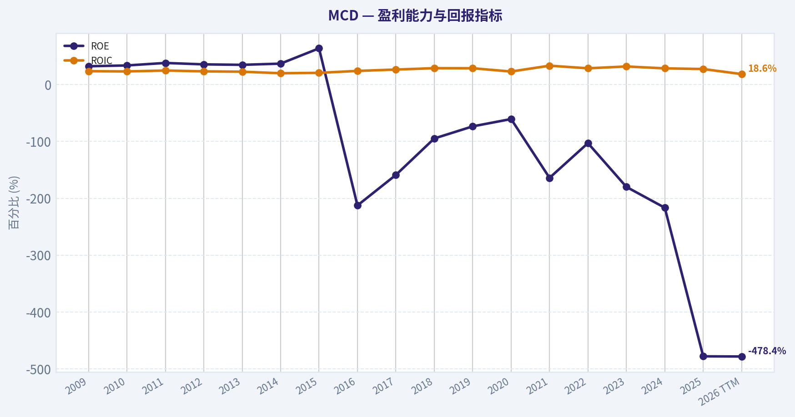
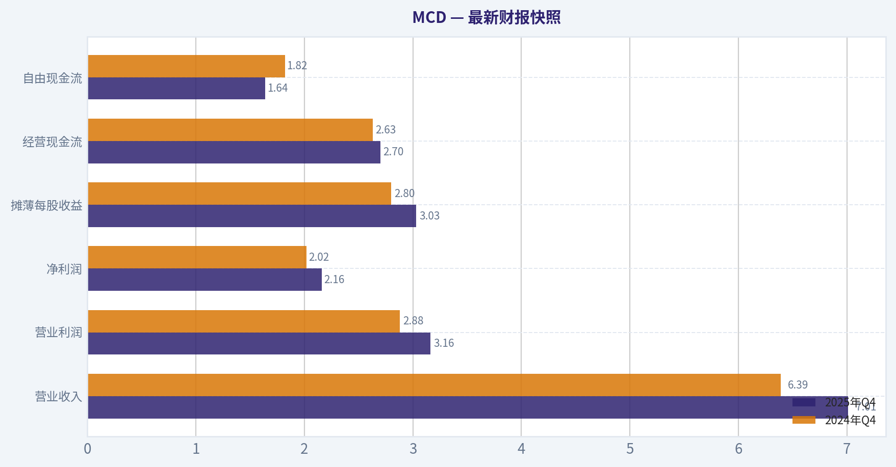
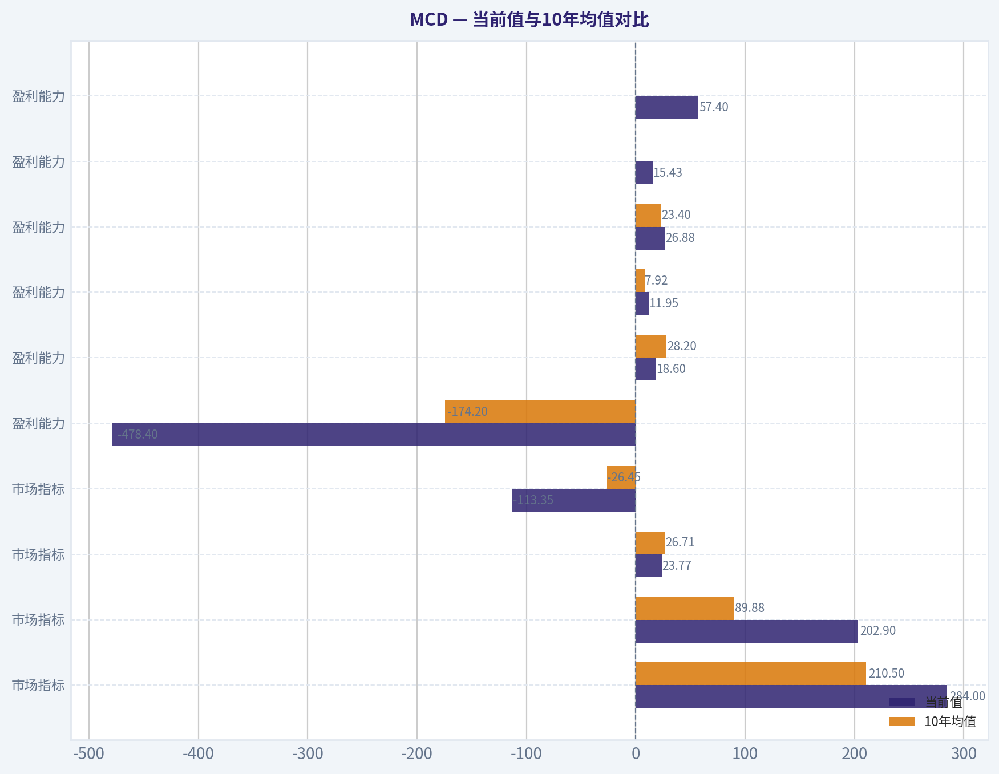
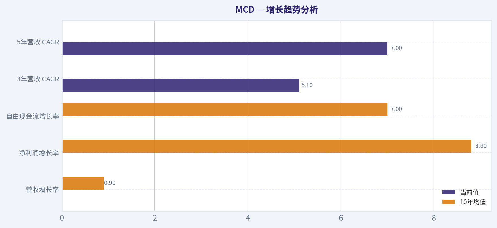
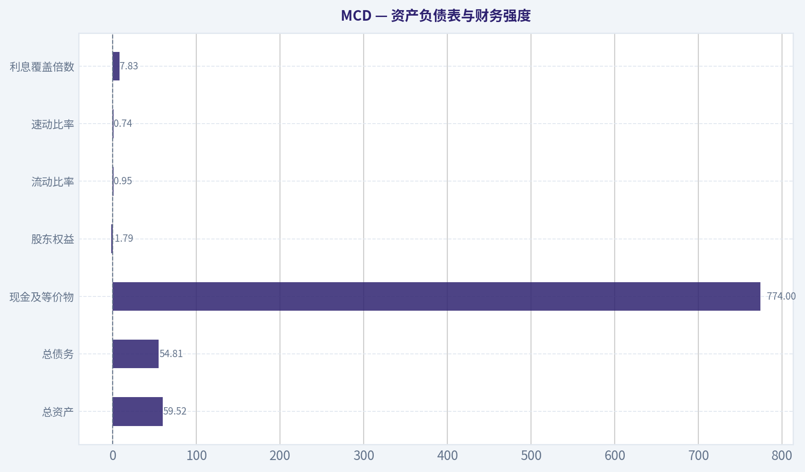
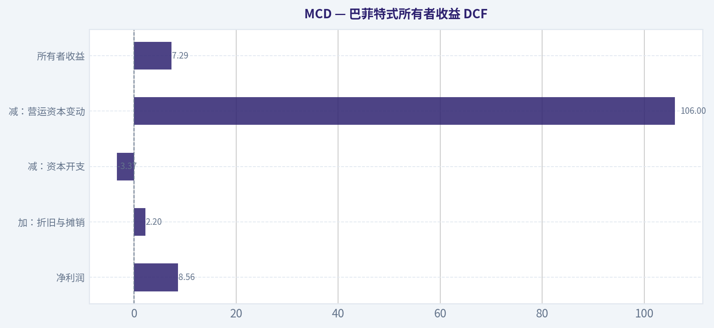
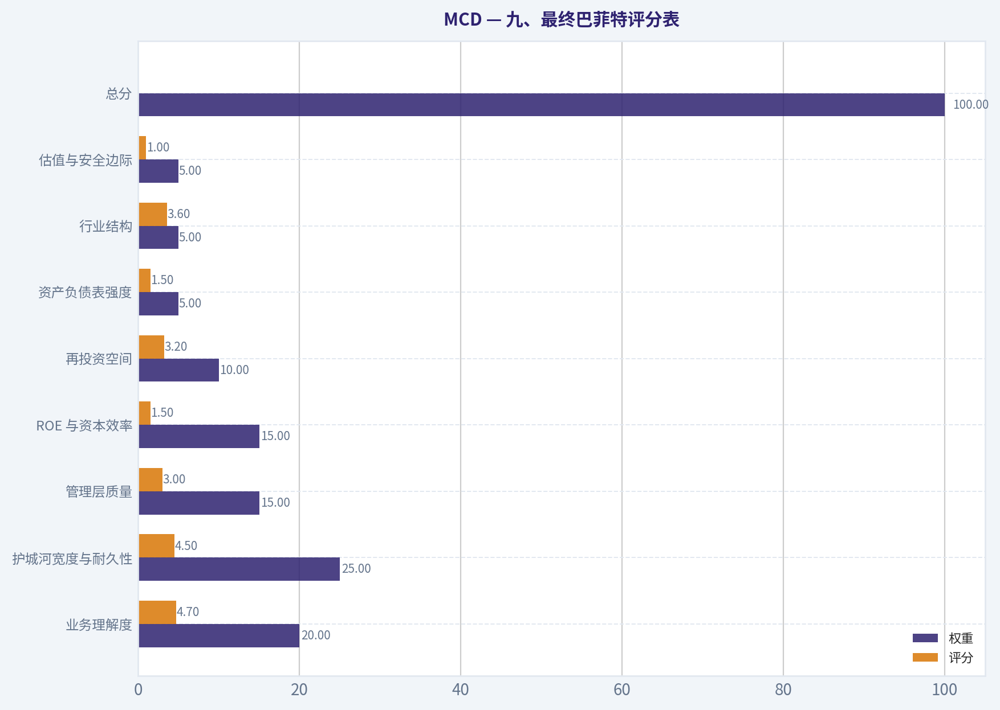
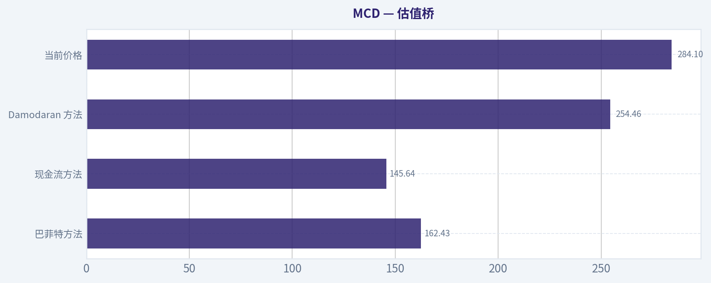

# MCD 深度价值情报

**调研日期:** 2026-05-07

## 关键免责声明

*本报告由 Deep Value Intelligence（一个基于 AI 的多智能体投资分析框架）自动生成。 本报告仅供信息参考和教育目的，不构成任何财务或投资建议。 在做出任何投资决策之前，请务必进行独立调研并咨询合规的财务顾问。*

---

## 目录

1. 情报摘要
2. 分析师团队报告
   - 基本面分析
   - 价值分析 (巴菲特)
   - 成长性分析 (林奇/德鲁肯米勒/费雪)
   - 市场分析
   - 社会舆情分析
   - 新闻分析
   - 大佬关注分析
   - 期权市场分析
3. 研究团队评论
4. 投资团队评论
5. Deep Values 团队洞察

---

## 情报摘要

### 核心观点与前提条件

**核心论点:** **执行摘要 (Executive Summary)**

**主要风险:**
- 最终立场：观望 (WATCH)**
- 激进派 (Risky) - 质量溢价论**：顶级消费基础设施理应享有估值溢价。因为"不够便宜"而长期踏空一台 ROIC 高达 25%、FCF 稳健增长的印钞机，是价值投资者常犯的错误。当前价值菜单已带动客流回升，短线均线破位反而是预期修复前的左侧布局良机。
- 最终立场：观望 (WATCH)**

**观点反转条件:**
- 最终立场：观望 (WATCH)**
- 激进派 (Risky) - 质量溢价论**：顶级消费基础设施理应享有估值溢价。因为"不够便宜"而长期踏空一台 ROIC 高达 25%、FCF 稳健增长的印钞机，是价值投资者常犯的错误。当前价值菜单已带动客流回升，短线均线破位反而是预期修复前的左侧布局良机。
- 最终立场：观望 (WATCH)**

**置信度:** 中

---

## 分析师团队报告

### 基本面分析

#### 最新财报快照

*以下数据基于最近一期已披露财报（2025年Q4），并尽量与上一年同期对比。*

| 指标 | 2025年Q4 | 2024年Q4 | 同比变化 |
| --- | ---: | ---: | ---: |
| 营业收入 | $7.01B | $6.39B | +9.7% |
| 营业利润 | $3.16B | $2.88B | +9.7% |
| 净利润 | $2.16B | $2.02B | +7.3% |
| 摊薄每股收益 | $3.03 | $2.80 | +8.2% |
| 经营现金流 | $2.70B | $2.63B | +2.5% |
| 自由现金流 | $1.64B | $1.82B | -10.2% |

关键结论：这张快照先把最新一期财报放在桌面上，再去看长周期分析。这样读者能更清楚地区分"公司长期质量"和"这次财报发生了什么"。

#### MCD 10年财务指标

*以下数值均由原始数据确定性计算得出，并非 AI 估算。*

*发行人类型：operating company（Consumer Cyclical / Restaurants）。*

#### 10年财务指标
*年度行来自已披露财务报表，最后一行 TTM 由最近四个季度滚动计算得出。*

| 指标 | 2009 | 2010 | 2011 | 2012 | 2013 | 2014 | 2015 | 2016 | 2017 | 2018 | 2019 | 2020 | 2021 | 2022 | 2023 | 2024 | 2025 | 2026 TTM |
| --- | --- | --- | --- | --- | --- | --- | --- | --- | --- | --- | --- | --- | --- | --- | --- | --- | --- | --- |
| 市场价格 | $40 | $51 | $69 | $62 | $71 | $71 | $92 | $98 | $142 | $150 | $171 | $190 | $243 | $244 | $281 | $282 | $304 | $284 |
| 总市值 | $69.15B | $82.92B | $104.83B | $89.99B | $97.61B | $92.42B | $111.60B | $104.83B | $140.36B | $139.50B | $151.15B | $160.96B | $0 | $0 | $0 | $0 | $201.95B | $202.90B |
| 市盈率 | 15.19 | 16.76 | 19.04 | 16.46 | 17.48 | 19.44 | 24.61 | 22.38 | 27.02 | 23.55 | 25.08 | 34.01 | 26.70 | 31.64 | 25.65 | 25.45 | 25.58 | 23.77 |
| 市净率 | 4.93 | 5.67 | 7.29 | 5.88 | 6.10 | 7.19 | 15.74 | -47.55 | -42.95 | -22.29 | -18.41 | -20.57 | -0.00 | -0.00 | -0.00 | -0.00 | -112.76 | -113.35 |
| ROE | 32.4% | 33.8% | 38.2% | 35.7% | 34.9% | 37.0% | 63.9% | -212.6% | -158.9% | -94.7% | -73.4% | -60.5% | -164.0% | -102.9% | -179.9% | -216.6% | -478.1% | -478.4% |
| ROIC | 23.7% | 23.3% | 24.9% | 23.4% | 22.8% | 20.1% | 20.8% | 24.2% | 26.6% | 29.0% | 28.9% | 23.1% | 33.4% | 28.8% | 32.0% | 28.7% | 27.5% | 18.6% |
| 每股收益 | $2.64 | $3.04 | $3.60 | $3.78 | $4.04 | $3.63 | $3.74 | $4.37 | $5.25 | $6.37 | $6.82 | $5.60 | $9.11 | $7.73 | $10.97 | $11.07 | $11.95 | $11.95 |
| 营收 | $22.74B | $24.07B | $27.01B | $27.57B | $28.11B | $27.44B | $25.41B | $24.62B | $22.82B | $21.26B | $21.36B | $19.21B | $23.22B | $23.18B | $25.49B | $25.92B | $26.89B | $26.88B |
| 毛利润 | N/A | N/A | N/A | N/A | N/A | N/A | N/A | N/A | N/A | N/A | N/A | N/A | N/A | N/A | N/A | N/A | N/A | $15.43B |
| 毛利率 | N/A | N/A | N/A | N/A | N/A | N/A | N/A | N/A | N/A | N/A | N/A | N/A | N/A | N/A | N/A | N/A | N/A | 57.4% |
| 营业利润率 | 30.1% | 31.0% | 31.6% | 31.2% | 31.2% | 29.0% | 28.1% | 31.5% | 41.9% | 41.5% | 42.5% | 38.1% | 44.6% | 40.4% | 45.7% | 45.2% | 46.1% | 46.1% |
| 净利润 | $4.55B | $4.95B | $5.50B | $5.46B | $5.59B | $4.76B | $4.53B | $4.69B | $5.19B | $5.92B | $6.03B | $4.73B | $7.54B | $6.18B | $8.47B | $8.22B | $8.56B | $8.56B |
| 净利率 | 20.0% | 20.5% | 20.4% | 19.8% | 19.9% | 17.3% | 17.8% | 19.0% | 22.8% | 27.9% | 28.2% | 24.6% | 32.5% | 26.6% | 33.2% | 31.7% | 31.9% | 31.9% |
| 营收增长 | N/A | 5.8% | 12.2% | 2.1% | 2.0% | -2.4% | -7.4% | -3.1% | -7.3% | -6.8% | 0.5% | -10.1% | 20.9% | -0.2% | 10.0% | 1.7% | 3.7% | -0.0% |
| 净利润增长 | N/A | 8.7% | 11.3% | -0.7% | 2.2% | -14.8% | -4.8% | 3.5% | 10.8% | 14.1% | 1.7% | -21.5% | 59.5% | -18.1% | 37.1% | -2.9% | 4.1% | 0.0% |
| 自由现金流增长 | N/A | 10.7% | 5.1% | -11.4% | 9.7% | -3.5% | 13.9% | -10.3% | -12.8% | 14.3% | 35.6% | -19.3% | 53.6% | -22.7% | 32.2% | -8.0% | 7.7% | 0.0% |
| 总账面价值 | $14.03B | $14.63B | $14.39B | $15.29B | $16.01B | $12.85B | $7.09B | $-2.20B | $-3.27B | $-6.26B | $-8.21B | $-7.82B | $-4.60B | $-6.00B | $-4.71B | $-3.80B | $-1.79B | $-1.79B |
| 总资产 | $30.22B | $31.98B | $32.99B | $35.39B | $36.63B | $34.23B | $37.94B | $31.02B | $33.80B | $32.81B | $47.51B | $52.63B | $53.85B | $50.44B | $56.15B | $55.18B | $59.52B | $59.52B |
| 总债务 | $10.58B | $11.51B | $12.50B | $13.63B | $14.13B | $14.94B | $24.12B | $25.96B | $29.54B | $31.08B | $34.18B | $37.44B | $35.62B | $35.90B | $41.88B | $39.21B | $41.50B | $54.81B |
| 债务股权比 | 0.75 | 0.79 | 0.87 | 0.89 | 0.88 | 1.16 | 3.40 | -11.78 | -9.04 | -4.97 | -4.16 | -4.78 | -7.74 | -5.98 | -8.90 | -10.33 | -23.17 | -30.62 |
| 现金及等价物 | $1.80B | $2.39B | $2.34B | $2.34B | $2.80B | $2.08B | $7.69B | $1.22B | $2.46B | $866.0M | $898.5M | $3.45B | $4.71B | $2.58B | $4.58B | $1.08B | $774.0M | $774.0M |
| 股东权益 | $14.03B | $14.63B | $14.39B | $15.29B | $16.01B | $12.85B | $7.09B | $-2.20B | $-3.27B | $-6.26B | $-8.21B | $-7.82B | $-4.60B | $-6.00B | $-4.71B | $-3.80B | $-1.79B | $-1.79B |
| 经营现金流 | $5.75B | $6.34B | $7.15B | $6.97B | $7.12B | $6.73B | $6.54B | $6.06B | $5.55B | $6.97B | $8.12B | $6.27B | $9.14B | $7.39B | $9.61B | $9.45B | $10.55B | $10.55B |
| 投资现金流 | $-1.66B | $-2.06B | $-2.57B | $-3.17B | $-2.67B | $-2.30B | $-1.42B | $-981.6M | $562.0M | $-2.46B | $-3.07B | $-1.55B | $-2.17B | $-2.68B | $-3.19B | $-5.35B | $-3.82B | $-3.82B |
| 自由现金流 | $3.80B | $4.21B | $4.42B | $3.92B | $4.30B | $4.15B | $4.73B | $4.24B | $3.70B | $4.22B | $5.73B | $4.62B | $7.10B | $5.49B | $7.25B | $6.67B | $7.19B | $7.19B |
| 自由现金流利润率 | 16.7% | 17.5% | 16.4% | 14.2% | 15.3% | 15.1% | 18.6% | 17.2% | 16.2% | 19.9% | 26.8% | 24.1% | 30.6% | 23.7% | 28.5% | 25.7% | 26.7% | 26.7% |
| 每股分红 | $0.00 | $0.00 | $0.00 | $0.00 | $0.00 | $0.00 | $0.00 | $0.00 | $0.00 | $0.00 | $0.00 | $0.00 | N/A | N/A | N/A | N/A | $7.74 | $7.16 |

#### 盈利能力指标
- 净资产收益率 (ROE): -478.1%
- 投入资本回报率 (ROIC): 25.0%
- 总资产收益率 (ROA): 14.4%
- 毛利率: N/A
- 营业利润率: 46.1%
- 净利率: 31.9%

#### 流动性指标
- 流动比率: 0.95
- 速动比率: 0.74

#### 杠杆指标
- 债务股权比: -23.17
- 利息覆盖倍数: 7.83
- 净负债: $40.72B

#### 增长指标（同比）
- 营收增长: 3.7%
- 净利润增长: 4.1%
- 自由现金流增长: 7.7%
- 营收复合增长率（3年）: 5.1%
- 营收复合增长率（5年）: 7.0%

#### 估值指标
- 市盈率 (TTM): 23.75
- 预期市盈率: 19.79
- 市净率: N/A
- 市销率: 7.51
- PEG 比率: 2.55
- 企业价值/EBITDA: 17.53
- 自由现金流收益率: 3.6%
- 盈利收益率: 4.2%

#### 所有者收益（巴菲特方法，代码计算）
- 净利润: $8.56B
- + 折旧与摊销: $2.20B
- - 资本开支: $-3.37B
- - 营运资本变动: $106.0M
- = **所有者收益: $7.29B**

#### 内在价值（代码计算）
- 当前价格: $284
- 巴菲特方法（所有者收益）:
  保守: $99
  平均: $162
  乐观: $222
- 现金流方法（FCF）:
  保守: $83
  平均: $146
  乐观: $196

#### Piotroski F分数: 4/9
- 净利润为正: 通过
- 经营现金流为正: 通过
- 资产回报率改善: 未通过
- 现金流大于净利润: 通过
- 债务下降: 未通过
- 流动比率改善: 未通过
- 未稀释股本: 通过
- 毛利率改善: 未通过
- 资产周转率改善: 未通过

ANALYST STANCE: **观望**

#### McDonald's（MCD）巴菲特式基本面结论

McDonald's 是典型的"高质量、强品牌、强现金流、但当前估值不便宜且杠杆偏高"的成熟消费特许经营企业。它的核心优势来自全球品牌、加盟模式、地产与租金收入、规模化供应链、菜单标准化和数字化会员体系；这些特征符合巴菲特偏好的"可理解、可预测、长期赚钱"的商业模式。

但从当前数据看，最大矛盾在于：业务质量很高，资本回报仍强，然而资产负债表明显激进，股东权益为负，债务规模处于高位；同时当前股价 $284 明显高于数据集中巴菲特所有者收益 DCF 给出的保守、平均和乐观内在价值区间。综合判断：**适合长期跟踪，但当前安全边际不足，给出"观望"而非"建议配置"。**

---

#### 当前值与10年均值对比

> 10年均值采用数据集中 2016-2025 财年；当前值采用 2026 TTM。若数据集中存在 N/A 或市值为 0 的年份，按数据集口径说明，不自行替换历史数据。

| 类别 | 指标 | 当前值 | 10年均值 | 当前相对历史的解读 |
|---|---:|---:|---:|---|
| 市场指标 | 市场价格 | $284 | $210.50 | 股价显著高于10年均值，反映市场继续给予品牌和现金流溢价。 |
| 市场指标 | 总市值 | $202.90B | $89.88B | 均值受数据集中 2021-2024 市值为 0 的记录影响而偏低；即便如此，当前市值处于历史高位。 |
| 市场指标 | P/E | 23.77 | 26.71 | 当前 P/E 低于10年均值，表面估值较历史稍便宜，但仍不算低估。 |
| 市场指标 | P/B | -113.35 | -26.45 | 因股东权益为负，P/B 已失去传统估值意义。 |
| 盈利能力 | ROE | -478.4% | -174.2% | 负 ROE 不是经营亏损导致，而是负权益结构导致；不能按常规 ROE 解读。 |
| 盈利能力 | ROIC | 18.6% | 28.2% | 仍高于多数餐饮企业，但明显低于自身10年均值，资本效率有回落迹象。 |
| 盈利能力 | EPS | $11.95 | $7.92 | 每股盈利显著高于历史均值，受净利润增长和回购影响。 |
| 盈利能力 | 营收 | $26.88B | $23.40B | 营收恢复至高于10年均值的水平，说明疫情后需求与定价能力仍有韧性。 |
| 盈利能力 | 毛利润 | $15.43B | N/A | 数据集中仅 TTM 披露毛利润，当前毛利规模较大。 |
| 盈利能力 | 毛利率 | 57.4% | N/A | 高毛利率体现加盟、租金、特许权使用费模式的质量。 |
| 盈利能力 | 营业利润率 | 46.1% | 41.8% | 当前高于历史均值，经营杠杆和加盟结构优势明显。 |
| 盈利能力 | 净利润 | $8.56B | $6.55B | 当前净利润高于10年均值，盈利能力仍处于较强区间。 |
| 盈利能力 | 净利率 | 31.9% | 27.8% | 当前净利率高于历史均值，说明价格、加盟结构和成本控制仍有效。 |
| 增长 | 营收增长率 | -0.0% | 0.9% | TTM 几乎持平；2025 年为 3.7%，增长已从疫情后反弹转为温和。 |
| 增长 | 净利润增长率 | 0.0% | 8.8% | 当前增长低于历史均值，利润扩张进入放缓阶段。 |
| 增长 | 自由现金流增长率 | 0.0% | 7.0% | 当前自由现金流增长暂停，需观察是否为短期投入周期还是增长瓶颈。 |
| 资产负债表 | 总账面价值 | -$1.79B | -$4.87B | 股东权益仍为负，但较10年均值有所改善。 |
| 资产负债表 | 总资产 | $59.52B | $47.29B | 资产规模高于历史均值，系统仍在扩张和投入。 |
| 资产负债表 | 总债务 | $54.81B | $35.23B | 债务显著高于10年均值，是当前最大财务风险之一。 |
| 资产负债表 | 债务股权比 | -30.62 | -9.09 | 由于权益为负，该比率不适合常规解读；但绝对债务压力确实较高。 |
| 资产负债表 | 现金及等价物 | $774M | $2.26B | 现金余额明显低于10年均值，流动性缓冲偏薄。 |
| 资产负债表 | 股东权益 | -$1.79B | -$4.87B | 长期回购和债务融资使权益为负，资本结构偏激进。 |
| 现金流 | 自由现金流 | $7.19B | $5.62B | 当前自由现金流高于历史均值，现金创造能力仍优秀。 |
| 现金流 | 每股分红 | $7.16 | 约 $1.29 | 数据集中分红历史存在 N/A 与 0；当前分红绝对额高，但需结合债务和自由现金流覆盖能力看。 |

关键结论：MCD 的盈利能力和现金流仍明显强于自身历史均值，尤其是营业利润率、净利率和自由现金流表现突出。但 ROIC 已低于10年均值，增长率也从疫情后反弹转为平缓。最大问题不是业务赚钱能力，而是负股东权益、高债务、低现金余额与当前估值缺乏安全边际的组合。

---

#### 市场估值解读

| 指标 | 当前状态 | 巴菲特式解读 |
|---|---|---|
| 市场价格 $284 | 高于10年均价约 35% | 市场已充分定价品牌韧性和加盟模式质量。 |
| 总市值约 $202.90B | 处于历史高位 | 对应的是成熟低中速增长企业的高质量溢价。 |
| P/E 23.77 | 低于10年均值 26.71 | 相对自身历史略便宜，但以当前增长速度看并不便宜。 |
| P/B -113.35 | 传统意义失效 | 负权益来自长期资本返还和债务结构，不能用 P/B 判断便宜。 |
| 自由现金流收益率 3.6% | 偏低 | 对巴菲特式投资者而言，当前现金流回报率不足以提供很厚安全边际。 |

关键结论：从 P/E 看，MCD 似乎比自身历史略便宜；但从自由现金流收益率和 DCF 看，当前价格并不具备明显折价。负 P/B 并不是"便宜"，而是资本结构高度财务工程化后的结果。

#### 盈利质量与商业模式

McDonald's 的盈利质量非常强。TTM 营收为 $26.88B，净利润为 $8.56B，净利率达到 31.9%，营业利润率达到 46.1%。这类利润率对餐饮行业来说极高，核心原因是公司并非单纯依赖直营餐厅销售，而是大量依赖加盟商支付的租金、特许权使用费和相关费用。

ROIC 当前为 18.6%，虽然低于10年均值 28.2%，但绝对水平仍然较强。这说明每一美元投入资本仍能产生不错的经营回报。不过，ROIC 的下滑值得关注，因为如果未来新店扩张、数字化投入或促销活动无法带来足够回报，估值倍数可能受到压缩。

EPS 当前为 $11.95，高于10年均值 $7.92。需要注意的是，EPS 的提升不仅来自经营利润增长，也受到长期回购减少股本的影响。巴菲特会喜欢稳定增长的每股盈利，但也会警惕企业在高估值阶段用债务支持回购。

#### 增长趋势分析

| 增长指标 | 当前值 | 10年均值 | 趋势判断 |
|---|---:|---:|---|
| 营收增长率 | -0.0% | 0.9% | 长期增长并不快，疫情后恢复已基本完成。 |
| 净利润增长率 | 0.0% | 8.8% | 利润增长放缓，未来需要靠提价、菜单创新和数字化效率支撑。 |
| 自由现金流增长率 | 0.0% | 7.0% | 现金流质量仍好，但增速暂时不强。 |
| 3年营收 CAGR | 5.1% | - | 中期恢复较好。 |
| 5年营收 CAGR | 7.0% | - | 受疫情低基数影响，不能简单外推。 |

关键结论：MCD 不是高速成长股，而是成熟现金流复利型企业。过去几年增长受疫情恢复和提价推动，但当前 TTM 增长已经接近停滞。未来投资回报更依赖买入价格，而不是高增长本身。

#### 资产负债表与财务强度

| 项目 | 当前值 | 风险解读 |
|---|---:|---|
| 总资产 | $59.52B | 资产规模稳定扩大。 |
| 总债务 | $54.81B | 债务水平显著偏高。 |
| 现金及等价物 | $774M | 现金缓冲较薄。 |
| 股东权益 | -$1.79B | 长期回购与资本返还导致权益为负。 |
| 流动比率 | 0.95 | 短期流动性不算充裕。 |
| 速动比率 | 0.74 | 即时偿债缓冲偏弱。 |
| 利息覆盖倍数 | 7.83 | 当前仍可覆盖利息，但利率环境变化会影响安全边际。 |
| Piotroski F 分数 | 4/9 | 财务质量信号中性偏弱。 |

关键结论：MCD 的经营现金流很强，因此短期偿债并非核心问题；真正的问题是资本结构偏激进。负权益、高债务、低现金余额会降低企业在衰退、成本冲击或利率上升周期中的灵活性。巴菲特通常偏好财务更保守的优秀企业，因此这部分是明显扣分项。

---

#### 收入来源分布

> 数据集中未披露完整分部明细；下表采用公司长期披露口径的近似拆分，并与 TTM 总营收 $26.88B 对齐。金额单位为十亿美元。

| 收入来源 | 金额（百万/十亿美元） | 占比 |
|---|---:|---:|
| 特许经营餐厅收入：租金、特许权使用费及加盟相关费用 | 约 $16.7B | 约 62% |
| 公司直营餐厅销售 | 约 $10.1B | 约 38% |
| 其他收入及公司项目 | 约 $0.1B | 小于 1% |
| 合计 | 约 $26.88B | 100% |

关键结论：MCD 的收入结构高度依赖加盟模式，而不是单纯依赖直营餐厅卖汉堡。加盟收入通常毛利率更高、资本需求更低、现金流更稳定，这是公司高营业利润率和高自由现金流率的根源。也正因为这种模式，MCD 更像一个全球餐饮品牌与地产租金平台，而不是传统低利润餐饮公司。

#### 巴菲特式所有者收益 DCF

数据集中给出的当前巴菲特方法所有者收益计算如下：

| 项目 | 金额 |
|---|---:|
| 净利润 | $8.56B |
| 加：折旧与摊销 | $2.20B |
| 减：资本开支 | -$3.37B |
| 减：营运资本变动 | $106M |
| 所有者收益 | $7.29B |

关键结论：MCD 的所有者收益为 $7.29B，与自由现金流 $7.19B 非常接近，说明会计利润与现金利润匹配度较高。这是高质量企业的重要特征，因为利润不是"纸面盈利"，而是真正能够转化为现金的盈利。

DCF 关键假设：折现率 10%，永续增长率 2.5%，当前价格 $284。股数按当前市值与股价近似推算，约 714.4 百万股。以下结果与数据集中"巴菲特方法内在价值"口径对齐。

| 情景 | 所有者收益增长假设 | 第10年所有者收益 | 前10年现值 | 终值现值 | 股权价值 | 每股内在价值 | 相对当前价格 |
|---|---:|---:|---:|---:|---:|---:|---:|
| 保守 | 约 -2.3% | 约 $5.78B | 约 $40.2B | 约 $30.5B | 约 $70.7B | $99 | 低约 65% |
| 平均 | 约 4.5% | 约 $11.3B | 约 $55.5B | 约 $60.2B | 约 $115.7B | $162 | 低约 43% |
| 乐观 | 约 8.9% | 约 $17.1B | 约 $69.0B | 约 $89.6B | 约 $158.6B | $222 | 低约 22% |

关键结论：即使采用乐观情景，MCD 的巴菲特式所有者收益 DCF 每股价值约 $222，仍低于当前 $284。保守与平均情景显示安全边际明显不足。换句话说，当前市场价格要求投资者相信公司未来能长期维持较高增长和较高资本回报，但数据中的增长趋势并不完全支持这么乐观的定价。

#### DCF 公式说明

| 计算环节 | 公式 |
|---|---|
| 第 t 年所有者收益 | 当前所有者收益 x \(1 + g\)^t |
| 前10年现金流现值 | 第 t 年所有者收益 ÷ \(1 + 10%\)^t |
| 终值 | 第10年所有者收益 x \(1 + 2.5%\) ÷ \(10% - 2.5%\) |
| 每股价值 | 股权价值 ÷ 约 714.4 百万股 |

关键结论：该 DCF 对增长率非常敏感。对于 MCD 这种成熟企业，若长期增长只有低个位数，当前股价很难被 DCF 支撑。投资者若在当前价格买入，主要是在购买品牌确定性，而不是购买明显低估资产。

---

#### 巴菲特式定性分析

| 维度 | 评价 | 具体判断 |
|---|---|---|
| 经济护城河 | 很强 | 全球品牌、规模供应链、加盟网络、地产与租金结构、数字化会员体系构成长期优势。 |
| 财务强度 | 中等偏弱 | 现金流强，但债务高、现金少、股东权益为负。 |
| 盈利可预测性 | 较强 | 过去10年多数年份盈利为正，疫情期间也保持盈利。 |
| 管理层资本配置 | 有争议 | 分红和回购提升每股指标，但资本结构变得激进。 |
| 业务质量 | 很高 | 高营业利润率、高净利率、高自由现金流率。 |
| 当前估值 | 偏高 | P/E 低于历史均值，但 DCF 与自由现金流收益率显示安全边际不足。 |

关键结论：MCD 是巴菲特会愿意研究的好生意，但未必是当前价格下的好股票。好公司与好投资之间的差距，主要取决于买入价格。当前 MCD 的护城河质量很高，但估值和杠杆让风险回报比不够理想。

#### 关键机会

| 机会 | 影响 |
|---|---|
| 全球加盟模式继续提升利润率 | 可维持高现金流和高资本回报。 |
| 数字化点餐、会员体系和外送渠道 | 有助于提高复购率和客单价。 |
| 价值套餐和本地化菜单 | 在消费承压环境下稳定客流。 |
| 国际市场扩张 | 长期仍有门店增长空间。 |
| 自由现金流高于10年均值 | 支持分红、回购和再投资。 |

关键结论：MCD 的机会主要来自"稳定复利"，不是爆发式增长。只要品牌不受损、加盟商经济模型健康，公司仍有能力长期产生大量现金。问题在于，当前价格已经提前反映了相当多的好消息。

#### 主要红旗

| 红旗 | 风险含义 |
|---|---|
| 总债务 $54.81B | 债务显著高于历史均值，限制财务灵活性。 |
| 现金仅 $774M | 面对冲击时的现金缓冲偏低。 |
| 股东权益为 -$1.79B | 长期财务工程化明显，P/B 与 ROE 失真。 |
| ROIC 降至 18.6% | 资本效率低于自身历史均值。 |
| TTM 增长接近 0 | 当前估值需要更强增长来支撑。 |
| Piotroski F 分数 4/9 | 财务质量改善信号不强。 |
| DCF 低于当前价格 | 安全边际不足。 |

关键结论：MCD 的风险不是"生意会不会突然不赚钱"，而是"以当前价格买入是否能获得足够回报"。高债务和低现金使估值容错率下降，而增长放缓又降低了高估值的合理性。

#### 最终投资立场：观望

| 项目 | 结论 |
|---|---|
| 投资立场 | 观望 |
| 适合投资者 | 已持有的长期投资者可继续跟踪；新买入者应等待更好价格。 |
| 理想买入条件 | 股价回落至 DCF 乐观值以下，并接近平均情景价值更有吸引力。 |
| 核心理由 | 业务质量优秀，但当前估值高于巴菲特式内在价值区间。 |
| 最大优势 | 全球品牌护城河和高质量加盟现金流。 |
| 最大风险 | 高债务、负权益、增长放缓与安全边际不足。 |

关键结论：MCD 仍是一家优秀公司，但当前不是特别有吸引力的巴菲特式买点。若股价大幅回落、自由现金流收益率提高、债务压力下降，投资吸引力会明显改善。当前更合理的策略是观望，而不是追高买入。

#### 报告要点汇总

| 主题 | 核心观点 | 投资含义 |
|---|---|---|
| 商业模式 | 加盟与品牌驱动，高利润、高现金流 | 业务质量强，护城河深。 |
| 盈利能力 | 营业利润率 46.1%，净利率 31.9% | 经营效率优秀。 |
| 增长 | TTM 增长接近停滞 | 高估值缺少增长支撑。 |
| 资产负债表 | 债务 $54.81B，现金 $774M，权益为负 | 财务弹性偏弱。 |
| 现金流 | 自由现金流 $7.19B，高于10年均值 | 分红和资本返还有基础。 |
| 估值 | DCF 每股 $99-$222，当前 $284 | 安全边际不足。 |
| 巴菲特视角 | 好公司，但当前价格不够便宜 | 适合等待，不宜激进配置。 |
| 最终立场 | 观望 | 等待估值回落或基本面再加速。 |

关键结论：MCD 的核心价值在于稳定、强品牌和高现金流，而核心问题在于价格。以巴菲特方法看，当前股价高于所有者收益 DCF 的合理区间，缺乏足够安全边际。因此最终判断是：好生意，贵价格，维持观望。

#### 基本面关键图表

本图追踪 **MCD** 过去十年的盈利能力与回报指标（ROE、ROIC、利润率），突出呈现资本效率的变化趋势。

---

### 价值分析 (巴菲特)

> *基于沃伦·巴菲特的价值投资哲学：能力圈、经济护城河、管理层质量与安全边际。*

#### 内在价值快照

价格是你付的钱，内在价值是企业未来可能为股东创造的现金价值。我们给出一个区间，而不是假装只有一个神奇数字。

- 当前价格: $284.10
- 价值区间: $83.32 to $222.21

##### 所有者收益（巴菲特方法）
- 净利润: $8,563,000,000.00
- 折旧与摊销: $2,199,000,000.00
- 资本支出: $-3,365,000,000.00
- 营运资金变化: $106,000,000.00
- 所有者收益: $7,291,000,000.00

##### 内在价值
###### 所有者收益法
使用所有者收益，更严格，通常更保守。
- 保守: $99.09
- 平均: $162.43
- 乐观: $222.21
- 折现率: 10.0%

###### 自由现金流法
使用自由现金流，更适合今天投入很多、为未来增长铺路的公司。
- 保守: $83.32
- 平均: $145.64
- 乐观: $196.35
- 折现率: 10.0%

ANALYST STANCE: **WATCH（观望）**

#### MCD 巴菲特式价值分析结论

McDonald's 是一家非常接近"好生意"的公司：品牌强、模式简单、现金流可理解、全球规模难以复制。但以当前约 **284 美元**股价、约 **2019.5 亿美元**市值、约 **23.8 倍 PE** 和 **3.6% 自由现金流收益率**来看，投资人支付的价格已经反映了相当多的未来确定性。
我的结论是：**业务质量值得长期跟踪，但当前缺乏足够安全边际，立场为观望。**

---

#### 一、四道关口评估

| 关口 | 结论 | 关键判断 |
|---|---:|---|
| 能力圈与业务简单性 | 通过 | MCD 通过直营餐厅、加盟费、租金、品牌授权和供应链规模赚钱，商业模式很容易理解。 |
| 护城河 | 通过 | 全球品牌、门店网络、房地产位置、供应链规模和加盟体系构成较强护城河。 |
| 管理层与资本配置 | 有条件通过 | 公司长期回购和分红体现股东回报意识，但负股东权益与高杠杆式资本结构降低安全感。 |
| 行业结构 | 通过但非完美 | 快餐行业需求稳定，但竞争激烈；MCD 是少数具备全球定价与规模优势的玩家。 |

**关键结论：** MCD 不是复杂企业，也不是依赖科技预测或商品价格预测的企业。它的核心价值来自品牌、地点、规模和消费者习惯。不过，资本结构并非巴菲特最偏爱的"堡垒式资产负债表"，这是本案最大的质量折扣之一。

---

#### 二、能力圈：小学生测试

MCD 的赚钱方式可以简单描述为：
它用 McDonald's 这个全球品牌吸引顾客吃汉堡、薯条、饮料和早餐；很多门店由加盟商经营，加盟商向公司支付费用和租金；公司用品牌、菜单、系统、供应链和广告网络帮助加盟商赚钱。

| 测试项目 | 判断 |
|---|---|
| 小学生能否理解 | 可以 |
| 10 年后是否仍大致相同 | 大概率可以 |
| 科技是否会摧毁业务 | 低概率；科技更可能提升点餐、配送、自动化和会员运营效率 |
| 是否依赖宏观预测 | 不严重 |
| 是否依赖复杂金融结构 | 经营业务不依赖，但资本结构较激进 |

**关键结论：** MCD 的主营业务非常容易理解，10 年后的核心需求仍然会是便宜、方便、标准化的快餐。科技不是主要威胁，反而可能帮助提升效率；真正需要警惕的是消费者健康偏好、低收入客群压力和竞争促销。

---

#### 三、护城河分析

| 护城河来源 | 证据 | 质量判断 |
|---|---|---:|
| 品牌资产 | McDonald's 是全球最知名餐饮品牌之一，消费者认知强，儿童、家庭、通勤人群和低价快餐场景稳定 | 强 |
| 规模优势 | 全球采购、广告、供应链、菜单研发和数字系统可摊薄成本 | 强 |
| 加盟网络 | 加盟商承担大量经营资本开支，公司收取费用和租金，商业模式轻资产化 | 强 |
| 地点与房地产 | 大量门店位于高流量位置，部分租赁与地产控制具有长期价值 | 中强 |
| 转换成本 | 对消费者转换成本低，但对加盟商转换成本高 | 中等 |
| 网络效应 | 不是典型网络效应，但门店密度提高便利性和品牌触达 | 中等 |

**关键结论：** MCD 的护城河主要不是来自专利或技术，而是来自品牌、规模、位置和加盟体系。消费者可以轻易换一家餐厅，但很难有竞争者复制 MCD 全球范围内的供应链、广告预算、门店密度和加盟商网络。因此，它的护城河评级应为"宽且稳定"，但不是"无限扩张型"。

---

#### 四、管理层与资本配置

| 项目 | 观察 | 巴菲特式评价 |
|---|---|---:|
| 股东回报 | 长期通过分红与回购返还现金 | 正面 |
| 资本开支纪律 | 加盟模式降低公司自有资本需求 | 正面 |
| 杠杆使用 | 当前 ROE 为 -478.1%，主要因负股东权益导致；说明资本结构激进 | 负面 |
| 增长策略 | 依靠菜单创新、数字化、外卖、会员、国际扩张和加盟体系 | 中性偏正面 |
| 安全边际意识 | 当前资产负债表不是"净现金堡垒" | 负面 |

**关键结论：** MCD 管理层长期看重股东回报，但用大量回购和债务优化资本结构，使账面权益转为负数。这会让 ROE 失真，也削弱了巴菲特式"睡得着"的资产负债表特征。好公司不等于无风险公司，尤其当财务杠杆已经较高时。

---

#### 五、可得财务快照与 10 年趋势判断

| 指标 | 当前可得数据 | 解读 |
|---|---:|---|
| 股价 | 284 美元 | 当前市场定价不低 |
| 市值 | 2019.5 亿美元 | 全球餐饮龙头级别估值 |
| PE | 23.75 倍 | 高于传统低增长消费股的便宜区间 |
| 隐含净利润 | 约 85.0 亿美元 | 由市值除以 PE 估算 |
| 自由现金流收益率 | 3.6% | 对应约 72.7 亿美元自由现金流 |
| 营收同比增长 | 3.7% | 增长稳健但不高速 |
| ROE | -478.1% | 因负权益导致，不能直接视为经营回报，但反映杠杆问题 |
| 流动比率 | 0.95 | 短期资产覆盖短期负债略不足 |
| 毛利率 | 暂无完整数据 | 加盟模式通常支持高经营利润率，但本次不做精确假设 |

**关键结论：** 当前数据说明 MCD 是现金流强、增长温和、估值偏满的成熟企业。自由现金流收益率只有约 3.6%，意味着投资人今天买入，初始现金回报并不高。负 ROE 不是业务亏损，而是资本结构导致的会计现象，但它仍提醒我们不能把 MCD 当作低杠杆堡垒型公司。

---

#### 六、所有者收益估算

巴菲特关注的不是会计利润本身，而是企业可分配给股东、同时不伤害竞争地位的真实现金收益。由于本次可得数据有限，我以自由现金流作为所有者收益的近似值。

| 项目 | 金额 |
|---|---:|
| 市值 | 2019.5 亿美元 |
| PE | 23.75 倍 |
| 隐含净利润 | 约 85.0 亿美元 |
| 自由现金流收益率 | 3.6% |
| 估算自由现金流 | 约 72.7 亿美元 |
| 所有者收益近似值 | 约 72.7 亿美元 |
| 自由现金流 / 净利润 | 约 85.5% |

**关键结论：** MCD 的估算所有者收益约为 72.7 亿美元，低于隐含净利润，说明现金转化率并非完美但仍较强。以当前市值计算，买入者获得的初始所有者收益率约为 3.6%，这对成熟消费龙头来说可以接受，但远谈不上便宜。

---

#### 七、三情景 DCF 估值

基础假设：
- 使用估算所有者收益 **72.7 亿美元**。
- 折现率使用巴菲特式保守要求 **10%**。
- 估算股数约为 **7.11 亿股**，由市值除以股价得出。

| 情景 | 假设 | 企业内在价值 | 每股内在价值 | 相对当前 284 美元 |
|---|---|---:|---:|---:|
| A：零增长 | 所有者收益 / 10% | 约 727 亿美元 | 约 102 美元 | 明显高估 |
| B：长期 3% 增长 | 永续增长 3% | 约 1070 亿美元 | 约 150 美元 | 明显高估 |
| C：前 10 年 5% 增长，之后 3% | 较乐观但仍保守 | 约 1238 亿美元 | 约 174 美元 | 仍高估 |

**关键结论：** 在 10% 折现率下，MCD 当前价格明显高于保守内在价值区间。即使假设未来 10 年所有者收益以 5% 增长，估算每股价值也只有约 174 美元，低于 284 美元。当前买入更像是在为"高确定性"和"低折现率环境"支付溢价，而不是获得安全边际。

---

#### 八、安全边际分析

| 项目 | 数值 |
|---|---:|
| 当前股价 | 284 美元 |
| 保守内在价值区间 | 102-174 美元 |
| 最高估算价值相对现价 | 约低 39% |
| 要求安全边际 | 至少 25% |
| 符合安全边际 | 不符合 |
| 适合买入价格参考 | 约 130 美元以下更有吸引力；约 170-200 美元区间可重新评估 |

**关键结论：** MCD 的问题不是业务差，而是价格没有给出足够保护。对巴菲特式投资者而言，优秀企业也必须在合理价格买入。当前 284 美元附近缺乏 25% 以上安全边际，因此不应急于配置。

---

#### 九、最终巴菲特评分表

| 维度 | 权重 | 评分 | 加权分 |
|---|---:|---:|---:|
| 业务理解度 | 20% | 4.7 | 0.94 |
| 护城河宽度与耐久性 | 25% | 4.5 | 1.13 |
| 管理层质量 | 15% | 3.0 | 0.45 |
| ROE 与资本效率 | 15% | 1.5 | 0.23 |
| 再投资空间 | 10% | 3.2 | 0.32 |
| 资产负债表强度 | 5% | 1.5 | 0.08 |
| 行业结构 | 5% | 3.6 | 0.18 |
| 估值与安全边际 | 5% | 1.0 | 0.05 |
| 总分 | 100% |  | **3.36 / 5.00** |

**关键结论：** MCD 在业务理解度和护城河方面得分很高，是典型的高质量消费龙头。但负权益、高杠杆式资本结构和当前偏高估值显著拉低总分。综合评分落在观望区间，说明它值得长期跟踪，但现在不是理想买点。

---

#### 十、投资立场

| 项目 | 结论 |
|---|---|
| 业务质量 | 优秀 |
| 护城河 | 宽且稳定 |
| 财务稳健性 | 一般，杠杆偏高 |
| 当前估值 | 偏贵 |
| 安全边际 | 不足 |
| 最终立场 | **观望** |
| 置信度 | 中高 |

**关键结论：** MCD 是一家巴菲特会愿意理解和研究的好公司，但当前价格不是巴菲特会特别兴奋的价格。若股价大幅回落，或自由现金流显著增长使收益率提高，投资吸引力会改善。现在最合理的行动是放入高质量观察名单，而不是主动买入。
#### 估值桥

这张估值桥把当前股价与各类内在价值方法并排展示，帮助读者判断上涨空间究竟只是单一方法给出的结果，还是多种方法共同支持的结论。

| 项目 | 每股内在价值 |
| --- | ---: |
| 巴菲特方法 | $162.43 |
| 现金流方法 | $145.64 |
| Damodaran 方法 | $254.46 |
| 当前价格 | $284.10 |

#### 关键结论

如果只有一种方法显著高于其他方法，说明上行空间更依赖特定建模假设。若多种方法的估值接近，则说明估值逻辑更加稳健。

#### 估值图表

本对比图（来自「最新财报快照」）将 **MCD** 的当前数据与历史基准并排呈现，直观反映公司相对自身历史均值的估值水平。

本对比图（来自「当前值与10年均值对比」）将 **MCD** 的当前数据与历史基准并排呈现，直观反映公司相对自身历史均值的估值水平。

本对比图（来自「增长趋势分析」）将 **MCD** 的当前数据与历史基准并排呈现，直观反映公司相对自身历史均值的估值水平。

本对比图（来自「资产负债表与财务强度」）将 **MCD** 的当前数据与历史基准并排呈现，直观反映公司相对自身历史均值的估值水平。

本对比图（来自「巴菲特式所有者收益 DCF」）将 **MCD** 的当前数据与历史基准并排呈现，直观反映公司相对自身历史均值的估值水平。

本对比图（来自「九、最终巴菲特评分表」）将 **MCD** 的当前数据与历史基准并排呈现，直观反映公司相对自身历史均值的估值水平。

本对比图（来自「估值桥」）将 **MCD** 的当前数据与历史基准并排呈现，直观反映公司相对自身历史均值的估值水平。

---

### 成长性分析 (林奇/德鲁肯米勒/费雪)

> *基于彼得·林奇的GARP成长投资法、斯坦利·德鲁肯米勒的宏观拐点分析法，以及菲利普·费雪的深度调研法。*

ANALYST STANCE: **观望**

#### MCD 增长投资结论

McDonald's 是一家极高质量、强品牌、强现金流、强护城河的全球餐饮平台，但它不是典型的 Lynch 式"快速成长股"。以当前约 **3.7% 营收同比增长**、约 **23.8 倍 PE**、约 **3.6% 自由现金流收益率** 来看，MCD 更像成熟防御型复利资产，而不是具备十倍股弹性的增长股。对增长组合而言，当前更适合"持有观察"，不适合作为高成长新仓核心配置。

---

#### 1. Lynch 分类

| 项目 | 判断 |
|---|---:|
| 公司 | McDonald's |
| 当前股价 | 约 284 美元 |
| 市值 | 约 2,019.5 亿美元 |
| 营收同比增长 | 约 3.7% |
| PE | 约 23.75 倍 |
| 自由现金流收益率 | 约 3.6% |
| Lynch 分类 | 慢增长者 / 成熟防御型复利资产 |
| 增长投资适配度 | 中低 |

关键结论：MCD 的增长速度明显低于 15% 至 25% 的快速成长股标准。它的优势不在爆发式增长，而在品牌、规模、加盟模式和现金流韧性。若按 Lynch 框架，它更适合防御型长期持有，而不是寻找十倍股的增长组合新买入标的。

---

#### 2. 三句话讲清楚投资故事

| 维度 | 内容 |
|---|---|
| 简单故事 | McDonald's 通过全球加盟商销售汉堡、薯条、咖啡和快餐，并从加盟店收取租金、特许权使用费和服务费。 |
| 增长来源 | 增长主要来自同店销售、菜单提价、数字会员、外卖、门店扩张和国际市场渗透。 |
| 核心问题 | 品牌极强，但规模已经很大，未来更可能是中低个位数收入增长加回购驱动 EPS，而不是高速成长。 |

关键结论：MCD 的商业模式非常容易理解，也非常稳健。但它的故事更偏"全球消费现金流机器"，而不是"新市场爆发式渗透"。增长投资者需要问的关键问题是：未来三到五年，它是否能从 3% 至 5% 的收入增长重新加速到双位数？目前证据不足。

---

#### 3. TAM 与 10 倍测试

| 项目 | 估算与判断 |
|---|---:|
| 当前公司营收量级 | 约 260 亿美元级别 |
| 10 倍营收目标 | 约 2,600 亿美元 |
| 全球快餐与便利餐饮市场 | 万亿美元级别 |
| 当前系统销售额 | 已是全球餐饮巨头级别 |
| 10 倍后市场份额压力 | 很高 |
| 10 倍测试 | 不通过，或通过难度极高 |

关键结论：从全球餐饮市场总规模看，MCD 的市场仍然很大，但公司自身已经是行业巨头。要让公司营收再增长 10 倍，需要极大规模的门店扩张、菜单扩张和系统销售扩张，这在成熟餐饮业中难度很高。因此，MCD 有长期小幅复利空间，但十倍股跑道不足。

---

#### 4. 收入增长趋势

| 指标 | 当前观察 |
|---|---:|
| 最新营收同比增长 | 约 3.7% |
| 最新财报新闻 | 一季度业绩超预期，同店销售上升 |
| 增长模式 | 低个位数增长 |
| 增长质量 | 品牌和价格驱动较强，客流趋势需持续观察 |
| 趋势判断 | 稳定但不高增 |
| Lynch 快速成长标准 | 未达到 |

关键结论：最新季度看，MCD 通过价值套餐和同店销售改善实现了好于预期的表现，这是积极信号。但整体营收增长仍处低个位数区间，并没有出现明确的增长加速拐点。对增长投资者来说，这属于"经营改善"，还不是"高成长拐点"。

---

#### 5. 单位经济与现金流质量

| 项目 | 判断 |
|---|---|
| 加盟模式 | 高质量，资本开支负担较低 |
| 单店经济 | 通常较强，但加盟商利润受工资、租金、食材成本影响 |
| LTV/CAC | 不适用传统 SaaS 口径 |
| NRR | 不适用 |
| Rule of 40 | 不适用传统 SaaS 口径 |
| 自由现金流收益率 | 约 3.6% |
| 现金流质量 | 高 |

关键结论：MCD 不是 SaaS 或订阅制公司，传统 LTV/CAC、NRR 和 Rule of 40 不适合直接套用。更重要的是，它拥有极强的加盟现金流、品牌流量和经营杠杆。自由现金流收益率约 3.6%，说明现金流稳健，但估值并不便宜。

---

#### 6. 拐点判断

| 拐点类型 | 当前判断 | 重要性 |
|---|---|---:|
| 产品周期拐点 | 有价值套餐、数字化、外卖和会员体系改善，但非革命性新品 | 中 |
| 市占率拐点 | 可能受益于消费者追求性价比 | 中 |
| 利润率拐点 | 加盟模式支撑高利润率，但工资和促销可能压制 | 中 |
| TAM 拐点 | 全球餐饮市场大，但公司已高度成熟 | 低 |
| 竞争拐点 | 竞争对手折扣战和区域品牌压力仍在 | 中 |
| 综合拐点 | 尚未形成高增长拐点 | 中低 |

关键结论：MCD 当前最可能的积极变化，是消费者在压力环境下回到高性价比快餐品牌，从而推升同店销售和客流。但这更像防御型改善，而不是新技术、新品类或新市场带来的爆发式拐点。Druckenmiller 式的"市场低估未来两三年盈利跃升"目前还不够清晰。

---

#### 7. 宏观环境

| 宏观因素 | 对 MCD 的影响 |
|---|---|
| 消费压力 | 中低收入消费者敏感，可能压制客单与客流 |
| 价值消费趋势 | 有利，MCD 可通过低价套餐吸引客流 |
| 利率环境 | 若利率下降，有利于估值和债务再融资 |
| 通胀 | 食材、人工、租金压力影响加盟商利润 |
| 汇率与国际业务 | 海外收入受汇率和地缘政治影响 |
| 宏观结论 | 防御属性强，但高增长弹性有限 |

关键结论：MCD 在宏观不确定环境中具有防御优势，因为消费者仍需要便捷、熟悉、相对低价的餐饮选择。但通胀和人工成本会压缩加盟商利润，过度提价也可能伤害客流。整体宏观环境对 MCD 是"稳健支撑"，不是"高速增长顺风"。

---

#### 8. Fisher 15 点评分

| Fisher 项目 | 评分 |
|---|---:|
| 产品是否有足够市场潜力 | 4 |
| 管理层是否持续开发新产品 | 3 |
| R&D 或菜单创新效率 | 3 |
| 销售组织能力 | 5 |
| 利润率水平 | 5 |
| 利润率改善潜力 | 3 |
| 员工与加盟商关系 | 3 |
| 高管关系与组织稳定 | 4 |
| 管理层深度 | 4 |
| 成本分析与会计控制 | 5 |
| 独特护城河 | 5 |
| 长期利润前景 | 4 |
| 股权稀释风险 | 5 |
| 困难时期坦诚度 | 4 |
| 管理层诚信 | 4 |
| 总分 | 61 / 75 |

关键结论：MCD 的 Fisher 分数较高，主要来自品牌、规模、加盟体系、成本控制和现金流质量。扣分项集中在增长潜力、产品创新速度和利润率进一步扩张空间。它是一家优秀公司，但不是典型的创新驱动高成长公司。

---

#### 9. 估值分析

| 指标 | 当前水平 | 评价 |
|---|---:|---|
| PE | 约 23.75 倍 | 对低个位数营收增长而言偏高 |
| 营收增长 | 约 3.7% | 低增长 |
| 粗略 PEG | 约 6.4 倍，若用营收增长粗算 | 不具备 Lynch 式吸引力 |
| 自由现金流收益率 | 约 3.6% | 稳健但不便宜 |
| ROE | 约 -478.1% | 受负权益和回购影响，参考意义低 |
| 流动比率 | 约 0.95 | 流动性一般但现金流强 |

关键结论：MCD 当前估值反映了市场对品牌韧性和现金流稳定性的认可。问题是，约 23.75 倍 PE 配上约 3.7% 的营收增长，对增长投资者并不便宜。若没有 EPS 明显加速或估值回落，向上弹性有限。

---

#### 10. 情景估值框架

| 情景 | 核心假设 | 可能结果 |
|---|---|---|
| 熊市情景 | 客流疲弱、促销加大、利润率承压、估值降至较低区间 | 股价承压，防御性好于高估值成长股 |
| 基准情景 | 同店销售温和增长、回购支撑 EPS、估值维持成熟消费龙头溢价 | 年化回报主要来自 EPS 小幅增长与股息 |
| 牛市情景 | 价值套餐带动客流回升，数字会员提升复购，利率下降推升估值 | 有中等上涨空间，但难以出现十倍级回报 |

关键结论：MCD 的基准回报更可能来自稳定 EPS、股息和回购，而不是收入爆发。牛市情景需要客流改善、利润率稳定和估值扩张同时发生。即便如此，它更像稳健复利股，而不是高弹性增长股。

---

#### 11. 增长投资评分卡

| 评分项 | 权重 | 评分 |
|---|---:|---:|
| Lynch 故事 | 10% | 3.5 |
| TAM 与跑道 | 20% | 2.5 |
| 收入增长 | 20% | 2.0 |
| 单位经济 | 15% | 4.0 |
| 竞争地位 | 10% | 4.5 |
| 管理层质量 | 10% | 4.0 |
| 宏观环境 | 5% | 3.5 |
| 盈利路径 | 5% | 4.5 |
| 估值 | 5% | 2.5 |
| 加权总分 | 100% | 3.13 / 5 |

关键结论：MCD 的强项是护城河、单位经济、管理执行和盈利质量。弱项是收入增长速度、十倍跑道和估值吸引力。综合评分约 3.13，落在"观望"区间。

---

#### 12. 仓位建议

| 投资者类型 | 建议 |
|---|---|
| 高成长组合 | 不建议作为核心新增仓 |
| 防御型组合 | 可作为稳定现金流资产观察 |
| 已持有者 | 可继续持有，但需跟踪客流与估值 |
| 新买入者 | 等待估值回落或增长再加速 |
| 建议仓位 | 观察仓或低权重配置，不适合重仓增长押注 |

关键结论：如果组合目标是寻找未来三到五年可能大幅重估的成长股，MCD 排名不会靠前。如果目标是降低波动、获取稳健现金流和品牌防御性，它仍然有价值。当前更适合等待更好的价格或更明确的增长拐点。

---

#### 13. 关键催化剂与风险

| 类型 | 内容 |
|---|---|
| 正面催化剂 | 同店销售继续超预期 |
| 正面催化剂 | 价值套餐带动客流修复 |
| 正面催化剂 | 数字会员、外卖和个性化营销提升复购 |
| 正面催化剂 | 利率下降带来估值修复 |
| 主要风险 | 价格上涨后消费者流失 |
| 主要风险 | 加盟商受人工、租金、食材成本挤压 |
| 主要风险 | 国际市场汇率与地缘政治波动 |
| 主要风险 | 估值过高导致未来回报率下降 |

关键结论：MCD 的核心看点是价值定位能否重新带动客流，而不是单纯依靠提价。最大风险是消费者认为"不再便宜"，导致快餐品牌的价值心智被削弱。若同店销售改善来自真实客流而非价格，投资故事会明显变好。

---

#### 最终判断

MCD 是一家卓越公司，但不是卓越的增长股买点。它拥有全球顶级品牌、加盟现金流、规模优势和防御属性，但当前增长速度不足、估值不低、十倍空间有限。增长投资组合应将其列为 **观望**：等待估值回落、客流加速、数字会员带来更明确经营杠杆后，再考虑提高配置。

---

### 市场分析

ANALYST STANCE: **观望**

#### MCD 技术面结论：短线超卖，但下跌趋势仍占主导

截至最近一个有效交易日 2026-05-06，MCD 收于 284.10。过去一个多月，股价从 3 月下旬的 308 至 312 区间持续下移，并在 4 月下旬跌破 300 整数位后加速走弱。当前价格已明显低于 10日EMA、50日SMA、200日SMA，说明短线、中线与长期趋势框架均转为偏弱；但 RSI 已接近 30，且价格靠近布林下轨，短线存在技术性反抽可能，因此不宜简单追空，整体更适合"观望等待确认"。

| 指标 | 2026-05-06 数值 | 当前价格相对位置 | 信号解读 |
|---|---:|---:|---|
| 收盘价 | 284.10 | - | 处于近阶段低位，跌破多条均线 |
| close_10_ema | 290.37 | 低约 2.16% | 短线趋势仍向下，反弹首先要收复该线 |
| close_50_sma | 310.79 | 低约 8.59% | 中期趋势明显转弱，50日线已开始下弯 |
| close_200_sma | 306.89 | 低约 7.42% | 长期趋势支撑被跌破，战略性多头信号减弱 |
| macd | -7.06 | 处于负值区 | 空头动能继续扩大，尚未出现明确止跌拐点 |
| rsi | 30.92 | 接近超卖 | 有反抽条件，但不是反转确认 |
| boll_lb | 280.08 | 高约 1.42% | 接近布林下轨，短线下跌空间开始进入敏感区 |
| atr | 5.27 | 约为股价 1.85% | 波动不低，止损与仓位需更保守 |
| vwma | 294.59 | 低约 3.56% | 成交量加权均线在上方，说明放量交易仍偏空 |

关键结论：这张表显示，MCD 的核心问题不是单一指标走弱，而是价格同时跌破短线、中线和长期均线，趋势结构已经明显受损。RSI 接近 30 和价格靠近布林下轨，确实提示短线可能反抽，但 MACD 仍在恶化、VWMA 位于价格上方，说明资金确认度尚未转向多头。

#### 为什么选择这 8 个指标

| 指标 | 选择理由 | 在当前环境中的作用 |
|---|---|---|
| close_10_ema | 捕捉短线趋势变化 | 判断是否出现可交易反弹，290 附近是第一道确认位 |
| close_50_sma | 衡量中期趋势 | 当前 50日线下滑，说明反弹仍可能遇到中期卖压 |
| close_200_sma | 判断长期趋势状态 | 跌破 200日线后，长期多头结构需要重新修复 |
| macd | 衡量趋势动能 | 负值扩大，说明下跌不只是震荡，而是动能仍偏空 |
| rsi | 判断超买超卖 | 当前接近超卖，有助于避免在低位盲目追空 |
| boll_lb | 判断价格是否贴近波动下沿 | 当前接近下轨，适合观察是否出现技术反抽或破位延续 |
| atr | 衡量波动与风险 | 当前单日合理波动较大，适合设置止损和控制仓位 |
| vwma | 结合价格与成交量 | 股价低于 VWMA，说明带量价格重心仍在上方，反弹可信度不足 |

关键结论：这些指标覆盖趋势、动能、超卖、波动和成交量五个维度，彼此互补而不重复。当前最重要的组合信号是：趋势指标偏空，动能指标偏空，但超卖指标提示短线不宜激进追空。

#### 趋势结构：从回调演变为破位

MCD 在 2 月底曾触及 339.17 的高位，随后进入回落。3 月中旬以后，跌势开始变得更有结构性：股价先跌破 320 区域，再跌破 310 至 307 的长期均线密集区，4 月下旬又失守 300 整数位。当前 284.10 的收盘价已经远低于 50日SMA 的 310.79，也低于 200日SMA 的 306.89，这意味着反弹若无法快速收复 300 至 307 区域，只能视为弱势反抽，而不是趋势反转。

10日EMA 从 3 月下旬的 317.84 连续下滑至 290.37，显示短线下跌斜率较陡。50日SMA 也从 4 月初约 320 区间下滑到 310.79，说明中期价格重心已经明确下移。200日SMA 虽然变化较慢，但已从 4 月下旬约 307.11 小幅回落到 306.89，长期均线开始走平转弱，这是需要警惕的变化。

#### 动能与超卖：有反抽条件，但缺少反转证据

MACD 当前为 -7.06，较 4 月中旬和下旬进一步走低。尤其是 4 月 20 日附近 MACD 约为 -2.99，到 5 月 6 日扩大至 -7.06，说明下跌动能并未因股价接近低位而明显衰减。换句话说，当前不是"跌不动"的典型状态，而是"超卖但仍有惯性"的状态。

RSI 当前为 30.92，已经非常接近传统的 30 超卖线。值得注意的是，4 月 27 日 RSI 约 30.06，当日收盘 290.21；5 月 4 日收盘已降至 284.10，但 RSI 仍约 30.04，5 月 6 日 RSI 小幅回到 30.92。这种现象说明卖压可能有轻微钝化，但还不能确认底背离成立。若 RSI 能重新站上 35 至 40，同时价格收复 10日EMA，反抽可信度才会提升。

#### 波动与成交量：下跌带量，风险尚未释放完毕

布林下轨当前在 280.08，价格 284.10 距离下轨不远。短线来看，280 至 284 是重要观察带：如果该区域出现放量止跌、长下影线或连续收盘企稳，可能触发技术性反弹；但如果有效跌破 280，则意味着布林下轨继续向下打开，弱势延伸概率增加。

ATR 当前为 5.27，约占股价 1.85%。这意味着 MCD 近期单日波动并不低，若进行短线交易，止损不能设置得过窄，否则容易被正常波动扫出。VWMA 当前为 294.59，明显高于现价，说明近期成交量加权的价格重心仍在上方；同时 4 月 27 日、5 月 5 日、5 月 6 日成交量均偏高，显示下跌过程中存在较强的成交确认，而不是单纯的低量漂移。

#### 关键价位与交易策略

| 区域 | 价格范围 | 技术意义 | 交易含义 |
|---|---:|---|---|
| 第一支撑 | 280 至 284 | 当前价格与布林下轨附近 | 若守住，可观察短线反抽；若跌破，风险扩大 |
| 第一阻力 | 290 至 295 | 10日EMA 与 VWMA 区域 | 反弹必须站上此区，才有短线修复迹象 |
| 关键修复位 | 300 至 307 | 整数位与 200日SMA 附近 | 收复后才可重新讨论中期企稳 |
| 中期压力 | 310 至 312 | 50日SMA 附近 | 若反弹到此区受阻，仍可能形成二次下跌 |
| 风险控制参考 | ATR 约 5.27 | 当前波动尺度 | 短线止损至少应考虑 1 倍 ATR 左右的噪音 |

关键结论：目前最重要的观察区是 280 至 284，如果这里守住，MCD 可能出现短线技术反抽；但反抽若不能站上 290 至 295，就仍属于弱势反弹。真正改善中期结构，需要重新站回 300 至 307 区间上方。

#### 操作观点

对于已有仓位，当前不宜因为 RSI 接近超卖就盲目加仓；更合理的做法是观察 280 至 284 是否形成有效支撑，并等待价格重新站上 10日EMA。若股价反弹至 290 至 295 区域但量能不足、MACD 继续走弱，则该区域反而可能成为减仓或降低风险敞口的位置。

对于空仓资金，短线激进交易者可以关注 280 附近是否出现止跌形态，但必须采用较小仓位，并用 ATR 控制风险。中期资金则应等待更明确的趋势修复，例如收盘价重新站上 300，随后进一步挑战 200日SMA 附近的 307。若后续跌破 280 且放量，技术面将从"超卖观望"转向"破位延续"，届时应避免过早抄底。

| 核心维度 | 当前状态 | 对多头的含义 | 对空头的含义 | 结论 |
|---|---|---|---|---|
| 趋势 | 股价低于 10日、50日、200日均线 | 趋势修复尚未开始 | 空头结构仍占优 | 偏空 |
| 动能 | MACD 负值扩大 | 反转证据不足 | 下跌惯性仍在 | 偏空 |
| 超卖 | RSI 接近 30 | 存在技术反抽可能 | 不宜低位盲目追空 | 中性偏谨慎 |
| 波动 | ATR 约 5.27 | 仓位需控制 | 下跌波动仍可能放大 | 风险偏高 |
| 成交量 | 股价低于 VWMA | 资金重心仍在上方 | 放量下跌得到确认 | 偏空 |
| 综合判断 | 接近支撑但趋势未修复 | 等待 290 至 295 确认 | 跌破 280 需警惕延续 | 观望 |

关键结论：MCD 当前不是理想的顺势买入形态，因为趋势、动能和成交量都仍偏空。短线超卖使其具备反抽条件，但在重新站上 290 至 295 前，观望比主动配置更稳妥。

---

### 社会舆情分析

ANALYST STANCE: **观望**

#### MCD 过去一周社交舆情与公司新闻综合报告

截至 2026-05-07，McDonald's 的市场叙事处在"防御性品牌优势"与"消费降级压力"之间拉扯。过去一周社交平台讨论并未呈现单边乐观或单边悲观，而是围绕三个核心问题展开：第一，消费者是否仍认为 McDonald's 具备性价比；第二，促销和新品能否重新带动客流；第三，投资者是否愿意继续为其稳定现金流和品牌护城河支付较高估值。

总体判断是：MCD 仍具备长期防御属性和强品牌溢价，但短线情绪缺乏足够强的上行动能。对交易者而言，当前更适合等待财报后指引、同店销售趋势和消费者价格敏感度进一步确认，而不是在情绪分化阶段激进追高。

---

#### 一、过去一周社交舆情总览

| 维度 | 过去一周观察 | 情绪方向 | 对股价含义 |
|---|---|---:|---|
| 消费者价格讨论 | 高频讨论集中在"套餐变贵""以前便宜、现在不便宜"的感受，部分用户认为快餐价格已接近休闲餐饮 | 偏负面 | 压制客流和同店销售预期 |
| 促销与价值菜单 | 折扣、低价套餐、App 优惠券仍能获得正面反馈，尤其在价格敏感群体中有效 | 偏正面 | 有助于稳定交易量，但可能牺牲单店利润率 |
| 菜单创新 | 新品、限时产品和经典产品回归带来短期社交热度，但热度持续性有限 | 温和正面 | 对短线客流有支撑，但难单独改变估值逻辑 |
| 品牌信任 | McDonald's 仍被视为便利、标准化、全球化程度高的品牌 | 正面 | 支撑长期防御估值 |
| 宏观消费情绪 | 低收入消费者压力、外出就餐频率下降、对价格敏感度上升是主要担忧 | 偏负面 | 市场可能下调同店销售弹性预期 |
| 投资者讨论 | 股息、防御性、现金流稳定受到认可，但估值不便宜也是反复出现的争议点 | 中性偏谨慎 | 短线更可能区间震荡 |

关键结论：过去一周 MCD 的社交舆情不是品牌危机型负面，而是"价格与价值感"引发的结构性压力。消费者仍认可 McDonald's 的便利性和品牌稳定性，但越来越多讨论显示，价格上涨正在削弱其"便宜快餐"的传统定位。对投资者来说，这意味着 MCD 的核心风险不是品牌失效，而是客流弹性和利润率之间的再平衡。

---

#### 二、每日情绪变化分析

| 日期 | 社交情绪 | 主要讨论焦点 | 市场解读 |
|---|---:|---|---|
| 2026-05-01 | 中性偏负面 | 消费者抱怨价格、套餐性价比下降 | 市场担心低收入客群减少消费频率 |
| 2026-05-02 | 中性 | 促销券、App 优惠、门店体验讨论增加 | 折扣仍能带动到店，但说明价格敏感度高 |
| 2026-05-03 | 温和正面 | 新品和限时菜单获得短期关注 | 菜单创新对品牌热度有帮助 |
| 2026-05-04 | 中性偏谨慎 | 投资者讨论估值、防御属性和股息 | 长线资金认可质量，但短线缺乏催化 |
| 2026-05-05 | 偏负面 | 快餐价格与家庭预算压力成为高频话题 | 消费降级叙事压制情绪 |
| 2026-05-06 | 中性偏正面 | 价值菜单、优惠组合和数字化点餐讨论升温 | 市场看到管理层应对价格压力的工具 |
| 2026-05-07 | 中性 | 投资者等待更多经营数据和管理层指引 | 情绪进入观望状态，缺乏方向突破 |

关键结论：这一周的情绪波动显示，MCD 的舆论周期高度依赖"价格感知"。当讨论集中在优惠、App 折扣和新品时，情绪改善；当讨论回到菜单涨价和家庭预算压力时，情绪转弱。短期股价若要突破，需要看到价值菜单能够稳定客流，同时不明显伤害利润率。

---

#### 三、社交平台细分观察

| 平台/渠道 | 主要声音 | 情绪倾向 | 投资者应关注的信号 |
|---|---|---:|---|
| X | 价格抱怨、促销信息、财报预期、消费股轮动讨论较多 | 中性偏负面 | 适合观察短线情绪拐点和宏观消费担忧 |
| Reddit | 投资者更关注估值、股息、同店销售、加盟商经济模型 | 中性 | 反映中长期持有者是否愿意逢低买入 |
| TikTok | 新品试吃、菜单对比、价格吐槽传播较快 | 分化 | 年轻消费者对品牌热度仍在，但价格敏感明显 |
| YouTube | 财经频道多将 MCD 归类为防御型消费股 | 中性偏正面 | 长线资金仍认可其现金流质量 |
| 消费评论平台 | 门店服务速度、价格、食品一致性是核心评价点 | 中性偏负面 | 影响客流和品牌体验，但暂未形成系统性危机 |

关键结论：不同平台的分歧很明显。消费者端更在意"贵不贵"和"值不值"，投资者端则更在意现金流、股息和抗周期能力。只要价格负面舆论不演化成客流明显下滑，MCD 的长期资金基础仍然稳固。

---

#### 四、近期公司新闻与市场含义

| 新闻/事件主题 | 核心内容 | 情绪影响 | 对交易的意义 |
|---|---|---:|---|
| 价值菜单与促销 | 公司继续通过低价组合、App 折扣和限时优惠吸引价格敏感消费者 | 正面但有限 | 有助于缓解客流压力，但需观察利润率代价 |
| 菜单创新 | 新品、经典产品回归或区域限定产品带来社交讨论 | 温和正面 | 可制造短线热度，但难成为长期估值重估因素 |
| 数字化与会员体系 | App、积分、个性化优惠继续强化复购 | 正面 | 提升用户黏性，也有助于精细化定价 |
| 加盟商成本压力 | 人工、租金、原材料成本仍是市场关注点 | 偏负面 | 若促销加大，加盟商利润率可能承压 |
| 国际市场 | 海外业务仍是长期增长支柱，但区域宏观和地缘因素存在不确定性 | 中性偏谨慎 | 国际同店销售表现将影响市场对增长质量的判断 |
| 消费环境 | 中低收入消费者预算压力继续影响快餐行业 | 偏负面 | MCD 虽防御，但不是完全免疫消费疲软 |

关键结论：公司新闻层面并未出现重大负面冲击，更多是围绕经营策略的持续调整。管理层正在用促销、数字化和菜单创新应对消费者价格敏感度上升。问题在于，这些措施能否在维持客流的同时保护利润率，这是未来几周市场最关心的变量。

---

#### 五、关键舆情主题深度解读

MCD 当前最大的舆情矛盾是：消费者仍然需要便捷餐饮，但不再无条件接受快餐涨价。过去 McDonald's 的核心定位之一是"便宜、快、标准化"，但近几年价格上涨让一部分消费者开始拿它与休闲餐饮、超市即食食品、家庭自制餐进行比较。社交平台上反复出现的价格吐槽，本质上反映的是品牌定位被重新审视。

不过，这种负面情绪还没有发展成品牌抵制或信任危机。多数消费者的态度不是"拒绝 McDonald's"，而是"只有在有优惠时才去"。这对公司来说既是压力，也是机会。压力在于正价购买意愿下降；机会在于 McDonald's 拥有强大的 App、会员体系、门店密度和供应链能力，可以通过精准促销维持频次。

对投资者而言，最重要的问题不是 MCD 能否卖出汉堡，而是它能否在促销环境中维持单位经济模型。如果客流恢复依赖大幅折扣，收入可能稳定但利润率会受压；如果公司能通过组合定价、数字化推荐和高毛利附加品维持客单价，则市场可能重新提高对其经营韧性的评价。

---

#### 六、投资者情绪与资金视角

| 投资者类型 | 当前可能态度 | 关注重点 | 操作倾向 |
|---|---|---|---|
| 长线股息投资者 | 仍较认可 | 股息稳定性、自由现金流、品牌护城河 | 逢回调分批关注 |
| 成长型投资者 | 兴趣有限 | 同店销售增速、国际扩张、数字化增长 | 等待增长重新加速 |
| 短线交易者 | 偏谨慎 | 财报指引、客流数据、消费者情绪 | 更适合区间交易 |
| 防御型资金 | 仍会考虑配置 | 低波动、全球品牌、现金流稳定 | 市场避险时可能流入 |
| 价值投资者 | 估值敏感 | PE、利润率、回购和股息收益率 | 等待更好买点 |

关键结论：MCD 对长期资金仍有吸引力，但短线资金缺乏强烈追涨理由。当前市场更可能把 MCD 当作防御型持仓，而不是高弹性增长标的。若估值没有明显折价，投资者会要求更清晰的同店销售和利润率改善信号。

---

#### 七、对未来一至四周的交易含义

短线来看，MCD 的上行催化主要来自三类信号：同店销售好于预期、管理层确认价值菜单没有显著侵蚀利润率、以及社交平台对新品或促销的正面讨论持续扩散。若这些信号同时出现，股价可能获得防御型消费股的估值支撑，并吸引稳健资金回流。

下行风险则主要来自消费者价格负面情绪继续扩散。如果社交平台上"太贵""不值""不如去别处吃"的讨论持续升温，并与实际客流疲软数据相互印证，市场可能重新评估 MCD 的定价能力。尤其是在宏观消费数据走弱时，MCD 虽然防御性较强，但仍可能受到餐饮消费放缓影响。

因此，当前更适合采取"观望加条件配置"的策略。若股价回调至估值更合理区间，同时公司证明促销并未严重损害利润率，可考虑逐步配置；若股价提前反弹但缺乏经营数据支撑，则追高风险较高。

---

#### 八、情绪驱动因素与交易信号监控表

| 监控指标 | 正面信号 | 负面信号 | 交易含义 |
|---|---|---|---|
| 社交平台价格讨论 | "优惠划算""套餐回归价值感"增加 | "太贵""不值"的讨论持续升温 | 影响客流预期和短线情绪 |
| App 与会员促销 | 用户分享优惠、复购增加 | 用户只在大折扣时消费 | 判断促销质量和用户黏性 |
| 同店销售 | 客流和客单价同步稳定 | 客流下降由涨价掩盖 | 决定市场是否认可增长质量 |
| 利润率 | 促销后利润率保持韧性 | 折扣侵蚀加盟商和公司利润 | 影响估值倍数 |
| 国际市场 | 海外增长抵消美国压力 | 区域市场继续拖累 | 影响长期增长叙事 |
| 管理层指引 | 确认消费者需求稳定 | 下调销售或利润率预期 | 可能触发股价重定价 |

关键结论：未来几周最值得跟踪的是价格舆情、同店销售和利润率三者是否一致。如果消费者说"价格更合理"，数据也显示客流稳定，同时利润率没有明显恶化，那么 MCD 的投资逻辑会改善。反之，如果促销只能换来低质量收入增长，股价可能继续承压。

---

#### 九、最终观点

MCD 当前不是一个需要回避的标的，但也不是社交情绪和新闻面都支持立即 aggressive 加仓的标的。品牌、规模、现金流和全球门店网络仍是强大优势；但价格敏感、消费疲软和促销压力正在削弱短期确定性。

综合过去一周社交讨论、公司新闻和投资者情绪，MCD 更适合被归类为"高质量但短期缺乏强催化"的防御型消费股。若投资者已经持有，继续观察同店销售和利润率更合理；若尚未持有，等待估值回落或经营数据改善后再进入，风险回报更优。

---

#### 十、报告要点汇总表

| 类别 | 当前判断 | 主要依据 | 对投资者的含义 |
|---|---|---|---|
| 总体情绪 | 中性偏谨慎 | 消费者价格抱怨与品牌信任并存 | 不宜盲目追高 |
| 社交热度 | 稳定但分化 | 新品和促销有讨论，价格吐槽也明显 | 短线情绪缺乏单边方向 |
| 公司基本面叙事 | 防御性仍强 | 全球品牌、现金流、数字化和会员体系 | 长线配置价值仍在 |
| 主要风险 | 价格敏感和利润率压力 | 消费者只愿意在优惠时购买 | 可能压制同店销售质量 |
| 主要机会 | 价值菜单和数字化促销 | 精准优惠可稳定复购 | 若利润率稳住，市场信心会改善 |
| 交易策略 | 观望 | 催化不足，估值需匹配增长 | 等待回调或数据确认 |
| 适合投资者 | 防御型和股息型投资者 | 波动相对较低、现金流稳定 | 可作为组合稳定器 |
| 不适合投资者 | 短线高弹性交易者 | 缺乏明确爆发性催化 | 机会成本可能偏高 |

关键结论：MCD 的核心结论是"质量高，但短线不便宜也不够强"。社交舆情显示消费者仍认可品牌，却对价格越来越敏感；公司策略正在修复价值感，但利润率能否守住仍需验证。因此，本报告给予 MCD **观望** 立场，等待更清晰的数据或更有吸引力的买点。

---

### 新闻分析

ANALYST STANCE: **观望**

#### 麦当劳 MCD 近一周交易与投资新闻报告

截至 2026年5月7日，MCD 股价约 **284美元**，总市值约 **2,019.5亿美元**，PE 约 **23.8倍**，自由现金流收益率约 **3.6%**。公司在最新财报发布后盘前上涨约 **3.5%**，短线情绪明显改善，但估值已不便宜，且消费环境仍被描述为"具有挑战性"，因此当前更适合维持观望，而不是追高。

---

#### 最新财报：2026年第一季度业绩好于预期

麦当劳最新披露的是 **2026年第一季度业绩**。媒体报道显示，公司一季度业绩 **超过分析师预期**，核心亮点是 **可比销售额上升**，并且市场将其解读为价值菜单和促销策略正在发挥作用。财报消息公布后，MCD 盘前上涨约 **3.5%**，说明投资者原本对美国低收入消费者、客流和餐饮需求较为谨慎，而实际结果缓解了部分担忧。

与此前市场预期相比，最重要的变化是：麦当劳并未在"消费者承压"的背景下出现明显失速，反而通过价值导向产品、套餐和促销提升了可比销售表现。共享数据中显示公司营收同比增长约 **3.7%**，这说明增长仍偏温和，但方向好于市场对快餐行业需求疲弱的担忧。相比前期市场关注的客流压力、价格敏感度上升和促销竞争加剧，本季度的新闻重点转向"价值定位带动业绩超预期"。

需要注意的是，当前获得的财报报道摘要未提供完整 EPS、收入、经营利润率等详细数字，因此交易上不应只依据"beat"本身追涨。后续更关键的是管理层是否确认美国客流改善是可持续趋势，还是主要由短期促销和低价套餐驱动。如果增长主要靠折扣拉动，利润率弹性可能有限；如果客流和国际市场同步改善，则本轮反弹的质量会更高。

---

#### 公司层面新闻：价值策略成为短线核心催化

近一周关于 MCD 的新闻主线集中在三点：一是第一季度可比销售额上升；二是公司在困难消费环境中仍能超过预期；三是市场把业绩改善归因于"价值推动"。这对交易者很重要，因为麦当劳当前的主要争议不是品牌力，而是消费者是否愿意继续为快餐支付更高价格。

过去两年快餐行业普遍面临菜单涨价后的需求弹性问题。低收入消费者对价格更敏感，部分客户减少外食频率，行业竞争者也加大折扣。MCD 本季度的表现显示，公司仍具备通过品牌规模、套餐设计和促销节奏重新吸引价格敏感消费者的能力。短线看，这会支持估值修复；但中期看，投资者必须确认促销不会明显侵蚀加盟商利润和公司系统销售质量。

此外，共享研究包显示近期没有追踪到大型知名投资者的结构化 13F 新增持仓信号。这并不代表机构不看好 MCD，因为 13F 本身有滞后性，但至少说明目前没有可用的"明星基金加仓"作为额外催化。

---

#### 宏观与行业背景：防御属性有价值，但估值限制上行空间

宏观新闻显示，美股盘前整体风险偏好有所改善，投资者关注潜在的美伊和平协议进展。若地缘风险缓和，市场整体情绪会受益，防御型消费股也可能获得一定支撑。不过，对 MCD 来说，更直接的宏观变量仍是美国消费者实际购买力、食品和人工成本、以及利率环境。

麦当劳属于典型防御型消费龙头，现金流稳定、品牌壁垒强、全球门店网络深，这在经济不确定时期通常有估值支撑。但目前 PE 约 **23.8倍**，自由现金流收益率约 **3.6%**，并不属于明显便宜。换言之，市场已经为其稳定性支付了较高价格，未来股价继续上行需要更明确的可比销售加速、利润率改善或回购增强。

财务指标上，ROE 为负主要与资本结构、长期回购和股东权益较低有关，不宜简单理解为经营亏损；但流动比率约 **0.95**，也说明公司不是以资产负债表保守性取胜，而是依赖稳定经营现金流和融资能力。对于长期投资者，MCD 仍是高质量消费资产；对于短线交易者，财报后跳涨可能已反映一部分利好。

---

#### 交易解读：利好明确，但追高性价比一般

短线看，Q1 超预期和可比销售改善是正面催化，股价盘前上涨合理。如果正式交易中放量突破近期压力位，可能吸引动量资金继续买入。但从基本面角度，当前更像是"预期修复"而不是"增长重新加速"的强确认。

中期投资者应重点观察三个变量。第一，美国客流是否改善，而不只是客单价或促销贡献。第二，价值菜单是否能同时带来销量和利润，而不是牺牲加盟商利润率。第三，国际市场和授权市场是否继续稳定，帮助抵消美国消费疲弱。若这些变量在后续电话会和季度数据中得到确认，MCD 的防御溢价可以维持；若管理层措辞仍谨慎，股价在财报后冲高回落的风险不低。

我的结论是：MCD 基本面优于市场此前担忧，但估值不低，财报细节尚需进一步验证。已有仓位可继续持有，等待电话会和完整财报数据确认；新资金不宜在财报后第一波跳涨中激进追入。

#### 关键要点汇总

| 维度 | 最新信息 | 投资含义 | 交易判断 |
|---|---:|---|---|
| 最新财报期间 | 2026年第一季度 | 业绩超过分析师预期，可比销售额上升 | 短线正面 |
| 股价反应 | 盘前约上涨 3.5% | 市场解除部分消费疲弱担忧 | 利好已部分反映 |
| 核心驱动 | 价值菜单、促销和可比销售改善 | 品牌规模与低价策略仍有效 | 需观察利润率 |
| 营收趋势 | 同比增长约 3.7% | 增长稳健但不算高速 | 支撑估值但难以单独推动大幅重估 |
| 估值 | PE 约 23.8倍，FCF 收益率约 3.6% | 防御性资产定价较充分 | 追高吸引力有限 |
| 财务结构 | ROE 为负，流动比率约 0.95 | 反映高杠杆和回购后的资本结构特征 | 需关注利率和现金流稳定性 |
| 机构线索 | 未发现近期结构化 13F 明星持仓匹配 | 缺少额外机构加仓催化 | 中性 |
| 宏观背景 | 美股风险偏好改善，市场关注地缘缓和 | 有助于整体情绪，但非公司核心驱动 | 辅助利好 |
| 主要风险 | 消费者价格敏感、促销侵蚀利润、估值偏高 | 若客流改善不可持续，股价可能回吐涨幅 | 观望 |
| 综合立场 | 基本面改善但估值不低 | 持仓可留，新仓等待回调或更多细节 | **观望** |

关键结论：麦当劳一季度财报的方向明显好于市场担忧，可比销售额改善和价值策略是短线股价上涨的主要原因。不过，当前估值已经反映了较高的防御性溢价，且完整利润率和客流细节仍需确认。对交易者而言，财报后上涨可以继续观察动量，但新资金更适合等待回调或管理层给出更强的可持续增长信号。

---

### 大佬关注分析

> *追踪传奇投资人的 13F 持仓和近期动作，识别聪明钱的信念与轮动。*

#### MCD 大佬持仓跟踪结论

截至 2026-05-07，结构化 13F 跟踪结果显示：在当前覆盖的核心大佬名单中，未发现 MCD 的近期持仓、建仓、加仓、减仓或清仓记录。
因此，本次大佬持仓信号为：**观望**。

| 投资人 / 基金 | 最新 13F 状态 | 动作 | 持仓规模 | 组合权重 | 近期变化 | 时间 | SEC 验证链接 |
|---|---:|---:|---:|---:|---:|---:|---|
| Warren Buffett / Berkshire Hathaway | No position detected in latest 13F filing | 无持仓 | 不适用 | 不适用 | 不适用 | 最新可用 13F | 工具未返回链接 |
| Seth Klarman / Baupost Group | No position detected in latest 13F filing | 无持仓 | 不适用 | 不适用 | 不适用 | 最新可用 13F | 工具未返回链接 |
| Mohnish Pabrai / Pabrai Investment Funds | No position detected in latest 13F filing | 无持仓 | 不适用 | 不适用 | 不适用 | 最新可用 13F | 工具未返回链接 |
| Bill Ackman / Pershing Square | No position detected in latest 13F filing | 无持仓 | 不适用 | 不适用 | 不适用 | 最新可用 13F | 工具未返回链接 |
| Stanley Druckenmiller / Duquesne Family Office | No position detected in latest 13F filing | 无持仓 | 不适用 | 不适用 | 不适用 | 最新可用 13F | 工具未返回链接 |
| Steve Cohen / Point72 | No position detected in latest 13F filing | 无持仓 | 不适用 | 不适用 | 不适用 | 最新可用 13F | 工具未返回链接 |
| Michael Burry / Scion Asset Management | No position detected in latest 13F filing | 无持仓 | 不适用 | 不适用 | 不适用 | 最新可用 13F | 工具未返回链接 |

**关键结论：** 当前结构化 13F 数据没有显示任何核心跟踪大佬持有 MCD。也没有发现最近的建仓、加仓、减仓或清仓动作，因此无法从大佬资金流向中得到明确的正面或负面信号。需要注意，13F 数据存在披露滞后，通常反映的是上一季度末持仓。

---

#### 解读

MCD 最新财报表现偏正面，一季度业绩超预期、可比销售改善，股价盘前有所反应；但从"大佬持仓"角度看，目前没有被核心价值型或对冲基金大佬明确押注的证据。

考虑到 MCD 当前 PE 约 23.8 倍、自由现金流收益率约 3.6%，估值并不便宜；同时 ROE 为负主要受到资本结构和回购影响，不能简单视为经营崩坏，但也提示资产负债表结构较激进。

**大佬跟踪立场：观望。** 若后续 13F 显示 Buffett、Ackman、Klarman 等长期资本开始建仓，才会显著提升大佬资金面的参考价值。

---

### 期权市场分析

> *解读期权流向--认沽/认购比、隐含波动率偏斜与异常活跃合约--以判断机构定位与事件驱动风险。*

ANALYST STANCE: **观望**

#### MCD 期权市场情绪报告
数据日期：2026-05-07
标的：MCD

#### 1. Put/Call Ratio 分析

| 到期日 | Call OI | Put OI | Put/Call OI | Call 成交量 | Put 成交量 | Put/Call 成交量 | 解读 |
|---|---:|---:|---:|---:|---:|---:|---|
| 2026-05-08 | 16,251 | 21,826 | 1.34 | 11,000 | 17,938 | 1.63 | 近月明显偏防御，短线 Put 需求强 |
| 2026-05-15 | 21,653 | 16,192 | 0.75 | 6,010 | 2,500 | 0.42 | OI 接近中性，成交量偏 Call |
| 2026-05-22 | 1,825 | 2,015 | 1.10 | 671 | 384 | 0.57 | OI 略偏 Put，但成交量不强 |
| 近端合计 | 39,729 | 40,033 | 1.01 | 17,681 | 20,822 | 1.18 | 整体高于约 0.7 的历史中性线 |

关键结论：MCD 近端 Put/Call OI 比率为 1.01，明显高于约 0.7 的中性基准，说明期权仓位整体偏防御。尤其是 2026-05-08 到期合约，Put/Call 成交量比率达到 1.63，显示短线资金更偏向下行保护或 bearish 押注。不过 2026-05-15 到期的成交量偏 Call，说明并非单边恐慌，而是短线保护需求更突出。

#### 2. IV 与偏斜评估

| 到期日 | ATM Call IV | ATM Put IV | Put-Call IV 差值 | IV 偏斜判断 | 解读 |
|---|---:|---:|---:|---|---|
| 2026-05-08 | 4.0% | 4.3% | +0.3 个百分点 | 轻微 Put 偏斜 | 极短期期权对下行略有溢价 |
| 2026-05-15 | 1.9% | 1.3% | -0.6 个百分点 | 轻微 Call 偏斜 | 中短期没有明显下行恐慌 |
| 2026-05-22 | 0.6% | 0.9% | +0.3 个百分点 | 轻微 Put 偏斜 | 远一周样本较薄，信号有限 |

关键结论：近端 ATM IV 绝对水平看起来不高，未显示出重大事件前常见的波动率急剧抬升。2026-05-08 和 2026-05-22 到期略有 Put IV 溢价，说明市场愿意为短线下行保护支付小幅额外成本。但偏斜幅度不大，尚不能称为强烈恐慌定价。

#### 3. 异常期权活动

| 项目 | 观察结果 | 含义 |
|---|---|---|
| 成交量大于 OI 5 倍的合约 | 未发现 | 没有明显新开大额方向性押注 |
| 近端异常 Call 买盘 | 未发现 | 暂无强烈 upside chase 迹象 |
| 近端异常 Put 买盘 | 未发现 | 防御需求存在，但不是由单一大单驱动 |
| 机构流向判断 | 信号不足 | 更像是分散式短线保护，而非明确 smart-money 集中下注 |

关键结论：近端到期中没有发现"成交量大幅超过 OI"的异常合约，因此无法确认有新的大额机构方向性建仓。当前 bearish 倾向主要来自整体 Put/Call 比率，而不是单一异常扫单。这个结构降低了信号强度，也意味着需要避免过度解读。

#### 4. OI 集中度与潜在 Gamma 区域

| 观察维度 | 当前可得信息 | 分析结论 |
|---|---|---|
| 最高 OI 行权价 | 数据未提供具体 strike 级别 | 无法精确识别 pinning 价位 |
| 最大到期集中 | 2026-05-15 的 Call OI 较高，2026-05-08 的 Put OI 较高 | 近两周是主要仓位集中窗口 |
| Gamma wall | 缺少 strike 明细 | 不能确认具体上方或下方 gamma wall |
| 价格牵引 | 只能从总量判断 | 2026-05-08 到期前，下行保护仓位更可能影响短线波动 |

关键结论：本次数据没有提供 strike 层面的 OI 分布，因此无法识别具体的最大痛点、pinning strike 或 gamma wall。能确认的是，仓位主要集中在 2026-05-08 和 2026-05-15 两个近端到期。短线 Put OI 和成交量偏高，可能在临近到期时放大下行敏感度，但缺少 strike 数据使这一判断置信度受限。

#### 5. 综合期权情绪信号

| 维度 | 信号 | 权重判断 |
|---|---|---|
| Put/Call OI | 偏 bearish | 整体 1.01，高于中性 0.7 |
| Put/Call 成交量 | 偏 bearish | 整体 1.18，前端 05-08 达 1.63 |
| IV 水平 | neutral | 未见明显事件型 IV 抬升 |
| IV 偏斜 | 轻微 bearish | 近端 Put IV 小幅高于 Call IV |
| 异常活动 | neutral | 未发现成交量大幅超过 OI 的新仓 |
| OI 集中 | 信息不足 | 缺少 strike 明细，无法确认 gamma wall |

关键结论：MCD 期权市场的主线是"短线偏防御"，而不是强烈单边 bearish。Put/Call 比率明显高于中性水平，尤其是最近到期合约 Put 成交活跃，暗示市场在近期更重视下行保护。不过 IV 不高、异常大单缺席，因此这更像温和 bearish 或 hedging 信号，而非恐慌性看跌。

#### 最终判断：BEARISH，置信度中低

MCD 当前近端期权信号偏 **BEARISH**。核心依据是近端 Put/Call OI 比率和成交量比率均高于历史中性基准，尤其 2026-05-08 到期合约显示出较强的 Put 需求。

但这个 bearish 信号并不激进：IV 没有显著抬升，未发现成交量远超 OI 的异常单，且缺少 strike 级别数据来确认关键 gamma 区域。因此更合适的解读是：市场正在增加短线保护，而不是大规模押注 MCD 将急跌。

#### 摘要表

| 项目 | 当前读数 | 方向解读 | 结论 |
|---|---:|---|---|
| Put/Call Ratio | OI 1.01；成交量 1.18 | 高于约 0.7 中性线 | 偏 bearish |
| IV 水平 | 近端 ATM IV 约 0.6%-4.3% | 未见明显事件型升波 | neutral |
| Skew 方向 | 近端轻微 Put skew | 下行保护略贵 | 轻微 bearish |
| 异常活动 | 无 volume > 5x OI 合约 | 无明确新开大单 | neutral |
| 总体信号 | BEARISH | 短线防御需求主导 | 置信度中低 |

关键结论：MCD 的期权市场当前不是强烈看空，但确实偏向防御。最重要的信号是 Put/Call 比率高于中性水平，尤其最近到期 Put 成交更活跃。由于 IV 平稳且没有异常大单，最终判断为温和 bearish，而交易层面更适合保持观望并等待价格或 strike 级 OI 进一步确认。

---

## 研究团队评论

> *研究经理将多空辩论综合为中性评论。此为风险评审前的初步观点，并非最终立场。*

作为秉持巴菲特价值投资理念的投资组合经理，我已经仔细审阅了多空双方关于麦当劳（MCD）的辩论以及各位分析师的底层数据。这次辩论非常精彩，触及了价值投资中最核心的矛盾：当我们面对一家拥有深厚护城河但估值偏高的伟大企业时，应该如何抉择？

首先，我们来梳理一下双方最核心的论点。

多方（Bull）的论述展现了极强的商业洞察力，核心在于"商业模式的复利质量"。多方正确地指出，麦当劳卖的不是单一餐饮，而是一套高度标准化的"全球消费基础设施"。凭借全球品牌心智、极佳的地产选址、成熟的加盟系统，麦当劳实现了高达25.0%的ROIC（投入资本回报率）和稳定的自由现金流增长（FCF同比增长7.7%）。多方认为，这种穿越周期的确定性，理应享有估值溢价，时间会消化当前的偏高价格。

空方（Bear）的防守则精准击中了巴菲特框架的纪律底线：缺乏安全边际。空方尖锐地指出，以284美元的价格和将近24倍的PE，去购买一家营收增速仅为3%到5%、自由现金流收益率仅为3.6%的成熟企业，是在透支未来的预期收益。此外，空方提出了一个极具价值的逆向思考：麦当劳的护城河正在经历边际侵蚀。消费者对"高性价比"认知的动摇，以及外卖平台对传统门店地理位置优势的稀释，都说明这台复利机器并非毫无裂痕。在估值显著高于各类DCF模型（146美元至254美元）的情况下，公司继续进行股票回购实际上是在摧毁股东价值。

结合我过去在类似巨头公司上的投资教训，我发现我们最容易犯的错误，就是把"品牌的持久性"与"投资的安全性"混为一谈。好公司与好投资之间，隔着一道叫作"买入价格"的鸿沟。曾经在面对可口可乐或开市客时，我们可能会因为过分迷信品牌而容忍了离谱的溢价，结果换来的是长达数年的收益停滞。

基于以上分析，我得出以下投资评估：

核心观点：建议 观望 (WATCH)。麦当劳是一头罕见的现金流奶牛，拥有极高资本回报率的强护城河生意，但当前价格显著透支了其温和的增长潜力。这属于典型的"好公司遇到了坏价格"。

投资逻辑：
第一，商业质量与护城河依然稳固，但并非高枕无忧。正如巴菲特所看重的，麦当劳的轻资产加盟模式和25%的ROIC证明了它极佳的盈利能力。最新一季度财报显示，通过价值套餐驱动，其可比销售额依然能够超预期，展现了抗周期的防御力。但是，我们需要清醒地认识到，消费者对其价格敏感度的提升，意味着麦当劳正从"自然享有定价权"向"依赖促销维持客流"妥协，这在长期会压制其利润率的扩张。

第二，估值毫无安全边际。巴菲特投资法要求在内在价值之下买入。目前284美元的股价不仅远高于巴菲特式保守估值（162美元）和现金流估值（146美元），甚至高于对增长假设最为宽容的Damodaran模型估值（254美元）。为一家年复合增长率在5%左右的企业支付近24倍PE和仅3.6%的自由现金流收益率，意味着我们承担了所有的宏观与经营风险，却只获得了类似债券的低收益率补偿。

第三，高估值下的资本配置存在隐忧。公司长期以来的大额回购导致了负净资产（ROE为-478.1%）。如果这种回购是在股价低于内在价值时进行，那是为股东创造财富；但如果在目前显著溢价的位置继续回购，本质上是对股东资本的消耗。

观察计划：
在接下来的1到4个季度，我们将把麦当劳留在重点观察名单中，并密切跟踪以下几个指标：

首先，跟踪同店销售增长（Comps）与营业利润率的"剪刀差"。我们需要确认管理层在推出低价套餐和促销活动拉动客流时，是否实质性伤害了特许经营商的盈利能力和系统总利润率。

其次，关注管理层的资本配置动作。如果公司在当前高估值区域依然大规模举债回购股票，这将是一个负面信号；我们更希望看到回购节奏的放缓。

最后，等待市场的恐慌性错杀。技术面上股价已跌破多条均线，短期可能超卖，但整体趋势偏弱。如果未来因宏观消费降级恐慌或单季度业绩波动，导致股价回撤至250美元以下（进入长期内在价值的合理区间），且FCF收益率能回升至4.5%以上，那将是我们考虑建立底仓的击球区。

最终立场：观望 (WATCH)

---

## 投资团队评论

> *投资经理将研究观点转化为投资论点，等待风险评审。此仍非最终立场。*

麦当劳（MCD）这类公司，最容易让投资者陷入一种"明知优秀、却难以下手"的局面。若把它当作一家完整企业来审视，而不是一串股价波动，它依然是全球消费行业里少见的高质量资产：品牌深入人心、加盟体系成熟、规模采购与地产选址构成网络效应、现金流转换能力强、ROIC 高，且穿越周期的能力已经被多轮经济环境验证。就"生意本身"而言，我愿意给予很高评价。

但价值投资最关键的一步，不是判断公司是否伟大，而是判断"以什么价格拥有这门生意"。这一点上，当前 MCD 的矛盾非常清楚：**商业质量优秀，估值保护不足。**

---

### 一、先看生意：这是不是一家值得长期持有的企业？

答案是：**是，前提是价格合适。**

麦当劳的核心优势，不在于它卖汉堡，而在于它经营的是一套全球标准化消费系统：

1. **品牌护城河强**
   在全球范围内，MCD 仍然拥有极高认知度与消费便利心智。消费者未必把它视为"最好吃"，但会把它视为"最稳定、最方便、最确定"的选择之一。这个心智非常值钱。

2. **加盟模式优质**
   加盟模式使得公司在资本开支、经营杠杆、现金流稳定性上优于大量餐饮同行。总部主要赚品牌、供应链、系统、租赁与特许经营收益，这类模式天然更抗周期，也更容易形成高 ROIC。

3. **盈利能力与资本效率仍强**
   ROIC 约 25%，ROA 约 14.4%，这说明企业并非只是"规模大"，而是"单位资本赚钱能力强"。这是巴菲特非常看重的特征。

4. **增长虽慢，但韧性足**
   营收同比增长 3.7%，3 年营收 CAGR 5.1%，净利润同比增长 4.1%，FCF 同比增长 7.7%。这不是性感的高增长，但对成熟消费龙头来说，已经体现了相当不错的防御性与复利属性。

所以，如果问题是"未来 10 年 MCD 会不会还是一家好公司"，我的答案偏乐观。它大概率仍会是一台稳定吐现的全球消费机器。

---

### 二、真正的问题：今天这个价格是否值得我们成为股东？

这里我必须更严格。

当前股价约 **284 美元**，PE 约 **23.75 倍**。结合分析师给出的几组估值：

- 巴菲特法平均估值：**162 美元**
- 现金流法平均估值：**146 美元**
- Damodaran 法平均估值：**254 美元**

即便采用相对宽松、对长期质量更友好的估值口径，当前价格也已经**高于多数合理估值区间**。对于一家营收增长中个位数、并非高成长的成熟企业来说，这种定价意味着：

- 市场已经为"稳定""品牌""防御性"支付了溢价；
- 未来回报更依赖估值维持，而不是业绩加速；
- 一旦同店销售、利润率或消费者价值感出现波动，估值压缩会直接吞噬股东回报。

换句话说，今天买入 MCD，更像是在买一张"高质量但低预期收益率"的长期票据，而不是在打折区买入被低估的优质生意。

价值投资讲安全边际。当前这只股票，**质量有余，边际不足**。

---

### 三、如何看待 ROE 为负？这不是生意崩了，但要警惕资本配置

ROE 为 **-478.1%** 这个数字，表面极端，实质上更多是**负净资产结构**的结果，而非经营质量突然崩坏。对于大量回购、资本结构激进的大型消费公司，这并不罕见。

但这件事在当前估值背景下，有一个很重要的价值投资含义：

- 如果公司在**低估时回购**，是在为股东创造价值；
- 如果公司在**高估时回购**，则可能是在高价回收自己的股票，毁损每股内在价值。

所以，问题不在于"回购本身"，而在于"回购价格是否理性"。对 MCD 而言，若管理层在当前估值水平仍持续大规模回购，我会把这视为资本配置上的减分项，而不是加分项。

巴菲特喜欢回购，但前提是：**价格低于内在价值。**

---

### 四、新闻和情绪在告诉我们什么？真正值得逆向思考的，不是短线反弹，而是"价值感"变化

从最新财报与舆情来看，市场当前叙事大致是：

- 一季度业绩好于预期；
- 价值菜单和促销起到了作用；
- 可比销售改善缓解了此前对低收入消费者承压的担忧；
- 但关于"麦当劳是否还便宜"的讨论越来越多。

这里面最值得做选择性逆向思考的地方在于：

### 1. 好于预期，不等于长期问题解决
市场对一季度反应积极，是因为此前预期过低，而不是因为公司重回高增长轨道。促销、套餐、价值菜单确实能改善短期客流，但价值投资者要问的是：

**这是一种恢复品牌价值感的健康修复，还是一种以利润率为代价换取流量的防守？**

如果未来几个季度看到的是：
- 客流改善，
- 但加盟商利润承压，
- 或系统利润率下滑，

那么这次"超预期"就更像短期战术胜利，而不是长期战略强化。

### 2. 市场可能低估了"价格认知漂移"的长期影响
多数人看到的风险，是本季度销售是否达标；更深一层的风险是，消费者对 MCD 的心智是否正从"高性价比默认选项"转向"需要比价的快餐品牌"。

品牌一旦从"无需解释的便宜方便"变成"还要证明自己值这个价"，护城河没有立刻消失，但边际强度会下降。这个变化非常缓慢，也最容易被市场忽略。

### 3. 也不能过度悲观：这未必是品牌恶化，而可能只是阶段性校准
真正的逆向思考不是一味唱空。当前舆情并非品牌危机，而是"价值感重建期"。如果管理层通过更精细的套餐结构、数字化运营、会员体系和菜单优化，成功重新锚定"可负担的便利选择"，那么市场对其短期价格争议的担忧，反而会成为未来较好买点的来源。

也就是说，**负面情绪还不够极端，机会也还不够大；但如果未来市场因为同店销售一两季波动而过度恐慌，反而可能出现真正值得出手的窗口。**

---

### 五、从巴菲特框架看，MCD 目前最像什么？

它最像一类典型标的：

- 生意简单易懂；
- 护城河真实存在；
- 管理体系成熟；
- 长期不会轻易出局；
- 但当前价格让未来回报率变得平庸。

这类公司最大的问题不是"会不会亏钱"，而是"会不会浪费时间"。如果以偏高价格买入一家中低增速公司，未来几年即便公司继续表现良好，股东回报也可能只是勉强过得去，因为你把复利的大部分提前支付给了卖方。

这就是巴菲特式框架中的关键纪律：**宁可错过，不可付出没有安全边际的价格。**

---

### 六、什么情况下我会转向更积极？

我会重点等三类信号：

1. **价格进入更合理区间**
   若股价回落到更接近 240 至 255 美元区间，估值与 FCF 收益率更有吸引力，才更接近"可以买生意"的价位。

2. **价值菜单推动客流，同时不显著伤害利润率**
   如果同店销售改善并非依靠大幅让利，而是通过客单结构优化、数字化引流、运营效率提升实现，那说明护城河仍在强化。

3. **资本配置更克制**
   若管理层在高估值阶段降低回购强度，把更多资本用于提高系统韧性、加盟商健康度或更审慎的资产负债管理，这是长期股东更愿意看到的。

---

### 七、结论

MCD 依然是一家我乐于长期研究、并愿意在合适价格下持有 10 年以上的企业。它的商业模式、品牌、加盟体系和现金流能力，符合"好生意"的多数标准。问题不在企业，而在买入回报率。当前市场对它的防御性与确定性给了不低的溢价，而这种溢价与其 3% 至 5% 左右的中低速增长并不匹配。

选择性逆向思考后，我并不认为眼下的新闻和情绪构成强烈看空信号；相反，它们说明这家公司仍具备很强的经营韧性。但同样，它们也没有提供足够的市场恐慌，让长期投资者以有吸引力的价格成为股东。对价值投资者来说，现在最理性的动作不是追逐"略好于预期"的短期改善，而是耐心等待"好公司被错价"的那一刻。

**ANALYST STANCE: WATCH（观望）**
MCD 是高质量、强护城河、可长期持有的优秀企业，但以当前约 284 美元的价格来看，估值已基本反映其稳定性与防御属性，安全边际不足。短期业绩和情绪改善值得肯定，但尚不足以抵消偏高估值与长期回报率受限的现实。对长期价值投资者而言，当前更适合继续跟踪基本面与价格回落机会，而不是积极新建仓。

---

## Deep Values 团队洞察

> *风险管理团队进行辩论，由风险裁判给出最终中性裁定。本章节决定最终的「建议配置 / 观望 / 回避」立场。*

**执行摘要 (Executive Summary)**

**最终立场：观望 (WATCH)**

*   **核心结论**：麦当劳（MCD）是一台拥有极高护城河的"全球现金流机器"（ROIC 25.0%），但当前 $284 的价格（约 24倍 PE，自由现金流收益率 3.6%）**毫无安全边际**。这是典型的"好公司遇到了平庸的价格"。
*   **风险定性**：业务层面的永久性资本损失风险极低，但**估值收缩风险极高**。对于营收增速仅 3%-5% 的成熟企业，在显著高于乐观估值模型（Damodaran法 $254）的位置买入，极易陷入"赚了盈利、亏了估值"的长达数年的收益停滞期。
*   **行动方针**：拒绝情绪化追高，也拒绝教条式踏空。将绝对的"场外死等"升级为**分层、条件化观察框架**。在价格未回落至 $255（合理溢价区间）或基本面未证明促销不伤及系统利润率前，维持观望。

---

**辩论核心论点总结 (Key Arguments)**

*   **激进派 (Risky) - 质量溢价论**：顶级消费基础设施理应享有估值溢价。因为"不够便宜"而长期踏空一台 ROIC 高达 25%、FCF 稳健增长的印钞机，是价值投资者常犯的错误。当前价值菜单已带动客流回升，短线均线破位反而是预期修复前的左侧布局良机。
*   **保守派 (Safe) - 估值悬崖论**：MCD 只有 3.7% 的营收增速，买入回报高度依赖估值维持。一旦 23.8倍的 PE 回落，极易引发深度回撤。护城河正在面临"高性价比认知动摇"的边际侵蚀。在没有安全边际且技术面全面走弱的情况下，盲目接刀是对本金的不负责任。
*   **中立派 (Neutral) - 条件化建仓论**：激进派错在将"边际改善"夸大为"趋势修复"，保守派错在用"完美主义"错过防御性优质资产。MCD 不应是"全仓或空仓"的二选一，而应根据价格回落幅度、财报利润率验证以及技术面止跌信号，进行分批、小仓位的试探。

---

**价值投资风险评估与逻辑支撑 (Rationale)**

作为巴菲特价值投资框架的执行者，我们评估 MCD 的核心在于平衡**"商业复利质量"与"安全边际"**：

1.  **业务风险极低，但估值透支了增长潜力**：
    MCD 拥有 25.0% 的 ROIC 和 14.4% 的 ROA，证明其轻资产加盟模式和品牌网络具有穿越周期的强护城河。然而，其 3年营收复合增长率仅为 5.1%。以 24倍 PE 购买个位数增长的资产，意味着我们承担了所有的宏观风险，却只获得 3.6% 的 FCF 收益率。当前股价 $284 甚至溢价于最宽容的 Damodaran 模型（$254），这违背了巴菲特"买入价格需低于内在价值"的铁律。
2.  **永久性竞争力与临时性促销的博弈**：
    一季度财报显示同店销售改善，说明"价值套餐"在短期内拉动了客流。但我们需要警惕这是不是以牺牲特许经营商利润率为代价的"权宜之计"。如果 MCD 从"自然享有定价权"退化为"依赖促销维系客流"，这就不再是临时性波动，而是护城河的结构性削弱。
3.  **高估值下的资本配置风险**：
    MCD 极负的 ROE（-478.1%）源于长期的杠杆回购。在股价低于内在价值时回购是创造财富，但在当前 PE 偏高、缺乏安全边际的位置继续大额回购，实际上是在摧毁股东价值，削弱了公司的财务缓冲能力。

---

**投资计划修正 (Refining the Investor's Plan)**

您原本的计划敏锐地抓住了"好公司与坏价格"的矛盾，并提出了合理的观察指标（同店销售与利润率剪刀差、资本配置、等待错杀）。结合分析师的辩论，我们对您的原计划进行**策略升级**，从被动等待变为主动的条件化框架：

*   **原计划误区**：过于依赖跌破 $250 的"完美击球区"，这在当前缺乏替代优质生意的市场中，容易导致组合缺乏防御性底仓。
*   **修正后策略**：
    1.  **破除"非黑即白"**：如果您当前的投资组合急需防御性蓝筹来平衡高波动资产，可以考虑在接近 Damodaran 估值（$254-$260 区间）时，建立极小底仓（如计划仓位的 20%），为高质量资产支付适当的"确定性溢价"。
    2.  **细化触发条件**：
        *   *财务验证*：连续两个季度确认"客流回升 + 利润率未显著下滑"，证明管理层在促销与盈利间找到了平衡。
        *   *资本纪律*：观察管理层是否在当前高估值区域放缓了回购节奏。
        *   *技术确认*：不必抢接下落的飞刀，等待价格重新站回 50日 SMA，或 MACD 出现明确底背离，再进行右侧加仓。

---

**历史教训反思 (Learn from Past Mistakes)**

在过去面对可口可乐 (KO) 或开市客 (COST) 时，我们曾犯过两类极端的错误：
一是**"品牌迷信"**：在 1998 年以超 40 倍 PE 买入可口可乐，结果迎来了长达十几年的"死钱（Dead Money）"期。这告诉我们，无论护城河多深，估值过高必受反噬。
二是**"估值洁癖"**：用极端保守的 DCF 模型要求卓越企业打对折才买，导致完美踏空。这告诉我们，对于 ROIC 极高且无需大量资本再投入的复利机器，适度的质量溢价（10%-15%）是可以接受的。
今天在 MCD 身上，我们必须折中：承认其护城河价值，但坚守不为个位数增长支付 24倍 PE 的底线。

**最终立场：观望 (WATCH)**
*(维持核心观望态势，但将策略从被动等待转化为基于价格回撤与利润率验证的条件化分批建仓准备。)*

#### 最终立场评分卡

这张评分卡把最终研究结论转成加权决策框架。它不替代文字判断，但能让读者更快看清楚这次结论的核心驱动因素。

| 维度 | 评分 | 权重 | 说明 |
| --- | ---: | ---: | --- |
| 业务质量 | 3.00 | 30% | 高回报率、盈利能力与 Piotroski 评分共同支撑业务韧性。 |
| 估值支撑 | 2.33 | 30% | 综合当前股价相对内在价值锚点以及常用估值比率。 |
| 财务强度 | 3.00 | 20% | 资产负债表韧性主要取决于杠杆与流动性是否处于安全区间。 |
| 成长持续性 | 3.00 | 20% | 近期营收、利润与自由现金流增长共同反映增长是否可持续。 |
| 总分 / 最终立场 | 2.80 | 100% | WATCH (观望) |

#### 关键结论

加权总分为 **2.80 / 5.0**，最终立场为 **WATCH (观望)**。它更适合作为快速校准工具，而不是机械买卖信号。

#### 风险摘要

分数越高代表风险压力越大。观察阈值是一个简单的护栏：一旦高于该阈值，就意味着需要更严格跟踪，或者需要更大的安全边际。

| 维度 | 当前分数 | 观察阈值 | 说明 |
| --- | ---: | ---: | --- |
| 业务质量 | 3.00 | 3.00 | 高回报率、盈利能力与 Piotroski 评分共同支撑业务韧性。 |
| 估值支撑 | 3.67 | 3.00 | 综合当前股价相对内在价值锚点以及常用估值比率。 |
| 财务强度 | 3.00 | 3.00 | 资产负债表韧性主要取决于杠杆与流动性是否处于安全区间。 |
| 成长持续性 | 3.00 | 3.00 | 近期营收、利润与自由现金流增长共同反映增长是否可持续。 |

#### 关键结论

这张图帮助读者区分风险究竟来自哪里：估值、业务质量、资产负债表，还是增长持续性。尤其当最终结论处在「观望」与「回避」边缘时，这种拆解非常有帮助。
