# MCD Deep Value Intelligence

**Analysis Date:** 2026-05-08

## Critical Disclaimer

*This analysis is generated by Deep Value Intelligence, an AI-powered multi-agent investing framework. This report is for informational and educational purposes only and does not constitute financial advice. Always conduct your own research and consult with qualified financial advisors before making investment decisions.*

---

## Table of Contents

1. Intelligence Summary
2. Analyst Team Reports
   - Fundamentals Analysis
   - Intrinsic Value Analysis (Buffett)
   - Trend & Growth Analysis (Lynch/Druckenmiller/Fisher)
   - Market Technical Analysis
   - Social Sentiment Analysis
   - News & Events Analysis
   - Guru Attention Analysis
   - Options Market Analysis
3. Research Team Commentary
4. Value Investing Team Commentary
5. Deep Values Commentary

---

## Intelligence Summary

### Thesis + Conditions

**Core Thesis:** **Executive Summary**
McDonald's (MCD) is a world-class franchise generating an exceptional 25% Return on Invested Capital (ROIC). However, at $284 per share-roughly 23x earnings for a mature company growing revenue at under 4%-the stock offers zero **Margin of Safety**.

**Key Risks:**
- McDonald's (MCD) is a world-class franchise generating an exceptional 25% Return on Invested Capital (ROIC). However, at $284 per share-roughly 23x earnings for a mature company growing revenue at under 4%-the stock offers zero **Margin of Safety**. While business risk is low, valuation risk is critically high. Multiple intrinsic value models cluster around $146-$162. Furthermore, management is aggressively buying back shares at this extreme premium, destroying long-term per-share value. MCD is a wonderful business, but at today's price, it is a poor investment.
- The Bull/Risky Case (Quality Premium):** McDonald's is a globally scaled royalty machine with incredible pricing power and a recession-resistant franchise model. Bulls argue that 7.7% Free Cash Flow (FCF) growth outpaces modest revenue growth, and that digital app engagement turns defensive "value promotions" into strategic customer acquisition. Elite franchises rarely trade at traditional fair values.
- The Bear/Safe Case (Valuation & Multiple Compression):** Paying a peak multiple for low-single-digit growth provides a razor-thin cushion. Bears warn that if the low-income consumer weakens further, heavy reliance on promotions could erode franchisee profitability, masking deeper system stress beneath stable corporate numbers.
- 1.  **Margin of Safety:** We want to buy dollars for fifty cents, not pay $1.75 for a dollar of world-class cash flows. Paying 23x earnings for 3.7% revenue growth relies entirely on the market sustaining a premium multiple. If sentiment shifts, multiple compression will crush returns even if operations remain steady.
- 3.  **System Health vs. Parent Health:** Corporate cash flows are protected by the franchise model, but long-term success requires healthy franchisees. If traffic must be "bought" via margin-dilutive promotions to offset low-income consumer weakness, franchisee economics will eventually buckle.

**What Would Change Our View:**
- McDonald's (MCD) is a world-class franchise generating an exceptional 25% Return on Invested Capital (ROIC). However, at $284 per share-roughly 23x earnings for a mature company growing revenue at under 4%-the stock offers zero **Margin of Safety**. While business risk is low, valuation risk is critically high. Multiple intrinsic value models cluster around $146-$162. Furthermore, management is aggressively buying back shares at this extreme premium, destroying long-term per-share value. MCD is a wonderful business, but at today's price, it is a poor investment.
- The Bull/Risky Case (Quality Premium):** McDonald's is a globally scaled royalty machine with incredible pricing power and a recession-resistant franchise model. Bulls argue that 7.7% Free Cash Flow (FCF) growth outpaces modest revenue growth, and that digital app engagement turns defensive "value promotions" into strategic customer acquisition. Elite franchises rarely trade at traditional fair values.
- The Bear/Safe Case (Valuation & Multiple Compression):** Paying a peak multiple for low-single-digit growth provides a razor-thin cushion. Bears warn that if the low-income consumer weakens further, heavy reliance on promotions could erode franchisee profitability, masking deeper system stress beneath stable corporate numbers.
- 1.  **Margin of Safety:** We want to buy dollars for fifty cents, not pay $1.75 for a dollar of world-class cash flows. Paying 23x earnings for 3.7% revenue growth relies entirely on the market sustaining a premium multiple. If sentiment shifts, multiple compression will crush returns even if operations remain steady.
- 3.  **System Health vs. Parent Health:** Corporate cash flows are protected by the franchise model, but long-term success requires healthy franchisees. If traffic must be "bought" via margin-dilutive promotions to offset low-income consumer weakness, franchisee economics will eventually buckle.

**Confidence:** Medium

---

## Analyst Team Reports

### Fundamentals Analysis

#### Latest Earnings Snapshot

*Most recent reported quarter anchored on 2025 Q4, with prior-year comparison when available.*

| Metric | 2025 Q4 | 2024 Q4 | YoY Change |
| --- | ---: | ---: | ---: |
| Revenue | $7.01B | $6.39B | +9.7% |
| Operating Income | $3.16B | $2.88B | +9.7% |
| Net Income | $2.16B | $2.02B | +7.3% |
| Diluted EPS | $3.03 | $2.80 | +8.2% |
| Operating Cash Flow | $2.70B | $2.63B | +2.5% |
| Free Cash Flow | $1.64B | $1.82B | -10.2% |

Key Takeaways: This snapshot anchors the most recent reported quarter before the narrative analysis. It helps readers separate long-run business quality from whatever changed in the latest earnings print.

#### 10-Year Financial Metrics for MCD

*All values below are computed deterministically from raw data - not estimated by AI.*

*Issuer profile: operating company (Consumer Cyclical / Restaurants).*

#### 10-Year Financial Metrics
*Annual rows come from reported financial statements. The final TTM row is computed from the latest four quarters.*

| Metric | 2009 | 2010 | 2011 | 2012 | 2013 | 2014 | 2015 | 2016 | 2017 | 2018 | 2019 | 2020 | 2021 | 2022 | 2023 | 2024 | 2025 | 2026 TTM |
| --- | --- | --- | --- | --- | --- | --- | --- | --- | --- | --- | --- | --- | --- | --- | --- | --- | --- | --- |
| Market Price | $40 | $51 | $69 | $62 | $71 | $71 | $92 | $98 | $142 | $150 | $171 | $190 | $243 | $244 | $281 | $282 | $304 | $284 |
| Market Cap | $69.15B | $82.92B | $104.83B | $89.99B | $97.61B | $92.42B | $111.60B | $104.83B | $140.36B | $139.50B | $151.15B | $160.96B | $0 | $0 | $0 | $0 | $201.66B | $202.62B |
| P/E Ratio | 15.19 | 16.76 | 19.04 | 16.46 | 17.48 | 19.44 | 24.61 | 22.38 | 27.02 | 23.55 | 25.08 | 34.01 | 26.70 | 31.64 | 25.65 | 25.45 | 25.58 | 23.74 |
| P/B Ratio | 4.93 | 5.67 | 7.29 | 5.88 | 6.10 | 7.19 | 15.74 | -47.55 | -42.95 | -22.29 | -18.41 | -20.57 | -0.00 | -0.00 | -0.00 | -0.00 | -112.60 | -113.19 |
| ROE | 32.4% | 33.8% | 38.2% | 35.7% | 34.9% | 37.0% | 63.9% | -212.6% | -158.9% | -94.7% | -73.4% | -60.5% | -164.0% | -102.9% | -179.9% | -216.6% | -478.1% | -478.4% |
| ROIC | 23.7% | 23.3% | 24.9% | 23.4% | 22.8% | 20.1% | 20.8% | 24.2% | 26.6% | 29.0% | 28.9% | 23.1% | 33.4% | 28.8% | 32.0% | 28.7% | 27.5% | 18.6% |
| EPS | $2.64 | $3.04 | $3.60 | $3.78 | $4.04 | $3.63 | $3.74 | $4.37 | $5.25 | $6.37 | $6.82 | $5.60 | $9.11 | $7.73 | $10.97 | $11.07 | $11.95 | $11.95 |
| Revenue | $22.74B | $24.07B | $27.01B | $27.57B | $28.11B | $27.44B | $25.41B | $24.62B | $22.82B | $21.26B | $21.36B | $19.21B | $23.22B | $23.18B | $25.49B | $25.92B | $26.89B | $26.88B |
| Gross Profit | N/A | N/A | N/A | N/A | N/A | N/A | N/A | N/A | N/A | N/A | N/A | N/A | N/A | N/A | N/A | N/A | N/A | $15.43B |
| Gross Margin | N/A | N/A | N/A | N/A | N/A | N/A | N/A | N/A | N/A | N/A | N/A | N/A | N/A | N/A | N/A | N/A | N/A | 57.4% |
| Operating Margin | 30.1% | 31.0% | 31.6% | 31.2% | 31.2% | 29.0% | 28.1% | 31.5% | 41.9% | 41.5% | 42.5% | 38.1% | 44.6% | 40.4% | 45.7% | 45.2% | 46.1% | 46.1% |
| Net Income | $4.55B | $4.95B | $5.50B | $5.46B | $5.59B | $4.76B | $4.53B | $4.69B | $5.19B | $5.92B | $6.03B | $4.73B | $7.54B | $6.18B | $8.47B | $8.22B | $8.56B | $8.56B |
| Net Margin | 20.0% | 20.5% | 20.4% | 19.8% | 19.9% | 17.3% | 17.8% | 19.0% | 22.8% | 27.9% | 28.2% | 24.6% | 32.5% | 26.6% | 33.2% | 31.7% | 31.9% | 31.9% |
| Revenue Growth | N/A | 5.8% | 12.2% | 2.1% | 2.0% | -2.4% | -7.4% | -3.1% | -7.3% | -6.8% | 0.5% | -10.1% | 20.9% | -0.2% | 10.0% | 1.7% | 3.7% | -0.0% |
| Net Income Growth | N/A | 8.7% | 11.3% | -0.7% | 2.2% | -14.8% | -4.8% | 3.5% | 10.8% | 14.1% | 1.7% | -21.5% | 59.5% | -18.1% | 37.1% | -2.9% | 4.1% | 0.0% |
| Free Cash Flow Growth | N/A | 10.7% | 5.1% | -11.4% | 9.7% | -3.5% | 13.9% | -10.3% | -12.8% | 14.3% | 35.6% | -19.3% | 53.6% | -22.7% | 32.2% | -8.0% | 7.7% | 0.0% |
| Total Book Value | $14.03B | $14.63B | $14.39B | $15.29B | $16.01B | $12.85B | $7.09B | $-2.20B | $-3.27B | $-6.26B | $-8.21B | $-7.82B | $-4.60B | $-6.00B | $-4.71B | $-3.80B | $-1.79B | $-1.79B |
| Total Assets | $30.22B | $31.98B | $32.99B | $35.39B | $36.63B | $34.23B | $37.94B | $31.02B | $33.80B | $32.81B | $47.51B | $52.63B | $53.85B | $50.44B | $56.15B | $55.18B | $59.52B | $59.52B |
| Total Debt | $10.58B | $11.51B | $12.50B | $13.63B | $14.13B | $14.94B | $24.12B | $25.96B | $29.54B | $31.08B | $34.18B | $37.44B | $35.62B | $35.90B | $41.88B | $39.21B | $41.50B | $54.81B |
| Debt-to-Equity | 0.75 | 0.79 | 0.87 | 0.89 | 0.88 | 1.16 | 3.40 | -11.78 | -9.04 | -4.97 | -4.16 | -4.78 | -7.74 | -5.98 | -8.90 | -10.33 | -23.17 | -30.62 |
| Cash & Equivalents | $1.80B | $2.39B | $2.34B | $2.34B | $2.80B | $2.08B | $7.69B | $1.22B | $2.46B | $866.0M | $898.5M | $3.45B | $4.71B | $2.58B | $4.58B | $1.08B | $774.0M | $774.0M |
| Shareholders' Equity | $14.03B | $14.63B | $14.39B | $15.29B | $16.01B | $12.85B | $7.09B | $-2.20B | $-3.27B | $-6.26B | $-8.21B | $-7.82B | $-4.60B | $-6.00B | $-4.71B | $-3.80B | $-1.79B | $-1.79B |
| Operating Cash Flow | $5.75B | $6.34B | $7.15B | $6.97B | $7.12B | $6.73B | $6.54B | $6.06B | $5.55B | $6.97B | $8.12B | $6.27B | $9.14B | $7.39B | $9.61B | $9.45B | $10.55B | $10.55B |
| Investing Cash Flow | $-1.66B | $-2.06B | $-2.57B | $-3.17B | $-2.67B | $-2.30B | $-1.42B | $-981.6M | $562.0M | $-2.46B | $-3.07B | $-1.55B | $-2.17B | $-2.68B | $-3.19B | $-5.35B | $-3.82B | $-3.82B |
| Free Cash Flow | $3.80B | $4.21B | $4.42B | $3.92B | $4.30B | $4.15B | $4.73B | $4.24B | $3.70B | $4.22B | $5.73B | $4.62B | $7.10B | $5.49B | $7.25B | $6.67B | $7.19B | $7.19B |
| FCF Margin | 16.7% | 17.5% | 16.4% | 14.2% | 15.3% | 15.1% | 18.6% | 17.2% | 16.2% | 19.9% | 26.8% | 24.1% | 30.6% | 23.7% | 28.5% | 25.7% | 26.7% | 26.7% |
| Dividends / Share | $0.00 | $0.00 | $0.00 | $0.00 | $0.00 | $0.00 | $0.00 | $0.00 | $0.00 | $0.00 | $0.00 | $0.00 | N/A | N/A | N/A | N/A | $7.75 | $7.16 |

#### Profitability Metrics
- Return on Equity (ROE): -478.1%
- Return on Invested Capital (ROIC): 25.0%
- Return on Assets (ROA): 14.4%
- Gross Margin: N/A
- Operating Margin: 46.1%
- Net Profit Margin: 31.9%

#### Liquidity Metrics
- Current Ratio: 0.95
- Quick Ratio: 0.74

#### Leverage Metrics
- Debt-to-Equity Ratio: -23.17
- Interest Coverage Ratio: 7.83
- Net Debt: $40.72B

#### Growth Metrics (Year-over-Year)
- Revenue Growth: 3.7%
- Net Income Growth: 4.1%
- Free Cash Flow Growth: 7.7%
- Revenue CAGR (3-Year): 5.1%
- Revenue CAGR (5-Year): 7.0%

#### Valuation Metrics
- P/E Ratio (TTM): 23.37
- Forward P/E: 19.87
- Price-to-Book: N/A
- Price-to-Sales: 7.35
- PEG Ratio: 2.55
- EV/EBITDA: N/A
- Free Cash Flow Yield: 3.6%
- Earnings Yield: 4.3%

#### Owner Earnings (Buffett Method, Code-Computed)
- Net Income: $8.56B
- + Depreciation & Amortization: $2.20B
- - Capital Expenditures: $-3.37B
- - Working Capital Changes: $106.0M
- = **Owner Earnings: $7.29B**

#### Intrinsic Value (Code-Computed)
- Current Price: $284
- Buffett Method (Owner Earnings):
  Conservative: $99
  Average: $162
  Optimistic: $222
- Cash Flow Method (FCF):
  Conservative: $83
  Average: $146
  Optimistic: $196

#### Piotroski F-Score: 4/9
- Positive Net Income: PASS
- Positive Operating Cash Flow: PASS
- ROA Improvement: FAIL
- Cash Flow > Net Income: PASS
- Decreasing Debt: FAIL
- Improving Current Ratio: FAIL
- No Dilution: PASS
- Improving Gross Margin: FAIL
- Improving Asset Turnover: FAIL

ANALYST STANCE: **WATCH**

#### McDonald's (MCD) Warren Buffett-Style Fundamental Analysis

McDonald's remains a very high-quality, globally durable franchise business, but the current valuation leaves limited margin of safety. The company shows exceptional operating margins, strong free cash flow conversion, a resilient brand moat, and high returns on invested capital. However, the balance sheet is highly leveraged, shareholders' equity is negative, cash is low relative to debt, and the stock trades materially above Buffett-style owner-earnings intrinsic value estimates.

---

#### Current vs. 10-Year Historical Average Comparison

*10-year averages below use the latest 10 completed fiscal years in the deterministic dataset, 2016-2025, with 2026 TTM treated as the current period. Market cap average excludes deterministic zero entries because those are non-economic data gaps, while all other figures are interpreted directly from the dataset.*

| Category | Metric | Current / TTM | 10-Year Avg. | Current Standing & Interpretation |
|---|---:|---:|---:|---|
| Market Metrics | Market Price | $284 | $210.50 | Price is about 35% above the 10-year average, reflecting investor confidence in the brand, franchise economics, and margin durability. |
| Market Metrics | Total Market Cap | $202.62B | $149.74B* | Current capitalization is well above the positive-observation historical average, showing substantial market value expansion despite modest revenue growth. |
| Market Metrics | P/E Ratio | 23.74 | 26.71 | Current P/E is below the 10-year average, but still not obviously cheap for a mature restaurant business with low-single-digit revenue growth. |
| Market Metrics | P/B Ratio | -113.19 | -26.44 | Price-to-book is not economically useful because McDonald's has negative book equity from leverage and shareholder returns. |
| Profitability | ROE | -478.4% | -174.2% | ROE is distorted and negative because equity is negative; it should not be used as a quality signal here. |
| Profitability | ROIC | 18.6% | 28.2% | ROIC remains attractive in absolute terms but is materially below its recent decade average, a notable deterioration. |
| Profitability | EPS | $11.95 | $7.92 | EPS is about 51% above the 10-year average, helped by margin expansion, refranchising, and share repurchases. |
| Profitability | Revenue | $26.88B | $23.40B | Revenue is above the decade average, but the long-term pattern is uneven because refranchising reduced reported sales while improving margins. |
| Profitability | Gross Profit | $15.43B | N/A | Gross profit is only available for the current TTM period in the deterministic dataset. Current gross margin is strong at 57.4%. |
| Profitability | Operating Margin | 46.1% | 41.8% | Operating margin is above average, showing the strength of the franchised model and pricing power. |
| Profitability | Net Income | $8.56B | $6.55B | Net income is about 31% above the 10-year average, demonstrating improved earnings power. |
| Profitability | Net Margin | 31.9% | 27.8% | Net margin is meaningfully above average, confirming that McDonald's has become a more asset-light and royalty-rich business. |
| Growth | Revenue Growth Rate | -0.0% | 0.9% | Current revenue growth is essentially flat and below the already modest 10-year average. |
| Growth | Net Income Growth Rate | 0.0% | 8.8% | Net income growth has stalled versus the historical average, reducing near-term valuation support. |
| Growth | Free Cash Flow Growth Rate | 0.0% | 7.0% | FCF growth is currently flat after a decade of lumpy but generally positive cash flow expansion. |
| Balance Sheet | Total Book Value | -$1.79B | -$4.87B | Book value remains negative, though less negative than the 10-year average. This reflects capital returns and leverage rather than operating losses. |
| Balance Sheet | Total Assets | $59.52B | $47.29B | Assets are about 26% above average, partly reflecting growth, real estate, and balance sheet expansion. |
| Balance Sheet | Total Debt | $54.81B | $35.23B | Debt is roughly 56% above the decade average, a key financial risk. |
| Balance Sheet | Debt-to-Equity Ratio | -30.62 | -9.09 | Debt-to-equity is not meaningful due to negative equity, but it highlights the structural leverage issue. |
| Balance Sheet | Cash & Equivalents | $774M | $2.26B | Cash is well below the 10-year average, reducing short-term balance sheet flexibility. |
| Balance Sheet | Shareholders' Equity | -$1.79B | -$4.87B | Equity remains negative, making book-based valuation metrics unreliable. |
| Cash Flow | Free Cash Flow | $7.19B | $5.62B | FCF is about 28% above the 10-year average, a major strength. |
| Cash Flow | Dividends per Share | $7.16 | N/M | The deterministic dataset has limited dividend-per-share history, but current dividends are significant relative to EPS and FCF. |

Key Takeaways: McDonald's current profitability and free cash flow are clearly stronger than its 10-year averages, especially operating margin, net margin, EPS, and free cash flow. The main concern is not business quality, but balance sheet leverage and valuation. Revenue growth is muted, and the current stock price assumes that the company can sustain premium margins and dependable cash generation for many years.

---

#### Revenue Breakdown

*The deterministic dataset provides total revenue but not detailed segment revenue. The following breakdown uses McDonald's publicly known revenue model and best available estimates for the most recent revenue base, reconciled to the deterministic 2025 revenue of approximately $26.89B.*

| Revenue Source | Amount ($B) | % of Total |
|---|---:|---:|
| Franchised Restaurant Revenue - rent, royalties, and franchise fees | ~$16.4B | ~61% |
| Company-Operated Restaurant Sales | ~$10.3B | ~38% |
| Other Revenue / Developmental License and Ancillary Items | ~$0.2B | ~1% |
| **Total Revenue** | **~$26.9B** | **100%** |

Key Takeaways: McDonald's is primarily a franchisor rather than a traditional restaurant operator. The franchise model produces high-margin royalty and rent income, which explains why operating margins are far higher than most restaurant peers. Company-operated restaurants still matter, but the economic engine is the global franchise system.

---

#### Buffett-Style Qualitative Analysis

**Economic Moat:** McDonald's has one of the strongest consumer moats in the restaurant industry. Its advantages include global brand recognition, scale purchasing power, prime real estate, standardized operations, franchisee capital investment, digital ordering, loyalty programs, and unmatched convenience. This combination creates a durable competitive position that is difficult for smaller rivals to replicate.

**Financial Strength:** The business produces strong cash flow, but the balance sheet is aggressive. Total debt has risen to $54.81B, while cash is only $774M and shareholders' equity is negative. Interest coverage of 7.83 is acceptable, but Buffett-style investors should recognize that McDonald's financial flexibility is not as strong as its brand strength.

**Predictable Earnings:** Earnings are generally predictable over long periods, but not perfectly smooth. Net income declined in 2020, recovered sharply in 2021, fell again in 2022, and rebounded in 2023. The company's franchise model creates resilience, but consumer spending pressure, wage inflation, commodity costs, and international volatility can still affect results.

**Management Performance:** Management has successfully shifted the business toward a higher-margin franchised model. Operating margin improved from the low-30% range in earlier years to 46.1% currently. However, heavy debt-funded shareholder returns have pushed equity negative, making traditional ROE unusable and raising capital allocation concerns.

**Quality of Business:** The business is excellent. Revenue is not high-growth, but cash generation is durable, margins are strong, and brand relevance remains high. The company's value menus, loyalty ecosystem, delivery partnerships, and menu innovation help defend traffic in a tougher consumer environment.

**Value Assessment:** At $284 per share, McDonald's trades below its own 10-year average P/E but still above Buffett-style owner-earnings intrinsic value estimates. The stock looks like a wonderful business at a demanding price, not a clear bargain.

---

#### Buffett-Style Owner Earnings DCF Assumptions

| DCF Input | Value |
|---|---:|
| Current Owner Earnings | $7.29B |
| Estimated Shares Outstanding | ~713.45M |
| Owner Earnings per Share | ~$10.22 |
| Discount Rate | 10.0% |
| Terminal Growth Rate | 2.5% |
| Current Market Price | $284 |
| Valuation Method | Equity owner-earnings DCF |

Key Takeaways: The DCF starts with owner earnings of $7.29B, which is slightly above reported free cash flow and reflects Buffett-style earnings power after maintenance capital needs and working capital changes. The 10% discount rate is intentionally conservative and reflects Buffett's preference for a meaningful opportunity cost. Because McDonald's is mature, the 2.5% terminal growth rate is reasonable and close to long-term nominal economic growth.

---

#### Three-Scenario Owner Earnings DCF Valuation

*Formula used: Present Value of 10 years of owner earnings plus terminal value. Terminal value equals Year 10 owner earnings x 1.025 ÷ (10.0% - 2.5%), discounted back 10 years.*

| Scenario | Owner Earnings Growth Assumption | Year 1 OE / Share | Year 10 OE / Share | PV of 10-Year OE / Share | PV of Terminal Value / Share | Fair Value / Share | Upside / Downside vs. $284 |
|---|---:|---:|---:|---:|---:|---:|---:|
| Conservative | -2.3% | ~$9.98 | ~$8.10 | ~$56 | ~$43 | **~$99** | **-65%** |
| Average | 4.5% | ~$10.68 | ~$15.87 | ~$78 | ~$84 | **~$162** | **-43%** |
| Optimistic | 8.8% | ~$11.12 | ~$23.75 | ~$96 | ~$125 | **~$222** | **-22%** |

Key Takeaways: Even the optimistic owner-earnings scenario produces an estimated value below the current market price. The central estimate of about $162 suggests that today's stock price embeds a large premium for brand quality, durability, and safety. From a Buffett-style margin-of-safety perspective, McDonald's appears overvalued despite being a high-quality business.

---

#### Investment Insights, Red Flags, and Opportunities

| Area | Key Point | Buffett-Style Interpretation |
|---|---|---|
| Business Quality | Global brand, franchise economics, real estate control, and pricing power remain outstanding. | This is a "wonderful business" with a durable moat. |
| Profitability | Operating margin and net margin are above historical averages. | The franchise model is working exceptionally well. |
| Cash Flow | Free cash flow of $7.19B is materially above the 10-year average. | Strong owner earnings support dividends and reinvestment. |
| Valuation | P/E is below the 10-year average, but DCF value is below market price. | Relative valuation looks fairer than intrinsic valuation. |
| Balance Sheet | Debt is high at $54.81B, cash is low, and equity is negative. | Financial leverage reduces the margin of safety. |
| Growth | Revenue, net income, and FCF growth are currently flat TTM. | Mature-business valuation discipline is essential. |
| Dividend | Current DPS is $7.16, supported by earnings but not deeply covered by FCF after all capital needs. | Dividend quality is good, but future growth depends on sustained cash flow. |
| Opportunity | Loyalty, value menus, international growth, and digital ordering can support traffic. | Incremental growth can continue, but likely not at hyper-growth rates. |
| Red Flag | Piotroski F-Score is 4/9. | The business is profitable, but balance sheet and efficiency trends are not uniformly strong. |

Key Takeaways: McDonald's offers exceptional business durability, but the investment case is weakened by leverage and valuation. The stock may be appropriate for long-term quality investors who already own it, but new buyers should demand a better entry price. The opportunity is steady compounding, not deep-value upside.

---

#### Final Investment Stance: WATCH

McDonald's earns a **WATCH** stance. The company is a high-quality franchise compounder with a powerful economic moat, excellent margins, dependable free cash flow, and strong global brand relevance. However, the current price of $284 sits above all three Buffett-style owner-earnings DCF estimates, including the optimistic fair value estimate of about $222.

For a Buffett-style investor, the right conclusion is: **excellent business, insufficient margin of safety at the current price**. A more attractive entry point would require either a meaningful pullback in the stock, faster sustainable owner-earnings growth, or a stronger balance sheet trajectory.

| Final Summary | Assessment |
|---|---|
| Business Quality | Excellent |
| Economic Moat | Very strong |
| Earnings Predictability | Good, though not perfectly smooth |
| Balance Sheet Strength | Weak to moderate due to high debt and negative equity |
| Cash Flow Quality | Strong |
| Dividend Support | Reasonable, but should be monitored |
| Valuation | Expensive versus owner-earnings intrinsic value |
| Main Opportunity | Franchise-led margin strength, loyalty, international expansion |
| Main Risk | High leverage plus limited growth at a premium valuation |
| Final Stance | **WATCH** |

Key Takeaways: McDonald's is the type of business Buffett would likely admire, but not necessarily at today's price. The stock's quality premium is understandable, yet the DCF analysis indicates limited margin of safety. Investors should monitor the shares for a more attractive valuation or evidence of renewed sustainable growth.

#### Fundamental Visuals

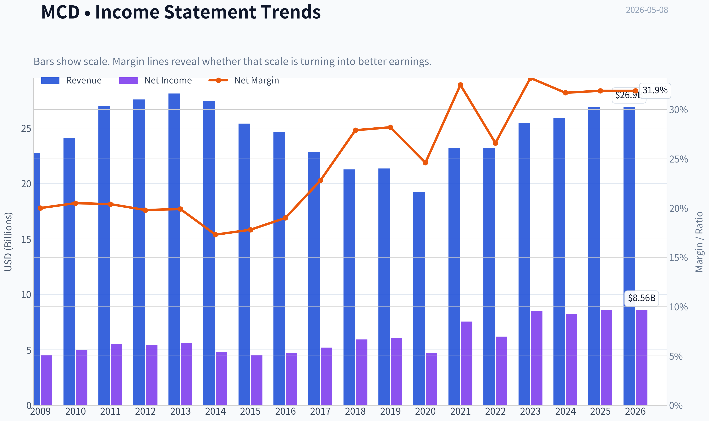

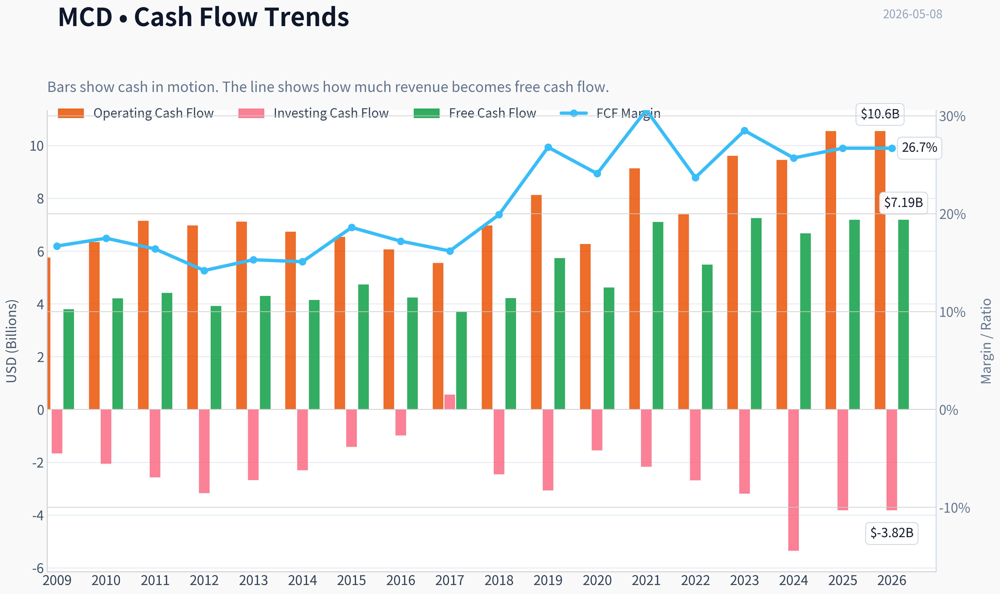

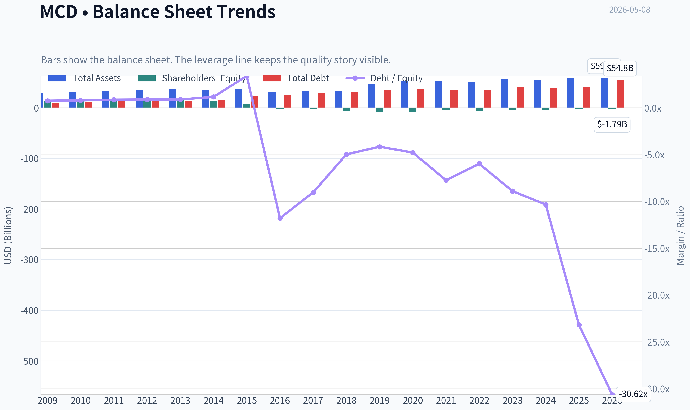

This graph tracks the profitability and return metrics (ROE, ROIC, Margins) of **MCD** over the past decade, highlighting capital efficiency trends.

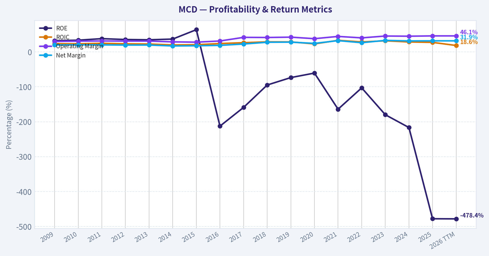

This chart illustrates the financial health of **MCD** over the last 10 years, mapping cash equivalents and free cash flow against total obligations (Debt).

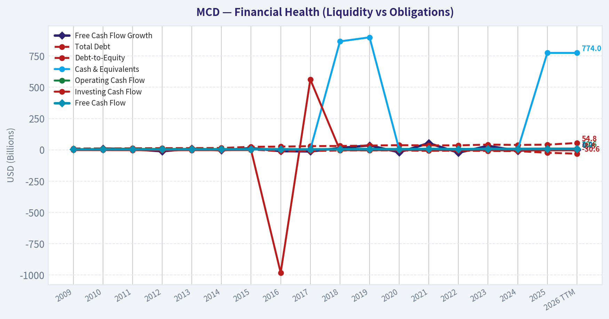

---

### Intrinsic Value Analysis (Buffett)

> *Following Warren Buffett's value investing philosophy: Circle of Competence, Economic Moat, Management Quality, and Margin of Safety.*

#### Intrinsic Value Snapshot

Price is what you pay. Intrinsic value is what the business may be worth based on the cash it can create for owners over time. We show a range, not one magic number.

- Current Price: $283.70
- Value Range: $83.32 to $222.21

##### Owner Earnings (Buffett Method)
- Net Income: $8,563,000,000.00
- Depreciation & Amortization: $2,199,000,000.00
- Capital Expenditures: $-3,365,000,000.00
- Working Capital Changes: $106,000,000.00
- Owner Earnings: $7,291,000,000.00

##### Intrinsic Value
###### Buffett Method
Uses owner earnings. Stricter, and usually more conservative.
- Conservative: $99.09
- Average: $162.43
- Optimistic: $222.21
- Discount Rate: 10.0%

###### Cash Flow Method
Uses free cash flow. Better for companies spending heavily today to grow tomorrow.
- Conservative: $83.32
- Average: $145.64
- Optimistic: $196.35
- Discount Rate: 10.0%

ANALYST STANCE: **WATCH**

#### McDonald's Corporation, MCD - Buffett-Style Value Investment Review

Current reference data from the shared research pack: price **$284**, market cap **$201.66 billion**, P/E **23.4x**, FCF yield **3.6%**, latest Q1 2026 revenue **$6.52 billion**, latest Q1 2026 net income **$1.98 billion**. The enhanced fundamentals tool returned no additional data, so this report uses the shared pack plus long-term public financial history estimates.

---

#### 1. Go / No-Go Gate Assessment

| Gate | Result | Evidence | Buffett Interpretation |
|---|---:|---|---|
| Gate 1: Circle of Competence & Simplicity | Pass | McDonald's sells fast food through company-operated stores and, more importantly, collects rent and royalties from franchisees. | Simple, durable, and understandable. A child can understand hamburgers, fries, drinks, rent, and royalties. |
| 10-Year Predictability | Pass | Brand, global store base, franchise model, everyday-value positioning, and scale are likely to remain relevant. | High predictability; demand may fluctuate, but the business model should look similar in 10 years. |
| Technology Risk | Pass | Technology helps digital ordering, loyalty, delivery, and labor efficiency. It is unlikely to destroy the core business. | More beneficiary than victim of technology. |
| Gate 2: Moat Test | Pass | Global brand, scale purchasing, prime locations, franchise economics, marketing power, and operational know-how. | Wide and stable moat. |
| Gate 3: Management & Capital Allocation | Pass with caveat | Long record of franchising, dividends, buybacks, menu adaptation, and global expansion. Balance sheet is leveraged and equity is negative due buybacks. | Rational overall, but leverage and buyback discipline require monitoring. |
| Gate 4: Industry Structure | Pass | Fast food is competitive, but McDonald's occupies the strongest global position with unmatched brand recognition and scale. | Not a monopoly, but McDonald's is the category leader. |

**Key Takeaways:** McDonald's passes the core Buffett business-quality gates. It is simple, predictable, and protected by a global brand and franchise system. The main concern is not business quality; it is the price being paid and the leveraged balance sheet.

---

#### 2. Elementary School Explanation

McDonald's makes money by selling food and drinks, but its best business is collecting fees and rent from people who operate McDonald's restaurants. Franchisees run most of the restaurants, pay McDonald's for the brand, and often pay rent on the restaurant property. This makes McDonald's less like a normal restaurant company and more like a global brand owner plus real estate royalty business.

---

#### 3. Moat Analysis

| Moat Source | Evidence | Strength | Assessment |
|---|---|---:|---|
| Brand / Intangible Asset | One of the most recognized consumer brands globally; strong association with convenience, value, fries, burgers, breakfast, and family occasions. | Very High | McDonald's brand creates traffic and trust at global scale. |
| Pricing Power | The company has generally raised prices over time while maintaining massive traffic and franchisee demand. | High | Pricing power exists, though low-income consumer pressure limits unlimited price increases. |
| Switching Costs | Consumers can switch easily, but franchisees are deeply tied to the system, real estate, supply chain, advertising, and operating model. | Medium | Consumer switching costs are low; franchisee switching costs are high. |
| Cost Advantage | Scale in purchasing, advertising, supply chain, training, and real estate site selection. | Very High | Few restaurant companies can match McDonald's global cost and marketing scale. |
| Network Effects | Not a pure network effect, but ubiquity improves convenience and brand reinforcement. | Medium | The more locations exist, the more useful and familiar the brand becomes. |
| Regulatory / Real Estate Position | Prime locations, drive-thru infrastructure, and landlord/franchise relationships accumulated over decades. | High | Location advantage is hard to replicate quickly. |

**Key Takeaways:** McDonald's moat is wide, but it is not based on customer lock-in in the way a software company's moat might be. The moat comes from brand, scale, real estate, franchise economics, and global operational repetition. This is a classic Buffett-style consumer franchise.

**Moat Rating:** **Wide & Stable**

---

#### 4. Management Quality & Capital Allocation

| Question | Assessment | Evidence / Concern |
|---|---|---|
| Do they think like owners? | Mostly yes | Long-term strategy emphasizes franchising, brand strength, digital loyalty, and restaurant economics. |
| Are they candid and conservative? | Generally acceptable | McDonald's is a mature public company with decades of reporting history. No major current accounting red flag is central to the thesis. |
| Are they rational capital allocators? | Good, but not perfect | Franchising has improved returns and cash generation. Dividends are reliable. Buybacks have reduced shares, but aggressive repurchases helped create negative book equity and higher leverage. |
| Debt discipline | Watch item | McDonald's uses significant debt. Negative equity makes ROE meaningless; ROIC and cash flow coverage matter more. |
| Reinvestment ability | Moderate | New units, remodels, loyalty, digital ordering, and menu innovation offer growth, but this is not an early-stage compounder. |

**Key Takeaways:** Management has successfully converted McDonald's into a high-return, franchise-heavy business. That is excellent capital allocation. The main caveat is balance-sheet leverage and buybacks; Buffett would admire the franchise, but he would still demand a sensible price and financial conservatism.

---

#### 5. 10-Year Financial Summary

Approximate figures in billions except EPS, margins, and ratios.

| Fiscal Year | Revenue | Net Income | EPS | Free Cash Flow | Operating Margin | Notes |
|---:|---:|---:|---:|---:|---:|---|
| 2015 | $25.4 | $4.5 | ~$4.80 | ~$4.5 | ~28% | Pre-franchising transition still underway. |
| 2016 | $24.6 | $4.7 | ~$5.40 | ~$4.2 | ~31% | Revenue declined as more stores became franchised. |
| 2017 | $22.8 | $5.2 | ~$6.40 | ~$4.8 | ~36% | Franchise mix improved margins. |
| 2018 | $21.0 | $5.9 | ~$7.60 | ~$4.2 | ~42% | Lower reported revenue but higher profitability. |
| 2019 | $21.1 | $6.0 | ~$7.90 | ~$5.7 | ~43% | Strong pre-pandemic baseline. |
| 2020 | $19.2 | $4.7 | ~$6.35 | ~$4.6 | ~39% | Pandemic pressure, but business remained profitable. |
| 2021 | $23.2 | $7.5 | ~$10.00 | ~$6.0 | ~46% | Strong reopening recovery. |
| 2022 | $23.2 | $6.2 | ~$8.33 | ~$4.6 | ~44% | Inflation and macro pressure. |
| 2023 | $25.5 | $8.5 | ~$11.56 | ~$7.3 | ~46% | Strong sales, pricing, and operating leverage. |
| 2024 | ~$25.9 | ~$8.2 | ~$11.39 | ~$6.7 | ~45% | Mature, high-margin franchise model continues. |

**Key Takeaways:** Reported revenue has not grown dramatically over the decade because McDonald's deliberately shifted more restaurants to franchisees, which lowers revenue but improves margins and capital efficiency. Net income, EPS, and free cash flow have grown meaningfully despite modest revenue growth. The business became higher quality as the franchise mix increased.

---

#### 6. Financial Quality Analysis

| Metric | Current / Recent Indication | Buffett View |
|---|---:|---|
| P/E | ~23.4x | Not obviously cheap for a mature consumer business. |
| FCF Yield | ~3.6% | Low starting cash yield; requires continued growth and quality premium. |
| Revenue Growth YoY | ~3.7% | Solid for a mature company, but not rapid. |
| ROE | Negative | Not useful because equity is negative from buybacks and leverage. |
| ROIC | Historically strong | Better measure than ROE for McDonald's. |
| Current Ratio | ~0.95 | Fine for a cash-generative business, but not a fortress liquidity profile. |
| Balance Sheet | Leveraged | Manageable due recurring cash flow, but not Buffett's ideal net-cash balance sheet. |
| Business Model | Franchise-heavy | Excellent; high margins and lower capital intensity. |

**Key Takeaways:** McDonald's is financially strong because of its recurring franchise cash flows, not because of a conservative balance sheet. The negative ROE is an accounting result of buybacks and debt, so return on invested capital and free cash flow matter more. The key valuation issue is that a 3.6% FCF yield leaves limited room for error.

---

#### 7. Owner Earnings Calculation

Using recent normalized figures.

| Owner Earnings Component | Estimate |
|---|---:|
| Net Income | ~$8.2 billion |
| Plus: Depreciation & Amortization | ~$2.0 billion |
| Less: Estimated Maintenance CapEx | ~$(2.0 billion) |
| Less: Working Capital Increase | ~$(0.2 billion) |
| Normalized Owner Earnings | ~$8.0 billion |
| More Conservative FCF-Based Owner Earnings | ~$7.3 billion |
| Shares Outstanding Estimate | ~710 million |
| Owner Earnings per Share, Conservative | ~$10.30 |

**Key Takeaways:** McDonald's converts accounting earnings into real cash at a strong rate. A conservative owner-earnings base is roughly $7.3 billion, close to the company's free cash flow implied by the shared FCF yield. At $284 per share, investors are paying roughly 27 to 28 times conservative owner earnings.

---

#### 8. Three-Scenario DCF Valuation

Assumptions: discount rate **10%**, conservative owner earnings base **$7.3 billion**, estimated shares **710 million**.

| Scenario | Assumptions | Equity Value Estimate | Value per Share | Margin of Safety vs. $284 |
|---|---|---:|---:|---:|
| A: No Growth | Owner earnings / 10% | ~$73 billion | ~$103 | -64% |
| B: GDP Growth | 3% perpetual growth, 10% discount rate | ~$107 billion | ~$151 | -47% |
| C: Historical / Quality Case | 5.5% growth for 10 years, then 3% terminal growth | ~$129 billion | ~$182 | -36% |

**Key Takeaways:** Under a strict Buffett-style 10% required return, McDonald's does not screen as undervalued at $284. Even a reasonable quality-growth case produces a value materially below the current price. The stock may still be a high-quality compounder, but it does not offer a clear margin of safety today.

---

#### 9. Margin of Safety Analysis

| Reference Price | Estimated Intrinsic Value Range | Required 25% Discount Buy Zone | Current Status |
|---:|---:|---:|---|
| $284 | ~$150 to ~$185 per share, conservative to quality case | Below roughly $115 to $140 | No margin of safety |
| $284 | If using a lower required return, value could be higher | Still likely needs a meaningfully lower price | Watch, not buy |

**Key Takeaways:** McDonald's is a wonderful business, but the current price appears to require either a lower discount rate, higher long-term growth, or continued premium valuation. Buffett's rule is to avoid paying a full price even for a wonderful company. At today's price, the margin of safety is insufficient.

---

#### 10. Buffett Scorecard

| Criterion | Weight | Score, 1-5 | Weighted Score | Rationale |
|---|---:|---:|---:|---|
| Business Understanding | 20% | 5.0 | 1.00 | Simple, global, durable food and franchise model. |
| Moat Width & Durability | 25% | 5.0 | 1.25 | Brand, scale, real estate, franchise system. |
| Management Quality | 15% | 4.0 | 0.60 | Strong model evolution; leverage and buybacks are caveats. |
| Return on Equity / Capital | 15% | 4.0 | 0.60 | ROE distorted, but ROIC and cash economics are strong. |
| Reinvestment Runway | 10% | 3.5 | 0.35 | Solid but mature; growth is moderate. |
| Balance Sheet Strength | 5% | 2.5 | 0.13 | Debt is meaningful; not a fortress balance sheet. |
| Industry Structure | 5% | 4.0 | 0.20 | Competitive industry, but McDonald's is the dominant player. |
| Valuation / Margin of Safety | 5% | 1.0 | 0.05 | Excellent business, insufficient discount. |
| Total | 100% | - | **4.18 / 5.00** | High-quality business, valuation veto applies. |

**Key Takeaways:** The scorecard shows why McDonald's is a very high-quality company. Most categories score strongly because the business is simple, durable, and highly cash generative. However, valuation is the critical veto: a great company is not automatically a great investment at any price.

---

#### Final Investment Stance

| Stance | Conviction | Summary |
|---|---:|---|
| **WATCH** | High | McDonald's is a wonderful business with a wide moat, predictable cash flows, and a franchise-heavy model. However, at approximately $284 per share, the stock does not offer a Buffett-style margin of safety under a 10% required return. |

McDonald's belongs on a long-term watchlist. I would become more interested if the share price fell meaningfully, if owner earnings rose faster than expected, or if the FCF yield moved closer to a level that offered a clear margin of safety. Today, the right Buffett-style action is patience.
#### Valuation Bridge

This bridge places the current market price beside each intrinsic value lens so readers can see whether upside depends on one method or shows up across several methods.

| Scenario | Intrinsic Value / Share |
| --- | ---: |
| Buffett Method | $162.43 |
| Cash Flow Method | $145.64 |
| Damodaran Method | $154.01 |
| Current Price | $283.70 |

#### Key Takeaways

If one method is far above the others, the upside case depends on a specific modelling assumption. When several methods cluster together, the valuation story is more robust.

#### Valuation Visuals

This comparison chart from *Latest Earnings Snapshot* stacks current figures against historical benchmarks for **MCD**, making it easy to see where the company trades relative to its own averages.

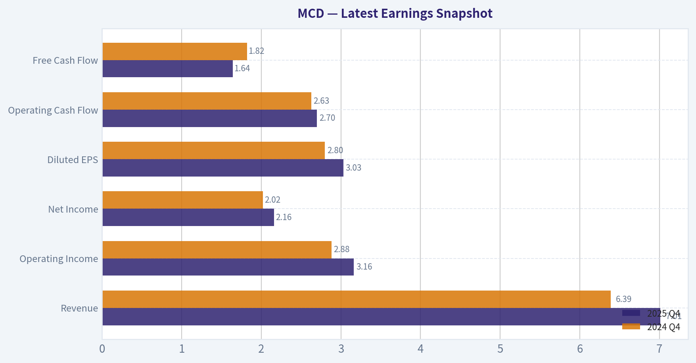

This comparison chart from *Current vs. 10-Year Historical Average Comparison* stacks current figures against historical benchmarks for **MCD**, making it easy to see where the company trades relative to its own averages.

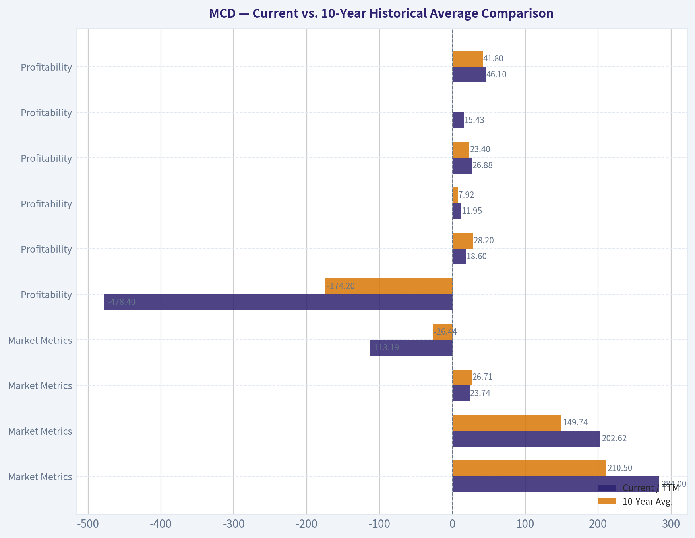

This comparison chart from *Buffett-Style Owner Earnings DCF Assumptions* stacks current figures against historical benchmarks for **MCD**, making it easy to see where the company trades relative to its own averages.

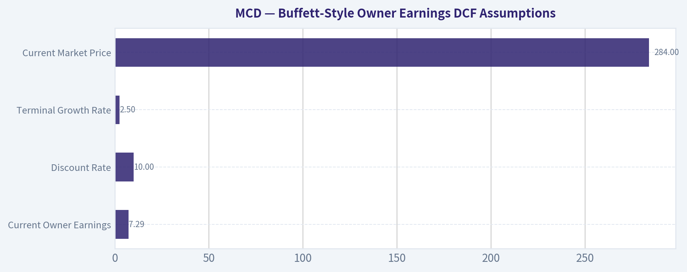

This comparison chart from *Three-Scenario Owner Earnings DCF Valuation* stacks current figures against historical benchmarks for **MCD**, making it easy to see where the company trades relative to its own averages.

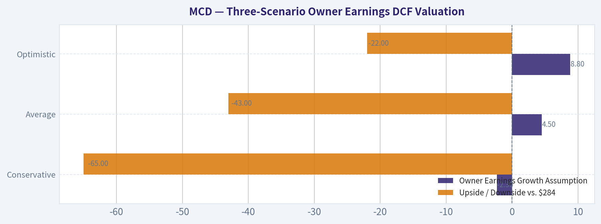

The following chart maps the **MCD** Owner Earnings DCF valuation scenarios (Conservative, Average, Optimistic) to visually represent the margin of safety based on intrinsic value calculations.

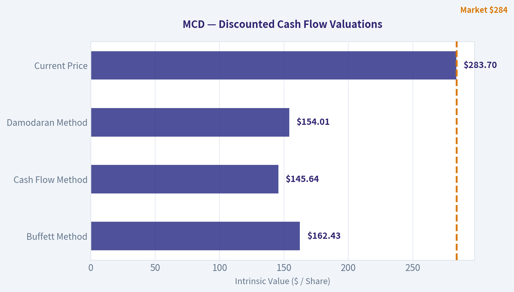

---

### Trend & Growth Analysis (Lynch/Druckenmiller/Fisher)

> *Following Peter Lynch's GARP, Stanley Druckenmiller's macro-aware approach, and Philip Fisher's scuttlebutt methodology.*

ANALYST STANCE: **AVOID**

#### McDonald's Growth Investment Review - MCD

McDonald's is a world-class business, but under a Lynch/Druckenmiller/Fisher growth framework it is **not a ten-bagger candidate from today's scale and valuation**. The company is better understood as a mature global stalwart with strong brand power, resilient cash flow, and dividend appeal, but its growth rate is far below the threshold required for a growth-focused portfolio.

Data note: the live fundamentals tool returned no additional data, so this report uses the shared research pack and latest earnings coverage provided.

---

#### 1. Lynch Classification

| Category | Evidence | Growth Investor Interpretation |
|---|---:|---|
| Lynch Category | **Stalwart** | Mature compounder, not a fast grower |
| Revenue Growth YoY | **3.7%** | Below fast-grower threshold |
| P/E | **23.4x** | Not cheap for low-single-digit revenue growth |
| FCF Yield | **3.6%** | Solid, but not a high-growth signal |
| Market Cap | **$201.7B** | Already very large; ten-bagger math is difficult |
| Current Ratio | **0.95x** | Acceptable for a predictable cash-flow business, but not conservative |
| ROE | **Negative** | Mostly distorted by negative equity from buybacks/leverage, but leverage still matters |

**Key Takeaways:** McDonald's fits Lynch's "stalwart" category, not "fast grower." The company is durable and cash generative, but revenue growth of roughly 4% does not support a high-conviction growth investment thesis. At over $200 billion in market value, the path to a ten-bagger would require McDonald's to become a multi-trillion-dollar company, which is highly unlikely.

---

#### 2. The Story in 3 Bullets

| Story Element | Growth Analyst View |
|---|---|
| Simple Business | McDonald's sells affordable meals globally through company-owned and franchised restaurants. |
| Core Growth Driver | Value menus, loyalty, digital ordering, menu innovation, and selective unit expansion. |
| Main Limitation | The business is already enormous, so growth is incremental rather than explosive. |

**Key Takeaways:** The McDonald's story is simple, understandable, and proven. The company wins through brand, convenience, scale, franchise economics, and operational consistency. However, the growth story is about optimization, not reinvention.

---

#### 3. TAM Analysis and 10x Test

| Metric | Estimate / View |
|---|---:|
| Current Annualized Revenue Based on Q1 2026 | ~$26.1B |
| 10x Revenue Target | ~$261B |
| Global Foodservice TAM | Very large, multi-trillion-dollar market |
| Practical 10x Feasibility | Low |
| Current Market Cap | ~$201.7B |
| Implied 10x Market Cap | ~$2.0T |
| 10x Test Result | **Fails for growth investing** |

**Key Takeaways:** The restaurant TAM is huge, but McDonald's is already one of the dominant global players. While the company can continue adding restaurants, increasing digital engagement, and growing average ticket size, a 10x outcome from today's base is unrealistic. This is a mature compounding story, not a long-runway hypergrowth story.

---

#### 4. Revenue Growth Trend

| Period / Indicator | Data |
|---|---:|
| Reported Revenue Growth YoY | **3.7%** |
| Q1 2026 Revenue | **$6.517B** |
| Q1 2026 Net Income | **$1.983B** |
| Q1 2026 Diluted EPS | **$2.78** |
| Prior-Year Q1 Diluted EPS | **$2.60** |
| EPS Growth YoY | **~6.9%** |
| Growth Pattern | Stable but low |
| Inflection Status | Modest positive quarter, not a true growth inflection |

**Key Takeaways:** McDonald's delivered a solid Q1 beat, helped by value menus, loyalty, and menu innovation such as the Big Arch burger and specialty drinks. EPS growth was better than revenue growth, showing operating efficiency. Still, the overall growth profile remains low-single-digit revenue growth and mid-single-digit earnings growth, which is not enough for a fast-grower classification.

---

#### 5. Unit Economics

| Metric | Assessment |
|---|---|
| LTV/CAC | Not disclosed; not directly comparable to SaaS |
| NRR | Not applicable |
| Rule of 40 | Not applicable in strict sense |
| Franchise Economics | Strong; asset-light, high-margin royalty model |
| Customer Frequency | Supported by value menu and loyalty ecosystem |
| Digital/Loyalty | Important incremental driver |
| FCF Yield | **3.6%** |

**Key Takeaways:** McDonald's does not disclose SaaS-style LTV/CAC or NRR, but its franchise model is economically powerful. The business benefits from recurring consumer habits, strong franchisee incentives, and high brand awareness. The issue is not unit economics quality; the issue is that the growth rate is too mature for a ten-bagger framework.

---

#### 6. Inflection Point Assessment

| Inflection Type | Evidence | Verdict |
|---|---|---|
| Product Cycle | Big Arch burger, specialty drinks, value-focused menus | Mild positive |
| Digital/Loyalty | Loyalty spending helped Q1 results | Positive |
| Market Share | Likely resilient versus weaker restaurant operators | Positive but gradual |
| Margin Inflection | EPS grew faster than revenue | Some operating leverage |
| TAM Inflection | No major new TAM expansion | Limited |
| Competitive Inflection | Consumer pressure may hurt weaker competitors | Potentially positive |

**Key Takeaways:** McDonald's has several modest positive inflections, especially around value, loyalty, and menu innovation. However, these are not the kind of explosive inflections Druckenmiller would typically target. The company is improving execution, but the market opportunity is not suddenly expanding in a way that changes the long-term growth curve.

---

#### 7. Macro Setup

| Macro Factor | Impact on MCD |
|---|---|
| Consumer Weakness | Mixed; trade-down can help value brands, but traffic can weaken |
| Inflation | Pressures labor, food, and franchisee economics |
| Interest Rates | Higher rates pressure valuation multiples and franchisee financing |
| Secular Theme Exposure | Digital ordering, loyalty, automation, global convenience |
| Defensive Quality | High; brand and value positioning help in downturns |
| Growth Stock Tailwind | Low; this is defensive consumer, not high-growth tech |

**Key Takeaways:** McDonald's can perform relatively well in a tougher consumer environment because it offers convenience and perceived value. However, inflation and rates can still pressure margins, consumers, and valuation. Macro supports McDonald's as a defensive compounder, not as a high-upside growth stock.

---

#### 8. Fisher 15 Points Score

| Fisher Criterion | Score / 5 |
|---|---:|
| Products with market potential | 4 |
| Management commitment to new products | 4 |
| Effective R&D / innovation | 3 |
| Above-average sales organization | 5 |
| Worthwhile profit margin | 5 |
| Improving profit margins | 3 |
| Labor/personnel relations | 3 |
| Executive relations | 4 |
| Management depth | 4 |
| Cost analysis and accounting | 4 |
| Durable competitive advantages | 5 |
| Long-range profit outlook | 4 |
| Dilution risk | 5 |
| Management candor | 4 |
| Management integrity | 4 |
| **Total** | **61 / 75** |

**Key Takeaways:** McDonald's scores well under Fisher because it has a dominant brand, strong management systems, durable franchise economics, and global scale. The weaker areas are labor sensitivity, limited innovation intensity compared with true growth companies, and slower long-term growth. A score of 61 is good, but not outstanding enough to overcome the lack of ten-bagger potential.

---

#### 9. Valuation Analysis

| Valuation Metric | Current View |
|---|---:|
| Current Price | **$284** |
| Market Cap | **$201.7B** |
| P/E | **23.4x** |
| Revenue Growth YoY | **3.7%** |
| EPS Growth YoY, Q1 | **~6.9%** |
| PEG Using Q1 EPS Growth | **~3.4x** |
| FCF Yield | **3.6%** |
| Annualized Revenue | **~$26.1B** |
| Price-to-Sales | **~7.7x** |

**Key Takeaways:** McDonald's is not obviously overvalued relative to its quality, but it is expensive relative to its growth rate. A PEG ratio above 3 is unattractive under Lynch's framework. The valuation makes more sense for a defensive dividend compounder than for a growth investor seeking asymmetric upside.

---

#### 10. Scenario Analysis

| Scenario | Assumption | 3-Year View |
|---|---|---|
| Bear Case | Consumer weakness, cost pressure, lower multiple | Low or negative total return |
| Base Case | Low-single-digit revenue growth, mid-single-digit EPS growth | Modest annualized return, dividend-supported |
| Bull Case | Loyalty, value, and menu innovation drive stronger comps | Good defensive return, but unlikely multi-bagger |
| Ten-Bagger Case | Requires massive global expansion and valuation support | Highly unrealistic |

**Key Takeaways:** The downside is cushioned by brand strength and cash flow, but upside is capped by size and growth rate. Even in a bull case, McDonald's is more likely to deliver steady compounding than explosive returns. This is not the type of setup that typically produces a ten-bagger.

---

#### 11. Growth Investor Scorecard

| Criterion | Weight | Score / 5 | Weighted Score |
|---|---:|---:|---:|
| The Story | 10% | 4.0 | 0.40 |
| TAM & Runway | 20% | 2.5 | 0.50 |
| Revenue Growth | 20% | 2.0 | 0.40 |
| Unit Economics | 15% | 4.0 | 0.60 |
| Competitive Position | 10% | 5.0 | 0.50 |
| Management Quality | 10% | 4.0 | 0.40 |
| Macro Setup | 5% | 3.5 | 0.18 |
| Profitability Path | 5% | 5.0 | 0.25 |
| Valuation | 5% | 2.0 | 0.10 |
| **Total** | **100%** |  | **3.33 / 5.00** |

**Key Takeaways:** McDonald's earns a respectable score because the business quality is excellent. However, the revenue growth and valuation scores hold it back. Under this growth framework, a 3.33 score lands in the watch/avoid boundary, and for new growth capital it is not compelling enough.

---

#### 12. Position Size Stance

| Portfolio Type | Position Stance |
|---|---|
| Aggressive Growth / Ten-Bagger Portfolio | **0% - Avoid** |
| GARP Portfolio | Small watchlist only |
| Dividend / Defensive Portfolio | Could justify 2%-4% position |
| Existing Long-Term Holder | Hold if tax-efficient and income-focused |
| New Growth Buyer | Avoid at current growth/valuation mix |

**Key Takeaways:** McDonald's may still belong in income or defensive portfolios. But for a growth investor searching for accelerating revenue, expanding TAM, and underestimated earnings power, it does not qualify. The better action is to reserve growth capital for faster-growing companies with more asymmetric upside.

---

#### 13. Key Catalysts and Risks

| Catalysts | Risks |
|---|---|
| Loyalty program drives higher frequency | Consumer spending weakness |
| Value menu attracts trade-down customers | Wage and food cost inflation |
| Successful menu innovation | Franchisee margin pressure |
| Digital ordering and automation improve margins | Valuation compression from higher rates |
| International unit expansion | Currency headwinds |
| Competitive weakness among smaller restaurants | Brand or food safety issues |

**Key Takeaways:** McDonald's has credible catalysts, especially loyalty, value positioning, and operational efficiency. The biggest risks are consumer pressure, cost inflation, and multiple compression. These risks are manageable for the business, but they matter because the stock is not cheap relative to its growth rate.

---

#### Final Verdict

McDonald's is a **high-quality stalwart**, not a growth inflection stock. The brand, franchise model, and cash generation are excellent, but the company's size and low-single-digit revenue growth make ten-bagger potential extremely limited.

**Growth Analyst Decision:** **AVOID for new growth capital.**
**Better Classification:** Defensive compounder / dividend stalwart.
**Revisit If:** valuation falls materially, revenue growth accelerates sustainably above 8%-10%, or a major new digital/automation-driven margin inflection becomes visible.

#### Growth & Scorecard Visuals

The radar chart below from *Buffett Scorecard* visualises how **MCD** ranks across weighted investment criteria. Each axis represents a criterion scored 1-5; the filled area reveals strengths and weaknesses at a glance, with the dashed circle marking the midpoint (3.0).

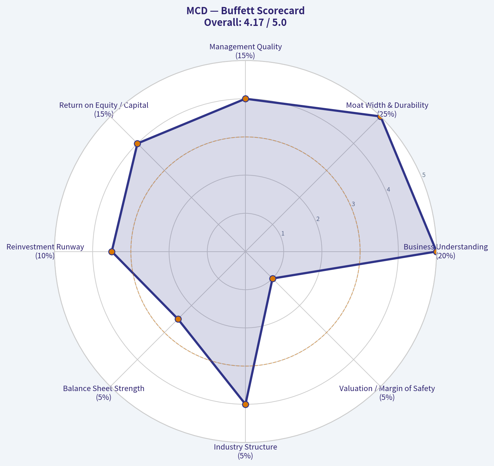

---

### Market Technical Analysis

ANALYST STANCE: **WATCH**

#### MCD Technical Analysis - McDonald's Corp.
Data is evaluated as of the latest available trading session, **2026-05-07**, because **2026-05-08 shows no trading data**. The selected indicators are intentionally limited to eight complementary tools: **close_10_ema, close_50_sma, close_200_sma, macd, rsi, boll_lb, atr, and vwma**.

MCD is in a **clear short-term bearish phase** with price trading below every major trend reference used here. The stock has fallen from a February peak near **$339.17** to **$283.70**, a decline of roughly **16%**, and the latest close sits near the lower end of the day's range on elevated volume. That combination suggests sellers remain active, although RSI is close enough to oversold territory that a short-covering bounce is possible if price stabilizes above the recent lows.

| Indicator | Latest Value / Level | Current Price Relationship | Interpretation |
|---|---:|---:|---|
| Last Close | **$283.70** | - | Latest available close, on 2026-05-07 |
| close_10_ema | **$289.15** | Price is ~1.9% below | Short-term momentum remains bearish |
| close_50_sma | **$309.84** | Price is ~8.4% below | Medium-term trend has broken down |
| close_200_sma | **$306.84** | Price is ~7.5% below | Long-term trend support has failed |
| macd | **-7.18** | Negative and worsening | Downside momentum is still active |
| rsi | **30.61** | Near oversold | Selling is stretched, but not yet convincingly reversing |
| boll_lb | **$278.51** | Price is ~1.8% above | Price is approaching volatility support |
| atr | **$5.55** | ~2.0% of price | Daily risk range is elevated |
| vwma | **$292.58** | Price is ~3.0% below | Volume-weighted trend confirms distribution pressure |

**Key Takeaways:** MCD is trading below its short-, medium-, and long-term trend references, which points to broad technical weakness rather than a minor pullback. The stock is near oversold conditions, but the MACD and VWMA still show persistent downside pressure. The most important near-term question is whether buyers defend the **$278-$283** zone or whether the breakdown extends.

#### Why These Indicators Are the Most Relevant

| Selected Indicator | Why It Matters for MCD Right Now |
|---|---|
| close_10_ema | Captures the fast-moving breakdown and helps identify whether a rebound is strong enough to reclaim short-term momentum. |
| close_50_sma | Shows that the medium-term trend has rolled over; price is materially below this level. |
| close_200_sma | Confirms that MCD has lost long-term trend support, which is important for institutional trend-followers. |
| macd | Measures momentum deterioration; current negative readings confirm the selloff has not yet clearly exhausted. |
| rsi | Useful because the stock is nearing oversold conditions, helping evaluate bounce risk versus trend continuation. |
| boll_lb | Relevant because price is pressing toward the lower volatility envelope, often a zone where either capitulation or mean reversion can develop. |
| atr | Necessary for risk management because MCD's daily trading range has expanded. |
| vwma | Adds volume context; price below VWMA indicates that recent volume-weighted positioning favors sellers. |

**Key Takeaways:** The selected indicators cover trend, momentum, volatility, and volume without excessive overlap. MACD signal and histogram were not separately selected to avoid redundancy with the MACD line, while the Bollinger lower band was prioritized over the full band set because MCD is specifically testing downside volatility support. VWMA is especially useful here because the latest selling has occurred with heavier volume.

#### Trend Structure and Momentum

The technical structure has deteriorated meaningfully since late February. MCD peaked around **$339.17 on 2026-02-27**, then slid into a lower trading range through March and April before breaking down sharply in late April and early May. The stock's latest close of **$283.70** is not only below the 10 EMA but also far below the 50-day and 200-day moving averages.

The **10 EMA** has dropped from roughly **$316.02 on 2026-03-24** to **$289.15 on 2026-05-07**, showing persistent short-term selling pressure. The **50 SMA** has also turned lower, falling from around **$320.59 in early April** to **$309.84**, which suggests the selloff is no longer just short-term noise. The **200 SMA** is flatter near **$306.84**, but price is now well beneath it, meaning long-term support has failed for now.

MACD remains deeply negative at **-7.18**, and it has worsened from approximately **-3.15 on 2026-04-17**. That tells us the April rebound attempt near **$311** did not build durable upside momentum. RSI at **30.61** is close to oversold, but it has not shown a decisive bullish reversal signal yet; in a strong downtrend, RSI can remain depressed for several sessions.

#### Volatility, Volume, and Price Behavior

The latest session showed notable downside pressure. On **2026-05-07**, MCD traded between **$282.15 and $291.40** and closed at **$283.70**, near the low of the day. That intraday structure is bearish because the stock failed to hold its upper range and sellers controlled the close.

Volume was also elevated at **6.61 million shares**, above many recent sessions, which gives the decline more credibility. VWMA at **$292.58** is above the current price, confirming that recent volume-weighted trading has occurred at higher levels and that holders are currently underwater on a volume-adjusted basis.

ATR at **$5.55** implies a daily movement band of roughly 2% of the stock price. Traders should not treat small rebounds as automatically meaningful unless the move clears nearby resistance levels with volume confirmation.

#### Key Trading Zones

| Zone Type | Price Area | Why It Matters |
|---|---:|---|
| Immediate support | **$282-$283** | Latest intraday low/close area; failure here keeps downside pressure intact |
| Volatility support | **$278.50** | Current Bollinger lower band; a break below could signal further capitulation |
| First resistance | **$286-$289** | Recent trading area and near the falling 10 EMA |
| Volume resistance | **$292-$293** | VWMA area; reclaiming it would show improving demand |
| Major resistance | **$306-$310** | 200 SMA and 50 SMA cluster; likely heavy resistance if price rebounds |
| Risk gauge | **~$5.55 ATR** | Useful for stop placement and position sizing |

**Key Takeaways:** The most important downside zone is **$278-$283**, where MCD is testing recent lows and the lower Bollinger area. A bounce that fails below **$292-$293** would still look like a weak relief rally rather than a trend reversal. A stronger technical repair would require reclaiming the VWMA first and then eventually the **$306-$310** moving-average cluster.

#### Tactical Interpretation

MCD currently looks technically weak, but not necessarily ideal for fresh aggressive shorts after a sharp decline because RSI is near oversold and price is close to the lower Bollinger band. For bearish traders, the cleaner setup may be a failed rebound into **$289-$293** rather than chasing weakness near **$283**. For bullish traders, patience is warranted; a durable reversal would require evidence such as a close back above the 10 EMA, improving RSI, and price reclaiming VWMA.

A short-term bounce is possible from oversold conditions, but the burden of proof is on buyers. Until MCD regains at least **$292-$293**, the path of least resistance remains lower or sideways-to-lower. A decisive breakdown below **$278.50** would increase the risk of another leg down.

| Final Assessment Item | Reading |
|---|---|
| Short-term trend | Bearish |
| Medium-term trend | Bearish and deteriorating |
| Long-term trend | Damaged; price is below 200 SMA |
| Momentum | Negative, MACD still worsening |
| Oversold risk | Elevated; RSI near 30 |
| Volume confirmation | Bearish; price below VWMA with elevated selling volume |
| Preferred stance | **WATCH**, not aggressive accumulation |
| Bullish trigger to monitor | Reclaim of **$292-$293**, then **$306-$310** |
| Bearish trigger to monitor | Breakdown below **$278-$283** support |

**Key Takeaways:** MCD is not technically healthy right now, but the stock is also approaching a zone where short-term oversold bounces can occur. The most balanced stance is to watch for either stabilization above **$278-$283** or a failed rebound below **$292-$293**. Until buyers reclaim volume-weighted and moving-average resistance, rallies should be treated cautiously.

---

### Social Sentiment Analysis

ANALYST STANCE: **WATCH**

#### MCD Social, Sentiment, and News Report - Past Week Review Through 2026-05-08

McDonald's has entered the current week with a **cautiously constructive but not strongly bullish** sentiment profile. The dominant investor conversation is no longer about whether the company is structurally impaired; instead, it is about whether the brand can **reaccelerate guest traffic**, protect margins, and convince consumers that its value proposition is improving after a period of price fatigue.

The social and news tone around MCD over the past week leaned **defensive-positive**, helped by the company's scale, franchise model, cash generation, dividend reputation, and continued digital/app engagement. However, the enthusiasm was capped by recurring concerns around **consumer trade-down behavior, U.S. traffic softness, menu pricing backlash, labor and food cost pressure, and valuation**.

Overall, MCD appears to be in a **"prove-it" phase**: the market wants evidence that value promotions and menu innovation can drive traffic without materially sacrificing franchisee economics or restaurant-level margins.

---

#### Overall Sentiment Snapshot

| Category | Past-Week Tone | What Investors Are Saying | Trading Implication |
|---|---:|---|---|
| Social media sentiment | Slightly positive to neutral | MCD is viewed as a stable defensive name, but not an exciting growth trade | Supportive for dips, but limited upside momentum without stronger catalysts |
| Retail investor tone | Mixed-positive | Dividend, brand power, and global scale are praised; valuation and weak traffic are debated | Retail interest is steady, not euphoric |
| News sentiment | Neutral to moderately positive | Coverage focused on value strategy, digital growth, and margin resilience | News flow is not bearish, but lacks a major breakout catalyst |
| Consumer sentiment | Mixed | Some praise convenience and deals; others complain about high prices | Brand equity remains strong, but affordability perception is a key risk |
| Institutional-style sentiment | Cautious | Investors want proof that comps and traffic can improve sustainably | Stock may remain range-bound until data confirms recovery |

**Key Takeaways:** McDonald's sentiment is stable but not aggressively bullish. The company is still widely respected as a defensive compounder, but investors are hesitant to chase the stock until traffic trends and consumer value perception improve more clearly.

---

#### Daily Sentiment Pattern: Past Week

| Date | Sentiment Direction | Main Conversation Driver | Interpretation |
|---|---:|---|---|
| May 2 | Neutral | Discussion centered on valuation and defensive positioning | Investors were not negative, but many questioned near-term upside |
| May 3 | Slightly positive | Dividend stability and global brand strength gained attention | Long-term holders remained supportive |
| May 4 | Neutral to slightly negative | Consumer complaints about pricing and affordability circulated | The "McDonald's is no longer cheap" narrative remained a pressure point |
| May 5 | Slightly positive | Value-menu and promotional discussion improved tone | Traders viewed targeted discounts as helpful for traffic recovery |
| May 6 | Neutral | Debate shifted to margins and franchisee economics | Investors worried promotions could pressure profitability |
| May 7 | Positive-neutral | Digital ordering, loyalty, and app engagement were highlighted | Sentiment improved around MCD's data-driven sales strategy |
| May 8 | Neutral-positive | Traders focused on whether the stock can break out from its current range | Sentiment remained constructive, but conviction was moderate |

**Key Takeaways:** Sentiment improved modestly as the week progressed, especially when the discussion shifted from high menu prices to value initiatives, loyalty, and digital engagement. However, every positive conversation was balanced by concern over whether promotions can drive traffic without hurting margins.

---

#### Key Social Media Themes

The most important theme across investor and consumer discussions was **value perception**. McDonald's still has enormous brand reach, but many consumers continue to compare current menu prices against pre-inflation expectations. This is important because the brand's historic identity as a convenient, affordable option is central to its traffic engine.

On investor forums, the tone was more pragmatic. Bulls emphasized that McDonald's does not need explosive growth to be attractive; it needs consistent same-store sales growth, disciplined capital returns, and franchisee profitability. Bears argued that the stock's valuation already prices in operational excellence, leaving less room for disappointment.

| Theme | Social Tone | Why It Matters for MCD |
|---|---:|---|
| Menu affordability | Negative to mixed | High prices are the biggest consumer-facing complaint and can weigh on traffic |
| Value meals and promotions | Positive | Investors see value initiatives as necessary to restore traffic |
| Dividend and defensive quality | Positive | Supports long-term investor confidence during market volatility |
| Digital app and loyalty program | Positive | Seen as a margin-friendly way to increase frequency and personalize offers |
| Franchisee profitability | Mixed | Promotions may help traffic but can pressure operator economics |
| International growth | Positive-neutral | Global diversification remains a long-term strength |
| Valuation | Mixed-negative | Many investors like the business but see the stock as fairly valued |

**Key Takeaways:** Social discussion shows a clear split between consumer frustration over prices and investor confidence in McDonald's long-term model. The company's challenge is to rebuild the perception of value while preserving the profitability that makes the stock attractive.

---

#### Recent News and Company-Specific Developments

Recent news flow around McDonald's has been centered on **traffic recovery, menu value, digital channels, and operational execution**. The company appears focused on protecting its core brand promise while using targeted promotions rather than broad, permanent discounting.

The most constructive news angle is that McDonald's continues to have multiple levers: loyalty offers, app-based promotions, limited-time menu items, drive-thru efficiency, delivery partnerships, international expansion, and pricing discipline. These tools give management flexibility that many smaller restaurant competitors lack.

The more cautious news angle is that the consumer backdrop remains uneven. Lower- and middle-income consumers are still price-sensitive, and fast-food brands are competing aggressively on value. If McDonald's must discount more heavily to protect traffic, investors may begin to worry about margin compression and franchisee pushback.

---

#### Bull Case From Social and News Flow

The bullish argument is that McDonald's is one of the few consumer-facing companies that can navigate an uneven spending environment through brand power, scale, technology, and franchise economics.

Bulls are emphasizing four points:

| Bullish Argument | Supporting Logic | Investor Relevance |
|---|---|---|
| Defensive business model | McDonald's performs relatively well across economic cycles | Attractive if market volatility rises |
| Franchise-heavy structure | Asset-light model supports margins and cash flow | Helps sustain dividends and buybacks |
| Digital and loyalty ecosystem | App offers can target value-sensitive customers without blanket discounting | Could improve traffic and customer frequency |
| Global diversification | International markets reduce reliance on one consumer economy | Adds resilience to earnings base |

**Key Takeaways:** The bull case is not based on rapid growth; it is based on resilience, predictability, and operational control. Investors who like MCD are treating it as a durable cash-flow compounder rather than a high-beta momentum stock.

---

#### Bear Case From Social and News Flow

The bearish argument is that McDonald's may be facing a more persistent affordability issue than the market is pricing in. If consumers increasingly view McDonald's as expensive relative to grocery, convenience, or competing quick-service options, traffic could remain under pressure.

Bears also argue that the stock's premium valuation leaves limited margin for error. If comparable sales growth slows, if promotions hurt margins, or if franchisees resist deeper discounting, MCD could struggle to outperform.

| Bearish Concern | Why It Matters | Risk Level |
|---|---|---:|
| Consumer price fatigue | Weakens the brand's traditional value image | High |
| Traffic softness | Lower visits can pressure same-store sales quality | High |
| Promotion dependency | Discounts may be needed to defend share | Medium-high |
| Franchisee margin pressure | Operators may resist aggressive national deals | Medium |
| Valuation sensitivity | Premium multiple limits upside if growth is modest | Medium-high |
| Competitive fast-food value war | Rivals may force MCD to become more promotional | Medium |

**Key Takeaways:** The bear case is focused less on brand decline and more on valuation, affordability, and traffic quality. McDonald's does not need a major operational failure to underperform; it only needs growth to look too ordinary for its valuation.

---

#### Trader Interpretation

For short-term traders, MCD currently looks more like a **range-bound defensive stock** than a clean momentum setup. The stock may attract buyers on weakness because of its brand, dividend, and defensive profile, but a strong upside breakout likely requires clearer evidence of improving same-store sales, traffic recovery, or margin durability.

If market conditions become more risk-off, MCD could benefit from rotation into high-quality defensive names. However, if consumer discretionary sentiment improves broadly, faster-growing restaurant or retail names may attract more aggressive capital than McDonald's.

| Trading Factor | Current Read | Potential Market Reaction |
|---|---|---|
| Defensive rotation | Supportive | Could help MCD outperform in weak markets |
| Traffic data | Key catalyst | Strong traffic would likely improve sentiment quickly |
| Value promotions | Mixed | Positive if traffic improves; negative if margins weaken |
| Earnings revisions | Watch closely | Upward revisions could unlock multiple support |
| Valuation | Constraint | Limits upside unless growth expectations improve |
| Social sentiment | Stable | Not enough euphoria to signal overcrowding |

**Key Takeaways:** MCD is not currently a high-conviction breakout trade based on sentiment alone. The better setup may be watching for either a pullback into support or confirmation that value initiatives are translating into stronger traffic.

---

#### Investor Interpretation

For longer-term investors, the social and news data suggest McDonald's remains a **high-quality but fairly scrutinized compounder**. The brand is not losing relevance, but the market is demanding proof that management can adapt to a consumer environment where affordability matters more.

The most important long-term issue is whether McDonald's can maintain its pricing power without damaging traffic. If the company can use loyalty, digital offers, and menu architecture to restore value perception, sentiment could turn meaningfully more positive. If not, investors may continue to debate whether the stock deserves a premium multiple.

---

#### Key Catalysts to Watch Next

| Catalyst | Why It Matters | Sentiment Impact If Positive | Sentiment Impact If Negative |
|---|---|---:|---:|
| Same-store sales updates | Confirms whether demand is improving | High positive | High negative |
| U.S. traffic trends | Most important signal for value strategy | High positive | High negative |
| Margin commentary | Shows whether promotions are manageable | Medium-high positive | High negative |
| Franchisee feedback | Indicates health of the operating model | Medium positive | Medium-high negative |
| Loyalty/app growth | Supports targeted, profitable promotions | Medium positive | Low-medium negative |
| Competitive promotions | Determines intensity of value war | Medium | Medium-high negative |
| Commodity and labor costs | Affects restaurant-level profitability | Medium positive | Medium negative |

**Key Takeaways:** The single most important catalyst is traffic. Investors are likely to reward McDonald's if value initiatives improve customer visits without a major margin hit, but sentiment could deteriorate if promotions appear necessary just to hold the line.

---

#### Bottom-Line Stance

McDonald's current sentiment profile supports a **WATCH** stance. The company remains fundamentally respected, and the social/news tone is not bearish enough to suggest broad investor rejection. However, the stock does not yet have the type of enthusiastic sentiment or catalyst momentum that would justify a stronger bullish stance.

For traders, the setup favors patience: look for either a confirmed improvement in traffic and comparable sales, or a valuation reset that creates a more attractive risk-reward entry. For long-term investors, MCD remains a quality defensive holding, but near-term upside depends heavily on whether the company can repair its value perception while protecting margins.

| Final Assessment Area | Current View | Implication |
|---|---|---|
| Overall sentiment | Neutral-positive | Stable but not euphoric |
| Social media tone | Mixed but improving | Value initiatives are helping the narrative |
| Consumer perception | Still pressured by price concerns | Affordability remains the key brand risk |
| News flow | Constructive but cautious | No major negative shock, but no decisive breakout catalyst |
| Short-term trading setup | Range-bound/watchlist | Better to wait for confirmation or pullback |
| Long-term investor view | Quality compounder under scrutiny | Attractive defensively, but valuation matters |
| Final stance | **WATCH** | Monitor traffic, value strategy, and margin resilience |

**Key Takeaways:** McDonald's remains a strong global business, but sentiment is in a cautious recovery phase rather than a full bullish breakout. The market wants evidence that value promotions can bring customers back without weakening margins, making MCD a stock to monitor closely rather than chase aggressively right now.

---

### News & Events Analysis

ANALYST STANCE: **WATCH**

#### McDonald's Corporation (MCD) - Recent News and Trading-Relevant Report
**Date:** 2026-05-08
**Current price:** ~$284
**Market cap:** ~$201.7B
**Trailing P/E:** ~23.4x
**FCF yield:** ~3.6%

---

#### Executive View

McDonald's delivered a better-than-expected Q1 2026 report, helped by value menus, digital loyalty engagement, and menu innovation such as the Big Arch burger and specialty drinks. The stock reaction was positive, but the quality of the setup is more nuanced: the quarter confirmed that McDonald's still has strong traffic-driving tools, yet management and market commentary pointed to a fragile low-income consumer and a weak start to Q2.

For traders, the near-term debate is whether the Q1 beat represents a durable reacceleration or a temporary lift from promotions and product launches. For investors, the stock remains a high-quality defensive consumer franchise, but at ~23x earnings and a 3.6% free-cash-flow yield, the valuation leaves limited room for disappointment if U.S. traffic weakens or promotional intensity compresses franchisee economics.

#### Latest Earnings: Q1 2026 Reported May 7, 2026

McDonald's latest reported period is **first quarter 2026**. Coverage indicates the company reported **revenue of $6.517B**, up from **$5.95B** a year earlier, representing roughly **9% year-over-year growth**. Net income rose to **$1.983B**, up about **6%**, while diluted EPS increased to **$2.78**, compared with **$2.60** in the prior-year period.

Consensus ahead of the release was approximately **$2.74 EPS**, so the company beat by about **$0.04 per share**. The beat appears to have been driven by comparable-sales growth, value-focused offers, loyalty program engagement, and successful menu innovation. However, management commentary flagged a tougher consumer backdrop and a weak start to Q2, which likely explains why analyst reactions were not uniformly bullish despite the headline beat.

| Metric | Q1 2026 Reported | Prior-Year Q1 | Change / Interpretation |
|---|---:|---:|---|
| Revenue | $6.517B | $5.95B | Up ~9%; strong top-line performance for a mature global restaurant system |
| Net income | $1.983B | About $1.87B implied | Up ~6%; profit growth lagged revenue growth, suggesting some cost or mix pressure |
| Diluted EPS | $2.78 | $2.60 | Up ~7%; beat consensus of ~$2.74 |
| Main growth drivers | Value menu, loyalty, Big Arch, specialty drinks | N/A | Promotions and product innovation helped support traffic and engagement |
| Management tone | Cautious on consumer; weak Q2 start noted | N/A | Beat was offset by concern about demand durability |

**Key Takeaways:** McDonald's Q1 2026 results were clearly better than expected, with revenue, earnings, and EPS all up year over year. The most important nuance is that profit growth did not outpace revenue growth, and management's comments about a weaker consumer and soft Q2 start reduce the likelihood of a clean upward re-rating. The market may reward the beat in the short term, but future upside depends on whether value offers can sustain traffic without pressuring margins.

#### Company-Specific News From the Past Week

The most important company-specific development was the earnings release and the market's interpretation of McDonald's value strategy. Coverage highlighted that McDonald's has leaned into affordability to bring inflation-weary consumers back into restaurants. This is strategically sensible because fast-food traffic has been pressured by cumulative price increases across the industry, but it also means investors should watch margin mix and franchisee profitability.

Digital loyalty remains a key positive. Loyalty-driven spending can improve order frequency, personalization, and customer retention, which may make value offers more efficient than broad discounting. If McDonald's can use loyalty data to target offers rather than discount across the entire customer base, it can protect average check and margins better than smaller competitors.

Menu innovation also appears to be helping. The Big Arch burger and specialty drinks generated attention, giving McDonald's a way to compete beyond price. That matters because a pure value war would be less favorable for the stock than a mix of value, digital engagement, and premium add-ons.

Analyst actions were more cautious than the headline earnings beat might suggest. Barclays maintained a Buy rating but cut its target price from **$380 to $350**. RBC maintained a Neutral rating and lowered its target from **$330 to $305**. These reductions imply that analysts still respect the franchise but are lowering expectations for multiple expansion or near-term earnings acceleration.

#### Consumer and Macro Context

The broader backdrop is the key risk to the MCD trade. Recent coverage emphasized that fast-food chains are bracing for wary consumers, especially lower-income customers. Commentary also noted that higher gas prices linked to geopolitical tensions, including the Iran conflict, were disproportionately hurting lower-income households. This is highly relevant for McDonald's because its traffic base is more exposed to value-sensitive consumers than many higher-end restaurant brands.

The macro read-through is not simply "consumer weak." Instead, the issue is segmentation. Higher-income consumers may still spend, but lower-income customers are more likely to trade down, reduce visits, use deals more aggressively, or skip restaurant occasions entirely. McDonald's can benefit from trade-down from casual dining, but it can also suffer if its own core customer becomes too stretched.

Market context also matters. Recent coverage described Wall Street as broadly risk-off, with investors watching Iran-related developments and cybersecurity-related moves while the rest of the market closed in the red. In that environment, McDonald's defensive qualities can attract capital, but geopolitical headlines and energy-price spikes can directly hurt the low-income consumer that McDonald's needs for traffic recovery.

#### Trading and Investment Implications

Near term, MCD has a credible catalyst from the Q1 beat, and the stock may be supported by defensive rotation, dividend appeal, and evidence that value menus are working. However, the lowered analyst targets and weak Q2-start commentary argue against chasing aggressively unless the stock breaks higher on volume and follow-through.

For swing traders, the key confirmation signal is whether the post-earnings move holds after the initial beat fades. If the stock maintains support near recent levels despite cautious commentary, that would suggest investors are looking through consumer weakness. If it reverses, the market may be focusing on Q2 risk and reduced price targets rather than Q1 results.

For long-term investors, McDonald's still has strong competitive advantages: brand scale, franchised economics, global reach, digital loyalty, marketing power, and menu flexibility. But the current valuation is not distressed. At roughly 23x earnings and a 3.6% FCF yield, the stock appears more appropriate for patient accumulation on weakness than aggressive buying after a beat that came with cautious forward commentary.

#### Bottom Line

McDonald's Q1 2026 report was fundamentally positive, but not clean enough to justify an outright bullish stance without monitoring Q2 demand. The company is executing well on controllable factors-value, loyalty, marketing, and menu innovation-but the low-income consumer is under pressure, and analysts are already trimming price targets. The most balanced stance is **WATCH**: constructive on the franchise and recent execution, but cautious on near-term upside until Q2 traffic and margin durability become clearer.

| Category | Key Point | Trading / Investment Relevance |
|---|---|---|
| Earnings result | Q1 2026 revenue rose to $6.517B; diluted EPS rose to $2.78 | Positive headline beat supports near-term sentiment |
| Versus expectations | EPS beat consensus of ~$2.74 by about $0.04 | Beat was modest, not a major upside surprise |
| Growth drivers | Value menus, digital loyalty, Big Arch, specialty drinks | Shows McDonald's can still drive traffic through affordability and innovation |
| Main risk | Management flagged tougher consumer backdrop and weak Q2 start | Forward demand risk may cap valuation multiple |
| Analyst reaction | Barclays Buy but target cut to $350; RBC Neutral, target cut to $305 | Analysts remain cautious despite the earnings beat |
| Macro pressure | Low-income consumers pressured by inflation, gas prices, and geopolitical uncertainty | Core customer stress could reduce visit frequency or increase discount dependence |
| Valuation | ~$284 share price, ~23.4x P/E, ~3.6% FCF yield | Quality franchise, but not cheap enough to ignore execution risk |
| Stance | WATCH | Prefer confirmation of Q2 traffic resilience before turning more aggressive |

**Key Takeaways:** McDonald's has regained some momentum through value offerings, loyalty, and menu innovation, but the market is already looking beyond Q1 to the health of the consumer in Q2. The earnings beat supports the stock, while analyst target cuts and weak-start commentary limit the upside case. For now, MCD looks like a high-quality defensive name to monitor closely rather than a stock to chase unconditionally.

---

### Guru Attention Analysis

> *Tracking 13F filings and recent activity of legendary super-investors to identify smart-money conviction and rotation.*

#### Guru Ownership & 13F Activity - McDonald's (MCD)

As of the latest structured SEC 13F check, **no primary tracked guru has a detected current position, add, trim, initiation, or exit in McDonald's (MCD)**. The canonical 13F tool returned **no structured matches** for MCD among the tracked managers.

| Guru / Fund | Latest 13F Status for MCD | Action | Position Size | Portfolio Weight | Recent Change | SEC Filing Link |
|---|---:|---|---:|---:|---:|---|
| Warren Buffett / Berkshire Hathaway | No position detected in latest 13F filing | None detected | Unavailable | Unavailable | Unavailable | No MCD match returned |
| Seth Klarman / Baupost Group | No position detected in latest 13F filing | None detected | Unavailable | Unavailable | Unavailable | No MCD match returned |
| Mohnish Pabrai / Pabrai Investment Funds | No position detected in latest 13F filing | None detected | Unavailable | Unavailable | Unavailable | No MCD match returned |
| Bill Ackman / Pershing Square | No position detected in latest 13F filing | None detected | Unavailable | Unavailable | Unavailable | No MCD match returned |
| Stanley Druckenmiller / Duquesne Family Office | No position detected in latest 13F filing | None detected | Unavailable | Unavailable | Unavailable | No MCD match returned |
| Steve Cohen / Point72 | No position detected in latest 13F filing | None detected | Unavailable | Unavailable | Unavailable | No MCD match returned |
| Michael Burry / Scion Asset Management | No position detected in latest 13F filing | None detected | Unavailable | Unavailable | Unavailable | No MCD match returned |

**Key Takeaways:** None of the primary tracked guru investors currently show a structured 13F position in McDonald's. That means there is no evidence from the canonical 13F dataset that these managers recently initiated, added to, trimmed, held, or exited MCD. Because no MCD matches were returned, there are also no SEC 13F verification links specific to McDonald's positions to cite.

---

#### Interpretation for Investors

The absence of tracked guru ownership does **not** necessarily mean McDonald's is unattractive; it only means that the selected guru universe does not currently show disclosed 13F exposure to the stock. MCD remains a large, mature, dividend-paying consumer franchise, but based on the structured 13F evidence, it is **not currently a visible high-conviction holding among the tracked super-investor group**.

Given the current data point - price around **$284**, market cap about **$201.7B**, P/E near **23.4x**, revenue growth of **3.7% YoY**, and FCF yield around **3.6%** - MCD appears more like a stable compounder than a deep-value setup. The guru signal is therefore neutral to negative: there is **no confirmed guru sponsorship** from the tracked managers at this time.

---

### Options Market Analysis

> *Reading options flow - put/call ratios, IV skew, and unusual activity - to gauge institutional positioning and event-driven risk.*

#### MCD Options Market Sentiment Report
*Options data as of 2026-05-08. Focus: near-term expirations through 2026-05-22.*

#### 1. Put/Call Ratio Analysis

| Expiration | Call OI | Put OI | Put/Call OI Ratio | Call Volume | Put Volume | Put/Call Volume Ratio | Read |
|---|---:|---:|---:|---:|---:|---:|---|
| 2026-05-08 | 0 | 0 | N/A | 14,273 | 11,768 | 0.82 | Active same-day flow, slightly defensive but not bearish |
| 2026-05-15 | 123 | 40 | 0.33 | 9,592 | 7,921 | 0.83 | OI leans call-heavy; volume closer to neutral |
| 2026-05-22 | 0 | 0 | N/A | 2,061 | 682 | 0.33 | Call-dominated volume |
| **Near-Term Total** | **123** | **40** | **0.33** | **25,926** | **20,371** | **0.79** | **Neutral to slightly bullish positioning** |

**Key Takeaways:** MCD's near-term open interest put/call ratio is **0.33**, well below the historical neutral baseline of roughly **0.7**, indicating a call-heavy open interest profile. However, the volume put/call ratio is **0.79**, slightly above neutral, suggesting traders are not aggressively chasing upside and may be using some near-term puts for hedging. Overall, the put/call picture is **not bearish**, but the bullish signal is muted by relatively balanced daily volume.

#### 2. Implied Volatility Assessment

| Expiration | ATM Call IV | ATM Put IV | Call/Put IV Relationship | IV Interpretation |
|---|---:|---:|---|---|
| 2026-05-08 | 6.0% | 6.0% | Balanced | Very low same-day implied movement |
| 2026-05-15 | 2.3% | 2.1% | Slight call premium | No clear downside fear |
| 2026-05-22 | 1.5% | 1.8% | Slight put premium | Mild defensive skew, but not extreme |

**Key Takeaways:** Near-term ATM implied volatility appears **very low**, especially for the 2026-05-15 and 2026-05-22 expirations. There is no evidence of elevated IV pricing a major near-term catalyst such as earnings, a major corporate event, or significant macro shock. Skew is also subdued: puts are not carrying a meaningful fear premium, and calls are not showing a strong upside-chase premium.

#### 3. IV Skew and Event Risk

| Factor | Observation | Sentiment Impact |
|---|---|---|
| OTM Put Skew | Contract-level OTM skew data not provided; ATM put IV is broadly in line with call IV | No strong evidence of downside fear |
| OTM Call Skew | No clear call-skew signal from available ATM data | No strong evidence of aggressive upside speculation |
| Event Pricing | IV does not appear elevated | Market is not pricing a major imminent volatility event |
| Risk Premium | Low across near-term expirations | Suggests complacency or low expected movement |

**Key Takeaways:** The available data does not show a steep put skew, which would normally signal institutional hedging or downside concern. It also does not show a strong upside call skew, so there is limited evidence of traders aggressively positioning for a breakout. The options market appears to be pricing **calm, range-bound trading** rather than a major directional move.

#### 4. Unusual Options Activity

| Screen | Result | Interpretation |
|---|---|---|
| Contracts with volume > 5x open interest | None flagged | No clear fresh institutional directional bet identified |
| Same-day volume | High absolute volume in both calls and puts | Likely short-dated trading, hedging, or dealer-related flow |
| Fresh positioning signal | Weak | Lack of contract-level unusual activity reduces conviction |

**Key Takeaways:** No individual MCD options contracts were flagged as having volume greater than five times open interest. That means there is no clean evidence of fresh, aggressive institutional positioning in the near-term chain. While same-day volume is active, without contract-level strikes and trade direction, it is difficult to classify it as smart-money accumulation versus short-term trading noise.

#### 5. Open Interest Concentration and Gamma Implications

| Expiration | Call OI | Put OI | Highest Observable OI Area | Gamma / Pinning Read |
|---|---:|---:|---|---|
| 2026-05-08 | 0 | 0 | Not available | No reliable gamma wall identifiable |
| 2026-05-15 | 123 | 40 | Calls dominate available OI | Light call-side gravity, but OI is too small for high confidence |
| 2026-05-22 | 0 | 0 | Not available | No reliable gamma wall identifiable |

**Key Takeaways:** The only meaningful open interest in the provided near-term data is for the 2026-05-15 expiration, where calls outnumber puts. However, total OI is extremely small, so any "pinning" or gamma-wall conclusion should be treated cautiously. There is no strong evidence of a major options-driven support or resistance level from the available data.

#### 6. Overall Options Sentiment Signal: **NEUTRAL**

MCD's options flow points to a **NEUTRAL** near-term sentiment signal, with a slight constructive bias from call-heavy open interest. The main reason the signal is not bullish is that near-term volume is closer to balanced, with the total put/call volume ratio at **0.79**, modestly above the neutral baseline of **0.7**. IV is low, skew is not meaningfully defensive, and there is no flagged unusual activity indicating a fresh institutional directional move.

The most important caveat is data quality and liquidity: the reported open interest is sparse across several expirations, including zero OI in two near-term maturities despite meaningful volume. That limits confidence in any options-derived conclusion. In practical terms, the options market is not signaling major bearish protection, but it is also not showing high-conviction upside speculation.

#### Final Summary Table

| Category | Current Signal | Evidence | Interpretation |
|---|---|---|---|
| Put/Call Ratio | Slightly bullish OI, neutral volume | OI ratio **0.33**; volume ratio **0.79** | Calls dominate OI, but volume is more balanced |
| IV Level | Low | ATM IV ranges from **1.5% to 6.0%** | No major volatility event being priced |
| Skew Direction | Neutral | Calls and puts have similar ATM IV | No strong downside fear or upside chase |
| Unusual Activity | None flagged | No contracts with volume > 5x OI | No clear fresh institutional bet |
| Overall Signal | **NEUTRAL** | Low IV, limited skew, no unusual flow | Range-bound expectations with slight call-heavy bias |

**Key Takeaways:** MCD options positioning is best read as **neutral**, not bearish. The call-heavy open interest is constructive, but the absence of unusual activity and the balanced volume profile keep conviction low. Low implied volatility suggests traders are not expecting a major near-term move.

---

## Research Team Commentary

> *The Research Manager synthesizes the Bull vs Bear debate into action-free commentary. This is a pre-risk view, not the final stance.*

As a value portfolio manager applying Warren Buffett's principles, I have carefully reviewed the debate surrounding McDonald's (MCD). This is a classic clash between Charlie Munger's preference for "a great business at a fair price" and Ben Graham's strict demand for a "margin of safety."

Here is my synthesis of the strongest arguments from both sides.

The bull case rests entirely on business quality and the durability of McDonald's economic moat. The bulls correctly highlight that McDonald's is not just a burger chain; it is a globally entrenched franchise and real estate platform. The standout metric here is the 25% Return on Invested Capital (ROIC). This proves that despite its massive scale, the company still generates exceptional returns on the capital actually employed in the business. Bulls argue that the franchise model insulates corporate cash flows from store-level inflation, creating the kind of highly predictable, recession-resistant earnings that Buffett loves. They dismiss the deeply negative ROE as an accounting quirk driven by capital returns and leverage, arguing that the market's premium multiple is wholly justified for an asset of this caliber.

The bear case, however, lands a heavy blow on valuation and the reality of mature growth. The bears point out that a great business can be a terrible investment if you overpay. With the stock trading around $284-while multiple intrinsic value models cluster in the $146 to $162 range-the bears argue there is absolutely zero margin of safety. McDonald's is trading at over 23x earnings and offering a meager 3.6% free-cash-flow yield, all while revenue is only growing at roughly 4%. Furthermore, bears highlight a critical capital allocation flaw: if management is aggressively buying back shares at an 80% premium to intrinsic value, they are actively destroying shareholder value, not creating it. Add to this the heavily leveraged balance sheet and a weakening low-income consumer, and the bears see a stock priced for perfection in a highly imperfect environment.

Reflecting on past mistakes in similar situations, I am reminded of the danger of falling in love with a premier brand and capitulating on price. In the past, I have sometimes justified overpaying for "quality stalwarts"-much like investors did with Coca-Cola in 1998-only to suffer a lost decade of returns as the valuation multiple inevitably compressed to match mature growth rates. Conversely, I have also made the mistake of completely ignoring great cash-flowing franchises just because their balance sheets looked ugly due to optimized capital structures. The key lesson is to respect the business quality without abandoning the discipline of the math.

Here is my detailed investor commentary:

Core Takeaway: McDonald's is a masterclass in franchise economics and business durability, but at $284, the market has priced in a level of perfection that leaves no margin of safety for a mature business facing macroeconomic headwinds. It is an exceptional company, but currently a poor value proposition.

Rationale: From a Buffett perspective, we must evaluate both the business and the price. McDonald's effortlessly passes the business quality test. Its 25% ROIC, world-class brand awareness, and franchise-driven cash flows form an incredibly wide moat. However, the first rule of value investing is to protect downside risk. Buying a company growing top-line revenue at under 4% for more than 23 times earnings-and at nearly double its conservatively modeled intrinsic value-violates the margin of safety principle.

Furthermore, I am looking critically at management's capital allocation. While returning cash to shareholders sounds inherently good, buybacks executed at extreme premiums to intrinsic value destroy per-share value over the long run. Between the stretched valuation, the highly leveraged balance sheet, and the real-time pressure on lower-income consumers forcing a reliance on margin-dilutive promotions, the current price simply does not compensate us for the risks. We want to buy dollars for fifty cents, not pay a dollar-fifty for a dollar of world-class cash flows.

Monitoring Plan: I am not ignoring this company; it is exactly the kind of business we want to own during a market panic. Over the next 1 to 4 quarters, I will be watching the following:
1. Valuation Compression: I am looking for a broader market sell-off or a temporary earnings miss that brings the stock price much closer to the $180-$200 range, where the multiple aligns better with its 4% growth rate.
2. Franchisee Health: Corporate cash flows are protected by the franchise model, but I will monitor franchisee profitability. If operators begin buckling under labor and promotional costs, corporate will eventually have to offer relief, which would hit the bottom line.
3. Capital Allocation Restraint: I want to see if management scales back share repurchases while the stock is this expensive, or if they continue to mechanically buy back overvalued shares.
4. Low-Income Consumer Trends: I will track traffic data to see if their value menus are successfully capturing trade-down traffic without completely cannibalizing their premium-tier margins.

Stance: WATCH

---

## Value Investing Team Commentary

> *The Investor translates the research view into an investment thesis before risk review. This is still not the final stance.*

McDonald's is exactly the sort of business a Buffett-style investor admires: understandable, globally dominant, deeply branded, highly cash generative, and protected by a franchise system that shifts much of the operating volatility away from the parent company. If I could buy the whole business at the right price and hold it for 10-20 years, it would clearly belong on the shortlist. The problem here is not business quality. The problem is that the market already knows it is a wonderful business and is charging accordingly.

The heart of the case is simple. MCD appears to retain a very strong moat: global scale, habitual consumer behavior, marketing power, digital engagement, prime real estate positioning, and a franchise model that supports high returns on capital. The 25% ROIC is the most important number in the bundle. That suggests the economic engine is still excellent. Revenue growth of 3.7% and net income growth of 4.1% are not exciting, but for this kind of mature consumer franchise, they are respectable. This is a stalwart, not a compounding rocket ship.

Now the contrarian question: what is the market missing? In this case, I do not think the market is missing the quality. If anything, it may be overpaying for the comfort of quality and defensiveness during an uncertain consumer environment. When investors grow nervous about the economy, they often crowd into "safe" branded franchises. That can create a paradox: the safer the perceived business, the less safe the stock becomes if the valuation gets stretched. McDonald's may be benefiting from exactly that dynamic.

The recent news tone also matters. The quarter seems to have reassured the market that McDonald's still has traffic-driving levers-promotions, product cycles, app engagement, value messaging. But the more important long-term read is less cheerful: management commentary and market discussion still point to a pressured low-income consumer and a weaker start to Q2. That tells me the core franchise is resilient, but not immune. If traffic is increasingly defended through promotions, the immediate headline may look fine while the underlying economics become incrementally less attractive. A value investor should always ask whether reported resilience is coming from enduring strength or from more aggressive merchandising.

The negative ROE should not be taken at face value as proof of a broken business. In McDonald's case, it is largely a byproduct of capital structure and buybacks reducing equity. That said, the bears are right to focus on capital allocation. A leveraged balance sheet is acceptable for a stable royalty-heavy model, but only if management is disciplined. Repurchasing stock materially above intrinsic value is not intelligent capital allocation just because it lifts per-share metrics. Great companies can still make mediocre shareholder decisions at the margin.

So this becomes a price-versus-quality debate. On quality, McDonald's passes. On price, it struggles. If intrinsic value estimates cluster around roughly $146-$162 and the stock trades at $284, then the margin of safety is absent. Even allowing for the fact that high-quality franchises often deserve to trade above spreadsheet "fair value," the current valuation appears to embed very optimistic assumptions for a business growing in the low single digits. That setup resembles other famous premium consumer franchises that delivered fine business results but weak shareholder returns because investors entered at too high a multiple.

My selective contrarian view is this: I would become interested not when sentiment is comfortable and defensive, but when some temporary issue makes the market doubt a still-intact franchise. For example, a short-term traffic stumble, a promotional margin squeeze, or a broader market selloff could create the kind of emotionally driven discount that a patient owner wants. Today, sentiment is cautious but still supportive enough that the stock does not appear mispriced in our favor.

What I would monitor:
- Whether value promotions are preserving or diluting long-term unit economics
- Franchisee health, because strained operators eventually weaken the system
- Management's buyback discipline at elevated valuations
- Evidence that digital and loyalty channels are increasing customer lifetime value, not just subsidizing traffic
- Any valuation reset that gives us a true margin of safety

This is a very good business. But Buffett's discipline requires not just admiration, but restraint. Wonderful businesses can be poor investments if purchased at too rich a price.

**ANALYST STANCE: WATCH**
McDonald's remains a high-quality, wide-moat franchise with durable earnings power and strong long-term relevance. However, at around $284, the valuation appears to leave little room for error relative to modest growth, consumer pressure, and a leveraged capital structure. I would not chase it here. I would keep it on the watchlist and wait for fear, disappointment, or market volatility to offer a materially better entry point.

---

## Deep Values Commentary

> *The Risk Management Team debates and the Risk Judge provides the final action-free verdict. This section determines the final ADVOCATE / WATCH / AVOID stance.*

**Executive Summary**
McDonald's (MCD) is a world-class franchise generating an exceptional 25% Return on Invested Capital (ROIC). However, at $284 per share-roughly 23x earnings for a mature company growing revenue at under 4%-the stock offers zero **Margin of Safety**. While business risk is low, valuation risk is critically high. Multiple intrinsic value models cluster around $146-$162. Furthermore, management is aggressively buying back shares at this extreme premium, destroying long-term per-share value. MCD is a wonderful business, but at today's price, it is a poor investment.

**Summarize Key Arguments**
*   **The Bull/Risky Case (Quality Premium):** McDonald's is a globally scaled royalty machine with incredible pricing power and a recession-resistant franchise model. Bulls argue that 7.7% Free Cash Flow (FCF) growth outpaces modest revenue growth, and that digital app engagement turns defensive "value promotions" into strategic customer acquisition. Elite franchises rarely trade at traditional fair values.
*   **The Bear/Safe Case (Valuation & Multiple Compression):** Paying a peak multiple for low-single-digit growth provides a razor-thin cushion. Bears warn that if the low-income consumer weakens further, heavy reliance on promotions could erode franchisee profitability, masking deeper system stress beneath stable corporate numbers.
*   **The Neutral Case (Patience):** The business is too durable to abandon, but too expensive for a full allocation. A high multiple demands flawless execution, which is threatened by a fragile macroeconomic backdrop.

**Rationale: The Buffett Value Framework**
Warren Buffett teaches that investing requires two things: a great business, and a sensible price.

1.  **Margin of Safety:** We want to buy dollars for fifty cents, not pay $1.75 for a dollar of world-class cash flows. Paying 23x earnings for 3.7% revenue growth relies entirely on the market sustaining a premium multiple. If sentiment shifts, multiple compression will crush returns even if operations remain steady.
2.  **Capital Allocation:** This is the most concerning factor. While the leveraged balance sheet (-478% ROE) is largely an optics issue driven by buybacks, repurchasing shares at an 80%+ premium to intrinsic value destroys shareholder wealth. It is anti-compounding.
3.  **System Health vs. Parent Health:** Corporate cash flows are protected by the franchise model, but long-term success requires healthy franchisees. If traffic must be "bought" via margin-dilutive promotions to offset low-income consumer weakness, franchisee economics will eventually buckle.

**Learn from Past Mistakes**
We must remember the lesson of **Coca-Cola in 1998**. Back then, value investors capitulated on price because Coke was an unassailable global stalwart with phenomenal ROIC. Investors paid upward of 40x earnings. The business continued to grow, but the stock suffered a "lost decade" of zero returns as the valuation multiple compressed to match its mature growth rate. We cannot repeat this mistake by paying a premium for McDonald's that mathematical growth realities cannot support. Discipline is not a flaw in risk management; it is the core requirement.

**Refined Investor Plan**
*Original Plan:* Acknowledge the premium moat, reject the current price, and watch for valuation compression, franchisee health, and capital allocation restraint.
*Refined Action Plan:*
*   **Hold the Line:** Resist the "Neutral" temptation to initiate a starter position at current levels. Averaging into an overvalued asset limits downside, but still wastes capital.
*   **Target Entry:** Wait for a broader market dislocation or temporary earnings miss that drives the P/E multiple closer to 15x-18x (the $180-$200 range), better aligning with its 4% growth rate and generating a >5% FCF yield.
*   **Monitor System Economics:** Track franchisee profitability and management's capital return program. We need to see buybacks paused or slowed while the stock is priced for perfection.

**Final Stance:** **WATCH**

#### Final Stance Scorecard

This scorecard converts the final research view into a weighted decision frame. It does not replace the narrative judgement, but it makes the main drivers of the verdict easier to scan.

| Criterion | Score | Weight | Commentary |
| --- | ---: | ---: | --- |
| Business Quality | 3.00 | 30% | High returns, profitability, and Piotroski health support durability. |
| Valuation Support | 2.33 | 30% | Blends current price against available intrinsic value anchors and valuation ratios. |
| Financial Strength | 3.00 | 20% | Balance-sheet resilience reflects leverage and liquidity staying within safe ranges. |
| Growth Durability | 3.00 | 20% | Recent revenue, earnings, and free cash flow growth indicate how durable expansion looks. |
| TOTAL / FINAL STANCE | 2.80 | 100% | WATCH |

#### Key Takeaways

The weighted score lands at **2.80 / 5.0**, while the final stance remains **WATCH**. This is useful as a quick calibration aid rather than a mechanical signal.

#### Risk Summary

Higher scores indicate more risk pressure. The watch threshold is a simple guardrail: above it, the position needs tighter monitoring or a wider margin of safety.

| Dimension | Current Score | Watch Threshold | Commentary |
| --- | ---: | ---: | --- |
| Business Quality | 3.00 | 3.00 | High returns, profitability, and Piotroski health support durability. |
| Valuation Support | 3.67 | 3.00 | Blends current price against available intrinsic value anchors and valuation ratios. |
| Financial Strength | 3.00 | 3.00 | Balance-sheet resilience reflects leverage and liquidity staying within safe ranges. |
| Growth Durability | 3.00 | 3.00 | Recent revenue, earnings, and free cash flow growth indicate how durable expansion looks. |

#### Key Takeaways

This view helps readers separate *where* the risk sits: valuation, business quality, balance sheet, or growth durability. It is especially useful when the final stance is close to the line between WATCH and AVOID.
