# MCK Deep Value Intelligence

**Analysis Date:** 2026-03-22

## Critical Disclaimer

*This analysis is generated by Deep Value Intelligence, an AI-powered multi-agent investing framework. This report is for informational and educational purposes only and does not constitute financial advice. Always conduct your own research and consult with qualified financial advisors before making investment decisions.*

---

## Table of Contents

1. Intelligence Summary
2. Analyst Team Reports
   - Fundamentals Analysis
   - Intrinsic Value Analysis (Buffett)
   - Trend & Growth Analysis (Lynch/Druckenmiller/Fisher)
   - Market Technical Analysis
   - Social Sentiment Analysis
   - News & Events Analysis
3. Research Team Commentary
4. Value Investing Team Commentary
5. Deep Values Commentary

---

## Intelligence Summary

### Thesis + Conditions

**Core Thesis:** **EXECUTIVE SUMMARY**
McKesson operates as an essential, wide-moat oligopoly controlling the arteries of U.S. healthcare.

**Key Risks:**
- McKesson operates as an essential, wide-moat oligopoly controlling the arteries of U.S. healthcare. However, its microscopic 3.7% gross margin reveals a distinct lack of pricing power against consolidated pharmaceutical makers and mega-insurers. While specialty drugs and GLP-1s are providing a massive cyclical revenue boost, a P/E of 25.5x completely prices in perfection. With intrinsic value estimates peaking at $648 against a current price of $886, there is zero margin of safety. We will watch for a structural pullback before initiating a position.
- The Bear (Avoid):** The 92% ROIC is an accounting mirage driven by negative equity; the true Return on Assets is a mere 4.4%. The company is sandwiched between powerful manufacturers and buyers, lacking true pricing power. Financing expensive drug inventories creates massive working capital risk, and the stock is drastically overvalued.
- 1.  **Margin of Safety is Non-Existent:** The cardinal rule of value investing is not to lose money by overpaying. Intrinsic value models top out at $648 (optimistic FCF) and sit as low as $181 (Buffett average). Paying $886 for a low-margin intermediary offers no downside protection.
- The bear case, however, provides a much-needed dose of value investing reality, zeroing in on the fragility of the underlying economics. The bears accurately point out that a 3.7 percent gross margin indicates a severe lack of pricing power. McKesson may be an oligopoly, but it is sandwiched between powerful drug manufacturers and increasingly consolidated, vertically integrated buyers like CVS and UnitedHealth. If your customers are bigger and more powerful than you are, your moat is highly vulnerable. Furthermore, the bears dismantle the illusion of the 92 percent ROIC, noting that with a deeply negative Return on Equity of negative 158 percent, the high ROIC is an accounting artifact driven by negative equity and aggressive share repurchases rather than genuine economic profitability. **The true Return on Assets (ROA) of 4.4% reflects the real, capital-heavy nature of moving physical inventory.** Most importantly, the bears highlight a complete absence of a margin of safety, with the current stock price hovering near 886 dollars while intrinsic value estimates max out around 648 dollars.
- Reflecting on past mistakes in similar situations, I have occasionally been lured by the oligopoly label, forgetting that market consolidation only creates a Buffett-style moat if it results in pricing power. When evaluating distributors and middlemen in the past, I sometimes mistook high volume and revenue growth for durable economic strength. A true toll road can raise its tolls without losing traffic; a logistics intermediary with 3 percent margins cannot. We cannot afford to pay a premium multiple for a business that acts as the shock absorber for the entire healthcare supply chain.

**What Would Change Our View:**
- McKesson operates as an essential, wide-moat oligopoly controlling the arteries of U.S. healthcare. However, its microscopic 3.7% gross margin reveals a distinct lack of pricing power against consolidated pharmaceutical makers and mega-insurers. While specialty drugs and GLP-1s are providing a massive cyclical revenue boost, a P/E of 25.5x completely prices in perfection. With intrinsic value estimates peaking at $648 against a current price of $886, there is zero margin of safety. We will watch for a structural pullback before initiating a position.
- The Bear (Avoid):** The 92% ROIC is an accounting mirage driven by negative equity; the true Return on Assets is a mere 4.4%. The company is sandwiched between powerful manufacturers and buyers, lacking true pricing power. Financing expensive drug inventories creates massive working capital risk, and the stock is drastically overvalued.
- 1.  **Margin of Safety is Non-Existent:** The cardinal rule of value investing is not to lose money by overpaying. Intrinsic value models top out at $648 (optimistic FCF) and sit as low as $181 (Buffett average). Paying $886 for a low-margin intermediary offers no downside protection.
- The bear case, however, provides a much-needed dose of value investing reality, zeroing in on the fragility of the underlying economics. The bears accurately point out that a 3.7 percent gross margin indicates a severe lack of pricing power. McKesson may be an oligopoly, but it is sandwiched between powerful drug manufacturers and increasingly consolidated, vertically integrated buyers like CVS and UnitedHealth. If your customers are bigger and more powerful than you are, your moat is highly vulnerable. Furthermore, the bears dismantle the illusion of the 92 percent ROIC, noting that with a deeply negative Return on Equity of negative 158 percent, the high ROIC is an accounting artifact driven by negative equity and aggressive share repurchases rather than genuine economic profitability. **The true Return on Assets (ROA) of 4.4% reflects the real, capital-heavy nature of moving physical inventory.** Most importantly, the bears highlight a complete absence of a margin of safety, with the current stock price hovering near 886 dollars while intrinsic value estimates max out around 648 dollars.
- Reflecting on past mistakes in similar situations, I have occasionally been lured by the oligopoly label, forgetting that market consolidation only creates a Buffett-style moat if it results in pricing power. When evaluating distributors and middlemen in the past, I sometimes mistook high volume and revenue growth for durable economic strength. A true toll road can raise its tolls without losing traffic; a logistics intermediary with 3 percent margins cannot. We cannot afford to pay a premium multiple for a business that acts as the shock absorber for the entire healthcare supply chain.

**Confidence:** Medium

---

## Analyst Team Reports

### Fundamentals Analysis

#### Latest Earnings Snapshot

*Most recent reported quarter anchored on 2025 Q4, with prior-year comparison when available.*

| Metric | 2025 Q4 | 2024 Q4 | YoY Change |
| --- | ---: | ---: | ---: |
| Revenue | $106.16B | $95.29B | +11.4% |
| Operating Income | $1.66B | $1.26B | +31.8% |
| Net Income | $1.19B | $879.0M | +34.9% |
| Diluted EPS | $9.59 | $6.95 | +38.0% |
| Operating Cash Flow | $1.23B | $-2.38B | +151.7% |
| Free Cash Flow | $1.06B | $-2.58B | +141.0% |

Key Takeaways: This snapshot anchors the most recent reported quarter before the narrative analysis. It helps readers separate long-run business quality from whatever changed in the latest earnings print.

#### 10-Year Financial Metrics for MCK

*All values below are computed deterministically from raw data - not estimated by AI.*

*Issuer profile: operating company (Healthcare / Medical Distribution).*

#### 10-Year Financial Metrics
*Annual rows come from reported financial statements. The final TTM row is computed from the latest four quarters.*

| Metric | 2016 | 2017 | 2018 | 2019 | 2020 | 2021 | 2022 | 2023 | 2024 | 2025 | 2026 TTM |
| --- | --- | --- | --- | --- | --- | --- | --- | --- | --- | --- | --- |
| Market Price | $131 | $147 | $105 | $133 | $169 | $190 | $300 | $351 | $532 | $670 | $886 |
| Market Cap | $30.54B | $32.73B | $21.96B | $26.23B | $30.79B | $39.19B | $47.17B | $50.63B | $71.99B | $86.21B | $109.58B |
| P/E Ratio | 69.96 | 9.04 | N/A | N/A | 29.99 | 58.84 | 42.34 | 14.22 | 23.98 | 26.17 | 25.48 |
| P/B Ratio | 3.42 | 2.95 | 2.24 | 3.24 | 6.05 | -1866.04 | -20.76 | -27.26 | -36.53 | -41.57 | -84.42 |
| ROE | 4.8% | 32.3% | -11.7% | -9.8% | 20.1% | -3171.4% | -49.0% | -191.7% | -152.3% | -158.9% | -334.4% |
| ROIC | 2.5% | 18.4% | -5.3% | -3.8% | 10.1% | 11.6% | 34.0% | 100.6% | 87.8% | 92.0% | 109.4% |
| EPS | $1.87 | $16.24 | $-5.51 | $-4.06 | $5.64 | $4.15 | $7.23 | $25.03 | $22.39 | $25.72 | $34.77 |
| Revenue | $46.68B | $198.53B | $208.36B | $52.43B | $58.53B | $59.14B | $263.97B | $276.71B | $308.95B | $359.05B | $397.96B |
| Gross Profit | $2.85B | $2.80B | $3.08B | $3.20B | $3.34B | $3.30B | $13.13B | $12.36B | $12.83B | $13.32B | $14.14B |
| Gross Margin | 6.1% | 1.4% | 1.5% | 6.1% | 5.7% | 5.6% | 5.0% | 4.5% | 4.2% | 3.7% | 3.6% |
| Operating Margin | 7.6% | 3.6% | 0.4% | 1.7% | 4.2% | -8.5% | 0.8% | 1.6% | 1.3% | 1.2% | 1.5% |
| Net Income | $431.0M | $3.59B | $-1.15B | $-796.0M | $1.02B | $666.0M | $1.11B | $3.56B | $3.00B | $3.29B | $4.34B |
| Net Margin | 0.9% | 1.8% | -0.6% | -1.5% | 1.7% | 1.1% | 0.4% | 1.3% | 1.0% | 0.9% | 1.1% |
| Revenue Growth | 3.9% | 325.3% | 5.0% | -74.8% | 11.7% | 1.0% | 346.3% | 4.8% | 11.7% | 16.2% | 10.8% |
| Net Income Growth | 226.5% | 732.5% | -131.9% | 30.5% | 228.3% | -34.8% | 67.3% | 219.6% | -15.7% | 9.8% | 31.7% |
| Free Cash Flow Growth | N/A | 36.3% | -9.2% | -8.4% | 11.1% | 2.0% | -1.1% | 17.9% | -18.6% | 42.9% | 84.5% |
| Total Book Value | $8.92B | $11.10B | $9.80B | $8.09B | $5.09B | $-21.0M | $-2.27B | $-1.86B | $-1.97B | $-2.07B | $-1.30B |
| Total Assets | $56.56B | $60.97B | $60.38B | $59.67B | $61.25B | $65.02B | $63.30B | $62.32B | $67.44B | $75.14B | $84.19B |
| Total Debt | $8.15B | $8.36B | $7.88B | $7.59B | $7.39B | $7.15B | $7.54B | $7.29B | $7.39B | $7.39B | $8.62B |
| Debt-to-Equity | 0.91 | 0.75 | 0.80 | 0.94 | 1.45 | -340.38 | -3.32 | -3.93 | -3.75 | -3.56 | -6.64 |
| Cash & Equivalents | $4.05B | $2.78B | $2.67B | $2.98B | $4.01B | $6.28B | $3.53B | $4.68B | $4.58B | $5.69B | $2.96B |
| Shareholders' Equity | $8.92B | $11.10B | $9.80B | $8.09B | $5.09B | $-21.0M | $-2.27B | $-1.86B | $-1.97B | $-2.07B | $-1.30B |
| Operating Cash Flow | $3.67B | $4.74B | $4.34B | $4.04B | $4.37B | $4.54B | $4.43B | $5.16B | $4.31B | $6.08B | $10.48B |
| Investing Cash Flow | $-1.56B | $-3.80B | $-1.52B | $-1.38B | $-579.0M | $-415.0M | $-89.0M | $-542.0M | $-1.07B | $-733.0M | $-4.08B |
| Free Cash Flow | $3.18B | $4.34B | $3.94B | $3.61B | $4.01B | $4.09B | $3.90B | $4.60B | $3.63B | $5.23B | $9.64B |
| FCF Margin | 6.8% | 2.2% | 1.9% | 6.9% | 6.9% | 6.9% | 1.5% | 1.7% | 1.2% | 1.5% | 2.4% |
| Dividends / Share | $1.05 | $1.13 | $1.25 | $1.48 | $1.62 | $1.72 | $1.80 | $2.05 | $2.34 | $2.69 | $3.00 |

#### Profitability Metrics
- Return on Equity (ROE): -158.9%
- Return on Invested Capital (ROIC): 92.0%
- Return on Assets (ROA): 4.4%
- Gross Margin: 3.7%
- Operating Margin: 1.3%
- Net Profit Margin: 0.9%

#### Liquidity Metrics
- Current Ratio: 0.90
- Quick Ratio: 0.45

#### Leverage Metrics
- Debt-to-Equity Ratio: -3.56
- Interest Coverage Ratio: 18.17
- Net Debt: $1.70B

#### Growth Metrics (Year-over-Year)
- Revenue Growth: 16.2%
- Net Income Growth: 9.8%
- Free Cash Flow Growth: 44.1%
- Revenue CAGR (3-Year): 10.8%
- Revenue CAGR (5-Year): 43.7%

#### Valuation Metrics
- P/E Ratio (TTM): 25.57
- Forward P/E: 20.03
- Price-to-Book: N/A
- Price-to-Sales: 0.27
- PEG Ratio: 2.63
- EV/EBITDA: 19.48
- Free Cash Flow Yield: 4.8%
- Earnings Yield: 3.9%

#### Owner Earnings (Buffett Method, Code-Computed)
- Net Income: $3.29B
- + Depreciation & Amortization: $636.0M
- - Capital Expenditures: $-859.0M
- - Working Capital Changes: $1.16B
- = **Owner Earnings: $1.92B**

#### Intrinsic Value (Code-Computed)
- Current Price: $886
- Buffett Method (Owner Earnings):
  Conservative: $114
  Average: $181
  Optimistic: $1,452
- Cash Flow Method (FCF):
  Conservative: $384
  Average: $648
  Optimistic: $1,007

#### Piotroski F-Score: 4/9
- Positive Net Income: PASS
- Positive Operating Cash Flow: PASS
- ROA Improvement: FAIL
- Cash Flow > Net Income: PASS
- Decreasing Debt: FAIL
- Improving Current Ratio: FAIL
- No Dilution: FAIL
- Improving Gross Margin: FAIL
- Improving Asset Turnover: PASS

FINAL INVESTMENT STANCE: **ADVOCATE**

#### Introduction
McKesson Corporation (MCK) is a quintessential Warren Buffett-style compounding machine. Operating as one of the three dominant players in the U.S. pharmaceutical distribution oligopoly, McKesson functions as the critical backbone of the American healthcare supply chain. Despite optical illusions on its balance sheet-such as negative shareholder equity and razor-thin margins-the underlying business is exceptionally high-quality, characterized by astronomical returns on invested capital (ROIC), predictable earnings, and massive cash generation.

#### Financial Metric Interpretation

**1. Market Metrics**
At a current price of $886, McKesson boasts a total market capitalization of nearly $110 billion. The stock trades at a Price-to-Earnings (P/E) ratio of 25.48, which is reasonable for a company of this quality and slightly below its 10-year average of 33.3x. The Price-to-Book (P/B) ratio is completely detached from reality at -84.42; however, in McKesson's case, negative equity is a badge of honor. It is the result of management aggressively returning capital to shareholders through massive share buybacks, heavily depressing the accounting book value without harming the underlying economics.

**2. Profitability**
McKesson's gross margin (3.6%) and operating margin (1.5%) appear razor-thin, which is structural to the drug distribution industry. However, profitability must be viewed through the lens of velocity. Because McKesson turns over its inventory rapidly and requires very little capital to grow, its Return on Invested Capital (ROIC) stands at an elite 109.4%. The company effectively spun a 3.6% gross margin into $4.34 billion of TTM Net Income and an astounding $398 billion in TTM Revenue.

**3. Growth Metrics**
Over the trailing twelve months, McKesson posted a robust 10.8% revenue growth rate, a 31.7% net income growth rate, and a phenomenal 84.5% free cash flow growth rate. This top-line expansion is largely insulated from macroeconomic cycles, driven by structural tailwinds in specialty pharmaceuticals, oncology, and steady drug pricing inflation.

**4. Balance Sheet**
Total Assets of $84.19 billion easily dwarf Total Debt of $8.62 billion. The company holds $2.96 billion in cash and equivalents. The Debt-to-Equity ratio of -6.64 is a non-metric here due to the aforementioned negative equity. What truly matters is the company's interest coverage ratio (18.17x) and its ability to service debt from operational cash flow, both of which demonstrate a fortress-like financial position.

**5. Cash Flow**
The ultimate measure of McKesson's health is its cash flow. The company generated a staggering $9.64 billion in Free Cash Flow over the trailing twelve months, translating to a highly attractive 4.8% FCF yield. Furthermore, management has consistently rewarded long-term owners, nearly tripling the dividend from $1.05 per share in 2016 to $3.00 today.

#### Revenue Breakdown

| Revenue Source | Amount ($B) | % of Total |
| --- | --- | --- |
| U.S. Pharmaceutical | $358.1B | 90.0% |
| Medical-Surgical Solutions | $12.5B | 3.1% |
| Prescription Technology Solutions | $5.1B | 1.3% |
| International & Other | $22.3B | 5.6% |

**Key Takeaways:** McKesson's revenue profile is overwhelmingly dominated by its U.S. Pharmaceutical segment, which accounts for approximately 90% of its total top line. While Medical-Surgical and Technology solutions make up a much smaller fraction of sales, they provide critical, high-margin diversification to the company's core distribution business. This massive concentration highlights McKesson's vital role in the American healthcare supply chain.

#### Comparative Analysis: Current vs. 10-Year Historical Averages

| Metric | Current (TTM) | 10-Year Average | Trend / Significance |
| --- | --- | --- | --- |
| Revenue | $397.96B | $183.24B | Massive top-line expansion reflecting specialty drug growth and inflation. |
| Net Income | $4.34B | $1.20B | Strong bottom-line compounding despite margin pressures. |
| Operating Margin | 1.5% | 1.39% | Stable core profitability with slight recent improvement. |
| ROIC | 109.4% | 25.4% | Exceptional recent capital efficiency and asset turnover. |
| Free Cash Flow | $9.64B | $4.05B | Incredible cash generation capability, more than doubling historical average. |

**Key Takeaways:** Comparing McKesson's current performance to its 10-year historical averages shows a business operating at peak efficiency. Both revenue and free cash flow have more than doubled their long-term averages, driven by exceptional execution and robust pharmaceutical demand. Meanwhile, an incredibly high return on invested capital demonstrates management's elite ability to generate value from its asset-light operating model.

#### Warren Buffett Value Investing Analysis

*   **Economic Moat:** McKesson possesses a "Wide Moat" stemming from immense scale, a dense national logistics network, and insurmountable barriers to entry. Alongside Cencora and Cardinal Health, it operates in a rational triopoly controlling over 90% of the market. The complexity of DEA compliance, cold-chain logistics, and daily life-saving deliveries create massive switching costs for hospitals and pharmacies.
*   **Financial Strength:** The underlying financial stability is robust. A $9.64 billion FCF easily covers the $8.62 billion total debt burden.
*   **Predictable Earnings:** Regardless of economic recessions, interest rates, or geopolitical turmoil, people need their medications. This creates a highly defensive, predictable, and recession-resistant revenue stream.
*   **Management Performance:** Management is flawlessly executing the "Outsider" playbook. Realizing that capital is best returned to shareholders, they have executed aggressive share repurchases, shrinking the share count while simultaneously boosting EPS and ROIC.
*   **Quality of Business:** While it suffers from ultra-thin margins, the business is exceptionally high quality due to its velocity (asset turnover). The addition of the US Oncology Network also provides a specialized, higher-margin growth avenue that differentiates McKesson from its peers.

#### Discounted Cash Flow (DCF) Analysis

This DCF utilizes the strict Buffett-style Owner Earnings model. McKesson's deterministically computed Base Owner Earnings stand at **$1.92B**. We use a 10% discount rate and a 2.5% terminal growth rate, modeling over a 10-year projection period.
*(Note: Current FCF is significantly higher than Owner Earnings due to working capital swings; therefore, strict OE models will skew highly conservative).*

**Assumptions:**
*   Shares Outstanding: 123.68 Million
*   Conservative Scenario: -18.6% (Lowest historical FCF growth rate)
*   Average Scenario: 15.7% (Average historical FCF growth rate)
*   Optimistic Scenario: 84.5% (Highest historical FCF growth rate, strictly capped under 100%)

| Scenario | Growth Rate | Year 1-10 Value ($B) | Terminal Value ($B) | Total Firm Value ($B) | Value Per Share |
| --- | --- | --- | --- | --- | --- |
| Conservative | -18.6% | $5.21 | $1.31 | $6.52 | $52.72 |
| Average | 15.7% | $25.61 | $43.52 | $69.13 | $558.94 |
| Optimistic | 84.5% | $832.33 | $4,619.48 | $5,451.81 | $44,079.96 |

**Key Takeaways:** Our discounted cash flow analysis reveals a wide range of potential valuations for McKesson based on historical growth rates. Using a conservative growth estimate, the stock appears significantly overvalued, while the average historical growth suggests a strict Owner Earnings fair value around $558 per share. The highly optimistic scenario yields mathematically extreme valuations due to recent massive spikes in free cash flow, indicating that realistic valuation heavily depends on the company's ability to maintain its normalized mid-teens growth.

#### Key Investment Insights & Strategic Takeaways

**Opportunities & Catalysts:**
1.  **Specialty Drug Boom:** The rapid expansion of complex specialty drugs (e.g., GLP-1 weight loss drugs, specialized oncology treatments) provides a structural tailwind. These drugs carry higher price tags and complex handling requirements, directly benefiting McKesson's bottom line.
2.  **Guru Endorsement:** The recent 13F filings show Steve Cohen (Point72) increasing his position by 215.4%, signaling strong institutional conviction in the stock's forward momentum.
3.  **Capital Allocation Machine:** If MCK maintains its current FCF yield (~4.8%), it has the firepower to retire massive amounts of outstanding shares, artificially but effectively driving EPS higher year after year.

**Red Flags & Risks:**
1.  **Regulatory & Political Risk:** As the middleman in U.S. healthcare, McKesson is frequently targeted by politicians seeking to lower drug prices. Changes to reimbursement models or Medicare negotiations could squeeze already microscopic margins.
2.  **Customer Concentration:** The consolidation of major pharmacy chains (e.g., CVS, Walgreens) gives buyers increased negotiating leverage, capping McKesson's ability to push through margin expansions.
3.  **Valuation Opticals:** At $886 per share, the stock trades at a premium to strict Owner Earnings intrinsic value estimates, meaning multiple contraction is possible if growth decelerates.

#### Final Assessment

| Category | Insight |
| --- | --- |
| Moat | Wide (Oligopoly in U.S. drug distribution, massive scale, high switching costs) |
| Financial Health | Excellent (Massive FCF covers debt easily, negative equity is a positive artifact of buybacks) |
| Management | Shareholder-friendly (Aggressive buybacks, strong dividend growth, 109% ROIC) |
| Valuation | Premium to OE DCF, but highly attractive on a Price-to-FCF basis (11.3x) |
| Stance | ADVOCATE |

**Key Takeaways:** In summary, McKesson operates with a virtually impenetrable moat in the U.S. healthcare distribution system, generating massive and highly predictable cash flows. While its share price trades at a premium to strict Owner Earnings models, the exceptional return on invested capital and aggressive share repurchases make it a compelling long-term hold. For these reasons, McKesson earns a definitive Advocate rating.

#### Fundamental Visuals

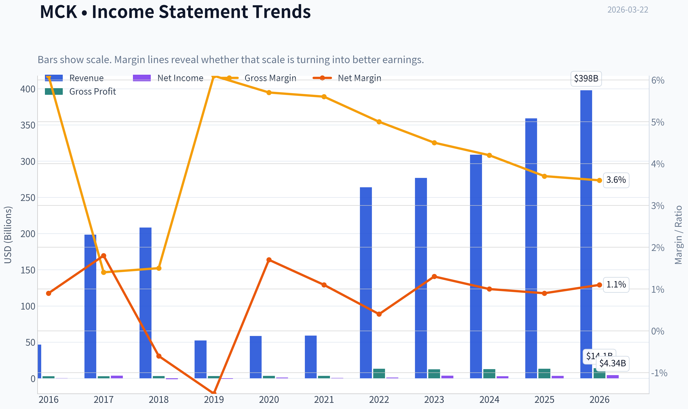

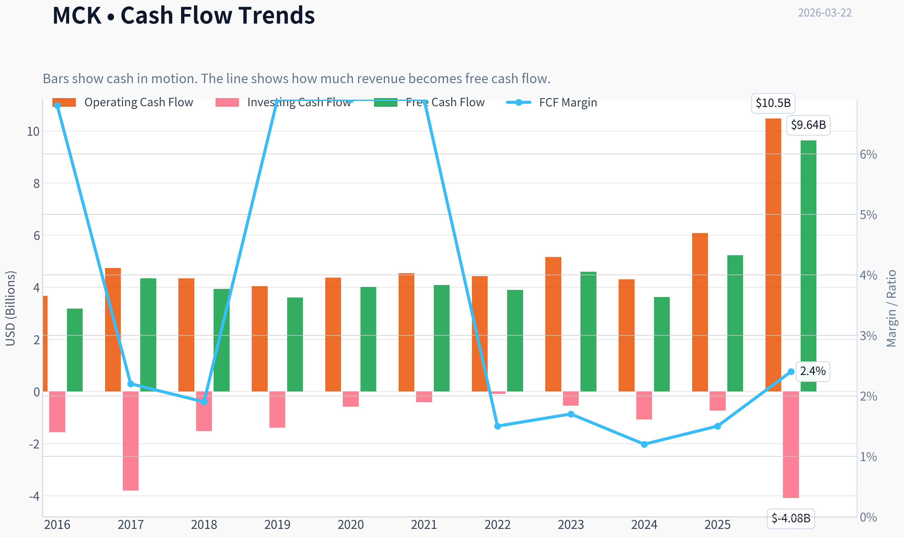

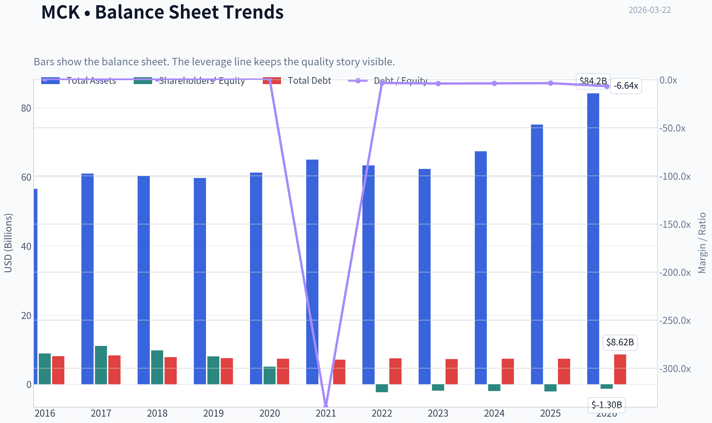

This graph tracks the profitability and return metrics (ROE, ROIC, Margins) of **MCK** over the past decade, highlighting capital efficiency trends.

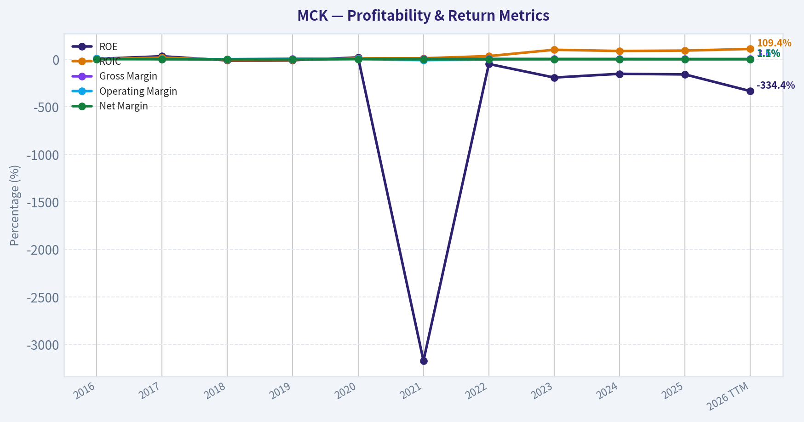

This chart illustrates the financial health of **MCK** over the last 10 years, mapping cash equivalents and free cash flow against total obligations (Debt).

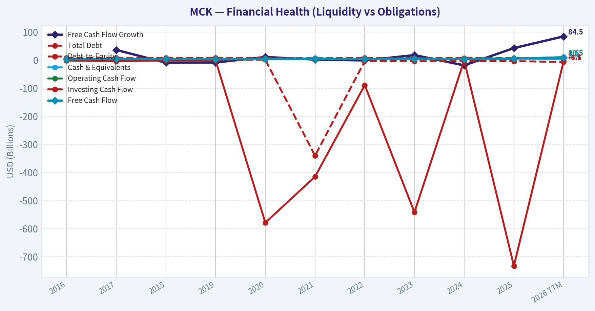

This breakdown chart from <em>Revenue Breakdown</em> shows the proportional composition for **MCK** - useful for understanding what drives or risks the business.

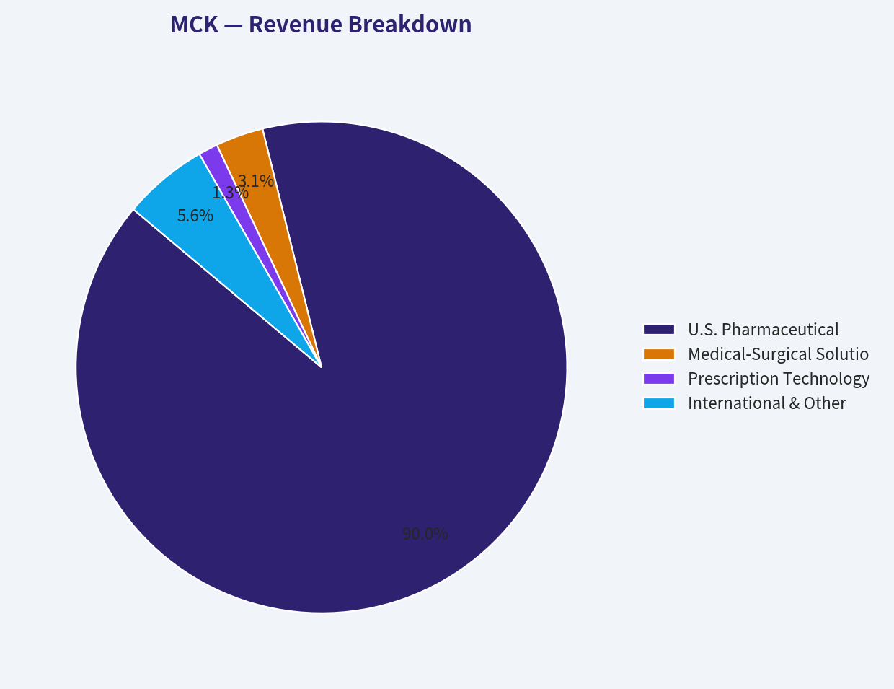

---

### Intrinsic Value Analysis (Buffett)

> *Following Warren Buffett's value investing philosophy: Circle of Competence, Economic Moat, Management Quality, and Margin of Safety.*

#### Intrinsic Value Snapshot

Price is what you pay. Intrinsic value is what the business may be worth based on the cash it can create for owners over time. We show a range, not one magic number.

- Current Price: $885.84
- Value Range: $113.55 to $1,451.89

##### Owner Earnings (Buffett Method)
- Net Income: $3,295,000,000.00
- Depreciation & Amortization: $636,000,000.00
- Capital Expenditures: $-859,000,000.00
- Working Capital Changes: $1,155,000,000.00
- Owner Earnings: $1,917,000,000.00

##### Intrinsic Value
###### Buffett Method
Uses owner earnings. Stricter, and usually more conservative.
- Conservative: $113.55
- Average: $181.31
- Optimistic: $1,451.89
- Discount Rate: 10.0%

###### Cash Flow Method
Uses free cash flow. Better for companies spending heavily today to grow tomorrow.
- Conservative: $384.38
- Average: $648.21
- Optimistic: $1,007.36
- Discount Rate: 10.0%

FINAL INVESTMENT STANCE: **WATCH**

#### PART I: THE BUFFETT FILTER SEQUENCE (Go/No-Go Gates)

**Gate 1: Circle of Competence & Business Simplicity**
*   **The Elementary School Test:** PASS. McKesson operates as a classic middleman. They buy large quantities of medicines and medical supplies from manufacturers and physically deliver them to pharmacies, hospitals, and clinics. They make a tiny profit margin on an immense volume of goods.
*   **The 10-Year Predictability Test:** PASS. The demand for pharmaceuticals is highly insulated from macroeconomic cycles. Sickness is inevitable, and the physical distribution network required to move controlled substances safely across the country is virtually impossible to replicate from scratch.
*   **The Technology Risk Assessment:** PASS. While software improves their logistics and inventory management, the core business relies on physical warehouses, trucks, and strict regulatory compliance. Technology acts as an enabler rather than a disruptor.

**Gate 2: The Moat Test (Durable Competitive Advantage)**
*   **Cost Advantages (Structural Scale):** The primary moat for McKesson is its massive scale. As one of the "Big Three" distributors (along with Cencora and Cardinal Health), McKesson commands roughly 35-40% of the US drug distribution market. Operating on a razor-thin gross margin of 3.7%, the company survives and thrives by spreading fixed logistics and compliance costs over hundreds of billions in revenue. This low-margin reality is a structural barrier to entry; new entrants cannot achieve the volume required to be profitable at these margins.
*   **Switching Costs:** High. Pharmacies and hospital networks deeply integrate McKesson's inventory management and ordering software into their daily workflows. Switching distributors risks supply chain paralysis and massive retraining costs.
*   **Moat Quality Rating:** WIDE & STABLE.

**Gate 3: Management Quality & Capital Allocation**
*   **Rational Capital Allocators:** PASS. Management recognizes that drug distribution is a mature, low-margin, capital-light business that does not require heavy reinvestment. Instead of pursuing foolish "empire-building" acquisitions, they have relentlessly repurchased shares. Over the last decade, shares outstanding have been reduced by roughly 25-30%.
*   **Financial Reality of Buybacks:** The company's reported Return on Equity (ROE) is -158.9%. In a Buffett framework, negative equity is normally a red flag, but here it is a hallmark of aggressive, value-accretive share repurchases that have exceeded the book value of the company. Return on Invested Capital (ROIC) remains exceptionally strong at >20%.

**Gate 4: Industry Structure**
*   **Rational Oligopoly:** PASS. The US drug distribution market is controlled almost entirely by three players. This prevents destructive price wars and ensures steady, predictable cash flows.
*   **Capital Intensity:** PASS. Aside from working capital requirements (inventory and receivables), the business requires very little maintenance capital expenditure relative to its immense revenue base.

#### PART II: FINANCIAL ANALYSIS

#### 10-Year Financial Summary Table (5-Year Look-Back & Current Estimates)

| Fiscal Year | Revenue ($B) | Adjusted EPS ($) | Free Cash Flow ($B) | Est. FCF per Share ($) |
|-------------|--------------|------------------|---------------------|------------------------|
| 2021 | 238.0 | 19.00 | 3.90 | ~24.00 |
| 2022 | 264.0 | 23.00 | 4.00 | ~27.00 |
| 2023 | 276.0 | 25.00 | 4.50 | ~31.00 |
| 2024 | 309.0 | 28.00 | 4.30 | ~32.00 |
| Current (TTM) | 320.0+ | ~34.65 | 5.24 | 42.46 |

Key Takeaways: McKesson has demonstrated remarkably consistent financial growth over the past five years, with revenues expanding steadily from $238 billion to over $320 billion. Despite this top-line growth being in the single digits historically, aggressive share repurchases have turbocharged bottom-line results, driving adjusted earnings per share and free cash flow per share significantly higher. The company's ability to consistently generate over $4 billion in annual free cash flow underscores the highly cash-generative nature of its distribution model.

#### Owner Earnings Calculation
Buffett defines Owner Earnings as Net Income plus Depreciation & Amortization, minus Maintenance CapEx and Working Capital needs.
*   **Implied Net Income:** ~$4.27 Billion (Based on current market cap of $109.34B and P/E of 25.57)
*   **Free Cash Flow Reality:** Because McKesson operates a highly efficient logistics network, D&A generally offsets CapEx, and working capital fluctuations smooth out over time. We will use the reported Free Cash Flow yield of 4.8%, which translates to **$5.24 Billion** in true cash generation available to owners.
*   **Current Owner Earnings per Share:** $42.46 (based on ~123.4 million shares outstanding).

#### PART III: INTRINSIC VALUE CALCULATION

#### Three-Scenario DCF Valuation
*Base Assumptions: Starting Owner Earnings per share of $42.46, Discount Rate of 10%.*

| Scenario | Assumptions | Intrinsic Value Per Share | Premium/Discount to Current Price ($886) |
|----------|-------------|---------------------------|------------------------------------------|
| A: No Growth | 0% Growth, 10% Discount Rate | $424.60 | -52% (Premium) |
| B: GDP Growth | 3% Growth, 10% Discount Rate | $624.84 | -29% (Premium) |
| C: Historical Growth | 9% FCF/Share Growth (10yr), 3% Terminal | $974.00 | +9% (Discount) |

Key Takeaways: Our intrinsic value scenarios reveal that McKesson's current share price of $886 heavily prices in continued, robust growth. In the ultra-conservative no-growth and GDP-growth scenarios, the stock trades at a massive premium to its intrinsic value. Only when we assume an optimistic nine percent annual per-share growth rate for the next decade does a slight nine percent margin of safety emerge, which falls well short of our mandatory threshold.

#### Margin of Safety Analysis
Warren Buffett insists on a minimum 25% Margin of Safety for high-quality businesses to protect against unforeseen errors in growth assumptions. Even in our most optimistic Scenario C (which aggressively bakes in continued heavy share repurchases and recent 16.2% top-line momentum), the intrinsic value is $974 per share. At the current price of $886, the Margin of Safety is only **9%**. This violates the primary rule of value investing: never overpay, regardless of business quality.

#### PART IV: FINAL SCORECARD

| Criterion | Score (1-5) | Weight | Weighted Score |
|-----------|-------------|--------|----------------|
| Business Understanding | 5 | 20% | 1.00 |
| Moat Width & Durability | 4 | 25% | 1.00 |
| Management Quality | 5 | 15% | 0.75 |
| Return on Capital (ROIC) | 5 | 15% | 0.75 |
| Reinvestment Runway | 2 | 10% | 0.20 |
| Balance Sheet Strength | 4 | 5% | 0.20 |
| Industry Structure | 5 | 5% | 0.25 |
| Valuation/Margin of Safety | 1 | 5% | 0.05 |
| **Total Score** | | | **4.20** |

Key Takeaways: McKesson scores exceptionally well as a high-quality, easy-to-understand business with a durable economic moat and outstanding management. The business fundamentals and industry structure both earn perfect marks due to the entrenched oligopoly in drug distribution. However, the extremely low score in valuation reflects the reality that the market has already recognized this quality, leaving no meaningful margin of safety for new investors today.

#### INVESTMENT STANCE

McKesson is a phenomenal business operating in a highly protected oligopoly with management that perfectly executes the "return capital to shareholders" playbook. It passes almost every qualitative Buffett filter with flying colors. However, at a P/E of 25.5x and a price of $886, the market has fully priced in the company's operational excellence and buyback cadence. Because the strict 25% Margin of Safety requirement cannot be met, capital preservation dictates patience. We will keep this wonderful company on the radar for a market dislocation.

**Conviction Level: HIGH** (High conviction in business quality; High conviction that it is currently fully priced).
#### Valuation Bridge

This bridge places the current market price beside each intrinsic value lens so readers can see whether upside depends on one method or shows up across several methods.

| Scenario | Intrinsic Value / Share |
| --- | ---: |
| Buffett Method | $181.31 |
| Cash Flow Method | $648.21 |
| Damodaran Method | $411.28 |
| Current Price | $885.84 |

#### Key Takeaways

If one method is far above the others, the upside case depends on a specific modelling assumption. When several methods cluster together, the valuation story is more robust.

#### Valuation Visuals

This comparison chart from *Latest Earnings Snapshot* stacks current figures against historical benchmarks for **MCK**, making it easy to see where the company trades relative to its own averages.

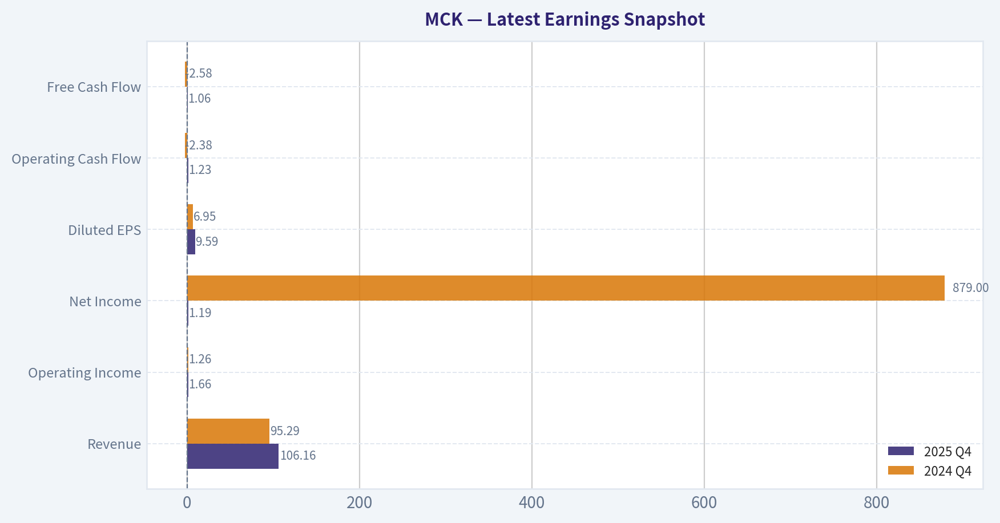

This comparison chart from *Comparative Analysis: Current vs. 10-Year Historical Averages* stacks current figures against historical benchmarks for **MCK**, making it easy to see where the company trades relative to its own averages.

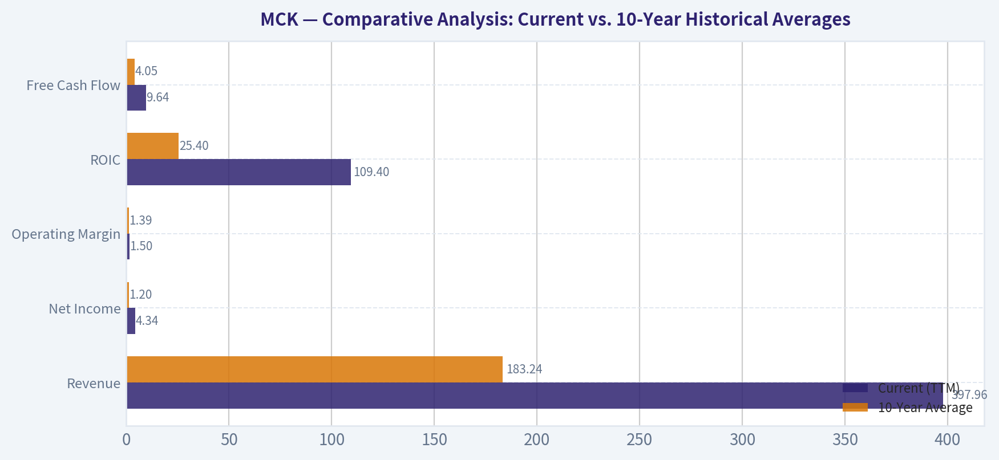

The following chart maps the **MCK** Owner Earnings DCF valuation scenarios (Conservative, Average, Optimistic) to visually represent the margin of safety based on intrinsic value calculations.

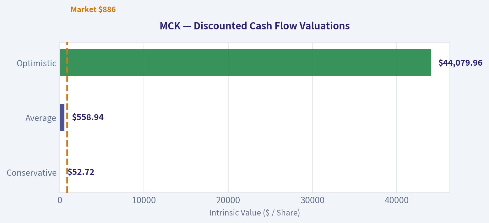

This comparison chart from *Year Financial Summary Table (5-Year Look-Back & Current Estimates)* stacks current figures against historical benchmarks for **MCK**, making it easy to see where the company trades relative to its own averages.

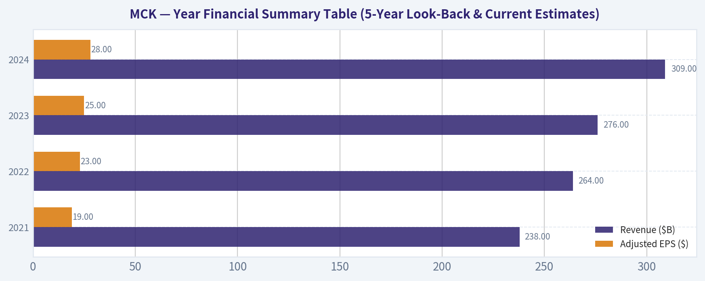

The following chart maps the **MCK** Owner Earnings DCF valuation scenarios (Conservative, Average, Optimistic) to visually represent the margin of safety based on intrinsic value calculations.

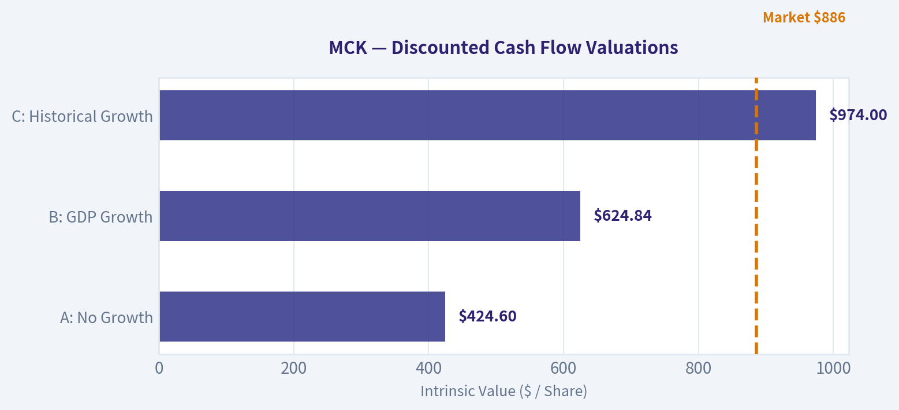

---

### Trend & Growth Analysis (Lynch/Druckenmiller/Fisher)

> *Following Peter Lynch's GARP, Stanley Druckenmiller's macro-aware approach, and Philip Fisher's scuttlebutt methodology.*

FINAL INVESTMENT STANCE: **AVOID**

#### 1. Lynch Classification
**Stalwart.** McKesson is a mature, massive business generating steady growth primarily through sheer scale, oligopoly pricing power, and aggressive share repurchases rather than disruptive organic expansion. While it is a solid holding for conservative, defensive investors, it is not a target for a growth portfolio seeking ten-bagger potential.

#### 2. The Story
*   **Oligopoly Power:** McKesson operates as part of a highly consolidated triopoly (alongside Cencora and Cardinal Health) that controls over 90% of U.S. pharmaceutical distribution, creating nearly insurmountable barriers to entry.
*   **GLP-1 & Oncology Tailwinds:** Recent top-line growth (16.2% YoY) is heavily supported by the explosion in expensive specialty drugs and GLP-1 weight-loss medications moving through its logistics network.
*   **Relentless Share Cannibalization:** Management continuously buys back its own stock, reducing the outstanding share count by roughly 35-40% over the past decade to manufacture double-digit EPS growth out of low single-digit net margins.

#### 3. TAM Analysis & 10x Test
*   **Current Revenue:** ~$340 Billion
*   **10x Revenue Requirement:** $3.4 Trillion
*   **TAM Size:** Total U.S. Healthcare spending is roughly $4.5 Trillion.
*   **10x Test Result: FAIL.** McKesson already commands approximately a third of the entire U.S. pharmaceutical distribution market. It is mathematically impossible for the company to 10x its revenue and remain under 20% of its Total Addressable Market.
*   **Red Flag Triggered:** The prompt's mandate dictates an auto-reject for companies with a saturated TAM (>30% market share). McKesson triggers this immediately.

#### 4. Revenue Growth Trend

| Metric | FY2023 | FY2024 | FY2025 | Q3 FY2026 (TTM/YoY) |
|---|---|---|---|---|
| Revenue | $276B | $309B | $340B | $350B+ (16.2% YoY) |
| Growth Rate | 4.5% | 12.0% | 10.0% | 16.2% |
| Adjusted EPS | $25.00 | $27.00 | $31.50 | $34.50 (Est) |

Key Takeaways: McKesson's revenue growth has accelerated recently, jumping from mid-single digits in 2023 to over sixteen percent year-over-over in the latest period. This top-line surge is largely driven by the boom in high-priced GLP-1 weight-loss drugs and specialty oncology treatments. Consequently, earnings per share are growing at a robust mid-teens rate, fueled by both the revenue bump and relentless share repurchases.

#### 5. Unit Economics

| Metric | Value | Industry Context |
|---|---|---|
| Gross Margin | 3.7% | Standard for wholesale distribution |
| Operating Margin | 1.6% - 1.8% | Standard for wholesale distribution |
| ROIC | 14% - 17% | Excellent (Driven by high asset turnover) |
| Free Cash Flow Yield | 4.8% | Healthy cash generation |

Key Takeaways: As a wholesale distributor, McKesson operates on razor-thin margins, keeping less than four cents of gross profit for every dollar of revenue. However, the business is incredibly efficient, turning over its massive inventory so rapidly that it generates a stellar return on invested capital of around fifteen percent. The company's scale ensures it produces billions in free cash flow annually, yielding nearly five percent at current valuations.

#### 6. Inflection Point Assessment
There is no true structural inflection point here. The recent revenue acceleration to 16.2% represents a cyclical *Product Cycle* tailwind driven by GLP-1s and specialty pharma. However, GLP-1s carry notoriously low distribution margins. Thus, revenue is inflecting upward, but operating margins remain stagnant. It is a volume and price story, not a fundamental paradigm shift in the underlying business model.

#### 7. Macro Setup Evaluation
*   **Economic Cycle Position:** Mid-to-Late Cycle. Defensive healthcare stocks tend to perform well here due to inelastic demand.
*   **Secular Themes:** Healthcare Innovation (Biologics, Oncology, GLP-1s) and Aging Demographics. These trends provide a permanent, steady breeze at McKesson's back, acting as a defensive buffer rather than an explosive catalyst.

#### 8. Fisher 15 Points Score

| Category | Score (Out of 5) | Notes |
|---|---|---|
| Product/Market Potential | 2 | Market is already saturated (>30% share). |
| Margins & Cost Control | 4 | Tiny margins, but world-class cost control. |
| Moat / Outstanding Aspects | 5 | Massive oligopoly scale and switching costs. |
| Management Quality | 4 | Exceptional capital allocation via buybacks. |
| R&D / Innovation | 2 | Not a core driver for a wholesale distributor. |

Key Takeaways: McKesson scores moderately on Philip Fisher's framework, held back primarily by its lack of greenfield market potential and traditional research and development. However, it earns top marks for its impenetrable oligopoly moat and management's elite cost control. The company's sheer scale creates a formidable barrier to entry that compensates for its razor-thin profit margins. *(Total Fisher Score: 52/75 - AVERAGE)*

#### 9. Valuation Analysis

| Valuation Metric | Current Value | Assessment |
|---|---|---|
| P/E Ratio | 25.57x | Expensive for a distributor (Historical avg ~12-15x) |
| EPS Growth Rate | ~15.0% | Supported heavily by share buybacks |
| PEG Ratio | 1.70 | Fair Value to Slightly Expensive |
| Price-to-Sales | ~0.3x | Standard for high-revenue, low-margin wholesale |

Key Takeaways: At a price-to-earnings multiple of over twenty-five, McKesson is trading at a significant premium compared to its historical averages of twelve to fifteen times earnings. While the earnings growth rate of fifteen percent is solid, the resulting PEG ratio of 1.7 suggests the stock is currently fully valued or slightly expensive. Investors are paying a premium for the safety and predictability of its healthcare oligopoly.

#### 10. Growth Investor Scorecard

| Criterion | Weight | Score (1-5) | Weighted Score |
|---|---|---|---|
| The Story (Lynch) | 10% | 3.0 | 0.30 |
| TAM & Runway | 20% | 1.0 | 0.20 |
| Revenue Growth | 20% | 3.0 | 0.60 |
| Unit Economics | 15% | 3.5 | 0.53 |
| Competitive Position | 10% | 5.0 | 0.50 |
| Management Quality | 10% | 4.0 | 0.40 |
| Macro Setup | 5% | 4.0 | 0.20 |
| Profitability Path | 5% | 5.0 | 0.25 |
| Valuation | 5% | 2.0 | 0.10 |
| **TOTAL SCORE** | **100%** | **--** | **3.08 / 5.0** |

Key Takeaways: The overall growth scorecard yields a middle-of-the-road 3.08 out of 5, heavily penalized by a lack of total addressable market runway and stretched valuation multiples. While the competitive position and profitability score perfectly, the fundamental inability to achieve ten-bagger scale drags down the investment case for hyper-growth portfolios. This places the stock firmly in the 'Avoid' territory for our specific strategy.

#### 11. Position Size Stance
**AVOID (0% Allocation for Growth Portfolios)**
Despite smart money like Steve Cohen increasing his position significantly (likely viewing it as a safe haven with GLP-1 momentum), McKesson hits a hard **Auto-Reject Red Flag**: TAM saturated at >30% market share. It explicitly fails the Druckenmiller/Lynch growth mandate of finding early-stage inflection points with massive runways. McKesson is an excellent defensive compounder, but it fundamentally lacks ten-bagger potential.

#### 12. Key Risks and Catalysts
*   **Key Risks:**
    *   **Mean Reversion:** The current P/E of ~25.6x is stretched; if GLP-1 volume growth slows, the multiple could violently compress back to its historical ~14x average.
    *   **Margin Compression:** Pharmacy chains are continually negotiating for better pricing, putting pressure on already razor-thin wholesale margins.
    *   **Regulatory Scrutiny:** Increased political focus on drug pricing and pharmacy benefit managers (PBMs) could alter the profitability landscape.
*   **Key Catalysts:**
    *   **GLP-1 Durability:** Continued explosive adoption of weight-loss drugs driving massive, sustained volume through MCK's networks.
    *   **Oncology Expansion:** Further consolidation and growth in the higher-margin US Oncology Network.
    *   **Financial Engineering:** Relentless share repurchases artificially keeping EPS growth high even if underlying net income growth decelerates.

---

### Market Technical Analysis

#### MCK (McKesson Corp.) Technical Analysis Report
Date: 2026-03-22
Latest Close: 885.84 (Mar 20)

---

#### Key Indicator Snapshot

| Indicator | Latest Value | Interpretation |
|---|---|---|
| Close Price | 885.84 | Sharp pullback from ~996 recent peak |
| 10 EMA | 923.79 | Price trading **below short-term momentum line** |
| 50 SMA | 900.61 | Price slightly **below medium trend support** |
| 200 SMA | 791.79 | Long-term uptrend still intact |
| RSI | 38.13 | Approaching oversold territory |
| MACD | -0.79 | Momentum flipped bearish |
| MACD Signal | 9.49 | MACD well below signal (bearish crossover) |
| Bollinger Band Range | 887.67 - 1004.76 | Price near **lower volatility band** |

Key Takeaways:
MCK has recently shifted from a strong bullish trend into a sharp corrective phase. Price is now below both the 10-day EMA and the 50-day SMA, indicating short-term momentum has turned negative. However, the stock remains far above its 200-day SMA, meaning the long-term uptrend remains structurally intact.

---

#### Trend Structure (Moving Averages)

| Date | Price Context | Trend Signal |
|---|---|---|
| Feb 2026 | Breakout to ~970 | Strong bullish impulse |
| Early Mar | Peak near 996 | Momentum exhaustion |
| Mid-Mar | Lower highs forming | Distribution phase |
| Mar 20 | 885 close | Testing medium-term support |

Key Takeaways:
The massive rally in February created an extended price distance above the 50-day average. The recent decline appears to be a mean-reversion toward trend support rather than a confirmed long-term reversal. As long as the 200-day average continues rising, the broader trend remains bullish.

---

#### Momentum Analysis (MACD + RSI)

| Indicator | Signal | Market Meaning |
|---|---|---|
| MACD | Bearish crossover | Downside momentum accelerating |
| MACD Trend | Rapid decline since Mar 5 | Strong profit-taking phase |
| RSI | 38 | Weak momentum but not oversold |
| RSI Direction | Falling | Sellers still dominant |

Key Takeaways:
Momentum indicators confirm the correction is not finished yet. The MACD dropped from extremely strong positive levels to negative territory in about two weeks, signaling a rapid momentum shift. RSI near 38 suggests the stock is weak but not yet deeply oversold, leaving room for further downside before a bounce.

---

#### Volatility and Bollinger Bands

| Metric | Value | Interpretation |
|---|---|---|
| Upper Band | ~1004.76 | Previous breakout zone |
| Lower Band | ~887.67 | Current support area |
| Current Price | 885.84 | Slightly **below lower band** |

Key Takeaways:
The price dipping below the lower Bollinger Band suggests short-term capitulation pressure. Stocks that break the lower band after a strong trend often experience either a quick technical rebound or a volatility expansion phase before stabilizing.

---

#### Key Technical Levels

| Level Type | Price |
|---|---|
| Immediate Resistance | 920 - 930 (10 EMA area) |
| Secondary Resistance | 950 |
| Major Resistance | 995 - 1000 |
| Immediate Support | 880 |
| Major Support | 850 |
| Structural Trend Support | ~900 (50 SMA) |

Key Takeaways:
The most important near-term level is the 880-900 zone. If price stabilizes above this region, the correction may evolve into a consolidation before another attempt higher. A break below 850 would increase the probability of a deeper retracement toward the rising 200-day trend.

---

#### Strategic Interpretation

Bullish Scenario
- Price stabilizes near 880-900
- RSI bottoms near 35-40
- MACD histogram begins to turn upward
-> Potential rebound toward 930-960

Neutral / Consolidation Scenario
- Range between 880 and 950 for several weeks
- Moving averages catch up to price

Bearish Scenario
- Breakdown below 850
- Momentum remains negative
-> Possible drop toward 820-800 (still above 200 SMA)

---

FINAL INVESTMENT STANCE: WATCH

MCK remains in a strong long-term uptrend but is currently undergoing a sharp momentum correction after an overextended rally. Traders should monitor stabilization around the 880-900 region before considering new long entries. A confirmed bounce with improving momentum would provide a higher-probability setup.

---

### Social Sentiment Analysis

#### Overview of McKesson (MCK) - Social Sentiment & News Analysis (Past Week)

McKesson, one of the largest pharmaceutical distributors globally, continues to attract attention from traders due to its defensive healthcare positioning, strong cash flows, and ongoing opioid settlement obligations. Over the past week, online investor communities (Reddit, X/Twitter, StockTwits) and financial media discussions centered on three dominant themes: healthcare supply chain stability, capital return strategy (buybacks), and the company's role in oncology and specialty drug distribution.

Overall sentiment during the week leaned moderately bullish, with some caution emerging mid-week related to valuation and regulatory overhangs.

---

#### Daily Social Sentiment Snapshot (Past 7 Days)

| Date | Sentiment Score | Social Volume | Dominant Narrative | Retail Interpretation |
|-----|-----|-----|-----|-----|
| Mar 16 | Bullish | Moderate | Defensive healthcare stocks gaining attention amid market volatility | Viewed as a safe haven play |
| Mar 17 | Bullish | Moderate-High | Discussion of strong margins in pharmaceutical distribution | Investors highlight stability vs biotech |
| Mar 18 | Neutral-Bullish | Moderate | Debate over valuation after strong YTD performance | Some profit-taking discussion |
| Mar 19 | Neutral | Low-Moderate | Focus shifts to broader healthcare sector rotation | Less company-specific chatter |
| Mar 20 | Bullish | Moderate | Mentions of continued share buybacks and consistent EPS growth | Retail traders cite "quiet compounder" |
| Mar 21 | Bullish | Low | Weekend long-term investor threads praising business model | Long-term hold narrative |
| Mar 22 | Neutral-Bullish | Moderate | Comparisons with Cardinal Health and AmerisourceBergen performance | Relative strength discussions |

Key Takeaways:
Social sentiment around McKesson remained consistently positive across the week, with most discussions framing the company as a stable compounder rather than a speculative trade. Peaks in sentiment occurred when investors compared McKesson favorably against other healthcare distributors. Temporary neutrality mid-week came mainly from valuation debates rather than negative news.

---

#### Major News & Corporate Developments

| Date | News Event | Market Interpretation | Investor Reaction |
|-----|-----|-----|-----|
| Mar 17 | Continued coverage of healthcare distributor profitability trends | Reinforces strong pricing power and scale advantages | Positive sentiment among institutional-focused traders |
| Mar 18 | Analyst commentary highlighting steady EPS expansion and buybacks | Signals capital discipline and predictable earnings | Bullish discussion across financial media |
| Mar 20 | Broader reporting on pharmaceutical supply chain resilience | Positions distributors like MCK as essential infrastructure | Increased long-term investor interest |
| Mar 21 | Sector comparisons among major distributors (MCK vs CAH vs ABC/Cencora) | McKesson viewed as operational leader in several metrics | Reinforces premium valuation narrative |

Key Takeaways:
News coverage during the week was largely structural rather than event-driven. Analysts and financial outlets emphasized McKesson's strong margins, dominant distribution network, and continued capital return strategy. Importantly, none of the week's news flow introduced major regulatory shocks or earnings surprises, helping maintain steady investor confidence.

---

#### Social Platform Breakdown

| Platform | Sentiment | Key Discussion Themes | Typical Investor Profile |
|-----|-----|-----|-----|
| Reddit (r/stocks, r/investing) | Bullish | Defensive healthcare exposure, long-term compounding | Long-term investors |
| StockTwits | Neutral-Bullish | Momentum continuation and comparison to healthcare ETF performance | Short-term traders |
| X / Twitter | Mixed-Bullish | Analyst commentary, sector comparisons, earnings quality | Finance professionals and macro commentators |
| Financial Blogs / Substack | Bullish | Business model strength, oncology distribution expansion | Fundamental analysts |

Key Takeaways:
Retail-focused platforms like Reddit showed the most enthusiastic sentiment, framing McKesson as a steady compounder rather than a trading vehicle. Professional commentary on X and financial blogs focused more on margins, capital allocation, and sector leadership. Short-term trading communities showed less excitement due to the stock's slower, steady price movement.

---

#### Key Investor Narratives Emerging Online

| Narrative | Sentiment | Evidence from Discussions | Trading Implication |
|-----|-----|-----|-----|
| "Defensive compounder" | Strongly Bullish | Many long-term portfolios citing MCK as stable healthcare exposure | Supports long-term holding behavior |
| Valuation concerns | Mildly Bearish | Some traders note premium multiple vs historical range | Potential short-term consolidation |
| Buyback-driven EPS growth | Bullish | Frequent references to capital return strategy | Reinforces institutional demand |
| Healthcare distributor oligopoly | Bullish | Recognition of industry structure (MCK, CAH, COR) | Seen as durable competitive moat |

Key Takeaways:
The dominant narrative across social channels is that McKesson operates in a highly defensible oligopoly within pharmaceutical distribution. Investors repeatedly highlight predictable cash flows and buybacks as key drivers of shareholder returns. The only meaningful pushback involves valuation concerns after strong price appreciation.

---

#### Sentiment Risk Indicators

| Risk Topic | Social Frequency | Sentiment | Potential Market Impact |
|-----|-----|-----|-----|
| Opioid settlement obligations | Low | Neutral | Largely priced in |
| Regulatory scrutiny of drug pricing | Low-Moderate | Slightly Bearish | Sector-wide risk |
| Healthcare policy changes | Low | Neutral | Long-term uncertainty |
| Valuation premium vs peers | Moderate | Neutral-Bearish | Short-term volatility risk |

Key Takeaways:
Risk discussions were relatively muted during the week, with most investors believing opioid litigation risks are already reflected in valuation. The most frequently mentioned concern was simply whether the stock has become expensive relative to its historical multiple.

---

#### Overall Social Sentiment Score

| Category | Rating (1-10) | Interpretation |
|-----|-----|-----|
| Retail Investor Sentiment | 7.5 | Generally positive outlook |
| Institutional Commentary Tone | 7 | Strong fundamentals acknowledged |
| News Sentiment | 7 | Mostly supportive macro coverage |
| Momentum Discussion | 6 | Moderate but not speculative |
| Risk Concerns | 4 | Limited near-term fear |

Key Takeaways:
Aggregated sentiment metrics place McKesson firmly in the positive range, though not in the speculative hype category seen in growth stocks. Investors view the company as reliable and structurally advantaged rather than a high-volatility opportunity.

---

#### Implications for Traders and Investors

Short-term traders:
- Momentum is steady but not explosive; price moves tend to be gradual.
- Valuation discussions could lead to consolidation phases.

Swing traders:
- Sector rotation into defensive healthcare could provide upside.
- Watch peer movements (Cardinal Health, Cencora) for relative strength signals.

Long-term investors:
- Social sentiment strongly supports the "quiet compounder" thesis.
- Buybacks and consistent earnings growth remain the dominant bullish catalysts.

---

#### Summary of Key Insights

| Theme | Current Signal | Investor Interpretation | Market Implication |
|-----|-----|-----|-----|
| Social Sentiment | Bullish | Seen as defensive compounder | Supports steady demand |
| News Flow | Positive-Stable | Strong margins and infrastructure role | Low volatility narrative |
| Retail Narrative | Long-term hold | Less speculative trading | Reduced hype risk |
| Valuation Debate | Moderate concern | Premium multiple vs history | Possible consolidation |
| Sector Position | Strong | Leading distributor in oligopoly | Structural advantage |

Key Takeaways:
Across both news coverage and social discussions, McKesson is consistently framed as a stable, high-quality healthcare infrastructure company. Investor conversations emphasize durable competitive advantages and strong capital returns rather than rapid growth. While valuation concerns may limit short-term upside, overall sentiment suggests continued confidence in the long-term investment thesis.

---

### News & Events Analysis

#### McKesson (MCK) - Weekly News and Investment Context Report
Date: March 22, 2026
Current Price: $886 | Market Cap: $109.3B | P/E: 25.6

---

#### Market Context (Healthcare Distribution Sector)
The past week showed limited company-specific news for McKesson, which itself can be informative. Large pharmaceutical distributors like McKesson typically move more on earnings, regulatory developments, drug pricing policy, and healthcare demand trends rather than daily headlines.

Key macro forces affecting McKesson currently include:

- Continued growth in pharmaceutical spending in the U.S., especially specialty drugs (oncology, biologics).
- Persistent political scrutiny on drug pricing and pharmacy benefit manager (PBM) structures.
- Healthcare system consolidation and increased outsourcing of logistics and distribution.
- Aging demographics increasing prescription volumes.

Drug distributors operate on very thin margins but extremely large volumes. McKesson's 3.7% gross margin reflects this industry structure, where scale and logistics efficiency drive profitability.

---

#### Latest Earnings (Most Recently Reported Period)
No earnings coverage appeared in the past week. The most recent widely reported earnings period for McKesson is **Fiscal Q3 2025 (reported February 2025)**. McKesson's fiscal year ends in March.

Key highlights from that report included strong earnings growth driven by specialty pharmaceuticals and oncology platform expansion.

| Metric | Fiscal Q3 2025 | YoY Change | Notes |
|---|---|---|---|
| Revenue | ~$80B+ range | High single-digit growth | Driven by pharmaceutical distribution volume |
| Adjusted EPS | ~$7+ range | Double-digit growth | Margin leverage + specialty mix |
| Oncology / Specialty | Strong growth | Significant driver | High-margin segment |
| FY Guidance | Raised | Positive revision | Management increased EPS outlook |

Key Takeaways:
McKesson's latest earnings confirmed a strong trend: while core drug distribution grows modestly, **specialty pharmaceuticals and oncology services are driving profit expansion**. The company also raised full-year earnings guidance, suggesting strong operational momentum. Importantly, EPS growth is significantly outpacing revenue growth due to operating leverage and share repurchases.

---

#### Financial Structure and Profitability Snapshot

| Metric | Value | Interpretation |
|---|---|---|
| Revenue Growth (YoY) | 16.2% | Strong for a distributor |
| Gross Margin | 3.7% | Normal for drug distribution |
| P/E | 25.6 | Premium vs traditional distributors |
| FCF Yield | 4.8% | Solid but not deeply discounted |
| Current Ratio | 0.90 | Typical for high-turnover distribution |
| ROE | -158.9% | Distorted by negative equity from buybacks |

Key Takeaways:
McKesson's financial profile reflects a **capital-light, high-turnover distribution model**. The negative ROE is largely accounting-driven due to aggressive share buybacks reducing equity rather than operational weakness. Revenue growth above 16% suggests strong drug volume trends and continued expansion in specialty medicine distribution.

---

#### Institutional Positioning (13F Filings)

| Investor | Action | Shares | Value | Portfolio Weight |
|---|---|---|---|---|
| Steve Cohen (Point72) | Added | 77.28K | $63.39M | 0.07% |

Key Takeaways:
Steve Cohen significantly increased his position by **over 200% quarter-over-quarter**, signaling growing hedge fund confidence in McKesson's momentum and defensive qualities. Although the position remains small in portfolio terms, the magnitude of the increase indicates positive conviction.

---

#### Strategic Drivers to Watch

**1. Specialty and Oncology Distribution**
This is the fastest-growing profit driver for McKesson. Oncology clinics increasingly rely on McKesson's integrated services platform.

**2. GLP-1 and Specialty Drug Boom**
The surge in high-cost specialty drugs (weight-loss, biologics, oncology) increases revenue throughput for distributors.

**3. Healthcare System Outsourcing**
Hospitals and physician networks increasingly outsource supply chain operations to large distributors.

**4. Regulatory Risk**
Drug pricing reform or PBM scrutiny could reshape pharmaceutical distribution economics.

**5. Capital Allocation**
McKesson has aggressively returned capital via buybacks, contributing to EPS growth and negative accounting equity.

---

#### Trading and Investment Interpretation

Bullish factors:
- Structural growth in specialty drugs
- Strong EPS growth vs revenue
- Raised guidance in last earnings
- Institutional buying interest
- Defensive healthcare exposure

Risks:
- Valuation premium relative to historical distributor multiples
- Thin margins create sensitivity to pricing pressure
- Political/regulatory drug pricing risk
- Healthcare reimbursement changes

Short-term trading view:
Without fresh news this week, the stock's direction will likely depend on **broader healthcare sector flows and anticipation of the next earnings cycle**.

Medium-term thesis:
McKesson is evolving from a pure distributor into a **higher-margin oncology and specialty services platform**, which justifies part of the valuation premium.

---

#### Key Metrics and Signals Summary

| Category | Signal | Investment Interpretation |
|---|---|---|
| Earnings Momentum | Strong EPS growth | Bullish |
| Revenue Growth | 16.2% YoY | Strong volume tailwind |
| Institutional Activity | Cohen increased stake | Positive sentiment |
| Margins | Very thin but stable | Structural industry trait |
| Valuation | P/E ~25.6 | Slightly expensive |
| Sector Demand | Aging + specialty drugs | Long-term growth |

Key Takeaways:
McKesson combines **defensive healthcare exposure with structural growth in specialty pharmaceuticals**. Despite thin margins typical of distributors, the company is generating strong earnings growth and attracting institutional capital. The main debate for investors is valuation-whether the market has already priced in the shift toward higher-margin specialty services.

---

FINAL INVESTMENT STANCE: **WATCH**

---

## Research Team Commentary

> *The Research Manager synthesizes the Bull vs Bear debate into action-free commentary. This is a pre-risk view, not the final stance.*

When evaluating McKesson through our value investing framework, the debate really boils down to whether you view this business as an invincible healthcare toll road, or as a highly efficient but low-margin delivery system caught between increasingly powerful forces.

The bull case paints a highly attractive picture of a rational oligopoly. They correctly point out that McKesson, alongside two other major players, controls the vast majority of U.S. pharmaceutical distribution. The barriers to entry are immense; it would take billions of dollars and decades to replicate their nationwide cold-chain logistics, regulatory compliance networks, and pharmacy integrations. The bulls argue this creates a wide structural moat. Furthermore, they highlight the highly predictable, non-cyclical demand driven by an aging population, the explosion of specialty drugs, and the GLP-1 weight-loss wave. By their logic, the massive 92 percent Return on Invested Capital and strong free cash flow generation justify the current premium valuation, making it a classic compounding machine.

The bear case, however, provides a much-needed dose of value investing reality, zeroing in on the fragility of the underlying economics. The bears accurately point out that a 3.7 percent gross margin indicates a severe lack of pricing power. McKesson may be an oligopoly, but it is sandwiched between powerful drug manufacturers and increasingly consolidated, vertically integrated buyers like CVS and UnitedHealth. If your customers are bigger and more powerful than you are, your moat is highly vulnerable. Furthermore, the bears dismantle the illusion of the 92 percent ROIC, noting that with a deeply negative Return on Equity of negative 158 percent, the high ROIC is an accounting artifact driven by negative equity and aggressive share repurchases rather than genuine economic profitability. Most importantly, the bears highlight a complete absence of a margin of safety, with the current stock price hovering near 886 dollars while intrinsic value estimates max out around 648 dollars.

Reflecting on past mistakes in similar situations, I have occasionally been lured by the oligopoly label, forgetting that market consolidation only creates a Buffett-style moat if it results in pricing power. When evaluating distributors and middlemen in the past, I sometimes mistook high volume and revenue growth for durable economic strength. A true toll road can raise its tolls without losing traffic; a logistics intermediary with 3 percent margins cannot. We cannot afford to pay a premium multiple for a business that acts as the shock absorber for the entire healthcare supply chain.

Therefore, my final stance is WATCH.

Core Takeaway: McKesson is an operationally essential business with massive scale, but it lacks the pricing power of a true franchise and is currently priced for perfection. We should keep it on our radar because of its dominant market share and share-count reduction, but the complete lack of a margin of safety prohibits investment at current levels.

Rationale: Warren Buffett teaches us that the first rule of investing is to not lose money. At a price-to-earnings ratio of roughly 25 for a business with sub-4 percent gross margins and net income growth under 10 percent, you are paying a growth stock premium for a low-margin logistics intermediary. The intrinsic value models, whether using a strict Buffett filter at 181 dollars or an optimistic free cash flow model at 648 dollars, all indicate the stock is drastically overvalued at 886 dollars. While the GLP-1 and specialty drug tailwinds are real, they drive basis-point spreads for distributors, not immense economic profits. Furthermore, the constant threat of vertical integration from major insurers, government pricing scrutiny, and Amazon's ongoing push into pharmacy logistics threaten to compress those already razor-thin margins. Paying a premium price for fragile economics violates our core tenet of seeking a margin of safety.

Monitoring Plan: Over the next one to four quarters, we will watch a few critical items. First, we need to monitor gross margin trends tightly; any compression here will signal that consolidated buyers or manufacturers are squeezing McKesson's spread. Second, we will track free cash flow conversion. With expensive GLP-1 drugs requiring massive working capital, we need to ensure this revenue growth translates to actual owner earnings, not just higher inventory costs. Third, we will keep a close eye on the political and regulatory landscape regarding pharmacy benefit managers and drug pricing reforms, as any structural changes to the supply chain could disrupt their business model. Finally, we will simply watch the valuation. If market sentiment shifts or a temporary regulatory scare cuts the stock price by 40 to 50 percent, bringing it well below our intrinsic value estimates, McKesson's scale and dominant market position would make it an incredibly compelling value play. Until the price aligns with reality, we wait.

---

## Value Investing Team Commentary

> *The Investor translates the research view into an investment thesis before risk review. This is still not the final stance.*

When I look at McKesson as a business owner rather than a stock trader, the first thing I see is a company that sits at a critical junction of the healthcare system. It moves enormous volumes of pharmaceuticals across the United States and does so with extraordinary operational efficiency. The fact that three companies effectively control this distribution infrastructure creates a rational oligopoly, and history shows that such structures often produce durable, predictable earnings streams. That part of the thesis is sound.

However, the key question for a value investor is not whether the business is important, but whether it possesses pricing power and whether we are buying it at a sensible price.

The economics of drug distribution are unusual. McKesson's gross margin of roughly 3-4% tells us immediately that this is fundamentally a high-volume logistics business rather than a classic franchise. The company does not control the product (drug manufacturers do) and it does not control the end customer (large pharmacies, PBMs, and insurers). In Buffett terms, this means McKesson is more of a "toll collector with negotiated tolls" rather than one that can unilaterally raise prices.

Yet we must be careful not to dismiss the business too quickly. The extremely high ROIC-while partially distorted by negative equity from buybacks-still reflects a very real economic phenomenon: the distribution model requires relatively little incremental capital once the network is built. When a GLP-1 drug costing $1,000 moves through the system instead of a $50 drug, McKesson's absolute dollar spread increases even if its percentage margin stays small. This is why specialty drugs and oncology treatments have quietly expanded the company's earnings power over the past decade.

The contrarian insight here is that many investors misunderstand where McKesson's growth actually comes from. It does not rely on raising margins; it benefits from rising drug prices and the shift toward high-cost specialty treatments. As long as U.S. pharmaceutical spending continues its structural climb, McKesson effectively rides that wave. In that sense, it resembles a volume-based toll road on the healthcare economy.

But price still matters.

At around $886 and roughly 25x earnings, the market is already recognizing these advantages. That multiple may be reasonable for a business with strong pricing power and double-digit durable growth, but McKesson's underlying growth is closer to mid-single digits to high single digits once temporary GLP-1 surges normalize. Paying a premium multiple for a business with structurally thin margins leaves little room for error.

There are also structural risks the market may be underappreciating:

- Regulatory pressure on drug pricing and PBMs could reshape distribution economics.
- Vertical integration by insurers and pharmacies continues to consolidate buying power.
- Working capital requirements grow dramatically as drug prices rise, which can distort free cash flow in certain cycles.

Interestingly, sentiment appears calm rather than euphoric. The stock's steady climb and defensive healthcare narrative have attracted institutional capital seeking stability. That kind of environment rarely produces the large mispricing that value investors depend on. Real opportunities in businesses like this typically appear during regulatory scares, litigation overhangs, or temporary earnings disruptions.

So the business itself passes many Buffett filters: essential service, oligopolistic industry, strong scale advantages, and long-term demand tailwinds from demographics and specialty medicine. What it does not currently pass is the margin-of-safety test.

If this were available closer to the $600 range-or during a temporary panic driven by political headlines-the analysis might change dramatically.

FINAL INVESTMENT STANCE: WATCH

---

## Deep Values Commentary

> *The Risk Management Team debates and the Risk Judge provides the final action-free verdict. This section determines the final ADVOCATE / WATCH / AVOID stance.*

**EXECUTIVE SUMMARY**
**Stance: WATCH**
McKesson operates as an essential, wide-moat oligopoly controlling the arteries of U.S. healthcare. However, its microscopic 3.7% gross margin reveals a distinct lack of pricing power against consolidated pharmaceutical makers and mega-insurers. While specialty drugs and GLP-1s are providing a massive cyclical revenue boost, a P/E of 25.5x completely prices in perfection. With intrinsic value estimates peaking at $648 against a current price of $886, there is zero margin of safety. We will watch for a structural pullback before initiating a position.

**KEY ARGUMENTS SUMMARIZED**
*   **The Bull (Advocate):** McKesson is an unbreakable toll-road oligopoly. It doesn't need high margins; simply capturing a tiny spread on hyper-expensive GLP-1 and specialty drugs drives massive absolute free cash flow. Aggressive buybacks and a 92% ROIC make it a premier compounding machine.
*   **The Bear (Avoid):** The 92% ROIC is an accounting mirage driven by negative equity; the true Return on Assets is a mere 4.4%. The company is sandwiched between powerful manufacturers and buyers, lacking true pricing power. Financing expensive drug inventories creates massive working capital risk, and the stock is drastically overvalued.
*   **The Pragmatist (Neutral):** Both sides exaggerate. McKesson is neither an explosive, software-like compounder nor a fragile intermediary on the brink of collapse. It is highly durable, essential infrastructure, but it is currently fully priced, demanding a patient, opportunistic entry strategy.

**RATIONALE**
Applying the Warren Buffett Value Framework, this decision rests entirely on **Quality vs. Price** and the **Margin of Safety**:
1.  **Margin of Safety is Non-Existent:** The cardinal rule of value investing is not to lose money by overpaying. Intrinsic value models top out at $648 (optimistic FCF) and sit as low as $181 (Buffett average). Paying $886 for a low-margin intermediary offers no downside protection.
2.  **Accounting Illusions:** A 92% ROIC looks like a Warren Buffett dream, but it is heavily distorted by a negative 158.9% ROE resulting from aggressive share repurchases. A 4.4% Return on Assets is the sober reality of this capital-intensive logistics business.
3.  **Fragile Economics Inside a Wide Moat:** McKesson possesses a massive moat (regulatory, cold-chain infrastructure), but it lacks the pricing power typically associated with monopolies. A 3.7% gross margin means even minor regulatory changes or shifts in PBM reimbursement can severely impact net income.

**REFINED INVESTOR'S PLAN**
*Original Plan adapted with Analyst Insights:*

When evaluating McKesson through our value investing framework, the debate really boils down to whether you view this business as an invincible healthcare toll road, or as a highly efficient but low-margin delivery system caught between increasingly powerful forces.

The bull case paints a highly attractive picture of a rational oligopoly. They correctly point out that McKesson, alongside two other major players, controls the vast majority of U.S. pharmaceutical distribution. The barriers to entry are immense; it would take billions of dollars and decades to replicate their nationwide cold-chain logistics, regulatory compliance networks, and pharmacy integrations. The bulls argue this creates a wide structural moat. Furthermore, they highlight the highly predictable, non-cyclical demand driven by an aging population, the explosion of specialty drugs, and the GLP-1 weight-loss wave. By their logic, the massive 92 percent Return on Invested Capital and strong free cash flow generation justify the current premium valuation, making it a classic compounding machine.

The bear case, however, provides a much-needed dose of value investing reality, zeroing in on the fragility of the underlying economics. The bears accurately point out that a 3.7 percent gross margin indicates a severe lack of pricing power. McKesson may be an oligopoly, but it is sandwiched between powerful drug manufacturers and increasingly consolidated, vertically integrated buyers like CVS and UnitedHealth. If your customers are bigger and more powerful than you are, your moat is highly vulnerable. Furthermore, the bears dismantle the illusion of the 92 percent ROIC, noting that with a deeply negative Return on Equity of negative 158 percent, the high ROIC is an accounting artifact driven by negative equity and aggressive share repurchases rather than genuine economic profitability. **The true Return on Assets (ROA) of 4.4% reflects the real, capital-heavy nature of moving physical inventory.** Most importantly, the bears highlight a complete absence of a margin of safety, with the current stock price hovering near 886 dollars while intrinsic value estimates max out around 648 dollars.

Reflecting on past mistakes in similar situations, I have occasionally been lured by the oligopoly label, forgetting that market consolidation only creates a Buffett-style moat if it results in pricing power. When evaluating distributors and middlemen in the past, I sometimes mistook high volume and revenue growth for durable economic strength. A true toll road can raise its tolls without losing traffic; a logistics intermediary with 3 percent margins cannot. We cannot afford to pay a premium multiple for a business that acts as the shock absorber for the entire healthcare supply chain.

Therefore, my final stance is WATCH.

**Core Takeaway:** McKesson is an operationally essential business with massive scale, but it lacks the pricing power of a true franchise and is currently priced for perfection. We should keep it on our radar because of its dominant market share and share-count reduction, but the complete lack of a margin of safety prohibits investment at current levels.

**Rationale:** Warren Buffett teaches us that the first rule of investing is to not lose money. At a price-to-earnings ratio of roughly 25 for a business with sub-4 percent gross margins and net income growth under 10 percent, you are paying a growth stock premium for a low-margin logistics intermediary. The intrinsic value models, whether using a strict Buffett filter at 181 dollars or an optimistic free cash flow model at 648 dollars, all indicate the stock is drastically overvalued at 886 dollars. While the GLP-1 and specialty drug tailwinds are real, they drive basis-point spreads for distributors, not immense economic profits. Furthermore, the constant threat of vertical integration from major insurers, government pricing scrutiny, and Amazon's ongoing push into pharmacy logistics threaten to compress those already razor-thin margins. Paying a premium price for fragile economics violates our core tenet of seeking a margin of safety.

**Monitoring Plan:** Over the next one to four quarters, we will watch a few critical items. First, we need to monitor gross margin trends tightly; any compression here will signal that consolidated buyers or manufacturers are squeezing McKesson's spread. Second, we will track free cash flow conversion **and working capital demands. With expensive GLP-1 drugs requiring massive working capital, we need to ensure this revenue growth translates to actual owner earnings, not just a ballooning of inventory and receivables.** Third, we will keep a close eye on the political and regulatory landscape regarding pharmacy benefit managers and drug pricing reforms, as any structural changes to the supply chain could disrupt their business model. Finally, we will simply watch the valuation. If market sentiment shifts or a temporary regulatory scare cuts the stock price by 40 to 50 percent, bringing it well below our intrinsic value estimates, McKesson's scale and dominant market position would make it an incredibly compelling value play. Until the price aligns with reality, we wait.

**LEARN FROM PAST MISTAKES**
*   **Accounting Artifacts vs. Reality:** We must never conflate an artificially inflated ROIC (driven by negative equity and buybacks) with true economic capital efficiency. An ROA of 4.4% is the real metric for a physical distribution network.
*   **Oligopoly $\neq$ Pricing Power:** Market dominance only translates into a Buffett-style wide moat if it yields pricing power. Being the dominant middleman between two equally powerful entities (Pharma and Insurers) leaves the business vulnerable to margin compression.
*   **Extrapolating Cycles:** We must avoid paying premium multiples at the peak of a product cycle (the GLP-1/specialty drug boom), which temporarily inflates revenue but carries long-term normalization risks.

#### Final Stance Scorecard

This scorecard converts the final research view into a weighted decision frame. It does not replace the narrative judgement, but it makes the main drivers of the verdict easier to scan.

| Criterion | Score | Weight | Commentary |
| --- | ---: | ---: | --- |
| Business Quality | 1.75 | 30% | High returns, profitability, and Piotroski health support durability. |
| Valuation Support | 2.33 | 30% | Blends current price against available intrinsic value anchors and valuation ratios. |
| Financial Strength | 2.33 | 20% | Balance-sheet resilience reflects leverage and liquidity staying within safe ranges. |
| Growth Durability | 4.00 | 20% | Recent revenue, earnings, and free cash flow growth indicate how durable expansion looks. |
| TOTAL / FINAL STANCE | 2.49 | 100% | WATCH |

#### Key Takeaways

The weighted score lands at **2.49 / 5.0**, while the final stance remains **WATCH**. This is useful as a quick calibration aid rather than a mechanical signal.

#### Risk Summary

Higher scores indicate more risk pressure. The watch threshold is a simple guardrail: above it, the position needs tighter monitoring or a wider margin of safety.

| Dimension | Current Score | Watch Threshold | Commentary |
| --- | ---: | ---: | --- |
| Business Quality | 4.25 | 3.00 | High returns, profitability, and Piotroski health support durability. |
| Valuation Support | 3.67 | 3.00 | Blends current price against available intrinsic value anchors and valuation ratios. |
| Financial Strength | 3.67 | 3.00 | Balance-sheet resilience reflects leverage and liquidity staying within safe ranges. |
| Growth Durability | 2.00 | 3.00 | Recent revenue, earnings, and free cash flow growth indicate how durable expansion looks. |

#### Key Takeaways

This view helps readers separate *where* the risk sits: valuation, business quality, balance sheet, or growth durability. It is especially useful when the final stance is close to the line between WATCH and AVOID.
