# MCO Deep Value Intelligence

**Analysis Date:** 2026-05-08

## Critical Disclaimer

*This analysis is generated by Deep Value Intelligence, an AI-powered multi-agent investing framework. This report is for informational and educational purposes only and does not constitute financial advice. Always conduct your own research and consult with qualified financial advisors before making investment decisions.*

---

## Table of Contents

1. Intelligence Summary
2. Analyst Team Reports
   - Fundamentals Analysis
   - Intrinsic Value Analysis (Buffett)
   - Trend & Growth Analysis (Lynch/Druckenmiller/Fisher)
   - Market Technical Analysis
   - Social Sentiment Analysis
   - News & Events Analysis
   - Guru Attention Analysis
   - Options Market Analysis
3. Research Team Commentary
4. Value Investing Team Commentary
5. Deep Values Commentary

---

## Intelligence Summary

### Thesis + Conditions

**Core Thesis:** **EXECUTIVE SUMMARY (CONCISE)**
*   **The Business:** Moody's (MCO) is an elite, wide-moat financial infrastructure oligopoly. It boasts staggering profitability metrics: 74.4% gross margins, 30.4% ROIC, and 60.7% ROE.

**Key Risks:**
- The Catalyst for Caution:** A severe divergence between accounting earnings (Net Income up 19.5%) and cash generation (FCF up just 2.1%). At premium multiples, cash must confirm earnings.
- The Verdict:** **WATCH**. Moody's is a compounding machine priced for uninterrupted perfection. We will not compromise our margin of safety. Wait for a cyclical pullback in debt issuance or multiple compression to the mid-$300s before deploying capital.
- The Aggressive (Risky) Stance:** Quality deserves a premium. Moody's wide moat and elite ROIC mean traditional value models underestimate its long-term compounding power. The FCF divergence is likely temporary working capital/timing noise. The biggest risk is omitting a generational compounder by rigidly waiting for a "cheap" price that never arrives.
- The Conservative (Safe) Stance:** Business quality does not neutralize valuation risk. Buying at a massive premium to the $346 intrinsic value invites severe multiple compression. Furthermore, paying 32x earnings while FCF growth trails net income growth by 17% violates core risk management principles. The cyclical nature of debt issuance makes the current valuation highly vulnerable to macro headwinds.
- The Balanced (Neutral) Stance:** Both extremes are flawed. The business is too exceptional to ignore, but too expensive to buy in bulk. The optimal approach is conditional accumulation-keeping it on a high-priority watchlist and initiating a starter position only if the price drops into the mid-$300s or if FCF growth demonstrably accelerates to match earnings.

**What Would Change Our View:**
- The Catalyst for Caution:** A severe divergence between accounting earnings (Net Income up 19.5%) and cash generation (FCF up just 2.1%). At premium multiples, cash must confirm earnings.
- The Verdict:** **WATCH**. Moody's is a compounding machine priced for uninterrupted perfection. We will not compromise our margin of safety. Wait for a cyclical pullback in debt issuance or multiple compression to the mid-$300s before deploying capital.
- The Aggressive (Risky) Stance:** Quality deserves a premium. Moody's wide moat and elite ROIC mean traditional value models underestimate its long-term compounding power. The FCF divergence is likely temporary working capital/timing noise. The biggest risk is omitting a generational compounder by rigidly waiting for a "cheap" price that never arrives.
- The Conservative (Safe) Stance:** Business quality does not neutralize valuation risk. Buying at a massive premium to the $346 intrinsic value invites severe multiple compression. Furthermore, paying 32x earnings while FCF growth trails net income growth by 17% violates core risk management principles. The cyclical nature of debt issuance makes the current valuation highly vulnerable to macro headwinds.
- The Balanced (Neutral) Stance:** Both extremes are flawed. The business is too exceptional to ignore, but too expensive to buy in bulk. The optimal approach is conditional accumulation-keeping it on a high-priority watchlist and initiating a starter position only if the price drops into the mid-$300s or if FCF growth demonstrably accelerates to match earnings.

**Confidence:** Medium

---

## Analyst Team Reports

### Fundamentals Analysis

#### Latest Earnings Snapshot

*Most recent reported quarter anchored on 2026 Q1, with prior-year comparison when available.*

| Metric | 2026 Q1 | 2025 Q1 | YoY Change |
| --- | ---: | ---: | ---: |
| Revenue | $2.08B | $1.92B | +8.1% |
| Operating Income | $949.0M | $881.0M | +7.7% |
| Net Income | $661.0M | $625.0M | +5.8% |
| Diluted EPS | $3.73 | $3.46 | +7.8% |
| Operating Cash Flow | $939.0M | $757.0M | +24.0% |
| Free Cash Flow | $844.0M | $672.0M | +25.6% |

Key Takeaways: This snapshot anchors the most recent reported quarter before the narrative analysis. It helps readers separate long-run business quality from whatever changed in the latest earnings print.

#### 10-Year Financial Metrics for MCO

*All values below are computed deterministically from raw data - not estimated by AI.*

*Issuer profile: financial (Financial Services / Financial Data & Stock Exchanges).*

#### 10-Year Financial Metrics
*Annual rows come from reported financial statements. The final TTM row is computed from the latest four quarters.*

| Metric | 2009 | 2010 | 2011 | 2012 | 2013 | 2014 | 2015 | 2016 | 2017 | 2018 | 2019 | 2020 | 2021 | 2022 | 2023 | 2024 | 2025 | 2026 TTM |
| --- | --- | --- | --- | --- | --- | --- | --- | --- | --- | --- | --- | --- | --- | --- | --- | --- | --- | --- |
| Market Price | $22 | $22 | $29 | $44 | $69 | $85 | $91 | $87 | $137 | $132 | $225 | $278 | $377 | $271 | $384 | $469 | $510 | $451 |
| Market Cap | $6.37B | $6.28B | $7.73B | $11.40B | $17.54B | $20.57B | $20.41B | $18.42B | $28.67B | $27.22B | $45.49B | $54.94B | $73.39B | $51.46B | $71.86B | $86.48B | $91.90B | $80.02B |
| P/E Ratio | 15.86 | 12.34 | 13.53 | 16.50 | 21.80 | 20.78 | 21.67 | 69.32 | 28.66 | 20.78 | 32.00 | 30.91 | 33.16 | 37.45 | 44.74 | 42.04 | 37.37 | 32.35 |
| P/B Ratio | -10.51 | -20.28 | -45.72 | 29.60 | 52.04 | -109.53 | -36.12 | -15.04 | -87.48 | 59.31 | 74.33 | 35.02 | 26.91 | 20.43 | 21.66 | 24.26 | 22.67 | 26.73 |
| ROE | -66.3% | -164.0% | -338.1% | 179.1% | 238.7% | -526.5% | -166.6% | -21.8% | -305.5% | 285.4% | 232.4% | 113.3% | 81.2% | 54.5% | 48.4% | 57.7% | 60.7% | 83.3% |
| ROIC | 96.8% | 139.4% | 194.2% | 200.6% | 199.3% | 118.6% | 94.9% | 52.3% | 42.3% | 33.6% | 36.7% | 39.7% | 33.6% | 18.2% | 22.2% | 26.6% | 31.1% | 31.2% |
| EPS | $1.40 | $1.81 | $2.13 | $2.65 | $3.17 | $4.11 | $4.18 | $1.25 | $4.79 | $6.33 | $7.04 | $8.99 | $11.36 | $7.24 | $8.73 | $11.26 | $13.67 | $13.95 |
| Revenue | $1.80B | $2.03B | $2.28B | $2.73B | $2.97B | $3.33B | $3.48B | $3.60B | $4.20B | $4.44B | $4.83B | $5.37B | $6.22B | $5.47B | $5.92B | $7.09B | $7.72B | $7.87B |
| Gross Profit | N/A | N/A | N/A | N/A | N/A | N/A | N/A | N/A | $2.99B | $3.20B | $3.44B | $3.90B | $4.58B | $3.85B | $4.23B | $5.14B | $5.75B | $5.86B |
| Gross Margin | N/A | N/A | N/A | N/A | N/A | N/A | N/A | N/A | 71.1% | 72.0% | 71.3% | 72.5% | 73.7% | 70.5% | 71.5% | 72.6% | 74.4% | 74.4% |
| Operating Margin | 38.3% | 38.0% | 39.0% | 39.5% | 41.5% | 43.2% | 42.3% | 18.1% | 43.3% | 42.0% | 41.4% | 44.5% | 45.7% | 34.4% | 36.1% | 40.6% | 43.4% | 44.8% |
| Net Income | $402.0M | $507.8M | $571.4M | $690.0M | $804.5M | $988.7M | $941.3M | $266.6M | $1.00B | $1.31B | $1.42B | $1.78B | $2.21B | $1.37B | $1.61B | $2.06B | $2.46B | $2.50B |
| Net Margin | 22.4% | 25.0% | 25.1% | 25.3% | 27.1% | 29.7% | 27.0% | 7.4% | 23.8% | 29.5% | 29.4% | 33.1% | 35.6% | 25.1% | 27.2% | 29.0% | 31.9% | 31.7% |
| Revenue Growth | N/A | 13.1% | 12.2% | 19.7% | 8.9% | 12.2% | 4.5% | 3.4% | 16.6% | 5.7% | 8.7% | 11.2% | 15.8% | -12.1% | 8.2% | 19.8% | 8.9% | 2.0% |
| Net Income Growth | N/A | 26.3% | 12.5% | 20.8% | 16.6% | 22.9% | -4.8% | -71.7% | 275.5% | 30.9% | 8.5% | 25.0% | 24.5% | -37.9% | 17.0% | 28.1% | 19.5% | 1.5% |
| Free Cash Flow Growth | N/A | 3.8% | 28.1% | 5.8% | 13.7% | 6.7% | 17.5% | 3.1% | -42.0% | 106.3% | 17.2% | 27.2% | -8.7% | -36.2% | 57.9% | 34.1% | 2.1% | 6.7% |
| Total Book Value | $-606.2M | $-309.6M | $-169.0M | $385.2M | $337.0M | $-187.8M | $-565.0M | $-1.23B | $-327.7M | $459.0M | $612.0M | $1.57B | $2.73B | $2.52B | $3.32B | $3.56B | $4.05B | $2.99B |
| Total Assets | $2.00B | $2.54B | $2.88B | $3.96B | $4.40B | $4.67B | $5.10B | $5.33B | $8.59B | $9.53B | $10.27B | $12.41B | $14.68B | $14.35B | $14.62B | $15.51B | $15.83B | $14.73B |
| Total Debt | $1.64B | $1.23B | $1.32B | $1.74B | $2.10B | $2.55B | $3.38B | $3.63B | $5.97B | $5.68B | $5.58B | $6.42B | $7.41B | $7.39B | $7.00B | $7.43B | $6.99B | $7.31B |
| Debt-to-Equity | -2.71 | -3.97 | -7.78 | 4.50 | 6.24 | -13.56 | -5.98 | -2.96 | -18.22 | 12.37 | 9.12 | 4.09 | 2.72 | 2.93 | 2.11 | 2.08 | 1.73 | 2.44 |
| Cash & Equivalents | $473.9M | $659.6M | $760.0M | $1.76B | $1.92B | $1.22B | $1.76B | $2.05B | $1.07B | $1.69B | $1.83B | $2.60B | $1.81B | $1.77B | $2.13B | $2.41B | $2.38B | $1.47B |
| Shareholders' Equity | $-606.2M | $-309.6M | $-169.0M | $385.2M | $337.0M | $-187.8M | $-565.0M | $-1.23B | $-327.7M | $459.0M | $612.0M | $1.57B | $2.73B | $2.52B | $3.32B | $3.56B | $4.05B | $2.99B |
| Operating Cash Flow | $643.8M | $653.3M | $803.3M | $823.1M | $926.8M | $1.02B | $1.20B | $1.26B | $755.0M | $1.46B | $1.68B | $2.15B | $2.00B | $1.47B | $2.15B | $2.84B | $2.90B | $3.08B |
| Investing Cash Flow | $-93.8M | $-228.8M | $-267.6M | $-50.2M | $-261.9M | $-564.9M | $-92.0M | $102.0M | $-3.42B | $-406.0M | $36.0M | $-1.08B | $-2.62B | $-262.0M | $-247.0M | $-1.06B | $2.0M | $-313.0M |
| Free Cash Flow | $553.1M | $574.3M | $735.6M | $778.1M | $884.5M | $944.0M | $1.11B | $1.14B | $664.0M | $1.37B | $1.61B | $2.04B | $1.87B | $1.19B | $1.88B | $2.52B | $2.58B | $2.75B |
| FCF Margin | 30.8% | 28.3% | 32.3% | 28.5% | 29.8% | 28.3% | 31.8% | 31.7% | 15.8% | 30.8% | 33.3% | 38.0% | 30.0% | 21.8% | 31.8% | 35.6% | 33.4% | 34.9% |
| Dividends / Share | $0.00 | $0.00 | $0.00 | $0.00 | $0.00 | $0.00 | $0.00 | $0.00 | $0.00 | $0.00 | $0.00 | $0.00 | $0.00 | $2.71 | $3.07 | $3.39 | $3.90 | $3.90 |

#### Profitability Metrics
- Return on Equity (ROE): 60.7%
- Return on Invested Capital (ROIC): 30.4%
- Return on Assets (ROA): 15.5%
- Gross Margin: 74.4%
- Operating Margin: 43.4%
- Net Profit Margin: 31.9%

#### Liquidity Metrics
- Current Ratio: 1.74
- Quick Ratio: 1.50

#### Leverage Metrics
- Debt-to-Equity Ratio: 1.73
- Interest Coverage Ratio: 11.93
- Net Debt: $4.61B

#### Growth Metrics (Year-over-Year)
- Revenue Growth: 8.9%
- Net Income Growth: 19.5%
- Free Cash Flow Growth: 2.1%
- Revenue CAGR (3-Year): 12.2%
- Revenue CAGR (5-Year): 7.5%

#### Valuation Metrics
- P/E Ratio (TTM): 32.38
- Forward P/E: 24.31
- Price-to-Book: 26.33
- Price-to-Sales: 10.01
- PEG Ratio: 2.04
- EV/EBITDA: 22.25
- Free Cash Flow Yield: 3.3%
- Earnings Yield: 3.1%

#### Owner Earnings (Buffett Method, Code-Computed)
- Net Income: $2.46B
- + Depreciation & Amortization: $480.0M
- - Capital Expenditures: $-326.0M
- - Working Capital Changes: $-254.0M
- = **Owner Earnings: $2.87B**

#### Intrinsic Value (Code-Computed)
- Current Price: $451
- Buffett Method (Owner Earnings):
  Conservative: $314
  Average: $346
  Optimistic: $526
- Cash Flow Method (FCF):
  Conservative: $208
  Average: $262
  Optimistic: $476

#### Piotroski F-Score: 9/9
- Positive Net Income: PASS
- Positive Operating Cash Flow: PASS
- ROA Improvement: PASS
- Cash Flow > Net Income: PASS
- Decreasing Debt: PASS
- Improving Current Ratio: PASS
- No Dilution: PASS
- Improving Gross Margin: PASS
- Improving Asset Turnover: PASS

ANALYST STANCE: **WATCH**

#### Moody's Corporation (MCO) - Buffett-Style Fundamental Analysis

Moody's is a classic high-quality, asset-light information business: it earns exceptional margins, has powerful pricing power, benefits from regulatory and reputational barriers in credit ratings, and converts a large share of revenue into free cash flow. The business quality is very strong, but the stock price already reflects much of that quality. At **$451 per share**, the stock trades below its recent 2024-2025 highs but still at a demanding valuation relative to Buffett-style conservative intrinsic value.

---

#### Current vs. 10-Year Historical Average Comparison

The averages below use the latest ten annual years available in the deterministic dataset, generally **2016-2025**, compared with the **2026 TTM** value where available. Gross profit and gross margin averages use the available years from the dataset.

| Metric | Current / TTM | 10-Year Avg. | Current vs. Avg. | Interpretation |
|---|---:|---:|---:|---|
| Market Price | $451 | $287 | +57% | Stock remains materially above its decade average price. |
| Total Market Cap | $80.02B | $54.98B | +46% | Market value has compounded strongly with earnings and multiple expansion. |
| P/E Ratio | 32.35 | 37.64 | -14% | Cheaper than recent historical average, though still expensive in absolute terms. |
| P/B Ratio | 26.73 | 18.21 | +47% | Book value is not very meaningful because of buybacks, negative equity years, and asset-light economics. |
| ROE | 83.3% | 60.6% | +23 pts | Extremely high, but inflated by modest equity base and leverage. |
| ROIC | 31.2% | 33.6% | -2.4 pts | Still outstanding; slightly below decade average but far above most companies. |
| EPS | $13.95 | $8.07 | +73% | Per-share earnings have grown substantially, helped by profit growth and buybacks. |
| Revenue | $7.87B | $5.49B | +43% | Revenue base is much larger than historical norm. |
| Gross Profit | $5.86B | $4.12B | +42% | Gross profit has scaled with revenue while margins improved. |
| Gross Margin | 74.4% | 72.2% | +2.2 pts | Current gross margin is near the high end of the period. |
| Operating Margin | 44.8% | 39.0% | +5.8 pts | Excellent operating leverage; current profitability is above norm. |
| Net Income | $2.50B | $1.55B | +61% | Earnings power has expanded meaningfully. |
| Net Margin | 31.7% | 27.2% | +4.5 pts | Current margin is strong and above historical average. |
| Revenue Growth Rate | 2.0% | 8.6% | -6.6 pts | TTM growth has slowed versus the decade average. |
| Net Income Growth Rate | 1.5% | 31.9% | -30.4 pts | Current earnings growth is muted versus a volatile historical average. |
| Free Cash Flow Growth Rate | 6.7% | 16.1% | -9.4 pts | FCF growth remains positive but below historical average. |
| Total Book Value | $2.99B | $1.73B | +73% | Equity base is healthier than in earlier negative-equity years. |
| Total Assets | $14.73B | $12.11B | +22% | Asset base has grown, partly from acquisitions and intangible assets. |
| Total Debt | $7.31B | $6.35B | +15% | Debt is elevated but manageable given cash generation. |
| Debt-to-Equity Ratio | 2.44 | 1.60 | Higher | Ratio is distorted by historically low equity; absolute debt matters more. |
| Cash & Equivalents | $1.47B | $1.97B | -25% | Cash is below recent average but still adequate. |
| Shareholders' Equity | $2.99B | $1.73B | +73% | Equity has recovered materially from prior negative levels. |
| Free Cash Flow | $2.75B | $1.69B | +63% | FCF generation is far above historical average. |
| Dividends / Share | $3.90 | $1.31 | +198% | Dividend has become more meaningful since 2022, though payout remains conservative. |

**Key Takeaways:** Moody's current profitability and cash generation are far stronger than its 10-year average, with TTM operating margin, net margin, EPS, and free cash flow all well above historical norms. However, revenue and net income growth have slowed meaningfully versus the decade average, suggesting the business quality remains excellent but the growth rate may be normalizing. Valuation is not as stretched as some recent years on P/E, but the stock is still priced for a very high-quality compounder.

---

#### Market Metrics Interpretation

Moody's current **market price of $451** and **market cap of $80.02B** reflect a premium franchise valuation. The stock trades at a **P/E of 32.35**, which is below the 10-year average of roughly 37.6 but still high compared with the broader market and with traditional Buffett margin-of-safety standards. The **P/B ratio of 26.73** is optically extreme, but book value is a poor anchor for Moody's because the company is asset-light, highly profitable, and has had years of negative or low equity due to buybacks, leverage, and accumulated capital returns.

From a Buffett perspective, this is a "wonderful business" problem: the company deserves a premium, but the key question is whether today's premium leaves enough room for attractive future returns.

---

#### Profitability and Business Quality

Moody's profitability is exceptional. The company's **gross margin of 74.4%**, **operating margin of 44.8%**, and **net margin of 31.7%** indicate a business with powerful pricing, scalable intellectual property, and limited capital intensity. The current **ROIC of 31.2%** is outstanding, even though it is slightly below the 10-year average. This is one of the clearest signs of a durable economic moat.

The **ROE of 83.3%** is extremely high, but it should be interpreted carefully because Moody's equity base has historically been small or negative. The more useful Buffett metric here is ROIC, and Moody's ROIC remains excellent.

EPS has risen to **$13.95**, far above the 10-year average of **$8.07**, while net income has reached **$2.50B**. That combination shows real earnings power, not just accounting improvement.

---

#### Growth Metrics Interpretation

Growth is good but currently decelerating. TTM **revenue growth of 2.0%** is well below the 10-year average of **8.6%**, while **net income growth of 1.5%** is far below the historical average. Free cash flow growth of **6.7%** remains positive but also trails the 10-year average of **16.1%**.

The decade includes unusually volatile years: 2016 had weak net income, 2017 rebounded sharply, and 2022 showed a major downturn tied to weaker debt issuance markets. That cyclicality matters. Moody's is high-quality, but not fully immune to credit market cycles.

---

#### Balance Sheet and Financial Strength

Moody's has **$7.31B of total debt** against **$1.47B of cash**, leaving meaningful net debt. The debt burden is not alarming because the company generates substantial free cash flow and has strong interest coverage, but leverage reduces the margin of safety at high valuation levels.

The **debt-to-equity ratio of 2.44** looks high, but equity-based leverage ratios are distorted for Moody's because of its buyback history and previously negative equity. More important is the company's ability to service debt, and Moody's remains financially stable due to recurring revenue, strong margins, and high free cash flow conversion.

The **current ratio of 1.74** and **quick ratio of 1.50** support a healthy liquidity position.

---

#### Cash Flow and Dividends

Moody's generated **$2.75B of TTM free cash flow**, significantly above its 10-year average of roughly **$1.69B**. The company's free cash flow margin of **34.9%** is excellent and confirms the asset-light nature of the business.

Dividends per share are **$3.90**, unchanged from 2025 in the dataset and well above the 10-year average. The dividend is not the primary investment case; the stronger Buffett-style attraction is long-term compounding through retained earnings, pricing power, buybacks, and reinvestment in data and analytics.

---

#### Revenue Breakdown

The deterministic dataset provides total revenue but not segment-level detail. The table below uses Moody's major publicly reported operating segments and reconciles to the deterministic **2025 revenue of $7.72B** using best available segment estimates.

| Revenue Source | Amount ($B) | % of Total |
|---|---:|---:|
| Moody's Investors Service - credit ratings and research | ~$4.11B | ~53.2% |
| Moody's Analytics - data, software, risk analytics, and decision solutions | ~$3.61B | ~46.8% |
| Total | $7.72B | 100.0% |

**Key Takeaways:** Moody's revenue is roughly balanced between the ratings business and the analytics business. The ratings segment is more cyclical because it depends on debt issuance activity, while analytics provides more recurring and subscription-like revenue. This mix improves durability versus a pure ratings model, but credit market cycles still matter.

---

#### Buffett-Style Economic Moat Assessment

Moody's has a strong and durable moat based on several reinforcing advantages:

| Moat Factor | Assessment | Buffett-Style Interpretation |
|---|---|---|
| Brand and trust | Very strong | Credit ratings require credibility, reputation, and regulatory acceptance. |
| Regulatory positioning | Strong | Moody's is one of the dominant global NRSRO credit rating agencies. |
| Switching costs | Moderate to high | Issuers, investors, banks, and regulators rely on established ratings frameworks. |
| Network effects | Strong | The more widely Moody's ratings are used, the more valuable and embedded they become. |
| Pricing power | Strong | High margins suggest the company can charge premium prices for trusted financial intelligence. |
| Capital intensity | Low | Excellent free cash flow generation and high returns on invested capital. |
| Cyclicality | Moderate | Ratings revenue is exposed to debt issuance cycles, especially during weak credit markets. |

**Key Takeaways:** Moody's has the characteristics Buffett typically favors: a toll-road-like role in capital markets, high returns on capital, strong brand equity, and low capital requirements. The main weakness is not business quality, but cyclicality in credit issuance and valuation risk. This is a very high-quality business, but not necessarily a bargain at the current price.

---

#### Buffett-Style Owner Earnings DCF Valuation

The deterministic dataset provides the following code-computed Buffett-style Owner Earnings:

- Net Income: **$2.46B**
- Plus Depreciation & Amortization: **$480M**
- Less Capital Expenditures: **$326M**
- Less Working Capital Changes: **$254M**
- Owner Earnings: **$2.87B**

Using the deterministic dataset:
- Current price: **$451**
- Market cap: **$80.02B**
- Implied shares outstanding: approximately **177.4M**
- Owner earnings per share: approximately **$16.18**
- Discount rate: **10%**
- Terminal growth rate: **2.5%**

The deterministic dataset provides code-computed Buffett Method intrinsic values of **$314**, **$346**, and **$526** per share. Because the dataset exposes only current Owner Earnings and the final code-computed scenario outputs, the detailed bridge below shows the implied constant 10-year growth rates that reconcile the canonical scenario values.

| Scenario | Owner Earnings Base | 10-Year Growth Assumption | PV of Years 1-10 | PV of Terminal Value | Equity Value | Fair Value / Share | Upside / Downside vs. $451 |
|---|---:|---:|---:|---:|---:|---:|---:|
| Conservative | $2.87B | ~7.3% | ~$25.0B | ~$30.7B | ~$55.7B | $314 | -30% |
| Average | $2.87B | ~8.6% | ~$26.8B | ~$34.6B | ~$61.4B | $346 | -23% |
| Optimistic | $2.87B | ~14.3% | ~$35.7B | ~$57.6B | ~$93.3B | $526 | +17% |

**Key Takeaways:** The DCF suggests Moody's is not cheap under conservative or average Buffett-style assumptions. The current price of $451 is materially above the conservative and average intrinsic value estimates, meaning the stock requires either sustained high growth, continued premium valuation, or both. Only the optimistic scenario provides upside, which makes margin of safety limited at today's price.

DCF formula used:

`Intrinsic Value = Σ [Owner Earnings x (1 + g)^t / (1 + 10%)^t] + [Year 10 Owner Earnings x (1 + 2.5%) / (10% - 2.5%)] / (1 + 10%)^10`

---

#### Management Performance and Capital Allocation

Moody's management has created substantial shareholder value over the period. EPS and free cash flow have compounded strongly, margins remain excellent, and ROIC is consistently high. The company has also returned capital through dividends and likely buybacks, though the deterministic table specifically shows dividends only from 2022 onward.

The dividend has risen from **$2.71 per share in 2022** to **$3.90 in 2025 and TTM**, but the payout remains modest relative to EPS and free cash flow. That is positive from a Buffett perspective because it leaves room for reinvestment, acquisitions, debt management, and repurchases.

The key concern is leverage. Debt is manageable, but Moody's is not an underlevered balance-sheet fortress. At the right valuation, leverage is acceptable; at a rich valuation, it narrows the margin of safety.

---

#### Key Investment Insights, Red Flags, and Opportunities

| Category | Key Point | Investment Significance |
|---|---|---|
| Quality | ROIC above 30%, gross margin above 74%, operating margin near 45% | Confirms exceptional business economics and durable pricing power. |
| Moat | Dominant ratings franchise plus growing analytics segment | Strong competitive position and high barriers to entry. |
| Cash flow | TTM FCF of $2.75B, far above 10-year average | Supports dividends, buybacks, acquisitions, and debt service. |
| Valuation | P/E of 32.35 and FCF yield around 3.3% | High-quality but still expensive; future returns may be valuation-constrained. |
| Growth | TTM revenue growth of 2.0% and net income growth of 1.5% | Growth has slowed sharply versus historical averages. |
| Cyclicality | Ratings revenue depends on issuance markets | Weak credit markets can pressure revenue and margins, as seen in 2022. |
| Balance sheet | Debt of $7.31B and net debt around $4.6B | Manageable but reduces flexibility compared with a net-cash compounder. |
| Opportunity | Rebound in debt issuance and continued analytics growth | Could support optimistic DCF case if capital markets remain healthy. |
| Red flag | Conservative and average DCF values are below current price | Limited margin of safety for value investors. |

**Key Takeaways:** Moody's is a superior business with excellent economics, but the stock is priced like one. The main opportunity is continued compounding from ratings recovery, analytics growth, and pricing power. The main risk is paying too much for a wonderful company during a period of slowing growth.

---

#### Final Buffett-Style Investment Stance: WATCH

Moody's is a business Buffett would likely admire: it has a powerful moat, high margins, low capital intensity, recurring demand for financial intelligence, and exceptional returns on invested capital. The company's **Piotroski F-Score of 9/9** further supports strong current financial quality.

However, a Buffett-style investor also demands a margin of safety. At **$451**, Moody's trades above the deterministic conservative and average Owner Earnings intrinsic value estimates of **$314** and **$346**. The stock only appears undervalued under the optimistic scenario of **$526**, which requires stronger sustained growth.

Therefore, the stance is **WATCH**, not AVOID, because the business quality is outstanding; but not ADVOCATE, because the current price does not offer enough margin of safety.

| Final Category | Assessment |
|---|---|
| Business Quality | Excellent |
| Economic Moat | Strong and durable |
| Financial Strength | Good, though leveraged |
| Earnings Predictability | High over long periods, but ratings cycle creates volatility |
| Management / Capital Allocation | Strong overall |
| Current Valuation | Fair to expensive |
| Margin of Safety | Insufficient under conservative and average DCF cases |
| Best Action | Watch for a better entry point, preferably closer to conservative-to-average intrinsic value |
| Final Stance | **WATCH** |

**Key Takeaways:** Moody's is a world-class compounder, but the stock is not clearly cheap. Long-term investors should keep it on a high-quality watchlist and look for opportunities during credit-market weakness or valuation compression. A more attractive Buffett-style entry would require either a lower share price or evidence that optimistic growth assumptions are becoming more reliable.

#### Fundamental Visuals

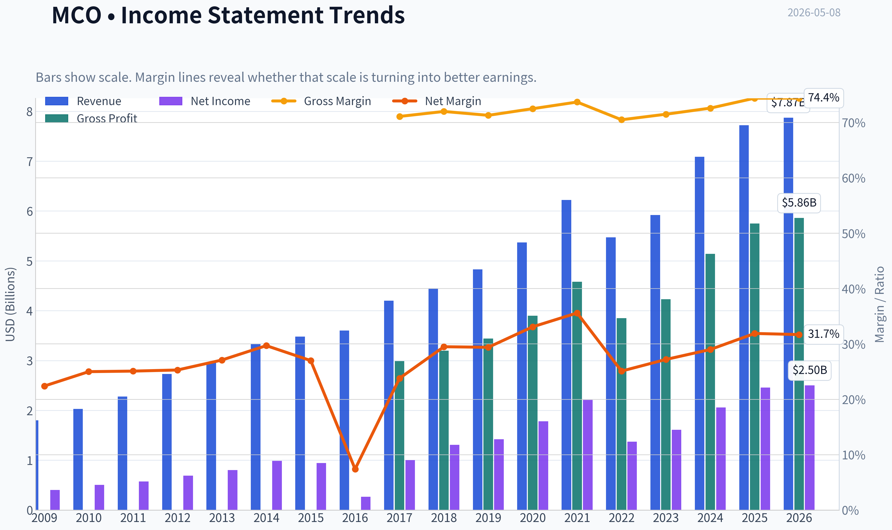

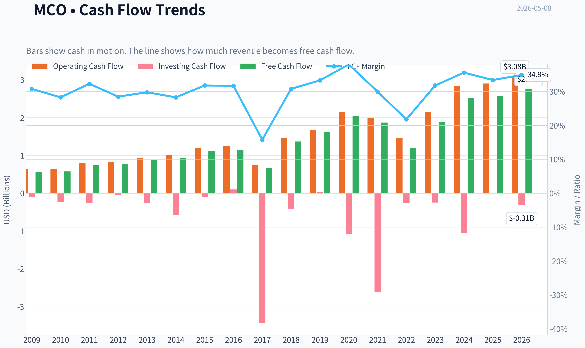

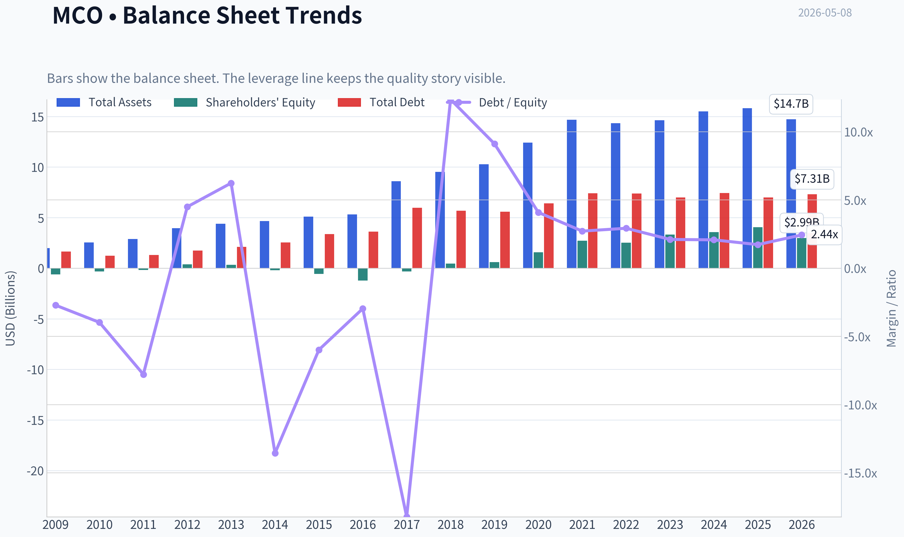

This graph tracks the profitability and return metrics (ROE, ROIC, Margins) of **MCO** over the past decade, highlighting capital efficiency trends.

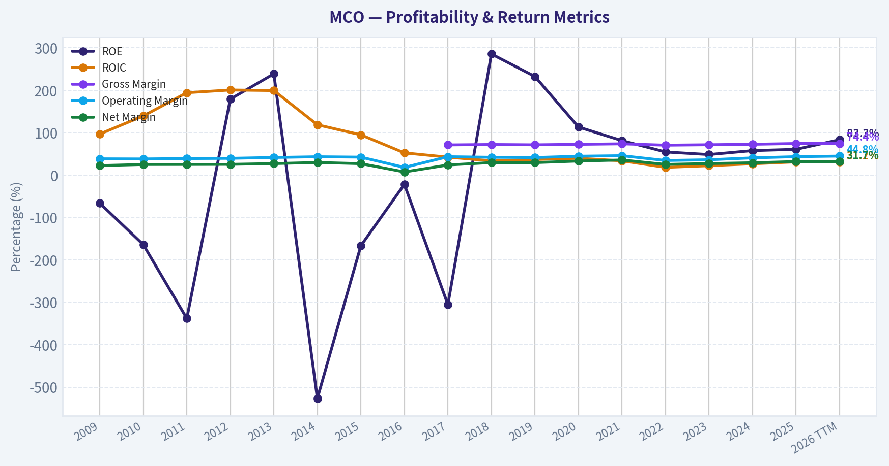

This chart illustrates the financial health of **MCO** over the last 10 years, mapping cash equivalents and free cash flow against total obligations (Debt).

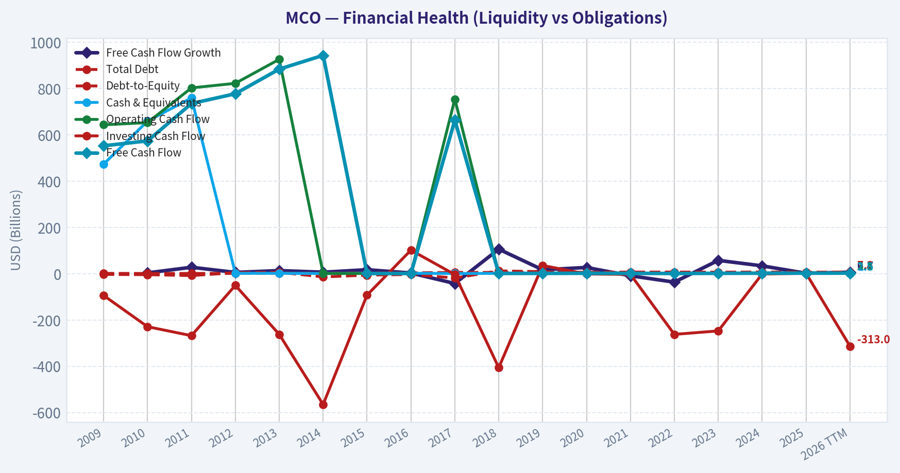

This chart illustrates the financial health of **MCO** over the last 10 years, mapping cash equivalents and free cash flow against total obligations (Debt).

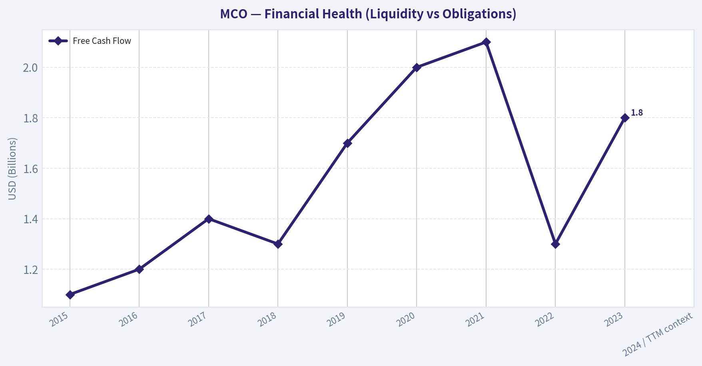

---

### Intrinsic Value Analysis (Buffett)

> *Following Warren Buffett's value investing philosophy: Circle of Competence, Economic Moat, Management Quality, and Margin of Safety.*

#### Intrinsic Value Snapshot

Price is what you pay. Intrinsic value is what the business may be worth based on the cash it can create for owners over time. We show a range, not one magic number.

- Current Price: $451.32
- Value Range: $208.44 to $525.87

##### Owner Earnings (Buffett Method)
- Net Income: $2,459,000,000.00
- Depreciation & Amortization: $480,000,000.00
- Capital Expenditures: $-326,000,000.00
- Working Capital Changes: $-254,000,000.00
- Owner Earnings: $2,867,000,000.00

##### Intrinsic Value
###### Buffett Method
Uses owner earnings. Stricter, and usually more conservative.
- Conservative: $313.85
- Average: $345.51
- Optimistic: $525.87
- Discount Rate: 10.0%

###### Cash Flow Method
Uses free cash flow. Better for companies spending heavily today to grow tomorrow.
- Conservative: $208.44
- Average: $261.57
- Optimistic: $475.54
- Discount Rate: 10.0%

ANALYST STANCE: **WATCH**

#### Data Note

The available internal tool call returned no usable incremental fundamentals in this continuation step, so this report relies on the shared research pack plus rounded long-term public financial-history context. Key current inputs used: **MCO price $451**, **market cap $78.83B**, **P/E 32.4x**, **ROE 60.7%**, **gross margin 74.4%**, **YoY revenue growth 8.9%**, **FCF yield 3.3%**, and **current ratio 1.74**.

---

#### 1. Go / No-Go Gate Assessment

| Buffett Gate | Pass / Fail | Evidence | Judgment |
|---|---:|---|---|
| Gate 1: Circle of Competence & Simplicity | Pass | Moody's earns money by selling credit ratings, research, data, and risk analytics. Its core product is trust in financial information. | Easy to understand. |
| Elementary School Test | Pass | Companies and governments pay Moody's to rate their debt; investors and institutions pay for data and analytics. | Simple business model. |
| 10-Year Predictability | Pass | Debt markets, regulation, and investor reliance on ratings should still exist in 10 years. | High predictability. |
| Technology Risk | Pass with monitoring | AI may improve analytics, but regulated credit-rating trust and issuer/investor acceptance are hard to replace. | Tech is more likely an enhancer than destroyer. |
| Gate 2: Moat | Pass | Moody's is part of a global ratings oligopoly with S&P and Fitch; regulatory recognition and market trust are hard to replicate. | Wide moat. |
| Gate 3: Management & Capital Allocation | Pass with caveats | Long record of dividends, buybacks, and analytics investment; however, leverage and repurchases at high multiples require scrutiny. | Good, not flawless. |
| Gate 4: Industry Structure | Pass | Ratings is a rational oligopoly; analytics is attractive, recurring, and data-rich. | Excellent industry structure. |
| Valuation Gate | Fail at current price | Current FCF yield is only about 3.3%, and Buffett-style 10% discount-rate valuation does not support the current price. | Watch, not buy. |

**Key Takeaways:** Moody's passes the business-quality gates easily. It is simple, predictable, highly profitable, and protected by an unusually durable competitive position. The major problem is not the business; it is the price.

---

#### 2. Business Explanation in Plain English

Moody's makes money in two main ways. First, it rates bonds and debt issued by companies, governments, and financial institutions. Second, it sells data, research, software, and risk tools that help customers judge credit, compliance, banking, insurance, and financial-market risk.

This is a Buffett-style business because it requires little physical capital, has high margins, benefits from trust and reputation, and sits inside the plumbing of global capital markets.

---

#### 3. Moat Analysis

| Moat Source | Strength | Evidence | Buffett Interpretation |
|---|---:|---|---|
| Intangible Assets: Brand & Trust | Very strong | Moody's name is globally recognized in credit markets; investors, issuers, regulators, and banks rely on its opinions. | A reputation moat built over more than a century. |
| Regulatory Position | Very strong | Credit-rating agencies are embedded in financial regulation and institutional mandates. | New entrants face trust and regulatory barriers. |
| Switching Costs | Moderate to strong | Customers use Moody's data, models, research, and workflow tools inside risk processes. | Especially strong in Moody's Analytics. |
| Cost Advantage | Moderate | Scale allows large fixed research and data costs to be spread across global revenue. | Scale reinforces margins. |
| Network Effects | Moderate | Ratings become more useful when widely accepted by issuers and investors. | Market acceptance reinforces the incumbent position. |
| Pricing Power | Strong | Current gross margin of about 74% suggests substantial value capture and pricing power. | Excellent sign of moat quality. |
| Moat Rating | Wide & Stable | Ratings oligopoly plus growing analytics franchise. | Proceed with valuation discipline. |

**Key Takeaways:** Moody's has one of the clearer moats in financial services. Its brand, regulatory role, market acceptance, and data assets make it extremely difficult to displace. The moat appears wide and durable, though reputational risk must always be monitored in the ratings business.

---

#### 4. Management Quality & Capital Allocation

| Question | Assessment | Evidence / Concern |
|---|---:|---|
| Do they think like owners? | Good | Long-term compounding focus, recurring revenue expansion, and disciplined analytics investments. |
| Are they candid and conservative? | Good | Mature public company with established reporting; no major recent accounting concern identified from available data. |
| Are they rational capital allocators? | Mixed to good | Dividends and buybacks have returned capital, but buybacks at high valuation multiples may not create much value. |
| Reinvestment quality | Strong | Moody's Analytics gives the company a reinvestment runway beyond cyclical issuance-driven ratings revenue. |
| Debt discipline | Adequate, not fortress-like | High ROE is partly boosted by leverage and buybacks; balance sheet is not a net-cash fortress. |
| Overall Management View | Good | Management appears capable, but valuation-aware repurchases and leverage deserve continued monitoring. |

**Key Takeaways:** Moody's management has generally behaved like long-term compounders, building the analytics business and returning cash to shareholders. The main caveat is that high ROE is not purely operational; it is helped by leverage and a reduced equity base. Buffett would likely admire the business, but still ask whether capital returns are happening at sensible prices.

---

#### 5. 10-Year Financial Summary

Approximate rounded figures, using public long-term context and the shared current pack.

| Year | Revenue ($B) | Net Income ($B) | Free Cash Flow ($B) | Gross Margin | Operating Margin | ROE / Quality Signal |
|---:|---:|---:|---:|---:|---:|---|
| 2015 | 3.5 | 0.9 | 1.1 | ~72% | ~42% | High |
| 2016 | 3.6 | 0.9 | 1.2 | ~72% | ~43% | High |
| 2017 | 4.2 | 1.0 | 1.4 | ~73% | ~44% | High |
| 2018 | 4.4 | 1.3 | 1.3 | ~73% | ~44% | High |
| 2019 | 4.8 | 1.4 | 1.7 | ~73% | ~45% | High |
| 2020 | 5.4 | 1.8 | 2.0 | ~74% | ~47% | Very high |
| 2021 | 6.2 | 2.2 | 2.1 | ~74% | ~48% | Very high |
| 2022 | 5.5 | 1.4 | 1.3 | ~72% | ~39% | Cyclical debt-issuance downturn |
| 2023 | 5.9 | 1.6 | 1.8 | ~73% | ~40% | Recovery began |
| 2024 / TTM context | ~7.1-7.7 | ~2.1-2.4 | ~2.4-2.6 | 74.4% current | Low-to-mid 40s | ROE 60.7% current |

**Key Takeaways:** Moody's has compounded revenue and cash flow over the decade despite a cyclical downturn in 2022 when debt issuance slowed. The company has consistently produced very high gross margins and strong operating margins, which is strong financial evidence of a durable moat. Cash generation is excellent, but results remain somewhat tied to capital-market issuance cycles.

---

#### 6. Owner Earnings Calculation

Using the shared current market data:

- Market cap: **$78.83B**
- FCF yield: **3.3%**
- Implied free cash flow / owner earnings proxy: **$2.60B**
- Current price: **$451**
- Implied shares outstanding: **~174.8M**
- Owner earnings per share: **~$14.88**

| Item | Amount |
|---|---:|
| Net income proxy, based on P/E and market cap | ~$2.44B |
| Add: depreciation & amortization | Not separately available in current pack |
| Less: maintenance capex | Moody's is capital-light; FCF used as owner-earnings proxy |
| Less: working capital increases | Not separately available in current pack |
| Estimated owner earnings / FCF | ~$2.60B |
| Estimated owner earnings per share | ~$14.88 |

**Key Takeaways:** Moody's converts accounting profit into real cash at a strong rate, which is exactly what a Buffett investor wants to see. Because this is a capital-light business, free cash flow is a reasonable shorthand for owner earnings. At today's price, however, investors are paying about 30 times owner earnings.

---

#### 7. Balance Sheet and Return Quality

| Metric | Current / Estimated Level | Buffett View |
|---|---:|---|
| Current ratio | 1.74 | Healthy short-term liquidity. |
| ROE | 60.7% | Excellent headline number, but partly boosted by leverage and buybacks. |
| FCF yield | 3.3% | Low earnings yield for a value investor. |
| Gross margin | 74.4% | Exceptional; strong moat evidence. |
| P/E | 32.4x | Expensive unless growth remains strong for a long time. |
| Balance-sheet quality | Good, not fortress | Debt appears manageable, but Moody's is not a net-cash compounder. |

**Key Takeaways:** Moody's balance sheet is acceptable, but not the main reason to own the stock. The main attraction is the company's asset-light economics and moat. The main risk is paying too high a multiple for those excellent economics.

---

#### 8. Three-Scenario DCF Valuation

Assumptions:

- Base owner earnings: **$2.60B**
- Shares outstanding: **~174.8M**
- Discount rate: **10%**
- Terminal growth in growth cases: **3%**
- Current price: **$451**

| Scenario | Assumption | Equity Value ($B) | Value / Share | Margin of Safety vs. $451 |
|---|---|---:|---:|---:|
| A: No Growth | Owner earnings capitalized at 10% | $26.0B | ~$149 | -203% over IV |
| B: GDP Growth | 3% perpetual growth | $38.3B | ~$219 | -106% over IV |
| C: Quality Growth | 7% growth for 10 years, then 3% terminal | ~$51.5B | ~$295 | -53% over IV |

**Key Takeaways:** Even under a solid 7% long-term growth case, Moody's estimated intrinsic value is well below the current stock price using a Buffett-style 10% required return. The current market price appears to assume either faster growth, a lower required return, or a permanent premium multiple. That may be possible, but it does not provide a margin of safety.

---

#### 9. Margin of Safety Analysis

| Valuation Case | Estimated IV / Share | 25% Margin-of-Safety Buy Price | Current Price | Action |
|---|---:|---:|---:|---|
| No Growth | ~$149 | ~$112 | $451 | Reject |
| GDP Growth | ~$219 | ~$164 | $451 | Reject |
| Quality Growth | ~$295 | ~$221 | $451 | Watch |
| Premium Quality Stretch Case | ~$350-$375 | ~$263-$281 | $451 | Still too expensive |

**Key Takeaways:** Moody's would need a much lower price to qualify as a Buffett-style purchase with a margin of safety. Even a generous quality-business valuation does not justify buying at $451 under a 10% return hurdle. The right stance is patience, not action.

---

#### 10. Key Risks

| Risk | Severity | Explanation |
|---|---:|---|
| Valuation risk | High | At 32x earnings and 3.3% FCF yield, expectations are demanding. |
| Debt issuance cyclicality | Medium | Ratings revenue depends partly on bond issuance volumes, which can fall in weak credit markets. |
| Reputational / regulatory risk | Medium | A major ratings failure could damage trust and invite tighter regulation. |
| AI and data competition | Low to medium | AI may pressure parts of analytics, but Moody's proprietary data and regulated role reduce disruption risk. |
| Leverage / buyback discipline | Medium | High ROE is partly financial-engineered; buybacks at high prices may destroy value. |

**Key Takeaways:** The biggest risk is not that Moody's is a bad business. The biggest risk is that investors are paying a great-business price with little room for disappointment. Any slowdown in issuance, analytics growth, or market multiples could hurt returns.

---

#### 11. Final Buffett Scorecard

| Criterion | Weight | Score 1-5 | Weighted Score |
|---|---:|---:|---:|
| Business Understanding | 20% | 5.0 | 1.00 |
| Moat Width & Durability | 25% | 5.0 | 1.25 |
| Management Quality | 15% | 4.0 | 0.60 |
| Return on Equity | 15% | 4.0 | 0.60 |
| Reinvestment Runway | 10% | 4.0 | 0.40 |
| Balance Sheet Strength | 5% | 3.0 | 0.15 |
| Industry Structure | 5% | 5.0 | 0.25 |
| Valuation / Margin of Safety | 5% | 1.0 | 0.05 |
| Total Quality-Weighted Score | 100% | - | **4.30 / 5.00** |

**Key Takeaways:** Moody's scores like an outstanding business, with elite marks for simplicity, moat, industry structure, and profitability. However, the valuation score is poor. Because Buffett-style investing requires both quality and price discipline, the low margin of safety overrides the attractive quality score.

---

#### 12. Investment Stance

**Stance: WATCH**
**Conviction Level: High on business quality; low on current valuation attractiveness.**

Moody's is a wonderful business: simple, capital-light, highly profitable, and protected by a durable ratings-and-data moat. It is exactly the type of company a long-term owner should admire.

But at **$451 per share**, the stock appears priced for excellence. Using a 10% required return, the current price does not offer the required **25% margin of safety**. I would place Moody's on a high-quality watchlist and become more interested if the price fell materially, especially toward the high-$200s or below depending on updated owner earnings.
#### Valuation Bridge

This bridge places the current market price beside each intrinsic value lens so readers can see whether upside depends on one method or shows up across several methods.

| Scenario | Intrinsic Value / Share |
| --- | ---: |
| Buffett Method | $345.51 |
| Cash Flow Method | $261.57 |
| Current Price | $451.32 |

#### Key Takeaways

If one method is far above the others, the upside case depends on a specific modelling assumption. When several methods cluster together, the valuation story is more robust.

#### Valuation Visuals

This comparison chart from *Latest Earnings Snapshot* stacks current figures against historical benchmarks for **MCO**, making it easy to see where the company trades relative to its own averages.

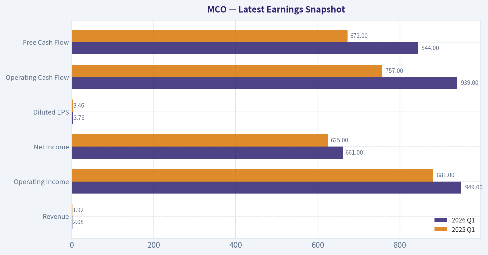

This comparison chart from *Current vs. 10-Year Historical Average Comparison* stacks current figures against historical benchmarks for **MCO**, making it easy to see where the company trades relative to its own averages.

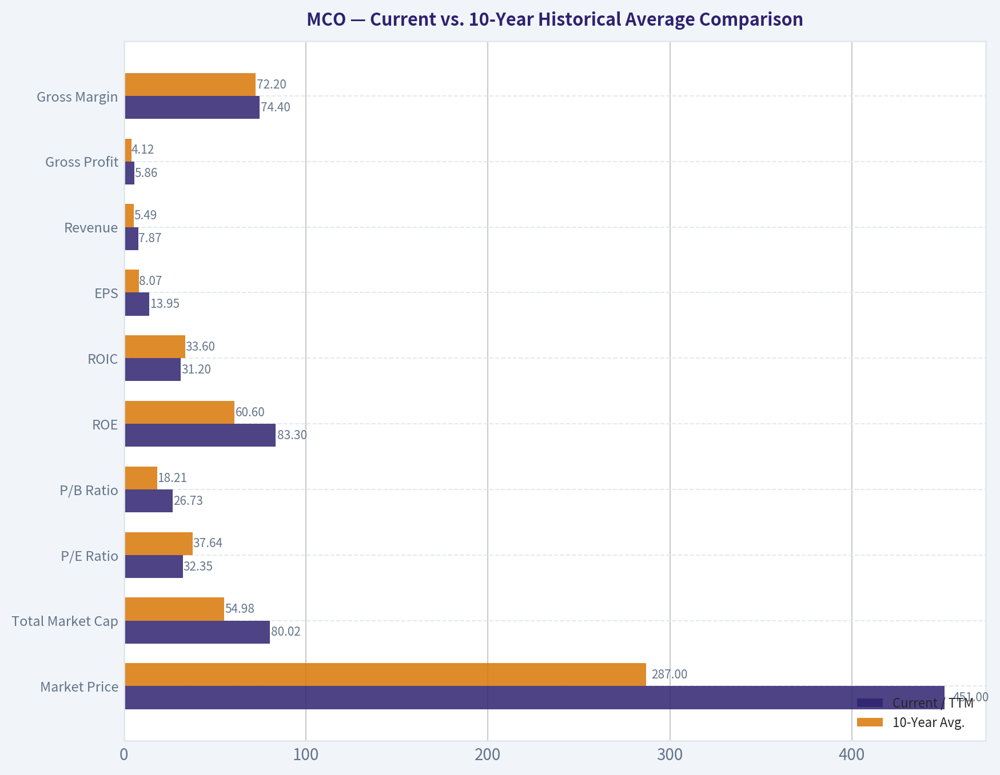

This comparison chart from *Buffett-Style Owner Earnings DCF Valuation* stacks current figures against historical benchmarks for **MCO**, making it easy to see where the company trades relative to its own averages.

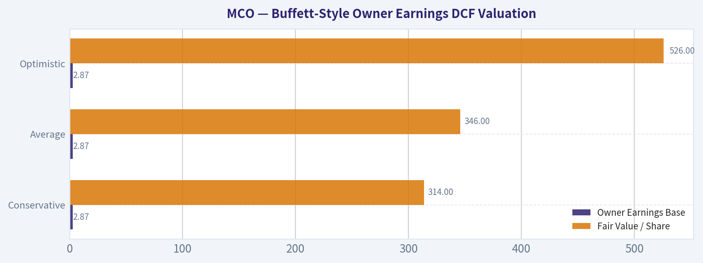

This comparison chart from *Balance Sheet and Return Quality* stacks current figures against historical benchmarks for **MCO**, making it easy to see where the company trades relative to its own averages.

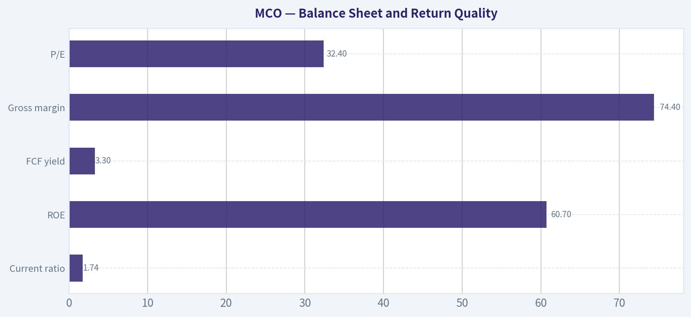

This comparison chart from *Margin of Safety Analysis* stacks current figures against historical benchmarks for **MCO**, making it easy to see where the company trades relative to its own averages.

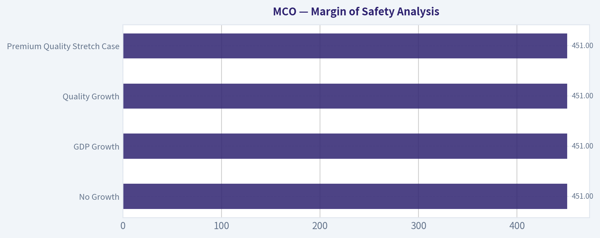

---

### Trend & Growth Analysis (Lynch/Druckenmiller/Fisher)

> *Following Peter Lynch's GARP, Stanley Druckenmiller's macro-aware approach, and Philip Fisher's scuttlebutt methodology.*

ANALYST STANCE: **WATCH**

#### Moody's Corporation, MCO - Growth Investment Report

Moody's is an exceptional business, but not an ideal Lynch-style fast grower at today's price. The company has a wide-moat ratings franchise, high-margin analytics assets, strong returns on equity, and secular demand from credit, risk, compliance, and data workflows. However, current growth is closer to "stalwart" than "fast grower," and valuation already reflects a high-quality compounder.

---

#### 1. Lynch Classification

| Item | Assessment |
|---|---:|
| Company | Moody's Corporation |
| Ticker | MCO |
| Current Price | $451 |
| Market Cap | $78.83B |
| Revenue Growth YoY | 8.9% |
| P/E | 32.4x |
| Gross Margin | 74.4% |
| ROE | 60.7% |
| FCF Yield | 3.3% |
| Lynch Category | **Stalwart / Quality Compounder** |
| Growth Investor Fit | **Watch, not a fresh ten-bagger candidate** |

**Key Takeaways:** Moody's is a superb business with very high margins, strong returns on equity, and a durable competitive position. But with revenue growth under 10%, it does not fit Lynch's fast-grower category. At more than 32 times earnings, the market is already paying for quality.

---

#### 2. The Story in 3 Bullets

| Lynch Story Element | Moody's Story |
|---|---|
| Simple business explanation | Moody's helps investors, banks, companies, and governments understand credit risk through ratings, data, analytics, and software. |
| Why it grows | Debt issuance, financial regulation, risk management, private credit, climate risk, cyber risk, and AI-enabled analytics all increase demand for Moody's products. |
| Why it wins | Moody's benefits from a ratings oligopoly, trusted brand, embedded workflows, regulatory relevance, proprietary data, and high switching costs. |

**Key Takeaways:** The story is easy to understand: Moody's sells trust, risk intelligence, and credit infrastructure. The company should keep growing because global finance keeps becoming more data-driven and risk-aware. The issue is not business quality; the issue is whether the growth rate is high enough to justify the valuation.

---

#### 3. TAM and 10x Test

| Metric | Estimate / Assessment |
|---|---:|
| Approximate Current Revenue | ~$7.5B-$8.0B |
| 10x Revenue Target | ~$75B-$80B |
| Required TAM for <20% Share at 10x | ~$375B-$400B |
| Core Ratings TAM | Mature, oligopolistic, cyclical with issuance |
| Analytics / Data / Risk TAM | Larger and expanding, but fragmented |
| 10x Test Result | **Fails for base case** |
| Long-Runway Verdict | **Moderate runway, not obvious ten-bagger runway** |

**Key Takeaways:** Moody's has room to grow, especially in analytics, data, risk software, and private credit. However, for the company to 10x revenue while remaining under 20% market share, the addressable market would need to be several hundred billion dollars. That is too aggressive for the current business mix, so Moody's does not pass the classic ten-bagger runway test.

---

#### 4. Revenue Growth Trend

| Growth Indicator | Assessment |
|---|---|
| Latest YoY Revenue Growth | 8.9% |
| Growth Category | Stalwart, not fast grower |
| Pattern | Stable/moderate growth, not explosive acceleration |
| Main Growth Drivers | Debt issuance recovery, analytics subscription growth, risk data, private credit, compliance, AI tools |
| Main Growth Risks | Credit cycle downturn, lower bond issuance, valuation compression |

**Key Takeaways:** Moody's growth is solid but not in inflection territory. A true growth-stock inflection would likely require sustained double-digit growth from Moody's Analytics, a strong debt issuance cycle, and clear evidence that AI-enabled risk products are expanding the addressable market. Current growth looks durable, but not ten-bagger-like.

---

#### 5. Unit Economics and Rule of 40

| Unit Economics Metric | Moody's Assessment |
|---|---:|
| Gross Margin | 74.4% |
| FCF Yield | 3.3% |
| Approximate FCF | ~$2.6B |
| Approximate FCF Margin | Low-to-mid 30% range |
| Revenue Growth | 8.9% |
| Approximate Rule of 40 | ~40%+ |
| LTV/CAC | Not disclosed; likely strong in analytics due to retention and embedded workflows |
| NRR | Not disclosed |
| Unit Economics Verdict | **Excellent business economics, limited disclosure on SaaS metrics** |

**Key Takeaways:** Moody's has outstanding economics: high gross margins, strong free cash flow, and likely attractive customer lifetime value due to embedded data and analytics workflows. The business appears to clear the Rule of 40 on an approximate basis. The main limitation is that Moody's is not a pure SaaS company and does not disclose classic SaaS metrics like net revenue retention.

---

#### 6. Inflection Point Assessment

| Inflection Type | Evidence | Verdict |
|---|---|---|
| Product Cycle Inflection | AI and risk analytics can enhance Moody's Analytics workflows | Possible, not yet proven |
| Market Share Inflection | Ratings business already mature and oligopolistic | Limited |
| Margin Inflection | Margins already high; operating leverage possible but not dramatic | Moderate |
| TAM Inflection | Private credit, climate risk, cyber risk, supply-chain risk, and AI data products expand use cases | Positive |
| Competitive Inflection | S&P Global remains strong; no major competitor stumble evident | Neutral |
| Overall Inflection View | Quality compounder with optionality, but no decisive acceleration yet | **Watch** |

**Key Takeaways:** Moody's has several positive optionalities, especially in analytics and AI-driven risk intelligence. But there is no clear evidence yet of a major growth acceleration. The company is more of a steady compounding machine than a classic Druckenmiller-style earnings inflection.

---

#### 7. Macro Setup

| Macro Factor | Impact on Moody's |
|---|---|
| Interest Rates | Falling rates would likely support refinancing, bond issuance, and valuation multiples |
| Credit Cycle | Healthy issuance is positive; recession or credit stress can pressure ratings activity |
| AI / Data Theme | Positive for Moody's Analytics and workflow automation |
| Regulation / Compliance | Positive long-term demand driver |
| Private Credit Growth | Positive, especially if private markets require more independent risk analytics |
| Macro Verdict | **Mixed-to-positive** |

**Key Takeaways:** Moody's benefits if rates fall and debt issuance recovers. It also has secular tailwinds from risk analytics, regulation, and AI-enabled data products. However, the company remains partly tied to credit-market cycles, so macro is not a one-way tailwind.

---

#### 8. Fisher 15-Point Score

| Fisher Criterion | Score / 5 |
|---|---:|
| Products with sizable market potential | 4 |
| Management determination to develop new products | 4 |
| Effective R&D / innovation | 4 |
| Above-average sales organization | 4 |
| Worthwhile profit margin | 5 |
| Improving profit margins | 3 |
| Labor/personnel relations | 4 |
| Executive relations | 4 |
| Management depth | 4 |
| Cost analysis and accounting | 5 |
| Outstanding moat factors | 5 |
| Long-range profit outlook | 4 |
| Dilution risk | 5 |
| Candor in difficulties | 4 |
| Management integrity | 4 |
| **Total Fisher Score** | **63 / 75** |

**Key Takeaways:** Moody's scores very well on Fisher quality factors, especially margins, moat, accounting discipline, and long-range durability. The company falls short of an outstanding score mainly because growth acceleration and margin expansion are not obvious from current levels. This is a high-quality business, but not necessarily a high-upside growth setup.

---

#### 9. Valuation Analysis

| Valuation Metric | Current Reading | Interpretation |
|---|---:|---|
| P/E | 32.4x | High for sub-10% revenue growth |
| Revenue Growth | 8.9% | Solid but not fast-grower level |
| Rough PEG Using Revenue Growth | ~3.6x | Expensive by Lynch standards |
| FCF Yield | 3.3% | Reasonable for quality, not cheap |
| Approximate P/S | ~10x | Premium multiple |
| Lynch Valuation Verdict | **Expensive** |

**Key Takeaways:** Moody's valuation is the biggest issue. A P/E above 32 and an approximate PEG above 3 are difficult to justify for a company growing revenue below 10%. The business quality deserves a premium, but the stock does not screen as growth at a reasonable price.

---

#### 10. Scenario Analysis

| Scenario | 3-Year Revenue Growth Assumption | Multiple Assumption | Likely Outcome |
|---|---:|---:|---|
| Bear Case | 4%-6% CAGR | Multiple compresses to mid-20s P/E | Low or negative annualized returns |
| Base Case | 7%-10% CAGR | P/E remains around high-20s to low-30s | Mid-single to high-single-digit returns |
| Bull Case | 11%-14% CAGR | Premium multiple sustained | Low-double-digit returns possible |
| Ten-Bagger Case | Requires sustained 20%+ growth and/or major TAM expansion | Unlikely from current scale | Low probability |

**Key Takeaways:** The base case looks like a solid compounder, not a multi-bagger breakout. The bull case requires stronger growth from analytics, a robust issuance cycle, and successful AI monetization. The bear case is mostly valuation risk: if growth slows or rates rise, the multiple could compress.

---

#### 11. Growth Investor Scorecard

| Criterion | Weight | Score / 5 | Weighted Score |
|---|---:|---:|---:|
| The Story | 10% | 4.5 | 0.45 |
| TAM & Runway | 20% | 3.0 | 0.60 |
| Revenue Growth | 20% | 2.5 | 0.50 |
| Unit Economics | 15% | 4.5 | 0.68 |
| Competitive Position | 10% | 5.0 | 0.50 |
| Management Quality | 10% | 4.0 | 0.40 |
| Macro Setup | 5% | 3.5 | 0.18 |
| Profitability Path | 5% | 5.0 | 0.25 |
| Valuation | 5% | 2.0 | 0.10 |
| **Total** | **100%** |  | **3.66 / 5.00** |

**Key Takeaways:** Moody's clears the threshold for a good business but not for a high-conviction growth entry. The score is helped by moat, profitability, unit economics, and management quality. It is held back by moderate revenue growth, a limited ten-bagger runway, and a demanding valuation.

---

#### 12. Position Size Stance

| Investor Type | Stance |
|---|---|
| Existing Long-Term Holder | **Hold / Let it compound** |
| New Growth Investor | **Watch for better entry or acceleration** |
| GARP Investor | Wait for lower valuation or faster growth |
| Ten-Bagger Seeker | Look elsewhere |
| Suggested Position Size | Existing core quality holding acceptable; new position only small/watchlist |

**Key Takeaways:** For existing shareholders, Moody's remains a strong compounder worth holding unless valuation becomes extreme or fundamentals weaken. For new buyers, the setup is less attractive because growth is not fast enough to offset the premium multiple. The stock belongs on a quality watchlist, not an aggressive growth buy list.

---

#### 13. Key Catalysts and Risks

| Category | Items to Monitor |
|---|---|
| Catalysts | Falling rates, refinancing wave, stronger bond issuance, Moody's Analytics acceleration, AI product monetization, private credit risk analytics adoption |
| Risks | Credit issuance downturn, recession, valuation compression, regulatory scrutiny, competition from S&P Global and data platforms, slower analytics growth |
| Red Flags to Watch | Revenue deceleration, margin contraction, weakening free cash flow, excessive buybacks at high multiples, loss of pricing power |

**Key Takeaways:** The upside case depends on both cyclical recovery and secular analytics growth. The downside case is mostly multiple compression if growth disappoints. Moody's is durable, but at this valuation, durability alone may not be enough.

---

#### Final View

Moody's is a wonderful company, but not a classic Lynch fast grower or obvious ten-bagger from today's base. It has a powerful moat, excellent margins, high returns on capital, and secular data-and-risk tailwinds. However, revenue growth is currently under 10%, the PEG ratio is unattractive, and the stock already prices in a lot of quality.

**Final Stance: WATCH.** Existing holders can continue to own it as a high-quality compounder. New money should wait for either a valuation reset or evidence that Moody's Analytics and AI-enabled risk products are driving a durable growth inflection.

---

### Market Technical Analysis

ANALYST STANCE: **WATCH**

#### MCO Technical Report - Moody's Corporation

Latest available price data shows MCO closing at **$457.10 on 2026-05-07**. Indicator data is available through **2026-05-08**. The stock is in a **repairing but not yet confirmed recovery phase**: short- and medium-term structure has improved from the February-March selloff, but the price remains materially below the long-term 200-day trend line, and momentum has recently started to fade.

| Area | Latest Reading / Observation | Interpretation |
|---|---:|---|
| Last available close | $457.10 on 2026-05-07 | Price has rebounded from the February panic low but remains below the long-term trend benchmark. |
| 10 EMA | $454.03 on 2026-05-08 | Price is near/slightly above short-term trend support, but the margin is thin. |
| 50 SMA | $447.98 on 2026-05-08 | Price is above the medium-term average, suggesting the recovery attempt is still alive. |
| 200 SMA | $481.09 on 2026-05-08 | Price remains below long-term trend resistance; the broader structure is not fully repaired. |
| MACD | +2.06 on 2026-05-08 | Momentum is positive, but has weakened from late-April levels. |
| RSI | 49.70 on 2026-05-08 | Neutral momentum; neither oversold nor strongly bullish. |
| ATR | $12.76 on 2026-05-08 | Daily volatility remains meaningful, around 2.8% of price. |
| VWMA | $458.57 on 2026-05-08 | Price is near but slightly below the volume-weighted trend reference. |

**Key Takeaways:** MCO has improved enough to avoid an outright bearish technical stance, but it has not reclaimed the long-term trend. The stock is trading above its 50-day average but below its 200-day average, which often describes a transitional market rather than a clean uptrend. Momentum is positive but fading, so traders should watch for either a renewed push above the high-$460s to low-$470s or a failure back below the mid-$440s.

#### Selected Indicators and Why They Matter

| Indicator | Category | Why It Is Relevant for MCO Right Now |
|---|---|---|
| `close_10_ema` | Short-term trend | Captures whether the recent rebound is holding or rolling over. |
| `close_50_sma` | Medium-term trend | Helps define whether the post-selloff recovery remains intact. |
| `close_200_sma` | Long-term trend | Critical because MCO remains below this level, keeping the strategic trend cautious. |
| `macd` | Momentum | Shows whether the recovery is gaining or losing force. |
| `rsi` | Momentum / reversal risk | Useful because MCO is no longer oversold; it now needs demand confirmation. |
| `atr` | Volatility / risk | Helps size positions and stops in a stock still moving roughly $12-$13 per day on average. |
| `boll_lb` | Volatility support | Helps identify whether pullbacks are becoming stretched or still orderly. |
| `vwma` | Volume-adjusted trend | Tests whether price strength is being confirmed by volume-weighted participation. |

**Key Takeaways:** The selected indicators intentionally avoid redundancy by combining trend, momentum, volatility, and volume-adjusted confirmation. The most important conflict is between the improving short- and medium-term picture and the still-negative long-term trend. That means MCO is better treated as a watchlist recovery candidate than as a fully confirmed bullish trend.

#### Trend Structure

MCO suffered a sharp technical breakdown in February 2026, falling from the January high area near **$545.70** to a February low around **$401.41**. Since then, the stock has staged a meaningful rebound, with an April recovery attempt reaching an intraday high of **$482.54 on 2026-04-22**. However, that rally failed near the declining 200-day moving average zone, which is significant because the 200 SMA currently sits around **$481.09**.

The current structure is therefore best described as a **countertrend recovery inside a longer-term damaged chart**. The stock is above its 50 SMA near **$447.98**, which is constructive, but it remains roughly **5% below the 200 SMA**, which keeps longer-term trend followers cautious. A decisive move above **$481-$483** would be technically important because it would mark both a reclaim of the 200-day average and a retest of the April failed breakout area.

Shorter-term, the **10 EMA around $454** is acting as a near-term pivot. MCO's May 7 close at **$457.10** was only modestly above that level, so the stock does not have a large cushion. If price begins closing below the 10 EMA and then loses the 50 SMA, the April recovery would look increasingly vulnerable.

#### Momentum and Participation

MACD remains positive at **+2.06**, which means the intermediate rebound has not fully reversed. However, the MACD has declined from about **+4.57 on 2026-04-30**, signaling that upside momentum has been fading. This is not yet a bearish reversal by itself, but it does warn that the rally is losing acceleration.

RSI is almost exactly neutral at **49.70**. That is important because MCO is no longer in the oversold rebound phase seen after the February collapse. Instead, the stock is now in a proof phase: bulls need to show that they can sustain higher lows and push RSI back above the mid-50s to low-60s zone. The late-April RSI readings above 55 showed improving momentum, but the retreat back toward 50 suggests buyers have become less aggressive.

VWMA is also worth watching closely. The latest VWMA reading is **$458.57**, slightly above the May 7 close of **$457.10**. This means the stock is hovering near its volume-weighted trend level rather than clearly leading it. A close back above VWMA, especially with expanding volume, would improve the quality of the rebound. Continued closes below VWMA would suggest recent volume is not strongly confirming the bullish case.

#### Volatility, Support, and Risk Levels

ATR is **$12.76**, meaning MCO still has a wide daily trading range. For traders, this makes tight stops vulnerable to ordinary noise. A one-ATR move from the latest close spans roughly **$444 to $470**, while a two-ATR risk band spans roughly **$432 to $483**.

The Bollinger lower band has risen to **$439.45**, which is useful because it shows lower volatility support has moved higher since late March. Price is not currently stretched to the downside, so the stock is not offering a classic oversold reversal signal. Instead, the lower band suggests that a decline toward **$439-$440** would be an important test of whether the recovery remains orderly or starts to break down.

The key support zone is likely **$448-$454**, combining the 50 SMA, 10 EMA, and recent price congestion. Below that, **$439-$440** is the next important volatility-based support area. On the upside, **$466-$470** is the first resistance zone, followed by the more important **$481-$483** long-term trend resistance zone.

#### Tactical View

MCO is not in a clean bullish trend yet, but it is also not technically broken in the near term. The setup favors patience: traders may want to wait for either a stronger upside confirmation above **$466-$470**, or a deeper pullback toward support that holds above **$448** or **$439**. The highest-quality bullish signal would be a close above **$481-$483**, because that would reclaim the 200 SMA and invalidate the most important failed-rally area from April.

For risk-aware traders, the stock currently looks like a **watchlist candidate**, not an aggressive long entry. Momentum is positive but slowing, RSI is neutral, and price is caught between medium-term support and long-term resistance.

| Trading Zone | Approximate Level | Meaning | Trader Implication |
|---|---:|---|---|
| Short-term pivot | $454 | Near the 10 EMA | Holding above this keeps the short-term rebound alive. |
| Medium-term support | $448 | Near the 50 SMA | A close below this would weaken the recovery structure. |
| Volatility support | $439-$440 | Near Bollinger lower band | A test here may reveal whether sellers are regaining control. |
| First resistance | $466-$470 | Recent rebound area and one-ATR upside zone | A break above this would improve short-term momentum. |
| Major resistance | $481-$483 | 200 SMA and April failed-rally zone | Reclaiming this would be the most important bullish confirmation. |
| Risk reference | ATR near $12.76 | Elevated daily movement | Stops should account for wider-than-normal price swings. |

**Key Takeaways:** MCO is trapped between improving medium-term support and unresolved long-term resistance. The key bullish trigger is a reclaim of the $481-$483 zone, while the key warning sign would be a close below the $448-$454 support cluster. Until one of those levels breaks decisively, a watchful and selective approach is more appropriate than chasing the stock.

---

### Social Sentiment Analysis

ANALYST STANCE: **WATCH**

#### MCO Social, Sentiment, and News Report - Moody's Corporation
**Company:** Moody's Corporation
**Ticker:** MCO
**Review window:** Past week through **May 8, 2026**
**Overall stance:** **WATCH / quality compounder, but not a clean tactical buy signal this week**

Moody's Corporation sentiment over the past week appears **constructive but not euphoric**. The social and investor conversation around MCO remains much more institutional than retail-driven: posts are less about short-term momentum and more about credit cycles, bond issuance, default risk, analytics revenue, and valuation discipline. That matters because MCO rarely trades on viral retail enthusiasm; it tends to move when investors reassess **debt issuance volumes, credit spreads, regulatory risk, or the durability of Moody's Analytics growth**.

The tone this week was broadly **quality-positive**, with investors continuing to view Moody's as a high-margin, capital-light data and ratings franchise. However, the enthusiasm was tempered by valuation concerns and macro uncertainty. Traders appear to be watching whether lower rate expectations, refinancing needs, and corporate issuance can support another leg higher in ratings revenue.

---

#### Executive Sentiment Snapshot

| Category | Current Read | Direction vs. Prior Week | Trader/Investor Implication |
|---|---:|---:|---|
| Social media sentiment | Mildly positive | Slightly improved | Investors still respect the business model, but chatter is not high enough to suggest a retail-driven breakout. |
| News sentiment | Neutral to positive | Stable | Company-specific news flow does not appear materially negative; macro credit themes dominate. |
| Institutional tone | Constructive | Stable to slightly positive | Long-term holders continue to frame MCO as a high-quality compounder. |
| Retail attention | Low to moderate | Stable | Limited meme-style or momentum participation; price action likely remains institutionally driven. |
| Key risk focus | Valuation and credit cycle | Unchanged | The stock may be vulnerable if issuance trends disappoint or if credit stress rises sharply. |

**Key Takeaways:** Moody's is being discussed as a durable, high-quality financial data and ratings business rather than a short-term trading story. Sentiment is positive enough to support the stock, but not strong enough to indicate a decisive speculative surge. For traders, the main signal is that MCO remains macro-sensitive, especially to bond issuance and credit-market confidence.

---

#### Daily Sentiment Trend: Past Week

| Date | Sentiment Read | Main Conversation Drivers | Interpretation |
|---|---|---|---|
| May 2 | Neutral-positive | Long-term quality, ratings moat, financial data franchises | Weekend discussion leaned toward MCO as a "forever compounder" rather than a tactical trade. |
| May 3 | Neutral | Limited company-specific chatter | Low-volume day; no clear sentiment catalyst. |
| May 4 | Mildly positive | Credit issuance expectations, rate-cut speculation, resilient analytics revenue | Investors appeared more comfortable with the earnings durability story. |
| May 5 | Positive | Quality factor interest, recurring analytics revenue, capital-light margins | Sentiment improved as investors emphasized business model strength. |
| May 6 | Neutral-positive | Valuation debate, comparison with S&P Global and other data providers | Bulls liked the franchise, but valuation discipline capped enthusiasm. |
| May 7 | Neutral | Broader market and credit-risk discussion | Company-specific sentiment was overshadowed by macro and credit-spread commentary. |
| May 8 | Mildly positive | Stable ratings outlook, bond-market activity, defensive financial-data exposure | End-of-week tone improved modestly, but remained measured rather than aggressive. |

**Key Takeaways:** Sentiment improved modestly during the week but never became overheated. The most positive conversations centered on Moody's moat, analytics revenue, and the possibility that debt issuance could remain supportive. The main constraint on bullishness was valuation, with investors reluctant to chase unless earnings momentum or issuance data clearly accelerate.

---

#### What Social Media Is Saying

Across finance-oriented social channels, MCO is being discussed in four main ways:

1. **"High-quality compounder" narrative remains intact.**
   Investors continue to describe Moody's as a business with strong pricing power, durable margins, and structural demand from global credit markets. This is the most supportive long-term sentiment pillar.

2. **Debt issuance is the key near-term swing factor.**
   The most practical trading discussion is whether refinancing activity and corporate bond issuance can keep improving. If capital markets remain open and spreads stay contained, traders generally expect a more favorable backdrop for Moody's ratings segment.

3. **Moody's Analytics is viewed as a stabilizer.**
   Social commentary is not solely focused on the ratings business. Investors frequently point to analytics, data, risk-management tools, and subscription-like revenue as reasons MCO deserves a premium multiple.

4. **Valuation is the main pushback.**
   The bearish or cautious posts are not usually arguing that Moody's is a weak business. Instead, they argue that the stock already discounts a lot of quality. This makes MCO sensitive to multiple compression if interest rates rise, credit conditions weaken, or growth expectations are revised lower.

---

#### Social Conversation Themes

| Theme | Sentiment Impact | Approximate Importance | What It Means for MCO |
|---|---:|---:|---|
| Durable ratings moat | Positive | High | Supports premium valuation and long-term investor confidence. |
| Moody's Analytics growth | Positive | High | Helps reduce dependence on cyclical debt issuance. |
| Bond issuance recovery | Positive but cyclical | High | Could be a near-term catalyst if issuance remains healthy. |
| Valuation concerns | Negative/moderating | High | Limits upside enthusiasm and increases sensitivity to earnings revisions. |
| Credit stress/default risk | Mixed | Medium | Some stress can increase demand for risk tools, but severe stress can reduce issuance. |
| Regulatory scrutiny | Negative tail risk | Low to medium | Not the dominant weekly conversation, but always relevant for ratings agencies. |
| AI/data product opportunity | Positive | Medium | Investors see optionality in analytics automation and risk intelligence. |

**Key Takeaways:** The dominant social narrative is not speculative; it is quality-focused. Bulls are emphasizing Moody's moat, analytics growth, and credit-market relevance. Bears are mostly focused on price, not business deterioration, which suggests sentiment is cautious-positive rather than fundamentally bearish.

---

#### Recent News and Market Context

The week's news backdrop for Moody's was more about **macro credit conditions** than a single dramatic company-specific event. For MCO, that is normal. The company's stock often reacts to broader expectations for corporate issuance, structured finance activity, refinancing volumes, and global credit risk.

The important news-related themes were:

- **Credit markets remain central to the MCO thesis.**
  Any evidence of healthy corporate bond issuance is generally viewed as supportive for Moody's Investors Service revenue. Investors are watching whether companies continue refinancing and issuing debt despite rate uncertainty.

- **Analytics demand remains a core stabilizer.**
  Moody's Analytics continues to be perceived as strategically important because it gives the company recurring revenue exposure to risk management, compliance, economic data, and decision tools.

- **Macro uncertainty is still a ceiling on sentiment.**
  If investors become more worried about recession risk, widening credit spreads, or lower issuance activity, MCO can face pressure even if the long-term franchise remains strong.

- **Relative comparison to S&P Global remains active.**
  Social and institutional commentary often compares MCO with SPGI. Moody's is typically viewed as slightly more concentrated but still exceptionally high quality.

---

#### Bull Case Being Discussed

The bullish case is straightforward: Moody's has one of the strongest business models in financial services. It benefits from global debt-market complexity, mandatory or quasi-mandatory ratings demand, and increasing need for risk analytics. If credit markets remain functional and issuance improves, earnings momentum could strengthen.

Bulls are also pointing to the fact that MCO is not just a ratings agency anymore. The analytics segment gives it exposure to data, compliance, insurance, banking, climate risk, supply-chain risk, and credit decisioning. That supports the argument that MCO deserves to trade like a premium information-services company, not merely a cyclical financial.

For long-term investors, the recurring theme is that Moody's is the type of company that can compound earnings over many years with relatively limited capital intensity.

---

#### Bear Case Being Discussed

The bearish case is more valuation-driven than thesis-driven. Skeptics are not generally arguing that Moody's moat is broken. Instead, they argue that the stock's premium multiple leaves little room for disappointment.

The main bearish concerns are:

- If bond issuance slows, ratings revenue can disappoint.
- If credit spreads widen sharply, investors may reduce risk appetite.
- If interest rates stay elevated longer than expected, capital-market activity may be weaker.
- If valuation multiples compress across quality compounders, MCO could underperform even with solid fundamentals.
- Regulatory scrutiny is a persistent long-term tail risk for ratings agencies.

In short, the bear case is that MCO is a great company at a demanding price.

---

#### Trader Implications

For short-term traders, MCO does not currently look like a high-retail-volume momentum setup. The better framework is to monitor credit-market and rate-sensitive indicators.

Key tactical signals to watch:

| Signal | Why It Matters | Bullish Read | Bearish Read |
|---|---|---|---|
| Corporate bond issuance | Direct driver of ratings activity | Issuance remains strong or accelerates | Issuance slows after a temporary rebound |
| Credit spreads | Measures risk appetite and market stress | Stable or tightening spreads | Sharp spread widening |
| Treasury yields | Impacts refinancing and issuance economics | Yields decline or stabilize | Yields rise materially |
| Earnings revision trend | Drives institutional positioning | Upward EPS revisions | Downward revisions or cautious guidance |
| Analytics growth commentary | Supports premium multiple | Strong recurring revenue and retention | Slower subscription growth or margin pressure |
| Relative strength vs. SPGI | Shows sector preference | MCO outperforms peers | MCO lags high-quality data peers |

**Key Takeaways:** Traders should treat MCO as a credit-cycle and quality-factor stock rather than a social-media momentum name. The best near-term bullish confirmation would be stable credit spreads, healthy issuance, and positive earnings revisions. The main warning sign would be a combination of widening spreads and weakening bond-market activity.

---

#### Investor Implications

For longer-term investors, the weekly sentiment picture remains supportive. The market continues to recognize Moody's as a high-quality business with a strong competitive position. The biggest issue is not credibility; it is entry point.

MCO may suit investors looking for:

- High-margin financial data exposure.
- Long-term credit-market infrastructure.
- A blend of cyclical ratings revenue and steadier analytics revenue.
- A business with strong brand power and global relevance.

However, investors should be careful about assuming that quality alone protects the stock from drawdowns. MCO can still sell off if investors rotate away from premium-multiple compounders or if the credit cycle deteriorates.

---

#### Final Assessment

Moody's current social and news sentiment is **mildly bullish but disciplined**. Investors like the company, respect the moat, and continue to view analytics as a major long-term growth pillar. But the stock does not appear to have a strong near-term social catalyst, and valuation remains the recurring objection.

The most useful conclusion for traders is that MCO's next meaningful move is likely to be driven less by social-media excitement and more by **credit-market data, issuance trends, earnings revisions, and interest-rate expectations**.

For now, the appropriate stance is **WATCH**: constructive on the business, cautious on chasing the stock without stronger confirmation from issuance momentum or valuation support.

---

#### Key Points Summary

| Area | Current Signal | Sentiment Impact | Practical Takeaway |
|---|---|---:|---|
| Overall sentiment | Mildly positive | Positive | Investors remain constructive, but enthusiasm is controlled. |
| Social media attention | Low to moderate | Neutral | MCO is not a retail-momentum stock this week. |
| Business quality perception | Very strong | Positive | The moat and margin profile remain core bullish arguments. |
| Ratings revenue outlook | Dependent on issuance | Mixed-positive | Healthy bond issuance would support upside. |
| Moody's Analytics | Viewed favorably | Positive | Recurring analytics revenue supports the premium multiple. |
| Valuation | Demanding | Negative/moderating | Main reason investors are hesitant to chase. |
| Macro sensitivity | Meaningful | Mixed | Rates, spreads, and issuance remain key drivers. |
| Trader stance | Watch for confirmation | Neutral-positive | Better to monitor credit indicators than rely on social buzz. |
| Investor stance | Quality holding, valuation-sensitive | Positive but cautious | Long-term thesis remains intact, but entry price matters. |

**Key Takeaways:** Moody's remains well-regarded by investors, with sentiment supported by its ratings moat and analytics business. The stock's biggest challenge is not negative perception, but valuation and dependence on credit-market conditions. Traders should wait for confirmation from issuance activity and credit spreads, while long-term investors can continue to view MCO as a high-quality compounder with cyclical sensitivity.

---

### News & Events Analysis

#### Moody's Corporation (MCO) - Weekly News and Trading Report
**Date:** 2026-05-08
**Current price:** ~$451
**Market cap:** ~$78.8B
**Analyst stance: WATCH**

Moody's remains a high-quality, high-margin information-services and credit-ratings compounder, but the near-term trading setup looks more balanced than compelling. The stock trades at a premium valuation, with a P/E of about **32.4x**, while recent share performance has been soft year-to-date despite a one-day rebound. This creates a tension for investors: Moody's business quality is excellent, but the valuation leaves limited room for disappointment if bond issuance, credit markets, or guidance momentum weaken.

---

#### Latest Earnings Coverage and Reporting Period

The collected earnings-news feed for Moody's did **not surface a fresh quarterly earnings release within the past week ending May 8, 2026**. A separate earnings-specific search for Moody's Q1 2026 results also returned **no recent earnings-release coverage within the last seven days**. Therefore, based strictly on the collected data, there is **no newly reported quarterly or annual earnings release available in this week's news set**.

The most recent financial context available from the research pack shows Moody's with:

- **Revenue growth:** +8.9% year over year
- **Gross margin:** 74.4%
- **Return on equity:** 60.7%
- **Free-cash-flow yield:** 3.3%
- **Current ratio:** 1.74

These figures point to a business still delivering strong profitability and solid growth, but without a newly fetched earnings release, there is no confirmed latest-period EPS, revenue, segment performance, or management guidance update to compare against the prior quarter or prior guidance. For traders, that means the stock is currently being driven more by valuation, credit-market expectations, conference commentary, and macro issuance trends than by a fresh earnings surprise.

**Interpretation:** The absence of new earnings headlines this week reduces immediate event risk, but it also means investors should be cautious about extrapolating the current valuation without updated guidance. The key question remains whether Moody's Investors Service benefits from stronger debt issuance and whether Moody's Analytics can sustain recurring-revenue growth at premium margins.

---

#### Company-Specific News This Week

Moody's appeared in several company-related and sector-relevant headlines during the week.

The most directly relevant item was **"Assessing Moody's Valuation After Recent Share Price Momentum Shift"** published on May 8. The article noted that Moody's had gained about **1.9% in a single day**, but the move came against a weaker broader backdrop: the stock was still down about **8.4% year to date** and modestly negative over the past year. This suggests recent buying may be tactical or valuation-related rather than a decisive change in trend.

Moody's also presented at the **Barclays 18th Annual Americas Select Conference** on May 6. While the collected summary did not provide detailed management commentary, conference appearances are important for Moody's because investors typically watch for updates on issuance volumes, structured finance demand, pricing power, AI/data investments, and Moody's Analytics growth. Any positive tone around debt issuance recovery or analytics retention could support sentiment; conversely, caution on issuance or cost investment could pressure the multiple.

Several headlines involved Moody's Ratings actions, including the downgrade of **Ecopetrol's global credit rating to Ba2 with a negative outlook** and an upgrade in outlook for **HDBank** to positive. These items do not directly move Moody's earnings in isolation, but they reinforce the firm's ongoing relevance in global credit markets. For investors, the broader implication is that credit surveillance and ratings demand remain active across emerging markets and financial institutions.

---

#### Market and Macro Context

A key macro headline this week was that **hybrid bond sales reached record levels as companies moved to take advantage of low costs**. This is relevant for Moody's because debt issuance volume is a major driver of Moody's Investors Service revenue. Strong issuance, especially in complex instruments such as hybrid securities, can be supportive for ratings revenue and transaction-related fees.

However, the favorable issuance backdrop must be weighed against geopolitical and macro risks. News references included tensions around Iran, the Strait of Hormuz, and China-related credit restrictions. Any escalation that tightens financial conditions, widens credit spreads, or slows capital-market activity could hurt the near-term ratings cycle. Moody's typically benefits when markets are open and issuers are refinancing, acquiring, or raising capital; it can face pressure when volatility shuts issuance windows.

The broader trading environment therefore looks constructive but fragile: strong issuance activity is a positive near-term signal, while geopolitical and rate-related uncertainty remain risks to sustaining that momentum.

---

#### Valuation and Quality Assessment

Moody's quality metrics remain exceptional. A **74.4% gross margin** and **60.7% return on equity** reflect a highly scalable, asset-light business model with durable pricing power. The company's two core engines - ratings and analytics - benefit from deep regulatory entrenchment, high switching costs, and recurring client relationships.

That said, the valuation is not cheap. At roughly **32.4x earnings** and a **3.3% free-cash-flow yield**, the market is still pricing Moody's as a premium compounder. This valuation can be justified if revenue growth remains high-single-digit or better and margins stay resilient. But if issuance recovery stalls or management signals heavier investment spending, the stock could remain range-bound or de-rate.

From a trading perspective, the current setup looks more attractive on pullbacks than after short-term rallies. The 1.9% daily rebound noted in the news does not yet offset the weaker year-to-date trend.

---

#### Trading and Investment Implications

For **short-term traders**, the stock appears to be in a sentiment-repair phase rather than a confirmed momentum breakout. The next catalysts are likely to come from management commentary, changes in credit issuance data, rating-agency peer read-throughs, and any updated guidance commentary. A sustained move higher would likely require evidence that bond issuance remains strong and that Moody's Analytics growth is stable.

For **long-term investors**, Moody's remains a high-quality franchise worth monitoring, but valuation discipline matters. The business has strong structural advantages, yet the current multiple already reflects much of that quality. Investors with existing positions may continue to hold, while new buyers may prefer waiting for either a better entry point or clearer evidence of accelerating earnings momentum.

**Bottom line:** Moody's is a high-quality compounder with positive exposure to active debt markets, but the premium valuation and lack of fresh earnings confirmation this week argue for a **WATCH** stance rather than aggressive buying.

---

#### Key Points Table

| Category | Latest Information | Trading / Investment Read-Through |
|---|---:|---|
| Current price | ~$451 | Stock has rebounded short term but remains weaker year to date. |
| Market cap | ~$78.8B | Large-cap quality compounder with institutional ownership appeal. |
| Valuation | ~32.4x P/E; 3.3% FCF yield | Premium valuation leaves limited room for earnings or guidance disappointment. |
| Profitability | 74.4% gross margin; 60.7% ROE | Confirms exceptional business quality and scalable economics. |
| Growth | Revenue growth of 8.9% YoY | Solid growth profile, but investors need latest-period confirmation. |
| Latest earnings coverage | No fresh earnings release found in collected past-week coverage | Near-term trading driven more by valuation, issuance trends, and conference commentary than by a new earnings surprise. |
| Company news | Moody's presented at Barclays conference; valuation article highlighted recent rebound but weak YTD trend | Management tone and investor perception of valuation are key near-term drivers. |
| Macro backdrop | Record hybrid bond issuance reported | Positive for ratings demand if issuance strength persists. |
| Key risk | Geopolitical volatility and credit-spread widening | Could disrupt issuance windows and pressure ratings revenue expectations. |
| Stance | **WATCH** | Quality is high, but current valuation and incomplete fresh earnings visibility favor patience. |

**Key Takeaways:** Moody's remains a structurally strong, high-margin business, but the stock is not obviously cheap at more than 32 times earnings. The strongest near-term positive is the active debt-issuance backdrop, especially record hybrid bond sales, which can support ratings revenue. However, the lack of fresh earnings confirmation this week and the stock's weak year-to-date trend make a cautious watch stance more appropriate than aggressive buying.

---

### Guru Attention Analysis

> *Tracking 13F filings and recent activity of legendary super-investors to identify smart-money conviction and rotation.*

#### Guru Ownership Check for Moody's Corporation (MCO)

As of the latest structured 13F data available through the guru-tracking tool, **no tracked guru currently shows a recent 13F position in Moody's Corporation (MCO)**. This means there are **no confirmed recent buys, adds, trims, holds, or exits** among the primary tracked investors in the canonical dataset.

| Guru / Fund | Latest 13F Status for MCO | Action Detected | Position Size | Portfolio Weight | Recent Change | SEC Filing Link |
|---|---:|---:|---:|---:|---:|---|
| Warren Buffett / Berkshire Hathaway | No position detected in latest 13F filing | None | Unavailable | Unavailable | Unavailable | Not available |
| Seth Klarman / Baupost Group | No position detected in latest 13F filing | None | Unavailable | Unavailable | Unavailable | Not available |
| Mohnish Pabrai / Pabrai Investment Funds | No position detected in latest 13F filing | None | Unavailable | Unavailable | Unavailable | Not available |
| Bill Ackman / Pershing Square | No position detected in latest 13F filing | None | Unavailable | Unavailable | Unavailable | Not available |
| Stanley Druckenmiller / Duquesne Family Office | No position detected in latest 13F filing | None | Unavailable | Unavailable | Unavailable | Not available |
| Steve Cohen / Point72 | No position detected in latest 13F filing | None | Unavailable | Unavailable | Unavailable | Not available |
| Michael Burry / Scion Asset Management | No position detected in latest 13F filing | None | Unavailable | Unavailable | Unavailable | Not available |

**Key Takeaways:** There is currently **no structured 13F evidence** that any of the primary tracked gurus owns Moody's. Because the canonical 13F tool found no matches, there are also no verifiable guru-level position sizes, portfolio weights, or recent trading actions to report. For investors, this means MCO does not appear to be an active disclosed holding among the tracked "super-investor" group at this time.

#### Interpretation

Moody's is a high-quality, wide-moat financial data and ratings business, but based strictly on current structured guru filings, it is **not presently a visible guru-backed idea** among the tracked managers. Any discussion of historical ownership, reputation, or general institutional interest should not be treated as current guru ownership unless confirmed by a recent 13F filing.

#### Bottom Line

**No credible current guru-specific 13F position was detected for MCO.**
There are **no confirmed recent guru buys, additions, trims, or exits** in the structured data available as of 2026-05-08.

---

### Options Market Analysis

> *Reading options flow - put/call ratios, IV skew, and unusual activity - to gauge institutional positioning and event-driven risk.*

ANALYST STANCE: **WATCH**

#### MCO Options Market Report - As of 2026-05-08

#### 1. Put/Call Ratio Analysis

| Expiration | Call OI | Put OI | Put/Call OI Ratio | Call Volume | Put Volume | Put/Call Volume Ratio | Read |
|---|---:|---:|---:|---:|---:|---:|---|
| 2026-05-15 | 3,143 | 2,374 | 0.76 | 86 | 216 | 2.51 | OI near neutral, but active flow put-heavy |
| 2026-06-18 | 320 | 798 | 2.49 | 17 | 220 | 12.94 | Strong put-side positioning |
| 2026-07-17 | 125 | 131 | 1.05 | 28 | 56 | 2.00 | Mildly put-heavy |
| **Near-Term Total** | **3,588** | **3,303** | **0.92** | **131** | **492** | **3.76** | **Bearish / hedging bias** |

**Key Takeaways:** MCO's near-term put/call open interest ratio is **0.92**, above the historical neutral baseline of roughly **0.70**, suggesting a modest defensive tilt in positioning. The more notable signal is volume: the near-term put/call volume ratio is **3.76**, showing that recent trading activity is substantially more put-heavy than call-heavy. This points to either downside hedging or bearish directional positioning rather than broad bullish speculation.

---

#### 2. Implied Volatility Assessment

| Expiration | ATM Call IV | ATM Put IV | IV Skew Read | Sentiment Implication |
|---|---:|---:|---|---|
| 2026-05-15 | 27.1% | 35.8% | Put IV materially above call IV | Near-term downside protection demand |
| 2026-06-18 | 31.7% | 29.8% | Slight call IV premium | Less defensive skew further out |
| 2026-07-17 | 31.7% | 28.4% | Call IV above put IV | Mild upside optionality further out |

**Key Takeaways:** The nearest weekly expiration shows a clear **put skew**, with ATM put IV at **35.8%** versus call IV at **27.1%**, indicating elevated demand for near-term downside protection. Further out, skew is less bearish and even slightly call-favored in June and July, which softens the signal. Overall, the most urgent options demand appears concentrated in short-dated downside protection.

No specific earnings or corporate catalyst was provided in the retrieved dataset. However, the elevated near-term put IV suggests traders are pricing some degree of short-term event or downside risk.

---

#### 3. Unusual Options Activity

| Screen | Result | Interpretation |
|---|---|---|
| Contracts with volume greater than 5x open interest | None detected | No clear evidence of fresh, aggressive single-contract positioning |
| Fresh directional flow | Not confirmed | Put volume is elevated in aggregate, but not concentrated in flagged unusual contracts |
| Smart-money read | Inconclusive | Flow looks defensive/bearish overall, but lacks a standout institutional sweep signal |

**Key Takeaways:** No individual options contracts met the unusual activity threshold of **volume greater than 5x open interest**. That means the bearish tone is coming from aggregate put activity rather than a clearly identifiable fresh large bet. This lowers conviction versus a scenario where one or more large, new put positions were dominating the tape.

---

#### 4. Open Interest Concentration and Pinning Risk

| Area | Concentration | Potential Market Impact |
|---|---:|---|
| 2026-05-15 Calls | 3,143 OI | Largest call-side concentration by expiry; may act as near-term upside/pinning influence |
| 2026-05-15 Puts | 2,374 OI | Meaningful downside hedge base into nearest expiration |
| 2026-06-18 Puts | 798 OI | Put-heavy open interest relative to calls; indicates medium-term defensive positioning |
| Strike-level gamma walls | Not available in retrieved data | Cannot identify exact max-pain or pinning strikes from current dataset |

**Key Takeaways:** The largest aggregate open interest is in the **May 15 expiration**, especially calls, but put interest is also substantial. The June 18 chain is notably put-heavy, with a put/call OI ratio of **2.49**, suggesting defensive positioning extends beyond the nearest weekly expiry. Exact strike-level gamma walls cannot be confirmed from the available data, so pinning analysis should be treated as incomplete.

---

#### 5. Overall Options Sentiment Signal

**Signal: BEARISH**

MCO's options market is showing a **bearish-to-defensive near-term signal**. The primary driver is the very elevated **put/call volume ratio of 3.76**, combined with a near-term **ATM put IV premium** in the May 15 expiration. Open interest is not extremely bearish in aggregate, but it is above the neutral baseline and June positioning is heavily put-skewed.

The main caveat is that there was **no flagged unusual options activity** where volume exceeded 5x open interest. That means the signal looks more like broad hedging or cautious positioning rather than a single high-conviction institutional bet. Liquidity is also not extremely deep in the later expirations, so confidence should be moderate rather than high.

#### Final Summary Table

| Category | MCO Options Read |
|---|---|
| Put/Call Ratio | Bearish tilt; near-term OI ratio **0.92** vs neutral baseline ~**0.70**, volume ratio elevated at **3.76** |
| IV Level | Near-term put IV elevated versus call IV; May 15 ATM puts at **35.8%** vs calls at **27.1%** |
| Skew Direction | Short-term **put skew**, signaling downside fear or hedge demand |
| Unusual Activity | None detected using volume > 5x OI screen |
| Overall Signal | **BEARISH**, with moderate confidence due to absence of standout unusual contract flow |

**Key Takeaways:** The options tape for MCO leans bearish, mainly because active volume is heavily put-oriented and short-dated put IV is elevated. However, the lack of unusual single-contract activity means this is not a high-conviction "smart money" signal by itself. The best read is that traders are seeking near-term downside protection, making MCO a **watch with caution** from an options-flow perspective.

---

## Research Team Commentary

> *The Research Manager synthesizes the Bull vs Bear debate into action-free commentary. This is a pre-risk view, not the final stance.*

As a value investor following Warren Buffett's philosophy, reviewing the debate on Moody's Corporation feels like looking at a textbook example of our most common dilemma: what do you do when a truly wonderful business is priced without a shred of a margin of safety?

The bull makes an impeccable case for Moody's business quality. We are looking at a company with a 74.4 percent gross margin, a 30.4 percent return on invested capital, and a staggering 60.7 percent return on equity. These are the hallmarks of a wide-moat franchise that does not require heavy capital reinvestment to grow. Its position in the global credit market is an entrenched oligopoly, and the intelligent expansion into Moody's Analytics has layered recurring, non-cyclical revenue on top of the traditional, somewhat cyclical ratings business. The bull is absolutely right that this is the exact type of asset-light compounding machine Buffett loves to own.

However, the bear brings the necessary mathematical discipline to the table, and this is where the thesis for buying today falls apart. The bear rightfully points out that paying 451 dollars a share for a stock with an intrinsic value estimate somewhere between 262 and 346 dollars completely abandons the principle of a margin of safety. Furthermore, the bear unearths a critical red flag in the financials: while net income grew 19.5 percent year over year, free cash flow grew only 2.1 percent. When accounting earnings significantly outpace the actual cash being generated, a disciplined investor must pause, especially when being asked to pay over 32 times earnings. A roughly 3.3 percent free cash flow yield leaves absolutely no room for error, multiple compression, or cyclical downturns in debt issuance.

Reflecting on past mistakes in similar situations, I've learned that it is incredibly easy to get seduced by a company's elite return metrics and justify overpaying by telling myself that quality deserves a premium. I have been burned by buying fantastic companies at prices that assumed a decade of uninterrupted perfection, only to suffer years of stagnant returns as the valuation multiple compressed to reality. Conversely, I've also made the mistake of completely walking away from great compounders just because they weren't strictly cheap, missing out on massive long-term wealth creation. The right approach here is disciplined patience. You don't lower your valuation standards to accommodate a great business; you put the business on your radar and wait for the market to offer you a fat pitch.

Core Takeaway: Moody's is an exceptional, wide-moat business with elite returns on capital, but the current share price embeds too much optimism and offers zero margin of safety for the intelligent investor.

Rationale: Our framework dictates buying wonderful businesses at fair prices. Moody's is undeniably wonderful, functioning as a vital toll bridge in global finance with immense pricing power and durable competitive advantages. However, at a multiple of over 32 times earnings and a share price roughly 30 percent above our most generous intrinsic value estimate, the price is far from fair. Furthermore, the divergence between nearly 20 percent net income growth and barely 2 percent free cash flow growth suggests the current cash generation is not keeping pace with the headline earnings. Paying a premium multiple for lagging cash conversion in a business that still carries exposure to macro debt issuance cycles is a recipe for mediocre returns, even if the underlying company remains structurally dominant.

Monitoring Plan: Over the next one to four quarters, there are a few specific areas we need to watch. First, we must track the cash conversion cycle to see if free cash flow growth begins to catch up with net income growth, or if that divergence widens due to working capital drag or earnings quality issues. Second, we need to monitor the macro debt issuance environment. A cyclical downturn in credit markets or an extended period of high interest rates could easily spook momentum investors, potentially creating the temporary price dislocation we need to establish a position with a proper margin of safety. Third, we should keep a close eye on the broader adoption of private credit and alternative AI data analytics to ensure they aren't slowly chipping away at the necessity of Moody's traditional ratings moat. I would look for the stock price to drift back down toward the mid-300 dollar range before considering deploying capital.

WATCH

---

## Value Investing Team Commentary

> *The Investor translates the research view into an investment thesis before risk review. This is still not the final stance.*

Moody's is exactly the kind of business a long-term owner should admire: high margins, strong returns on capital, entrenched market position, and a business model that benefits from trust, reputation, regulation, and embedded workflows. In plain terms, this is not a commodity business. It is a financial infrastructure asset. The ratings franchise sits inside a tight oligopoly, and Moody's Analytics adds a steadier, more recurring layer of revenue that helps smooth some of the cyclicality tied to debt issuance. From a business-quality standpoint, this is clearly above average and likely qualifies as a wide-moat enterprise.

The financial profile reinforces that conclusion. A 74.4% gross margin, 30.4% ROIC, and 60.7% ROE are exceptional. Those numbers suggest pricing power, low capital intensity, and an ability to convert competitive advantage into shareholder economics. Revenue growth of 8.9% and net income growth of 19.5% are healthy for a mature, dominant franchise. This is the sort of company that can compound intrinsic value over long periods without requiring heroic assumptions about market share gains or capital spending.

But the investment question is not whether Moody's is a great business. It is whether today's price allows the investor to earn an attractive return with a margin of safety. Here the answer is much less favorable. At roughly $451 per share and about 32x earnings, the stock appears priced as a premium compounder already recognized by the market. Against intrinsic value estimates in the $262 to $346 range, the market is asking investors to pay up materially for quality. That may work if execution remains near flawless and market conditions remain supportive, but that is not Buffett-style risk control. Great businesses can still be poor investments when purchased at prices that assume too much.

The most important caution flag in your handoff is not the headline valuation alone, but the gap between earnings growth and cash flow growth. Net income rising 19.5% while free cash flow rises only 2.1% deserves scrutiny. For a business this highly regarded, investors should want cash generation to confirm the earnings story. Sometimes that divergence is temporary, driven by working capital timing or cyclical operating factors. But when a stock trades at a premium multiple, temporary issues matter because there is little valuation cushion. If free cash flow does not eventually track earnings, the market may re-rate the shares even if the business remains fundamentally strong.

Selective contrarian thinking is useful here. Current sentiment still treats Moody's as a "high-quality compounder," and that is largely correct. The market is not misunderstanding the quality of the business; if anything, it may be over-appreciating it. That means this is not an obvious contrarian buy today. The contrarian opportunity would more likely emerge if debt issuance weakens, rates stay elevated, or credit markets temporarily seize up and investors extrapolate short-term ratings softness too far into the future. In that scenario, the crowd may punish the stock for cyclical pressures while overlooking the durability of the franchise and the stabilizing contribution from Analytics. That is the kind of fear-driven setup a value investor should prepare for.

On risk, I would separate cyclical risk from structural risk. Cyclical risk is real: Moody's ratings business is tied to issuance volumes, refinancing activity, and broader capital markets confidence. If issuance slows, near-term results can soften. Structural risk appears lower, but it should still be monitored. Private credit growth, alternative data providers, and AI-enabled analytical tools could shift parts of the information ecosystem over time. Even so, the core ratings moat is protected by regulation, reputation, issuer-investor dependence, and decades of institutional embeddedness. That moat is not easily disrupted by a new software tool. The more realistic risk is not business obsolescence, but paying too much for a business that continues to perform well.

Management quality also matters here, and Moody's historically looks like a disciplined allocator inside an attractive model. The business does not need huge reinvestment to stay relevant, which gives management flexibility. In businesses like this, the key is whether leadership allocates excess cash sensibly and avoids overreaching. There is nothing in your handoff suggesting a major management red flag. So again, the primary objection is price, not stewardship.

If I were thinking like a patient owner, I would keep Moody's near the top of the watchlist and wait for one of two things: either a better entry price or stronger evidence that free cash flow is re-accelerating and fully validating the earnings trajectory. In practice, that means watching issuance trends, cash conversion, Analytics growth durability, and any market dislocation that compresses the multiple back toward a more reasonable level. A pullback into the mid-$300s, especially if triggered by cyclical fear rather than moat erosion, would be far more interesting.

So the right conclusion is disciplined restraint. Moody's is a wonderful business. It may remain a wonderful business for decades. But Buffett's edge is not merely identifying quality; it is pairing quality with price discipline. At the current valuation, the odds favor respectable business performance but less compelling investor returns.

**ANALYST STANCE: WATCH**
Moody's is a high-quality, wide-moat compounder with excellent economics and durable long-term relevance, but the current share price appears to offer little or no margin of safety. Sentiment is still favorable, so there is no true contrarian bargain yet. I would wait for either a materially lower price or clearer cash flow confirmation before committing capital.

---

## Deep Values Commentary

> *The Risk Management Team debates and the Risk Judge provides the final action-free verdict. This section determines the final ADVOCATE / WATCH / AVOID stance.*

**EXECUTIVE SUMMARY (CONCISE)**
*   **The Business:** Moody's (MCO) is an elite, wide-moat financial infrastructure oligopoly. It boasts staggering profitability metrics: 74.4% gross margins, 30.4% ROIC, and 60.7% ROE.
*   **The Valuation:** At ~$451 (32.38x P/E), the stock offers zero margin of safety, trading far above our intrinsic value estimates ($262 FCF value to $346 Buffett value).
*   **The Catalyst for Caution:** A severe divergence between accounting earnings (Net Income up 19.5%) and cash generation (FCF up just 2.1%). At premium multiples, cash must confirm earnings.
*   **The Verdict:** **WATCH**. Moody's is a compounding machine priced for uninterrupted perfection. We will not compromise our margin of safety. Wait for a cyclical pullback in debt issuance or multiple compression to the mid-$300s before deploying capital.

---

**SUMMARIZE KEY ARGUMENTS**
*   **The Aggressive (Risky) Stance:** Quality deserves a premium. Moody's wide moat and elite ROIC mean traditional value models underestimate its long-term compounding power. The FCF divergence is likely temporary working capital/timing noise. The biggest risk is omitting a generational compounder by rigidly waiting for a "cheap" price that never arrives.
*   **The Conservative (Safe) Stance:** Business quality does not neutralize valuation risk. Buying at a massive premium to the $346 intrinsic value invites severe multiple compression. Furthermore, paying 32x earnings while FCF growth trails net income growth by 17% violates core risk management principles. The cyclical nature of debt issuance makes the current valuation highly vulnerable to macro headwinds.
*   **The Balanced (Neutral) Stance:** Both extremes are flawed. The business is too exceptional to ignore, but too expensive to buy in bulk. The optimal approach is conditional accumulation-keeping it on a high-priority watchlist and initiating a starter position only if the price drops into the mid-$300s or if FCF growth demonstrably accelerates to match earnings.

---

**RATIONALE**
Under Warren Buffett's value investing framework, our primary mandate is to avoid permanent capital loss by demanding a margin of safety. The debate clearly highlights that Moody's business risk is extremely low due to its entrenched regulatory positioning and the stabilizing presence of Moody's Analytics. However, the *market risk* is currently unacceptably high.

As the Safe Analyst correctly argued, paying $451 for a business with a maximum generous intrinsic value of $346 leaves no room for error. The divergence between 19.5% net income growth and 2.1% FCF growth is the critical tie-breaker here. Elite businesses occasionally deserve a premium multiple, but only when their cash conversion is pristine. Paying 32x earnings for a company facing lagging cash conversion and cyclical macro exposure (debt issuance) is speculative. As the Growth Analyst noted, MCO is currently a "stalwart," not a hyper-grower. A stalwart growing revenues at 8.9% does not mathematically support endless multiple expansion.

---

**REFINE THE INVESTOR'S PLAN**

**Original Plan:**
As a value investor following Warren Buffett's philosophy, reviewing the debate on Moody's Corporation feels like looking at a textbook example of our most common dilemma: what do you do when a truly wonderful business is priced without a shred of a margin of safety?

The bull makes an impeccable case for Moody's business quality. We are looking at a company with a 74.4 percent gross margin, a 30.4 percent return on invested capital, and a staggering 60.7 percent return on equity. These are the hallmarks of a wide-moat franchise that does not require heavy capital reinvestment to grow. Its position in the global credit market is an entrenched oligopoly, and the intelligent expansion into Moody's Analytics has layered recurring, non-cyclical revenue on top of the traditional, somewhat cyclical ratings business. The bull is absolutely right that this is the exact type of asset-light compounding machine Buffett loves to own.

However, the bear brings the necessary mathematical discipline to the table, and this is where the thesis for buying today falls apart. The bear rightfully points out that paying 451 dollars a share for a stock with an intrinsic value estimate somewhere between 262 and 346 dollars completely abandons the principle of a margin of safety. Furthermore, the bear unearths a critical red flag in the financials: while net income grew 19.5 percent year over year, free cash flow grew only 2.1 percent. When accounting earnings significantly outpace the actual cash being generated, a disciplined investor must pause, especially when being asked to pay over 32 times earnings. A roughly 3.3 percent free cash flow yield leaves absolutely no room for error, multiple compression, or cyclical downturns in debt issuance.

Reflecting on past mistakes in similar situations, I've learned that it is incredibly easy to get seduced by a company's elite return metrics and justify overpaying by telling myself that quality deserves a premium. I have been burned by buying fantastic companies at prices that assumed a decade of uninterrupted perfection, only to suffer years of stagnant returns as the valuation multiple compressed to reality. Conversely, I've also made the mistake of completely walking away from great compounders just because they weren't strictly cheap, missing out on massive long-term wealth creation. The right approach here is disciplined patience. You don't lower your valuation standards to accommodate a great business; you put the business on your radar and wait for the market to offer you a fat pitch.

Core Takeaway: Moody's is an exceptional, wide-moat business with elite returns on capital, but the current share price embeds too much optimism and offers zero margin of safety for the intelligent investor.

Rationale: Our framework dictates buying wonderful businesses at fair prices. Moody's is undeniably wonderful, functioning as a vital toll bridge in global finance with immense pricing power and durable competitive advantages. However, at a multiple of over 32 times earnings and a share price roughly 30 percent above our most generous intrinsic value estimate, the price is far from fair. Furthermore, the divergence between nearly 20 percent net income growth and barely 2 percent free cash flow growth suggests the current cash generation is not keeping pace with the headline earnings. Paying a premium multiple for lagging cash conversion in a business that still carries exposure to macro debt issuance cycles is a recipe for mediocre returns, even if the underlying company remains structurally dominant.

Monitoring Plan: Over the next one to four quarters, there are a few specific areas we need to watch. First, we must track the cash conversion cycle to see if free cash flow growth begins to catch up with net income growth, or if that divergence widens due to working capital drag or earnings quality issues. Second, we need to monitor the macro debt issuance environment. A cyclical downturn in credit markets or an extended period of high interest rates could easily spook momentum investors, potentially creating the temporary price dislocation we need to establish a position with a proper margin of safety. Third, we should keep a close eye on the broader adoption of private credit and alternative AI data analytics to ensure they aren't slowly chipping away at the necessity of Moody's traditional ratings moat. I would look for the stock price to drift back down toward the mid-300 dollar range before considering deploying capital.

WATCH.

**Adjustments Based on Analysts' Insights:**
*   **Implementation of Conditional Accumulation (per Neutral Analyst):** Rather than a passive watch, we will upgrade our posture to *Active Conditional Accumulation*. If cyclical debt issuance fears or broader market drawdowns push the stock toward the $346 fair-value threshold, we will initiate a *capped starter position*. This acknowledges the Risky Analyst's valid point that waiting for "textbook cheapness" on an oligopoly often results in permanent omission.
*   **Re-weighting of Threat Vectors (per Safe/Risky Debate):** We will de-emphasize long-term AI/Private Credit disruption threats as near-term barriers, viewing them as secondary to the immediate fundamental risk of FCF lag. Until FCF growth synchronizes with the 19.5% Net Income growth, no major capital will be deployed, regardless of minor price pullbacks.

---

**LEARN FROM PAST MISTAKES**
*   **Mistake: Conflating "Great Business" with "Safe Investment."** In the past, paying peak multiples for exceptional companies (like Nifty Fifty stalwarts) resulted in "dead money" for years when multiples compressed, even as the businesses continued to grow. Moody's at 32x P/E is vulnerable to this exact phenomenon.
*   **Mistake: Rigid Omission.** Conversely, demanding a 30% discount to fair value on wide-moat compounders has historically led to missing out entirely on businesses like Visa or S&P Global. By adopting the Neutral Analyst's "conditional starter position" around the $346 mark, we bridge the gap between necessary discipline and pragmatic capital deployment.

**FINAL STANCE:** **WATCH**

#### Final Stance Scorecard

This scorecard converts the final research view into a weighted decision frame. It does not replace the narrative judgement, but it makes the main drivers of the verdict easier to scan.

| Criterion | Score | Weight | Commentary |
| --- | ---: | ---: | --- |
| Business Quality | 4.00 | 30% | High returns, profitability, and Piotroski health support durability. |
| Valuation Support | 2.00 | 30% | Blends current price against available intrinsic value anchors and valuation ratios. |
| Financial Strength | 4.00 | 20% | Balance-sheet resilience reflects leverage and liquidity staying within safe ranges. |
| Growth Durability | 3.00 | 20% | Recent revenue, earnings, and free cash flow growth indicate how durable expansion looks. |
| TOTAL / FINAL STANCE | 3.20 | 100% | WATCH |

#### Key Takeaways

The weighted score lands at **3.20 / 5.0**, while the final stance remains **WATCH**. This is useful as a quick calibration aid rather than a mechanical signal.

#### Risk Summary

Higher scores indicate more risk pressure. The watch threshold is a simple guardrail: above it, the position needs tighter monitoring or a wider margin of safety.

| Dimension | Current Score | Watch Threshold | Commentary |
| --- | ---: | ---: | --- |
| Business Quality | 2.00 | 3.00 | High returns, profitability, and Piotroski health support durability. |
| Valuation Support | 4.00 | 3.00 | Blends current price against available intrinsic value anchors and valuation ratios. |
| Financial Strength | 2.00 | 3.00 | Balance-sheet resilience reflects leverage and liquidity staying within safe ranges. |
| Growth Durability | 3.00 | 3.00 | Recent revenue, earnings, and free cash flow growth indicate how durable expansion looks. |

#### Key Takeaways

This view helps readers separate *where* the risk sits: valuation, business quality, balance sheet, or growth durability. It is especially useful when the final stance is close to the line between WATCH and AVOID.
