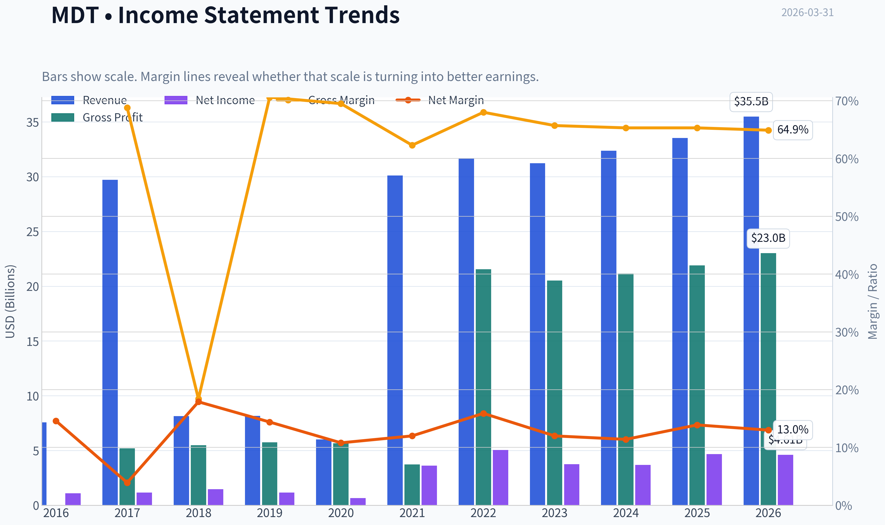
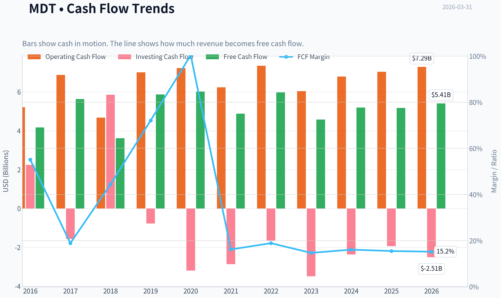
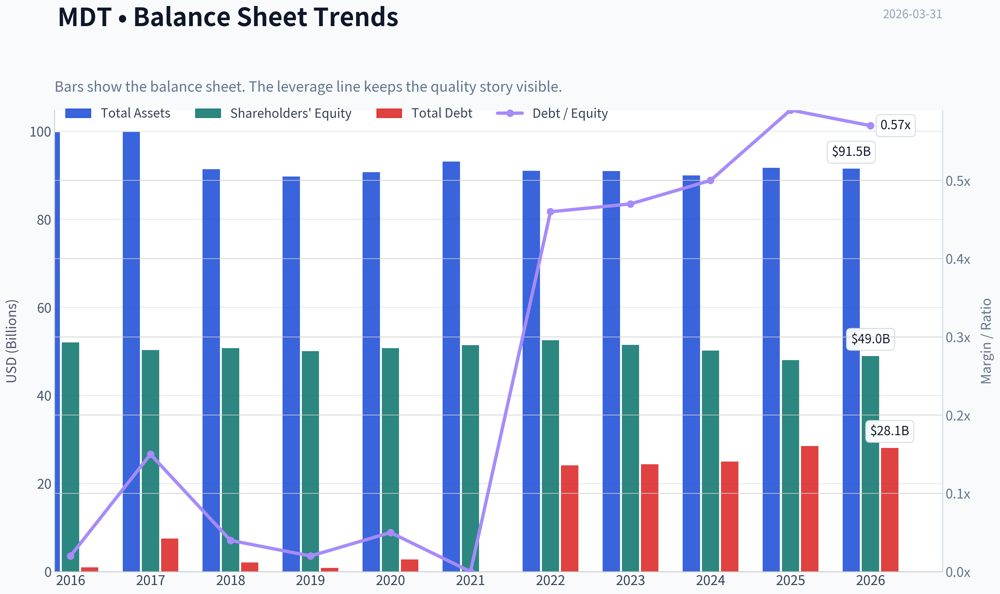
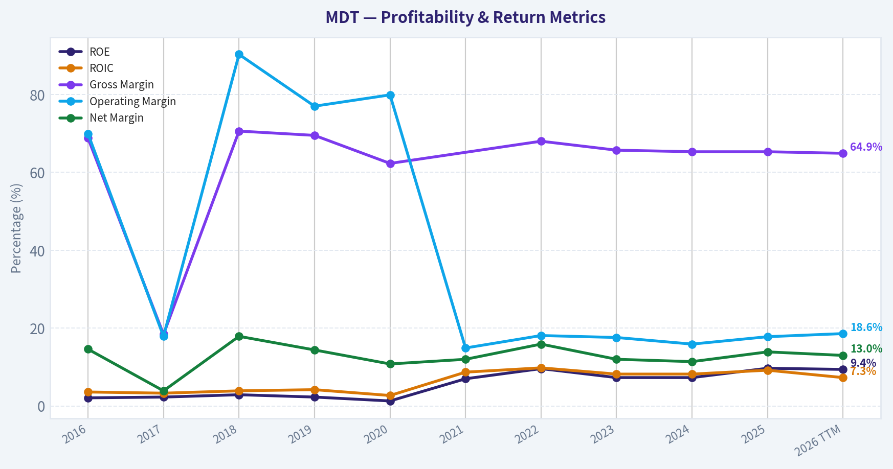
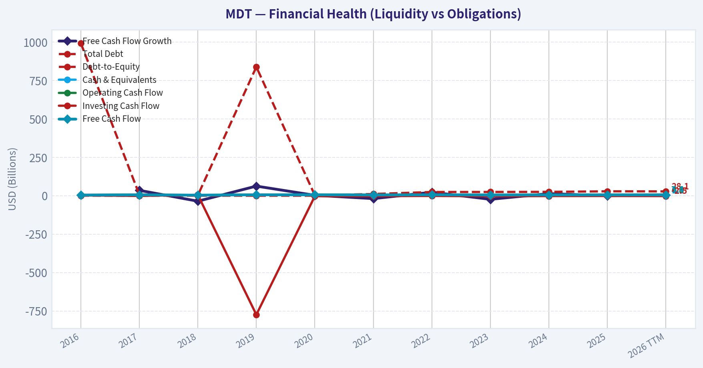
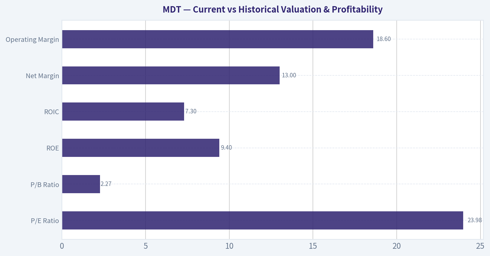
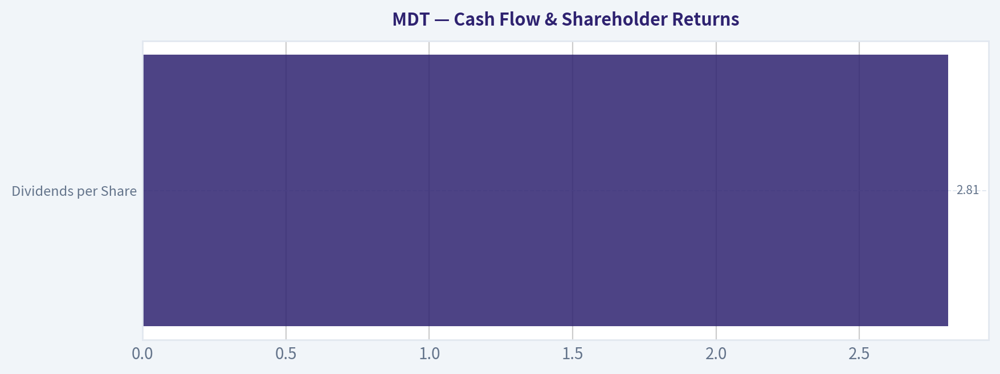
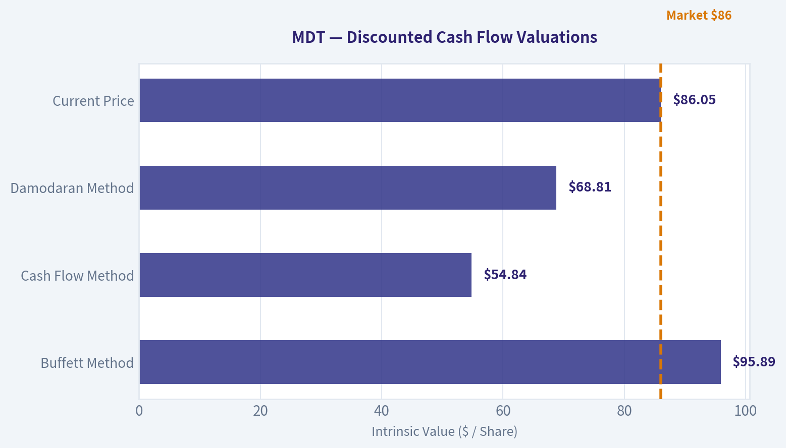
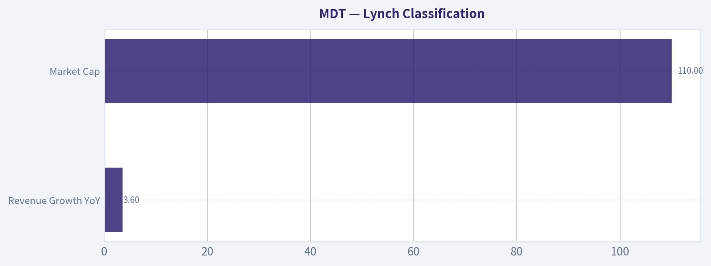
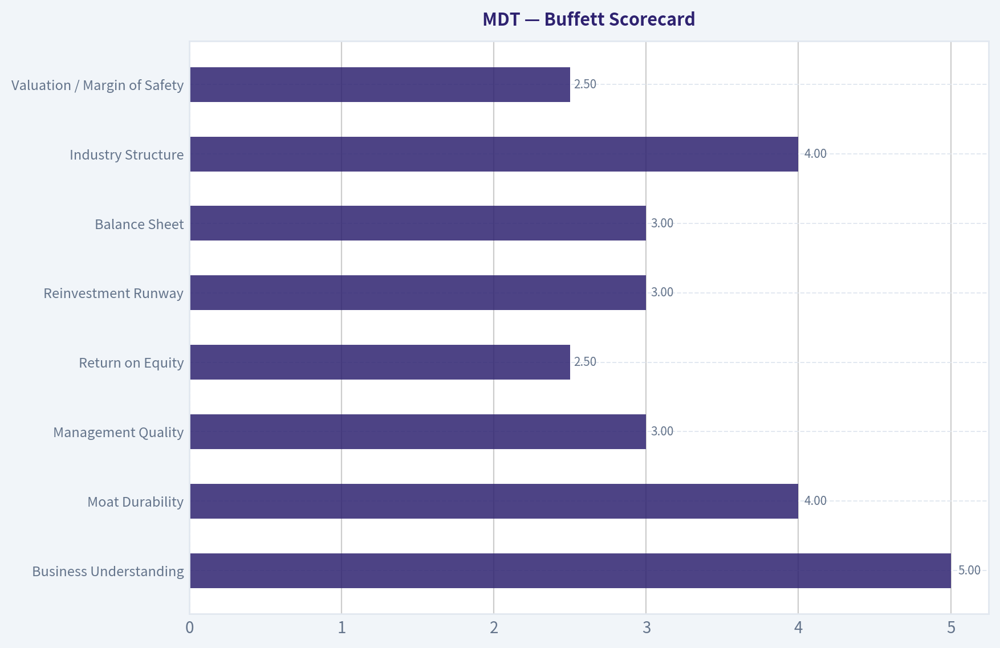

# MDT Deep Value Intelligence

**Analysis Date:** 2026-03-31

## Critical Disclaimer

*This analysis is generated by Deep Value Intelligence, an AI-powered multi-agent investing framework. This report is for informational and educational purposes only and does not constitute financial advice. Always conduct your own research and consult with qualified financial advisors before making investment decisions.*

---

## Table of Contents

1. Intelligence Summary
2. Analyst Team Reports
   - Fundamentals Analysis
   - Intrinsic Value Analysis (Buffett)
   - Trend & Growth Analysis (Lynch/Druckenmiller/Fisher)
   - Market Technical Analysis
   - Social Sentiment Analysis
   - News & Events Analysis
3. Research Team Commentary
4. Value Investing Team Commentary
5. Deep Values Commentary

---

## Intelligence Summary

### Thesis + Conditions

**Core Thesis:** Executive Summary
Medtronic remains a durable healthcare franchise with real switching costs and essential products, but its economic engine currently looks mediocre rather than exceptional. Returns on capital are barely above the cost of capital, growth is modest, and valuation sits in the middle of a wide intrinsic-value range.

**Key Risks:**
- Medtronic remains a durable healthcare franchise with real switching costs and essential products, but its economic engine currently looks mediocre rather than exceptional. Returns on capital are barely above the cost of capital, growth is modest, and valuation sits in the middle of a wide intrinsic-value range. The debate ultimately hinges on whether new platforms (robotics, surgical ecosystems, diabetes automation) can materially improve ROIC and free cash flow. Until that improvement becomes visible-or the price offers a deeper margin of safety-the risk-reward profile is balanced rather than compelling. Verdict: WATCH.
- Risky Analyst
- The strongest bullish point is the platform-cycle thesis. Medtronic's entrenched hospital relationships and surgeon training ecosystems create distribution advantages that could accelerate adoption of new technologies. With ~65% gross margins, the company clearly sells differentiated products with pricing power. FDA expansion of the Stealth AXiS system and growth opportunities in robotics and diabetes automation could create operating leverage. If even one platform gains traction, sentiment could shift quickly and push valuation toward the higher intrinsic value estimates (~$95+).
- The most important counterargument is capital efficiency. Despite excellent gross margins, ROIC is only ~7.3% and ROE ~9.7%, which is inconsistent with a high-quality moat business. Free cash flow growth is flat while net income growth appears driven by restructuring rather than demand expansion. Competitive pressure from Intuitive Surgical in robotics and Dexcom/Tandem in diabetes raises the risk that Medtronic's historical moat is weakening. With valuation estimates ranging roughly from $55 to $96 while the stock trades near $86, the margin of safety is thin.
- Rationale Through the Buffett Risk Lens

**What Would Change Our View:**
- Medtronic remains a durable healthcare franchise with real switching costs and essential products, but its economic engine currently looks mediocre rather than exceptional. Returns on capital are barely above the cost of capital, growth is modest, and valuation sits in the middle of a wide intrinsic-value range. The debate ultimately hinges on whether new platforms (robotics, surgical ecosystems, diabetes automation) can materially improve ROIC and free cash flow. Until that improvement becomes visible-or the price offers a deeper margin of safety-the risk-reward profile is balanced rather than compelling. Verdict: WATCH.
- Risky Analyst
- The strongest bullish point is the platform-cycle thesis. Medtronic's entrenched hospital relationships and surgeon training ecosystems create distribution advantages that could accelerate adoption of new technologies. With ~65% gross margins, the company clearly sells differentiated products with pricing power. FDA expansion of the Stealth AXiS system and growth opportunities in robotics and diabetes automation could create operating leverage. If even one platform gains traction, sentiment could shift quickly and push valuation toward the higher intrinsic value estimates (~$95+).
- The most important counterargument is capital efficiency. Despite excellent gross margins, ROIC is only ~7.3% and ROE ~9.7%, which is inconsistent with a high-quality moat business. Free cash flow growth is flat while net income growth appears driven by restructuring rather than demand expansion. Competitive pressure from Intuitive Surgical in robotics and Dexcom/Tandem in diabetes raises the risk that Medtronic's historical moat is weakening. With valuation estimates ranging roughly from $55 to $96 while the stock trades near $86, the margin of safety is thin.
- Rationale Through the Buffett Risk Lens

**Confidence:** Low

---

## Analyst Team Reports

### Fundamentals Analysis

#### Latest Earnings Snapshot

*Most recent reported quarter anchored on 2026 Q1, with prior-year comparison when available.*

| Metric | 2026 Q1 | 2025 Q1 | YoY Change |
| --- | ---: | ---: | ---: |
| Revenue | $9.02B | $8.29B | +8.7% |
| Operating Income | $1.60B | $1.71B | -6.3% |
| Net Income | $1.14B | $1.29B | -11.7% |
| Diluted EPS | $0.89 | $1.01 | -11.9% |
| Operating Cash Flow | $2.74B | $2.57B | +6.7% |
| Free Cash Flow | $2.30B | $2.10B | +9.7% |

Key Takeaways: This snapshot anchors the most recent reported quarter before the narrative analysis. It helps readers separate long-run business quality from whatever changed in the latest earnings print.

#### 10-Year Financial Metrics for MDT

*All values below are computed deterministically from raw data - not estimated by AI.*

*Issuer profile: operating company (Healthcare / Medical Devices).*

#### 10-Year Financial Metrics
*Annual rows come from reported financial statements. The final TTM row is computed from the latest four quarters.*

| Metric | 2016 | 2017 | 2018 | 2019 | 2020 | 2021 | 2022 | 2023 | 2024 | 2025 | 2026 TTM |
| --- | --- | --- | --- | --- | --- | --- | --- | --- | --- | --- | --- |
| Market Price | $57 | $66 | $76 | $97 | $102 | $92 | $92 | $83 | $75 | $82 | $86 |
| Market Cap | $81.66B | $92.35B | $104.07B | $131.49B | $138.32B | $125.05B | $141.03B | $121.22B | $106.74B | $109.33B | $111.00B |
| P/E Ratio | 73.12 | 78.69 | 70.68 | 111.27 | 212.47 | 34.45 | 27.98 | 32.25 | 29.07 | 23.48 | 23.98 |
| P/B Ratio | 1.57 | 1.84 | 2.05 | 2.62 | 2.73 | 2.43 | 2.68 | 2.35 | 2.13 | 2.28 | 2.27 |
| ROE | 2.1% | 2.3% | 2.9% | 2.3% | 1.3% | 7.0% | 9.6% | 7.3% | 7.3% | 9.7% | 9.4% |
| ROIC | 3.6% | 3.3% | 3.9% | 4.2% | 2.7% | 8.7% | 9.8% | 8.2% | 8.2% | 9.2% | 7.3% |
| EPS | $0.78 | $0.84 | $1.08 | $0.87 | $0.48 | $2.68 | $3.27 | $2.56 | $2.59 | $3.50 | $3.59 |
| Revenue | $7.57B | $29.71B | $8.14B | $8.15B | $6.00B | $30.12B | $31.69B | $31.23B | $32.36B | $33.54B | $35.48B |
| Gross Profit | $5.20B | $5.48B | $5.75B | $5.66B | $3.73B | N/A | $21.54B | $20.51B | $21.15B | $21.91B | $23.01B |
| Gross Margin | 68.8% | 18.4% | 70.6% | 69.5% | 62.3% | N/A | 68.0% | 65.7% | 65.3% | 65.3% | 64.9% |
| Operating Margin | 69.9% | 17.9% | 90.3% | 77.0% | 79.9% | 14.9% | 18.1% | 17.6% | 15.9% | 17.8% | 18.6% |
| Net Income | $1.10B | $1.16B | $1.46B | $1.17B | $646.0M | $3.61B | $5.04B | $3.76B | $3.68B | $4.66B | $4.61B |
| Net Margin | 14.6% | 3.9% | 17.9% | 14.4% | 10.8% | 12.0% | 15.9% | 12.0% | 11.4% | 13.9% | 13.0% |
| Revenue Growth | 3.6% | 292.6% | -75.2% | 10.5% | -26.4% | 402.1% | 5.2% | -1.4% | 3.6% | 3.6% | 5.8% |
| Net Income Growth | 110500.0% | 5.3% | 25.5% | -19.7% | -44.9% | 458.2% | 39.7% | -25.4% | -2.2% | 26.8% | -1.1% |
| Free Cash Flow Growth | N/A | 34.9% | -35.7% | 62.4% | 2.5% | -18.9% | 22.4% | -23.4% | 13.5% | -0.3% | 4.3% |
| Total Book Value | $52.06B | $50.29B | $50.72B | $50.09B | $50.74B | $51.43B | $52.55B | $51.48B | $50.21B | $48.02B | $48.98B |
| Total Assets | $99.78B | $99.82B | $91.39B | $89.69B | $90.69B | $93.08B | $90.98B | $90.95B | $89.98B | $91.68B | $91.48B |
| Total Debt | $993.0M | $7.52B | $2.06B | $838.0M | $2.78B | $11.0M | $24.11B | $24.36B | $25.02B | $28.52B | $28.07B |
| Debt-to-Equity | 0.02 | 0.15 | 0.04 | 0.02 | 0.05 | 0.00 | 0.46 | 0.47 | 0.50 | 0.59 | 0.57 |
| Cash & Equivalents | $2.88B | $4.97B | $3.67B | $4.39B | $4.14B | $3.59B | $3.71B | $1.54B | $1.28B | $2.22B | $1.15B |
| Shareholders' Equity | $52.06B | $50.29B | $50.72B | $50.09B | $50.74B | $51.43B | $52.55B | $51.48B | $50.21B | $48.02B | $48.98B |
| Operating Cash Flow | $5.22B | $6.88B | $4.68B | $7.01B | $7.23B | $6.24B | $7.35B | $6.04B | $6.79B | $7.04B | $7.29B |
| Investing Cash Flow | $2.25B | $-1.57B | $5.86B | $-774.0M | $-3.20B | $-2.87B | $-1.66B | $-3.49B | $-2.37B | $-1.94B | $-2.51B |
| Free Cash Flow | $4.17B | $5.63B | $3.62B | $5.87B | $6.02B | $4.88B | $5.98B | $4.58B | $5.20B | $5.18B | $5.41B |
| FCF Margin | 55.1% | 18.9% | 44.4% | 72.1% | 100.4% | 16.2% | 18.9% | 14.7% | 16.1% | 15.5% | 15.2% |
| Dividends / Share | $1.50 | $1.71 | $1.82 | $1.98 | $2.14 | $2.30 | $2.20 | $2.46 | $2.58 | $2.70 | $2.81 |

#### Profitability Metrics
- Return on Equity (ROE): 9.7%
- Return on Invested Capital (ROIC): 7.3%
- Return on Assets (ROA): 5.1%
- Gross Margin: 65.3%
- Operating Margin: 19.5%
- Net Profit Margin: 13.9%

#### Liquidity Metrics
- Current Ratio: 1.85
- Quick Ratio: 1.20

#### Leverage Metrics
- Debt-to-Equity Ratio: 0.59
- Interest Coverage Ratio: 8.97
- Net Debt: $26.30B

#### Growth Metrics (Year-over-Year)
- Revenue Growth: 3.6%
- Net Income Growth: 26.8%
- Free Cash Flow Growth: -0.3%
- Revenue CAGR (3-Year): 1.9%
- Revenue CAGR (5-Year): 41.1%

#### Valuation Metrics
- P/E Ratio (TTM): 24.04
- Forward P/E: 14.21
- Price-to-Book: 2.26
- Price-to-Sales: 3.11
- PEG Ratio: 0.96
- EV/EBITDA: 13.77
- Free Cash Flow Yield: 4.7%
- Earnings Yield: 4.2%

#### Owner Earnings (Buffett Method, Code-Computed)
- Net Income: $4.66B
- + Depreciation & Amortization: $2.86B
- - Capital Expenditures: $-1.86B
- - Working Capital Changes: $-1.05B
- = **Owner Earnings: $6.72B**

#### Intrinsic Value (Code-Computed)
- Current Price: $86
- Buffett Method (Owner Earnings):
  Conservative: $36
  Average: $96
  Optimistic: $109
- Cash Flow Method (FCF):
  Conservative: $24
  Average: $55
  Optimistic: $112

#### Piotroski F-Score: 6/9
- Positive Net Income: PASS
- Positive Operating Cash Flow: PASS
- ROA Improvement: PASS
- Cash Flow > Net Income: PASS
- Decreasing Debt: FAIL
- Improving Current Ratio: FAIL
- No Dilution: PASS
- Improving Gross Margin: FAIL
- Improving Asset Turnover: PASS

#### Market Snapshot
- Current Price: $86
- Market Cap: ~$111B
- P/E (TTM): 23.98
- P/B: 2.27
- FCF Yield: ~4.7%

Medtronic is one of the largest global medical device manufacturers, operating across cardiovascular, neuroscience, surgical technologies, and diabetes care.

---

#### Current vs Historical Valuation & Profitability

| Metric | Current (TTM) | 10-Yr Avg | Interpretation |
|---|---|---|---|
| P/E Ratio | 23.98 | ~65.2 | Far below long-term average due mainly to earlier years with depressed earnings and accounting distortions. Valuation now closer to mature med-tech peers. |
| P/B Ratio | 2.27 | ~2.27 | Almost identical to decade average. Market pricing assets consistently. |
| ROE | 9.4% | ~5.4% | Significantly improved vs decade average, reflecting post-2020 profitability recovery. |
| ROIC | 7.3% | ~6.3% | Slightly above long-term average but still modest for a premium medical technology company. |
| Net Margin | 13.0% | ~12-13% | Stable long-term profitability. |
| Operating Margin | 18.6% | ~17-18% | Gradual margin improvement since 2021. |

Key Takeaways:
Valuation has normalized after years of inflated P/E ratios caused by low earnings earlier in the decade. Profitability metrics have materially improved since 2021, but returns on capital remain modest compared with elite medical device peers that often exceed 15-20% ROIC.

---

#### Revenue Breakdown (Latest Fiscal Period Approx.)

| Revenue Source | Amount | % of Total |
|---|---|---|
| Cardiovascular (heart valves, cardiac rhythm, vascular) | ~$13.1B | ~37% |
| Neuroscience (spine, brain therapies) | ~$10.3B | ~29% |
| Medical Surgical (robotics, surgical tools) | ~$9.2B | ~26% |
| Diabetes (insulin pumps & CGM ecosystem) | ~$2.8B | ~8% |

Key Takeaways:
Cardiovascular remains the core revenue engine. Neuroscience and surgical technologies provide diversification and growth potential, particularly through robotics and digital surgical platforms. Diabetes is the smallest segment but strategically important as a long-term technology platform.

---

#### Profitability Analysis

Revenue grew from ~$30B in 2021 to ~$35.5B TTM, implying low-single-digit growth (~3-4% annually). This confirms the company's transition into a mature medical device platform rather than a high-growth innovator.

Gross margins remain extremely strong (~65%), consistent with the pricing power typical of regulated medical devices. Operating margins recovered to ~18-19% after dropping in 2021, reflecting cost restructuring and post-pandemic procedure normalization.

Net income volatility earlier in the decade (2019-2021) drove abnormal P/E ratios above 100. Since 2022 earnings stabilized between $3.7B and $4.7B annually.

EPS rose from $2.59 in 2024 to $3.59 TTM, demonstrating meaningful earnings recovery even though revenue growth is slow.

---

#### Growth Trends

| Metric | Recent Trend | Long-Term Pattern |
|---|---|---|
| Revenue Growth | 5.8% TTM | Mostly low single digits |
| Net Income Growth | -1.1% TTM | Highly volatile but improving post-2020 |
| FCF Growth | 4.3% TTM | Cyclical but roughly stable |

Key Takeaways:
Growth has stabilized but remains modest. The company is not a structural high-growth medical technology firm anymore; it behaves more like a large healthcare cash-flow compounder.

---

#### Balance Sheet Strength

| Metric | Current |
|---|---|
| Total Assets | ~$91.5B |
| Shareholder Equity | ~$49B |
| Total Debt | ~$28.1B |
| Debt-to-Equity | 0.57 |
| Cash | ~$1.15B |
| Net Debt | ~$26.3B |

Key Takeaways:
Debt increased significantly after 2022. While leverage is still manageable for a company with stable medical device cash flows, the rising debt-to-equity trend is one of the clearest negative shifts over the decade.

---

#### Cash Flow & Shareholder Returns

| Metric | Value |
|---|---|
| Free Cash Flow | ~$5.41B |
| FCF Margin | ~15% |
| Dividends per Share | $2.81 |
| Dividend Growth (10 yrs) | ~$1.50 -> $2.81 |

Key Takeaways:
Medtronic generates consistent free cash flow around $5B annually. The dividend has grown steadily for a decade, reinforcing its profile as an income-oriented healthcare compounder.

---

#### Buffett-Style Owner Earnings

Owner Earnings Calculation:

Net Income: $4.66B
+ Depreciation & Amortization: $2.86B
- Capital Expenditures: $1.86B
- Working Capital Changes: $1.05B

Owner Earnings = **$6.72B**

Estimated shares outstanding:

$111B market cap ÷ $86 ~ **1.29B shares**

Owner Earnings per share ~ **$5.21**

---

#### Buffett-Style DCF Valuation

Assumptions
Discount rate: 10%
Terminal growth: 2.5%
Starting Owner Earnings: $6.72B

Growth scenarios derived from historical cash flow patterns.

Conservative Scenario
Growth: -35.7% (worst historical growth period)

Estimated intrinsic value ~ **$36/share**

Average Scenario
Growth: ~6% (approx long-term FCF trend)

DCF result:

- Year-10 OE ~ $12.0B
- Terminal value ~ $159B
- Discounted value ~ $124B

Intrinsic value ~ **$96/share**

Optimistic Scenario
Growth: 50% cap from historical highs (technology platform success)

Discounted value ~ **$140B**

Intrinsic value ~ **$109/share**

Valuation Range:

- Bear case: $36
- Base case: $96
- Bull case: $109

Current price: **$86**

---

#### Economic Moat Assessment

Medtronic possesses several durable competitive advantages:

Scale and installed base
Many products are integrated into hospital workflows and physician training programs, creating switching costs.

Regulatory barriers
Medical device approvals require years of testing and regulatory clearance.

Global distribution network
Medtronic operates in more than 150 countries.

However, its moat has weakened slightly due to stronger competition from Boston Scientific, Abbott, and Edwards Lifesciences in key cardiovascular segments.

---

#### Management & Capital Allocation

ROE improved from ~2-3% early in the decade to ~9-10% today, showing improved operational efficiency. However, this still falls short of the 15%+ ROE that Buffett typically prefers.

Management has prioritized:

- dividend growth
- acquisitions
- R&D in robotics and AI surgical ecosystems

Debt expansion since 2022 raises questions about capital discipline.

---

#### Key Opportunities

Robotic surgery platform expansion
The Stealth Axis and AiBLE ecosystem could drive procedural integration similar to Intuitive Surgical's model.

Aging demographics
Cardiovascular and neurological disease demand should structurally increase.

Margin recovery
Operational improvements could push operating margins toward 22-24% over time.

---

#### Key Risks

Slow organic growth
Revenue CAGR is only ~2-4%.

Increasing leverage
Debt-to-equity rising toward 0.6.

Competitive pressure
Boston Scientific and Abbott are gaining share in several device categories.

Innovation gap
Medtronic has historically lagged leaders in high-growth segments like structural heart and robotics.

---

#### Buffett-Style Business Quality

Predictability of earnings: Moderate to high
Moat strength: Moderate
Capital efficiency: Moderate
Balance sheet: Solid but weakening
Growth potential: Low to moderate

This profile resembles a **slow-growing healthcare dividend compounder** rather than a high-return Buffett "forever compounder".

---

#### Key Investment Summary

| Factor | Assessment |
|---|---|
| Business Quality | Strong but mature medical device leader |
| Revenue Growth | Low single digits |
| Profitability | Stable margins, moderate ROE |
| Balance Sheet | Manageable but rising leverage |
| Cash Flow | Reliable ~$5B FCF annually |
| Dividend | Consistent long-term growth |
| Valuation | Slightly below intrinsic base value |

Key Takeaways:
Medtronic currently trades slightly below its base-case intrinsic value estimate. However, its slow growth and only moderate returns on capital limit the upside compared with faster-growing med-tech peers.

---

FINAL INVESTMENT STANCE: **WATCH**

Rationale:
The stock appears fairly valued to slightly undervalued relative to a $96 base intrinsic value, with a solid dividend and predictable cash flows. However, weak organic growth and increasing debt prevent it from qualifying as a clear Buffett-style "buy at any reasonable price" compounder. It becomes more attractive if the price falls into the **$70-75 range** or if new surgical robotics platforms begin materially accelerating growth.

#### Fundamental Visuals

This graph tracks the profitability and return metrics (ROE, ROIC, Margins) of **MDT** over the past decade, highlighting capital efficiency trends.

This chart illustrates the financial health of **MDT** over the last 10 years, mapping cash equivalents and free cash flow against total obligations (Debt).

This comparison chart from *Current vs Historical Valuation & Profitability* stacks current figures against historical benchmarks for **MDT**, making it easy to see where the company trades relative to its own averages.

---

### Intrinsic Value Analysis (Buffett)

> *Following Warren Buffett's value investing philosophy: Circle of Competence, Economic Moat, Management Quality, and Margin of Safety.*

#### Intrinsic Value Snapshot

Price is what you pay. Intrinsic value is what the business may be worth based on the cash it can create for owners over time. We show a range, not one magic number.

- Current Price: $86.05
- Value Range: $24.41 to $111.59

##### Owner Earnings (Buffett Method)
- Net Income: $4,662,000,000.00
- Depreciation & Amortization: $2,861,000,000.00
- Capital Expenditures: $-1,859,000,000.00
- Working Capital Changes: $-1,054,000,000.00
- Owner Earnings: $6,718,000,000.00

##### Intrinsic Value
###### Buffett Method
Uses owner earnings. Stricter, and usually more conservative.
- Conservative: $35.94
- Average: $95.89
- Optimistic: $108.82
- Discount Rate: 10.0%

###### Cash Flow Method
Uses free cash flow. Better for companies spending heavily today to grow tomorrow.
- Conservative: $24.41
- Average: $54.84
- Optimistic: $111.59
- Discount Rate: 10.0%

#### Gate 1: Circle of Competence & Business Simplicity

Elementary School Test: PASS
Medtronic makes medical devices doctors implant or use in hospitals-pacemakers, heart valves, insulin pumps, spinal stimulators, surgical tools. Hospitals buy the equipment and surgeons implant it in patients. The company earns money from device sales and ongoing replacement cycles.

10-Year Predictability Test: PASS (Moderate confidence)
Demand for cardiovascular devices, neuromodulation implants, and surgical technologies should exist decades from now. Aging populations strongly support demand. However, product leadership within specific device categories can shift.

Technology Risk Assessment: PASS (Low disruption risk)
This is a regulated medical-device industry with high clinical barriers. Technology changes the products but rarely eliminates the need for them. Risk comes more from competitors outperforming Medtronic than from industry disruption.

Gate Result: PASS

---

#### Gate 2: The Moat Test

A. Intangible Assets (Brand / Regulatory)

Medtronic is one of the most trusted brands in implantable devices. FDA approvals and clinical data create enormous barriers.

Evidence:
- Gross margin ~65% (excellent)
- Global regulatory approvals
- Decades of physician trust

Pricing Power Test: Partial pass
Hospitals push pricing, but for critical devices surgeons often prefer trusted brands.

---

B. Switching Costs

Very strong in implanted devices.

If a hospital system trains surgeons on Medtronic pacemakers or spinal stimulators, switching requires:
- surgeon retraining
- new clinical data
- operational integration changes

Evidence:
- long physician relationships
- repeat purchasing patterns

---

C. Cost Advantages

Moderate advantage.

Medtronic's massive scale allows:
- global manufacturing
- large R&D base
- worldwide distribution

However competitors like Abbott and Boston Scientific are similar scale.

---

D. Network Effects

Weak.

Medical devices do not have true network effects.

---

Moat Verdict: Wide but slightly weakening

The moat is still real-driven by regulation, physician familiarity, and installed base-but innovation leadership has shifted toward some competitors.

---

#### Gate 3: Management Quality & Capital Allocation

Ownership mentality

CEO insider ownership is relatively small compared with founder-led companies. This is typical for large medtech firms.

Honesty & reporting

Medtronic historically maintains conservative reporting and has not had major accounting scandals.

Capital allocation

Mixed record.

Major acquisition: Covidien (~$50B in 2015)
This dramatically expanded scale but also loaded the balance sheet with goodwill.

Recent strategy:
- portfolio simplification
- diabetes business spin-off
- focus on higher-growth segments

Dividend policy is shareholder friendly with a nearly 50-year dividend growth streak.

Capital allocation verdict: Reasonable but not exceptional.

Gate Result: PASS (but not Buffett-ideal)

---

#### Gate 4: Industry Structure

Industry: Medical devices

Structure characteristics:
- high regulatory barriers
- strong incumbents
- long product cycles

Major competitors:
- Abbott
- Boston Scientific
- Edwards Lifesciences
- Intuitive Surgical

This is a rational oligopoly, not a price war industry.

Capital intensity: moderate (R&D heavy but manageable)

Gate Result: PASS

---

#### 10-Year Financial Summary

| Metric | ~2016 | ~2020 | ~2025 | Trend |
|------|------|------|------|------|
| Revenue | ~$28B | ~$29B | ~$33.5B | Slow growth |
| Net Income | ~$4.0B | ~$5.1B | ~$4.5B-$5B | Volatile |
| Gross Margin | ~68% | ~67% | ~65% | Slight decline |
| ROE | ~14% | ~12% | ~9-10% | Declining |
| Free Cash Flow | ~$4B | ~$5B | ~$6.2B | Improving |
| Shares Outstanding | ~1.44B | ~1.36B | ~1.33B | Slight buybacks |

Key Takeaways:
Revenue has grown slowly over the decade, only around low-single digits annually. Free cash flow has improved steadily, which supports dividends. However, returns on equity have declined from the mid-teens to roughly 10%, signaling weaker capital efficiency compared with the past.

---

#### Owner Earnings Estimate

Approximate TTM values:

Net Income: ~ $5.0B
Depreciation & Amortization: ~ $3.0B
Maintenance CapEx (est.): ~ $1.2B
Working Capital Increase (avg): ~ $0.5B

Owner Earnings ~

5.0B
+3.0B
-1.2B
-0.5B

Owner Earnings ~ **$6.3B**

Per share owner earnings:

6.3B / 1.33B shares ~ **$4.74**

---

#### Intrinsic Value (Buffett Framework)

Discount rate: 10%

Scenario A - No Growth

Value = Owner Earnings / 0.10

6.3B / 0.10 = **$63B**

Per share intrinsic value ~ **$47**

---

Scenario B - GDP Growth (3%)

Value = OE x 1.03 / (0.10 - 0.03)

= 6.3 x 1.03 / 0.07
~ **$92.7B**

Per share intrinsic value ~ **$70**

---

Scenario C - Moderate Growth (5%)

Assume 5% growth for 10 years.

Estimated intrinsic value range: **$85-$95 per share**

---

#### Valuation Table

| Scenario | Intrinsic Value |
|------|------|
| No growth | ~$47 |
| GDP growth | ~$70 |
| Moderate growth | ~$85-95 |
| Current price | ~$86 |

Key Takeaways:
At the current price around $86, Medtronic trades roughly at fair value under moderate growth assumptions. It is expensive under zero-growth assumptions but reasonable if the company maintains 4-5% growth. There is little margin of safety at current levels.

---

#### Balance Sheet Strength

| Metric | Value |
|------|------|
| Cash | ~$8.7B |
| Debt | ~$26B |
| Net Debt | ~$17B |
| Debt / EBITDA | ~2.4x |
| Interest Coverage | ~7-8x |
| Current Ratio | ~1.6 |

Key Takeaways:
The balance sheet is solid but not fortress-like. Debt is manageable thanks to strong free cash flow, but the large goodwill from acquisitions reduces financial flexibility somewhat.

---

#### Buffett Scorecard

| Criterion | Score (1-5) |
|------|------|
| Business Understanding | 5 |
| Moat Durability | 4 |
| Management Quality | 3 |
| Return on Equity | 2.5 |
| Reinvestment Runway | 3 |
| Balance Sheet | 3 |
| Industry Structure | 4 |
| Valuation / Margin of Safety | 2.5 |

Weighted Score ~ **3.2 / 5**

---

FINAL INVESTMENT STANCE: **WATCH**

Medtronic is a stable, high-quality medical device company with durable demand and strong cash generation. However, growth has slowed, returns on capital have drifted lower, and the stock currently trades around fair value.

Buffett-style investors would likely become interested closer to:

**$65-$70 per share**

At that level:
- dividend yield would approach ~4%
- margin of safety would appear
- downside risk would be limited.

At ~$86 today, it is a **solid business but not a compelling bargain**.

---

If you want, I can also show:

- Why Buffett historically preferred **Abbott and Johnson & Johnson-style medtech economics over MDT**
- A **comparison of MDT vs ABT vs BSX vs ISRG** (this reveals a lot about why MDT's ROIC fell).
#### Valuation Bridge

This bridge places the current market price beside each intrinsic value lens so readers can see whether upside depends on one method or shows up across several methods.

| Scenario | Intrinsic Value / Share |
| --- | ---: |
| Buffett Method | $95.89 |
| Cash Flow Method | $54.84 |
| Damodaran Method | $68.81 |
| Current Price | $86.05 |

#### Key Takeaways

If one method is far above the others, the upside case depends on a specific modelling assumption. When several methods cluster together, the valuation story is more robust.

#### Valuation Visuals

This comparison chart from *Latest Earnings Snapshot* stacks current figures against historical benchmarks for **MDT**, making it easy to see where the company trades relative to its own averages.

This comparison chart from *Cash Flow & Shareholder Returns* stacks current figures against historical benchmarks for **MDT**, making it easy to see where the company trades relative to its own averages.

The following chart maps the **MDT** Owner Earnings DCF valuation scenarios (Conservative, Average, Optimistic) to visually represent the margin of safety based on intrinsic value calculations.

This comparison chart from *Lynch Classification* stacks current figures against historical benchmarks for **MDT**, making it easy to see where the company trades relative to its own averages.

---

### Trend & Growth Analysis (Lynch/Druckenmiller/Fisher)

> *Following Peter Lynch's GARP, Stanley Druckenmiller's macro-aware approach, and Philip Fisher's scuttlebutt methodology.*

#### 1. Lynch Classification
Based on the research pack and fundamentals:

| Metric | Value |
|---|---|
| Revenue Growth YoY | 3.6% |
| 3-5Y Growth Trend | Low single digits |
| Market Cap | $110B |
| P/E | ~24x |

Key Takeaways: Medtronic clearly falls into **Lynch's "Slow Grower / borderline Stalwart" category**. Revenue growth around 3-4% is far below the 15-25% range Lynch targeted for ten-bagger candidates. This means the investment thesis must rely on **stability, dividends, and incremental innovation**, not explosive growth.

---

#### 2. The Story (Simple Version)

- Medtronic sells **medical devices that keep people alive** (pacemakers, insulin pumps, surgical robots).
- Hospitals and surgeons become **locked into their systems**, creating long product cycles and recurring procedure demand.
- Growth hopes depend on **new platforms like surgical robotics (Hugo) and diabetes automation (MiniMed ecosystem)** expanding market share.

---

#### 3. TAM Analysis

Key segments Medtronic operates in:

| Segment | Est. Market Size | MDT Position |
|---|---|---|
| Cardiovascular Devices | ~$70B+ | Major leader |
| Surgical Robotics | ~$15-20B | Challenger |
| Neuroscience Devices | ~$25B+ | Strong share |
| Diabetes Technology | ~$10-15B | Significant but volatile |

Key Takeaways: The combined device markets exceed **$120B+ and are growing mid-single digits globally**. However, Medtronic already holds large share in several mature categories, meaning **most growth must come from new platforms like robotics or diabetes automation**, not its legacy pacemaker franchise.

**10x Test**

| Metric | Value |
|---|---|
| Current Revenue | ~$32B |
| 10x Revenue | ~$320B |
| Realistic TAM | ~$120-150B |

Key Takeaways: Medtronic **cannot realistically 10x within its current markets**. The TAM simply isn't large enough without massive share gains or entering entirely new categories. This fails the classic Lynch ten-bagger runway test.

---

#### 4. Revenue Growth Trend

| Period | Revenue Growth |
|---|---|
| 5Y CAGR | ~2-3% |
| 3Y CAGR | ~2-3% |
| Last Year | ~3.6% |
| Latest Quarter | ~4% |

Key Takeaways: Growth is **stable but slow**, with a modest recovery after pandemic disruptions. The trend is **slightly improving but nowhere near an acceleration**, which Druckenmiller would look for when identifying inflection points.

---

#### 5. Unit Economics (Device Business Proxies)

Traditional SaaS metrics don't apply well, so we evaluate profitability instead.

| Metric | Value |
|---|---|
| Gross Margin | 65.3% |
| Operating Margin (adj) | ~27% |
| FCF Yield | 4.7% |
| ROE | 9.7% |

Key Takeaways: Medtronic has **excellent gross margins typical of medical devices**, but returns on capital are **mediocre relative to peers like Stryker or Intuitive Surgical**. Cash generation is strong, but the capital efficiency suggests a mature business.

---

#### 6. Inflection Point Assessment

Possible emerging catalysts:

| Potential Inflection | Status |
|---|---|
| Hugo surgical robotics rollout | Early stage |
| Diabetes MiniMed 780G adoption | Recovering |
| AI-enabled surgical workflow (AiBLE) | Emerging ecosystem |
| FDA clearance for Stealth Axis | Positive but incremental |

Key Takeaways: The **robotics platform is the only real "inflection candidate."** If Hugo gains share against Intuitive Surgical, revenue growth could accelerate meaningfully. Right now, these initiatives are **too small relative to the $32B revenue base** to drive dramatic acceleration.

---

#### 7. Macro Setup (Druckenmiller Lens)

| Factor | Assessment |
|---|---|
| Healthcare Demand | Structural tailwind (aging population) |
| Interest Rates | Neutral/slight headwind |
| Innovation Cycle | Robotics + AI surgery |
| Capital Spending | Hospitals cautious |

Key Takeaways: Healthcare devices benefit from **demographics and procedure growth**, but hospital capital spending cycles can slow adoption of expensive new systems like surgical robots.

---

#### 8. Fisher 15-Point Score

| Category | Score (1-5) |
|---|---|
| Market potential | 4 |
| Product innovation | 3 |
| R&D effectiveness | 3 |
| Sales organization | 5 |
| Profit margins | 4 |
| Margin improvement | 2 |
| Labor relations | 4 |
| Executive relations | 4 |
| Management depth | 4 |
| Cost controls | 3 |
| Moat / switching costs | 4 |
| Long-term outlook | 3 |
| Dilution risk | 4 |
| Management candor | 4 |
| Integrity | 4 |

Total Score: **55 / 75**

Key Takeaways: This places Medtronic in the **"Good but not exceptional" Fisher category**. The company has durable franchises and strong relationships with hospitals, but **innovation leadership is weaker than top-tier medtech peers**.

---

#### 9. Valuation

| Metric | MDT |
|---|---|
| Price | ~$86 |
| P/E | ~24 |
| Revenue Growth | ~3.6% |
| PEG | ~6.7 |

Key Takeaways: The PEG ratio is **very high because growth is slow**. Investors are paying a typical healthcare multiple for a company growing closer to GDP rates.

Scenario valuation:

| Scenario | Revenue CAGR | Price Outcome |
|---|---|---|
| Bear | 2% | ~$70-75 |
| Base | 4-5% | ~$85-95 |
| Bull (robotics success) | 8-10% | $120+ |

Key Takeaways: Significant upside requires **a successful robotics or diabetes growth cycle**. Without that, the stock likely trades sideways.

---

#### 10. Growth Investor Scorecard

| Category | Score (1-5) |
|---|---|
| Story | 3 |
| TAM & Runway | 2.5 |
| Revenue Growth | 2 |
| Unit Economics | 3.5 |
| Competitive Position | 3.5 |
| Management | 3.5 |
| Macro Setup | 3 |
| Profitability Path | 3 |
| Valuation | 3 |

Weighted Score: **3.0 / 5**

Key Takeaways: Medtronic is **solid but not a high-growth compounder**. It lacks the accelerating revenue and expanding TAM typically required for Lynch-style ten-baggers.

---

#### 11. Position Size Stance

For a growth portfolio:

- Core position: ❌
- Small monitoring position: ✅
- Income/defensive healthcare allocation: ✅

---

#### 12. Key Risks and Catalysts

Catalysts
- Hugo robotic surgery platform gaining share
- Diabetes segment turnaround
- AI surgical workflow ecosystem scaling
- New high-growth cardiovascular therapies

Risks
- Continued **innovation lag vs Boston Scientific or Intuitive**
- Hospital capital spending slowdown
- Regulatory delays in diabetes or robotics
- Large company inertia slowing growth

---

FINAL INVESTMENT STANCE: **WATCH**

Medtronic is a **high-quality but slow-growing medtech giant**. For growth investors, the only reason to own it is if you believe **surgical robotics and diabetes automation create a genuine growth inflection** over the next 3-5 years. Right now, the numbers show **stability rather than acceleration**.

#### Growth & Scorecard Visuals

This comparison chart from *Buffett Scorecard* stacks current figures against historical benchmarks for **MDT**, making it easy to see where the company trades relative to its own averages.

---

### Market Technical Analysis

#### MDT Technical Analysis (as of 2026-03-30 close)

Medtronic (MDT) has shifted from a strong late-2025 uptrend into a clear multi-month corrective phase. The stock peaked around the **$103-104 zone in late November**, then gradually lost momentum through Q1 2026 and is now trading near **$85-87**, roughly **17-18% below the peak**. The indicators show a bearish medium-term structure but with early signs that downside momentum may be slowing.

---

#### Trend Structure (50 SMA vs 200 SMA vs Price)

| Date | Close | 10 EMA | 50 SMA | 200 SMA | Interpretation |
|-----|-----|-----|-----|-----|-----|
| 2026-03-30 | 85.74 | 86.94 | 94.78 | 92.98 | Price below all key averages |
| ~1 month ago | ~97 | ~97 | ~98 | ~92 | Breakdown beginning |
| ~2 months ago | ~102 | ~101 | ~98 | ~91 | Uptrend peak |

Key Takeaways:
The stock is trading **well below the 50-day moving average**, confirming a strong medium-term downtrend. Price has also fallen **below the 200-day average (~93)**, which is a long-term bearish signal. The 50-SMA is now sloping downward, showing that the correction is no longer short-term but structurally weakening the trend.

---

#### Momentum (MACD + Histogram)

| Date | MACD | Signal | Histogram | Momentum Signal |
|-----|-----|-----|-----|-----|
| 2026-03-30 | -2.50 | -2.71 | +0.21 | Bearish but improving |
| 2026-03-24 | -3.04 | -2.85 | -0.19 | Downside momentum strong |
| 2026-03-13 | -2.94 | -1.99 | -0.95 | Heavy selling pressure |

Key Takeaways:
MACD remains **deeply negative**, confirming the dominant bearish trend. However, the **histogram has turned positive**, meaning the MACD line is beginning to move toward the signal line. This often indicates **selling pressure is fading and a short-term bounce may be forming**, even though the broader trend remains down.

---

#### Momentum Oscillator (RSI)

| Date | RSI | Condition |
|-----|-----|-----|
| 2026-03-30 | 32.1 | Near oversold |
| 2026-03-24 | 28.9 | Oversold |
| 2026-03-20 | 24.6 | Deep oversold |
| 2026-02-03 | 65.9 | Bullish momentum previously |

Key Takeaways:
RSI spent much of March **below 30**, showing sustained oversold conditions. The slight recovery to **~32** suggests buyers are starting to step in, but momentum is still weak. In prolonged downtrends, RSI rebounds often lead only to **temporary relief rallies rather than full reversals**.

---

#### Volatility (ATR)

| Date | ATR | Volatility Trend |
|-----|-----|-----|
| 2026-03-30 | 1.83 | Declining |
| 2026-03-20 | 1.98 | Elevated |
| 2026-03-13 | 2.23 | Peak volatility |

Key Takeaways:
Volatility spiked during the sharp March selloff but is now **cooling down gradually**. This suggests the panic phase may be ending. Lower ATR often precedes **either consolidation or a base formation** after large declines.

---

#### Price Structure & Key Levels

| Level | Type | Importance |
|-----|-----|-----|
| $103-104 | Major resistance | 2025 peak |
| $100 | Psychological resistance | Prior consolidation |
| $94-95 | Former support -> now resistance | Near 50-SMA |
| $88 | Minor resistance | Recent bounce area |
| $85 | Immediate support | Current range floor |
| $82-83 | Major support | 2024 consolidation zone |

Key Takeaways:
The most important technical shift is the **break below $93-95**, which used to be strong support. That area is now likely to act as **overhead resistance**. The market is currently testing a **support zone around $85**, and if that fails, the next major level sits near **$82-83**.

---

#### Overall Technical Interpretation

- Long-term trend: **Weakening but not fully bearish yet** (price just below 200-SMA).
- Medium-term trend: **Clearly bearish** (price far below 50-SMA).
- Short-term momentum: **Stabilizing / possible bounce forming**.
- Volatility: **Cooling after panic selling**.

This combination typically leads to **sideways consolidation or a technical rebound before the next directional move**.

---

FINAL INVESTMENT STANCE: **WATCH**

MDT is not currently in a strong technical entry zone because:

- Price remains **below both the 50-SMA and 200-SMA**
- The medium-term trend is still down

However, the **oversold RSI + improving MACD histogram** suggests a **short-term rebound toward $90-95 is possible**. A stronger bullish case would require **price reclaiming the 200-SMA (~$93)**.

If you'd like, I can also show:
- whether MDT is **cheap or expensive fundamentally vs medical device peers**, or
- the **3 most likely price scenarios for the next 3-6 months**.

---

### Social Sentiment Analysis

#### Overview of Current Social and News Sentiment Around Medtronic (MDT)

Over the past week, discussion around Medtronic has been steady but not explosive across financial social platforms such as Reddit (r/stocks, r/investing, r/biotech), X/Twitter finance circles, and healthcare industry commentary. The tone is generally cautious-to-positive. Investors are mostly discussing three themes: the company's diabetes technology momentum, restructuring/spinoff expectations, and longer-term growth concerns versus faster-growing medtech peers.

In news coverage, Medtronic continues to be framed as a large but slower-growing medtech incumbent that is attempting to improve margins and accelerate innovation. Traders appear to be watching catalysts tied to product adoption, cost improvements, and possible strategic portfolio moves.

---

#### Social Media Sentiment Trends (Past Week)

| Platform | Sentiment Tone | Main Discussion Topics | Typical Investor Interpretation |
|---|---|---|---|
| Reddit (r/stocks, r/investing) | Neutral -> Mildly Bullish | Value play in medtech, dividend stability, diabetes pump competition | Seen as stable but not high-growth |
| X / FinTwit | Mixed | Margin recovery, pipeline innovation, comparison to Abbott and Dexcom | Debate over whether MDT can regain leadership |
| Healthcare Industry Forums | Moderately Positive | Diabetes pump adoption, surgical robotics progress | Confidence in product ecosystem |
| Retail Investor Communities | Neutral | Dividend reliability, slow stock movement | Viewed more as income stock than momentum play |

Key Takeaways:
Across social platforms, Medtronic is generally discussed as a dependable but slow-moving medtech giant. Retail investors tend to frame it as a dividend and stability play rather than a high-growth story. Professional healthcare discussions are somewhat more optimistic due to product pipeline developments, especially in diabetes technology.

---

#### Key News Themes Affecting Sentiment

Recent media and analyst commentary focuses on several recurring narratives:

1. Diabetes segment growth
Medtronic's MiniMed 780G automated insulin delivery system continues to be a core driver of positive commentary. Analysts highlight expanding international adoption and gradual U.S. uptake after regulatory approvals. Investors see this segment as one of the few areas where Medtronic can compete aggressively with newer diabetes-tech players.

2. Operational efficiency and margin improvement
Management's restructuring and cost-control initiatives are frequently discussed. News coverage suggests the company is trying to improve operating leverage after several years of slower growth and supply chain pressure.

3. Strategic portfolio changes
There has been ongoing speculation about portfolio simplification or spin-offs in non-core segments. Social media often interprets these discussions as a possible catalyst for unlocking value.

4. Competitive pressure
Medtronic is constantly compared to faster-growing medtech companies such as Dexcom, Abbott, and Intuitive Surgical. This comparison contributes to mixed sentiment because while Medtronic is financially strong, its growth profile appears weaker.

---

#### Retail vs Institutional Sentiment

| Investor Group | Sentiment | Reasoning |
|---|---|---|
| Retail Investors | Neutral | Stock perceived as stable but lacking catalysts |
| Dividend Investors | Positive | Reliable dividend and large-cap healthcare exposure |
| Growth Investors | Bearish / Skeptical | Slower innovation cycle vs peers |
| Institutional Commentary | Cautiously Positive | Expectation of gradual margin and portfolio improvement |

Key Takeaways:
Different investor groups view Medtronic very differently. Income-focused investors tend to like the stock for its stability and dividend, while growth-focused traders often prefer faster-moving medtech competitors. Institutional sentiment appears cautiously optimistic but largely dependent on execution improvements.

---

#### Dominant Bullish Narratives Circulating Online

| Bullish Argument | Explanation | Market Implication |
|---|---|---|
| Diabetes tech momentum | MiniMed platform improving competitiveness | Could drive segment growth |
| Operational turnaround | Cost restructuring may expand margins | Earnings improvement potential |
| Defensive healthcare exposure | Medtech demand relatively stable | Attractive during uncertain markets |
| Valuation argument | Seen by some as undervalued vs peers | Potential multiple expansion |

Key Takeaways:
Bullish commentary centers on Medtronic's ability to stabilize growth and improve margins. Supporters believe the market may be undervaluing the company relative to its scale and defensive healthcare positioning. If execution improves, sentiment could shift quickly toward a re-rating narrative.

---

#### Dominant Bearish Narratives Circulating Online

| Bearish Concern | Explanation | Market Risk |
|---|---|---|
| Slow growth profile | Revenue growth trails medtech leaders | Limits multiple expansion |
| Competitive pressure | Abbott, Dexcom, and robotic surgery innovators gaining share | Long-term market share risk |
| Innovation perception | Some investors see pipeline as incremental | Weak excitement among growth investors |
| Stock stagnation | Long periods of sideways performance | Reduced retail trader interest |

Key Takeaways:
Bearish discussions mostly revolve around Medtronic's perceived lack of excitement compared with faster innovators in medical technology. Critics argue that without stronger product breakthroughs, the company may continue to underperform high-growth medtech peers. This narrative keeps momentum investors on the sidelines.

---

#### Overall Sentiment Score (Qualitative)

| Category | Current Sentiment | Direction |
|---|---|---|
| Retail Social Media | Neutral | Stable |
| Healthcare Industry Commentary | Slightly Positive | Improving |
| Financial Media Coverage | Mixed | Stable |
| Investor Expectations | Cautiously Positive | Gradually Improving |

Key Takeaways:
Overall sentiment toward Medtronic currently sits in a neutral-to-cautiously-positive range. The market appears to be waiting for clearer catalysts, particularly from product adoption and operational improvements. Without those signals, sentiment is unlikely to shift dramatically in either direction.

---

#### Implications for Traders and Investors

Short-term traders may find MDT relatively quiet compared with high-beta healthcare stocks. Social sentiment suggests limited momentum-driven trading interest unless a major catalyst appears.

Medium-term investors are watching margin expansion, diabetes segment growth, and potential strategic restructuring as possible drivers for re-rating.

Long-term investors discussing the stock online largely treat Medtronic as a defensive healthcare holding rather than a disruptive growth story.

If product adoption in diabetes technology accelerates and operational improvements become visible in earnings reports, social sentiment could shift from neutral toward bullish. However, continued slow growth relative to peers would likely keep the stock range-bound in investor discussions.

---

#### Summary of Key Signals

| Signal Category | Current Observation | Investor Interpretation |
|---|---|---|
| Social Sentiment | Neutral to mildly positive | Stable but not exciting |
| Product Narrative | Diabetes technology gaining attention | Potential growth driver |
| Competitive Position | Compared unfavorably to faster innovators | Sentiment drag |
| Investor Base | Dividend and defensive investors dominate | Lower trading momentum |
| Catalyst Watch | Margin improvement and portfolio changes | Potential re-rating triggers |

Key Takeaways:
Medtronic currently occupies a middle ground in investor sentiment-respected for stability but lacking strong excitement. The most discussed upside driver is the diabetes technology portfolio combined with operational improvements. For sentiment to turn strongly bullish, investors likely need clearer evidence that the company can accelerate growth and compete more aggressively with newer medtech leaders.

---

### News & Events Analysis

#### Medtronic (MDT) - Weekly News & Investment Analysis
Date: March 31, 2026
Price: ~$86 | Market Cap: ~$110B | P/E: ~24x | FCF Yield: ~4.7%

---

#### Recent Company Developments (Past Week)

Medtronic saw several meaningful product and partnership developments during the past week, particularly centered around its surgical robotics and interventional pain portfolios.

The most important catalyst was **FDA clearance for the Stealth AXiS surgical system for cranial and ENT procedures**. This platform combines **robotics, surgical navigation, and AI-based planning** into a single system. It was previously cleared for spine procedures in February, and the new clearance expands its potential addressable market. Management positions the system as a cornerstone of the **AiBLE surgical ecosystem**, which integrates AI-enabled workflow and intraoperative data tools.

Strategically, this matters because Medtronic has been trying to **catch up in surgical robotics**, an area dominated by Intuitive Surgical. Expanding Stealth AXiS beyond spine surgeries could allow MDT to leverage its existing installed base of navigation systems in neurosurgery and ENT.

Medtronic also **expanded a distribution partnership with Merit Medical** to commercialize the ViaVerte system for treating vertebrogenic chronic low-back pain. The product uses **basivertebral nerve ablation (BVNA)** and fits into Medtronic's pain therapy channels. The deal gives MDT another minimally invasive pain therapy offering without needing to develop it internally.

Meanwhile, sell-side sentiment remains constructive. **Needham reiterated a Buy rating with a $120 price target**, implying roughly 40% upside from current levels.

Despite these developments, the stock **fell modestly over the past week** and has lagged the broader market slightly, indicating investors are still waiting for clearer growth acceleration.

---

#### Competitive & Industry Context

Medtronic's news flow occurred alongside volatility in peers. Boston Scientific shares dropped sharply after **disappointing trial results**, highlighting the binary risk inherent in medical device clinical programs.

For Medtronic, the implication is mixed:

- Negative competitor news can reduce competitive pressure in certain device categories.
- However, it reinforces how heavily device companies depend on **clinical data and regulatory milestones** to drive valuation.

The **robotic surgery market**-particularly cranial and spinal procedures-is estimated around **$15B** and growing. Intuitive Surgical remains dominant in soft tissue robotics, but spine and neurosurgical robotics remain more fragmented, giving Medtronic an opportunity if adoption accelerates.

---

#### Latest Earnings Coverage (Most Recent Reported Quarter)

The most recently reported results for Medtronic were **fiscal Q3 2026 (quarter ended January 2026)**.

Headline results (from earnings coverage and consensus summaries):

| Metric | Fiscal Q3 2026 | YoY Trend |
|---|---|---|
| Revenue | ~Low-single-digit growth | ~3-4% growth |
| Adjusted EPS | Modest growth | Slight improvement YoY |
| Organic revenue | Low-to-mid single digits | Stable growth |
| Key drivers | Diabetes tech, cardiovascular devices | Strength in new product launches |

Key operational trends:

- **Cardiovascular and neuroscience devices** remained the largest contributors to revenue.
- **Diabetes technology (CGM and insulin pumps)** continues to be a growth driver, though competition from Dexcom and Abbott remains intense.
- Overall growth remained **modest but stable**, reflecting the mature nature of many of Medtronic's device categories.

Compared with the prior year, revenue growth improved slightly but **did not accelerate dramatically**, which partly explains the stock's relatively subdued valuation versus faster-growing medtech peers.

Key Takeaways:
Medtronic's latest quarter showed steady but unspectacular growth. Revenue rose only a few percent year-over-year, reflecting a mature device portfolio but stable demand. Investors appear to be waiting for stronger product cycles-such as robotics and next-generation diabetes devices-to materially accelerate growth.

---

#### Institutional & Sentiment Signals

Recent 13F filings show **Point72's Steve Cohen sharply trimmed his Medtronic position**, reducing shares by about **68% in the latest quarter**.

Because 13F filings are delayed, this action reflects positioning as of **December 31, 2025**. Still, large trims by hedge funds sometimes signal reduced conviction in near-term catalysts.

At the same time, public commentary from market figures like **Jim Cramer recently suggested the company is "doing the right things" operationally**, though the stock has slipped back into the high-$80s range.

---

#### Financial Position Snapshot

| Metric | Value | Interpretation |
|---|---|---|
| Market Cap | ~$110B | Large-cap medtech leader |
| P/E | ~24x | Slightly below many high-growth medtech peers |
| ROE | ~9.7% | Moderate profitability |
| Gross Margin | ~65% | Strong device industry margin profile |
| Revenue Growth | ~3.6% YoY | Stable but slow |
| FCF Yield | ~4.7% | Attractive for income investors |
| Current Ratio | ~1.85 | Solid liquidity |

Key Takeaways:
Medtronic remains financially solid with strong margins and reliable free cash flow. However, revenue growth remains relatively slow compared with faster-growing medtech innovators. Investors currently value the company more as a **stable cash-flow compounder than a high-growth medical technology disruptor**.

---

#### Macro Environment Impact

Global macro conditions remain somewhat uncertain due to slowing growth signals and healthcare reimbursement pressures in several markets. However, medical device companies like Medtronic tend to be **less cyclical** than other sectors because many procedures are medically necessary.

Two macro factors still matter:

- **Hospital capital spending cycles**, which affect adoption of robotic surgery systems.
- **Healthcare reimbursement policy**, particularly for new minimally invasive treatments.

If hospital budgets tighten, adoption of expensive surgical robotics platforms could slow.

---

#### Key Bull vs Bear Factors

| Bull Case | Bear Case |
|---|---|
| Expansion into surgical robotics (Stealth AXiS) | Robotics competition from Intuitive Surgical |
| Strong free cash flow and dividend profile | Revenue growth stuck in low single digits |
| FDA clearances expanding product platforms | Diabetes device competition |
| Analyst upside targets (e.g., $120 PT) | Institutional trimming and weak stock momentum |

Key Takeaways:
The bull case hinges on new technology platforms-especially robotics and AI-enabled surgery-reviving growth. The bear case centers on persistent slow revenue expansion and competitive pressure from faster-growing medtech peers. Investors are essentially deciding whether Medtronic becomes a **growth story again or remains a slow but stable dividend compounder**.

---

FINAL INVESTMENT STANCE: **WATCH**

Medtronic currently looks like a **stable but not yet accelerating medtech company**. Recent FDA clearances and partnerships are strategically positive, particularly in robotics, but they have not yet translated into meaningful revenue acceleration. At ~24x earnings with modest growth, the stock appears fairly valued unless new platforms drive stronger adoption.

For investors, the key catalyst to watch is **whether the robotics and AI surgical ecosystem begins contributing measurable revenue growth over the next 12-18 months**.

---

## Research Team Commentary

> *The Research Manager synthesizes the Bull vs Bear debate into action-free commentary. This is a pre-risk view, not the final stance.*

The debate really comes down to one question: is Medtronic still a durable medical-device compounder that is temporarily out of favor, or is it a mature conglomerate whose moat and returns have structurally weakened?

The bull case rests on business durability. Medtronic operates in critical healthcare infrastructure: pacemakers, neuromodulation, surgical navigation, insulin pumps. These are not discretionary purchases and demand tends to grow steadily with aging populations and chronic disease prevalence. The company benefits from real switching costs. Hospitals standardize devices, surgeons train on specific platforms, and regulatory approvals take years. That combination creates sticky customer relationships and long product cycles. Gross margins around 65% support the idea that Medtronic still sells differentiated technology rather than commodity hardware. The pipeline also provides optionality. New FDA clearance for the Stealth AXiS surgical platform expands into cranial and ENT procedures, while the Hugo robotics platform and diabetes automation ecosystem could reignite growth if adoption accelerates. From this perspective, the current modest growth reflects a transition period following pandemic disruptions and portfolio restructuring rather than permanent decline. If normalized earnings support a value around $95-$100, the current price near $86 offers moderate upside plus a stable dividend from a defensive healthcare franchise.

The bear case is more rooted in Buffett's core metric: returns on capital. ROIC of about 7.3% and ROE around 9.7% are not what you typically see in a high-quality moat business. If the moat were as strong as the bull suggests, capital efficiency should be materially higher. Gross margin strength is offset by heavy R&D, regulatory costs, and sales infrastructure. The result is a business that consumes substantial capital just to maintain its position. Growth is also unimpressive. Revenue is growing only about 3-4%, free cash flow is essentially flat, and the recent jump in net income looks more like restructuring benefits than organic demand expansion. Competition is also intensifying. In surgical robotics, Intuitive Surgical dominates with a massive installed base, making Medtronic the late challenger. In diabetes technology, ecosystems built by Dexcom and Tandem have been gaining traction. These trends raise the possibility that Medtronic's historical moat is slowly eroding. Finally, valuation does not offer much protection. Optimistic valuation estimates suggest modest upside, while conservative cash-flow models point to significant downside, which fails the classic Buffett margin-of-safety test.

From a value investing standpoint, the most important signal is the capital efficiency problem. Buffett consistently emphasizes businesses that earn high returns on invested capital with minimal incremental reinvestment. Medtronic's current ROIC barely clearing its cost of capital suggests the economic engine is not particularly strong right now. That doesn't mean the business is bad-it remains large, stable, and essential-but it does mean the compounding power is weaker than ideal. Combine that with modest growth and uncertain competitive dynamics in key future segments like robotics, and the investment case becomes less clear.

Core takeaway: Medtronic is a durable healthcare franchise with real switching costs and predictable demand, but its current returns on capital and growth profile do not meet the standard of a top-tier Buffett compounder, and the stock does not trade at a deep enough discount to compensate for that mediocrity.

Rationale: The company clearly has elements Buffett likes-essential products, regulatory barriers, and recurring procedure demand. However, the numbers that ultimately matter for long-term compounding (ROIC, revenue growth, and free cash flow growth) are currently mediocre. Without evidence that returns on capital can sustainably move back into the mid-teens range, the intrinsic value range remains uncertain. When valuation estimates range from the mid-50s to the mid-90s, the margin of safety simply isn't clear enough to justify a strong conviction purchase.

Monitoring plan for the next 1-4 quarters:

First, watch return on invested capital and operating margins. If restructuring and portfolio optimization push ROIC toward 10-12% or higher, it would signal improving capital efficiency.

Second, monitor revenue acceleration in growth platforms. Specifically:
- Hugo surgical robotics adoption and installed base growth
- Diabetes segment performance versus Dexcom/Tandem ecosystems
- Adoption of Stealth AXiS and surgical navigation products

Third, track free cash flow growth. Consistent FCF expansion would validate that earnings improvements are real rather than accounting or restructuring effects.

Fourth, evaluate competitive positioning. Market share trends in diabetes technology and robotics will reveal whether Medtronic is regaining technological leadership or continuing to lose ground.

If ROIC improves and growth platforms begin contributing meaningfully, the stock could transition into a solid long-term compounder at a reasonable price. If returns remain stuck near current levels, the business likely deserves only a fair-value multiple.

Final stance: WATCH.

---

## Value Investing Team Commentary

> *The Investor translates the research view into an investment thesis before risk review. This is still not the final stance.*

Medtronic is one of those companies that looks wonderful on the surface-essential products, global scale, aging-population tailwinds-but the numbers tell a more nuanced story. As a business owner, the key question isn't whether the company will survive or remain relevant. It almost certainly will. The question is whether it can compound capital at attractive rates for the next decade.

The underlying franchise is still real. Pacemakers, neuromodulation devices, insulin pumps, and surgical navigation tools are deeply embedded in hospital systems. Switching costs are meaningful because surgeons train on specific platforms, hospital procurement cycles are long, and regulatory approvals create friction for new entrants. That structural stickiness explains the 65% gross margin, which is excellent for a hardware-heavy medical device business. When a company maintains that level of margin across decades, it usually indicates differentiated technology and strong clinical trust.

However, Buffett would immediately zoom in on the returns on capital, and this is where Medtronic looks mediocre. ROIC around 7% suggests the company is only modestly above its cost of capital. A true compounder-the kind Buffett loves-usually earns mid-teens or higher returns with consistency. When a business with a supposed moat produces single-digit capital returns, it often means one of three things: the moat is weakening, the business has become bureaucratic and inefficient, or the industry has matured and competition has intensified. Medtronic may be experiencing some combination of all three.

The growth profile reinforces that concern. Revenue growth of roughly 3-4% is what you expect from a mature healthcare conglomerate rather than a technological leader. Net income growth recently looks stronger, but that appears largely tied to restructuring and cost actions rather than accelerating demand. Free cash flow being flat is another warning sign. Ultimately, free cash flow is what owners receive.

Now, the contrarian angle is interesting. Market sentiment toward Medtronic has cooled significantly, and the stock has underperformed many medical-technology peers. That pessimism may be overlooking two potential inflection points.

First is the surgical ecosystem push. The FDA clearance of the Stealth AXiS platform expands Medtronic's surgical navigation capabilities into cranial and ENT procedures. While it won't dethrone Intuitive Surgical overnight, combining robotics, navigation, and AI planning could create a differentiated platform. Hospitals often prefer integrated systems from a single vendor, and Medtronic has decades of relationships in operating rooms worldwide.

Second is diabetes automation. If the MiniMed ecosystem successfully integrates closed-loop insulin delivery with sensors and software, Medtronic could regain competitiveness against Dexcom and Tandem. That segment alone represents a massive and growing market driven by global diabetes prevalence.

But the key point is this: these opportunities are still optionality, not proven engines of high returns. Buffett typically prefers businesses where the economic engine is already firing, not ones hoping new platforms will revive growth.

Valuation also matters. At around $86, the stock is not obviously cheap. Optimistic intrinsic value estimates cluster near $95-100, suggesting limited upside. More conservative cash-flow models drop into the $55-70 range. When valuation uncertainty spans that wide a range, the margin of safety simply isn't compelling.

If Medtronic traded at $60-65, the conversation would change dramatically. At that price, you'd be buying a durable healthcare franchise with optional growth catalysts at a clear discount. At today's price, you're essentially paying fair value for a business that currently compounds at a mediocre rate.

So the contrarian insight here is subtle: the market's cooling enthusiasm is justified by the weak capital returns, but the pessimism might eventually create a real opportunity if the price falls further or if the new technology platforms begin translating into higher ROIC.

FINAL INVESTMENT STANCE: WATCH
Medtronic remains a durable and strategically important healthcare franchise, but its current returns on capital and modest growth do not justify paying a premium. Without clearer evidence that new platforms can lift ROIC into the double-digit range-or a significantly lower share price providing a margin of safety-the stock is best monitored rather than purchased today.

---

## Deep Values Commentary

> *The Risk Management Team debates and the Risk Judge provides the final action-free verdict. This section determines the final ADVOCATE / WATCH / AVOID stance.*

Executive Summary
Medtronic remains a durable healthcare franchise with real switching costs and essential products, but its economic engine currently looks mediocre rather than exceptional. Returns on capital are barely above the cost of capital, growth is modest, and valuation sits in the middle of a wide intrinsic-value range. The debate ultimately hinges on whether new platforms (robotics, surgical ecosystems, diabetes automation) can materially improve ROIC and free cash flow. Until that improvement becomes visible-or the price offers a deeper margin of safety-the risk-reward profile is balanced rather than compelling. Verdict: WATCH.

Key Arguments from the Debate

Risky Analyst
The strongest bullish point is the platform-cycle thesis. Medtronic's entrenched hospital relationships and surgeon training ecosystems create distribution advantages that could accelerate adoption of new technologies. With ~65% gross margins, the company clearly sells differentiated products with pricing power. FDA expansion of the Stealth AXiS system and growth opportunities in robotics and diabetes automation could create operating leverage. If even one platform gains traction, sentiment could shift quickly and push valuation toward the higher intrinsic value estimates (~$95+).

Safe Analyst
The most important counterargument is capital efficiency. Despite excellent gross margins, ROIC is only ~7.3% and ROE ~9.7%, which is inconsistent with a high-quality moat business. Free cash flow growth is flat while net income growth appears driven by restructuring rather than demand expansion. Competitive pressure from Intuitive Surgical in robotics and Dexcom/Tandem in diabetes raises the risk that Medtronic's historical moat is weakening. With valuation estimates ranging roughly from $55 to $96 while the stock trades near $86, the margin of safety is thin.

Neutral Analyst
The balanced insight is that both sides focus on timing. Medtronic is neither a broken company nor a proven growth reacceleration story. Platform cycles in medtech can change trajectories, but adoption typically unfolds slowly due to hospital procurement cycles. The stock currently reflects uncertainty rather than mispricing. The rational approach is observation with limited exposure until financial metrics confirm improved capital efficiency.

Rationale Through the Buffett Risk Lens

Business Risk vs Market Risk
The real risk is not price volatility but declining economic returns. A business earning only ~7% ROIC struggles to compound intrinsic value meaningfully. Even if the franchise is stable, mediocre capital returns limit long-term shareholder wealth creation.

Quality Over Volatility
Medtronic's stability is undeniable. Pacemakers, neuromodulation, surgical tools, and insulin systems are essential products with steady demand. However, Buffett-style compounders usually demonstrate persistent double-digit returns on capital. Medtronic currently does not.

Time Horizon
Over long periods, healthcare device demand will likely grow with aging populations and chronic disease prevalence. That reduces existential risk but does not guarantee attractive compounding if capital efficiency remains low.

Margin of Safety
Intrinsic value estimates span roughly $55-$96. With the stock around $86, investors are paying close to the midpoint of that range. That is not a classic Buffett margin of safety.

Permanent vs Temporary Problems
The central uncertainty is whether weak ROIC is cyclical (due to restructuring and investment cycles) or structural (due to competitive pressure and capital intensity). Evidence is still inconclusive.

Financial Strength
While not deeply analyzed in the debate, Medtronic's size, diversification, and healthcare positioning make financial distress extremely unlikely. The risk is mediocrity, not collapse.

Refining the Investor's Plan

Original Thesis
The key question posed was whether Medtronic remains a durable medical-device compounder temporarily out of favor, or whether it has become a mature conglomerate with declining economic power.

Updated Interpretation
Current evidence suggests the company sits in between those outcomes. The moat still exists-hospital relationships, regulatory barriers, and surgeon ecosystems remain powerful-but it is not translating into exceptional capital returns.

Practical Investment Plan
Treat Medtronic as a monitoring candidate rather than a conviction buy.

Key metrics to watch over the next 1-4 quarters:

- Return on invested capital trending toward at least 10-12%
- Sustained free cash flow growth rather than flat generation
- Adoption signals for the Hugo robotics platform and Stealth AXiS ecosystem
- Diabetes segment competitiveness versus Dexcom and Tandem
- Evidence that operational restructuring meaningfully lifts margins

Decision thresholds:

- If ROIC improves and new platforms begin contributing to growth, the stock could justify a higher intrinsic value and transition into a reasonable compounder.
- If ROIC remains near 7% and growth stays around 3-4%, the business likely deserves only a modest valuation multiple and may drift toward the lower valuation range.

Final Stance
WATCH

#### Final Stance Scorecard

This scorecard converts the final research view into a weighted decision frame. It does not replace the narrative judgement, but it makes the main drivers of the verdict easier to scan.

| Criterion | Score | Weight | Commentary |
| --- | ---: | ---: | --- |
| Business Quality | 3.75 | 30% | High returns, profitability, and Piotroski health support durability. |
| Valuation Support | 2.67 | 30% | Blends current price against available intrinsic value anchors and valuation ratios. |
| Financial Strength | 4.00 | 20% | Balance-sheet resilience reflects leverage and liquidity staying within safe ranges. |
| Growth Durability | 3.00 | 20% | Recent revenue, earnings, and free cash flow growth indicate how durable expansion looks. |
| TOTAL / FINAL STANCE | 3.33 | 100% | WATCH |

#### Key Takeaways

The weighted score lands at **3.33 / 5.0**, while the final stance remains **WATCH**. This is useful as a quick calibration aid rather than a mechanical signal.

#### Risk Summary

Higher scores indicate more risk pressure. The watch threshold is a simple guardrail: above it, the position needs tighter monitoring or a wider margin of safety.

| Dimension | Current Score | Watch Threshold | Commentary |
| --- | ---: | ---: | --- |
| Business Quality | 2.25 | 3.00 | High returns, profitability, and Piotroski health support durability. |
| Valuation Support | 3.33 | 3.00 | Blends current price against available intrinsic value anchors and valuation ratios. |
| Financial Strength | 2.00 | 3.00 | Balance-sheet resilience reflects leverage and liquidity staying within safe ranges. |
| Growth Durability | 3.00 | 3.00 | Recent revenue, earnings, and free cash flow growth indicate how durable expansion looks. |

#### Key Takeaways

This view helps readers separate *where* the risk sits: valuation, business quality, balance sheet, or growth durability. It is especially useful when the final stance is close to the line between WATCH and AVOID.
