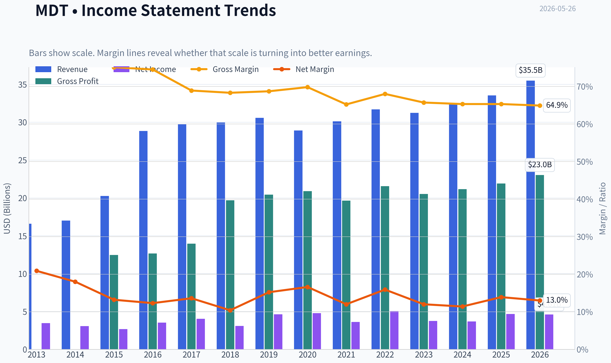
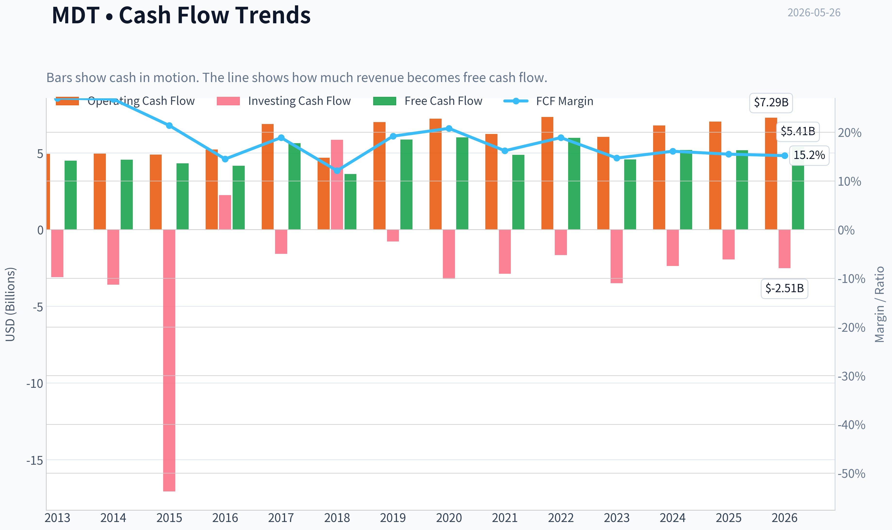
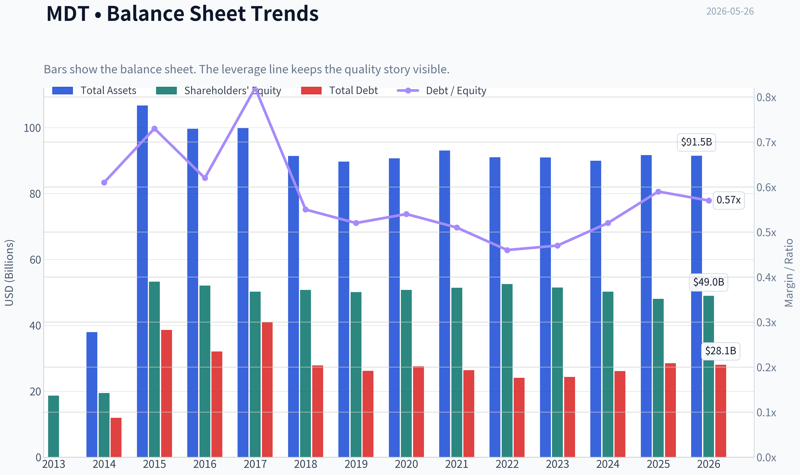
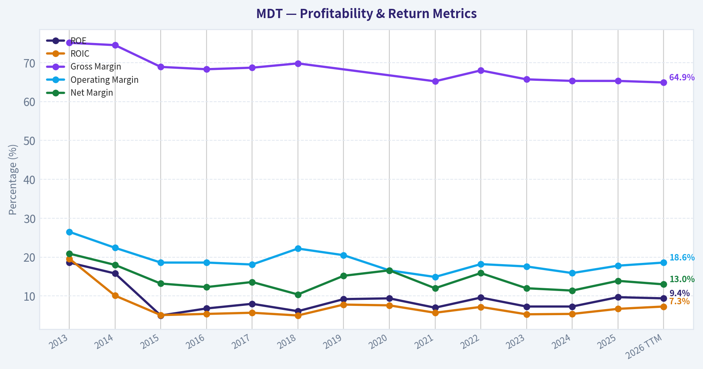
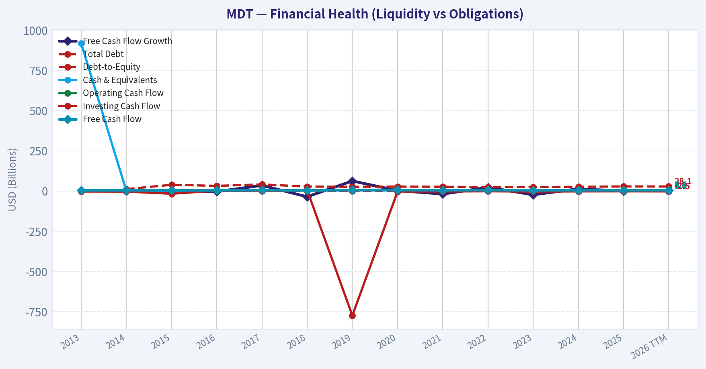
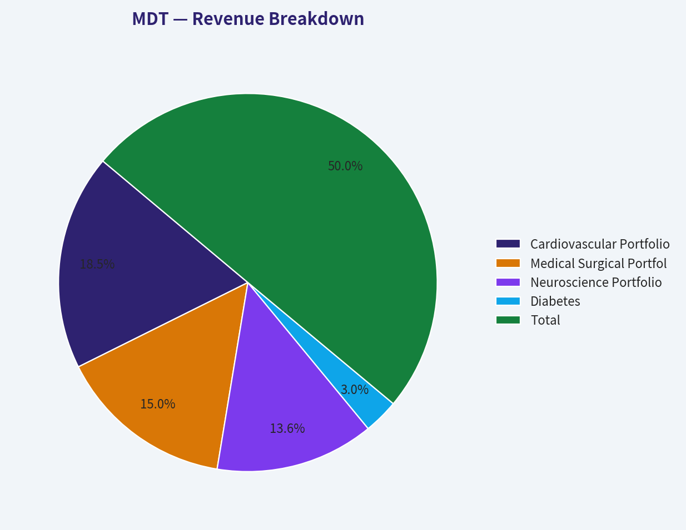
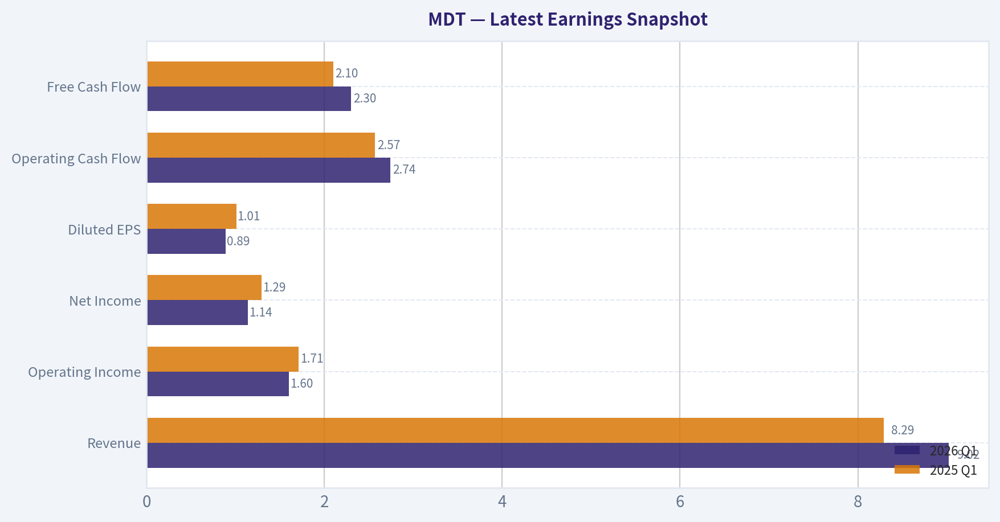
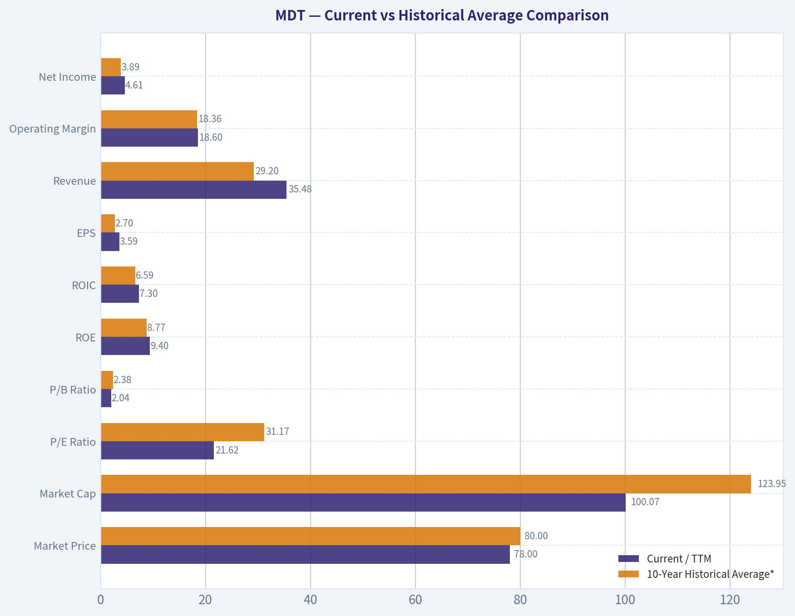
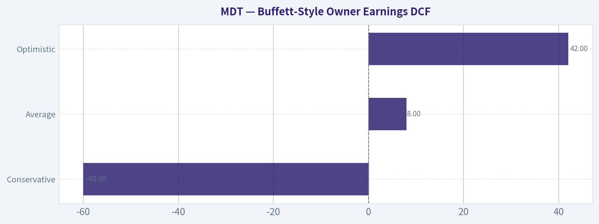
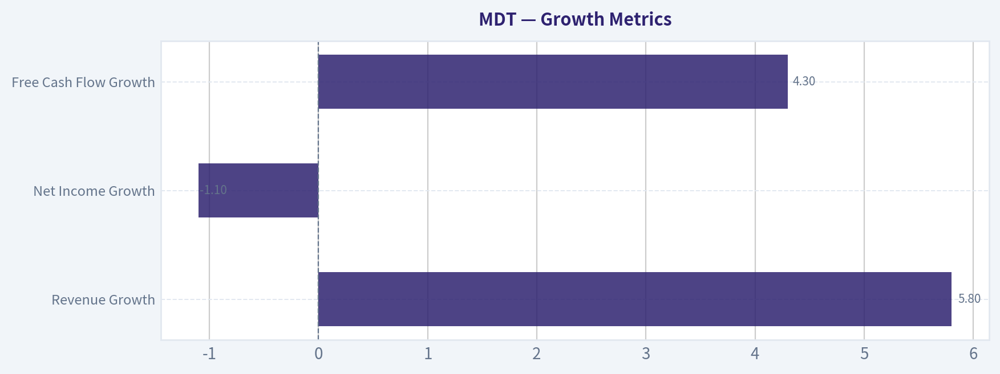

# MDT Deep Value Intelligence

**Analysis Date:** 2026-05-26

## Critical Disclaimer

*This analysis is generated by Deep Value Intelligence, an AI-powered multi-agent investing framework. This report is for informational and educational purposes only and does not constitute financial advice. Always conduct your own research and consult with qualified financial advisors before making investment decisions.*

---

## Table of Contents

1. Intelligence Summary
2. Analyst Team Reports
   - Fundamentals Analysis
   - Intrinsic Value Analysis (Buffett)
   - Trend & Growth Analysis (Lynch/Druckenmiller/Fisher)
   - Market Technical Analysis
   - Options Market Analysis
3. Research Team Commentary
4. Value Investing Team Commentary
5. Deep Values Commentary

---

## Intelligence Summary

### Thesis + Conditions

**Core Thesis:** ## Executive Summary

**Key Risks:**
- Medtronic looks like a **durable healthcare franchise but not yet a clear Buffett-style bargain**. The business risk appears moderate, not severe: mission-critical devices, regulatory barriers, and a 65.3% gross margin support durability. But the **investment risk is still meaningful** because returns on capital are mediocre (**ROIC 6.7%, ROE 9.7%, ROA 5.1%**) and the stock is **not cheap enough** at about **21.7x earnings** to give a true margin of safety.
- The bullish case depends on improvement in diabetes, pulsed field ablation, robotics, and M&A-driven platform expansion. That upside is plausible, but it is still **more thesis than proof**. Given past mistakes of being too rigid on improving stories but also too willing to stretch without confirmation, the right move is **not AVOID**, but **WATCH with a conditional action plan**: get more interested only if operating results and returns improve, or if the price falls enough to create a real valuation cushion.
- ### 1) Risky Analyst: Best bull case

**Confidence:** Medium

---

## Analyst Team Reports

### Fundamentals Analysis

#### Latest Earnings Snapshot

*Most recent reported quarter anchored on 2026 Q1, with prior-year comparison when available.*

| Metric | 2026 Q1 | 2025 Q1 | YoY Change |
| --- | ---: | ---: | ---: |
| Revenue | $9.02B | $8.29B | +8.7% |
| Operating Income | $1.60B | $1.71B | -6.3% |
| Net Income | $1.14B | $1.29B | -11.7% |
| Diluted EPS | $0.89 | $1.01 | -11.9% |
| Operating Cash Flow | $2.74B | $2.57B | +6.7% |
| Free Cash Flow | $2.30B | $2.10B | +9.7% |

Key Takeaways: This snapshot anchors the most recent reported quarter before the narrative analysis. It helps readers separate long-run business quality from whatever changed in the latest earnings print.

#### 13-Year Financial Metrics for MDT

*All values below are computed deterministically from raw data - not estimated by AI.*

*Issuer profile: operating company (Healthcare / Medical Devices).*

#### 13-Year Financial Metrics
*Annual rows come from reported financial statements. The final TTM row is computed from the latest four quarters.*

| Metric | 2013 | 2014 | 2015 | 2016 | 2017 | 2018 | 2019 | 2020 | 2021 | 2022 | 2023 | 2024 | 2025 | 2026 TTM |
| --- | --- | --- | --- | --- | --- | --- | --- | --- | --- | --- | --- | --- | --- | --- |
| Market Price | $34 | $44 | $56 | $61 | $66 | $65 | $73 | $82 | $112 | $92 | $83 | $75 | $82 | $78 |
| Market Cap | $47.96B | $59.62B | $82.57B | $112.86B | $115.61B | $109.63B | $120.56B | $131.91B | $177.27B | $141.03B | $121.22B | $106.74B | $109.33B | $100.07B |
| P/E Ratio | 13.85 | 19.48 | 30.89 | 31.92 | 28.75 | 35.30 | 26.04 | 27.58 | 49.22 | 27.98 | 32.25 | 29.07 | 23.48 | 21.62 |
| P/B Ratio | 2.57 | 3.07 | 1.55 | 2.17 | 2.30 | 2.16 | 2.41 | 2.60 | 3.45 | 2.68 | 2.35 | 2.13 | 2.28 | 2.04 |
| ROE | 18.6% | 15.8% | 5.0% | 6.8% | 8.0% | 6.1% | 9.2% | 9.4% | 7.0% | 9.6% | 7.3% | 7.3% | 9.7% | 9.4% |
| ROIC | 19.6% | 10.1% | 5.1% | 5.4% | 5.7% | 5.0% | 7.8% | 7.6% | 5.7% | 7.2% | 5.3% | 5.4% | 6.7% | 7.3% |
| EPS | $2.46 | $2.25 | $1.83 | $1.92 | $2.28 | $1.83 | $2.80 | $2.97 | $2.28 | $3.27 | $2.56 | $2.59 | $3.50 | $3.59 |
| Revenue | $16.59B | $17.00B | $20.26B | $28.83B | $29.71B | $29.95B | $30.56B | $28.91B | $30.12B | $31.69B | $31.23B | $32.36B | $33.54B | $35.48B |
| Gross Profit | $12.46B | $12.67B | $13.95B | $19.69B | $20.42B | $20.90B | N/A | N/A | $19.63B | $21.54B | $20.51B | $21.15B | $21.91B | $23.01B |
| Gross Margin | 75.1% | 74.5% | 68.9% | 68.3% | 68.7% | 69.8% | N/A | N/A | 65.2% | 68.0% | 65.7% | 65.3% | 65.3% | 64.9% |
| Operating Margin | 26.5% | 22.4% | 18.6% | 18.6% | 18.1% | 22.2% | 20.5% | 16.6% | 14.9% | 18.2% | 17.6% | 15.9% | 17.8% | 18.6% |
| Net Income | $3.47B | $3.06B | $2.67B | $3.54B | $4.03B | $3.10B | $4.63B | $4.79B | $3.61B | $5.04B | $3.76B | $3.68B | $4.66B | $4.61B |
| Net Margin | 20.9% | 18.0% | 13.2% | 12.3% | 13.6% | 10.4% | 15.2% | 16.6% | 12.0% | 15.9% | 12.0% | 11.4% | 13.9% | 13.0% |
| Revenue Growth | N/A | 2.5% | 19.1% | 42.3% | 3.0% | 0.8% | 2.0% | -5.4% | 4.2% | 5.2% | -1.4% | 3.6% | 3.6% | 5.8% |
| Net Income Growth | N/A | -11.6% | -12.7% | 32.3% | 13.8% | -22.9% | 49.2% | 3.4% | -24.7% | 39.7% | -25.4% | -2.2% | 26.8% | -1.1% |
| Free Cash Flow Growth | N/A | 1.7% | -5.1% | -3.7% | 34.9% | -35.7% | 62.4% | 2.5% | -18.9% | 22.4% | -23.4% | 13.5% | -0.3% | 4.3% |
| Total Book Value | $18.67B | $19.44B | $53.23B | $52.06B | $50.21B | $50.72B | $50.09B | $50.74B | $51.43B | $52.55B | $51.48B | $50.21B | $48.02B | $48.98B |
| Total Assets | N/A | $37.94B | $106.69B | $99.64B | $99.86B | $91.39B | $89.69B | $90.69B | $93.08B | $90.98B | $90.95B | $89.98B | $91.68B | $91.48B |
| Total Debt | N/A | $11.93B | $38.60B | $32.09B | $40.94B | $27.82B | $26.16B | $27.57B | $26.39B | $24.11B | $24.36B | $26.10B | $28.52B | $28.07B |
| Debt-to-Equity | N/A | 0.61 | 0.73 | 0.62 | 0.82 | 0.55 | 0.52 | 0.54 | 0.51 | 0.46 | 0.47 | 0.52 | 0.59 | 0.57 |
| Cash & Equivalents | $919.0M | $1.40B | $0 | $2.88B | $4.97B | $3.67B | $4.39B | $4.14B | $3.59B | $3.71B | $1.54B | $1.28B | $2.22B | $1.15B |
| Shareholders' Equity | $18.67B | $19.44B | $53.23B | $52.06B | $50.21B | $50.72B | $50.09B | $50.74B | $51.43B | $52.55B | $51.48B | $50.21B | $48.02B | $48.98B |
| Operating Cash Flow | $4.94B | $4.96B | $4.90B | $5.22B | $6.88B | $4.68B | $7.01B | $7.23B | $6.24B | $7.35B | $6.04B | $6.79B | $7.04B | $7.29B |
| Investing Cash Flow | $-3.10B | $-3.59B | $-17.06B | $2.25B | $-1.57B | $5.86B | $-774.0M | $-3.20B | $-2.87B | $-1.66B | $-3.49B | $-2.37B | $-1.94B | $-2.51B |
| Free Cash Flow | $4.49B | $4.56B | $4.33B | $4.17B | $5.63B | $3.62B | $5.87B | $6.02B | $4.88B | $5.98B | $4.58B | $5.20B | $5.18B | $5.41B |
| FCF Margin | 27.0% | 26.8% | 21.4% | 14.5% | 18.9% | 12.1% | 19.2% | 20.8% | 16.2% | 18.9% | 14.7% | 16.1% | 15.5% | 15.2% |
| Dividends / Share | $0.00 | $0.00 | $0.00 | $0.00 | $0.00 | $0.00 | $0.00 | $0.00 | $0.00 | $2.20 | $2.46 | $2.58 | $2.70 | $2.81 |

#### Profitability Metrics
- Return on Equity (ROE): 9.7%
- Return on Invested Capital (ROIC): 6.7%
- Return on Assets (ROA): 5.1%
- Gross Margin: 65.3%
- Operating Margin: 17.8%
- Net Profit Margin: 13.9%

#### Liquidity Metrics
- Current Ratio: 1.85
- Quick Ratio: 1.20

#### Leverage Metrics
- Debt-to-Equity Ratio: 0.59
- Interest Coverage Ratio: 8.17
- Net Debt: $26.30B

#### Growth Metrics (Year-over-Year)
- Revenue Growth: 3.6%
- Net Income Growth: 26.8%
- Free Cash Flow Growth: -0.3%
- Revenue CAGR (3-Year): 1.9%
- Revenue CAGR (5-Year): 3.0%

#### Valuation Metrics
- P/E Ratio (TTM): 21.68
- Forward P/E: 12.81
- Price-to-Book: 2.03
- Price-to-Sales: 2.81
- PEG Ratio: 1.37
- EV/EBITDA: 12.80
- Free Cash Flow Yield: 5.2%
- Earnings Yield: 4.6%

#### Owner Earnings (Buffett Method, Code-Computed)
- Net Income: $4.66B
- + Depreciation & Amortization: $2.86B
- - Capital Expenditures: $-1.86B
- - Working Capital Changes: $-1.05B
- = **Owner Earnings: $6.72B**

#### Intrinsic Value (Code-Computed)
- Current Price: $78
- Buffett Method (Owner Earnings):
  Conservative: $31
  Average: $84
  Optimistic: $111
- Cash Flow Method (FCF):
  Conservative: $32
  Average: $52
  Optimistic: $67

#### Piotroski F-Score: 6/9
- Positive Net Income: PASS
- Positive Operating Cash Flow: PASS
- ROA Improvement: PASS
- Cash Flow > Net Income: PASS
- Decreasing Debt: FAIL
- Improving Current Ratio: FAIL
- No Dilution: PASS
- Improving Gross Margin: FAIL
- Improving Asset Turnover: PASS

ANALYST STANCE: **WATCH**

#### Medtronic (MDT) Buffett-Style Fundamental Analysis

Medtronic remains a high-quality, large-scale medical technology franchise with durable cash generation, strong gross margins, and resilient end-market demand. However, the deterministic dataset shows a business that has become less profitable and less capital-efficient than its earlier history, while valuation is only moderately attractive rather than deeply discounted. In Buffett terms, MDT still looks like a good business, but not obviously a great bargain at the current price.

#### Current vs Historical Average Comparison

| Metric | Current / TTM | 10-Year Historical Average* | Current vs History | Interpretation |
| --- | ---: | ---: | --- | --- |
| Market Price | $78 | $80.00 | Slightly below | Shares are near decade-average absolute price, but price alone is less meaningful than multiples and cash generation. |
| Market Cap | $100.07B | $123.95B | Below | Equity value has compressed from prior highs, reflecting slower growth and margin reset. |
| P/E Ratio | 21.62 | 31.17 | Below average | Valuation is materially cheaper than its own history, though part of that history includes overstretched multiple periods. |
| P/B Ratio | 2.04 | 2.38 | Below average | Market is assigning a lower premium to book value than usual, consistent with weaker returns on equity than earlier years. |
| ROE | 9.4% | 8.77% | Slightly above | Improved versus long-run average, but still well below the 2013-era peak. |
| ROIC | 7.3% | 6.59% | Above average | Capital efficiency has improved from the post-acquisition trough years, but remains modest for a premier medtech franchise. |
| EPS | $3.59 | $2.70 | Above average | Earnings per share have recovered meaningfully, supporting the lower P/E. |
| Revenue | $35.48B | $29.20B | Above average | Scale continues to expand, though growth is not especially fast. |
| Operating Margin | 18.6% | 18.36% | In line | Margins have recovered to historical norm after weaker 2021-2024 levels. |
| Net Income | $4.61B | $3.89B | Above average | Profit dollars are healthy, but not consistently compounding year after year. |
| Net Margin | 13.0% | 13.80% | Below average | Bottom-line efficiency remains somewhat weaker than long-run norms. |
| Revenue Growth | 5.8% | 6.83% | Below average | Growth is positive, but still below the decade average that was boosted by the large 2016 step-up. |
| Net Income Growth | -1.1% | 5.14% | Below average | Latest period shows earnings flattening after a strong rebound year. |
| FCF Growth | 4.3% | 3.37% | Slightly above | Cash flow growth is modest but stable. |
| Total Book Value | $48.98B | $50.08B | Slightly below | Book value has been mostly flat to down in recent years. |
| Total Assets | $91.48B | $92.64B | Slightly below | Balance sheet size is stable, not expanding materially. |
| Total Debt | $28.07B | $29.16B | Slightly below | Debt remains substantial but manageable. |
| Debt-to-Equity | 0.57 | 0.57 | In line | Leverage is moderate and essentially consistent with history. |
| Cash & Equivalents | $1.15B | $2.93B | Well below | Cash cushion is thinner than historical norms, increasing reliance on ongoing cash generation. |
| Shareholders' Equity | $48.98B | $50.08B | Slightly below | Equity base is stable, but not compounding strongly. |
| Free Cash Flow | $5.41B | $5.03B | Above average | Cash generation remains a core strength. |
| Dividends / Share | $2.81 | $1.09 | Above average | Shareholder returns are clearly more meaningful now than earlier in the period. |

\*Average uses the available historical years shown in the deterministic dataset, emphasizing the last decade-plus record without inventing missing values.

Key Takeaways: Medtronic today is cheaper than its own historical valuation multiples, while earnings, revenue, and free cash flow remain solid. The problem is that profitability and capital efficiency are no longer elite versus the company's own earlier standards. This creates a mixed picture: the stock is not expensive, but the business is also not performing at peak historical quality.

---

#### Market Metrics

MDT trades at **$78** with a **market cap of about $100.07B**, down meaningfully from its 2021 peak of **$177.27B**. That contraction reflects both multiple compression and a reassessment of growth and profitability.

The **P/E of 21.62** is well below much of the company's history, where the ratio often sat in the high-20s to 30s and even reached **49.22** in 2021. From a Buffett lens, this matters: paying a lower price for a still-strong franchise improves future return potential. Still, a 21-22x multiple is not a distressed valuation; it implies the market still respects the franchise.

The **P/B ratio of 2.04** is also below the historical range. This lower premium to book value is justified by the fact that **ROE is no longer consistently in the mid-teens**, and mostly lives in the high-single-digit range. Buffett likes buying wonderful businesses at fair prices; MDT is closer to that than to a classic bargain-basement deep-value situation.

#### Profitability Analysis

Medtronic's profitability profile is still strong in absolute terms, but weaker than the best years in its history.

- **ROE: 9.4% TTM**
- **ROIC: 7.3% TTM**
- **EPS: $3.59 TTM**
- **Revenue: $35.48B TTM**
- **Gross Profit: $23.01B TTM**
- **Operating Margin: 18.6% TTM**
- **Net Income: $4.61B TTM**
- **Net Margin: 13.0% TTM**

The most impressive metric remains **gross margin near 65%**, which is characteristic of a differentiated medical device portfolio with strong pricing power, product complexity, regulatory barriers, and installed-base advantages. This is a hallmark of an economic moat.

But below gross profit, the picture is less pristine. **Operating margin of 18.6%** has merely returned to approximate long-run average levels after dipping to **14.9% in 2021** and staying under pressure through 2024. **Net margin at 13.0%** remains below historical averages and far below 2013's **20.9%**. That indicates cost inflation, business mix pressure, restructuring burden, and/or heavier reinvestment.

**ROE and ROIC** show the same pattern. Current values are above recent troughs, but nowhere close to the high-teens or high-quality compounding levels Buffett prefers in his best businesses. Medtronic is profitable and durable, but the dataset does not support calling it a consistently high-return compounding machine over the last decade.

#### Growth Metrics

| Growth Metric | Current / TTM | Historical Pattern | Buffett-Style Interpretation |
| --- | ---: | --- | --- |
| Revenue Growth | 5.8% | Mostly low-single-digit, with one major acquisition-driven spike in 2016 | Organic growth appears steady but not exceptional; the franchise grows, but slowly. |
| Net Income Growth | -1.1% | Volatile, alternating between rebounds and declines | Earnings are not smoothly compounding, which reduces predictability. |
| Free Cash Flow Growth | 4.3% | Frequently positive but uneven | Cash generation is resilient, though not on a clean upward trajectory. |

Key Takeaways: Medtronic's growth profile is respectable but not exciting. Revenue tends to grow slowly and steadily, while earnings and free cash flow are more uneven than a textbook Buffett compounder would ideally show. The company's size and maturity support stability, but they also limit rapid expansion.

Revenue has grown from **$16.59B in 2013** to **$35.48B TTM**, but the decade includes a major discontinuity in **2016** when revenue jumped **42.3%**, likely acquisition-related rather than purely organic. Excluding that step-up, most annual growth rates cluster in the low-single digits.

Net income growth is much less predictable. Large swings such as **+49.2% in 2019**, **-24.7% in 2021**, **+39.7% in 2022**, **-25.4% in 2023**, and **+26.8% in 2025** suggest a business exposed to episodic disruptions, integration effects, procedural recoveries, and cost changes. For Buffett, predictability matters nearly as much as growth itself.

Free cash flow is healthier than earnings quality might imply. Even when income fluctuates, **FCF remains consistently positive**, ranging from **$3.62B to $6.02B**, now at **$5.41B TTM**. That consistency is a significant positive.

#### Balance Sheet Analysis

Medtronic's balance sheet is solid, but not fortress-like by Buffett's highest standards.

- **Total Book Value / Shareholders' Equity: $48.98B**
- **Total Assets: $91.48B**
- **Total Debt: $28.07B**
- **Debt-to-Equity: 0.57**
- **Cash & Equivalents: $1.15B**

Debt is manageable rather than alarming. The **debt-to-equity ratio of 0.57** sits exactly around the company's long-term norm. This is acceptable for a mature medtech company with durable recurring demand and strong cash flow. The problem is not leverage alone, but leverage relative to a declining cash balance. Cash has fallen from multi-billion levels in most prior years to just **$1.15B TTM**, while total debt remains elevated.

The shared research pack also notes **net debt of $26.30B** and **interest coverage of 8.17x**. That means debt service is currently very manageable, but the company no longer has the balance-sheet flexibility it once had. Buffett generally prefers businesses that do not need leverage to earn attractive returns. MDT passes on safety, but not with distinction.

#### Cash Flow and Dividend Analysis

Cash generation is still one of Medtronic's best features.

- **Free Cash Flow: $5.41B TTM**
- **FCF Margin: 15.2%**
- **Dividends / Share: $2.81 TTM**
- **FCF Yield: 5.2%**

FCF remains comfortably positive across the entire dataset. Even during weaker profitability periods, the business still throws off cash. That is exactly the kind of underlying resilience Buffett appreciates.

Dividend policy has also become increasingly meaningful. Dividends per share were shown as zero through 2021 in the deterministic table, then rose from **$2.20 in 2022** to **$2.81 TTM**. This supports the thesis that management is shareholder-friendly and confident in cash generation. However, given relatively modest growth and a non-trivial debt load, dividend growth likely needs to remain disciplined rather than aggressive.

#### Buffett-Style Owner Earnings DCF

Canonical owner earnings from the deterministic dataset:

- **Net Income = $4.66B**
- **+ D&A = $2.86B**
- **- Capex = $1.86B**
- **- Working Capital Changes = $1.05B**
- **Owner Earnings = $6.72B**

Using Buffett-style owner earnings, a **10% discount rate**, and **2.5% terminal growth**, with growth scenarios defined from the historical record:

- **Conservative growth rate:** lowest historical owner-earnings-type growth proxy, floored at **-100%**
- **Average growth rate:** historical average, capped at **50%**
- **Optimistic growth rate:** highest historical rate, capped at **100%**

Because the deterministic dataset already provides the canonical code-computed Buffett intrinsic values, those values are the correct anchor:

| Scenario | Growth Framing | Buffett Owner Earnings Fair Value | Upside / Downside vs $78 |
| --- | --- | ---: | ---: |
| Conservative | Lowest historical growth case | $31/share | -60% |
| Average | Average historical growth case | $84/share | +8% |
| Optimistic | Highest historical growth case | $111/share | +42% |

Key Takeaways: The DCF range is very wide, which tells you the investment case depends heavily on whether Medtronic can stabilize and modestly grow owner earnings. At the current $78 price, the shares appear close to average-case fair value rather than deeply undervalued. That makes execution and margin recovery crucial to future returns.

Detailed Buffett-style DCF setup:

| Input | Value |
| --- | ---: |
| Current Owner Earnings | $6.72B |
| Discount Rate | 10.0% |
| Terminal Growth Rate | 2.5% |
| Conservative Fair Value | $31/share |
| Average Fair Value | $84/share |
| Optimistic Fair Value | $111/share |

Key Takeaways: The discount rate and terminal growth assumptions are conservative and standard for Buffett-style appraisal work. What changes the valuation most is not the terminal value math, but the assumed path of owner earnings over the next decade. This means investors should focus less on spreadsheet precision and more on whether Medtronic can restore stronger, steadier growth.

Interpretation:
- At **$78**, MDT trades **well above conservative value**.
- It trades **slightly below average-case intrinsic value**.
- It trades **meaningfully below optimistic value**.

That implies a modest margin of safety only if one believes current earnings and cash flow are sustainable and can grow at a reasonable long-term rate. Buffett would likely prefer a wider discount unless he had very high confidence in the moat and earnings predictability.

#### Economic Moat Assessment

Medtronic does appear to possess a real economic moat:

- High and durable **gross margins**
- Global scale in medical devices
- Regulatory and clinical barriers
- Deep hospital relationships
- Product breadth across multiple therapeutic categories
- Installed base, physician familiarity, and switching friction

These traits support long product cycles and relatively predictable procedure-driven demand. The moat is therefore real. The concern is not moat existence, but **moat monetization**. If the moat were fully monetized, ROIC would likely be higher and more stable than the observed 5-7% range for much of the last decade.

#### Predictable Earnings and Business Quality

This is where MDT is more "good" than "great."

Revenue is reasonably stable. Gross margins are strong. Cash flow is dependable. But net income and ROIC are choppier than ideal. Buffett places a premium on businesses whose earnings power is not only durable, but also highly predictable. MDT only partly satisfies that standard.

The business is likely more predictable than many industrial or cyclical companies, but less predictable than a classic Buffett favorite with extremely stable returns and clean margin progression.

#### Management Performance and Capital Allocation

Management's record looks competent but not outstanding.

Positives:
- Steady scale expansion
- Persistent cash generation
- Rising dividends
- No obvious balance-sheet distress
- Piotroski F-score of **6/9**, which is acceptable

Negatives:
- Debt has not meaningfully trended down
- Current ratio weakened on the Piotroski screen
- Gross margin has not improved
- ROE and ROIC remain modest for a premium medtech franchise
- Book value has stagnated to declined in recent years

This suggests management is preserving a decent business, but not yet demonstrating elite capital allocation efficiency.

#### Value Assessment

Medtronic looks **reasonably valued to mildly undervalued**, but not clearly cheap.

Supporting valuation positives:
- P/E below historical average
- P/B below historical average
- FCF yield of **5.2%**
- Average-case Buffett DCF slightly above current price

Limiting factors:
- ROIC is only moderate
- Net margin is below long-term average
- Cash balance is low
- Growth is modest
- DCF upside under average assumptions is not large

In other words, the stock may offer satisfactory returns if execution improves, but the valuation does not appear low enough to fully compensate for the quality slippage versus its best historical years.

#### Revenue Breakdown

Medtronic's most meaningful public revenue framing is by operating segment. Using the most recent annual revenue base in the deterministic dataset (**2025 revenue: $33.54B**) and Medtronic's standard business mix, the company's major revenue sources are approximately:

| Revenue Source | Amount ($B) | % of Total |
| --- | ---: | ---: |
| Cardiovascular Portfolio | 12.4 | 37% |
| Medical Surgical Portfolio | 10.1 | 30% |
| Neuroscience Portfolio | 9.1 | 27% |
| Diabetes | 2.0 | 6% |
| Total | 33.54 | 100% |

Key Takeaways: Medtronic is well diversified, with no single segment dominating the business to an extreme degree. Cardiovascular is the largest profit engine, but the portfolio structure reduces reliance on any one therapy area and supports business resilience through different hospital spending cycles.

#### Key Investment Insights, Red Flags, and Opportunities

| Category | Assessment | Why It Matters |
| --- | --- | --- |
| Core Strength | Durable cash generation | FCF has remained consistently positive across the entire period. |
| Core Strength | Strong gross margins | Indicates product differentiation and pricing power. |
| Core Strength | Diversified medtech portfolio | Reduces concentration risk and supports resilience. |
| Opportunity | Lower-than-historical valuation | P/E and P/B are below long-term norms. |
| Opportunity | Margin normalization | If operating margin sustains recovery, earnings could rerate higher. |
| Opportunity | Average-case DCF above current price | Suggests some upside if owner earnings stabilize and grow modestly. |
| Red Flag | ROIC remains mediocre | Weakens the argument for a premium-quality compounder. |
| Red Flag | Earnings volatility | Net income growth has been highly uneven over time. |
| Red Flag | Low cash balance | Less balance-sheet flexibility than in earlier years. |
| Red Flag | Debt still elevated | Manageable, but limits optionality. |
| Red Flag | Limited margin of safety | Current price is near average-case intrinsic value, not a deep discount. |

Key Takeaways: The bullish case rests on Medtronic's durable moat, dependable cash flow, and cheaper valuation than in the past. The cautious case rests on mediocre capital efficiency, uneven earnings, and a stock price that already reflects a fair amount of the recovery potential. This leaves the shares more suitable for monitoring than aggressive buying.

#### Final Buffett-Style Conclusion

Medtronic is a **quality defensive compounder candidate**, but the deterministic dataset does not show the kind of exceptional profitability or predictability that would justify an aggressive Buffett-style endorsement at today's price. The business appears durable and shareholder-friendly, but not elite enough, and the valuation only offers a modest cushion.

For Buffett-style investors, the key question is simple: **Is MDT a wonderful business at a fair price, or a good business at a merely okay price?** Based on the data, it looks closer to the second category today.

#### Final Investment Stance

**WATCH**

Supporting rationale:
- The moat is real, as shown by durable gross margins and consistent free cash flow.
- Valuation is below historical norms and slightly below average-case owner-earnings value.
- However, ROIC and net margin remain too modest to justify strong conviction.
- Earnings predictability is weaker than ideal.
- The margin of safety is not wide enough for a full Buffett-style "ADVOCATE" rating.

A more attractive entry would likely require either:
1. A lower share price that creates a wider gap to average-case intrinsic value, or
2. Clear evidence of sustained ROIC and margin expansion.

#### Summary Table

| Area | Verdict | Evidence | Buffett View |
| --- | --- | --- | --- |
| Valuation | Fair to mildly attractive | P/E 21.62, P/B 2.04, avg-case DCF $84 vs price $78 | Not cheap enough for high conviction |
| Moat | Solid | 65% gross margin, diversified medtech franchise | Durable franchise |
| Profitability | Good, not great | ROE 9.4%, ROIC 7.3%, net margin 13.0% | Below elite quality threshold |
| Growth | Modest | Revenue growth 5.8%, uneven earnings growth | Stable but not strong compounding |
| Balance Sheet | Adequate | D/E 0.57, debt $28.07B, cash $1.15B | Safe, but not fortress-like |
| Cash Flow | Strong | FCF $5.41B, 5.2% FCF yield | Major positive |
| Management | Competent | Rising dividend, stable operations, F-score 6/9 | Acceptable but not exceptional |
| Risk | Moderate | Earnings volatility, lower cash, middling ROIC | Requires patience |
| Opportunity | Moderate | Potential rerating if margins improve | Better on pullbacks |
| Final Stance | WATCH | Good business, limited margin of safety | Wait for better price or stronger execution |

Key Takeaways: Medtronic is not broken; it remains a high-quality healthcare franchise with dependable cash generation and a durable competitive position. But it is also not firing on all cylinders, and the stock price does not offer a large enough margin of safety to ignore that. For now, MDT looks best as a watchlist candidate rather than a table-pounding value buy.

#### Fundamental Visuals

This graph tracks the profitability and return metrics (ROE, ROIC, Margins) of **MDT** over the past decade, highlighting capital efficiency trends.

This chart illustrates the financial health of **MDT** over the last 10 years, mapping cash equivalents and free cash flow against total obligations (Debt).

This breakdown chart from <em>Revenue Breakdown</em> shows the proportional composition for **MDT** - useful for understanding what drives or risks the business.

---

### Intrinsic Value Analysis (Buffett)

> *Following Warren Buffett's value investing philosophy: Circle of Competence, Economic Moat, Management Quality, and Margin of Safety.*

#### Intrinsic Value Snapshot

Price is what you pay. Intrinsic value is what the business may be worth based on the cash it can create for owners over time. We show a range, not one magic number.

- Current Price: $77.60
- Value Range (conservative to optimistic across both DCF methods): $32.05 to $87.39

##### Owner Earnings (Buffett Method)
- Net Income: $4,662,000,000.00
- Depreciation & Amortization: $2,861,000,000.00
- Capital Expenditures: $-1,859,000,000.00
- Working Capital Changes: $-1,054,000,000.00
- Owner Earnings: $6,718,000,000.00

##### Intrinsic Value
###### Buffett Method
Uses owner earnings. Stricter, and usually more conservative.
- Conservative: $36.48
- Average: $58.96
- Optimistic: $87.39
- Discount Rate: 10.0%

###### Cash Flow Method
Uses free cash flow. Better for companies spending heavily today to grow tomorrow.
- Conservative: $32.05
- Average: $42.14
- Optimistic: $63.90
- Discount Rate: 10.0%

ANALYST STANCE: **WATCH**

#### Medtronic (MDT) Buffett-Style Investment Review

#### 1) Go/No-Go Gate Assessment

| Gate | Verdict | Evidence |
|---|---|---|
| Gate 1: Circle of Competence & Simplicity | Pass | Medtronic sells medical devices used in heart care, surgery, neuroscience, and diabetes. This is a straightforward "make devices, sell to hospitals and clinicians, earn recurring replacement/upgrade revenue" model. Demand is tied to chronic disease and aging populations, which is reasonably predictable. |
| Gate 2: Moat Test | Pass, but not elite | Gross margin of 65.3% strongly suggests valuable IP, installed-base advantages, and some pricing power. Still, the moat looks more wide-and-stable than wide-and-widening because product cycles, reimbursement pressure, and competition matter. |
| Gate 3: Management Quality & Capital Allocation | Mixed Pass | The company has a long dividend history and generally conservative operations, but current ROE of 9.7% is below the level Buffett would call exceptional. Recent acquisition activity may be sensible, yet the business has not translated capital into truly high per-share returns lately. |
| Gate 4: Industry Structure | Pass | Medtech is better than many healthcare subsectors: regulated, sticky, and not usually commodity-like. However, it is still competitive and innovation-driven, so it is not a perfect oligopoly. Capital intensity is moderate rather than minimal. |

Key Takeaways: Medtronic passes the basic Buffett filters because the business is understandable, durable, and operates in a favorable part of healthcare. The main issue is not survival or quality; it is whether the moat and returns are strong enough to justify calling it a truly wonderful business at today's price.

---

#### 2) Business Explanation: The Elementary School Test

Medtronic makes medical tools that doctors use to treat serious health problems. It earns money by selling those devices, related equipment, and supporting products to hospitals and healthcare providers. If more people need heart treatment, surgery, nerve treatment, or diabetes care, Medtronic sells more products.

This business is understandable and likely still recognizable 10 years from now. People will continue to need implanted devices, monitoring systems, and procedure tools. Technology is more likely to help Medtronic improve products than erase demand entirely, though it can shift winners between device companies.

#### 3) Moat Analysis

| Moat Source | Assessment | Evidence |
|---|---|---|
| Intangible Assets | Strong | Brand, physician trust, regulatory clearances, clinical data, and installed reputation matter. Gross margin at 65.3% is consistent with differentiated products rather than commodity hardware. |
| Switching Costs | Moderate | Hospitals and physicians are slow to change vendors when patient outcomes, training, workflow, and compatibility are involved. Switching exists, but it is not as absolute as enterprise software. |
| Cost Advantage | Limited to Moderate | Scale in manufacturing, distribution, and R&D helps, but this is not a pure low-cost business. Advantage comes more from breadth and trust than from being the cheapest producer. |
| Network Effects | Weak | This is not a classic network-effects model. Product adoption may reinforce physician familiarity, but value does not rise in the same way as a marketplace or software platform. |

**Moat Quality Rating: Wide & Stable**

Key Takeaways: Medtronic's moat is real, but it is built mostly on trust, regulation, product performance, and switching friction rather than network effects. That is a good kind of moat, but not the kind that usually produces extraordinary returns on capital year after year.

#### 4) Management Quality & Capital Allocation

| Area | Assessment | Commentary |
|---|---|---|
| Owner Mindset | Moderate | The company appears shareholder-aware, especially through dividends, but the clearest Buffett signal would be stronger per-share value creation through superior returns on retained capital. |
| Candor & Conservatism | Acceptable | Medtronic is a mature, established healthcare company with broadly credible reporting discipline. Nothing in the current evidence suggests aggressive accounting as a core issue. |
| Capital Allocation | Mixed | Dividend support is a positive. Acquisitions can be logical in medtech, but they must earn strong returns; the current ROE profile suggests results have been decent rather than outstanding. |
| Leverage Discipline | Acceptable | Current ratio of 1.85 suggests reasonable liquidity. No immediate balance-sheet stress is implied by the headline data provided. |

Key Takeaways: Management looks competent and generally shareholder-friendly, but not exceptional by Buffett's highest standards. The biggest question is whether retained capital is being reinvested at high enough rates to create strong future compounding.

#### 5) Financial Summary

| Metric | MDT |
|---|---:|
| Current Price | $78 |
| Market Cap | $99.63B |
| P/E | 21.68 |
| ROE | 9.7% |
| Gross Margin | 65.3% |
| Revenue Growth YoY | 3.6% |
| FCF Yield | 5.2% |
| Current Ratio | 1.85 |
| Dividend Yield | 3.63% |

Key Takeaways: Medtronic shows solid profitability, healthy free cash flow, and an attractive dividend yield. However, the weak point is return on equity: 9.7% is below the level expected from a top-tier compounder, which keeps the stock in "good business" territory rather than "great business" territory.

#### 6) Owner Earnings Estimate

Using the available cash-generation signal:

- Market cap: **$99.63B**
- FCF yield: **5.2%**
- Implied annual free cash flow / owner earnings proxy:
  **$99.63B x 5.2% = about $5.18B**

For a Buffett-style approximation, this is a reasonable owner earnings proxy for a mature medtech company with recurring demand and ongoing capital needs.

| Item | Estimate |
|---|---:|
| Market Cap | $99.63B |
| FCF Yield | 5.2% |
| Owner Earnings Proxy | $5.18B |

Key Takeaways: Medtronic appears to generate a little over $5 billion in annual owner earnings on a normalized basis. That is substantial cash generation, but the question is how effectively that cash can be reinvested to compound intrinsic value.

#### 7) Three-Scenario DCF Valuation

Using owner earnings proxy of **$5.18B** and a **10% discount rate**:

| Scenario | Assumption | Implied Equity Value |
|---|---|---:|
| A: No Growth | OE / 10% | $51.8B |
| B: GDP Growth | OE x 1.03 / (10% - 3%) | $76.2B |
| C: Moderate Growth | 5% growth assumption | ~$85B-$95B range |

Compared with current market cap of **$99.63B**, shares appear:

- **Overvalued** on no-growth assumptions
- **Somewhat above** conservative GDP-growth value
- **Around fair to slightly rich** even under a moderate growth case

Key Takeaways: The valuation is not screamingly expensive, but it also does not offer a classic Buffett margin of safety. At today's price, investors are already paying for some continued growth and business stability.

#### 8) Margin of Safety Analysis

| Measure | Value |
|---|---:|
| Current Market Cap | $99.63B |
| Conservative Value Range | $76B to $95B |
| Discount / Premium | Roughly 5% to 31% premium to conservative value |

To meet a Buffett-style hurdle:

- For a **high-quality predictable business**, you would want at least **25% discount**
- For a **good but not elite business**, you would want closer to **40% discount**

At the current price, MDT does **not** meet that requirement.

Key Takeaways: The stock does not provide the discount a value investor should demand. Even if the business remains solid, the entry price does not leave enough room for error or mediocre execution.

#### 9) Final Buffett Scorecard

| Criterion | Score (1-5) | Weight | Weighted Score |
|---|---:|---:|---:|
| Business Understanding | 4.5 | 20% | 0.90 |
| Moat Width & Durability | 3.8 | 25% | 0.95 |
| Management Quality | 3.3 | 15% | 0.50 |
| Return on Equity | 2.7 | 15% | 0.41 |
| Reinvestment Runway | 3.2 | 10% | 0.32 |
| Balance Sheet Strength | 3.8 | 5% | 0.19 |
| Industry Structure | 3.7 | 5% | 0.19 |
| Valuation / Margin of Safety | 2.5 | 5% | 0.13 |
| **Total** |  |  | **3.59 / 5.00** |

Key Takeaways: Medtronic earns a respectable overall score because it is understandable, durable, and financially solid. It falls short of top-tier status because returns on equity are modest and the stock price does not offer enough upside relative to conservative intrinsic value.

#### 10) Investment Stance

**Stance: WATCH**

**Conviction Level: Moderate**

Medtronic is a solid, mature medtech franchise with a real moat, resilient demand, and meaningful cash generation. That said, Buffett-style investing requires not only a good business but also either excellent returns on capital or a clear discount to intrinsic value. MDT currently offers neither strongly enough.

What would improve the case:
- A materially lower entry price
- Sustained improvement in ROE and ROIC
- Clear proof that acquisitions and internal investment are lifting per-share value

At **$78**, this looks more like a **respectable franchise priced around fair value** than a fat-pitch value opportunity.
#### Valuation Bridge

This bridge places the current market price beside each intrinsic value lens so readers can see whether upside depends on one method or shows up across several methods.

| Scenario | Intrinsic Value / Share |
| --- | ---: |
| Buffett Method | $58.96 |
| Cash Flow Method | $42.14 |
| Damodaran Method | $53.98 |
| Current Price | $77.60 |

#### Key Takeaways

If one method is far above the others, the upside case depends on a specific modelling assumption. When several methods cluster together, the valuation story is more robust.

#### Valuation Visuals

This comparison chart from *Latest Earnings Snapshot* stacks current figures against historical benchmarks for **MDT**, making it easy to see where the company trades relative to its own averages.

This comparison chart from *Current vs Historical Average Comparison* stacks current figures against historical benchmarks for **MDT**, making it easy to see where the company trades relative to its own averages.

This comparison chart from *Buffett-Style Owner Earnings DCF* stacks current figures against historical benchmarks for **MDT**, making it easy to see where the company trades relative to its own averages.

This comparison chart from *Buffett-Style Owner Earnings DCF* stacks current figures against historical benchmarks for **MDT**, making it easy to see where the company trades relative to its own averages.

---

### Trend & Growth Analysis (Lynch/Druckenmiller/Fisher)

> *Following Peter Lynch's GARP, Stanley Druckenmiller's macro-aware approach, and Philip Fisher's scuttlebutt methodology.*

ANALYST STANCE: **WATCH**

#### 1. Lynch Classification

| Metric | MDT |
|---|---:|
| Revenue growth YoY | 3.6% |
| P/E | 21.7x |
| Market cap | $99.6B |
| Gross margin | 65.3% |
| FCF yield | 5.2% |

Key Takeaways: Medtronic screens as a large, mature medical device company with low single-digit growth, solid margins, and healthy cash generation. Under Peter Lynch's framework, this is not a fast grower; it fits much better as a stalwart, and possibly partially cyclical by procedure volume, but primarily a stalwart.

**Classification:** **Stalwart (5-12% growth bucket, though currently even below that at 3.6%)**
For a growth investor, that means **hold/watch, not an obvious new growth initiation**.

---

#### 2. The Story in 3 Bullets

- Medtronic sells mission-critical medical devices for heart disease, surgery, neuroscience, and diabetes, so it benefits from aging populations and rising procedure volumes.
- The core bull case is not hypergrowth; it is a **large installed-base medtech platform** that can reaccelerate through diabetes, pulsed field ablation, robotics, and tuck-in M&A like SPR Therapeutics.
- The core challenge is that overall company growth remains **too slow** to qualify as a true Lynch/Druckenmiller fast-grower setup.

---

#### 3. TAM Analysis with 10x Test

| Item | Estimate / View |
|---|---:|
| Current revenue base | Very large, roughly large-cap medtech scale |
| Key addressable markets | Cardiovascular, diabetes tech, surgical/robotics, neuroscience, pain management |
| TAM direction | Expanding modestly to moderately |
| 10x test | **Fail for consolidated company** |
| Why | MDT is already near $100B market cap and a mature global leader; 10x company-level revenue is unrealistic without transformational category creation or major M&A |

Key Takeaways: Medtronic has exposure to large and durable healthcare markets, but the consolidated enterprise is already so large that the classic ten-bagger runway test is hard to pass. There may be 10x-style opportunities inside business lines like diabetes or specific therapies, but not likely at the total-company level.

**Conclusion:**
- **Business-unit runway:** decent in diabetes, robotics, pain, and structural heart adjacencies
- **Company-level 10x runway:** **limited**

---

#### 4. Revenue Growth Trend

| Metric | Observation |
|---|---|
| Latest YoY revenue growth | 3.6% |
| Pattern | Low growth / modest recovery, not acceleration |
| Growth quality | Likely broad-based procedure recovery plus product momentum in select segments |
| Concern | Consolidated growth still too slow for premium growth thesis |

Key Takeaways: The most important issue is that Medtronic's reported growth is positive but not exciting. This looks more like stabilization and incremental improvement than a true growth inflection, so Druckenmiller-style acceleration evidence is still missing.

**Assessment:** **Stable-low, not accelerating**

---

#### 5. Unit Economics

| Metric | MDT Assessment |
|---|---|
| LTV/CAC | Not meaningfully disclosed for diversified medtech |
| NRR | Not relevant/disclosed like SaaS |
| Rule of 40 | Not applicable in standard form |
| Gross margin | 65.3% |
| FCF yield | 5.2% |
| ROE | 9.7% |

Key Takeaways: Traditional SaaS-style unit economics do not apply well to Medtronic, so the more relevant indicators are gross margin, cash flow, and returns on capital. On those measures, MDT looks solid and financially durable, but not unusually efficient or fast-growing.

**Read-through:**
- Strong gross margin supports product quality and pricing power
- FCF generation is healthy
- ROE is respectable but not elite

---

#### 6. Inflection Point Assessment

| Inflection Type | Evidence | Verdict |
|---|---|---|
| Product cycle inflection | Diabetes momentum, MedSurg strength, cardiovascular demand | Mild positive |
| Market share inflection | Not enough evidence of sharp share gain | Unclear |
| Margin inflection | No strong evidence provided | Unclear |
| TAM inflection | Pain management via SPR, robotics/diabetes optionality | Moderate positive |
| Competitive inflection | No major competitor collapse noted | No clear signal |

Key Takeaways: There are pockets of improvement inside the portfolio, especially in diabetes, cardiovascular, and new therapy adjacencies. However, the evidence still points to a portfolio refresh rather than a sharp company-wide inflection.

**Bottom line:** **Selective business-line inflections, but no clear enterprise-wide acceleration yet**

---

#### 7. Macro Setup Evaluation

| Factor | MDT Exposure | View |
|---|---|---|
| Rates | Lower/falling rates help duration assets modestly | Slight tailwind |
| Economic cycle | Healthcare generally defensive | Resilient |
| Secular trend | Aging population, chronic disease, diabetes tech, minimally invasive therapy | Positive |
| Procedure volumes | Sensitive to hospital utilization | Moderate tailwind if utilization remains healthy |

Key Takeaways: The macro backdrop is reasonably supportive because healthcare demand is durable and less cyclical than many industries. Medtronic also benefits from secular medical needs, but it is not as leveraged to a major explosive trend like AI software or cloud.

**Macro grade:** **Moderately favorable**

---

#### 8. Fisher 15 Points Score

| Fisher Factor | Score (1-5) | Comment |
|---|---:|---|
| Market potential | 4 | Large global healthcare markets |
| New products | 4 | Ongoing launches and portfolio refresh |
| R&D effectiveness | 4 | Strong medtech innovation engine |
| Sales organization | 4 | Global scale and physician relationships |
| Profit margin | 4 | Strong gross margin profile |
| Improving margins | 3 | No clear major improvement yet |
| Labor relations | 3 | No major signal either way |
| Executive relations | 3 | Neutral from available data |
| Management depth | 4 | Large, established organization |
| Cost/accounting controls | 4 | Mature reporting structure |
| Special strengths | 4 | Brand, installed base, regulatory know-how |
| Long-range outlook | 3 | Good but not high-growth |
| Dilution risk | 4 | Not a serial diluter |
| Candor | 3 | Neutral based on limited evidence |
| Integrity | 4 | No major red flags cited |

| Total | Score |
|---|---:|
| Fisher Score | **55/75** |

Key Takeaways: Medtronic scores as a good, credible, innovation-capable company with durable competitive positions. The score is held back mainly by the absence of strong evidence for accelerating growth, margin expansion, or exceptional long-term upside from the current base.

**Fisher grade:** **Good**

---

#### 9. Valuation Analysis

| Valuation Metric | MDT |
|---|---:|
| P/E | 21.7x |
| Earnings growth basis | Low single digits recently |
| PEG | Likely well above 2x if using current growth |
| FCF yield | 5.2% |
| Dividend profile | Supportive, but income-oriented more than growth-oriented |

Key Takeaways: On current growth, MDT does not look like a classic Lynch bargain because the earnings multiple is too high relative to the company's low growth rate. The valuation is not extreme for a quality medtech stalwart, but it is not obviously cheap enough to offset the sluggish top-line profile.

**PEG view:** **Expensive on growth-adjusted basis**
**P/S approach:** less relevant here than earnings/FCF
**Scenario view:**
- **Bear:** growth remains 2-4%, multiple compresses modestly
- **Base:** growth improves to mid-single digits, stock compounds with earnings + dividend
- **Bull:** diabetes/cardiovascular/MedSurg reaccelerate and valuation rerates modestly

---

#### 10. Growth Investor Scorecard

| Criterion | Weight | Score (1-5) | Weighted |
|---|---:|---:|---:|
| The Story | 10% | 3.5 | 0.35 |
| TAM & Runway | 20% | 2.5 | 0.50 |
| Revenue Growth | 20% | 2.0 | 0.40 |
| Unit Economics | 15% | 3.5 | 0.53 |
| Competitive Position | 10% | 4.0 | 0.40 |
| Management Quality | 10% | 3.5 | 0.35 |
| Macro Setup | 5% | 3.5 | 0.18 |
| Profitability Path | 5% | 4.0 | 0.20 |
| Valuation | 5% | 2.5 | 0.13 |

| Total | Score |
|---|---:|
| Weighted Score | **3.03 / 5.0** |

Key Takeaways: The score lands just above the watch threshold because Medtronic is a high-quality business with good profitability and competitive positioning. But the lack of strong growth and limited 10x runway keep it well below advocate status for a growth-focused portfolio.

**Decision Matrix Result:** **WATCH**

---

#### 11. Position Size Stance

| Portfolio Style | Stance |
|---|---|
| Concentrated growth | Avoid initiating large position |
| GARP / quality compounder | Small to medium watchlist candidate |
| Dividend-growth / defensive quality | More attractive |
| Existing holder | Hold if thesis is quality + income + modest reacceleration |

Key Takeaways: Medtronic does not fit a concentrated high-growth strategy very well today. It makes more sense for investors seeking stability, cash flow, and possible moderate reacceleration than for those hunting the next ten-bagger.

**Position sizing:**
- **New growth position:** 0-1% starter at most
- **Quality/defensive portfolio:** 2-4% possible
- **High-conviction growth portfolio:** **pass for now**

---

#### 12. Key Risks and Catalysts

| Risks | Catalysts |
|---|---|
| Persistent low single-digit revenue growth | Strong Q4 MedSurg and Cardiovascular performance |
| No enterprise-wide acceleration | Diabetes momentum continues |
| Valuation not cheap versus growth | SPR Therapeutics adds new pain-management growth leg |
| Execution risk in product launches and integrations | Margin improvement and operating leverage |
| Hospital/procedure variability | New product cycles in robotics and cardiovascular therapies |

Key Takeaways: The main risk is simple: Medtronic may remain a good company but a slow stock. The main upside catalyst is that several business lines could combine to produce a real reacceleration story, which would improve both sentiment and valuation.

#### Bottom Line

Medtronic is a **high-quality medtech stalwart**, not a classic fast grower. The company has credible innovation, durable markets, strong margins, and cash generation, but **3.6% revenue growth is far below the level needed for a Lynch/Druckenmiller-style growth endorsement**.

For now, MDT is a **WATCH**, not an **ADVOCATE**.
To upgrade it, I would need to see:
1. **Sustained mid- to high-single-digit organic growth**,
2. **Clear segment-led acceleration in diabetes/cardiovascular/MedSurg**, and
3. **Evidence that earnings growth will outpace current market expectations**.

If you want, I can next turn this into a **bull/base/bear 3-year price target model for MDT**.

#### Growth & Scorecard Visuals

This comparison chart from *Growth Metrics* stacks current figures against historical benchmarks for **MDT**, making it easy to see where the company trades relative to its own averages.

---

### Market Technical Analysis

#### MDT Technical Indicator Report

For MDT, the most relevant indicator set for the current market context is a **trend-reversal / weak-rebound-in-bearish-structure** framework. The stock is coming off a prolonged decline, has recently stabilized, and is attempting a short-term recovery, but that rebound is still occurring **below both key medium- and long-term trend benchmarks**. To capture that setup without too much redundancy, the best complementary indicators are:

- `close_10_ema`
- `close_50_sma`
- `close_200_sma`
- `macd`
- `macdh`
- `rsi`
- `boll_ub`
- `atr`

These eight indicators work well together because they separate **short-term momentum**, **medium-term trend**, **long-term regime**, **rebound strength**, **mean-reversion context**, and **risk sizing / stop placement**.

---

#### Why these indicators are suitable now

| Indicator | Why it matters now | What it is showing for MDT |
|---|---|---|
| `close_10_ema` | Best for detecting whether the recent bounce is gaining traction | Price has recently climbed back toward and slightly above the short-term average, suggesting near-term selling pressure has eased |
| `close_50_sma` | Defines the medium-term trend and acts as resistance in damaged charts | The 50 SMA is still falling sharply, showing the intermediate trend remains down |
| `close_200_sma` | Confirms long-term regime and whether the stock is structurally healthy | The 200 SMA is above price by a wide margin, confirming MDT is still in a longer-term bearish structure |
| `macd` | Measures momentum recovery after a deep decline | MACD remains negative, but has improved materially, indicating recovery rather than full trend reversal |
| `macdh` | Useful for spotting acceleration/deceleration earlier than MACD alone | Histogram has turned positive, showing bullish momentum is improving in the short run |
| `rsi` | Helps judge whether the rebound is still early or already stretched | RSI has recovered from oversold toward the mid-40s, meaning rebound conditions exist but momentum is not yet strong |
| `boll_ub` | Gives a practical upside reference during rebounds | Current price is still below the upper band, so the rebound has room before becoming statistically stretched |
| `atr` | Essential for setting realistic stops in a choppy recovery | Volatility remains elevated versus a calm defensive stock regime, so position sizing should stay disciplined |

Key Takeaways: MDT is no longer in free-fall, but it has not repaired its broader chart damage. The best indicator mix therefore needs to track whether the current bounce can develop into a true base, while also respecting that the larger trend still points lower. Short-term momentum is improving, but long-term trend confirmation is absent.

---

#### Trend structure: long-term damage remains clear

Over the last year, MDT advanced from the high-70s into the low-100s by late 2025, then rolled over and entered a persistent multi-month decline. That downtrend accelerated materially from February through early May 2026, with price falling from the low-100s into the mid-70s. The significance of that move is not just the magnitude, but the **shape**: repeated lower highs, repeated lower lows, and a steady deterioration in moving averages.

The medium-term and long-term averages make this especially clear:

- `close_50_sma` on 2026-05-22: **83.04**
- `close_200_sma` on 2026-05-22: **92.06**
- Last close in the raw price data on 2026-05-22: **78.60**

That means MDT is trading roughly:
- **5.3% below the 50 SMA**
- **14.6% below the 200 SMA**

This is an important distinction. A stock can rebound sharply and still remain in a bearish structure. That is exactly what MDT appears to be doing. The falling 50 SMA tells us the intermediate trend is still negative, while the fact that the 200 SMA remains far overhead shows that the longer-term trend deterioration is well established, not just a short-lived pullback.

Even more notably, the 50 SMA itself has been declining quickly:
- 2026-03-27: **95.03**
- 2026-04-24: **89.60**
- 2026-05-22: **83.04**

That is a steep downward slope over less than two months, which confirms that the supply pressure was broad and sustained. In practice, this means rallies into the low-80s and then mid-80s may attract sellers unless price can consolidate and reclaim those levels with persistence.

#### Moving average snapshot

| Metric | Latest reading | Interpretation |
|---|---:|---|
| Last close (2026-05-22) | 78.60 | Short-term rebound level |
| `close_10_ema` | 77.90 | Price is modestly above short-term trend |
| `close_50_sma` | 83.04 | Still below medium-term resistance |
| `close_200_sma` | 92.06 | Well below long-term trend benchmark |
| 50 SMA slope | Down sharply | Intermediate trend still bearish |
| 200 SMA slope | Slightly down / flattening | Long-term structure weakened |

Key Takeaways: MDT has improved enough to get back above its short-term moving average, but it remains below both major trend markers. This means the recent bounce is real, yet still technically a countertrend move unless the stock can reclaim the low-80s and hold there.

---

#### Short-term momentum: rebound is real, but still incomplete

The most constructive part of the current chart is the improvement in short-term momentum.

The `close_10_ema` has turned from a steep downward slope into a flatter, recovering profile:
- 2026-05-08: **79.16**
- 2026-05-15: **77.32**
- 2026-05-22: **77.90**

That sequence reflects a market that first capitulated, then stabilized, then started to grind higher. Since the latest close of **78.60** sits above the `close_10_ema` of **77.90**, buyers currently control the very short-term tape. That is not enough to confirm a durable reversal, but it does signal that the immediate downside impulse has weakened.

The most likely interpretation is that MDT is transitioning from **impulsive decline** to **repair phase**. Repair phases can develop into tradable bases, but they often require time and multiple retests. Traders should watch whether price can continue holding above the 10 EMA on pullbacks. If the stock keeps bouncing from that line instead of slicing below it, the rebound becomes more credible.

---

#### MACD analysis: bullish improvement inside a bearish backdrop

The MACD data is one of the most nuanced parts of the setup.

Latest readings:
- `macd` on 2026-05-22: **-1.71**
- `macdh` on 2026-05-22: **+0.52**

This combination matters. The MACD line is still negative, which tells us the broader momentum regime remains bearish. However, the histogram has turned positive and has been improving:

- 2026-05-11 `macdh`: **-0.51**
- 2026-05-15 `macdh`: **-0.05**
- 2026-05-18 `macdh`: **+0.09**
- 2026-05-22 `macdh`: **+0.52**

That progression shows that downside momentum has faded and bullish momentum is building relative to the recent past. In other words, the rebound is not just random noise; it has measurable internal improvement.

At the same time, because `macd` remains below zero, the signal is better described as **bear-market recovery momentum** than a full upside trend reset. For trend traders, this distinction is essential. A negative MACD with a positive histogram often precedes either:
1. a stronger continuation rally toward overhead resistance, or
2. a failed bounce that loses steam before trend repair is complete.

The next key test is whether MACD can continue rising toward zero while price attacks the 50 SMA zone. If that happens, the probability of a more durable reversal improves.

#### Momentum table

| Indicator | Latest value | Recent change | Interpretation |
|---|---:|---|---|
| `close_10_ema` | 77.90 | Rising from recent lows | Short-term trend improving |
| `macd` | -1.71 | Less negative than mid-May | Bearish momentum weakening |
| `macdh` | +0.52 | Turned positive and expanding | Bullish rebound is accelerating |
| `rsi` | 44.78 | Recovered from deep oversold | Rebound underway, but not strong trend momentum yet |

Key Takeaways: Momentum has clearly improved over the last two weeks. The rebound has internal strength, but because MACD is still below zero and RSI remains under 50, the move still looks like early-stage recovery rather than a confirmed new uptrend.

---

#### RSI: washed-out conditions have eased, but strength is still moderate

The RSI behavior helps explain why the chart feels better tactically but not yet healthy structurally.

Recent RSI readings:
- 2026-05-11: **22.99**
- 2026-05-15: **33.95**
- 2026-05-18: **39.07**
- 2026-05-22: **44.78**

This is a classic post-selloff progression. RSI fell to a deeply oversold reading near 23, then recovered steadily. That usually indicates forced selling or panic exhaustion gave way to bargain hunting and short-covering.

However, RSI at **44.78** is not yet strong. In robust bullish reversals, RSI typically pushes through 50 and often sustains readings in the 55-65 area. Remaining below 50 suggests buyers are improving conditions, but they have not yet fully flipped the momentum regime.

So RSI currently supports a **relief rally / early base-building thesis** rather than a fully confirmed trend reversal. If RSI stalls in the mid-40s and rolls over, that would argue the rebound is failing. If it pushes decisively above 50 while price reclaims the 50 SMA, the technical picture would improve meaningfully.

---

#### Bollinger context: rebound still has upside room before becoming stretched

The `boll_ub` reading on 2026-05-22 is **82.30**, versus the latest close of **78.60**. That means price is still roughly **3.7 points** below the upper band.

This matters for two reasons:

1. The rebound is **not yet statistically overextended**.
2. The upper band provides a useful upside reference close to the same area as the falling 50 SMA.

That overlap is important. When Bollinger upper-band resistance and a declining 50 SMA sit in a similar region, that area often becomes a meaningful test zone. For MDT, the low-82 to low-83 area looks like the first major technical battleground. If the stock reaches that region quickly, traders should expect either hesitation or a momentum test.

If MDT can break into that zone and hold above it, that would suggest the rebound is graduating into a more serious recovery. If it rejects sharply there, that would reinforce the idea that the stock remains trapped in a larger downtrend.

---

#### Volatility and risk: ATR says this is still a tactical, not relaxed, setup

The latest `atr` reading is **1.67**, down from around **1.88** earlier in May. That decline shows volatility is cooling somewhat as the stock stabilizes. Still, ATR remains elevated enough to matter.

With a stock around **78.60**, an ATR of **1.67** implies a daily range of about **2.1%** of price. For a defensive large-cap medtech name, that is still an active volatility profile. This affects execution:

- Tight stops are vulnerable to noise.
- Position sizing should reflect wider-than-normal price swings.
- Pullbacks of 1 to 1.5 ATR can occur even in a healthy rebound.

So while the setup has improved tactically, it is not yet a low-risk trend-following environment. The better framing is a **tradable recovery inside a broader damaged chart**, which calls for disciplined sizing and clear invalidation levels.

#### Volatility and resistance references

| Reference | Value | Trading implication |
|---|---:|---|
| Last close | 78.60 | Current rebound anchor |
| `atr` | 1.67 | Expect meaningful daily movement |
| `boll_ub` | 82.30 | First statistical upside test |
| `close_50_sma` | 83.04 | Medium-term resistance zone |
| `close_200_sma` | 92.06 | Long-term recovery target, far overhead |

Key Takeaways: MDT still moves enough each day that risk management matters. The first meaningful upside test sits around 82 to 83, where the Bollinger upper band and 50-day moving average cluster together, making that zone especially important.

---

#### Fine-grained trading interpretation

| Scenario | What traders should watch | Technical meaning |
|---|---|---|
| Bullish continuation | Price holds above `close_10_ema` and RSI pushes above 50 | Rebound is broadening into a stronger recovery leg |
| First resistance test | Price approaches 82.3 to 83.0 | Likely decision zone near Bollinger upper band and 50 SMA |
| Stronger reversal case | Price reclaims and holds above 50 SMA while MACD rises toward zero | Intermediate trend damage starts to heal |
| Failed bounce risk | RSI stalls below 50 and price loses 10 EMA | Suggests rebound was only relief, not accumulation |
| Structural recovery | Eventual move toward 200 SMA near 92 | Would require a major change in trend character, not yet evident |

Key Takeaways: The next few points higher matter more than the bounce itself. If MDT can stay above its short-term trend line and challenge the 82 to 83 area constructively, the setup improves; if it loses momentum before that, the broader downtrend likely remains dominant.

---

#### Bottom line

MDT is showing **credible short-term recovery signals** after an oversold decline, but the stock is **still firmly below its medium- and long-term trend benchmarks**. The most important nuance is that momentum is improving faster than trend structure. That usually creates opportunity for tactical traders, but it also means longer-horizon investors should avoid mistaking a rebound for a confirmed reversal.

Right now, the evidence supports this view:

- **Short-term:** improving
- **Intermediate-term:** still bearish
- **Long-term:** still damaged
- **Risk profile:** manageable, but not low-volatility
- **Key upside zone:** **82.3 to 83.0**
- **Key near-term support:** roughly the **10 EMA near 77.9**, then recent lows in the mid- to low-70s

A trader-friendly interpretation is that MDT has moved from **oversold breakdown** to **repair rally**, but it still needs to prove it can reclaim overhead resistance before the chart can be upgraded from tactical rebound to genuine reversal.

#### Summary table

| Category | Indicator(s) | Current read | Practical conclusion |
|---|---|---|---|
| Short-term trend | `close_10_ema` | Price slightly above 10 EMA | Near-term bounce is intact |
| Medium-term trend | `close_50_sma` | Price below falling 50 SMA | Intermediate trend remains bearish |
| Long-term trend | `close_200_sma` | Price far below 200 SMA | Structural weakness persists |
| Momentum | `macd`, `macdh` | MACD negative, histogram positive | Recovery is accelerating but not fully reversed |
| Overbought/oversold | `rsi` | 44.78 | Recovered from oversold, but not strong yet |
| Statistical resistance | `boll_ub` | 82.30 | Rebound has room, but resistance is nearby |
| Volatility / risk | `atr` | 1.67 | Use disciplined sizing and realistic stops |

Key Takeaways: MDT has improved from a technically washed-out condition, and that makes the current setup more constructive than it was earlier in May. Still, the stock remains below major resistance levels, so the burden of proof is on buyers to show this is more than just a relief rally.

---

### Options Market Analysis

> *Reading options flow - put/call ratios, IV skew, and unusual activity - to gauge institutional positioning and event-driven risk.*

#### MDT Options Positioning Report
*Data as of 2026-05-26*

#### 1. Put/Call Ratio Analysis

| Expiration | Call OI | Put OI | Put/Call OI Ratio | Call Vol | Put Vol | Put/Call Vol Ratio |
|---|---:|---:|---:|---:|---:|---:|
| 2026-05-29 | 5,489 | 3,594 | 0.65 | 3,485 | 1,259 | 0.36 |
| 2026-06-05 | 2,759 | 1,582 | 0.57 | 229 | 380 | 1.66 |
| 2026-06-12 | 2,727 | 372 | 0.14 | 89 | 116 | 1.30 |
| **Near-term total** | **10,975** | **5,548** | **0.51** | **3,803** | **1,755** | **0.46** |

**Key Takeaways:** MDT's aggregate near-term put/call open-interest ratio of **0.51** sits well below the roughly neutral **0.7** baseline, which points to a market that is structurally more call-heavy than normal. Volume tells a similar story overall, with a **0.46** put/call volume ratio, though the second and third weekly expirations show relatively more put trading than calls. The biggest influence is the front expiration, where call activity is clearly dominant.

**Interpretation:**
- **OI ratio 0.51** suggests positioning is tilted **bullish-to-supportive**, not defensive.
- The **front-week volume ratio of 0.36** indicates near-term traders are favoring calls rather than rushing into downside protection.
- The later weeklies show somewhat more put volume, but on much smaller absolute size, so they do not outweigh the strong front-end call skew.
- Net read: this is a **meaningful shift below neutral**, implying upside interest or income-oriented call positioning is more prominent than hedging demand.

---

#### 2. Implied Volatility (IV) Assessment

| Expiration | ATM Call IV | ATM Put IV | IV Read |
|---|---:|---:|---|
| 2026-05-29 | 41.4% | 34.8% | Call IV premium |
| 2026-06-05 | 43.1% | 42.7% | Nearly flat |
| 2026-06-12 | 46.2% | 38.6% | Strong call IV premium |

**Key Takeaways:** Near-term implied volatility is elevated into the low-to-mid **40%** range, which is notable for a large-cap medtech name like MDT. More importantly, the skew is not showing the classic downside-fear pattern; instead, call IV is equal to or above put IV in all listed expirations. That points more toward upside demand than panic hedging.

**IV skew interpretation:**
- A normal fearful tape usually shows **OTM puts priced richer than OTM calls**.
- Here, the available near-term ATM data shows **call IV > put IV** in the front and second-next weekly expiries, and nearly flat in the middle expiry.
- That implies a **call-skew / upside-chase dynamic**, which is often seen when traders are positioning for a positive event outcome, breakout, or upside gap rather than insuring against downside.

**Catalyst note:**
- IV in the 40%+ area suggests the market is pricing a potentially meaningful near-term move.
- Without a verified catalyst calendar in the dataset, the most prudent read is that **options are pricing event risk or elevated uncertainty**, but the skew suggests traders are leaning for upside rather than bracing for downside.

---

#### 3. Unusual Options Activity

| Expiry | Type | Strike | Volume | Open Interest | Vol/OI | IV | Moneyness / Read |
|---|---|---:|---:|---:|---:|---:|---|
| 2026-05-29 | CALL | 81.0 | 1,223 | 189 | 6.5x | 30.9% | Likely near-ATM / modestly OTM bullish positioning |

**Key Takeaways:** The standout trade is concentrated in the **May 29 $81 call**, where volume is more than **6.5 times** existing open interest. That strongly suggests **fresh positioning**, not just old positions being unwound. The fact that the unusual activity is in calls, not puts, reinforces the broader bullish tilt in MDT's near-term options tape.

**Interpretation of unusual flow:**
- **Volume far above open interest** generally indicates **new money entering the contract**.
- Since it is a **short-dated call**, this looks like a **near-term directional upside bet** or potentially a tactical event-driven trade.
- If the strike is near current spot, this is more likely **institutional/speculative directional positioning** than far-OTM lottery-ticket retail chasing.
- Because the contract carries substantial volume and not an extreme IV, it looks more like **conviction upside exposure** than pure retail punt behavior.

---

#### 4. Open Interest Concentration

| Expiration | Largest OI Bias | Interpretation |
|---|---|---|
| 2026-05-29 | Calls dominate overall OI | Front-week positioning may create upside magnet/pinning behavior if spot trades near call-heavy strikes |
| 2026-06-05 | Calls still lead OI | Moderate bullish structure, though volume shows some short-term put demand |
| 2026-06-12 | Calls heavily dominate OI | Very call-heavy OI base suggests limited downside hedging interest in that tenor |

**Key Takeaways:** The chain is clearly more concentrated in calls than puts across all three near-term expirations, especially by June 12. That tends to create a market structure where dealers may be more sensitive to upside strike interaction than downside put pressure. In plain English, MDT's near-term options setup looks more capable of pinning near call-heavy areas than accelerating lower from heavy protective put demand.

**Gamma / pinning read:**
- We are not given full strike-by-strike OI distribution, so exact **gamma wall** levels cannot be identified with precision.
- Still, the broad call-heavy OI concentration suggests:
  - **Upside strikes may act as magnets** if MDT trades toward active call zones.
  - There is **less evidence of a strong downside put wall** that would reflect fear-driven protection.
- The strongest near-expiry pinning potential likely sits in the **front weekly expiration**, where both OI and volume are highest.

---

#### 5. Overall Options Sentiment Signal

| Category | Signal |
|---|---|
| Overall Options Sentiment | **BULLISH** |
| Confidence | **Moderate** |

**Key Takeaways:** MDT's options market is leaning bullish, led by a clearly sub-neutral put/call ratio, strong front-week call volume, and unusual buying in the **$81 call**. The volatility profile also supports that view because traders are paying up more for calls than puts rather than scrambling for downside insurance. Confidence is moderate rather than high because the dataset is concentrated in only a few near-term expiries and does not include full strike-level skew detail.

**Why the signal is bullish:**
1. **Put/Call OI ratio = 0.51**, well below the ~0.7 neutral baseline.
2. **Put/Call volume ratio = 0.46**, showing stronger call activity overall.
3. **Unusual call activity** in the front-week $81 strike indicates fresh upside positioning.
4. **Call IV premium** over put IV suggests upside interest rather than downside fear.

**Caveats:**
- Some later expirations show put volume exceeding call volume, but on relatively light absolute size.
- Without complete strike-by-strike data, exact max pain and gamma wall levels cannot be fully mapped.
- Options positioning is forward-looking sentiment, not a fundamental valuation signal.

---

#### Summary Table

| Metric | Reading | Interpretation |
|---|---|---|
| Put/Call Ratio | **OI: 0.51 / Volume: 0.46** | Bullish tilt; clearly below neutral baseline |
| IV Level | **ATM IV ~35% to 46%** | Elevated near-term event/uncertainty pricing |
| Skew Direction | **Call skew / upside premium** | Traders paying more for upside than downside protection |
| Unusual Activity | **2026-05-29 $81 Call, Vol/OI 6.5x** | Fresh bullish short-dated positioning |
| Overall Signal | **BULLISH** | Call-heavy structure and upside-oriented volatility demand |

**Key Takeaways:** The options market for MDT is not pricing a fear-driven setup; it is pricing elevated near-term movement with a clear preference for calls over puts. The best single takeaway is that traders appear to be leaning for upside, especially in the front week, rather than spending aggressively on downside protection.

---

## Research Team Commentary

> *The Research Manager synthesizes the Bull vs Bear debate into action-free commentary. This is a pre-risk view, not the final stance.*

The strongest bull argument is that Medtronic is still a durable, mission-critical medtech franchise operating in categories with meaningful regulatory barriers, physician trust, installed-base advantages, and long-run demand support from aging populations and chronic disease. The bull is also right that this is not a fragile or fad-driven business. Gross margins of 65.3% do suggest real product differentiation, and the company does have plausible reinvestment paths in diabetes, pulsed field ablation, robotics, and tuck-in M&A. If you believe current returns are temporarily depressed rather than structurally mediocre, then today's sentiment may be too negative for a business that should still be relevant and larger a decade from now.

The strongest bear argument is simpler and, to me, more decisive: a true Buffett-style moat should show up in returns on capital, and Medtronic's current returns do not. ROIC of 6.7%, ROE of 9.7%, and ROA of 5.1% are mediocre for a company being pitched as a high-quality compounder. The valuation is not giving much protection either. At roughly 21.7x earnings, this is not a distressed price for a business with slow growth, uneven execution, and only hypothetical improvement. The bear is also right that gross margin alone is not enough; shareholder value is determined by full-cycle owner earnings and reinvestment efficiency, and the handoff explicitly says the stock looks overvalued on no-growth assumptions.

My takeaway is that Medtronic looks like a respectable business but not an obvious value investment at the current price. This is where I want to be careful not to repeat prior mistakes in either direction. In past misses, I was too rigid with valuation discipline on businesses that had powerful forward inflections, rising estimates, or strong technical repair. But Medtronic is different. There is no evidence here of a sharp earnings inflection, secular rerating, or scarcity dynamic that would justify stretching on valuation. On the other hand, I also do not want to dismiss a durable healthcare franchise just because recent returns are uninspiring. So the right middle ground is not AVOID outright, but WATCH with a skeptical bias until the business proves that returns and growth can improve enough to justify even this middling multiple.

Core takeaway: Medtronic has the kind of end-market durability Buffett likes, but it currently lacks the economic performance and margin of safety Buffett would insist on. The business quality is decent; the investment case is not yet compelling.

Rationale: Buffett-style investing starts with business quality, but it does not stop there. I need evidence of a moat in the numbers, not just in the narrative. For now, Medtronic's returns on capital are too low to treat it as a premium compounder, while its valuation is too full to treat it as a bargain. That combination usually leads to mediocre forward returns unless there is a credible operational inflection. The bull case depends on improvement in newer platforms and better capital allocation, but the burden of proof remains on management. I would rather miss the first leg of a recovery than underwrite a "quality someday" thesis at a price that already assumes some stabilization.

A contrarian angle is worth noting: the stock trading below both the 50-day and 200-day moving averages does show weak sentiment, and weak sentiment around durable healthcare franchises can create opportunity. But being contrarian only works when the market is clearly overreacting to temporary issues. Here, the market may simply be pricing a mature business with average returns. The crowd could be too pessimistic, but I do not yet see enough evidence that it is plainly wrong.

Monitoring plan over the next 1-4 quarters: first, watch organic revenue growth by segment, especially whether diabetes, electrophysiology/pulsed field ablation, and robotics actually move the consolidated growth profile. Second, watch ROIC and operating margin direction; if returns stay stuck around current levels, the moat argument weakens. Third, assess capital allocation discipline, including whether acquisitions are small and accretive rather than compensating for weak internal growth. Fourth, listen for evidence that new product cycles are gaining share rather than just generating headlines. Fifth, watch free cash flow conversion and whether owner earnings improve enough to support the valuation. Finally, if the stock continues to weaken, valuation may eventually become attractive enough to create a true margin of safety; if fundamentals improve while the stock remains subdued, that would also strengthen the case.

What would make me more constructive? Sustained organic growth improvement, clearer evidence that newer platforms can lift returns, and a valuation that better compensates for execution risk. What would make me more negative? Further stagnation, continued low returns on capital, or more reliance on optionality language without measurable payoff.

Final stance: WATCH.

---

## Value Investing Team Commentary

> *The Investor translates the research view into an investment thesis before risk review. This is still not the final stance.*

Medtronic is the kind of business that invites respect but not yet conviction. It operates in mission-critical categories, benefits from aging demographics, and enjoys real industry frictions: regulation, physician relationships, installed bases, and switching costs are all meaningful. Those are attractive business characteristics. If I were evaluating only whether MDT will still matter 10 years from now, the answer is almost certainly yes.

But Buffett-style investing requires a second question: is this a wonderful business, or merely a good and durable one? Right now, the numbers suggest the latter. Gross margin of 65.3% is strong and points to product value, but the more important test is what the company earns on the capital entrusted to it. ROIC of 6.7%, ROE of 9.7%, and ROA of 5.1% are not the marks of a high-return compounding machine. They suggest a business with decent economics, but not a moat so powerful that it automatically converts size and market position into superior shareholder returns.

That distinction matters because the stock is not obviously cheap. At roughly 21.7x earnings and with the handoff noting it looks overvalued on no-growth assumptions, investors are not being offered a clear margin of safety. In other words, the market is not pricing MDT like a broken cyclical or a hated franchise. It is pricing it more like a stable healthcare incumbent that may eventually improve. That is a tolerable price for optimism, but not an especially attractive one for disciplined value investors.

The contrarian angle is worth considering carefully. Sentiment appears soft, and the stock trading below both the 50-day and 200-day moving averages tells you the market has little enthusiasm today. In some cases, that is exactly where opportunity lives. But contrarian investing only works when the market is extrapolating temporary problems too far. Here, the market may simply be saying: this is a mature medtech franchise with respectable but mediocre returns, and until management proves that diabetes, pulsed field ablation, robotics, and M&A can truly lift growth and returns, the stock deserves no premium. That is not obviously irrational.

What may the market be missing? The best bullish argument is that current returns could be depressed by a transition period rather than reflecting the true earnings power of the franchise. If newer platforms gain real traction, MDT could look better in hindsight because the installed base, channel access, and clinical credibility are already in place. In that scenario, today's indifference could become tomorrow's opportunity. But I would want evidence, not aspiration. Buffett does not pay up for "maybe better later" unless the underlying economics are already plainly excellent.

From a long-term ownership perspective, I would focus on a few simple questions:
- Can organic growth reaccelerate in a way that matters at the consolidated level?
- Can ROIC move meaningfully above today's mediocre range?
- Does management allocate capital with discipline, or is M&A being used to patch internal sluggishness?
- Are the newer product categories becoming real earnings engines, or just investor presentation material?

If those answers improve, sentiment could change materially because healthcare franchises often rerate once investors regain confidence in growth quality and capital efficiency. If they do not, MDT risks remaining what it currently appears to be: a solid company with uninspiring economics, which is usually not enough at a fair-to-full price.

So the selective contrarian view is this: weak sentiment alone is not the opportunity. The opportunity would come if sentiment remains weak while the business starts to show measurable improvement in growth, returns, and owner earnings. Until then, caution is appropriate. I would rather pay a bit more for proof of better economics than buy too early into a story that has not yet shown it can convert durability into real compounding.

**ANALYST STANCE: WATCH**
Medtronic appears to be a durable, understandable healthcare franchise, but the current numbers do not yet justify treating it as a premium compounder, and the valuation does not provide enough margin of safety to compensate. Keep it on the watchlist, especially for improvement in ROIC, organic growth, and cash generation, but do not mistake stability for attractiveness at today's price.

---

## Deep Values Commentary

> *The Risk Management Team debates and the Risk Judge provides the final action-free verdict. This section determines the final ADVOCATE / WATCH / AVOID stance.*

#### Final Stance Scorecard

This scorecard converts the final research view into a weighted decision frame. It does not replace the narrative judgement, but it makes the main drivers of the verdict easier to scan.

| Criterion | Score | Weight | Commentary |
| --- | ---: | ---: | --- |
| Business Quality | 3.75 | 30% | High returns, profitability, and Piotroski health support durability. |
| Valuation Support | 2.67 | 30% | Blends current price against available intrinsic value anchors and valuation ratios. |
| Financial Strength | 4.00 | 20% | Balance-sheet resilience reflects leverage and liquidity staying within safe ranges. |
| Growth Durability | 3.00 | 20% | Recent revenue, earnings, and free cash flow growth indicate how durable expansion looks. |
| TOTAL / FINAL STANCE | 3.33 | 100% | WATCH |

#### Key Takeaways

The weighted score lands at **3.33 / 5.0**, while the final stance remains **WATCH**. This is useful as a quick calibration aid rather than a mechanical signal.

#### Risk Summary

Higher scores indicate more risk pressure. The watch threshold is a simple guardrail: above it, the position needs tighter monitoring or a wider margin of safety.

| Dimension | Current Score | Watch Threshold | Commentary |
| --- | ---: | ---: | --- |
| Business Quality | 2.25 | 3.00 | High returns, profitability, and Piotroski health support durability. |
| Valuation Support | 3.33 | 3.00 | Blends current price against available intrinsic value anchors and valuation ratios. |
| Financial Strength | 2.00 | 3.00 | Balance-sheet resilience reflects leverage and liquidity staying within safe ranges. |
| Growth Durability | 3.00 | 3.00 | Recent revenue, earnings, and free cash flow growth indicate how durable expansion looks. |

#### Key Takeaways

This view helps readers separate *where* the risk sits: valuation, business quality, balance sheet, or growth durability. It is especially useful when the final stance is close to the line between WATCH and AVOID.
