# MELI Deep Value Intelligence

**Analysis Date:** 2026-05-06

## Critical Disclaimer

*This analysis is generated by Deep Value Intelligence, an AI-powered multi-agent investing framework. This report is for informational and educational purposes only and does not constitute financial advice. Always conduct your own research and consult with qualified financial advisors before making investment decisions.*

---

## Table of Contents

1. Intelligence Summary
2. Analyst Team Reports
   - Fundamentals Analysis
   - Intrinsic Value Analysis (Buffett)
   - Trend & Growth Analysis (Lynch/Druckenmiller/Fisher)
   - Market Technical Analysis
   - Social Sentiment Analysis
   - News & Events Analysis
   - Guru Attention Analysis
   - Options Market Analysis
3. Research Team Commentary
4. Value Investing Team Commentary
5. Deep Values Commentary

---

## Intelligence Summary

### Thesis + Conditions

**Core Thesis:** **EXECUTIVE SUMMARY**
MercadoLibre (MELI) is an elite, high-quality business dominating Latin American e-commerce and fintech. However, a 47x P/E multiple coupled with a massive divergence between revenue growth (39.1%) and net income growth (4.5%) violates the principle of a Margin of Safety.

**Key Risks:**
- MercadoLibre (MELI) is an elite, high-quality business dominating Latin American e-commerce and fintech. However, a 47x P/E multiple coupled with a massive divergence between revenue growth (39.1%) and net income growth (4.5%) violates the principle of a Margin of Safety. Because free cash flow is currently distorted by fintech float and working capital dynamics, predictable "owner earnings" remain elusive. We will not pay a premium price for unresolved execution and macro-credit risk. **Final Stance: WATCH.**
- The Bear Case (Value):** A massive valuation spread ($794 to $7,645) signals extreme model fragility, not optionality. High ROE masks a weak 4.7% Return on Assets (ROA), highlighting the inherent risks of a capital-intensive credit and fintech book.
- Buffett's framework requires two non-negotiable elements: a wonderful business and a fair price that offers a Margin of Safety. MELI clearly satisfies the first, but fails the second. The discrepancy between reported Free Cash Flow (up 52.6%) and Net Income (up 4.5%) suggests cash generation is being flattered by temporary fintech float and credit origination rather than clean, recurring owner earnings. At $1,841, the market is pricing in flawless execution. Valuation dispersions of this magnitude dictate caution; until we can reliably normalize cash flows without credit-distortion noise, the risk of permanent capital impairment outweighs FOMO.
- On the flip side, the bears hit on something absolutely critical for a value investor: predictability and the margin of safety. While revenue is up roughly thirty-nine percent, net income only grew four and a half percent. Even more concerning is the massive divergence in the valuation models, swinging anywhere from under eight hundred dollars to over seven thousand dollars a share depending on how you treat free cash flow. The bears point out that the massive fifty-two percent growth in free cash flow is likely heavily distorted by fintech float, working capital dynamics, and credit origination rather than clean, recurring owner earnings. Furthermore, operating a capital-intensive logistics network alongside a consumer credit book in a volatile macro environment like Latin America adds layers of structural risk that aren't fully priced into a price-to-earnings multiple of forty-seven.
- For our monitoring plan over the next one to four quarters, we need to focus on three specific items. First, we must watch the conversion of revenue to net income. We need to see if that four and a half percent net income growth accelerates, proving that the heavy reinvestments in logistics and free shipping are finally yielding operating leverage. Second, we need to carefully dissect their free cash flow statements. I want us to strip out changes in working capital, customer funds, and credit receivables to determine the underlying, recurring cash generated by the core operations. Finally, we need to monitor the health of the Mercado Pago credit portfolio. Any signs of rising non-performing loans in Brazil or Mexico would indicate that their growth is coming at the expense of underwriting discipline.

**What Would Change Our View:**
- MercadoLibre (MELI) is an elite, high-quality business dominating Latin American e-commerce and fintech. However, a 47x P/E multiple coupled with a massive divergence between revenue growth (39.1%) and net income growth (4.5%) violates the principle of a Margin of Safety. Because free cash flow is currently distorted by fintech float and working capital dynamics, predictable "owner earnings" remain elusive. We will not pay a premium price for unresolved execution and macro-credit risk. **Final Stance: WATCH.**
- The Bear Case (Value):** A massive valuation spread ($794 to $7,645) signals extreme model fragility, not optionality. High ROE masks a weak 4.7% Return on Assets (ROA), highlighting the inherent risks of a capital-intensive credit and fintech book.
- Buffett's framework requires two non-negotiable elements: a wonderful business and a fair price that offers a Margin of Safety. MELI clearly satisfies the first, but fails the second. The discrepancy between reported Free Cash Flow (up 52.6%) and Net Income (up 4.5%) suggests cash generation is being flattered by temporary fintech float and credit origination rather than clean, recurring owner earnings. At $1,841, the market is pricing in flawless execution. Valuation dispersions of this magnitude dictate caution; until we can reliably normalize cash flows without credit-distortion noise, the risk of permanent capital impairment outweighs FOMO.
- On the flip side, the bears hit on something absolutely critical for a value investor: predictability and the margin of safety. While revenue is up roughly thirty-nine percent, net income only grew four and a half percent. Even more concerning is the massive divergence in the valuation models, swinging anywhere from under eight hundred dollars to over seven thousand dollars a share depending on how you treat free cash flow. The bears point out that the massive fifty-two percent growth in free cash flow is likely heavily distorted by fintech float, working capital dynamics, and credit origination rather than clean, recurring owner earnings. Furthermore, operating a capital-intensive logistics network alongside a consumer credit book in a volatile macro environment like Latin America adds layers of structural risk that aren't fully priced into a price-to-earnings multiple of forty-seven.
- For our monitoring plan over the next one to four quarters, we need to focus on three specific items. First, we must watch the conversion of revenue to net income. We need to see if that four and a half percent net income growth accelerates, proving that the heavy reinvestments in logistics and free shipping are finally yielding operating leverage. Second, we need to carefully dissect their free cash flow statements. I want us to strip out changes in working capital, customer funds, and credit receivables to determine the underlying, recurring cash generated by the core operations. Finally, we need to monitor the health of the Mercado Pago credit portfolio. Any signs of rising non-performing loans in Brazil or Mexico would indicate that their growth is coming at the expense of underwriting discipline.

**Confidence:** Medium

---

## Analyst Team Reports

### Fundamentals Analysis

#### Latest Earnings Snapshot

*Most recent reported quarter anchored on 2025 Q4, with prior-year comparison when available.*

| Metric | 2025 Q4 | 2024 Q4 | YoY Change |
| --- | ---: | ---: | ---: |
| Revenue | $8.76B | $6.06B | +44.6% |
| Operating Income | $889.0M | $820.0M | +8.4% |
| Net Income | $559.0M | $639.0M | -12.5% |
| Diluted EPS | $11.03 | $12.61 | -12.5% |
| Operating Cash Flow | $5.21B | $2.92B | +78.1% |
| Free Cash Flow | $4.78B | $2.62B | +82.6% |

Key Takeaways: This snapshot anchors the most recent reported quarter before the narrative analysis. It helps readers separate long-run business quality from whatever changed in the latest earnings print.

#### 10-Year Financial Metrics for MELI

*All values below are computed deterministically from raw data - not estimated by AI.*

*Issuer profile: operating company (Consumer Cyclical / Internet Retail).*

#### 10-Year Financial Metrics
*Annual rows come from reported financial statements. The final TTM row is computed from the latest four quarters.*

| Metric | 2009 | 2010 | 2011 | 2012 | 2013 | 2014 | 2015 | 2016 | 2017 | 2018 | 2019 | 2020 | 2021 | 2022 | 2023 | 2024 | 2025 | 2026 TTM |
| --- | --- | --- | --- | --- | --- | --- | --- | --- | --- | --- | --- | --- | --- | --- | --- | --- | --- | --- |
| Market Price | $50 | $65 | $77 | $77 | $106 | $126 | $114 | $156 | $315 | $293 | $572 | $1,675 | $1,348 | $846 | $1,572 | $1,700 | $2,014 | $1,841 |
| Market Cap | $2.29B | $2.94B | $3.51B | $3.47B | $4.76B | $5.64B | $5.05B | $6.90B | $13.90B | $13.04B | $27.85B | $83.33B | $67.15B | $43.45B | $80.16B | $86.21B | $102.12B | $93.34B |
| P/E Ratio | 69.16 | 52.47 | 45.98 | 34.15 | 40.52 | 78.33 | 47.64 | 50.53 | 1015.03 | -357.13 | -154.16 | -20940.25 | 807.43 | 88.80 | 80.76 | 45.12 | 51.12 | 46.73 |
| P/B Ratio | 20.05 | 17.13 | 16.02 | 11.97 | 13.85 | 15.84 | 14.87 | 16.08 | 42.65 | 38.73 | 14.04 | 50.47 | 43.86 | 23.78 | 26.10 | 19.81 | 15.13 | 13.83 |
| ROE | 29.1% | 32.6% | 35.0% | 34.9% | 34.2% | 20.4% | 31.2% | 31.8% | 4.2% | -10.9% | -8.7% | -0.1% | 5.4% | 26.4% | 32.1% | 43.9% | 29.6% | 29.6% |
| ROIC | 68.7% | 65.5% | 51.1% | 53.4% | 55.1% | 42.5% | 61.9% | 71.9% | 24.2% | -18.6% | -25.2% | 4.9% | 18.7% | 21.6% | 33.8% | 33.9% | 23.9% | 15.5% |
| EPS | $0.73 | $1.23 | $1.68 | $2.25 | $2.66 | $1.63 | $2.40 | $3.09 | $0.31 | $-0.82 | $-3.71 | $-0.08 | $1.67 | $9.53 | $19.46 | $37.69 | $39.40 | $39.40 |
| Revenue | N/A | N/A | N/A | N/A | N/A | N/A | N/A | $844.4M | $1.22B | $1.44B | $2.30B | $3.97B | $7.07B | $10.78B | $15.11B | $20.78B | $28.89B | $28.89B |
| Gross Profit | $136.9M | $170.2M | $226.9M | $275.5M | $342.5M | $397.6M | $436.8M | $536.9M | $719.6M | $697.0M | $1.10B | $1.71B | $3.00B | $5.20B | $7.59B | $9.58B | $12.86B | $12.86B |
| Gross Margin | N/A | N/A | N/A | N/A | N/A | N/A | N/A | 63.6% | 59.2% | 48.4% | 48.0% | 43.0% | 42.5% | 48.2% | 50.2% | 46.1% | 44.5% | 44.5% |
| Operating Margin | N/A | N/A | N/A | N/A | N/A | N/A | N/A | 21.4% | 4.6% | -4.8% | -6.7% | 3.2% | 6.2% | 9.9% | 14.6% | 12.7% | 11.1% | 11.1% |
| Net Income | $33.2M | $56.0M | $76.8M | $101.2M | $117.5M | $72.6M | $105.8M | $136.4M | $13.8M | $-36.6M | $-172.0M | $-1.0M | $83.0M | $482.0M | $987.0M | $1.91B | $2.00B | $2.00B |
| Net Margin | N/A | N/A | N/A | N/A | N/A | N/A | N/A | 16.1% | 1.1% | -2.5% | -7.5% | -0.0% | 1.2% | 4.5% | 6.5% | 9.2% | 6.9% | 6.9% |
| Revenue Growth | N/A | N/A | N/A | N/A | N/A | N/A | N/A | N/A | 44.1% | 18.3% | 59.5% | 73.1% | 77.9% | 52.5% | 40.1% | 37.5% | 39.1% | 0.0% |
| Net Income Growth | N/A | 68.7% | 37.1% | 31.8% | 16.1% | -38.2% | 45.8% | 28.9% | -89.9% | -365.5% | 370.1% | -99.4% | -8400.0% | 480.7% | 104.8% | 93.6% | 4.5% | 0.0% |
| Free Cash Flow Growth | N/A | 19.1% | 28.9% | 74.7% | -76.6% | 464.6% | 12.2% | -33.2% | 75.7% | -35.6% | 128.1% | 197.5% | -58.1% | 533.9% | 86.4% | 52.4% | 52.6% | 0.0% |
| Total Book Value | $114.2M | $171.7M | $219.2M | $289.8M | $343.5M | $355.8M | $339.5M | $428.9M | $325.8M | $336.7M | $1.98B | $1.65B | $1.53B | $1.83B | $3.07B | $4.35B | $6.75B | $6.75B |
| Total Assets | $182.6M | $269.7M | $355.9M | $478.7M | $592.4M | $966.8M | $1.00B | $1.37B | $1.67B | $2.24B | $4.78B | $6.53B | $10.10B | $13.74B | $17.61B | $25.20B | $42.67B | $42.67B |
| Total Debt | $0 | $0 | $0 | $0 | $0 | $0 | $0 | $0 | $0 | $602.2M | $631.4M | $860.9M | $3.52B | $4.76B | $4.50B | $5.71B | $9.19B | $11.39B |
| Debt-to-Equity | 0.00 | 0.00 | 0.00 | 0.00 | 0.00 | 0.00 | 0.00 | 0.00 | 0.00 | 1.79 | 0.32 | 0.52 | 2.30 | 2.60 | 1.46 | 1.31 | 1.36 | 1.69 |
| Cash & Equivalents | $49.8M | $56.8M | $67.4M | $101.5M | $140.3M | $223.1M | $166.9M | $234.1M | $388.3M | $440.3M | $1.38B | $1.86B | $2.58B | $1.91B | $2.56B | $2.63B | $3.67B | $3.67B |
| Shareholders' Equity | $114.2M | $171.7M | $219.2M | $289.8M | $343.5M | $355.8M | $339.5M | $428.9M | $325.8M | $336.7M | $1.98B | $1.65B | $1.53B | $1.83B | $3.07B | $4.35B | $6.75B | $6.75B |
| Operating Cash Flow | $49.7M | $67.9M | $89.4M | $139.9M | $142.5M | $196.8M | $221.4M | $190.3M | $269.0M | $230.9M | $451.1M | $1.18B | $965.0M | $2.94B | $5.14B | $7.92B | $12.12B | $12.12B |
| Investing Cash Flow | $-3.1M | $-58.8M | $-66.9M | $-84.6M | $-78.8M | $-322.4M | $-183.5M | $-84.2M | $-22.6M | $-672.5M | $-1.45B | $-252.0M | $-1.60B | $-3.87B | $-3.45B | $-8.29B | $-6.18B | $-6.18B |
| Free Cash Flow | $45.9M | $54.7M | $70.5M | $123.1M | $28.8M | $162.4M | $182.2M | $121.7M | $213.9M | $137.8M | $314.3M | $935.0M | $392.0M | $2.48B | $4.63B | $7.06B | $10.77B | $10.77B |
| FCF Margin | N/A | N/A | N/A | N/A | N/A | N/A | N/A | 14.4% | 17.6% | 9.6% | 13.7% | 23.5% | 5.5% | 23.1% | 30.7% | 34.0% | 37.3% | 37.3% |
| Dividends / Share | $0.00 | $0.00 | $0.00 | $0.00 | $0.00 | $0.00 | $0.00 | $0.00 | $0.00 | $0.00 | $0.00 | $0.00 | $0.00 | $0.00 | $0.00 | $0.00 | $0.00 | $0.00 |

#### Profitability Metrics
- Return on Equity (ROE): 29.6%
- Return on Invested Capital (ROIC): 18.3%
- Return on Assets (ROA): 4.7%
- Gross Margin: 44.5%
- Operating Margin: 11.1%
- Net Profit Margin: 6.9%

#### Liquidity Metrics
- Current Ratio: 1.17
- Quick Ratio: 0.21

#### Leverage Metrics
- Debt-to-Equity Ratio: 1.36
- Interest Coverage Ratio: 20.01
- Net Debt: $5.52B

#### Growth Metrics (Year-over-Year)
- Revenue Growth: 39.1%
- Net Income Growth: 4.5%
- Free Cash Flow Growth: 52.6%
- Revenue CAGR (3-Year): 38.9%
- Revenue CAGR (5-Year): 48.7%

#### Valuation Metrics
- P/E Ratio (TTM): 46.68
- Forward P/E: 27.15
- Price-to-Book: 13.83
- Price-to-Sales: 3.23
- PEG Ratio: 1.12
- EV/EBITDA: 24.50
- Free Cash Flow Yield: 11.5%
- Earnings Yield: 2.1%

#### Owner Earnings (Buffett Method, Code-Computed)
- Net Income: $2.00B
- + Depreciation & Amortization: $818.0M
- - Capital Expenditures: $-1.34B
- - Working Capital Changes: $5.92B
- = **Owner Earnings: $-4.45B**

#### Intrinsic Value (Code-Computed)
- Current Price: $1,841
- Cash Flow Method (FCF):
  Conservative: $1,148
  Average: $7,645
  Optimistic: $19,908

#### Piotroski F-Score: 3/9
- Positive Net Income: PASS
- Positive Operating Cash Flow: PASS
- ROA Improvement: FAIL
- Cash Flow > Net Income: PASS
- Decreasing Debt: FAIL
- Improving Current Ratio: FAIL
- No Dilution: FAIL
- Improving Gross Margin: FAIL
- Improving Asset Turnover: FAIL

ANALYST STANCE: **WATCH**

#### MercadoLibre, Inc. (MELI) - Buffett-Style Fundamental Analysis

MercadoLibre is one of the highest-quality compounders in Latin America, combining dominant e-commerce, logistics, digital advertising, payments, credit, and financial-services ecosystems. The business has a credible moat, very strong revenue growth, and powerful free-cash-flow generation. However, from a Warren Buffett value-investing lens, the stock is not an obvious bargain today because valuation remains elevated, leverage has increased, reported owner earnings are negative under the provided Buffett-method calculation, and recent margin pressure is visible.

The final stance is **WATCH**: MELI is a superior business, but the current price does not provide enough Buffett-style margin of safety given the volatility in earnings, debt growth, and negative deterministic owner earnings.

---

#### Current vs. 10-Year Historical Average Comparison

*10-year averages below use the last ten completed annual periods in the deterministic dataset, 2016-2025. Current values use the 2026 TTM row where available; for growth rates, the latest meaningful annual YoY value is used because the 2026 TTM row mechanically shows 0.0%.*

| Category | Metric | Current / Latest | 10-Year Avg. | Interpretation |
|---|---:|---:|---:|---|
| Market Metrics | Market Price | $1,841 | $1,049 | Current price is about 76% above the 10-year average, reflecting the market's confidence in MELI's long-term compounding power. |
| Market Metrics | Market Cap | $93.34B | $52.41B | Market value is materially above its decade average, consistent with strong revenue and FCF scaling. |
| Market Metrics | P/E Ratio | 46.73x | -1,931.3x | The average is distorted by loss years and near-zero earnings years; current P/E is still high in absolute terms but much more normalized than prior extreme periods. |
| Market Metrics | P/B Ratio | 13.83x | 29.07x | P/B is below the 10-year average, but still expensive versus traditional Buffett value standards. |
| Profitability | ROE | 29.6% | 15.4% | ROE is well above average, showing strong recovery in profitability after the 2018-2021 investment phase. |
| Profitability | ROIC | 15.5% | 18.9% | ROIC is below the 10-year average, suggesting reinvestment intensity and balance-sheet expansion are pressuring capital efficiency. |
| Profitability | EPS | $39.40 | $10.65 | EPS is far above the historical average, but growth slowed sharply versus the 2022-2024 profit inflection. |
| Profitability | Revenue | $28.89B | $9.24B | Revenue is more than triple the 10-year average, confirming exceptional scale expansion. |
| Profitability | Gross Profit | $12.86B | $4.30B | Gross profit has scaled powerfully, but gross margin is no longer at earlier marketplace-only levels. |
| Profitability | Gross Margin | 44.5% | 49.4% | Gross margin is below average, reflecting logistics, fintech, credit, and shipping investments. |
| Profitability | Operating Margin | 11.1% | 7.2% | Operating margin is above average, but below the 2023 peak of 14.6% and 2024 level of 12.7%. |
| Profitability | Net Income | $2.00B | $0.54B | Net income is far above average, showing that MELI has moved from investment-heavy losses to scaled profitability. |
| Profitability | Net Margin | 6.9% | 3.6% | Net margin is meaningfully above average, but below the 2024 high of 9.2%. |
| Growth | Revenue Growth | 39.1% | 49.1% | Growth remains excellent, though below the extraordinary post-2020 average. |
| Growth | Net Income Growth | 4.5% | -787.2% | Historical average is distorted by loss swings; the key issue is that current profit growth has slowed sharply. |
| Growth | Free Cash Flow Growth | 52.6% | 100.0% | FCF growth remains very strong, though below the volatile 10-year average inflated by rebound years. |
| Balance Sheet | Total Book Value | $6.75B | $2.23B | Book value has compounded strongly, improving the equity base. |
| Balance Sheet | Total Assets | $42.67B | $12.59B | Assets have expanded rapidly due to fintech, credit, logistics, and cash-flow scale. |
| Balance Sheet | Total Debt | $11.39B | $2.98B | Debt is far above historical norms and is one of the main Buffett-style red flags. |
| Balance Sheet | Debt-to-Equity | 1.69x | 1.17x | Leverage is elevated versus the decade average and much higher than MELI's early debt-free history. |
| Balance Sheet | Cash & Equivalents | $3.67B | $1.77B | Liquidity has improved, but cash does not fully offset the rise in debt. |
| Balance Sheet | Shareholders' Equity | $6.75B | $2.23B | Equity has strengthened, but debt has grown even faster. |
| Cash Flow | Free Cash Flow | $10.77B | $2.71B | FCF is nearly four times the 10-year average, the strongest bullish feature in the dataset. |
| Cash Flow | Dividends / Share | $0.00 | $0.00 | MELI retains capital for reinvestment, consistent with a high-growth compounder rather than an income stock. |

**Key Takeaways:** MELI's current fundamentals are much stronger than its 10-year average on revenue, EPS, net income, ROE, and free cash flow. The main concerns are valuation, lower gross margin, higher debt, and ROIC that is no longer above its historical average. The business quality is high, but the balance sheet and valuation are less clearly Buffett-like.

---

#### Market Metrics Interpretation

MELI trades at **$1,841** with a **$93.34B** market capitalization. That is substantially above its 10-year average market cap of about **$52.41B**, showing that investors are pricing the company as a durable Latin American platform winner.

The **P/E ratio of 46.73x** is high in absolute terms. However, the historical P/E average is not very useful because MELI had loss years and near-zero earnings years that produced extreme ratios, including negative P/E values and a 2020 figure distorted by almost breakeven earnings. On a normalized basis, MELI is expensive but no longer in the speculative valuation zone seen during 2020-2021.

The **P/B ratio of 13.83x** is below the 10-year average of **29.07x**, but that does not make the stock conventionally cheap. A high P/B can be justified for asset-light marketplace economics, but MELI's business is becoming more capital-intensive through logistics, credit, and fintech infrastructure.

#### Profitability Analysis

MELI's **ROE of 29.6%** is strong and well above the decade average of **15.4%**. This supports the argument that MELI has a high-quality franchise with pricing power, operating scale, and network effects.

However, **ROIC of 15.5%** is below the 10-year average of **18.9%**. That matters to Buffett-style investors because ROIC is a cleaner measure of how efficiently management deploys capital. The decline suggests that MELI's reinvestment in logistics, fintech, and credit is producing growth, but at a more capital-intensive rate than the earlier marketplace model.

Revenue is outstanding: **$28.89B** versus a 10-year average of **$9.24B**. Gross profit is also strong at **$12.86B**, but **gross margin of 44.5%** is below the 10-year average of **49.4%**. This shows the business has scaled, but the mix has shifted toward lower-margin or investment-heavy activities such as shipping subsidies, fulfillment, credit, and payments infrastructure.

Operating margin is **11.1%**, above its 10-year average of **7.2%**, but below the 2023-2024 levels. Net margin is **6.9%**, also above its average, but below 2024's **9.2%**. The trend suggests MELI is profitable and scaled, but incremental investment is again pressuring margins.

#### Growth Metrics Interpretation

Revenue growth remains exceptional at **39.1% YoY**, though below the 10-year average of **49.1%**. This is still extremely strong for a company approaching **$29B** in revenue.

Net income growth slowed to **4.5%**, which is a notable deceleration from 2022-2024, when profits surged from scale and operating leverage. This is important because the stock still trades at a high earnings multiple.

Free cash flow growth of **52.6%** remains very strong. FCF is the most attractive part of the deterministic dataset: MELI generated **$10.77B** of FCF, compared with a 10-year average of **$2.71B**. If sustainable, that supports a much stronger valuation case than GAAP earnings alone.

#### Balance Sheet and Financial Strength

MELI's balance sheet has become much larger and more complex. Total assets are **$42.67B**, versus a 10-year average of **$12.59B**. Shareholders' equity is **$6.75B**, up materially from the historical average.

The concern is debt. Total debt is **$11.39B**, far above the 10-year average of **$2.98B**. Debt-to-equity is **1.69x**, above the 10-year average of **1.17x**. That is not fatal, especially given strong operating cash flow and an interest coverage ratio reported at about **20x**, but it reduces the margin of safety.

Cash and equivalents are **$3.67B**, above the 10-year average of **$1.77B**, yet net debt is still significant. Buffett generally prefers businesses that can grow without requiring heavy debt. MELI is not overly distressed, but it is no longer the debt-light platform it was in its early years.

#### Cash Flow and Dividend Policy

Free cash flow is the strongest metric in the dataset. MELI generated **$10.77B** of FCF, implying a reported FCF yield of about **11.5%** on the current market cap. That is unusually attractive for a business still growing revenue near 40%.

MELI pays **no dividend**, which is appropriate for a company with large reinvestment opportunities. From a Buffett perspective, retaining earnings is acceptable if management can reinvest at high incremental returns. The key debate is whether future ROIC remains high enough to justify continued aggressive reinvestment.

---

#### Revenue Breakdown

*Most recent revenue base: deterministic 2026 TTM revenue of $28.89B. Segment split uses best-available public reporting pattern and business mix estimates because precise 2026 TTM segment data is not provided in the deterministic dataset.*

| Revenue Source | Amount ($B) | % of Total |
|---|---:|---:|
| Commerce Platform, Marketplace, Ads, Shipping & Fulfillment | $16.47B | 57.0% |
| Fintech, Payments, Credit, Wallet & Financial Services | $12.42B | 43.0% |
| **Total** | **$28.89B** | **100.0%** |

**Key Takeaways:** MELI is no longer just an e-commerce marketplace; it is a combined commerce and financial-services ecosystem. Commerce remains the larger revenue contributor, but fintech is now a major pillar and likely one reason margins, credit risk, and capital needs have become more complex.

---

#### Warren Buffett-Style Qualitative Analysis

#### Economic Moat

MELI has a strong and widening moat in Latin America. Its moat comes from several reinforcing advantages:

| Moat Source | Buffett-Style Assessment |
|---|---|
| Network Effects | Buyers attract sellers, sellers attract buyers, and transaction volume strengthens the marketplace. |
| Logistics Scale | Mercado Envios improves delivery speed and reliability, creating a service advantage that smaller competitors struggle to match. |
| Payments Ecosystem | Mercado Pago embeds MELI deeper into consumer and merchant financial activity. |
| Brand Trust | In markets with lower trust and fragmented infrastructure, a trusted platform has especially high value. |
| Data Advantage | Transaction, payment, credit, and merchant data improve underwriting, personalization, advertising, and fraud control. |
| Regional Complexity | Latin America's regulatory, logistical, and payments complexity creates barriers to entry for global competitors. |

**Key Takeaways:** MELI's moat is real and multidimensional. The company benefits from network effects, logistics density, payments integration, and local operating expertise. This makes the business much more durable than a simple online retailer.

#### Financial Strength

MELI is financially strong from a cash-flow perspective but less pristine from a balance-sheet perspective. The company's **$10.77B** of FCF and **$12.12B** of operating cash flow are impressive, but debt has risen to **$11.39B**. The debt level is manageable today, yet it reduces downside protection if credit losses rise, currencies weaken, or margins compress.

A Buffett investor would admire MELI's cash generation but question whether the fintech and credit expansion introduces risks that are harder to predict than a pure marketplace model.

#### Predictable Earnings

MELI's revenue has been highly predictable in direction but not smooth in profitability. The company had loss years in **2018, 2019, and 2020**, then a major profit inflection from **2021 onward**. EPS rose from **$1.67 in 2021** to **$39.40 in 2025/TTM**, which is remarkable.

However, Buffett generally prefers businesses with steady, easy-to-forecast earnings. MELI's earnings are improving, but the history includes substantial volatility due to reinvestment, currency exposure, fintech expansion, and regional macroeconomic risk.

#### Management Performance

Management has done an excellent job compounding revenue, building ecosystem depth, and scaling free cash flow. ROE of **29.6%** is strong, and the decision not to pay dividends is rational given the company's reinvestment runway.

The caution is capital allocation intensity. ROIC has fallen to **15.5%**, below the 10-year average, while debt has risen substantially. Management is still creating value, but investors should monitor whether future investments generate high returns or merely sustain growth at lower margins.

#### Quality of Business

MELI is a high-quality business, but not a low-risk one. Its quality comes from scale, ecosystem integration, and long growth runway. Its risks come from valuation, leverage, currency volatility, fintech credit risk, and margin pressure.

Buffett would likely view MELI as a wonderful business, but the key question is whether it is available at a wonderful price. At the current valuation, that answer is not clearly yes.

---

#### Buffett-Style Owner Earnings DCF Valuation

The deterministic dataset provides the following Buffett-method owner earnings calculation:

Owner Earnings = Net Income + Depreciation & Amortization - Capital Expenditures - Working Capital Changes

Using the provided figures:

- Net Income: **$2.00B**
- Plus Depreciation & Amortization: **$818.0M**
- Less Capital Expenditures: **$1.34B**
- Less Working Capital Changes: **$5.92B**
- Deterministic Owner Earnings: **-$4.45B**

Because the deterministic owner earnings base is negative, the strict Buffett-method DCF produces negative intrinsic values. This does not necessarily mean the operating business is worthless; rather, it means the provided owner-earnings formula is heavily penalized by working-capital changes, which are especially volatile for a fintech-enabled marketplace.

Assumptions:

| DCF Input | Value |
|---|---:|
| Current Owner Earnings | -$4.45B |
| Discount Rate | 10.0% |
| Terminal Growth Rate | 2.5% |
| Shares Outstanding, Implied by Market Cap / Price | ~50.70M |
| Conservative Growth Rate | -76.6% |
| Average Growth Rate, Capped | 50.0% |
| Optimistic Growth Rate, Capped | 100.0% |

**Key Takeaways:** The DCF uses the deterministic owner earnings figure, which is negative because of large working-capital charges. This makes the strict owner-earnings valuation mathematically negative and economically difficult to interpret. Investors should treat this as a warning about cash-flow quality and working-capital complexity, not as a complete standalone valuation of MELI.

#### Owner Earnings DCF Scenario Results

| Scenario | Growth Rate Used | 10-Year PV of Owner Earnings | PV of Terminal Value | Implied Equity Value | Fair Value / Share |
|---|---:|---:|---:|---:|---:|
| Conservative | -76.6% | -$1.20B | ~$0.00B | -$1.20B | -$24 |
| Average | 50.0% | -$353.7B | -$1,352.1B | -$1,705.8B | -$33,645 |
| Optimistic | 100.0% | -$3,903.1B | -$24,010.0B | -$27,913.1B | -$550,550 |

**Key Takeaways:** Since the base owner earnings number is negative, higher growth rates make the DCF more negative rather than more valuable. This is why the average and optimistic scenarios look worse than the conservative scenario. The result is a major Buffett-style caution flag: reported free cash flow is very strong, but strict owner earnings are negative under the supplied calculation.

#### DCF Calculation Detail

| Scenario | Formula Summary |
|---|---|
| Conservative | Base OE of -$4.45B grows at -76.6% annually for 10 years, discounted at 10%; terminal value uses year-10 OE x 1.025 / 7.5%. |
| Average | Base OE of -$4.45B grows at capped 50.0% annually for 10 years, discounted at 10%; terminal value uses year-10 OE x 1.025 / 7.5%. |
| Optimistic | Base OE of -$4.45B grows at capped 100.0% annually for 10 years, discounted at 10%; terminal value uses year-10 OE x 1.025 / 7.5%. |

**Key Takeaways:** The strict Buffett-method DCF is not supportive of buying MELI at the current price. The negative owner earnings base dominates the valuation. A more favorable valuation depends on believing that working-capital outflows are temporary or structurally different from true maintenance capital needs.

#### FCF-Based Cross-Check from Deterministic Dataset

The deterministic dataset also provides code-computed intrinsic values using a cash-flow method based on free cash flow:

| Cash Flow Valuation Scenario | Fair Value / Share |
|---|---:|
| Conservative FCF Method | $1,148 |
| Average FCF Method | $7,645 |
| Optimistic FCF Method | $19,908 |
| Current Market Price | $1,841 |

**Key Takeaways:** The FCF-based valuation is much more favorable than the strict owner-earnings DCF. At $1,841, MELI trades above the conservative FCF value but far below the average and optimistic FCF values. This creates a valuation debate: MELI looks expensive on earnings and strict owner earnings, but potentially attractive if free cash flow proves sustainable.

---

#### Key Investment Insights

| Area | Insight |
|---|---|
| Business Quality | MELI is one of the strongest platform businesses in emerging markets, with durable commerce and fintech ecosystems. |
| Growth | Revenue growth of 39.1% remains exceptional for a company of this size. |
| Cash Flow | FCF of $10.77B and FCF yield of 11.5% are unusually strong and support the bull case. |
| Profitability | ROE is strong at 29.6%, but ROIC has fallen below its 10-year average. |
| Valuation | P/E of 46.73x is still expensive, though less extreme than prior periods. |
| Balance Sheet | Debt of $11.39B and D/E of 1.69x are meaningful risks versus MELI's earlier debt-light profile. |
| Owner Earnings | Deterministic owner earnings are negative at -$4.45B, creating a Buffett-style valuation warning. |
| Dividend Policy | No dividend is reasonable because MELI has large reinvestment opportunities. |

**Key Takeaways:** MELI is a high-quality growth compounder, not a classic cheap value stock. The strongest bullish evidence is free cash flow growth, while the strongest bearish evidence is negative owner earnings and higher leverage. The investment case depends heavily on whether current FCF is durable and whether margins stabilize.

#### Red Flags

| Red Flag | Why It Matters |
|---|---|
| Negative Deterministic Owner Earnings | Buffett-style valuation is not supported when owner earnings are negative. |
| Rising Debt | Debt has grown to $11.39B, well above the 10-year average. |
| Margin Pressure | Gross margin and operating margin have declined from recent highs. |
| Slowing Net Income Growth | Net income growth slowed to 4.5%, despite a high P/E multiple. |
| Low Piotroski F-Score | The reported F-score of 3/9 indicates weakening quality signals in several accounting areas. |
| Fintech Credit Risk | Credit products can boost growth but introduce underwriting and macroeconomic risk. |
| Currency and Country Risk | Brazil, Argentina, Mexico, and other Latin American markets carry inflation, FX, and regulatory risks. |

**Key Takeaways:** The red flags are significant enough to prevent a clean Buffett-style buy rating. MELI's business momentum is excellent, but leverage, margins, and owner-earnings quality need monitoring. The stock requires confidence in long-term execution and regional stability.

#### Opportunities

| Opportunity | Why It Matters |
|---|---|
| Latin American E-Commerce Penetration | Online retail penetration still has room to grow across MELI's core markets. |
| Mercado Pago Expansion | Payments, wallet, credit, and merchant services can deepen ecosystem lock-in. |
| Advertising Growth | Retail media could become a higher-margin profit pool. |
| Logistics Scale | Better fulfillment can improve conversion, retention, and long-term margins. |
| Operating Leverage | If investment intensity moderates, revenue growth could convert into higher earnings. |
| FCF Compounding | If $10B+ annual FCF is sustainable, current valuation may prove reasonable. |

**Key Takeaways:** MELI still has a long runway. The company can grow through e-commerce penetration, fintech adoption, advertising, logistics, and credit services. If management sustains high growth while stabilizing margins, intrinsic value could compound materially.

---

#### Final Investment Stance: WATCH

MELI is a **wonderful business**, but at the current price it is not clearly a **wonderful bargain** under strict Buffett criteria.

The company deserves a premium because it has a dominant ecosystem, strong brand, powerful network effects, exceptional revenue growth, high ROE, and very large free cash flow. However, the current valuation still embeds high expectations. Debt is elevated, ROIC has softened, margins are under pressure, and deterministic owner earnings are negative.

For a Buffett-style investor, MELI should remain on the watchlist. A more attractive entry would require one or more of the following: a lower share price, clearer evidence that owner earnings normalize, stabilization in margins, stronger ROIC, or debt reduction.

| Final View | Rating |
|---|---|
| Business Quality | Excellent |
| Economic Moat | Strong |
| Financial Strength | Good but more leveraged than ideal |
| Earnings Predictability | Improving but historically volatile |
| Management Execution | Strong |
| Current Valuation | Full to expensive |
| Margin of Safety | Insufficient |
| Final Stance | **WATCH** |

**Key Takeaways:** MELI is a premium compounder with a real moat, but the current setup is not a low-risk Buffett-style bargain. The stock is worth watching closely because free cash flow is extremely strong, but negative owner earnings and higher debt prevent an ADVOCATE rating today.

#### Fundamental Visuals

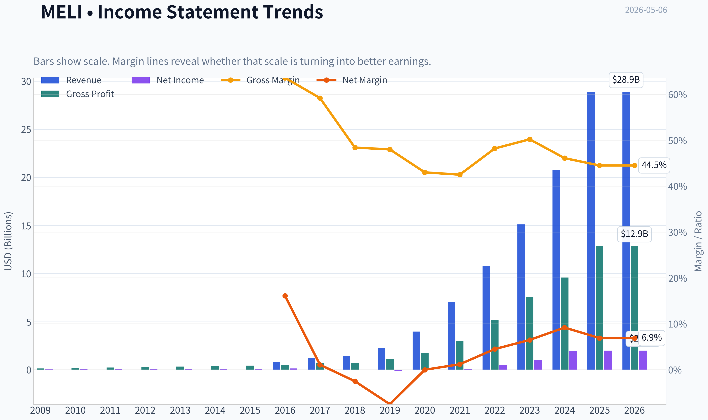

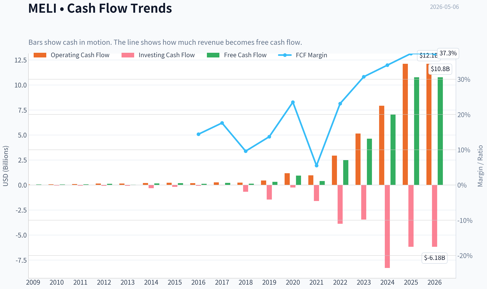

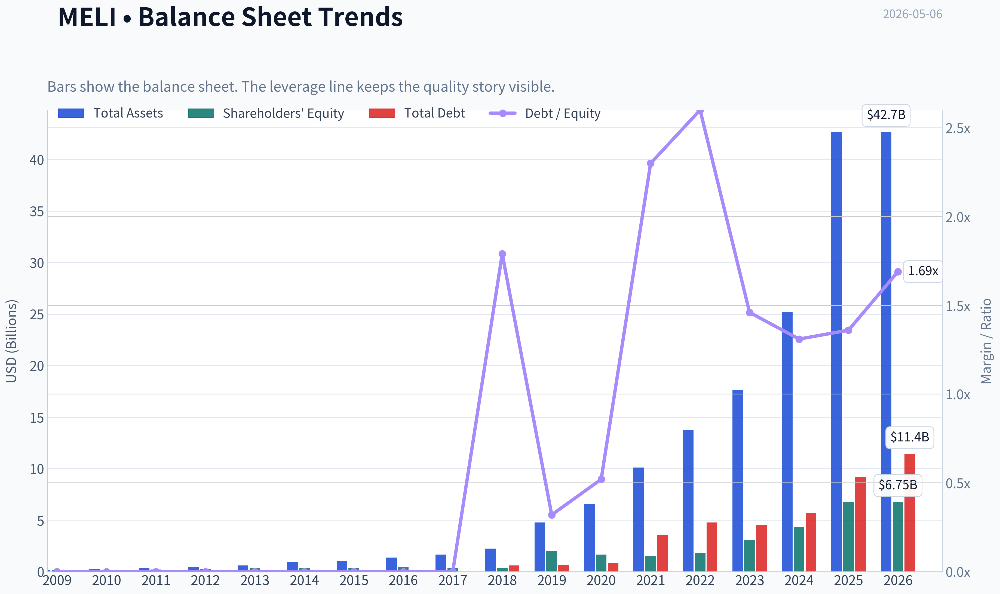

This graph tracks the profitability and return metrics (ROE, ROIC, Margins) of **MELI** over the past decade, highlighting capital efficiency trends.

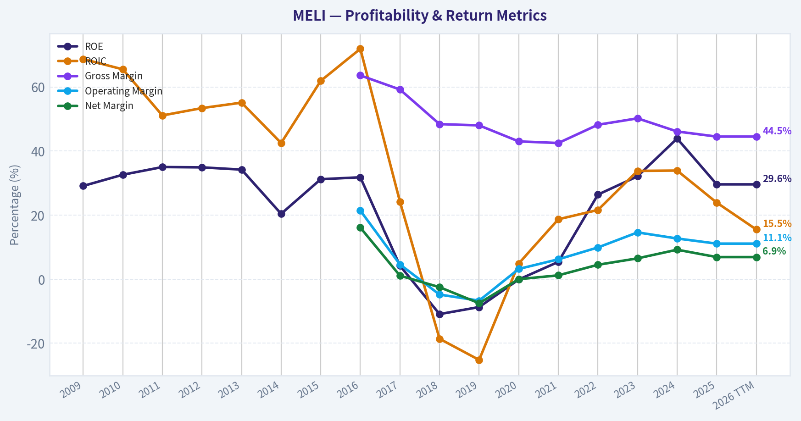

This chart illustrates the financial health of **MELI** over the last 10 years, mapping cash equivalents and free cash flow against total obligations (Debt).

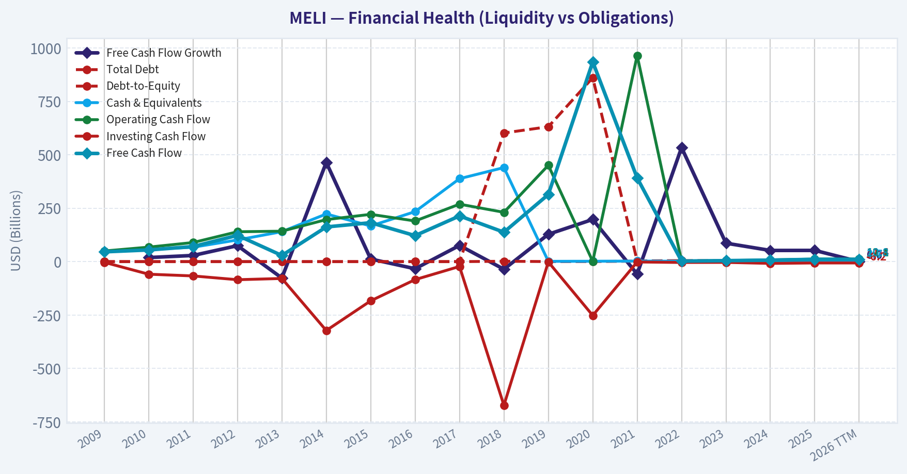

This breakdown chart from <em>Revenue Breakdown</em> shows the proportional composition for **MELI** - useful for understanding what drives or risks the business.

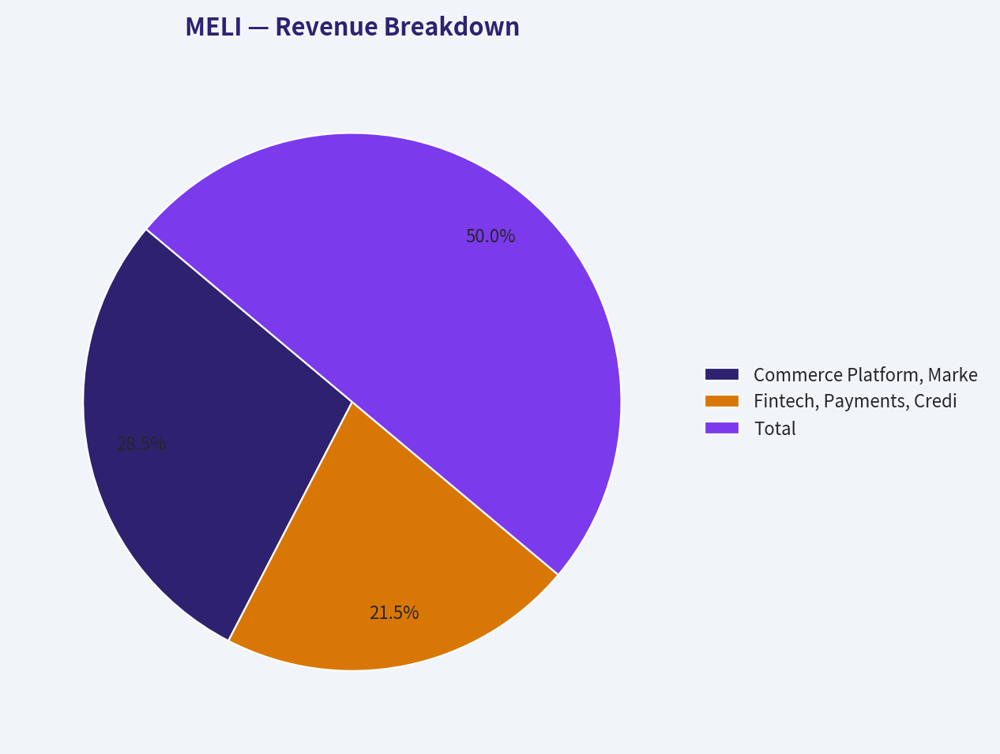

---

### Intrinsic Value Analysis (Buffett)

> *Following Warren Buffett's value investing philosophy: Circle of Competence, Economic Moat, Management Quality, and Margin of Safety.*

#### Intrinsic Value Snapshot

Price is what you pay. Intrinsic value is what the business may be worth based on the cash it can create for owners over time. We show a range, not one magic number.

- Current Price: $1,841.14
- Value Range: $1,148.22 to $19,908.27

##### Owner Earnings (Buffett Method)
- Net Income: $1,997,000,000.00
- Depreciation & Amortization: $818,000,000.00
- Capital Expenditures: $-1,343,000,000.00
- Working Capital Changes: $5,923,000,000.00
- Owner Earnings: $-4,451,000,000.00

##### Intrinsic Value
###### Cash Flow Method
Uses free cash flow. Better for companies spending heavily today to grow tomorrow.
- Conservative: $1,148.22
- Average: $7,644.61
- Optimistic: $19,908.27
- Discount Rate: 10.0%

ANALYST STANCE: **WATCH**

#### Buffett-Style Value Analysis: MercadoLibre, Inc. - MELI

MercadoLibre is a wonderful and strategically important Latin American platform business, but at the current price of **about $1,841 per share** and a **$93.34 billion market value**, I would not yet call it a Buffett-style "fat pitch." The business quality is high, the moat is real, and growth remains impressive, but the valuation depends heavily on whether current free cash flow is durable owner earnings rather than temporarily elevated cash flow from fintech and working-capital dynamics.

---

#### 1. Go / No-Go Gate Assessment

| Buffett Gate | Assessment | Evidence | Verdict |
|---|---:|---|---|
| Gate 1: Business Simplicity | Good, but not perfectly simple | MELI earns money from online marketplace commissions, advertising, logistics, payments, credit, and fintech services across Latin America. The core idea is understandable, but fintech credit and cross-border currency risk add complexity. | Pass |
| Gate 2: Moat | Strong | Marketplace scale, payments ecosystem, logistics network, merchant tools, brand trust, and consumer habit formation create reinforcing advantages. | Pass |
| Gate 3: Management & Capital Allocation | Generally strong | Management has reinvested aggressively into logistics, fintech, payments, and credit, producing high growth and strong reported ROE. However, continued margin pressure and fintech risk require monitoring. | Pass with caution |
| Gate 4: Industry Structure | Attractive but competitive | MELI leads in Latin American e-commerce and fintech, but faces competition from Amazon, Shopee, Nubank, banks, local retailers, and payment networks. | Pass with caution |

**Key Takeaways:** MercadoLibre passes the Buffett quality gates, but not without caveats. The company is understandable at the marketplace level, yet its fintech and credit operations make the financial picture more complex than a classic consumer franchise. The moat appears real and expanding, but the price leaves less room for error than Buffett would usually prefer.

---

#### 2. Business Understanding: The Elementary School Test

MercadoLibre helps people in Latin America buy and sell things online. It also helps sellers ship products, advertise products, accept payments, and offer financing. Over time, it has become a combination of **Amazon, PayPal, Shopify, and a digital bank** for Latin America.

That is a powerful business model because more buyers attract more sellers, more sellers attract more buyers, and both sides become more dependent on MELI's payments and logistics systems.

The risk is that this is not a pure marketplace anymore. The fintech and credit operations make the business more capital-sensitive and more exposed to economic cycles.

---

#### 3. Moat Analysis

| Moat Source | Evidence | Buffett Assessment |
|---|---|---|
| Brand / Trust | MercadoLibre is one of the dominant e-commerce brands in Latin America. Trust is especially important in markets where consumers may be wary of fraud, payment safety, and delivery reliability. | Strong |
| Network Effects | More buyers attract more sellers, more sellers increase selection, and more selection attracts more buyers. Payments and logistics deepen the flywheel. | Strong |
| Switching Costs | Sellers using MELI's marketplace, payments, fulfillment, advertising, and merchant tools face operational friction if they leave. | Moderate to strong |
| Cost Advantage | Scale in logistics, payments processing, fraud detection, and marketplace traffic should lower unit costs over time. | Emerging / strong |
| Regulatory / Local Knowledge | Operating successfully across Brazil, Mexico, Argentina, and other Latin American markets requires local adaptation, compliance knowledge, and payments infrastructure. | Moderate |
| Pricing Power | Gross margin of **44.5%** suggests healthy economics, but margin pressure from free shipping, logistics investment, and fintech expansion limits near-term pricing power. | Good but not unlimited |

**Key Takeaways:** MELI's moat is built mainly on network effects, brand trust, local execution, and integrated payments and logistics. This is not a fragile one-product company; it is an ecosystem. The moat looks wide, but it requires constant reinvestment, especially in logistics and fintech.

**Moat Rating:** **Wide and Widening**, with fintech and competitive risks.

---

#### 4. Management Quality and Capital Allocation

| Management Question | Assessment |
|---|---|
| Do they think like owners? | Management has historically prioritized long-term ecosystem growth over short-term margins, which is the right strategy for a platform business with scale advantages. |
| Are they candid and conservative? | The company reports a complex mix of commerce and fintech results. Investors must watch credit losses, funding costs, and working-capital effects carefully. |
| Are they rational capital allocators? | Reinvestment has produced strong growth, high ROE, and a leading regional platform. The main concern is whether fintech credit growth remains disciplined through a downturn. |
| Buybacks / dividends | MELI is still in growth mode, so reinvestment is more appropriate than large dividends. |
| Debt and liquidity | Current ratio of **1.17** is acceptable but not fortress-like. Fintech activities require closer balance-sheet monitoring than a pure marketplace. |

**Key Takeaways:** Management has created substantial value by reinvesting aggressively into the marketplace, logistics, and fintech ecosystem. That is exactly what long-term shareholders want from a high-return growth platform. The main capital allocation risk is overexpansion in credit or logistics if growth slows or macro conditions deteriorate.

---

#### 5. Financial Summary

| Metric | Current / Latest Available |
|---|---:|
| Share Price | $1,841 |
| Market Capitalization | $93.34 billion |
| P/E Ratio | 46.7x |
| Implied Net Income | ~$2.0 billion |
| ROE | 29.6% |
| Gross Margin | 44.5% |
| Revenue Growth YoY | 39.1% |
| Free Cash Flow Yield | 11.5% |
| Implied Free Cash Flow | ~$10.7 billion |
| Current Ratio | 1.17 |

**Key Takeaways:** MercadoLibre is growing very rapidly, with revenue up about 39% year over year and ROE near 30%. The valuation looks expensive on earnings at nearly 47 times P/E, but potentially inexpensive on reported free cash flow. The key analytical question is whether the high free cash flow yield represents durable owner earnings or temporary cash-flow benefits from fintech and working-capital movements.

---

#### 6. Owner Earnings Analysis

Buffett's preferred measure is owner earnings:

> Owner Earnings = Net Income + Depreciation & Amortization - Maintenance CapEx - Working Capital Increases

Because the available data does not provide full maintenance capex and working-capital detail, I use a range rather than a false precision estimate.

| Owner Earnings Proxy | Calculation | Estimated Amount | Comment |
|---|---:|---:|---|
| Conservative earnings proxy | Market cap / P/E | ~$2.0 billion | Uses accounting earnings; likely conservative if growth investments depress profits. |
| Reported FCF proxy | Market cap x FCF yield | ~$10.7 billion | Very attractive, but may include fintech and working-capital effects that are not pure owner earnings. |
| Normalized owner earnings estimate | 50% haircut to reported FCF | ~$5.4 billion | A middle-case estimate to avoid over-crediting potentially temporary cash flow. |

**Key Takeaways:** There is a large gap between MELI's accounting earnings and implied free cash flow. That gap is the most important valuation issue in the entire analysis. A conservative Buffett investor should not automatically treat all reported free cash flow as permanent owner earnings until the cash-flow quality is verified over multiple years.

---

#### 7. Three-Scenario DCF Valuation

Assumptions:

| Assumption | Value |
|---|---:|
| Discount Rate | 10% |
| GDP Growth Scenario | 3% perpetual growth |
| Historical Growth Scenario | 10% growth for 10 years, then 3% terminal growth |
| Share Count Estimate | ~50.7 million shares |
| Current Price | $1,841 |

**Key Takeaways:** The valuation framework uses a Buffett-style 10% required return and avoids assuming that MELI's current 39% revenue growth continues indefinitely. The historical growth scenario is capped at 10%, which is intentionally conservative relative to recent growth. The share count is estimated from market capitalization divided by current share price.

| Scenario | Owner Earnings Base | Equity Value Estimate | Value Per Share | Margin of Safety vs. $1,841 |
|---|---:|---:|---:|---:|
| A: No Growth | $2.0B net income proxy | ~$20.0B | ~$394 | Negative |
| A: No Growth | $5.4B normalized owner earnings | ~$53.7B | ~$1,059 | Negative |
| A: No Growth | $10.7B reported FCF proxy | ~$107.3B | ~$2,117 | ~13% |
| B: 3% Perpetual Growth | $2.0B net income proxy | ~$29.4B | ~$580 | Negative |
| B: 3% Perpetual Growth | $5.4B normalized owner earnings | ~$79.0B | ~$1,558 | Negative |
| B: 3% Perpetual Growth | $10.7B reported FCF proxy | ~$158.0B | ~$3,115 | ~41% |
| C: 10% Growth for 10 Years, Then 3% | $2.0B net income proxy | ~$49.4B | ~$974 | Negative |
| C: 10% Growth for 10 Years, Then 3% | $5.4B normalized owner earnings | ~$132.7B | ~$2,618 | ~30% |
| C: 10% Growth for 10 Years, Then 3% | $10.7B reported FCF proxy | ~$265.3B | ~$5,235 | ~65% |

**Key Takeaways:** MELI looks unattractive if valued only on current accounting earnings. It looks attractive if reported free cash flow is truly durable owner earnings. The most balanced estimate is the normalized owner earnings case, which suggests upside only if MELI can keep growing at high rates for many years.

---

#### 8. Margin of Safety Analysis

| Valuation Lens | Interpretation |
|---|---|
| P/E of 46.7x | Expensive unless high growth continues and margins expand. |
| FCF yield of 11.5% | Very attractive if durable, but requires verification due to fintech complexity. |
| ROE of 29.6% | Excellent, but must be checked for leverage and credit-cycle effects. |
| Gross margin of 44.5% | Supports moat argument, but not as high as the best pure software or luxury franchises. |
| Revenue growth of 39.1% | Exceptional, but impossible to assume forever. |
| Required margin of safety | At least 25% for a high-quality business; more if owner earnings are uncertain. |
| Current margin of safety | Adequate only under optimistic or normalized high-growth assumptions. |

**Key Takeaways:** The margin of safety is not obvious enough for a Buffett-style purchase today. The stock may be cheap on free cash flow, but that conclusion depends on the durability and quality of the cash flow. A conservative investor should demand either a lower price or clearer evidence that free cash flow converts into true distributable owner earnings.

---

#### 9. Key Risks

| Risk | Why It Matters |
|---|---|
| Fintech credit risk | Credit growth can look excellent in good times and deteriorate rapidly during downturns. |
| Currency and inflation risk | MELI operates in volatile economies, including Brazil, Argentina, and Mexico. |
| Competitive risk | Amazon, Shopee, Nubank, banks, retailers, and payment companies all compete with parts of MELI's ecosystem. |
| Margin pressure | Logistics, free shipping, payments, and credit investments can weigh on profitability. |
| Valuation risk | At nearly 47x earnings, the stock requires continued strong execution. |
| Regulatory risk | Fintech and credit operations are more regulated than a pure e-commerce marketplace. |

**Key Takeaways:** MELI's risks are not theoretical. The company operates in volatile countries, competes against well-funded rivals, and has meaningful exposure to fintech credit cycles. These risks do not destroy the investment case, but they argue against paying an aggressive price without a clear margin of safety.

---

#### 10. Final Buffett Scorecard

| Criterion | Weight | Score | Weighted Score |
|---|---:|---:|---:|
| Business Understanding | 20% | 4.0 | 0.80 |
| Moat Width & Durability | 25% | 4.5 | 1.13 |
| Management Quality | 15% | 4.0 | 0.60 |
| Return on Equity | 15% | 4.0 | 0.60 |
| Reinvestment Runway | 10% | 4.5 | 0.45 |
| Balance Sheet Strength | 5% | 3.0 | 0.15 |
| Industry Structure | 5% | 3.5 | 0.18 |
| Valuation / Margin of Safety | 5% | 2.5 | 0.13 |
| **Total** | **100%** |  | **4.03 / 5.00** |

**Key Takeaways:** MercadoLibre scores very well on business quality, moat, growth runway, and management execution. The lower scores are in valuation, balance-sheet simplicity, and industry risk. The total score is high, but the valuation uncertainty keeps me from issuing a full-throated buy recommendation.

---

#### Final Investment Stance

**Stance: WATCH**
**Conviction: High on business quality; moderate on valuation.**

MercadoLibre is a rare and powerful platform business with a widening moat in Latin America. It has network effects, brand trust, logistics scale, payments integration, and a long reinvestment runway. Those are exactly the qualities Buffett would admire in a wonderful business.

However, the current investment case depends heavily on whether the company's high reported free cash flow is durable owner earnings. On P/E, the stock is expensive. On free cash flow yield, it looks cheap. That gap needs deeper verification before treating the stock as a clear bargain.

I would **watch MELI closely** and become more constructive if either:

1. The price falls enough to provide a clearer margin of safety, preferably below the normalized conservative valuation range; or
2. Further evidence confirms that free cash flow is recurring, high-quality, and not driven by temporary fintech or working-capital effects.

In Buffett terms: **MELI is probably a wonderful company, but I am not yet certain the current price is wonderful enough.**
#### Valuation Bridge

This bridge places the current market price beside each intrinsic value lens so readers can see whether upside depends on one method or shows up across several methods.

| Scenario | Intrinsic Value / Share |
| --- | ---: |
| Cash Flow Method | $7,644.61 |
| Damodaran Method | $793.99 |
| Current Price | $1,841.14 |

#### Key Takeaways

If one method is far above the others, the upside case depends on a specific modelling assumption. When several methods cluster together, the valuation story is more robust.

#### Valuation Visuals

This comparison chart from *Latest Earnings Snapshot* stacks current figures against historical benchmarks for **MELI**, making it easy to see where the company trades relative to its own averages.

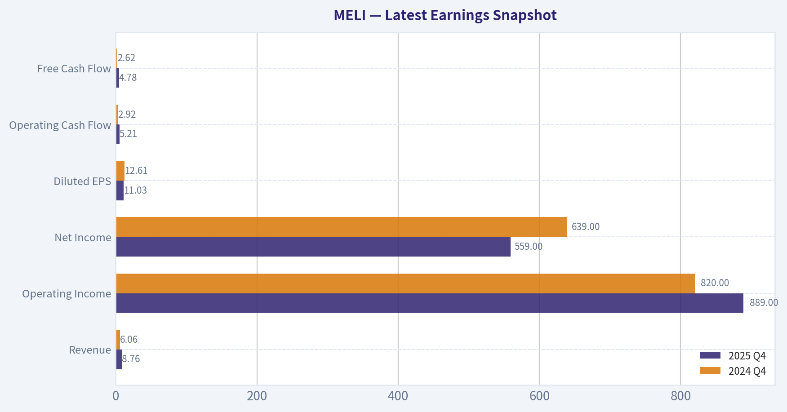

This comparison chart from *Current vs. 10-Year Historical Average Comparison* stacks current figures against historical benchmarks for **MELI**, making it easy to see where the company trades relative to its own averages.

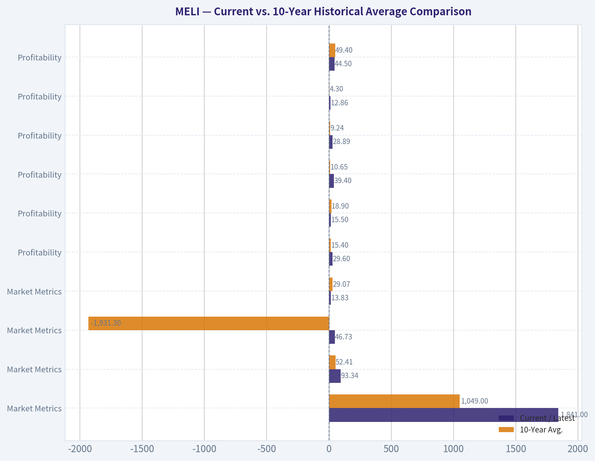

This comparison chart from *Buffett-Style Owner Earnings DCF Valuation* stacks current figures against historical benchmarks for **MELI**, making it easy to see where the company trades relative to its own averages.

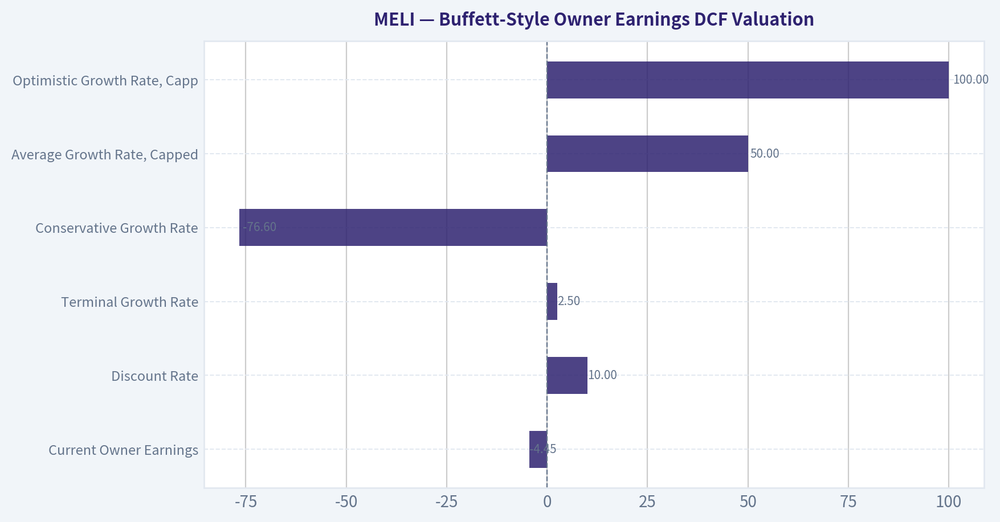

This comparison chart from *FCF-Based Cross-Check from Deterministic Dataset* stacks current figures against historical benchmarks for **MELI**, making it easy to see where the company trades relative to its own averages.

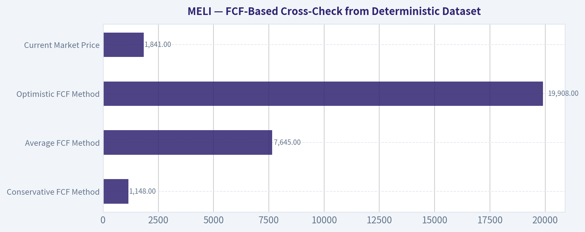

This comparison chart from *Financial Summary* stacks current figures against historical benchmarks for **MELI**, making it easy to see where the company trades relative to its own averages.

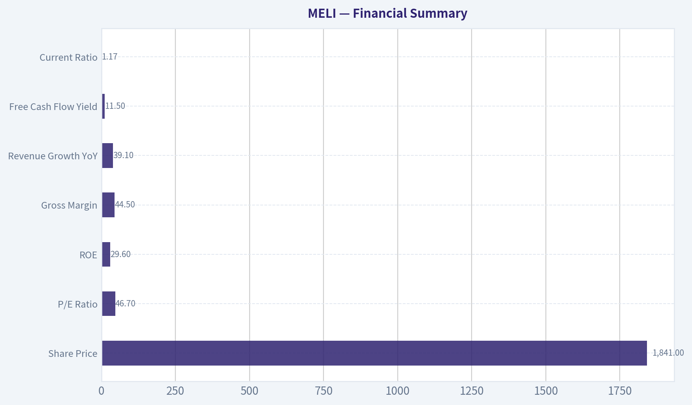

---

### Trend & Growth Analysis (Lynch/Druckenmiller/Fisher)

> *Following Peter Lynch's GARP, Stanley Druckenmiller's macro-aware approach, and Philip Fisher's scuttlebutt methodology.*

ANALYST STANCE: **ADVOCATE**

#### MercadoLibre Growth Investment Report - MELI

MercadoLibre is a high-quality Latin American compounder with rare dual-engine growth: e-commerce plus fintech. The stock is not optically cheap on P/E, but its growth-adjusted valuation is reasonable, its competitive moat is widening, and its free cash flow profile appears far stronger than most companies growing revenue near 40%. I would treat MELI as an **ADVOCATE**, but not a "blind buy before earnings" name; add in tranches around Q1 volatility and margin-pressure headlines.

---

#### 1. Lynch Classification

| Category | MELI Fit | Evidence | Investment Implication |
|---|---:|---|---|
| Slow Grower | No | Revenue growth far above 0-5% | Not relevant |
| Stalwart | No | Growth exceeds mature large-cap range | Too dynamic to classify as stalwart |
| Fast Grower | Yes | Provided YoY revenue growth: **39.1%** | Primary Lynch category |
| Cyclical | Partial | Exposed to LatAm consumer, FX, and credit cycles | Macro must be monitored |
| Turnaround | No | Already profitable with strong ROE | Not a turnaround |
| Asset Play | No | Value is platform/ecosystem, not hidden assets | Not asset-led |

**Key Takeaways:** MELI is clearly a **Fast Grower** under Lynch's framework. It has some cyclical exposure because Latin American consumer demand, currencies, and credit conditions matter, but the core thesis is secular growth, not economic mean reversion.

---

#### 2. The Story in 3 Bullets

- **MercadoLibre is the "Amazon plus PayPal plus Shopify infrastructure" of Latin America**, combining marketplace, logistics, payments, credit, advertising, and merchant tools.
- **Latin America remains underpenetrated in e-commerce and financial services**, giving MELI a long runway across Brazil, Mexico, Argentina, and other markets.
- **The company is moving from growth story to earnings and free-cash-flow story**, with scale benefits, payments monetization, ads, and logistics efficiency supporting stronger returns.

---

#### 3. Core Snapshot

| Metric | Current / Provided Data | Growth Investor Read |
|---|---:|---|
| Share Price | **$1,841** | Large-cap compounder, not early-stage |
| Market Cap | **$93.34B** | Already significant, but still small versus global platform peers |
| P/E | **46.7x** | Premium, but not extreme for 39% growth |
| Revenue Growth YoY | **39.1%** | Fast-grower profile |
| ROE | **29.6%** | Strong proof of profitable scale |
| Gross Margin | **44.5%** | Healthy, though affected by logistics and fintech mix |
| FCF Yield | **11.5%** | Very attractive if clean and sustainable |
| Current Ratio | **1.17x** | Adequate, but fintech balance sheet needs deeper monitoring |

**Key Takeaways:** MELI combines fast revenue growth with real profitability, which is unusual. The headline P/E is high, but the PEG ratio is reasonable, and the reported free cash flow yield is unusually compelling for a company still growing near 40%.

---

#### 4. TAM Analysis and 10x Test

| TAM Area | Opportunity | MELI Position | 10x Runway Assessment |
|---|---|---|---|
| E-commerce | Latin American retail remains meaningfully underpenetrated online | Category leader in key markets | Pass |
| Digital Payments | Cash displacement, merchant acquiring, wallet adoption | Mercado Pago is a major regional fintech platform | Pass |
| Credit | Consumer and merchant credit gaps remain large | Strong data advantage, but cyclical risk | Conditional pass |
| Advertising | Retail media still early in LatAm | High-margin monetization layer | Pass |
| Logistics | Fragmented infrastructure creates barriers | Mercado Envios strengthens moat | Pass |

**Key Takeaways:** MELI passes the 10x runway test qualitatively because it is not confined to one market or one product. The largest long-term opportunity is the combination of commerce, payments, ads, and credit, although credit must be underwritten carefully in volatile economies.

**10x Test:**
If MELI's current revenue base is in the tens of billions, a 10x outcome would require hundreds of billions of annual revenue over time. That is ambitious, but not impossible if MELI becomes the dominant operating system for Latin American commerce and digital finance. The company's runway is strongest because the TAM is expanding, not merely because MELI is taking share.

---

#### 5. Revenue Growth Trend

| Metric / Pattern | Current Evidence | Interpretation |
|---|---:|---|
| YoY Revenue Growth | **39.1%** | Very strong |
| Growth Pattern | High sustained growth | More "durable fast grower" than short-cycle fad |
| Revenue Drivers | Marketplace, logistics, payments, credit, ads | Diversified growth quality |
| Latest Earnings Setup | News flow flags margin pressure before Q1 | Growth likely remains strong, but investment intensity matters |

**Key Takeaways:** MELI's revenue trend remains excellent and well above Lynch's fast-grower threshold. The main near-term issue is not demand, but whether logistics, fintech, and free-shipping investments temporarily pressure margins.

**Growth Pattern Read:**
This is **stable high growth**, not yet a clear acceleration inflection from the data provided. However, MELI may be at a **profitability and ecosystem monetization inflection**, where earnings and free cash flow can compound faster than revenue.

---

#### 6. Unit Economics and Operating Quality

| Metric | Available Evidence | Assessment |
|---|---:|---|
| LTV/CAC | Not disclosed in provided data | Likely favorable due to brand, marketplace network effects, and wallet engagement |
| Payback Period | Not disclosed | Likely improving as ecosystem cross-sell deepens |
| Net Revenue Retention | Not a standard reported metric for MELI | Ecosystem retention likely strong, but not directly measurable |
| Rule of 40 Proxy | Revenue growth **39.1%** + FCF margin unavailable | Likely strong if FCF yield data is clean |
| Gross Margin | **44.5%** | Healthy for a hybrid commerce/fintech/logistics model |
| ROE | **29.6%** | Strong evidence of attractive economic model |

**Key Takeaways:** MELI does not disclose SaaS-style unit economics such as NRR or LTV/CAC, but the available evidence points to strong ecosystem economics. High ROE, strong growth, and healthy gross margin suggest that customer relationships are becoming more valuable as payments, ads, logistics, and credit layer onto the core marketplace.

---

#### 7. Inflection Point Assessment

| Inflection Type | Status | Evidence | Importance |
|---|---|---|---|
| Product Cycle Inflection | Positive | Mercado Pago, ads, credit, logistics all expanding | High |
| Market Share Inflection | Positive | MELI remains dominant in major LatAm markets | High |
| Margin Inflection | Mixed near term, positive long term | Scale benefits offset by Q1 margin-pressure concerns | Very high |
| TAM Inflection | Positive | E-commerce, fintech, and retail media all expanding | High |
| Competitive Inflection | Positive | Scale/logistics/data advantages hard to replicate | Medium-high |

**Key Takeaways:** The biggest MELI inflection is the transition from a marketplace growth story into a multi-engine profit platform. Near-term margins may be noisy, but long-term monetization from ads, payments, logistics, and credit can drive earnings growth faster than revenue.

**Druckenmiller Question:**
"What will earnings be in 2-3 years, and is the market underestimating them?"
My answer: the market recognizes MELI as a premium compounder, but may still underestimate the **operating leverage from ads, fintech scale, and logistics density** if revenue growth remains above 25% and credit quality holds.

---

#### 8. Macro Setup

| Macro Factor | Current Setup | Impact on MELI |
|---|---|---|
| Interest Rates | If rates fall, long-duration growth multiples benefit | Positive optionality |
| LatAm Consumer | Country-specific volatility remains | Mixed |
| FX Risk | Brazil, Argentina, Mexico currency exposure | Persistent risk |
| Secular E-commerce | Still underpenetrated | Positive |
| Digital Payments | Cash-to-digital migration continues | Strong positive |
| Credit Cycle | Must monitor delinquencies and provisions | Key downside risk |

**Key Takeaways:** The secular macro setup is favorable because MELI rides e-commerce penetration, digital payments, fintech adoption, and retail media. The cyclical macro setup is more mixed because Latin American currencies, inflation, and credit quality can create earnings volatility.

---

#### 9. Fisher 15-Point Score

| Fisher Point | Score / 5 | Rationale |
|---|---:|---|
| 1. Products with sizable market potential | 5 | Commerce, fintech, ads, logistics all have large runways |
| 2. Management determination to develop new products | 5 | Continuous expansion beyond marketplace |
| 3. Effective R&D/product execution | 5 | Strong platform innovation record |
| 4. Above-average sales organization | 4 | Merchant adoption and ecosystem penetration are strong |
| 5. Worthwhile profit margin | 4 | Gross margin 44.5%, improving profitability |
| 6. Improving profit margins | 4 | Long-term positive, but Q1 margin pressure risk |
| 7. Labor/personnel relations | 3 | Insufficient data |
| 8. Executive relations | 4 | Strong continuity and execution culture |
| 9. Management depth | 4 | Multi-country, multi-product execution suggests depth |
| 10. Cost analysis/accounting | 4 | Operating leverage improving, but fintech complexity requires scrutiny |
| 11. Outstanding moat aspects | 5 | Network effects, logistics, data, brand, payments |
| 12. Long-range profit outlook | 5 | Strong multi-engine monetization runway |
| 13. Dilution risk | 4 | Not dependent on constant equity raises |
| 14. Candor in difficulties | 4 | Generally transparent, but credit metrics need close watching |
| 15. Management integrity | 4 | No major red flag from provided materials |

**Key Takeaways:** MELI scores highly on Fisher's framework because it combines innovation, product breadth, market potential, and durable competitive advantages. The weakest areas are not obvious failures, but simply areas where outside investors need more disclosure, especially labor relations and fintech credit quality.

**Fisher Score:** **64 / 75 - Good, near Outstanding**

---

#### 10. Valuation Analysis

| Valuation Metric | MELI Data | Interpretation |
|---|---:|---|
| P/E | **46.7x** | Premium valuation |
| Revenue Growth | **39.1%** | Supports premium multiple |
| PEG Ratio | **~1.19x** | Fair-to-attractive for a high-quality compounder |
| FCF Yield | **11.5%** | Very attractive if normalized and not distorted |
| ROE | **29.6%** | Supports above-market valuation |
| Market Cap | **$93.34B** | Already large, but not saturated relative to TAM |

**Key Takeaways:** MELI is not cheap on headline earnings, but its growth-adjusted valuation is acceptable. A PEG ratio near 1.2 is reasonable for a dominant platform, and the provided free cash flow yield would be unusually attractive if sustainable.

**PEG Calculation:**
P/E ÷ earnings or revenue growth proxy = **46.7 ÷ 39.1 = ~1.19**.
Strictly, PEG should use earnings growth, not revenue growth. But given MELI's operating leverage, earnings growth may plausibly exceed revenue growth if margins expand.

---

#### 11. Scenario Valuation Framework

| Scenario | Assumptions | Outcome View | Investor Action |
|---|---|---|---|
| Bear Case | Revenue decelerates below 20%, credit losses rise, margins compress | Multiple contracts; stock underperforms | Avoid adding until credit stabilizes |
| Base Case | Revenue compounds 25-30%, margins stable to modestly higher | Earnings and FCF compound strongly | Accumulate on volatility |
| Bull Case | Revenue remains 30%+, ads/fintech/logistics drive operating leverage | Earnings growth exceeds revenue growth; multiple remains premium | Core long-term compounder |

**Key Takeaways:** MELI's upside depends less on multiple expansion and more on sustained revenue growth plus operating leverage. The bear case would likely come from credit deterioration or a major margin reset, not from lack of TAM.

---

#### 12. Growth Investor Scorecard

| Criterion | Weight | Score / 5 | Weighted Score |
|---|---:|---:|---:|
| The Story | 10% | 5.0 | 0.50 |
| TAM & Runway | 20% | 4.5 | 0.90 |
| Revenue Growth | 20% | 4.5 | 0.90 |
| Unit Economics | 15% | 4.0 | 0.60 |
| Competitive Position | 10% | 5.0 | 0.50 |
| Management Quality | 10% | 4.3 | 0.43 |
| Macro Setup | 5% | 3.5 | 0.18 |
| Profitability Path | 5% | 4.5 | 0.23 |
| Valuation | 5% | 3.8 | 0.19 |
| **Total** | **100%** |  | **4.43 / 5.00** |

**Key Takeaways:** MELI earns an **ADVOCATE** score because it has the rare combination of high growth, strong moat, improving profitability, and a long runway. The main deductions come from macro volatility, credit-cycle risk, and a valuation that is fair rather than obviously cheap.

---

#### 13. Guru Tracking Context

| Investor | Latest Action | Position Value | Portfolio Weight | Read-Through |
|---|---:|---:|---:|---|
| Stanley Druckenmiller | Trimmed | **$94.97M** | **2.11%** | Still meaningful, but reduced exposure |
| Steve Cohen | Added | **$33.84M** | **0.04%** | Positive but small relative to portfolio |
| Michael Burry | Exited | $0 | N/A | Not decisive; style mismatch likely |

**Key Takeaways:** Guru data is mixed but still constructive. Druckenmiller trimming matters because he is macro-sensitive, but he retained a meaningful position, which suggests risk management rather than thesis abandonment.

---

#### 14. Key Risks

| Risk | Why It Matters | Monitoring Signal |
|---|---|---|
| Margin Pressure | Logistics, free shipping, and fintech investments can reduce earnings leverage | Operating margin and EBIT growth |
| Credit Losses | Mercado Credito can amplify downturns | NPLs, provisions, portfolio growth |
| FX Volatility | LatAm currencies can distort reported results | Constant-currency growth |
| Brazil Concentration | Brazil is critical to MELI's scale | Brazil GMV, TPV, and competitive trends |
| Valuation Compression | Premium multiples are vulnerable if growth slows | PEG, forward P/E, FCF yield |
| Regulatory Risk | Fintech and credit businesses face oversight | Banking, payments, and tax regulation |

**Key Takeaways:** The largest fundamental risk is not that MELI lacks a market opportunity; it is that fintech credit or margin pressure interrupts the earnings compounding story. Investors should separate temporary investment spending from structural margin deterioration.

---

#### 15. Key Catalysts

| Catalyst | Time Frame | Bullish Signal |
|---|---|---|
| Q1 Earnings | Near term | Revenue beat with manageable margin pressure |
| Mercado Pago Growth | Ongoing | Strong off-platform TPV growth |
| Advertising Monetization | 1-3 years | Rising high-margin ad revenue mix |
| Logistics Efficiency | 1-3 years | Faster delivery with stable or improving margins |
| Credit Discipline | Ongoing | Portfolio growth without rising delinquencies |
| Rate Cuts / Lower Discount Rates | Macro-dependent | Multiple support for long-duration growth stocks |

**Key Takeaways:** The most important near-term catalyst is Q1 earnings, especially whether margin pressure is temporary or structural. Longer term, the highest-quality catalysts are advertising monetization, off-platform payments growth, and logistics scale economics.

---

#### 16. Position Size Stance

| Investor Type | Suggested Stance | Position Size View |
|---|---|---|
| Existing Holder | Hold / add selectively | Let winners run; add on earnings-driven pullbacks |
| New Long-Term Investor | Start in tranches | Initial 2-3% position, build toward 4-6% on confirmation |
| Aggressive Growth Portfolio | Core compounder candidate | 5-7% max if credit and margin data remain clean |
| Risk-Averse Investor | Watch for better entry | Prefer pullbacks or post-earnings clarity |

**Key Takeaways:** MELI deserves core-compounder consideration, but because Q1 margin-pressure headlines are active, position sizing should be staged. The best approach is to own it, but leave room to add if the market overreacts to investment spending.

---

#### Final View

MELI is a **Lynch Fast Grower**, a **Fisher quality compounder**, and a **Druckenmiller-style platform with multiple inflection points**. The stock's P/E is elevated, but its PEG is reasonable, ROE is strong, revenue growth remains exceptional, and the long-term TAM is still large.

**Decision:** **ADVOCATE**
**Preferred action:** Accumulate in tranches, especially around earnings volatility.
**Primary watch item:** Whether margin pressure from logistics, fintech, and free shipping is temporary investment or a sign of weakening operating leverage.

---

### Market Technical Analysis

ANALYST STANCE: **WATCH**

#### MELI Technical Report - Latest Available Trading Data: 2026-05-05

MELI is showing a **near-term recovery attempt inside a still-bearish larger trend**. The latest close was **$1,817.31**, almost exactly aligned with the **10 EMA at $1,816.33**, above the declining **50 SMA at $1,758.97**, but still well below the **200 SMA at $2,087.06**. That structure suggests short-term stabilization, but not yet a confirmed long-term trend reversal.

The most relevant indicators for this market context are: **10 EMA, 50 SMA, 200 SMA, MACD, MACD Signal, RSI, ATR, and VWMA**. These provide a balanced view of short-term trend behavior, medium- and long-term trend regime, momentum confirmation, risk sizing, and volume-weighted price validation without excessive redundancy.

| Indicator | Latest Value | Interpretation | Trading Relevance |
|---|---:|---|---|
| Close | $1,817.31 | Price is stabilizing after a sharp multi-month decline | Current reference level |
| close_10_ema | $1,816.33 | Price is nearly flat with the short-term trend line | Momentum is neutral-to-slightly constructive |
| close_50_sma | $1,758.97 | Price is above the medium-term average | Short-term recovery remains intact while above this area |
| close_200_sma | $2,087.06 | Price remains far below the long-term average | Long-term trend is still bearish |
| macd | 12.53 | MACD remains positive | Recovery momentum exists, but is weakening |
| macds | 15.04 | Signal line is above MACD | Recent momentum has faded |
| rsi | 51.99 | Neutral RSI | Neither oversold nor overbought |
| atr | 56.91 | Daily volatility remains elevated | Stops should allow for wide price movement |
| vwma | $1,827.05 | Price is slightly below volume-weighted trend | Volume confirmation is not yet strong |

Key Takeaways: MELI has repaired some short-term damage by reclaiming the 50-day moving average, but it has not yet proven a larger trend reversal because it remains far below the 200-day moving average. Momentum is no longer deeply bearish, yet the MACD slipping below its signal line warns that the April recovery is losing force. The current setup is best treated as a watchlist candidate rather than a clean buy signal.

---

#### Trend Structure: Recovery Attempt, Not Full Reversal

MELI's price action over the past year shows a major deterioration from the **$2,500-$2,600 area in mid-2025** into a low near **$1,599.52 on 2026-03-27**. Since that late-March low, the stock has rebounded into the **$1,800-$1,870 zone**, but the recovery has begun to stall.

The **50 SMA is still declining**, falling from about **$1,943.79 on 2026-03-23** to **$1,758.97 on 2026-05-05**. That means the medium-term trend has not fully turned upward, even though price is now above it. A price above a falling 50 SMA often marks the first phase of a recovery, but it can also be a bear-market bounce if price fails to make higher highs.

The **200 SMA is also declining**, from roughly **$2,189.22 on 2026-03-23** to **$2,087.06 on 2026-05-05**. The stock is still about **13% below** that long-term benchmark, which keeps the strategic trend bearish. A durable bullish reversal would likely require not only holding above the 50 SMA, but eventually pushing toward and reclaiming the **$2,000-$2,090 area**.

| Trend Layer | Current Signal | Bullish Evidence | Bearish / Caution Evidence |
|---|---|---|---|
| Short-term trend | Neutral | Price is almost exactly at the 10 EMA | 10 EMA has flattened after April strength |
| Medium-term trend | Improving | Price is above the 50 SMA | 50 SMA is still declining |
| Long-term trend | Bearish | 200 SMA is slowly declining, which can later become easier to reclaim | Price remains well below the 200 SMA |
| Trend regime | Transitional | March low appears to have produced a tradable bounce | No confirmed higher-high breakout yet |

Key Takeaways: MELI's trend has improved from deeply bearish to transitional, but the larger technical regime remains under pressure. The stock is above its 50-day average, which is constructive, but the declining 200-day average overhead keeps the burden of proof on buyers. Traders should distinguish between a tactical rebound and a confirmed long-term uptrend.

---

#### Momentum: Positive but Fading

The MACD profile is nuanced. MELI's **MACD turned sharply higher from deeply negative levels in late March**, improving from around **-77 to +12.53** by 2026-05-05. That is a meaningful momentum repair and confirms that selling pressure has eased substantially since the March lows.

However, the latest MACD value of **12.53** is below the MACD signal line at **15.04**. This indicates that while the broader momentum recovery remains positive, the most recent momentum impulse is weakening. This often happens when a rebound pauses, consolidates, or begins to roll over.

RSI supports the same conclusion. At **51.99**, RSI is neutral. It is no longer in the weak low-30s zone seen in late March, but it is also not strong enough to signal aggressive upside momentum. In a healthier bullish continuation, traders would generally want to see RSI hold above the mid-50s and move toward the 60s without price becoming overextended.

| Momentum Indicator | Recent Behavior | Current Reading | Interpretation |
|---|---|---:|---|
| MACD | Rose from deeply negative to positive | 12.53 | Medium-term momentum has improved |
| MACD Signal | Still above MACD | 15.04 | Short-term momentum has cooled |
| RSI | Recovered from weak March readings | 51.99 | Neutral, not strongly bullish |
| Price vs 10 EMA | Nearly identical | Close: $1,817.31 vs 10 EMA: $1,816.33 | Directional conviction is limited |

Key Takeaways: Momentum has improved significantly from March, but the latest signals are no longer accelerating. MACD remains positive, which keeps the recovery alive, but the bearish MACD crossover versus the signal line warns against chasing strength. RSI near 52 confirms a balanced market rather than a strongly bullish one.

---

#### Volume-Weighted Confirmation: Still Incomplete

VWMA is important here because MELI has had several volatile high-volume selloff periods, especially around late February and March. The latest **VWMA is $1,827.05**, slightly above the latest close of **$1,817.31**. That means the stock is trading just below its recent volume-weighted average, suggesting buyers have not yet fully reasserted control on a volume-adjusted basis.

This does not create an outright bearish signal by itself, because price is very close to the VWMA. But it does mean the recovery lacks strong volume confirmation at the moment. A close back above the VWMA, especially with expanding volume, would make the short-term setup more constructive.

| Volume / Participation Measure | Latest Value | Signal |
|---|---:|---|
| Close | $1,817.31 | Current price |
| VWMA | $1,827.05 | Slightly above price |
| Price vs VWMA | -$9.74 | Mild negative volume-weighted confirmation |
| Recent implication | Neutral-to-cautious | Buyers need stronger follow-through |

Key Takeaways: MELI is very close to its VWMA, so the volume signal is not decisively bearish. However, price remains slightly below the volume-weighted average, which means recent participation does not yet confirm a strong upside continuation. A clean close above the VWMA would improve the tactical picture.

---

#### Volatility and Risk Management

MELI's **ATR is $56.91**, which is substantial in dollar terms. Relative to the latest close of **$1,817.31**, the ATR is roughly **3.1% of price**. That means normal daily movement can be wide, and tight stops are more likely to be triggered by ordinary noise.

For swing traders, this argues for using ATR-aware risk levels rather than fixed small percentage stops. A 1 ATR move from the latest close points to approximately **$1,760**, which overlaps closely with the **50 SMA at $1,758.97**. That makes the **$1,755-$1,765 zone** especially important as a tactical support area. A decisive close below that zone would weaken the recovery setup.

On the upside, recent price action has struggled around the **$1,850-$1,875 area**, with the April recovery high near **$1,872.12** and intraday resistance extending toward **$1,900-$1,903**. A breakout through that region would suggest buyers are regaining control.

| Level / Zone | Approximate Area | Why It Matters |
|---|---:|---|
| Immediate support | $1,816 | 10 EMA and current price area |
| Key tactical support | $1,755-$1,765 | 50 SMA and roughly 1 ATR below latest close |
| Breakdown risk zone | Below $1,750 | Would put recovery structure at risk |
| First resistance | $1,850-$1,875 | Recent April/May supply zone |
| Stronger resistance | $1,900-$1,925 | Psychological and recent intraday resistance area |
| Long-term resistance | $2,087 | 200 SMA |

Key Takeaways: MELI's volatility remains high enough that position sizing matters. The $1,755 to $1,765 area is a key support zone because it combines the 50-day average with roughly one ATR of downside room. A move above $1,875 to $1,900 would improve the bullish case, while a close below $1,750 would damage the recovery.

---

#### Trading View

The current technical setup favors patience. MELI is not in a clean bearish breakdown anymore, but it is also not in a confirmed bullish trend. The best interpretation is a **base-building or rebound phase inside a larger downtrend**.

A more bullish stance would require price to hold above the 50 SMA and then reclaim the **$1,875-$1,900 resistance zone** with stronger volume confirmation. A more bearish stance would become appropriate if MELI loses the **$1,755-$1,765 support area**, especially if MACD continues weakening and RSI falls back below 45.

For now, MELI deserves a **WATCH** rating: constructive enough to monitor closely, but not strong enough for an aggressive bullish stance.

| Decision Factor | Current Evidence | Bias |
|---|---|---|
| Price vs 50 SMA | Price is above the 50 SMA | Constructive |
| Price vs 200 SMA | Price remains far below the 200 SMA | Bearish |
| MACD | Positive but below signal line | Cautious |
| RSI | Neutral near 52 | Neutral |
| VWMA | Price slightly below VWMA | Mild caution |
| ATR | Elevated daily range | Requires disciplined risk management |
| Key bullish trigger | Break above $1,875-$1,900 | Would support upside continuation |
| Key bearish trigger | Close below $1,750-$1,765 | Would weaken recovery setup |
| Overall stance | Rebound attempt within bearish long-term structure | **WATCH** |

Key Takeaways: MELI has improved enough to stay on the radar, but the technical evidence does not yet justify an aggressive bullish call. The stock needs to clear nearby resistance and regain volume-weighted confirmation before the recovery looks durable. Until then, the cleaner stance is to watch for either a breakout above $1,875-$1,900 or a failure below $1,750-$1,765.

---

### Social Sentiment Analysis

ANALYST STANCE: **WATCH**

#### MercadoLibre - Social, Sentiment, and News Report
**Company:** MercadoLibre, Inc.
**Ticker:** MELI
**Review window:** Past week through May 6, 2026
**Primary takeaway:** Social and news sentiment around MercadoLibre remains broadly constructive, but the stock is being discussed as a "high-quality, high-expectations" name rather than a simple value opportunity. Traders appear focused on earnings momentum, Mercado Pago growth, logistics execution, Brazil and Mexico expansion, and whether valuation leaves enough room for upside after strong long-term performance.

---

#### Executive Summary

MercadoLibre sentiment over the past week was **net positive**, driven by continued confidence in the company's Latin American e-commerce and fintech ecosystem. The most bullish conversations centered on Mercado Pago's monetization, MELI's logistics advantage, advertising growth, and the company's ability to compound in underpenetrated markets. In social discussions, MELI is still frequently described as one of the highest-quality growth platforms outside the United States and China.

However, the tone was not aggressively euphoric. A noticeable portion of investor commentary focused on **valuation discipline**, margin sustainability, credit risk in Mercado Pago, and macro exposure in Argentina, Brazil, and Mexico. The market appears to be rewarding operational excellence but punishing any hint of deceleration because expectations are already high.

For traders, the setup looks like a **watchlist-quality bullish compounder with near-term volatility risk**. For longer-term investors, the narrative remains intact, but entries may matter because the stock often reacts sharply to changes in growth expectations, currency moves, and fintech credit commentary.

---

#### Daily Sentiment Snapshot

| Date | Social Sentiment | Main Conversation Drivers | Trader Read-Through |
|---|---:|---|---|
| Apr. 30 | Neutral to Positive | Pre-earnings positioning, valuation debate, Latin America consumer demand | Investors were interested, but many avoided chasing before new financial updates. |
| May 1 | Positive | E-commerce scale, Mercado Pago usage, Brazil and Mexico growth | Momentum traders leaned bullish, especially where posts highlighted operating leverage. |
| May 2 | Positive | Fintech monetization, logistics network, competitive moat | Long-term investors emphasized MELI as a regional platform winner. |
| May 3 | Mixed Positive | Weekend retail discussion, valuation concerns, macro risk | Sentiment stayed constructive, but less aggressive due to premium valuation concerns. |
| May 4 | Positive | Analyst commentary, platform ecosystem, ads and payments upside | Sentiment improved as users focused on multiple growth levers beyond marketplace GMV. |
| May 5 | Mixed | FX sensitivity, credit risk, regional politics, interest-rate expectations | Short-term traders flagged potential headline and macro volatility. |
| May 6 | Slightly Positive | Earnings-quality debate, margin durability, post-news digestion | Market tone remained supportive, but investors wanted confirmation that growth remains efficient. |

**Key Takeaways:** Sentiment was positive for most of the week, but not one-directionally bullish. The strongest days were driven by discussion of Mercado Pago, logistics, and ecosystem scale, while the weaker days reflected valuation, currency, and credit-risk concerns. The overall message from social channels is that investors like the company but are sensitive to paying too much for it.

---

#### Social Media and Retail Investor Tone

The dominant social media narrative is that MercadoLibre remains a **rare large-cap growth platform with multiple engines**: marketplace commerce, payments, credit, logistics, advertising, and merchant services. Retail investors frequently frame MELI as the "Amazon plus PayPal/Square of Latin America," though more sophisticated posters also note that this comparison can oversimplify the company's regional complexity.

The bullish social argument generally rests on four points. First, e-commerce penetration in Latin America remains structurally lower than in the U.S. or China, leaving room for years of secular growth. Second, Mercado Pago has expanded beyond checkout payments into a broader financial ecosystem, improving user retention and monetization. Third, MELI's logistics investments are viewed as a major competitive barrier, particularly in Brazil and Mexico. Fourth, advertising and merchant services are increasingly discussed as higher-margin revenue opportunities.

The bearish or cautious commentary is less about business quality and more about **expectations risk**. Some users argued that MELI is a great company but not always a great stock at any price. Concerns appeared around valuation multiples, competition from Amazon, Shopee, local fintechs, and the possibility that credit growth could pressure margins if macro conditions worsen.

| Social Theme | Sentiment | What People Are Saying | Market Implication |
|---|---:|---|---|
| Mercado Pago growth | Bullish | Users view payments and financial services as the biggest long-term upside lever. | Supports premium valuation if growth and credit quality remain strong. |
| E-commerce leadership | Bullish | MELI is seen as the dominant regional marketplace with strong brand trust. | Reinforces long-term moat narrative. |
| Logistics network | Bullish | Investors see fulfillment speed and reliability as key differentiators. | Positive for retention, margins, and competitive defense. |
| Valuation | Cautious | Many like the business but worry the stock already prices in excellence. | Raises risk of sharp pullbacks on merely "good" results. |
| Credit exposure | Mixed/Cautious | Mercado Pago credit products are attractive but carry macro and default risk. | Investors will watch provisions, delinquencies, and underwriting discipline. |
| Regional macro/FX | Cautious | Brazil, Mexico, and Argentina exposure creates currency and policy uncertainty. | Can drive volatility independent of company execution. |

**Key Takeaways:** Social media discussion is clearly more bullish on MELI's business model than on the stock's immediate risk-reward. The most supportive conversations focus on fintech, logistics, and marketplace dominance, while the most cautious ones focus on valuation and regional macro exposure. This suggests traders may continue buying dips, but rallies could stall if valuation becomes the main topic.

---

#### News Flow and Company-Specific Developments

Recent news attention around MercadoLibre centered on the company's continued expansion in e-commerce, payments, logistics, and financial services. The most market-relevant news themes were not isolated one-off headlines but recurring confirmation that MELI is still investing aggressively to deepen its ecosystem across Latin America.

Coverage and investor commentary highlighted MercadoLibre's ability to defend share in core markets while scaling adjacent profit pools. Mercado Pago remains a major point of focus because it has evolved from a marketplace payment tool into a broader fintech platform. Investors are especially attentive to user growth, transaction frequency, merchant adoption, credit underwriting, and wallet engagement.

Another important news theme is logistics. MercadoLibre's fulfillment and delivery capabilities are increasingly seen as a competitive advantage rather than simply a cost center. If the company can keep improving delivery speed and reliability while maintaining margin discipline, investors may continue to assign the business a premium multiple.

At the same time, the news backdrop includes risks from regulation, consumer credit quality, competition, and macroeconomic policy. Because MELI operates across multiple Latin American economies, its reported results and investor sentiment can be affected by currency swings, inflation expectations, interest rates, import rules, and local tax or fintech regulation.

| News Theme | Sentiment Impact | Why It Matters |
|---|---:|---|
| E-commerce growth and marketplace scale | Positive | Confirms MELI's core engine remains healthy and regionally dominant. |
| Mercado Pago expansion | Positive | Strengthens the fintech ecosystem and increases total addressable market. |
| Logistics and fulfillment investment | Positive but margin-sensitive | Improves customer experience, but investors watch cost control closely. |
| Advertising and merchant services | Positive | Potentially higher-margin revenue stream that can improve profitability over time. |
| Credit and lending products | Mixed | Adds growth, but introduces delinquency and provisioning risk. |
| Latin America macro and currency exposure | Mixed/Negative | Can distort reported results and pressure investor confidence during volatility. |
| Competition from global and regional players | Mixed | MELI's moat is respected, but investors monitor Amazon, Shopee, banks, and fintech challengers. |

**Key Takeaways:** The news backdrop supports the long-term bullish case, especially around fintech, logistics, and marketplace scale. However, several positive growth areas also carry execution risk, particularly credit and logistics spending. Investors are likely to reward disciplined expansion but may react negatively if growth appears to require too much margin sacrifice.

---

#### Sentiment Quality: What Is Actually Driving the Bull Case?

The strongest bullish posts were not based on short-term hype. They were based on the view that MercadoLibre has created a **self-reinforcing ecosystem**: buyers attract sellers, sellers use payments and advertising tools, payments increase financial data, financial data supports credit, and logistics improves repeat purchase behavior.

This matters because MELI is increasingly discussed as more than an online retailer. Investors see it as a regional digital infrastructure company for commerce and financial services. That distinction helps explain why the stock often receives a premium valuation relative to traditional retailers or single-product fintechs.

The highest-quality bullish arguments focused on:

| Bullish Driver | Why It Is Important | Investor Signal |
|---|---|---|
| Ecosystem depth | Marketplace, payments, credit, ads, logistics, and merchant tools reinforce each other. | Supports durable competitive advantage. |
| Underpenetrated markets | Latin American e-commerce and digital finance still have growth runway. | Helps justify long-term growth assumptions. |
| Logistics control | Faster, more reliable delivery improves customer loyalty. | Strengthens moat against smaller competitors. |
| Mercado Pago data advantage | Payment and transaction data can improve underwriting and product targeting. | Supports fintech monetization if risk is controlled. |
| Advertising opportunity | Sponsored listings and merchant ads can lift margins. | Could become a major profitability lever. |

**Key Takeaways:** The bullish case is strongest when investors treat MELI as an ecosystem rather than a simple e-commerce company. Social commentary that focuses on payments, ads, logistics, and merchant tools tends to be more durable than commentary focused only on sales growth. This is why the stock can maintain a premium multiple, but only if execution remains strong.

---

#### Key Risks Being Discussed

The most repeated concern is valuation. Even bullish investors acknowledged that MELI often trades at levels that assume sustained high growth and strong execution. This creates an asymmetric short-term risk: excellent results may be required simply to hold the stock up, while any disappointment in margins, credit, or guidance can trigger a large pullback.

Credit risk is another major concern. Mercado Pago's lending products can improve monetization and user stickiness, but they expose the company to consumer and merchant credit cycles. If delinquencies rise or provisions increase, investors may question whether fintech growth is as high-quality as previously assumed.

Regional macro risk also remains important. MELI's operating footprint is a strength, but it creates exposure to currency depreciation, inflation, local regulation, political shifts, and changing interest-rate environments. Traders should remember that MELI can move on macro headlines even when company-specific execution remains solid.

| Risk | Current Social Concern Level | Potential Stock Impact |
|---|---:|---|
| Premium valuation | High | Increases downside risk if growth or margins disappoint. |
| Credit quality in Mercado Pago | Medium to High | Could pressure fintech sentiment and profitability expectations. |
| FX and macro volatility | Medium | May create earnings translation noise and multiple compression. |
| Competition | Medium | Could pressure fees, shipping costs, or marketing spend. |
| Logistics cost inflation | Medium | May limit margin expansion if delivery investments remain heavy. |
| Regulation and taxation | Medium | Could affect fintech operations, imports, lending, or marketplace rules. |

**Key Takeaways:** The main risk is not that investors dislike MercadoLibre; it is that they may already expect a lot from it. Valuation, credit risk, and macro volatility are the three issues most likely to turn sentiment negative quickly. Traders should watch these areas closely around earnings, guidance, and regional policy headlines.

---

#### Trader and Investor Implications

For short-term traders, MELI currently looks like a **momentum-sensitive quality growth stock**. Positive news around Mercado Pago, logistics, or earnings quality can support upside, but the stock may be vulnerable to pullbacks if broader growth sentiment weakens or if Latin America macro headlines deteriorate.

For swing traders, the key is to separate **business sentiment** from **stock sentiment**. Business sentiment is strong; stock sentiment is more conditional. That means dips caused by general market weakness may attract buyers, but rallies into high valuation territory may face profit-taking unless supported by fresh operating data.

For long-term investors, the thesis remains compelling if MercadoLibre continues to execute across marketplace, payments, credit, logistics, and advertising. However, position sizing matters because MELI's premium valuation and regional exposure can produce large drawdowns even when the long-term story is intact.

| Investor Type | Current Setup | Suggested Focus |
|---|---|---|
| Day traders | Volatile, headline-sensitive | Watch earnings reactions, analyst notes, FX moves, and growth-stock sentiment. |
| Swing traders | Constructive but valuation-sensitive | Look for pullbacks that hold key support and are not caused by company-specific deterioration. |
| Long-term investors | Strong compounder profile | Focus on revenue durability, margin expansion, Mercado Pago quality, and logistics efficiency. |
| Risk-averse investors | Attractive business but high volatility | Consider waiting for valuation resets or confirmation of credit quality. |

**Key Takeaways:** MELI remains attractive to growth investors, but the near-term trade depends heavily on expectations. Short-term traders should be careful chasing strength without a catalyst, while long-term investors may prefer staged entries. The most important distinction is that the company's fundamentals are viewed positively, but the stock's valuation leaves less room for error.

---

#### Overall Sentiment Scorecard

| Category | Score | Direction | Interpretation |
|---|---:|---|---|
| Social sentiment | 7.5 / 10 | Positive | Investors remain broadly constructive on the company's ecosystem. |
| News sentiment | 7 / 10 | Positive | Recent coverage supports growth, fintech, and logistics narratives. |
| Valuation comfort | 4.5 / 10 | Cautious | Many investors like MELI but hesitate at premium prices. |
| Macro confidence | 5 / 10 | Mixed | Regional exposure remains a persistent volatility source. |
| Fintech confidence | 7 / 10 | Positive but watchful | Mercado Pago is a major upside lever, but credit risk is monitored. |
| Short-term trading setup | 6 / 10 | Selective | Positive bias, but better on pullbacks or confirmed breakouts. |
| Long-term thesis strength | 8 / 10 | Strong | Ecosystem and market runway remain compelling. |

**Key Takeaways:** The scorecard shows a company with strong business sentiment but only moderate valuation comfort. Investors are confident in MELI's long-term position, especially in fintech and logistics, but they are not ignoring risks. The setup is bullish over the long term, while near-term trading requires discipline.

---

#### Final View

MercadoLibre remains one of the most admired growth companies in public market discussions, and sentiment over the past week supports that status. The company's ecosystem is viewed as durable, its fintech opportunity remains a major upside driver, and its logistics network is increasingly seen as a moat.

The main issue is price. Social and news sentiment suggest that investors are willing to pay a premium for MELI, but not blindly. Any signs of slowing marketplace growth, weaker credit quality, higher logistics costs, or macro pressure could produce a sharp reaction. Conversely, evidence of continued operating leverage, strong Mercado Pago engagement, and disciplined credit performance could reinforce the bullish case.

**Bottom line:** MELI is a **WATCH with a bullish long-term bias**. It remains a high-quality compounder, but traders should avoid assuming that positive company sentiment automatically equals immediate upside. The best opportunities may come from volatility-driven pullbacks where the long-term thesis remains intact.

---

#### Appendix: Key Points Summary

| Area | Key Point | Sentiment | Trading/Investment Implication |
|---|---|---:|---|
| Overall sentiment | Social and news tone is broadly constructive. | Positive | Supports continued investor interest. |
| Main bullish driver | Mercado Pago, logistics, ads, and marketplace scale reinforce each other. | Positive | Strengthens long-term moat argument. |
| Main concern | Valuation remains demanding. | Cautious | Pullbacks can be sharp if expectations slip. |
| Fintech | Mercado Pago is seen as a major growth engine. | Positive but watchful | Monitor credit quality and provisions. |
| Logistics | Fulfillment network is viewed as a competitive advantage. | Positive | Margin discipline remains important. |
| Macro | FX, inflation, politics, and rates remain recurring concerns. | Mixed | Can drive volatility unrelated to execution. |
| Competition | Amazon, Shopee, banks, and fintechs remain relevant but not thesis-breaking. | Mixed | Watch for pressure on fees, shipping, and marketing. |
| Trader stance | Constructive but selective. | Watch | Prefer pullbacks, confirmation, or catalyst-backed breakouts. |
| Long-term stance | Business quality remains high. | Positive | Suitable for investors comfortable with volatility and valuation risk. |

**Key Takeaways:** MercadoLibre's current sentiment profile is favorable, but not risk-free. Investors continue to respect the company's ecosystem and growth runway, while traders remain cautious about valuation and macro volatility. The stock looks most attractive when price weakness is driven by broad market noise rather than deterioration in MELI's core fundamentals.

---

### News & Events Analysis

ANALYST STANCE: **WATCH**

#### MercadoLibre (MELI) News and Trading Report - May 6, 2026

MercadoLibre enters its imminent Q1 2026 earnings report with a high-quality growth profile but a near-term setup that is more sensitive to margin commentary than to revenue growth alone. The stock is trading around **$1,841**, with a market capitalization near **$93.3 billion**, a trailing P/E around **46.7x**, and strong reported fundamentals including **39.1% year-over-year revenue growth**, **44.5% gross margin**, **29.6% ROE**, and an estimated **11.5% free-cash-flow yield**.

The investment debate is not whether MELI remains one of Latin America's best compounders. The debate is whether current valuation still leaves enough room for execution risk as the company spends heavily on logistics, fintech, and free shipping while investors wait for Q1 results.

---

#### Latest Earnings Status and Interpretation

MercadoLibre has **not yet reported Q1 2026 results** as of the latest news gathered on **May 6, 2026**. The latest earnings-related coverage states that MELI is **set to report Q1 earnings**, with investors focused on whether the company can sustain high growth while absorbing pressure from logistics expansion, fintech investment, and free-shipping initiatives.

The most recent financial picture available in the gathered data points to a company still scaling aggressively: revenue growth is cited at **39.1% year over year**, with total revenue referenced in recent valuation coverage at about **$28.9 billion** and net income around **$2.0 billion**. That suggests MercadoLibre remains in a strong growth phase, but profitability has become the marginal question. Compared with the prior investor narrative of expanding operating leverage, the current setup has shifted toward whether reinvestment is temporarily suppressing margins or structurally lowering near-term earnings power.

| Earnings / Financial Item | Latest Available Information | Trading Interpretation |
|---|---:|---|
| Q1 2026 results | Not yet reported as of May 6, 2026 | Event risk is ahead, not behind; avoid assuming confirmation of growth or margins until the print. |
| Latest earnings coverage | "Set to report Q1 earnings"; margin pressure flagged | Market focus is likely to be operating margin, logistics costs, and fintech credit quality. |
| Revenue growth | 39.1% YoY | Growth remains strong enough to support premium valuation if margins stabilize. |
| Revenue referenced in recent coverage | ~$28.9B | MELI is now a large-scale platform, not an early-stage growth story. |
| Net income referenced in recent coverage | ~$2.0B | Profitability is meaningful, but the valuation still prices in sustained compounding. |
| Gross margin | 44.5% | Still healthy, but investors will scrutinize whether free shipping and logistics dilute future margins. |
| ROE | 29.6% | Suggests strong capital efficiency, supporting the long-term bull case. |
| FCF yield | 11.5% | If accurate and durable, this is unusually attractive for a company growing this quickly. |

**Key Takeaways:** MercadoLibre has not yet delivered Q1 2026 results, so the immediate trading catalyst remains unresolved. The company's growth metrics are still impressive, but the market is increasingly focused on whether reinvestment in shipping, logistics, and fintech is pressuring margins. A strong Q1 would need to show not just revenue growth, but credible evidence that margin pressure is controlled.

---

#### Company-Specific News Over the Past Week

Recent stock-specific coverage is broadly constructive on MercadoLibre's long-term positioning, but several articles highlight near-term margin risk. Yahoo coverage on May 6 described MELI as "the Amazon's Amazon," emphasizing its dominant e-commerce and fintech ecosystem across Latin America, particularly Brazil, Mexico, and Argentina. Another May 6 article framed the stock as attractively valued after recent weakness.

However, earnings-preview coverage warned that investments in logistics, fintech, and free shipping may weigh on profitability. That concern is reinforced by analyst activity: Barclays reportedly lowered its price target from **$2,600 to $2,500** while maintaining an **Overweight** rating, and BTIG reiterated a **Buy** rating with a **$2,400** target while adjusting margin assumptions to reflect macro and cost pressures.

| Recent News Item | Source / Date | Signal for Investors |
|---|---|---|
| MELI set to report Q1 earnings; margin pressure highlighted | Yahoo, May 6 | Near-term risk is profitability, not demand. |
| "Amazon's Amazon" bullish framing | Yahoo, May 6 | Reinforces dominant platform narrative in Latin America. |
| Stock viewed as potentially undervalued | Yahoo, May 4 | Valuation has become more attractive after mixed share-price performance. |
| BTIG reiterates Buy, $2,400 target | Yahoo, May 3 | Sell-side remains constructive despite margin adjustments. |
| Barclays trims target from $2,600 to $2,500, keeps Overweight | Yahoo, May 2 | Bullish stance remains, but expectations are being moderated. |
| MELI trending among investors | Yahoo / Zacks, May 1 | Retail and institutional attention is elevated into earnings. |

**Key Takeaways:** The past week's company news is bullish on MercadoLibre's strategic position but cautious on near-term earnings quality. Analysts are not abandoning the stock, but they are lowering or refining expectations around margins. This creates a setup where a revenue beat alone may not be enough if operating expense and logistics costs disappoint.

---

#### Macro and Market Context

The broader market backdrop is supportive but not risk-free. Recent market commentary cited a flat market over the past week, a strong **28% gain over the past year**, and expectations for earnings growth around **16% annually**. That means investors are still willing to pay for growth, but they are becoming more selective about companies that can balance expansion with profitability.

For MELI specifically, macro sensitivity is higher than for many U.S. large-cap internet names because its core markets include Brazil, Mexico, and Argentina. FX movements, consumer spending, inflation, interest rates, energy costs, and credit conditions can all affect reported revenue, logistics costs, and fintech profitability. Analyst comments specifically referenced foreign exchange, energy costs, and consumer spending as variables affecting forecasts.

| Macro / Market Factor | Current Relevance to MELI | Likely Impact |
|---|---|---|
| Strong global equity backdrop | Market up sharply over the past year | Supports growth-stock multiples, but raises expectations. |
| Latin American consumer spending | Key driver of marketplace GMV and fintech activity | Strong demand would support revenue and credit growth. |
| FX volatility | Important due to Brazil, Mexico, Argentina exposure | Can distort reported revenue, margins, and investor perception. |
| Energy and logistics costs | Directly relevant to fulfillment network | Higher costs may pressure operating margin. |
| Interest-rate environment | Relevant to fintech lending and consumer credit | Lower rates could help demand; higher rates could pressure credit quality. |
| Earnings selectivity | Investors rewarding profitable growth | MELI must prove reinvestment is value-accretive, not margin-destructive. |

**Key Takeaways:** Macro conditions are not hostile, but they make execution more important. MercadoLibre benefits from Latin American digital adoption, but it is also exposed to currency moves, logistics inflation, and consumer-credit cycles. The market is likely to reward evidence of disciplined growth and punish signs that margin compression is accelerating.

---

#### Valuation and Positioning

At about **46.7x trailing earnings**, MELI is not optically cheap. However, the valuation looks more reasonable when paired with nearly **40% revenue growth**, strong ROE, and a potentially attractive free-cash-flow yield. The stock appears to be in a "quality growth at a debated price" category rather than a distressed or speculative category.

The guru-tracking data is mixed but informative. Stanley Druckenmiller trimmed his position by about **19.2%**, Steve Cohen's Point72 added materially, and Michael Burry exited earlier. Because 13F data is lagged, these moves should not be treated as real-time signals, but they show disagreement among sophisticated investors over valuation and timing.

| Investor / Valuation Signal | Detail | Interpretation |
|---|---:|---|
| Current price | ~$1,841 | Below several bullish sell-side targets. |
| Market cap | ~$93.3B | Already prices MELI as a global platform winner. |
| P/E | ~46.7x | Requires sustained growth and margin credibility. |
| Revenue growth | 39.1% YoY | Supports premium multiple if durable. |
| FCF yield | 11.5% | Attractive if normalized and repeatable. |
| Druckenmiller | Trimmed 19.2% | Some sophisticated profit-taking / risk management. |
| Point72 / Steve Cohen | Added 51.4% | Indicates continued institutional appetite. |
| Michael Burry | Exited in prior filing | Bearish or risk-reduction signal, but stale. |

**Key Takeaways:** MELI's valuation is demanding but not unreasonable if growth and free cash flow remain strong. Institutional positioning is divided, suggesting the stock is no longer a one-way consensus compounder. Into earnings, the key valuation question is whether investors should apply a premium multiple to current earnings or look through margin pressure as temporary reinvestment.

---

#### Trading and Investment View

The near-term setup favors a **WATCH** stance rather than aggressive buying ahead of earnings. MercadoLibre's long-term competitive advantages remain substantial: it has dominant e-commerce scale, a large fintech ecosystem, deep logistics infrastructure, and powerful network effects across Latin America. But the Q1 print is a near-term binary catalyst, and current news flow suggests investors are already focused on margin pressure.

For short-term traders, the cleanest bullish setup would be a Q1 report showing strong GMV and fintech growth, stable or better-than-feared operating margins, and reassuring commentary on logistics/free-shipping investments. A bearish reaction would likely come from revenue growth that remains strong but is paired with sharper margin compression, rising credit losses, or cautious management commentary.

For long-term investors, pullbacks caused by temporary reinvestment may be opportunities, provided core demand, fintech monetization, and free cash flow remain intact. However, adding aggressively before earnings may carry unfavorable risk-reward unless the investor is comfortable absorbing volatility.

#### Final Summary Table

| Category | Assessment | Trading / Investment Implication |
|---|---|---|
| Overall stance | **WATCH** | Strong company, but wait for Q1 margin confirmation. |
| Growth profile | Very strong | Revenue growth near 39% supports premium valuation. |
| Profitability | Good, but under scrutiny | Logistics, fintech, and free shipping may pressure margins. |
| Earnings catalyst | Q1 2026 report pending | High near-term event risk. |
| Valuation | Premium but potentially justified | Needs sustained growth and margin discipline. |
| Analyst tone | Constructive but cautious | Price targets remain bullish, though some margin assumptions were reduced. |
| Macro backdrop | Supportive but variable | FX, energy, and consumer spending are important watch items. |
| Key upside trigger | Strong Q1 growth with resilient margins | Could restore confidence and support multiple expansion. |
| Key downside trigger | Margin compression or weak fintech credit metrics | Could drive a valuation reset despite revenue growth. |
| Best action for traders | Wait for earnings reaction or use defined-risk positioning | Avoid overexposure before the print. |
| Best action for long-term investors | Accumulate selectively on weakness if fundamentals hold | MELI remains a high-quality compounder, but timing matters. |

**Key Takeaways:** MercadoLibre remains one of the strongest digital platform businesses in Latin America, with excellent growth and meaningful profitability. The immediate issue is not the business model, but whether Q1 results will show that reinvestment is being managed without excessive margin damage. The stock is attractive on long-term quality, but the near-term earnings setup argues for patience and disciplined position sizing.

---

### Guru Attention Analysis

> *Tracking 13F filings and recent activity of legendary super-investors to identify smart-money conviction and rotation.*

#### MELI Guru 13F Activity - MercadoLibre

Source of truth: structured SEC 13F filings. Note that 13F data is a quarter-end snapshot and can lag real-time positions by up to 45 days.

| Guru / Fund | Action | Position Size | Portfolio Weight | Recent Change | Timing | SEC Verification |
| --- | --- | ---: | ---: | --- | --- | --- |
| Stanley Druckenmiller / Duquesne Family Office | Trimmed | 47.15K shares / $94.97M | 2.11% | Shares decreased by 19.2% vs. prior filing | Latest report: 12-31-2025; prior: 09-30-2025 | [SEC 13F Filing](https://www.sec.gov/Archives/edgar/data/1536411/000153641126000002/) |
| Steve Cohen / Point72 Asset Management | Added | 16.80K shares / $33.84M | 0.04% | Shares increased by 51.4% vs. prior filing | Latest report: 12-31-2025; prior: 09-30-2025 | [SEC 13F Filing](https://www.sec.gov/Archives/edgar/data/1603466/000090266426001100/) |
| Michael Burry / Scion Asset Management | Exited | 0 shares / $0 | Unavailable | Position appeared in the prior filing but not in the latest filing | Latest report: 09-30-2025; prior: 06-30-2025 | [SEC 13F Filing](https://www.sec.gov/Archives/edgar/data/1649339/000164933925000007/) |

**Key Takeaways:** The highest-conviction disclosed guru holder among the tracked names is Stanley Druckenmiller, with MELI still representing a meaningful 2.11% of Duquesne's portfolio despite a 19.2% trim. Steve Cohen's Point72 moved in the opposite direction, increasing its MELI stake by 51.4%, but the position remains very small at only 0.04% of the portfolio. Michael Burry exited the position entirely in the latest available Scion filing.

---

#### Primary Guru Coverage Check

| Guru | Latest 13F Status for MELI |
| --- | --- |
| Warren Buffett / Berkshire Hathaway | No position detected in latest 13F filing |
| Seth Klarman / Baupost Group | No position detected in latest 13F filing |
| Mohnish Pabrai / Pabrai Investment Funds | No position detected in latest 13F filing |
| Bill Ackman / Pershing Square | No position detected in latest 13F filing |
| Stanley Druckenmiller / Duquesne Family Office | Position detected; trimmed |
| Steve Cohen / Point72 | Position detected; added |
| Michael Burry / Scion Asset Management | Exited |

**Key Takeaways:** Among the primary tracked super-investors, MELI currently shows up meaningfully only in Druckenmiller's and Cohen's latest disclosed holdings. Buffett, Klarman, Pabrai, and Ackman have no detected MELI position in the latest structured 13F data. Burry's latest filing shows a complete exit, making the guru signal mixed rather than uniformly bullish.

---

#### Interpretation for Investors

The guru activity around MELI is split. Druckenmiller remains invested with a sizable portfolio weight, suggesting continued interest, but his trim indicates some profit-taking or risk reduction. Cohen's addition is directionally bullish, though the tiny 0.04% portfolio weight means it is not a high-conviction Point72 position. Burry's exit is a negative signal, but without disclosed rationale, it should not be overinterpreted.

Overall, the 13F signal is **moderately constructive but not decisive**: one major macro investor still owns a meaningful stake, one multi-strategy fund added modestly, and one well-known contrarian investor exited.

---

### Options Market Analysis

> *Reading options flow - put/call ratios, IV skew, and unusual activity - to gauge institutional positioning and event-driven risk.*

ANALYST STANCE: **WATCH**

#### MELI Options Market Positioning Report - As of 2026-05-06

MELI's near-term options tape shows a **cautious-to-bearish tilt**, mainly driven by an elevated put/call open-interest ratio versus the historical neutral baseline of roughly **0.70**. However, current trading volume is not aggressively put-heavy, and there is **no unusual options activity** where volume is meaningfully above open interest. The signal is therefore **BEARISH, but moderate-confidence**, not a panic-risk setup.

---

#### 1. Put/Call Ratio Analysis

| Expiration | Call OI | Put OI | Put/Call OI Ratio | Call Volume | Put Volume | Put/Call Volume Ratio | Interpretation |
|---|---:|---:|---:|---:|---:|---:|---|
| 2026-05-08 | 1,823 | 1,657 | 0.91 | 1,003 | 709 | 0.71 | OI is more defensive than neutral; volume is closer to neutral |
| 2026-05-15 | 3,776 | 3,375 | 0.89 | 1,219 | 797 | 0.65 | OI mildly put-heavy; volume slightly call-leaning |
| 2026-05-22 | 1,088 | 1,386 | 1.27 | 516 | 603 | 1.17 | Clearest bearish/hedging skew in both OI and volume |
| **Near-Term Total** | **6,687** | **6,418** | **0.96** | **2,738** | **2,109** | **0.77** | Elevated put positioning vs. neutral baseline |

**Key Takeaways:** MELI's near-term put/call OI ratio of **0.96** is meaningfully above the historical neutral baseline of about **0.70**, suggesting elevated hedging demand or bearish positioning. The put/call volume ratio of **0.77** is only slightly above neutral, so the current session is not showing aggressive fresh downside demand. The most defensive positioning appears in the **2026-05-22** expiration, where both OI and volume favor puts.

#### Interpretation

The open-interest profile is more bearish than the live volume profile. That often means downside protection has already been built, rather than traders aggressively adding new puts today. The key shift from neutral is the **higher-than-normal put OI**, especially in the May 22 chain.

---

#### 2. Implied Volatility Assessment

| Expiration | ATM Call IV | ATM Put IV | Call IV Premium vs. Put IV | IV Read |
|---|---:|---:|---:|---|
| 2026-05-08 | 100.6% | 98.5% | +2.1 vol pts | Very elevated front-week IV |
| 2026-05-15 | 65.5% | 63.3% | +2.2 vol pts | Elevated but materially lower than front week |
| 2026-05-22 | 56.3% | 53.3% | +3.0 vol pts | Lower IV, still firm |

**Key Takeaways:** Front-week IV is extremely high, with ATM call and put IV both near **100%**, implying the market is pricing substantial short-term movement. IV drops sharply in later expirations, suggesting event or catalyst risk is concentrated in the immediate term. Interestingly, ATM calls carry a small IV premium to puts, which does not confirm a classic downside-fear skew at the money.

#### IV Skew Read

The available data provides **ATM IV only**, not full OTM put-versus-OTM call skew by strike. Based on ATM levels, calls are priced slightly richer than puts by roughly **2-3 volatility points** across the near-term expirations. That leans more toward **two-sided event volatility with some upside chase**, rather than a steep downside crash-hedging skew.

However, the **front-week IV near 100%** is the more important signal. It strongly suggests the options market is pricing a near-term catalyst, sharp stock movement, or elevated uncertainty. If MELI has earnings or another company-specific event near this window, the options market appears to be charging a significant premium for it.

---

#### 3. Unusual Options Activity

| Screen | Result | Interpretation |
|---|---|---|
| Volume greater than 5x open interest | None found | No clear evidence of fresh, aggressive institutional directional bets |
| Near-term unusual call activity | None flagged | No strong upside sweep/speculation signal |
| Near-term unusual put activity | None flagged | No obvious fresh downside hedge or bearish sweep signal |

**Key Takeaways:** There were **no contracts with volume greater than 5x open interest** in the near-term chains. That reduces the probability that today's tape reflects a major new institutional directional position. The bearish tilt is coming more from existing open interest than from fresh unusual flow.

#### Positioning Quality

Because no unusual options activity was flagged, the tape does **not** show a clean "smart-money sweep" signal. The lack of volume-over-OI spikes also makes it harder to distinguish institutional hedging from ordinary positioning. This reduces confidence in any aggressive directional conclusion.

---

#### 4. Open Interest Concentration

| Expiration | Total OI | Share of Near-Term OI | Positioning Implication |
|---|---:|---:|---|
| 2026-05-08 | 3,480 | 26.6% | Important front-week expiry, but smaller than May 15 |
| 2026-05-15 | 7,151 | 54.6% | Largest near-term OI concentration |
| 2026-05-22 | 2,474 | 18.9% | Smaller OI, but most put-heavy ratio |

**Key Takeaways:** The largest open-interest concentration is in the **2026-05-15** expiration, which may become the most relevant pinning window if the stock approaches heavily traded strikes. The **2026-05-22** chain has less total OI but the most bearish put/call structure. Strike-level OI was not provided, so specific gamma walls or max-pain strikes cannot be identified from this dataset.

#### Gamma / Pinning Read

The dataset does not include strike-level open interest, so specific gamma walls cannot be confirmed. At the expiration level, **May 15** is the dominant OI maturity and is therefore the most likely window where dealer positioning could influence price behavior. Without strike data, it is not possible to identify whether MELI has a call wall, put wall, or max-pain magnet at a specific price.

---

#### 5. Overall Options Sentiment Signal

| Category | Signal | Rationale |
|---|---|---|
| Put/Call Ratio | Bearish | Near-term OI ratio of **0.96** is elevated versus neutral baseline near **0.70** |
| IV Level | Cautious / Event-Risk Elevated | Front-week ATM IV near **100%** suggests large expected movement |
| Skew Direction | Slight Call Premium at ATM | ATM calls are modestly richer than puts, so no clear downside skew confirmation |
| Unusual Activity | Neutral | No volume > 5x OI contracts found |
| Open Interest | Cautious | May 15 has the largest OI; May 22 is notably put-heavy |
| **Overall Signal** | **BEARISH** | Elevated put OI and defensive positioning outweigh neutral unusual-flow data |

**Key Takeaways:** The overall options signal for MELI is **BEARISH**, but not strongly bearish. The main driver is the elevated near-term put/call OI ratio, especially the **1.27** ratio in the May 22 expiration. The absence of unusual put sweeps and the slight ATM call IV premium prevent this from becoming a high-conviction bearish signal.

#### Final Read

MELI options positioning suggests traders are carrying more downside protection than usual, with the total near-term put/call OI ratio at **0.96** versus a neutral baseline near **0.70**. That points to a **defensive or moderately bearish setup**. Still, live volume is only modestly put-heavy, no unusual contracts were flagged, and ATM IV does not show a strong put skew.

**Bottom line:** MELI's options market is pricing elevated near-term movement and shows a defensive bias. The signal is **BEARISH with moderate-to-low conviction**, best interpreted as caution or hedging demand rather than aggressive institutional downside speculation.

| Summary Item | Current Read |
|---|---|
| Put/Call Ratio | Elevated: near-term OI ratio **0.96**, volume ratio **0.77** |
| IV Level | High, especially front-week ATM IV near **100%** |
| Skew Direction | Slight ATM call IV premium; no confirmed OTM put skew from available data |
| Unusual Activity | None detected with volume > 5x open interest |
| Overall Signal | **BEARISH**, moderate-to-low conviction |

**Key Takeaways:** MELI's options positioning is more cautious than bullish, mainly because put open interest is elevated across near-term expirations. The strongest bearish evidence is in the May 22 chain, while the strongest event-risk evidence is in the May 8 IV level. With no unusual activity flagged, the better read is defensive bearish positioning rather than a clear institutional sell signal.

---

## Research Team Commentary

> *The Research Manager synthesizes the Bull vs Bear debate into action-free commentary. This is a pre-risk view, not the final stance.*

Team, after reviewing the arguments from both the bull and bear camps, it is clear we are looking at a classic tension between an undeniably dominant business and a valuation that leaves very little room for error.

Let's break down the most compelling points from both sides. The bulls rightly argue that MercadoLibre has built a formidable, integrated ecosystem across Latin America. By combining a marketplace, payments system, logistics network, and credit facility, they have created a self-reinforcing moat. The business quality metrics support this narrative, particularly the return on equity of nearly thirty percent and a return on invested capital over eighteen percent. For a company growing revenue at thirty-nine percent, those are phenomenal returns that suggest management is allocating capital brilliantly to widen their competitive advantage. The bulls see a classic Buffett compounder where paying a premium today makes sense given the long runway for growth.

On the flip side, the bears hit on something absolutely critical for a value investor: predictability and the margin of safety. While revenue is up roughly thirty-nine percent, net income only grew four and a half percent. Even more concerning is the massive divergence in the valuation models, swinging anywhere from under eight hundred dollars to over seven thousand dollars a share depending on how you treat free cash flow. The bears point out that the massive fifty-two percent growth in free cash flow is likely heavily distorted by fintech float, working capital dynamics, and credit origination rather than clean, recurring owner earnings. Furthermore, operating a capital-intensive logistics network alongside a consumer credit book in a volatile macro environment like Latin America adds layers of structural risk that aren't fully priced into a price-to-earnings multiple of forty-seven.

Drawing from past mistakes where we have occasionally let the allure of a great platform narrative blind us to the actual quality of the cash flows, we have to tread carefully here. It is easy to overpay for growth when a company is labeled the Amazon and PayPal of its region. But when a business has complex financial and credit operations layered on top of retail, taking reported free cash flow at face value is a trap. We cannot afford to underwrite a margin of safety based on working capital swings or credit float.

Here is my core takeaway. MercadoLibre is a phenomenal, high-quality business with a widening moat, but its current price and the opaque nature of its true owner earnings violate our requirement for a clear margin of safety. We want to buy wonderful businesses at fair prices, but a multiple of forty-seven for a company whose net income growth is currently lagging revenue by such a wide margin is asking us to pay for flawless execution in a historically volatile region.

The rationale here rests heavily on Buffett's requirement for predictable earnings. A true franchise moat eventually translates revenue growth into bottom-line owner earnings without requiring heroic, continuous reinvestment just to maintain market share. The fact that net income is nearly flat while revenue surges suggests immense ongoing costs to defend the moat, whether through logistics subsidies or customer acquisition. Furthermore, the massive gap between the conservative and optimistic intrinsic value models shows that the market is struggling to cleanly separate true cash generation from temporary fintech float. Until we can confidently normalize those cash flows, we are guessing, not investing.

For our monitoring plan over the next one to four quarters, we need to focus on three specific items. First, we must watch the conversion of revenue to net income. We need to see if that four and a half percent net income growth accelerates, proving that the heavy reinvestments in logistics and free shipping are finally yielding operating leverage. Second, we need to carefully dissect their free cash flow statements. I want us to strip out changes in working capital, customer funds, and credit receivables to determine the underlying, recurring cash generated by the core operations. Finally, we need to monitor the health of the Mercado Pago credit portfolio. Any signs of rising non-performing loans in Brazil or Mexico would indicate that their growth is coming at the expense of underwriting discipline.

MercadoLibre is undoubtedly a business we want to own at the right price, but the current setup requires too many optimistic assumptions about the durability of its complex cash flows. Therefore, my final stance on this is WATCH.

---

## Value Investing Team Commentary

> *The Investor translates the research view into an investment thesis before risk review. This is still not the final stance.*

MercadoLibre is exactly the sort of business that tempts a long-term owner: a strong ecosystem, powerful network effects, capable management, and a long runway in underpenetrated markets. If I were thinking purely as a business analyst, I would say this is one of the finest platform businesses in Latin America. Marketplace, payments, logistics, merchant tools, credit, and advertising reinforce one another in a way that is very hard for rivals to replicate. That is a real moat, not a slogan.

The key question, however, is not whether MELI is a good business. It is whether today's price offers an attractive entry for a disciplined value investor.

On quality, the numbers are impressive. Revenue growth near 39%, ROE around 29.6%, and ROIC of 18.3% suggest a business with genuine economic power and strong capital allocation. Gross margins of 44.5% are also attractive, particularly given the company's scale and integrated model. These are the fingerprints of a business building durable competitive advantage.

But Buffett-style investing demands more than admiration. It demands clarity on owner earnings and a margin of safety. That is where MELI becomes more difficult.

The biggest issue is that reported free cash flow may not cleanly represent enduring owner earnings. In a business that combines e-commerce, payments, and credit, cash flow can be flattered by working capital timing, customer funds, fintech float, and loan-book dynamics. When one valuation framework implies roughly $794 and another implies $7,645, that is not precision; that is a warning that cash economics are highly sensitive to assumptions. In that situation, prudence matters more than optimism.

The second issue is earnings conversion. Revenue rose sharply, yet net income growth was only 4.5%. That does not automatically mean the business is weakening. It may simply mean MELI is still investing aggressively in logistics, free shipping, and expansion across Brazil and Mexico. In fact, selective contrarian thinking is useful here: the market may be overly focused on near-term earnings compression while underestimating the long-term value of deeper ecosystem penetration. If those investments produce future pricing power, higher ad monetization, and greater payment density, temporary profit pressure could later prove to have been rational and value-creating.

Still, a value investor must distinguish between temporary reinvestment and structurally heavy capital needs. A great moat should eventually show itself in rising owner earnings, not just in ever-larger revenue and ecosystem narratives. If MELI must continuously subsidize logistics and credit to defend its position, intrinsic value is lower than enthusiasts assume.

The market and news backdrop is telling. Sentiment remains broadly positive; investors still see MELI as a premier compounder. Yet the stock remains below the 200-day moving average, and debate has shifted from "is this a winner?" to "how much can one safely pay for it?" That is a healthier debate than blind enthusiasm, but not yet the kind of fear that creates obvious bargains. In Buffett terms, this does not look like a neglected franchise temporarily misunderstood by the crowd. It looks more like a high-quality business that many already appreciate.

The contrarian opportunity would emerge if one of two things happens. Either:
1. the stock falls materially on short-term concerns while the moat remains intact, or
2. upcoming results prove that normalized earnings and cash flow are stronger and cleaner than skeptics believe.

What should we watch most closely over the next few quarters?

- Net income growth versus revenue growth: evidence of operating leverage matters.
- Clean owner earnings: strip out credit and working-capital noise.
- Credit quality in Mercado Pago and lending: especially in tougher macro conditions.
- Returns on incremental capital: are new logistics and fintech investments still earning attractive returns?
- Competitive positioning in Brazil and Mexico: is scale improving economics, or just requiring more spending?

My conclusion is straightforward: MELI is a wonderful business, but at roughly $1,841 and about 47x earnings, it does not yet offer the clear margin of safety I would want, especially given the complexity of its cash flows and the macro sensitivity of lending in Latin America. I would be eager to own this company at the right price, but today I would rather admire it than reach for it.

ANALYST STANCE: **WATCH**

---

## Deep Values Commentary

> *The Risk Management Team debates and the Risk Judge provides the final action-free verdict. This section determines the final ADVOCATE / WATCH / AVOID stance.*

**EXECUTIVE SUMMARY**
MercadoLibre (MELI) is an elite, high-quality business dominating Latin American e-commerce and fintech. However, a 47x P/E multiple coupled with a massive divergence between revenue growth (39.1%) and net income growth (4.5%) violates the principle of a Margin of Safety. Because free cash flow is currently distorted by fintech float and working capital dynamics, predictable "owner earnings" remain elusive. We will not pay a premium price for unresolved execution and macro-credit risk. **Final Stance: WATCH.**

**SUMMARIZE KEY ARGUMENTS**
*   **The Bull Case (Growth):** MELI is the "Amazon + PayPal" of LATAM. Elite metrics (29.6% ROE, 39.1% revenue growth) justify a premium multiple. Reinvesting heavily at the expense of near-term net income is the correct strategic move to widen the moat in an underpenetrated region.
*   **The Bear Case (Value):** A massive valuation spread ($794 to $7,645) signals extreme model fragility, not optionality. High ROE masks a weak 4.7% Return on Assets (ROA), highlighting the inherent risks of a capital-intensive credit and fintech book.
*   **The Neutral Case (Balanced):** The ecosystem moat is real, but complexity masks volatility. A binary "all-in or avoid" approach is flawed. We should utilize a staged entry framework rather than demanding absolute certainty or blindly chasing the narrative.

**PROVIDE RATIONALE**
Buffett's framework requires two non-negotiable elements: a wonderful business and a fair price that offers a Margin of Safety. MELI clearly satisfies the first, but fails the second. The discrepancy between reported Free Cash Flow (up 52.6%) and Net Income (up 4.5%) suggests cash generation is being flattered by temporary fintech float and credit origination rather than clean, recurring owner earnings. At $1,841, the market is pricing in flawless execution. Valuation dispersions of this magnitude dictate caution; until we can reliably normalize cash flows without credit-distortion noise, the risk of permanent capital impairment outweighs FOMO.

**REFINE THE INVESTOR'S PLAN**
**Team, after reviewing the arguments from both the bull and bear camps, it is clear we are looking at a classic tension between an undeniably dominant business and a valuation that leaves very little room for error.

Let's break down the most compelling points from both sides. The bulls rightly argue that MercadoLibre has built a formidable, integrated ecosystem across Latin America. By combining a marketplace, payments system, logistics network, and credit facility, they have created a self-reinforcing moat. The business quality metrics support this narrative, particularly the return on equity of nearly thirty percent and a return on invested capital over eighteen percent. For a company growing revenue at thirty-nine percent, those are phenomenal returns that suggest management is allocating capital brilliantly to widen their competitive advantage. The bulls see a classic Buffett compounder where paying a premium today makes sense given the long runway for growth.

On the flip side, the bears hit on something absolutely critical for a value investor: predictability and the margin of safety. While revenue is up roughly thirty-nine percent, net income only grew four and a half percent. Even more concerning is the massive divergence in the valuation models, swinging anywhere from under eight hundred dollars to over seven thousand dollars a share depending on how you treat free cash flow. The bears point out that the massive fifty-two percent growth in free cash flow is likely heavily distorted by fintech float, working capital dynamics, and credit origination rather than clean, recurring owner earnings. Furthermore, operating a capital-intensive logistics network alongside a consumer credit book in a volatile macro environment like Latin America adds layers of structural risk that aren't fully priced into a price-to-earnings multiple of forty-seven.

Drawing from past mistakes where we have occasionally let the allure of a great platform narrative blind us to the actual quality of the cash flows, we have to tread carefully here. It is easy to overpay for growth when a company is labeled the Amazon and PayPal of its region. But when a business has complex financial and credit operations layered on top of retail, taking reported free cash flow at face value is a trap. We cannot afford to underwrite a margin of safety based on working capital swings or credit float.

Here is my core takeaway. MercadoLibre is a phenomenal, high-quality business with a widening moat, but its current price and the opaque nature of its true owner earnings violate our requirement for a clear margin of safety. We want to buy wonderful businesses at fair prices, but a multiple of forty-seven for a company whose net income growth is currently lagging revenue by such a wide margin is asking us to pay for flawless execution in a historically volatile region.

The rationale here rests heavily on Buffett's requirement for predictable earnings. A true franchise moat eventually translates revenue growth into bottom-line owner earnings without requiring heroic, continuous reinvestment just to maintain market share. The fact that net income is nearly flat while revenue surges suggests immense ongoing costs to defend the moat, whether through logistics subsidies or customer acquisition. Furthermore, the massive gap between the conservative and optimistic intrinsic value models shows that the market is struggling to cleanly separate true cash generation from temporary fintech float. Until we can confidently normalize those cash flows, we are guessing, not investing.

For our monitoring plan over the next one to four quarters, we need to focus on three specific items. First, we must watch the conversion of revenue to net income. We need to see if that four and a half percent net income growth accelerates, proving that the heavy reinvestments in logistics and free shipping are finally yielding operating leverage. Second, we need to carefully dissect their free cash flow statements. I want us to strip out changes in working capital, customer funds, and credit receivables to determine the underlying, recurring cash generated by the core operations. Finally, we need to monitor the health of the Mercado Pago credit portfolio. Any signs of rising non-performing loans in Brazil or Mexico would indicate that their growth is coming at the expense of underwriting discipline.

MercadoLibre is undoubtedly a business we want to own at the right price, but the current setup requires too many optimistic assumptions about the durability of its complex cash flows. Therefore, my final stance on this is WATCH.**

*Adjustments based on Analyst Insights:*
While our core thesis remains intact, the Neutral Analyst correctly points out that waiting for absolute pristine clarity on a compounding category leader often results in paying a substantially higher price later. Therefore, we will adjust our strict passive monitoring into a **Conditional Staged Entry Framework**:
1. **Capital Preservation:** Keep the bulk of allocated capital uncommitted until Q1 results confirm operating leverage.
2. **Pilot Sizing:** If portfolio risk parameters allow, a small "starter" position may be initiated to mitigate total opportunity cost, acknowledging the premium quality of the moat.
3. **Trigger for Scaling:** We will only scale up if the ROA (currently 4.7%) improves, proving the credit/fintech arm is generating true economic value, or if the stock pulls back to our conservative valuation limits.

**LEARN FROM PAST MISTAKES**
In the past, we have violated our Circle of Competence by treating complex financial platform models as simple software businesses. When a retail marketplace layers on consumer credit and fintech float, it introduces severe macro-cyclicality. Mistaking working-capital swings and customer float for structural "free cash flow" has previously led to permanent capital impairment when liquidity tightened. We must relentlessly separate actual owner earnings from accounting illusions.

**FINAL STANCE:** WATCH

#### Final Stance Scorecard

This scorecard converts the final research view into a weighted decision frame. It does not replace the narrative judgement, but it makes the main drivers of the verdict easier to scan.

| Criterion | Score | Weight | Commentary |
| --- | ---: | ---: | --- |
| Business Quality | 3.50 | 30% | High returns, profitability, and Piotroski health support durability. |
| Valuation Support | 3.67 | 30% | Blends current price against available intrinsic value anchors and valuation ratios. |
| Financial Strength | 2.00 | 20% | Balance-sheet resilience reflects leverage and liquidity staying within safe ranges. |
| Growth Durability | 4.33 | 20% | Recent revenue, earnings, and free cash flow growth indicate how durable expansion looks. |
| TOTAL / FINAL STANCE | 3.42 | 100% | WATCH |

#### Key Takeaways

The weighted score lands at **3.42 / 5.0**, while the final stance remains **WATCH**. This is useful as a quick calibration aid rather than a mechanical signal.

#### Risk Summary

Higher scores indicate more risk pressure. The watch threshold is a simple guardrail: above it, the position needs tighter monitoring or a wider margin of safety.

| Dimension | Current Score | Watch Threshold | Commentary |
| --- | ---: | ---: | --- |
| Business Quality | 2.50 | 3.00 | High returns, profitability, and Piotroski health support durability. |
| Valuation Support | 2.33 | 3.00 | Blends current price against available intrinsic value anchors and valuation ratios. |
| Financial Strength | 4.00 | 3.00 | Balance-sheet resilience reflects leverage and liquidity staying within safe ranges. |
| Growth Durability | 1.67 | 3.00 | Recent revenue, earnings, and free cash flow growth indicate how durable expansion looks. |

#### Key Takeaways

This view helps readers separate *where* the risk sits: valuation, business quality, balance sheet, or growth durability. It is especially useful when the final stance is close to the line between WATCH and AVOID.
