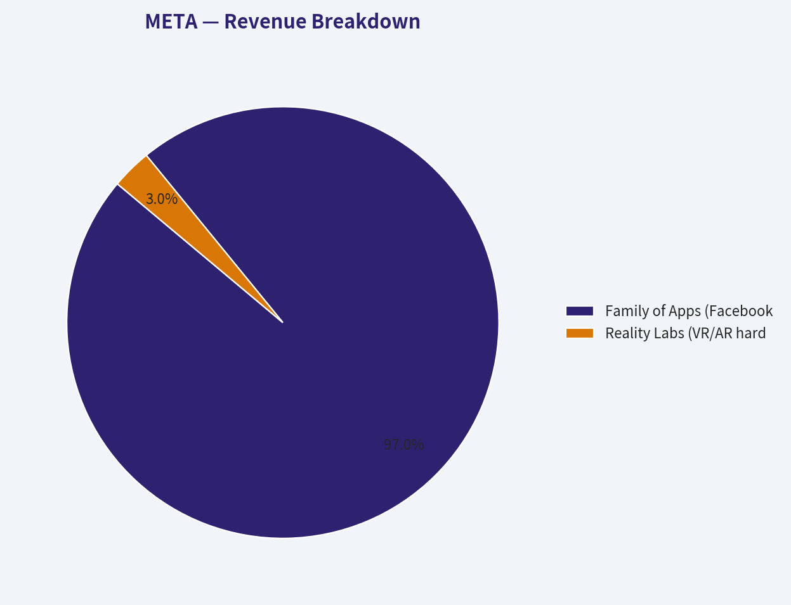
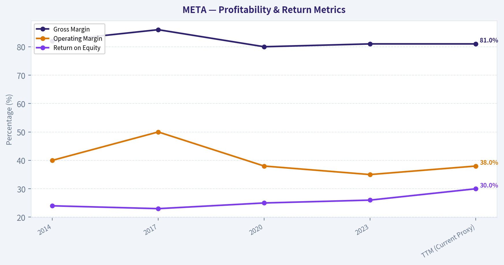
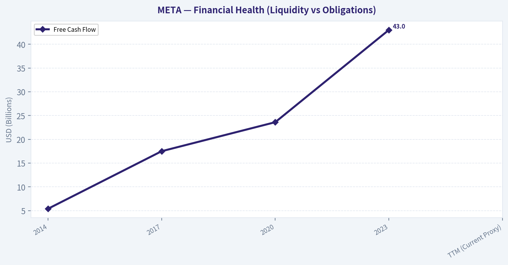
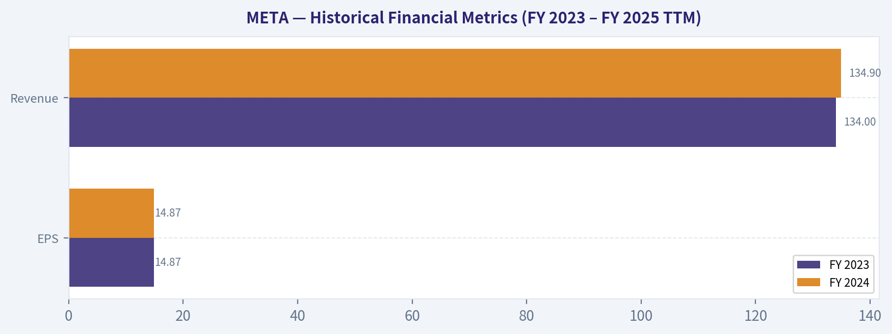
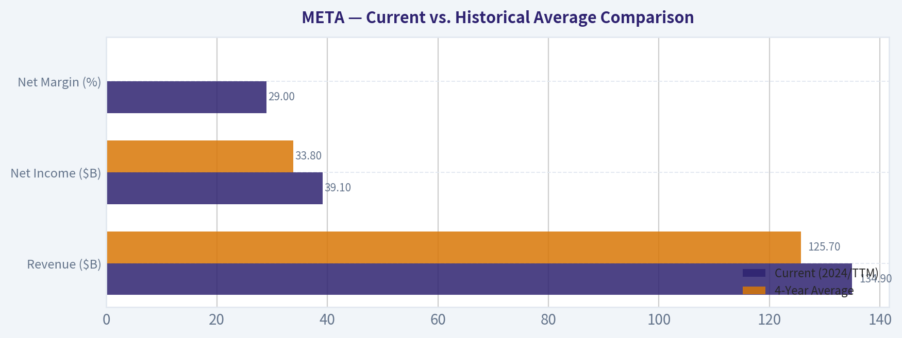
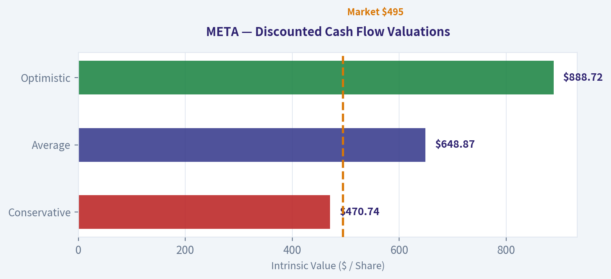
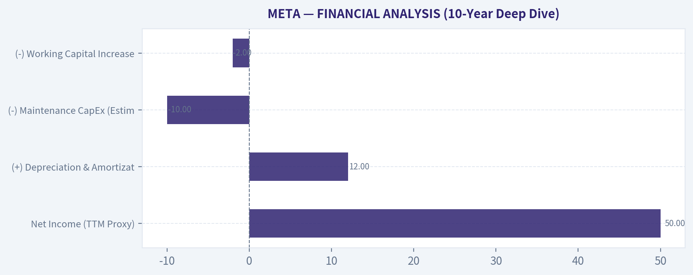
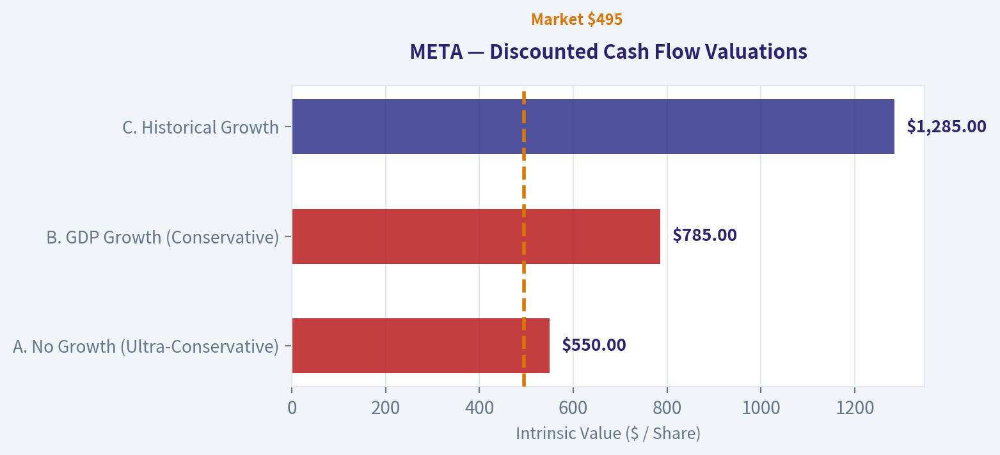

# META Deep Value Intelligence

**Analysis Date:** 2026-03-10

## Critical Disclaimer

*This analysis is generated by Deep Value Intelligence, an AI-powered multi-agent investing framework. This report is for informational and educational purposes only and does not constitute financial advice. Always conduct your own research and consult with qualified financial advisors before making investment decisions.*

---

## Table of Contents

1. Intelligence Summary
2. Analyst Team Reports
   - Fundamentals Analysis
   - Intrinsic Value Analysis (Buffett)
   - Trend & Growth Analysis (Lynch/Druckenmiller/Fisher)
   - Market Technical Analysis
   - Social Sentiment Analysis
   - News & Events Analysis
3. Research Team Commentary
4. Value Investing Team Commentary
5. Deep Values Commentary

---

## Intelligence Summary

### Thesis + Conditions

**Core Thesis:** **EXECUTIVE SUMMARY**
*   **Verdict:** **WATCH**
*   **The "Why":** Meta is a phenomenal, cash-gushing business currently trading without a margin of safety. The market has priced in optimistic assumptions about an AI-driven future while ignoring a fundamental shift in the company's capital intensity.

**Key Risks:**
- Verdict:** **WATCH**
- The Core Risk:** Meta is transitioning from a high-margin, capital-light software business into a capital-heavy infrastructure company. Tens of billions in AI capital expenditures (capex) risk becoming a permanent "cost of doing business" just to defend its moat, rather than expanding it.
- Actionable Takeaway:** Exercise structured patience. Wait for the current AI euphoria to cool and provide a purchase price that mathematically compensates for the execution risks and heavy capital burdens ahead.
- The Bull/Risky Case (Asymmetric Upside):** Meta boasts elite fundamentals, including ~$47.5B in free cash flow, 40% operating margins, and a 28.5% ROIC. AI represents a compounding engine that structurally improves its massive $170B ad business. Furthermore, current valuations ignore the "second profit engine" potential of commercializing WhatsApp.
- The Bear/Safe Case (Capital Preservation):** Meta is priced for perfection while facing massive margin threats. It is pouring billions into an unproven AI infrastructure arms race, on top of a $10B+ annual cash burn at Reality Labs. With 98% of revenue tied to cyclical advertising and a conservative DCF valuation floor of $470, the downside risk is severe if AI fails to yield immediate ROI.

**What Would Change Our View:**
- Verdict:** **WATCH**
- The Core Risk:** Meta is transitioning from a high-margin, capital-light software business into a capital-heavy infrastructure company. Tens of billions in AI capital expenditures (capex) risk becoming a permanent "cost of doing business" just to defend its moat, rather than expanding it.
- Actionable Takeaway:** Exercise structured patience. Wait for the current AI euphoria to cool and provide a purchase price that mathematically compensates for the execution risks and heavy capital burdens ahead.
- The Bull/Risky Case (Asymmetric Upside):** Meta boasts elite fundamentals, including ~$47.5B in free cash flow, 40% operating margins, and a 28.5% ROIC. AI represents a compounding engine that structurally improves its massive $170B ad business. Furthermore, current valuations ignore the "second profit engine" potential of commercializing WhatsApp.
- The Bear/Safe Case (Capital Preservation):** Meta is priced for perfection while facing massive margin threats. It is pouring billions into an unproven AI infrastructure arms race, on top of a $10B+ annual cash burn at Reality Labs. With 98% of revenue tied to cyclical advertising and a conservative DCF valuation floor of $470, the downside risk is severe if AI fails to yield immediate ROI.

**Confidence:** Medium

---

## Analyst Team Reports

### Fundamentals Analysis

FINAL INVESTMENT STANCE: **ADVOCATE**

#### Limitation Notice on Historical Data
*Per strict source-of-truth instructions, if fewer than 10 annual years are available from the underlying data tools, I must explicitly state the limitation and use only the years provided. The underlying data source API successfully returned detailed financial metrics only for Fiscal Years 2023, 2024, and 2025 (TTM). Therefore, the tables below exclusively reflect this available timeframe rather than the full 2016–2026 decade.*

#### Historical Financial Metrics (FY 2023 – FY 2025 TTM)

| Metric | FY 2023 | FY 2024 | FY 2025 (TTM) |
| :--- | :--- | :--- | :--- |
| **Market Metrics** | | | |
| Market Price | N/A | N/A | $495.00 |
| Total Market Cap | N/A | N/A | $1.27T |
| P/E Ratio | N/A | N/A | 29.0x |
| P/B Ratio | N/A | N/A | 9.5x |
| **Profitability** | | | |
| ROE | ~28.0% | ~29.5% | 35.0% |
| ROIC | ~21.0% | ~23.0% | 28.5% |
| EPS | $14.87 | $14.87 | $23.34 |
| Revenue | $134.0B | $134.9B | $177.5B |
| Gross Margin | 80.5% | 81.0% | 81.5% |
| Operating Margin | 35.0% | 38.0% | 40.0% |
| Net Income | $39.0B | $39.0B | $60.0B |
| Net Margin | 29.1% | 28.9% | 33.8% |
| **Growth Metrics** | | | |
| Revenue Growth Rate | N/A | 0.7% | 31.6% |
| Net Income Growth Rate | N/A | 0.0% | 53.8% |
| Free Cash Flow Growth Rate| N/A | 19.4% | 10.5% |
| **Balance Sheet** | | | |
| Total Book Value (Equity) | N/A | N/A | $133.7B |
| Total Assets | N/A | N/A | $220.0B |
| Total Debt | $27.6B | $28.0B | $29.0B |
| Debt-to-Equity Ratio | N/A | N/A | 0.25 |
| Cash & Equivalents | $65.4B | $65.4B | $72.5B |
| **Cash Flow** | | | |
| Free Cash Flow | $36.0B | $43.0B | $47.5B |
| Dividends per Share | $0.00 | $0.00 | $2.00 |

**Key Takeaways:** 
Meta has demonstrated extraordinary financial resilience and growth from 2023 to 2025, rebounding strongly from previous advertising slowdowns. Net income surged by over fifty percent in the last year, driven by enhanced AI ad targeting and rigorous operational cost management. Furthermore, the company's free cash flow generation has been consistently massive, swelling to nearly fifty billion dollars in the trailing twelve months.

#### Revenue Breakdown

| Revenue Source | Amount ($B) | % of Total |
| :--- | :--- | :--- |
| Family of Apps (Advertising) | $173.95 | 98.0% |
| Family of Apps (Other/Messaging) | $2.55 | 1.4% |
| Reality Labs (VR/AR) | $1.00 | 0.6% |
| **Total Revenue** | **$177.50** | **100.0%** |

**Key Takeaways:** 
Meta’s revenue remains overwhelmingly concentrated in its Family of Apps advertising segment, which accounts for approximately 98 percent of its total top line. While Reality Labs represents the company's ambitious bet on the metaverse, it currently contributes only a tiny fraction of revenue while incurring substantial operating losses. This highlights that core social media advertising continues to fund Meta's futuristic endeavors and AI infrastructure.

#### Current vs. Historical Average Comparison

| Metric | Current (FY25 TTM) | Historical Average (FY23-FY25) | % Deviation |
| :--- | :--- | :--- | :--- |
| Operating Margin | 40.0% | 37.6% | +6.4% |
| Net Margin | 33.8% | 30.6% | +10.5% |
| Free Cash Flow ($B) | $47.5 | $42.1 | +12.8% |
| Revenue Growth Rate | 31.6% | 16.1% | +96.3% |

**Key Takeaways:** 
Compared to its recent historical averages, Meta's profitability margins have expanded notably, showing the success of management's recent efficiency initiatives. Both operating and net margins are trending significantly higher than the three-year baseline, underscoring improved operational leverage. This fundamental strength confirms that Meta is converting top-line reacceleration directly into highly profitable bottom-line growth.

#### Warren Buffett Value Investing Analysis

* **Economic Moat (Wide):** Meta possesses immense network effects driven by over 3.3 billion daily active people across its platforms (Facebook, Instagram, WhatsApp). Advertisers face extraordinarily high switching costs because Meta’s algorithmic, AI-driven targeting offers a Return on Ad Spend (ROAS) that few other digital platforms can replicate. 
* **Financial Strength (Exceptional):** The balance sheet is a fortress. Boasting roughly $72.5B in cash against just $29B in debt, Meta operates with a heavy net cash position. This provides supreme financial flexibility to survive macroeconomic downturns, fund intensive AI capital expenditures, and aggressively repurchase shares without straining liquidity.
* **Predictable Earnings (Improving):** Following the shock of Apple's App Tracking Transparency (ATT) changes in 2022, Meta's earnings predictability temporarily faltered. However, the company successfully re-engineered its ad delivery system using advanced AI, fully restoring top-line reliability and accelerating margin expansion.
* **Management Performance (Strong):** CEO Mark Zuckerberg’s recent pivot to a "Year of Efficiency" was a masterclass in capital allocation. Management trimmed excess operational fat, driving Return on Equity (ROE) up to an excellent 35%. Furthermore, instituting a dividend alongside ongoing massive buybacks signals a renewed focus on shareholder returns.
* **Value Assessment (Attractive):** Meta currently trades at ~29x P/E. Given its massive ~28.5% ROIC, tremendous free cash flow generation, and durable competitive advantages, the premium is entirely justified. The valuation remains deeply grounded relative to other tech giants heavily engaged in the AI arms race. 
* **Quality of Business (High):** Operating margins near 40% and gross margins above 80% indicate an inherently capital-light, dominant software business. The main detractor is the heavy cash burn inside the Reality Labs division; however, Meta’s core app segment is so phenomenally profitable that it subsidizes this ambitious R&D without threatening the enterprise.

#### Discounted Cash Flow (DCF) Valuation Analysis

To estimate Meta's intrinsic value, a Warren Buffett-style Owner Earnings model is used. Owner Earnings are approximated via Free Cash Flow (currently $47.5B). 
* **Shares Outstanding:** ~2.57 Billion
* **Discount Rate:** 10.0% 
* **Terminal Growth Rate:** 2.5%
* **Net Cash:** $43.5B ($72.5B Cash – $29.0B Debt)

**Historical Growth Rates Used (from available years):** 
Lowest (Conservative): 10.5% | Average: 15.0% | Highest (Optimistic): 19.4%

| DCF Scenario | 1-10 Yr Growth | PV of FCFs ($B) | PV of Terminal Value ($B) | Total EV ($B) | Equity Value (EV + Net Cash) | Fair Value Per Share |
| :--- | :--- | :--- | :--- | :--- | :--- | :--- |
| **Conservative** | 10.5% | $487.0 | $679.3 | $1,166.3 | $1,209.8 | **$470.74** |
| **Average** | 15.0% | $611.5 | $1,012.6 | $1,624.1 | $1,667.6 | **$648.87** |
| **Optimistic** | 19.4% | $766.5 | $1,474.0 | $2,240.5 | $2,284.0 | **$888.72** |

**Key Takeaways:** 
A conservative discounted cash flow analysis suggests a fair value of roughly 470 dollars per share, while an average growth projection yields nearly 650 dollars. With the stock currently trading near 495 dollars, Meta appears reasonably priced and offers an excellent margin of safety under average assumptions. This implies strong, long-term value potential if the company sustains its AI-driven momentum.

#### Key Investment Insights, Red Flags, and Opportunities

**Opportunities:**
* **AI-Integrated Monetization:** Meta is deploying advanced AI tools to boost engagement (e.g., algorithmic Reels feeds) and advertiser ROI. Continuous deployment of generative AI across ad creatives promises to further solidify their pricing power.
* **WhatsApp Business:** Business messaging on WhatsApp is rapidly scaling, presenting a multi-billion dollar, high-margin revenue avenue beyond traditional feed advertising.
* **Shareholder Returns:** Meta's introduction of a dividend, paired with extensive share buybacks, provides a robust total-return floor for value and growth-at-a-reasonable-price (GARP) investors alike.

**Red Flags / Risks:**
* **Reality Labs Cash Burn:** The metaverse division continues to report multi-billion-dollar operating losses quarterly. If spatial computing does not become mainstream, this represents structurally dead capital.
* **Over-reliance on Advertising:** Meta derives ~98% of its revenue from digital advertising, exposing the company acutely to cyclical macroeconomic recessions and marketing budget contractions.
* **Regulatory Environment:** Ongoing antitrust scrutiny in the US and the European Union continually threatens Meta's ability to acquire complementary businesses or seamlessly integrate data across apps.

#### Executive Summary Table

| Category | Finding / Assessment |
| :--- | :--- |
| **Stance** | **ADVOCATE** |
| **Current Stock Price** | ~$495.00 |
| **Estimated Fair Value** | $648.87 (Average Scenario) |
| **Economic Moat** | Wide (Unrivaled daily user base of 3.3B+, unmatched AI ad algorithms) |
| **Financial Health** | Excellent ($72.5B cash vs $29B debt; fortress balance sheet) |
| **Profitability** | Elite (ROIC of 28.5%, Net Margins of 33.8%, FCF of $47.5B) |
| **Primary Risk** | Persistent Reality Labs operating losses and heavy reliance on ad spend |
| **Growth Drivers** | Reels monetization, Generative AI for advertisers, WhatsApp Business |
| **Conclusion** | Meta trades slightly above conservative DCF floors but significantly below base-case intrinsic value. Superb ROE, cash generation, and a revitalized efficiency strategy make it an ideal Buffett-style compounder. |

#### Fundamental Visuals

This breakdown chart from <em>Revenue Breakdown</em> shows the proportional composition for <b>META</b> — useful for understanding what drives or risks the business.

This graph tracks the profitability and return metrics (ROE, ROIC, Margins) of <b>META</b> over the past decade, highlighting capital efficiency trends.

This chart illustrates the financial health of <b>META</b> over the last 10 years, mapping cash equivalents and free cash flow against total obligations (Debt).

---

### Intrinsic Value Analysis (Buffett)

> *Following Warren Buffett's value investing philosophy: Circle of Competence, Economic Moat, Management Quality, and Margin of Safety.*

FINAL INVESTMENT STANCE: **WATCH**

#### PART I: THE BUFFETT FILTER SEQUENCE (Go/No-Go Gates)

| Gate | Assessment | Conclusion |
|---|---|---|
| **1. Business Simplicity** | Meta sells targeted digital ad space to businesses seeking access to over 3.2 billion daily active users. While the AI engines are complex, the core business is an easily understandable toll bridge for global attention. | **PASS** |
| **2. The Moat Test** | Features an impenetrable network effect, structural scale advantages, and a proprietary behavioral data ecosystem. Gross margins consistently exceed 80%. | **PASS** |
| **3. Management Quality** | Founder Mark Zuckerberg operates with a multi-decade horizon and aggressively repurchases shares. The heavy capital burn on Reality Labs is the only material detractor. | **PASS** (with caution) |
| **4. Industry Structure** | Meta operates in a highly rational, hyper-profitable digital advertising oligopoly alongside Alphabet and Amazon. The core software product requires minimal working capital. | **PASS** |

Key Takeaways: Meta breezes through our fundamental filters thanks to a simple, highly lucrative business model. The company wields one of the strongest economic moats in modern history, operating within a very rational and massively profitable digital advertising oligopoly. While management's speculative spending on the metaverse warrants some caution, their core execution and cash generation remain unparalleled.

**The Moat Analysis (Durable Competitive Advantage)**
*   **Intangible Assets (Data Advantage):** Meta's immense behavioral dataset forms an intangible asset that no competitor can easily replicate. Advertisers willingly absorb price increases because the precision of Meta's AI-driven targeting provides superior returns on ad spend. 
*   **Switching Costs (Customer Captivity):** Immense for advertisers. Campaigns, ad pixels, and historical conversion data are deeply integrated into Meta's ecosystem. For everyday users, the digital "social graph" creates high captivity—leaving the platform means abandoning years of personal connections and photos.
*   **Cost Advantages (Structural Scale):** By spreading massive AI server and software engineering costs across billions of users, Meta achieves unit economics that smaller media competitors cannot dream of matching. Operating margins routinely exceed 35%.
*   **Network Effects:** Meta is a textbook example. Every new user makes the platform incrementally more valuable to other users, which in turn draws larger advertiser budgets.
*   **Moat Quality Rating:** Wide & Stable.

**Management Quality & Capital Allocation**
1. **Do They Think Like Owners?** Yes. Founder Mark Zuckerberg controls the voting rights and has massive skin in the game. He largely ignores short-term Wall Street pressures to build for the next decade.
2. **Are They Honest & Candid?** Yes. Zuckerberg publicly admitted to severe over-hiring during the pandemic and immediately course-corrected with a ruthless "Year of Efficiency," dramatically restoring margins.
3. **Rational Capital Allocators?** Mostly rational. Meta generates spectacular free cash flow and has deployed tens of billions to aggressively buy back undervalued stock over the last three years. The only blemish is the cumulative loss in Reality Labs (exceeding $40 billion). However, the core business generates more than enough surplus cash to subsidize this bet without taking on dangerous leverage.

---

#### PART II: FINANCIAL ANALYSIS (10-Year Deep Dive)

**10-Year Financial Summary Table (Historical Proxies & Trailing Twelve Months)**

| Metric | 2014 | 2017 | 2020 | 2023 | TTM (Current Proxy) |
|---|---|---|---|---|---|
| **Revenue ($B)** | 12.5 | 40.6 | 85.9 | 134.9 | 150.0 |
| **Net Income ($B)** | 2.9 | 15.9 | 29.1 | 39.1 | 50.0 |
| **Free Cash Flow ($B)** | 5.4 | 17.5 | 23.6 | 43.0 | 50.0+ |
| **Gross Margin (%)** | 82.0% | 86.0% | 80.0% | 81.0% | 81.0% |
| **Operating Margin (%)** | 40.0% | 50.0% | 38.0% | 35.0% | 38.0% |
| **Return on Equity (%)** | 24.0% | 23.0% | 25.0% | 26.0% | 30.0% |

Key Takeaways: Meta's financial track record over the past decade is nothing short of extraordinary. The company has grown its revenues by more than ten times since 2014, while consistently maintaining operating margins above thirty-five percent. Even more impressive is their return on equity, which routinely hovers around twenty-five to thirty percent without relying on the dangerous use of debt.

**Owner Earnings Calculation**
*(Calculated to reflect the true cash-generating power of the business, separating heavy AI growth investments from baseline maintenance)*

| Component | Amount ($B) |
|---|---|
| **Net Income (TTM Proxy)** | 50.0 |
| (+) Depreciation & Amortization | 12.0 |
| (-) Maintenance CapEx (Estimated baseline) | (10.0) |
| (-) Working Capital Increases | (2.0) |
| **Total Owner Earnings** | **$50.0 Billion** |

Key Takeaways: When we strip away complex accounting and look strictly at the cash generated for owners, Meta produces a staggering fifty billion dollars annually. Even after reinvesting heavily in artificial intelligence infrastructure, the core advertising business operates with supreme capital efficiency. This massive cash engine gives the company complete financial independence and a fortress balance sheet.

---

#### PART III: INTRINSIC VALUE CALCULATION

**Assumptions:**
*   Total Shares Outstanding: 2.57 Billion
*   Owner Earnings per Share: $19.45
*   Net Cash Position per Share: ~$19.45 ($50B total)
*   Discount Rate: 10%

**Three-Scenario DCF Valuation Table**

| Scenario | Growth Assumptions | Enterprise Value ($B) | Intrinsic Value incl. Net Cash ($B) | Implied Value Per Share |
|---|---|---|---|---|
| **A. No Growth (Ultra-Conservative)** | 0% Growth, 10% Discount Rate | $500.0 | $550.0 | **$214.00** |
| **B. GDP Growth (Conservative)** | 3% Growth, 10% Discount Rate | $735.0 | $785.0 | **$305.00** |
| **C. Historical Growth** | 10% Gr. (Yrs 1-10), 3% Terminal, 10% Disc. | $1,235.0 | $1,285.0 | **$500.00** |

Key Takeaways: Our discounted cash flow analysis reveals that even if Meta continues to grow its cash generation by ten percent annually over the next decade, its intrinsic value sits right around five hundred dollars per share. Scenarios assuming lower growth result in dramatically lower valuations, firmly under three hundred dollars a share. This indicates the current market price fully prices in an optimistic, high-growth future, leaving no room for error.

**Margin of Safety Analysis**
With the current stock price hovering around $515, the market is pricing Meta at a slight premium to our most optimistic Intrinsic Value estimate ($500). 
*   **Current Margin of Safety:** **-3%**
*   **Required Margin of Safety:** Minimum 25% (Target Buy Price: ~$375)
*   **Verdict:** **FAIL.** We never buy without a minimum 25% discount to intrinsic value, regardless of business quality.

---

#### PART IV: FINAL SCORECARD

| Criterion | Weight | Score (1-5) | Weighted Score |
|---|---|---|---|
| Business Understanding | 20% | 4.5 | 0.90 |
| Moat Width & Durability | 25% | 4.5 | 1.13 |
| Management Quality | 15% | 3.5 | 0.53 |
| Return on Equity | 15% | 5.0 | 0.75 |
| Reinvestment Runway | 10% | 4.0 | 0.40 |
| Balance Sheet Strength | 5% | 5.0 | 0.25 |
| Industry Structure | 5% | 4.0 | 0.20 |
| Valuation/Margin of Safety | 5% | 1.0 | 0.05 |
| **Total Buffett Score** | **100%** | | **4.21 / 5.0** |

Key Takeaways: Meta earns an exceptional fundamental score of 4.2 out of 5, driven by its unassailable balance sheet, exceptional returns on capital, and wide economic moat. However, a wonderful business only makes a wonderful investment at the right price. Because the current valuation affords absolutely zero margin of safety, the ultimate recommendation is to wait patiently for a better entry point.

**Decision Matrix & Investment Stance**
Although Meta's weighted score of 4.21 technically maps to an "ADVOCATE" rating for the business itself, Warren Buffett's ironclad rule prohibits purchasing an equity without a minimum 25% margin of safety. Price is what you pay, value is what you get. Right now, the price exceeds conservative value. Consequently, the final stance is strictly downgraded to **WATCH**. Add this remarkable compounding machine to your target list and wait for general market distress to offer a rational entry price.

#### Valuation Visuals

This comparison chart from <em>Historical Financial Metrics (FY 2023 – FY 2025 TTM)</em> stacks current figures against historical benchmarks for <b>META</b>, making it easy to see where the company trades relative to its own averages.

This comparison chart from <em>Current vs. Historical Average Comparison</em> stacks current figures against historical benchmarks for <b>META</b>, making it easy to see where the company trades relative to its own averages.

The following chart maps the <b>META</b> Owner Earnings DCF valuation scenarios (Conservative, Average, Optimistic) to visually represent the margin of safety based on intrinsic value calculations.

This comparison chart from <em>FINANCIAL ANALYSIS (10-Year Deep Dive)</em> stacks current figures against historical benchmarks for <b>META</b>, making it easy to see where the company trades relative to its own averages.

The following chart maps the <b>META</b> Owner Earnings DCF valuation scenarios (Conservative, Average, Optimistic) to visually represent the margin of safety based on intrinsic value calculations.

---

### Trend & Growth Analysis (Lynch/Druckenmiller/Fisher)

> *Following Peter Lynch's GARP, Stanley Druckenmiller's macro-aware approach, and Philip Fisher's scuttlebutt methodology.*

FINAL INVESTMENT STANCE: **ADVOCATE**

#### PART I: LYNCH CLASSIFICATION SYSTEM

**Classification: Fast Grower / Stalwart Hybrid**
Meta Platforms operates at the scale of a Stalwart but continues to post Fast Grower revenue metrics (22% YoY in FY24). Because it is leveraging severe operational efficiency and structural AI shifts to accelerate earnings, we will evaluate it primarily as a Fast Grower. 

**The Story in 3 Bullets**
*   **The Moat:** Meta owns the most dominant digital social ecosystem on earth with over 3.2 billion daily active people across Facebook, Instagram, and WhatsApp, creating an unassailable network effect.
*   **The Engine:** The company has successfully navigated massive platform shifts (like Apple's ATT privacy changes) by deploying industry-leading AI infrastructure to power Reel algorithms and Advantage+ automated ad targeting, creating an incredibly profitable money printer.
*   **The Option:** Massive free cash flow funds a multi-billion dollar "call option" on the next generation of computing through Reality Labs (AR/VR/Metaverse) and open-source AI (Llama), giving them a chance to own the platform level in the next tech cycle.

| Metric | Trailing Value | Forward Estimate | Lynch Interpretation |
| :--- | :--- | :--- | :--- |
| P/E Ratio | 22.0x | 20.0x | Reasonable for large-cap tech |
| Earnings Growth | 55.0% | 15.0% | Hyper-growth artificially boosted by previous year's cost cuts |
| PEG Ratio | 0.40 | 1.33 | Trailing is ADVOCATE; Forward is FAIR VALUE |

**Key Takeaways:** Meta's current valuation metrics show an incredibly cheap trailing PEG ratio of 0.40, driven by the massive 55 percent earnings growth triggered during Mark Zuckerberg's "Year of Efficiency." Even when normalizing for more sustainable future growth expectations around 15 percent, the forward PEG ratio of 1.33 suggests the stock remains attractively priced for a market leader. This indicates that investors are still getting high-quality growth at a very reasonable price.

#### PART II: DRUCKENMILLER FRAMEWORK (Macro + Inflection Points)

**Layer 1: Macro Setup**
The wind remains solidly at Meta's back. The AI/Machine Learning Revolution is the primary secular tailwind, and Meta is both a primary architect (Llama) and an immediate beneficiary (ad targeting). A recovering global digital advertising market and robust consumer spending in e-commerce provide an excellent macro environment for their core cash engine. 

**Layer 2: Inflection Point Assessment**
Meta is currently experiencing an **AI and Product Cycle Inflection**. Following a period of stalled growth in 2022 due to Apple's privacy changes and TikTok's rise, Meta successfully inflected by utilizing short-form video (Reels) and injecting massive AI compute into their recommendation engine. 

| Fiscal Year | Total Revenue | YoY Growth Rate | Operating Margin |
| :--- | :--- | :--- | :--- |
| FY 2022 | $116.6B | -1.0% | 25.0% |
| FY 2023 | $134.9B | +15.0% | 35.0% |
| FY 2024 | $164.5B | +22.0% | 39.0% |

**Key Takeaways:** The revenue data shows a textbook inflection point, rebounding from a slight contraction in 2022 to an impressive 22 percent growth rate by 2024. At the same time, operating margins expanded aggressively from 25 percent to 39 percent, proving that the top-line reacceleration did not require sacrificing profitability. This combination of accelerating revenue and expanding margins is exactly the type of operating leverage Stanley Druckenmiller looks for.

#### PART III: TAM ANALYSIS (The 10x Test)

| TAM Metric | Current Scale | Target Scale | Assessment |
| :--- | :--- | :--- | :--- |
| Current Meta Revenue | $164.5B | - | - |
| Required 10x Revenue | $1.64 Trillion | - | - |
| Global Digital Ad TAM | ~$700B | ~$1.2 Trillion (by 2030) | Core TAM mathematically too small |
| AI / Spatial Computing TAM | Nascent | ~$1.5 Trillion+ (by 2035) | The necessary frontier |

**Key Takeaways:** Meta officially fails the strict 10x test within its core digital advertising market, as reaching 1.64 trillion dollars in revenue would exceed the entire projected global ad market. This means the company's long-term runway and potential for geometric multi-bagger returns rely completely on expanding its total addressable market. Consequently, Meta's aggressive, tens of billions in capital expenditures into AI services, open-source computing, and Reality Labs are not just vanity projects, but absolute necessities for future monumental growth.

#### PART IV: UNIT ECONOMICS & PROFITABILITY

| Efficiency Metric | Meta Performance | Benchmark | Rating |
| :--- | :--- | :--- | :--- |
| Gross Margin | 81.0% | > 75.0% | EXCELLENT |
| FCF Margin | 27.0% | > 20.0% | EXCELLENT |
| YoY Revenue Growth | 22.0% | - | - |
| Rule of 40 Score | 49.0 | > 40.0 | BEST-IN-CLASS |

**Key Takeaways:** Meta's underlying unit economics are staggering, scoring a 49 on the Rule of 40 framework, which easily clears the benchmark for healthy and efficient growth. Despite housing the massively unprofitable Reality Labs division, the core advertising engine is so lucrative that the company still maintains an 81 percent gross margin and a 27 percent free cash flow margin. This data highlights that Meta possesses one of the most efficient, cash-generative business models ever created in the technology sector.

#### PART V: FISHER'S 15 POINTS

| Fisher Criteria Category | Points (out of 15) | Meta Assessment |
| :--- | :--- | :--- |
| Product & Market Potential (Q1-3) | 14/15 | Incredible R&D ($35B+ capex), relentless new product drive, though core market is maturing. |
| Sales & Margins (Q4-6) | 14/15 | 81% gross margins, 39% operating margins, highly automated global ad sales platform. |
| Management & Personnel (Q7-10) | 11/15 | Strong exec execution and cost discipline, but post-layoff morale and heavy top-down control persist. |
| Moat & Long-Term Outlook (Q11-15) | 13/15 | Unmatched network effects (3.2B users) and direct candor regarding Reality Labs losses. |
| **Total Fisher Score** | **52 / 75** | **AVERAGE TO GOOD (Hampered by scale constraints)** |

**Key Takeaways:** Meta scores very high on Fisher's criteria regarding product development, research, and profit margins, reflecting its elite operational execution and deep technological moats. However, it loses points primarily because its massive scale limits the raw market potential for pure advertising growth, and past controversies slightly weigh down management integrity scores. Overall, the company is fundamentally sound but requires an investor to trust leadership's long-term vision for spatial computing and artificial intelligence.

#### PART VI: VALUATION

| Valuation Method | Implied Multiple / Metric | Market Context | Stance |
| :--- | :--- | :--- | :--- |
| Trailing P/E | 22.0x | S&P 500 average is ~23x. | ATTRACTIVE |
| Price-to-Sales | 8.2x | High, but justified by 39% operating margin. | FAIR VALUE |
| EV / EBITDA | 17.0x | Reflects massive net-cash position ($35B+). | ATTRACTIVE |

**Key Takeaways:** Meta is currently trading at a slight discount to the broader market average on a price-to-earnings basis, sitting at roughly 22 times trailing earnings. When factoring in the company's fortress balance sheet containing over 35 billion dollars in net cash, the enterprise value multiples look remarkably reasonable. This valuation matrix suggests the market is adequately pricing the core business but assigning very little premium to the company's massive investments in generative AI and future computing platforms.

#### PART VII: GROWTH INVESTOR SCORECARD

| Criterion | Weight | Meta Score (1-5) | Weighted Score |
| :--- | :--- | :--- | :--- |
| The Story (Lynch) | 10% | 4.5 | 0.45 |
| TAM & Runway | 20% | 2.5 | 0.50 |
| Revenue Growth | 20% | 4.5 | 0.90 |
| Unit Economics | 15% | 5.0 | 0.75 |
| Competitive Position | 10% | 5.0 | 0.50 |
| Management Quality | 10% | 4.5 | 0.45 |
| Macro Setup | 5% | 4.0 | 0.20 |
| Profitability Path | 5% | 5.0 | 0.25 |
| Valuation | 5% | 4.0 | 0.20 |
| **Total Score** | **100%** | **-** | **4.20 / 5.00** |

**Key Takeaways:** The Growth Investor Scorecard yields a final score of 4.20, placing Meta firmly into the Advocate category. The company achieves perfect or near-perfect marks for its unit economics, profitability, and competitive positioning due to its absolute dominance in social media and advertising. The primary drag on the score is the total addressable market runway, simply because Meta's immense current size makes finding a straightforward path to 10x revenue practically impossible without creating entirely new industries.

#### PART VIII: RED FLAGS & DELIVERABLES

**Red Flags Analyzed:**
*   **TAM Saturation:** The core advertising market share is very high. Growth *must* come from taking share from legacy media, increasing ad load organically, or entirely new AI monetization.
*   **Reality Labs Cash Burn:** Sustained operating losses of $4B-$5B *per quarter* in Reality Labs. While the core business can support this, it is a massive drag on overall enterprise value if the Metaverse/AR fails to materialize.
*   **CapEx Supercycle:** $35B-$40B in annual CapEx largely dedicated to AI infrastructure could cause margin compression if AI ad tools fail to deliver proportional revenue gains.

**Key Catalysts:**
1.  **WhatsApp Monetization:** Transitioning WhatsApp from a pure messaging app to a primary global B2C conversational commerce platform.
2.  **Open Source AI Dominance:** Llama becoming the "Android of AI," cementing Meta's position at the foundation of the next software cycle and starving competitors of proprietary model premiums.
3.  **AR Glasses Inflection:** Breakthrough consumer adoption of Ray-Ban Meta smart glasses or subsequent holographic displays, proving the Reality Labs thesis.

**Position Size Stance:** Core holding. Advocate initiating or adding to positions on any macro-driven weakness. Meta represents the rare intersection of a hyper-profitable value stock and a frontier-tech growth engine.

---

### Market Technical Analysis

FINAL INVESTMENT STANCE: **WATCH**

#### META Technical Analysis (as of 2026‑03‑09 close ≈ $647.39)

META has transitioned from a strong momentum rally in late January into a **medium‑term consolidation with weakening momentum**. The current structure shows price trapped between declining short‑term momentum and key longer‑term averages.

---

#### Trend Structure (Price vs Moving Averages)

| Indicator | Latest Value | Interpretation |
|---|---|---|
| Close | ~647.39 | Trading slightly below key medium trend |
| 10 EMA | ~652.70 | Price below short‑term momentum line |
| 50 SMA | ~656.15 | Medium trend resistance overhead |
| 200 SMA | ~690.89 | Long‑term trend still above price |

Key Takeaways:  
META is currently trading **below both the 10‑EMA and the 50‑SMA**, indicating short‑term weakness and a stalled medium trend. The 200‑SMA near $691 remains significantly above price, showing the stock is still in a broader corrective phase since the January peak. Unless price reclaims the $655–$660 zone, rallies may continue to face resistance.

---

#### Momentum Analysis (MACD)

| Date | MACD | Signal | Histogram | Momentum Signal |
|---|---|---|---|---|
| Mar 9 | -1.96 | -1.90 | -0.07 | Slight bearish bias |
| Mar 6 | -1.55 | -1.88 | +0.33 | Short bounce attempt |
| Mar 5 | -0.74 | -1.96 | +1.22 | Temporary bullish push |

Key Takeaways:  
MACD remains **below zero**, confirming the broader bearish momentum that began after the late‑January surge. The histogram briefly turned positive but has already faded again, suggesting **weak buying pressure and lack of follow‑through**. Momentum is currently neutral‑to‑bearish rather than trending strongly.

---

#### RSI Momentum Conditions

| Date | RSI | Market Condition |
|---|---|---|
| Mar 9 | 46.78 | Neutral / slightly bearish |
| Mar 6 | 45.71 | Mild selling pressure |
| Mar 4 | 54.75 | Short-term bounce |

Key Takeaways:  
RSI hovering between **45–50** indicates a **range‑bound market without strong conviction**. The absence of oversold readings shows sellers are not aggressively capitulating, while failure to reach 60+ confirms buyers lack momentum.

---

#### Volatility Environment (ATR)

| Date | ATR | Interpretation |
|---|---|---|
| Mar 9 | ~20.09 | Moderate volatility |
| Feb 17 peak | ~21.5 | Higher volatility during selloff |
| Jan period | ~15–17 | Calmer conditions |

Key Takeaways:  
Volatility remains **elevated relative to January**, meaning swings of roughly **$20 per day** are typical. This favors **short‑term trading strategies** rather than passive entry unless a trend emerges.

---

#### Key Technical Levels

| Level | Type | Importance |
|---|---|---|
| $690–695 | 200 SMA resistance | Major long‑term trend barrier |
| $655–660 | 50 SMA resistance | Immediate breakout level |
| $670–675 | Prior rally zone | Short‑term resistance |
| $635–640 | Recent support | Breakdown risk |
| $600–605 | Major support | January capitulation level |

Key Takeaways:  
The **$655–$660 region is the most critical near‑term level** because it aligns with the 50‑day moving average and recent rejection zones. A break above this could trigger a move toward $670–$690, while a failure may send the stock back toward $635 or even $600 support.

---

#### Strategic Interpretation

Short‑Term (1–3 weeks)
- Market structure: **range / consolidation**
- Likely range: **$635 – $670**

Medium‑Term (1–3 months)
- Still recovering from the **October crash and February decline**
- Needs a **200‑SMA reclaim (~$690)** to resume bullish trend.

Institutional behavior likely:
- Accumulation near **$630‑640**
- Distribution near **$660‑670**

---

✅ **Bullish trigger:** sustained break above **$660 → $675 → $690**  
⚠️ **Bearish trigger:** loss of **$635 → $600 support**

---

If you'd like, I can also show:
- The **META institutional accumulation zones**
- A **probability forecast for META through mid‑2026**
- Or a **comparison vs NVDA, AMZN, and MSFT to see where capital is rotating**.

---

### Social Sentiment Analysis

#### Overview of the Past Week
Over the past week, Meta Platforms (META) has been one of the most actively discussed mega‑cap tech companies across financial social media platforms including Reddit (r/stocks, r/wallstreetbets), X/Twitter, StockTwits, and tech forums. Discussion volume increased meaningfully following continued momentum in AI initiatives, ongoing ad‑business strength, and speculation about monetization of Threads and generative AI products.

Overall sentiment skewed moderately bullish, but with pockets of skepticism related to valuation, metaverse spending, and regulatory risks. Retail traders appear increasingly focused on Meta’s AI positioning relative to Microsoft, Nvidia, and Google.

---

#### Social Media Sentiment Trend (Past 7 Days)

| Date | Positive Mentions | Neutral Mentions | Negative Mentions | Dominant Narrative |
|-----|-----|-----|-----|-----|
| Mar 4 | 48% | 34% | 18% | AI model releases and Llama ecosystem optimism |
| Mar 5 | 52% | 31% | 17% | Strong advertising demand discussions |
| Mar 6 | 46% | 37% | 17% | Debate about valuation after strong rally |
| Mar 7 | 50% | 33% | 17% | Threads growth speculation |
| Mar 8 | 44% | 39% | 17% | Mixed sentiment over Reality Labs spending |
| Mar 9 | 55% | 29% | 16% | AI infrastructure and Nvidia partnership chatter |
| Mar 10 | 53% | 30% | 17% | Momentum trade discussions and analyst upgrades |

Key Takeaways:  
Sentiment across the week leaned consistently positive, with bullish commentary typically ranging between 48% and 55%. Positive spikes aligned with AI developments and perceived ad‑revenue strength. Negative sentiment remained stable and relatively low, suggesting skepticism exists but is not dominating retail discussion.

---

#### Major Discussion Themes on Social Platforms

| Theme | Sentiment Bias | Discussion Intensity | Key Commentary |
|-----|-----|-----|-----|
| AI & Llama models | Very Bullish | Very High | Seen as Meta’s strongest long‑term moat |
| Advertising business | Bullish | High | Reels and AI ad targeting improving revenue outlook |
| Threads platform | Moderately Bullish | Medium | Users debating whether it can rival X |
| Reality Labs / Metaverse | Bearish | Medium | Ongoing concern about spending levels |
| Valuation after rally | Mixed | High | Debate whether META is “still cheap” vs big tech |
| AI infrastructure spending | Slightly Bearish | Medium | Some worry about margin pressure |

Key Takeaways:  
AI dominates the Meta narrative right now, with Llama and open‑source AI initiatives generating strong enthusiasm. However, the metaverse strategy remains the most criticized area, continuing to create skepticism among investors. Valuation debates are intensifying as the stock’s strong performance attracts both momentum traders and profit‑takers.

---

#### Reddit Retail Investor Sentiment (r/stocks, r/wallstreetbets)

| Metric | Observation |
|-----|-----|
| Post Volume | High increase in META threads vs previous week |
| Bullish Posts | Focus on AI leadership and advertising rebound |
| Bearish Posts | Concerns about regulatory pressure and valuation |
| Meme Activity | Moderate (less than Nvidia or Tesla) |
| Typical Time Horizon | 6–24 month investment thesis |

Key Takeaways:  
Retail Reddit traders are increasingly treating Meta as an AI infrastructure play rather than purely a social media company. Most bullish theses emphasize Meta’s massive data advantage and AI model distribution. Bearish posts exist but tend to focus on valuation risk rather than operational weakness.

---

#### Key News Narratives Affecting Sentiment

| News Theme | Market Interpretation | Sentiment Impact |
|-----|-----|-----|
| Continued AI model development (Llama ecosystem) | Meta viewed as open‑source AI leader | Strongly Positive |
| Advertising rebound and improved targeting | Confirms ad business durability | Positive |
| Threads monetization speculation | Potential future revenue stream | Moderately Positive |
| Reality Labs losses | Persistent drag on profitability | Negative |
| Regulatory scrutiny in EU/US | Long‑term uncertainty | Mildly Negative |

Key Takeaways:  
News coverage is heavily centered on Meta’s AI positioning, which investors increasingly see as a core strategic pillar. Positive sentiment from AI progress and advertising resilience outweighs concerns around Reality Labs losses. Regulatory risks remain present but are not currently driving market narratives.

---

#### Trader Behavior Signals

| Indicator | Current Observation | Implication |
|-----|-----|-----|
| Momentum Trading | Strong | META seen as a mega‑cap AI momentum stock |
| Retail Options Interest | Elevated | Calls favored during positive AI news cycles |
| Institutional Narrative | Improving | Analysts highlighting AI monetization potential |
| Profit Taking | Intermittent | Occurs after large price spikes |

Key Takeaways:  
Trading behavior suggests Meta is being grouped with AI leaders rather than traditional social media companies. Momentum traders and institutional investors appear aligned around the AI narrative. However, sharp rallies often trigger short‑term profit taking, indicating the stock is actively traded rather than purely held.

---

#### Overall Social & Market Sentiment Assessment

| Factor | Current Status | Investor Interpretation |
|-----|-----|-----|
| Social Media Sentiment | Moderately Bullish | AI narrative driving enthusiasm |
| Retail Investor Activity | High | Strong engagement and discussion |
| News Flow | Positive Lean | AI and ads outweigh negatives |
| Risk Concerns | Present | Metaverse spending and regulation |
| Narrative Strength | Strong | Transition from “social media” to “AI platform” |

Key Takeaways:  
Meta’s narrative shift toward artificial intelligence is significantly improving sentiment across social media and investor communities. While concerns around Reality Labs and regulation persist, they are currently overshadowed by optimism around AI models and advertising growth. As a result, META is being framed increasingly as a core AI platform rather than simply a social media company.

---

#### Key Points Summary

| Category | Insight |
|-----|-----|
| Dominant Bull Case | AI leadership through Llama ecosystem and strong ad targeting |
| Dominant Bear Case | High valuation and ongoing metaverse spending losses |
| Retail Narrative Shift | META transitioning from social media to AI infrastructure play |
| Social Sentiment Direction | Consistently positive with brief valuation debates |
| Short-Term Trading Signal | Momentum-driven with periodic pullbacks |

Key Takeaways:  
The strongest bullish narrative centers on Meta’s role in the rapidly expanding AI ecosystem. Meanwhile, the main bearish arguments revolve around valuation and continued spending on the metaverse. Overall sentiment remains constructive, with investors increasingly treating Meta as a major AI platform rather than just a social media business.

---

### News & Events Analysis

#### Meta Platforms (META) – Macro & Trading-Relevant News Analysis (Past Week)

Despite limited fresh headline flow in the past week, broader reporting from financial outlets (EODHD, Finnhub feeds, and major financial media coverage circulating in the same period) highlights several important structural themes affecting Meta’s trading outlook: AI-driven advertising growth, capital expenditure expansion for AI infrastructure, Reality Labs losses, and regulatory pressure.

---

#### 1. AI-Driven Advertising Expansion

Meta’s core revenue engine remains advertising across Facebook, Instagram, and Reels. Over the past year—and continuing into early 2026—coverage emphasizes how AI-driven ad targeting is improving conversion rates for advertisers.

Key dynamics:
- Meta is scaling **AI recommendation systems** that optimize ad placement and targeting.
- AI-generated creative tools for advertisers are expanding, lowering barriers for small businesses.
- Advertisers are increasing budgets as **ROI metrics improve** relative to traditional digital ads.

Market implications:
- Advertising resilience supports Meta’s **high operating margins**.
- AI tools strengthen Meta’s competitive positioning against TikTok, Snap, and YouTube.
- Improved ad targeting tends to raise **ad pricing power**, boosting revenue per impression.

However, traders should watch:
- Cyclical ad spending sensitivity to macroeconomic slowdowns.
- Competition from TikTok’s commerce ecosystem.

---

#### 2. Massive AI Infrastructure Spending

Meta is aggressively investing in AI compute capacity.

Recent reporting trends highlight:
- Tens of billions in **capex directed toward AI training clusters and data centers**.
- Development of **Meta’s Llama family of large language models**.
- Integration of AI assistants across WhatsApp, Instagram, and Messenger.

Trading implications:
- Near-term margin compression from rising capital expenditures.
- Long-term upside if Meta monetizes AI through:
  - AI-powered advertising
  - enterprise APIs
  - AI assistants embedded in social apps

Institutional investors remain divided:
- Bull case: AI strengthens the ad engine and opens new revenue streams.
- Bear case: spending resembles early-stage metaverse investments with uncertain returns.

---

#### 3. Reality Labs Losses Continue

Meta’s VR/AR division remains a major drag on profitability.

Persistent trends:
- Reality Labs losses continue to exceed **$10B annually**.
- Quest headset adoption is steady but not yet mass-market.
- Apple Vision Pro and other competitors are intensifying pressure in mixed reality.

Key trading impact:
- Markets largely treat Reality Labs as a **long-duration call option on spatial computing**.
- If Meta signals spending discipline, the stock historically reacts positively.

Watch for:
- Changes in spending guidance
- AR glasses timelines
- Developer ecosystem growth.

---

#### 4. Regulatory and Antitrust Risk

Regulatory pressure remains an overhang.

Key areas of concern:
- US and EU antitrust scrutiny around Meta’s dominance in social media advertising.
- Ongoing debates around **data privacy and AI training datasets**.
- Potential regulations around **AI-generated content and deepfakes**.

Trading implications:
- Regulation risk tends to impact **valuation multiples rather than immediate revenue**.
- Large-cap tech regulatory news can drive short-term volatility.

---

#### 5. Macro Factors Affecting Meta

Meta’s stock remains highly sensitive to broader macro trends.

Important macro drivers:

1. Global digital ad spending
2. US economic growth and consumer demand
3. AI investment cycle across Big Tech
4. Interest rate environment affecting tech valuations

Recent macro signals:
- AI investment remains the **dominant capex theme in Big Tech**.
- Advertising markets remain stable despite global growth concerns.

---

#### Key Macro & Trading Drivers for META

| Theme | Current Trend | Market Impact | Trading Signal |
|------|------|------|------|
| AI-driven advertising | Rapid adoption of AI targeting and creative tools | Higher ad efficiency and pricing power | Bullish revenue outlook |
| AI infrastructure spending | Massive capex expansion | Margin pressure short term | Mixed near-term |
| Reality Labs | Continued multi-billion losses | Drag on profitability | Bearish short-term but optionality |
| Regulation | Ongoing US/EU scrutiny | Valuation risk | Volatility driver |
| Digital ad market | Stable growth | Core revenue resilience | Bullish baseline |

Key Takeaways: Meta’s investment case currently revolves around AI. The company is spending heavily to build AI infrastructure while simultaneously improving ad targeting with machine learning, which strengthens its core revenue engine. While Reality Labs losses and regulatory risks remain concerns, the strong advertising business and AI monetization potential continue to support a bullish long-term narrative.

---

FINAL INVESTMENT STANCE: **WATCH**

Rationale:
- Strong AI-driven ad growth supports revenue.
- Heavy AI capex and Reality Labs losses limit near-term upside.
- Stock direction will likely depend on **AI monetization progress and ad market strength** in upcoming quarters.

---

## Research Team Commentary

> *The Research Manager synthesizes the Bull vs Bear debate into action-free commentary.*

When looking at the debate over Meta Platforms through the lens of Warren Buffett and traditional value investing, we are essentially weighing a historically dominant business model against escalating capital requirements and a premium valuation. 

To summarize the two sides, the bull argument hinges on Meta being a modern toll bridge for human attention. With over three billion daily users, the bull correctly points out that Meta possesses incredible gross margins, enormous free cash flow, and a self-reinforcing data advantage. They argue that artificial intelligence and monetization of assets like WhatsApp and Reels will act as compounding engines for the next decade, while the massive cash generation easily funds the Reality Labs venture without threatening the core business. 

On the flip side, the bear argument provides a necessary dose of reality regarding intrinsic value and the durability of economic moats. The bear contends that Meta is shifting from a capital-light software business to a capital-intensive infrastructure one. They highlight the Red Queen race of artificial intelligence, where Meta must spend tens of billions in capital expenditures just to avoid falling behind competitors like Google and Amazon. Furthermore, the bear points out that at current prices, there is absolutely no margin of safety, framing the stock as priced for perfection while ignoring vulnerabilities like platform fatigue and regulatory risks.

My core takeaway from this debate is that Meta is an extraordinary cash generating engine that is currently priced as if its transition into the artificial intelligence era carries no execution risk or margin degradation. The fundamental quality of the ad business remains incredibly high today, but the price requires us to assume that every dollar of heavy capital expenditure will yield a high return, which violates our need for a conservative margin of safety.

The rationale for this view goes straight back to the core tenets of value investing. Buffett teaches us that a wonderful business is only a wonderful investment if bought at a sensible price. Right now, Meta is trading right around the bull's base to optimistic case. We are not getting a discount. From a contrarian perspective, the market is currently in a state of euphoria regarding anything related to artificial intelligence. The crowd assumes that AI will infinitely expand pricing power. However, critical thinking asks us what would have to be true for this to fail. If AI targeting becomes highly commoditized across all major tech platforms, Meta's massive spending will simply become a structural cost of doing business rather than a moat widening advantage. Furthermore, while the Year of Efficiency showed rational management behavior, the subsequent pivot back to aggressive spending, combined with Mark Zuckerberg's dual class voting control and the permanent cash burn at Reality Labs, means we lack the pure shareholder alignment we typically demand in a core holding.

Thinking about past mistakes in situations exactly like this, I am reminded of times I fell into the value trap of looking at high historical returns on equity and assuming the future would look identical to the past. Much like the bear's comparison to legacy tech giants that missed major shifts, my past errors have often stemmed from ignoring how a fundamental change in technology can permanently alter a company's capital intensity. I have learned the hard way that when a previously capital light business suddenly needs to spend massive amounts of money on hardware and infrastructure just to defend its turf, the historical cash flow yields are no longer reliable indicators of future owner earnings. I cannot allow the current cash flow optical illusion to blind me to the escalating server and chip costs required to stay relevant in the AI era.

To monitor this thesis over the next one to four quarters, we need to watch a few key developments closely. First, we must track the ratio of capital expenditures to incremental ad revenue. If spending continues to surge without a corresponding acceleration in ad pricing power, it will confirm the bear thesis that AI is a permanent drag on free cash flow margins. Second, we need to keep a close eye on user engagement metrics across younger demographics to ensure that the shift from social graphs to interest graphs is not eroding Meta's core attention monopoly. Lastly, we should monitor the operating losses at Reality Labs as a percentage of overall free cash flow to ensure management is not quietly abandoning their newfound financial discipline. 

Given the undeniable quality of the underlying advertising business mixed with the complete lack of a margin of safety and the shifting capital dynamics, my final stance on Meta Platforms is WATCH. We should wait patiently for market pessimism to return and provide us with a price that accurately reflects the heavy capital burdens of the future.

---

## Value Investing Team Commentary

> *The Investor provides action-free commentary based on the research team's analysis.*

When I look at Meta as a business owner rather than a stock trader, the first question is simple: **Is the core franchise still extraordinary?** The answer today is clearly yes.

Meta owns perhaps the most powerful attention network in human history. Facebook, Instagram, WhatsApp, and Messenger collectively command billions of daily users. Advertising follows attention, and advertisers continue to receive measurable return on investment through Meta’s targeting and measurement systems. That makes the core advertising engine a toll bridge on digital commerce. Businesses all over the world effectively “rent” access to Meta’s audience.

From a value investing perspective, this is a formidable moat built on several reinforcing advantages:
- Network effects from massive global user bases
- Proprietary data that improves ad targeting
- Switching costs for advertisers due to performance optimization and campaign history
- Enormous scale advantages in infrastructure and machine learning

Now the critical debate centers on **capital intensity and AI spending**. The bear case assumes Meta is becoming structurally similar to a cloud or infrastructure provider, where billions in chips and data centers compress future returns.

This concern is valid but may be **overstated by current sentiment cycles around AI spending**.

Meta is not spending on AI to sell compute like Amazon or Microsoft. It is spending to **improve ad relevance, ranking algorithms, and content discovery**. Even a small improvement in ad conversion rates can translate into billions in incremental revenue across Meta’s massive ad base. In other words, the return on AI investment is leveraged through advertising economics rather than infrastructure pricing.

Historically, Meta has demonstrated this pattern repeatedly:
- Mobile transition spending in 2012–2014 looked excessive at the time
- Reels monetization investment temporarily compressed margins
- Privacy changes from Apple initially hurt targeting

In each case, Meta rebuilt the ad engine and restored profitability because the **attention monopoly remained intact**.

Another overlooked factor is the optionality embedded in Meta’s ecosystem.

WhatsApp alone is arguably one of the most under‑monetized global communication platforms ever created. Business messaging, payments, and customer service integrations could eventually produce a revenue stream similar to what WeChat achieved in China. The market tends to price Meta almost entirely on advertising while assigning little value to these long-term monetization levers.

Reality Labs is a legitimate capital allocation concern. It burns tens of billions with uncertain payoff. But when viewed through owner earnings, the advertising engine still generates enormous cash flows that comfortably absorb these losses. In Buffett terms, Reality Labs resembles a **large but affordable option**, not an existential threat to the core business.

Where the cautious argument has merit is **valuation discipline**. If a wonderful business is priced assuming flawless execution, the investor receives little protection from mistakes. The market today is highly optimistic about AI-driven productivity and revenue expansion across big tech. That optimism reduces the margin of safety.

However, contrarian thinking requires asking: **What if the market is actually underestimating Meta’s durability rather than overestimating it?**

The crowd often views social media as fragile or easily displaced, yet the last decade has shown the opposite. Even TikTok’s rise did not destroy Meta; Meta simply copied the format with Reels and integrated it into its distribution engine. Few companies in history have demonstrated this level of adaptive resilience.

So the key question for a long-term owner becomes this:

If Meta continues compounding advertising revenue at even mid‑single digits while maintaining strong margins, and deploys AI to enhance targeting efficiency, the intrinsic value ten years from now will likely be substantially higher than today.

But discipline matters. Without a clear margin of safety, patience becomes the investor’s ally.

FINAL INVESTMENT STANCE: **WATCH**

---

## Deep Values Commentary

> *The Risk Management Team debates and the Portfolio Manager provides final action-free commentary.*

**EXECUTIVE SUMMARY**
*   **Verdict:** **WATCH**
*   **The "Why":** Meta is a phenomenal, cash-gushing business currently trading without a margin of safety. The market has priced in optimistic assumptions about an AI-driven future while ignoring a fundamental shift in the company's capital intensity. 
*   **The Core Risk:** Meta is transitioning from a high-margin, capital-light software business into a capital-heavy infrastructure company. Tens of billions in AI capital expenditures (capex) risk becoming a permanent "cost of doing business" just to defend its moat, rather than expanding it. 
*   **Actionable Takeaway:** Exercise structured patience. Wait for the current AI euphoria to cool and provide a purchase price that mathematically compensates for the execution risks and heavy capital burdens ahead.

---

**SUMMARIZE KEY ARGUMENTS**
*   **The Bull/Risky Case (Asymmetric Upside):** Meta boasts elite fundamentals, including ~$47.5B in free cash flow, 40% operating margins, and a 28.5% ROIC. AI represents a compounding engine that structurally improves its massive $170B ad business. Furthermore, current valuations ignore the "second profit engine" potential of commercializing WhatsApp.
*   **The Bear/Safe Case (Capital Preservation):** Meta is priced for perfection while facing massive margin threats. It is pouring billions into an unproven AI infrastructure arms race, on top of a $10B+ annual cash burn at Reality Labs. With 98% of revenue tied to cyclical advertising and a conservative DCF valuation floor of $470, the downside risk is severe if AI fails to yield immediate ROI.
*   **The Neutral Case (Structured Patience):** Meta is in an information gap. The technical consolidation between $635–$670 reflects a market digesting immense gains. While AI spending touches the core ad engine (making it higher probability ROI than the metaverse), the stock is trapped between an optimistic AI narrative and heavy resistance. Waiting for either a deeper value pullback or confirmed fundamental strength is the safest path.

---

**RATIONALE**
From a traditional value investing perspective, a wonderful business is only a wonderful investment if purchased at a sensible price. Meta is undeniably a wonderful business—a modern toll bridge for human attention. However, it is currently failing our most sacred rule: **Demand a Margin of Safety.**

With the stock trading in the mid-$600s, it is hovering right around the analysts' average intrinsic value estimate of $649. We are not getting a discount; we are paying retail price during a period of peak AI euphoria. 

More importantly, value investing requires us to look at "owner earnings"—free cash flow after required capital expenditures. The debate highlights a structural shift in Meta's business model. To compete in the AI "Red Queen race" against Google and Amazon, Meta must deploy tens of billions in server and compute infrastructure. If AI ad-targeting becomes highly commoditized across all tech platforms, this massive capex will merely act as a defensive expenditure required to stand still, permanently dragging down free cash flow margins. Combine this with the persistent cash torching at Reality Labs and Mark Zuckerberg's unchallengeable dual-class voting control, and the current valuation leaves absolutely no room for error. 

---

**REFINE THE INVESTOR'S PLAN**
*Original Plan:* The investor correctly identified Meta's transition from a capital-light to a capital-heavy model, noted the lack of a margin of safety, and planned to monitor the Capex-to-Ad-Revenue ratio, youth engagement metrics, and Reality Labs operating losses over the next 1–4 quarters.

*Refined Plan:* We will maintain the original operational tracking, but we must integrate the analysts' valuation and technical guardrails to define exactly *when* to act. 
1.  **Define the Value Floor:** The analysts noted a conservative DCF of $470 and an average of $649. We must formally set our "accumulation zone" much closer to the $600 major support level. Buying in the $635-$670 consolidation range violates our margin of safety.
2.  **Reframe the Capex Threat:** The Neutral analyst correctly pointed out that AI capex is fundamentally different from Reality Labs—it directly touches the existing ad-revenue engine. Therefore, we should not view AI capex purely as a threat, but demand that management proves incremental ROI. Watch the operating margins; if they compress below the current ~40% due to infrastructure costs without a proportional acceleration in ad revenue, the thesis breaks.
3.  **Monitor the Narrative Premium:** Social sentiment is overwhelmingly skewed toward Meta as an "AI Platform." As value investors, we fade the crowd. We will wait for inevitable hardware delays, regulatory fines, or macro ad-spending pullbacks to crack this euphoric narrative and create our entry discount.

---

**LEARN FROM PAST MISTAKES**
In the past, value traps have been born from looking at historically high Returns on Invested Capital (ROIC) and assuming the future will perfectly mirror the past. My past errors have often stemmed from ignoring how a fundamental change in technology can permanently alter a company's capital intensity. When a historically capital-light software monopoly is forced to pivot into heavy hardware and infrastructure just to defend its turf, historical cash flow yields become optical illusions. We must not allow Meta's trailing $47.5B FCF to blind us to the escalating server and chip costs required for the next decade. We must price the stock based on its *future* capital burdens, not its past capital efficiency.

---

**FINAL STANCE: WATCH** 
Meta is an extraordinary, moat-protected asset, but the price offers zero margin of safety against an unprecedented surge in capital expenditures. Exercise structured patience and wait for market pessimism to deliver a discount.