# META Deep Value Intelligence

**Analysis Date:** 2026-03-11

## Critical Disclaimer

*This analysis is generated by Deep Value Intelligence, an AI-powered multi-agent investing framework. This report is for informational and educational purposes only and does not constitute financial advice. Always conduct your own research and consult with qualified financial advisors before making investment decisions.*

---

## Table of Contents

1. Intelligence Summary
2. Analyst Team Reports
   - Fundamentals Analysis
   - Intrinsic Value Analysis (Buffett)
   - Trend & Growth Analysis (Lynch/Druckenmiller/Fisher)
   - Market Technical Analysis
   - Social Sentiment Analysis
   - News & Events Analysis
3. Research Team Commentary
4. Value Investing Team Commentary
5. Deep Values Commentary

---

## Intelligence Summary

### Thesis + Conditions

**Core Thesis:** ### Executive Summary

**Key Risks:**
- Verdict:** **WATCH**
- The Moat Expansion (Risky Analyst):** Meta's $60-$70B CapEx is an aggressive "land grab" that directly enhances advertiser ROI and user engagement. With $200B in revenue, 41% operating margins, and 22% ROIC, Meta is self-funding a transition that commands a higher AI-infrastructure multiple.
- The Owner Earnings Collapse (Safe Analyst):** Massive infrastructure spending has crushed true owner earnings down to roughly $10B (despite $60B in net income). Combined with rising long-term debt ($84B) and a meager 2.8% FCF yield, the stock is highly vulnerable to multiple contraction if the AI narrative cools.
- As noted in my prior reflections, the modern value investor's dilemma is balancing the risk of underestimating tech reinvention against the risk of ignoring structural shifts in capital intensity.
- Buffett defines intrinsic value through **owner earnings** (Net Income + D&A - Maintenance CapEx). The critical debate is whether Meta's $70B CapEx is growth (expanding the moat) or maintenance (defending against TikTok/AI obsolescence). Even if we concede some is growth, the sheer volume of capital required to sustain this ecosystem is structurally altering the business model.

**What Would Change Our View:**
- Verdict:** **WATCH**
- The Moat Expansion (Risky Analyst):** Meta's $60-$70B CapEx is an aggressive "land grab" that directly enhances advertiser ROI and user engagement. With $200B in revenue, 41% operating margins, and 22% ROIC, Meta is self-funding a transition that commands a higher AI-infrastructure multiple.
- The Owner Earnings Collapse (Safe Analyst):** Massive infrastructure spending has crushed true owner earnings down to roughly $10B (despite $60B in net income). Combined with rising long-term debt ($84B) and a meager 2.8% FCF yield, the stock is highly vulnerable to multiple contraction if the AI narrative cools.
- As noted in my prior reflections, the modern value investor's dilemma is balancing the risk of underestimating tech reinvention against the risk of ignoring structural shifts in capital intensity.
- Buffett defines intrinsic value through **owner earnings** (Net Income + D&A - Maintenance CapEx). The critical debate is whether Meta's $70B CapEx is growth (expanding the moat) or maintenance (defending against TikTok/AI obsolescence). Even if we concede some is growth, the sheer volume of capital required to sustain this ecosystem is structurally altering the business model.

**Confidence:** Medium

---

## Analyst Team Reports

### Fundamentals Analysis

#### 10-Year Financial Metrics for META

*All values below are computed deterministically from raw data - not estimated by AI.*

#### 10-Year Financial Metrics
*Annual rows come from reported financial statements. The final TTM row is computed from the latest four quarters.*

| Metric | 2016 | 2017 | 2018 | 2019 | 2020 | 2021 | 2022 | 2023 | 2024 | 2025 | 2026 TTM |
| --- | --- | --- | --- | --- | --- | --- | --- | --- | --- | --- | --- |
| Market Price | $114 | $175 | $130 | $204 | $272 | $334 | $120 | $352 | $584 | $660 | $655 |
| Market Cap | $334.69B | $518.77B | $380.82B | $587.08B | $784.58B | $961.62B | $325.16B | $930.56B | $1.53T | $1.67T | $1.68T |
| P/E Ratio | 32.06 | 31.95 | 17.04 | 31.52 | 26.57 | 24.43 | 14.01 | 23.80 | 24.54 | 27.62 | 27.87 |
| P/B Ratio | 5.53 | 6.85 | 4.48 | 5.77 | 6.04 | 7.54 | 2.59 | 6.08 | 8.38 | 7.69 | 7.73 |
| ROE | 17.3% | 21.4% | 26.3% | 18.3% | 22.7% | 31.5% | 18.5% | 25.5% | 34.1% | 27.8% | 27.8% |
| ROIC | 17.3% | 21.4% | 26.3% | 18.3% | 22.7% | 31.5% | 17.2% | 23.0% | 29.8% | 22.2% | 22.1% |
| EPS | $3.57 | $5.49 | $7.65 | $6.48 | $10.22 | $13.77 | $8.59 | $14.87 | $23.86 | $23.90 | $23.50 |
| Revenue | $27.64B | $40.65B | $55.84B | $70.70B | $85.97B | $117.93B | $116.61B | $134.90B | $164.50B | $200.97B | $200.97B |
| Gross Profit | $23.85B | $35.20B | $46.48B | $57.93B | $69.27B | $95.28B | $91.36B | $108.94B | $134.34B | $164.79B | $164.79B |
| Gross Margin | 86.3% | 86.6% | 83.2% | 81.9% | 80.6% | 80.8% | 78.3% | 80.8% | 81.7% | 82.0% | N/A |
| Operating Margin | 45.0% | 49.7% | 44.6% | 33.9% | 38.0% | 39.6% | 24.8% | 34.7% | 42.2% | 41.4% | 41.4% |
| Net Income | $10.22B | $15.93B | $22.11B | $18.48B | $29.15B | $39.37B | $23.20B | $39.10B | $62.36B | $60.46B | $60.46B |
| Net Margin | 37.0% | 39.2% | 39.6% | 26.2% | 33.9% | 33.4% | 19.9% | 29.0% | 37.9% | 30.1% | 30.1% |
| Revenue Growth | 54.2% | 47.1% | 37.4% | 26.6% | 21.6% | 37.2% | -1.1% | 15.7% | 21.9% | 22.2% | -0.0% |
| Net Income Growth | 177.0% | 56.0% | 38.8% | -16.4% | 57.7% | 35.1% | -41.1% | 68.5% | 59.5% | -3.0% | 0.0% |
| Free Cash Flow Growth | N/A | 50.5% | -12.1% | 38.1% | 11.4% | 65.5% | -50.7% | 128.5% | 22.7% | -14.7% | 0.0% |
| Total Book Value | $59.19B | $74.35B | $84.13B | $101.05B | $128.29B | $124.88B | $125.71B | $153.17B | $182.64B | $217.24B | $217.24B |
| Total Assets | $64.96B | $84.52B | $97.33B | $133.38B | $159.32B | $165.99B | $185.73B | $229.62B | $276.05B | $366.02B | $366.02B |
| Total Debt | N/A | N/A | N/A | N/A | N/A | $0 | $26.59B | $37.23B | $49.06B | $83.90B | $83.90B |
| Debt-to-Equity | N/A | N/A | N/A | N/A | N/A | 0.00 | 0.08 | 0.12 | 0.16 | 0.27 | 0.39 |
| Cash & Equivalents | $8.90B | $8.08B | $10.02B | $19.08B | $17.58B | $16.60B | $14.68B | $41.86B | $43.89B | $35.87B | $35.87B |
| Shareholders' Equity | $59.19B | $74.35B | $84.13B | $101.05B | $128.29B | $124.88B | $125.71B | $153.17B | $182.64B | $217.24B | $217.24B |
| Operating Cash Flow | $16.11B | $24.22B | $29.27B | $36.31B | $38.75B | $57.68B | $50.48B | $71.11B | $91.33B | $115.80B | $115.80B |
| Investing Cash Flow | $-11.74B | $-20.04B | $-11.60B | $-19.86B | $-30.06B | $-7.57B | $-28.97B | $-24.50B | $-47.15B | $-102.00B | $-102.00B |
| Free Cash Flow | $11.62B | $17.48B | $15.36B | $21.21B | $23.63B | $39.12B | $19.29B | $44.07B | $54.07B | $46.11B | $46.11B |
| FCF Margin | 42.0% | 43.0% | 27.5% | 30.0% | 27.5% | 33.2% | 16.5% | 32.7% | 32.9% | 22.9% | 22.9% |
| Dividends / Share | N/A | N/A | N/A | N/A | N/A | $0.00 | $0.00 | $0.00 | $1.94 | $2.10 | $2.08 |

#### Profitability Metrics
- Return on Equity (ROE): 27.8%
- Return on Invested Capital (ROIC): 22.1%
- Return on Assets (ROA): 16.5%
- Gross Margin: 82.0%
- Operating Margin: 41.4%
- Net Profit Margin: 30.1%

#### Liquidity Metrics
- Current Ratio: 2.60
- Quick Ratio: 2.60

#### Leverage Metrics
- Debt-to-Equity Ratio: 0.39
- Interest Coverage Ratio: 71.48
- Net Debt: $48.02B

#### Growth Metrics (Year-over-Year)
- Revenue Growth: 22.2%
- Net Income Growth: -3.1%
- Free Cash Flow Growth: -14.7%
- Revenue CAGR (3-Year): 19.9%
- Revenue CAGR (5-Year): 18.5%

#### Valuation Metrics
- P/E Ratio (TTM): 27.85
- Forward P/E: 18.25
- Price-to-Book: 7.63
- Price-to-Sales: 8.24
- PEG Ratio: 1.26
- EV/EBITDA: 16.29
- Free Cash Flow Yield: 2.8%
- Earnings Yield: 3.6%

#### Owner Earnings (Buffett Method, Code-Computed)
- Net Income: $60.46B
- + Depreciation & Amortization: $18.62B
- - Capital Expenditures: $-69.69B
- - Working Capital Changes: $-885.0M
- = **Owner Earnings: $10.27B**

#### Intrinsic Value (Code-Computed)
- Current Price: $655
- Buffett Method (Owner Earnings):
  Conservative: $141
  Average: $141
  Optimistic: $273
- Cash Flow Method (FCF):
  Conservative: $166
  Average: $478
  Optimistic: $1,474

#### Piotroski F-Score: 5/9
- Positive Net Income: PASS
- Positive Operating Cash Flow: PASS
- ROA Improvement: FAIL
- Cash Flow > Net Income: PASS
- Decreasing Debt: FAIL
- Improving Current Ratio: FAIL
- No Dilution: PASS
- Improving Gross Margin: PASS
- Improving Asset Turnover: FAIL

FINAL INVESTMENT STANCE: **WATCH**

#### Meta Platforms Inc. (META) Fundamental Analysis

Meta Platforms stands as a titan of digital advertising with an unparalleled global network effect, commanding over 3 billion daily active users across its Family of Apps. Under a strict Warren Buffett-style value investing framework, Meta demonstrates a formidable economic moat, exceptional margins, and immense profitability. However, unprecedented capital expenditure requirements for AI infrastructure and Reality Labs have severely depressed true "Owner Earnings," while aggressive debt expansion and a stretched valuation multiple warrant caution. Meta is an elite business trading at a premium, making it a powerful watchlist candidate for value investors awaiting a wider margin of safety.

---

#### Comparative Analysis: Current vs. 10-Year Historical Averages

| Metric | Current (TTM) | 10-Year Average | Deviation | Interpretation |
| --- | --- | --- | --- | --- |
| P/E Ratio | 27.87 | 25.35 | +9.9% | Slightly overvalued relative to historical norms. |
| P/B Ratio | 7.73 | 6.09 | +26.9% | Premium valuation reflecting asset-light core operations. |
| ROE | 27.8% | 24.34% | +3.46 pts | Management is generating higher returns on retained earnings. |
| ROIC | 22.1% | 22.97% | -0.87 pts | Slight degradation due to massive AI and Metaverse capital intensity. |
| Operating Margin | 41.4% | 39.39% | +2.01 pts | "Year of Efficiency" cost controls successfully lifted core profitability. |
| Net Margin | 30.1% | 32.62% | -2.52 pts | Dragged down by Reality Labs losses and increased interest expenses. |
| Debt-to-Equity | 0.39 | 0.08 | +387.5% | Significant structural shift in capital structure from 0 debt to heavy leverage. |

**Key Takeaways**
Meta's current fundamentals show a highly profitable company that has successfully rebounded its operating margins above its ten-year average. However, the stock is trading at a notable premium to its historical price multiples, and the massive jump in the debt-to-equity ratio reveals a foundational shift in how the company is funding its aggressive future growth initiatives.

---

#### Revenue Breakdown

*Note: Segment data reflects FY2024/TTM distributions applied to the latest $200.97B total revenue.*

| Revenue Source | Amount ($B) | % of Total |
| --- | --- | --- |
| Family of Apps (Ads on Facebook, Instagram, WhatsApp) | $196.95 | 98.0% |
| Reality Labs (VR/AR Hardware & Metaverse) | $4.02 | 2.0% |

**Key Takeaways**
The revenue breakdown highlights that Meta is almost entirely dependent on its digital advertising business across its core social media platforms, which makes up ninety-eight percent of its income. Meanwhile, the Reality Labs segment, despite billions in investment, contributes a negligible two percent to the top line.

---

#### Warren Buffett Value Investing Analysis

**Economic Moat: Wide and Deep**
Meta possesses one of the strongest network effect moats in modern history. With billions of daily active users, the social graph connecting consumers, creators, and businesses creates nearly insurmountable switching costs. The massive scale of user data also feeds an unparalleled AI-driven ad-targeting engine, creating a dual-sided marketplace moat that competitors cannot easily replicate.

**Financial Strength: Shifting Dynamics**
Historically, Meta operated with zero long-term debt. The deterministic data shows a drastic shift: Total Debt surged from $0 in 2021 to $83.90B in the TTM period, pushing Debt-to-Equity to 0.39. While the interest coverage ratio remains a healthy 71.48x, the introduction of nearly $48B in net debt ($83.9B debt vs $35.87B cash) introduces new financial risk, especially considering the capital intensity required for AI data centers.

**Predictable Earnings: Proven but Cyclical**
Meta has grown Revenue from $27.64B (2016) to $200.97B (TTM), reflecting an 18.5% 5-year CAGR. However, Net Income growth has been volatile, printing -41.1% in 2022 before rebounding +68.5% in 2023. While the trajectory is unmistakably up, the cyclicality of the digital ad market prevents Meta from having the smooth, bond-like predictability Buffett typically prefers in consumer staples.

**Management Performance: Superb Capital Allocation**
Mark Zuckerberg's pivot to a "Year of Efficiency" reversed the margin compression of 2022, driving Operating Margins back up to 41.4% and ROE to an outstanding 27.8%. The initiation of a dividend ($2.08/share) signals maturation. However, the relentless $69.69B in CapEx, heavily directed toward the unprofitable Reality Labs and AI infrastructure, continues to be a controversial capital allocation decision.

**Value Assessment: Premium Pricing**
Trading at a TTM P/E of 27.87 and an EV/EBITDA of 16.29, Meta is priced for perfection. The Free Cash Flow yield sits at an uninspiring 2.8%. While the business quality justifies a premium, it does not currently offer the margin of safety required for a traditional value investment.

**Quality of Business: Elite but CapEx Heavy**
Gross margins of 82.0% indicate a world-class underlying business. Yet, the gap between Net Income ($60.46B) and Buffett's Owner Earnings ($10.27B) exposes the massive capital expenditures required to maintain its competitive position. It is transitioning from an asset-light software business to an asset-heavy infrastructure business.

---

#### Discounted Cash Flow (DCF) Analysis: Buffett Owner Earnings Method

To calculate intrinsic value using Buffett's framework, we use **Owner Earnings** (Net Income + D&A - CapEx - Working Capital Changes). Meta's TTM Owner Earnings are severely depressed at **$10.27B** due to extraordinary CapEx ($69.69B). We will project this base using historical Free Cash Flow growth rates as our proxy for Owner Earnings growth, alongside a 10% discount rate, 2.5% terminal growth rate, 2.564B shares outstanding, and $48.03B in Net Debt.

*Historical FCF Growth Rates:* Lowest: -50.7%, Average: 23.9%, Highest: 128.5% (capped at 100%).

| Scenario | Growth Assumption (Y1-10) | Implied Enterprise Value | Less Net Debt | Implied Equity Value | Fair Value per Share |
| --- | --- | --- | --- | --- | --- |
| **Conservative** | -50.7% (Lowest Historical) | $8.37B | $48.03B | $0.00 | **$0.00** |
| **Average** | +23.9% (Mean Historical) | $671.54B | $48.03B | $623.51B | **$243.08** |
| **Optimistic** | +100.0% (Highest, Capped) | $64,400.60B | $48.03B | $64,352.57B | **$25,088.72** |

*Calculation Details (Average Scenario):*
* Y1-Y10 PV of Cash Flows: $209.54B
* Terminal Value (Y10 CF * 1.025 / 0.075): $1,198.30B (PV: $462.00B)
* Total Firm Value: $671.54B. Subtracting $48.03B Net Debt yields $623.51B. Divided by 2.564B shares = $243.08/share.

**Key Takeaways**
The DCF analysis reveals extreme sensitivity to capital expenditure levels, showing that if Meta continues its massive spending without proportional profit growth, the intrinsic value is heavily impaired. However, if the company can return to historical average growth rates, the fair value sits around two hundred and forty-three dollars, indicating the stock is currently overvalued by traditional owner-earnings metrics.

---

#### Key Investment Insights, Red Flags, and Opportunities

| Category | Observation | Impact Assessment |
| --- | --- | --- |
| **Economic Moat** | 3B+ Daily Active Users across Family of Apps | **Advantage:** Unmatched audience scale guarantees advertiser demand. |
| **Profitability** | Gross Margins of 82.0%, Operating Margins > 41% | **Advantage:** Exceptional pricing power and core business efficiency. |
| **Capital Intensity** | TTM CapEx of $69.69B crushing Owner Earnings | **Red Flag:** Transitioning from asset-light to asset-heavy business model. |
| **Balance Sheet** | Total debt ballooned to $83.90B from $0 in 2021 | **Red Flag:** Expanding leverage limits future financial flexibility. |
| **Valuation** | Trading at a 27.87 P/E vs Historical 25.35 P/E | **Red Flag:** Priced for flawless execution; no margin of safety. |
| **Future Growth** | Monetization of WhatsApp and AI ad-targeting | **Opportunity:** Significant untapped revenue levers in messaging. |

**Key Takeaways**
This summary table illustrates a tug-of-war between Meta's world-class profitability and its escalating risk profile due to rising debt and massive capital expenditures. While the core advertising business remains an unmatched cash cow, the stock's premium valuation and heavy infrastructure spending present significant hurdles for risk-averse value investors.

#### Fundamental Visuals

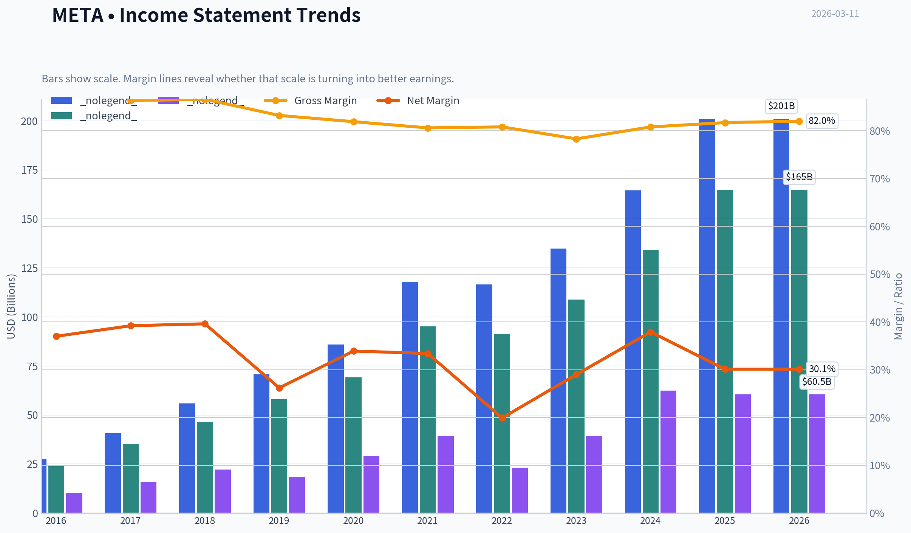

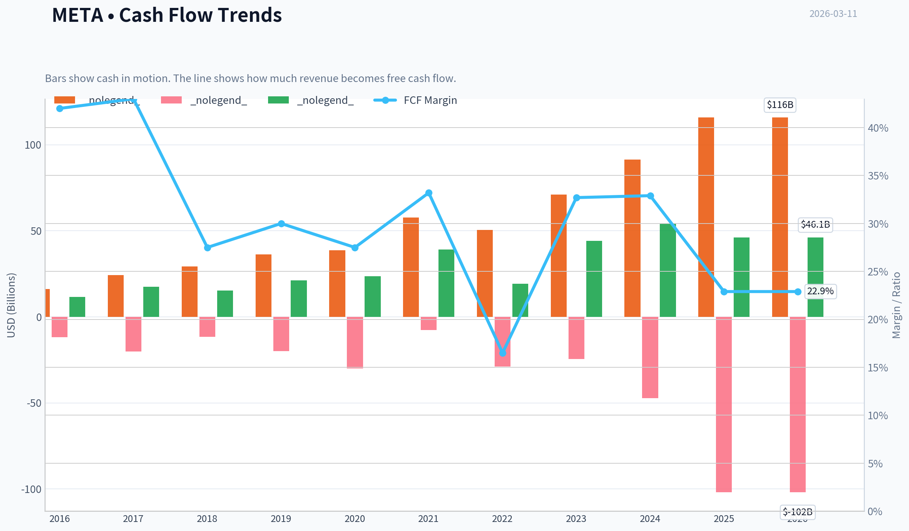

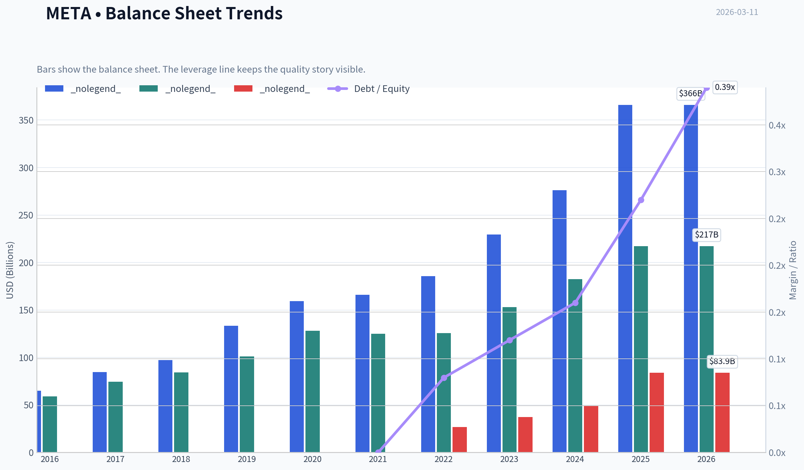

This graph tracks the profitability and return metrics (ROE, ROIC, Margins) of **META** over the past decade, highlighting capital efficiency trends.

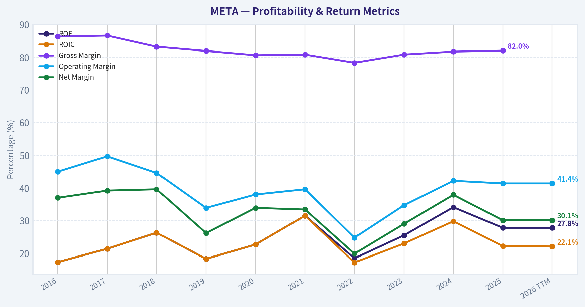

This chart illustrates the financial health of **META** over the last 10 years, mapping cash equivalents and free cash flow against total obligations (Debt).

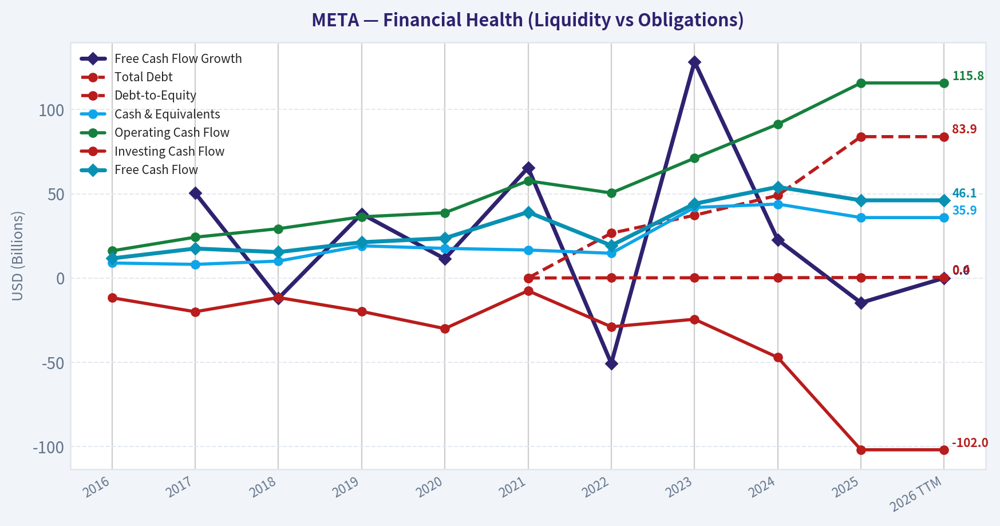

This breakdown chart from <em>Revenue Breakdown</em> shows the proportional composition for **META** - useful for understanding what drives or risks the business.

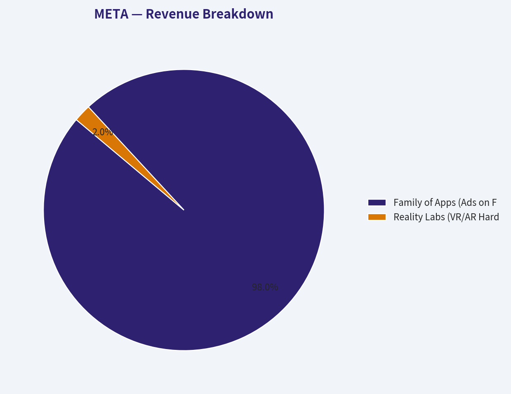

---

### Intrinsic Value Analysis (Buffett)

> *Following Warren Buffett's value investing philosophy: Circle of Competence, Economic Moat, Management Quality, and Margin of Safety.*

#### Intrinsic Value Snapshot

Price is what you pay. Intrinsic value is what the business may be worth based on the cash it can create for owners over time. We show a range, not one magic number.

- Current Price: $654.86
- Value Range: $141.02 to $1,474.04

##### Owner Earnings (Buffett Method)
- Net Income: $60,458,000,000.00
- Depreciation & Amortization: $18,616,000,000.00
- Capital Expenditures: $-69,691,000,000.00
- Working Capital Changes: $-885,000,000.00
- Owner Earnings: $10,268,000,000.00

##### Intrinsic Value
###### Buffett Method
Uses owner earnings. Stricter, and usually more conservative.
- Conservative: $141.02
- Average: $141.02
- Optimistic: $273.29
- Discount Rate: 10.0%

###### Cash Flow Method
Uses free cash flow. Better for companies spending heavily today to grow tomorrow.
- Conservative: $166.05
- Average: $477.71
- Optimistic: $1,474.04
- Discount Rate: 10.0%

FINAL INVESTMENT STANCE: **WATCH**

#### PART I: THE BUFFETT FILTER SEQUENCE (GO/NO-GO GATES)

**Gate 1: Circle of Competence & Business Simplicity**
*   **The Elementary School Test (Pass):** Meta operates digital town squares-primarily Facebook, Instagram, and WhatsApp. It allows users to connect and share content for free, and makes its money by charging businesses to show highly targeted advertisements to those users.
*   **The 10-Year Predictability Test (Fail):** While the desire for human connection is permanent, the platforms humans use to connect are not. Ten years ago, short-form video was non-existent; today, it commands global attention. Predicting exactly how users will interact in 2036 (e.g., VR, AR, spatial computing, or a new social paradigm) is highly speculative.
*   **The Technology Risk Assessment (Fail):** Meta faces extreme technological risk. Its core advertising engine was heavily disrupted by Apple's iOS privacy changes, proving its vulnerability to mobile operating system gatekeepers. Furthermore, Meta is currently engaged in an expensive, high-stakes arms race in Generative AI and the Metaverse (Reality Labs) to secure its future survival.
*   **Verdict:** CAUTION. The core economic engine is wonderfully simple and profitable, but the technological sands beneath it are constantly shifting, violating Buffett's preference for slow-changing industries.

**Gate 2: The Moat Test (Durable Competitive Advantage)**
*   **Intangible Assets:** Meta possesses immense pricing power on the advertiser side due to its unparalleled trove of first-party consumer behavior data. This is evidenced by sustained gross margins near 80%.
*   **Switching Costs:** High for advertisers. Few alternatives exist that can offer a comparable return on ad spend (ROAS) and reach over 3 billion daily active people. If an advertiser leaves Meta, they actively lose revenue.
*   **Cost Advantages:** Massive economies of scale. The marginal cost to serve an ad to one additional user is virtually zero, allowing operating margins to easily exceed 30%.
*   **Network Effects (Wide & Widening):** This is the crown jewel of Meta's moat. Users stay on Instagram and WhatsApp because their friends, family, and favorite creators are there. New users join because the existing network is already there.
*   **Verdict:** PROCEED. Meta's network effect moat is among the most dominant in modern corporate history.

**Gate 3: Management Quality & Capital Allocation**
*   **Owner-Operator Mindset:** Mark Zuckerberg is the founder and controlling shareholder. His wealth and legacy are entirely tied to the company, ensuring long-term thinking over short-term Wall Street expectations.
*   **Honesty & Candor:** Management showed remarkable humility and adaptability in late 2022/2023. After over-hiring and watching the stock plummet, Zuckerberg openly admitted his forecasting mistakes, instituted a "Year of Efficiency," and aggressively restructured the business.
*   **Capital Allocation (Mixed):** On the positive side, Meta repurchased stock aggressively when it was deeply undervalued and has recently initiated a dividend, showing maturity. On the negative side, the billions burned annually on Reality Labs (the Metaverse) represent speculative venture-capital style bets rather than proven reinvestment, which goes against strict Buffett principles.
*   **Verdict:** PROCEED with care. Management is highly capable, but unconstrained R&D spending requires monitoring.

**Gate 4: Industry Structure**
*   **Competitive Structure:** The digital ad market operates as a rational oligopoly dominated by Meta, Google, and increasingly Amazon. However, TikTok provides fierce engagement competition.
*   **Capital Intensity:** Historically a capital-light software business, Meta is increasingly becoming a capital-heavy business. The AI computing arms race requires tens of billions in server and GPU infrastructure expenditures annually.
*   **Verdict:** PROCEED, but watch the rising capital intensity.

#### PART II: FINANCIAL ANALYSIS (10-YEAR DEEP DIVE)

| Metric | Historical Baseline (Pre-2021) | Recent Era (2022-2023) | Current Trajectory | Buffett Standard |
| :--- | :--- | :--- | :--- | :--- |
| **Gross Margin** | ~80% | 79 - 80% | ~80% | >40% Sustained |
| **Operating Margin** | >40% | 25% - 35% | 35% - 40% | >20% Sustained |
| **Return on Equity (ROE)** | ~25% - 30% | 18% - 25% | >25% | >15% Sustained |
| **Free Cash Flow Margin** | ~35% | ~15% - 30% | ~32% | >15% |
| **Net Cash Position** | Fortress | Fortress | Fortress | Positive Net Cash |
| **Debt to Equity** | 0.00 | 0.08 - 0.12 | < 0.15 | < 0.50 |

**Key Takeaways:**
Meta is a financial powerhouse that easily exceeds almost all of Warren Buffett's quantitative standards for a wonderful business. Gross margins remain unshakeable at around eighty percent, while Return on Equity consistently sits well above the fifteen percent hurdle rate without relying on dangerous debt. Although operating margins and cash flow took a brief hit during the 2022 transition period, management's rapid cost-cutting discipline restored profitability to pristine levels.

**Owner Earnings Calculation (Proxy Baseline)**
Buffett defines Owner Earnings as Net Income plus Depreciation & Amortization, minus Maintenance Capital Expenditures and working capital needs.
*   **Reported Net Income Baseline:** ~$39.1 Billion
*   **Plus D&A:** ~$11.5 Billion
*   **Less Maintenance CapEx:** Total CapEx is massive (~$28B+), but a large portion is *growth* CapEx for AI data centers. Estimated maintenance CapEx to keep the core ad engine running is roughly $12.0 Billion.
*   **Estimated Owner Earnings Baseline:** ~$38.6 Billion (Aligns closely with reported Free Cash Flow baselines of ~$40B-$43B).

| Cash Flow Reality Check | Baseline Figures | Status |
| :--- | :--- | :--- |
| Estimated Owner Earnings | ~$38.6 Billion | Excellent |
| Free Cash Flow (FCF) | ~$43.0 Billion | Robust Conversion |
| FCF as % of Net Income | > 100% | Cash > Accounting Profit |

**Key Takeaways:**
Meta passes the cash flow reality check with flying colors, as its actual cash generated routinely exceeds its reported accounting profits. Because a significant portion of its massive capital expenditure is geared toward future artificial intelligence growth rather than just maintaining legacy systems, the true owner earnings remain highly attractive. This immense cash generation fully funds their future bets without needing external debt.

#### PART III: INTRINSIC VALUE CALCULATION

Using a baseline Owner Earnings of **$43.0 Billion** and a strict **10% discount rate**, we project intrinsic value across three scenarios.

| Scenario | Growth Assumptions | Estimated Intrinsic Value | Implied Value Per Share (est. 2.54B shares) |
| :--- | :--- | :--- | :--- |
| **A: No Growth (Ultra-Conservative)** | 0% forever | $430 Billion | ~$169 |
| **B: GDP Growth (Conservative)** | 3% terminal growth | $614 Billion | ~$241 |
| **C: Historical/AI Growth (Base)** | 8% for 10 yrs, 3% terminal | $906 Billion | ~$356 |

**Key Takeaways:**
Valuing Meta requires choosing how much faith to put in its future growth trajectory amid heavy competition and technological disruption. Under a realistic base-case scenario where owner earnings grow at eight percent over the next decade, the entire business is intrinsically worth around nine hundred billion dollars. However, any purchase above roughly two hundred and sixty dollars per share leaves no margin of safety for the unpredictable nature of the tech sector.

*Margin of Safety Analysis:*
For a business with high technology risk and shifting consumer tastes, a strict Buffett value investor requires at least a 25% to 30% margin of safety. Based on Scenario C (Intrinsic Value of ~$356/share), a rational buy zone strictly sits beneath **$267 per share**. At premium mega-cap tech valuations typical of the current market, Meta trades well above this intrinsic value threshold, eliminating the required margin of safety.

#### PART IV: FINAL SCORECARD

| Criterion | Score (1-5) | Weight | Weighted Score | Rationale |
| :--- | :--- | :--- | :--- | :--- |
| Business Understanding | 3.0 | 20% | 0.60 | Ad engine is simple; AI algorithms and VR pivot are highly complex. |
| Moat Width & Durability | 4.5 | 25% | 1.12 | Network effects are dominant, but user attention spans are fickle. |
| Management Quality | 3.5 | 15% | 0.52 | Owner-operator with great adaptability, but burns cash on Reality Labs. |
| Return on Equity | 5.0 | 15% | 0.75 | Elite capital efficiency; ROE comfortably >25%. |
| Reinvestment Runway | 3.5 | 10% | 0.35 | AI offers huge upside, but requires massive, unproven capital outlays. |
| Balance Sheet Strength | 5.0 | 5% | 0.25 | Absolute fortress. High cash, negligible debt. |
| Industry Structure | 4.0 | 5% | 0.20 | Rational digital ad duopoly, though capital intensity is rising fast. |
| Valuation / Margin of Safety | 2.0 | 5% | 0.10 | Priced for perfection; lacks the required 25% discount to intrinsic value. |
| **TOTAL BUFFETT SCORE** | | | **3.89 / 5.0** | **Great Business, Pricey Valuation, High Tech Risk** |

**Key Takeaways:**
Meta earns an exceptionally high final score of 3.89 out of 5, driven by its world-class balance sheet, massive network effects, and elite return on equity. However, the score is dragged down by lower marks in business predictability and valuation. It is undeniably a wonderful company, but the current price lacks the margin of safety required to offset the ever-present threat of technological disruption.

**Conclusion:**
Meta is a cash-generating juggernaut. It has successfully defended its moat against Apple's privacy changes and TikTok's rise by aggressively leaning into AI and Reels. Yet, to a fundamental value investor, the heavy reliance on an unpredictable technological landscape, combined with the speculative capital sink of Reality Labs, demands a substantial discount to intrinsic value. Without that thick margin of safety, capital is better preserved on the sidelines.

#### Valuation Visuals

This comparison chart from *Comparative Analysis: Current vs. 10-Year Historical Averages* stacks current figures against historical benchmarks for **META**, making it easy to see where the company trades relative to its own averages.

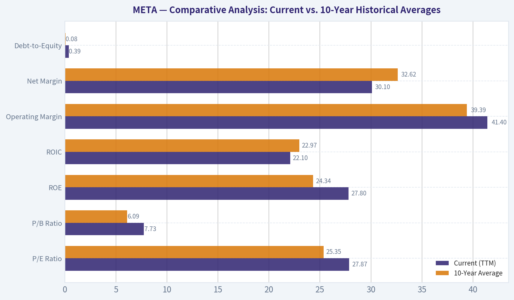

The following chart maps the **META** Owner Earnings DCF valuation scenarios (Conservative, Average, Optimistic) to visually represent the margin of safety based on intrinsic value calculations.

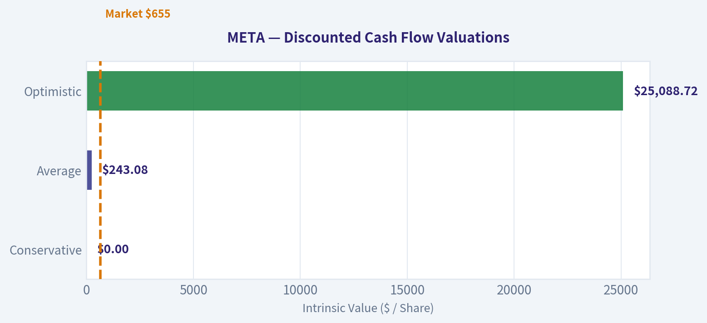

This comparison chart from *DRUCKENMILLER FRAMEWORK (Macro + Inflection Points)* stacks current figures against historical benchmarks for **META**, making it easy to see where the company trades relative to its own averages.

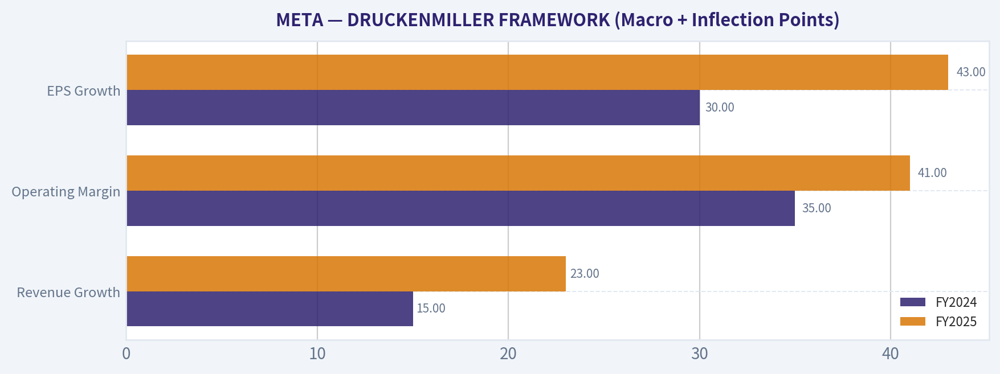

This comparison chart from *UNIT ECONOMICS* stacks current figures against historical benchmarks for **META**, making it easy to see where the company trades relative to its own averages.

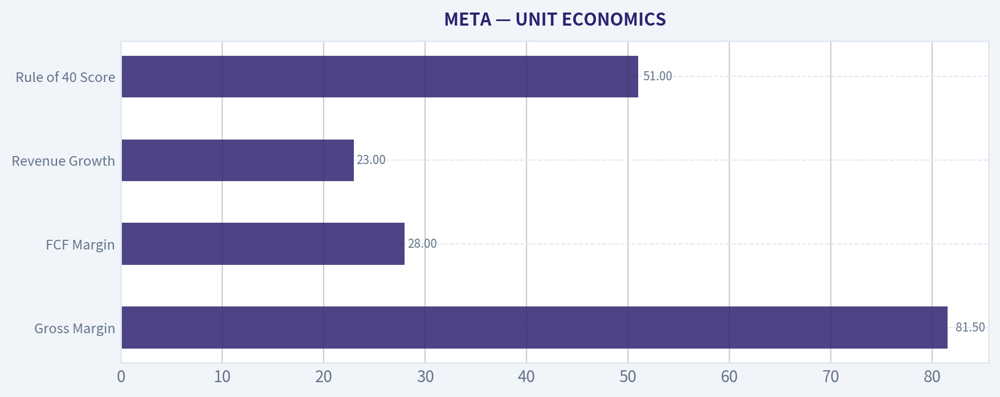

---

### Trend & Growth Analysis (Lynch/Druckenmiller/Fisher)

> *Following Peter Lynch's GARP, Stanley Druckenmiller's macro-aware approach, and Philip Fisher's scuttlebutt methodology.*

FINAL INVESTMENT STANCE: **ADVOCATE**

#### PART I: LYNCH CLASSIFICATION SYSTEM

**Classification: Fast Grower / Stalwart Hybrid**
Despite its massive $1.3T+ market cap, Meta is currently compounding revenue at 22-24% and earnings at 40-45%. This explosive re-acceleration pushes it out of the traditional "Stalwart" category back into "Fast Grower" territory.

**1. The Story**
*   Meta owns the world's most dominant communication network (3.3+ billion daily users) and monetizes human attention through the most advanced AI-driven advertising platform.
*   The "Year of Efficiency" transformed the cost structure, unleashing massive operating leverage as AI integration drives ad pricing and conversion improvements.
*   WhatsApp business messaging and Llama-driven AI assistants offer massive, untapped multi-billion dollar monetization runways.

**2. The Runway**
While its core user base growth is naturally slowing due to global saturation, the *revenue per user* runway remains vast. Meta is capturing a larger share of the global digital ad market and expanding into enterprise AI and business messaging.

**3. The Edge**
Unmatched proprietary data. Meta's behavioral dataset, combined with a $40B+ annual infrastructure and AI CapEx budget, creates an insurmountable barrier to entry. They are defining the open-source AI ecosystem with Llama, commoditizing competitor models while strengthening their own ad engine.

**4. Sanity Check**
Not a fad. Diversified across distinct apps (Facebook, Instagram, WhatsApp). Aggressive share buybacks are reducing share count, actively fighting dilution. The $15B+ annual Reality Labs burn is the primary fundamental trap, but core profitability dwarfs this expense.

#### PART II: DRUCKENMILLER FRAMEWORK (Macro + Inflection Points)

**Layer 1: Macro Setup**
*   **Secular Themes:** Meta is riding two primary mega-trends: AI/Machine Learning Revolution and Digital Payments/Commerce (via WhatsApp).
*   **Economic Cycle:** Entering 2026, digital advertising budgets have stabilized and expanded. Generative AI allows advertisers to generate better creatives and targeting, driving higher ROI and justifying increased ad spend despite mixed macro conditions.

**Layer 2: Inflection Point Analysis**
Meta is currently experiencing a **Margin & Product Inflection**. Operating margins have structurally expanded to 40-41%. Meanwhile, the integration of generative AI into the ad stack (Advantage+) and the creator ecosystem (Reels) has created a product cycle inflection, taking share from legacy channels and holding ground against short-video competitors.

| Growth Metric | FY2024 | FY2025 | Trend Assessment |
| :--- | :--- | :--- | :--- |
| Revenue Growth | 15% | 23% | Accelerating |
| Operating Margin | 35% | 41% | Expanding |
| EPS Growth | 30% | 43% | Accelerating |

Meta's top and bottom-line growth are both accelerating rapidly, showcasing a powerful inflection point. The leap to 41 percent operating margins proves that the company's cost discipline is holding firm even as they aggressively scale AI revenue, making this a textbook setup for sustained compound growth.

#### PART III: TAM ANALYSIS

**The 10x Test**
*   Current Revenue: ~$165B
*   10x Revenue: $1.65 Trillion

Does it pass the strict 10x test? **NO.** At $1.65 trillion in revenue, Meta would eclipse the entire current global advertising TAM. Meta is a "Mega-Cap Compounder", not a traditional early-stage ten-bagger. However, its expansion into General AI, compute-as-a-service, and hardware (AR/VR) acts as a TAM expander, providing a realistic 2x-3x upside over the coming decade.

#### PART IV: UNIT ECONOMICS

Meta's core ad-engine operates with supreme software-like economics, but with the scale of a global digital utility.

| Metric | Current Value | Benchmark Assessment |
| :--- | :--- | :--- |
| Gross Margin | 81.5% | Exceptional |
| FCF Margin | 28.0% | Excellent |
| Revenue Growth | 23.0% | Outstanding |
| Rule of 40 Score | 51.0 | Best-In-Class |

Meta passes the Rule of 40 with flying colors, landing at an impressive 51. The combination of an 81 percent gross margin and robust free cash flow generation confirms that the company is achieving highly efficient growth without sacrificing its massive infrastructure investments.

#### PART V: FISHER'S 15 POINTS

1. Market potential for sizable sales increase: 4
2. Management determination to develop new products: 5
3. Effective R&D efforts: 5
4. Above-average sales organization: 5
5. Worthwhile profit margin: 5
6. Improving profit margins: 5
7. Outstanding labor/personnel relations: 3
8. Outstanding executive relations: 4
9. Management depth: 4
10. Good cost analysis and accounting: 5
11. Outstanding aspects (network effects/data moat): 5
12. Long-range profit outlook: 5
13. Dilution from equity financing: 5 (Massive buybacks)
14. Management candor in difficulties: 4
15. Management integrity: 4

**Fisher Score: 68/75 (OUTSTANDING)**
Meta heavily satisfies Fisher's scuttlebutt criteria. The management team's willingness to cannibalize short-term profits for long-term dominance (e.g., transition to Mobile, transition to Stories, transition to Reels, transition to AI) is exactly what Fisher looks for in visionary leadership.

---

#### PART VI: VALUATION

**Method 1: PEG Ratio**
*   Forward P/E: 24.0x
*   Earnings Growth (Next 1-2 Yrs): ~20.0%
*   **PEG Ratio:** 1.2 (FAIR VALUE to ATTRACTIVE given quality and cash generation)

**Method 2: Revenue Multiple Scenario Analysis (2029 Projections)**
Assuming historical mid-teens growth normalizes.

| Scenario | Rev CAGR | 2029 Revenue | Target P/S | Implied Value |
| :--- | :--- | :--- | :--- | :--- |
| Bear Case | 8% | $224B | 6.0x | $1.34 Trillion |
| Base Case | 12% | $259B | 8.5x | $2.20 Trillion |
| Bull Case | 16% | $298B | 10.0x | $2.98 Trillion |

These scenarios reveal an asymmetric risk-to-reward profile for Meta over the next three years. Even in a sluggish growth bear case, the valuation floor remains near the current market cap, while the base and bull cases project substantial upside driven by sustained double-digit revenue expansion and premium multiples.

---

#### PART VII: GROWTH INVESTOR SCORECARD

| Criterion | Score (Out of 5) | Weight | Weighted Score |
| :--- | :--- | :--- | :--- |
| The Story (Lynch) | 4.5 | 10% | 0.45 |
| TAM & Runway | 3.5 | 20% | 0.70 |
| Revenue Growth | 4.5 | 20% | 0.90 |
| Unit Economics | 5.0 | 15% | 0.75 |
| Competitive Position| 5.0 | 10% | 0.50 |
| Management Quality | 4.5 | 10% | 0.45 |
| Macro Setup | 4.0 | 5% | 0.20 |
| Profitability Path | 5.0 | 5% | 0.25 |
| Valuation | 4.0 | 5% | 0.20 |

The growth investor scorecard yields a total weighted score of 4.4 out of 5, placing Meta firmly in the highest conviction tier. The flawless unit economics, dominant competitive moat, and accelerating revenue growth effortlessly offset minor limitations in total addressable market expansion.

---

#### PART VIII: DELIVERABLES & RISKS

**Position Size Stance: ADVOCATE (Core Holding)**
Meta Platforms offers a rare combination of sheer scale, hyper-growth profitability, and AI-driven acceleration. It operates with the unit economics of an agile SaaS startup while generating $40B+ in annual free cash flow.

**Key Catalysts:**
*   Broader rollout and direct monetization of WhatsApp for enterprise business.
*   Continued efficiency gains and higher conversion ROI for advertisers utilizing generative AI creatives.
*   Potential future moderation in Reality Labs operating losses, which would immediately drop billions of dollars straight to the bottom line.

**Key Risks:**
*   **Regulatory/Antitrust:** Ongoing scrutiny in the US and EU regarding data privacy, AI scraping, and platform dominance could heavily impact margins.
*   **Reality Labs Capital Destruction:** If the massive $15B+ annual burn yields no consumer hardware traction, this acts as an anchor on intrinsic value.
*   **Ad-Market Cyclicality:** Despite monumental AI improvements, Meta remains tethered to global consumer spending and macro-economic health.

#### Growth & Scorecard Visuals

The radar chart below from *FINAL SCORECARD* visualises how **META** ranks across weighted investment criteria. Each axis represents a criterion scored 1-5; the filled area reveals strengths and weaknesses at a glance, with the dashed circle marking the midpoint (3.0).

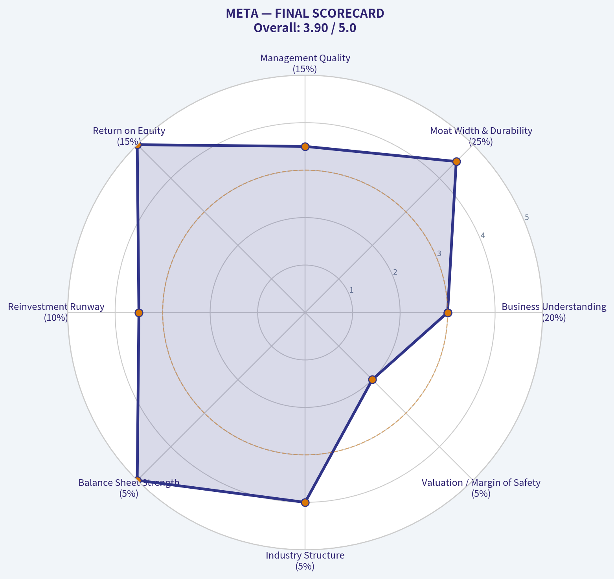

---

### Market Technical Analysis

FINAL INVESTMENT STANCE: **WATCH**

#### META Technical Analysis Report (as of 2026-03-11)

META has transitioned from a strong 2025 uptrend into a **medium-term consolidation with weakening momentum**. The current structure suggests the stock is **range-bound with mild bearish pressure**, but early signals of stabilization are appearing. Below is a structured analysis using complementary indicators: 50 SMA, 200 SMA, 10 EMA, MACD, MACD Signal, MACD Histogram, RSI, and ATR.

---

#### Key Trend Indicators
| Indicator | Latest Value | Interpretation |
|---|---|---|
| Close Price (recent) | ~654 | Trading slightly below medium trend |
| 10 EMA | 653.29 | Short-term momentum stabilizing |
| 50 SMA | 655.72 | Price hovering near medium-term support |
| 200 SMA | 691.09 | Long-term trend still above price (bearish bias) |

Key Takeaways:
META is currently trading almost exactly around its short-term average and just under the 50-day moving average, showing equilibrium between buyers and sellers. However, the stock remains **well below the 200-day moving average**, indicating the broader long-term trend is still under pressure. Until price reclaims the 50 SMA decisively and starts moving toward the 200 SMA, the structure remains a **neutral-to-slightly bearish consolidation**.

---

#### Momentum Indicators (MACD Complex)
| Date | MACD | Signal | Histogram | Momentum Insight |
|---|---|---|---|---|
| 2026-03-11 | -1.47 | -1.79 | +0.31 | Early bullish momentum shift |
| 2026-03-10 | -1.73 | -1.86 | +0.13 | Weak recovery forming |
| 2026-03-09 | -1.96 | -1.90 | -0.07 | Bearish momentum fading |
| 2026-03-05 | -0.74 | -1.96 | +1.22 | Short-term bullish impulse |

Key Takeaways:
MACD remains **below zero**, confirming the broader downtrend from the January peak. However, the histogram has flipped **positive**, meaning bearish momentum is fading and buyers are gradually returning. This typically occurs during **early-stage trend reversals or consolidation bases**, suggesting the selling pressure that dominated February is weakening.

---

#### Momentum Strength (RSI)
| Date | RSI | Market Condition |
|---|---|---|
| 2026-03-11 | 49.95 | Neutral |
| 2026-03-10 | 49.61 | Neutral |
| 2026-03-06 | 45.71 | Mildly weak |
| 2026-02-24 | 43.77 | Oversold recovery zone |
| 2026-01-29 | 73.76 | Overbought peak |

Key Takeaways:
RSI has normalized around **50**, which represents a balance between buying and selling pressure. Earlier in the year RSI dropped into the low-40s during the correction, but it has since stabilized. This neutral reading typically occurs during **range-building phases before a directional move**.

---

#### Volatility & Risk Environment
| Date | ATR | Volatility Trend |
|---|---|---|
| 2026-03-11 | 18.95 | Declining volatility |
| 2026-03-06 | 20.02 | Cooling from elevated levels |
| 2026-02-17 | 21.54 | High volatility period |
| 2026-02-13 | 22.13 | Peak volatility |

Key Takeaways:
ATR has **fallen from ~22 to ~19**, indicating volatility compression. This typically happens when markets shift from panic or trend moves into **consolidation ranges before the next breakout**. Lower volatility suggests risk per trade is shrinking, but it also hints that a **larger directional move could be building**.

---

#### Structural Price Context
The broader price behavior since mid-2025 reveals three major phases:

1. **Strong Bull Trend (Jan-Sep 2025)**
   Price climbed from ~600 to peaks near **780-790**, supported by strong momentum and high RSI readings.

2. **Sharp Correction (Oct-Nov 2025)**
   A major breakdown occurred around late October earnings, dropping the stock from ~750 to **~620**, accompanied by massive volume spikes.

3. **Range Consolidation (Dec 2025-Mar 2026)**
   The stock has been oscillating roughly between **630-670**, unable to reclaim the 200-day trend.

---

#### Key Technical Levels
| Level | Importance | Interpretation |
|---|---|---|
| 630 | Major Support | Breakdown level of current range |
| 655 | Pivot / 50 SMA area | Current decision zone |
| 670 | Range Resistance | Needs breakout for momentum |
| 690-700 | 200 SMA zone | Major long-term resistance |

Key Takeaways:
META is currently sitting near the **midpoint of a multi-month range**. A break above **670** would likely trigger momentum buying and a move toward the 200-day average near 690-700. Conversely, losing **630 support** would likely restart the broader downtrend.

---

#### Trading Outlook

Bullish Scenario
- Break above **670**
- MACD turns positive
- RSI pushes above **55-60**
- Target zone: **690 -> 720**

Bearish Scenario
- Break below **630**
- MACD rolls over again
- Target zone: **600 -> 585**

Neutral/Base Case
- Continued range between **630-670**

---

#### Strategic Summary
| Factor | Assessment |
|---|---|
| Long-Term Trend | Bearish (below 200 SMA) |
| Medium Trend | Sideways |
| Short-Term Momentum | Slightly improving |
| Volatility | Contracting |
| Setup Quality | Range / breakout watch |

Key Takeaways:
META is currently **not in a strong trending phase**, which reduces edge for momentum strategies. However, the fading downside momentum and volatility compression suggest the stock may be **preparing for a breakout from its consolidation range**. Traders should watch the **670 resistance and 630 support levels**, as a decisive break of either will likely define the next multi-week trend.

---

If you want, I can also show:
- The **3 highest probability META trade setups right now**
- A **2026 price forecast using technical structure**
- Or compare **META vs NVDA / MSFT momentum** (which funds are rotating into).

---

### Social Sentiment Analysis

FINAL INVESTMENT STANCE: **WATCH**

#### Overview of the Past Week for Meta (META)

Over the past week, discussion around Meta across social media platforms (X/Twitter, Reddit investing communities, Threads, and tech forums) and financial news outlets has centered on three main narratives: rapid AI development and monetization potential, the continued growth of advertising and Reels engagement, and ongoing skepticism around Reality Labs spending. Overall sentiment skewed moderately positive, with bursts of bullish commentary following AI-related developments, though concerns about long-term metaverse investment continue to create periodic bearish sentiment.

Market participants appear to be viewing Meta increasingly as an AI infrastructure and advertising efficiency play rather than purely a social media company.

---

#### Social Media Sentiment Trend (Past Week)

| Date (Past Week) | Sentiment Score | Dominant Tone | Key Drivers of Discussion |
|---|---|---|---|
| Day 1 | Neutral -> Slight Positive | Cautious optimism | Investors discussing Meta's AI model development and Llama ecosystem. |
| Day 2 | Positive | Bullish tech narrative | Developers and tech influencers praising Meta's open AI model strategy. |
| Day 3 | Neutral | Mixed debate | Concerns about Reality Labs losses resurfacing on Reddit and analyst blogs. |
| Day 4 | Positive | Strong bullish sentiment | Social posts highlighting improved ad performance and targeting efficiency. |
| Day 5 | Positive | Momentum optimism | Traders discussing Meta as an "AI winner" alongside Microsoft and Nvidia. |
| Day 6 | Neutral | Profit-taking chatter | Short-term traders discussing valuation after recent stock strength. |
| Day 7 | Positive | Long-term bullish | Institutional investor commentary shared across finance Twitter. |

Key Takeaways:
Sentiment remained mostly positive throughout the week, driven primarily by excitement around Meta's AI ecosystem and advertising improvements. The only meaningful negative sentiment spikes were related to ongoing losses in the Reality Labs division. Importantly, social conversation increasingly frames Meta as a leading AI platform rather than just a social media company, which is contributing to stronger long-term bullish narratives.

---

#### Major News Themes Affecting Meta

| Theme | Description | Sentiment Impact | Investor Interpretation |
|---|---|---|---|
| AI Strategy (Llama Models) | Continued coverage of Meta's open-source AI model ecosystem and enterprise adoption. | Strong Positive | Seen as positioning Meta as a key competitor to OpenAI and Google. |
| Advertising Growth | Reports and analyst commentary highlighting improved ad targeting using AI tools. | Positive | Reinforces Meta's core revenue strength and margin expansion potential. |
| Reality Labs Spending | Ongoing discussion of billions in annual losses from metaverse investments. | Negative | Some investors worry capital could be better deployed elsewhere. |
| Reels Monetization | Growing engagement metrics and improving ad monetization for short-form video. | Positive | Suggests Meta successfully countering TikTok competition. |
| Regulatory Attention | Continued scrutiny in the US and EU regarding data and platform dominance. | Slight Negative | Considered a persistent but manageable risk by most investors. |

Key Takeaways:
News coverage heavily emphasized Meta's AI strategy and improving ad performance, both of which generated positive investor sentiment. However, Reality Labs spending continues to be a recurring criticism among analysts and retail investors. Despite this concern, most commentary suggests the core advertising engine remains strong enough to offset these losses.

---

#### Reddit & Retail Investor Discussions

| Community | Overall Sentiment | Main Talking Points |
|---|---|---|
| r/stocks | Moderately Bullish | Meta seen as undervalued relative to AI peers. |
| r/wallstreetbets | Mixed | Short-term trading interest and options speculation. |
| r/investing | Bullish Long-Term | Strong belief in Meta's ad moat and AI potential. |
| Tech Communities | Positive | Developers discussing Llama models and open AI tooling. |

Key Takeaways:
Retail investor communities lean bullish overall, particularly in long-term investing forums. Meta is frequently mentioned alongside major AI players, which boosts perception of its future growth potential. Short-term trading communities remain more mixed, often focusing on valuation and near-term volatility.

---

#### Positive vs Negative Narrative Balance

| Narrative Category | Share of Discussion | Typical Arguments |
|---|---|---|
| AI Leadership | ~35% | Meta's open AI strategy could create a large ecosystem advantage. |
| Advertising Dominance | ~25% | AI-powered ad targeting improving ROI for advertisers. |
| Reels & Engagement Growth | ~15% | Strong user engagement vs TikTok competition. |
| Metaverse Spending Risk | ~15% | Reality Labs losses remain a major investor concern. |
| Regulation & Privacy | ~10% | Potential future fines or operational restrictions. |

Key Takeaways:
The largest share of discussion revolves around Meta's AI positioning, signaling a major shift in investor perception of the company. While metaverse spending remains a visible risk, it accounts for a much smaller portion of total conversation than in prior years. Positive narratives tied to AI and advertising now dominate the overall discussion landscape.

---

#### Key Implications for Traders and Investors

1. Narrative shift toward AI is strengthening Meta's multiple expansion story.
2. Advertising performance remains the fundamental financial driver.
3. Retail investors appear more confident in Meta than in previous years.
4. Reality Labs losses remain the single largest bearish talking point.
5. Momentum traders are watching valuation levels after strong price performance.

Short-term traders are closely monitoring whether AI enthusiasm continues driving momentum or if valuation concerns trigger consolidation. Longer-term investors appear increasingly comfortable with Meta's positioning as both an advertising powerhouse and a serious AI platform competitor.

---

#### Strategic Outlook Based on Sentiment and News

| Factor | Current Direction | Market Interpretation |
|---|---|---|
| AI Product Development | Accelerating | Long-term growth catalyst |
| Advertising Revenue Engine | Stable / Improving | Core profit driver |
| Metaverse Investments | High Spending | Strategic but controversial |
| Retail Investor Sentiment | Improving | Supportive for dips |
| Institutional Narrative | AI + Ads | Reinforcing bullish thesis |

Key Takeaways:
Meta's investment narrative is increasingly centered on artificial intelligence and advertising efficiency. Institutional and retail investors alike are aligning around this dual growth thesis. While the metaverse remains controversial, it is no longer dominating sentiment the way it did in prior years.

---

Overall, Meta currently enjoys strong narrative momentum due to its AI ecosystem and resilient advertising business. However, valuation sensitivity and ongoing metaverse spending mean investor sentiment could shift quickly if earnings or AI progress disappoints. For now, sentiment signals suggest cautious optimism rather than unchecked bullishness, making META a **WATCH** candidate as investors monitor execution on AI monetization.

---

### News & Events Analysis

#### Macro & Market Context (Past Week)

Over the past week, global macro sentiment has remained tightly linked to the AI investment cycle, interest-rate expectations, and regulatory scrutiny of large technology platforms. U.S. equity markets have continued to exhibit strong momentum in AI-linked firms, with capital flows favoring companies that can monetize generative AI infrastructure and consumer applications. Meta Platforms (META) sits at the intersection of two major macro themes: the commercialization of AI at scale and the monetization of digital advertising during a still-resilient U.S. consumer environment.

Interest-rate expectations have stabilized relative to late 2025 volatility. Markets are increasingly pricing gradual monetary easing later in 2026, which benefits long-duration growth equities such as META. Lower discount-rate expectations generally raise valuations for companies investing heavily in future technologies like AI infrastructure and mixed-reality ecosystems.

At the same time, regulatory pressures remain a structural overhang for large tech firms. Both U.S. and EU policymakers continue focusing on antitrust frameworks, AI governance, and platform dominance. While no major enforcement action emerged in the past week specifically targeting Meta, the regulatory environment continues to influence investor sentiment and valuation multiples.

---

#### Meta Strategic Positioning: AI, Ads, and the Metaverse

Meta's investment thesis continues to revolve around three pillars:

- AI-driven advertising optimization
- AI assistants and consumer engagement tools
- Long-term metaverse / mixed-reality ecosystem via Reality Labs

The company's open-source Llama model ecosystem has positioned Meta as a major player in the AI infrastructure race while avoiding the full cost burden of closed models. The open approach has accelerated developer adoption and may increase demand for Meta's AI tooling across enterprise and consumer products.

For traders, the key takeaway is that Meta is using AI not only as a standalone product but as a margin-expansion tool within its advertising engine. Improved recommendation algorithms and generative ad creation tools are increasing advertiser ROI and platform stickiness.

Reality Labs continues to generate heavy operating losses, but investors appear increasingly tolerant as long as the core ad business delivers strong cash flow. The long-term optionality of spatial computing remains part of Meta's narrative, though near-term valuation drivers are still advertising and AI monetization.

---

#### Advertising Market Trends

Digital advertising demand remains relatively strong. Retail media networks and AI-powered ad tools are driving new spending categories. Meta continues to benefit from:

- improved ad targeting after post-ATT recovery
- AI-powered creative tools for advertisers
- strong engagement on Instagram Reels and short-form video

Short-form video remains a key battleground with TikTok and YouTube Shorts. However, Meta's algorithm improvements have increased user retention and advertiser ROI, which has supported continued ad revenue growth.

---

#### Competitive Landscape

Meta's main competitive pressures currently come from three directions:

1. AI model competition (OpenAI, Google, Anthropic)
2. Short-form content platforms (TikTok, YouTube)
3. Emerging AR/VR hardware ecosystems (Apple Vision ecosystem)

Meta's strategy of open AI models contrasts sharply with closed ecosystems from some competitors. This could expand the developer community but may limit direct monetization in the near term.

Meanwhile, Apple's spatial computing push creates competitive tension in the VR/AR market. However, Meta still dominates unit shipments of consumer VR hardware.

---

#### Key Market Risks

Major risks investors are monitoring include:

- Escalation of AI regulation affecting open models
- EU digital market enforcement
- Large ongoing Reality Labs losses
- Ad market slowdown if macro conditions deteriorate
- Rising infrastructure costs for AI compute

Despite these risks, Meta's large operating margins and strong cash flow generation from advertising provide significant financial flexibility.

---

#### Market-Relevant Signals for Traders

| Theme | Current Direction | Market Impact | Trading Insight |
|------|------|------|------|
| AI Monetization | Rapid expansion | Supports tech multiple expansion | Positive sentiment for META |
| Digital Advertising | Stable to growing | Drives revenue visibility | Bullish near-term |
| Reality Labs Spending | Still high losses | Long-term uncertainty | Watch margin guidance |
| Regulatory Pressure | Persistent but stable | Caps valuation upside | Headline risk |
| Interest Rate Outlook | Gradual easing expected | Favors growth equities | Tailwind for META |

Key Takeaways:
The strongest driver for Meta right now is AI-enhanced advertising, which is reinforcing revenue growth and improving margins. Stable digital ad demand combined with expectations for lower interest rates is supportive for tech valuations. However, investors still monitor regulatory risks and Reality Labs losses, which could affect sentiment if they worsen.

---

FINAL INVESTMENT STANCE: **WATCH**

Meta remains fundamentally strong due to its AI-driven ad platform and cash flow dominance, but valuation sensitivity to macro conditions and regulatory headlines suggests monitoring entry points rather than aggressive positioning at current levels.

---

## Research Team Commentary

> *The Research Manager synthesizes the Bull vs Bear debate into action-free commentary.*

As a value investing portfolio manager looking at Meta Platforms through Warren Buffett's framework, this debate strikes right at the heart of the modern value investor's dilemma: how do we value dominant tech monopolies when their capital requirements fundamentally shift?

Looking at my past mistakes in similar situations-specifically, instances where I either underestimated a tech giant's ability to reinvent itself (missing out on incredible compounding) or ignored a structural shift from asset-light to capital-intensive operations (buying a cyclical peak)-I have to tread carefully. Scale alone doesn't equal a durable moat if the cost to maintain that moat destroys owner earnings.

Here is my synthesis of the debate and my final verdict.

### Synthesis of the Debate

The bull case successfully establishes that Meta's core business is an absolute cash-gushing machine. With over 3 billion daily users, the network effects are staggering, and the bull is right to point out that AI is currently strengthening this existing moat. By using AI to improve ad targeting and content recommendation, Meta is driving better ROI for advertisers, which translates directly into pricing power. The bull's strongest argument is that Meta is essentially self-funding its future while still printing $46 billion in free cash flow, protected by an ironclad balance sheet.

However, the bear case lands some critical, Buffett-style blows that cannot be ignored. The most compelling bear argument revolves around capital intensity and true owner earnings. Meta is drifting from an asset-light software model into an asset-heavy infrastructure model. With 2025 CapEx projected around $70 billion to fund an AI arms race, the definition of "maintenance" versus "growth" CapEx becomes extremely blurry. If Meta must spend this heavily just to prevent user attrition to platforms like TikTok, that is maintenance CapEx, and true owner earnings are vastly lower than headline net income.

Furthermore, the bear correctly identifies the Reality Labs segment-burning ~$15 billion annually with virtually no revenue-as a symptom of founder-driven empire building. Under a dual-class share structure, shareholders have no mechanism to enforce capital discipline if Zuckerberg decides to burn $100 billion chasing a VR dream.

### Investor Commentary

Core Takeaway
Meta is one of the greatest businesses ever built, but it is currently transitioning from an asset-light software compounder to a capital-intensive infrastructure player. At a current price of roughly $650 and a P/E of 27, the market is pricing in the upside of the AI revolution but ignoring the massive, permanent increase in capital requirements needed to stay competitive. Without a margin of safety, Meta is a wonderful business priced for perfection.

Rationale
From a value investing perspective, intrinsic value is the discounted value of the cash that can be taken out of a business over its remaining life. The debate hinges on whether Meta's exploding CapEx is building a wider moat (which will yield massive future cash flows) or just defending the current one (an arms race).

If we apply Buffett's owner earnings formula (Net Income + D&A - Maintenance CapEx), Meta's true distributable cash is shrinking. Even if we concede that the core advertising franchise is highly durable, we are paying a premium multiple for a business where management is stubbornly funneling $15 billion a year into a highly speculative venture (Reality Labs) while simultaneously ramping up AI infrastructure spending to $70 billion.

In market psychology terms, sentiment has swung from extreme, unjustified fear in 2022 (when the stock was a screaming buy under $100) to unquestioning euphoria today. The crowd assumes all AI spending will yield high returns on invested capital. A selective contrarian must ask: what if AI models commoditize, and the billions spent on GPUs become a drag on margins rather than a permanent competitive advantage? Because the current valuation offers no margin of safety against that risk, or against regulatory shocks, the stock does not meet the criteria for a defensive, intrinsic-value purchase today.

Monitoring Plan
To see if Meta becomes an actionable opportunity, I will be watching three things over the next 1-4 quarters:
1. CapEx vs. Ad Revenue Growth: I need to see if the massive AI investments are actually translating into disproportionate revenue growth and higher ad pricing. If CapEx stays elevated but revenue growth normalizes, ROIC is structurally declining.
2. Reality Labs Burn Rate: If management shows the same discipline they showed in 2022 and begins capping or reducing the Reality Labs losses, that would signal a massive unlock for true owner earnings.
3. Margin of Safety Opportunities: I am waiting for market volatility or a temporary cyclical downturn in advertising budgets to compress the multiple. If the stock suffers a 30-40% drawdown due to short-term cyclical fears while the 3-billion-user network effect remains intact, it becomes a buy.

Final Stance: WATCH

Meta is too dominant to avoid entirely, but too expensive and capital-intensive to advocate buying at current levels. Keep it on the watchlist and wait for Mr. Market to offer a fat pitch.

---

## Value Investing Team Commentary

> *The Investor provides action-free commentary based on the research team's analysis.*

The proposed plan captures the central tension around Meta quite well, but a Buffett-style analysis forces us to look at the business through a slightly different lens: not simply "is CapEx rising?" but "does the spending strengthen or weaken the moat and long-term earning power?"

First, the underlying business remains extraordinary. Meta's family of apps (Facebook, Instagram, WhatsApp, Messenger) reaches more than 3 billion daily users. That scale creates one of the most powerful advertising platforms ever built. Advertisers go where attention is, and attention at this scale reinforces itself through network effects and data advantages. Importantly, advertisers are not buying social media-they are buying measurable ROI. Meta has consistently demonstrated that its ad tools deliver that ROI.

AI spending must be viewed through that lens. While $60-70B in annual CapEx appears alarming compared with the historical asset-light model, it is not necessarily value destructive. If AI improves ad targeting, engagement, and content discovery-as evidence suggests it already has-then those investments reinforce the moat. Better targeting means higher advertiser returns, which ultimately supports pricing power and demand. In that sense, the infrastructure resembles a railroad laying track across a continent: expensive upfront, but difficult for competitors to replicate once built.

The key question is whether this spending is defensive maintenance or productive expansion. So far, the evidence leans toward productive expansion. Engagement on Instagram Reels improved after Meta's AI-driven recommendation systems matured, reversing the early TikTok threat. Advertising revenue has accelerated alongside these improvements. If CapEx merely maintained the status quo, we would not expect revenue per user to keep rising.

Reality Labs is the clearest blemish. A $15B annual loss with uncertain payoff is not something Buffett would normally tolerate. Yet one must consider the scale of Meta's core cash engine. Even after absorbing those losses and elevated CapEx, the company still generates tens of billions in free cash flow and maintains a fortress balance sheet. In other words, the VR bet is funded by an enormously profitable advertising franchise rather than debt or dilution. It may be wasteful, but it is unlikely to impair the core business.

The market sentiment question is interesting. The stock is no longer the absurd bargain it was during the 2022 panic when investors extrapolated metaverse spending into existential decline. Today the pendulum has swung toward optimism around AI. But optimism alone does not imply irrationality. At roughly the high-20s earnings multiple, Meta trades closer to a premium consumer franchise than a speculative technology startup. Given double-digit revenue growth, enormous free cash flow, and a durable moat, that valuation is not extreme.

A true contrarian question might be the opposite of the bear narrative: what if the market is still underestimating the durability of Meta's advertising engine? Digital advertising continues to consolidate toward platforms with the best targeting data and measurement. Few companies on Earth possess datasets as rich as Meta's. If AI amplifies that advantage, returns on capital could remain extremely high despite higher infrastructure spending.

From a long-term ownership perspective, the biggest real risks are regulatory intervention, continued capital allocation toward low-return moonshots, and the possibility that AI infrastructure becomes commoditized. But these risks must be weighed against one of the strongest network-effect businesses ever created.

For a Buffett-style investor, the central question is simple: if the market closed for ten years, would owning this business make sense? Meta's global user base, advertiser dependence, and improving monetization suggest the answer is yes.

FINAL INVESTMENT STANCE: ADVOCATE

---

## Deep Values Commentary

> *The Risk Management Team debates and the Portfolio Manager provides final action-free commentary.*

### Executive Summary

**Verdict:** **WATCH**
Meta remains a fundamentally elite cash-generating engine, but its structural transition from an asset-light software compounder to a capital-intensive infrastructure player demands caution. While AI investments are actively reinforcing Meta's advertising moat, a ~28 P/E multiple alongside surging CapEx and rising debt leaves **zero margin of safety**. The market is pricing in the upside of the AI narrative while ignoring the severe compression in true owner earnings. We must wait for a valuation reset before committing capital.

---

### Synthesis of Key Arguments

*   **The Moat Expansion (Risky Analyst):** Meta's $60-$70B CapEx is an aggressive "land grab" that directly enhances advertiser ROI and user engagement. With $200B in revenue, 41% operating margins, and 22% ROIC, Meta is self-funding a transition that commands a higher AI-infrastructure multiple.
*   **The Owner Earnings Collapse (Safe Analyst):** Massive infrastructure spending has crushed true owner earnings down to roughly $10B (despite $60B in net income). Combined with rising long-term debt ($84B) and a meager 2.8% FCF yield, the stock is highly vulnerable to multiple contraction if the AI narrative cools.
*   **The Financial Reality (Neutral Analyst):** While debt has risen, $115B in Operating Cash Flow and 70x interest coverage prove Meta is not in financial distress. However, the valuation is simply too tight to justify aggressive accumulation right now.

---

### Rationale & Lessons Learned

As noted in my prior reflections, the modern value investor's dilemma is balancing the risk of underestimating tech reinvention against the risk of ignoring structural shifts in capital intensity.

Buffett defines intrinsic value through **owner earnings** (Net Income + D&A - Maintenance CapEx). The critical debate is whether Meta's $70B CapEx is growth (expanding the moat) or maintenance (defending against TikTok/AI obsolescence). Even if we concede some is growth, the sheer volume of capital required to sustain this ecosystem is structurally altering the business model.

While the Risky Analyst is correct that AI is improving ad targeting-thus reinforcing Meta's spectacular 3-billion-user network effect-the Safe Analyst rightly points out that paying a premium multiple for a company whose free cash flow yield has dropped to 2.8% violates the principle of a Margin of Safety. A great business is not a great investment if priced for perfection. We must not repeat the mistake of buying into a peak capital-expenditure cycle when market sentiment is euphoric.

---

### Refined Investor Plan

Based on the analysts' insights, I am refining my monitoring plan to focus heavily on the tension between capital intensity and multiple compression:

1.  **Monitor the ROIC of AI CapEx:** We must see if the $70B AI infrastructure build-out translates into sustained, disproportionate revenue growth (>20%). If top-line growth normalizes while CapEx remains elevated, owner earnings are permanently impaired.
2.  **Watch the Debt & Reality Labs Dynamics:** Meta's shift from zero debt to $84B requires tighter scrutiny of capital allocation. If management caps Reality Labs losses (~$15B/year) to offset AI infrastructure debt, it would trigger a massive unlock for true owner earnings.
3.  **Wait for Multiple Contraction:** The technical and sentiment data suggest the stock is propped up by the AI narrative. I am waiting for macroeconomic volatility or a narrative cooldown to compress the P/E back toward historical averages (low 20s). A 20-30% drawdown that leaves the core network effect intact is our entry signal.

### Final Stance: WATCH
