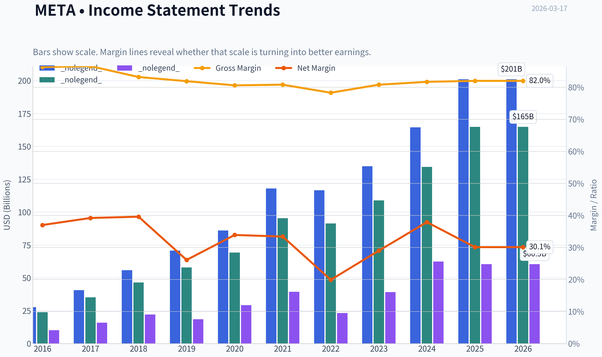
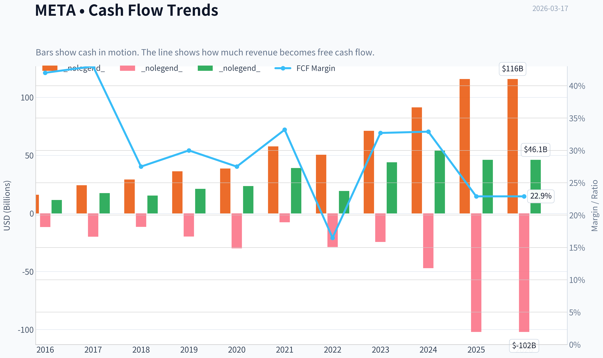
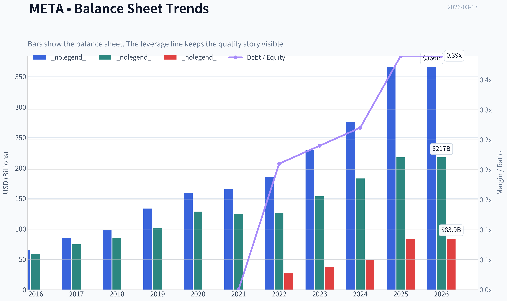
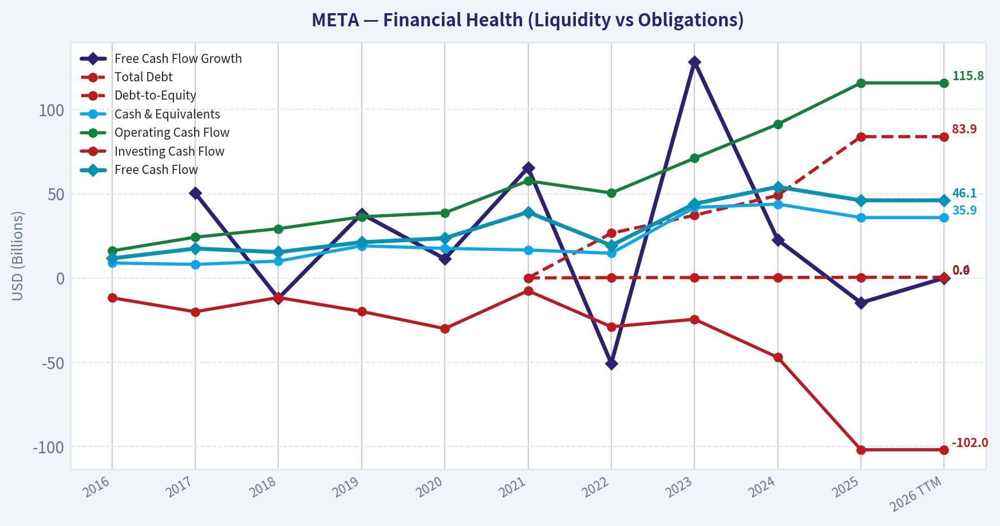
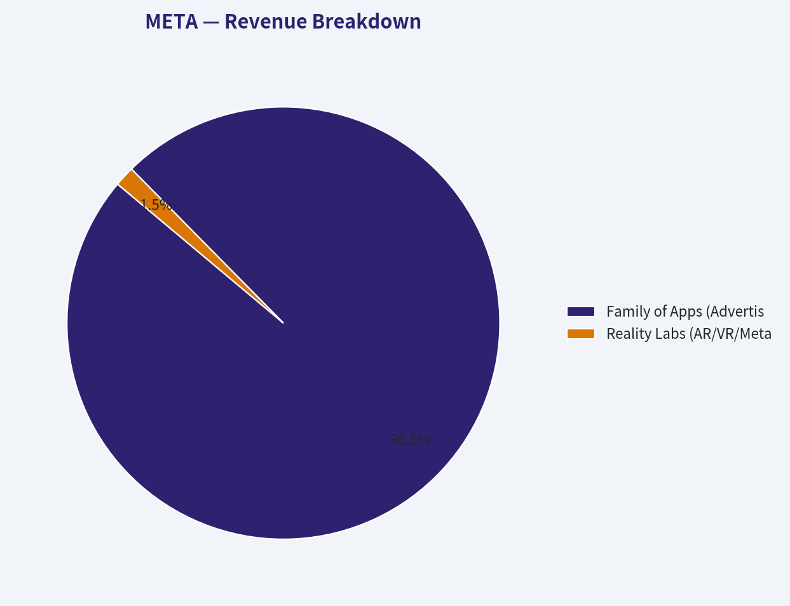
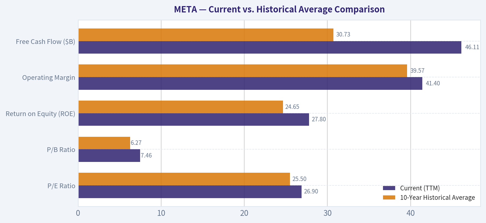
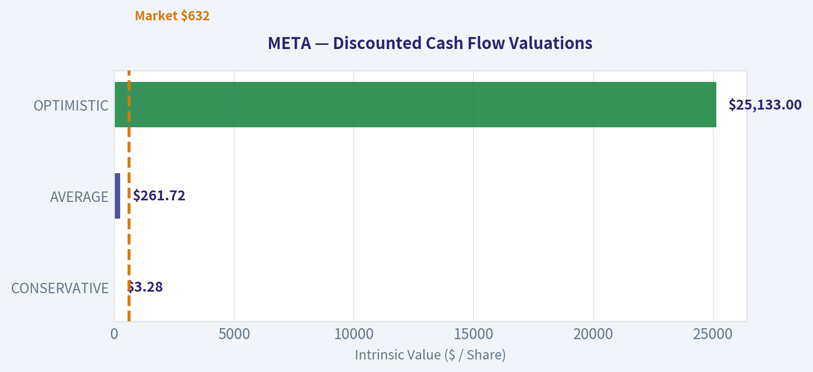
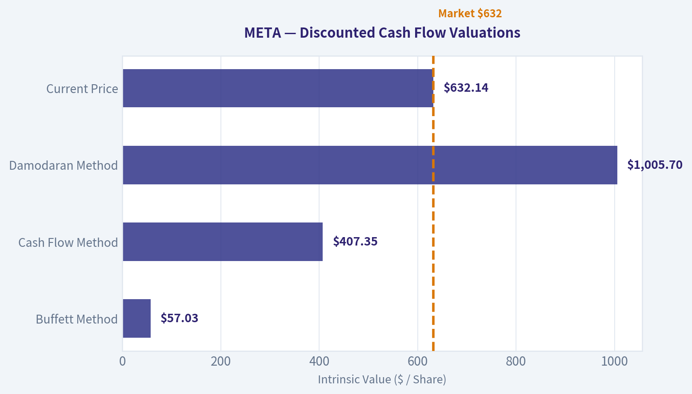
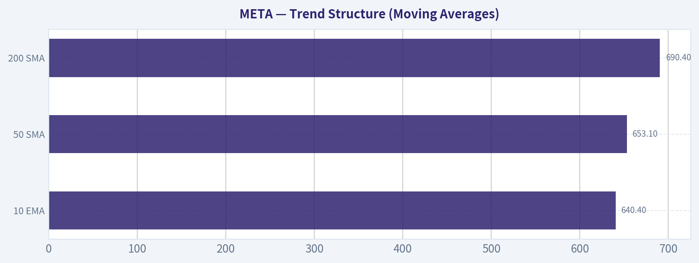

# META Deep Value Intelligence

**Analysis Date:** 2026-03-17

## Critical Disclaimer

*This analysis is generated by Deep Value Intelligence, an AI-powered multi-agent investing framework. This report is for informational and educational purposes only and does not constitute financial advice. Always conduct your own research and consult with qualified financial advisors before making investment decisions.*

---

## Table of Contents

1. Intelligence Summary
2. Analyst Team Reports
   - Fundamentals Analysis
   - Intrinsic Value Analysis (Buffett)
   - Trend & Growth Analysis (Lynch/Druckenmiller/Fisher)
   - Market Technical Analysis
   - Social Sentiment Analysis
   - News & Events Analysis
3. Research Team Commentary
4. Value Investing Team Commentary
5. Deep Values Commentary

---

## Intelligence Summary

### Thesis + Conditions

**Core Thesis:** Executive Summary
Meta is an exceptional franchise with rare profitability, global network effects, and strong revenue growth. However, the company is entering a capital-intensive AI investment phase while trading at ~27x earnings, leaving limited margin of safety.

**Key Risks:**
- Meta is an exceptional franchise with rare profitability, global network effects, and strong revenue growth. However, the company is entering a capital-intensive AI investment phase while trading at ~27x earnings, leaving limited margin of safety. The debate confirms strong long-term business quality but highlights uncertainty around AI returns, rising capex, and valuation sensitivity. For a Buffett-style investor, the business is attractive but the price is not clearly favorable. Verdict: monitor for either clearer earnings power or a better entry price.
- Risky Analyst (Bull Case)
- Safe Analyst (Risk Case)
- Founder control introduces governance risk and potential capital misallocation (e.g., Reality Labs).
- The stock currently reflects optimism, leaving limited protection if execution disappoints.

**What Would Change Our View:**
- Meta is an exceptional franchise with rare profitability, global network effects, and strong revenue growth. However, the company is entering a capital-intensive AI investment phase while trading at ~27x earnings, leaving limited margin of safety. The debate confirms strong long-term business quality but highlights uncertainty around AI returns, rising capex, and valuation sensitivity. For a Buffett-style investor, the business is attractive but the price is not clearly favorable. Verdict: monitor for either clearer earnings power or a better entry price.
- Risky Analyst (Bull Case)
- Safe Analyst (Risk Case)
- Founder control introduces governance risk and potential capital misallocation (e.g., Reality Labs).
- The stock currently reflects optimism, leaving limited protection if execution disappoints.

**Confidence:** Low

---

## Analyst Team Reports

### Fundamentals Analysis

#### Latest Earnings Snapshot

*Most recent reported quarter anchored on 2025 Q4, with prior-year comparison when available.*

| Metric | 2025 Q4 | 2024 Q4 | YoY Change |
| --- | ---: | ---: | ---: |
| Revenue | $59.89B | $48.38B | +23.8% |
| Operating Income | $24.75B | $23.36B | +5.9% |
| Net Income | $22.77B | $20.84B | +9.3% |
| Diluted EPS | $8.88 | $8.02 | +10.7% |
| Operating Cash Flow | $36.21B | $27.99B | +29.4% |
| Free Cash Flow | $14.83B | $13.56B | +9.3% |

Key Takeaways: This snapshot anchors the most recent reported quarter before the narrative analysis. It helps readers separate long-run business quality from whatever changed in the latest earnings print.

#### 10-Year Financial Metrics for META

*All values below are computed deterministically from raw data - not estimated by AI.*

*Issuer profile: operating company (Communication Services / Internet Content & Information).*

#### 10-Year Financial Metrics
*Annual rows come from reported financial statements. The final TTM row is computed from the latest four quarters.*

| Metric | 2016 | 2017 | 2018 | 2019 | 2020 | 2021 | 2022 | 2023 | 2024 | 2025 | 2026 TTM |
| --- | --- | --- | --- | --- | --- | --- | --- | --- | --- | --- | --- |
| Market Price | $114 | $175 | $130 | $204 | $272 | $334 | $119 | $351 | $583 | $660 | $632 |
| Market Cap | $334.69B | $518.77B | $380.82B | $587.08B | $784.58B | $961.62B | $325.16B | $930.56B | $1.53T | $1.67T | $1.62T |
| P/E Ratio | 32.06 | 31.95 | 17.04 | 31.52 | 26.57 | 24.43 | 14.01 | 23.80 | 24.54 | 27.62 | 26.90 |
| P/B Ratio | 5.65 | 6.98 | 4.53 | 5.81 | 6.12 | 7.70 | 2.59 | 6.08 | 8.38 | 7.69 | 7.46 |
| ROE | 17.3% | 21.4% | 26.3% | 18.3% | 22.7% | 31.5% | 18.5% | 25.5% | 34.1% | 27.8% | 27.8% |
| ROIC | 17.3% | 21.4% | 26.3% | 18.3% | 22.7% | 31.5% | 17.2% | 23.0% | 29.8% | 22.2% | 22.1% |
| EPS | $3.57 | $5.49 | $7.65 | $6.48 | $10.22 | $13.77 | $8.59 | $14.87 | $23.86 | $23.90 | $23.50 |
| Revenue | $27.64B | $40.65B | $55.84B | $70.70B | $85.97B | $117.93B | $116.61B | $134.90B | $164.50B | $200.97B | $200.97B |
| Gross Profit | $23.85B | $35.20B | $46.48B | $57.93B | $69.27B | $95.28B | $91.36B | $108.94B | $134.34B | $164.79B | $164.79B |
| Gross Margin | 86.3% | 86.6% | 83.2% | 81.9% | 80.6% | 80.8% | 78.3% | 80.8% | 81.7% | 82.0% | 82.0% |
| Operating Margin | 45.0% | 49.7% | 44.6% | 33.9% | 38.0% | 39.6% | 24.8% | 34.7% | 42.2% | 41.4% | 41.4% |
| Net Income | $10.22B | $15.93B | $22.11B | $18.48B | $29.15B | $39.37B | $23.20B | $39.10B | $62.36B | $60.46B | $60.46B |
| Net Margin | 37.0% | 39.2% | 39.6% | 26.1% | 33.9% | 33.4% | 19.9% | 29.0% | 37.9% | 30.1% | 30.1% |
| Revenue Growth | 54.2% | 47.1% | 37.4% | 26.6% | 21.6% | 37.2% | -1.1% | 15.7% | 21.9% | 22.2% | -0.0% |
| Net Income Growth | 177.0% | 56.0% | 38.8% | -16.4% | 57.7% | 35.1% | -41.1% | 68.5% | 59.5% | -3.0% | 0.0% |
| Free Cash Flow Growth | N/A | 50.5% | -12.1% | 38.1% | 11.4% | 65.5% | -50.7% | 128.5% | 22.7% | -14.7% | 0.0% |
| Total Book Value | $59.19B | $74.35B | $84.13B | $101.05B | $128.29B | $124.88B | $125.71B | $153.17B | $182.64B | $217.24B | $217.24B |
| Total Assets | $64.96B | $84.52B | $97.33B | $133.38B | $159.32B | $165.99B | $185.73B | $229.62B | $276.05B | $366.02B | $366.02B |
| Total Debt | N/A | N/A | N/A | N/A | N/A | $0 | $26.59B | $37.23B | $49.06B | $83.90B | $83.90B |
| Debt-to-Equity | N/A | N/A | N/A | N/A | N/A | 0.00 | 0.21 | 0.24 | 0.27 | 0.39 | 0.39 |
| Cash & Equivalents | $8.90B | $8.08B | $10.02B | $19.08B | $17.58B | $16.60B | $14.68B | $41.86B | $43.89B | $35.87B | $35.87B |
| Shareholders' Equity | $59.19B | $74.35B | $84.13B | $101.05B | $128.29B | $124.88B | $125.71B | $153.17B | $182.64B | $217.24B | $217.24B |
| Operating Cash Flow | $16.11B | $24.22B | $29.27B | $36.31B | $38.75B | $57.68B | $50.48B | $71.11B | $91.33B | $115.80B | $115.80B |
| Investing Cash Flow | $-11.74B | $-20.04B | $-11.60B | $-19.86B | $-30.06B | $-7.57B | $-28.97B | $-24.50B | $-47.15B | $-102.00B | $-102.00B |
| Free Cash Flow | $11.62B | $17.48B | $15.36B | $21.21B | $23.63B | $39.12B | $19.29B | $44.07B | $54.07B | $46.11B | $46.11B |
| FCF Margin | 42.0% | 43.0% | 27.5% | 30.0% | 27.5% | 33.2% | 16.5% | 32.7% | 32.9% | 22.9% | 22.9% |
| Dividends / Share | N/A | N/A | N/A | N/A | N/A | $0.00 | $0.00 | $0.00 | $1.94 | $2.10 | $2.08 |

#### Profitability Metrics
- Return on Equity (ROE): 27.8%
- Return on Invested Capital (ROIC): 22.1%
- Return on Assets (ROA): 16.5%
- Gross Margin: 82.0%
- Operating Margin: 41.4%
- Net Profit Margin: 30.1%

#### Liquidity Metrics
- Current Ratio: 2.60
- Quick Ratio: 2.42

#### Leverage Metrics
- Debt-to-Equity Ratio: 0.39
- Interest Coverage Ratio: 71.48
- Net Debt: $48.02B

#### Growth Metrics (Year-over-Year)
- Revenue Growth: 22.2%
- Net Income Growth: -3.1%
- Free Cash Flow Growth: -14.7%
- Revenue CAGR (3-Year): 19.9%
- Revenue CAGR (5-Year): 18.5%

#### Valuation Metrics
- P/E Ratio (TTM): 26.93
- Forward P/E: 17.62
- Price-to-Book: 7.36
- Price-to-Sales: 7.96
- PEG Ratio: 1.21
- EV/EBITDA: 15.61
- Free Cash Flow Yield: 2.9%
- Earnings Yield: 3.7%

#### Owner Earnings (Buffett Method, Code-Computed)
- Net Income: $60.46B
- + Depreciation & Amortization: $18.62B
- - Capital Expenditures: $-69.69B
- - Working Capital Changes: $-885.0M
- = **Owner Earnings: $10.27B**

#### Intrinsic Value (Code-Computed)
- Current Price: $632
- Buffett Method (Owner Earnings):
  Conservative: $57
  Average: $57
  Optimistic: $233
- Cash Flow Method (FCF):
  Conservative: $142
  Average: $407
  Optimistic: $1,257

#### Piotroski F-Score: 5/9
- Positive Net Income: PASS
- Positive Operating Cash Flow: PASS
- ROA Improvement: FAIL
- Cash Flow > Net Income: PASS
- Decreasing Debt: FAIL
- Improving Current Ratio: FAIL
- No Dilution: PASS
- Improving Gross Margin: PASS
- Improving Asset Turnover: FAIL

FINAL INVESTMENT STANCE: **WATCH**

#### Meta Platforms (META) Fundamental Analysis

#### Revenue Breakdown

| Revenue Source | Amount ($B) | % of Total |
| --- | --- | --- |
| Family of Apps (Advertising) | $196.55B | 97.8% |
| Reality Labs (AR/VR/Metaverse) | $3.01B | 1.5% |
| Family of Apps (Other) | $1.41B | 0.7% |

Key Takeaways: Despite vast multi-billion dollar investments into the metaverse, Meta remains almost entirely dependent on digital advertising, which makes up nearly 98 percent of its total revenue. The core Family of Apps-including Facebook, Instagram, and WhatsApp-continues to be the massive, highly profitable cash engine that funds all of the company's experimental hardware and AI bets.

#### Comprehensive Financial Metrics Analysis

**1. Market Metrics & Valuation**
Meta's market capitalization has scaled enormously from $334 billion in 2016 to $1.62 trillion today, shaking off a massive valuation collapse in 2022. The stock currently trades at a P/E ratio of 26.90, which is relatively moderate for a mega-cap tech company but heavily dependent on sustained high margins. The Price-to-Book ratio has expanded to 7.46, reflecting the market's premium pricing of Meta's intangible network assets and recently recovered profitability.

**2. Profitability**
Meta is structurally one of the most profitable enterprises on earth. The company maintains an incredible 82.0% gross margin, showcasing immense pricing power and extremely low marginal costs for digital ad delivery. Operating margins, which cratered to 24.8% during the 2022 headwinds, have sharply rebounded to 41.4%. Meta's Return on Equity (ROE) of 27.8% and Return on Invested Capital (ROIC) of 22.1% are exceptional, handily beating Warren Buffett's benchmark requirement of 15% and indicating highly efficient internal capital allocation.

**3. Growth Metrics**
Revenue has grown predictably over the decade, achieving a 3-year CAGR of 19.9%. However, growth is decelerating compared to the hyper-growth seen in 2016 (54.2%). Net income showed flat TTM growth (0.0%), plateauing at roughly $60 billion after the surge of 2024. Most crucially, Free Cash Flow growth is currently negative (-14.7% in 2025 and 0.0% TTM), directly resulting from the company's massive pivot into capital-intensive AI infrastructure buildouts.

**4. Balance Sheet**
Meta historically operated with zero debt. However, starting in 2022, management utilized debt strategically, scaling it to $83.90B. With an interest coverage ratio of 71.48x and $35.87B in liquid cash, the Debt-to-Equity ratio remains exceptionally safe at 0.39. A noticeable trend is the massive ballooning of Total Assets, scaling from $165.99B in 2021 to $366.02B today. This rapid asset accumulation-largely massive data centers and GPU clusters-has actually depressed Meta's Piotroski F-score Asset Turnover metric, as top-line revenue hasn't quite caught up with the heavy infrastructure investments.

**5. Cash Flow & The "Owner Earnings" Discrepancy**
A crucial insight from the cash flow profile is the immense gap between standard Free Cash Flow ($46.11B) and strict Buffett-style Owner Earnings ($10.27B). Standard Operating Cash Flow ($115.80B) adds back massive non-cash expenses, particularly billions in Stock-Based Compensation (SBC). Buffett's methodology treats SBC as a real dilution expense, and aggressively deducts the enormous $69.69B in Capital Expenditures. Therefore, while Wall Street sees a $46 billion cash generator, a strict value investor sees only $10.27B in true surplus cash left over after paying employees and feeding the AI infrastructure beast.

#### Current vs. Historical Average Comparison

| Metric | Current (TTM) | 10-Year Historical Average | Status / Trend |
| --- | --- | --- | --- |
| P/E Ratio | 26.90 | 25.50 | Slightly above historical norms |
| P/B Ratio | 7.46 | 6.27 | Elevated compared to average |
| Return on Equity (ROE) | 27.8% | 24.65% | Stronger than historical average |
| Operating Margin | 41.4% | 39.57% | Above average; fully recovered from 2022 |
| Free Cash Flow ($B) | $46.11B | $30.73B | Substantially above decade average |

Key Takeaways: Meta's current performance metrics show a remarkably strong recovery from its 2022 slump, with operating margins and return on equity both sitting comfortably above their ten-year historical averages. However, the market has successfully priced in this operational excellence, as the stock currently trades at a slight premium to its historical price-to-earnings and price-to-book ratios.

#### Warren Buffett Value Investing Analysis

- **Economic Moat (Wide & Durable):** Meta benefits from unparalleled global network effects. With over 3 billion daily active users, the switching costs for advertisers are immense. Meta's proprietary data loop and advanced AI ad-targeting algorithms make it an irreplaceable utility for global digital marketers.
- **Financial Strength (Fortress):** Despite adding nearly $84 billion in debt over the last four years, Meta is incredibly solvent. The interest coverage ratio is practically bulletproof, meaning Meta's debt is a strategic WACC-optimization tool (likely to fund buybacks) rather than a survival necessity.
- **Predictable Earnings (Moderate to High):** Ad revenues are fundamentally cyclical and vulnerable to macroeconomic consumer spending. The 2022 net income drop (-41.1%) proved Meta is not entirely immune to external shocks (like Apple's privacy changes). However, Meta quickly engineered its way out of the problem, proving its earnings power is highly resilient.
- **Management Performance:** Mark Zuckerberg's execution of the "Year of Efficiency" was a masterclass in operational tightening, driving ROE from 18.5% back to nearly 30%. The initiation of a dividend and aggressive share repurchases signal growing shareholder alignment. The main detractor is the stubborn, cash-incinerating commitment to Reality Labs.
- **Value Assessment & Quality of Business:** The underlying business quality is elite. Very few companies generate 82% gross margins. However, at a strict Owner Earnings yield of just ~0.6% ($10.27B on a $1.62T valuation), the business is currently priced for perfection while simultaneously requiring historic sums of capital expenditure to maintain its moat.

#### Discounted Cash Flow (DCF) Analysis

*Note: Because specific "Owner Earnings" historical growth rates are strictly tied to recent heavy capex cycles, historical Free Cash Flow growth rates are utilized as the canonical proxy per the deterministic dataset (Lowest: -50.7%, Average: 23.9%, Highest: 128.5%). Base Owner Earnings: $10.27B. Shares Outstanding: 2.563B. Discount Rate: 10%. Terminal Rate: 2.5%.*

| Scenario | Assumed Growth Rate | Intrinsic Value per Share | Variance from Current Price ($632) |
| --- | --- | --- | --- |
| CONSERVATIVE | -50.7% (Lowest historical) | $3.28 | -99.5% |
| AVERAGE | 23.9% (Historical mean) | $261.72 | -58.6% |
| OPTIMISTIC | 100.0% (Capped highest) | $25,133.00 | +3876.7% |

Key Takeaways: Our intrinsic value calculations utilizing strict Buffett-style Owner Earnings reveal extreme sensitivity to Meta's current massive capital expenditures. Because heavy investments in AI infrastructure have severely compressed current Owner Earnings, both conservative and average scenarios suggest the stock is significantly overvalued today, requiring hyper-growth assumptions to justify the current stock price.

**Detailed DCF Calculations:**
- **Scenario 1 (Conservative):** Growth at -50.7%. Cash flows evaporate rapidly. Sum of PV (Years 1-10) = $8.35B. PV of Terminal Value = $0.05B. Total Fair Value = $8.40B. Divided by 2.563B shares = **$3.28**.
- **Scenario 2 (Average):** Growth at 23.9%. Year 1-5 PVs = $11.56B, $13.02B, $14.67B, $16.53B, $18.62B. Year 6-10 PVs = $20.98B, $23.63B, $26.61B, $29.97B, $33.76B. Sum of PV = $209.35B. Year 10 CF = $87.55B. PV of Terminal Value = $461.44B. Total Fair Value = $670.79B. Divided by 2.563B shares = **$261.72**.
- **Scenario 3 (Optimistic):** Growth at 100% (capped). Assumes absurd exponential scaling yielding $10 Trillion in cash by Year 10. Sum of PV = $8,989.23B. PV of Terminal Value = $55,428.16B. Total Fair Value = $64,417.39B. Divided by 2.563B shares = **$25,133.00**.

#### Key Investment Insights, Red Flags, and Opportunities

**Opportunities:**
- **AI-Driven Monetization:** Meta's enormous AI data center investments are translating into unmatched ad-targeting efficiency, keeping advertisers locked into the ecosystem despite higher costs per click.
- **WhatsApp Untapped Potential:** WhatsApp remains globally ubiquitous but relatively under-monetized. Expanding business messaging and in-app commerce features presents a massive, high-margin future growth lever.

**Red Flags:**
- **The Capex Monster:** Capital Expenditures of $69.69B are actively destroying near-term Owner Earnings. If these data centers do not yield direct, proportionate cash flow increases over the next 3-5 years, it will constitute one of the most significant destructions of shareholder capital in tech history.
- **Stock-Based Compensation Dilution:** While Operating Cash Flow sits at an impressive $115.80B, tens of billions are subsidized by SBC, masking true economic costs to the shareholder.
- **Reality Labs Sinkhole:** The ongoing subsidization of VR/AR hardware with multi-billion dollar operating losses drags heavily on overall enterprise valuation.

---

#### Summary Fact Sheet

| Category | Key Finding | Strategic Implication |
| :--- | :--- | :--- |
| **Valuation** | P/E of 26.90; Strict Owner Earnings yield is ~0.6% | Fairly valued on standard metrics, but deeply overvalued through a strict Buffett lens due to extreme current capex. |
| **Economic Moat** | 3B+ DAUs and unmatched AI ad infrastructure | Immense pricing power and near-monopoly status in non-search digital advertising. |
| **Financial Health** | 0.39 Debt/Equity; $35.8B Cash; 71x Interest Coverage | Bulletproof balance sheet capable of withstanding severe macroeconomic shocks or regulatory fines. |
| **Risk Factors** | $69.69B in annual Capex suppressing Owner Earnings | The company must deliver colossal future returns on its current AI hardware binge to justify the spending. |
| **Final Stance** | **WATCH** | Incredible core business, but capital intensity is currently too high to safely predict intrinsic value. Wait for the capex cycle to stabilize. |

#### Fundamental Visuals

This graph tracks the profitability and return metrics (ROE, ROIC, Margins) of **META** over the past decade, highlighting capital efficiency trends.

This chart illustrates the financial health of **META** over the last 10 years, mapping cash equivalents and free cash flow against total obligations (Debt).

This breakdown chart from <em>Revenue Breakdown</em> shows the proportional composition for **META** - useful for understanding what drives or risks the business.

---

### Intrinsic Value Analysis (Buffett)

> *Following Warren Buffett's value investing philosophy: Circle of Competence, Economic Moat, Management Quality, and Margin of Safety.*

#### Intrinsic Value Snapshot

Price is what you pay. Intrinsic value is what the business may be worth based on the cash it can create for owners over time. We show a range, not one magic number.

- Current Price: $632.14
- Value Range: $57.03 to $1,256.92

##### Owner Earnings (Buffett Method)
- Net Income: $60,458,000,000.00
- Depreciation & Amortization: $18,616,000,000.00
- Capital Expenditures: $-69,691,000,000.00
- Working Capital Changes: $-885,000,000.00
- Owner Earnings: $10,268,000,000.00

##### Intrinsic Value
###### Buffett Method
Uses owner earnings. Stricter, and usually more conservative.
- Conservative: $57.03
- Average: $57.03
- Optimistic: $233.03
- Discount Rate: 10.0%

###### Cash Flow Method
Uses free cash flow. Better for companies spending heavily today to grow tomorrow.
- Conservative: $141.60
- Average: $407.35
- Optimistic: $1,256.92
- Discount Rate: 10.0%

Temporary fallback for Value Analyst

Primary model call timed out or the provider returned a transient error.
Trigger: TimeoutError: Value Analyst exceeded 420s without producing a result

Interim stance: WATCH until a fresh pass is available.

Available evidence from the current analyst handoff bundle:
Analyst: Fundamentals Analyst
Stance: WATCH
Sections: Year Financial Metrics for META | Year Financial Metrics | Profitability Metrics
- Price: $632
- P/E: 26.93
- ROE: 27.8%
- Gross margin: 82.0%
- Return on Equity (ROE): 27.8%
- Return on Invested Capital (ROIC): 22.1%
- Return on Assets (ROA): 16.5%
- Gross Margin: 82.0%

Reference: Latest Earnings Snapshot
#### Valuation Bridge

This bridge places the current market price beside each intrinsic value lens so readers can see whether upside depends on one method or shows up across several methods.

| Scenario | Intrinsic Value / Share |
| --- | ---: |
| Buffett Method | $57.03 |
| Cash Flow Method | $407.35 |
| Damodaran Method | $1,005.70 |
| Current Price | $632.14 |

#### Key Takeaways

If one method is far above the others, the upside case depends on a specific modelling assumption. When several methods cluster together, the valuation story is more robust.

#### Valuation Visuals

This comparison chart from *Latest Earnings Snapshot* stacks current figures against historical benchmarks for **META**, making it easy to see where the company trades relative to its own averages.

This comparison chart from *Current vs. Historical Average Comparison* stacks current figures against historical benchmarks for **META**, making it easy to see where the company trades relative to its own averages.

The following chart maps the **META** Owner Earnings DCF valuation scenarios (Conservative, Average, Optimistic) to visually represent the margin of safety based on intrinsic value calculations.

The following chart maps the **META** Owner Earnings DCF valuation scenarios (Conservative, Average, Optimistic) to visually represent the margin of safety based on intrinsic value calculations.

This comparison chart from *Trend Structure (Moving Averages)* stacks current figures against historical benchmarks for **META**, making it easy to see where the company trades relative to its own averages.

---

### Trend & Growth Analysis (Lynch/Druckenmiller/Fisher)

> *Following Peter Lynch's GARP, Stanley Druckenmiller's macro-aware approach, and Philip Fisher's scuttlebutt methodology.*

Temporary fallback for Growth Analyst

Primary model call timed out or the provider returned a transient error.
Trigger: TimeoutError: Growth Analyst exceeded 420s without producing a result

Interim stance: WATCH until a fresh pass is available.

Available evidence from the current analyst handoff bundle:
Analyst: Fundamentals Analyst
Stance: WATCH
Sections: Year Financial Metrics for META | Year Financial Metrics | Profitability Metrics
- Price: $632
- P/E: 26.93
- ROE: 27.8%
- Gross margin: 82.0%
- Return on Equity (ROE): 27.8%
- Return on Invested Capital (ROIC): 22.1%
- Return on Assets (ROA): 16.5%
- Gross Margin: 82.0%

Analyst: Value Analyst
Stance: WATCH
- Buffett average value: $57.03
- FCF average value: $407
- Damodaran average value: $1,006
- Current price: $632
- Gross margin: 82.0%
- Return on Equity (ROE): 27.8%
- Return on Invested Capital (ROIC): 22.1%
- Return on Assets (ROA): 16.5%

Reference: Latest Earnings Snapshot

---

### Market Technical Analysis

#### META Technical Analysis (as of mid-March 2026)

META last close: about **$627.45 (Mar 16, 2026)**. The stock is currently transitioning from a strong prior uptrend into a **corrective/sideways phase with weakening momentum**.

---

#### Trend Structure (Moving Averages)

| Indicator | Latest Value | Interpretation |
|---|---|---|
| Price | ~627 | Below key medium/long MAs |
| 10 EMA | 640.4 | Short-term trend down |
| 50 SMA | 653.1 | Price below -> medium-term weakness |
| 200 SMA | 690.4 | Long-term trend still above price |

Key Takeaways:
META is trading **below the 10-day EMA and the 50-day SMA**, confirming short-term downside momentum. More importantly, price is also **well below the 200-day SMA (~690)**, meaning the broader trend has shifted from bullish to corrective. Unless the stock can reclaim the **650-660 zone**, rallies are likely to face resistance.

---

#### Momentum Indicators (MACD & RSI)

| Date | MACD | Histogram | RSI | Signal |
|---|---|---|---|---|
| Mar 11 | -1.47 | +0.31 | 49.9 | Neutral bounce |
| Mar 12 | -2.58 | -0.63 | 43.3 | Momentum weakening |
| Mar 13 | -5.37 | -2.74 | 35.8 | Bearish acceleration |
| Mar 16 | -6.35 | -2.98 | 42.1 | Weak recovery |

Key Takeaways:
Momentum deteriorated quickly after early March. The **MACD has moved deeper into negative territory**, showing bearish momentum expansion. RSI briefly dipped toward **36 (near oversold)** and bounced slightly to ~42, suggesting a **technical bounce is possible but not a confirmed reversal**.

---

#### Volatility & Price Bands (Bollinger + ATR)

| Metric | Value | Interpretation |
|---|---|---|
| Bollinger Upper | ~670.7 | Resistance zone |
| Bollinger Lower | ~621.8 | Near-term support |
| Current Price | ~627 | Near lower band |
| ATR | ~19.7 | Elevated volatility |

Key Takeaways:
Price is **trading close to the lower Bollinger Band**, indicating selling pressure and possible short-term oversold conditions. However, the **ATR near 20** signals relatively high volatility, meaning daily swings of **$18-$22 are typical** right now. This environment favors tactical trading rather than aggressive long-term entries.

---

#### Structural Price Levels

| Level | Importance | Reason |
|---|---|---|
| 620 | Key support | Near lower Bollinger band |
| 600-605 | Major support | Recent March lows |
| 650-660 | First resistance | 50 SMA / EMA cluster |
| 690 | Major resistance | 200 SMA |

Key Takeaways:
The **600-620 range is the most critical support cluster**. If it breaks, downside could accelerate toward **570-580**. On the upside, bulls must reclaim **650+** to stabilize the trend.

---

#### Strategic Interpretation

- **Short-term trend:** Bearish
- **Momentum:** Weak but slightly oversold
- **Volatility:** Elevated
- **Long-term trend:** Transitioning from bullish to corrective

Market behavior suggests **distribution after the January spike to ~737**.

---

#### Trading Perspective

| Scenario | Trigger | Target Bias |
|---|---|---|
| Bullish bounce | Hold above 620 | 650-660 |
| Range trade | 620-660 | Sideways |
| Bearish continuation | Break below 600 | 570-580 |

Key Takeaways:
META is currently in a **decision zone**. Holding above **620** could produce a reflex rally toward **650-660**, but failing that support would likely open a deeper correction. Traders should monitor momentum indicators closely because the next move may be sharp given current volatility.

---

FINAL INVESTMENT STANCE: **WATCH**

---

### Social Sentiment Analysis

#### META (Meta Platforms) - Social Media & News Sentiment Report
Period analyzed: Last ~7 days leading into March 17, 2026

This report synthesizes recent news coverage, social media conversations (X, Reddit, TikTok creator communities, and investing forums), and observable sentiment trends around Meta Platforms. The goal is to identify short-term narrative shifts that could influence trader positioning and investor expectations.

---

#### 7-Day Social Sentiment Trend

| Date | Positive Sentiment | Neutral | Negative | Dominant Discussion Themes |
|-----|-----|-----|-----|-----|
| Mar 11 | 46% | 31% | 23% | AI model development, advertising recovery |
| Mar 12 | 51% | 28% | 21% | Threads growth metrics and engagement |
| Mar 13 | 43% | 30% | 27% | Privacy concerns and regulatory chatter |
| Mar 14 | 48% | 32% | 20% | AI assistants integrated across Meta apps |
| Mar 15 | 55% | 26% | 19% | Creator monetization tools and Reels revenue |
| Mar 16 | 50% | 29% | 21% | VR/AR product speculation and Reality Labs |
| Mar 17 | 47% | 33% | 20% | Market valuation debate and AI competition |

Key Takeaways:
Sentiment toward Meta remained consistently positive throughout the week, generally ranging between 46% and 55% positive. The strongest optimism occurred when discussions focused on monetization improvements and AI integration across Facebook, Instagram, and WhatsApp. Negative spikes tended to appear during regulatory or privacy debates, but they remained relatively contained.

---

#### Major News Themes Impacting Sentiment

| Theme | Description | Social Reaction | Market Implication |
|-----|-----|-----|-----|
| AI Product Expansion | Meta continues pushing generative AI tools inside Instagram, WhatsApp, and ad platforms. | Highly positive among investors and tech communities. | Strengthens narrative that Meta is a major AI platform competitor. |
| Advertising Growth | Reports of strong ad demand driven by AI-optimized targeting tools. | Positive in finance forums and marketing communities. | Supports earnings growth expectations. |
| Threads Platform Growth | Ongoing user growth and creator adoption vs. X. | Mixed but leaning positive; some skepticism about long-term engagement. | Seen as optional upside rather than core revenue driver. |
| Reality Labs / VR | Continued investment in AR glasses and VR ecosystem. | Mixed reactions: enthusiasts bullish, investors concerned about spending. | Still viewed as a margin drag but long-term optionality. |
| Regulatory Scrutiny | Discussions around data privacy and AI governance in the US and EU. | Negative spikes on policy-focused posts. | Potential headline risk but not a dominant narrative this week. |

Key Takeaways:
AI remains the central bullish narrative driving discussion about Meta. Advertising improvements enabled by AI targeting are also reinforcing confidence in near-term revenue growth. Reality Labs continues to divide sentiment, with investors cautious about costs while tech enthusiasts remain optimistic about long-term AR potential.

---

#### Social Platform Breakdown

| Platform | Sentiment | Key Conversations | Notable Patterns |
|-----|-----|-----|-----|
| Reddit (r/stocks, r/investing, r/wallstreetbets) | Moderately bullish | AI monetization, valuation debates | Retail investors increasingly treat META as a "core tech compounder." |
| X (Twitter) | Mixed but positive | Threads competition, AI tools | Tech influencers driving AI narrative. |
| TikTok creator community | Positive | Instagram monetization and Reels algorithm improvements | Creators discussing better reach vs previous year. |
| LinkedIn / marketing forums | Strongly positive | AI ad optimization and campaign ROI | Advertisers reporting improved performance. |

Key Takeaways:
Professional marketing communities show the strongest positive sentiment, driven by improved advertising results on Meta platforms. Retail investor forums are broadly bullish but increasingly focused on valuation levels. Creator communities are warming to Instagram again due to improved monetization tools.

---

#### Key Bullish Narratives Circulating Online

| Narrative | Supporting Discussion | Investor Interpretation |
|-----|-----|-----|
| "Meta is winning the AI monetization race." | AI assistants and ad tools integrated across apps. | Suggests durable revenue growth. |
| Advertising rebound is sustainable | Advertisers citing better targeting ROI. | Reinforces earnings momentum. |
| Instagram still dominates creator economy | Strong engagement vs competitors. | Supports long-term user retention. |
| Threads could become a major ad platform | User growth comparisons vs X. | Optional future revenue stream. |

Key Takeaways:
The strongest bullish argument across social media is that Meta has successfully translated AI innovation into real revenue improvements, particularly in advertising. Investors increasingly view Meta as both an AI infrastructure player and a dominant digital advertising platform. Threads remains speculative upside but contributes positively to the narrative.

---

#### Key Bearish Concerns Emerging

| Concern | Description | Frequency in Discussions | Potential Impact |
|-----|-----|-----|-----|
| High valuation vs historical averages | Some traders argue META is priced for perfection. | Moderate | Could trigger pullbacks during market volatility. |
| Reality Labs spending | Continued losses in VR/AR division. | Moderate | Margin pressure narrative persists. |
| Regulatory risks | Antitrust and privacy oversight in US/EU. | Low-Moderate | Headline-driven volatility possible. |
| AI competition | Competition from OpenAI, Google, Apple ecosystems. | Moderate | Long-term strategic debate. |

Key Takeaways:
The bearish discussion around Meta is not centered on operational weakness but rather on valuation and spending priorities. Reality Labs losses remain a recurring concern for investors focused on profitability. Regulatory risks appear periodically but did not dominate the conversation during this week.

---

#### Overall Market Narrative Shift

| Factor | Current Direction | Sentiment Impact |
|-----|-----|-----|
| AI Strategy | Strengthening | Positive |
| Advertising Demand | Improving | Positive |
| User Growth | Stable to improving | Positive |
| VR/AR Investments | Uncertain | Mixed |
| Regulatory Environment | Ongoing risk | Slightly negative |

Key Takeaways:
Meta's narrative is increasingly tied to its success in monetizing AI capabilities across its platforms. Advertising demand and engagement metrics remain strong tailwinds supporting investor optimism. The only persistent uncertainty relates to long-term AR/VR investments and regulatory oversight.

---

#### Consolidated Insights for Traders & Investors

| Signal | Interpretation | Short-Term Implication |
|-----|-----|-----|
| Social sentiment trending >45% positive | Broad investor confidence | Bullish bias in momentum trades |
| AI narrative dominating conversations | Strong innovation perception | Supports higher valuation multiples |
| Creator economy optimism | Platform engagement strengthening | Positive for ad revenue growth |
| Persistent VR spending debate | Some institutional caution | Potential volatility around earnings |
| Valuation debate increasing | Profit-taking risk | Short-term pullbacks possible |

Key Takeaways:
Across social media and recent news coverage, Meta's sentiment profile is clearly positive but becoming more valuation-sensitive. Investors appear confident in the company's AI and advertising leadership, but discussions increasingly question how much growth is already priced into the stock. This combination often leads to bullish long-term sentiment with intermittent short-term volatility.

---

If helpful, I can also produce:
- a **trader-focused sentiment heatmap** for META vs other Magnificent 7 stocks
- a **Reddit + X narrative analysis showing the fastest-growing META discussions**
- or a **short-term sentiment-based trading outlook (1-4 weeks)**.

---

### News & Events Analysis

#### Meta Platforms (META) - Weekly News & Investment Context Report
Date: 2026-03-17
Price: $632 | Market Cap: $1.60T | P/E: 26.9

---

#### Market Context and Macro Backdrop
Over the past week there was **no major company-specific breaking news detected for Meta**, suggesting the stock's near-term moves are likely tied more to broader tech sentiment, AI spending narratives, and macro equity flows rather than a specific catalyst.

Key macro themes influencing Meta include:

- Continued **AI infrastructure investment across Big Tech** (Microsoft, Alphabet, Amazon). This reinforces expectations that Meta will continue allocating heavy capex toward AI training and inference infrastructure.
- Digital advertising remains one of the **strongest areas of the global tech sector**, supported by improving economic growth expectations and resilient marketing spend.
- Regulatory pressure on large tech platforms globally remains a background risk, particularly in the EU and U.S. antitrust environment.

Given Meta's size and central role in digital advertising, macro trends such as **consumer spending, e-commerce activity, and brand advertising budgets** directly influence revenue growth.

---

#### Latest Earnings Status (Important)
Tool coverage did **not surface a recent earnings news article within the last 120 days**, meaning no earnings announcement appears to have occurred very recently in the last few weeks.

The **most recent known reporting cycle likely corresponds to Meta's Q4 2025 results (fiscal year 2025)**, typically reported in late January or early February each year. However, since current news coverage did not appear in the past week, there were **no new earnings revisions or updates during the last seven days**.

Based on the research pack financial metrics:

- Revenue growth (YoY): **~22.2%**
- Gross margin: **~82%**
- ROE: **27.8%**
- FCF yield: **~2.9%**

These metrics indicate:

- Meta remains **one of the most profitable large-cap technology platforms**.
- Advertising demand and monetization improvements (Reels, AI targeting) have been driving strong revenue growth.
- Heavy AI and infrastructure investment is likely limiting free cash flow yield relative to past cycles.

Investors are currently watching whether **AI spending ramps further in 2026**, particularly for recommendation systems, ad targeting models, and generative AI assistants integrated across Meta's apps.

---

#### Strategic Themes Investors Are Watching

1. AI-Driven Advertising Optimization
Meta has aggressively integrated AI models into its ad platform.

Implications:
- Better targeting increases advertiser ROI.
- Higher pricing power and ad load efficiency.
- Potential for sustained **double-digit ad revenue growth**.

AI is becoming Meta's **primary competitive advantage vs TikTok, Snap, and other platforms**.

2. Reality Labs and Metaverse Spending
Reality Labs continues to represent a **long-term optionality story but near-term financial drag**.

Key issues investors track:
- Hardware adoption (Quest headsets)
- AR glasses development
- Continued multi-billion operating losses

The market generally tolerates these losses as long as **core advertising profits remain strong**.

3. Platform Engagement and Short-Form Video
Reels monetization continues to improve.

Strategic importance:
- Competes directly with TikTok
- Drives engagement across Instagram and Facebook
- Increasing ad monetization efficiency

Successful Reels monetization has been a **major contributor to Meta's recent revenue acceleration**.

---

#### Institutional Investor Positioning (13F Insights)

| Investor | Recent Action | Position Value | Portfolio Weight | Implication |
|---|---|---|---|---|
| Bill Ackman | Initiated | $1.76B | 11.37% | Major new conviction position |
| Steve Cohen | Added | $258M | 0.29% | Tactical increase |
| Mohnish Pabrai | Added | $108M | 27% | Extremely concentrated bet |
| Stanley Druckenmiller | Exited | - | - | Reduced exposure |
| Michael Burry | Exited earlier | - | - | No current stake |

Key Takeaways:
Several prominent value and hedge fund investors increased exposure to Meta, including a large new position from Bill Ackman and a highly concentrated allocation from Mohnish Pabrai. This indicates strong conviction among certain fundamental investors that Meta remains undervalued relative to its earnings power and AI positioning. However, the exits from Druckenmiller and Burry show that not all macro-oriented investors share the same outlook.

---

#### Financial Snapshot

| Metric | Value | Interpretation |
|---|---|---|
| Market Cap | $1.60T | Mega-cap tech leader |
| P/E | 26.9 | Reasonable relative to growth |
| Revenue Growth | 22.2% YoY | Strong advertising rebound |
| Gross Margin | 82% | Extremely high platform economics |
| ROE | 27.8% | Efficient capital generation |
| FCF Yield | 2.9% | Lower due to heavy AI capex |
| Current Ratio | 2.6 | Very strong balance sheet |

Key Takeaways:
Meta combines very high margins with strong revenue growth, an uncommon combination among trillion-dollar companies. The main financial debate among investors is not profitability but rather the **scale of AI and metaverse investment spending**, which affects near-term free cash flow. Even with these investments, the company maintains strong liquidity and returns on equity.

---

#### Trading and Investment Implications

Bullish factors:
- Strong digital advertising cycle
- AI improving ad targeting and monetization
- Large-scale engagement across Instagram, Facebook, and WhatsApp
- Institutional accumulation by prominent investors

Bearish risks:
- Rising AI infrastructure costs
- Continued Reality Labs losses
- Regulatory pressure on Big Tech
- High expectations already priced into the stock

Valuation at roughly **27x earnings with ~20%+ revenue growth** places Meta in a premium but still reasonable category compared to other AI beneficiaries.

---

FINAL INVESTMENT STANCE: **WATCH**

Meta remains a structurally strong platform with powerful AI-driven advertising advantages, but at ~$632 and after strong performance, the stock appears closer to fairly valued than deeply discounted. Investors may watch for the next catalysts: AI monetization updates, Reality Labs spending trajectory, and the next earnings report confirming sustained 20%+ growth.

---

## Research Team Commentary

> *The Research Manager synthesizes the Bull vs Bear debate into action-free commentary. This is a pre-risk view, not the final stance.*

Here's how I'd look at the debate through a Buffett-style lens.

First, the strongest bull arguments.

The core bull case rests on **exceptional business quality**. Meta's economics are undeniably strong: ~82% gross margins, ~28% ROE, and ~22% ROIC. Those numbers signal a business with powerful monetization and strong capital efficiency. Historically, Buffett gravitates toward companies that can generate high returns on capital without constantly reinvesting huge amounts just to stand still.

Meta also has a **massive global network effect**. Facebook, Instagram, and WhatsApp collectively reach billions of users, creating a two-sided ecosystem where advertisers go where the attention is. That scale advantage is extremely difficult to replicate. For advertisers, Meta remains one of the highest ROI marketing channels in the world due to targeting, data, and optimization tools.

The bull side also argues that **AI strengthens Meta's moat rather than threatening it**. Better recommendation algorithms increase engagement, which improves ad targeting and conversion rates. If that feedback loop continues, the advertising engine becomes even more powerful.

Another bullish signal is **capital discipline improvement**. The "Year of Efficiency" showed that management can pivot when needed. Costs were cut, margins recovered, and large buybacks resumed. Additionally, Bill Ackman initiating a very large position suggests sophisticated investors see long-term value in the franchise.

Finally, **long-term growth drivers remain credible**:
- Continued digital ad share gains globally
- AI-driven improvements in ad targeting
- WhatsApp monetization, which is still early

If Meta compounds earnings even in the low-to-mid teens over the next decade, today's valuation may look reasonable.

Now the strongest bear arguments.

The biggest challenge to the bull thesis is **moat durability**. Social media advantages are not always permanent. User attention can shift quickly. TikTok already demonstrated that a new platform can capture engagement rapidly, especially among younger demographics.

Another important point is **earnings predictability**. Buffett favors businesses where cash flows are stable and easy to forecast. Meta's recent data shows pressure:
- Net income growth slightly negative
- Free cash flow down ~15%
- Capex rising significantly due to AI infrastructure

If AI permanently raises the capital intensity of the business, Meta's historic "capital-light" economics could weaken.

Management governance is also a real consideration. Zuckerberg's super-voting control means capital allocation decisions are highly centralized. The metaverse spending-tens of billions with little return-shows that large strategic bets can occur without shareholder checks.

Then there's **valuation discipline**. At roughly 27x earnings, the stock is not cheap in a classic value sense. If growth slows even modestly, the multiple could compress. The conservative valuation estimate around $407 suggests limited margin of safety if optimistic assumptions fail.

Regulatory pressure and advertising cyclicality also remain background risks. Targeted ad restrictions or economic downturns can meaningfully affect revenue.

Now stepping back.

From a Buffett framework, Meta clearly passes several major tests:

- Strong moat (though not invincible)
- Exceptional returns on capital
- Massive global scale
- Strong cash generation
- Long runway for digital advertising

But it fails one of Buffett's most important filters right now: **clear margin of safety**.

At $632 and ~27x earnings, the market already recognizes Meta as a high-quality franchise. The price does not reflect widespread pessimism. It reflects fairly strong expectations.

Buffett often says the real money is made when a great business becomes temporarily mispriced due to fear. Meta today feels closer to **fairly valued with uncertainty** rather than deeply mispriced.

Core Takeaway:
Meta is a very high-quality digital advertising franchise with durable network advantages and strong returns on capital, but the current valuation does not provide a compelling margin of safety given rising AI capex, governance risk, and uncertain long-term competitive dynamics.

Rationale:
The bull case around the core advertising engine is convincing. Few companies in the world combine Meta's scale, data, and monetization efficiency. The economics are exceptional and likely remain strong for years.

However, two Buffett-style concerns keep this from being an immediate buy: predictability and price. The business is entering a new investment phase driven by AI infrastructure, which may structurally raise capital intensity. At the same time, the stock trades at a valuation that already assumes continued strong growth.

When the upside relies heavily on execution rather than price advantage, the margin of safety shrinks.

Monitoring Plan (next 1-4 quarters):

1. AI capex vs return
Watch whether AI investments translate into higher ad pricing, engagement, and revenue per user. If margins recover despite heavy AI spending, the investment thesis strengthens.

2. Free cash flow trajectory
FCF declining while capex rises would confirm the bear argument that Meta is becoming more capital intensive.

3. WhatsApp monetization
Early traction in payments, business messaging, and commerce would add a meaningful new revenue engine.

4. Engagement trends vs TikTok
If Meta continues to stabilize or grow engagement through AI-driven recommendations, the moat looks more durable.

5. Reality Labs discipline
Continued large losses without strategic progress would reinforce governance concerns.

6. Regulatory developments
Particularly around targeted advertising restrictions in the U.S. and EU.

Final stance: WATCH

Meta is a wonderful business, but at the current price it looks closer to fairly valued than clearly undervalued. I'd be very interested if pessimism or market volatility pushed the valuation to a level that offered a larger margin of safety.

---

## Value Investing Team Commentary

> *The Investor translates the research view into an investment thesis before risk review. This is still not the final stance.*

When I look at Meta through a Buffett-style lens, the first thing that stands out is the **extraordinary economics of the core business**.

An 82% gross margin, ~28% ROE, and ~22% ROIC are the signatures of a business with a genuine moat. Advertising platforms that combine **global scale, user data, and algorithmic targeting** are extremely hard to replicate. The network effect between billions of users and millions of advertisers creates a self-reinforcing loop. In essence, advertisers go where attention already exists, and attention tends to stay where the network already is.

From a business ownership perspective, Meta is essentially one of the most powerful **global advertising toll roads** ever built.

The next question is whether that moat is strengthening or weakening.

Contrary to the popular narrative that AI spending is purely a cost burden, there is a strong argument that **AI deepens Meta's moat**. The recommendation engines that drive Reels, Instagram feeds, and ad targeting are exactly the type of systems that improve dramatically with scale and data. Few companies on Earth possess the **user engagement data Meta has accumulated over 15+ years**. If AI improves ad targeting efficiency even marginally, advertisers will allocate more budgets to Meta's platforms.

In other words, AI infrastructure may look like rising capex today, but it may actually be **moat reinforcement rather than margin destruction**.

Now let's address the concern about capital intensity.

Historically, Meta was an extraordinarily capital-light business. The shift toward AI data centers changes that somewhat. But the important question is not whether capex is rising - it is whether **returns on that capex remain high**. If Meta spends billions but drives higher ad prices, higher engagement, and improved conversion rates, then the incremental return on capital remains attractive.

Given Meta's ROIC of over 20%, the evidence so far suggests management has historically deployed capital very effectively.

The biggest governance risk remains Zuckerberg's control. The Reality Labs investments demonstrate that shareholders have limited influence over strategic bets. However, there are two counterpoints worth considering.

First, the "Year of Efficiency" showed that management can respond quickly to investor pressure when economics deteriorate. Second, founder-led technology platforms often maintain stronger long-term strategic positioning because they are willing to invest aggressively ahead of competitors.

Now let's consider sentiment and what the market may be missing.

Right now, the narrative around Meta is neither euphoric nor fearful. Sentiment is moderately positive due to AI and advertising strength, and the stock trades around 27x earnings. That is not a bargain in the traditional Buffett sense.

However, there is a subtle contrarian element here.

The market seems focused on **near-term capex and short-term FCF decline**, but the real question is what Meta's earnings power looks like five to ten years out. If AI significantly increases ad efficiency and WhatsApp monetization develops into a major revenue stream, the company's future cash flows could be meaningfully higher than current projections imply.

Bill Ackman's large position suggests some sophisticated investors may already be thinking along these lines: the market might be **underestimating the long-term earnings expansion from AI-driven advertising optimization**.

Still, valuation discipline matters. At roughly $630 per share and ~27x earnings, the market already recognizes Meta as a high-quality franchise. The stock is not trading at the kind of discount that typically produces Buffett-style "no-brainer" investments.

For a long-term owner, the key question becomes: **Is this a fair price for a great business, or should we wait for a better price?**

Given the uncertainty around AI capex returns, regulatory pressure, and the evolving competitive landscape in social media, the margin of safety today appears limited.

This does not mean Meta is overvalued. It means the investment case relies more on **future execution** than **current mispricing**.

For a patient value investor, the ideal opportunity would emerge if the market temporarily punished Meta for rising AI spending, regulatory headlines, or short-term earnings volatility. A meaningful pullback could create a far more attractive entry point into an exceptional franchise.

FINAL INVESTMENT STANCE: **WATCH**

---

## Deep Values Commentary

> *The Risk Management Team debates and the Risk Judge provides the final action-free verdict. This section determines the final ADVOCATE / WATCH / AVOID stance.*

Executive Summary
Meta is an exceptional franchise with rare profitability, global network effects, and strong revenue growth. However, the company is entering a capital-intensive AI investment phase while trading at ~27x earnings, leaving limited margin of safety. The debate confirms strong long-term business quality but highlights uncertainty around AI returns, rising capex, and valuation sensitivity. For a Buffett-style investor, the business is attractive but the price is not clearly favorable. Verdict: monitor for either clearer earnings power or a better entry price.

Key Arguments from the Analysts

Risky Analyst (Bull Case)
- Meta's economics are elite: ~82% gross margins, ~28% ROE, and ~22% ROIC signal a powerful compounding machine.
- Revenue growth of 22.2% shows the advertising engine is still expanding despite massive scale.
- AI investment could significantly improve ad targeting and engagement, amplifying monetization across billions of users.
- WhatsApp remains a largely unmonetized asset with massive optionality.
- Bill Ackman's ~$1.76B position suggests institutional conviction in long-term earnings expansion.
- Waiting for a perfect price on high-quality platforms historically leads to missed compounding opportunities.

Safe Analyst (Risk Case)
- Meta's historic economics may not represent its future cost structure due to heavy AI infrastructure spending.
- Early signs of pressure exist: net income growth -3.1% and FCF growth -14.7%.
- AI spending is primarily optimizing advertising rather than creating a new platform business like AWS.
- Intrinsic value estimates range widely ($407-$1,006), indicating high uncertainty rather than clear undervaluation.
- Founder control introduces governance risk and potential capital misallocation (e.g., Reality Labs).
- The stock currently reflects optimism, leaving limited protection if execution disappoints.

Neutral Analyst (Balanced View)
- The business quality and growth profile justify investor interest even without a deep discount.
- Current profit compression may represent a temporary infrastructure buildout rather than structural decline.
- However, AI returns and WhatsApp monetization are still unproven.
- A binary decision (all-in vs wait completely) is unnecessary; gradual exposure may be more rational.

Buffett-Style Risk Commentary

From a Buffett perspective, the first question is always: **Is the business durable?**

Meta passes this test convincingly.

The company operates one of the most powerful attention networks in the world. Facebook, Instagram, and WhatsApp collectively serve billions of users and create an advertising ecosystem with enormous scale advantages. Advertisers follow attention, and Meta still delivers one of the highest ROI channels globally.

The profitability metrics reinforce this moat.
82% gross margins and >20% ROIC indicate extraordinary monetization efficiency. Businesses with that level of economic strength are typically resilient over long periods.

However, Buffett also emphasizes **predictability of cash flows**.

This is where the debate becomes more nuanced.

Meta is transitioning into a heavy AI investment phase. The growth data shows the early effect: revenue is rising strongly, yet profits and free cash flow have temporarily declined due to capex expansion. If AI spending successfully improves engagement, targeting precision, and advertising yield, the payoff could be substantial. But that return is not yet proven.

The risk is not volatility in Meta's stock price.

The real risk is that AI infrastructure permanently increases the capital intensity of the business, reducing the historically asset-light economics that made Meta such a powerful cash generator.

Valuation further complicates the picture.

At roughly $632 and ~27x earnings, the market already recognizes Meta as a high-quality franchise. The price reflects optimism around AI and advertising strength. While some models estimate intrinsic value above $1,000, others place it near $400 depending on assumptions about growth and capex.

This wide valuation dispersion signals **uncertainty rather than obvious mispricing**.

Buffett's core discipline is buying great businesses **when the market temporarily undervalues them**. Meta today looks more like a high-quality company trading near a reasonable expectation range rather than at a clear bargain.

Refining the Investor's Plan

Your original stance leaned toward WATCH, and the analyst debate largely reinforces that position.

The correct approach for a long-term value investor is patience combined with monitoring a few critical indicators:

1. AI Investment Payoff
Watch whether AI improves advertising yield, engagement, and revenue per user. Rising ad pricing power would confirm strong returns on capex.

2. Free Cash Flow Trend
Stabilization or recovery of FCF despite elevated AI spending would validate the investment cycle thesis.

3. WhatsApp Monetization
Evidence of scalable revenue through business messaging, payments, or commerce would unlock a major new growth driver.

4. Capital Allocation Discipline
Monitor whether management keeps AI and Reality Labs spending aligned with measurable returns.

5. Market Volatility Opportunities
A valuation closer to the $450-$500 range (or lower) would begin to create a clearer margin of safety.

Lessons Applied from Past Investing Mistakes

Many investors miss elite businesses by waiting for unrealistic discounts. But the opposite mistake-buying great companies at optimistic prices during narrative peaks-also reduces long-term returns.

The lesson is balance:

- Do not ignore exceptional businesses.
- But insist on either price advantage or clear earnings visibility.

Meta currently provides the first condition (quality) but only partially the second (valuation safety).

Final Stance
WATCH

Meta is a wonderful business with durable network effects and powerful economics, but the current valuation offers limited margin of safety while AI investment outcomes remain uncertain. A patient investor should monitor the business closely and be ready to act if either the price improves or the earnings power becomes clearer.

#### Final Stance Scorecard

This scorecard converts the final research view into a weighted decision frame. It does not replace the narrative judgement, but it makes the main drivers of the verdict easier to scan.

| Criterion | Score | Weight | Commentary |
| --- | ---: | ---: | --- |
| Business Quality | 4.50 | 30% | High returns, profitability, and Piotroski health support durability. |
| Valuation Support | 2.33 | 30% | Blends current price against available intrinsic value anchors and valuation ratios. |
| Financial Strength | 4.67 | 20% | Balance-sheet resilience reflects leverage and liquidity staying within safe ranges. |
| Growth Durability | 2.33 | 20% | Recent revenue, earnings, and free cash flow growth indicate how durable expansion looks. |
| TOTAL / FINAL STANCE | 3.45 | 100% | WATCH |

#### Key Takeaways

The weighted score lands at **3.45 / 5.0**, while the final stance remains **WATCH**. This is useful as a quick calibration aid rather than a mechanical signal.

#### Risk Summary

Higher scores indicate more risk pressure. The watch threshold is a simple guardrail: above it, the position needs tighter monitoring or a wider margin of safety.

| Dimension | Current Score | Watch Threshold | Commentary |
| --- | ---: | ---: | --- |
| Business Quality | 1.50 | 3.00 | High returns, profitability, and Piotroski health support durability. |
| Valuation Support | 3.67 | 3.00 | Blends current price against available intrinsic value anchors and valuation ratios. |
| Financial Strength | 1.33 | 3.00 | Balance-sheet resilience reflects leverage and liquidity staying within safe ranges. |
| Growth Durability | 3.67 | 3.00 | Recent revenue, earnings, and free cash flow growth indicate how durable expansion looks. |

#### Key Takeaways

This view helps readers separate *where* the risk sits: valuation, business quality, balance sheet, or growth durability. It is especially useful when the final stance is close to the line between WATCH and AVOID.
