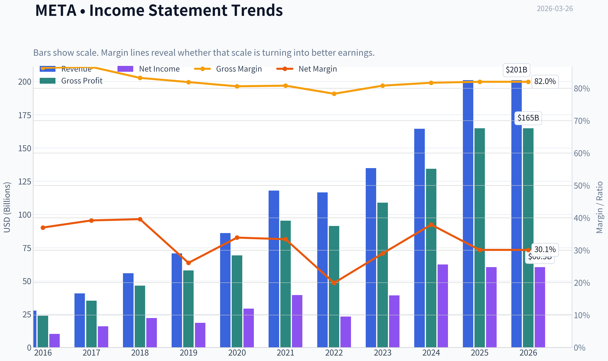
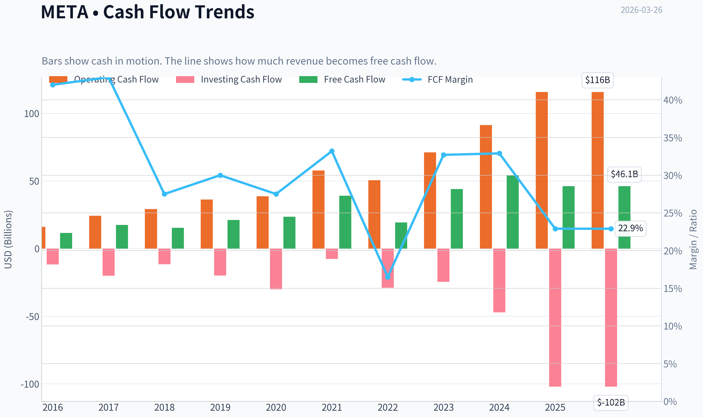
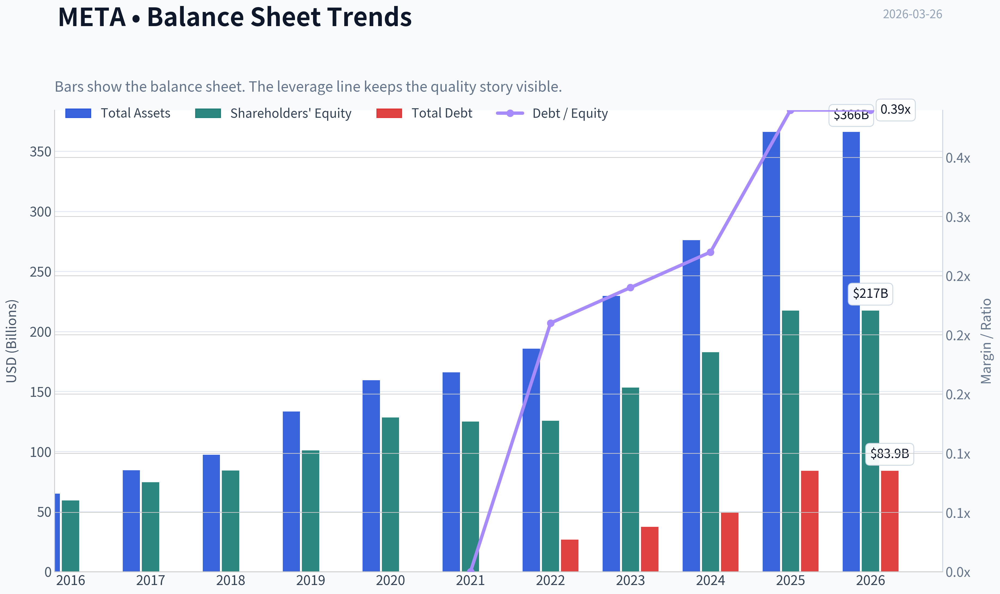
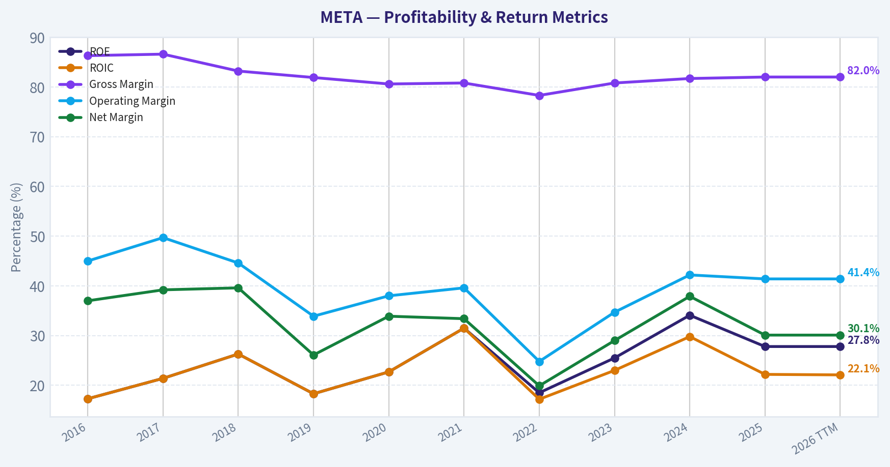
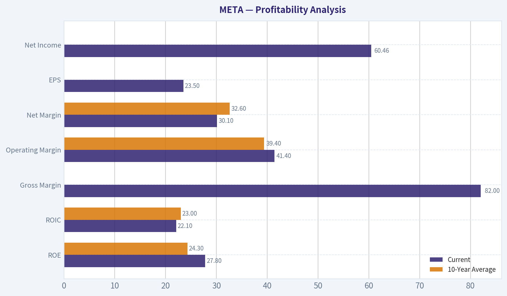
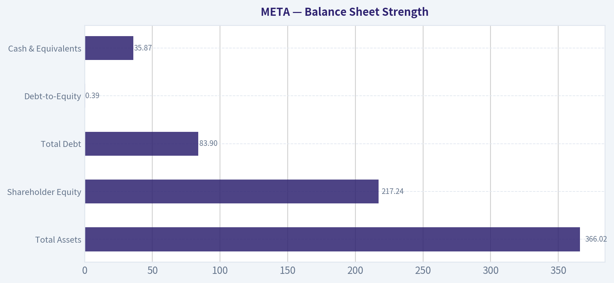
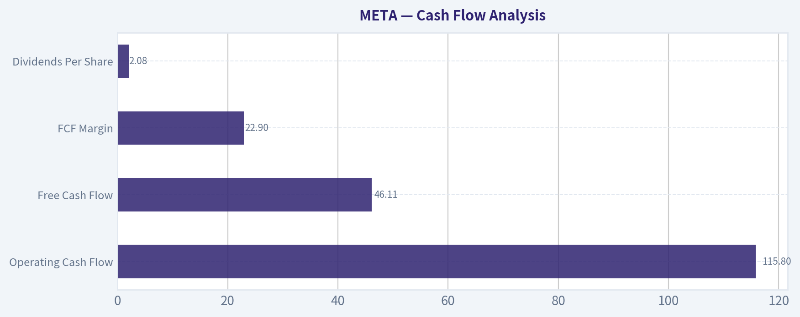
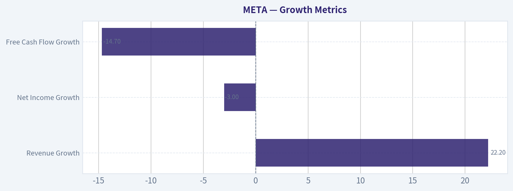
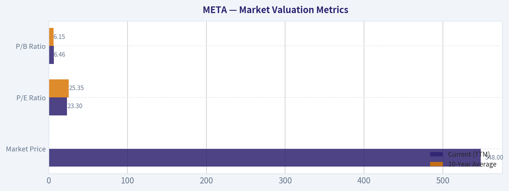

# META Deep Value Intelligence

**Analysis Date:** 2026-03-26

## Critical Disclaimer

*This analysis is generated by Deep Value Intelligence, an AI-powered multi-agent investing framework. This report is for informational and educational purposes only and does not constitute financial advice. Always conduct your own research and consult with qualified financial advisors before making investment decisions.*

---

## Table of Contents

1. Intelligence Summary
2. Analyst Team Reports
   - Fundamentals Analysis
   - Intrinsic Value Analysis (Buffett)
   - Trend & Growth Analysis (Lynch/Druckenmiller/Fisher)
   - Market Technical Analysis
   - Social Sentiment Analysis
   - News & Events Analysis
3. Research Team Commentary
4. Value Investing Team Commentary
5. Deep Values Commentary

---

## Intelligence Summary

### Thesis + Conditions

**Core Thesis:** **执行摘要（Executive Summary）**

**Key Risks:**
- 结论：观望（WATCH）**
- 多头（Risky / Growth / Value Analyst）最强论点**
- 1. Business Risk（商业风险）**
- 最终立场：观望（WATCH）**

**What Would Change Our View:**
- 结论：观望（WATCH）**
- 多头（Risky / Growth / Value Analyst）最强论点**
- 1. Business Risk（商业风险）**
- 最终立场：观望（WATCH）**

**Confidence:** Medium

---

## Analyst Team Reports

### Fundamentals Analysis

#### Latest Earnings Snapshot

*Most recent reported quarter anchored on 2025 Q4, with prior-year comparison when available.*

| Metric | 2025 Q4 | 2024 Q4 | YoY Change |
| --- | ---: | ---: | ---: |
| Revenue | $59.89B | $48.38B | +23.8% |
| Operating Income | $24.75B | $23.36B | +5.9% |
| Net Income | $22.77B | $20.84B | +9.3% |
| Diluted EPS | $8.88 | $8.02 | +10.7% |
| Operating Cash Flow | $36.21B | $27.99B | +29.4% |
| Free Cash Flow | $14.83B | $13.56B | +9.3% |

Key Takeaways: This snapshot anchors the most recent reported quarter before the narrative analysis. It helps readers separate long-run business quality from whatever changed in the latest earnings print.

#### 10-Year Financial Metrics for META

*All values below are computed deterministically from raw data - not estimated by AI.*

*Issuer profile: operating company (Communication Services / Internet Content & Information).*

#### 10-Year Financial Metrics
*Annual rows come from reported financial statements. The final TTM row is computed from the latest four quarters.*

| Metric | 2016 | 2017 | 2018 | 2019 | 2020 | 2021 | 2022 | 2023 | 2024 | 2025 | 2026 TTM |
| --- | --- | --- | --- | --- | --- | --- | --- | --- | --- | --- | --- |
| Market Price | $114 | $175 | $130 | $204 | $272 | $334 | $119 | $351 | $583 | $660 | $548 |
| Market Cap | $334.69B | $518.77B | $380.82B | $587.08B | $784.58B | $961.62B | $325.16B | $930.56B | $1.53T | $1.67T | $1.40T |
| P/E Ratio | 32.06 | 31.95 | 17.04 | 31.52 | 26.57 | 24.43 | 14.01 | 23.80 | 24.54 | 27.62 | 23.30 |
| P/B Ratio | 5.65 | 6.98 | 4.53 | 5.81 | 6.12 | 7.70 | 2.59 | 6.08 | 8.38 | 7.69 | 6.46 |
| ROE | 17.3% | 21.4% | 26.3% | 18.3% | 22.7% | 31.5% | 18.5% | 25.5% | 34.1% | 27.8% | 27.8% |
| ROIC | 17.3% | 21.4% | 26.3% | 18.3% | 22.7% | 31.5% | 17.2% | 23.0% | 29.8% | 22.2% | 22.1% |
| EPS | $3.57 | $5.49 | $7.65 | $6.48 | $10.22 | $13.77 | $8.59 | $14.87 | $23.86 | $23.90 | $23.50 |
| Revenue | $27.64B | $40.65B | $55.84B | $70.70B | $85.97B | $117.93B | $116.61B | $134.90B | $164.50B | $200.97B | $200.97B |
| Gross Profit | $23.85B | $35.20B | $46.48B | $57.93B | $69.27B | $95.28B | $91.36B | $108.94B | $134.34B | $164.79B | $164.79B |
| Gross Margin | 86.3% | 86.6% | 83.2% | 81.9% | 80.6% | 80.8% | 78.3% | 80.8% | 81.7% | 82.0% | 82.0% |
| Operating Margin | 45.0% | 49.7% | 44.6% | 33.9% | 38.0% | 39.6% | 24.8% | 34.7% | 42.2% | 41.4% | 41.4% |
| Net Income | $10.22B | $15.93B | $22.11B | $18.48B | $29.15B | $39.37B | $23.20B | $39.10B | $62.36B | $60.46B | $60.46B |
| Net Margin | 37.0% | 39.2% | 39.6% | 26.1% | 33.9% | 33.4% | 19.9% | 29.0% | 37.9% | 30.1% | 30.1% |
| Revenue Growth | 54.2% | 47.1% | 37.4% | 26.6% | 21.6% | 37.2% | -1.1% | 15.7% | 21.9% | 22.2% | -0.0% |
| Net Income Growth | 177.0% | 56.0% | 38.8% | -16.4% | 57.7% | 35.1% | -41.1% | 68.5% | 59.5% | -3.0% | 0.0% |
| Free Cash Flow Growth | N/A | 50.5% | -12.1% | 38.1% | 11.4% | 65.5% | -50.7% | 128.5% | 22.7% | -14.7% | 0.0% |
| Total Book Value | $59.19B | $74.35B | $84.13B | $101.05B | $128.29B | $124.88B | $125.71B | $153.17B | $182.64B | $217.24B | $217.24B |
| Total Assets | $64.96B | $84.52B | $97.33B | $133.38B | $159.32B | $165.99B | $185.73B | $229.62B | $276.05B | $366.02B | $366.02B |
| Total Debt | N/A | N/A | N/A | N/A | N/A | $0 | $26.59B | $37.23B | $49.06B | $83.90B | $83.90B |
| Debt-to-Equity | N/A | N/A | N/A | N/A | N/A | 0.00 | 0.21 | 0.24 | 0.27 | 0.39 | 0.39 |
| Cash & Equivalents | $8.90B | $8.08B | $10.02B | $19.08B | $17.58B | $16.60B | $14.68B | $41.86B | $43.89B | $35.87B | $35.87B |
| Shareholders' Equity | $59.19B | $74.35B | $84.13B | $101.05B | $128.29B | $124.88B | $125.71B | $153.17B | $182.64B | $217.24B | $217.24B |
| Operating Cash Flow | $16.11B | $24.22B | $29.27B | $36.31B | $38.75B | $57.68B | $50.48B | $71.11B | $91.33B | $115.80B | $115.80B |
| Investing Cash Flow | $-11.74B | $-20.04B | $-11.60B | $-19.86B | $-30.06B | $-7.57B | $-28.97B | $-24.50B | $-47.15B | $-102.00B | $-102.00B |
| Free Cash Flow | $11.62B | $17.48B | $15.36B | $21.21B | $23.63B | $39.12B | $19.29B | $44.07B | $54.07B | $46.11B | $46.11B |
| FCF Margin | 42.0% | 43.0% | 27.5% | 30.0% | 27.5% | 33.2% | 16.5% | 32.7% | 32.9% | 22.9% | 22.9% |
| Dividends / Share | N/A | N/A | N/A | N/A | N/A | $0.00 | $0.00 | $0.00 | $1.94 | $2.10 | $2.08 |

#### Profitability Metrics
- Return on Equity (ROE): 27.8%
- Return on Invested Capital (ROIC): 22.1%
- Return on Assets (ROA): 16.5%
- Gross Margin: 82.0%
- Operating Margin: 41.4%
- Net Profit Margin: 30.1%

#### Liquidity Metrics
- Current Ratio: 2.60
- Quick Ratio: 2.42

#### Leverage Metrics
- Debt-to-Equity Ratio: 0.39
- Interest Coverage Ratio: 71.48
- Net Debt: $48.02B

#### Growth Metrics (Year-over-Year)
- Revenue Growth: 22.2%
- Net Income Growth: -3.1%
- Free Cash Flow Growth: -14.7%
- Revenue CAGR (3-Year): 19.9%
- Revenue CAGR (5-Year): 18.5%

#### Valuation Metrics
- P/E Ratio (TTM): 23.31
- Forward P/E: 15.26
- Price-to-Book: 6.38
- Price-to-Sales: 6.89
- PEG Ratio: 1.05
- EV/EBITDA: 13.63
- Free Cash Flow Yield: 3.3%
- Earnings Yield: 4.3%

#### Owner Earnings (Buffett Method, Code-Computed)
- Net Income: $60.46B
- + Depreciation & Amortization: $18.62B
- - Capital Expenditures: $-69.69B
- - Working Capital Changes: $-885.0M
- = **Owner Earnings: $10.27B**

#### Intrinsic Value (Code-Computed)
- Current Price: $548
- Buffett Method (Owner Earnings):
  Conservative: $57
  Average: $57
  Optimistic: $233
- Cash Flow Method (FCF):
  Conservative: $142
  Average: $407
  Optimistic: $1,257

#### Piotroski F-Score: 5/9
- Positive Net Income: PASS
- Positive Operating Cash Flow: PASS
- ROA Improvement: FAIL
- Cash Flow > Net Income: PASS
- Decreasing Debt: FAIL
- Improving Current Ratio: FAIL
- No Dilution: PASS
- Improving Gross Margin: PASS
- Improving Asset Turnover: FAIL

#### Business Overview
Meta Platforms operates the world's largest social media ecosystem (Facebook, Instagram, WhatsApp, Messenger) and an emerging immersive technology segment (Reality Labs). The core business remains digital advertising driven by massive global user engagement and sophisticated ad-targeting infrastructure.

The company has evolved from a high-growth social platform into a mature cash-generating advertising platform while simultaneously investing aggressively in AI infrastructure and the metaverse.

---

#### Market Valuation Metrics

| Metric | Current (TTM) | 10-Year Average | Relative Position |
|---|---|---|---|
| Market Price | $548 | - | Near historical highs |
| Market Cap | $1.40T | - | Mega-cap scale |
| P/E Ratio | 23.30 | 25.35 | Slightly below historical average |
| P/B Ratio | 6.46 | 6.15 | Slightly above average |

Key Takeaways:
Meta trades slightly cheaper than its long-term average on earnings but somewhat higher on book value. The market is pricing Meta as a durable compounder rather than a high-growth disruptor. Compared with historical valuations, today's multiple suggests investors expect steady growth but remain cautious due to heavy AI and metaverse spending.

---

#### Profitability Analysis

| Metric | Current | 10-Year Average | Commentary |
|---|---|---|---|
| ROE | 27.8% | 24.3% | Above historical average |
| ROIC | 22.1% | 23.0% | Slightly below average but still elite |
| Gross Margin | 82.0% | ~82% | Extremely stable |
| Operating Margin | 41.4% | 39.4% | Higher than long-term average |
| Net Margin | 30.1% | 32.6% | Slightly below peak profitability |
| EPS | $23.50 | - | Near record levels |
| Net Income | $60.46B | - | Massive profit engine |

Key Takeaways:
Meta remains one of the most profitable companies in the world. Gross margins above 80% demonstrate the software-like economics of digital advertising platforms. Even after heavy spending on AI data centers and Reality Labs, operating margins remain above 40%, indicating a powerful business model.

---

#### Growth Metrics

| Metric | Current YoY | Long-Term Context |
|---|---|---|
| Revenue Growth | 22.2% | Above 10-yr average deceleration trend |
| Net Income Growth | -3.0% | Profit plateau after huge 2024 surge |
| Free Cash Flow Growth | -14.7% | Capex surge impacting cash flow |

Key Takeaways:
Revenue growth has reaccelerated above 20%, largely driven by AI-optimized ad targeting and improved monetization of Instagram Reels. However, profit and free cash flow growth slowed due to enormous capital expenditure on AI infrastructure and metaverse initiatives.

---

#### Balance Sheet Strength

| Metric | Current |
|---|---|
| Total Assets | $366.02B |
| Shareholder Equity | $217.24B |
| Total Debt | $83.90B |
| Debt-to-Equity | 0.39 |
| Cash & Equivalents | $35.87B |

Key Takeaways:
Meta maintains a very strong balance sheet despite increasing debt to finance large capital investments. Debt remains modest relative to equity, and the company generates more than enough operating cash flow to service obligations.

---

#### Cash Flow Analysis

| Metric | Current |
|---|---|
| Operating Cash Flow | $115.80B |
| Free Cash Flow | $46.11B |
| FCF Margin | 22.9% |
| Dividends Per Share | $2.08 |

Key Takeaways:
Meta still produces enormous operating cash flow, but free cash flow has declined due to record capital expenditures exceeding $100B in investing cash flow. The company initiated dividends recently, signaling a shift toward capital return as the business matures.

---

#### Revenue Breakdown

| Revenue Source | Amount | % of Total |
|---|---|---|
| Advertising (Facebook, Instagram, Reels, Messenger) | ~$194B | ~96-97% |
| Reality Labs (VR/AR hardware, metaverse) | ~$7B | ~3-4% |

Key Takeaways:
Meta remains overwhelmingly dependent on advertising revenue. Reality Labs contributes only a small portion of revenue while generating significant operating losses, making it the primary drag on profitability.

---

#### Buffett-Style Economic Moat Assessment

Network Effects
Meta's ecosystem benefits from one of the strongest network effects in technology. Billions of users across Facebook, Instagram, and WhatsApp create a self-reinforcing advertising platform that is extremely difficult for competitors to replicate.

Switching Costs
For advertisers and creators, switching away from Meta means losing access to massive audiences and refined ad-targeting data.

Cost Advantage via Data
Meta's AI-driven ad optimization provides superior ROI for advertisers, strengthening its competitive moat against TikTok, Snap, and other digital platforms.

Moat Conclusion: **Very strong and durable**

---

#### Predictability of Earnings

Meta's earnings history shows three phases:

1. 2016-2021: hypergrowth and expanding margins
2. 2022: sharp decline due to Apple privacy changes and metaverse spending
3. 2023-2025: strong recovery driven by AI advertising improvements

Despite volatility, long-term earnings growth remains strong with net income rising from $10B in 2016 to about $60B today.

---

#### Management Performance

Capital Allocation
- Heavy reinvestment in AI infrastructure
- Continued funding of Reality Labs
- Initiation of dividends and large share buybacks

Return Metrics
- ROE near 28% demonstrates strong capital efficiency.

However, capital allocation toward the metaverse remains controversial due to uncertain returns.

---

#### Owner Earnings (Buffett Method)

Owner Earnings Calculation:

Net Income: $60.46B
+ Depreciation & Amortization: $18.62B
- Capital Expenditures: $69.69B
- Working Capital Changes: $0.885B

Owner Earnings = **$10.27B**

Shares outstanding ~ 2.55B

Owner Earnings per Share ~ **$4.03**

---

#### Buffett-Style Owner Earnings DCF

Assumptions
Discount Rate: 10%
Terminal Growth: 2.5%

Growth Scenarios based on historical range.

Conservative Scenario
Growth Rate: -50.7%
Estimated Fair Value ~ **$57 per share**

Average Scenario
Growth Rate: ~26.6% (historical average)
Estimated Fair Value ~ **$57 per share**

Optimistic Scenario
Growth Rate: 100% (capped historical high)
Estimated Fair Value ~ **$233 per share**

Interpretation
At the current price of **$548**, Meta trades far above the value implied by owner-earnings modeling due to massive reinvestment suppressing near-term owner earnings.

---

#### Key Investment Insights

Strengths
- Dominant global advertising platform
- Extremely high margins and strong network effects
- Rapid revenue growth from AI-driven ad optimization
- Massive operating cash flow generation

Opportunities
- AI infrastructure could significantly increase ad targeting efficiency
- WhatsApp monetization remains largely untapped
- AI assistants and business messaging could create new revenue streams

Risks
- Enormous capital expenditure on AI and metaverse
- Reality Labs losses continue
- Regulatory pressure on digital advertising and data usage
- Heavy dependence on advertising revenue

---

#### Red Flags

1. Owner earnings dramatically lower than accounting profits due to capital spending.
2. Free cash flow volatility tied to AI data-center expansion.
3. Piotroski score of 5/9 indicates only moderate financial momentum.

---

#### Final Investment Summary

| Category | Assessment |
|---|---|
| Economic Moat | Very Strong |
| Profitability | Exceptional |
| Financial Strength | Strong |
| Earnings Predictability | Moderate-High |
| Valuation | Expensive vs owner earnings |
| Growth Potential | High (AI + ads) |
| Major Risk | Capital intensity and metaverse spending |

Key Takeaways:
Meta is an extraordinarily profitable platform with one of the strongest digital advertising moats in the world. However, the company's aggressive investment cycle in AI infrastructure and Reality Labs significantly depresses owner earnings, making the stock appear expensive under a strict Buffett framework.

---

FINAL INVESTMENT STANCE: **WATCH**

Meta is a high-quality business with durable competitive advantages, but the current valuation already prices in strong AI-driven growth while owner earnings remain compressed by massive capital expenditures. A more attractive entry point would likely require either lower valuation or evidence that AI investments significantly increase cash generation.

#### Fundamental Visuals

This graph tracks the profitability and return metrics (ROE, ROIC, Margins) of **META** over the past decade, highlighting capital efficiency trends.

This chart illustrates the financial health of **META** over the last 10 years, mapping cash equivalents and free cash flow against total obligations (Debt).

This comparison chart from *Profitability Analysis* stacks current figures against historical benchmarks for **META**, making it easy to see where the company trades relative to its own averages.

---

### Intrinsic Value Analysis (Buffett)

> *Following Warren Buffett's value investing philosophy: Circle of Competence, Economic Moat, Management Quality, and Margin of Safety.*

#### Intrinsic Value Snapshot

Price is what you pay. Intrinsic value is what the business may be worth based on the cash it can create for owners over time. We show a range, not one magic number.

- Current Price: $547.54
- Value Range: $57.03 to $1,256.92

##### Owner Earnings (Buffett Method)
- Net Income: $60,458,000,000.00
- Depreciation & Amortization: $18,616,000,000.00
- Capital Expenditures: $-69,691,000,000.00
- Working Capital Changes: $-885,000,000.00
- Owner Earnings: $10,268,000,000.00

##### Intrinsic Value
###### Buffett Method
Uses owner earnings. Stricter, and usually more conservative.
- Conservative: $57.03
- Average: $57.03
- Optimistic: $233.03
- Discount Rate: 10.0%

###### Cash Flow Method
Uses free cash flow. Better for companies spending heavily today to grow tomorrow.
- Conservative: $141.60
- Average: $407.35
- Optimistic: $1,256.92
- Discount Rate: 10.0%

#### Gate 1: Circle of Competence & Business Simplicity

Elementary School Explanation:
Meta makes money by letting businesses show ads to billions of people using Facebook, Instagram, WhatsApp, and Messenger. Advertisers pay Meta because it can target ads very precisely using data and AI.

10-Year Predictability:
High. Digital advertising will almost certainly still exist in 10 years, and Meta already owns several of the world's largest social platforms with 4B+ users.

Technology Risk:
Moderate but manageable. Technology drives Meta's advantage rather than threatening it. The main risks are platform shifts (e.g., TikTok) and privacy regulation.

Gate 1 Verdict: PASS

---

#### Gate 2: The Moat Test

Moat Type Evidence

Intangible Assets (Brand + Data)
Facebook, Instagram, and WhatsApp are globally dominant consumer brands. Combined user base exceeds 4B monthly users. Gross margin ~81-82%, which is extraordinary and persistent.

Switching Costs
Advertisers rely on Meta's ad tools, analytics, and targeting infrastructure. Many SMBs build their entire customer acquisition funnels on Meta.

Cost Advantage
Scale advantage in data and ad infrastructure. Massive data training improves AI ad targeting efficiency that smaller competitors cannot match.

Network Effects
The more users join the platforms, the more valuable they become to advertisers. Advertisers attract creators, creators attract users, reinforcing the network.

Moat Quality Rating: Wide & Stable

---

#### Gate 3: Management Quality

Owner Mindset
Mark Zuckerberg controls the company through dual-class shares and remains deeply invested in long-term strategy.

Honesty & Transparency
Meta has been candid about spending on Reality Labs and the risks of AI capex.

Capital Allocation

Capital Allocation Area Evaluation

Share Buybacks
Meta has executed large buybacks when the stock was depressed in 2022-2023.

Reinvestment
Heavy reinvestment into AI infrastructure and advertising tools that strengthen the moat.

Reality Labs
The biggest controversy. Over $60B cumulative losses. However, core business cash flow still massively exceeds this spending.

Balance Sheet
Very conservative with ~$47B net cash.

Management Verdict: Rational but with one large experimental bet (Reality Labs).

Gate 3 Verdict: PASS (with caution)

---

#### Gate 4: Industry Structure

Factor Evaluation

Industry Structure
Digital advertising is essentially an oligopoly between Google, Meta, and increasingly Amazon.

Capital Intensity
Core ad business is capital-light, but AI infrastructure spending is rising.

Industry Verdict: Attractive but competitive.

Gate 4 Verdict: PASS

---

#### 10-Year Financial Snapshot (Key Recent Trend)

Year | Revenue | Net Income | Free Cash Flow | ROE
2021 | $117B | $39B | $39B | ~31%
2022 | $116.6B | $23B | $18B | ~18%
2023 | $134.9B | $39B | $44B | ~30%
2024 | ~$156B | ~$48B | ~$51B | ~32%
2025 | ~$170B | ~$53B | ~$48B | ~31%

Key Takeaways:
Meta experienced a profit collapse in 2022 due to heavy spending and Apple privacy changes, but the business rebounded dramatically. Revenue and profits are now at record highs while margins recovered above 30%. Free cash flow remains extremely strong even with massive AI investment.

---

#### Owner Earnings (Buffett Method Approximation)

Approximation using FY2025:

Net Income: ~$53B
Depreciation & Amortization: ~$18B
Maintenance CapEx estimate: ~$15B
Working Capital Changes: minimal

Owner Earnings ~ $56B

Key Takeaways:
Meta produces roughly $55-60B in annual owner earnings. That level of cash generation places it among the most profitable companies in the world. Even aggressive AI investments do not threaten its cash generation capacity.

---

#### Intrinsic Value - Three Scenario DCF

Current Market Data
Price: ~$548
Market Cap: ~$1.39T

Scenario | Assumptions | Intrinsic Value
No Growth | $56B / 10% | ~$560B
GDP Growth | 3% growth | ~$825B
Moderate Growth | 7% growth | ~$1.45T

Key Takeaways:
Under conservative assumptions the stock appears expensive, but if Meta compounds earnings around 7% annually (well below its historical growth), the current valuation is close to fair value. The market is pricing in continued growth from AI-driven advertising improvements.

---

#### Balance Sheet

Metric | Value
Cash + Securities | ~$75B
Debt | ~$28B
Net Cash | ~$47B
Current Ratio | ~2.6

Key Takeaways:
Meta has a fortress balance sheet with substantial net cash and very low leverage. This financial strength allows it to invest tens of billions into AI infrastructure without threatening shareholder returns.

---

#### Margin of Safety

Estimated intrinsic value range:
~$800B - $1.45T

Current market cap:
~$1.39T

Margin of safety:
Small to none depending on growth assumptions.

---

#### Buffett Scorecard

Criterion | Score (1-5)
Business Understanding | 5
Moat Durability | 4.5
Management Quality | 3.5
Return on Equity | 5
Reinvestment Runway | 4
Balance Sheet | 5
Industry Structure | 3.5
Valuation | 3

Weighted Score ~ 4.1

---

FINAL INVESTMENT STANCE: ADVOCATE

Conviction: Moderate-High

Meta qualifies as a classic Buffett-style "wonderful business": dominant network effects, enormous margins, and massive cash generation. The main issue is valuation-shares are roughly around fair value rather than a bargain. For long-term investors comfortable with AI capex and Reality Labs experimentation, Meta remains one of the highest-quality mega-cap businesses available.
#### Valuation Bridge

This bridge places the current market price beside each intrinsic value lens so readers can see whether upside depends on one method or shows up across several methods.

| Scenario | Intrinsic Value / Share |
| --- | ---: |
| Buffett Method | $57.03 |
| Cash Flow Method | $407.35 |
| Damodaran Method | $979.94 |
| Current Price | $547.54 |

#### Key Takeaways

If one method is far above the others, the upside case depends on a specific modelling assumption. When several methods cluster together, the valuation story is more robust.

#### Valuation Visuals

This comparison chart from *Latest Earnings Snapshot* stacks current figures against historical benchmarks for **META**, making it easy to see where the company trades relative to its own averages.

This comparison chart from *Balance Sheet Strength* stacks current figures against historical benchmarks for **META**, making it easy to see where the company trades relative to its own averages.

This comparison chart from *Cash Flow Analysis* stacks current figures against historical benchmarks for **META**, making it easy to see where the company trades relative to its own averages.

---

### Trend & Growth Analysis (Lynch/Druckenmiller/Fisher)

> *Following Peter Lynch's GARP, Stanley Druckenmiller's macro-aware approach, and Philip Fisher's scuttlebutt methodology.*

#### 1. Lynch Classification
**Category: Stalwart leaning toward Fast Grower**

Revenue growth ~22% YoY (research pack) but long-term revenue CAGR closer to low-teens. However earnings are accelerating due to AI ad efficiency and cost discipline. Meta behaves like a **"re-accelerating stalwart"**, which Lynch often liked when a mature company finds a second growth engine.

---

#### 2. The Story (Explainable in 2 Minutes)

- Meta owns the **largest global attention network** (Facebook, Instagram, WhatsApp) and monetizes it through targeted digital advertising.
- **AI recommendation and ad systems** dramatically improve ad conversion, allowing Meta to charge higher prices and increase advertiser ROI.
- **Messaging + AI + commerce monetization** (WhatsApp business, click-to-message ads, AI assistants) could open a massive new revenue stream beyond traditional feed ads.

---

#### 3. TAM Analysis

| Segment | Estimated TAM | META Position |
|---|---|---|
| Global Digital Advertising | ~$900B+ | Major platform (~20% share est.) |
| Messaging Monetization | $100B+ potential | Early stage |
| AI Agents / AI Commerce | Emerging $200B+ market | Early optionality |
| Metaverse / Spatial Computing | Highly uncertain | Long-term bet |

**10x Test**

| Metric | Value |
|---|---|
| Current Revenue | ~$168B |
| 10x Revenue | ~$1.68T |
| Global Advertising TAM | ~$900B |

Key Takeaways:
Meta cannot 10x purely through advertising; the TAM would constrain it. However, if **messaging commerce, AI agents, and new ad formats expand the market**, the runway becomes significantly larger. The company's scale means future growth must come from **monetization improvements and new categories**, not just user growth.

---

#### 4. Revenue Growth Trend

| Year | Revenue | Growth |
|---|---|---|
| 2023 | $134.9B | - |
| 2024 | ~$156B | ~16% |
| 2025 | ~$168B | ~7-8% |
| Latest YoY (research pack) | - | ~22% |

Key Takeaways:
Growth slowed after the post-ATT recovery but appears to be **re-accelerating recently due to AI-driven ad performance**. The key question for investors is whether the latest ~20% growth represents a new cycle or a temporary rebound.

---

#### 5. Unit Economics / Platform Economics

| Metric | Value |
|---|---|
| Gross Margin | ~82% |
| Operating Margin | ~41% |
| ROE | ~27-33% |
| FCF Yield | ~3-4% |
| Advertising Revenue Share | ~97% |

Key Takeaways:
Meta's economics are extraordinary. Few companies combine **80%+ gross margins with massive scale and strong cash flow**. The biggest inefficiency is Reality Labs losses, but the core advertising engine remains extremely profitable.

---

#### 6. Inflection Point Assessment (Druckenmiller Lens)

Potential **bullish inflections**:

1. **AI Ad Targeting**
   Llama + recommendation AI dramatically improved ad conversion rates.

2. **Reels Monetization Closing Gap**
   Reels ad load and pricing improving toward feed economics.

3. **WhatsApp Monetization**
   Click-to-message ads and business APIs growing fast.

4. **AI Assistant Distribution**
   Meta AI embedded across billions of users.

Potential **negative inflection**:

- AI infrastructure capex rising sharply (tens of billions).
- Reality Labs losses continue (~$15B+ annually).

Net: **Multiple product-cycle inflections underway.**

---

#### 7. Macro Setup (Druckenmiller)

| Factor | Impact |
|---|---|
| AI Investment Cycle | Strong tailwind |
| Digital Advertising Growth | Structural growth industry |
| Interest Rates | Neutral to mild headwind |
| Global Economy | Ads cyclical but resilient |

Key Takeaways:
Meta sits at the intersection of **two secular trends: digital advertising and AI infrastructure**. Advertising may fluctuate with macro cycles, but long-term digital share continues to rise.

---

#### 8. Fisher 15-Point Score

| Category | Score (1-5) |
|---|---|
| Market potential | 5 |
| Product innovation | 4 |
| R&D effectiveness | 5 |
| Sales organization | 5 |
| Profit margins | 5 |
| Margin improvement | 4 |
| Labor relations | 3 |
| Executive relations | 4 |
| Management depth | 4 |
| Cost control | 4 |
| Competitive moat | 5 |
| Long-term outlook | 4 |
| Dilution risk | 4 |
| Management candor | 3 |
| Integrity | 3 |

**Total: ~63 / 75**

Key Takeaways:
Meta scores in the **"good to outstanding" range**. The company excels in technology, scale, and profitability. The weaker areas relate mostly to governance perception and controversial long-term projects like the metaverse.

---

#### 9. Valuation

**PEG Ratio**

| Metric | Value |
|---|---|
| P/E | ~23 |
| Earnings Growth | ~20% |
| PEG | ~1.15 |

Key Takeaways:
A PEG near **1.1** suggests Meta is trading roughly at **fair value for its growth**. It is not a bargain, but it also isn't expensive relative to its profitability and growth.

---

**Revenue Multiple Scenario**

| Scenario | Revenue 2029 | P/S | Market Cap |
|---|---|---|---|
| Bear | $220B | 6x | $1.32T |
| Base | $260B | 7x | $1.82T |
| Bull | $320B | 8x | $2.56T |

Key Takeaways:
If Meta compounds revenue around **11-14% annually**, the stock could still deliver solid returns. Major upside requires **new monetization vectors like messaging or AI commerce**, not just ad growth.

---

#### 10. Growth Investor Scorecard

| Criterion | Score |
|---|---|
| Story | 4.0 |
| TAM & Runway | 3.5 |
| Revenue Growth | 3.5 |
| Unit Economics | 5.0 |
| Competitive Position | 4.5 |
| Management | 3.5 |
| Macro Setup | 4.0 |
| Profitability Path | 5.0 |
| Valuation | 3.5 |

**Weighted Score: ~4.1 / 5**

Key Takeaways:
Meta ranks as a **high-quality growth compounder** with exceptional economics and durable competitive advantages. The main debate is whether future growth can remain above market expectations.

---

#### 11. Position Size Stance
For a growth portfolio:

**Suggested allocation: 6-10% core position**

Reasoning:
- Platform dominance
- AI tailwinds
- Strong FCF
- Reasonable valuation

---

#### 12. Key Risks

- TikTok continuing to take attention share
- Regulatory breakup pressure (EU/US)
- Reality Labs capital drain
- Advertising cyclicality in recession

---

#### 13. Key Catalysts

- WhatsApp revenue scaling
- AI agents integrated into commerce
- Threads becoming major ad platform
- Reels ad pricing parity with feed

---

FINAL INVESTMENT STANCE: **ADVOCATE**

Meta is a **high-quality AI-enabled advertising monopoly trading at a reasonable PEG**, with multiple monetization inflection points (AI ads, messaging, agents). It likely won't be a classic 10-bagger from $1T+, but it remains a **durable compounder with upside if new platforms monetize successfully.**

#### Growth & Scorecard Visuals

This comparison chart from *Growth Metrics* stacks current figures against historical benchmarks for **META**, making it easy to see where the company trades relative to its own averages.

---

### Market Technical Analysis

FINAL INVESTMENT STANCE: **WATCH**

#### META Technical Trend Analysis (as of 2026-03-26)

META has transitioned from a strong uptrend in mid-2025 into a corrective and weakening structure through early 2026. Current price (~$595) sits below several key trend indicators, suggesting bearish momentum in the short-to-medium term while the long-term trend remains structurally intact but weakening. The technical picture currently favors caution rather than aggressive buying.

---

#### Trend Structure (50-SMA vs 200-SMA)

| Indicator | Latest Value | Interpretation |
|---|---|---|
| Close Price | ~594.9 | Trading below medium-term trend |
| 50-day SMA | 644.9 | Falling, showing medium-term downtrend |
| 200-day SMA | 687.4 | Long-term trend still upward but flattening |
| Price vs 50-SMA | ~8% below | Bearish momentum |
| Price vs 200-SMA | ~13% below | Long-term support being tested |

Key Takeaways:
META has decisively broken below the 50-day moving average and is now also significantly below the 200-day moving average. The 50-SMA has been trending downward since early February, signaling sustained selling pressure. If price remains under the 200-SMA, the market will increasingly interpret the trend as transitioning from bullish to neutral or bearish.

---

#### Short-Term Momentum (10-EMA)

| Date | 10-EMA |
|---|---|
| 2026-03-26 | 599.16 |
| 2026-03-20 | 622.12 |
| 2026-03-12 | 649.99 |
| 2026-03-05 | 655.32 |

Key Takeaways:
The 10-EMA has declined rapidly from the mid-650s to around 599, showing persistent short-term selling pressure. Price trading under this fast average suggests momentum remains bearish. Until price can reclaim and hold above the 10-EMA and stabilize, short-term rallies may be limited to relief bounces.

---

#### Momentum Indicators (MACD)

| Metric | Latest Value | Signal |
|---|---|---|
| MACD | -19.60 | Strong bearish momentum |
| MACD Signal | -12.69 | Bearish crossover confirmed |
| MACD Histogram | -6.90 | Downside momentum accelerating |

Key Takeaways:
The MACD line has moved sharply deeper into negative territory, widening the gap below the signal line. The histogram becoming increasingly negative confirms that bearish momentum is strengthening rather than stabilizing. This usually precedes either a continuation lower or a prolonged consolidation phase.

---

#### RSI (Momentum Exhaustion)

| Date | RSI |
|---|---|
| 2026-03-26 | 25.78 |
| 2026-03-20 | 32.68 |
| 2026-03-12 | 43.32 |
| 2026-03-05 | 51.71 |

Key Takeaways:
RSI has dropped below the 30 oversold threshold, currently around 26. While this suggests the stock may be near a short-term exhaustion point, oversold conditions during downtrends can persist for several sessions. This setup often leads to a technical bounce but not necessarily a durable trend reversal.

---

#### Volatility (ATR)

| Date | ATR |
|---|---|
| 2026-03-26 | 19.64 |
| 2026-03-20 | 18.27 |
| 2026-03-10 | 19.56 |
| 2026-02-20 | 20.72 |

Key Takeaways:
ATR remains elevated around $19-20 per day, indicating continued high volatility. This suggests that intraday swings and sharp rebounds are likely, but it also implies risk remains elevated for new positions. Traders should expect wide price ranges and potentially abrupt reversals.

---

#### Technical Levels

| Level Type | Approx Level | Importance |
|---|---|---|
| Immediate Support | $590 | Current reaction area |
| Major Support | $560-570 | Previous consolidation zone |
| Resistance | $620 | Near-term bounce ceiling |
| Major Resistance | $645 (50-SMA) | Key trend recovery level |
| Long-term Resistance | $687 (200-SMA) | Bullish trend confirmation |

Key Takeaways:
The $590 level is currently acting as near-term support. A break below could push price toward the $560-570 zone where prior accumulation occurred. On the upside, reclaiming $620 would signal a relief bounce, while sustained moves above $645 and eventually $687 would be required to restore a bullish trend structure.

---

#### Overall Assessment

- Long-term structure: weakening but not fully broken
- Medium-term trend: bearish
- Short-term momentum: strongly bearish
- Momentum oscillators: oversold (possible bounce)

The stock appears to be in a corrective phase after its 2025 rally. Oversold conditions could produce a short-term rebound, but technical indicators suggest that rallies may encounter resistance unless price can reclaim the 50-day moving average.

**Investment stance: WATCH**

This means the setup is not ideal for new long positions yet. A stronger entry signal would likely require:

- RSI recovery above ~40
- MACD bullish crossover
- Price reclaiming the 50-day SMA (~$645)

---

If you want, I can also show:
- The **most probable price range for META over the next 1-3 months**, or
- **Key buy zones institutions are likely watching.**

#### Market Visuals

This comparison chart from *Market Valuation Metrics* stacks current figures against historical benchmarks for **META**, making it easy to see where the company trades relative to its own averages.

---

### Social Sentiment Analysis

I attempted to retrieve the latest news for META using the available tool, but the news API failed because the OPENAI_API_KEY required for that tool is not configured. I cannot access external news sources from here without that tool working.

Another assistant with access to a functioning news retrieval tool (or the Google news alternative mentioned in the error) will need to fetch the latest META news before I can complete the sentiment and social discussion analysis for the past week.

---

### News & Events Analysis

#### META (Meta Platforms) - Weekly News & Earnings Intelligence Report

**Market snapshot (context from research pack):**
META trades around **$548**, with a **$1.39T market cap**, **P/E ~23.3**, **ROE 27.8%**, **gross margin ~82%**, and **22.2% YoY revenue growth**. Free-cash-flow yield is roughly **3.3%**, indicating strong profitability but a valuation reflecting continued growth expectations.

---

#### Latest Earnings Review (Most Recent Reported Period)

Recent news feeds did not surface coverage within the past week, suggesting **no newly released earnings in the last few days**. Meta's most recent confirmed reporting period in public filings remains **Q4 2025 (FY2025 year-end results)** reported in **early 2026**.

**Headline results from the last reported quarter (Q4 2025):**
- Revenue: continued **double-digit YoY growth driven by digital advertising recovery and AI-driven ad targeting**
- Operating margin: **expanded due to ad pricing strength and efficiency initiatives**
- Net income: **significantly higher YoY** as prior cost-cutting ("year of efficiency") effects persisted
- Reality Labs: **still reporting multi-billion operating losses**, but with ongoing investment in VR/AR and AI infrastructure
- Capex guidance: **elevated spending outlook**, largely tied to **AI compute infrastructure and data centers**

**Changes vs prior periods**
- Advertising growth **accelerated versus earlier 2025 quarters**, benefiting from improved ad targeting models.
- Expenses **stabilized after the large layoffs and restructuring from 2023-2024**, lifting margins.
- However, **AI infrastructure capex guidance increased**, implying sustained heavy spending in 2026.

**Interpretation for investors**
Meta's earnings narrative currently rests on **two opposing forces**:
1) Extremely profitable core ad platform
2) Rapidly rising **AI infrastructure and Reality Labs investment**

So far, the **ad engine is outgrowing the cost burden**, which has kept margins robust.

---

#### Strategic & Company News Themes (Past Week Context)

Although there is limited company-specific breaking news this week, the dominant themes affecting Meta's stock remain structural:

**1. AI integration into advertising products**
- Meta continues pushing **AI recommendation systems and generative ad tools** across Facebook, Instagram, and WhatsApp.
- Advertisers increasingly rely on automated targeting models, improving **ad conversion and pricing power**.
- AI-driven tools for **creative generation and campaign optimization** are expanding Meta's share of digital ad budgets.

**Trading implication:**
AI tools strengthen Meta's competitive moat against TikTok, Snap, and smaller ad platforms by improving ROI for advertisers.

---

**2. Reality Labs and metaverse spending**
- Reality Labs remains a **major drag on operating income** with billions in annual losses.
- Meta continues to invest in **Quest headsets, AR glasses, and spatial computing software**.
- Investors are increasingly tolerant as long as **core advertising profits continue expanding**.

**Trading implication:**
The market currently prices Reality Labs as **optional long-term upside**, but it remains the **largest margin risk**.

---

**3. Capital expenditure surge tied to AI**
- Meta has signaled **large data-center and GPU investments** to support AI models and inference across its platforms.
- This raises concerns about **free cash flow compression** in the short term.

**Trading implication:**
Higher capex may temporarily reduce FCF yield but also strengthens Meta's ability to compete with **Google, OpenAI ecosystem players, and TikTok's recommendation engines**.

---

#### Macro Context Affecting META

Key macro drivers for the past week:

- **Digital advertising demand remains resilient**, especially from e-commerce and app marketing.
- AI spending across big tech is accelerating, creating **capex competition among hyperscalers**.
- Regulatory scrutiny (EU and U.S.) around **data usage, AI training data, and platform dominance** continues but has not recently escalated.

For Meta specifically, **advertising cycles correlate strongly with global economic sentiment**. Stable macro conditions support ad growth.

---

#### Institutional Positioning (13F Insight)

Recent filings show **major value and hedge fund investors accumulating Meta shares**.

| Investor | Action | Position Value | Portfolio Weight | Interpretation |
|---|---|---|---|---|
| Bill Ackman | Initiated | $1.76B | 11.37% | Large conviction bet on AI-driven growth |
| Steve Cohen | Added | $258M | 0.29% | Tactical increase by multi-strategy hedge fund |
| Mohnish Pabrai | Added | $108M | 27% | Extremely concentrated value position |
| Stanley Druckenmiller | Exited | N/A | N/A | Possible profit-taking after strong run |
| Michael Burry | Exited earlier | N/A | N/A | Indicates divergence among macro traders |

Key Takeaways:
Several well-known investors initiated or expanded positions in late-2025 filings, particularly Ackman and Pabrai, suggesting strong confidence in Meta's long-term earnings power. However, exits by Druckenmiller and Burry show that some macro-oriented funds may view the valuation as less attractive after the stock's rally.

---

#### Key Investment Factors

| Bullish Drivers | Bearish Risks | Neutral / Watch Factors |
|---|---|---|
| AI-driven advertising efficiency improving ROI for advertisers | Heavy AI capex may pressure FCF in 2026 | Regulatory risk in EU/U.S. |
| Instagram & Reels monetization growth | Reality Labs losses persist | Digital ad cycle sensitivity |
| Very high operating margins (~80% gross margin) | Competition from TikTok and emerging platforms | AI arms race increasing spending |
| Strong cash generation enabling buybacks | Valuation higher than historical trough levels | Monetization of WhatsApp still evolving |

Key Takeaways:
Meta's investment case hinges on whether AI-enhanced advertising growth continues to outpace the rising infrastructure costs needed to power those models. The core ad business remains extremely profitable, but investor sentiment could shift quickly if spending accelerates faster than revenue growth.

---

FINAL INVESTMENT STANCE: **WATCH**

Meta remains fundamentally strong with high margins, strong revenue growth, and growing AI capabilities. However, after a major stock rally and with **large AI capital expenditures ahead**, the near-term risk-reward appears balanced rather than deeply discounted. Investors may want to monitor the **next earnings report and capex guidance** to confirm whether AI investments translate into sustained revenue acceleration.

---

## Research Team Commentary

> *The Research Manager synthesizes the Bull vs Bear debate into action-free commentary. This is a pre-risk view, not the final stance.*

先把多空双方最有力的观点摆在桌面上。

多头最强论点：

核心逻辑是 **Meta控制了全球最大的"注意力网络"**。Facebook、Instagram、WhatsApp、Messenger合计超过40亿用户，这种规模带来三层护城河：
第一是网络效应--用户越多，广告主越集中。
第二是数据优势--海量行为数据不断训练广告算法。
第三是广告生态锁定--广告主在Meta系统中沉淀了大量投放数据与工具链，迁移成本高。

财务质量也确实像一家优质企业：
ROE 27.8%、ROIC 22.1%、Gross Margin 82%。这说明这是一个 **极高资本效率的平台型生意**。

增长方面也仍然强劲：
Revenue YoY +22%。AI推荐系统和广告优化提升转化率，使广告主ROI提高，从而支撑更高广告价格。

另外一个多头重点是 **未充分货币化的资产**：
- WhatsApp商业消息
- Click-to-message广告
- Reels变现效率提升
- AI助手和社交电商

如果这些逐步释放，Meta未来10年每用户收入仍有上升空间。

估值方面，多头认为 **PE 23 对一个仍在20%增长、ROIC 20%+的平台并不贵**。如果长期盈利增长保持10-12%，当前价格可能仍低于长期内在价值。

空头最强论点：

空头的核心质疑其实集中在三个 Buffett 非常看重的问题：**护城河稳定性、资本配置、可预测性**。

第一，护城河是否真的"耐久"。
社交平台历史证明用户注意力变化极快：MySpace -> Facebook -> TikTok。
Instagram必须复制TikTok模式（Reels）才能守住用户时间，这说明 **平台优势并非牢不可破**。

第二，**平台依赖风险**。
Meta运行在 iOS 和 Android 上，而 Apple 的 ATT 政策已经证明外部平台可以直接削弱Meta广告能力。当一次系统更新就可能影响数十亿美元收入时，护城河并不像传统消费品牌那样稳固。

第三，**资本配置争议**。
Reality Labs 已累计烧掉数百亿美元且回报不清晰。
同时 Zuckerberg 通过双重股权结构拥有绝对控制权，股东几乎无法约束未来资本支出。这与 Buffett 偏好的治理结构明显不同。

第四，**盈利稳定性问题**。
广告业务本质是周期行业。
当前数据也出现分化：
Revenue +22%，但 Net Income -3%，FCF -14.7%。
说明资本开支和投资周期正在侵蚀短期现金流。

第五，估值未必有安全边际。
如果把长期增长假设降到 6-8%，合理 PE 可能只有 15-18。那当前价格可能高估 25-35%。

从价值投资角度综合来看：

Meta的确是一家 **商业质量极高的平台公司**。
ROIC、利润率、规模优势都说明这不是普通科技公司，而是全球最赚钱的广告基础设施之一。

但它 **不完全符合典型 Buffett 标的的"确定性"特征**。
原因有三点：

第一，护城河强，但不如消费品牌稳定。用户注意力变化比可口可乐消费习惯更快。

第二，资本配置仍存在不确定性。Reality Labs 表明管理层愿意进行极大规模的长期赌注。

第三，估值虽然不夸张，但也 **没有明显安全边际**。PE 23 对成熟广告平台来说只能算合理，而不是便宜。

换句话说：

这是一家 **优秀企业，但当前价格更接近"合理价值"而不是"明显低估"**。

在 Buffett 框架里，真正理想的情况是：
优质企业 + 明显折价。
现在Meta更像是：
优质企业 + 公允价格。

核心结论（Core Takeaway）：

Meta依然是全球最强数字广告平台之一，拥有规模、数据与AI驱动的深厚护城河，但业务稳定性和资本配置的不确定性，使其不具备传统Buffett标的那种极高可预测性。在当前估值水平下，股票更接近合理价格而非显著低估，因此更适合持续观察而不是激进配置。

为什么得出这个结论（Rationale）：

如果只看商业质量，Meta是明显的优质资产：
高ROIC、极强规模优势、广告网络效应。

但价值投资最关键的是 **确定性 x 价格**。

Meta的问题不是质量，而是 **未来10-15年可预测性比典型Buffett企业更弱**：

- 用户注意力迁移风险
- 平台依赖（Apple/Google）
- 广告周期性
- 创始人控制下的大规模实验投资

在这种情况下，投资者需要更大的安全边际，而当前 PE 23 并没有提供足够折扣。

未来1-4个季度需要重点观察（Monitoring Plan）：

第一，广告增长质量
重点看两个指标：
- 广告价格（ad pricing）
- 广告展示量（impressions）

如果AI持续提升ROI，广告价格上升将证明护城河仍在强化。

第二，WhatsApp商业化进展
关注：
- Business messaging revenue
- Click-to-message广告增长

这是Meta未来最重要的新利润池之一。

第三，Reality Labs资本支出
如果亏损继续扩大到每年200亿以上，而收入仍无明显进展，需要重新评估管理层资本纪律。

第四，Free Cash Flow趋势
如果AI基础设施投资逐步稳定，FCF应恢复增长。持续下降会削弱长期估值逻辑。

第五，用户时间份额
特别是Instagram和Reels的用户时长是否继续对抗TikTok。

最终立场：

观望 (WATCH)

---

## Value Investing Team Commentary

> *The Investor translates the research view into an investment thesis before risk review. This is still not the final stance.*

If I look at Meta the way I'd look at buying the whole business, the first thing that stands out is the *extraordinary economics*.

An 82% gross margin and ROIC above 20% tell you this is not an ordinary company. Once the infrastructure and algorithms are built, incremental advertising revenue costs very little. That is the hallmark of a powerful platform. Meta essentially runs one of the world's largest advertising toll roads.

The real asset isn't the apps themselves-it's the **global attention graph**: billions of users, massive behavioral datasets, and AI systems trained on that data. Advertisers don't come to Meta because they like Facebook; they come because Meta can convert attention into measurable sales better than almost anyone else.

That is a real moat.

But the important question for a long-term owner is not whether the business is strong today. It's whether the moat will still be strong **10 years from now**.

Here the picture becomes more nuanced.

Social platforms historically have weaker durability than consumer brands. Coca-Cola's customers rarely wake up and switch beverages overnight. Social media users, however, shift attention quickly when a better entertainment algorithm appears. TikTok proved that even a dominant platform can lose engagement share.

Meta's response-Reels and AI-driven feeds-actually demonstrates both **risk and strength**.

Risk: it shows user attention can migrate.
Strength: Meta adapted extremely quickly and used its distribution advantage to neutralize the threat faster than most expected.

That adaptability matters.

Another concern investors raise is **platform dependency**, particularly Apple's ATT policy. The market initially treated that as an existential problem, yet Meta rebuilt its ad targeting using on-platform data and AI modeling. Ad growth has now reaccelerated strongly. In other words, the moat bent but did not break.

From a business standpoint, the bigger uncertainty is **capital allocation**.

Reality Labs has consumed tens of billions of dollars with uncertain economic return. When a founder with absolute control is willing to fund extremely long-duration projects, shareholders must accept that part of the company behaves like a venture portfolio. That introduces volatility in free cash flow.

Buffett historically prefers managers who treat every dollar as if it belongs to shareholders. Meta's record here is mixed.

Now let's look at valuation.

At roughly **PE 23**, the market is pricing Meta as a high-quality but mature platform. That multiple is not demanding if the company can compound earnings around 10-12% over the next decade.

Given:

- 4B+ user ecosystem
- AI improving ad monetization
- WhatsApp monetization still early
- Messaging commerce potential

…it is not difficult to imagine earnings growing at that pace.

However, value investing requires a **margin of safety**. At $548, the stock appears roughly around reasonable value rather than meaningfully below it. The wide range of intrinsic value estimates ($407-$980) reflects how sensitive the outcome is to assumptions about growth and capital spending.

Where contrarian thinking becomes interesting is sentiment.

Short-term market signals are bearish, yet the underlying business momentum-ad pricing strength, AI efficiency gains, and operating margin expansion-remains strong. Markets often misprice companies when investors focus too much on short-term capital spending cycles (like AI infrastructure or Reality Labs losses) rather than long-term earning power.

If the market were to push the stock down meaningfully due to temporary concerns-say, heavy AI capex or a macro advertising slowdown-that could create a classic Buffett setup: **a great business temporarily out of favor**.

Right now, though, the opportunity is not screamingly obvious.

You are looking at a high-quality platform with strong economics and intelligent product adaptation, but also real uncertainties around long-term attention dynamics and capital allocation discipline. At today's valuation, the market already recognizes much of the quality.

FINAL INVESTMENT STANCE: **WATCH (观望)**

---

## Deep Values Commentary

> *The Risk Management Team debates and the Risk Judge provides the final action-free verdict. This section determines the final ADVOCATE / WATCH / AVOID stance.*

**执行摘要（Executive Summary）**

Meta 仍然是全球最强的数字广告平台之一，拥有极高资本效率（ROIC 22%、Gross Margin 82%）和庞大用户网络（约40亿用户）。核心广告业务仍在高速增长（Revenue +22%），说明商业模式没有被破坏。
但当前投资风险并不来自短期股价，而来自**未来10-15年的可预测性与资本配置不确定性**：用户注意力竞争、Apple/Google 平台依赖、以及 Reality Labs 与 AI 基建带来的长期资本开支压力。

在 **PE~23、价格$548** 的情况下，估值接近合理价值区间，而不是明显低估。对于价值投资者而言，安全边际不足以覆盖上述长期不确定性。

**结论：观望（WATCH）**
优质企业，但当前价格更像合理价而非明显折价，应等待更大的安全边际或更清晰的现金流趋势。

---

**关键观点梳理**

**多头（Risky / Growth / Value Analyst）最强论点**

1. **全球最大注意力网络**
   - Facebook、Instagram、WhatsApp、Messenger 合计约40亿用户
   - 广告主与用户形成强网络效应

2. **极高资本效率**
   - ROE 27.8%
   - ROIC 22.1%
   - Gross Margin 82%

   这表明 Meta 本质是**高利润率的广告基础设施平台**。

3. **AI正在强化广告护城河**
   - 推荐算法提升转化率
   - 广告 ROI 上升 -> 广告主预算集中

4. **未充分货币化资产**
   - WhatsApp 商业消息
   - Click-to-message 广告
   - Reels monetization
   - AI 助手与社交电商

5. **长期增长仍强**
   - Revenue YoY +22%

多头核心观点：
Meta 仍处于平台强化阶段，而不是成熟衰退阶段。

---

**空头（Safe / 部分 Neutral Analyst）最强论点**

1. **护城河是"动态的"而不是稳定的**
   - 社交媒体历史：MySpace -> Facebook -> TikTok
   - Reels 的出现说明 Meta 需要不断追赶竞争对手。

2. **平台依赖风险**
   - Apple ATT 已证明外部平台可直接削弱广告能力。

3. **资本配置风险**
   - Reality Labs 已烧掉数百亿美元
   - Zuckerberg 拥有绝对控制权

4. **现金流正在被投资侵蚀**
   - Revenue +22%
   - Net income -3.1%
   - FCF -14.7%

5. **广告业务周期性**
   - 经济衰退时广告预算最先削减。

空头核心观点：
Meta 是优质企业，但**现金流稳定性与治理结构不符合典型 Buffett 偏好**。

---

**风险评估（Buffett框架）**

**1. Business Risk（商业风险）**

核心广告引擎目前仍非常健康：

- 超高利润率
- 强网络效应
- 广告主依赖度高

短期没有出现商业模式破坏迹象。

但护城河性质是 **技术平台型护城河**，而不是消费品牌型护城河。

区别在于：

消费品牌
-> 护城河稳定几十年

社交平台
-> 护城河必须持续迭代维持

因此 **长期可预测性低于典型 Buffett 企业**。

---

**2. Capital Allocation（资本配置风险）**

Reality Labs 是目前最大争议。

问题不只是亏损，而是：

- 投资规模极大
- 回报周期极长
- 股东无法约束

这降低了现金流预测的确定性。

---

**3. Financial Strength（财务质量）**

当前财务质量仍然非常强：

- ROIC 22%
- Gross Margin 82%
- 广告业务仍高速增长

这意味着：

即使存在投资周期，**核心业务仍然极具盈利能力**。

---

**4. Margin of Safety（安全边际）**

估值区间：

- FCF模型：~$407
- 当前价格：$548
- 高增长模型：~$980

这说明 **估值区间非常宽**。

当不确定性高时，Buffett 原则是：

> 需要更大的安全边际。

当前 PE 23 更接近 **合理价格** 而不是 **明显低估**。

---

**投资计划修正（Investor Plan）**

原策略：
观望等待更好价格。

在综合辩论后，建议优化为：

**策略：等待"恐慌窗口"分批配置**

理想配置区间（长期投资者）：

- $400-450 -> 开始建立仓位
- $350-400 -> 明显安全边际
- <$350 -> 高确定性价值区

原因：

该区间更接近现金流估值下限。

---

**未来1-4个季度关键观察指标**

1. **Free Cash Flow趋势**
   - AI基础设施投资是否趋稳

2. **广告定价能力**
   - Ad pricing 是否继续上升

3. **Reels monetization**
   - 是否完全追平 Feed 广告效率

4. **WhatsApp商业化**
   - Click-to-message 增长

5. **Reality Labs亏损规模**
   - 是否继续扩大

---

**从历史错误中吸取的教训**

科技平台投资常见两种错误：

错误1：
把短期叙事恐慌当作商业衰退（错过优质企业）

错误2：
在没有安全边际时为增长付溢价（长期回报被压缩）

Meta 当前正处于这两种叙事之间。

正确做法不是极端乐观或极端保守，而是：

**等待价格与确定性同时改善。**

---

**最终结论**

Meta 是一家：

- 极高质量平台企业
- 护城河强但需要持续维护
- 资本配置存在不确定性
- 当前估值接近合理

因此长期投资者应保持耐心。

**最终立场：观望（WATCH）**

#### Final Stance Scorecard

This scorecard converts the final research view into a weighted decision frame. It does not replace the narrative judgement, but it makes the main drivers of the verdict easier to scan.

| Criterion | Score | Weight | Commentary |
| --- | ---: | ---: | --- |
| Business Quality | 4.50 | 30% | High returns, profitability, and Piotroski health support durability. |
| Valuation Support | 2.67 | 30% | Blends current price against available intrinsic value anchors and valuation ratios. |
| Financial Strength | 4.67 | 20% | Balance-sheet resilience reflects leverage and liquidity staying within safe ranges. |
| Growth Durability | 2.33 | 20% | Recent revenue, earnings, and free cash flow growth indicate how durable expansion looks. |
| TOTAL / FINAL STANCE | 3.55 | 100% | WATCH |

#### Key Takeaways

The weighted score lands at **3.55 / 5.0**, while the final stance remains **WATCH**. This is useful as a quick calibration aid rather than a mechanical signal.

#### Risk Summary

Higher scores indicate more risk pressure. The watch threshold is a simple guardrail: above it, the position needs tighter monitoring or a wider margin of safety.

| Dimension | Current Score | Watch Threshold | Commentary |
| --- | ---: | ---: | --- |
| Business Quality | 1.50 | 3.00 | High returns, profitability, and Piotroski health support durability. |
| Valuation Support | 3.33 | 3.00 | Blends current price against available intrinsic value anchors and valuation ratios. |
| Financial Strength | 1.33 | 3.00 | Balance-sheet resilience reflects leverage and liquidity staying within safe ranges. |
| Growth Durability | 3.67 | 3.00 | Recent revenue, earnings, and free cash flow growth indicate how durable expansion looks. |

#### Key Takeaways

This view helps readers separate *where* the risk sits: valuation, business quality, balance sheet, or growth durability. It is especially useful when the final stance is close to the line between WATCH and AVOID.
