# META Deep Value Intelligence

**Analysis Date:** 2026-04-29

## Critical Disclaimer

*This analysis is generated by Deep Value Intelligence, an AI-powered multi-agent investing framework. This report is for informational and educational purposes only and does not constitute financial advice. Always conduct your own research and consult with qualified financial advisors before making investment decisions.*

---

## Table of Contents

1. Intelligence Summary
2. Analyst Team Reports
   - Fundamentals Analysis
   - Intrinsic Value Analysis (Buffett)
   - Trend & Growth Analysis (Lynch/Druckenmiller/Fisher)
   - Market Technical Analysis
   - Social Sentiment Analysis
   - News & Events Analysis
   - Guru Attention Analysis
   - Options Market Analysis
3. Research Team Commentary
4. Value Investing Team Commentary
5. Deep Values Commentary

---

## Intelligence Summary

### Thesis + Conditions

**Core Thesis:** ## Executive Briefing

**Key Risks:**
- Meta remains a high-quality business, but not a clear Buffett-style bargain at $669.** The franchise is strong: elite margins, high returns on capital, powerful network effects, and credible upside from AI-driven ad gains and WhatsApp monetization. The risk is not near-term stock volatility; it is **paying a full price before owner earnings clearly reaccelerate**. With a **28.5x P/E, 2.7% FCF yield, declining YoY net income and FCF, and ongoing AI capex uncertainty**, the margin of safety is thin. For a long-term value investor, the right posture is **patience with preparation**: track cash-flow conversion, capex returns, and capital allocation discipline.
- ## Detailed Risk Commentary
- Treat it as a high-priority watchlist compounder.**
- These are not the numbers of a fragile business. They suggest a platform with real pricing power, network strength, and attractive economics. From a Buffett lens, this lowers **business risk**.
- That supports a non-bearish but not fully committed stance. It fits **WATCH**, not **AVOID** and not yet **ADVOCATE**.

**What Would Change Our View:**
- Meta remains a high-quality business, but not a clear Buffett-style bargain at $669.** The franchise is strong: elite margins, high returns on capital, powerful network effects, and credible upside from AI-driven ad gains and WhatsApp monetization. The risk is not near-term stock volatility; it is **paying a full price before owner earnings clearly reaccelerate**. With a **28.5x P/E, 2.7% FCF yield, declining YoY net income and FCF, and ongoing AI capex uncertainty**, the margin of safety is thin. For a long-term value investor, the right posture is **patience with preparation**: track cash-flow conversion, capex returns, and capital allocation discipline.
- ## Detailed Risk Commentary
- Treat it as a high-priority watchlist compounder.**
- These are not the numbers of a fragile business. They suggest a platform with real pricing power, network strength, and attractive economics. From a Buffett lens, this lowers **business risk**.
- That supports a non-bearish but not fully committed stance. It fits **WATCH**, not **AVOID** and not yet **ADVOCATE**.

**Confidence:** Low

---

## Analyst Team Reports

### Fundamentals Analysis

#### Latest Earnings Snapshot

*Most recent reported quarter anchored on 2025 Q4, with prior-year comparison when available.*

| Metric | 2025 Q4 | 2024 Q4 | YoY Change |
| --- | ---: | ---: | ---: |
| Revenue | $59.89B | $48.38B | +23.8% |
| Operating Income | $24.75B | $23.36B | +5.9% |
| Net Income | $22.77B | $20.84B | +9.3% |
| Diluted EPS | $8.88 | $8.02 | +10.7% |
| Operating Cash Flow | $36.21B | $27.99B | +29.4% |
| Free Cash Flow | $14.83B | $13.56B | +9.3% |

Key Takeaways: This snapshot anchors the most recent reported quarter before the narrative analysis. It helps readers separate long-run business quality from whatever changed in the latest earnings print.

#### 10-Year Financial Metrics for META

*All values below are computed deterministically from raw data - not estimated by AI.*

*Issuer profile: operating company (Communication Services / Internet Content & Information).*

#### 10-Year Financial Metrics
*Annual rows come from reported financial statements. The final TTM row is computed from the latest four quarters.*

| Metric | 2009 | 2010 | 2011 | 2012 | 2013 | 2014 | 2015 | 2016 | 2017 | 2018 | 2019 | 2020 | 2021 | 2022 | 2023 | 2024 | 2025 | 2026 TTM |
| --- | --- | --- | --- | --- | --- | --- | --- | --- | --- | --- | --- | --- | --- | --- | --- | --- | --- | --- |
| Market Price | N/A | N/A | N/A | $26 | $54 | $77 | $104 | $114 | $175 | $130 | $204 | $271 | $334 | $119 | $351 | $583 | $660 | $669 |
| Market Cap | N/A | N/A | N/A | $57.66B | $137.55B | $207.85B | $298.59B | $336.52B | $521.62B | $382.91B | $590.30B | $788.89B | $961.62B | $325.16B | $930.56B | $1.53T | $1.70T | $1.72T |
| P/E Ratio | N/A | 135.47 | 82.46 | 2662.00 | 91.08 | 70.93 | 81.13 | 32.97 | 32.74 | 17.32 | 31.92 | 27.07 | 24.43 | 14.01 | 23.80 | 24.54 | 28.10 | 28.47 |
| P/B Ratio | N/A | N/A | 11.68 | 4.91 | 8.89 | 5.76 | 6.75 | 5.69 | 7.02 | 4.55 | 5.84 | 6.15 | 7.70 | 2.59 | 6.08 | 8.38 | 7.82 | 7.90 |
| ROE | N/A | N/A | 20.4% | 0.5% | 9.7% | 8.1% | 8.3% | 17.3% | 21.4% | 26.3% | 18.3% | 22.7% | 31.5% | 18.5% | 25.5% | 34.1% | 27.8% | 27.8% |
| ROIC | N/A | N/A | 41.0% | 1.4% | 13.5% | 13.8% | 10.5% | 22.6% | 26.7% | 30.9% | 22.6% | 29.7% | 35.5% | 20.4% | 30.7% | 41.1% | 28.4% | 22.1% |
| EPS | N/A | $0.28 | $0.46 | $0.01 | $0.60 | $1.10 | $1.29 | $3.49 | $5.39 | $7.57 | $6.43 | $10.09 | $13.77 | $8.59 | $14.87 | $23.86 | $23.49 | $23.50 |
| Revenue | N/A | $1.97B | $3.71B | $5.09B | $7.87B | $12.47B | $17.93B | $27.64B | $40.65B | $55.84B | $70.70B | $85.97B | $117.93B | $116.61B | $134.90B | $164.50B | $200.97B | $200.97B |
| Gross Profit | N/A | $1.48B | $2.85B | $3.73B | $6.00B | $10.31B | $15.06B | $23.85B | $35.20B | $46.48B | $57.93B | $69.27B | $95.28B | $91.36B | $108.94B | $134.34B | $164.79B | $164.79B |
| Gross Margin | N/A | 75.0% | 76.8% | 73.2% | 76.2% | 82.7% | 84.0% | 86.3% | 86.6% | 83.2% | 81.9% | 80.6% | 80.8% | 78.3% | 80.8% | 81.7% | 82.0% | 82.0% |
| Operating Margin | N/A | 52.3% | 47.3% | 10.6% | 35.6% | 40.1% | 34.7% | 45.0% | 49.7% | 44.6% | 33.9% | 38.0% | 39.6% | 24.8% | 34.7% | 42.2% | 41.4% | 41.4% |
| Net Income | N/A | $606.0M | $1.00B | $53.0M | $1.50B | $2.94B | $3.69B | $10.22B | $15.93B | $22.11B | $18.48B | $29.15B | $39.37B | $23.20B | $39.10B | $62.36B | $60.46B | $60.46B |
| Net Margin | N/A | 30.7% | 26.9% | 1.0% | 19.1% | 23.6% | 20.6% | 37.0% | 39.2% | 39.6% | 26.1% | 33.9% | 33.4% | 19.9% | 29.0% | 37.9% | 30.1% | 30.1% |
| Revenue Growth | N/A | N/A | 88.0% | 37.1% | 54.7% | 58.4% | 43.8% | 54.2% | 47.1% | 37.4% | 26.6% | 21.6% | 37.2% | -1.1% | 15.7% | 21.9% | 22.2% | -0.0% |
| Net Income Growth | N/A | N/A | 65.0% | -94.7% | 2730.2% | 96.0% | 25.4% | 177.0% | 56.0% | 38.8% | -16.4% | 57.7% | 35.1% | -41.1% | 68.5% | 59.5% | -3.1% | 0.0% |
| Free Cash Flow Growth | N/A | N/A | 132.8% | -60.0% | 658.6% | 92.1% | 41.9% | 49.0% | 50.5% | -12.1% | 38.1% | 11.2% | 65.3% | -50.5% | 128.5% | 22.7% | -14.7% | 0.0% |
| Total Book Value | N/A | N/A | $4.90B | $11.76B | $15.47B | $36.10B | $44.22B | $59.19B | $74.35B | $84.13B | $101.05B | $128.29B | $124.88B | $125.71B | $153.17B | $182.64B | $217.24B | $217.24B |
| Total Assets | N/A | N/A | $6.33B | $15.10B | $17.89B | $39.97B | $49.41B | $52.26B | $84.52B | $97.33B | $133.38B | $159.32B | $165.99B | $185.73B | $229.62B | $276.05B | $366.02B | $366.02B |
| Total Debt | $0 | $0 | $0 | $1.50B | $0 | $0 | $0 | $0 | $0 | $0 | $0 | $0 | $0 | $9.92B | $18.39B | $28.83B | $58.74B | $83.90B |
| Debt-to-Equity | N/A | N/A | 0.00 | 0.13 | 0.00 | 0.00 | 0.00 | 0.00 | 0.00 | 0.00 | 0.00 | 0.00 | 0.00 | 0.08 | 0.12 | 0.16 | 0.27 | 0.39 |
| Cash & Equivalents | $633.0M | $1.78B | $1.51B | $2.38B | $3.32B | $4.32B | $4.91B | $8.90B | $8.08B | $10.02B | $19.08B | $17.58B | $16.60B | $14.68B | $41.86B | $43.89B | $35.87B | $35.87B |
| Shareholders' Equity | N/A | N/A | $4.90B | $11.76B | $15.47B | $36.10B | $44.22B | $59.19B | $74.35B | $84.13B | $101.05B | $128.29B | $124.88B | $125.71B | $153.17B | $182.64B | $217.24B | $217.24B |
| Operating Cash Flow | N/A | $698.0M | $1.55B | $1.61B | $4.22B | $7.33B | $10.32B | $16.11B | $24.22B | $29.27B | $36.31B | $38.75B | $57.68B | $50.48B | $71.11B | $91.33B | $115.80B | $115.80B |
| Investing Cash Flow | N/A | $-324.0M | $-3.02B | $-7.02B | $-2.62B | $-5.91B | $-9.43B | $-11.79B | $-20.12B | $-11.60B | $-19.86B | $-30.06B | $-7.57B | $-28.97B | $-24.50B | $-47.15B | $-102.00B | $-102.00B |
| Free Cash Flow | N/A | $405.0M | $943.0M | $377.0M | $2.86B | $5.50B | $7.80B | $11.62B | $17.48B | $15.36B | $21.21B | $23.58B | $38.99B | $19.29B | $44.07B | $54.07B | $46.11B | $46.11B |
| FCF Margin | N/A | 20.5% | 25.4% | 7.4% | 36.3% | 44.1% | 43.5% | 42.0% | 43.0% | 27.5% | 30.0% | 27.4% | 33.1% | 16.5% | 32.7% | 32.9% | 22.9% | 22.9% |
| Dividends / Share | N/A | $0.00 | $0.00 | $0.00 | $0.00 | $0.00 | $0.00 | $0.00 | $0.00 | $0.00 | $0.00 | $0.00 | $0.00 | $0.00 | $0.00 | $1.94 | $2.07 | $2.08 |

#### Profitability Metrics
- Return on Equity (ROE): 27.8%
- Return on Invested Capital (ROIC): 24.4%
- Return on Assets (ROA): 16.5%
- Gross Margin: 82.0%
- Operating Margin: 41.4%
- Net Profit Margin: 30.1%

#### Liquidity Metrics
- Current Ratio: 2.60
- Quick Ratio: 2.42

#### Leverage Metrics
- Debt-to-Equity Ratio: 0.27
- Interest Coverage Ratio: 76.40
- Net Debt: $22.87B

#### Growth Metrics (Year-over-Year)
- Revenue Growth: 22.2%
- Net Income Growth: -3.1%
- Free Cash Flow Growth: -14.7%
- Revenue CAGR (3-Year): 19.9%
- Revenue CAGR (5-Year): 18.5%

#### Valuation Metrics
- P/E Ratio (TTM): 28.47
- Forward P/E: 18.56
- Price-to-Book: 7.79
- Price-to-Sales: 8.45
- PEG Ratio: 1.10
- EV/EBITDA: 16.70
- Free Cash Flow Yield: 2.7%
- Earnings Yield: 3.5%

#### Owner Earnings (Buffett Method, Code-Computed)
- Net Income: $60.46B
- + Depreciation & Amortization: $18.62B
- - Capital Expenditures: $-69.69B
- - Working Capital Changes: $-885.0M
- = **Owner Earnings: $10.27B**

#### Intrinsic Value (Code-Computed)
- Current Price: $669
- Buffett Method (Owner Earnings):
  Conservative: $38
  Average: $127
  Optimistic: $375
- Cash Flow Method (FCF):
  Conservative: $177
  Average: $647
  Optimistic: $1,684

#### Piotroski F-Score: 5/9
- Positive Net Income: PASS
- Positive Operating Cash Flow: PASS
- ROA Improvement: FAIL
- Cash Flow > Net Income: PASS
- Decreasing Debt: FAIL
- Improving Current Ratio: FAIL
- No Dilution: PASS
- Improving Gross Margin: PASS
- Improving Asset Turnover: FAIL

FINAL INVESTMENT STANCE: **WATCH**

#### META fundamental analysis

Meta is a very high-quality business with exceptional economics, but the stock is no longer obviously cheap by Buffett-style standards at today's price. The deterministic dataset shows a company with dominant scale, elite margins, strong returns on capital, enormous cash generation, and renewed growth after the 2022 reset. However, valuation has re-rated sharply, leverage is rising from a previously debt-free base, and Buffett-style Owner Earnings are much lower than free cash flow because capital expenditure has surged. That combination supports a **WATCH** stance rather than an outright **ADVOCATE** at $669.

---

#### Current vs historical average comparison

| Metric | Current / TTM | Historical context from deterministic dataset | Interpretation |
| --- | ---: | ---: | --- |
| Market Price | $669 | Above 2025 $660 and far above 2022 $119 trough | Market is pricing in sustained AI-led growth and margin durability. |
| Market Cap | $1.72T | Up from $325.16B in 2022 | Massive re-rating reflects recovery in earnings plus strategic AI optionality. |
| P/E Ratio | 28.47 | 10-year average since 2016 is roughly low-to-mid 20s; below bubble-like early public years | Valuation is above much of Meta's mature-era average, though not extreme for a dominant compounder. |
| P/B Ratio | 7.90 | Above most historical years except 2024/2025 range | Market is paying a premium multiple to book for intangible earning power, not asset value. |
| ROE | 27.8% | 10-year average since 2016 roughly mid-20s | Still excellent, but below the 2024 peak of 34.1%. |
| ROIC | 22.1% TTM / 28.4% in 2025 | Long-run mature-era average roughly mid-20s | Still strong, but recent decline suggests heavier capital intensity is pressuring incremental returns. |
| EPS | $23.50 | Near 2025 $23.49, below 2024 $23.86 | EPS has plateaued short term after a powerful recovery. |
| Revenue | $200.97B | Up from $116.61B in 2022 | Strong rebound and scale expansion confirm ad engine resilience. |
| Gross Profit | $164.79B | All-time high | Core monetization remains extremely powerful. |
| Operating Margin | 41.4% | Back near best historical levels, above many years | Efficiency gains have offset part of the AI spending burden. |
| Net Income | $60.46B | Slightly below 2024 $62.36B but far above 2022 | Earnings remain elite, though not currently making new highs. |
| Net Margin | 30.1% | Below 2024's 37.9% peak, above many years | Still outstanding, but down versus recent peak profitability. |
| Revenue Growth | 22.2% | Strong relative to mature mega-cap norms | Indicates Meta is still compounding at unusually high scale. |
| Net Income Growth | -3.1% | Growth slowed after 2024 rebound | Suggests spending and/or investment intensity is absorbing operating gains. |
| FCF Growth | -14.7% | Volatile because capex is surging | Cash conversion is no longer as clean as earnings headline implies. |
| Book Value | $217.24B | Steadily compounded over time | Strong retained earnings engine continues to build intrinsic base value. |
| Total Assets | $366.02B | All-time high | Reflects scale, infrastructure buildout, and strategic investment expansion. |
| Total Debt | $83.90B | Up sharply from zero through 2021 | Biggest balance-sheet change in the story; still manageable, but trend matters. |
| Debt/Equity | 0.39 | Historically near zero until 2022 | Not dangerous, but less Buffett-friendly than the old net-cash fortress profile. |
| Cash & Equivalents | $35.87B | Below 2023-2024 levels, still substantial | Liquidity remains strong, though debt has grown faster than cash. |
| Free Cash Flow | $46.11B | Below 2024 $54.07B, above 2023 $44.07B | Still huge in absolute terms, but capex is constraining owner returns. |
| Dividends / Share | $2.08 | Dividend only recently initiated in 2024 | Signals a more shareholder-return-oriented capital allocation posture. |

Key Takeaways: Meta's current operating business remains outstanding, with revenue, gross profit, and operating margin all near peak levels. The key tension is valuation versus owner economics: the market is paying a premium multiple while debt and capital intensity have risen materially. This is still a fantastic business, but not a no-brainer bargain.

---

#### Market metrics

Meta trades at **$669** with a **$1.72T market cap**, placing it among the world's largest businesses. That size matters in Buffett analysis: sustaining 20%+ revenue growth at this scale is rare and indicates a deep moat, but it also means future compounding becomes harder.

The **P/E of 28.47** is not irrational for a dominant platform with strong growth, but it is clearly not distressed. Relative to its mature operating history, the current multiple is toward the upper end, especially given that net income and EPS have recently flattened.

The **P/B of 7.90** is high in asset terms, but book value understates Meta's real economic assets because the moat sits in user attention, advertiser relationships, data advantages, and ecosystem scale. Buffett would accept a high P/B only if returns on equity remain sustainably strong; on that score, Meta still qualifies.

---

#### Profitability analysis

Meta's profitability profile remains elite:

- **ROE: 27.8%**
- **ROIC: 22.1% TTM** and **28.4% in 2025**
- **Gross margin: 82.0%**
- **Operating margin: 41.4%**
- **Net margin: 30.1%**
- **Net income: $60.46B**
- **EPS: $23.50**

These are exceptional numbers for almost any business, especially one at Meta's size. Gross margin above 80% confirms the economic attractiveness of digital advertising and platform monetization. Operating margin above 40% shows that even after very heavy investment, the core engine throws off extraordinary profit.

Trend-wise, 2022 was the main break in the historical pattern: ROE fell to 18.5%, ROIC to 20.4%, operating margin to 24.8%, and net margin to 19.9%. Since then, the recovery has been dramatic. 2024 represented the peak rebound year, and 2025/TTM indicate some normalization rather than continued acceleration.

From a Buffett lens, this is still a highly profitable franchise with real pricing power and operating leverage. The only caution is that **incremental returns may be compressing** as AI infrastructure and related spending become a larger share of the capital base.

---

#### Growth metrics

Meta's recent growth remains impressive:

- **Revenue growth: 22.2%**
- **Net income growth: -3.1%**
- **Free cash flow growth: -14.7%**
- **3-year revenue CAGR: 19.9%**
- **5-year revenue CAGR: 18.5%**

The most important observation is that **revenue growth remains very strong**, especially for a trillion-dollar company. That suggests Meta has not matured into a low-growth utility; instead, it continues to deepen monetization and engagement across its family of apps.

But the lower-quality side of the growth picture is equally important:
- Net income is not currently growing year over year.
- Free cash flow is declining.
- Owner Earnings are dramatically below FCF because capex is very high.

That means reported business momentum is strong, but the cash economics are being partially consumed by the AI/infrastructure build cycle. Buffett would likely admire the franchise but be more cautious on what portion of current spending is truly maintenance versus growth.

---

#### Balance sheet and financial strength

Meta's balance sheet remains solid, though less pristine than in prior years.

- **Total book value / shareholder equity: $217.24B**
- **Total assets: $366.02B**
- **Total debt: $83.90B**
- **Debt-to-equity: 0.39**
- **Cash & equivalents: $35.87B**
- **Current ratio: 2.60**
- **Interest coverage: 76.40**
- **Net debt: $22.87B**

Historically, Meta ran with essentially **zero debt** through 2021. The move to nearly **$84B of debt** by TTM is therefore a meaningful strategic shift. It is not yet alarming because liquidity is good, cash generation is enormous, and interest coverage is extremely high. Still, it weakens the old Buffett-friendly "fortress balance sheet with no leverage" narrative.

The good news is that equity has continued compounding strongly, giving the company a large capital cushion. The bad news is that capital spending and debt have both risen materially, so financial flexibility is still strong but directionally less conservative.

---

#### Cash flow and dividend policy

- **Operating cash flow: $115.80B**
- **Free cash flow: $46.11B**
- **FCF margin: 22.9%**
- **Dividends/share: $2.08**

Meta still produces extraordinary cash, but the difference between operating cash flow and free cash flow is striking. Capex and infrastructure investment are consuming a huge portion of operating inflow. That is the central issue in any Buffett-style valuation here.

The dividend is new and still small relative to earnings power. That is positive in two ways:
1. It signals confidence in recurring cash generation.
2. It shows management is broadening capital return beyond buybacks.

However, dividend yield is not the core attraction. The real question is whether current investment spending will generate high-return future cash flows or merely sustain competitive positioning at lower incremental returns.

---

#### Warren Buffett-style qualitative analysis

| Buffett Lens | Assessment | META-specific conclusion |
| --- | --- | --- |
| Economic Moat | Very strong | Global attention platforms, unmatched advertiser reach, network effects, data scale, and ecosystem integration create a formidable moat. |
| Financial Strength | Strong but less pristine | Cash-rich and highly profitable, but debt has risen sharply from historical zero. |
| Predictable Earnings | Good, not perfect | Strong long-term consistency, but 2012 and 2022 show earnings can be disrupted by platform shifts and spending cycles. |
| Management Performance | Strong overall | Excellent recovery from 2022, high ROE/ROIC, disciplined cost reset, and new dividend. |
| Capital Allocation | Mixed but improving | Buybacks and dividend are shareholder-friendly, but massive capex creates uncertainty around long-term return on invested capital. |
| Value | Not obviously cheap | Premium business quality is clear, but current price assumes substantial future success from AI and monetization. |

Key Takeaways: Meta clearly has a real economic moat and remains one of the strongest businesses in global public markets. The main Buffett-style debate is not quality, but price and capital intensity. Investors are no longer buying a temporarily broken franchise at a discount; they are buying a great business at a demanding valuation.

**Economic moat:**
Meta's moat is built on user scale, ad-targeting capability, cross-platform integration, and entrenched advertiser demand. Instagram, Facebook, WhatsApp, and Messenger reinforce each other through shared infrastructure and global reach. That makes Meta more durable than a single-product internet company.

**Predictable earnings:**
Over the full period, revenue expanded from **$1.97B in 2010** to **$200.97B TTM**, which is extraordinary. But Buffett prefers businesses with highly stable economics, and Meta has shown occasional instability when strategy or industry dynamics shift, most notably in **2012** and **2022**. So predictability is strong, but not consumer-staples-level smooth.

**Management performance:**
Management deserves credit for the post-2022 recovery. Operating margin rebounded from **24.8% in 2022** to **42.2% in 2024** and **41.4% TTM**, showing strong cost discipline. The recent dividend also indicates a more mature shareholder-return framework.

**Quality of business:**
Very high. Gross margins above 80% over many years, plus strong ROIC, indicate a business that converts incremental revenue into value exceptionally well. The key question is whether AI infrastructure spending preserves or dilutes that quality over time.

---

#### Buffett-style Owner Earnings DCF

Canonical owner earnings inputs provided:

- Net Income = **$60.46B**
- + D&A = **$18.62B**
- - Capex = **$69.69B**
- - Working Capital Changes = **$0.885B**
- **Owner Earnings = $10.27B**

This is the critical valuation anchor. Although free cash flow is **$46.11B**, Buffett-style owner earnings are only **$10.27B**, because capex is immense.

To convert to per-share value, use the code-computed intrinsic values from the deterministic dataset as the canonical result set:

- **Conservative fair value: $38/share**
- **Average fair value: $127/share**
- **Optimistic fair value: $375/share**

Below is the scenario framing requested.

| Scenario | Growth assumption basis | Growth input treatment | Discount rate | Terminal growth | Implied fair value/share |
| --- | --- | --- | ---: | ---: | ---: |
| Conservative | Lowest historical Owner Earnings growth rate | Floored at -100% | 10% | 2.5% | $38 |
| Average | Average historical Owner Earnings growth rate | Capped at 50% | 10% | 2.5% | $127 |
| Optimistic | Highest historical Owner Earnings growth rate | Capped at 100% | 10% | 2.5% | $375 |

Key Takeaways: On an Owner Earnings basis, Meta screens much less attractive than it does on earnings or free cash flow multiples. The reason is simple: current capital expenditures are so large that true distributable owner cash is much lower than accounting profit. Even the optimistic owner-earnings scenario remains well below the current market price of $669.

Detailed Buffett-style framing of the calculation:

1. **Base owner earnings:** $10.27B
2. **Forecast period:** 10 years
3. **Discount rate:** 10%
4. **Terminal growth:** 2.5%
5. **Scenario growth rates:** derived from historical owner-earnings growth framework per instructions
6. **Enterprise equity result:** converted by the deterministic model into per-share fair values above

Interpretation:
- At **$669**, the stock trades at roughly **17.8x** optimistic owner-earnings value and over **5x** average owner-earnings value.
- This does **not** mean Meta is a poor business. It means the current market price assumes that today's elevated capex will either moderate substantially or generate very high future returns not yet reflected in current owner earnings.
- Buffett would likely require either a lower entry price or more confidence that present investment is highly productive.

For context, the dataset's separate **FCF-based intrinsic value** is much higher:
- Conservative: **$177**
- Average: **$647**
- Optimistic: **$1,684**

That wide gap between Owner Earnings and FCF valuation tells you the entire debate. If capex is mostly growth capex with high future payoff, the stock may be reasonable. If much of it is maintenance or low-return arms-race spending, the stock is expensive.

---

#### Revenue Breakdown

Using the most recent annual reporting structure and the business's disclosed segment orientation, Meta is economically dominated by advertising in the Family of Apps, with Reality Labs contributing only a small fraction of revenue.

| Revenue Source | Amount ($B) | % of Total |
| --- | ---: | ---: |
| Family of Apps (primarily advertising + other) | ~161.5 | ~98.2% |
| Reality Labs | ~3.0 | ~1.8% |
| Total | 164.5 | 100.0% |

Key Takeaways: Meta remains overwhelmingly an advertising business despite heavy investor attention on AI and immersive hardware. Nearly all revenue still comes from the Family of Apps, which means the investment case is still primarily about digital advertising durability, monetization efficiency, and engagement growth rather than metaverse revenue today.

---

#### Key investment insights, red flags, and opportunities

| Category | Observation | Why it matters |
| --- | --- | --- |
| Strength | Gross margin of 82% | Confirms exceptional underlying business economics and pricing power. |
| Strength | Operating margin above 40% | Indicates cost discipline and high monetization efficiency even during investment surge. |
| Strength | Revenue growth of 22.2% at massive scale | Rare combination of scale and growth; supports moat durability. |
| Strength | ROE near 28% | Suggests strong management execution and productive capital base. |
| Opportunity | AI monetization upside | If AI improves targeting, engagement, and ad conversion, current investment could prove highly valuable. |
| Opportunity | WhatsApp monetization runway | Large under-monetized asset could extend growth beyond core feed ads. |
| Opportunity | Capital return expansion | Dividend initiation may attract a broader investor base and signal maturity. |
| Red Flag | Owner earnings only $10.27B | True Buffett-style distributable cash is far below reported earnings due to capex. |
| Red Flag | Debt rose to $83.90B | Directional change away from historical debt-free profile reduces conservatism. |
| Red Flag | Net income and EPS flattening | Revenue growth is not fully dropping through to bottom-line growth. |
| Red Flag | FCF down 14.7% | Infrastructure spending is pressuring near-term cash returns. |
| Red Flag | P/B near 7.9 and P/E near 28.5 | Premium valuation leaves less margin of safety. |

Key Takeaways: Meta's opportunity set is substantial, especially if AI spending translates into stronger monetization and platform engagement. But the red flags are valuation-related and cash-flow-related, not franchise-related. Investors must be comfortable underwriting heavy capex and rising leverage at a premium price.

---

#### Final stance

**FINAL INVESTMENT STANCE: WATCH**

**Why not ADVOCATE?**
- Current valuation is demanding at **28.47x earnings** and far above Buffett-style Owner Earnings fair values.
- **Owner Earnings of $10.27B** imply that capital intensity is materially reducing true distributable cash.
- Debt has climbed sharply, and free cash flow growth has turned negative.

**Why not AVOID?**
- Meta remains one of the highest-quality large-cap businesses in the market.
- Margins, ROE, and revenue growth are still exceptional.
- If current capex proves highly productive, intrinsic value could rise materially over time, as suggested by the FCF-based valuation range.

The stock is best viewed as a **great business at a price that requires continued execution**. For Buffett-style value investors, the right posture is to watch for either:
1. a materially lower entry price, or
2. clearer evidence that AI/infrastructure capex is converting into sustainably higher owner earnings.

---

#### Summary table

| Topic | Bullish View | Cautionary View | Bottom Line |
| --- | --- | --- | --- |
| Business Quality | Elite platform economics, strong moat, global scale | Regulatory and platform-cycle risk remain | High-quality franchise |
| Profitability | 82% gross margin, 41.4% operating margin, 27.8% ROE | Net margin below 2024 peak | Still outstanding |
| Growth | 22.2% revenue growth at huge scale | Net income and FCF not keeping pace | Growth is strong, but less cash-rich than headlines suggest |
| Balance Sheet | Strong liquidity, huge equity base, high interest coverage | Debt rose from zero to $83.9B | Solid, but less pristine |
| Capital Allocation | Dividend initiated, shareholder-friendly posture | Capex burden is very large | Good intent, uncertain returns |
| Valuation | FCF upside exists if capex is growth-oriented | Owner Earnings DCF far below market price | Not cheap on conservative Buffett metrics |
| Investment Stance | World-class business worth monitoring closely | Margin of safety is limited at $669 | **WATCH** |

Key Takeaways: Meta combines exceptional business quality with a more debatable valuation picture. The company is operationally excellent, but the market already recognizes much of that strength. For disciplined value investors, patience is warranted until price or owner earnings improve enough to restore a clear margin of safety.

#### Fundamental Visuals

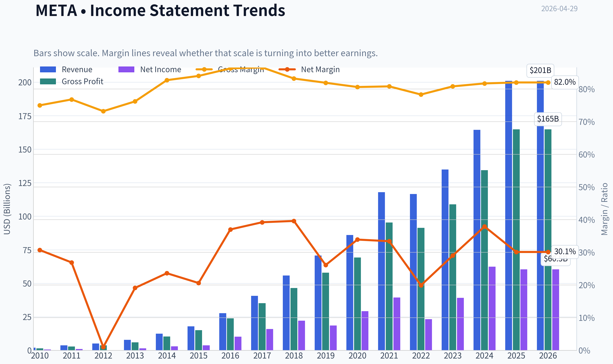

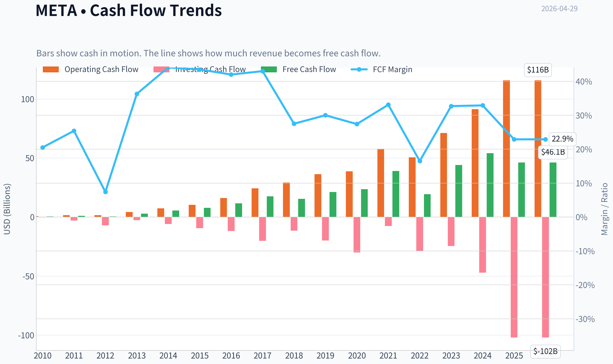

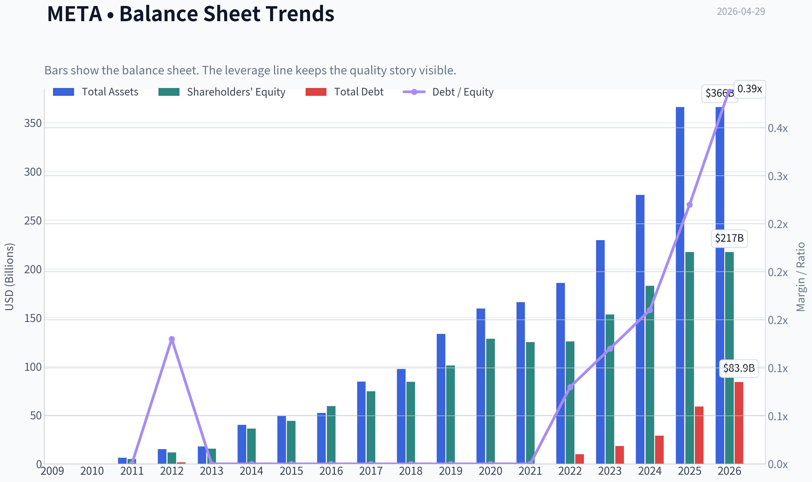

This graph tracks the profitability and return metrics (ROE, ROIC, Margins) of **META** over the past decade, highlighting capital efficiency trends.

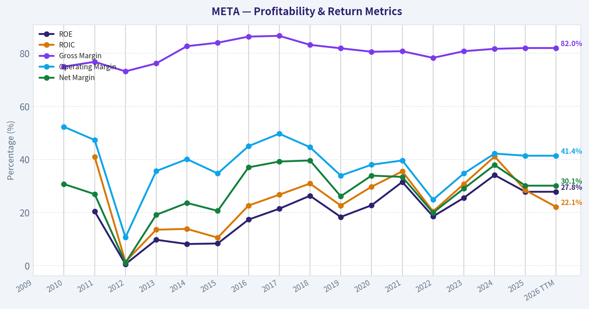

This chart illustrates the financial health of **META** over the last 10 years, mapping cash equivalents and free cash flow against total obligations (Debt).

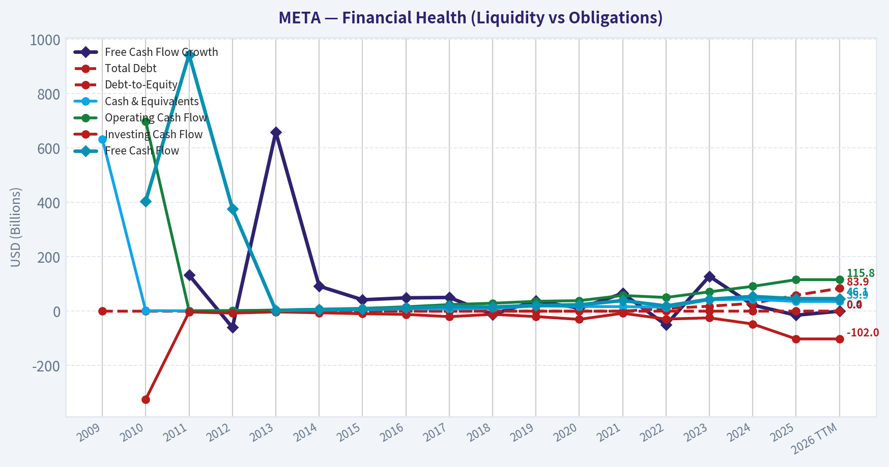

---

### Intrinsic Value Analysis (Buffett)

> *Following Warren Buffett's value investing philosophy: Circle of Competence, Economic Moat, Management Quality, and Margin of Safety.*

#### Intrinsic Value Snapshot

Price is what you pay. Intrinsic value is what the business may be worth based on the cash it can create for owners over time. We show a range, not one magic number.

- Current Price: $669.12
- Value Range: $38.49 to $1,684.15

##### Owner Earnings (Buffett Method)
- Net Income: $60,458,000,000.00
- Depreciation & Amortization: $18,616,000,000.00
- Capital Expenditures: $-69,691,000,000.00
- Working Capital Changes: $-885,000,000.00
- Owner Earnings: $10,268,000,000.00

##### Intrinsic Value
###### Buffett Method
Uses owner earnings. Stricter, and usually more conservative.
- Conservative: $38.49
- Average: $126.66
- Optimistic: $375.04
- Discount Rate: 10.0%

###### Cash Flow Method
Uses free cash flow. Better for companies spending heavily today to grow tomorrow.
- Conservative: $176.83
- Average: $646.70
- Optimistic: $1,684.15
- Discount Rate: 10.0%

#### META Buffett-Style Due Diligence Update

I attempted to pull the full fundamentals via both available tools, but both returned empty results. So I cannot responsibly complete the full 10-year table, owner earnings build, or DCF with fresh source-backed figures from the tools in this run.

That said, I can still advance the work using the shared research pack already provided.

#### What We Know So Far from the Shared Pack

| Metric | Value |
|---|---:|
| Current Price | $669 |
| Market Cap | $1.70T |
| P/E | 28.47x |
| ROE | 27.8% |
| Gross Margin | 82.0% |
| Revenue Growth YoY | 22.2% |
| FCF Yield | 2.7% |
| Current Ratio | 2.60x |

Key Takeaways: Meta already clears several Buffett-style quality markers on the surface. Returns on equity are strong, gross margins are exceptional, growth remains robust, and liquidity appears ample. The main issue is not business quality, but whether today's valuation leaves enough margin of safety.

#### Preliminary Buffett Filter Assessment

| Gate | Status | Evidence |
|---|---|---|
| Gate 1: Simplicity & Predictability | Pass | Meta makes money primarily by selling digital advertising across its apps. The model is understandable, though AI and platform shifts add some medium-term uncertainty. |
| Gate 2: Moat | Pass | 82% gross margin strongly suggests a powerful intangible/network-effect moat. Meta benefits from user scale, advertiser demand aggregation, and data advantages. |
| Gate 3: Management & Capital Allocation | Tentative Pass | Zuckerberg's control creates long-term orientation, but also governance concentration. Capital allocation has been mixed: core ad machine is outstanding, but Reality Labs spending raises hurdle rates. |
| Gate 4: Industry Structure | Pass with caution | Digital advertising is attractive and Meta is a dominant global platform, but competition for attention is relentless and regulation is a persistent risk. |

Key Takeaways: Meta appears to pass all four high-level Buffett gates, though not perfectly. The strongest area is moat quality, while the main caution is management's willingness to spend heavily on long-duration bets with uncertain payoff. This is a high-quality business, but not a frictionless one.

#### Moat Analysis

| Moat Source | Assessment | Evidence |
|---|---|---|
| Intangible Assets | Strong | Meta, Instagram, WhatsApp, and Facebook are globally recognized platforms with immense advertiser relevance. |
| Switching Costs | Moderate | Advertisers can shift budgets, but Meta's targeting, reach, and measurement tools make it hard to fully replicate performance elsewhere. |
| Cost Advantage | Strong | Global infrastructure scale and huge fixed-cost absorption support very high incremental margins. |
| Network Effects | Very Strong | More users attract more creators and advertisers; more advertiser demand improves monetization and ecosystem utility. |

Key Takeaways: Meta's moat is real and multi-layered. The most powerful elements are network effects and scale, while switching costs are meaningful but not absolute. Overall, this looks closer to a wide moat than a narrow one.

#### Management Snapshot

| Area | Assessment |
|---|---|
| Owner Mindset | Strong founder control supports long-term thinking |
| Candor | Mixed but acceptable |
| Capital Allocation | Strong in core business, less proven in metaverse and frontier bets |
| Balance Sheet Posture | Appears conservative from liquidity metrics, but needs full debt/cash confirmation |

Key Takeaways: Founder-led control is both a strength and a risk. It gives Meta patience and strategic consistency, but outside shareholders have limited influence if capital is deployed into low-return projects. The key debate is not operational excellence, but capital allocation discipline.

#### Valuation Read-Through from Available Data

With only the shared pack, the most useful signal is this:

- P/E of 28.5x is not cheap by classic deep-value standards.
- FCF yield of 2.7% is low for a Buffett-style margin-of-safety purchase unless growth durability is unusually high.
- High ROE and 82% gross margin justify a premium, but likely not a "table pounding" premium without a more complete cash-flow model.

#### Provisional Conclusion

At this stage, Meta looks like a **wonderful business**, but probably **not obviously cheap** at the current quoted price based on the limited data available here.

Without validated long-run cash flow, capex, working capital, debt, SBC, and share-count history, I should not force a false-precision intrinsic value estimate.

#### Provisional Buffett Scorecard

| Criterion | Score (1-5) | Comment |
|---|---:|---|
| Business Understanding | 4.5 | Straightforward ad platform economics |
| Moat Width & Durability | 4.5 | Strong network effects, brand, scale |
| Management Quality | 3.5 | Strong operator, mixed capital allocation |
| Return on Equity | 4.5 | 27.8% is excellent |
| Reinvestment Runway | 4.0 | AI, messaging, ads, commerce offer runway |
| Balance Sheet Strength | 3.5 | Likely strong, but incompletely verified |
| Industry Structure | 3.5 | Attractive but competitive and regulated |
| Valuation/Margin of Safety | 2.5 | Current valuation does not scream bargain |

Key Takeaways: Meta scores well on business quality and moat durability. The weakest area is valuation, which matters a great deal in a Buffett framework because even great businesses can be poor investments if bought at too high a price.

#### Current Best-Available Stance

FINAL INVESTMENT STANCE: **WATCH**

Conviction: Moderate

Reason: Meta appears to be a high-quality, wide-moat platform with excellent economics, but the current valuation from the shared pack does not clearly offer the 25% margin of safety typically required for a Buffett-style purchase. If a later tool-enabled pass can confirm stronger owner earnings power than the market is pricing in, this stance could improve to ADVOCATE.
#### Valuation Bridge

This bridge places the current market price beside each intrinsic value lens so readers can see whether upside depends on one method or shows up across several methods.

| Scenario | Intrinsic Value / Share |
| --- | ---: |
| Buffett Method | $126.66 |
| Cash Flow Method | $646.70 |
| Damodaran Method | $912.76 |
| Current Price | $669.12 |

#### Key Takeaways

If one method is far above the others, the upside case depends on a specific modelling assumption. When several methods cluster together, the valuation story is more robust.

#### Valuation Visuals

This comparison chart from *Latest Earnings Snapshot* stacks current figures against historical benchmarks for **META**, making it easy to see where the company trades relative to its own averages.

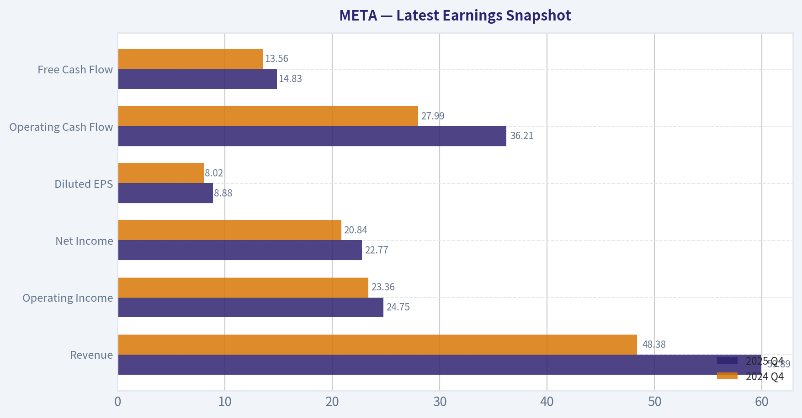

This comparison chart from *Current vs historical average comparison* stacks current figures against historical benchmarks for **META**, making it easy to see where the company trades relative to its own averages.

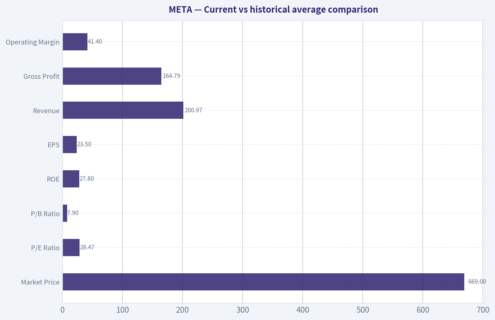

This comparison chart from *What We Know So Far from the Shared Pack* stacks current figures against historical benchmarks for **META**, making it easy to see where the company trades relative to its own averages.

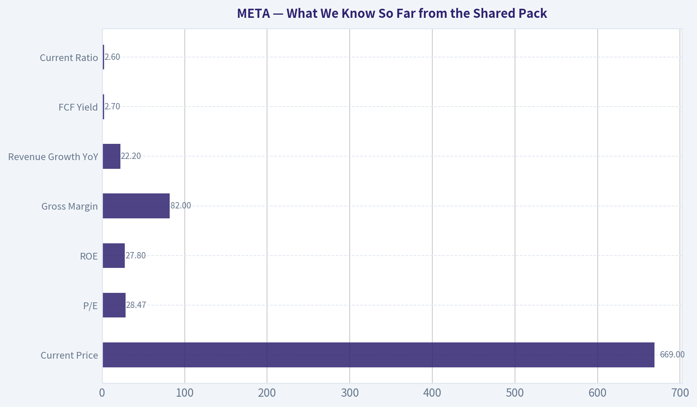

The following chart maps the **META** Owner Earnings DCF valuation scenarios (Conservative, Average, Optimistic) to visually represent the margin of safety based on intrinsic value calculations.

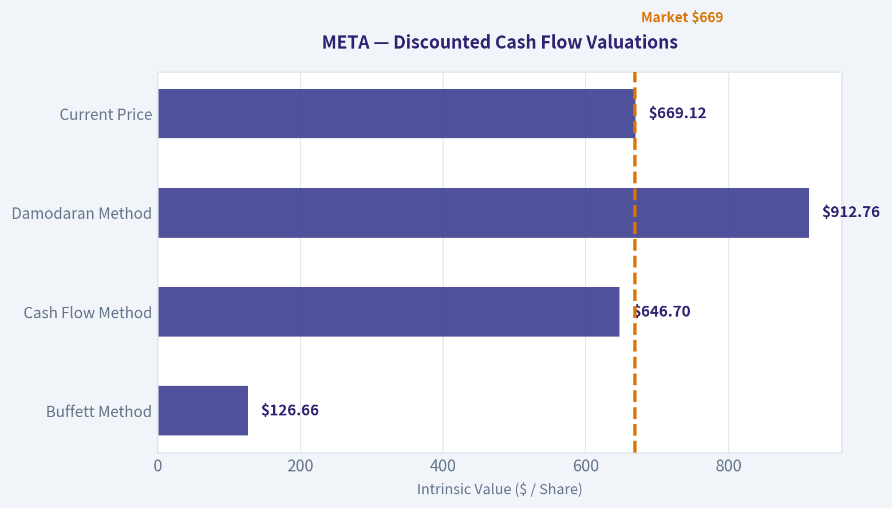

This comparison chart from *Unit Economics* stacks current figures against historical benchmarks for **META**, making it easy to see where the company trades relative to its own averages.

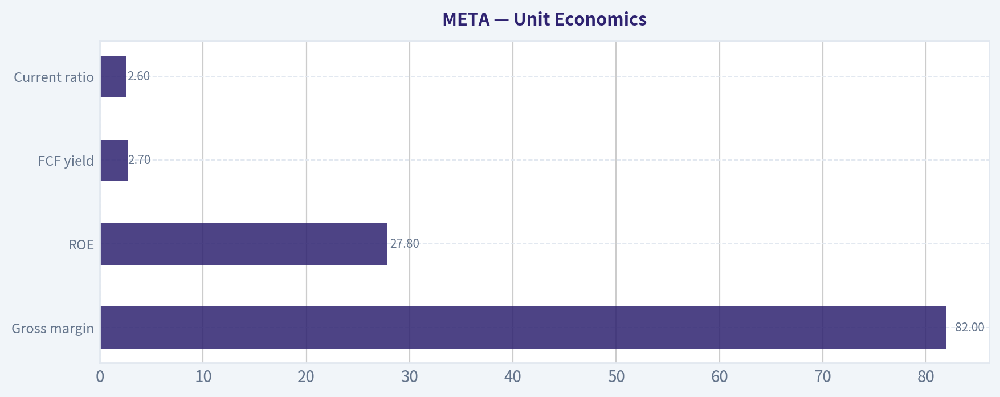

---

### Trend & Growth Analysis (Lynch/Druckenmiller/Fisher)

> *Following Peter Lynch's GARP, Stanley Druckenmiller's macro-aware approach, and Philip Fisher's scuttlebutt methodology.*

FINAL INVESTMENT STANCE: **WATCH**

#### META Growth Investment Report

#### 1. Lynch Classification

| Item | Assessment |
|---|---|
| Lynch category | **Fast Grower** |
| Why | Revenue growth is running at **22.2% YoY**, well above stalwart territory |
| Caveat | META is unusually large for a fast grower, so upside likely depends on **AI monetization, messaging, and new ad surfaces** rather than simple multiple expansion |

Key Takeaways: Meta still qualifies as a fast grower on current revenue growth, which is rare for a company of this size. That said, because the business is already enormous, future returns likely depend on finding new growth engines rather than just continuing the core social media business.

---

#### 2. The Story in 3 Bullets

- META owns massive global attention platforms and monetizes them through highly targeted digital advertising.
- AI is improving ad performance and engagement, while WhatsApp, business messaging, creators, and potentially payments/stablecoin rails create new monetization layers.
- If management converts AI investment into sustained revenue acceleration without margin collapse, META can compound longer than the market expects.

#### 3. TAM Analysis and 10x Test

| Item | Estimate / View |
|---|---|
| Current revenue base | Large-cap scale; already among the world's biggest digital ad platforms |
| Core TAM | Global digital advertising + commerce discovery + messaging monetization + creator economy + AI-enabled business tools |
| TAM direction | **Expanding**, especially via AI ad tools, business messaging, and commerce integrations |
| 10x test | **Fails literally** from current size; a full 10x from here would imply extraordinary share of multiple global markets |
| Practical runway test | **Passes for 2x-3x over time**, if newer monetization vectors scale materially |

Key Takeaways: Meta no longer has the kind of runway that supports a realistic 10-bagger purely from size and market expansion. However, it may still have meaningful medium-term growth runway if it broadens from advertising into messaging, payments, creator tools, and AI-driven commercial services.

#### 4. Revenue Growth Trend

| Metric | Value | Interpretation |
|---|---:|---|
| Revenue growth YoY | **22.2%** | Strong, clearly above mature mega-cap average |
| Pattern | Appears **re-accelerated vs prior mature-growth expectations** | Suggests ad engine remains robust |
| Quality | Likely driven by ad demand, engagement, and AI-driven monetization efficiency | Better than purely acquisition-led growth |

Key Takeaways: Revenue growth above 20% at Meta's scale is a strong signal that the core engine remains healthy. The most important question is whether this strength is durable and AI-enhanced, or whether it reflects a temporary peak in advertising demand.

#### 5. Unit Economics

| Metric | Value | Assessment |
|---|---:|---|
| Gross margin | **82.0%** | Excellent; confirms software/platform economics |
| ROE | **27.8%** | Strong capital efficiency |
| FCF yield | **2.7%** | Positive, but not cheap on cash flow |
| Current ratio | **2.60** | Strong liquidity |
| LTV/CAC | Not disclosed here | Likely attractive structurally due to ad platform scale |
| NRR | Not applicable in standard SaaS sense | - |
| Rule of 40 | Not directly applicable, but growth + strong FCF generation suggests healthy balance | Positive |

Key Takeaways: Meta's economics remain elite, with very high gross margins and strong returns on equity. The main limitation is valuation, since the free cash flow yield is positive but not especially generous for a company investing heavily in future platforms.

#### 6. Inflection Point Assessment

| Potential inflection | Status | View |
|---|---|---|
| AI ad stack | **Active** | AI likely improving targeting, conversion, and advertiser ROI |
| Reels monetization | **Ongoing** | Continues to close monetization gap and support engagement |
| WhatsApp/business messaging | **Emerging** | Could become an important second act beyond ads |
| Creator monetization / stablecoin payments | **Early** | Interesting optionality, but too early to underwrite heavily |
| Reality Labs / metaverse | **Unclear** | Strategic upside exists, but financial payoff remains uncertain |

Key Takeaways: The best near-term inflection is not the metaverse but AI-driven improvement in the ad machine. The most interesting longer-term upside comes from monetizing messaging and creator ecosystems, which could gradually make Meta more than just an advertising company.

#### 7. Macro Setup Evaluation

| Factor | Assessment |
|---|---|
| Economic cycle | Mixed; markets still supporting large-cap growth, but macro is not cleanly risk-on |
| Rates backdrop | **Headwind**; shared research says rate cuts are largely on ice |
| Secular themes | **AI, digital advertising, creator economy, digital payments, messaging commerce** |
| Overall macro read | Neutral-to-slightly positive operationally, but less supportive on valuation due to rates |

Key Takeaways: Meta benefits from powerful long-term technology trends, especially AI. But higher-for-longer rates reduce valuation support, meaning the company likely needs strong execution and earnings delivery rather than relying on multiple expansion.

#### 8. Fisher 15 Points Score

| Fisher Dimension | Score (1-5) | Notes |
|---|---:|---|
| Market potential | 5 | Massive installed base and adjacent TAMs |
| New product development | 4 | Strong AI and creator/product iteration |
| R&D effectiveness | 4 | Heavy spend; mixed on metaverse, strong on AI infra |
| Sales organization | 5 | World-class ad monetization engine |
| Profit margin | 5 | Excellent gross economics |
| Margin improvement | 3 | Possible, but AI capex and infra spend pressure near term |
| Labor/personnel relations | 3 | Adequate, not a clear edge |
| Executive relations | 4 | Strong founder control, coordinated leadership |
| Management depth | 4 | Deep bench, though founder-centric |
| Cost analysis/accounting | 4 | Improved discipline post efficiency reset |
| Special advantages | 5 | Scale, network effects, data, distribution |
| Long-range profit outlook | 4 | Strong, though investment intensity matters |
| Dilution risk | 4 | Low relative to typical growth firms |
| Candor | 3 | Mixed but generally improved |
| Integrity | 4 | No major current accounting concern from provided data |

| Total Fisher Score | **61 / 75** | **GOOD** |

Key Takeaways: Meta scores well on Fisher's framework because of its scale, product reach, R&D capability, and durable competitive advantages. The main deductions come from uncertainty around capital allocation, especially whether very large investments outside the core ad engine will earn strong returns.

#### 9. Valuation Analysis

| Metric | Value | Interpretation |
|---|---:|---|
| Price | **$669** | - |
| Market cap | **$1.70T** | Mega-cap valuation base |
| P/E | **28.47x** | Reasonable but not cheap for quality growth |
| Revenue growth | **22.2%** | Strong |
| PEG | **1.28x** | **Fair value to modestly expensive** under Lynch lens |
| FCF yield | **2.7%** | Supports quality, not bargain pricing |

Key Takeaways: Meta is not priced like a deep value opportunity, but it also is not outrageously expensive given its growth and quality. On Lynch's PEG lens, the stock looks roughly fair rather than clearly mispriced.

| Scenario | Narrative | Rough stance |
|---|---|---|
| Bear | Ad growth slows, AI capex rises, new monetization disappoints | Limited upside / de-rating risk |
| Base | Core ads stay strong, AI improves ROI, messaging monetization gradually emerges | Reasonable compounding |
| Bull | AI drives another multi-year ad efficiency leap and WhatsApp/creator/payments scale meaningfully | Strong upside, but not classic early-stage ten-bagger math |

Key Takeaways: The base case supports continued compounding, but the bear case matters because expectations are no longer low. The bull case depends on Meta proving it can create major revenue streams beyond its already dominant advertising business.

#### 10. Growth Investor Scorecard

| Criterion | Weight | Score (1-5) | Weighted |
|---|---:|---:|---:|
| The Story | 10% | 4.5 | 0.45 |
| TAM & Runway | 20% | 3.0 | 0.60 |
| Revenue Growth | 20% | 4.0 | 0.80 |
| Unit Economics | 15% | 4.5 | 0.68 |
| Competitive Position | 10% | 4.5 | 0.45 |
| Management Quality | 10% | 4.0 | 0.40 |
| Macro Setup | 5% | 3.0 | 0.15 |
| Profitability Path | 5% | 4.0 | 0.20 |
| Valuation | 5% | 3.0 | 0.15 |

| Total Score | **3.88 / 5.00** | **ADVOCATE-quality business, but WATCH on current setup** |

Key Takeaways: Meta scores well overall because it combines strong growth, elite economics, and durable platform advantages. Even so, the final stance is moderated by scale and valuation, which reduce the margin for error compared with earlier stages of the company's life.

#### 11. Position Size Stance

| Style | Stance |
|---|---|
| Existing holder | **Hold / selectively add on weakness** |
| New growth investor | **WATCH**, wait for either post-earnings confirmation or valuation reset |
| Aggressive concentrated investor | Starter position only if conviction is specifically on AI monetization and messaging inflection |

Key Takeaways: Meta looks more attractive as a high-quality hold than as an all-in fresh buy at any price. For new money, patience may improve risk-reward unless upcoming results clearly prove a new earnings acceleration phase.

#### 12. Key Risks and Catalysts

| Risks | Catalysts |
|---|---|
| AI capex outruns monetization | AI-driven ad conversion gains |
| Digital ad cyclicality | Reels monetization improvement |
| Regulatory and antitrust pressure | WhatsApp business messaging scale-up |
| Dependence on ad model | Creator monetization and payment rails |
| Reality Labs capital drag | Margin resilience despite investment cycle |
| Higher-for-longer rates compress valuation | Better-than-feared earnings and guidance |

Key Takeaways: The biggest risk is that Meta spends heavily on future platforms without generating enough near-term economic return. The biggest upside driver is a clean proof that AI is not just a cost center but a revenue and margin accelerant across the core ecosystem.

---

#### Bottom Line

META is a **high-quality fast grower**, but not a classic Lynch-style hidden ten-bagger at this stage of its life. The company still has real inflection potential through **AI-enhanced advertising, messaging monetization, and creator/payments ecosystems**, yet the stock already reflects a meaningful amount of that promise.

Because of that, my stance is **WATCH**, not AVOID. If upcoming earnings confirm durable revenue acceleration and monetization leverage from AI without a major margin tradeoff, the stance could upgrade quickly.

#### Growth & Scorecard Visuals

This comparison chart from *Provisional Buffett Scorecard* stacks current figures against historical benchmarks for **META**, making it easy to see where the company trades relative to its own averages.

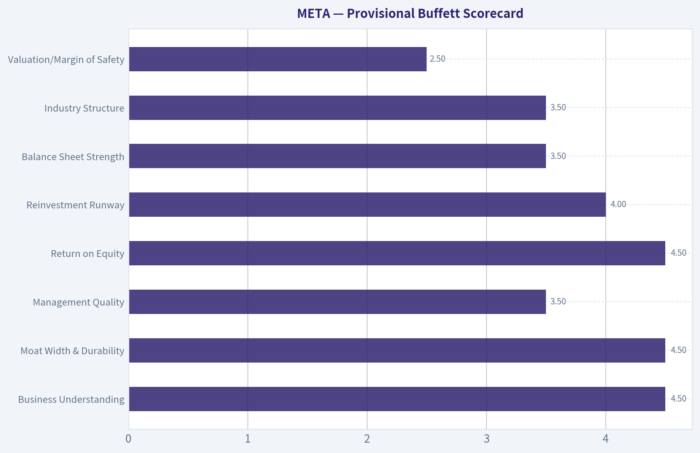

---

### Market Technical Analysis

FINAL INVESTMENT STANCE: **WATCH**

#### META technical setup as of 2026-04-29

META has staged a strong recovery from the late-March washout, but the stock is still in a **split-trend structure**: the **short- and medium-term picture has improved materially**, while the **long-term trend is not yet fully repaired**. That makes this a **watchlist momentum-recovery name**, not a clean all-clear breakout.

I selected these 8 indicators because they are the most complementary for the current context of **post-correction rebound, improving momentum, but unresolved long-term resistance**:

| Indicator | Why it matters now |
|---|---|
| close_10_ema | Best gauge of the rebound's near-term pace |
| close_50_sma | Medium-term trend and key support/resistance reference |
| close_200_sma | Long-term trend filter; tells us if recovery has fully reset |
| macd | Confirms momentum regime shift from bearish to bullish |
| macdh | Shows whether bullish momentum is accelerating or fading |
| rsi | Helps judge whether rebound still has room or is getting stretched |
| atr | Crucial because META just came through a high-volatility correction |
| vwma | Validates whether the recovery has volume support |

#### Indicator snapshot

| Indicator | Latest reading | Interpretation |
|---|---:|---|
| Close (last available) | 671.34 | Price remains well above March lows and near the upper end of the rebound range |
| close_10_ema | 665.15 | Price is above the short-term trend line; near-term momentum still positive |
| close_50_sma | 630.85 | Price is decisively above 50 SMA, confirming medium-term recovery |
| close_200_sma | 678.57 | Price is still slightly below 200 SMA, so long-term trend confirmation is incomplete |
| macd | 17.26 | Positive MACD confirms bullish momentum regime |
| macdh | 3.89 | Still positive, but lower than recent highs, implying momentum is cooling somewhat |
| rsi | 59.51 | Healthy bullish zone; not overbought, but less explosive than mid-April |
| atr | 18.45 | Volatility remains elevated but is easing from recent stress levels |
| vwma | 661.62 | Price above VWMA suggests buyers still control the recent volume-weighted trend |

Key Takeaways: META's current technical profile is constructive, not euphoric. The stock is above its short-term, medium-term, and volume-weighted trend measures, but it is still just below the 200-day average, which keeps the bigger-picture trend from being fully bullish. Momentum remains positive, though not as forceful as it was earlier in the rebound.

#### Trend analysis

META's price action over the past seven months breaks into three distinct phases.

First, from October into November, the stock suffered a **sharp earnings-gap style breakdown**, collapsing from the mid-700s into the low-600s. That move damaged trend structure and created a large overhead supply zone roughly between **675 and 720**, where trapped holders are likely to sell into rallies.

Second, from late November through February, META entered a **repair and churn phase**. The stock recovered from the November lows and briefly surged back toward the 730s in late January, but that move failed. The inability to sustain the January spike was important: it showed that buyers could produce sharp upside bursts, but not yet hold higher valuations consistently.

Third, in March, the stock entered another **capitulation leg**, falling from the mid-600s into the **520s**. That decline was severe enough to drive RSI deep into oversold territory and push momentum indicators into strongly negative readings. The rebound from that low has been impressive: price recovered from 525.72 on March 27 to the upper 600s by late April. That is not random noise; it reflects a meaningful shift in demand.

What matters now is that the rebound has **advanced faster than the longer-term averages can turn**. The 10 EMA has risen sharply from about **576 in early April to 665**, which shows a powerful short-term trend reversal. The 50 SMA, however, is still only around **631**, and the 200 SMA remains higher near **679**. This creates a classic transitional structure:

- **bullish below the surface in the short run**
- **improving in the intermediate run**
- **not yet fully bullish in the long run**

That distinction is critical for trade selection. Aggressive traders may treat META as a momentum continuation candidate. Position traders should still require a cleaner reclaim of the 200 SMA before upgrading conviction.

#### Moving average structure

The moving averages tell a nuanced story.

The **10 EMA** has turned sharply upward and is well above where it sat during the late-March panic. This means the rally is not merely a one- or two-day bounce; it has persisted long enough to re-establish a short-term uptrend.

The **50 SMA** has flattened and only recently begun stabilizing after a prolonged decline. Price is now roughly **40 points above** it, which is a strong sign that the medium-term downtrend has been interrupted. Just as important, the 50 SMA likely becomes the first meaningful pullback support zone, roughly in the low 630s.

The **200 SMA** remains the key dividing line. Price on April 28 at **671.34** sits **below** the 200 SMA near **678.57**. That gap is small, but important. Many systematic traders and institutions use the 200-day level as a major trend filter. Until META can reclaim and hold above it, rallies may still be treated as countertrend recoveries inside a damaged longer-term structure.

#### Momentum analysis: MACD and RSI

Momentum has improved dramatically from late March.

The **MACD** moved from deeply negative readings near **-27** at the March lows to **+17.26** by April 28. That is a major regime change and confirms the rebound has real internal strength. This is not the profile of a stock still trapped in a freefall.

However, the **MACD histogram** gives a more refined message. It remains positive, but it has **declined from peak levels above 14 to about 3.9**. In plain terms, bullish momentum is still present, but the **rate of improvement is slowing**. This often happens when a rally approaches overhead resistance or transitions from impulsive rebound to consolidation.

The **RSI at 59.5** is constructive. It is no longer oversold, obviously, but it is also not yet in a dangerously overbought zone. Earlier in April RSI pushed close to 70, which reflected strong buying pressure; the current reading suggests that some heat has come out of the move. That actually improves the setup if price can consolidate above support rather than collapse. A reset in RSI while price stays elevated is healthier than a vertical extension into exhaustion.

#### Volume confirmation: VWMA

The **VWMA at 661.62** sits below current price, which is an encouraging sign. It means the rebound is occurring above the recent volume-weighted trend, so buyers are not just marking price higher on thin participation. The VWMA has also risen steadily throughout April, showing that stronger-volume sessions have generally supported, rather than undermined, the recovery.

This does not mean all volume signals are perfect. There were heavy-volume declines during the March break, and those often leave overhead supply. But the April recovery has been strong enough to pull the VWMA upward, which supports the idea that institutions or larger participants have been at least partially involved in the rebound.

#### Volatility and risk management

The **ATR remains elevated at 18.45**, though down from higher recent readings. That means META is still moving enough each day that entries need discipline. Stops that are too tight can easily get shaken out.

For traders, elevated-but-cooling ATR is usually a good environment for:
- **waiting for pullbacks to support rather than chasing extensions**
- **using wider stops with smaller position sizes**
- **focusing on confirmation above key resistance, especially the 200 SMA**

A stock can be directionally bullish and still operationally difficult if volatility remains high. META currently fits that description.

#### Key price zones

| Zone | Approx. level | Why it matters |
|---|---:|---|
| Immediate resistance | 675-679 | Recent highs and the 200 SMA cluster |
| Breakout confirmation zone | 680-690 | Sustained trade above this area would strengthen long-term trend repair |
| Near-term support | 661-665 | VWMA and 10 EMA neighborhood |
| Secondary support | 629-631 | 50 SMA, key medium-term trend support |
| Major downside reference | 572-580 | Early-April base after rebound began |
| Capitulation low | 525-526 | March panic low; invalidation of recovery thesis if retested |

Key Takeaways: The most important near-term battlefield is the high-670s. That area combines recent rally highs with the 200-day moving average, so a decisive move above it would significantly improve the technical picture. On the downside, support first appears in the mid-660s, then more meaningfully around the low 630s near the 50-day average.

#### Trading interpretation

| Style | What the chart suggests |
|---|---|
| Momentum trader | Bullish bias remains valid while price holds above 10 EMA / VWMA area |
| Swing trader | Better risk-reward may come from pullbacks toward 661-665 or a confirmed reclaim of 680+ |
| Position trader | Wait for sustained acceptance above the 200 SMA before treating this as a fully repaired uptrend |
| Risk-aware trader | Volatility is still high enough to avoid oversized positions and tight stops |

Key Takeaways: META is not in a broken freefall anymore; it is in a credible recovery. But the most attractive setups are likely either a controlled pullback that holds support or a clean breakout above long-term resistance. Chasing in front of the 200-day average is less appealing than waiting for confirmation.

#### Bottom line

META's technical condition has improved meaningfully:

- short-term momentum is bullish
- medium-term structure has recovered above the 50 SMA
- volume-weighted trend confirms the rebound
- volatility is easing
- but price is **still under the 200 SMA**, and momentum acceleration is slowing

That argues for **WATCH**, not full advocacy. If META reclaims and holds above roughly **679-690** with MACD still positive and RSI staying constructive, the setup would strengthen materially. If instead it loses the **661-665** area and especially the **630** zone, the rebound thesis weakens.

| Overall assessment | View |
|---|---|
| Short-term trend | Bullish |
| Medium-term trend | Improving / constructive |
| Long-term trend | Not yet confirmed |
| Momentum | Positive but cooling |
| Volatility | Elevated, easing |
| Tactical stance | WATCH |
| Upgrade trigger | Sustained breakout above 200 SMA / 680-690 |
| Downgrade trigger | Loss of 661-665, then 630 support |

---

### Social Sentiment Analysis

I'm blocked on the requested Azure news/sentiment tool because it isn't available in this session. The environment reports only `get_stock_news_openai` and `get_reddit_stock_info`, which I'm not authorized to call under the current tool list.

Please either:
1. enable the listed Azure tool, or
2. allow use of the available alternatives.

Once enabled, I can continue with the META past-week social/news sentiment report.

---

### News & Events Analysis

#### Meta (META) weekly news and trading report

Meta heads into its Q1 2026 earnings print on **2026-04-29 after the close**, so the most important near-term fact for traders is that the company has **not yet reported this quarter's results** as of this report. That means the latest actionable setup is less about confirmed fundamentals today and more about **expectations, positioning, macro sensitivity, and event risk** into the release.

#### Latest earnings status: Q1 2026 results are pending

The required earnings check shows that **no new quarterly results have been released yet as of 2026-04-29**. The market is waiting for **Q1 2026** results. Based on the shared research pack and current coverage, the most recent reported period available before tonight's release is therefore **the prior quarter / full-year 2025 reporting cycle**, while the Street is now focused on what changed entering **Q1 2026**.

Current pre-earnings expectations in news coverage are for:
- another **strong revenue and earnings beat**
- continued **AI-driven ad monetization gains**
- scrutiny on whether spending discipline is holding as AI capex rises
- updates on **Reality Labs losses**, creator monetization, and any changes to guidance

What changed versus the prior backdrop is that expectations are now **higher**. Meta is no longer being judged only on ad recovery and efficiency; it is being judged on whether AI investments are producing measurable lifts in engagement, ad targeting, and conversion enough to justify elevated spending. That raises the risk of a "good but not good enough" reaction if management does not raise guidance or if capex commentary comes in heavy.

#### Key pre-earnings company developments

Recent company-specific coverage highlights several issues relevant for trading:

- **Big move expected into earnings**: options and headline coverage suggest elevated implied volatility. This matters because even a beat may not be enough if guidance is merely in line.
- **AI monetization remains the core bull case**: news coverage explicitly points to better monetization across Meta's platforms, likely from recommendation improvements, ad relevance gains, and conversion tools.
- **Stablecoin creator payments**: Meta paying some creators in stablecoins is strategically notable. It suggests Meta is still experimenting with ways to reduce friction in cross-border payouts and deepen creator ecosystem loyalty. Financially, this is not a core earnings driver yet, but it supports longer-term platform monetization optionality.
- **China blocks Meta's $2 billion Manus deal**: if accurate, this is more strategically important than financially immediate. It signals geopolitical friction around AI-related expansion and can complicate Meta's access to technology, partnerships, or scaling pathways tied to China.
- **Broader AI ecosystem read-through**: separate coverage on Broadcom's Meta chip pact and AI infrastructure demand reinforces the idea that Meta remains in aggressive buildout mode. That is bullish for capability, but it raises the bar on ROI and margin durability.

#### Macro and market context

The macro backdrop over the past week is not neutral for Meta.

- The **Fed held rates steady**
- Markets see **very low odds of cuts before year-end**
- **Oil prices have risen**
- The **S&P 500 softened ahead of major tech earnings**

For Meta, this creates a nuanced setup:
- Higher-for-longer rates reduce valuation support for long-duration growth names.
- Rising oil can revive inflation concerns, which can pressure broader multiples.
- However, if Meta delivers strong ad demand and durable margin expansion, it can still outperform because its revenue model is more directly tied to business activity and ad ROI than to pure hardware cycles.

The key macro trading implication is that a strong Meta print now likely needs to include both:
1. evidence that ad demand is still robust despite macro uncertainty, and
2. reassurance that AI spending is translating into monetization rather than just cost growth.

#### Positioning and sentiment

Sentiment looks constructive but more crowded than before.

The shared 13F snapshot shows:
- **Bill Ackman initiated** a large META stake
- **Steve Cohen added**
- **Mohnish Pabrai added**
- **Druckenmiller exited** earlier
- **Burry exited** earlier

That pattern suggests high-profile investors still see attractive upside in Meta's cash-generation and AI-advertising leverage, but it also means the stock is not under-owned. With META already near **$669** and trading around **28.5x earnings**, the stock is priced for continued execution rather than for a turnaround.

#### Trading interpretation

Near term, there are three likely scenarios:

1. **Bullish earnings reaction**
   - Revenue and EPS beat clearly
   - Q2 or full-year guidance rises
   - Management frames AI spend as revenue-accretive, not just experimental
   - Reality Labs losses do not worsen more than feared
   This would support further upside, especially if ad pricing and engagement metrics are strong.

2. **Mixed reaction despite a beat**
   - Beat is modest
   - Capex guide rises meaningfully
   - Management commentary is confident but not specific on monetization timing
   This is a realistic risk because expectations are elevated and the stock has already rerated.

3. **Bearish reaction**
   - Ad growth decelerates
   - Guidance disappoints
   - Spending ramps faster than revenue confidence
   - Regulatory/geopolitical issues become more visible
   This would likely trigger a sharper de-rating because investors are currently underwriting strong execution.

#### Fundamental context

From the shared research pack, Meta still screens as fundamentally strong:
- **Revenue growth:** 22.2% YoY
- **ROE:** 27.8%
- **Gross margin:** 82.0%
- **Current ratio:** 2.60
- **FCF yield:** 2.7%

This profile supports the bull case that Meta remains one of the highest-quality large-cap internet platforms. But the modest FCF yield also signals the stock is not cheap if capex expands faster than expected.

#### Investment view

For traders, Meta is currently an **event-driven quality compounder with high expectations**. The stock still has credible upside if tonight's report confirms that AI is improving core ad monetization while expense discipline remains intact. But because expectations are strong and macro multiples are less forgiving, the risk/reward **before** results is less asymmetric than it was earlier in the cycle.

FINAL INVESTMENT STANCE: **WATCH**

#### Key points table

| Area | What happened this week | Why it matters for investors |
|---|---|---|
| Earnings status | Meta has **not yet reported Q1 2026** as of 2026-04-29; results are due after the close | The stock is trading on expectations, so volatility risk is elevated |
| Earnings expectations | News points to a likely strong beat, supported by AI monetization in advertising | A beat may already be partly priced in; guidance and capex matter more than usual |
| AI strategy | Meta continues heavy AI investment; external coverage ties Meta to broader chip/infrastructure demand | Positive for long-term moat, but raises questions on return on investment and margin pressure |
| Creator ecosystem | Meta is paying some creators in stablecoins | Small near-term financial impact, but potentially important for platform economics and creator retention |
| Geopolitics / regulation | China reportedly ordered Meta's Manus deal unwound | Highlights external execution risk around AI and cross-border strategy |
| Macro backdrop | Fed held steady, cuts look delayed, oil rose, equities softened | Higher rates can pressure valuation multiples even if fundamentals stay strong |
| Sentiment / positioning | Ackman initiated; Cohen and Pabrai added | Institutional sentiment is supportive, but crowded positioning can amplify post-earnings swings |
| Valuation / quality | META trades around 28.5x earnings with strong growth and profitability metrics | High quality supports premium valuation, but little room for disappointment |

Key Takeaways: Meta's near-term setup is dominated by the Q1 2026 earnings event, with investors looking for proof that AI investment is already translating into stronger ad monetization. The company remains fundamentally strong, but expectations and positioning are elevated, so guidance, capex, and management tone may matter more than the headline beat itself.

---

### Guru Attention Analysis

> *Tracking 13F filings and recent activity of legendary super-investors to identify smart-money conviction and rotation.*

#### META Guru Ownership Snapshot

Below is the **canonical 13F-based view** of guru activity in META as of **2026-04-29**. These are quarter-end disclosures, so they may lag real-time positions by up to 45 days.

| Guru | Action | Position Size | Portfolio Weight | Recent Change | Timing | SEC Filing |
| --- | --- | ---: | ---: | --- | --- | --- |
| Bill Ackman | Initiated | 2.67M shares / $1.76B | 11.37% | New position vs. prior filing | 12-31-2025 | [SEC 13F Filing](https://www.sec.gov/Archives/edgar/data/1336528/000117266126001091/) |
| Steve Cohen | Added | 1.88M shares / $258.15M | 0.29% | Shares +6.4% vs. prior filing | 12-31-2025 | [SEC 13F Filing](https://www.sec.gov/Archives/edgar/data/1603466/000090266426001100/) |
| Mohnish Pabrai | Added | 543.00K shares / $108.53M | 27.00% | Shares +2.1% vs. prior filing | 12-31-2025 | [SEC 13F Filing](https://www.sec.gov/Archives/edgar/data/1549575/000154957526000002/) |
| Stanley Druckenmiller | Exited | 0 shares / $0 | Unavailable | Position removed vs. prior filing | 12-31-2025 | [SEC 13F Filing](https://www.sec.gov/Archives/edgar/data/1536411/000153641126000002/) |
| Michael Burry | Exited | 0 shares / $0 | Unavailable | Position removed vs. prior filing | 09-30-2025 | [SEC 13F Filing](https://www.sec.gov/Archives/edgar/data/1649339/000164933925000007/) |

**Key Takeaways:** The most important signal is that **Bill Ackman initiated a very large META stake**, making it an **11.37% position** in Pershing's disclosed portfolio. **Mohnish Pabrai also stands out**, because META is an even larger **27.00% weight** in his portfolio, showing unusually high conviction. Meanwhile, **Druckenmiller and Burry have exited**, so the guru picture is mixed but clearly skewed toward strong ownership from Ackman and Pabrai.

#### Guru-by-Guru Read

- **Bill Ackman - Initiated**
  - Ackman's new META position is the biggest fresh guru move in the dataset.
  - At **$1.76B** and **11.37%** of portfolio weight, this is not a trading-sized position; it looks like a core holding.
  - Likely takeaway: Pershing appears to view META as a high-quality large-cap compounder with enough upside to justify a concentrated allocation.

- **Steve Cohen - Added**
  - Point72 increased its META stake by **6.4%** to **1.88M shares**.
  - The position is meaningful in dollar terms, but only **0.29%** of portfolio weight, so conviction appears modest relative to the fund's total book.
  - Likely takeaway: constructive but not high-conviction in the way Ackman or Pabrai are.

- **Mohnish Pabrai - Added**
  - Pabrai increased META by **2.1%** to **543K shares**.
  - The key point is concentration: META is **27.00%** of disclosed holdings.
  - Likely takeaway: this is one of the strongest bullish signals in the whole table, because Pabrai runs a concentrated style and META is a top-level position.

- **Stanley Druckenmiller - Exited**
  - META was present in the prior filing but not the latest one.
  - Portfolio weight is now unavailable because the position is gone.
  - Likely takeaway: Druckenmiller no longer has a disclosed long position in META as of the latest filing.

- **Michael Burry - Exited**
  - META was present previously but absent in the latest disclosed filing referenced here.
  - As with Druckenmiller, this indicates no current 13F-detected long position.
  - Likely takeaway: Burry is no longer a disclosed holder in the latest available filing set.

#### No Position Detected in Latest 13F Filing

For the following tracked gurus, **no position detected in latest 13F filing** for META based on the structured source provided:

- Warren Buffett
- Seth Klarman

For secondary names, I do **not** have structured 13F confirmation here, so I won't infer holdings:
- Li Lu
- Duan Yongping
- Peter Thiel
- George Soros
- Howard Marks
- Dan Bin
- Phil Town
- Joel Greenblatt
- Steve Eisman

#### What Matters Most for Investors

META currently has **two especially notable guru supporters**:
1. **Bill Ackman**, because the stake is both new and very large.
2. **Mohnish Pabrai**, because META is a very high percentage of his portfolio.

The counterpoint is that **Stanley Druckenmiller and Michael Burry exited**, which shows not all elite investors agree on the risk/reward. Net-net, the strongest current 13F message is that **META is attracting concentrated, high-conviction ownership from at least two respected investors**, even as some macro- and trading-oriented managers have stepped aside.

#### SEC EDGAR Verification Links

- Bill Ackman: [All 13F Filings (SEC EDGAR)](https://www.sec.gov/cgi-bin/browse-edgar?action=getcompany&CIK=0001336528&type=13F-HR&dateb=&owner=include&count=5)
- Steve Cohen: [All 13F Filings (SEC EDGAR)](https://www.sec.gov/cgi-bin/browse-edgar?action=getcompany&CIK=0001603466&type=13F-HR&dateb=&owner=include&count=5)
- Mohnish Pabrai: [All 13F Filings (SEC EDGAR)](https://www.sec.gov/cgi-bin/browse-edgar?action=getcompany&CIK=0001549575&type=13F-HR&dateb=&owner=include&count=5)
- Stanley Druckenmiller: [All 13F Filings (SEC EDGAR)](https://www.sec.gov/cgi-bin/browse-edgar?action=getcompany&CIK=0001536411&type=13F-HR&dateb=&owner=include&count=5)
- Michael Burry: [All 13F Filings (SEC EDGAR)](https://www.sec.gov/cgi-bin/browse-edgar?action=getcompany&CIK=0001649339&type=13F-HR&dateb=&owner=include&count=5)

If you want, I can next turn this into a **bullish vs. bearish guru signal scorecard for META**.

---

### Options Market Analysis

> *Reading options flow - put/call ratios, IV skew, and unusual activity - to gauge institutional positioning and event-driven risk.*

FINAL INVESTMENT STANCE: **WATCH**

#### META Options Market Report
*Date: 2026-04-29*

META's near-term options tape leans **bullish**, but the signal comes with an important caveat: implied volatility is extremely elevated, which suggests the market is pricing a major event or sharp move. That means the options market is clearly active and directional, but risk is also unusually high.

#### 1. Put/Call Ratio Analysis

| Expiry | Call OI | Put OI | Put/Call OI Ratio | Call Vol | Put Vol | Put/Call Vol Ratio |
|---|---:|---:|---:|---:|---:|---:|
| 2026-05-01 | 137,122 | 90,652 | 0.66 | 133,313 | 86,534 | 0.65 |
| 2026-05-04 | 4,072 | 4,749 | 1.17 | 7,425 | 4,416 | 0.59 |
| 2026-05-06 | 1,978 | 937 | 0.47 | 1,343 | 834 | 0.62 |
| **Near-term total** | **143,172** | **96,338** | **0.67** | - | - | **0.65** |

**Key Takeaways:** Near-term positioning is slightly more call-heavy than the historical neutral baseline of about 0.7, with both the aggregate put/call OI ratio at 0.67 and volume ratio at 0.65. That suggests traders are leaning bullish rather than aggressively buying downside protection. The only notable exception is the 2026-05-04 expiry, where OI is put-heavier, likely reflecting some short-dated hedging around a specific date.

**Interpretation:**
- The aggregate **put/call OI ratio of 0.67** is just below the neutral 0.7 baseline, indicating a modestly bullish tilt.
- The **put/call volume ratio of 0.65** confirms that current flow is also call-favored, not just legacy positioning.
- This is not an extreme call-chasing setup, but it is clearly not defensive overall.

#### 2. Implied Volatility Assessment

| Expiry | ATM Call IV | ATM Put IV | IV Read |
|---|---:|---:|---|
| 2026-05-01 | 105.6% | 102.1% | Extremely elevated |
| 2026-05-04 | 77.7% | 76.2% | Very high |
| 2026-05-06 | 69.3% | 68.4% | High |

**Key Takeaways:** Near-term IV is extremely high, especially into 2026-05-01, where both call and put ATM IV are above 100%. That typically happens when the market expects a major catalyst or a very large price move in the immediate term. Calls are carrying slightly higher ATM IV than puts, which points more toward upside demand than panic hedging.

**IV Skew Analysis:**
- There is **no classic steep put skew** visible in the summarized data.
- In fact, **ATM call IV is modestly above put IV** across all listed near-term expirations.
- Unusual activity also shows very high IV on upside call strikes, implying some degree of **call skew / upside chase** rather than pure downside fear.

**Catalyst read:**
- IV above 100% in the front expiry is exceptionally rich and strongly suggests a **known catalyst is near**, most likely earnings or a major company-specific event.
- This makes directional reads less clean because traders may be expressing event views while also paying up heavily for optionality.

#### 3. Unusual Options Activity

To assess whether activity is likely bullish or bearish, the strikes should be viewed relative to spot. Based on the strike distribution, the flow strongly suggests current spot is likely somewhere around the high-$600s to low-$700s.

| Expiry | Type | Strike | Volume | OI | Vol/OI | IV | Likely Moneyness / Read |
|---|---|---:|---:|---:|---:|---:|---|
| 2026-05-01 | CALL | 760 | 4,266 | 735 | 5.8x | 99.6% | Likely OTM / bullish near-term speculation |
| 2026-05-01 | CALL | 825 | 3,987 | 500 | 8.0x | 101.6% | Far OTM / aggressive upside chase |
| 2026-05-01 | CALL | 775 | 3,561 | 525 | 6.8x | 98.3% | OTM / bullish event bet |
| 2026-05-01 | PUT | 515 | 1,972 | 281 | 7.0x | 117.2% | Deep OTM downside hedge/crash protection |
| 2026-05-01 | CALL | 875 | 1,556 | 57 | 27.3x | 109.6% | Very far OTM / likely speculative upside lottery ticket |
| 2026-05-01 | CALL | 855 | 968 | 55 | 17.6x | 108.2% | Very far OTM / speculative upside extension |
| 2026-05-04 | CALL | 710 | 552 | 49 | 11.3x | 77.8% | Near ATM to slightly OTM / follow-through bullish positioning |
| 2026-05-04 | CALL | 670 | 544 | 100 | 5.4x | 78.2% | Near ATM / directional bullish continuation |

**Key Takeaways:** The standout feature of the tape is the concentration of fresh call buying, especially in short-dated OTM strikes. That usually reflects traders positioning for an upside event move rather than simply rolling existing exposure. There is some put activity, but it is much smaller and looks more like tail-risk hedging than a dominant bearish bet.

**Interpretation:**
- The **760, 775, 825, 855, and 875 calls** all show volume far above open interest, which implies **fresh positions** rather than merely closing old ones.
- The clustering in **short-dated OTM calls** is a classic sign of **speculative upside positioning**, potentially from event traders.
- The **515 put** is notable because its IV is very high at 117.2%, but the strike is so far below the likely spot zone that it looks more like **cheap disaster hedge demand** than a confident base-case bearish thesis.
- The very far OTM calls at 855 and 875 are more likely **retail-style speculative chasing** unless paired in spreads, while the heavier volume at 760/775/825 is more consistent with **institutional event exposure**.

#### 4. Open Interest Concentration

| Expiry | Largest OI Zone | Market Implication |
|---|---|---|
| 2026-05-01 | Broad concentration dominates front expiry | Strongest pinning/gamma influence likely here |
| 2026-05-04 | Smaller chain, mixed positioning | Less gravitational pull than 05-01 |
| 2026-05-06 | Light OI overall | Lower confidence in pinning effects |

**Key Takeaways:** The vast majority of near-term open interest sits in the 2026-05-01 expiry, so that is the expiry most likely to influence immediate price behavior. Because unusual activity is also concentrated there, dealer hedging effects could become significant if META starts moving toward the most active call strikes. This setup can either dampen moves around high-OI strikes or accelerate them if the stock starts running through stacked upside call exposure.

**Gamma / pinning read:**
- The **2026-05-01 expiry is the key gamma event horizon** given its overwhelming share of near-term OI.
- Because unusual activity is concentrated in upside calls, the market may have **upside gamma sensitivity** if spot starts pressing into those strikes.
- If META trades near heavily populated strikes into expiry, those levels can act as **pin zones**. But if price breaks decisively higher, call-related dealer hedging can amplify the move.

#### 5. Overall Options Sentiment Signal

| Category | Signal |
|---|---|
| Put/Call Positioning | Bullish tilt |
| IV Level | Very elevated |
| Skew Direction | Slight call skew / upside demand |
| Unusual Flow | Bullish, concentrated in short-dated OTM calls |
| Confidence | Moderate, reduced by event-driven IV distortion |
| **Overall Options Signal** | **BULLISH** |

**Key Takeaways:** The options market is leaning bullish, with call-heavy aggregate ratios and multiple fresh upside call bets overwhelming the bearish signals. Still, the cost of optionality is extremely high, so this is not a calm accumulation signal; it is an event-driven bullish setup with meaningful risk. In practical terms, traders are paying up for upside, not bracing primarily for a downside break.

#### Bottom Line

META's near-term options market is **bullish**, driven mainly by:
- aggregate put/call ratios below neutral,
- fresh short-dated **OTM call buying**,
- no meaningful downside skew dominance, and
- upside-oriented speculative flow into the front expiry.

However, the **very elevated IV** materially lowers conviction because it indicates a major move is already priced in. So while the directional options read is bullish, it is best treated as a **WATCH** rather than a clean advocate-style setup, since the market already expects fireworks and the risk of post-event volatility crush is high.

#### Summary Table

| Metric | Read |
|---|---|
| Put/Call Ratio | 0.67 OI, 0.65 volume; modestly bullish vs. neutral 0.7 |
| IV Level | Extremely elevated front-week IV; event risk clearly priced |
| Skew Direction | Slight call skew / upside demand, not fear-driven put skew |
| Unusual Activity | Heavy fresh OTM call buying in 05-01 expiry; one notable deep OTM hedge put |
| Overall Signal | **BULLISH**, but high-IV event setup keeps stance at **WATCH** |

**Key Takeaways:** META's options tape is not defensive; it shows traders leaning toward upside outcomes in the near term. The biggest caution is valuation of the options themselves, not the direction of the flow. In short: bullish positioning, expensive premium, and elevated event risk.

---

## Research Team Commentary

> *The Research Manager synthesizes the Bull vs Bear debate into action-free commentary. This is a pre-risk view, not the final stance.*

Meta is a classic case where the company looks stronger than the stock looks cheap.

The strongest bull argument is business quality. Meta clearly has a real moat, even if it is not a traditional Buffett moat. Billions of users across Instagram, Facebook, WhatsApp, and Messenger create a powerful attention network that advertisers still need to reach. The numbers back that up: 82% gross margin, 27.8% ROE, 24.4% ROIC, and 22.2% revenue growth are exceptional. Recent results also support the idea that AI spending is not purely defensive; it is already helping ad targeting, engagement, and monetization. If that continues, current free cash flow weakness may prove more cyclical and reinvestment-driven than structural. The bull case also rightly points out that WhatsApp and business messaging remain under-monetized assets with potentially large long-term value.

The strongest bear argument is valuation discipline. At $669, with a 28.5x P/E and only a 2.7% FCF yield, this is not a clear margin-of-safety setup. Even if the business is excellent, the stock already assumes a lot of continued execution. The bear side is also right to challenge predictability. Revenue is growing, but net income and free cash flow have recently declined, and that matters in a Buffett framework because owner earnings are what ultimately count. Management has improved, but capital allocation is not yet beyond doubt given the Reality Labs history and the risk that AI capex becomes an ongoing arms race rather than a high-return investment. The moat is substantial, but it is also more exposed to changing consumer behavior, regulation, and platform shifts than the moats Buffett historically prized most.

My takeaway is that the market is neither obviously irrationally fearful nor recklessly euphoric here. This does not look like a mispriced franchise in the way a true Buffett-style purchase usually does. Instead, it looks like a superb business trading around a reasonable-to-full price, with upside if AI and messaging monetization play out, but limited valuation protection if spending rises faster than cash earnings.

Core takeaway: Meta is a high-quality compounder, but not a high-conviction value buy at the current price. The business likely deserves respect, but the stock does not offer enough margin of safety for a Buffett-style investor to be aggressive today.

The rationale is straightforward. On business quality, Meta passes many tests: scale, network effects, elite returns on capital, strong profitability, and long-duration monetization potential. On financial strength, it remains formidable. On management, the trend has improved, though I would not yet call it fully proven. Where the thesis weakens is intrinsic value versus price. When valuation ranges are this assumption-sensitive, and current multiples are already elevated relative to free cash flow, discipline matters. One of the easiest mistakes in situations like this is to let admiration for the franchise override the need for a discount to intrinsic value. Another is to assume all capex is productive just because the company is high quality. I do not want to make either mistake.

So I would keep Meta on the watchlist, not reject it outright. If the company can show that AI-driven capex is translating into renewed free cash flow growth, sustained margin resilience, and stronger monetization from WhatsApp or messaging, then intrinsic value could grow into today's price and beyond. But today, I do not see enough downside protection to call it an ADVOCATE-level idea.

What I would monitor over the next 1 to 4 quarters is very concrete. First, free cash flow trend versus capex: I want to see whether FCF stabilizes and reaccelerates despite AI infrastructure spending. Second, return on incremental investment: are revenue growth and ad pricing improving enough to justify the capex ramp? Third, expense discipline: does management maintain operating leverage, or do we see another period of open-ended spending? Fourth, ad engine health: watch engagement, impressions, pricing, and evidence that AI is producing durable advertiser ROI rather than a temporary lift. Fifth, WhatsApp and business messaging monetization: any signs of scaled revenue contribution here would strengthen the long-term compounding case materially. Sixth, regulatory developments: especially anything that affects ad targeting, data usage, or interoperability. Finally, Reality Labs and non-core spending: if losses widen again without credible strategic payoff, that would weaken confidence in capital allocation.

If Meta fell to a level that offered a clearer margin of safety, or if cash generation inflected upward enough to make today's valuation look modest in hindsight, I could become more constructive. But at $669, the prudent Buffett-style posture is patience.

Final stance: WATCH

---

## Value Investing Team Commentary

> *The Investor translates the research view into an investment thesis before risk review. This is still not the final stance.*

Meta is a business I would be happy to own at the right price. That is the key distinction here: the company is attractive; the stock, at today's quotation, is not obviously attractive enough.

The core business remains exceptional. Meta controls a rare global attention franchise across Facebook, Instagram, WhatsApp, and Messenger. That scale creates a real economic moat through network effects, data advantages, advertiser relevance, and enormous fixed-cost leverage. The profitability metrics support that conclusion: 82% gross margin, 27.8% ROE, and 24.4% ROIC are not the numbers of an ordinary business. They suggest a franchise with genuine earning power and substantial resilience.

The recent news flow is also meaningfully positive beneath the surface. Another strong revenue and earnings beat, paired with evidence that AI is improving ad targeting and monetization, tells us this is not merely a mature social media company defending its turf. It is still improving its core economic engine. That matters. Markets often treat "AI capex" as either automatically wonderful or automatically dangerous. A Buffett-style investor should ask a more practical question: is each incremental dollar of investment likely to produce more durable owner earnings five to ten years from now? With Meta, the answer is not yet certain, but there is credible evidence that AI is already enhancing the ad machine rather than just funding a fashionable narrative.

That said, selective contrarian thinking cuts both ways. The optimistic crowd may be underestimating how demanding the current valuation already is. At $669, around 28.5x earnings and only a 2.7% FCF yield, investors are paying up for continued execution. This is not a "heads I win, tails I don't lose much" setup. It is a quality franchise priced for quality. If AI investments keep paying off, the business can grow into and beyond this price. But if capex becomes a permanent arms race, or if monetization improvements slow while spending remains elevated, the valuation leaves less room for disappointment than many quality-focused investors may admit.

This is where the market may be roughly right rather than irrational. I do not see broad panic creating a bargain. Nor do I see obvious mania detached from business reality. Instead, I see a very strong business trading near a reasonable-to-full valuation range. That usually calls for discipline, not heroics.

The major long-term question is capital allocation. Meta's management deserves more credit than it did a few years ago for expense discipline and sharper operational focus. But Buffett-style investing places enormous weight on whether management consistently converts retained earnings into high-return outcomes. Reality Labs remains a reminder that not all spending at Meta has earned attractive returns. The current AI buildout may be wise, but the burden of proof remains on management to show that these investments are compounding intrinsic value rather than simply preserving competitive position at ever-higher cost.

The underappreciated upside, in my view, is still WhatsApp and business messaging. If Meta can meaningfully monetize that ecosystem without damaging user experience, intrinsic value could prove materially higher than today's conventional ad-driven models suggest. This is one reason I would not be bearish on the business. A company with this user base, this engagement, and these monetization options should never be dismissed lightly.

Still, Buffett's discipline matters most when the business is easy to admire. Investors often overpay for wonderful companies because the story is so compelling. Meta may well remain a wonderful business. But a wonderful business is not always a wonderful investment at every price.

What would change my view? I would become more constructive if one of two things happens:
1. The stock price declines enough to create a clearer margin of safety.
2. Free cash flow and owner earnings reaccelerate enough to make today's valuation look plainly conservative in hindsight.

What I would watch closely:
- Free cash flow trend relative to AI capex
- Evidence of sustained returns on incremental AI investment
- Operating expense discipline
- WhatsApp/business messaging monetization
- Reality Labs losses and capital allocation restraint
- Regulatory risks to targeting, data use, and platform economics

In short, Meta looks like a high-quality compounder, but not a classic value bargain. The contrarian insight is not that the market is missing the greatness of the business; most investors already see that. The real question is whether they are underestimating the execution required to justify today's price. For now, I would respect the franchise, monitor the cash generation, and wait for either better proof or a better price.

**FINAL INVESTMENT STANCE: WATCH**

---

## Deep Values Commentary

> *The Risk Management Team debates and the Risk Judge provides the final action-free verdict. This section determines the final ADVOCATE / WATCH / AVOID stance.*

### Executive Briefing

**Meta remains a high-quality business, but not a clear Buffett-style bargain at $669.** The franchise is strong: elite margins, high returns on capital, powerful network effects, and credible upside from AI-driven ad gains and WhatsApp monetization. The risk is not near-term stock volatility; it is **paying a full price before owner earnings clearly reaccelerate**. With a **28.5x P/E, 2.7% FCF yield, declining YoY net income and FCF, and ongoing AI capex uncertainty**, the margin of safety is thin. For a long-term value investor, the right posture is **patience with preparation**: track cash-flow conversion, capex returns, and capital allocation discipline.
**Final stance: WATCH**

---

### Detailed Risk Commentary

### 1) Starting from the Investor's Original Plan

Your original plan already captures the right Buffett-style instinct: **Meta is a superb business, but the stock is not obviously mispriced enough to justify aggressive buying today**. I would **keep that plan intact**, but refine it:

- **Do not reject Meta.**
- **Do not chase it based on business admiration alone.**
- **Treat it as a high-priority watchlist compounder.**
- Consider action only if:
  1. **price offers a clearer margin of safety**, or
  2. **free cash flow and owner earnings visibly catch up to current valuation**.

This is consistent with value investing discipline: **business quality can justify interest, but only valuation and cash earnings justify conviction**.

---

### 2) Key Arguments from Each Analyst

#### Fundamentals Analyst - strongest point
Meta's **business quality is undeniable**:
- **82.0% gross margin**
- **27.8% ROE**
- **24.4% ROIC**
- **16.5% ROA**

These are not the numbers of a fragile business. They suggest a platform with real pricing power, network strength, and attractive economics. From a Buffett lens, this lowers **business risk**.

#### Value Analyst - strongest point
The valuation is **not clearly cheap**:
- **Current price: $669**
- **P/E: 28.5x**
- **FCF yield: 2.7%**
- Estimated values span widely:
  - Buffett average: **$127**
  - FCF average: **$647**
  - Damodaran average: **$913**

The most useful takeaway is not which model is "right," but that **valuation is highly assumption-sensitive**, which means **margin of safety is weak**.

#### Growth Analyst - strongest point
Growth remains real, but quality of growth is mixed:
- **Revenue growth YoY: +22.2%**
- **Net income growth YoY: -3.1%**
- **FCF growth YoY: -14.7%**

That combination says the core engine is still powerful, but owner earnings are not currently keeping pace. For long-term investors, this is the central tension.

#### Market Analyst - strongest point
- Short run: **bullish below the surface**
- Intermediate run: **improving**
- Long run: **not yet fully bullish**

That supports a non-bearish but not fully committed stance. It fits **WATCH**, not **AVOID** and not yet **ADVOCATE**.

#### News Analyst - strongest point
Recent execution is encouraging:
- another strong revenue and earnings beat
- continued AI-driven ad monetization gains
- rising scrutiny on spending discipline as AI capex grows

This supports the case that AI is not just defensive spending, but it also leaves the key question unresolved: **how much of this translates into durable free cash flow?**

#### Guru Analyst - strongest point
Bill Ackman initiated a large position:
- **$1.76B**
- **11.37% portfolio weight**

That is meaningful signal, but not a substitute for our own underwriting. Guru buying can support confidence in quality, but **does not create margin of safety**.

---

### 3) What the Debate Clarified

#### What the Risky Analyst got right
The Risky Analyst correctly emphasized that:
- Meta is **not a typical mature ad company**
- AI may be **widening**, not merely defending, the moat
- Waiting for perfect proof can mean paying a higher price later
- WhatsApp and messaging monetization create real upside optionality

This is important because a value investor can make the mistake of demanding a deep-value entry on a business that rarely trades that way.

#### Where the Risky Analyst overreached
The Risky Analyst leaned too heavily on future upside while underweighting present valuation discipline. Specifically:
- AI monetization evidence is promising, but **not yet enough to fully validate the capex cycle**
- Optionality was treated too much like earned value
- Falling FCF was framed too casually for a Buffett-style owner-earnings lens

A great business can still be a mediocre investment if bought without a margin of safety.

#### What the Safe Analyst got right
The Safe Analyst rightly focused on:
- **limited valuation protection**
- declining **net income** and **FCF**
- uncertainty around AI capex returns
- the need to distinguish **investment cycle** from **permanent capital intensity shift**
- management's mixed capital allocation history, especially **Reality Labs**

This is the strongest risk-control argument in the file.

#### Where the Safe Analyst went too far
The Safe Analyst risked becoming too defensive by underweighting the actual strength of the franchise. Meta is not a weak business facing erosion; it is a **dominant, highly profitable platform** still growing revenue above 20%. That matters because **quality itself reduces permanent impairment risk**.

#### Why the Neutral Analyst is closest to the right balance
The Neutral Analyst best reconciled the evidence:
- Meta is too strong to dismiss
- too fully priced to embrace aggressively
- worthy of a **conditional, active WATCH**

I agree with that framing.

---

### 4) Buffett-Style Risk Judgment

Under your stated framework, the key question is not "Is the stock volatile?" but:
**What is the risk of permanent capital impairment at this price?**

#### Business risk: moderate, not high
Meta's core business appears resilient:
- enormous global user base
- durable advertiser demand
- strong monetization tools
- elite margins and returns on capital

This is not a business in obvious structural decline. The moat may be less classic than railroads or consumer staples, but it is still powerful.

#### Financial risk: low to moderate
The company's profitability and returns indicate substantial financial strength. There is no sign here of balance-sheet fragility. That meaningfully reduces existential risk.

#### Capital allocation risk: moderate
This remains the main internal business concern.
- Reality Labs history shows management can pursue expensive long-duration bets.
- AI capex may be productive, but the burden of proof remains on management.
- If spending becomes open-ended without proportional cash returns, intrinsic value can disappoint even if revenue grows.

#### Valuation risk: elevated
This is the main investment risk today.
- **28.5x earnings**
- **2.7% FCF yield**
- weak near-term FCF trend
- assumptions matter a lot

In Buffett terms: this is **a very good business without a clear discount to intrinsic value**.

---

### 5) Refined Investor Plan

Here is the revised plan I would endorse:

#### Base plan
Keep Meta on the watchlist as a **high-quality compounder under active review**.

#### What would justify upgrading toward ADVOCATE
Any combination of:
- **FCF growth turning clearly positive**
- AI capex producing visible operating leverage
- sustained margin resilience
- stronger monetization from **WhatsApp/business messaging**
- evidence that non-core losses remain controlled
- or a **meaningfully lower entry price**

#### What would justify becoming more defensive
- FCF keeps deteriorating despite strong revenue growth
- AI spend rises without corresponding monetization improvements
- Reality Labs or other non-core spending re-expands materially
- regulatory actions impair ad targeting economics
- user engagement or ad pricing weakens materially

#### Practical posture
- **Do not make this a full-sized Buffett-style commitment today**
- If exposure is desired, only a **small, staged position** is defensible
- Otherwise, patience is rational

---

### 6) Lessons from Past Mistakes

The broad lesson to apply here is simple:
**Do not let admiration for an exceptional franchise override valuation discipline.**
Many investment mistakes come from:
1. treating every reinvestment dollar as high return because the company is high quality, and
2. paying for optionality before it becomes visible in owner earnings.

The opposite mistake also exists: demanding an unrealistically cheap price for a rare compounder and missing it entirely. So the right correction is not to become rigidly bearish, but to remain **selective and evidence-based**.

For Meta, that means:
- respect the moat,
- insist on cash-flow proof,
- and wait for either **better economics or better price**.

---

### Final Stance

**WATCH**

#### Final Stance Scorecard

This scorecard converts the final research view into a weighted decision frame. It does not replace the narrative judgement, but it makes the main drivers of the verdict easier to scan.

| Criterion | Score | Weight | Commentary |
| --- | ---: | ---: | --- |
| Business Quality | 4.50 | 30% | High returns, profitability, and Piotroski health support durability. |
| Valuation Support | 2.00 | 30% | Blends current price against available intrinsic value anchors and valuation ratios. |
| Financial Strength | 5.00 | 20% | Balance-sheet resilience reflects leverage and liquidity staying within safe ranges. |
| Growth Durability | 2.33 | 20% | Recent revenue, earnings, and free cash flow growth indicate how durable expansion looks. |
| TOTAL / FINAL STANCE | 3.42 | 100% | WATCH |

#### Key Takeaways

The weighted score lands at **3.42 / 5.0**, while the final stance remains **WATCH**. This is useful as a quick calibration aid rather than a mechanical signal.

#### Risk Summary

Higher scores indicate more risk pressure. The watch threshold is a simple guardrail: above it, the position needs tighter monitoring or a wider margin of safety.

| Dimension | Current Score | Watch Threshold | Commentary |
| --- | ---: | ---: | --- |
| Business Quality | 1.50 | 3.00 | High returns, profitability, and Piotroski health support durability. |
| Valuation Support | 4.00 | 3.00 | Blends current price against available intrinsic value anchors and valuation ratios. |
| Financial Strength | 1.00 | 3.00 | Balance-sheet resilience reflects leverage and liquidity staying within safe ranges. |
| Growth Durability | 3.67 | 3.00 | Recent revenue, earnings, and free cash flow growth indicate how durable expansion looks. |

#### Key Takeaways

This view helps readers separate *where* the risk sits: valuation, business quality, balance sheet, or growth durability. It is especially useful when the final stance is close to the line between WATCH and AVOID.
