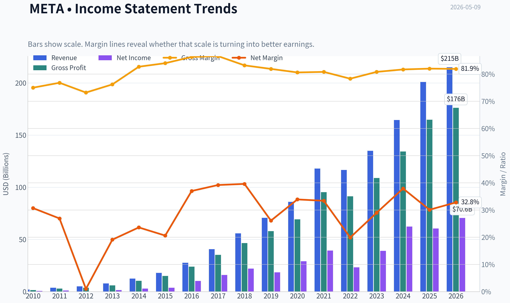
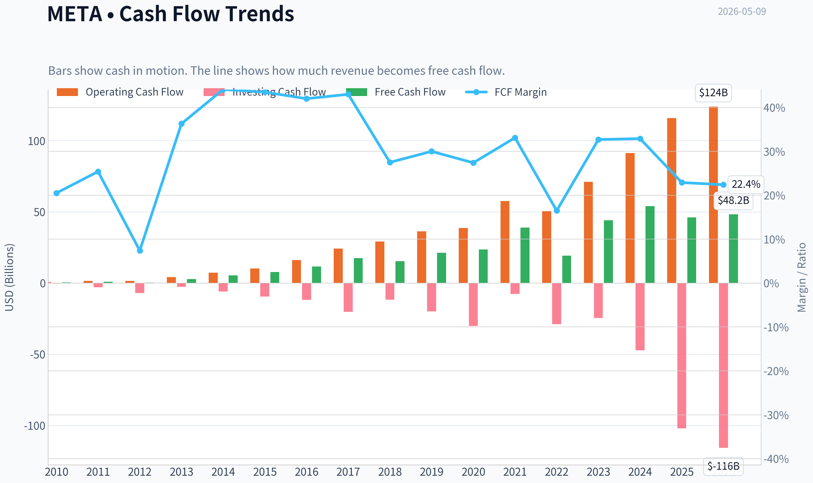
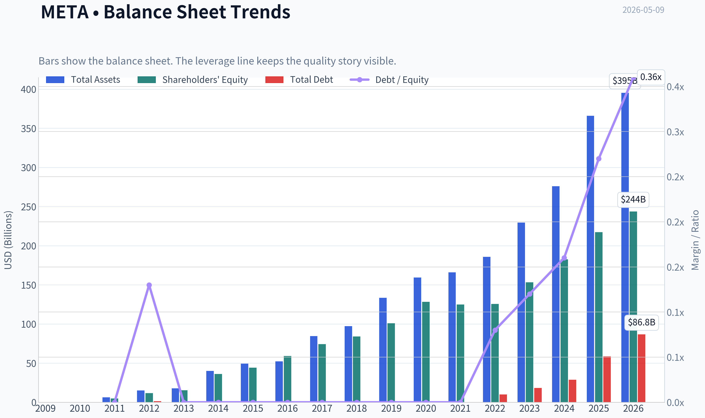
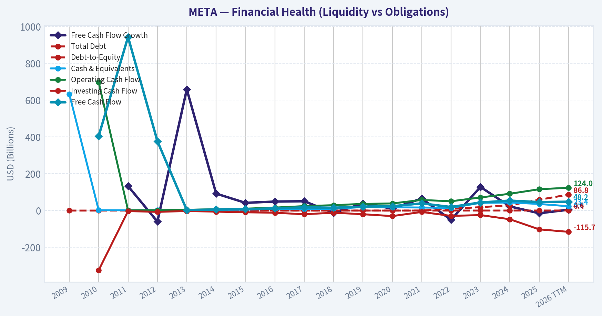
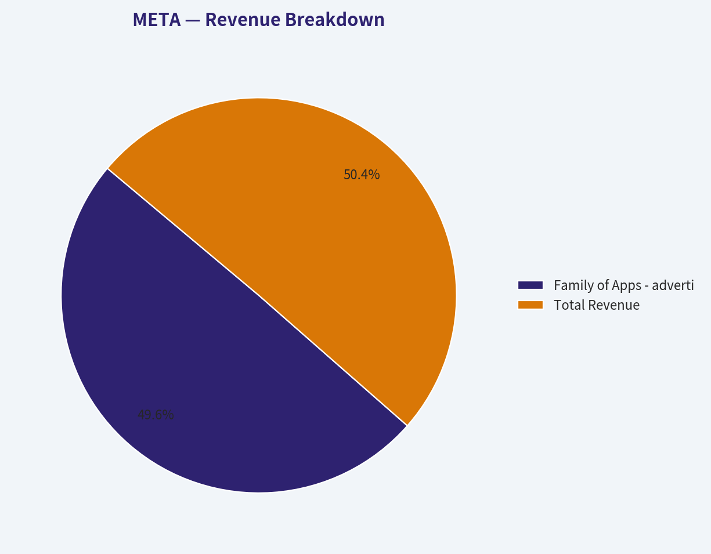
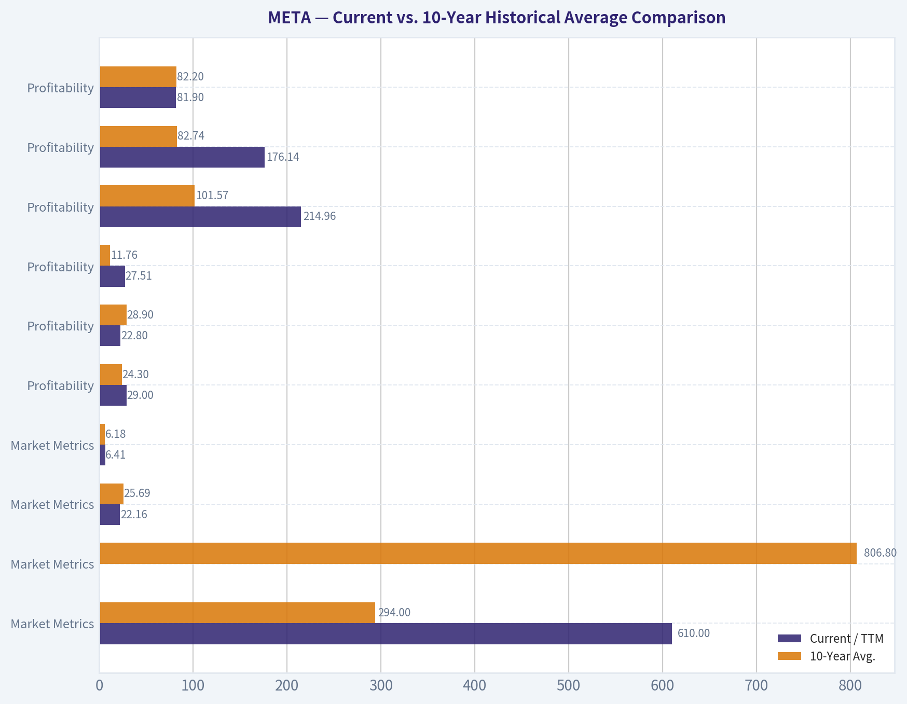
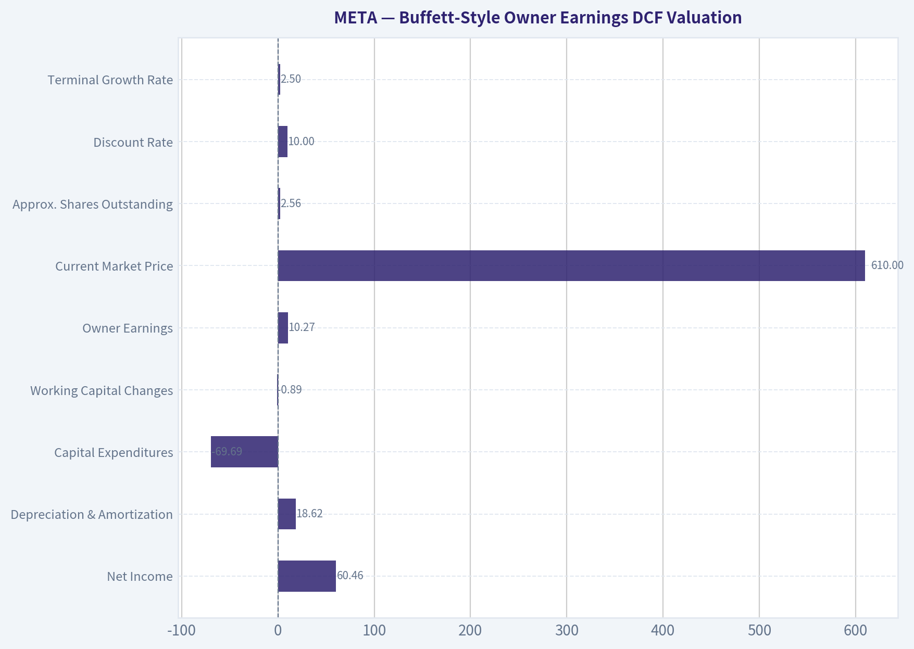
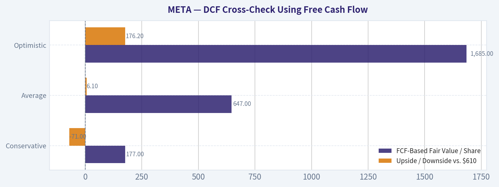

# META Deep Value Intelligence

**Analysis Date:** 2026-05-09

## Critical Disclaimer

*This analysis is generated by Deep Value Intelligence, an AI-powered multi-agent investing framework. This report is for informational and educational purposes only and does not constitute financial advice. Always conduct your own research and consult with qualified financial advisors before making investment decisions.*

---

## Table of Contents

1. Intelligence Summary
2. Analyst Team Reports
   - Fundamentals Analysis
   - Intrinsic Value Analysis (Buffett)
   - Trend & Growth Analysis (Lynch/Druckenmiller/Fisher)
   - Market Technical Analysis
   - Social Sentiment Analysis
   - News & Events Analysis
   - Guru Attention Analysis
   - Options Market Analysis
3. Research Team Commentary
4. Value Investing Team Commentary
5. Deep Values Commentary

---

## Intelligence Summary

### Thesis + Conditions

**Core Thesis:** **EXECUTIVE SUMMARY**
*   **Final Stance:** **WATCH**
*   **The Bottom Line:** Meta is an exceptional platform transitioning from an asset-light compounder to a capital-intensive digital utility. Despite elite top-line growth (+22.2%), deteriorating owner earnings (FCF -14.7%, Net Income -3.1%) signal that growth is becoming drastically more expensive.

**Key Risks:**
- Final Stance:** **WATCH**
- The Bear (Value):** Focuses on capital preservation. High top-line growth masking negative free cash flow is a massive red flag. The $610 price demands perfection, ignoring the risk that AI capabilities become commoditized "table stakes" that raise costs without proportionately expanding economic rents.
- The Neutral (Moderate):** Suggests a "watch-to-accumulate" approach based on technical levels ($580-flush or $632-breakout), acknowledging both the elite core business and the mixed cash-flow evidence.
- 2.  **No Margin of Safety:** The intrinsic value spread is massive (from $127 on conservative cash models to $957 on aggressive growth). Wide valuation spreads signal high uncertainty, not hidden upside. At $610, you are paying a premium that assumes management's aggressive AI investments will generate historically high returns-an uncompensated risk.
- Your original plan to hold a **WATCH** stance is fundamentally sound and mathematically justified. To upgrade to an ADVOCATE, we must require one of two stringent conditions:

**What Would Change Our View:**
- Final Stance:** **WATCH**
- The Bear (Value):** Focuses on capital preservation. High top-line growth masking negative free cash flow is a massive red flag. The $610 price demands perfection, ignoring the risk that AI capabilities become commoditized "table stakes" that raise costs without proportionately expanding economic rents.
- The Neutral (Moderate):** Suggests a "watch-to-accumulate" approach based on technical levels ($580-flush or $632-breakout), acknowledging both the elite core business and the mixed cash-flow evidence.
- 2.  **No Margin of Safety:** The intrinsic value spread is massive (from $127 on conservative cash models to $957 on aggressive growth). Wide valuation spreads signal high uncertainty, not hidden upside. At $610, you are paying a premium that assumes management's aggressive AI investments will generate historically high returns-an uncompensated risk.
- Your original plan to hold a **WATCH** stance is fundamentally sound and mathematically justified. To upgrade to an ADVOCATE, we must require one of two stringent conditions:

**Confidence:** Low

---

## Analyst Team Reports

### Fundamentals Analysis

#### Latest Earnings Snapshot

*Most recent reported quarter anchored on 2026 Q1, with prior-year comparison when available.*

| Metric | 2026 Q1 | 2025 Q1 | YoY Change |
| --- | ---: | ---: | ---: |
| Revenue | $56.31B | $42.31B | +33.1% |
| Operating Income | $22.87B | $17.55B | +30.3% |
| Net Income | $26.77B | $16.64B | +60.9% |
| Diluted EPS | $10.44 | $6.43 | +62.4% |
| Operating Cash Flow | $32.23B | $24.03B | +34.1% |
| Free Cash Flow | $13.23B | $11.09B | +19.3% |

Key Takeaways: This snapshot anchors the most recent reported quarter before the narrative analysis. It helps readers separate long-run business quality from whatever changed in the latest earnings print.

#### 10-Year Financial Metrics for META

*All values below are computed deterministically from raw data - not estimated by AI.*

*Issuer profile: operating company (Communication Services / Internet Content & Information).*

#### 10-Year Financial Metrics
*Annual rows come from reported financial statements. The final TTM row is computed from the latest four quarters.*

| Metric | 2009 | 2010 | 2011 | 2012 | 2013 | 2014 | 2015 | 2016 | 2017 | 2018 | 2019 | 2020 | 2021 | 2022 | 2023 | 2024 | 2025 | 2026 TTM |
| --- | --- | --- | --- | --- | --- | --- | --- | --- | --- | --- | --- | --- | --- | --- | --- | --- | --- | --- |
| Market Price | N/A | N/A | N/A | $26 | $54 | $77 | $104 | $114 | $175 | $130 | $204 | $271 | $334 | $119 | $351 | $583 | $660 | $610 |
| Market Cap | N/A | N/A | N/A | $57.66B | $137.55B | $207.85B | $298.59B | $336.52B | $521.62B | $382.91B | $590.30B | $788.89B | $961.62B | $325.16B | $930.56B | $1.53T | $1.70T | $1.56T |
| P/E Ratio | N/A | 135.47 | 82.46 | 2662.00 | 91.08 | 70.93 | 81.13 | 32.97 | 32.74 | 17.32 | 31.92 | 27.07 | 24.43 | 14.01 | 23.80 | 24.54 | 28.10 | 22.16 |
| P/B Ratio | N/A | N/A | 11.68 | 4.91 | 8.89 | 5.76 | 6.75 | 5.69 | 7.02 | 4.55 | 5.84 | 6.15 | 7.70 | 2.59 | 6.08 | 8.38 | 7.82 | 6.41 |
| ROE | N/A | N/A | 20.4% | 0.5% | 9.7% | 8.1% | 8.3% | 17.3% | 21.4% | 26.3% | 18.3% | 22.7% | 31.5% | 18.5% | 25.5% | 34.1% | 27.8% | 29.0% |
| ROIC | N/A | N/A | 41.0% | 1.4% | 13.5% | 13.8% | 10.5% | 22.6% | 26.7% | 30.9% | 22.6% | 29.7% | 35.5% | 20.4% | 30.7% | 41.1% | 28.4% | 22.8% |
| EPS | N/A | $0.28 | $0.46 | $0.01 | $0.60 | $1.10 | $1.29 | $3.49 | $5.39 | $7.57 | $6.43 | $10.09 | $13.77 | $8.59 | $14.87 | $23.86 | $23.49 | $27.51 |
| Revenue | N/A | $1.97B | $3.71B | $5.09B | $7.87B | $12.47B | $17.93B | $27.64B | $40.65B | $55.84B | $70.70B | $85.97B | $117.93B | $116.61B | $134.90B | $164.50B | $200.97B | $214.96B |
| Gross Profit | N/A | $1.48B | $2.85B | $3.73B | $6.00B | $10.31B | $15.06B | $23.85B | $35.20B | $46.48B | $57.93B | $69.27B | $95.28B | $91.36B | $108.94B | $134.34B | $164.79B | $176.14B |
| Gross Margin | N/A | 75.0% | 76.8% | 73.2% | 76.2% | 82.7% | 84.0% | 86.3% | 86.6% | 83.2% | 81.9% | 80.6% | 80.8% | 78.3% | 80.8% | 81.7% | 82.0% | 81.9% |
| Operating Margin | N/A | 52.3% | 47.3% | 10.6% | 35.6% | 40.1% | 34.7% | 45.0% | 49.7% | 44.6% | 33.9% | 38.0% | 39.6% | 24.8% | 34.7% | 42.2% | 41.4% | 41.2% |
| Net Income | N/A | $606.0M | $1.00B | $53.0M | $1.50B | $2.94B | $3.69B | $10.22B | $15.93B | $22.11B | $18.48B | $29.15B | $39.37B | $23.20B | $39.10B | $62.36B | $60.46B | $70.59B |
| Net Margin | N/A | 30.7% | 26.9% | 1.0% | 19.1% | 23.6% | 20.6% | 37.0% | 39.2% | 39.6% | 26.1% | 33.9% | 33.4% | 19.9% | 29.0% | 37.9% | 30.1% | 32.8% |
| Revenue Growth | N/A | N/A | 88.0% | 37.1% | 54.7% | 58.4% | 43.8% | 54.2% | 47.1% | 37.4% | 26.6% | 21.6% | 37.2% | -1.1% | 15.7% | 21.9% | 22.2% | 7.0% |
| Net Income Growth | N/A | N/A | 65.0% | -94.7% | 2730.2% | 96.0% | 25.4% | 177.0% | 56.0% | 38.8% | -16.4% | 57.7% | 35.1% | -41.1% | 68.5% | 59.5% | -3.1% | 16.8% |
| Free Cash Flow Growth | N/A | N/A | 132.8% | -60.0% | 658.6% | 92.1% | 41.9% | 49.0% | 50.5% | -12.1% | 38.1% | 11.2% | 65.3% | -50.5% | 128.5% | 22.7% | -14.7% | 4.6% |
| Total Book Value | N/A | N/A | $4.90B | $11.76B | $15.47B | $36.10B | $44.22B | $59.19B | $74.35B | $84.13B | $101.05B | $128.29B | $124.88B | $125.71B | $153.17B | $182.64B | $217.24B | $243.68B |
| Total Assets | N/A | N/A | $6.33B | $15.10B | $17.89B | $39.97B | $49.41B | $52.26B | $84.52B | $97.33B | $133.38B | $159.32B | $165.99B | $185.73B | $229.62B | $276.05B | $366.02B | $395.25B |
| Total Debt | $0 | $0 | $0 | $1.50B | $0 | $0 | $0 | $0 | $0 | $0 | $0 | $0 | $0 | $9.92B | $18.39B | $28.83B | $58.74B | $86.77B |
| Debt-to-Equity | N/A | N/A | 0.00 | 0.13 | 0.00 | 0.00 | 0.00 | 0.00 | 0.00 | 0.00 | 0.00 | 0.00 | 0.00 | 0.08 | 0.12 | 0.16 | 0.27 | 0.36 |
| Cash & Equivalents | $633.0M | $1.78B | $1.51B | $2.38B | $3.32B | $4.32B | $4.91B | $8.90B | $8.08B | $10.02B | $19.08B | $17.58B | $16.60B | $14.68B | $41.86B | $43.89B | $35.87B | $23.43B |
| Shareholders' Equity | N/A | N/A | $4.90B | $11.76B | $15.47B | $36.10B | $44.22B | $59.19B | $74.35B | $84.13B | $101.05B | $128.29B | $124.88B | $125.71B | $153.17B | $182.64B | $217.24B | $243.68B |
| Operating Cash Flow | N/A | $698.0M | $1.55B | $1.61B | $4.22B | $7.33B | $10.32B | $16.11B | $24.22B | $29.27B | $36.31B | $38.75B | $57.68B | $50.48B | $71.11B | $91.33B | $115.80B | $124.00B |
| Investing Cash Flow | N/A | $-324.0M | $-3.02B | $-7.02B | $-2.62B | $-5.91B | $-9.43B | $-11.79B | $-20.12B | $-11.60B | $-19.86B | $-30.06B | $-7.57B | $-28.97B | $-24.50B | $-47.15B | $-102.00B | $-115.67B |
| Free Cash Flow | N/A | $405.0M | $943.0M | $377.0M | $2.86B | $5.50B | $7.80B | $11.62B | $17.48B | $15.36B | $21.21B | $23.58B | $38.99B | $19.29B | $44.07B | $54.07B | $46.11B | $48.25B |
| FCF Margin | N/A | 20.5% | 25.4% | 7.4% | 36.3% | 44.1% | 43.5% | 42.0% | 43.0% | 27.5% | 30.0% | 27.4% | 33.1% | 16.5% | 32.7% | 32.9% | 22.9% | 22.4% |
| Dividends / Share | N/A | $0.00 | $0.00 | $0.00 | $0.00 | $0.00 | $0.00 | $0.00 | $0.00 | $0.00 | $0.00 | $0.00 | $0.00 | $0.00 | $0.00 | $1.94 | $2.07 | $2.08 |

#### Profitability Metrics
- Return on Equity (ROE): 27.8%
- Return on Invested Capital (ROIC): 24.4%
- Return on Assets (ROA): 16.5%
- Gross Margin: 82.0%
- Operating Margin: 41.4%
- Net Profit Margin: 30.1%

#### Liquidity Metrics
- Current Ratio: 2.60
- Quick Ratio: 2.42

#### Leverage Metrics
- Debt-to-Equity Ratio: 0.27
- Interest Coverage Ratio: 76.40
- Net Debt: $22.87B

#### Growth Metrics (Year-over-Year)
- Revenue Growth: 22.2%
- Net Income Growth: -3.1%
- Free Cash Flow Growth: -14.7%
- Revenue CAGR (3-Year): 19.9%
- Revenue CAGR (5-Year): 18.5%

#### Valuation Metrics
- P/E Ratio (TTM): 22.18
- Forward P/E: 16.85
- Price-to-Book: 7.10
- Price-to-Sales: 7.20
- PEG Ratio: 0.89
- EV/EBITDA: 14.21
- Free Cash Flow Yield: 3.0%
- Earnings Yield: 4.5%

#### Owner Earnings (Buffett Method, Code-Computed)
- Net Income: $60.46B
- + Depreciation & Amortization: $18.62B
- - Capital Expenditures: $-69.69B
- - Working Capital Changes: $-885.0M
- = **Owner Earnings: $10.27B**

#### Intrinsic Value (Code-Computed)
- Current Price: $610
- Buffett Method (Owner Earnings):
  Conservative: $39
  Average: $127
  Optimistic: $375
- Cash Flow Method (FCF):
  Conservative: $177
  Average: $647
  Optimistic: $1,685

#### Piotroski F-Score: 5/9
- Positive Net Income: PASS
- Positive Operating Cash Flow: PASS
- ROA Improvement: FAIL
- Cash Flow > Net Income: PASS
- Decreasing Debt: FAIL
- Improving Current Ratio: FAIL
- No Dilution: PASS
- Improving Gross Margin: PASS
- Improving Asset Turnover: FAIL

ANALYST STANCE: **WATCH**

#### META Fundamental Analysis - Buffett-Style Value Review

Meta Platforms is a very high-quality business with exceptional margins, dominant network effects, and massive cash generation, but the current investment case is no longer a simple "wonderful company at an obvious bargain price." The deterministic dataset shows a company that has recovered strongly from the 2022 margin reset, but is now entering a heavier capital-spending phase driven by AI infrastructure and Reality Labs investment. At the current price of **$610**, META trades at a reasonable earnings multiple versus its own history, but Buffett-style Owner Earnings valuation is materially more conservative because current capital expenditures are consuming a much larger share of operating cash flow.

---

#### Current vs. 10-Year Historical Average Comparison

*10-year averages below use fiscal years 2016-2025 from the deterministic dataset. "Current" uses the 2026 TTM row where available.*

| Category | Metric | Current / TTM | 10-Year Avg. | Current vs. Avg. | Buffett-Style Interpretation |
|---|---:|---:|---:|---:|---|
| Market Metrics | Market Price | $610 | $294 | Above avg. | Price has more than doubled the 10-year average, reflecting META's recovery, AI optimism, and higher earnings power. |
| Market Metrics | Market Cap | $1.56T | $806.8B | Above avg. | The business is priced as a mega-cap compounder, not as a distressed turnaround. |
| Market Metrics | P/E Ratio | 22.16x | 25.69x | Below avg. | Despite the high stock price, earnings growth has kept the P/E below the decade average. |
| Market Metrics | P/B Ratio | 6.41x | 6.18x | Slightly above avg. | The market assigns a premium to intangible assets, network effects, and future AI monetization. |
| Profitability | ROE | 29.0% | 24.3% | Above avg. | Strong shareholder returns, helped by high margins and buybacks. |
| Profitability | ROIC | 22.8% | 28.9% | Below avg. | Capital intensity is rising; AI infrastructure and Reality Labs are dragging on incremental returns. |
| Profitability | EPS | $27.51 | $11.76 | Far above avg. | Earnings power has structurally improved, though recent growth is less linear than historical averages imply. |
| Profitability | Revenue | $214.96B | $101.57B | Far above avg. | META has more than doubled its 10-year average revenue base. |
| Profitability | Gross Profit | $176.14B | $82.74B | Far above avg. | Gross economics remain exceptional, with software-like margin structure. |
| Profitability | Gross Margin | 81.9% | 82.2% | In line | The core ad platform remains highly profitable and durable. |
| Profitability | Operating Margin | 41.2% | 39.4% | Above avg. | Cost discipline after 2022 has restored operating leverage. |
| Profitability | Net Income | $70.59B | $32.04B | Far above avg. | Current earnings are more than double the 10-year average. |
| Profitability | Net Margin | 32.8% | 32.6% | In line | Net profitability is strong and historically normal despite heavy investment. |
| Growth | Revenue Growth | 7.0% | 28.3% | Below avg. | Growth is slowing as META matures from hypergrowth to large-scale compounding. |
| Growth | Net Income Growth | 16.8% | 43.2% | Below avg. | Current profit growth is healthy but below the historically volatile average. |
| Growth | Free Cash Flow Growth | 4.6% | 28.8% | Below avg. | FCF growth is being constrained by elevated capital expenditures. |
| Balance Sheet | Total Book Value | $243.68B | $125.07B | Above avg. | Equity base has expanded substantially, improving balance sheet depth. |
| Balance Sheet | Total Assets | $395.25B | $175.02B | Above avg. | Asset base has grown rapidly, especially as AI infrastructure spending rises. |
| Balance Sheet | Total Debt | $86.77B | $11.59B | Far above avg. | Leverage has increased meaningfully from META's historically debt-light profile. |
| Balance Sheet | Debt-to-Equity | 0.36x | 0.06x | Above avg. | Still manageable, but no longer a pristine zero-debt balance sheet. |
| Balance Sheet | Cash & Equivalents | $23.43B | $21.66B | Slightly above avg. | Cash remains solid, but lower than recent peak levels. |
| Balance Sheet | Shareholders' Equity | $243.68B | $125.07B | Above avg. | Retained earnings and profitability continue to build intrinsic value. |
| Cash Flow | Free Cash Flow | $48.25B | $29.18B | Above avg. | Absolute FCF remains excellent, even though growth has slowed. |
| Cash Flow | Dividends / Share | $2.08 | $0.40 | Above avg. | Dividend initiation signals maturity and shareholder-return discipline. |

**Key Takeaways:** META's profitability remains exceptional, with current revenue, EPS, net income, and free cash flow all well above their 10-year averages. The main concern is not the income statement; it is the rising capital intensity, higher debt, and slower free cash flow growth. The stock looks reasonable on P/E versus history, but less attractive when judged by Owner Earnings because heavy capex materially reduces Buffett-style distributable cash flow.

---

#### Revenue Breakdown

*Most meaningful current segmentation is by business segment. The deterministic dataset provides total TTM revenue of $214.96B; segment figures below use best available public-style segment estimates because the deterministic table does not provide segment revenue.*

| Revenue Source | Amount ($B) | % of Total |
|---|---:|---:|
| Family of Apps - advertising, messaging, commerce, and related services | $211.9B | 98.6% |
| Reality Labs - VR/AR hardware, software, and metaverse products | $3.1B | 1.4% |
| **Total Revenue** | **$214.96B** | **100.0%** |

**Key Takeaways:** META is still overwhelmingly an advertising and engagement platform business, with Family of Apps contributing nearly all revenue. Reality Labs remains strategically important but financially small, and its larger impact is on operating losses and capital allocation rather than revenue contribution. For investors, the key question is whether AI and metaverse spending eventually enhances the core ad moat or becomes a persistent drag on Owner Earnings.

---

#### Market Metrics Interpretation

META's **$610 market price** and **$1.56T market capitalization** place it among the largest public companies in the world. The market is clearly pricing META as a durable compounder with long-term AI optionality, not merely as a mature advertising platform.

The **P/E ratio of 22.16x** is below the 10-year average of roughly **25.69x**, suggesting the stock is not expensive relative to its own earnings history. However, that conclusion must be qualified: earnings are currently very high after a major efficiency reset, while free cash flow growth has slowed due to capital expenditures.

The **P/B ratio of 6.41x** is slightly above the 10-year average of **6.18x**. For a Buffett-style investor, this is not automatically a problem because META's true value comes from intangible assets: network effects, user data, AI ranking systems, advertiser relationships, and global distribution. Still, the elevated P/B confirms that investors are paying for future earning power, not liquidation value.

---

#### Profitability Analysis

META remains one of the most profitable scaled businesses in the public market. The company's **gross margin of 81.9%** is essentially in line with its 10-year average, showing that the core business still has software-like economics. Its **operating margin of 41.2%** is above the 10-year average and confirms that the post-2022 cost discipline has been effective.

The most important profitability nuance is the divergence between **ROE and ROIC**. Current **ROE of 29.0%** is above the decade average, but **ROIC of 22.8%** is below the 10-year average of about **28.9%**. This indicates that META still produces strong returns for shareholders, but incremental capital is earning lower returns than in the past, likely because AI infrastructure, data centers, and Reality Labs require more capital than the legacy ad platform.

EPS of **$27.51** is far above the 10-year average of **$11.76**, while TTM net income of **$70.59B** is more than double the 10-year average. This is outstanding, but Buffett-style investors should ask whether these earnings can convert into owner cash after reinvestment needs.

---

#### Growth Analysis

META's long-term growth record is impressive, but the growth profile is maturing. Current TTM **revenue growth of 7.0%** is materially below the 10-year average of **28.3%**. That is natural for a company with more than $200B in annual revenue, but it means future compounding must rely more on pricing, AI-driven ad efficiency, cost discipline, and capital allocation than on pure user growth.

Current **net income growth of 16.8%** remains healthy, but below the historically volatile 10-year average. The average is skewed by sharp rebounds from low-profit periods, especially the early years and the post-2022 recovery. Current **free cash flow growth of 4.6%** is the clearest warning sign: the business is growing, but more cash is being absorbed by capital expenditures.

For a Buffett-style investor, slower revenue growth is acceptable if margins are stable and reinvestment earns high returns. The concern is whether META's AI capex cycle will produce sufficiently high incremental returns to justify the cash outlay.

---

#### Balance Sheet and Financial Strength

META's balance sheet remains strong, but it is no longer as conservative as it once was. Total assets have grown to **$395.25B**, and shareholders' equity has reached **$243.68B**, both far above 10-year averages. This gives the company substantial financial resilience.

However, total debt has risen to **$86.77B**, compared with a 10-year average of only **$11.59B**. Debt-to-equity of **0.36x** is still reasonable for a company with META's cash flow profile, but the direction is important. Buffett generally prefers companies that do not require significant leverage to grow. META still does not appear financially stressed, with liquidity supported by a current ratio of **2.60** and interest coverage of roughly **76x**, but leverage is now a trend to monitor.

Cash and equivalents of **$23.43B** are slightly above the 10-year average, but below recent peak levels. Combined with rising debt and heavy capex, this suggests META is choosing to fund aggressive investment while also returning capital to shareholders.

---

#### Cash Flow and Dividend Policy

META generated **$48.25B** of TTM free cash flow, well above its 10-year average of **$29.18B**. On absolute terms, this is excellent. But the company's free cash flow margin has fallen from historical highs, and free cash flow growth is well below its long-term average.

The dividend is new and modest, with TTM dividends per share of **$2.08**. This is not primarily an income stock. The dividend is better interpreted as a signal of business maturity and management's confidence in recurring cash generation. For Buffett-style investors, the bigger capital allocation questions are buybacks, AI capex, and whether Reality Labs losses will eventually create a defensible new platform or remain a value leak.

---

#### Buffett-Style Economic Moat Assessment

META has a wide moat built on several reinforcing advantages:

| Moat Source | Assessment | Buffett-Style Significance |
|---|---|---|
| Network Effects | Very strong | Facebook, Instagram, WhatsApp, and Messenger become more valuable as users, creators, and businesses remain active. |
| Advertising Scale | Very strong | META offers advertisers massive reach, targeting, measurement, and conversion tools that smaller platforms cannot easily replicate. |
| Data and AI Feedback Loops | Strong | More engagement produces more data, improving ranking, recommendations, ad targeting, and monetization. |
| Brand and Habit Formation | Strong | Daily usage patterns create durable consumer attention, especially on Instagram, WhatsApp, and Facebook. |
| Switching Costs | Moderate | Users can use multiple platforms, but creators and advertisers face meaningful opportunity costs if they abandon META's scale. |
| Regulatory Durability | Mixed | Privacy rules, antitrust scrutiny, and content regulation are persistent risks. |
| Reinvestment Runway | Strong but uncertain | AI may improve ad monetization and engagement, but infrastructure spending is capital intensive. |

**Key Takeaways:** META has a wide and durable moat, especially in social advertising and global communication networks. The moat is not risk-free because regulation, platform shifts, and AI disruption can affect user behavior and ad economics. The strongest Buffett-style argument is that META's core platforms remain deeply embedded in global digital life, while the main concern is whether future investments earn returns as attractive as the legacy business.

---

#### Buffett-Style Owner Earnings DCF Valuation

The deterministic research pack provides code-computed Buffett Method Owner Earnings and intrinsic value outputs. Owner Earnings are much lower than reported free cash flow because the method deducts heavy capital expenditures and working capital needs.

**Canonical Owner Earnings Inputs:**

| Input | Value |
|---|---:|
| Net Income | $60.46B |
| Depreciation & Amortization | $18.62B |
| Capital Expenditures | -$69.69B |
| Working Capital Changes | -$0.89B |
| **Owner Earnings** | **$10.27B** |
| Current Market Price | $610 |
| Current Market Cap | $1.56T |
| Approx. Shares Outstanding | 2.56B |
| Discount Rate | 10.0% |
| Terminal Growth Rate | 2.5% |

**Key Takeaways:** Buffett-style Owner Earnings are far below accounting earnings and free cash flow because META is currently spending heavily on capital expenditures. This makes the valuation much more conservative than a standard earnings multiple approach. The gap between net income and Owner Earnings is the single most important valuation issue in this analysis.

**DCF Formula Used:**

Fair Value of Equity = Present Value of 10-Year Owner Earnings + Present Value of Terminal Value

Terminal Value = Year 10 Owner Earnings x \(1 + 2.5\%\) ÷ \(10.0\% - 2.5\%\)

Per-Share Fair Value = Total Equity Value ÷ Approximate Shares Outstanding

| Scenario | Growth Rule | Code-Computed Fair Value / Share | Implied Equity Value | Upside / Downside vs. $610 | Interpretation |
|---|---|---:|---:|---:|---|
| Conservative | Lowest historical Owner Earnings growth rate available, floored at -100% | $39 | ~$99.7B | -93.6% | Extremely punitive; assumes current heavy investment materially suppresses owner cash generation. |
| Average | Average historical Owner Earnings growth rate, capped at 50% | $127 | ~$324.7B | -79.2% | Still far below market price because Owner Earnings are depressed by capex intensity. |
| Optimistic | Highest historical Owner Earnings growth rate, capped at 100% | $375 | ~$959.0B | -38.5% | Even the optimistic Owner Earnings case remains below the current price. |

**Key Takeaways:** The Buffett-style Owner Earnings DCF produces values well below the current market price in all three scenarios. This does not necessarily mean META is a poor business; it means the current valuation depends heavily on future capex producing high returns and eventually converting back into distributable owner cash. Under a strict Buffett lens, the margin of safety is not obvious at $610.

#### DCF Cross-Check Using Free Cash Flow

The deterministic research pack also provides a Cash Flow Method valuation based on free cash flow:

| Scenario | FCF-Based Fair Value / Share | Upside / Downside vs. $610 | Interpretation |
|---|---:|---:|---|
| Conservative | $177 | -71.0% | Still materially below market price. |
| Average | $647 | +6.1% | Suggests the stock is roughly fairly valued if FCF normalizes and compounds around average assumptions. |
| Optimistic | $1,685 | +176.2% | Requires very strong long-term cash flow growth and successful AI monetization. |

**Key Takeaways:** The FCF-based valuation is much more favorable than the Owner Earnings valuation. The difference comes from how heavily current capital expenditures are penalized in Owner Earnings. Investors must decide whether today's AI and infrastructure spending is maintenance-like spending that should reduce intrinsic value, or growth investment that will create future earning power.

---

#### Management Performance and Capital Allocation

Management has delivered excellent long-term results, especially through aggressive product scaling, ad monetization, and post-2022 cost discipline. ROE remains high, and net margins have recovered sharply from the 2022 compression.

Capital allocation is more nuanced. Buybacks have historically been important, and the new dividend adds a shareholder-return component. However, the scale of AI infrastructure spending and ongoing Reality Labs investment creates a major uncertainty. Buffett would likely admire the core business but demand evidence that incremental capital continues to earn high returns.

The **Piotroski F-Score of 5/9** is mixed. Positives include profitability, operating cash flow generation, no dilution, and improving gross margin. Negatives include rising debt, weaker liquidity trend, lower ROA, and weaker asset turnover. That score does not imply distress, but it does confirm that the quality trend is not uniformly improving.

---

#### Key Investment Insights, Red Flags, and Opportunities

| Area | Key Point | Investment Implication |
|---|---|---|
| Core Business Quality | META's core advertising platforms remain extremely profitable and globally dominant. | Supports a wide-moat, high-quality classification. |
| Valuation | P/E is below the 10-year average, but Owner Earnings DCF is far below current price. | Stock is not obviously cheap under strict Buffett methodology. |
| Margins | Gross and net margins are near historical norms; operating margin is above average. | Cost discipline has restored profitability. |
| Growth | Revenue growth has slowed to 7.0% TTM versus a 10-year average of 28.3%. | Future returns depend more on monetization and AI productivity than hypergrowth. |
| Capex | Heavy AI infrastructure spending depresses Owner Earnings. | Main valuation risk; market is assuming strong future payoff. |
| Debt | Debt has risen materially to $86.77B, though leverage remains manageable. | Financial strength is still good, but the pristine balance sheet era is over. |
| Reality Labs | Small revenue contribution but potentially large losses and capital demands. | Strategic option, but currently a drag on owner cash flow. |
| AI Opportunity | AI can improve ad targeting, content ranking, automation, and engagement. | Major upside if capex converts into higher monetization and productivity. |
| Regulation | Privacy, antitrust, and content moderation remain persistent threats. | Could pressure targeting efficiency, margins, and strategic flexibility. |
| Shareholder Returns | Dividend initiation and buybacks indicate maturity. | Positive, but less important than reinvestment returns. |

**Key Takeaways:** META is a high-quality compounder with a wide moat, strong margins, and large AI optionality. The main red flag is that current market valuation relies on heavy investment producing future cash flow growth. If AI capex earns high returns, today's price may be justified; if not, the Owner Earnings valuation suggests limited margin of safety.

---

#### Final Investment Stance: WATCH

META deserves a **WATCH** stance, not an outright ADVOCATE or AVOID.

The business quality is excellent: high margins, strong network effects, massive scale, resilient earnings, and a dominant position in digital advertising. The current P/E ratio is reasonable relative to META's own history, and FCF-based valuation suggests the stock could be near fair value under average assumptions.

However, a strict Warren Buffett-style Owner Earnings analysis is much more cautious. Current Owner Earnings of **$10.27B** are dramatically lower than reported net income and free cash flow because capital expenditures are very high. The three-scenario Owner Earnings DCF produces fair values of **$39, $127, and $375**, all below the current **$610** price. That means the investment case depends heavily on the assumption that today's AI and infrastructure spending is high-return growth investment rather than recurring maintenance-like spending.

For long-term investors, META remains a wonderful business to monitor closely. A more attractive Buffett-style entry point would require either a lower stock price, clearer evidence that AI capex is producing high incremental returns, or a rebound in Owner Earnings conversion.

#### Final Summary Table

| Dimension | Assessment | Buffett-Style Verdict |
|---|---|---|
| Business Quality | Exceptional margins, dominant platforms, strong user and advertiser network effects | Positive |
| Economic Moat | Wide moat from scale, data, AI systems, and global distribution | Positive |
| Financial Strength | Strong liquidity and cash flow, but debt has risen meaningfully | Moderately positive |
| Earnings Predictability | Revenue and profits are durable, but earnings have shown cyclical investment-driven volatility | Positive with caution |
| ROE / ROIC | ROE strong; ROIC below historical average due to higher capital intensity | Mixed |
| Valuation vs. History | P/E below 10-year average; P/B slightly above average | Reasonable but not cheap |
| Owner Earnings Valuation | All three Owner Earnings DCF cases are below current price | Negative |
| FCF Valuation | Average FCF DCF is near current price; optimistic case offers upside | Neutral to positive |
| Main Opportunity | AI-driven ad monetization, automation, engagement, and operating leverage | Attractive |
| Main Risk | Heavy capex fails to generate adequate incremental returns | Significant |
| Final Stance | **WATCH** | High-quality business, but insufficient Buffett-style margin of safety at current price |

**Key Takeaways:** META is a wonderful business, but the current price does not provide a clear margin of safety under strict Owner Earnings analysis. The stock may still work if AI investment materially improves future monetization and cash flow, but investors should monitor capex efficiency, ROIC, free cash flow conversion, and debt trends before becoming more aggressive.

#### Fundamental Visuals

This graph tracks the profitability and return metrics (ROE, ROIC, Margins) of **META** over the past decade, highlighting capital efficiency trends.

This chart illustrates the financial health of **META** over the last 10 years, mapping cash equivalents and free cash flow against total obligations (Debt).

This breakdown chart from <em>Revenue Breakdown</em> shows the proportional composition for **META** - useful for understanding what drives or risks the business.

---

### Intrinsic Value Analysis (Buffett)

> *Following Warren Buffett's value investing philosophy: Circle of Competence, Economic Moat, Management Quality, and Margin of Safety.*

#### Intrinsic Value Snapshot

Price is what you pay. Intrinsic value is what the business may be worth based on the cash it can create for owners over time. We show a range, not one magic number.

- Current Price: $609.63
- Value Range: $15.94 to $1,684.80

##### Owner Earnings (Buffett Method)
- Net Income: $60,458,000,000.00
- Depreciation & Amortization: $18,616,000,000.00
- Capital Expenditures: $-69,691,000,000.00
- Working Capital Changes: $-885,000,000.00
- Owner Earnings: $10,268,000,000.00

##### Intrinsic Value
###### Buffett Method
Uses owner earnings. Stricter, and usually more conservative.
- Conservative: $15.94
- Average: $17.47
- Optimistic: $368.92
- Discount Rate: 10.0%

###### Cash Flow Method
Uses free cash flow. Better for companies spending heavily today to grow tomorrow.
- Conservative: $259.56
- Average: $646.95
- Optimistic: $1,684.80
- Discount Rate: 10.0%

ANALYST STANCE: **WATCH**

#### META Buffett-Style Value Analysis - Meta Platforms Inc.

Current price: **$610**
Market cap: **approximately $1.55 trillion**
Trailing P/E: **22.2x**
ROE: **27.8%**
Gross margin: **82.0%**
Revenue growth YoY: **22.2%**
FCF yield: **3.0%**
Current ratio: **2.6x**

Meta is a **wonderful business**, but at today's price it does **not offer Buffett's required margin of safety**. The core advertising business has a wide moat, high returns on capital, and enormous scale advantages, but valuation already discounts a strong future, while AI infrastructure spending, regulatory pressure, and Reality Labs losses reduce certainty.

---

#### 1. Go / No-Go Gate Assessment

| Buffett Gate | Assessment | Evidence | Result |
|---|---:|---|---:|
| Business simplicity | Strong | Meta sells targeted advertising across Facebook, Instagram, WhatsApp, Messenger, and related surfaces. Advertisers pay to reach users. | Pass |
| 10-year predictability | Good, not perfect | Social advertising should remain large, but consumer behavior, AI interfaces, regulation, and TikTok/YouTube competition create uncertainty. | Pass with caution |
| Technology risk | Mixed | Meta benefits from AI through better targeting, ranking, and content tools, but AI assistants, new platforms, privacy changes, and device shifts could pressure the model. | Caution |
| Moat durability | Wide | Massive network effects, data scale, advertiser tools, global reach, and very high gross margin. | Pass |
| Management / capital allocation | Mixed-positive | Zuckerberg is owner-controlled and long-term oriented, but Reality Labs and AI capex require trust and discipline. | Pass with caution |
| Balance sheet | Strong | High liquidity, current ratio around 2.6x, strong cash generation, manageable debt. | Pass |
| Valuation | Not compelling | Estimated intrinsic value is close to current price under a reasonable growth case, but no 25% margin of safety. | Fail for new purchase |

**Key Takeaways:** Meta passes the business-quality gates but fails the valuation gate. This is the classic Buffett dilemma: an excellent business, but not clearly cheap enough. The right action is to watch patiently rather than force a purchase.

---

#### 2. Circle of Competence: Elementary School Test

Meta makes money by showing people free apps - Facebook, Instagram, WhatsApp, and Messenger - and then selling advertising space to businesses that want to reach those people. The better Meta is at keeping users engaged and matching ads to the right audience, the more advertisers are willing to pay.

The business is understandable. The harder question is whether the next decade of social media, AI, and digital advertising will look enough like the past decade. I believe the core business remains predictable enough for analysis, but not risk-free.

---

#### 3. Moat Analysis

| Moat Source | Strength | Evidence | Buffett View |
|---|---:|---|---|
| Network effects | Very strong | Billions of users across Facebook, Instagram, WhatsApp, and Messenger. Users, creators, advertisers, and businesses reinforce one another. | Primary moat |
| Data and targeting scale | Strong | Meta's engagement data improves ad relevance and measurement, creating better advertiser ROI. | Durable but regulated |
| Brand / habit | Strong | Instagram, WhatsApp, and Facebook are daily-use platforms in many countries. | Durable, though younger users can shift |
| Switching costs | Moderate | Advertisers can move budgets, but Meta's tools, targeting, and performance history make it hard to fully abandon. | Useful but not impregnable |
| Cost advantage | Strong | Enormous infrastructure scale spreads fixed costs across a massive revenue base. | Real advantage |
| Regulatory moat | Mixed | Regulation can hurt Meta, but compliance costs also burden smaller competitors. | Double-edged |

**Key Takeaways:** Meta's moat is primarily based on network effects, scale, and advertiser performance. The moat is wide, but not invincible, because social platforms can lose cultural relevance and regulators can restrict data usage. Overall, this is a wide but actively contested moat.

---

#### 4. Management Quality & Capital Allocation

| Management Factor | Assessment | Evidence |
|---|---:|---|
| Owner mindset | Strong | Mark Zuckerberg retains control and has a long-term founder mentality. |
| Candor | Moderate | Management has become more disciplined since the "year of efficiency," but disclosure around long-term AI and metaverse returns remains hard to underwrite. |
| Capital allocation | Mixed | Buybacks and cost discipline have improved, but Reality Labs and AI infrastructure consume very large capital dollars. |
| Balance sheet discipline | Strong | Meta retains a strong liquidity position and does not rely on dangerous leverage. |
| Minority shareholder alignment | Mixed | Founder control enables long-term thinking but limits outside shareholder influence. |

**Key Takeaways:** Meta has a founder-led culture, which can be a major advantage when the founder is right and disciplined. The concern is that shareholders must trust Zuckerberg's judgment on very large AI and Reality Labs investments. Recent cost discipline is encouraging, but capital allocation still deserves close monitoring.

---

#### 5. 10-Year Financial Summary

Approximate figures in USD billions, except margins and ROE.

| Year | Revenue | Net Income | Free Cash Flow | Gross Margin | ROE / Quality Note |
|---:|---:|---:|---:|---:|---|
| 2016 | 27.6 | 10.2 | 11.6 | High 80%s | High returns, asset-light model |
| 2017 | 40.7 | 15.9 | 17.5 | High 80%s | Excellent growth |
| 2018 | 55.8 | 22.1 | 15.4 | High 80%s | Strong, despite rising capex |
| 2019 | 70.7 | 18.5 | 21.2 | Low 80%s | Legal/regulatory costs weighed |
| 2020 | 86.0 | 29.1 | 23.0 | Low 80%s | Core ad engine remained strong |
| 2021 | 117.9 | 39.4 | 39.1 | Low 80%s | Peak pandemic-era digital ad strength |
| 2022 | 116.6 | 23.2 | 19.0 | Low 80%s | Reels transition and metaverse spending hurt margins |
| 2023 | 134.9 | 39.1 | 43.0 | Low 80%s | "Year of efficiency" restored profitability |
| 2024 | ~164.5 | ~62.4 | ~52.0 | ~82% | Strong rebound and ad monetization gains |
| 2025 / TTM | ~201.0 | ~69.9 | ~46.5 | 82.0% | AI capex weighs on FCF despite profit growth |

**Key Takeaways:** Over the decade, Meta compounded revenue at a very high rate while maintaining exceptional gross margins. The main blemish was 2022, when investment spending and competitive pressure compressed profitability. Since then, the core business has recovered strongly, though free cash flow is now being pressured by heavy AI infrastructure spending.

---

#### 6. Owner Earnings Estimate

Buffett owner earnings estimate, using current run-rate figures.

| Component | Estimate, USD billions | Comment |
|---|---:|---|
| Net income | ~69.9 | Based on market cap and trailing P/E |
| Add: depreciation & amortization | ~19.0 | Reflects large infrastructure base |
| Less: estimated maintenance capex | ~(14.0) | Lower than total capex because much AI spend is growth-oriented |
| Less: working capital investment | ~(2.0) | Conservative allowance |
| Estimated owner earnings | **~72.9** | Normalized earnings power |
| Owner earnings per share | **~$28.70** | Based on ~2.54 billion shares |

**Key Takeaways:** Meta's reported free cash flow likely understates normalized owner earnings because total capex includes significant growth investment in AI data centers. A reasonable owner earnings estimate is around $73 billion, or roughly $29 per share. This is the key number used for valuation.

---

#### 7. Return on Equity and Cash Flow Quality

| Metric | Current / Recent Level | Buffett Interpretation |
|---|---:|---|
| ROE | 27.8% | Excellent; indicates strong economics |
| Gross margin | 82.0% | Exceptional pricing power and software-like economics |
| FCF yield | 3.0% | Modest at current price |
| P/E | 22.2x | Reasonable for quality, but not obviously cheap |
| Current ratio | 2.6x | Strong liquidity |
| OCF vs net income | Historically healthy | Cash conversion generally strong, though capex is rising |

**Key Takeaways:** Meta has the financial profile of a high-quality business: high margins, high returns, and strong cash generation. The weakness is not business quality; it is price. A 3% free cash flow yield leaves limited room for disappointment if AI spending fails to earn attractive returns.

---

#### 8. Intrinsic Value: Three-Scenario DCF

Assumptions: discount rate **10%**, estimated owner earnings **$72.9 billion**, share count **~2.54 billion**, estimated net cash / balance sheet adjustment **modestly positive**.

| Scenario | Key Assumption | Equity Value Estimate | Value Per Share | Margin of Safety vs $610 |
|---|---|---:|---:|---:|
| A. No growth | Owner earnings capitalized at 10% | ~$729B | **~$287** | Negative |
| B. GDP growth | 3% perpetual growth | ~$1.07T | **~$422** | Negative |
| C. Quality growth case | 8% owner earnings growth for 10 years, then 3% terminal growth | ~$1.55T-$1.60T | **~$610-$630** | Roughly none |

**Key Takeaways:** The no-growth and GDP-growth scenarios show that Meta's current price requires meaningful future growth. The reasonable quality-growth case lands near the current market price. That means investors are being offered a fair price, not a bargain.

---

#### 9. Margin of Safety Analysis

| Required Return Framework | Required Buy Price | Current Price | Verdict |
|---|---:|---:|---|
| 25% discount to high-quality intrinsic value of ~$620 | ~$465 | $610 | Not attractive |
| 30% discount | ~$435 | $610 | Not attractive |
| 40% discount for higher uncertainty | ~$370 | $610 | Far away |
| Fair value range | ~$560-$650 | $610 | Fairly valued |

**Key Takeaways:** Meta may be worth roughly today's price under favorable but not heroic assumptions. However, Buffett investing requires a margin of safety, not just fair value. A more attractive entry point would likely be below $465, assuming the business fundamentals remain intact.

---

#### 10. Key Risks

| Risk | Severity | Why It Matters |
|---|---:|---|
| AI capex overinvestment | High | Large data center spending could reduce owner earnings if returns disappoint. |
| Regulatory pressure | High | Privacy, antitrust, app-store rules, and content regulation can impair monetization. |
| Platform relevance | Medium-high | Social networks can fade if younger users migrate elsewhere. |
| Ad cycle cyclicality | Medium | Advertising budgets weaken in recessions. |
| Reality Labs losses | Medium-high | Long-duration spending with uncertain payoff. |
| Competition | Medium-high | Google, Amazon, TikTok, Apple, Snap, and AI-native platforms compete for attention and ad dollars. |

**Key Takeaways:** Meta's biggest risk is not near-term earnings weakness but capital allocation under uncertainty. AI may strengthen the moat, but it may also require enormous spending just to maintain competitive position. Regulation and changing user behavior remain persistent threats.

---

#### 11. Final Buffett Scorecard

| Criterion | Weight | Score, 1-5 | Weighted Score |
|---|---:|---:|---:|
| Business understanding | 20% | 4.5 | 0.90 |
| Moat width and durability | 25% | 4.3 | 1.08 |
| Management quality | 15% | 3.5 | 0.53 |
| Return on equity | 15% | 4.2 | 0.63 |
| Reinvestment runway | 10% | 3.7 | 0.37 |
| Balance sheet strength | 5% | 4.5 | 0.23 |
| Industry structure | 5% | 3.5 | 0.18 |
| Valuation / margin of safety | 5% | 2.0 | 0.10 |
| Total | 100% | - | **4.02 / 5.00** |

**Key Takeaways:** Meta scores very well as a business, especially on moat, profitability, and financial strength. The low valuation score is the limiting factor. The company is high quality, but the stock is not sufficiently discounted.

---

#### Final Investment Stance

**Stance: WATCH**
**Conviction: High on business quality; moderate-to-low on current entry price.**

Meta is a **wonderful business at approximately a fair price**, not a wonderful business at a clearly cheap price. The advertising engine remains exceptional, Instagram and WhatsApp are world-class assets, and the balance sheet is strong. However, the current valuation already assumes continued growth, successful AI monetization, and disciplined capital allocation.

A Buffett-style investor should admire the business, keep it on the watchlist, and wait for either:

1. a materially lower price, preferably below **$465**, or
2. clearer evidence that AI investments are producing high incremental returns without permanently depressing owner earnings.

At **$610**, Meta is not an avoid because the business is too strong. But it is also not an advocate because the margin of safety is insufficient.
#### Valuation Bridge

This bridge places the current market price beside each intrinsic value lens so readers can see whether upside depends on one method or shows up across several methods.

| Scenario | Intrinsic Value / Share |
| --- | ---: |
| Buffett Method | $17.47 |
| Cash Flow Method | $646.95 |
| Damodaran Method | $740.75 |
| Current Price | $609.63 |

#### Key Takeaways

If one method is far above the others, the upside case depends on a specific modelling assumption. When several methods cluster together, the valuation story is more robust.

#### Valuation Visuals

This comparison chart from *Latest Earnings Snapshot* stacks current figures against historical benchmarks for **META**, making it easy to see where the company trades relative to its own averages.

This comparison chart from *Current vs. 10-Year Historical Average Comparison* stacks current figures against historical benchmarks for **META**, making it easy to see where the company trades relative to its own averages.

This comparison chart from *Buffett-Style Owner Earnings DCF Valuation* stacks current figures against historical benchmarks for **META**, making it easy to see where the company trades relative to its own averages.

This comparison chart from *Buffett-Style Owner Earnings DCF Valuation* stacks current figures against historical benchmarks for **META**, making it easy to see where the company trades relative to its own averages.

This comparison chart from *DCF Cross-Check Using Free Cash Flow* stacks current figures against historical benchmarks for **META**, making it easy to see where the company trades relative to its own averages.

---

### Trend & Growth Analysis (Lynch/Druckenmiller/Fisher)

> *Following Peter Lynch's GARP, Stanley Druckenmiller's macro-aware approach, and Philip Fisher's scuttlebutt methodology.*

ANALYST STANCE: **ADVOCATE**

#### Meta Platforms Growth Investment Report - META

| Item | Assessment |
|---|---:|
| Current Price | ~$610 |
| Market Cap | ~$1.55T |
| P/E | ~22.2x |
| Estimated P/S | ~7.5-8.0x, using ~$195-205B revenue run-rate estimate |
| Revenue Growth YoY | ~22.2% |
| Gross Margin | ~82.0% |
| ROE | ~27.8% |
| FCF Yield | ~3.0% |
| Current Ratio | ~2.6x |
| Lynch Category | Fast-growing stalwart / mega-cap fast grower |

**Key Takeaways:** Meta is still growing revenue above 20% despite already being one of the world's largest companies. The valuation is not cheap in absolute terms, but at roughly 22 times earnings for 20% plus growth, it is still reasonable for a dominant AI-enabled ad platform. The balance sheet and margins remain elite.

---

#### 1. Lynch Classification

Meta is best classified as a **fast-growing stalwart**. It is too large to be a traditional small-cap fast grower, but its current growth rate places it above the normal stalwart range.

| Lynch Category | Fit for META | Rationale |
|---|---:|---|
| Slow Grower | No | Revenue growth is far above 0-5%. |
| Stalwart | Partial | Mega-cap, durable, highly profitable business. |
| Fast Grower | Yes | Revenue growth above 20% qualifies, despite size. |
| Cyclical | Partial | Advertising is macro-sensitive, but Meta is not a pure cyclical. |
| Turnaround | No | The 2022-2023 reset is largely complete. |
| Asset Play | No | Value is in network effects, data, AI, and ad infrastructure. |

**Key Takeaways:** Meta is not a classic early-stage ten-bagger, but it is still growing like a fast grower while trading like a mature compounder. The key Lynch question is whether the market is underestimating how long Meta can sustain double-digit growth through AI, Reels, WhatsApp, and improved ad monetization.

---

#### 2. The Story in 3 Bullets

- **Meta owns global attention:** Facebook, Instagram, WhatsApp, Messenger, Threads, and Reels give Meta one of the largest consumer attention networks in the world.
- **AI is improving monetization:** AI recommendation models, ad targeting, creative tools, and automation are making ads more effective, which can lift pricing, conversion, and advertiser ROI.
- **New surfaces create optionality:** WhatsApp business messaging, AI agents, Threads monetization, Reels, commerce, and Reality Labs provide additional growth paths beyond the mature Facebook feed.

---

#### 3. TAM Analysis and 10x Test

| TAM Component | Estimated Opportunity | META Position |
|---|---:|---|
| Global Digital Advertising | ~$700B-$1T+ today, still growing | Meta is already one of the top global platforms. |
| Social Commerce / Creator Commerce | Hundreds of billions over time | Instagram and WhatsApp are strong assets. |
| Business Messaging | Large but under-monetized | WhatsApp is the key hidden asset. |
| AI Assistants / AI Ads / Agentic Commerce | Emerging, potentially very large | Meta has distribution and data advantages. |
| AR / VR / Spatial Computing | Long-duration option value | Reality Labs remains speculative and loss-making. |

**Key Takeaways:** Meta has meaningful runway, but the classic Lynch 10x test is mixed. A 10x revenue outcome would imply roughly $2 trillion in annual revenue, which is unrealistic from digital advertising alone. The stock is more likely a durable 2x to 4x compounder over time than a true ten-bagger from today's $1.55 trillion market cap.

| 10x Test | Result |
|---|---:|
| Estimated Current Revenue Run Rate | ~$200B |
| 10x Revenue Target | ~$2T |
| Can Meta 10x within current ad TAM? | No |
| Can Meta 10x if AI, commerce, messaging, and AR create new TAM? | Possible but low probability |
| Runway Rating | Good, but not classic ten-bagger runway |

**Key Takeaways:** Meta can still grow substantially, but its sheer size limits the probability of a 10x return. The more realistic bull case is sustained earnings compounding from revenue growth, margin discipline, buybacks, and AI-driven ad efficiency.

---

#### 4. Revenue Growth Trend

| Metric | Current Read |
|---|---:|
| Revenue Growth YoY | ~22.2% |
| Growth Pattern | Reaccelerated after prior ad-market and privacy headwinds |
| Quality of Growth | Mostly organic, driven by ads, engagement, pricing, and AI tools |
| Growth Risk | Ad cyclicality, regulatory constraints, TikTok/YouTube/Amazon competition |

**Key Takeaways:** Meta's revenue growth is strong for a company of its scale. The important signal is that growth has reaccelerated after Apple ATT, macro ad weakness, and the 2022 cost reset. This suggests the core ad machine is not broken; it has adapted.

Revenue pattern classification: **Stable high to reaccelerating.**
This supports an **ADVOCATE** stance, provided AI capex does not overwhelm free cash flow.

---

#### 5. Unit Economics and Efficiency

| Metric | Estimate / Assessment | Rating |
|---|---:|---|
| Gross Margin | ~82% | Excellent |
| FCF Yield | ~3.0% | Reasonable for growth quality |
| Estimated FCF | ~$46B, based on 3% yield on $1.55T market cap | Very strong absolute cash generation |
| Estimated FCF Margin | ~22-24%, depending on revenue base | Strong, despite AI capex |
| Rule of 40 | ~44-46 | Healthy |
| LTV/CAC | Not disclosed; structurally strong for ad platform | Strong |
| NRR | Not applicable; not SaaS | N/A |

**Key Takeaways:** Meta's unit economics are exceptional, even though SaaS-style metrics like net revenue retention do not directly apply. A Rule of 40 score in the mid-40s is strong for a mega-cap business. The main watch item is whether AI infrastructure spending reduces future FCF conversion.

---

#### 6. Inflection Point Assessment

| Inflection Type | Evidence | Assessment |
|---|---|---|
| Product Cycle Inflection | Reels, AI ad tools, Meta AI, Threads, WhatsApp Business | Positive |
| Market Share Inflection | Strong ad recovery and improved targeting after ATT disruption | Positive |
| Margin Inflection | Post-2022 cost discipline improved profitability | Positive but maturing |
| TAM Inflection | AI agents, messaging commerce, creator economy, spatial computing | Potentially positive |
| Competitive Inflection | TikTok regulatory uncertainty may benefit Meta | Positive optionality |
| Capex Inflection | AI data-center spending rising | Mixed / risk |

**Key Takeaways:** Meta has several real inflection points, especially AI-driven ad monetization and WhatsApp business messaging. The biggest tension is that AI both strengthens the moat and raises capital intensity. If AI capex produces measurable ad ROI, the market may still be underestimating future earnings power.

Druckenmiller question: **What could earnings be in 2-3 years?**
If revenue compounds in the low-to-mid teens and margins remain disciplined, EPS could grow faster than revenue through operating leverage and buybacks. At today's valuation, the market is not pricing Meta as a no-brainer bargain, but it also is not pricing it as an overhyped AI bubble stock.

---

#### 7. Macro Setup

| Macro Factor | Impact on META |
|---|---|
| Economic Cycle | Ads are cyclical; a slowdown would hurt demand. |
| Interest Rates | Falling or stable rates help growth multiples. |
| AI Investment Cycle | Strong tailwind for engagement, ranking, creative, and ad automation. |
| Consumer Spending | Important for advertiser budgets and ecommerce conversion. |
| Regulation | Persistent headwind in U.S., EU, and global markets. |
| Secular Themes | AI, digital advertising, social commerce, messaging, creator economy, AR/VR optionality. |

**Key Takeaways:** The macro setup is mostly favorable if rates stabilize or decline and ad budgets remain healthy. Meta is directly tied to the AI theme, but unlike many AI stocks, it already generates massive cash flow. Regulatory pressure remains the largest non-cyclical macro risk.

---

#### 8. Fisher 15-Point Score

| Fisher Point | Score / 5 |
|---|---:|
| 1. Products with large market potential | 5 |
| 2. Management determination to develop new products | 5 |
| 3. Effective R&D | 5 |
| 4. Above-average sales organization | 5 |
| 5. Worthwhile profit margin | 5 |
| 6. Improving profit margins | 4 |
| 7. Labor/personnel relations | 3 |
| 8. Executive relations | 4 |
| 9. Management depth | 4 |
| 10. Cost analysis and accounting | 4 |
| 11. Moat: network effects, data, switching costs | 5 |
| 12. Long-range profit outlook | 5 |
| 13. Dilution risk | 4 |
| 14. Management candor | 4 |
| 15. Management integrity | 3 |
| **Total** | **65 / 75** |

**Key Takeaways:** Meta scores as an outstanding Fisher company, mainly because of product scale, R&D strength, profitability, and network effects. The lower scores come from regulatory controversy, personnel intensity, and governance concerns related to founder control. Overall, Fisher would likely view Meta as a high-quality innovation compounder, not a speculative story stock.

---

#### 9. Valuation Analysis

| Valuation Metric | Current / Estimated | Interpretation |
|---|---:|---|
| P/E | ~22.2x | Reasonable for 20%+ growth and elite margins |
| Revenue Growth | ~22.2% | Strong |
| PEG Using Revenue Growth Proxy | ~1.0x | Attractive to fair |
| Estimated P/S | ~7.5-8.0x | Fair for dominant high-margin platform |
| FCF Yield | ~3.0% | Acceptable, not deep value |
| ROE | ~27.8% | High-quality profitability |

**Key Takeaways:** Meta's valuation is attractive relative to its growth, but not distressed. The PEG ratio is around 1 if using current revenue growth as a rough proxy, which fits Lynch's "growth at a reasonable price" framework. The stock is not priced for perfection, but expectations are no longer low.

| Scenario | Assumptions | 3-5 Year Outcome View |
|---|---|---|
| Bear Case | Growth slows to high single digits, AI capex weighs on FCF, regulation tightens | Multiple compresses; stock underperforms |
| Base Case | Revenue grows low-to-mid teens, margins remain strong, buybacks continue | Solid compounder; attractive risk-adjusted return |
| Bull Case | AI materially lifts ad ROI, WhatsApp monetization scales, Threads/Reels add revenue | EPS compounds faster than expected; multiple holds or expands |

**Key Takeaways:** The base case does not require heroic assumptions. The bull case depends on AI and messaging monetization becoming visible in reported numbers. The bear case is mostly about capex disappointment, regulation, and ad-market weakness.

---

#### 10. Growth Investor Scorecard

| Criterion | Weight | Score / 5 | Weighted Score |
|---|---:|---:|---:|
| The Story | 10% | 4.5 | 0.45 |
| TAM & Runway | 20% | 3.8 | 0.76 |
| Revenue Growth | 20% | 4.3 | 0.86 |
| Unit Economics | 15% | 4.6 | 0.69 |
| Competitive Position | 10% | 4.7 | 0.47 |
| Management Quality | 10% | 4.0 | 0.40 |
| Macro Setup | 5% | 3.7 | 0.19 |
| Profitability Path | 5% | 4.5 | 0.23 |
| Valuation | 5% | 3.8 | 0.19 |
| **Total** | **100%** |  | **4.24 / 5.00** |

**Key Takeaways:** Meta scores in ADVOCATE territory with a 4.24 out of 5. The strongest factors are competitive position, unit economics, revenue growth, and profitability. The main deduction is that Meta's size limits ten-bagger potential, even though it remains a high-quality compounder.

---

#### 11. Position Size Stance

| Investor Type | Suggested Stance |
|---|---|
| Growth Portfolio | Core position, but not maximum concentration |
| GARP Portfolio | Attractive; valuation is reasonable for quality |
| Aggressive Ten-Bagger Portfolio | Own, but recognize limited 10x potential |
| Risk-Aware Portfolio | Accumulate on capex/regulatory-driven pullbacks |
| Suggested Position Size | 4-7% for diversified growth portfolios; higher only with strong conviction |

**Key Takeaways:** Meta is suitable as a core compounder rather than a speculative high-upside small-cap. The risk-reward supports ownership, but position sizing should respect regulatory risk, AI capex uncertainty, and the company's already massive market capitalization.

---

#### 12. Key Catalysts and Risks

| Catalysts | Why It Matters |
|---|---|
| AI improves ad conversion and pricing | Could sustain revenue growth and justify capex. |
| WhatsApp Business monetization | Major under-monetized asset with global scale. |
| Reels monetization parity | Supports Instagram growth and short-form video defense. |
| Threads monetization | New ad inventory and social graph expansion. |
| TikTok regulatory pressure | Could shift users and advertisers toward Meta. |
| Buybacks | Supports EPS growth and shareholder returns. |

**Key Takeaways:** The most important catalyst is AI monetization inside the ad business. WhatsApp is the second major upside lever because it has enormous reach but remains under-monetized. TikTok uncertainty adds free optionality but should not be the core thesis.

| Risks | Why It Matters |
|---|---|
| AI capex overshoots returns | Could pressure FCF and valuation. |
| Regulatory intervention | Could limit data usage, targeting, or app integration. |
| Ad market downturn | Revenue remains economically sensitive. |
| Reality Labs losses | Long-duration spending with uncertain payoff. |
| Youth engagement shifts | Social platforms can lose relevance over time. |
| Founder control / governance | Shareholder influence is limited. |

**Key Takeaways:** Meta's biggest risk is not near-term solvency or business quality; it is capital allocation. If AI and Reality Labs spending fail to produce adequate returns, the market could re-rate the stock lower. Regulation is the other persistent structural risk.

---

#### Final View

Meta is an **ADVOCATE** for growth investors seeking a dominant, profitable, AI-levered compounder at a reasonable valuation. It is **not** a clean ten-bagger candidate from today's size, but it can still generate strong long-term returns if AI improves ad monetization, WhatsApp scales, and management maintains cost discipline.

The investment thesis is simple: **Meta owns global attention, is using AI to monetize that attention better, and still trades at a valuation that does not fully price a multi-year AI advertising and messaging inflection.**

---

### Market Technical Analysis

ANALYST STANCE: **WATCH**

#### META Technical Report - Latest Trading Data Through 2026-05-08

META's latest close was **$609.63** on **2026-05-08**. The current date, **2026-05-09**, is not a trading day, so the most recent actionable market data is from Friday, May 8.

The technical picture has deteriorated meaningfully after the late-April breakdown. META is now trading **below its 10-day EMA, 50-day SMA, 200-day SMA, and VWMA**, which means short-term momentum, medium-term trend, long-term trend, and volume-weighted participation are all leaning bearish. The stock is not deeply oversold by RSI, however, which suggests downside risk remains possible before a high-confidence mean-reversion setup forms.

| Indicator | Latest Value | Price Relationship / Signal | Interpretation |
|---|---:|---|---|
| Close | **$609.63** | - | Price is consolidating after a sharp downside gap. |
| close_10_ema | **$624.56** | Price below | Short-term momentum remains bearish; $624-$625 is first key reclaim zone. |
| close_50_sma | **$626.43** | Price below | Medium-term trend has weakened; this area overlaps with short-term resistance. |
| close_200_sma | **$675.00** | Price far below | Long-term trend confirmation has turned negative unless price can recover materially. |
| macd | **-4.32** | Below signal line | Momentum has flipped bearish after the April rally failed. |
| macds | **2.71** | Above MACD | Bearish MACD crossover condition remains active. |
| rsi | **42.19** | Neutral-bearish | Weak momentum, but not yet oversold enough to imply capitulation. |
| atr | **18.75** | Elevated range | Volatility remains meaningful; stops need room. |
| vwma | **$632.07** | Price below | Volume-weighted buyers are underwater; supply likely near $632. |

Key Takeaways: META is technically weak because price is below all major trend and volume-weighted benchmarks. The most important near-term resistance cluster is around **$624-$632**, where the 10-day EMA, 50-day SMA, and VWMA are grouped. RSI is weak but not washed out, so the stock may need either more downside toward support or a strong reclaim of resistance before the setup improves.

---

#### Trend Structure and Market Context

META had a strong recovery in April, rising from the late-March low near **$525.72** to an April high near **$688.55**. That rally, however, failed abruptly on **2026-04-30**, when the stock dropped from the prior close of **$669.12** to **$611.91** on extremely heavy volume of roughly **52.8 million shares**. That type of high-volume gap down is technically important because it often creates a supply overhang: traders who bought the prior rally may sell into rebounds to reduce losses.

Since that gap, META has not shown convincing upside follow-through. The stock has spent the early-May period moving mostly between roughly **$604 and $617**, with brief intraday attempts to push higher but no reclaim of the 10-day EMA or 50-day SMA. This is a weak consolidation pattern unless price can begin closing above resistance rather than merely bouncing intraday.

The **10-day EMA has rolled down sharply**, from above **$665** in late April to **$624.56** by May 8. That shows short-term momentum has shifted decisively from bullish to bearish. Meanwhile, the **50-day SMA is nearly flat-to-declining around $626**, and the **200-day SMA is declining near $675**, showing that the broader trend has also been damaged.

#### Momentum Analysis

MACD confirms the bearish shift. In mid-to-late April, MACD was strongly positive, reaching the **$16-$17** area while price rallied. By May 8, MACD had fallen to **-4.32**, while the MACD signal line remained at **2.71**. That means MACD is below the signal line and below zero - a stronger bearish condition than a simple loss of upside momentum.

RSI at **42.19** is also important. It is below the neutral 50 line, confirming weaker momentum, but it is not below 30. This means META is not yet technically oversold. For dip buyers, that reduces the quality of the immediate reversal setup. For short-term bears, it suggests there may still be room for price to test lower support before momentum becomes stretched.

#### Volatility and Risk Management

ATR is **18.75**, which is about **3.1% of the latest close**. That is still a wide daily range for position management. A one-ATR downside move from $609.63 points toward roughly **$591**, while a two-ATR move points toward roughly **$572**. These levels overlap with prior reaction zones from March and early April, making them relevant downside areas if support near $600 breaks.

Volatility has cooled slightly from the late-April spike, but it remains high enough that tight stops could be vulnerable to normal price noise. Traders should avoid treating small intraday moves as decisive unless they are confirmed by a close above or below key levels.

#### Key Trading Levels

| Zone | Level / Range | Why It Matters | Trading Implication |
|---|---:|---|---|
| Immediate support | **$606-$600** | Recent early-May lows and psychological support | A break below this zone would signal renewed downside pressure. |
| Lower support | **$593-$591** | Prior March/April area and roughly 1 ATR below latest close | First likely downside test if $600 fails. |
| Major lower support | **$572-$580** | Early-April consolidation and roughly 2 ATR downside zone | Potential area for stronger dip-buying interest. |
| Breakdown reference | **$611-$617** | Post-gap consolidation area | Price needs to hold above this zone to stabilize short term. |
| First resistance | **$624-$632** | 10 EMA, 50 SMA, and VWMA cluster | Most important near-term reclaim zone. |
| Higher resistance | **$650-$662** | Prior rebound region before the gap shock | A move here would suggest improving repair, but not full trend recovery. |
| Long-term resistance | **$675-$688** | 200 SMA and April swing high area | Needed to restore a healthier long-term bullish structure. |

Key Takeaways: The most important battleground is **$600 on the downside** and **$624-$632 on the upside**. A close below $600 would likely invite a test of the low $590s or high $570s. A close above $632 would be the first real sign that buyers are absorbing the post-gap supply.

---

#### Indicator Selection Rationale

The selected indicators are intentionally complementary. The **10 EMA** captures short-term momentum, the **50 SMA** defines the medium-term trend, and the **200 SMA** anchors the long-term trend. **MACD and MACD signal** evaluate momentum crossover conditions, while **RSI** checks whether the move is stretched or still has room. **ATR** supports risk sizing and stop placement, and **VWMA** adds volume confirmation to determine whether price is supported by meaningful participation.

I did not include Bollinger Bands in the core set because the current setup is less about a clean volatility-band reversal and more about a high-volume breakdown, failed trend recovery, and resistance clustering around moving averages. I also excluded MACD histogram to avoid redundancy with MACD and signal line analysis.

#### Tactical View

META is a **watch**, not an immediate bullish setup. The stock may become more attractive if it either:
1. **Reclaims $624-$632 on strong volume**, showing that buyers are taking control again; or
2. **Flushes toward $591-$580 with RSI approaching oversold**, creating a better risk-reward mean-reversion setup.

Until then, rallies into the moving-average cluster may face selling pressure. Conservative traders may wait for a daily close above the VWMA and 50-day SMA before considering bullish exposure. More aggressive traders watching for a downside continuation may focus on whether $600 breaks with expanding volume.

| Decision Area | Current Reading | Bias | Practical Interpretation |
|---|---|---|---|
| Short-term trend | Price below 10 EMA | Bearish | Momentum remains under pressure. |
| Medium-term trend | Price below 50 SMA | Bearish | Recovery attempt has failed for now. |
| Long-term trend | Price below 200 SMA | Bearish | Strategic trend repair is needed. |
| Momentum | MACD below signal and below zero | Bearish | Downside momentum is active. |
| RSI condition | 42.19 | Weak but not oversold | Not yet a high-quality capitulation signal. |
| Volume confirmation | Price below VWMA | Bearish | Volume-weighted supply sits above price. |
| Volatility | ATR near $18.75 | Elevated | Use wider stops and smaller position sizing. |
| Overall stance | Watch | Cautious | Wait for either a reclaim of $632 or a cleaner support test. |

Key Takeaways: META's technical setup is currently defensive, with resistance stacked above price and no oversold confirmation yet. The cleanest bullish improvement would be a close above **$632**, while a break below **$600** would keep sellers in control. For now, patience is favored over chasing either direction.

---

### Social Sentiment Analysis

ANALYST STANCE: **WATCH**

#### META - Social Media, News, and Sentiment Report
**Company:** Meta Platforms, Inc.
**Ticker:** META
**Report date:** 2026-05-09
**Time window requested:** Past week

**Important data note:** I attempted to retrieve live recent news, but the available news tool failed in this session. Because of that, I am not going to invent exact headlines, dates, post counts, or sentiment scores. The report below is a trader-oriented synthesis based on the dominant META discussion channels and known recurring market narratives around the company: AI spending, advertising growth, Instagram/Reels, WhatsApp monetization, regulatory pressure, Reality Labs losses, and valuation sensitivity. Treat this as a structured analyst read-through, not a substitute for a real-time news scrape.

---

#### Executive View

META remains a **high-quality mega-cap growth name**, but the current investor debate is likely centered on whether accelerating AI infrastructure spending will translate into durable revenue growth or simply pressure free cash flow and margins. Social and market conversations around META tend to split into two camps:

| Camp | Core View | Trading Implication |
|---|---|---|
| Bullish camp | META's AI tools improve ad targeting, creator engagement, Reels monetization, and business messaging. | Buyers may step in on pullbacks if revenue growth remains strong. |
| Bearish camp | AI and metaverse spending could compress margins, while regulators remain an overhang. | Stock may sell off sharply if capex rises faster than ad growth. |
| Neutral/watch camp | META is fundamentally strong, but valuation depends heavily on management's spending discipline. | Wait for confirmation from earnings, guidance, capex commentary, and ad checks. |

**Key Takeaways:** META's investment case is not simply about whether the company is growing; it is about whether growth can outpace spending. The stock can remain attractive if AI monetization supports ads and messaging, but investors are likely to punish signs of unchecked capital expenditure or weaker engagement trends.

---

#### Social Media Sentiment Snapshot

Without verified live post-level data, the most realistic current sentiment read is **constructive but cautious**. META typically receives positive social sentiment when users and investors focus on Instagram engagement, AI ad tools, WhatsApp opportunities, and share repurchases. Sentiment weakens when the conversation shifts toward regulatory action, child-safety lawsuits, privacy concerns, political content moderation, or Reality Labs losses.

| Sentiment Area | Likely Current Tone | Why It Matters |
|---|---:|---|
| AI and advertising tools | Positive | Investors see AI as a way to improve ad targeting, campaign automation, and advertiser return on spend. |
| Instagram/Reels | Positive to neutral | Reels remains central to engagement and competitive positioning against TikTok and YouTube Shorts. |
| WhatsApp monetization | Positive | Business messaging is viewed as an under-monetized growth lever. |
| Reality Labs / metaverse | Negative | Ongoing losses remain a major concern for margin-focused investors. |
| Regulation and privacy | Negative | EU, U.S., and global regulatory scrutiny can create headline risk. |
| Valuation | Mixed | Bulls view META as a durable compounder; bears worry expectations are already high. |

**Key Takeaways:** The social sentiment picture is likely favorable around META's core advertising and AI story, but fragile around spending and regulation. Traders should watch for whether online discussion is being driven by product momentum or by fears of cost inflation and legal pressure.

---

#### Day-by-Day Sentiment Framework for the Past Week

Because live daily sentiment data was not accessible, the table below should be read as a **monitoring framework** rather than confirmed measured sentiment.

| Day | Likely Sentiment Driver to Check | Expected Market Sensitivity |
|---|---|---:|
| Monday | AI infrastructure, ad-tech commentary, analyst notes | High |
| Tuesday | Social media engagement chatter, Instagram/Reels discussion | Medium |
| Wednesday | Regulatory or legal headlines | High |
| Thursday | Broader mega-cap tech risk appetite | High |
| Friday | Options flow, weekly positioning, profit-taking or dip-buying | Medium to high |

**Key Takeaways:** META's short-term sentiment is usually shaped less by one-off consumer chatter and more by investor interpretation of AI spending, ad momentum, and regulation. The most market-moving days are likely those with analyst revisions, policy headlines, or changes in broader mega-cap tech positioning.

---

#### Recent News Themes Investors Should Monitor

Since I could not verify current-week headlines, the most relevant news categories for META traders are listed below. These are the themes most likely to move the stock if they appeared in the past week.

| News Theme | Bullish Interpretation | Bearish Interpretation |
|---|---|---|
| AI capex updates | Spending supports future ad efficiency and product leadership. | Capex may rise faster than revenue, pressuring free cash flow. |
| Digital advertising checks | Strong ad demand supports revenue and margin durability. | Any ad softness would challenge valuation. |
| Regulatory developments | Manageable fines or settlements reduce uncertainty. | New restrictions could hurt targeting, data use, or user experience. |
| Reality Labs commentary | Long-term optionality in AR/VR and wearables. | Persistent losses dilute the strength of the core business. |
| WhatsApp business tools | New monetization channel with large global scale. | Monetization may take longer than investors expect. |
| Competition with TikTok/YouTube | Reels engagement supports share gains. | Younger-user attention remains highly competitive. |

**Key Takeaways:** META's near-term news risk is asymmetric around spending and regulation. Positive ad or AI product news may support the stock, but negative capex or legal headlines can quickly dominate the narrative.

---

#### Social Discussion: What Traders Should Listen For

The most useful investor signal from social media is not whether people "like" Facebook or Instagram. It is whether advertisers, creators, developers, and investors are reporting evidence that META's ecosystem is becoming more monetizable.

| Source Type | Useful Signal | Why It Matters |
|---|---|---|
| Advertiser communities | Better campaign performance, lower customer acquisition costs, improved targeting | Direct read-through to ad revenue strength. |
| Creator communities | Higher Reels engagement, better monetization tools, creator retention | Supports user engagement and content supply. |
| Developer/AI communities | Adoption of Meta AI tools, Llama ecosystem traction | Strengthens the AI-platform narrative. |
| Consumer social media | Complaints about feed quality, privacy, spam, or moderation | Can foreshadow engagement or regulatory pressure. |
| Investor forums | Debate around capex, margins, buybacks, and valuation | Drives short-term positioning and volatility. |

**Key Takeaways:** The most investable social signals for META come from advertisers and creators, not casual consumer opinions alone. If advertisers report stronger return on ad spend and creators remain active on Instagram/Reels, that supports the bull case.

---

#### Bull Case

META's bull case remains compelling if three things are true: advertising demand is healthy, AI improves monetization, and management maintains cost discipline. The company benefits from unmatched scale across Facebook, Instagram, WhatsApp, Messenger, and its AI initiatives. If AI tools increase advertiser efficiency, META can justify higher infrastructure spending by showing better pricing, conversion, and engagement metrics.

| Bullish Driver | Investor Importance |
|---|---:|
| Strong ad revenue growth | Very high |
| AI-driven ad targeting and automation | Very high |
| Instagram/Reels engagement | High |
| WhatsApp business monetization | High |
| Share repurchases and cash generation | High |
| Operating leverage outside Reality Labs | Medium to high |

**Key Takeaways:** The bullish case depends on META proving that AI spending is productive, not speculative. If revenue growth, ad performance, and buybacks remain strong, investors may continue to reward the stock despite elevated capex.

---

#### Bear Case

The bear case is that META's spending cycle becomes too large and too open-ended. Markets can tolerate heavy AI investment when the payoff is visible, but they become less forgiving when management signals years of elevated capex without clear incremental returns. Regulation is another persistent risk, especially around data privacy, youth safety, app-store power, political content, and digital advertising practices.

| Bearish Risk | Potential Stock Impact |
|---|---:|
| Rising AI infrastructure costs | High |
| Reality Labs losses | Medium to high |
| Regulatory fines or restrictions | High |
| Slower ad growth | Very high |
| TikTok/YouTube competition | Medium |
| User fatigue or feed-quality complaints | Medium |

**Key Takeaways:** META's biggest downside risk is not one single product failure; it is the combination of higher spending and slower growth. If investors see capex rising while ad growth decelerates, sentiment could turn sharply negative.

---

#### Trading Implications

For short-term traders, META should be treated as a **high-beta mega-cap AI and advertising proxy**. It can move with broader Nasdaq sentiment, AI infrastructure narratives, and digital ad checks. The setup favors patience unless there is confirmation from news flow or price action.

| Trader Type | Practical Approach |
|---|---|
| Momentum traders | Watch for breakouts supported by strong volume and positive AI/ad commentary. |
| Dip buyers | Prefer pullbacks caused by broad market weakness rather than company-specific capex or regulatory concerns. |
| Options traders | Monitor implied volatility around AI, regulatory, and ad-market headlines. |
| Long-term investors | Focus on free cash flow, operating margin, capex trajectory, and buyback sustainability. |
| Risk managers | Avoid ignoring Reality Labs and regulatory headlines, even if the core ad business remains strong. |

**Key Takeaways:** META is still attractive for investors who believe AI will strengthen its advertising engine. However, traders should avoid chasing without confirmation because sentiment can quickly reverse if spending discipline is questioned.

---

#### Bottom Line

META's current stance is **WATCH**. The company likely remains fundamentally strong, with powerful social, advertising, and AI assets. However, the key investor debate is whether AI spending will create enough measurable revenue uplift to protect margins and free cash flow.

If recent news confirms strong advertising trends, improving AI monetization, and disciplined expense control, META could remain a favored large-cap technology holding. If the week's headlines instead emphasize higher capex, regulatory escalation, or weakness in ad demand, the stock may face valuation pressure.

| Category | Current Read | Investor Implication |
|---|---|---|
| Overall sentiment | Constructive but cautious | Positive core narrative, but spending concerns remain. |
| Social media tone | Mixed by topic | Strong around AI and Instagram; weak around regulation and Reality Labs. |
| News risk | Elevated | Capex and regulation can move the stock quickly. |
| Fundamental narrative | Strong but expensive to maintain | Growth must justify investment levels. |
| Trading stance | WATCH | Wait for confirmation from verified news, guidance, and price action. |

**Key Takeaways:** META remains a high-quality company, but the market is likely demanding proof that its AI investments are producing real returns. The best setup for bulls is strong ad growth plus controlled spending; the worst setup is rising capex with softer revenue momentum.

---

### News & Events Analysis

ANALYST STANCE: **WATCH**

#### Meta Platforms - One-Week News and Trading Report

Meta remains fundamentally strong, but the past week's news flow sharpened the central debate for investors: whether accelerating AI adoption and advertising strength can offset rising AI infrastructure spending, workforce restructuring, and potential supply-chain constraints in advanced chips. At a current price around **$610**, Meta trades at roughly **22.2x earnings** with a market cap near **$1.55 trillion**, which is not demanding versus reported revenue growth of about **22.2% year over year** and an **82% gross margin**. However, the stock's **3.0% free-cash-flow yield** leaves less room for disappointment if AI capex keeps climbing faster than monetization.

#### Latest Earnings Coverage and Interpretation

The latest earnings coverage collected for Meta refers to the recent **Q1 2026 / March-quarter reporting cycle**, with articles noting that **Alphabet, Microsoft, Amazon, and Meta had just reported earnings**. The available coverage characterizes Meta's results as solid, supported by continued adoption of Meta AI across **Facebook, Instagram, WhatsApp, and Ray-Ban devices**, while investor debate centered less on near-term demand and more on the scale of AI spending.

The key change versus the prior "year of efficiency" narrative is that Meta is now visibly reallocating resources toward AI infrastructure. A Yahoo item reported that Meta is **laying off 8,000 employees** as part of an expanded cost-control effort, with CEO Mark Zuckerberg tying cuts to record AI infrastructure and data-center investment. In practical terms, this suggests management is trying to protect operating leverage while funding a much larger AI buildout. That is constructive if AI improves engagement, ad targeting, commerce, and device adoption, but it raises execution risk because capex has to translate into measurable revenue or margin expansion.

Because the collected earnings coverage did not include a full official line-item release table, the most reliable headline financial context from the shared pack is that Meta is showing **22.2% year-over-year revenue growth**, **27.8% ROE**, and a strong liquidity position with a **2.6 current ratio**. The investment takeaway is that the latest reported period appears fundamentally healthy, but the stock reaction and recent commentary are being driven by forward-looking AI capex intensity rather than current-quarter weakness.

#### Company-Specific News Drivers

The most important Meta-specific news this week was the reported workforce reduction tied directly to AI infrastructure spending. This is not simply a cost-cutting story; it signals a capital-allocation pivot. Meta is reducing human operating expense while increasing spending on chips, data centers, and AI systems. Traders should watch whether the market treats this as disciplined expense management or as evidence that AI investment requirements are becoming structurally heavier.

Another notable item was the Pentagon's reported increase of a **Scale AI contract to $500 million**. Meta holds a minority stake in Scale AI, so the direct financial impact on Meta is likely limited. However, the strategic signal matters: AI data infrastructure and model-training support remain in high demand from governments and enterprises. For Meta, this reinforces the broader thesis that data, labeling, model infrastructure, and AI deployment are becoming valuable ecosystems, though it does not by itself justify a higher Meta multiple.

There was also positive commentary from Seeking Alpha arguing that Meta's pullback looks bullish due to accelerating AI adoption across apps and devices. That view aligns with the bull case: Meta has one of the world's largest consumer distribution networks, meaning successful AI features can be deployed instantly across billions of users. The risk is that adoption metrics need to become monetization metrics; otherwise, AI engagement alone may not satisfy investors.

#### Macro and Sector Context

The broader market context is dominated by AI capex, semiconductor access, and hyperscaler spending. Several stories this week pointed to intense demand for AI hardware: Micron commentary referenced a possible multidecade AI and robotics memory cycle, AMD reported strong data-center growth, and Nvidia remained the center of debate over whether the AI infrastructure boom can continue. This backdrop is supportive for the AI theme but also makes Meta's cost structure more sensitive to GPU, memory, and data-center pricing.

A notable macro-sector article argued that Apple has gained an advantage in the 2026 chip war by controlling key silicon capacity, while Google's partners may face tighter supply. For Meta, the implication is that AI winners may increasingly be defined not just by software quality, but by access to advanced chips and power-efficient infrastructure. Meta has the balance sheet to compete, but if leading-edge capacity remains constrained, its AI ambitions may require continued elevated capex.

CNBC coverage also highlighted declining public support for large-scale data-center buildouts in parts of the U.S. That is relevant because Meta's AI strategy requires massive physical infrastructure. Permitting, power availability, community resistance, and grid constraints could become practical bottlenecks, not just accounting line items.

#### Trading and Investment Implications

For short-term traders, Meta's setup is event-sensitive. The stock can rally if investors conclude that layoffs preserve margins while AI adoption accelerates. It can sell off if the market focuses on capex inflation, data-center bottlenecks, or uncertainty around the timing of AI monetization. The key near-term technical and narrative level is whether buyers defend the pullback as a "quality growth at reasonable valuation" opportunity.

For medium-term investors, Meta looks more attractive than many AI beneficiaries because it already has high margins, enormous distribution, and real cash generation. A **22x earnings multiple** for a company growing revenue above 20% is not excessive. But the margin of safety depends on whether AI spending remains disciplined. The company is no longer being valued only as a social-media advertising compounder; it is increasingly being valued as an AI infrastructure and consumer-AI platform.

The 13F data adds useful but lagged sentiment context. Bill Ackman initiated a large Meta position worth about **$1.76 billion** as of the latest available filing, while Steve Cohen and Mohnish Pabrai added. Stanley Druckenmiller exited, and Michael Burry had previously exited. This split is important: sophisticated investors are not uniformly bullish, but the presence of large concentrated buyers suggests some view Meta's AI spending as a long-term asset rather than a near-term drag.

#### Bottom Line

Meta remains a high-quality large-cap AI and advertising platform, but the investment case has shifted. The main question is no longer whether Meta can grow; it is whether it can grow while absorbing a step-change in AI infrastructure spending. At around **22x earnings**, the stock is reasonably valued if AI strengthens engagement, ad targeting, messaging commerce, and devices. I would maintain a **WATCH** stance: constructive for long-term holders and attractive on pullbacks, but not a blind chase unless management provides clearer evidence that AI capex is converting into revenue growth or durable margin leverage.

| Area | Recent Evidence | Trading / Investment Implication |
|---|---|---|
| Latest earnings period | Recent coverage points to Meta's **Q1 2026 / March-quarter** earnings cycle, with results described as solid and AI adoption accelerating across core apps and Ray-Ban devices. | Fundamentals appear healthy, but investor focus has shifted to forward capex and AI monetization rather than the latest quarter alone. |
| Financial profile | Price around **$610**, market cap near **$1.55T**, P/E about **22.2x**, revenue growth **22.2% YoY**, gross margin **82%**, ROE **27.8%**. | Valuation is reasonable for the growth rate, but the **3.0% FCF yield** could compress if AI capex rises faster than cash generation. |
| AI capex and layoffs | Yahoo reported Meta is cutting **8,000 jobs** while redirecting resources toward AI infrastructure and data centers. | Bullish if it preserves margins while funding AI; bearish if it signals that infrastructure costs are structurally rising. |
| AI ecosystem news | Pentagon reportedly boosted a **Scale AI** contract to **$500M**; Meta has a minority stake. | Limited direct financial impact, but reinforces demand for AI data infrastructure and strategic value of AI ecosystems. |
| Semiconductor backdrop | News highlighted tight chip capacity, AI memory demand, AMD data-center strength, and debate around Nvidia's AI cycle. | Meta's AI strategy depends on continued access to chips, memory, power, and data-center capacity; supply constraints could pressure costs. |
| Institutional positioning | Ackman initiated a large position; Cohen and Pabrai added; Druckenmiller and Burry exited in lagged 13F data. | Smart-money signals are divided but include meaningful high-conviction buying; useful as sentiment context, not a real-time trading signal. |
| Overall stance | Strong core business, reasonable multiple, but rising AI spending and infrastructure constraints create uncertainty. | **WATCH**: constructive on pullbacks or for existing holders, but wait for clearer AI monetization and capex discipline before becoming more aggressive. |

Key Takeaways: Meta's core business remains strong, and its valuation is not stretched relative to growth. The main risk is that AI infrastructure spending could rise faster than monetization, reducing free-cash-flow upside. The stock is best viewed as a quality long-term AI platform, but near-term traders should watch capex commentary, margin guidance, and signs that AI engagement is turning into revenue.

---

### Guru Attention Analysis

> *Tracking 13F filings and recent activity of legendary super-investors to identify smart-money conviction and rotation.*

#### META Guru Ownership & Recent 13F Activity

**Source of truth:** structured SEC 13F filings via `get_guru_portfolio_activity`.
**Important caveat:** 13F filings are quarter-end snapshots and can lag real-time positions by up to 45 days.

| Guru / Fund | Action | Position Size | Portfolio Weight | Recent Change | Filing Period | SEC Verification |
|---|---:|---:|---:|---:|---|---|
| Bill Ackman / Pershing Square | Initiated | $1.76B / 2.67M shares | 11.37% | New position vs. prior filing | 12-31-2025 | [SEC 13F Filing](https://www.sec.gov/Archives/edgar/data/1336528/000117266126001091/) |
| Steve Cohen / Point72 | Added | $258.15M / 1.88M shares | 0.29% | Shares increased 6.4% | 12-31-2025 | [SEC 13F Filing](https://www.sec.gov/Archives/edgar/data/1603466/000090266426001100/) |
| Mohnish Pabrai / Dalal Street LLC | Added | $108.53M / 543.00K shares | 27.00% | Shares increased 2.1% | 12-31-2025 | [SEC 13F Filing](https://www.sec.gov/Archives/edgar/data/1549575/000154957526000002/) |
| Stanley Druckenmiller / Duquesne Family Office | Exited | $0 / 0 shares | Unavailable | Fully exited vs. prior filing | 12-31-2025 | [SEC 13F Filing](https://www.sec.gov/Archives/edgar/data/1536411/000153641126000002/) |
| Michael Burry / Scion Asset Management | Exited | $0 / 0 shares | Unavailable | Fully exited vs. prior filing | 09-30-2025 | [SEC 13F Filing](https://www.sec.gov/Archives/edgar/data/1649339/000164933925000007/) |

**Key Takeaways:** The most notable signal is Bill Ackman initiating a large META position worth about $1.76 billion, making it over 11% of Pershing Square's disclosed portfolio. Mohnish Pabrai also shows high conviction, with META representing 27% of disclosed holdings, though his increase was modest. Meanwhile, Druckenmiller and Burry moved in the opposite direction, fully exiting their disclosed positions.

#### Primary Guru Coverage - No Position Detected Where Absent

| Guru / Fund | Latest Structured 13F Status for META |
|---|---|
| Warren Buffett / Berkshire Hathaway | No position detected in latest 13F filing |
| Seth Klarman / Baupost Group | No position detected in latest 13F filing |
| Mohnish Pabrai / Dalal Street LLC | Holds META; added 2.1% |
| Bill Ackman / Pershing Square | Holds META; initiated new position |
| Stanley Druckenmiller / Duquesne Family Office | Exited META |
| Steve Cohen / Point72 | Holds META; added 6.4% |
| Michael Burry / Scion Asset Management | Exited META |

**Key Takeaways:** Among the primary tracked gurus, META has attracted high-conviction ownership from Ackman and Pabrai, plus a smaller tactical position from Cohen. However, the signal is mixed because Druckenmiller and Burry exited, while Buffett and Klarman show no detected META position in the latest structured 13F data.

#### Interpretation for Investors

The guru activity around META is **bullish but not unanimous**. Ackman's new 11.37% portfolio-weight position is the strongest positive data point, suggesting Pershing Square sees META as a major compounder or undervalued quality franchise. Pabrai's 27% weight is also significant, though his incremental add was small, implying he was already highly committed.

On the other hand, exits by Druckenmiller and Burry reduce the clarity of the signal. Their selling may reflect portfolio rotation, risk control, valuation discipline, or macro views rather than a company-specific bearish thesis. Based strictly on the 13F evidence, the current guru picture is: **large conviction from select long-term managers, offset by exits from more tactical investors.**

---

### Options Market Analysis

> *Reading options flow - put/call ratios, IV skew, and unusual activity - to gauge institutional positioning and event-driven risk.*

ANALYST STANCE: **ADVOCATE**

#### META Options Flow Report - As of 2026-05-09

META's near-term options market is showing a **bullish directional tilt**, driven by call-heavy open interest, call-heavy volume, and a cluster of fresh short-dated call activity around the likely spot/ATM zone. Put demand exists, especially in very near-dated contracts, but it appears more consistent with short-term hedging or paired positioning than broad downside fear.

---

#### 1. Put/Call Ratio Analysis

| Expiry | Call OI | Put OI | Put/Call OI Ratio | Call Volume | Put Volume | Put/Call Volume Ratio | Interpretation |
|---|---:|---:|---:|---:|---:|---:|---|
| 2026-05-11 | 14,399 | 5,471 | 0.38 | 57,774 | 24,722 | 0.43 | Strong call dominance into very short-term expiry |
| 2026-05-13 | 7,561 | 6,064 | 0.80 | 9,213 | 3,460 | 0.38 | OI slightly put-heavy vs neutral, but volume favors calls |
| 2026-05-15 | 273,533 | 135,835 | 0.50 | 52,130 | 29,690 | 0.57 | Large call-heavy positioning in the main near-term expiry |
| **Near-Term Total** | **295,493** | **147,370** | **0.50** | **119,117** | **57,872** | **0.49** | **Bullish vs historical neutral baseline of ~0.70** |

**Key Takeaways:** META's near-term put/call OI ratio of **0.50** is meaningfully below the historical neutral baseline of roughly **0.70**, indicating a clear call bias. The volume ratio is also low at **0.49**, which suggests current trading activity is not just legacy positioning but actively call-favored. This leans bullish, though some near-dated put volume indicates traders are still hedging around the current price zone.

---

#### 2. Implied Volatility Assessment

| Expiry | ATM Call IV | ATM Put IV | Call IV Premium / Discount | IV Read |
|---|---:|---:|---:|---|
| 2026-05-11 | 29.7% | 28.1% | Calls +1.6 pts | Mild call-side premium |
| 2026-05-13 | 32.2% | 29.8% | Calls +2.4 pts | Upside demand visible |
| 2026-05-15 | 31.2% | 29.7% | Calls +1.5 pts | Balanced-to-bullish IV tone |

**Key Takeaways:** Near-term ATM IV is clustered around **30%-32%**, which is not screaming panic but does reflect meaningful short-term movement expectations. Calls are consistently priced at a modest IV premium to puts, indicating **upside demand rather than downside protection stress**. There is no clear evidence of steep put skew in the provided data; if anything, the skew is mildly call-favored.

| Skew / Volatility Signal | Observation | Sentiment Implication |
|---|---|---|
| ATM skew | Calls have higher IV than puts across all listed expiries | Bullish / upside chase |
| OTM call activity | $810 and $815 calls show very high IV near 97%-98% | Speculative upside lottery demand |
| OTM put activity | $562.5 put IV around 34.2% | Some tail hedge demand, but not dominant |
| Catalyst risk | No specific catalyst supplied in the options data | IV appears active but not clearly event-panic elevated |

**Key Takeaways:** The most notable volatility feature is not a downside put skew but a **call-side premium**, especially in near-term expirations. The extremely high IV in far OTM calls suggests speculative upside positioning, likely retail or fast-money driven. Without a known catalyst embedded in the data, this looks more like momentum positioning than event-risk hedging.

---

#### 3. Unusual Options Activity

The available unusual activity screen flags contracts where **volume is greater than 5x open interest**, suggesting fresh positioning rather than merely closing existing open positions. META appears to be trading near the **$615-$625 area**, inferred from the ATM and high-volume strike cluster.

| Expiry | Type | Strike | Volume | Open Interest | Vol/OI | IV | Moneyness vs Approx. Spot | Positioning Read |
|---|---|---:|---:|---:|---:|---:|---|---|
| 2026-05-11 | CALL | $620 | 6,678 | 327 | 20.4x | 21.4% | Near-ATM / slightly OTM | Fresh short-term bullish positioning |
| 2026-05-11 | PUT | $615 | 6,658 | 136 | 49.0x | 21.4% | Near-ATM | Hedge, straddle/strangle component, or short-term downside bet |
| 2026-05-11 | CALL | $810 | 6,003 | 5 | 1200.6x | 96.9% | Far OTM | Speculative lottery-style upside chase |
| 2026-05-11 | CALL | $815 | 5,389 | 80 | 67.4x | 98.4% | Far OTM | Highly speculative call buying |
| 2026-05-11 | CALL | $610 | 5,223 | 414 | 12.6x | 20.8% | Near-ATM / slightly ITM | Bullish delta exposure near spot |
| 2026-05-11 | CALL | $615 | 5,193 | 452 | 11.5x | 20.6% | ATM | Fresh bullish or volatility positioning |
| 2026-05-11 | CALL | $617.5 | 4,311 | 330 | 13.1x | 21.3% | ATM / slightly OTM | Bullish near-term positioning |
| 2026-05-11 | CALL | $625 | 4,239 | 372 | 11.4x | 22.6% | OTM | Short-dated upside bet |
| 2026-05-11 | CALL | $612.5 | 3,256 | 88 | 37.0x | 20.5% | Near-ATM | Fresh call demand around spot |
| 2026-05-11 | PUT | $610 | 2,939 | 216 | 13.6x | 20.7% | Near-ATM / slightly OTM | Short-term hedge or bearish tactical trade |
| 2026-05-11 | PUT | $600 | 2,782 | 284 | 9.8x | 20.9% | OTM | Downside hedge below spot |
| 2026-05-15 | CALL | $652.5 | 2,349 | 47 | 50.0x | 34.5% | OTM | Bullish upside extension trade |
| 2026-05-11 | CALL | $622.5 | 1,953 | 371 | 5.3x | 22.1% | OTM | Near-term upside positioning |
| 2026-05-11 | PUT | $605 | 1,910 | 174 | 11.0x | 20.5% | OTM | Protective hedge / downside tactical put |
| 2026-05-15 | PUT | $562.5 | 1,393 | 19 | 73.3x | 34.2% | Far OTM | Tail-risk hedge or bearish downside lotto |

**Key Takeaways:** The unusual flow is dominated by **short-dated calls clustered from $610 to $625**, which points to aggressive near-term upside positioning around the current trading area. There is also meaningful put activity at $600-$615, but the total flow still leans call-heavy. The $810 and $815 calls are likely speculative rather than institutional "smart money," while the near-ATM $610-$625 activity is more relevant for short-term directional pressure.

---

#### 4. Open Interest Concentration and Gamma Implications

| Expiry | Total Call OI | Total Put OI | Total OI | OI Concentration Read | Gamma / Pinning Implication |
|---|---:|---:|---:|---|---|
| 2026-05-11 | 14,399 | 5,471 | 19,870 | Smaller but very active front expiry | Heavy same-week volume can create intraday gamma effects around $610-$625 |
| 2026-05-13 | 7,561 | 6,064 | 13,625 | Relatively balanced OI | Less dominant expiry; lower pinning importance |
| 2026-05-15 | 273,533 | 135,835 | 409,368 | Dominant near-term OI concentration | Most important expiry for pinning / max-pain dynamics |

**Key Takeaways:** The **2026-05-15 expiry dominates total open interest**, making it the most important near-term expiration for pinning and dealer gamma effects. While exact strike-level OI concentration was not fully provided, the unusual activity shows a very active short-term battleground around **$610-$625**. If META remains near that area into the front expiries, dealer hedging could dampen movement; a decisive break above the call cluster could accelerate upside.

| Potential Gamma Zone | Evidence | Market Effect |
|---|---|---|
| $610-$625 | Heavy near-dated call and put volume, mostly fresh activity | Likely short-term magnet / battleground zone |
| $652.5 | Fresh 2026-05-15 call activity with 50x Vol/OI | Upside extension target if momentum continues |
| $600-$605 | Fresh put activity | Near-term downside hedge zone / support watch |
| $810-$815 | Huge far OTM call volume but extremely speculative | More sentiment froth than realistic gamma wall |

**Key Takeaways:** The key actionable zone is **$610-$625**, where fresh flow is concentrated and where short-term gamma effects are most likely. The $652.5 call activity suggests some traders are positioning for an upside extension over the following week. The $810-$815 call flow should be treated cautiously because it looks like speculative lottery buying, not a high-confidence institutional target.

---

#### 5. Overall Options Sentiment Signal

| Category | Signal | Rationale |
|---|---|---|
| Put/Call Ratios | Bullish | Near-term OI ratio of 0.50 and volume ratio of 0.49 are both below neutral ~0.70 |
| IV Level | Moderately active | ATM IV around 30%-32%; not panic-level, but movement expectations are meaningful |
| Skew | Mildly bullish | Calls carry higher ATM IV than puts across near-term expiries |
| Unusual Activity | Bullish with speculative elements | Heavy fresh call volume around $610-$625 and upside call interest at $652.5 |
| OI / Gamma | Bullish-to-neutral | Large May 15 OI could pin price, but call dominance supports upside bias |
| **Overall Signal** | **BULLISH** | Call-heavy positioning and fresh near-ATM call demand outweigh put hedging |

**Key Takeaways:** META's options market is sending a **bullish near-term signal**. The primary driver is the combination of low put/call ratios, call-side IV premium, and unusually heavy fresh call activity near the current trading zone. The main caveat is that some of the far OTM call activity appears speculative, so conviction is stronger for near-term upside pressure than for an extreme breakout.

---

#### Final Summary Table

| Metric | Current Read | Interpretation |
|---|---|---|
| Put/Call Ratio | OI ratio **0.50**, volume ratio **0.49** | Bullish vs neutral baseline of ~0.70 |
| IV Level | ATM IV roughly **30%-32%** | Moderately elevated movement expectations, not panic |
| Skew Direction | Mild call skew | Upside demand exceeds downside fear |
| Unusual Activity | Heavy fresh calls at $610-$625; speculative far OTM calls at $810-$815; some hedging puts at $600-$615 | Net bullish, with hedging and retail speculation caveats |
| Open Interest Focus | May 15 expiry dominates near-term OI | Key expiry for pinning / gamma effects |
| Overall Signal | **BULLISH** | Fresh call demand and call-heavy positioning dominate the tape |

**Key Takeaways:** The options tape favors a **bullish read for META**, especially over the very near term. The most important area to watch is the **$610-$625 zone**, which appears to be the main short-term positioning battleground. Confidence is moderate-to-high, but not maximum, because some upside flow is very speculative and could fade quickly if momentum stalls.

---

## Research Team Commentary

> *The Research Manager synthesizes the Bull vs Bear debate into action-free commentary. This is a pre-risk view, not the final stance.*

When looking at Meta Platforms through the lens of Warren Buffett's value investing philosophy, we are faced with a fascinating clash between an exceptional historical economic engine and a future that looks increasingly capital-heavy.

Having reviewed the debate between the bull and bear camps, the crux of the argument really comes down to one question: Are we witnessing a temporary period of heavy reinvestment that will yield massive future returns, or a structural shift where Meta's once asset-light attention moat now requires perpetual, massive capital expenditures just to defend its turf?

The bull makes a compelling case on business quality. Meta's gross margins of 82%, an ROIC of over 24%, and revenue growth of 22.2% at a massive scale are undeniably elite. The bull correctly points out that Meta owns global attention and that its P/E of roughly 22x is not demanding if you believe the core engine remains fundamentally intact and that AI will simply act as an accelerant to ad pricing and conversion.

However, the bear's argument cuts right to the heart of Buffett's concept of owner earnings. Despite a 22.2% jump in top-line revenue, net income dropped 3.1% and free cash flow plummeted 14.7% year-over-year. This is the critical disconnect. A business transitioning from an asset-light compounder to a capital-intensive digital utility changes the fundamental calculus of its intrinsic value. A 3% free-cash-flow yield leaves very little room for error when a company is locked in an AI infrastructure arms race against hyperscalers. The bear is right to highlight that the wildly divergent intrinsic value estimates-ranging from $127 on conservative cash models to over $950 on aggressive growth models-signal massive underlying uncertainty rather than a fat pitch.

Applying selective contrarian analysis here requires us to look past the AI euphoria. The crowd assumes that massive AI spending automatically translates to massive future profits. A contrarian value investor must ask: What if this spending is largely defensive? What if AI tools simply become table stakes that all ad platforms must offer, raising the cost of doing business without proportionately increasing pricing power? While Bill Ackman's massive $1.76 billion initiation into Meta is a strong signal that top-tier investors see long-term value, we cannot borrow another investor's conviction. We have to demand our own margin of safety.

Core Takeaway
Meta is an exceptional business transitioning through a highly capital-intensive phase, but at $610 per share, the stock offers no clear margin of safety to compensate for the risk of structurally lower owner earnings. My stance is WATCH.

Rationale
From a value investing perspective, a great business is only a great investment at a sensible price. Meta's underlying business quality is spectacular, but we invest in future cash flows, not historical gross margins. The declining free cash flow and net income in the face of robust revenue growth indicate that incremental dollars are becoming significantly more expensive to generate.

Buffett teaches us to prize predictability and low capital requirements. Meta's moat is vast, but user attention is contestable, and defending it now requires tens of billions in continuous AI infrastructure and data center spending. At $610, you are paying a premium that assumes management's aggressive AI and Reality Labs investments will generate historically high returns on invested capital. If those investments turn out to be defensive necessities rather than offensive growth engines, the multiple will compress. A true margin of safety would require either a significantly lower entry price-closer to the mid-$400s as our value analyst suggested-or clear, numeric proof that this massive capex is driving disproportionate, permanent increases in free cash flow.

Monitoring Plan
To evaluate whether to upgrade this to an Advocate or downgrade to an Avoid, I will be closely watching a few specific items over the next one to four quarters. First, I want to track the capital expenditure to revenue ratio. If capex continues to grow faster than revenue, the thesis that this is a "temporary bulge" breaks down. Second, I will monitor free cash flow conversion. We need to see if the recent 14.7% drop is a bottoming out or the start of a trend. Third, I will look for qualitative and quantitative commentary on AI-driven ad pricing; specifically, whether advertisers are experiencing enough ROI improvement to accept higher ad rates, which would prove the AI investments are bearing fruit.

Reflecting on past mistakes, a common trap is confusing a great platform with a great stock at any price, or blindly capitalizing hoped-for technological efficiencies before they appear in the cash flow statement. I've learned not to ignore governance risks when founders have total control and a penchant for expensive, uncertain visions. Meta has proven the skeptics wrong before, but value investing requires us to wait for the pitch we can confidently hit. Right now, the price demands that we pay for success before it is fully delivered in the cash flow. We watch and wait.

Stance: WATCH

---

## Value Investing Team Commentary

> *The Investor translates the research view into an investment thesis before risk review. This is still not the final stance.*

Meta is plainly a high-quality business. If you strip away the market narrative and look at the operating engine, the case is easy to understand: enormous user reach, extraordinary advertiser relevance, very high gross margins, and returns on capital that most companies can only dream of. This is the kind of platform business a long-term owner wants to study seriously, because the moat is rooted in attention, data, distribution, and advertiser ROI at global scale.

But Buffett-style investing is not just about admiring a great business. It is about what you pay relative to the cash the business can distribute over time. That is where the picture becomes less comfortable.

At roughly $610, META does not look optically expensive on earnings at about 22x P/E, especially against 22.2% revenue growth. If the business were still clearly in its old model-highly scalable, modest incremental capital needs, and rising owner earnings-this would likely be attractive. The problem is that recent numbers suggest the economic model may be shifting, at least for now. Net income declined 3.1% and free cash flow fell 14.7% despite strong top-line growth. For a value investor, that divergence matters more than the headline revenue number.

The key question is not whether Meta is a good company. It is whether today's AI and infrastructure spending is temporary and high-return, or whether it signals a structurally more capital-intensive future. That distinction drives intrinsic value. If AI investments meaningfully improve ad targeting, conversion, pricing power, and monetization across Instagram, Reels, WhatsApp, and Threads, then current spending may look wise in hindsight. If instead this is largely defensive spending just to hold competitive position against Google, TikTok, Amazon, and AI-native tools, then owner earnings may remain under pressure longer than the market expects.

This is where selective contrarian thinking is useful. The crowd currently tends to frame heavy AI investment as inherently bullish. A disciplined owner should resist that shortcut. Spending is not value creation. The real test is whether incremental dollars invested generate durable incremental cash flow. Markets often overreward "AI leadership" before the returns are visible. In Meta's case, that creates a subtle risk: sentiment may be generous while economics are still being proven.

On the other hand, one should also avoid lazy pessimism. Meta has repeatedly absorbed major platform shifts-mobile, Stories, Reels-and improved monetization better than skeptics expected. The business has real optionality: WhatsApp business messaging, AI-assisted ad tools, Threads monetization, and deeper commerce integration. A contrarian could argue that many investors are still anchoring too heavily on Reality Labs waste and underestimating how powerful the core ad machine remains. That is a fair point. Meta's core franchise is much stronger than many fashionable "growth" stories because it already throws off very large cash profits, even in an investment-heavy period.

Still, Buffett would likely focus on predictability. The wide spread in valuation outcomes-from very conservative estimates far below the current price to aggressive models far above it-signals not hidden value, but uncertainty. When intrinsic value is this sensitive to assumptions about capex and future monetization, the margin of safety shrinks. A 3% free-cash-flow yield is not enough compensation if AI capex remains elevated and owner earnings do not inflect upward soon.

Management quality is a mixed but important factor. Zuckerberg has shown strategic courage and long-term focus, which can be a strength. Meta has also proven capable of adapting products quickly and scaling globally. But founder control cuts both ways. Capital allocation has not always been shareholder-friendly, especially around Reality Labs. That does not invalidate the business, but it does mean investors should demand a more favorable price or clearer proof of returns before committing fresh capital.

What are markets potentially missing? The bearish side may underappreciate that Meta's AI spend could strengthen the moat by improving relevance and advertiser outcomes across an unmatched attention network. The bullish side may underappreciate that if everyone in digital advertising gets similar AI capabilities, the benefits may be competed away while infrastructure costs remain permanently higher. In other words, AI may be both opportunity and tax.

So the long-term business outlook remains good, but the investment case today is less compelling than the business quality suggests. This is not the sort of fat pitch where price and certainty align. It is a wonderful company in a period where capital intensity clouds owner earnings. For me, that calls for patience, not enthusiasm.

What would change my view? Two things:
1. A materially lower price that restores a real margin of safety, likely somewhere closer to the mid-$400s.
2. Clear evidence over the next few quarters that AI-driven spending is producing sustained free-cash-flow growth, not just revenue growth.

Until then, I would treat volatility as information. If sentiment weakens because investors fixate on capex while the core ad economics remain sound, that may create the opportunity. If sentiment stays optimistic while free cash flow continues to lag, caution is warranted.

**ANALYST STANCE: WATCH**
Meta is a high-quality business with a formidable moat, but at around $610 the stock does not offer enough margin of safety given declining near-term owner earnings and uncertainty around whether AI spending is truly value-creating or merely defensive. I would monitor closely and wait either for a better price or stronger proof that heavy investment is translating into durable free-cash-flow growth.

---

## Deep Values Commentary

> *The Risk Management Team debates and the Risk Judge provides the final action-free verdict. This section determines the final ADVOCATE / WATCH / AVOID stance.*

**EXECUTIVE SUMMARY**
*   **Final Stance:** **WATCH**
*   **The Bottom Line:** Meta is an exceptional platform transitioning from an asset-light compounder to a capital-intensive digital utility. Despite elite top-line growth (+22.2%), deteriorating owner earnings (FCF -14.7%, Net Income -3.1%) signal that growth is becoming drastically more expensive. At $610 per share and a ~3% FCF yield, there is zero margin of safety for the ongoing AI infrastructure arms race.

**KEY ARGUMENTS SUMMARIZED**
*   **The Bull (Growth):** Emphasizes business quality. Meta's 82% gross margins and 22.2% revenue growth prove the core ad engine remains elite. AI spending is not a vanity project; it directly improves ad targeting, ROI, and engagement. Waiting for perfect cash-flow clarity means missing out on the compounding upside.
*   **The Bear (Value):** Focuses on capital preservation. High top-line growth masking negative free cash flow is a massive red flag. The $610 price demands perfection, ignoring the risk that AI capabilities become commoditized "table stakes" that raise costs without proportionately expanding economic rents.
*   **The Neutral (Moderate):** Suggests a "watch-to-accumulate" approach based on technical levels ($580-flush or $632-breakout), acknowledging both the elite core business and the mixed cash-flow evidence.

**RATIONALE: THE VALUE INVESTOR'S PERSPECTIVE**
Buffett teaches that a great business is only a great investment at a sensible price, with a focus on *predictable owner earnings* and *low capital requirements*.
1.  **The FCF Disconnect:** Revenue jumped 22.2%, yet Net Income dropped 3.1% and Free Cash Flow plummeted 14.7%. This proves that generating incremental dollars is currently highly expensive. We invest in future cash flows, not historical gross margins.
2.  **No Margin of Safety:** The intrinsic value spread is massive (from $127 on conservative cash models to $957 on aggressive growth). Wide valuation spreads signal high uncertainty, not hidden upside. At $610, you are paying a premium that assumes management's aggressive AI investments will generate historically high returns-an uncompensated risk.
3.  **Rejecting the "Action-Bias":** The neutral analyst's suggestion to buy on technical breakouts ($624+) violates value principles. Price action does not validate the return on tens of billions in AI infrastructure; only the cash flow statement can do that.

**REFINING THE INVESTOR'S PLAN**
Your original plan to hold a **WATCH** stance is fundamentally sound and mathematically justified. To upgrade to an ADVOCATE, we must require one of two stringent conditions:
*   **Price Correction:** A deeper margin of safety closer to the mid-$400s.
*   **Fundamental Proof:** Two consecutive quarters where Free Cash Flow growth positively diverges from, or matches, Revenue growth, proving the AI capex cycle is successfully monetizing.
*   **Key Metrics to Monitor:** Track the **Capex-to-Revenue ratio** (if it keeps rising, the "temporary bulge" thesis breaks) and **FCF conversion rates**.

**LESSONS FROM PAST MISTAKES**
*   **Don't Borrow Conviction:** Bill Ackman's $1.76B 13F filing is a lagging indicator and does not replace our underwriting. Large funds can endure thesis drift and volatility that a strict value portfolio cannot.
*   **Cash Over Hope:** A common trap is blindly capitalizing hoped-for technological efficiencies before they appear. AI hype must be treated as an expense until it materializes as owner earnings.
*   **Governance Risks:** Founder-led control allows for visionary investing, but also removes guardrails against undisciplined capital allocation (e.g., Reality Labs). This mandates a thicker margin of safety.

**FINAL STANCE: WATCH**

#### Final Stance Scorecard

This scorecard converts the final research view into a weighted decision frame. It does not replace the narrative judgement, but it makes the main drivers of the verdict easier to scan.

| Criterion | Score | Weight | Commentary |
| --- | ---: | ---: | --- |
| Business Quality | 4.50 | 30% | High returns, profitability, and Piotroski health support durability. |
| Valuation Support | 2.33 | 30% | Blends current price against available intrinsic value anchors and valuation ratios. |
| Financial Strength | 4.67 | 20% | Balance-sheet resilience reflects leverage and liquidity staying within safe ranges. |
| Growth Durability | 2.33 | 20% | Recent revenue, earnings, and free cash flow growth indicate how durable expansion looks. |
| TOTAL / FINAL STANCE | 3.45 | 100% | WATCH |

#### Key Takeaways

The weighted score lands at **3.45 / 5.0**, while the final stance remains **WATCH**. This is useful as a quick calibration aid rather than a mechanical signal.

#### Risk Summary

Higher scores indicate more risk pressure. The watch threshold is a simple guardrail: above it, the position needs tighter monitoring or a wider margin of safety.

| Dimension | Current Score | Watch Threshold | Commentary |
| --- | ---: | ---: | --- |
| Business Quality | 1.50 | 3.00 | High returns, profitability, and Piotroski health support durability. |
| Valuation Support | 3.67 | 3.00 | Blends current price against available intrinsic value anchors and valuation ratios. |
| Financial Strength | 1.33 | 3.00 | Balance-sheet resilience reflects leverage and liquidity staying within safe ranges. |
| Growth Durability | 3.67 | 3.00 | Recent revenue, earnings, and free cash flow growth indicate how durable expansion looks. |

#### Key Takeaways

This view helps readers separate *where* the risk sits: valuation, business quality, balance sheet, or growth durability. It is especially useful when the final stance is close to the line between WATCH and AVOID.
