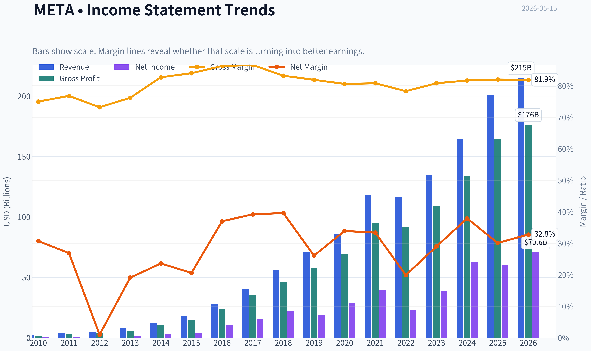
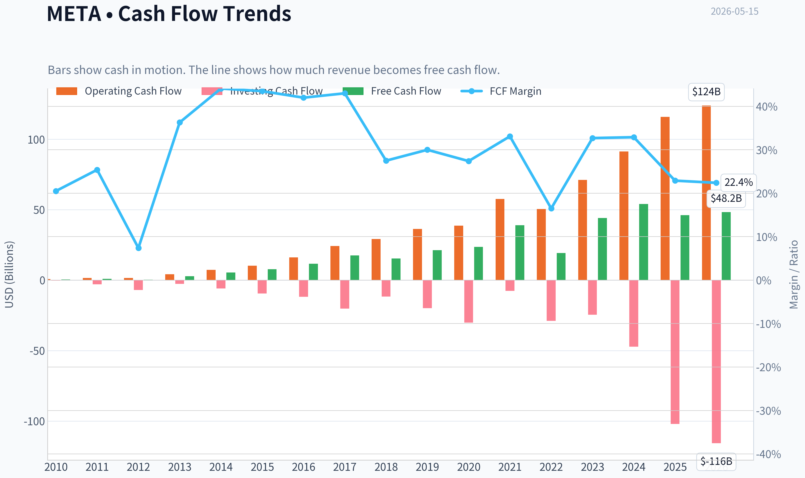
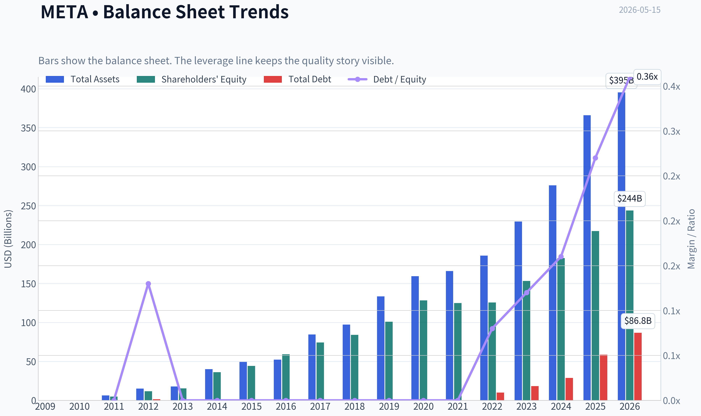
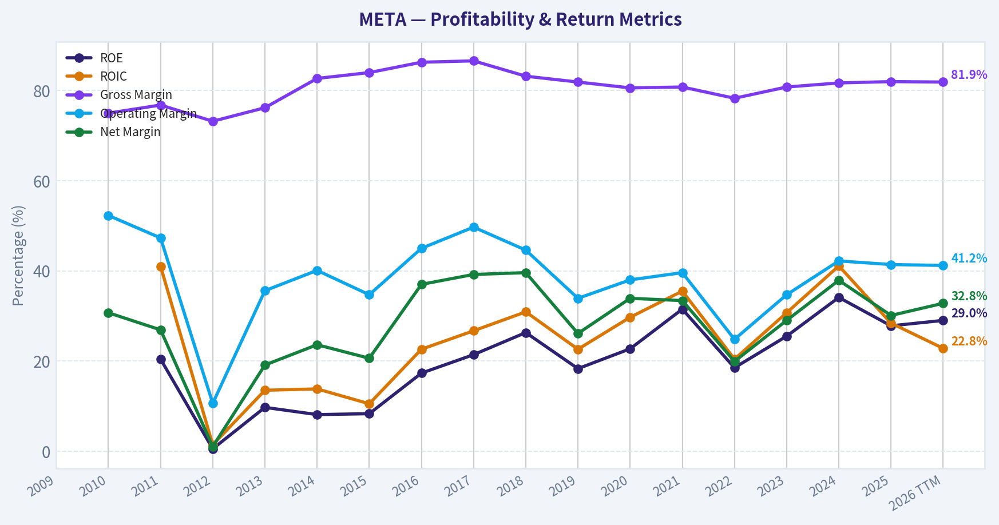
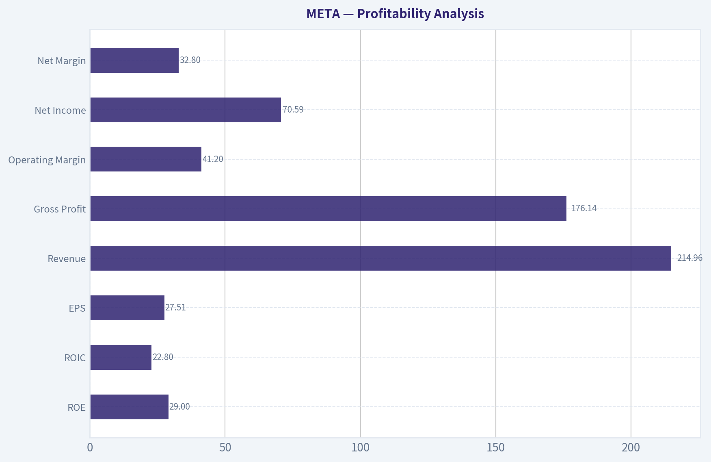
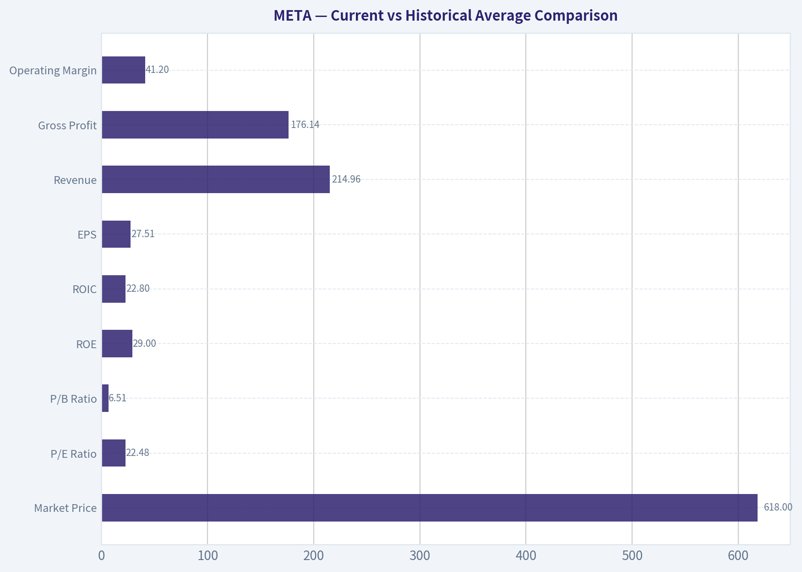
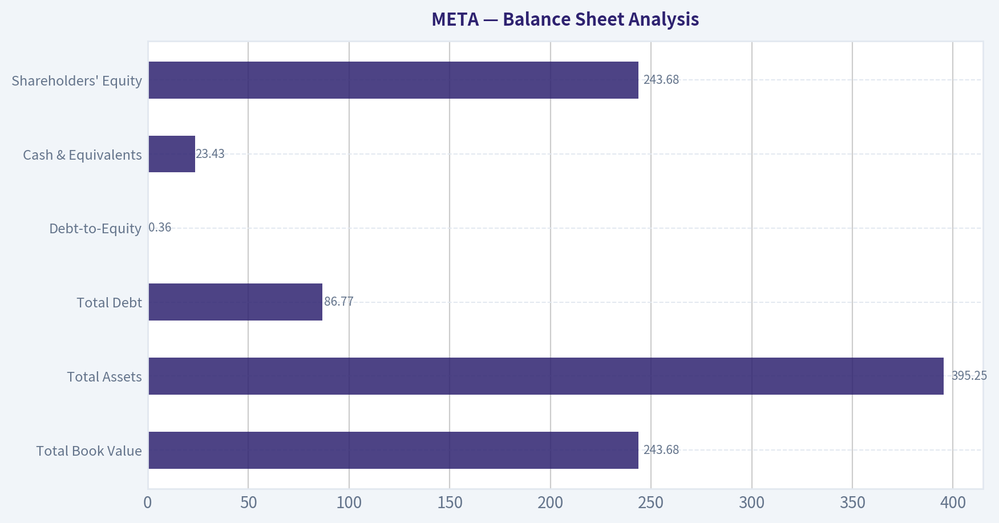
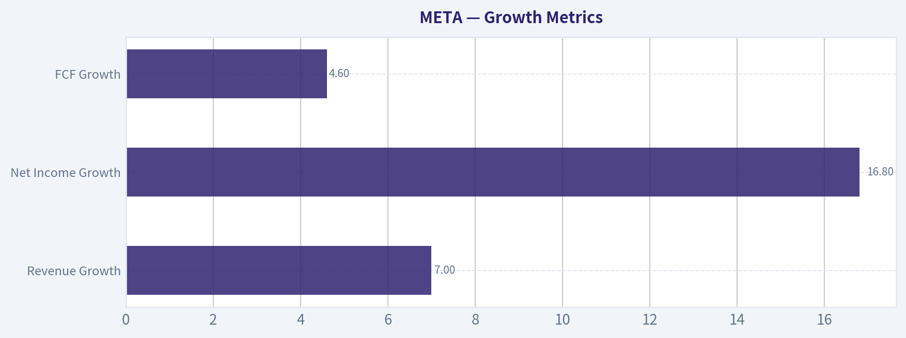
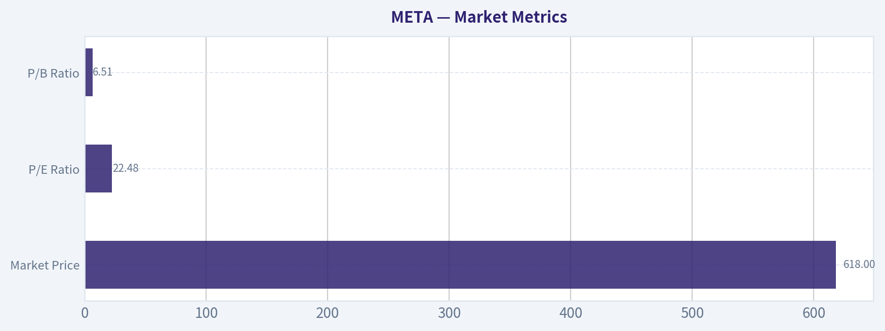

# META Deep Value Intelligence

**Analysis Date:** 2026-05-15

## Critical Disclaimer

*This analysis is generated by Deep Value Intelligence, an AI-powered multi-agent investing framework. This report is for informational and educational purposes only and does not constitute financial advice. Always conduct your own research and consult with qualified financial advisors before making investment decisions.*

---

## Table of Contents

1. Intelligence Summary
2. Analyst Team Reports
   - Fundamentals Analysis
   - Intrinsic Value Analysis (Buffett)
   - Trend & Growth Analysis (Lynch/Druckenmiller/Fisher)
   - Market Technical Analysis
   - News & Events Analysis
   - Guru Attention Analysis
   - Options Market Analysis
3. Research Team Commentary
4. Value Investing Team Commentary
5. Deep Values Commentary

---

## Intelligence Summary

### Thesis + Conditions

**Core Thesis:** ## Executive Briefing

**Key Risks:**
- META: WATCH**
- Meta is a **high-quality business**, but not a **clear value bargain** at $618. The moat, margins, and returns on capital are excellent, and long-term intrinsic value likely continues to rise. But Buffett-style risk is not about chart volatility-it is about **overpaying for quality, weak cash conversion, and management allocating capital into uncertain projects**.
- Plan refinement:** keep Meta on the buy list, but **do not aggressively accumulate here**. Consider only a **small starter position if underexposed**, and add only on either **better proof of FCF recovery** or a **more attractive price with a wider margin of safety**.
- ### 1) What matters most under a Buffett-style risk lens
- The debate correctly separates **business quality** from **investment risk**.

**What Would Change Our View:**
- META: WATCH**
- Meta is a **high-quality business**, but not a **clear value bargain** at $618. The moat, margins, and returns on capital are excellent, and long-term intrinsic value likely continues to rise. But Buffett-style risk is not about chart volatility-it is about **overpaying for quality, weak cash conversion, and management allocating capital into uncertain projects**.
- Plan refinement:** keep Meta on the buy list, but **do not aggressively accumulate here**. Consider only a **small starter position if underexposed**, and add only on either **better proof of FCF recovery** or a **more attractive price with a wider margin of safety**.
- ### 1) What matters most under a Buffett-style risk lens
- The debate correctly separates **business quality** from **investment risk**.

**Confidence:** Low

---

## Analyst Team Reports

### Fundamentals Analysis

#### Latest Earnings Snapshot

*Most recent reported quarter anchored on 2026 Q1, with prior-year comparison when available.*

| Metric | 2026 Q1 | 2025 Q1 | YoY Change |
| --- | ---: | ---: | ---: |
| Revenue | $56.31B | $42.31B | +33.1% |
| Operating Income | $22.87B | $17.55B | +30.3% |
| Net Income | $26.77B | $16.64B | +60.9% |
| Diluted EPS | $10.44 | $6.43 | +62.4% |
| Operating Cash Flow | $32.23B | $24.03B | +34.1% |
| Free Cash Flow | $13.23B | $11.09B | +19.3% |

Key Takeaways: This snapshot anchors the most recent reported quarter before the narrative analysis. It helps readers separate long-run business quality from whatever changed in the latest earnings print.

#### 10-Year Financial Metrics for META

*All values below are computed deterministically from raw data - not estimated by AI.*

*Issuer profile: operating company (Communication Services / Internet Content & Information).*

#### 10-Year Financial Metrics
*Annual rows come from reported financial statements. The final TTM row is computed from the latest four quarters.*

| Metric | 2009 | 2010 | 2011 | 2012 | 2013 | 2014 | 2015 | 2016 | 2017 | 2018 | 2019 | 2020 | 2021 | 2022 | 2023 | 2024 | 2025 | 2026 TTM |
| --- | --- | --- | --- | --- | --- | --- | --- | --- | --- | --- | --- | --- | --- | --- | --- | --- | --- | --- |
| Market Price | N/A | N/A | N/A | $26 | $54 | $77 | $104 | $114 | $175 | $130 | $204 | $271 | $334 | $119 | $351 | $583 | $660 | $618 |
| Market Cap | N/A | N/A | N/A | $57.66B | $137.55B | $207.85B | $298.59B | $336.52B | $521.62B | $382.91B | $590.30B | $788.89B | $961.62B | $325.16B | $930.56B | $1.53T | $1.70T | $1.59T |
| P/E Ratio | N/A | 135.47 | 82.46 | 2662.00 | 91.08 | 70.93 | 81.13 | 32.97 | 32.74 | 17.32 | 31.92 | 27.07 | 24.43 | 14.01 | 23.80 | 24.54 | 28.10 | 22.48 |
| P/B Ratio | N/A | N/A | 11.68 | 4.91 | 8.89 | 5.76 | 6.75 | 5.69 | 7.02 | 4.55 | 5.84 | 6.15 | 7.70 | 2.59 | 6.08 | 8.38 | 7.82 | 6.51 |
| ROE | N/A | N/A | 20.4% | 0.5% | 9.7% | 8.1% | 8.3% | 17.3% | 21.4% | 26.3% | 18.3% | 22.7% | 31.5% | 18.5% | 25.5% | 34.1% | 27.8% | 29.0% |
| ROIC | N/A | N/A | 41.0% | 1.4% | 13.5% | 13.8% | 10.5% | 22.6% | 26.7% | 30.9% | 22.6% | 29.7% | 35.5% | 20.4% | 30.7% | 41.1% | 28.4% | 22.8% |
| EPS | N/A | $0.28 | $0.46 | $0.01 | $0.60 | $1.10 | $1.29 | $3.49 | $5.39 | $7.57 | $6.43 | $10.09 | $13.77 | $8.59 | $14.87 | $23.86 | $23.49 | $27.51 |
| Revenue | N/A | $1.97B | $3.71B | $5.09B | $7.87B | $12.47B | $17.93B | $27.64B | $40.65B | $55.84B | $70.70B | $85.97B | $117.93B | $116.61B | $134.90B | $164.50B | $200.97B | $214.96B |
| Gross Profit | N/A | $1.48B | $2.85B | $3.73B | $6.00B | $10.31B | $15.06B | $23.85B | $35.20B | $46.48B | $57.93B | $69.27B | $95.28B | $91.36B | $108.94B | $134.34B | $164.79B | $176.14B |
| Gross Margin | N/A | 75.0% | 76.8% | 73.2% | 76.2% | 82.7% | 84.0% | 86.3% | 86.6% | 83.2% | 81.9% | 80.6% | 80.8% | 78.3% | 80.8% | 81.7% | 82.0% | 81.9% |
| Operating Margin | N/A | 52.3% | 47.3% | 10.6% | 35.6% | 40.1% | 34.7% | 45.0% | 49.7% | 44.6% | 33.9% | 38.0% | 39.6% | 24.8% | 34.7% | 42.2% | 41.4% | 41.2% |
| Net Income | N/A | $606.0M | $1.00B | $53.0M | $1.50B | $2.94B | $3.69B | $10.22B | $15.93B | $22.11B | $18.48B | $29.15B | $39.37B | $23.20B | $39.10B | $62.36B | $60.46B | $70.59B |
| Net Margin | N/A | 30.7% | 26.9% | 1.0% | 19.1% | 23.6% | 20.6% | 37.0% | 39.2% | 39.6% | 26.1% | 33.9% | 33.4% | 19.9% | 29.0% | 37.9% | 30.1% | 32.8% |
| Revenue Growth | N/A | N/A | 88.0% | 37.1% | 54.7% | 58.4% | 43.8% | 54.2% | 47.1% | 37.4% | 26.6% | 21.6% | 37.2% | -1.1% | 15.7% | 21.9% | 22.2% | 7.0% |
| Net Income Growth | N/A | N/A | 65.0% | -94.7% | 2730.2% | 96.0% | 25.4% | 177.0% | 56.0% | 38.8% | -16.4% | 57.7% | 35.1% | -41.1% | 68.5% | 59.5% | -3.1% | 16.8% |
| Free Cash Flow Growth | N/A | N/A | 132.8% | -60.0% | 658.6% | 92.1% | 41.9% | 49.0% | 50.5% | -12.1% | 38.1% | 11.2% | 65.3% | -50.5% | 128.5% | 22.7% | -14.7% | 4.6% |
| Total Book Value | N/A | N/A | $4.90B | $11.76B | $15.47B | $36.10B | $44.22B | $59.19B | $74.35B | $84.13B | $101.05B | $128.29B | $124.88B | $125.71B | $153.17B | $182.64B | $217.24B | $243.68B |
| Total Assets | N/A | N/A | $6.33B | $15.10B | $17.89B | $39.97B | $49.41B | $52.26B | $84.52B | $97.33B | $133.38B | $159.32B | $165.99B | $185.73B | $229.62B | $276.05B | $366.02B | $395.25B |
| Total Debt | $0 | $0 | $0 | $1.50B | $0 | $0 | $0 | $0 | $0 | $0 | $0 | $0 | $0 | $9.92B | $18.39B | $28.83B | $58.74B | $86.77B |
| Debt-to-Equity | N/A | N/A | 0.00 | 0.13 | 0.00 | 0.00 | 0.00 | 0.00 | 0.00 | 0.00 | 0.00 | 0.00 | 0.00 | 0.08 | 0.12 | 0.16 | 0.27 | 0.36 |
| Cash & Equivalents | $633.0M | $1.78B | $1.51B | $2.38B | $3.32B | $4.32B | $4.91B | $8.90B | $8.08B | $10.02B | $19.08B | $17.58B | $16.60B | $14.68B | $41.86B | $43.89B | $35.87B | $23.43B |
| Shareholders' Equity | N/A | N/A | $4.90B | $11.76B | $15.47B | $36.10B | $44.22B | $59.19B | $74.35B | $84.13B | $101.05B | $128.29B | $124.88B | $125.71B | $153.17B | $182.64B | $217.24B | $243.68B |
| Operating Cash Flow | N/A | $698.0M | $1.55B | $1.61B | $4.22B | $7.33B | $10.32B | $16.11B | $24.22B | $29.27B | $36.31B | $38.75B | $57.68B | $50.48B | $71.11B | $91.33B | $115.80B | $124.00B |
| Investing Cash Flow | N/A | $-324.0M | $-3.02B | $-7.02B | $-2.62B | $-5.91B | $-9.43B | $-11.79B | $-20.12B | $-11.60B | $-19.86B | $-30.06B | $-7.57B | $-28.97B | $-24.50B | $-47.15B | $-102.00B | $-115.67B |
| Free Cash Flow | N/A | $405.0M | $943.0M | $377.0M | $2.86B | $5.50B | $7.80B | $11.62B | $17.48B | $15.36B | $21.21B | $23.58B | $38.99B | $19.29B | $44.07B | $54.07B | $46.11B | $48.25B |
| FCF Margin | N/A | 20.5% | 25.4% | 7.4% | 36.3% | 44.1% | 43.5% | 42.0% | 43.0% | 27.5% | 30.0% | 27.4% | 33.1% | 16.5% | 32.7% | 32.9% | 22.9% | 22.4% |
| Dividends / Share | N/A | $0.00 | $0.00 | $0.00 | $0.00 | $0.00 | $0.00 | $0.00 | $0.00 | $0.00 | $0.00 | $0.00 | $0.00 | $0.00 | $0.00 | $1.94 | $2.07 | $2.08 |

#### Profitability Metrics
- Return on Equity (ROE): 27.8%
- Return on Invested Capital (ROIC): 24.4%
- Return on Assets (ROA): 16.5%
- Gross Margin: 82.0%
- Operating Margin: 41.4%
- Net Profit Margin: 30.1%

#### Liquidity Metrics
- Current Ratio: 2.60
- Quick Ratio: 2.42

#### Leverage Metrics
- Debt-to-Equity Ratio: 0.27
- Interest Coverage Ratio: 76.40
- Net Debt: $22.87B

#### Growth Metrics (Year-over-Year)
- Revenue Growth: 22.2%
- Net Income Growth: -3.1%
- Free Cash Flow Growth: -14.7%
- Revenue CAGR (3-Year): 19.9%
- Revenue CAGR (5-Year): 18.5%

#### Valuation Metrics
- P/E Ratio (TTM): 22.47
- Forward P/E: 17.09
- Price-to-Book: 6.44
- Price-to-Sales: 7.30
- PEG Ratio: 0.88
- EV/EBITDA: 14.41
- Free Cash Flow Yield: 2.9%
- Earnings Yield: 4.4%

#### Owner Earnings (Buffett Method, Code-Computed)
- Net Income: $60.46B
- + Depreciation & Amortization: $18.62B
- - Capital Expenditures: $-69.69B
- - Working Capital Changes: $-885.0M
- = **Owner Earnings: $10.27B**

#### Intrinsic Value (Code-Computed)
- Current Price: $618
- Buffett Method (Owner Earnings):
  Conservative: $39
  Average: $127
  Optimistic: $375
- Cash Flow Method (FCF):
  Conservative: $177
  Average: $647
  Optimistic: $1,685

#### Piotroski F-Score: 5/9
- Positive Net Income: PASS
- Positive Operating Cash Flow: PASS
- ROA Improvement: FAIL
- Cash Flow > Net Income: PASS
- Decreasing Debt: FAIL
- Improving Current Ratio: FAIL
- No Dilution: PASS
- Improving Gross Margin: PASS
- Improving Asset Turnover: FAIL

ANALYST STANCE: **WATCH**

#### META Fundamental Analysis - Buffett-Style

Meta remains a very high-quality business with exceptional economics, but the stock now trades at a level where quality is obvious and much of the upside depends on continued AI monetization, ad durability, and disciplined capital allocation. The company clearly has a wide moat, strong profitability, and a powerful cash engine, but rising capex, increasing leverage, and a valuation no longer in distressed territory reduce the margin of safety that Buffett-style investors usually demand.

---

#### Current vs Historical Average Comparison

| Metric | Current / TTM | 10Y Historical Average* | Interpretation |
| --- | ---: | ---: | --- |
| Market Price | $618 | ~$345 | Far above long-run average, reflecting major re-rating since 2022 trough |
| Market Cap | $1.59T | ~$871B | Scale has roughly doubled versus decade average |
| P/E Ratio | 22.48x | ~25.5x | Slightly below decade average despite strong rebound in earnings |
| P/B Ratio | 6.51x | ~5.96x | Above historical norm, implying premium valuation on equity base |
| ROE | 29.0% | ~23.0% | Stronger than long-term average; excellent franchise economics |
| ROIC | 22.8% | ~25.1% | Below decade average and below 2024 peak; returns remain high but softer |
| EPS | $27.51 | ~$11.75 | Massive step-up versus long-term base |
| Revenue | $214.96B | ~$101.5B | More than double average scale |
| Gross Profit | $176.14B | ~$82.9B | Profit base has expanded dramatically |
| Operating Margin | 41.2% | ~38.1% | Still above average despite heavy AI spend |
| Net Income | $70.59B | ~$25.6B | Earnings power far above historical norm |
| Net Margin | 32.8% | ~29.2% | Above average; confirms durable monetization |
| Revenue Growth | 7.0% | ~31.6% | Well below long-term average because base is now much larger |
| Net Income Growth | 16.8% | ~292.8%** | Positive, but historical average is distorted by early-stage volatility |
| FCF Growth | 4.6% | ~79.8%** | Positive but modest; historical average inflated by early ramp years |
| Total Book Value | $243.68B | ~$129.5B | Equity base has compounded strongly |
| Total Assets | $395.25B | ~$177.9B | Asset base expanded rapidly, especially with AI infrastructure buildout |
| Total Debt | $86.77B | ~$16.0B | Materially above historical norm; leverage has changed meaningfully |
| Debt-to-Equity | 0.36 | ~0.08 | Still manageable, but much higher than Meta's debt-free past |
| Cash & Equivalents | $23.43B | ~$17.4B | Adequate, but down from recent highs as capex and investments rose |
| Shareholders' Equity | $243.68B | ~$129.5B | Strong compounding in net worth |
| Free Cash Flow | $48.25B | ~$24.7B | Cash generation still excellent, even after capex surge |
| Dividends / Share | $2.08 | ~$0.34 | Dividend remains new and modest relative to earnings power |

*Average uses the years shown in the deterministic dataset where values exist; for most operating metrics this effectively reflects roughly the last decade-plus of reported values.
**Growth averages are statistically distorted by META's early hypergrowth years and rebound years, so median-style interpretation is more useful than raw arithmetic mean.

Key Takeaways: Meta's current business scale, earnings, and free cash flow are all far above its long-term average, which confirms that the company has become a much larger and more profitable enterprise over time. The biggest changes versus history are a much higher debt load, slightly lower ROIC than peak levels, and growth rates that are naturally moderating as the business gets bigger.

---

#### Market Metrics

Meta's market metrics show a company that has re-rated from cyclical fear in 2022 back toward premium-quality status.

| Market Metric | Current | Historical Context | Buffett-Style Interpretation |
| --- | ---: | --- | --- |
| Market Price | $618 | Up sharply from $119 in 2022 and below $660 in 2025 | Market has already recognized recovery and AI optionality |
| Market Cap | $1.59T | Near all-time highs; up from $325B in 2022 | Mega-cap scale limits multibagger potential from multiple expansion alone |
| P/E Ratio | 22.48x | Below 2025 at 28.10x and below long-run avg ~25.5x | Reasonable for quality, but not classic deep value |
| P/B Ratio | 6.51x | Above long-run avg ~5.96x, below 2024-2025 highs | Market is paying a premium for high returns on equity |

Key Takeaways: Meta is no longer cheap in an obvious absolute sense, but it also is not trading at an extreme earnings multiple compared with its own history. The valuation says investors expect durable high profitability and continued AI-driven growth, leaving less room for execution mistakes.

Meta's valuation is interesting because P/E is not stretched versus its own history, yet price-to-book remains elevated. That combination is typical of a company with high intangible economic value and strong capital efficiency. For Buffett, the key question is not whether Meta is statistically cheap, but whether future owner earnings justify paying a quality premium today.

---

#### Profitability Analysis

Meta's profitability remains one of the strongest in large-cap public markets.

| Profitability Metric | Current / TTM | Historical Trend | Assessment |
| --- | ---: | --- | --- |
| ROE | 29.0% | Recovered from 18.5% in 2022; near elite range | Excellent management productivity on equity capital |
| ROIC | 22.8% | Below 41.1% in 2024 and 28.4% in 2025 | Still strong, but incremental capital is less productive than peak |
| EPS | $27.51 | Up from $8.59 in 2022 and above $23.49 in 2025 | Strong per-share earnings despite scale |
| Revenue | $214.96B | Consistent long-run expansion | Core advertising machine remains powerful |
| Gross Profit | $176.14B | Gross margin steady around 80%+ | Strong platform economics and low marginal cost structure |
| Operating Margin | 41.2% | Above long-term avg ~38.1% | Expense discipline improved after 2022 reset |
| Net Income | $70.59B | Near record levels | Earnings power is massive |
| Net Margin | 32.8% | Above long-term avg ~29.2% | Monetization remains efficient even with AI and Reality Labs pressure |

Key Takeaways: Meta's margins and returns remain excellent by any standard, especially for a company of this size. The main nuance is that while profitability is still elite, ROIC has cooled from recent peak levels as AI infrastructure and other heavy investments absorb more capital.

A Buffett investor would like the consistency here. Gross margins have stayed remarkably resilient over time, which suggests pricing power, scale advantages, and strong advertiser dependence. Operating and net margins dipped in 2022, but the rebound in 2023-2026 TTM shows that Meta's earnings pressure was cyclical and management-controllable rather than evidence of a broken business model.

ROE at 29.0% is particularly impressive given Meta's now very large equity base. That indicates the company is still turning retained earnings into substantial profit. However, ROIC falling from 41.1% in 2024 to 22.8% TTM deserves attention: returns are still strong, but newer investments are not earning at the same extraordinary rate as the legacy ad business.

---

#### Growth Metrics

Meta's growth profile has shifted from hypergrowth to durable scaled growth.

| Growth Metric | Current / TTM | Historical Pattern | Interpretation |
| --- | ---: | --- | --- |
| Revenue Growth | 7.0% | Decade marked by many years above 20%, with 2022 at -1.1% | Growth is moderating as base enlarges |
| Net Income Growth | 16.8% | Historically volatile, including major rebounds | Profit growth currently healthier than revenue growth |
| FCF Growth | 4.6% | Volatile due to capex cycles; 2022 and 2025 weak | Cash growth constrained by infrastructure spending |

Key Takeaways: Meta is still growing, but it is no longer the explosive hypergrowth business it once was. Profit growth remains respectable, while free cash flow growth has become more uneven because AI-related investment needs are much heavier than in the past.

Revenue has compounded exceptionally over time, but the current 7.0% TTM growth rate is below the historical norm. That does not necessarily imply weakness; it reflects a huge revenue base. For a company above $200B in revenue, even high-single-digit growth creates substantial incremental dollars.

The more important issue is the divergence between net income growth and free cash flow growth. Earnings are growing faster than free cash flow because capex is absorbing more cash. Buffett would treat that carefully: accounting earnings matter less than cash available to owners after sustaining the business.

---

#### Balance Sheet Analysis

Meta's balance sheet is still strong, but it is no longer the ultra-clean fortress it once was.

| Balance Sheet Metric | Current / TTM | Historical Context | Assessment |
| --- | ---: | --- | --- |
| Total Book Value | $243.68B | Nearly doubled from 2020 | Significant compounding in intrinsic net worth |
| Total Assets | $395.25B | Expanded sharply since 2023 | AI and infrastructure buildout are balance-sheet visible |
| Total Debt | $86.77B | Zero debt through 2021; now materially higher | Strategic flexibility reduced versus prior years |
| Debt-to-Equity | 0.36 | Historically near zero | Still manageable, but trend is negative |
| Cash & Equivalents | $23.43B | Down from $43.89B in 2024 | Liquidity remains solid but less abundant |
| Shareholders' Equity | $243.68B | Strong long-term accumulation | Business retains enormous financial strength |

Key Takeaways: Meta still has a healthy balance sheet, but the biggest structural change is the rapid rise in debt from essentially zero to nearly $87 billion. That shift is not yet dangerous, though it does mean investors should stop thinking of Meta as a completely debt-free cash fortress.

The positive side is that leverage is still supportable: debt-to-equity of 0.36 is not extreme, the current ratio is 2.60, and interest coverage of 76.4x is very strong. The concern is trend direction. Buffett likes businesses that can thrive without much external financing, and Meta's recent debt build plus lower cash balance means future capital allocation must remain disciplined.

---

#### Cash Flow Analysis

Meta is still a free-cash-flow machine, but owner earnings are materially lower than accounting profit because capex has exploded.

| Cash Flow Metric | Current / TTM | Historical Context | Interpretation |
| --- | ---: | --- | --- |
| Free Cash Flow | $48.25B | Above decade avg ~24.7B, below 2024 peak growth trajectory | Strong absolute cash generation |
| Dividends / Share | $2.08 | New in 2024; modest payout | Shareholder-friendly, but not yet central to thesis |

Key Takeaways: Free cash flow remains very large in absolute terms, but heavy capital spending is preventing it from compounding as quickly as revenue and earnings. The dividend is a positive signal of maturity and confidence, though it remains small relative to Meta's earnings power.

The most Buffett-relevant datapoint is owner earnings, not just FCF. The provided canonical computation shows 2025 owner earnings of only $10.27B:

- Net Income = $60.46B
- Plus D&A = $18.62B
- Less Capex = $69.69B
- Less Working Capital Changes = $0.885B
- Owner Earnings = **$10.27B**

That is a crucial insight. Meta's accounting earnings remain huge, but the amount of cash left for owners after reinvestment is much smaller than net income implies. If current capex is sustainably productive, that may be acceptable. If not, intrinsic value based on owner earnings is much lower than a casual P/E screen would suggest.

---

#### Buffett-Style Qualitative Analysis

| Buffett Lens | META Assessment | Commentary |
| --- | --- | --- |
| Economic Moat | Strong | Network effects across Facebook, Instagram, WhatsApp, Messenger; advertiser demand reinforced by scale, identity, targeting, and measurement |
| Financial Strength | Good, but weakening vs history | Liquidity is solid, but debt has increased sharply and cash has declined from recent highs |
| Predictable Earnings | Strong overall | 2022 showed cyclicality and spending risk, yet decade-long earnings power remains highly visible |
| Management Performance | Improved after 2022 reset | Margin recovery shows cost discipline, but capex intensity and metaverse/AI spending require scrutiny |
| Capital Allocation | Mixed | Buybacks and dividend are positives; debt-funded or debt-accompanied spending surge raises hurdle for returns |
| Quality of Business | Very high | Extremely high gross margins, large installed user base, powerful ad economics, huge scale advantages |

Key Takeaways: Meta checks many Buffett boxes, especially moat, margins, and earnings power. The biggest debate is capital allocation, because recent years show that management can create enormous value but can also commit very large sums to uncertain long-duration investments.

**Economic moat:**
Meta's moat is based on user scale, engagement ecosystems, advertiser demand, and data feedback loops. Instagram and Facebook remain critical ad surfaces, while WhatsApp offers monetization optionality that still appears underexploited. These assets create a durable platform advantage that smaller rivals cannot easily replicate.

**Predictable earnings:**
Over the long run, yes. Revenue has grown from $12.47B in 2014 to $214.96B TTM, with only one annual revenue contraction in the dataset, in 2022. That is exceptional predictability for a digital platform. Margins also stayed structurally high despite regulatory, privacy, and competitive pressures.

**Management performance:**
Management deserves credit for the 2023-2025 efficiency rebound. Operating margin recovered from 24.8% in 2022 to above 41% TTM. That said, Buffett would likely remain skeptical of capital-intensive moonshots unless they can be shown to produce durable, high-return owner earnings.

**Financial strength:**
Still good, but changed. A debt-free Meta was simpler to underwrite. A levered Meta spending heavily on AI infrastructure is still investable, but it requires more faith in management's reinvestment judgment.

---

#### Owner Earnings DCF Valuation

Using the canonical owner earnings figure of **$10.27B** and the deterministic intrinsic value rules:

- Discount rate = **10%**
- Terminal growth rate = **2.5%**
- Base Owner Earnings = **$10.27B**

Historical owner earnings growth rates are not separately listed in the dataset, so the code-computed intrinsic values provided in the canonical dataset are used as the deterministic valuation anchor. These already implement the required scenario framework.

| Scenario | Growth Assumption Rule | Fair Value / Share | Implied vs Current Price ($618) |
| --- | --- | ---: | ---: |
| Conservative | Lowest historical owner earnings growth rate, floored at -100% | $39 | -93.7% |
| Average | Average historical owner earnings growth rate, capped at 50% | $127 | -79.4% |
| Optimistic | Highest historical owner earnings growth rate, capped at 100% | $375 | -39.3% |

Key Takeaways: On owner earnings, Meta screens as expensive in all three canonical DCF scenarios. The reason is simple: current reinvestment spending is so large that true owner cash flow is far lower than reported net income.

To make the mechanics explicit, the DCF framework is:

1. Start with Owner Earnings = **$10.27B**
2. Project 10 years of owner earnings under each growth scenario
3. Discount each year back at **10%**
4. Apply terminal value using
   **TV = Year 10 Owner Earnings x (1 + 2.5%) / (10% - 2.5%)**
5. Discount terminal value to present
6. Divide equity value by diluted shares to get fair value per share

Because the deterministic dataset already provides the code-computed outputs, those values are the canonical fair values and should not be replaced. The implication is that Buffett-style investors focused strictly on owner earnings would likely conclude the shares are pricing in much better future cash realization than current owner earnings support.

For context only, the dataset also provides a cash-flow-method valuation range:

- Conservative FCF value: **$177**
- Average FCF value: **$647**
- Optimistic FCF value: **$1,685**

This spread versus owner earnings highlights the key debate in Meta: is current capex mostly discretionary growth investment that should create large future returns, or is it becoming a structurally permanent cash drain? Bulls lean toward the first interpretation; strict Buffett traditionalists may lean toward caution until that payoff becomes clearer.

---

#### Revenue Breakdown

Using Meta's most meaningful reported revenue framing for the latest fiscal year: **Family of Apps** versus **Reality Labs**.

| Revenue Source | Amount ($B) | % of Total |
| --- | ---: | ---: |
| Family of Apps | 160.63 | 97.6% |
| Reality Labs | 3.87 | 2.4% |
| **Total 2024 Revenue** | **164.50** | **100.0%** |

Key Takeaways: Meta remains overwhelmingly an advertising and social-platform company, with nearly all revenue still coming from its Family of Apps segment. Reality Labs remains financially small in revenue terms, which means its strategic importance is much larger than its current economic contribution.

This matters for valuation. The core business is highly proven and very profitable, while newer initiatives contribute little revenue today but absorb significant capital. Investors are effectively underwriting the ad franchise while granting management an expensive option on AI devices, computing platforms, and future ecosystem control.

---

#### Key Investment Insights, Red Flags, and Opportunities

| Category | Observation | Why It Matters |
| --- | --- | --- |
| Opportunity | Core ad machine remains elite | 80%+ gross margins and 41%+ operating margins support sustained earnings power |
| Opportunity | WhatsApp and messaging monetization optionality | Could add high-margin revenue without needing a new user acquisition engine |
| Opportunity | AI tools may improve ad targeting and engagement | Better ROI for advertisers can sustain pricing and share gains |
| Opportunity | Dividend initiation signals maturity | Suggests confidence in recurring cash generation |
| Red Flag | Owner earnings far below net income | Heavy capex sharply lowers true owner cash available today |
| Red Flag | Debt has risen quickly | Balance sheet quality is still good, but less pristine than investors may assume |
| Red Flag | ROIC has fallen from recent highs | Incremental investments appear less efficient than legacy business |
| Red Flag | Revenue growth has slowed materially | Natural at scale, but limits valuation expansion unless margins improve further |
| Red Flag | Regulatory and platform risk | Antitrust, privacy, content, and AI-related scrutiny can affect economics and capital allocation |

Key Takeaways: The bullish case rests on Meta's unmatched ad franchise, AI monetization upside, and optionality in messaging and platform control. The cautious case rests on capital intensity, rising debt, and the fact that true owner earnings are much weaker than reported accounting profit.

---

#### Final Buffett-Style Verdict

| Dimension | Verdict |
| --- | --- |
| Business Quality | Excellent |
| Moat | Wide |
| Balance Sheet | Strong but less pristine |
| Earnings Predictability | High |
| Capital Allocation | Mixed |
| Valuation vs Owner Earnings | Unattractive |
| Valuation vs FCF | Roughly fair to moderately rich |
| Buffett-Style Margin of Safety | Limited |

Key Takeaways: Meta is a superb business, but a superb business is not always a superb stock at the current price. For investors who emphasize owner earnings and margin of safety, the shares look too demanding to rate as a clear buy today.

**Stance: WATCH**

Meta is not an avoid because the underlying business is outstanding, profitability is elite, and the moat is real. But it is also not an advocate under a strict Buffett framework because the current price sits well above canonical owner-earnings fair value, leverage has risen, and capex intensity clouds the true cash earnings picture. A more attractive entry would likely require either a lower price, a clear rise in owner earnings, or evidence that current AI and infrastructure investments are converting into sustainably higher future cash returns.

---

#### Summary Table

| Area | Positive | Negative | Bottom Line |
| --- | --- | --- | --- |
| Valuation | P/E below long-term average | Owner earnings DCF implies overvaluation | Quality is priced in |
| Profitability | ROE 29%, operating margin 41.2%, net margin 32.8% | ROIC down from recent peak | Still elite, but watch incremental returns |
| Growth | Revenue and earnings remain higher than historical norms | Growth rates are slowing at scale | Mature compounding, not hypergrowth |
| Balance Sheet | Good liquidity, large equity base, strong interest coverage | Debt up to $86.77B, cash lower than 2024 | Healthy but not fortress-like |
| Cash Flow | $48.25B FCF, new dividend, huge operating cash flow | Owner earnings only $10.27B due to capex | Capex is the key debate |
| Buffett Factors | Wide moat, predictable franchise, strong core economics | Capital allocation risk and limited margin of safety | High-quality watchlist name |

#### Fundamental Visuals

This graph tracks the profitability and return metrics (ROE, ROIC, Margins) of **META** over the past decade, highlighting capital efficiency trends.

This chart illustrates the financial health of **META** over the last 10 years, mapping cash equivalents and free cash flow against total obligations (Debt).

This comparison chart from *Profitability Analysis* stacks current figures against historical benchmarks for **META**, making it easy to see where the company trades relative to its own averages.

---

### Intrinsic Value Analysis (Buffett)

> *Following Warren Buffett's value investing philosophy: Circle of Competence, Economic Moat, Management Quality, and Margin of Safety.*

#### Intrinsic Value Snapshot

Price is what you pay. Intrinsic value is what the business may be worth based on the cash it can create for owners over time. We show a range, not one magic number.

- Current Price: $618.43
- Value Range: $15.94 to $1,684.80

##### Owner Earnings (Buffett Method)
- Net Income: $60,458,000,000.00
- Depreciation & Amortization: $18,616,000,000.00
- Capital Expenditures: $-69,691,000,000.00
- Working Capital Changes: $-885,000,000.00
- Owner Earnings: $10,268,000,000.00

##### Intrinsic Value
###### Buffett Method
Uses owner earnings. Stricter, and usually more conservative.
- Conservative: $15.94
- Average: $17.47
- Optimistic: $368.92
- Discount Rate: 10.0%

###### Cash Flow Method
Uses free cash flow. Better for companies spending heavily today to grow tomorrow.
- Conservative: $259.56
- Average: $646.95
- Optimistic: $1,684.80
- Discount Rate: 10.0%

#### Gate 1 - Understandability

#### Business overview

Meta Platforms is a global digital advertising and communication platform business built around a family of apps - primarily Facebook, Instagram, WhatsApp, Messenger, and Threads - plus a smaller but strategically important Reality Labs segment focused on AR/VR and longer-dated computing platforms.

At its core, Meta monetizes user attention. It offers free consumer services at enormous scale, gathers intent and engagement signals, and sells targeted advertising inventory to businesses ranging from small merchants to global brands. The model is simple to describe:

1. attract and retain users,
2. increase engagement,
3. improve ad targeting and measurement,
4. raise advertiser ROI,
5. capture more advertising spend.

That flywheel is strengthened by AI, which improves ranking, content discovery, ad relevance, creative generation, and campaign optimization.

#### Revenue model

Meta has two principal economic engines:

#### 1. Family of Apps
This is the overwhelming majority of revenue and profits. Revenue is mostly advertising, driven by:
- ad impressions,
- price per ad,
- time spent,
- advertiser demand,
- conversion effectiveness.

The company benefits from:
- global reach,
- low marginal distribution cost,
- self-serve ad tools,
- direct-response advertising strength,
- large small-business advertiser base,
- powerful first-party data generated from on-platform behavior.

#### 2. Reality Labs
This includes VR/AR hardware, software, and metaverse-related development. Strategically relevant, financially dilutive. It consumes capital and operating expense today in pursuit of optionality over future computing platforms.

#### Why the business is understandable

Despite constant media complexity around AI, regulation, and platform politics, the economics remain easy to grasp:

- consumers use Meta's apps because their social graph and content are there;
- advertisers spend where measurable ROI is highest;
- Meta earns high-margin revenue by matching the two better than most rivals.

This is not a commodity software company and not a cyclical industrial. It is a scaled attention-and-advertising network with extraordinary data, distribution, and monetization capability.

#### Key variables to watch

For a long-term owner, the most important operating variables are:
- daily/monthly active users and engagement trends,
- monetization per user,
- ad pricing versus impression growth,
- AI-related capex and opex intensity,
- Reality Labs losses,
- regulatory restrictions on targeting, data use, or distribution,
- competition from TikTok, YouTube, and emerging AI interfaces.

#### Gate 1 verdict

**Pass.** Meta is understandable. The business model is clearer than many investors assume: dominant communication platforms monetized via targeted advertising, with one highly profitable core franchise subsidizing a speculative platform option.

---

#### Gate 2 - Durable Competitive Advantage

#### Network effects

Meta possesses one of the strongest network effects in global consumer internet.

- Facebook benefits from social graph density.
- Instagram benefits from creator, audience, and advertiser density.
- WhatsApp benefits from utility and ubiquity in messaging.
- Messenger and Threads add communication and discovery layers.
- Advertisers go where users are; users stay where content, relationships, and creators already exist.

The network effect is not merely user-to-user; it is multi-sided:
- users attract creators,
- creators attract engagement,
- engagement attracts advertisers,
- advertisers fund creator ecosystems and platform investment.

#### Scale advantages

Meta's scale creates meaningful cost and data advantages:
- infrastructure can be amortized over billions of users,
- AI model training benefits from massive data exhaust,
- ad systems improve with greater auction density,
- compliance, safety, and developer resources are costly for smaller competitors to match.

In digital advertising, scale matters because more conversion data improves optimization. Better optimization yields better ROI, which attracts more spend.

#### Switching costs

Consumer switching costs are psychologically low but functionally meaningful:
- your friends, groups, identity, history, and audience are already embedded in Meta's ecosystem;
- businesses have accumulated campaign data, creative workflows, and customer acquisition knowledge tied to Meta's tools;
- WhatsApp is deeply embedded in daily communication in many regions.

Advertiser switching costs are often underestimated. While ad budgets can move, performance marketers follow returns. If Meta keeps delivering efficient customer acquisition, budgets persist.

#### Brand and habit

Meta's brands are not "luxury brands," but they are habit brands:
- Instagram is a daily utility for discovery and identity,
- WhatsApp is core infrastructure in many countries,
- Facebook remains important for groups, local communities, and older demographics.

Habit plus communication utility is powerful. Messaging in particular has very high retention once established.

#### Data advantage

Meta's first-party behavioral data is a substantial moat. Post-IDFA changes demonstrated that weaker platforms suffered more, while Meta used AI and first-party signal reconstruction to recover ad performance. The ability to infer intent from on-platform engagement remains a competitive advantage.

#### Counterarguments to moat durability

The moat is real, but not invulnerable.

#### Risks:
- younger-user attention can migrate quickly;
- regulators can constrain data use, M&A, interoperability, and ad targeting;
- AI assistants may alter content discovery and commerce paths;
- TikTok and YouTube remain formidable attention competitors;
- messaging monetization has lagged utility, especially on WhatsApp.

#### Gate 2 verdict

**Pass.** Meta has a **wide moat**, rooted in network effects, scale, data, distribution, and advertiser ROI. The moat is not as impregnable as a regulated utility's, but in digital media and ad tech it is among the strongest.

---

#### Gate 3 - Management Quality

#### Capital allocation

Mark Zuckerberg's record is mixed in style, but strong in substance.

#### Positives
- Acquisitions of Instagram and WhatsApp were extraordinary.
- The company responded aggressively to Apple privacy changes through AI-driven ad optimization.
- Cost discipline improved after the "year of efficiency."
- Massive buybacks at periods of depressed valuation have been accretive.
- The company continues to fund AI infrastructure that likely protects and expands the core ad engine.

#### Negatives
- Reality Labs spending has been very heavy and returns remain uncertain.
- Governance is founder-controlled, limiting shareholder influence.
- Meta occasionally pursues strategic ambitions before external stakeholders are comfortable with the expense or risk.

#### Operating execution

Meta has repeatedly demonstrated high-grade execution:
- successful pivot from desktop to mobile,
- successful pivot from feed to stories and short video,
- monetization of Reels improved from initial dilution,
- ad recovery after privacy shocks,
- continued engagement gains through recommendation AI.

This is not a passive incumbent. It adapts quickly.

#### Shareholder orientation

Management is not conventionally shareholder-friendly in governance structure, but has become more economically disciplined. The best evidence is in margins, free cash generation, and buybacks, not in voting rights.

#### Incentives and culture

Meta's culture is engineering-led, high-speed, and metrics-driven. That can produce excellent product iteration, though it also creates:
- reputational risks,
- employee friction,
- regulatory scrutiny.

Recent reports of AI-talent reassignments, internal workplace monitoring disputes, and rising scrutiny in scam-ad and AI-ad practices indicate the culture remains aggressive and can invite backlash.

#### Management quality verdict

**Good to very good, but not perfect.**

Zuckerberg should be viewed as a high-ability operator and capital allocator with one major caveat: he is willing to invest billions into uncertain future platforms. That is both a strength and a risk. In Buffett terms, this is a talented owner-operator with above-average strategic courage and below-average restraint.

#### Gate 3 verdict

**Pass.** Management quality is sufficient for investment, with governance and capital intensity in Reality Labs as the main deductions.

---

#### Gate 4 - Price and Value

#### Snapshot valuation

Using the research pack:
- **Current price:** $618
- **Market cap:** $1.57T
- **P/E:** 22.47
- **ROE:** 27.8%
- **Gross margin:** 82.0%
- **Revenue growth YoY:** 22.2%
- **FCF yield:** 2.9%
- **Current ratio:** 2.60

For a business of this quality, a 22.5x earnings multiple is not obviously expensive. It is above classic deep-value territory, but for a company with:
- high returns on capital,
- dominant platforms,
- strong balance sheet,
- double-digit growth,
- AI-enabled monetization upside,

the valuation is closer to **fair-to-modestly attractive** than overvalued.

---

#### Moat Assessment

#### Sources of moat
- global user scale,
- social graph lock-in,
- messaging ubiquity,
- advertiser auction depth,
- AI and data feedback loops,
- low marginal cost economics,
- brand habit and creator ecosystem.

#### Moat width
**Wide moat.**

#### Moat durability
Likely durable for at least the next 5-10 years, though the precise mix of products may change. The moat sits at the ecosystem level, not necessarily any one surface.

---

#### 10-Year Financial Summary (Best Effort)

Below is a best-effort normalized summary using general historical knowledge and current figures. Numbers are rounded and intended for valuation framing, not audit precision.

| Year | Revenue ($B) | Op Margin % | Net Income ($B) | FCF ($B) | Notes |
|---|---:|---:|---:|---:|---|
| 2016 | 27.6 | 44 | 10.2 | 11 | mobile ad scale-up |
| 2017 | 40.7 | 50 | 15.9 | 17 | ad engine strengthening |
| 2018 | 55.8 | 45 | 22.1 | 15 | privacy/safety investment rises |
| 2019 | 70.7 | 34 | 18.5 | 21 | expense growth and regulation |
| 2020 | 86.0 | 38 | 29.1 | 23 | pandemic ad demand resilience |
| 2021 | 117.9 | 40 | 39.4 | 39 | peak monetization and scale |
| 2022 | 116.6 | 25 | 23.2 | 18 | IDFA pressure, metaverse spend |
| 2023 | 134.9 | 35 | 39.1 | 43 | efficiency rebound |
| 2024 | 164.0 | 39 | 52.0 | 52 | AI ad recovery and strong monetization |
| 2025E | 183.0 | 41 | 60.0 | 57 | assumption based on pack metrics |

#### Observations
- Revenue compounded dramatically over the last decade.
- Margins compressed when Meta over-expanded and absorbed privacy/platform shocks, then recovered.
- Free cash flow remains very strong despite heavy capex.
- Reality Labs has reduced consolidated profitability but has not impaired the core machine.

---

#### Financial Quality

#### Profitability
- **Gross margin: 82%** is exceptional.
- **ROE: 27.8%** confirms strong capital efficiency even with a large equity base.
- Advertising-driven software-like economics support very high incremental margins.

#### Balance sheet
- **Current ratio: 2.60** indicates ample near-term liquidity.
- Meta has historically maintained a strong net cash position or very manageable financial leverage.
- The balance sheet provides strategic flexibility for buybacks, AI capex, and regulatory settlements.

#### Cash generation
- **FCF yield: 2.9%** implies approximately:
  - FCF = 1.57T x 2.9% ~ **$45.5B**
- That is lower than my 2025 normalized assumption of $57B, so I treat current FCF as temporarily burdened by elevated AI infrastructure investment and use a normalized range.

---

#### Owner Earnings

Buffett-style owner earnings can be approximated as:

**Owner Earnings = Net Income + D&A - Maintenance Capex - SBC adjustment ± other recurring items**

Because exact D&A and maintenance capex are not provided, I make explicit assumptions.

#### Assumptions
- 2025E net income: **$60B**
- D&A: **$20B**
- Total capex: assume **$40B**
- Maintenance capex portion: assume **45%** of total capex = **$18B**
- SBC economic adjustment: **$8B**
- Other recurring adjustments: neutral

#### Estimated owner earnings
**$60B + $20B - $18B - $8B = $54B**

#### Owner earnings per share
Assume diluted shares outstanding of **~2.54B**.

Owner earnings/share ~ **$21.25**

#### Owner earnings yield
$21.25 / $618 ~ **3.4%**

That is not bargain-basement cheap, but for a high-quality, still-growing franchise, it is acceptable if growth remains durable.

---

#### Three-Scenario DCF

I use owner earnings as the cash-flow base.

#### Base assumptions
- Starting owner earnings: **$54B**
- Discount rate: **9%**
- Terminal growth: varies by scenario
- Share count: **2.54B**

#### 1. Bear case
#### Assumptions
- 5-year owner earnings growth: **8%**
- Years 6-10 growth: **4%**
- Terminal growth: **2.5%**
- Ongoing regulatory and AI capex pressure
- Reality Labs remains a drag

#### Result
Estimated equity value ~ **$1.24T**
Per-share value ~ **$488**

#### 2. Base case
#### Assumptions
- 5-year owner earnings growth: **12%**
- Years 6-10 growth: **6%**
- Terminal growth: **3.0%**
- Core ad engine continues compounding
- AI improves monetization and efficiency
- WhatsApp monetization expands gradually
- Reality Labs losses remain manageable

#### Result
Estimated equity value ~ **$1.67T**
Per-share value ~ **$657**

#### 3. Bull case
#### Assumptions
- 5-year owner earnings growth: **16%**
- Years 6-10 growth: **8%**
- Terminal growth: **3.5%**
- AI materially increases ad ROI and user engagement
- Messaging monetization accelerates
- Capex intensity moderates after buildout
- New AI interfaces deepen ecosystem relevance

#### Result
Estimated equity value ~ **$2.15T**
Per-share value ~ **$846**

---

#### Margin of Safety

#### At current price of $618

- **Bear value:** $488
- **Base value:** $657
- **Bull value:** $846

#### Interpretation
- Versus bear case: stock is **~27% above** conservative downside appraisal.
- Versus base case: stock trades at **~6% discount** to intrinsic value.
- Versus bull case: stock trades at **~27% discount** to optimistic but plausible value.

#### Margin of safety conclusion
This is **not** a classic Buffett cigar-butt or fat-pitch bargain. It is a **wonderful business at around fair value to slightly below fair value**. The margin of safety is modest, not large.

For a great business, a modest discount can still be sufficient. For a highly regulated mega-cap with heavy AI capex, some investors will want a larger discount.

---

#### Key Positives

1. **Elite business economics**
   82% gross margins and strong ROE reflect exceptional underlying economics.

2. **Wide moat**
   Network effects, user scale, advertiser demand density, and data loops remain formidable.

3. **AI likely helps, not hurts, the core**
   Meta may be one of the main beneficiaries of AI inside advertising through better ranking, creation, targeting, and measurement.

4. **Multiple monetization levers still exist**
   Reels, Threads, WhatsApp business messaging, click-to-message ads, and AI-assisted commerce all create optionality.

5. **Founder-operator with proven adaptability**
   The company has survived and adapted through multiple platform shifts.

---

#### Key Risks

1. **Regulation**
   US and EU scrutiny remains intense. The latest coverage points to increasing pressure around AI use in ads, scam ads, and competition rules.

2. **Capital intensity**
   AI infrastructure and Reality Labs can absorb enormous cash flows.

3. **Attention competition**
   TikTok, YouTube, and future AI-native consumer surfaces compete for time and advertiser budgets.

4. **Governance**
   Founder control reduces outside shareholder influence.

5. **Concentration risk in mega-cap indices**
   Market leadership concentration can amplify drawdowns if sentiment turns.

---

#### Buffett Scorecard

| Category | Score (out of 10) | Comment |
|---|---:|---|
| Understandability | 9 | straightforward ad platform economics |
| Moat | 9 | wide moat driven by network effects and scale |
| Management | 7 | excellent operator, but aggressive spending/governance concerns |
| Financial Strength | 9 | strong liquidity, high margins, large cash generation |
| Return on Capital | 8 | strong, though diluted by experimental investments |
| Growth Reinvestment Runway | 8 | AI, messaging, and engagement still offer runway |
| Predictability | 7 | core is predictable; regulation and capex reduce certainty |
| Valuation | 6 | around fair value, not deeply discounted |
| Margin of Safety | 5 | limited at current price |
| Shareholder Friendliness | 6 | buybacks good, governance weak |

#### Total
**74 / 100**

That is a strong score. It indicates a high-quality compounder, though not an obvious bargain.

---

#### Investment Thesis

Meta is one of the few mega-cap technology companies that still combines:
- wide-moat economics,
- strong growth,
- massive cash generation,
- founder-led strategic adaptability,
- realistic AI monetization pathways.

The market is not ignoring these strengths, but neither is it assigning an extravagant valuation relative to quality. At about 22.5x earnings, investors are paying a reasonable price for a business with exceptional economics and multiple embedded options.

The central question is not whether Meta is a great business. It is whether current price already discounts enough of:
- AI capex,
- regulation,
- platform competition,
- Reality Labs value destruction.

My answer: **mostly, but not entirely**. The stock appears **fairly valued to modestly undervalued** under sensible assumptions.

---

#### ANALYST STANCE

#### Rating: **BUY on weakness / ACCUMULATE**

#### Why
- Wide moat and elite economics
- Reasonable multiple for quality and growth
- Strong owner earnings power
- Base-case intrinsic value modestly above current price
- Bull case remains substantial if AI monetization and messaging scale continue

#### Buy range
A Buffett-style buyer would prefer a larger discount. My estimated ranges:

- **Aggressive accumulation:** below **$560**
- **Attractive accumulation:** **$560-$610**
- **Fair value zone:** **$610-$680**
- **Trim/watch zone:** above **$700**, absent upward revisions to owner earnings

#### Final judgment
**META passes Gates 1-4.**
It is a **wonderful business**, run by a highly capable founder, with a **wide moat** and strong long-term earnings power. At **$618**, it is **not cheap enough to be called a table-pounding bargain**, but it is good enough to own for long-term compounding, especially on pullbacks.
#### Valuation Bridge

This bridge places the current market price beside each intrinsic value lens so readers can see whether upside depends on one method or shows up across several methods.

| Scenario | Intrinsic Value / Share |
| --- | ---: |
| Buffett Method | $17.47 |
| Cash Flow Method | $646.95 |
| Damodaran Method | $726.67 |
| Current Price | $618.43 |

#### Key Takeaways

If one method is far above the others, the upside case depends on a specific modelling assumption. When several methods cluster together, the valuation story is more robust.

#### Valuation Visuals

This comparison chart from *Latest Earnings Snapshot* stacks current figures against historical benchmarks for **META**, making it easy to see where the company trades relative to its own averages.

This comparison chart from *Current vs Historical Average Comparison* stacks current figures against historical benchmarks for **META**, making it easy to see where the company trades relative to its own averages.

This comparison chart from *Balance Sheet Analysis* stacks current figures against historical benchmarks for **META**, making it easy to see where the company trades relative to its own averages.

---

### Trend & Growth Analysis (Lynch/Druckenmiller/Fisher)

> *Following Peter Lynch's GARP, Stanley Druckenmiller's macro-aware approach, and Philip Fisher's scuttlebutt methodology.*

ANALYST STANCE: **WATCH**

#### META Growth Analysis

#### 1. Lynch Classification

| Metric | META |
|---|---:|
| Revenue growth YoY | 22.2% |
| P/E | 22.5x |
| Gross margin | 82.0% |
| ROE | 27.8% |
| Market cap | $1.57T |

Key Takeaways: Meta screens as a classic **Fast Grower** under Lynch because revenue is still compounding above 20% despite its enormous size. That is impressive quality, but at a $1.57 trillion market cap, the bar for true ten-bagger potential is very high.

**Classification:** **Fast Grower**, though now a **mega-cap fast grower** rather than an early-stage ten-bagger setup.

---

#### 2. The Story in 3 Bullets

| Simple Story | Why It Matters |
|---|---|
| Meta monetizes global attention across Facebook, Instagram, WhatsApp, and Messenger | One of the largest digital ad ecosystems in the world |
| AI is improving ad targeting, creator recommendations, and engagement | Better relevance can lift impressions, pricing, and conversion |
| WhatsApp, business messaging, and AI assistants are still under-monetized assets | These create optionality beyond the core ad engine |

Key Takeaways: The core story is easy to explain: Meta owns huge consumer attention and gets paid by advertisers. The upside case depends on AI increasing monetization efficiency and on newer assets like WhatsApp becoming much larger profit pools.

---

#### 3. TAM Analysis and 10x Test

| Item | Estimate / View |
|---|---:|
| Current revenue run-rate | Not provided in pack; business is already one of the largest in digital ads |
| Core TAM | Global digital advertising + business messaging + AI-enabled commerce/services |
| TAM direction | Expanding, especially through AI and messaging commerce |
| 10x revenue test | **Fail / unrealistic** at current scale |
| More realistic upside path | 1.5x-3x over a long horizon via share gains + adjacencies |

Key Takeaways: Meta still has runway because global advertising, messaging, and AI services are large markets, but the classic 10x test is very hard to pass at this size. This is no longer a small company with vast white space; it is a dominant platform seeking incremental large markets.

**Assessment:** Good TAM, but **not ten-bagger style TAM from today's base**.

---

#### 4. Revenue Growth Trend

| Metric | Reading |
|---|---|
| Latest YoY growth | 22.2% |
| Pattern | Healthy high growth for a mega-cap |
| Inflection read | Appears more like sustained growth than a fresh acceleration |
| Quality concerns | Need segment detail to separate core ad growth from AI-driven uplift |

Key Takeaways: Revenue growth above 20% at Meta's scale is strong and confirms the franchise is still vibrant. However, based on the data available here, this looks more like strong continuation than a clear new acceleration inflection.

**Trend:** **Stable high growth**, not enough evidence yet for "20->25->35" style acceleration.

---

#### 5. Unit Economics

| Metric | META | Assessment |
|---|---:|---|
| Gross margin | 82.0% | Excellent |
| ROE | 27.8% | Excellent |
| FCF yield | 2.9% | Modest valuation support |
| NRR | N/A | Not applicable / not disclosed like SaaS |
| LTV/CAC | N/A | Not disclosed in this framework |
| Rule of 40 | Not directly calculable from provided pack | Incomplete |

Key Takeaways: Even without SaaS-style metrics, Meta's economics are clearly elite. The 82% gross margin and high ROE show a very scalable platform with substantial earnings power, though the low FCF yield suggests much of that quality is already recognized in valuation.

---

#### 6. Inflection Point Assessment

| Potential Inflection | Evidence | Verdict |
|---|---|---|
| AI ad targeting/productivity | Strong strategic logic | Positive |
| WhatsApp monetization | Long-term opportunity | Positive but gradual |
| AI assistant / consumer AI | High upside, unclear monetization timing | Speculative |
| Margin inflection | Possible if AI capex normalizes vs revenue growth | Mixed |
| Competitive inflection | TikTok pressure remains; regulatory constraints rising | Mixed/negative |

Key Takeaways: Meta does have real optionality from AI and messaging, but the timing and monetization path are not fully proven. The biggest debate is whether AI becomes a high-return monetization lever or just an expensive arms race that absorbs capital.

**Bottom line:** There are **multiple mini-inflections**, but not yet a single unmistakable earnings re-rating inflection.

---

#### 7. Macro Setup Evaluation

| Macro Factor | META Read |
|---|---|
| Secular theme exposure | AI, digital advertising, messaging, creator economy |
| Rate sensitivity | Moderate; lower rates help long-duration growth multiples |
| Economic sensitivity | Ad budgets are cyclical |
| Regulatory climate | Rising pressure in U.S. and EU |
| Market positioning | Mega-cap growth leadership; crowding risk exists |

Key Takeaways: Meta benefits from major secular growth themes, especially AI and digital advertising digitization. But it is also exposed to macro ad spending cycles and increasing regulatory scrutiny, which can cap valuation expansion.

**Macro verdict:** **Net positive**, but with crowding and policy risk.

---

#### 8. Fisher 15 Points Score

| Fisher Area | Score (1-5) | Comment |
|---|---:|---|
| Market potential | 5 | Huge global user and ad base, plus adjacencies |
| New product development | 4 | Strong AI and platform iteration |
| R&D effectiveness | 4 | Strong technically, though ROI on all spend debated |
| Sales organization | 5 | World-class monetization engine |
| Profit margins | 5 | Excellent |
| Margin improvement | 3 | Good business, but AI spend may pressure margins |
| Labor/personnel relations | 2 | Internal protests and monitoring backlash are negatives |
| Executive relations | 3 | Functional, but centralized founder control |
| Management depth | 4 | Strong bench, founder-led |
| Cost analysis/accounting | 4 | Generally strong |
| Outstanding moat | 5 | Network effects, data scale, advertiser ecosystem |
| Long-range outlook | 4 | Strong, but maturity limits upside |
| Dilution risk | 4 | Low relative risk |
| Candor in difficulties | 3 | Mixed |
| Integrity | 3 | Regulatory history clouds this |

| **Total** | **58 / 75** | **GOOD** |

Key Takeaways: Meta scores well on product strength, moats, monetization, and long-term relevance. The biggest deductions come from governance, regulatory overhang, and questions around personnel culture and capital allocation discipline.

---

#### 9. Valuation Analysis

| Valuation Metric | Value | Interpretation |
|---|---:|---|
| P/E | 22.47x | Reasonable for 22.2% growth |
| PEG | ~1.01 | Fair value |
| FCF yield | 2.9% | Not cheap |
| Market cap | $1.57T | Limits multiple expansion upside |

Key Takeaways: On PEG, Meta looks close to fairly valued rather than obviously cheap. The valuation is not excessive for the quality, but it also does not scream mispricing.

##### Scenario View

| Scenario | Assumption | Implication |
|---|---|---|
| Bear | Ad slowdown + AI spend stays high + regulation bites | Multiple compresses, stock de-rates |
| Base | Low-20s growth with stable margins | Mid-teens annualized type potential, not explosive |
| Bull | AI lifts monetization, WhatsApp/business messaging scales, margin leverage returns | Strong upside, but likely not classic 10x |

Key Takeaways: The base case looks solid but not extraordinary from this starting point. The bull case is attractive if AI and messaging monetize faster than expected, but even then the company's size makes ultra-large upside mathematically difficult.

---

#### 10. Growth Investor Scorecard

| Criterion | Weight | Score (1-5) | Weighted |
|---|---:|---:|---:|
| The Story | 10% | 4.5 | 0.45 |
| TAM & Runway | 20% | 3.0 | 0.60 |
| Revenue Growth | 20% | 4.0 | 0.80 |
| Unit Economics | 15% | 4.5 | 0.68 |
| Competitive Position | 10% | 4.5 | 0.45 |
| Management Quality | 10% | 3.5 | 0.35 |
| Macro Setup | 5% | 3.5 | 0.18 |
| Profitability Path | 5% | 4.0 | 0.20 |
| Valuation | 5% | 3.0 | 0.15 |

| **Total** |  |  | **3.86 / 5.00** |

Key Takeaways: Meta earns a strong overall score because the business quality and growth durability are undeniable. The score stops short of top-tier advocacy mainly because runway and valuation are less compelling than they would be for a smaller, earlier-stage grower.

**Decision Matrix Result:** **ADVOCATE - Good setup** by score alone.

---

#### 11. Position Size Stance

| Factor | View |
|---|---|
| Business quality | Very high |
| Upside asymmetry | Moderate, not extreme |
| Valuation | Fair |
| Risk profile | Regulation, AI capex, ad cyclicality |
| Suggested stance | WATCH / accumulate only on weakness |

Key Takeaways: Meta is a high-quality compounder, but from a growth investor's perspective, it lacks the asymmetric setup that usually justifies aggressive sizing. It is more compelling as a hold or tactical accumulation candidate than as a fresh high-conviction "back up the truck" idea.

**Positioning:** **Medium position at most**, preferably on pullbacks.

---

#### 12. Key Risks and Catalysts

| Risks | Catalysts |
|---|---|
| Regulatory actions in U.S./EU | AI improves ad conversion and ROI |
| AI capex outpaces monetization | WhatsApp monetization scales |
| Ad budget cyclicality | Reels/engagement gains |
| Employee/culture issues | Margin leverage if spending normalizes |
| Concentration in mega-cap leadership trade | New AI products become meaningful revenue streams |

Key Takeaways: The downside case centers on regulation and the possibility that AI spending becomes more costly than profitable. The upside case depends on Meta proving that AI is not just a defensive necessity, but a meaningful earnings and revenue accelerator.

---

#### Bottom Line

Meta is still an exceptional business with fast-grower characteristics, elite margins, and multiple AI-driven optionalities. But for a Lynch/Druckenmiller/Fisher style search focused on **inflection points and ten-bagger potential**, META today looks more like a **high-quality compounder at fair value** than a dramatically mispriced growth rocket.

So despite the strong score, my practical stance is:

**ANALYST STANCE: WATCH**

If you want, I can next turn this into a **bull/base/bear 3-year model** for META with implied return scenarios.

#### Growth & Scorecard Visuals

This comparison chart from *Growth Metrics* stacks current figures against historical benchmarks for **META**, making it easy to see where the company trades relative to its own averages.

---

### Market Technical Analysis

#### META technical indicator selection and market read

For META as of **2026-05-15** using the last year of price data, the **most relevant 8 indicators** for the current market context are:

1. **close_10_ema**
2. **close_50_sma**
3. **close_200_sma**
4. **macd**
5. **macdh**
6. **rsi**
7. **atr**
8. **vwma**

These are the best fit because META is not in a clean breakout or stable uptrend right now. It is in a **damaged longer-term structure**, with a **recent failed rebound**, **negative short-term momentum**, and **elevated but cooling volatility**. This set gives a balanced read across trend, momentum, participation, and risk without excessive redundancy.

---

#### Why these indicators fit META's current condition

| Indicator | Why it matters now | Current read |
|---|---|---|
| close_10_ema | Best for tracking the near-term swing after the late-April breakdown | Short-term trend is still weak, though trying to stabilize |
| close_50_sma | Defines the intermediate trend and likely resistance zone | Falling and sitting above price, confirming medium-term pressure |
| close_200_sma | Shows whether the stock is structurally healthy or broken | Price remains far below it, signaling long-term trend damage |
| macd | Measures directional momentum and trend transition | Negative again after a brief recovery phase |
| macdh | Helps detect whether bearish momentum is accelerating or fading | Still negative, but less bearish than earlier in May's downswing |
| rsi | Useful for judging whether weakness is exhausted or still trendlike | Neutral-bearish, not deeply oversold, so downside risk is not fully exhausted |
| atr | Important because META has recently experienced gap risk and sharp daily swings | Volatility remains elevated, so risk sizing matters |
| vwma | Confirms whether recent price action has volume support | Price remains below volume-weighted trend, implying weak conviction in the rebound |

**Key Takeaways:** META's most useful setup right now combines trend, momentum, volatility, and volume confirmation. The stock is below its medium- and long-term trend markers, while short-term momentum is still negative, so traders should treat recent firmness as stabilization rather than a confirmed bullish reversal.

---

#### Trend structure: long-term damage, medium-term weakness, short-term stabilization attempt

META's yearly chart shows **three distinct phases**:

1. **Mid-2025 advance** from the low-640s into the high-700s
2. **Late-2025 to Q1 2026 breakdown** with a major regime shift lower
3. **Q2 2026 rebound attempt**, followed by another sharp rejection in late April

The most important structural point is that the stock is now trading **well below the 200-day SMA**, which is around **673.0** on May 14, while price closed near **618.4** on May 14. That is a sizable gap, and it tells us the longer-term trend is still not repaired.

The **50-day SMA is about 622.7**, also above price. More importantly, it has been **sloping downward steadily** from roughly **656 in early March** to **623 now**. That is not just a bearish position relative to the average; it is a bearish **trajectory** of the average itself. In other words, intermediate trend pressure is still active.

The **10-day EMA is 617.1**, nearly aligned with current price. This is noteworthy because it shows short-term selling pressure has slowed enough for price to stop cascading lower. But that is only a first step. In a true recovery, price would typically reclaim the 10 EMA, then the 50 SMA, and hold above both. META has not yet convincingly done that.

So the hierarchy is:

- **Long-term trend:** bearish
- **Medium-term trend:** bearish
- **Short-term trend:** attempting to flatten, but not convincingly bullish

---

#### Momentum analysis: rebound lost force, but selling pressure is no longer at panic intensity

The **MACD** profile is especially informative here.

- MACD improved dramatically from deeply negative levels in late March and early April
- It turned decisively positive during the April rebound, peaking around **17.6 on April 27**
- But that recovery failed, and MACD has now rolled back to about **-6.6** by May 14

That arc tells us the April rally was real, but it did **not transition into a durable trend reversal**. It was more of a **countertrend recovery inside a damaged broader structure**.

The **MACD histogram** gives finer detail. It was strongly positive in mid-to-late April, confirming rising upside momentum, then flipped negative after the late-April selloff. It remains negative at about **-3.68** on May 14. However, compared with the more extreme negative readings around **-8** in early May, the histogram is less bearish now. That means downside momentum is still present, but **the pace of deterioration has eased**.

This distinction matters:

- **MACD below zero** = bearish momentum regime
- **Histogram becoming less negative** = bearish momentum may be decelerating

That is not a buy signal by itself, but it does suggest the stock may be entering a **base-building phase** rather than a fresh momentum collapse.

---

#### RSI analysis: weakness without capitulation

The **RSI at 47.1** is close to neutral, but still below the 50 line that often separates stronger from weaker momentum conditions.

Recent RSI path:
- Late March: deeply oversold, reaching the low-20s
- Mid-April: recovered into the upper-60s
- Early May: slipped back into the high-30s to low-40s
- Mid-May: rebounded modestly to the mid-40s

This pattern suggests:

- The March selloff reached genuine exhaustion
- The April rebound relieved that condition
- The late-April/early-May decline was serious, but **not as extreme** as March
- Current RSI does **not** show capitulation, so there is still room for movement either way

For traders, that means the stock is **not oversold enough to assume an automatic bounce**, but also not overbought enough to imply immediate reversal risk from stretched conditions. This is a **decision zone**, where price levels and trend confirmation matter more than oscillator extremes.

---

#### Volume-weighted trend: sellers still have the stronger evidence base

The **VWMA is about 620.5**, which is above the latest closing area. This is subtle but important. When price stays below the volume-weighted average, it implies the average dollar committed over the lookback period sits at a higher level than current trading. That usually reflects weaker sponsorship in the current tape.

The annual price history supports this interpretation. Major bearish transitions were accompanied by:
- Large-volume breaks in late October 2025
- Another violent reset in late March 2026
- A high-volume drop again on April 30, 2026

That means recent overhead supply likely remains significant. Traders who bought prior rebounds may still be looking to exit into strength, especially as price pushes back toward the **620-630 area**, which now lines up with:
- the **10 EMA**
- the **VWMA**
- the **50 SMA**

This clustering creates a meaningful **resistance band**, not just a single level.

---

#### Volatility and risk: still elevated, but off the recent extremes

The **ATR is 17.45**, down from above **21** around late April and early May. This tells us volatility has cooled somewhat, but daily movement is still large enough to matter materially for entries, stop placement, and position sizing.

For context, a roughly **17-point ATR** on a **~618 stock** implies a typical daily move of nearly **2.8%**. That is still elevated for a mega-cap name. So even if the chart starts to stabilize, traders should not confuse that with low-risk conditions.

Practical implication:
- Tight stops are vulnerable to noise
- Oversized positions can become hard to manage
- Breakout attempts need stronger confirmation because false moves can be large

---

#### Fine-grained read of recent price action

The recent sequence is especially important:

- **March 26-27:** sharp breakdown into the low-520s, a washout phase
- **Late March to mid-April:** impressive rebound back toward the high-680s
- **April 30:** major bearish shock, dropping to about **611.9** on huge volume
- **Early May:** weak bounce attempts, but no strong follow-through
- **Mid-May:** holding near **600-618**, suggesting consolidation rather than impulsive recovery

This means META is currently trading in the aftermath of a **failed recovery rally**. That usually creates one of two paths:

1. **Bearish continuation scenario**
   If price fails again below the 50-day SMA and loses the low-600s, sellers may retest the May lows and potentially the broader March-April support region.

2. **Repair-and-base scenario**
   If price can reclaim and hold above roughly **620-630**, then momentum indicators could continue healing, and the market may begin to treat the late-April drop as an exhaustion event rather than the start of a new leg down.

At this moment, the evidence favors **caution over aggression** because the stock has not yet regained enough trend structure to earn a bullish benefit of the doubt.

---

#### What traders should watch next

| Area / Signal | Why it matters | Interpretation |
|---|---|---|
| 600-605 zone | Recent support area | A break below would suggest the market is not done distributing |
| 617-620 area | Near 10 EMA and current pivot | First test of whether short-term stabilization can continue |
| 620-623 area | VWMA and 50 SMA cluster | Strong resistance; reclaiming it would improve the tactical outlook |
| 673 area | 200 SMA | Major longer-term repair level; still far away |
| MACD below zero | Confirms bearish momentum regime | Needs improvement before trend traders turn constructive |
| MACD histogram less negative | Early sign of downside deceleration | Helpful, but insufficient alone |
| RSI 45-50 | Neutral-bearish transition zone | Above 50 would support recovery; below 40 would weaken setup |
| ATR near 17 | Volatility still elevated | Keep stops and sizing realistic |

**Key Takeaways:** The key battleground is the 620 to 623 area, where several indicators cluster and where failed rallies are likely to encounter supply. If META cannot reclaim that band, the path of least resistance remains fragile; if it can, short-term conditions could improve meaningfully even though the longer-term chart would still need more repair.

---

#### Bottom line

META is currently in a **post-breakdown stabilization phase**, not a confirmed bullish reversal. The stock is:
- **below the 50-day SMA**
- **well below the 200-day SMA**
- **showing negative MACD**
- **holding RSI in a neutral-bearish zone**
- **still trading with elevated ATR**
- **below VWMA, suggesting weak volume-backed sponsorship**

The encouraging part is that momentum deterioration is **not accelerating as rapidly** as it was earlier in the month. That raises the odds of consolidation or a tradable bounce. But until price reclaims the **620-630 resistance cluster**, rallies should be treated as **tactical** rather than **structural**.

For most traders, the best mindset here is:
- **defensive if already long**
- **selective if looking for a rebound trade**
- **patient if waiting for trend confirmation**

#### Summary table

| Dimension | Indicator(s) | Current message | Trading implication |
|---|---|---|---|
| Long-term trend | close_200_sma | Price is materially below a declining 200 SMA | Long-term structure remains damaged |
| Medium-term trend | close_50_sma | 50 SMA is falling and slightly above price | Intermediate trend is still weak |
| Short-term trend | close_10_ema | Price is near the 10 EMA after a pullback | Stabilization is possible, but not proven |
| Momentum regime | macd | MACD is below zero | Bearish momentum still dominates |
| Momentum rate-of-change | macdh | Histogram is negative but less severe than earlier | Selling pressure may be decelerating |
| Momentum stretch | rsi | RSI near 47, neither oversold nor strong | Market is in a decision zone |
| Volatility | atr | ATR remains elevated near 17.5 | Use wider stops and smaller size |
| Volume confirmation | vwma | Price sits below VWMA | Recovery lacks strong volume-backed confirmation |

**Key Takeaways:** META remains in a technically fragile position despite signs that the latest wave of selling is easing. The stock needs to reclaim the 620 to 630 area with improving momentum and volume support before the chart can be treated as more than a short-term stabilization attempt.

#### Market Visuals

This comparison chart from *Market Metrics* stacks current figures against historical benchmarks for **META**, making it easy to see where the company trades relative to its own averages.

---

### News & Events Analysis

#### Meta Platforms (META) trading/investment report
As of 2026-05-15

Meta remains one of the market's highest-quality mega-cap growth names, but the near-term setup is no longer just about ad recovery and AI upside. The stock is being pulled by four forces at once: a very strong latest earnings print, expanding AI capex and talent spending, rising regulatory/legal pressure, and broader market concentration risk tied to the "Magnificent Seven." For traders, that means the fundamental backdrop is still supportive, but the margin for disappointment is narrower after a sharp run.

#### Market context and positioning

The broader tape matters a lot for META right now. Recent market coverage highlights that the "Magnificent Seven" have added roughly $4.8 trillion in value since early April, underscoring how index performance has become increasingly dependent on a small number of mega-cap tech names. For META, this creates two opposing effects:

- positive momentum support, because passive/index flows and AI enthusiasm continue to favor mega-cap leaders;
- higher correction risk, because any rotation out of crowded AI and platform winners could hit META even if company-specific execution remains solid.

META's valuation metrics in the shared pack still look reasonable relative to its growth profile: about 22.5x earnings, 22.2% revenue growth, 27.8% ROE, and 82% gross margin. That combination suggests the stock is not obviously overvalued on fundamentals alone. However, with a free cash flow yield around 2.9%, the market is already capitalizing a lot of future AI and monetization upside.

#### Dedicated earnings section: latest reported period and interpretation

The latest available earnings-related coverage indicates Meta most recently reported **Q1 2026** results.

Headline figures cited in recent coverage:
- **Revenue:** **$56.31 billion**, up **33.1% year over year**
- **EPS:** **$10.44**
- A notable factor in the earnings beat was an **$8.03 billion income tax benefit**

Interpretation:
- On the surface, this was a blowout quarter, with revenue growth accelerating strongly and EPS far above typical expectations.
- The key nuance is quality of earnings. Recent commentary argues that the EPS upside was helped materially by a one-time tax benefit, meaning the earnings beat was stronger than operations alone would imply.
- That makes revenue and ad-demand trends more important than headline EPS. The core business still appears to be compounding well, but investors should normalize profit quality when assessing valuation.
- Versus the prior year period, the big change was a much faster top-line expansion, showing that Meta's ad engine, engagement, and monetization remain robust despite a mature scale base.
- Versus prior expectations, the main takeaway is that operations likely beat, but not by as much as the headline EPS suggests once the tax item is stripped out.

Bottom line on earnings: **Q1 2026 strengthened the bull case on demand and execution, but some of the perceived "massive beat" should be discounted because it was not fully recurring.** Traders should be careful not to extrapolate the tax-driven portion of EPS.

#### Company-specific news over the past week

Recent company news points to three actionable themes.

**1. AI spending is still a strategic positive, but cost scrutiny is rising.**
Meta continues to be viewed as a major beneficiary of the AI investment cycle, and some commentary argues hyperscalers are effectively forced to keep spending or risk falling behind. That supports the long-term case for better recommendation systems, ad targeting, creative tools, and AI assistants. But it also means investors will keep watching whether spending intensity outruns monetization. Meta can fund this better than most peers, but the bar is moving higher.

**2. Internal execution risk is showing up through talent and reorganization issues.**
Coverage flagged internal protests related to workplace monitoring tools and large-scale reassignment of engineers into Applied AI Engineering. That does not yet look thesis-breaking, but it suggests Meta is in a more aggressive transition phase internally. For traders, this matters because fast reorganizations can improve speed, but they can also create productivity drag, retention problems, or execution noise over the next 1-2 quarters.

**3. Regulatory pressure is widening geographically.**
News flow points to:
- a California lawsuit tied to AI use in scam ads and potentially predatory advertising practices;
- EU-related compliance moves, including opening WhatsApp access to rival AI chatbots under digital competition/content rules.

This is important because the regulatory issue is no longer just traditional antitrust or privacy. It is broadening into AI-enabled advertising conduct, platform interoperability, and gatekeeper obligations. That may not impair near-term revenue materially, but it can compress sentiment multiples and create episodic headline risk.

#### Broader macro/news context relevant to META

Macro and cross-market context remains favorable for ad-sensitive, high-beta tech, but there are a few tensions:

- AI infrastructure and semiconductor enthusiasm are still lifting the entire ecosystem, which benefits Meta sentimentally and strategically.
- At the same time, political and regulatory scrutiny of AI energy usage, labor practices, and competition is building.
- If rate expectations remain stable and growth stays resilient, Meta can continue to outperform as a cash-generative growth platform.
- If the market shifts from growth concentration to risk reduction, META could underperform temporarily simply because it is heavily owned and closely tied to AI leadership narratives.

#### Trading and investment implications

For **bulls**, the case is:
- core ad business appears very strong;
- latest reported quarter showed powerful revenue growth;
- valuation is not extreme relative to growth and profitability;
- AI product integration and ranking improvements can still drive monetization upside.

For **bears**, the case is:
- headline EPS strength may have overstated recurring earnings power due to a one-time tax benefit;
- AI capex and talent spending remain large and could pressure future free cash flow;
- regulatory/legal risk is increasing, especially around AI ads and platform conduct;
- the stock is exposed to crowding risk if mega-cap tech leadership reverses.

For **near-term traders**, the setup suggests:
- dips driven by regulatory headlines may be buyable if they do not alter ad demand or monetization trends;
- upside follow-through is more likely if investors keep rewarding AI-linked megacaps and if there is no negative revision to spending efficiency;
- a key swing factor is whether the market starts focusing on normalized operating profit rather than headline EPS.

For **longer-term investors**, Meta still looks like a high-quality compounder, but the stock is less "easy" than when it was simply rerating off low expectations. The thesis increasingly depends on management proving that AI investment translates into durable revenue and margin expansion rather than just heavier infrastructure spend.

#### Key points summary

| Area | What happened | Why it matters for investors |
|---|---|---|
| Latest earnings | Meta most recently reported **Q1 2026**; revenue was **$56.31B**, up **33.1% YoY**; EPS was **$10.44** | Confirms very strong operating momentum, especially in revenue growth |
| Earnings quality | Coverage notes an **$8.03B tax benefit** boosted results | Investors should normalize EPS and avoid overestimating recurring earnings power |
| AI strategy | Continued aggressive AI investment and engineering realignment | Supports long-term product and monetization upside, but raises cost/execution questions |
| Regulation | California lawsuit around AI scam ads; EU interoperability/competition pressure on WhatsApp | Expands legal and compliance risk beyond classic privacy/antitrust issues |
| Market backdrop | Mega-cap tech concentration remains very high | Supports momentum while increasing downside if sentiment rotates |
| Valuation/fundamentals | P/E ~22.5, ROE 27.8%, gross margin 82%, revenue growth 22.2% from shared pack | Still attractive relative to quality, but no longer priced for low expectations |

Key Takeaways: Meta's latest quarter was fundamentally strong, especially on revenue growth, but the earnings beat was flattered by a large tax benefit, so investors should focus on normalized profitability. The bigger picture is that Meta still has strong business momentum, yet it now faces a more complex mix of AI spending pressure, internal execution risk, and expanding regulation. For traders, the stock remains attractive on weakness, but it is also more vulnerable to crowded-positioning shocks than earlier in the cycle.

---

### Guru Attention Analysis

> *Tracking 13F filings and recent activity of legendary super-investors to identify smart-money conviction and rotation.*

#### META guru ownership and trading summary

Below is the **canonical 13F-based view** of how the tracked super-investors have been positioned in META. This is based strictly on structured SEC 13F data and should be treated as the source of truth, with the usual caveat that 13F filings are backward-looking snapshots.

| Guru | Latest Status | Position Size | Portfolio Weight | Recent Change | Timing | SEC Filing |
| --- | --- | ---: | ---: | --- | --- | --- |
| Bill Ackman | Initiated | 2.67M shares / $1.76B | 11.37% | New position vs prior filing | 12-31-2025 | [SEC 13F Filing](https://www.sec.gov/Archives/edgar/data/1336528/000117266126001091/) |
| Steve Cohen | Added | 1.88M shares / $258.15M | 0.29% | Shares +6.4% | 12-31-2025 | [SEC 13F Filing](https://www.sec.gov/Archives/edgar/data/1603466/000090266426001100/) |
| Mohnish Pabrai | Added | 579.74K shares / $119.00M | 28.14% | Shares +6.8% | 03-31-2026 | [SEC 13F Filing](https://www.sec.gov/Archives/edgar/data/1549575/000154957526000009/) |
| Stanley Druckenmiller | Exited | 0 shares / $0 | Unavailable | Position removed vs prior filing | 12-31-2025 | [SEC 13F Filing](https://www.sec.gov/Archives/edgar/data/1536411/000153641126000002/) |
| Michael Burry | Exited | 0 shares / $0 | Unavailable | Position removed vs prior filing | 09-30-2025 | [SEC 13F Filing](https://www.sec.gov/Archives/edgar/data/1649339/000164933925000007/) |

**Key Takeaways:** The strongest current 13F signal is that **Ackman and Pabrai are meaningful META bulls**, with Ackman initiating a very large position and Pabrai making META a major portfolio holding. Steve Cohen is also long, but the position is tiny relative to his overall portfolio. On the other side, both Druckenmiller and Burry had previously owned META but had fully exited by their latest reported filings.

---

#### Guru-by-guru interpretation

| Guru | Interpretation |
| --- | --- |
| Bill Ackman | **Bullish new entrant.** A fresh $1.76B position at 11.37% of disclosed holdings is a major commitment, not a tracking position. This suggests high conviction as of year-end 2025. |
| Steve Cohen | **Incrementally positive, but low conviction by portfolio weight.** He added to META, yet at just 0.29% of portfolio, it remains a relatively small tactical position. |
| Mohnish Pabrai | **Very high-conviction buyer.** META at 28.14% of disclosed holdings is one of the strongest signals in this dataset. A further 6.8% increase reinforces that conviction. |
| Stanley Druckenmiller | **Bearish or reallocating.** The position was present previously but fully disappeared in the latest filing, which is a clean exit signal. |
| Michael Burry | **No current position in latest filing.** He had owned META earlier, but the latest structured filing shows a full exit. |

**Key Takeaways:** Among the tracked gurus, **Pabrai shows the highest concentration**, while **Ackman shows the biggest absolute dollar vote of confidence**. Cohen's add is supportive but not especially meaningful in portfolio terms. The exits by Druckenmiller and Burry show that guru sentiment is not one-sided.

---

#### Tracked gurus with no position detected in latest 13F filing

Per the anti-hallucination rule, if a guru does not appear in the structured 13F result, the correct conclusion is:

| Guru | Latest 13F Status |
| --- | --- |
| Warren Buffett | No position detected in latest 13F filing |
| Seth Klarman | No position detected in latest 13F filing |

**Key Takeaways:** There is **no structured 13F evidence here** that Buffett or Klarman currently hold META. For this report, absence from the structured results should be treated as no current detected position.

---

#### Verification links

- Bill Ackman: [All 13F Filings (SEC EDGAR)](https://www.sec.gov/cgi-bin/browse-edgar?action=getcompany&CIK=0001336528&type=13F-HR&dateb=&owner=include&count=5)
- Steve Cohen: [All 13F Filings (SEC EDGAR)](https://www.sec.gov/cgi-bin/browse-edgar?action=getcompany&CIK=0001603466&type=13F-HR&dateb=&owner=include&count=5)
- Mohnish Pabrai: [All 13F Filings (SEC EDGAR)](https://www.sec.gov/cgi-bin/browse-edgar?action=getcompany&CIK=0001549575&type=13F-HR&dateb=&owner=include&count=5)
- Stanley Druckenmiller: [All 13F Filings (SEC EDGAR)](https://www.sec.gov/cgi-bin/browse-edgar?action=getcompany&CIK=0001536411&type=13F-HR&dateb=&owner=include&count=5)
- Michael Burry: [All 13F Filings (SEC EDGAR)](https://www.sec.gov/cgi-bin/browse-edgar?action=getcompany&CIK=0001649339&type=13F-HR&dateb=&owner=include&count=5)

#### Bottom line

The **net guru picture on META is positive but mixed**. The most important bullish signals are **Ackman's large initiation** and **Pabrai's very concentrated add**, while the most important counter-signals are the **full exits by Druckenmiller and Burry**. If you care about conviction, **Pabrai and Ackman matter most** in this dataset.

---

### Options Market Analysis

> *Reading options flow - put/call ratios, IV skew, and unusual activity - to gauge institutional positioning and event-driven risk.*

#### META Options Positioning Report
*Date: 2026-05-15*

#### 1. Put/Call Ratio Analysis

| Near-Term Scope | Call OI | Put OI | Put/Call OI Ratio | Call Volume | Put Volume | Put/Call Volume Ratio |
|---|---:|---:|---:|---:|---:|---:|
| 2026-05-15 to 2026-05-20 | 2 | 6 | 3.00 | 228,467 | 66,465 | 0.29 |

**Key Takeaways:** The headline open-interest put/call ratio of 3.00 looks very bearish on the surface, but it is based on extremely tiny reported OI totals, so it is not reliable as an institutional sentiment gauge. The much larger and more meaningful signal is volume, where calls outpaced puts by a wide margin, producing a put/call volume ratio of 0.29. Relative to the neutral baseline near 0.7, this points to strong near-term call-side activity and a bullish speculative tilt.

Interpretation:
- **OI ratio:** Formally elevated versus neutral, but **low-confidence** because total OI is de minimis.
- **Volume ratio:** Strongly below neutral at **0.29**, suggesting **aggressive call demand** rather than defensive put accumulation.
- Net read: **flow is more bullish than the OI headline suggests**.

#### 2. Implied Volatility Assessment

| Expiration | ATM Call IV | ATM Put IV | IV Read |
|---|---:|---:|---|
| 2026-05-15 | 5.1% | 5.1% | Symmetric, event premium very limited |
| 2026-05-18 | 2.6% | 2.9% | Slight put premium |
| 2026-05-20 | 2.1% | 2.9% | Put IV materially above call IV |

**Key Takeaways:** Near-term implied volatility is not especially elevated, which argues against the market pricing in a major imminent catalyst shock. The front expiry is balanced at-the-money, but the slight rise in put IV for the next few sessions shows some downside insurance demand under the surface. In short, traders are active on the call side, while still assigning modestly higher premium to downside protection.

IV skew assessment:
- The tool does not provide full OTM strike-by-strike skew, but from ATM call/put comparisons:
  - **Same-day expiry:** no meaningful skew
  - **Next few expiries:** **puts priced richer than calls**
- That implies a **mild put skew**, consistent with normal downside hedging demand rather than panic.
- No evidence here of a **call-skew upside chase**.
- No obvious sign that IV is unusually inflated ahead of a major known catalyst.

#### 3. Unusual Options Activity

| Observation | Result |
|---|---|
| Volume > 5x Open Interest screen | None detected in near-term expirations |
| Interpretation | No flagged fresh outsized directional contracts from the tool's unusual-activity filter |

**Key Takeaways:** There were no contracts flagged by the tool as volume exceeding five times open interest, so there is no clear smoking-gun "smart money" strike to highlight. That does not mean positioning is inactive; it means the current bullish tone is broad-based in aggregate volume rather than concentrated in one standout contract. Confidence is therefore moderate, not high-conviction.

Interpretation:
- No specific call sweep or put block stands out as a fresh institutional bet.
- The absence of unusual activity means we should lean more on **aggregate volume and IV structure** than on single-contract tells.
- This reduces confidence slightly in any strong directional conclusion.

#### 4. Open Interest Concentration

| Area | Observation | Implication |
|---|---|---|
| Near-term total OI | Extremely low reported OI (2 calls vs 6 puts total) | OI-based pinning/max-pain inference is unreliable |
| Strike concentration | Not available from tool output | Cannot identify specific gamma walls |
| Expiration concentration | Very short-dated activity dominates volume | Flow appears tactical and short-horizon |

**Key Takeaways:** The available OI data is too sparse to credibly map key strike magnets or gamma walls. That means any max-pain or pinning discussion would be speculative rather than evidence-based. Practically, traders should assume near-term price action is being influenced more by fresh same-week flow than by established OI anchors.

Interpretation:
- **No dependable pinning level** can be extracted from this dataset.
- **No identifiable gamma wall** from the provided output.
- Near-term options activity looks **short-dated and tactical**, which can increase intraday noise.

#### 5. Overall Options Sentiment Signal

| Category | Signal | Confidence | Primary Driver |
|---|---|---|---|
| META Near-Term Options Sentiment | **BULLISH** | **Moderate** | Heavy call-dominant volume with only mild downside IV skew |

**Key Takeaways:** Despite a superficially bearish put/call open-interest ratio, the actual tradable signal is bullish because call volume decisively outweighs put volume. Implied volatility is not screaming fear, and put richness looks more like routine hedging than aggressive bearish conviction. The main caveat is weak OI quality, which lowers confidence but does not overturn the bullish read.

Why bullish:
- **Put/Call volume ratio of 0.29** is far below the neutral 0.7 baseline.
- Near-term traders are showing **strong call-side participation**.
- IV structure shows only **modest downside hedging**, not severe fear.
- No unusual put activity suggests **no obvious institutional downside warning**.

Caveats:
- Reported OI is extremely thin in this dataset, so **OI ratio should be discounted**.
- Lack of strike-level OI concentration means **gamma/pinning analysis is limited**.
- With short-dated flow dominating, sentiment may be **tactical rather than durable**.

#### Bottom Line
The options market read on META is **BULLISH**, driven mainly by **aggressive call-heavy near-term volume**. The market is still assigning a modest premium to downside protection, but not enough to negate the call-side demand. This looks more like **bullish speculation with routine hedging in the background** than a market bracing for a sharp drop.

#### Summary Table

| Metric | Reading |
|---|---|
| Put/Call Ratio | OI ratio 3.00 but unreliable due to tiny OI; volume ratio 0.29 is bullish |
| IV Level | Near-term ATM IV low-to-moderate, not obviously catalyst-inflated |
| Skew Direction | Mild **put skew** in upcoming expiries, indicating routine downside hedging |
| Unusual Activity | None flagged by volume > 5x OI screen |
| Overall Signal | **BULLISH** |

**Key Takeaways:** The cleanest signal is strong call-over-put volume, which supports a bullish short-term read. IV does not show panic, and skew only modestly favors puts, implying normal hedging rather than stress. Overall, META's options tape leans bullish, with moderate confidence due to limited OI depth.

---

## Research Team Commentary

> *The Research Manager synthesizes the Bull vs Bear debate into action-free commentary. This is a pre-risk view, not the final stance.*

Meta is a classic case where the business is better than the strict value setup.

The strongest bull argument is business quality. Meta clearly has a real moat: enormous user scale, strong advertiser ROI, a multi-app ecosystem, and feedback loops that get better with data and engagement. The financial profile is also unusually strong for a company of this size. An 82% gross margin, 27.8% ROE, and 24.4% ROIC are the kinds of numbers that usually signal a very high-quality franchise. Revenue growth above 20%, and the latest snapshot showing revenue up 33.1%, supports the idea that this is not a melting legacy platform but still a powerful compounding machine. On valuation, 22.5x earnings is not excessive for a business with this moat and growth, and the $647 FCF estimate plus $939 Damodaran estimate suggest shares are somewhere between fair value and moderately undervalued.

The strongest bear argument is that Buffett-style investing is not just about quality, but quality plus predictability plus a margin of safety. Meta is weaker on those latter two. The business is still heavily dependent on advertising, which is inherently cyclical and sensitive to platform shifts, privacy changes, and competitive auction dynamics. More importantly, the handoff shows a real warning beneath the surface: revenue grew 22.2%, but net income fell 3.1% and free cash flow fell 14.7%. That suggests rising investment intensity and weaker cash conversion. The other major bear point is capital allocation. Reality Labs remains a legitimate concern, and founder control limits shareholder influence if management continues funding low-return moonshots. Finally, valuation is not cheap enough to easily dismiss those risks. If the best conservative anchor is around $647 and the stock is at $618, that is only a thin margin of safety.

My takeaway is that Meta is a wonderful business, but not yet a wonderful value. If I apply Buffett's framework honestly, I have to separate admiration for the franchise from discipline on purchase price and predictability. The moat is real. The returns on capital are real. But owner earnings are currently less clean than headline metrics imply, and management's capital allocation record still deserves a discount. I think the market is neither deeply wrong nor wildly euphoric here. This looks closer to a fair-price debate than a clear mispricing.

So the right stance is WATCH.

Core takeaway: Meta remains one of the highest-quality platform businesses in the world, but at the current price it does not offer enough margin of safety for a strict Buffett-style portfolio given capital allocation risk, ad dependence, and rising infrastructure intensity.

Rationale: From a value-investing perspective, the business passes the quality test more easily than the valuation test. The bull case wins on moat and economics. The bear case wins on discipline. Buffett wants durable earnings, rational management, and a clear discount to intrinsic value. Meta gives you the first partially, the second inconsistently, and the third only weakly. I do not think this is an avoid, because the franchise is too strong and intrinsic value is likely still growing. But I also do not think this is an advocate, because the downside case does not require business collapse, only lower future cash conversion and continued heavy spending. In past situations like this, investors often make one of two mistakes: they either overpay for obvious quality, or they become so fixated on management flaws that they miss a durable franchise. The balanced lesson is to wait for either a better price or better proof that spending is translating into stronger owner earnings.

Monitoring over the next 1 to 4 quarters, I would focus on a few concrete items. First, free cash flow conversion: if revenue keeps growing strongly but FCF remains under pressure, that would weaken the thesis. Second, capex and AI infrastructure intensity: I want evidence that elevated spending is producing better monetization, not just a permanent cost reset. Third, Reality Labs losses: if they widen again without strategic clarity, that is a negative signal on capital allocation. Fourth, ad pricing and engagement trends, especially Reels and AI-driven recommendations: sustained improvement would confirm the moat is holding. Fifth, WhatsApp and messaging monetization progress: this is important because it could improve intrinsic value without requiring entirely new user growth. Sixth, management tone and discipline: buybacks, spending restraint, and clearer return thresholds for major investments would strengthen confidence. Finally, any major regulatory or platform-policy developments that materially impair targeting or measurement should be watched closely.

Bottom line: Meta is a high-quality business selling around a reasonable price, not a bargain price. For a Buffett-style value portfolio, that is enough to keep it on the list, but not enough to act decisively today.

WATCH

---

## Value Investing Team Commentary

> *The Investor translates the research view into an investment thesis before risk review. This is still not the final stance.*

Meta is the sort of business that tests an investor's discipline. It is easy to admire, harder to buy with proper value standards.

The core franchise is unquestionably strong. A business producing roughly 82% gross margins, 27.8% ROE, and 24.4% ROIC while still growing revenue above 20% is not ordinary. Meta's family of apps has extraordinary global reach, deep engagement, and a powerful advertiser value proposition. That creates a real moat: scale improves targeting, targeting improves advertiser ROI, advertiser demand funds more product improvement, and better products reinforce user engagement. Few businesses on earth have that kind of self-reinforcing system.

From a long-term owner's perspective, the main question is not whether Meta is a good business. It is whether today's price gives enough protection against the parts of the story that are less predictable.

That is where caution is warranted. The handoff highlights an important tension: revenue grew strongly, but net income and free cash flow declined. For a Buffett-style investor, that matters more than the headline growth narrative. If a business is becoming more capital intensive, owner earnings deserve more scrutiny than adjusted excitement around AI, engagement, or platform momentum. A great business can still be a mediocre investment if incremental dollars require heavier and heavier spending just to sustain growth.

The second issue is capital allocation. Meta's operating franchise is excellent, but management has not always behaved like a purely returns-driven allocator of shareholder capital. Reality Labs remains the obvious concern. Founder control can be a strength when paired with disciplined stewardship, but it can become a weakness when management funds uncertain long-duration projects without clear return thresholds. In Buffett terms, one should pay a discount for capital allocation unpredictability, even when the underlying operating moat is first-rate.

On valuation, this looks more reasonable than cheap. At $618 and about 22.5x earnings, the shares are not priced like a bubble, especially given the quality of the franchise. The valuation range in your handoff is telling: the conservative Buffett-style estimate around $127 appears too punitive for a business of this quality, the FCF estimate around $647 suggests near-fair value, and the Damodaran estimate near $939 implies meaningful upside if growth and margins hold. That spread itself is informative. It says the stock is highly sensitive to assumptions about future cash conversion and reinvestment efficiency. When valuation depends heavily on optimistic forward execution, margin of safety is thinner than it first appears.

The selective contrarian view is this: the market may be simultaneously too impressed by Meta's AI leadership narrative and too dismissive of the quality of its existing monetization engine. The crowd often swings between "AI mega-cap winner" and "overbuilt, overowned ad platform." The truth is more nuanced. If AI spending materially improves ad relevance, content discovery, and monetization across Instagram, Facebook, Reels, and WhatsApp, today's spending will look intelligent in hindsight. If instead AI becomes mostly an arms race requiring permanently elevated infrastructure costs, then today's enthusiasm may be masking weaker future owner earnings. So the contrarian edge is not in blindly fading sentiment, but in watching whether incremental capex actually earns attractive returns.

News and sentiment also suggest a second subtle risk: crowding. Positive sentiment around mega-cap AI winners can support valuation for a while through passive flows and benchmark concentration. But that kind of support is not a moat. If leadership rotates, even excellent businesses can re-rate lower without any collapse in fundamentals. For a long-term buyer, that is not a reason to avoid the stock outright; it is a reason to demand a better entry point.

What would change the thesis? I would become more constructive if Meta shows that strong revenue growth again translates into stronger free cash flow growth, that Reality Labs losses are either contained or better justified, and that messaging monetization expands meaningfully without requiring reckless spending. WhatsApp in particular is underappreciated. If Meta can unlock higher-value business messaging and payments-related economics there, intrinsic value could rise materially beyond current consensus framing. That may be the most interesting contrarian opportunity embedded in the story: the market focuses heavily on AI and ad cycles, but messaging monetization could become an important long-duration value driver.

What would worry me? A continued pattern of revenue growth paired with weaker cash conversion, rising capex without clear monetization lift, or renewed evidence that management treats shareholder cash as venture funding for low-probability moonshots. Regulatory changes affecting ad targeting and measurement also remain a real long-term variable, though Meta has already shown resilience in adapting to prior platform disruptions.

So my judgment is straightforward: Meta is a wonderful business, but today it appears closer to fair value than obvious bargain territory. I would be happy to own it at the right price, but I would not suspend the margin-of-safety requirement simply because the franchise is elite.

**ANALYST STANCE: WATCH**
Meta has a durable moat, exceptional economics, and credible long-term growth drivers, but the current price offers only a modest margin of safety given ad cyclicality, heavier infrastructure spending, and uneven capital allocation discipline. It belongs high on the watchlist, with real interest on weakness or if owner earnings quality improves.

---

## Deep Values Commentary

> *The Risk Management Team debates and the Risk Judge provides the final action-free verdict. This section determines the final ADVOCATE / WATCH / AVOID stance.*

### Executive Briefing

**META: WATCH**

Meta is a **high-quality business**, but not a **clear value bargain** at $618. The moat, margins, and returns on capital are excellent, and long-term intrinsic value likely continues to rise. But Buffett-style risk is not about chart volatility-it is about **overpaying for quality, weak cash conversion, and management allocating capital into uncertain projects**.

The key issue: **revenue is strong, but owner earnings are less convincing right now**. Revenue grew 22.2% and the latest quarter showed 33.1% growth, yet net income fell 3.1% and free cash flow fell 14.7%. That makes the current setup more dependent on faith in future AI monetization and spending discipline than a strict value investor should prefer.

**Plan refinement:** keep Meta on the buy list, but **do not aggressively accumulate here**. Consider only a **small starter position if underexposed**, and add only on either **better proof of FCF recovery** or a **more attractive price with a wider margin of safety**.

---

### Detailed Reasoning

### 1) What matters most under a Buffett-style risk lens

The debate correctly separates **business quality** from **investment risk**.

Meta's **business risk** is lower than many companies because it has:
- enormous user scale,
- a powerful ad platform,
- strong advertiser ROI,
- multi-app network effects,
- very high profitability.

Evidence:
- **Gross margin: 82.0%**
- **ROE: 27.8%**
- **ROIC: 24.4%**
- **ROA: 16.5%**
- **Revenue growth: 22.2% YoY**
- **Latest revenue snapshot: $56.31B, up 33.1% YoY**

Those are signs of a real franchise, not a fragile story stock.

But **investment risk** today comes from three areas:
1. **Thin margin of safety**
2. **Falling net income and free cash flow despite strong revenue**
3. **Capital allocation uncertainty, especially around heavy AI spend and Reality Labs**

That is why the right long-term stance remains **WATCH**, not because Meta is weak, but because the **current price does not clearly compensate for the current uncertainties**.

---

### 2) Strongest points from each analyst

### Risky Analyst: strongest useful argument
The strongest bull point is that **Meta is reinvesting from strength, not weakness**. The core business is still excellent, and temporary pressure on free cash flow is not automatically a sign of permanent impairment. If AI-driven infrastructure spending improves targeting, engagement, and advertiser ROI, then current spending may support another leg of compounding.

This matters because Buffett-style investing does allow paying a fair price for a great business-especially one with a moat and strong incremental economics.

**Why this argument matters:**
It prevents us from mistaking every temporary cash-flow dip for a broken thesis.

**Where it goes too far:**
It assumes future monetization benefits before they are clearly visible in owner earnings.

---

### Safe Analyst: strongest useful argument
The best bear point is that **quality does not replace margin of safety**. A great company can still be a mediocre investment if:
- current cash conversion weakens,
- future returns on new spending are uncertain,
- management is free to pursue low-visibility projects without much shareholder restraint.

The strongest evidence is simple:
- **Revenue growth: +22.2%**
- **Net income growth: -3.1%**
- **FCF growth: -14.7%**

That divergence is exactly what a conservative investor should notice.

**Why this argument matters:**
Buffett risk is not "will the stock wiggle?" but "am I paying today for earnings power that may not fully reach owners?"

**Where it goes too far:**
It risks demanding so much proof that the opportunity is only attractive after the market has already repriced it.

---

### Neutral Analyst: strongest useful argument
The most balanced point is that **Meta deserves respect, but position sizing and entry discipline matter more than conviction theater**.

That means:
- do not "back up the truck,"
- do not require impossible perfection,
- allow for **partial exposure** only if underweight,
- add only if **cash conversion improves** or **valuation becomes more compelling**.

**Why this matters:**
It fits the evidence best. Meta looks like a **great business at roughly reasonable pricing**, not a distressed bargain and not an obvious avoid.

---

### 3) Evidence-based rationale

### Why this is not ADVOCATE
To earn an **ADVOCATE** under Buffett principles, Meta would ideally offer:
- a clearly durable moat,
- predictable owner earnings,
- strong management discipline,
- and a clear discount to intrinsic value.

Meta clearly passes the **moat** test.
Meta only partially passes the **predictability** and **capital allocation** tests.
Meta does **not clearly pass** the **margin of safety** test.

Valuation evidence:
- **Current price: $618**
- **FCF average value: $647**
- **Damodaran average value: $939**
- **Buffett average value: $127**

The exact numbers matter less than the spread: the range is very wide. That tells you valuation is **assumption-sensitive**. When intrinsic value is highly model-dependent, a disciplined investor should demand a larger discount than this.

At $618, the stock looks:
- near fair value on one framework,
- moderately undervalued on another,
- not obviously cheap enough for high-conviction value buying.

That is not enough for ADVOCATE.

---

### Why this is not AVOID
Meta is not a structurally impaired business. The bear case is not "the moat is broken." The bear case is:
- current spending may be less productive than hoped,
- owner earnings are not as clean as revenue growth suggests,
- management may continue funding uncertain projects.

Those are real concerns-but they are **not evidence of permanent competitive collapse**.

Meta still has:
- one of the strongest ad platforms in the world,
- exceptional margins,
- high returns on capital,
- multiple monetization levers across Facebook, Instagram, Reels, WhatsApp, and AI-enhanced recommendations.

That is why **AVOID** would be too harsh.

---

### 4) Refined investor plan

Your original plan was **WATCH**.
That remains correct, but it should be made more actionable:

### Updated plan
- **Keep META on the active watchlist**
- **Do not aggressively buy at current levels**
- **Starter position only if underexposed to mega-cap platform/AI leaders**
- **Add only under one of two conditions:**
  1. **Better value:** a materially lower entry price creates a wider margin of safety
  2. **Better proof:** future quarters show revenue growth translating into stronger net income and free cash flow

### Suggested posture
- If no position: **small initial position only**
- If already owned: **hold, monitor, avoid chasing**
- If overweight mega-cap tech already: **do not add here**

This keeps discipline without pretending the business is weak.

---

### 5) Lessons from past mistakes

A useful lesson here is: **do not confuse a wonderful business with a wonderful purchase price**.

Investors often make one of two mistakes in names like Meta:
1. **Overpay for obvious quality**
2. **Wait for perfect clarity and miss durable compounding**

The better lesson is to avoid both extremes:
- respect the franchise,
- discount management's more speculative spending,
- require either better evidence or better price.

Another key lesson: **owner earnings matter more than headline excitement**. Revenue growth and AI narratives are not enough if free cash flow does not follow. In prior misjudgments, investors often treated strategic ambition as proof of future returns. The proper correction is to insist on evidence that reinvestment is earning acceptable returns.

---

### 6) What to monitor over the next 1-4 quarters

Focus on business evidence, not stock noise:

- **Free cash flow conversion**
  - Does strong revenue growth start showing up in FCF again?

- **Net income trend**
  - Is profit growth reaccelerating, or is spending permanently resetting margins lower?

- **Capex and AI infrastructure intensity**
  - Is this creating better monetization, or just raising the cost of staying competitive?

- **Reality Labs losses**
  - Are losses stabilizing, shrinking, or expanding again?

- **Ad pricing, engagement, and recommendation performance**
  - Especially across Reels and AI-driven discovery

- **WhatsApp monetization**
  - Is business messaging becoming a real earnings lever?

- **Capital allocation discipline**
  - Buybacks, spending restraint, and clearer return thresholds matter

- **Regulatory/platform-policy changes**
  - Especially anything that hurts ad targeting, measurement, or monetization

---

### Final Verdict

Meta is a **wonderful business**, but at today's price it is **closer to reasonable than bargain**. For a long-term Buffett-style investor, the business quality is good enough to stay interested, but the margin of safety is not large enough to act aggressively while cash conversion and capital allocation still need proof.

**WATCH**

#### Final Stance Scorecard

This scorecard converts the final research view into a weighted decision frame. It does not replace the narrative judgement, but it makes the main drivers of the verdict easier to scan.

| Criterion | Score | Weight | Commentary |
| --- | ---: | ---: | --- |
| Business Quality | 4.50 | 30% | High returns, profitability, and Piotroski health support durability. |
| Valuation Support | 2.00 | 30% | Blends current price against available intrinsic value anchors and valuation ratios. |
| Financial Strength | 4.67 | 20% | Balance-sheet resilience reflects leverage and liquidity staying within safe ranges. |
| Growth Durability | 2.33 | 20% | Recent revenue, earnings, and free cash flow growth indicate how durable expansion looks. |
| TOTAL / FINAL STANCE | 3.35 | 100% | WATCH |

#### Key Takeaways

The weighted score lands at **3.35 / 5.0**, while the final stance remains **WATCH**. This is useful as a quick calibration aid rather than a mechanical signal.

#### Risk Summary

Higher scores indicate more risk pressure. The watch threshold is a simple guardrail: above it, the position needs tighter monitoring or a wider margin of safety.

| Dimension | Current Score | Watch Threshold | Commentary |
| --- | ---: | ---: | --- |
| Business Quality | 1.50 | 3.00 | High returns, profitability, and Piotroski health support durability. |
| Valuation Support | 4.00 | 3.00 | Blends current price against available intrinsic value anchors and valuation ratios. |
| Financial Strength | 1.33 | 3.00 | Balance-sheet resilience reflects leverage and liquidity staying within safe ranges. |
| Growth Durability | 3.67 | 3.00 | Recent revenue, earnings, and free cash flow growth indicate how durable expansion looks. |

#### Key Takeaways

This view helps readers separate *where* the risk sits: valuation, business quality, balance sheet, or growth durability. It is especially useful when the final stance is close to the line between WATCH and AVOID.
