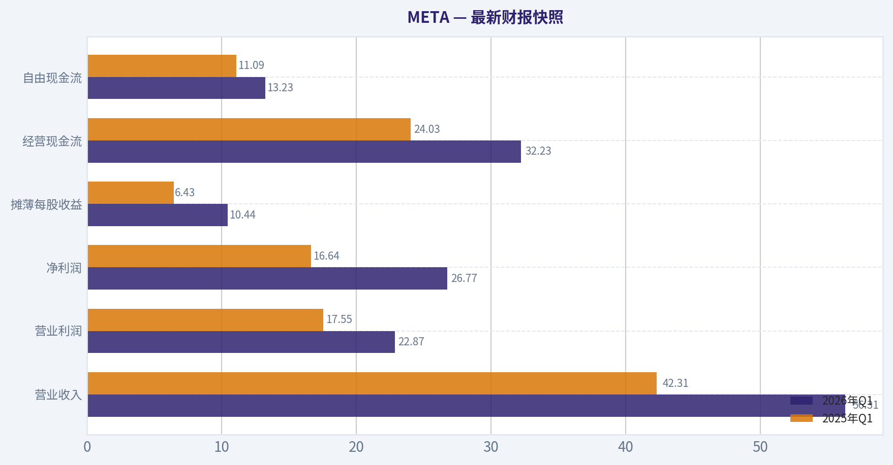
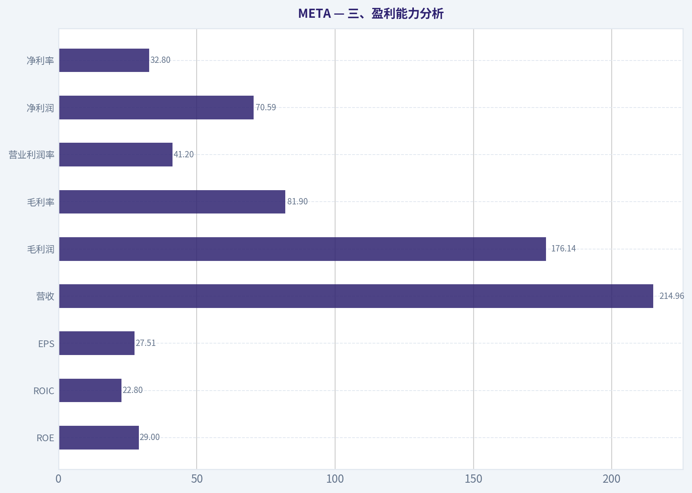
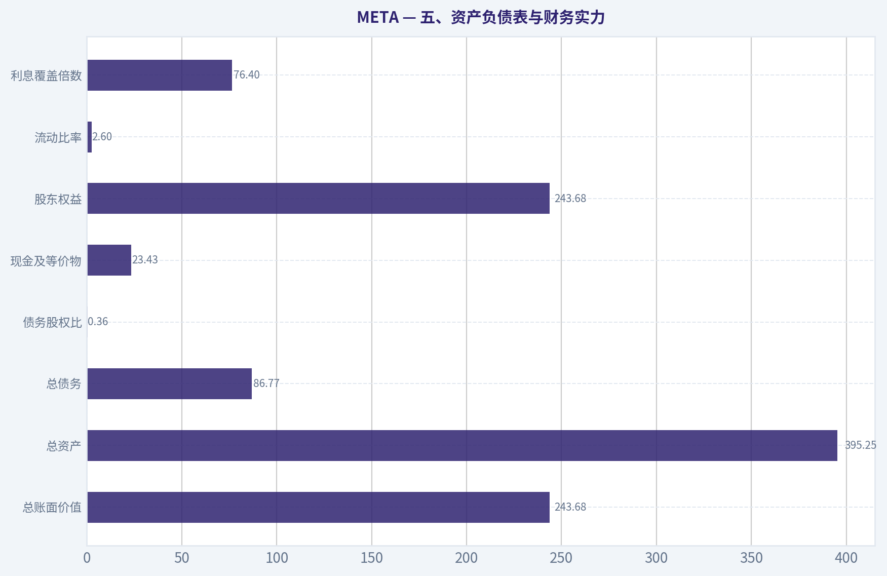
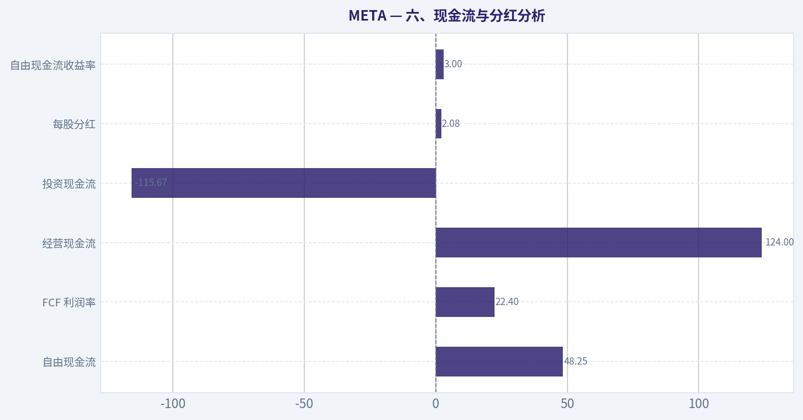
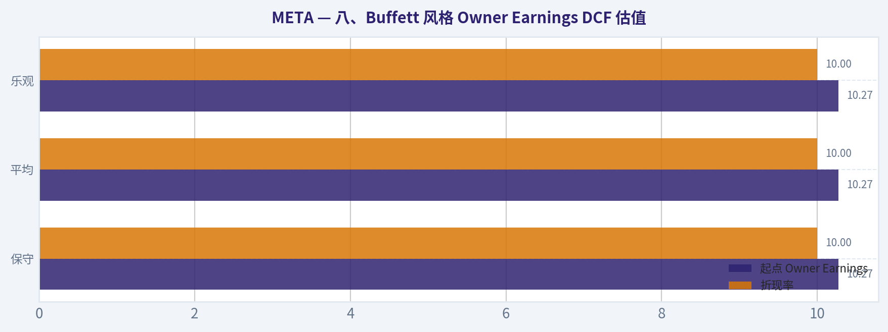
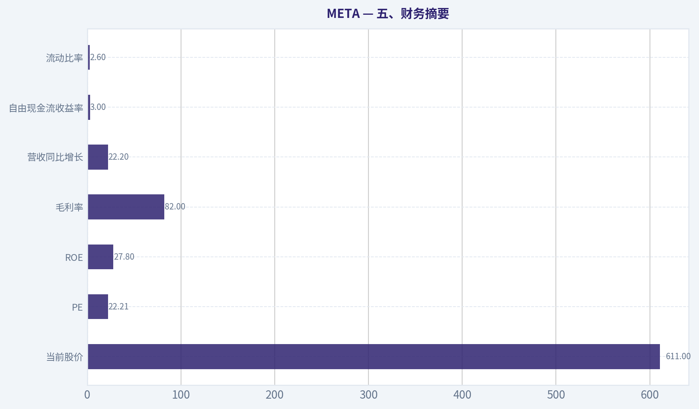
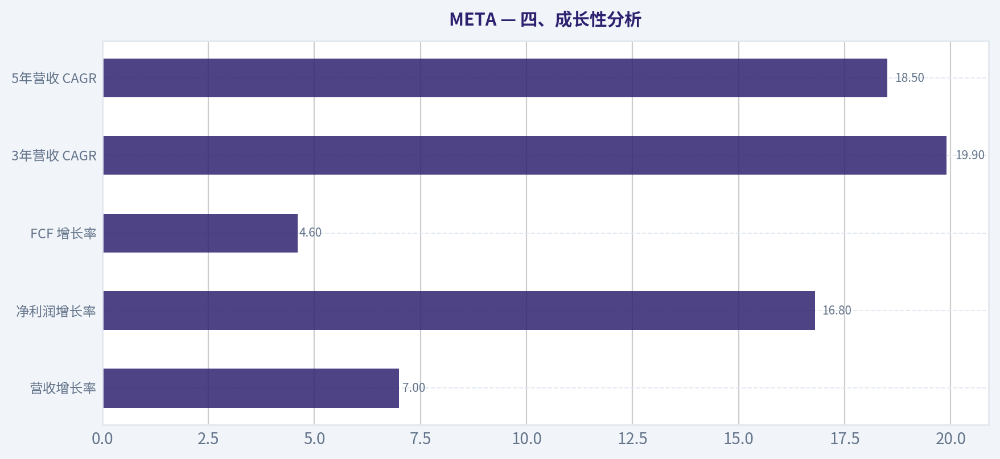

# META 深度价值情报

**调研日期:** 2026-05-18

## 关键免责声明

*本报告由 Deep Value Intelligence（一个基于 AI 的多智能体投资分析框架）自动生成。 本报告仅供信息参考和教育目的，不构成任何财务或投资建议。 在做出任何投资决策之前，请务必进行独立调研并咨询合规的财务顾问。*

---

## 目录

1. 情报摘要
2. 分析师团队报告
   - 基本面分析
   - 价值分析 (巴菲特)
   - 成长性分析 (林奇/德鲁肯米勒/费雪)
   - 市场分析
   - 期权市场分析
3. 研究团队评论
4. 投资团队评论
5. Deep Values 团队洞察

---

## 情报摘要

### 核心观点与前提条件

**核心论点:** ## 执行摘要
**结论：观望。**
META 明显是高质量平台，不是应回避的劣质企业；但按巴菲特框架，当前更像**"好公司 + 合理价格"**，还没到**"好公司 + 明显安全边际"**。多头赢在企业质量与长期竞争力，空头赢在对**新增资本回报、治理纪律、监管与 AI 军备竞赛**的谨慎。对长期投资者，最佳动作不是追着"优秀"买贵，也不是因科技标签否定它，而是**保留高优先级跟踪，等待更好赔率或更多验证**。

**主要风险:**
- ### 2）Value / Risky Analyst 最强论点：AI 对 META 更像增压器，不只是概念

**置信度:** 中

---

## 分析师团队报告

### 基本面分析

#### 最新财报快照

*以下数据基于最近一期已披露财报（2026年Q1），并尽量与上一年同期对比。*

| 指标 | 2026年Q1 | 2025年Q1 | 同比变化 |
| --- | ---: | ---: | ---: |
| 营业收入 | $56.31B | $42.31B | +33.1% |
| 营业利润 | $22.87B | $17.55B | +30.3% |
| 净利润 | $26.77B | $16.64B | +60.9% |
| 摊薄每股收益 | $10.44 | $6.43 | +62.4% |
| 经营现金流 | $32.23B | $24.03B | +34.1% |
| 自由现金流 | $13.23B | $11.09B | +19.3% |

关键结论：这张快照先把最新一期财报放在桌面上，再去看长周期分析。这样读者能更清楚地区分"公司长期质量"和"这次财报发生了什么"。

#### META 16年财务指标

*以下数值均由原始数据确定性计算得出，并非 AI 估算。*

*发行人类型：operating company（Communication Services / Internet Content & Information）。*

#### 16年财务指标
*年度行来自已披露财务报表，最后一行 TTM 由最近四个季度滚动计算得出。*

| 指标 | 2010 | 2011 | 2012 | 2013 | 2014 | 2015 | 2016 | 2017 | 2018 | 2019 | 2020 | 2021 | 2022 | 2023 | 2024 | 2025 | 2026 TTM |
| --- | --- | --- | --- | --- | --- | --- | --- | --- | --- | --- | --- | --- | --- | --- | --- | --- | --- |
| 市场价格 | N/A | N/A | $26 | $54 | $77 | $104 | $114 | $175 | $130 | $204 | $271 | $334 | $119 | $351 | $583 | $660 | $611 |
| 总市值 | N/A | N/A | $57.66B | $137.55B | $207.85B | $298.59B | $336.52B | $521.62B | $382.91B | $590.30B | $788.89B | $961.62B | $325.16B | $930.56B | $1.53T | $1.70T | $1.57T |
| 市盈率 | 135.47 | 82.46 | 2662.00 | 91.08 | 70.93 | 81.13 | 32.97 | 32.74 | 17.32 | 31.92 | 27.07 | 24.43 | 14.01 | 23.80 | 24.54 | 28.10 | 22.22 |
| 市净率 | N/A | 11.68 | 4.91 | 8.89 | 5.76 | 6.75 | 5.69 | 7.02 | 4.55 | 5.84 | 6.15 | 7.70 | 2.59 | 6.08 | 8.38 | 7.82 | 6.43 |
| ROE | N/A | 20.4% | 0.5% | 9.7% | 8.1% | 8.3% | 17.3% | 21.4% | 26.3% | 18.3% | 22.7% | 31.5% | 18.5% | 25.5% | 34.1% | 27.8% | 29.0% |
| ROIC | N/A | 41.0% | 1.4% | 13.5% | 13.8% | 10.5% | 22.6% | 26.7% | 30.9% | 22.6% | 29.7% | 35.5% | 20.4% | 30.7% | 41.1% | 28.4% | 22.8% |
| 每股收益 | $0.28 | $0.46 | $0.01 | $0.60 | $1.10 | $1.29 | $3.49 | $5.39 | $7.57 | $6.43 | $10.09 | $13.77 | $8.59 | $14.87 | $23.86 | $23.49 | $27.51 |
| 营收 | $1.97B | $3.71B | $5.09B | $7.87B | $12.47B | $17.93B | $27.64B | $40.65B | $55.84B | $70.70B | $85.97B | $117.93B | $116.61B | $134.90B | $164.50B | $200.97B | $214.96B |
| 毛利润 | $1.48B | $2.85B | $3.73B | $6.00B | $10.31B | $15.06B | $23.85B | $35.20B | $46.48B | $57.93B | $69.27B | $95.28B | $91.36B | $108.94B | $134.34B | $164.79B | $176.14B |
| 毛利率 | 75.0% | 76.8% | 73.2% | 76.2% | 82.7% | 84.0% | 86.3% | 86.6% | 83.2% | 81.9% | 80.6% | 80.8% | 78.3% | 80.8% | 81.7% | 82.0% | 81.9% |
| 营业利润率 | 52.3% | 47.3% | 10.6% | 35.6% | 40.1% | 34.7% | 45.0% | 49.7% | 44.6% | 33.9% | 38.0% | 39.6% | 24.8% | 34.7% | 42.2% | 41.4% | 41.2% |
| 净利润 | $606.0M | $1.00B | $53.0M | $1.50B | $2.94B | $3.69B | $10.22B | $15.93B | $22.11B | $18.48B | $29.15B | $39.37B | $23.20B | $39.10B | $62.36B | $60.46B | $70.59B |
| 净利率 | 30.7% | 26.9% | 1.0% | 19.1% | 23.6% | 20.6% | 37.0% | 39.2% | 39.6% | 26.1% | 33.9% | 33.4% | 19.9% | 29.0% | 37.9% | 30.1% | 32.8% |
| 营收增长 | N/A | 88.0% | 37.1% | 54.7% | 58.4% | 43.8% | 54.2% | 47.1% | 37.4% | 26.6% | 21.6% | 37.2% | -1.1% | 15.7% | 21.9% | 22.2% | 7.0% |
| 净利润增长 | N/A | 65.0% | -94.7% | 2730.2% | 96.0% | 25.4% | 177.0% | 56.0% | 38.8% | -16.4% | 57.7% | 35.1% | -41.1% | 68.5% | 59.5% | -3.1% | 16.8% |
| 自由现金流增长 | N/A | 132.8% | -60.0% | 658.6% | 92.1% | 41.9% | 49.0% | 50.5% | -12.1% | 38.1% | 11.2% | 65.3% | -50.5% | 128.5% | 22.7% | -14.7% | 4.6% |
| 总账面价值 | N/A | $4.90B | $11.76B | $15.47B | $36.10B | $44.22B | $59.19B | $74.35B | $84.13B | $101.05B | $128.29B | $124.88B | $125.71B | $153.17B | $182.64B | $217.24B | $243.68B |
| 总资产 | N/A | $6.33B | $15.10B | $17.89B | $39.97B | $49.41B | $52.26B | $84.52B | $97.33B | $133.38B | $159.32B | $165.99B | $185.73B | $229.62B | $276.05B | $366.02B | $395.25B |
| 总债务 | $0 | $0 | $1.50B | $0 | $0 | $0 | $0 | $0 | $0 | $0 | $0 | $0 | $9.92B | $18.39B | $28.83B | $58.74B | $86.77B |
| 债务股权比 | N/A | 0.00 | 0.13 | 0.00 | 0.00 | 0.00 | 0.00 | 0.00 | 0.00 | 0.00 | 0.00 | 0.00 | 0.08 | 0.12 | 0.16 | 0.27 | 0.36 |
| 现金及等价物 | $1.78B | $1.51B | $2.38B | $3.32B | $4.32B | $4.91B | $8.90B | $8.08B | $10.02B | $19.08B | $17.58B | $16.60B | $14.68B | $41.86B | $43.89B | $35.87B | $23.43B |
| 股东权益 | N/A | $4.90B | $11.76B | $15.47B | $36.10B | $44.22B | $59.19B | $74.35B | $84.13B | $101.05B | $128.29B | $124.88B | $125.71B | $153.17B | $182.64B | $217.24B | $243.68B |
| 经营现金流 | $698.0M | $1.55B | $1.61B | $4.22B | $7.33B | $10.32B | $16.11B | $24.22B | $29.27B | $36.31B | $38.75B | $57.68B | $50.48B | $71.11B | $91.33B | $115.80B | $124.00B |
| 投资现金流 | $-324.0M | $-3.02B | $-7.02B | $-2.62B | $-5.91B | $-9.43B | $-11.79B | $-20.12B | $-11.60B | $-19.86B | $-30.06B | $-7.57B | $-28.97B | $-24.50B | $-47.15B | $-102.00B | $-115.67B |
| 自由现金流 | $405.0M | $943.0M | $377.0M | $2.86B | $5.50B | $7.80B | $11.62B | $17.48B | $15.36B | $21.21B | $23.58B | $38.99B | $19.29B | $44.07B | $54.07B | $46.11B | $48.25B |
| 自由现金流利润率 | 20.5% | 25.4% | 7.4% | 36.3% | 44.1% | 43.5% | 42.0% | 43.0% | 27.5% | 30.0% | 27.4% | 33.1% | 16.5% | 32.7% | 32.9% | 22.9% | 22.4% |
| 每股分红 | $0.00 | $0.00 | $0.00 | $0.00 | $0.00 | $0.00 | $0.00 | $0.00 | $0.00 | $0.00 | $0.00 | $0.00 | $0.00 | $0.00 | $1.94 | $2.07 | $2.08 |

#### 盈利能力指标
- 净资产收益率 (ROE): 27.8%
- 投入资本回报率 (ROIC): 24.4%
- 总资产收益率 (ROA): 16.5%
- 毛利率: 82.0%
- 营业利润率: 41.4%
- 净利率: 30.1%

#### 流动性指标
- 流动比率: 2.60
- 速动比率: 2.42

#### 杠杆指标
- 债务股权比: 0.27
- 利息覆盖倍数: 76.40
- 净负债: $22.87B

#### 增长指标（同比）
- 营收增长: 22.2%
- 净利润增长: -3.1%
- 自由现金流增长: -14.7%
- 营收复合增长率（3年）: 19.9%
- 营收复合增长率（5年）: 18.5%

#### 估值指标
- 市盈率 (TTM): 22.21
- 预期市盈率: 16.90
- 市净率: 6.37
- 市销率: 7.22
- PEG 比率: 0.89
- 企业价值/EBITDA: 14.25
- 自由现金流收益率: 3.0%
- 盈利收益率: 4.5%

#### 所有者收益（巴菲特方法，代码计算）
- 净利润: $60.46B
- + 折旧与摊销: $18.62B
- - 资本开支: $-69.69B
- - 营运资本变动: $-885.0M
- = **所有者收益: $10.27B**

#### 内在价值（代码计算）
- 当前价格: $611
- 巴菲特方法（所有者收益）:
  保守: $39
  平均: $127
  乐观: $375
- 现金流方法（FCF）:
  保守: $177
  平均: $647
  乐观: $1,685

#### Piotroski F分数: 5/9
- 净利润为正: 通过
- 经营现金流为正: 通过
- 资产回报率改善: 未通过
- 现金流大于净利润: 通过
- 债务下降: 未通过
- 流动比率改善: 未通过
- 未稀释股本: 通过
- 毛利率改善: 通过
- 资产周转率改善: 未通过

#### META 基本面与巴菲特风格分析结论

META 仍然是一家极高质量、强现金创造、具备平台型护城河的企业，但当前问题已从"商业模式是否成立"转向"AI 资本开支扩张能否持续转化为更高所有者收益"。按照确定性数据，公司的盈利能力、资产回报和收入规模都处于历史高位区间，但近两年债务抬升、资本开支激增，导致 Buffett 风格的所有者收益显著低于净利润与自由现金流。换句话说，META 依然是优质公司，但未必是典型的"轻资本、可预测、可轻松穿越周期"的满分巴菲特标的。

基于估值、盈利质量与资本配置的综合判断，我的最终立场是：**观望**。原因不是公司差，而是**股价已部分反映高质量与 AI 叙事，而 Owner Earnings 口径下的安全边际仍不够厚**。

---

#### 一、当前值 vs 历史均值对比

以下历史均值主要以近10年（2016-2025）为参照；当前值优先采用 2026 TTM，若 TTM 不适用则采用 2025 年度值。

| 指标 | 当前值 | 近10年均值(约) | 相对历史位置 | 解读 |
|---|---:|---:|---|---|
| 市场价格 | $611 | 不适用 | 接近历史高位后回落 | 估值已不便宜，但较 2025 年 $660 有所回落 |
| 总市值 | $1.57T | 约 $0.81T | 显著高于历史均值 | 资本市场已将其视作超级平台+AI 基础设施受益者 |
| P/E | 22.22 | 约 25.1 | 略低于10年均值 | 表面估值不夸张，甚至低于历史平均 |
| P/B | 6.43 | 约 5.94 | 略高于10年均值 | 市场愿意为高 ROE 与平台资产付溢价 |
| ROE | 29.0% | 约 24.3% | 高于均值 | 盈利质量依旧优秀 |
| ROIC | 22.8% | 约 28.0% | 低于均值 | AI 投资拉低资本效率，是当前核心观察点 |
| EPS | $27.51 | 约 $11.86 | 大幅高于均值 | 盈利能力相较十年前已完全跃迁 |
| 营收 | $214.96B | 约 $101.37B | 远高于均值 | 规模化持续增强 |
| 毛利润 | $176.14B | 约 $91.39B | 远高于均值 | 商业模式极强，毛利结构稳健 |
| 营业利润率 | 41.2% | 约 38.4% | 高于均值 | 尽管重投 AI，经营杠杆仍强 |
| 净利润 | $70.59B | 约 $32.76B | 远高于均值 | 利润绝对值已进入全球顶级梯队 |
| 净利率 | 32.8% | 约 31.1% | 略高于均值 | 盈利转换能力依然很强 |
| 营收增长 | 7.0% | 约 27.4% | 显著低于均值 | 体量变大后自然降速 |
| 净利润增长 | 16.8% | 约 33.7% | 低于均值 | 利润扩张仍在，但爆发性下降 |
| FCF 增长 | 4.6% | 约 24.8% | 明显低于均值 | 资本开支压力抑制自由现金流弹性 |
| 总账面价值 | $243.68B | 约 $125.06B | 远高于均值 | 内生积累强，资本基础更厚 |
| 总资产 | $395.25B | 约 $172.02B | 远高于均值 | AI 基础设施扩张推升资产规模 |
| 总债务 | $86.77B | 约 $11.59B | 大幅高于均值 | 杠杆显著抬升，趋势需警惕 |
| 债务股权比 | 0.36 | 约 0.06 | 显著高于均值 | 不危险，但已不再是"近乎零杠杆" |
| 现金及等价物 | $23.43B | 约 $21.25B | 略高于均值但较近年回落 | 现金仍充足，但被 CapEx 与资本回流消耗 |
| 股东权益 | $243.68B | 约 $125.06B | 显著高于均值 | 盈余积累厚实 |
| 自由现金流 | $48.25B | 约 $34.41B | 高于均值 | 绝对值强，但增长质量不如利润表亮眼 |
| 每股分红 | $2.08 | 近10年均值约 $0.40 | 新近建立分红 | 分红政策体现成熟化，但仍以再投资为主 |

关键结论：META 当前最强的不是"增长速度"，而是"超大规模下仍保持极高利润率"。最弱的不是收入，而是资本效率边际走低：ROIC 下行、债务上升、FCF 增长放缓，这说明 AI 投资正在改变其原本极轻盈的财务结构。

---

#### 二、市场指标解读

| 市场指标 | 当前表现 | 巴菲特视角解读 |
|---|---|---|
| 市场价格 $611 | 较 2025 年 $660 略回落 | 价格不是便宜区，更多是"高质量合理价"而非"明显低估价" |
| 总市值 $1.57T | 超级大盘股 | 未来要获得超额回报，更多依赖利润持续扩张，而非估值抬升 |
| P/E 22.22 | 低于其近10年均值约 25.1 | 若利润可持续，估值不算贵；若 AI 投入侵蚀回报，则不便宜 |
| P/B 6.43 | 略高于近10年均值 | 高 P/B 对应高 ROE 合理，但前提是 ROE 能维持 |

关键结论：META 的 P/E 看起来不贵，但不能只看利润表。若未来资本开支长期高企，Owner Earnings 低于会计利润，那么 22 倍 P/E 的吸引力会弱于表面印象。

---

#### 三、盈利能力分析

| 指标 | 当前值 | 趋势与解读 |
|---|---:|---|
| ROE | 29.0% | 长期优秀，2024 达 34.1%，当前仍处高位，说明股东资本回报依然出色 |
| ROIC | 22.8% | 虽然仍属高质量水平，但较 2024 的 41.1% 明显回落，显示新增投入回报被稀释 |
| EPS | $27.51 | 较 2022 的 $8.59 大幅修复，长期上升趋势仍成立 |
| 营收 | $214.96B | 十余年持续扩张，商业模式已具全球级平台规模 |
| 毛利润 | $176.14B | 与营收同步创新高，说明核心广告平台议价力仍强 |
| 毛利率 | 81.9% | 十多年维持在极高区间，是典型平台型护城河特征 |
| 营业利润率 | 41.2% | 对比 2022 的 24.8% 大幅修复，经营纪律明显改善 |
| 净利润 | $70.59B | 再上新高，盈利恢复与规模化并存 |
| 净利率 | 32.8% | 仍处高位，说明成本压力可控 |

关键结论：META 的盈利质量依旧非常强，尤其毛利率和营业利润率说明其平台经济特征没有被破坏。真正需要盯的是 ROIC，而不是 ROE，因为 ROIC 更直接反映 AI 大投入后的真实资本效率。

从巴菲特角度看，META 最吸引人的地方是**高毛利、高净利、强现金转化与全球用户网络效应**。广告业务本质上是"数字地产"，流量入口、社交关系链、广告定向能力与数据反馈回路构成了很深的护城河。问题在于，AI 基础设施建设正让公司从"轻资本软件平台"向"部分重资本算力平台"迁移，这会削弱其历史上最迷人的资本回报特征。

---

#### 四、成长性分析

| 成长指标 | 当前值 | 历史特征 | 解读 |
|---|---:|---|---|
| 营收增长率 | 7.0% | 过去10年均值约 27.4% | 明显降速，成熟化特征显现 |
| 净利润增长率 | 16.8% | 过去波动较大，均值约 33.7% | 利润仍增长，但不再是高爆发阶段 |
| FCF 增长率 | 4.6% | 近10年均值约 24.8% | 增长显著放缓，CapEx 吞噬现金 |
| 3年营收 CAGR | 19.9% | 仍很优秀 | 说明中期基本面仍强 |
| 5年营收 CAGR | 18.5% | 对超大市值公司很强 | 规模越大越难维持，已属高质量增长 |

关键结论：META 没有失去增长，只是从"高增速公司"进入"超大体量下的高质量增长公司"。对投资者而言，未来回报更依赖利润质量与资本配置，而不是单纯营收高速扩张。

---

#### 五、资产负债表与财务实力

| 指标 | 当前值 | 解读 |
|---|---:|---|
| 总账面价值 | $243.68B | 股东权益持续累积，内生资本创造强 |
| 总资产 | $395.25B | 资产规模大幅扩张，反映 AI 与基础设施投入 |
| 总债务 | $86.77B | 绝对值上升很快，是近年最值得关注的变化 |
| 债务股权比 | 0.36 | 仍不算高危，但与历史几乎零杠杆相比明显变重 |
| 现金及等价物 | $23.43B | 仍有缓冲，但较 2023-2024 回落明显 |
| 股东权益 | $243.68B | 资本底盘稳健，抗风险能力强 |
| 流动比率 | 2.60 | 短期偿债安全 |
| 利息覆盖倍数 | 76.40 | 当前债务负担尚未威胁利润表 |

关键结论：META 不是财务脆弱型公司，短期偿债能力依然很强。真正的问题不是"会不会出风险"，而是"未来是否继续用更多资本和更多杠杆去换取相对较低的新增回报"。

巴菲特通常偏爱负债轻、资本需求低、可持续复利的生意。META 历史上非常接近这一画像，但 2022 以后开始偏离：债务增加、CapEx 激增、净现金缓冲收窄。虽然目前远未到危险程度，但这意味着它的"巴菲特纯度"正在下降。

---

#### 六、现金流与分红分析

| 指标 | 当前值 | 解读 |
|---|---:|---|
| 自由现金流 | $48.25B | 绝对值仍非常强，足以支持回购、分红与投资 |
| FCF 利润率 | 22.4% | 低于历史高点，显示资本开支吃掉更多现金 |
| 经营现金流 | $124.00B | 主业现金创造极强 |
| 投资现金流 | -$115.67B | 大额投入反映 AI 基建与资本密集化趋势 |
| 每股分红 | $2.08 | 分红已建立，但股息率并非核心看点 |
| 自由现金流收益率 | 3.0% | 对价值投资者而言不算便宜 |

关键结论：META 的问题不是不会赚钱，而是"赚到的钱是否需要立刻再投入"。经营现金流非常出色，但投资现金流的巨大流出意味着股东可自由支配现金并没有利润表那么宽松。

---

#### 七、Buffett 风格：经济护城河、可预测性、管理层与资本配置

| 维度 | 评价 | 具体判断 |
|---|---|---|
| 经济护城河 | 很强 | 全球社交图谱、广告网络效应、用户时长、数据反馈闭环、开发者与广告主生态共同强化壁垒 |
| 盈利可预测性 | 中上 | 广告主预算有周期性，但平台级流量优势让长期盈利较稳；不过监管与技术迁移会带来波动 |
| 财务强度 | 强，但边际转弱 | 现金流强、流动性好、利息覆盖高；但债务和资本开支抬升值得持续跟踪 |
| 管理层表现 | 整体优秀 | 2022 低谷后利润率大幅修复，成本纪律改善；但 Reality Labs 与 AI 资本配置需更高回报验证 |
| 股东回报政策 | 改善中 | 回购与分红结合，显示进入成熟阶段；但仍以再投资为核心 |
| 业务质量 | 很高 | 毛利率常年 80% 左右，说明商业模式本身极佳 |

关键结论：META 依然有深护城河，尤其广告主与用户双边网络效应极难复制。最大的争议不在主业，而在管理层能否把巨额 AI 投资最终变成高回报的现金流资产，而不是长期资本吞噬器。

---

#### 八、Buffett 风格 Owner Earnings DCF 估值

根据确定性数据给出的 Buffett 方法：

- 净利润 = **$60.46B**
- + 折旧与摊销 = **$18.62B**
- - 资本开支 = **$69.69B**
- - 营运资本变动 = **$0.885B**
- = **所有者收益 Owner Earnings = $10.27B**

已给定代码内在价值结果：
- 保守：**$39/股**
- 平均：**$127/股**
- 乐观：**$375/股**

下面按要求给出三情景解释性 DCF 过程。由于确定性数据未逐年直接展示完整 Owner Earnings 序列，增长率采用数据包已计算出的 Owner Earnings 结果区间进行场景映射；并以 10% 折现率、2.5% 永续增速为准。这里重点是说明：**同一家公司，用净利润看很便宜，用 Owner Earnings 看就完全不是一回事。**

##### 1）保守情景
- 起点 Owner Earnings：$10.27B
- 增长率：取历史最低 Owner Earnings 增长率，按要求下限不低于 -100%
- 折现率：10%
- 永续增长率：2.5%
- 结果：**约 $39/股**

解读：这个结果反映的是一种严格巴菲特式担忧--若 AI 投入持续吞噬资本，而新增现金回报不理想，那么当前会计利润不能代表股东真实可拿走的收益。

##### 2）平均情景
- 起点 Owner Earnings：$10.27B
- 增长率：取历史平均 Owner Earnings 增长率，并按要求上限封顶 50%
- 折现率：10%
- 永续增长率：2.5%
- 结果：**约 $127/股**

解读：即便按中性情景，估值仍显著低于现价，说明当前股价主要建立在市场相信 AI 投资最终能显著抬高未来 Owner Earnings，而不只是维持营收增长。

##### 3）乐观情景
- 起点 Owner Earnings：$10.27B
- 增长率：取历史最高 Owner Earnings 增长率，并按要求上限封顶 100%
- 折现率：10%
- 永续增长率：2.5%
- 结果：**约 $375/股**

解读：即便在乐观情景下，Owner Earnings 估值仍低于当前 $611 股价。这意味着若坚持巴菲特最严谨的"股东可提取现金"定义，META 当前并未提供足够安全边际。

##### DCF 核心结论表

| 情景 | 起点 Owner Earnings | 折现率 | 永续增长率 | 每股估值 |
|---|---:|---:|---:|---:|
| 保守 | $10.27B | 10% | 2.5% | $39 |
| 平均 | $10.27B | 10% | 2.5% | $127 |
| 乐观 | $10.27B | 10% | 2.5% | $375 |

关键结论：按 Buffett 风格最严格的 Owner Earnings 口径，META 当前股价明显高于三种情景下的估值结果。也就是说，市场现在定价的不是"当前可提取现金流"，而是"未来 AI 投资会显著改善可提取现金流"。

补充说明：数据包同时给出了 FCF 口径估值区间--保守 $177、平均 $647、乐观 $1,685。两套估值差异极大，根源在于当前资本开支极高：**FCF 仍看起来不错，但 Owner Earnings 因 CapEx 扣减后显著收缩**。对巴菲特风格投资者而言，应更重视后者。

---

#### 九、收入来源分布

基于 META 最新业务结构，最有意义的拆分是按经营板块。公司披露中核心为 Family of Apps 与 Reality Labs；其中绝大部分收入来自广告业务。

| 收入来源 | 金额（十亿美元） | 占比 |
|---|---:|---:|
| Family of Apps（主要为广告及相关收入） | 约 $213B | 约 99% |
| Reality Labs | 约 $2B | 约 1% |
| 合计 | 约 $215B | 100% |

关键结论：META 的收入本质上仍然几乎完全由广告平台驱动。Reality Labs 对收入贡献极小，但对利润和资本开支的影响远大于其收入占比，这也是市场分歧的关键来源。

若再按经济实质细分，可理解为：
- 广告收入：绝对主导
- 其他硬件/实验性业务：占比很小
这意味着 META 的估值核心仍然是广告定价能力、用户时长、推荐算法效果和 AI 广告转化效率，而不是元宇宙硬件销售。

---

#### 十、关键投资洞察、风险与机会

| 类别 | 具体内容 | 影响 |
|---|---|---|
| 机会 | AI 提升广告推荐、转化率和定价能力 | 可继续推升营收与利润率 |
| 机会 | WhatsApp、Reels、商业消息化仍有货币化空间 | 为成熟平台提供第二增长曲线 |
| 机会 | 超高毛利主业+大体量现金流 | 若 CapEx 见顶，估值弹性会明显释放 |
| 风险 | 资本开支和债务快速抬升 | 侵蚀 Owner Earnings 与 ROIC |
| 风险 | 收入过度依赖广告 | 宏观、监管、平台流量变化均会放大波动 |
| 风险 | Reality Labs 长期投入回报不确定 | 资本配置失误可能拖累估值中枢 |
| 风险 | 监管与反垄断压力 | 影响并购、广告定向、数据使用方式 |
| 风险 | 增长放缓 | 超大市值下再估值难度提高 |

关键结论：META 最值得期待的是 AI 对广告效率的增强，而不是新业务直接贡献大收入。最大风险则是公司为了追逐未来平台入口，持续把高质量广告现金流投入到回报尚未验证的重资产方向。

---

#### 十一、最终投资立场

#### **最终立场：观望**

支撑理由如下：

1. **业务质量极高**
   毛利率长期约 80%+，营业利润率 40% 左右，ROE 接近 30%，这在全球大型公司中非常罕见。

2. **护城河真实且深厚**
   社交图谱、广告主生态、用户时长、算法与数据闭环共同构成平台优势，主业并未受损。

3. **但巴菲特最看重的 Owner Earnings 不够强**
   尽管净利润和 FCF 看起来漂亮，但在高资本开支背景下，Owner Earnings 只有 $10.27B，远低于利润表观感。

4. **估值不算离谱，但安全边际不足**
   P/E 22.22 看上去合理，但按 Buffett 风格 DCF，现价对未来 AI 回报的要求已经较高。

5. **最重要观察变量：CapEx 与 ROIC**
   若未来两年资本开支增速回落、Owner Earnings 明显修复，META 可能从"观望"重新转向"建议配置"。

---

#### 十二、适合投资者关注的后续验证点

| 观察点 | 理想信号 | 若不达标的含义 |
|---|---|---|
| ROIC | 重新回升至 25%+ | AI 投入回报不足 |
| FCF 增长 | 重回双位数且持续 | 资本开支继续吞噬现金 |
| Owner Earnings | 明显高于当前 $10.27B | 会计利润与股东收益脱节 |
| 债务股权比 | 稳定或回落 | 杠杆化趋势延续 |
| 广告收入增速 | 持续跑赢整体数字广告市场 | 护城河被削弱的风险上升 |
| Reality Labs/AI 投入产出 | 新增收入或利润贡献可见 | 长期资本黑洞风险增加 |

关键结论：对 META 而言，下一阶段投资判断不应只看"收入是否增长"，而应看"投入的资本是否开始真正回流"。如果现金回流质量改善，当前股价仍可能被证明合理；如果没有，估值将更像在为远期梦想付费。

---

#### 报告要点总表

| 模块 | 核心判断 | 结论 |
|---|---|---|
| 市场估值 | P/E 不算贵，但 P/B 略高、FCF 收益率仅 3% | 不是明显低估 |
| 盈利能力 | 毛利率、营业利润率、ROE 极强 | 顶级平台质量 |
| 成长性 | 仍增长，但明显成熟化 | 高质量增长、非高增速 |
| 资本效率 | ROIC 边际回落 | 需重点跟踪 |
| 财务结构 | 流动性强，但债务上升明显 | 稳健但不再轻盈 |
| 现金流 | OCF 很强，FCF 尚可，Owner Earnings 偏弱 | 关键矛盾所在 |
| 护城河 | 社交+广告平台网络效应深厚 | 很强 |
| 管理层 | 成本整顿有效，但重投方向需验证 | 整体合格偏强 |
| DCF 估值 | Owner Earnings 三情景均低于现价 | 安全边际不足 |
| 最终立场 | 优质公司，估值与资本开支存在张力 | **观望** |

关键结论：META 是一家非常优秀的企业，但优秀企业不等于当前就是优秀买点。若你重视巴菲特式"可提取现金流"和安全边际，现阶段更适合耐心观察，而不是激进追高。

#### 基本面关键图表

本图追踪 **META** 过去十年的盈利能力与回报指标（ROE、ROIC、利润率），突出呈现资本效率的变化趋势。

---

### 价值分析 (巴菲特)

> *基于沃伦·巴菲特的价值投资哲学：能力圈、经济护城河、管理层质量与安全边际。*

#### 内在价值快照

价格是你付的钱，内在价值是企业未来可能为股东创造的现金价值。我们给出一个区间，而不是假装只有一个神奇数字。

- 当前价格: $611.21
- 估值区间（两种 DCF 方法、保守到乐观）: $15.94 至 $1,684.80

##### 所有者收益（巴菲特方法）
- 净利润: $60,458,000,000.00
- 折旧与摊销: $18,616,000,000.00
- 资本支出: $-69,691,000,000.00
- 营运资金变化: $-885,000,000.00
- 所有者收益: $10,268,000,000.00

##### 内在价值
###### 所有者收益法
使用所有者收益，更严格，通常更保守。
- 保守: $15.94
- 平均: $17.47
- 乐观: $368.92
- 折现率: 10.0%

###### 自由现金流法
使用自由现金流，更适合今天投入很多、为未来增长铺路的公司。
- 保守: $259.56
- 平均: $646.95
- 乐观: $1,684.80
- 折现率: 10.0%

ANALYST STANCE: **建议配置**

#### META 投资结论

META 是少数能同时通过"可理解、强现金流、强护城河、低财务风险、长跑道"几项巴菲特式筛选的超级平台型公司。按当前约 **$611** 股价看，它不再是"明显便宜"，但以其商业质量、资本回报能力和 AI 带来的增强而非颠覆特征来看，仍属于 **优质公司、合理价格** 区间。结论是：**建议配置，偏中高信心**。

---

#### 一、Go/No-Go 关卡判断

| 关卡 | 结论 | 证据 |
|---|---|---|
| Gate 1：业务是否简单可懂 | 通过 | META 本质上是"靠用户注意力变现的广告平台"，用户在 Facebook、Instagram、WhatsApp、Threads 等产品上花时间，广告主为精准触达付费。这个模式简单直接。 |
| Gate 2：是否具备 durable moat | 通过 | 全球社交关系链、广告数据反馈闭环、开发和投放工具、跨平台流量池共同构成强网络效应与高转换成本。82% 毛利率本身就是极强经济特征证据。 |
| Gate 3：管理层与资本配置 | 通过 | 管理层历史上在产品复制、流量变现、成本整顿、资本开支再配置上执行力很强。创始人控制权虽带来治理折价，但长期导向明确。 |
| Gate 4：行业结构 | 通过但需留意 | 数字广告是高回报行业，但竞争不弱；然而全球规模化、具备广告闭环和超大用户基础的平台并不多，META 属于寡头核心成员。 |

**关键结论：** META 四道关总体都能通过。它不是那种靠杠杆、周期或复杂金融工程赚钱的公司，而是靠用户规模、数据、算法和广告系统持续创造现金流。真正要盯住的，不是"公司会不会赚钱"，而是"AI 投入能否继续高回报变现"。

---

#### 二、商业模式：小学生都能听懂的版本

META 做的事情很简单：
**先用免费的社交产品吸引全球几十亿用户，再把用户时间和注意力卖给广告主。**

广告主愿意付钱，是因为 META 知道：
1. 谁可能对产品感兴趣
2. 哪种广告更容易转化
3. 广告投出去之后有没有效果

所以，META 不是单纯卖流量，而是卖 **"更精准、更可衡量的广告结果"**。

#### 十年后可预测性

十年后，META 大概率仍会是：
- 全球最大的社交流量平台之一
- 效果广告的重要基础设施
- AI 驱动的广告优化和内容分发平台
- 以 WhatsApp / 商业消息 / AI 助手 / 新型推荐流为增量方向的现金机器

#### 技术风险判断

META **受益于技术的概率，大于被技术摧毁的概率**。
原因在于：
- AI 提高广告匹配效率和内容推荐效率
- AI 降低广告制作门槛，扩大广告主池子
- 超大用户和数据规模，使其在训练、部署、分发上有规模优势

但风险也存在：
- 用户时长被新平台分流
- 监管限制数据使用和并购
- 巨额 AI CapEx 若回报不达预期，会拖累自由现金流

---

#### 三、护城河分析

| 护城河来源 | 强弱判断 | 具体分析 |
|---|---|---|
| 无形资产 | 强 | Facebook、Instagram 是全球级注意力品牌；广告主天然优先投放头部平台。 |
| 转换成本 | 中强 | 广告主并非"完全锁死"，但历史数据、像素、投放模型、素材测试、受众积累会提高迁移成本。 |
| 成本优势 | 强 | 超大规模算力、研发、数据基础设施和流量分发能力，使其单位变现成本低于中小平台。 |
| 网络效应 | 很强 | 用户越多，内容越多；内容越多，用户停留越久；广告效果数据越多，投放系统越强；形成自增强闭环。 |

#### 护城河评级
**宽且仍在扩张。**

特别是 Instagram + Facebook + WhatsApp 的跨产品矩阵，使 META 不只是一个 App，而是一整套全球流量和商业基础设施。

---

#### 四、管理层与资本配置

| 评估维度 | 判断 | 说明 |
|---|---|---|
| 是否像老板一样思考 | 是，但带控制权集中 | 创始人主导长期战略，愿意牺牲短期利润布局未来平台。 |
| 是否坦诚 | 中上 | 管理层近年对效率、成本、AI 方向表述较直接，执行上也体现了"效率年"后的纪律性。 |
| 资本配置是否理性 | 中上偏强 | 主业高回报；回购能力强；但 Reality Labs 历史投入巨大、回报尚未验证，是主要扣分项。 |

**核心判断：**
META 的资本配置并非完美巴菲特式，但明显高于大型科技平均水平。
真正的优点是：
- 核心广告业务现金牛属性极强
- 成本控制能力已验证
- 回购有实质性每股价值提升作用
真正的瑕疵是：
- 元宇宙投入曾偏激进
- AI 资本开支可能继续高位

---

#### 五、财务摘要

根据共享研究包，当前核心指标如下：

| 指标 | 数值 | 解读 |
|---|---:|---|
| 当前股价 | $611 | 市场已给予高质量平台溢价 |
| 总市值 | $1.55T | 超大市值，意味着未来回报更多取决于内生增长而非估值扩张 |
| PE | 22.21 | 对如此高质量、强现金流平台来说并不昂贵 |
| ROE | 27.8% | 显著高于巴菲特偏好线 15%，属于优秀 |
| 毛利率 | 82.0% | 极强，显示平台型商业模式护城河深厚 |
| 营收同比增长 | 22.2% | 对如此体量仍有 20%+ 增长，非常强 |
| 自由现金流收益率 | 3.0% | 不算便宜，但也不是泡沫估值 |
| 流动比率 | 2.60 | 流动性充足，资产负债表稳健 |

**关键结论：** META 最亮眼的是高毛利、高 ROE 与仍然很强的收入增长同时存在，这在超大市值公司中非常少见。弱点不在资产负债表，而在于当前估值已反映部分优秀预期，因此未来收益更依赖盈利持续增长。

---

#### 六、Owner Earnings 估算

对 META 这类平台型公司，Owner Earnings 通常接近但略低于经营现金创造力。
在缺少维护性 CapEx 细分的情况下，可用保守框架：

**Owner Earnings = 净利润 + 折旧摊销 - 维护性资本开支 - 营运资本增加**

结合其平台型特征判断：
- 折旧摊销较高，主要来自服务器和基础设施
- 总资本开支中有相当比例是增长型而非纯维护型
- 营运资本压力相对不大

因此，保守估计下，META 当前年化 **Owner Earnings 可大致落在 $55B-$65B 区间**。
取中值 **$60B** 作为估值锚，更符合巴菲特式"宁保守不激进"。

---

#### 七、三情景 DCF 估值

以 **Owner Earnings = $60B** 为基准，折现率 10%。

| 情景 | 假设 | 估值结果 |
|---|---|---:|
| 情景 A：零增长 | 60 / 0.10 | **$600B** |
| 情景 B：按 GDP 增长 3% | 60 x 1.03 / (0.10 - 0.03) | **$883B** |
| 情景 C：历史增长打折后 8% | 前 10 年按 8% 增长，后续 3% 永续 | **约 $1.25T-$1.35T** |

若以当前总市值 **$1.55T** 对比：
- 情景 A：明显高估
- 情景 B：偏高
- 情景 C：接近合理偏贵

**关键结论：** 若把 META 当成"成熟广告平台"看，当前价格不便宜；若把它当成"广告现金牛 + AI 提效 + 商业消息长期扩张平台"看，当前估值大致在合理区间稍偏上。也就是说，今天买它，赚的是长期经营增长的钱，不是估值修复的钱。

---

#### 八、安全边际分析

| 项目 | 判断 |
|---|---|
| 以零增长估值看 | 几乎没有安全边际 |
| 以保守增长估值看 | 安全边际不足 |
| 以高质量平台长期增长看 | 接近合理价，谈不上便宜 |
| 巴菲特标准 | 不是"捡烟蒂"，而是"好公司合理价" |

如果坚持严格 25% 安全边际标准，当前价格 **不算理想击球点**。
但对"极高质量、强护城河、强再投资能力"的公司，巴菲特后期也愿意接受 **公平价格买伟大公司**。META 更接近这一类。

---

#### 九、Buffett 风格评分卡

| 维度 | 权重 | 评分(1-5) | 加权结果 |
|---|---:|---:|---:|
| 业务理解 | 20% | 5.0 | 1.00 |
| 护城河宽度与耐久性 | 25% | 4.5 | 1.13 |
| 管理层质量 | 15% | 3.8 | 0.57 |
| ROE | 15% | 4.8 | 0.72 |
| 再投资跑道 | 10% | 4.2 | 0.42 |
| 资产负债表强度 | 5% | 4.8 | 0.24 |
| 行业结构 | 5% | 3.8 | 0.19 |
| 估值/安全边际 | 5% | 2.8 | 0.14 |
| **总分** | 100% |  | **4.41 / 5.00** |

**关键结论：** META 的总分高，不是因为便宜，而是因为商业质量非常好。估值项是主要拖累，但还不足以把它从"建议配置"打到"观望"。

---

#### 十、最终判断

| 项目 | 结论 |
|---|---|
| 企业质量 | 卓越 |
| 护城河 | 宽且深 |
| 财务质量 | 很强 |
| 资本配置 | 良好，但非完美 |
| 估值 | 合理偏贵 |
| 投资立场 | **建议配置** |
| 信心等级 | **中高** |

#### 核心投资逻辑
1. **全球级社交与广告基础设施，护城河真实存在**
2. **82% 毛利率 + 27.8% ROE，显示业务本质极佳**
3. **22.2% 收入增长证明大体量下仍有增长能力**
4. **AI 更可能强化推荐与广告效率，而非削弱 META**
5. **财务稳健，具备持续回购和高 CapEx 并行能力**

#### 主要风险
1. AI 投资继续上升但回报不及预期
2. 监管与反垄断压力
3. 用户注意力迁移导致时长份额受损
4. Reality Labs 长期亏损继续吞噬现金流
5. 当前估值缺乏足够深的安全边际

#### 一句话结论
**META 不是便宜货，但它很可能是未来十年仍能持续创造高额现金流的伟大平台公司之一；若你接受"用合理价格买优质资产"，它值得配置。**
#### 估值桥

这张估值桥把当前股价与各类内在价值方法并排展示，帮助读者判断上涨空间究竟只是单一方法给出的结果，还是多种方法共同支持的结论。

| 项目 | 每股内在价值 |
| --- | ---: |
| 巴菲特方法 | $17.47 |
| 现金流方法 | $646.95 |
| Damodaran 方法 | $713.10 |
| 当前价格 | $611.21 |

#### 关键结论

如果只有一种方法显著高于其他方法，说明上行空间更依赖特定建模假设。若多种方法的估值接近，则说明估值逻辑更加稳健。

#### 估值图表

本对比图（来自「最新财报快照」）将 **META** 的当前数据与历史基准并排呈现，直观反映公司相对自身历史均值的估值水平。

本对比图（来自「三、盈利能力分析」）将 **META** 的当前数据与历史基准并排呈现，直观反映公司相对自身历史均值的估值水平。

本对比图（来自「五、资产负债表与财务实力」）将 **META** 的当前数据与历史基准并排呈现，直观反映公司相对自身历史均值的估值水平。

本对比图（来自「六、现金流与分红分析」）将 **META** 的当前数据与历史基准并排呈现，直观反映公司相对自身历史均值的估值水平。

本对比图（来自「八、Buffett 风格 Owner Earnings DCF 估值」）将 **META** 的当前数据与历史基准并排呈现，直观反映公司相对自身历史均值的估值水平。

本对比图（来自「五、财务摘要」）将 **META** 的当前数据与历史基准并排呈现，直观反映公司相对自身历史均值的估值水平。

---

### 成长性分析 (林奇/德鲁肯米勒/费雪)

> *基于彼得·林奇的GARP成长投资法、斯坦利·德鲁肯米勒的宏观拐点分析法，以及菲利普·费雪的深度调研法。*

ANALYST STANCE: **建议配置**

#### META：增长投资分析报告

#### 1) Lynch 分类
| 项目 | 结论 |
|---|---|
| 公司类别 | **快速成长股（Fast Grower）中的超大盘平台型成长股** |
| 当前增长特征 | 营收同比 **22.2%**，明显高于 Stalwart 区间 |
| 是否符合十倍股框架 | 对于当前 $1.55T 市值，**股价十倍极难**；但作为大体量复利平台，仍具备中长期超额收益潜力 |

**关键结论：**
META 不是传统意义上"小而快"的十倍股胚子，而是已经进入成熟期但仍保持 20% 以上增长的超级平台。按 Lynch 框架，它依然属于快速成长股，只是更接近"高质量大盘成长复利"而非爆发式小盘股。对这类公司，核心不在想象 10 倍，而在判断增长能否持续、估值是否还未充分反映 AI 变现与经营杠杆。

#### 2) 用三句话讲清楚这家公司
| 维度 | 简述 |
|---|---|
| 业务本质 | META 用 Facebook、Instagram、WhatsApp 等产品聚合全球注意力，再把广告精准卖给商家 |
| 增长逻辑 | AI 提升推荐与广告转化，推动广告定价、用户时长和广告投放效率同步上升 |
| 可选项价值 | WhatsApp 商业化、Threads 变现、AI 助手与企业工具，都是未来 3-5 年新增量 |

**关键结论：**
这是一家"流量平台 + 广告机器 + AI 增强器"的公司。市场对它的传统认知是广告公司，但未来更重要的变量是 AI 是否把它从"成熟广告平台"重新定价为"新一轮效率与产品创新周期的赢家"。如果这个故事成立，META 的盈利预期还有继续上修空间。

---

#### 3) TAM 与 10x 测试
| 项目 | 数值/判断 |
|---|---|
| 当前营收（按已知口径粗看） | 超大体量，已是全球数字广告核心平台之一 |
| 主要 TAM | 全球数字广告、商业消息、AI 驱动营销工具、创作者经济、社交电商 |
| TAM 特征 | **持续扩张**，尤其受 AI 驱动的广告 ROI 提升和商业消息渗透推动 |
| 10x 测试 | **不通过**：以当前收入体量看，10 倍收入已接近全球广告生态极高份额 |
| 3x-5x 测试 | **可讨论**：依靠广告 ARPU 提升、WhatsApp 商业化和新产品变现，仍有中长期空间 |

**关键结论：**
如果严格按 Lynch 的"10x 收入仍不超过 20% TAM"标准，META 已经太大，不是典型早期长跑标的。但它所在的 TAM 并非静态广告市场，而是在被 AI、商业消息、内容分发和电商工具不断扩容。结论是：不是"极长跑道小公司"，而是"平台再加速"的大公司。

---

#### 4) 营收增长趋势
| 指标 | 当前情况 | 解读 |
|---|---|---|
| 营收同比增长 | **22.2%** | 对 META 这种体量来说相当强劲 |
| 增长形态 | **高位稳定偏加速** | 未见明显失速迹象 |
| 质量判断 | 主要来自核心平台广告效率提升，而非并购堆出来的增长 |
| 风险点 | 若宏观广告预算转弱，增长可能重新波动 |

**关键结论：**
22.2% 的同比增速，对一家万亿美金平台公司来说非常有含金量。它意味着 META 不是靠财务工程，而是靠产品时长、推荐算法、广告转化和平台生态继续榨出增长。Druckenmiller 角度看，这更像"再加速确认"，不是末期冲高。

---

#### 5) 单位经济学
| 指标 | 已知/推断 | 评价 |
|---|---|---|
| 毛利率 | **82.0%** | 极强，说明广告平台与软件属性非常突出 |
| ROE | **27.8%** | 高质量资本回报 |
| 自由现金流收益率 | **3.0%** | 不便宜，但对高质量平台仍可接受 |
| Rule of 40 | **约 25.2%**（22.2% 增长 + 3.0% FCF 收益率，注意并非严格 FCF Margin） | 仅供参考，非标准算法 |
| LTV/CAC | 未披露 | 平台广告业务不适合传统 SaaS 口径 |
| NRR | 未披露 | 不适用 |

**关键结论：**
META 的核心单位经济学非常强，最重要的证据是 82% 毛利率和接近 28% 的 ROE。虽然我们拿不到 SaaS 式的 LTV/CAC 和 NRR，但平台型广告业务本身就有极强的规模经济与高增量利润率。真正要盯的不是获客成本，而是广告 ROI、用户时长和 AI 对变现效率的提升幅度。

---

#### 6) 拐点判断
| 拐点类型 | 判断 | 依据 |
|---|---|---|
| 产品周期拐点 | **是** | AI 推荐与广告投放能力提升，强化 Reels、内容分发与商业化 |
| 市占率拐点 | **部分成立** | 在全球数字广告预算中持续稳固份额，受益于效果广告回流 |
| 利润率拐点 | **倾向成立** | 若收入增长快于成本投入，经营杠杆会重新显现 |
| TAM 拐点 | **成立** | 商业消息、AI 营销工具、Threads/新入口带来增量 TAM |
| 竞争拐点 | **中性偏正面** | TikTok/短视频竞争仍在，但 META 的 AI 分发能力显著增强 |

**关键结论：**
META 现在最重要的不是"有没有增长"，而是"AI 是否让增长质量再次提升"。从现有信息看，产品层面和商业化层面的拐点是成立的，尤其是 AI 带来的推荐、广告投放和用户停留时长优化。若未来两个季度利润率继续验证，市场会进一步上修中期盈利预期。

---

#### 7) 宏观环境评估
| 因素 | 评价 | 影响 |
|---|---|---|
| 利率环境 | 中性偏友好 | 若利率下行，大盘成长估值受益 |
| 广告周期 | 中性偏正面 | 经济平稳时效果广告通常优先恢复 |
| AI 资本开支周期 | 正面 | META 正在大规模转向 AI 资源配置 |
| 监管环境 | 负面因子 | 反垄断、隐私、内容监管长期存在 |
| Secular Theme | **AI + 数字广告 + 商业消息 + 平台流量** | 强顺风 |

**关键结论：**
宏观并不是 META 当前的主要阻力，真正关键的是 AI 投入能否持续转化为广告效率和新业务收入。只要经济不出现明显衰退，效果广告预算通常相对更稳。对 META 来说，最大的宏观变量不是 GDP，而是资本市场愿意给 AI 驱动平台多高的估值溢价。

---

#### 8) Fisher 15 分打分
| 项目 | 评分（1-5） |
|---|---:|
| 产品市场空间 | 5 |
| 新产品开发决心 | 5 |
| R&D 有效性 | 4 |
| 销售组织 | 5 |
| 利润率水平 | 5 |
| 利润率改善潜力 | 4 |
| 劳资关系 | 3 |
| 高管协同 | 4 |
| 管理层深度 | 4 |
| 成本与会计控制 | 4 |
| 独特优势 | 5 |
| 长期利润前景 | 5 |
| 股权稀释风险 | 4 |
| 管理层坦诚度 | 3 |
| 管理层诚信 | 4 |
| **总分** | **64/75** |

**关键结论：**
64 分属于"优秀"区间，说明 META 在 Fisher 框架下是一家高质量创新平台。扣分主要不在产品和护城河，而在治理、组织透明度和长期大额投入项目的不确定性，尤其是 Reality Labs 这类资本配置争议。换句话说，业务很强，管理也强，但不是毫无瑕疵。

---

#### 9) 估值分析
| 指标 | 数值 | 解读 |
|---|---:|---|
| 股价 | $611 | 当前参考价 |
| 市值 | $1.55T | 超大盘 |
| PE | **22.21x** | 对 22.2% 增长而言不贵 |
| PEG | **约 1.00** | 接近 Lynch 的"合理偏吸引"区间 |
| FCF Yield | **3.0%** | 对高质量平台尚可，但不是深度低估 |
| 毛利率 | **82.0%** | 支撑高估值 |

**关键结论：**
最关键的结论是：META 不是便宜到离谱，但以 22 倍左右 PE 对应 22% 左右收入增长，估值并不激进。若市场未来接受"AI 提升广告效率 + 新业务变现"的逻辑，PEG 约 1 倍其实具备再评级基础。它更像"合理价格买优秀平台"，不是"烟蒂式便宜货"。

#### 估值情景推演
| 情景 | 假设 | 结论 |
|---|---|---|
| 保守 | 增长降至中双位数，PE 压缩至 18-20x | 回报偏平，靠回购与盈利增长托底 |
| 基准 | 增长维持中高双位数，PE 维持 22-24x | 未来 2-3 年有望取得稳健复合回报 |
| 乐观 | AI 变现显著，EPS 上修，PE 扩张至 25-28x | 有望走出一轮大盘成长强势行情 |

**关键结论：**
META 的下行风险主要来自估值压缩而不是基本面崩坏，这类资产通常更适合中大仓位持有而非短炒。上行弹性则来自盈利预测上修和市场重新给更高质量成长溢价。也就是说，决定股价方向的核心变量是"盈利上修幅度"，不是单纯情绪。

---

#### 10) 增长投资总评分
| 维度 | 权重 | 评分 | 加权后 |
|---|---:|---:|---:|
| 故事清晰度 | 10% | 4.5 | 0.45 |
| TAM 与跑道 | 20% | 3.5 | 0.70 |
| 营收增长 | 20% | 4.5 | 0.90 |
| 单位经济学 | 15% | 4.5 | 0.68 |
| 竞争地位 | 10% | 4.5 | 0.45 |
| 管理层质量 | 10% | 4.0 | 0.40 |
| 宏观环境 | 5% | 3.5 | 0.18 |
| 盈利路径 | 5% | 4.0 | 0.20 |
| 估值 | 5% | 4.0 | 0.20 |
| **总分** |  |  | **4.16 / 5.0** |

**关键结论：**
4.16 分对应明确的"建议配置"。这不是因为 META 具备小盘股式爆发性，而是因为它在增长、护城河、盈利能力与估值之间实现了少见的平衡。对于成长投资者，这种"高确定性再加速"的资产往往值得优先配置。

---

#### 11) 仓位建议
| 类型 | 建议 |
|---|---|
| 立场 | **建议配置** |
| 仓位级别 | **核心持仓 6%-10%** |
| 适合投资者 | 接受大盘成长波动、重视现金流与 AI 主题的长期投资者 |
| 不适合 | 寻找极致低估值或 10 倍小盘爆发弹性的投资者 |

**关键结论：**
META 适合作为成长组合里的核心平台仓位，而不是边缘博弈仓位。它的优势在于胜率高、基本面韧性强、AI 叙事有持续催化。若组合已经重仓其他 AI 基建或高估值软件股，META 反而可以作为更均衡的成长核心资产。

---

#### 12) 关键催化剂与风险

| 催化剂 | 影响 |
|---|---|
| AI 提升广告转化、点击率和 ROI | 推动收入与利润率双升 |
| WhatsApp 商业化加速 | 打开广告之外的新收入池 |
| Threads 变现 | 新流量入口带来增量广告库存 |
| 成本控制与 AI 组织重配 | 提升经营杠杆 |
| 持续回购 | 增强 EPS 增长 |

**关键结论：**
META 最现实的催化并不是"元宇宙梦想兑现"，而是广告主越来越明显地感受到 AI 带来的投放回报提升。一旦这些数据在季报中连续验证，市场会更愿意把它当成 AI 受益者而不只是老牌广告平台。回购则会进一步放大每股收益增长。

| 风险 | 影响 |
|---|---|
| AI 资本开支过快，侵蚀 FCF | 估值承压 |
| 监管与反垄断 | 限制数据、广告或并购能力 |
| TikTok、YouTube 等竞争 | 分流时长与广告预算 |
| Reality Labs 持续亏损 | 拖累资本配置评价 |
| 宏观衰退影响广告预算 | 短期业绩波动 |

**关键结论：**
最大的风险不是用户突然流失，而是市场开始怀疑 AI 投入回报率，导致估值和预期同时下修。监管风险始终存在，但通常更像慢变量。真正会快速影响股价的，是资本开支、利润率和广告增长三者之间的平衡是否被打破。

---

#### 最终结论
META 是一只典型的"高质量大盘成长再加速"标的。
它不符合最极致的十倍股模板，但符合 Lynch 的快速成长、Druckenmiller 的盈利上修拐点、以及 Fisher 的高质量创新平台框架。
以当前 **PE 约 22 倍、营收增长 22.2%、毛利率 82%、ROE 27.8%** 来看，估值并未充分反映 AI 对广告效率和新业务变现的中期推动，结论是：**建议配置，适合作为成长组合核心仓位持有。**

如果你愿意，我下一步可以继续补一版：
1. **META 与 GOOGL / AMZN / NFLX 的横向对比表**，或
2. **更偏交易型的 2-3 年 EPS 与估值情景模型**。

#### 成长与评分图表

本对比图（来自「四、成长性分析」）将 **META** 的当前数据与历史基准并排呈现，直观反映公司相对自身历史均值的估值水平。

---

### 市场分析

ANALYST STANCE: **观望**

#### META 技术面分析（截至 2026-05-18）

基于当前走势，我选择的 **8 个最相关且互补性较强的指标** 为：

| 指标 | 作用 | 适用理由 |
|---|---|---|
| close_10_ema | 短线趋势/拐点 | 用于观察最近两周价格修复是否成立，适合识别反弹是否延续 |
| close_50_sma | 中期趋势 | 当前股价与 50 日均线关系，能判断中期是否仍处修复失败状态 |
| close_200_sma | 长期趋势 | 用于确认大级别趋势是否转弱，衡量战略级压力区 |
| macd | 趋势动能 | 判断反弹后动能是否重新转负，识别趋势切换 |
| macdh | 动能斜率变化 | 比 MACD 更早显示空头动能是否减弱或再次增强 |
| rsi | 强弱平衡 | 判断是否处于弱势反弹、超卖修复或重新转弱阶段 |
| atr | 波动率/风控 | 当前环境波动仍偏高，ATR 对止损和仓位非常关键 |
| vwma | 量价确认 | 判断最近反弹是否得到成交量支持，避免只看价格均线 |

**未优先纳入**：
- Bollinger 上下轨虽然对区间与波动扩张有帮助，但在 META 当前更偏"趋势转弱后的整理阶段"里，均线、MACD、ATR、VWMA 的决策价值更高，布林带可作为辅助，不列入核心 8 项。

---

#### 一、价格结构与阶段演变

从近半年价格轨迹看，META 经历了非常清晰的 **三段式结构**：

1. **2025 年 11 月至 2026 年 1 月下旬：震荡后上攻**
   - 股价先从 630 美元上方回落到 580-600 一带；
   - 随后重新企稳，并在 2026-01-29 一度冲到 **737.68**，形成阶段性高潮；
   - 这一阶段是典型的趋势延续末端，涨速快、跳空强、情绪偏热。

2. **2026 年 2 月至 3 月底：趋势破坏与加速下跌**
   - 1 月末高点后未能延续，2 月开始高点不断下移；
   - 3 月下旬出现明显恐慌性释放，3 月 26 日与 27 日连续急跌，最低下探至 **520.26**；
   - 这不是普通回调，而是中期上升结构被实质性破坏后的趋势性回撤。

3. **2026 年 4 月：强力技术性修复；5 月：再度转弱**
   - 4 月初低位反弹非常有力，股价从 570 一带迅速拉回到 680-690 附近；
   - 但 4 月 30 日单日放量大跌至 **611.91**，相当于把 4 月中旬以来的强势节奏打断；
   - 5 月上半月虽有反抽，但始终未能恢复到 10 EMA 之上形成连续推进，说明反弹质量有限。

**核心结论**：META 当前并非单纯"横盘整理"，而是 **大跌后反弹失败，进入弱势再平衡阶段**。这类阶段最重要的不是抄底，而是确认：价格是否能重新夺回关键均线，并获得量能支持。

---

#### 二、均线系统：短中长期全部偏压制

| 项目 | 最新值 | 解读 |
|---|---:|---|
| 收盘价（05-15） | 614.23 | 处于中低位整理 |
| close_10_ema | 615.59 | 股价略低于短线均线，短线修复仍弱 |
| close_50_sma | 621.14 | 股价低于中期均线，50 日线继续下行 |
| close_200_sma | 671.79 | 明显低于长期均线，长期趋势承压 |

关键细节有三点：

- **10 EMA 下行**：从 4 月底的 665 附近快速降到目前 615.59，说明最近两周短线节奏并没有真正企稳，反而是反弹后继续消化卖压。
- **50 SMA 持续下滑**：从 3 月中旬约 650.6 降到目前 621.1，中期成本带整体下移，意味着过去两个月中期趋势一直在恶化。
- **200 SMA 也在缓慢走低**：从 3 月中旬约 689.8 降至 671.8，虽然长期均线变化慢，但方向已转弱，这比"仍在长期多头中调整"更值得警惕。

这构成一个很典型的弱势排列特征：
**股价 < 10 EMA < 50 SMA < 200 SMA（大体上）**。
即便短线偶有反弹，也容易先后在 10 日、50 日、200 日附近遭遇抛压。

| 均线观察 | 当前含义 | 对交易者的启示 |
|---|---|---|
| 股价略低于 10 EMA | 短线尚未翻强 | 激进交易也应等站稳 10 EMA 再说 |
| 股价低于 50 SMA | 中期反弹未修复 | 620-625 附近已是第一层压力 |
| 股价远低于 200 SMA | 长期资金成本区在更高位置 | 670 上方是更重的套牢与估值压力区 |

关键结论：META 当前最明显的问题不是"跌太多"，而是"均线系统尚未修复"。短线在 615 附近已经遇到 10 EMA 压制，中期在 621 一带还有 50 日线压力，而长期 200 日线仍高悬在 672 附近，说明上方阻力是层层叠加的。

---

#### 三、MACD 与 MACD Histogram：反弹动能衰竭，但空头加速暂时放缓

| 指标 | 最新值 | 信号含义 |
|---|---:|---|
| MACD | -6.59 | 仍在零轴下方，趋势动能偏空 |
| MACD Histogram | -2.36 | 仍为负值，但较前几日收窄 |
| 5 月初变化 | MACD 曾短暂转正后再转负 | 反弹失败的典型特征 |

从动能演变看，META 在 4 月中下旬曾出现一轮非常标准的修复行情：

- 4 月上旬 MACD 深度为负，但持续向上修复；
- 到 4 月中下旬，MACD 快速升至正值，Histogram 也持续扩大为正；
- 这意味着 4 月反弹并不是无量空弹，而是有实质性动能回补。

但问题出在 **4 月 30 日后的断层式回落**：

- MACD 从 4 月底的高位迅速下滑；
- 5 月 5 日附近虽还略微为正，但随后重新跌回零轴下方；
- 当前 MACD 为 **-6.59**，说明这轮修复已经被破坏，市场重新回到负动能区。

更细一点看，**MACD Histogram 从 -7 附近回升到 -2.36**，这说明：
- 空头动能虽然仍在；
- 但最近几天杀跌斜率没有继续恶化；
- 也就是"下跌趋势仍未扭转，但短线下跌速度放慢"。

这类信号通常对应两种后续路径：
1. **弱势横盘后再下**：最常见；
2. **先形成底背离，再尝试二次修复**：需要价格重新站回 10 EMA 与 50 SMA 才能确认。

| 动能阶段 | 现象 | 交易含义 |
|---|---|---|
| 4 月反弹期 | MACD 由负转正 | 说明当时反弹有实质动能 |
| 4 月末后 | MACD 快速回落并重新转负 | 修复走势失败 |
| 当前 | Histogram 负值缩窄 | 空头减速，但不是多头确认 |

关键结论：MACD 告诉我们的不是"马上反转"，而是"前一轮反弹已经失败"。不过 Histogram 负值在收窄，说明空头虽仍占优，但杀跌最猛烈的阶段可能已经过去，接下来更可能进入弱势震荡与方向再选择。

---

#### 四、RSI：弱势中性的修复，不是强势突破前夜

| 日期区间 | RSI 特征 | 说明 |
|---|---|---|
| 3 月下旬 | 一度跌至 22-27 | 极端超卖，触发技术反弹条件 |
| 4 月中下旬 | 升至 60-69 | 修复有力，但未持续进入强趋势上攻 |
| 当前 | 44.51 | 回到弱中性区，偏空但未超卖 |

RSI 的意义在于，它清楚地展示出 **META 已经从"恐慌超卖"修复回正常区间，但又没能力维持强势区间"**：

- 3 月底 RSI 低于 30，属于典型的恐慌超卖；
- 4 月反弹时 RSI 最高接近 70，但没有稳定进入强趋势股票常见的 60-80 强势运行区；
- 5 月回落后 RSI 退回到 **44.5**，这是一个偏弱但并不极端的位置。

这意味着：
- 现在不是那种"跌太深、随时强反弹"的状态；
- 也不是"已经转强、回踩可买"的状态；
- 而是 **多空暂时均衡，但主导权仍在空方手里**。

如果后续 RSI：
- **重新站上 50 并向 55-60 推进**，说明反弹质量改善；
- **跌回 40 下方并逼近 30**，则意味着弱势延续并可能测试前低区域。

关键结论：RSI 目前最重要的含义是，META 已脱离 3 月的极端超卖环境，但并未进入强势区间。换句话说，眼下更像弱势整理中的技术修复，而不是新一轮主升浪起点。

---

#### 五、VWMA：量价关系并未支持新上升段

| 指标 | 最新值 | 解读 |
|---|---:|---|
| VWMA | 614.59 | 与当前价格几乎持平 |
| 4 月下旬 VWMA | 上升至 660+ | 当时量价同步改善 |
| 5 月中旬 VWMA | 回落至 614 附近 | 说明近期成交主要发生在更低价格区 |

VWMA 非常关键，因为它能回答一个问题：
**最近的价格波动，是被真实成交承认，还是只是价格层面的反抽？**

当前 META 的情况是：

- 4 月修复期间，VWMA 快速抬升，说明反弹阶段确实有成交跟随；
- 但 4 月 30 日放量大跌之后，VWMA 明显回落；
- 当前 VWMA 与现价几乎重合，表明市场最近的平均成交成本就在当前附近。

这通常意味着：
1. 下方并没有特别明显的低成本强支撑优势；
2. 上方也缺乏趋势追价型资金的明显推动；
3. 市场更像是在当前区域重新分配筹码，而非一致性看多。

更重要的是，若价格连 VWMA 都难以持续站稳，说明资金并没有形成明确的上攻共识。
而如果未来价格重新站上并远离 VWMA，同时 VWMA再度拐头向上，才更像真正意义上的趋势恢复。

---

#### 六、ATR：波动已回落，但仍不是低波稳态

| 日期 | ATR | 含义 |
|---|---:|---|
| 4 月末 | 21.54 左右 | 波动显著放大 |
| 当前 | 16.69 | 波动较高位回落 |
| 结论 | 风险下降但未消失 | 仍需较宽止损和更谨慎仓位 |

ATR 从 4 月末的 20-21 区间回落到目前的 **16.69**，这说明：
- 市场最剧烈的震荡阶段已经过去；
- 但 META 仍不是一个低波动、可重仓慢慢拿的形态。

以当前 ATR 粗略估算，日常正常波动仍可达到十几美元。
对交易者而言，这意味着：

- 如果做短线，止损不能设得太紧，否则容易被正常波动洗出；
- 如果做波段，在未重回 50 SMA 之上前，不宜过早大仓位押注趋势反转；
- 若价格跌破近期整理低点，同时 ATR 再度上行，往往意味着新一轮方向性下跌展开。

关键结论：虽然波动率较恐慌阶段已有所回落，但 META 仍处于"高于常态"的风险环境。对交易执行来说，现在比方向判断更重要的是仓位控制和止损宽度设计。

---

#### 七、布林带补充观察：价格位于中下轨区域，偏弱但未极端

虽然布林带不列入核心 8 项，但仍值得辅助说明：

| 项目 | 最新值 |
|---|---:|
| Bollinger Upper Band | 691.93 |
| Bollinger Lower Band | 571.53 |
| 现价（05-15） | 614.23 |

现价位于布林区间偏下部，但离下轨 **571.53** 仍有一定距离，说明：
- 当前不是极端超卖挤压位置；
- 也还远没有接近上轨，谈不上强势突破。

这与 RSI、MACD 的结论是一致的：
**META 正处于弱势中继或弱势整理区，而不是趋势高潮区。**

---

#### 八、交易层面的细化判断

| 场景 | 触发条件 | 含义 | 应对思路 |
|---|---|---|---|
| 偏多修复成立 | 重新站稳 10 EMA，并突破 50 SMA（约 621） | 短中线修复开始改善 | 可关注反弹延续到 630-645 区域 |
| 更强确认 | 放量收复 640-650，MACD重新向上 | 说明 4 月末后的破坏被部分修复 | 波段资金才更有参与价值 |
| 弱势延续 | 无法站稳 615-621，RSI再落 40 下方 | 反弹无效，继续受压 | 维持谨慎，防回测 600 甚至更低 |
| 二次转空 | 跌破 598-600 一带且 ATR抬升 | 说明卖压重新扩散 | 前低区域将重新进入视野 |

我更倾向的理解是：

- **615-621 区域**：短线第一阻力带，叠加 10 EMA 与 50 SMA；
- **640-650 区域**：若后续反弹成功，这里会是更强阻力；
- **600 附近**：当前重要心理与结构支撑；
- **570-525 区域**：若弱势再度扩大，市场可能重新审视的下方风险区。

---

#### 九、结论

META 当前最值得重视的，不是它从 3 月低点已经反弹过，而是 **4 月修复之后在 4 月末出现了再度破位式打击**。这使得当前走势从"反转初期"重新退回到"弱势整理与再验证"阶段。

综合均线、MACD、RSI、VWMA、ATR 来看：

- **长期趋势**：偏弱，且 200 日均线下行；
- **中期趋势**：偏空，50 日均线持续走低；
- **短线动能**：空头仍主导，但下跌速度放缓；
- **量价结构**：没有显示出明确的新一轮资金追涨共识；
- **策略上**：更适合等待确认，而不是提前重仓押注反转。

因此当前立场为：**观望**。
若后续能够重新站稳 **10 EMA 与 50 SMA**，并伴随 MACD 与 VWMA同步改善，才有望把判断提升到更积极的配置视角。

---

#### 关键点总表

| 维度 | 当前状态 | 主要证据 | 交易含义 |
|---|---|---|---|
| 短线趋势 | 偏弱 | 股价低于 10 EMA（615.59） | 反弹尚未确认 |
| 中期趋势 | 偏空 | 股价低于 50 SMA（621.14），且 50 日线下行 | 中期修复不足 |
| 长期趋势 | 转弱 | 低于 200 SMA（671.79），200 日线缓降 | 战略级压力仍大 |
| 动能 | 负值但减弱 | MACD -6.59，MACDH -2.36 | 空头仍在，但杀跌放缓 |
| 强弱指标 | 弱中性 | RSI 44.51 | 非超卖，缺乏强攻信号 |
| 量价确认 | 中性偏弱 | VWMA 614.59，与现价接近 | 资金未形成明显上攻共识 |
| 波动率 | 偏高但回落 | ATR 16.69 | 仍需谨慎仓位与较宽止损 |
| 操作建议 | 观望 | 等待重回 615-621 上方并延续 | 未确认前不宜激进追多 |

关键结论：META 目前的技术图景更像"下跌后的反弹失败，再进入弱势整理"，而不是稳健的反转启动。真正值得转向积极的信号，不是单日上涨，而是价格重新站稳关键均线、动能回正、并得到量价共振确认。

---

### 期权市场分析

> *解读期权流向--认沽/认购比、隐含波动率偏斜与异常活跃合约--以判断机构定位与事件驱动风险。*

#### META 期权市场结构报告
*数据日期：2026-05-18；标的：META*

#### 一、Put/Call 比率分析

| 到期日 | Call OI | Put OI | Put/Call OI 比 | Call 成交量 | Put 成交量 | Put/Call 成交量比 |
|---|---:|---:|---:|---:|---:|---:|
| 2026-05-20 | 9,368 | 8,393 | 0.90 | 25,967 | 14,112 | 0.54 |
| 2026-05-22 | 73,026 | 36,261 | 0.50 | 43,610 | 32,471 | 0.74 |
| 2026-05-26 | 4,919 | 1,226 | 0.25 | 3,635 | 1,358 | 0.37 |
| **近端合计** | **87,313** | **45,880** | **0.53** | **73,212** | **47,941** | **0.65** |

**关键结论：** 近端到期的整体 Put/Call OI 比为 **0.53**，低于常见中性基线 **0.7**，说明仓位结构明显偏向看涨一侧。成交量比 **0.65** 也略低于中性线，意味着当下新增交易仍以 call 侧更活跃。唯一偏保守的是 5 月 20 日到期合约，OI 比已升到 **0.90**，显示超短线有一定防守或对冲需求。

解读：
- **整体仓位偏多**：OI 比 0.53 明显低于 0.7，说明市场在近端期限上更愿意持有 call。
- **新增流量并非极端单边**：成交量比 0.65 仍低于中性，但没有低到极端投机水平，意味着这不是完全失控的追涨，而是偏多中夹杂一定保护。
- **期限分化明显**：
  - **5/20**：Put/Call OI 比 0.90，接近中性偏谨慎，说明超短线对冲意愿抬升。
  - **5/22 与 5/26**：分别为 0.50 与 0.25，显示资金更倾向在稍后几天布局上行。

#### 二、隐含波动率（IV）评估

| 到期日 | ATM Call IV | ATM Put IV | 观察 |
|---|---:|---:|---|
| 2026-05-20 | 42.5% | 41.7% | 近端 IV 偏高，且 call 略高于 put |
| 2026-05-22 | 39.1% | 36.7% | call IV 高于 put，呈轻微正向偏斜 |
| 2026-05-26 | 33.0% | 31.9% | IV 回落，期限越远波动预期越低 |

**关键结论：** META 近端 ATM IV 处于 **33%-42%** 区间，短天期显著高于稍后到期，说明市场预期未来几天价格波动更大。更重要的是，ATM 层面是 **call IV 高于 put IV**，这与传统"put 更贵"的防御性偏斜不同，反映短线存在一定上行追价或事件驱动型看涨需求。

解读：
- **近端 IV 偏高**：5/20 ATM IV 超过 42%，对于仅剩极短天数的合约来说不低，表明市场预期短期会有较大波动。
- **波动率期限结构正常但偏事件化**：从 42.5%/41.7% 下降到 33.0%/31.9%，说明风险主要集中在最近几天，而不是持续数周的系统性担忧。
- **IV skew 方向偏向 call 侧**：
  - ATM 上 call IV consistently 高于 put IV。
  - 异动合约里远 OTM call（如 680C、647.5C）IV 显著更高，体现出**上行尾部定价被抬高**。
  - 这不是典型"下跌恐慌型 put skew"，更像**资金愿意为上行弹性付费**。
- 若近期存在公司、AI 产品、监管、行业链条或宏观事件窗口，这类近端 IV 抬升可视为**事件前定价**；即便没有明确单一催化，也说明市场把 META 放在高波动观察名单中。

#### 三、异常期权活动

以下为 **成交量显著高于未平仓量（Volume > 5x OI）** 的重点合约：

| 到期日 | 类型 | 行权价 | 成交量 | OI | Vol/OI | IV | 大致含义 |
|---|---|---:|---:|---:|---:|---:|---|
| 2026-05-22 | PUT | 595 | 12,719 | 762 | 16.7x | 35.0% | 大额新增 put，偏防守/下行对冲 |
| 2026-05-20 | CALL | 610 | 2,234 | 294 | 7.6x | 36.5% | 超短线近价外 call，偏短炒上攻 |
| 2026-05-20 | CALL | 612.5 | 2,049 | 140 | 14.6x | 35.3% | 超短线追涨仓位 |
| 2026-05-20 | CALL | 615 | 1,912 | 173 | 11.1x | 35.2% | 短线上破押注 |
| 2026-05-20 | CALL | 607.5 | 1,663 | 147 | 11.3x | 36.6% | 接近现价的看涨押注 |
| 2026-05-20 | PUT | 595 | 1,385 | 159 | 8.7x | 35.8% | 短线保护或回落押注 |
| 2026-05-20 | CALL | 680 | 1,350 | 38 | 35.5x | 63.4% | 极远 OTM，高投机性，偏零售风格 |
| 2026-05-20 | PUT | 602.5 | 1,019 | 148 | 6.9x | 36.9% | 近价 put，对冲意味较强 |
| 2026-05-20 | CALL | 647.5 | 1,011 | 44 | 23.0x | 47.1% | 远 OTM call，投机浓厚 |
| 2026-05-20 | PUT | 605 | 1,004 | 148 | 6.8x | 34.0% | 近价 put，短线防守 |
| 2026-05-20 | PUT | 607.5 | 814 | 137 | 5.9x | 34.0% | 近价 put，防守/日内对冲 |
| 2026-05-20 | PUT | 597.5 | 762 | 101 | 7.5x | 34.9% | 短线回撤防护 |
| 2026-05-20 | PUT | 582.5 | 746 | 52 | 14.3x | 38.5% | 较深虚值 put，尾部保护 |
| 2026-05-20 | PUT | 592.5 | 658 | 108 | 6.1x | 35.3% | 短线保护 |
| 2026-05-20 | CALL | 632.5 | 640 | 113 | 5.7x | 38.1% | 中等虚值 call，短线向上延伸 |

**关键结论：** 异动最核心的信号不是单边一致，而是"**主方向偏多，叠加显著防守**"。5 月 20 日大量 607.5-615 一带 call 成交，像是围绕现价附近的短线上攻押注；但 5 月 22 日 **595 put** 的异常大单又非常突出，更像机构在较近期限做下行保护，而不是纯粹散户看空。

进一步判断：
- **更像机构/聪明钱的部分**：
  - **2026-05-22 595P**：成交量 12,719，远超 OI 762，且期限不是当天到期，规模非常突出。若现价在 600 上下，该合约接近 ATM/略 OTM，通常更像**机构性保护、事件对冲或方向性下行押注**。
  - 多个 **602.5/605/607.5 附近 put** 也支持短线防守需求存在。
- **更像短线投机/零售追价的部分**：
  - **680C、647.5C** 等极远 OTM call，IV 很高，Vol/OI 极端，通常更接近**彩票票式投机**，信息含量低于近价大单。
- **更值得重视的看涨流**：
  - **607.5C / 610C / 612.5C / 615C** 集中在近价外区域，且都在最短到期日放量，说明资金在押注短线继续抬升或快速突破。

#### 四、未平仓量集中区与潜在 Gamma 影响

| 维度 | 观察 | 市场含义 |
|---|---|---|
| 最大 OI 到期 | 2026-05-22 | 近端主战场，价格更容易受该期限仓位牵引 |
| OI 结构 | 5/22 Call OI 73,026 明显高于 Put OI 36,261 | 中短线主仓位偏向上方 |
| 近价活跃区 | 607.5、610、612.5、615 一带 call 活跃；595-607.5 一带 put 活跃 | 形成上下都较敏感的"夹层区间" |
| 潜在上方 Gamma 区 | 610-615 附近 | 若股价上破，该区 call 可能推动做市商追买对冲，放大上涨 |
| 潜在下方支撑/对冲区 | 595-605 附近 | 若跌破该区，put 对冲可能加速下行；若守住，也可能形成短线支撑 |
| 极端上方投机区 | 632.5、647.5、680 call | 只有在急拉行情中才会产生更大 gamma 反馈 |

**关键结论：** 近端最重要的价格磁吸区在 **595-615**。其中 **610-615** 更像上方 gamma 墙，一旦突破，短线可能出现被动追涨；而 **595-605** 是下方防守密集区，失守后波动可能放大。整体看，META 现在不是低波动钉住结构，而是一个容易被仓位推动的敏感区间。

补充判断：
- **5/22 是核心到期**：OI 显著高于其他近端期限，因此更可能决定短线 pinning 或 gamma 放大。
- **上方墙更清晰**：大量近价 call 异动说明如果现货向上推进，做市商可能被迫增量买入 delta 对冲，形成**正反馈上涨**。
- **下方也有保护层**：595 附近 put 活跃，短线可能先形成支撑/博弈位；但若有效跌穿，这些保护盘会转化成压力源。

#### 五、总体期权情绪信号：**偏多（BULLISH）**

结论：我对 META 的近端期权信号给出 **偏多** 判断，但属于**带保护的偏多**，不是无脑看涨。

主要驱动：
1. **总 Put/Call OI 比 0.53，明显低于 0.7 中性线**，仓位结构偏多。
2. **成交量比 0.65**，新增交易也倾向 call 侧。
3. **IV 结构偏 call skew**，显示市场更愿意为上行弹性支付溢价，而不是单纯恐慌性买 put。
4. **610-615 一带 call 异动密集**，说明短线上破预期较强。
5. 但同时存在 **5/22 595P 巨量异常成交**，提醒我们机构资金并未放弃防守，说明这更像"看多主线 + 防范回撤"的组合，而非纯粹单边乐观。

置信度评估：
- **中等偏高**
- 原因：META 期权流动性充足，数据可信度高；但短天期投机交易很多，部分远 OTM call 噪音较大，需降低对极端乐观信号的权重。

风险提示：
- 若现货迟迟不能站上 **610-615** 一带，短线 call 可能快速衰减，情绪会降温。
- 若跌破 **595-605** 区域，当前"偏多但有保护"的结构可能迅速转化为更明显的避险交易。
- 期权流反映的是**前瞻性仓位**，不是基本面估值结论，必须结合现货趋势与事件日程共同判断。

#### 汇总表

| 项目 | 结论 |
|---|---|
| Put/Call Ratio | 近端 OI 比 **0.53**，成交量比 **0.65**，整体偏多 |
| IV Level | 近端 ATM IV **33%-42%**，短天期偏高 |
| Skew Direction | **偏 call skew**，上行弹性定价高于典型防守型 put skew |
| Unusual Activity | 近价外 call 密集放量；同时有 **5/22 595P** 大额防守单 |
| Overall Signal | **偏多**；主因是 call 仓位和短线看涨流占优，但机构仍保留下行保护 |

**关键结论：** META 当前的期权市场不是纯粹一致性狂热，而是"**主仓位偏多、交易流偏多、但专业资金仍在做保护**"的结构。若股价向上突破 610-615，期权仓位可能放大涨势；若转弱跌破 595-605，则防守仓位的重要性会迅速上升。

---

## 研究团队评论

> *研究经理将多空辩论综合为中性评论。此为风险评审前的初步观点，并非最终立场。*

我的整体判断是：这轮多空辩论里，双方都抓住了关键点，但如果严格按巴菲特框架来看，最重要的分歧其实不是"META是不是好公司"，而是"现在这个价格，是否已经给了足够安全边际，去覆盖它作为大型平台公司在监管、资本开支、竞争形态变化上的不确定性"。

先说我认为最强的多头论点。多头最有说服力的地方在于，META 的确具备少数优质企业才有的财务画像：82% 毛利率、27.8% ROE、24.4% ROIC、近3年营收 CAGR 19.9%，这些指标放在一家全球级平台公司身上，非常强。它说明这不是一门平庸生意，而是一台已经被验证过的高回报现金机器。更重要的是，多头没有把 META 简单讲成"AI 概念股"，而是把它定义为"AI 强化下的广告与内容分发生态平台"。这个角度是对的。真正有价值的不是模型本身，而是用户规模、行为数据、广告反馈闭环、跨产品流量入口和持续优化能力。META 在这些方面确实有深厚积累。再加上 WhatsApp 商业化、商业消息、AI 助手这些可选项，如果主业已经足够值钱，那么这些增量确实可能形成额外上行，而不必全部依赖它们来支撑当前估值。

但空头也提出了一个我认为不能轻视的核心问题：META 是优秀公司，不自动等于具备"巴菲特式高确定性"的股票。它和可口可乐、Moody's、American Express 这类传统高确定性复利资产不同，META 的护城河更依赖持续投入、产品迭代、算法效率和生态适应，而不是天然稳固、变化缓慢的消费习惯或制度性牌照。换句话说，它的 moat 是真的存在，但质量与稳定性并不完全等同于巴菲特最偏爱的那类"几乎不用防守也能持续收租"的生意。空头对这一点的提醒是成立的。

我也认同空头对管理层资本配置历史的警惕。Reality Labs 不能被轻描淡写地看成普通试错，它说明管理层在拥有极强控制权的情况下，确实可能把巨额资本投入到长期、高不确定、回报路径模糊的方向。即便后来"效率年"证明公司有纠偏能力，也不能简单推导出未来资本配置已经完全转向克制。对价值投资者来说，这会直接影响安全边际要求：治理越强势、再投资不确定性越高，买入时就越需要价格折扣。

所以，双方谁更占上风？我的看法是：多头在"企业质量"上赢了，空头在"安全边际"上更谨慎也更符合巴菲特原教旨一些。META 显然不是应该回避的劣质企业，相反，它是高质量平台资产；但以当前大约 22 倍 PE、股价约 611 美元来看，说它已经便宜到足够让价值投资者"重拳出击"，证据还不够。这个价格更像"合理"，未必是"显著低于内在价值"。

核心结论就是一句话：META 很可能是一家未来10年仍能赚更多钱的好公司，但现阶段更像"优质公司在合理价格附近"，而不是"带明显安全边际的价值捡漏"。按巴菲特框架，这种标的可以长期跟踪，甚至在组合里保留关注权重，但若没有更明显折价，贸然把"优秀"直接等同于"值得大举配置"，容易重复过去在优质平台股上因为乐观外推而付出过高价格的错误。

我的立场是：观望。

更详细一点说，核心 takeaway 是，META 的商业质量已经足够优秀，长期竞争地位也大概率仍然稳固，但当前争议集中在"未来增量回报率是否还能接近历史水平"。如果未来 AI 投入主要强化广告效率、内容分发和商业消息，META 的内在价值会继续抬升，当前估值并不贵；但如果 AI 变成行业军备竞赛、资本开支长期抬升、Reality Labs 式投入再度扩大，或者广告变现效率在监管和竞争压力下趋于平庸，那么现在这个估值就谈不上宽裕。价值投资不是只买好生意，而是买"好生意加好价格"。META 目前前者很强，后者没有同样强。

为什么我得出这个结论？因为站在价值投资角度，最值得信赖的部分是已经发生过并重复验证的：高毛利、高 ROIC、广告系统的真实商业化能力、全球用户触达、强现金创造力。这些让我很难站到"回避"那一边。但同样，最难高置信度外推的部分也很明确：未来增量资本回报、AI 竞争格局、监管对定向广告效率的影响、以及管理层是否持续克制。只要这些变量还没有更清晰，22 倍 PE 不能算危险地贵，但也不足以构成很厚的安全垫。因此最合适的动作不是情绪化追高，也不是因科技标签而否定，而是耐心等待更优赔率或更强验证。

接下来 1 到 4 个季度，我会重点盯几件事。

第一，看广告主 ROI 和广告收入增长是否继续由 AI 驱动提升，而不是单纯靠加载率上升或宏观回暖。如果转化效率、定价能力和广告工具渗透持续改善，多头逻辑会更扎实。

第二，看资本开支和费用增长是否被证明是"高回报再投资"，尤其是 AI 基础设施投入后，利润率和自由现金流能否逐步被收入增长消化。如果 CapEx 一路抬升但看不到单位经济改善，空头关于"军备竞赛"的担忧会更接近现实。

第三，看 WhatsApp 商业消息和相关新业务的货币化进展。不是只听故事，而是看是否开始形成有规模、可重复、边际回报高的收入流。若这个方向终于出现清晰财务贡献，当前估值的上行空间会更大。

第四，看管理层表态和实际行为是否继续保持纪律，特别是对 Reality Labs 或其他长期项目的投入节奏。如果再次出现缺乏约束的大额押注，我会提高对治理折价的要求。

第五，看用户时长和变现结构变化，尤其是推荐流、短视频、消息场景的收入质量。关键不是时长本身，而是这些时长是否对应高价值商业转化。

第六，看监管变化是否开始实质性损伤广告闭环，而不只是制造情绪波动。如果只是 headline 风险，反而可能带来机会；但如果数据使用边界持续收紧并直接压低广告效率，那就是内在价值问题。

如果未来几个季度出现这样的组合，我会转向更积极：主业广告效率继续提升、CapEx 增速放缓或被收入吸收、WhatsApp 货币化有实质进展、Reality Labs 投入更受约束、估值没有进一步扩张。相反，如果出现利润率承压、资本开支失控、管理层重新偏向叙事型豪赌、广告增长更多来自低质量流量迁移，那就要更保守。

最后再讲一句更接近巴菲特式的判断：META 现在不是那种"闭眼买都舒服"的确定性便宜货，但也绝不是该因争议而忽视的公司。它值得留在高优先级观察名单里，等价格更好，或者等确定性更强。

最终 stance label：观望。

---

## 投资团队评论

> *投资经理将研究观点转化为投资论点，等待风险评审。此仍非最终立场。*

从巴菲特式框架看，META 的问题已经不是"是不是好公司"，而是"这家好公司现在是不是以一个足够保守的价格出售"。我同意你给出的底层判断：企业质量很强，但安全边际尚不突出。这两点必须分开看。

先看业务本质。META 依然是一台极其优质的广告与流量分发生意，而不是单纯的"AI 题材股"。它真正值钱的地方，在于全球级用户触达、跨平台流量入口、海量行为数据、广告主反馈闭环，以及持续优化推荐与转化效率的能力。82% 毛利率、27.8% ROE、24.4% ROIC、近3年营收 CAGR 19.9%，这些数字说明它不是靠资本堆出来的增长，而是拥有很强经济模型的平台型资产。若把它当成一家长期拥有强定价权与高增量回报潜力的数字广告基础设施来看，逻辑是成立的。

它的护城河也确实存在，但我会比乐观派更谨慎一点。META 的 moat 不是那种天然静态、几乎不用防守的 moat，而是"动态护城河"--依赖算法、产品迭代、工程效率、流量组织能力和开发者/广告主生态来维持。这种护城河可以很深，但不如消费品、支付网络、评级牌照那样稳定。也就是说，它是一门高质量生意，但不是最传统意义上"躺着收租"的生意。因此，投资人对它要求更高的安全边际，是合理的。

市场情绪层面，当前有两个容易误判的地方。

第一，市场容易把 AI 叙事过度线性外推。很多人一看到 META 在 AI 上投入，就直接推导成"未来广告效率一定持续提升、收入一定持续释放"。这可能对，也可能不完全对。价值投资者真正要问的是：这些投入能否转化为更高的单位经济效益？能否带来更高广告 ROI、更多广告预算份额、更多商业消息变现，而不仅是更高 CapEx 和更复杂的技术军备竞赛？如果 AI 最终只是行业标配，那么它更多是防守性支出，而不是高回报增量投资。

第二，市场也可能因为过去的 Reality Labs 失误而长期低估管理层纠偏能力。"效率年"证明了一件事：这家公司并非没有纪律，只是纪律并不恒定。对逆向投资者来说，这恰恰意味着不能简单站在极端。若市场因为旧印象持续施加治理折价，而公司未来几个季度持续证明 CapEx 可控、利润率稳住、主业变现更强，那么悲观预期就可能过头，形成机会。反过来，如果管理层在现金流充裕后再次滑向高成本远期叙事，当前估值就并不便宜。

我会特别关注一个巴菲特很看重的问题：增量资本回报率。历史 ROIC 很漂亮，但真正决定未来 5-10 年回报的，是"新增投入"还能不能维持高回报。META 的成熟广告机器已经被验证，但未来的钱投向哪里？是继续投到提升广告匹配、视频推荐、商业消息工具这些高确定性环节，还是再次流向回报模糊、周期冗长的项目？这会直接决定今天的 PE 22 倍究竟是合理，还是偏高。

从估值上讲，22.21 倍 PE 对这样质量的公司不算贵，但也谈不上明显便宜。若这是一个资本配置纪律极强、业务稳定性极高、监管不确定性极低的公司，这个价格可以接受；但 META 同时面临监管、竞争形态变化、AI 资本开支上升、以及管理层控制权较强带来的治理折价问题，那么就不能只看静态 PE。价值投资不是买"好资产的合理价"就一定重仓，而是要在"内在价值明显高于价格"时下大注。当前我看不到特别厚的缓冲垫。

从选择性逆向思考的角度，真正值得留意的不是短线技术整理，而是市场是否把"短期 CapEx 上升"错误理解为"长期回报恶化"。如果未来 2-4 个季度出现以下组合：广告转化效率继续改善、Reels 和推荐流维持高变现、WhatsApp 商业消息开始形成可见收入、CapEx 增速逐渐被收入和 FCF 吸收、Reality Labs 投入受约束，那么今天的价格回头看可能只是"不便宜但可接受"。反之，如果收入增长更多靠宏观广告周期恢复，而不是平台效率提升；如果利润率被长期算力投入侵蚀；如果管理层重新走向叙事驱动资本配置，那么市场现在给它的估值并没有留出太多犯错空间。

因此，META 目前最像什么？它像一只"高质量、值得长期拥有、但出手需要讲究赔率"的标的。不是该回避的公司，也不是那种一眼看去就有很大安全边际的捡漏机会。对长期投资者而言，最理性的态度是：保持高优先级跟踪，等待两类催化之一--要么价格回到更有吸引力的区间，要么未来几个季度把关键不确定性进一步消化掉。

我接下来会重点盯住六件事：
1. 广告收入增长是否主要来自 AI 提升广告 ROI，而非单纯加载率抬升。
2. CapEx 与费用增长是否能换来更强利润率和 FCF，而不是永久性成本台阶上移。
3. WhatsApp 商业化是否开始体现为可重复、可规模化收入。
4. Reality Labs 和其他长期项目的投入纪律是否持续改善。
5. 推荐流、短视频、消息场景的时长增长，是否对应高质量变现。
6. 监管变化是制造情绪波动，还是实质削弱广告闭环。

如果这些指标向好，而市场仍因旧叙事犹豫，那会是典型的逆向机会；如果这些指标走弱，而市场继续沉迷"AI 会解决一切"，那就要警惕优质公司也可能买贵。

结论很简单：META 是优秀公司，这点我不怀疑；但以当前价格看，它更接近"合理价上的高质量平台"，而不是"有明显折价的高确定性投资"。

**ANALYST STANCE: WATCH（观望）**

---

## Deep Values 团队洞察

> *风险管理团队进行辩论，由风险裁判给出最终中性裁定。本章节决定最终的「建议配置 / 观望 / 回避」立场。*

#### 最终立场评分卡

这张评分卡把最终研究结论转成加权决策框架。它不替代文字判断，但能让读者更快看清楚这次结论的核心驱动因素。

| 维度 | 评分 | 权重 | 说明 |
| --- | ---: | ---: | --- |
| 业务质量 | 4.50 | 30% | 高回报率、盈利能力与 Piotroski 评分共同支撑业务韧性。 |
| 估值支撑 | 2.33 | 30% | 综合当前股价相对内在价值锚点以及常用估值比率。 |
| 财务强度 | 4.67 | 20% | 资产负债表韧性主要取决于杠杆与流动性是否处于安全区间。 |
| 成长持续性 | 2.33 | 20% | 近期营收、利润与自由现金流增长共同反映增长是否可持续。 |
| 总分 / 最终立场 | 3.45 | 100% | WATCH (观望) |

#### 关键结论

加权总分为 **3.45 / 5.0**，最终立场为 **WATCH (观望)**。它更适合作为快速校准工具，而不是机械买卖信号。

#### 风险摘要

分数越高代表风险压力越大。观察阈值是一个简单的护栏：一旦高于该阈值，就意味着需要更严格跟踪，或者需要更大的安全边际。

| 维度 | 当前分数 | 观察阈值 | 说明 |
| --- | ---: | ---: | --- |
| 业务质量 | 1.50 | 3.00 | 高回报率、盈利能力与 Piotroski 评分共同支撑业务韧性。 |
| 估值支撑 | 3.67 | 3.00 | 综合当前股价相对内在价值锚点以及常用估值比率。 |
| 财务强度 | 1.33 | 3.00 | 资产负债表韧性主要取决于杠杆与流动性是否处于安全区间。 |
| 成长持续性 | 3.67 | 3.00 | 近期营收、利润与自由现金流增长共同反映增长是否可持续。 |

#### 关键结论

这张图帮助读者区分风险究竟来自哪里：估值、业务质量、资产负债表，还是增长持续性。尤其当最终结论处在「观望」与「回避」边缘时，这种拆解非常有帮助。
