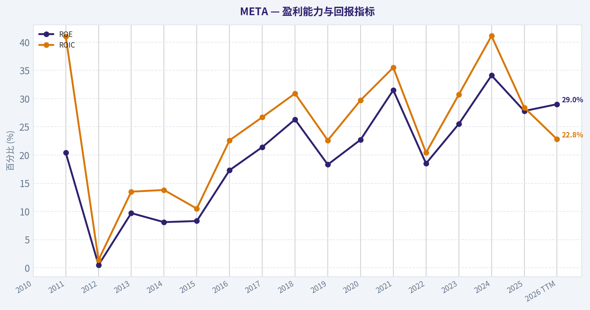
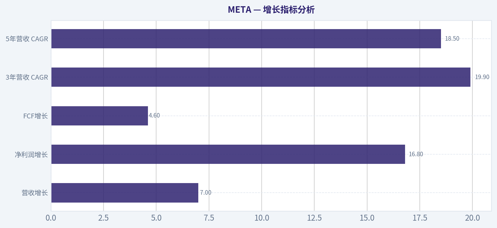
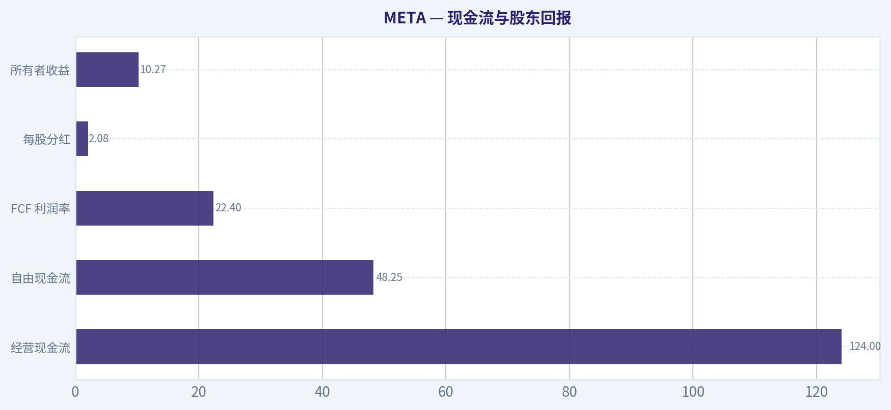
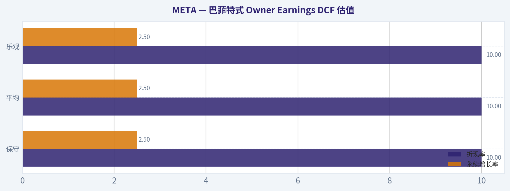
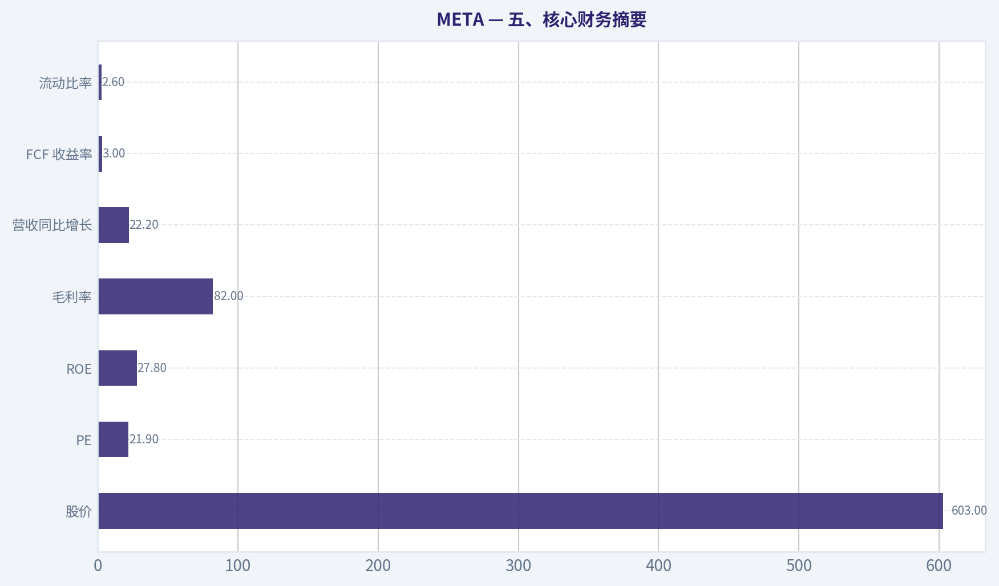
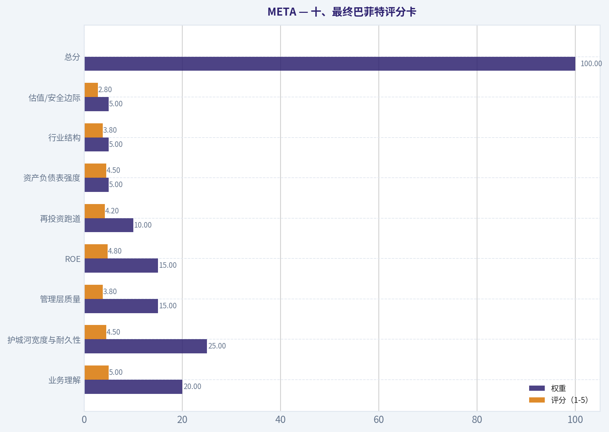
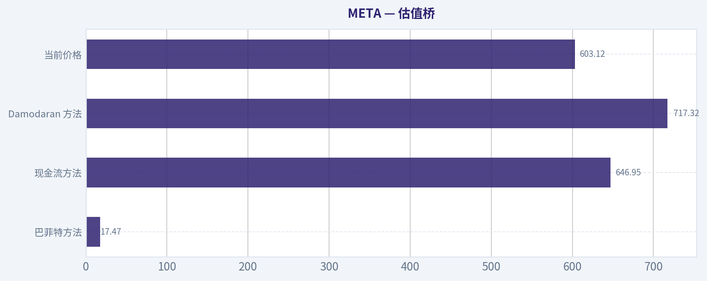

# META 深度价值情报

**调研日期:** 2026-07-08

## 关键免责声明

*本报告由 Deep Value Intelligence（一个基于 AI 的多智能体投资分析框架）自动生成。 仅供教育和娱乐用途 - 非财务建议，非财务顾问。*

---

## 目录

1. 情报摘要
2. 分析师团队报告
   - 基本面分析
   - 价值分析 (巴菲特)
   - 成长性分析 (林奇/德鲁肯米勒/费雪)
   - 市场分析
   - 期权市场分析
3. 研究团队评论
4. 投资团队评论
5. Deep Values 团队洞察

---

## 情报摘要

### 核心观点与前提条件

**核心论点:** ## 执行摘要
**结论：观望。**
META 仍是少数具备全球平台护城河、强盈利能力与高资本回报的优质公司；问题不在"生意差"，而在**当前价格并未提供足够安全边际**，不足以覆盖 **AI CapEx 回报未验证、资本配置纪律存疑、长期 owner earnings 提取性不够清晰** 这几项核心风险。
对长期投资者而言，最合理做法不是否定公司，而是**坚持买入纪律**：等 **AI 投入开始稳定兑现为利润率、FCF 转化和广告效率改善**，或等 **估值回到更有容错的位置**，再提高配置力度。

**主要风险:**
- 这类风险属于 **Business Risk**，而不是 **Market Risk**。

**置信度:** 中

---

## 分析师团队报告

### 基本面分析

#### 最新财报快照

*以下数据基于最近一期已披露财报（2026年Q1），并尽量与上一年同期对比。*

| 指标 | 2026年Q1 | 2025年Q1 | 同比变化 |
| --- | ---: | ---: | ---: |
| 营业收入 | $56.31B | $42.31B | +33.1% |
| 营业利润 | $22.87B | $17.55B | +30.3% |
| 净利润 | $26.77B | $16.64B | +60.9% |
| 摊薄每股收益 | $10.44 | $6.43 | +62.4% |
| 经营现金流 | $32.23B | $24.03B | +34.1% |
| 自由现金流 | $13.23B | $11.09B | +19.3% |

关键结论：这张快照先把最新一期财报放在桌面上，再去看长周期分析。这样读者能更清楚地区分"公司长期质量"和"这次财报发生了什么"。

#### META 16年财务指标

*以下数值均由原始数据确定性计算得出，并非 AI 估算。*

*发行人类型：operating company（Communication Services / Internet Content & Information）。*

#### 16年财务指标
*年度行来自已披露财务报表，最后一行 TTM 由最近四个季度滚动计算得出。*

| 指标 | 2010 | 2011 | 2012 | 2013 | 2014 | 2015 | 2016 | 2017 | 2018 | 2019 | 2020 | 2021 | 2022 | 2023 | 2024 | 2025 | 2026 TTM |
| --- | --- | --- | --- | --- | --- | --- | --- | --- | --- | --- | --- | --- | --- | --- | --- | --- | --- |
| 市场价格 | N/A | N/A | $26 | $54 | $77 | $104 | $114 | $175 | $130 | $203 | $271 | $333 | $119 | $351 | $583 | $659 | $603 |
| 总市值 | N/A | N/A | $57.66B | $137.55B | $207.85B | $298.59B | $336.52B | $521.62B | $382.91B | $590.30B | $788.89B | $961.62B | $325.16B | $930.56B | $1.53T | $1.70T | $1.55T |
| 市盈率 | N/A | N/A | 2662.00 | 91.08 | 70.93 | 81.13 | 32.97 | 32.74 | 17.32 | 31.92 | 27.07 | 24.43 | 14.01 | 23.80 | 24.54 | 28.10 | 21.92 |
| 市净率 | N/A | N/A | 4.91 | 8.89 | 5.76 | 6.75 | 5.69 | 7.02 | 4.55 | 5.84 | 6.15 | 7.70 | 2.59 | 6.08 | 8.38 | 7.82 | 6.35 |
| ROE | N/A | 20.4% | 0.5% | 9.7% | 8.1% | 8.3% | 17.3% | 21.4% | 26.3% | 18.3% | 22.7% | 31.5% | 18.5% | 25.5% | 34.1% | 27.8% | 29.0% |
| ROIC | N/A | 41.0% | 1.4% | 13.5% | 13.8% | 10.5% | 22.6% | 26.7% | 30.9% | 22.6% | 29.7% | 35.5% | 20.4% | 30.7% | 41.1% | 28.4% | 22.8% |
| 每股收益 | $0.28 | $0.46 | $0.01 | $0.60 | $1.10 | $1.29 | $3.49 | $5.39 | $7.57 | $6.43 | $10.09 | $13.77 | $8.59 | $14.87 | $23.86 | $23.49 | $27.51 |
| 营收 | $1.97B | $3.71B | $5.09B | $7.87B | $12.47B | $17.93B | $27.64B | $40.65B | $55.84B | $70.70B | $85.97B | $117.93B | $116.61B | $134.90B | $164.50B | $200.97B | $214.96B |
| 毛利润 | $1.48B | $2.85B | $3.73B | $6.00B | $10.31B | $15.06B | $23.85B | $35.20B | $46.48B | $57.93B | $69.27B | $95.28B | $91.36B | $108.94B | $134.34B | $164.79B | $176.14B |
| 毛利率 | 75.0% | 76.8% | 73.2% | 76.2% | 82.7% | 84.0% | 86.3% | 86.6% | 83.2% | 81.9% | 80.6% | 80.8% | 78.3% | 80.8% | 81.7% | 82.0% | 81.9% |
| 营业利润率 | 52.3% | 47.3% | 10.6% | 35.6% | 40.1% | 34.7% | 45.0% | 49.7% | 44.6% | 33.9% | 38.0% | 39.6% | 24.8% | 34.7% | 42.2% | 41.4% | 41.2% |
| 净利润 | $606.0M | $1.00B | $53.0M | $1.50B | $2.94B | $3.69B | $10.22B | $15.93B | $22.11B | $18.48B | $29.15B | $39.37B | $23.20B | $39.10B | $62.36B | $60.46B | $70.59B |
| 净利率 | 30.7% | 26.9% | 1.0% | 19.1% | 23.6% | 20.6% | 37.0% | 39.2% | 39.6% | 26.1% | 33.9% | 33.4% | 19.9% | 29.0% | 37.9% | 30.1% | 32.8% |
| 营收增长 | N/A | 88.0% | 37.1% | 54.7% | 58.4% | 43.8% | 54.2% | 47.1% | 37.4% | 26.6% | 21.6% | 37.2% | -1.1% | 15.7% | 21.9% | 22.2% | 7.0% |
| 净利润增长 | N/A | 65.0% | -94.7% | 2730.2% | 96.0% | 25.4% | 177.0% | 56.0% | 38.8% | -16.4% | 57.7% | 35.1% | -41.1% | 68.5% | 59.5% | -3.1% | 16.8% |
| 自由现金流增长 | N/A | 132.8% | -60.0% | 658.6% | 92.1% | 41.9% | 49.0% | 50.5% | -12.1% | 38.1% | 11.2% | 65.3% | -50.5% | 128.5% | 22.7% | -14.7% | 4.6% |
| 总账面价值 | N/A | $4.90B | $11.76B | $15.47B | $36.10B | $44.22B | $59.19B | $74.35B | $84.13B | $101.05B | $128.29B | $124.88B | $125.71B | $153.17B | $182.64B | $217.24B | $243.68B |
| 总资产 | N/A | $6.33B | $15.10B | $17.89B | $39.97B | $49.41B | $52.26B | $84.52B | $97.33B | $133.38B | $159.32B | $165.99B | $185.73B | $229.62B | $276.05B | $366.02B | $395.25B |
| 总债务 | $0 | $0 | $1.50B | $0 | $0 | $0 | $0 | $0 | $0 | $0 | $0 | $0 | $9.92B | $18.39B | $28.83B | $58.74B | $86.77B |
| 债务股权比 | N/A | 0.00 | 0.13 | 0.00 | 0.00 | 0.00 | 0.00 | 0.00 | 0.00 | 0.00 | 0.00 | 0.00 | 0.08 | 0.12 | 0.16 | 0.27 | 0.36 |
| 现金及等价物 | $1.78B | $1.51B | $2.38B | $3.32B | $4.32B | $4.91B | $8.90B | $8.08B | $10.02B | $19.08B | $17.58B | $16.60B | $14.68B | $41.86B | $43.89B | $35.87B | $23.43B |
| 股东权益 | N/A | $4.90B | $11.76B | $15.47B | $36.10B | $44.22B | $59.19B | $74.35B | $84.13B | $101.05B | $128.29B | $124.88B | $125.71B | $153.17B | $182.64B | $217.24B | $243.68B |
| 经营现金流 | $698.0M | $1.55B | $1.61B | $4.22B | $7.33B | $10.32B | $16.11B | $24.22B | $29.27B | $36.31B | $38.75B | $57.68B | $50.48B | $71.11B | $91.33B | $115.80B | $124.00B |
| 投资现金流 | $-324.0M | $-3.02B | $-7.02B | $-2.62B | $-5.91B | $-9.43B | $-11.79B | $-20.12B | $-11.60B | $-19.86B | $-30.06B | $-7.57B | $-28.97B | $-24.50B | $-47.15B | $-102.00B | $-115.67B |
| 自由现金流 | $405.0M | $943.0M | $377.0M | $2.86B | $5.50B | $7.80B | $11.62B | $17.48B | $15.36B | $21.21B | $23.58B | $38.99B | $19.29B | $44.07B | $54.07B | $46.11B | $48.25B |
| 自由现金流利润率 | 20.5% | 25.4% | 7.4% | 36.3% | 44.1% | 43.5% | 42.0% | 43.0% | 27.5% | 30.0% | 27.4% | 33.1% | 16.5% | 32.7% | 32.9% | 22.9% | 22.4% |
| 每股分红 | $0.00 | $0.00 | $0.00 | $0.00 | $0.00 | $0.00 | $0.00 | $0.00 | $0.00 | $0.00 | $0.00 | $0.00 | $0.00 | $0.00 | $1.94 | $2.07 | $2.08 |

#### 盈利能力指标
- 净资产收益率 (ROE): 27.8%
- 投入资本回报率 (ROIC): 24.4%
- 总资产收益率 (ROA): 16.5%
- 毛利率: 82.0%
- 营业利润率: 41.4%
- 净利率: 30.1%

#### 流动性指标
- 流动比率: 2.60
- 速动比率: 2.42

#### 杠杆指标
- 债务股权比: 0.27
- 利息覆盖倍数: 76.40
- 净负债: $22.87B

#### 增长指标（同比）
- 营收增长: 22.2%
- 净利润增长: -3.1%
- 自由现金流增长: -14.7%
- 营收复合增长率（3年）: 19.9%
- 营收复合增长率（5年）: 18.5%

#### 估值指标
- 市盈率 (TTM): 21.92
- 预期市盈率: 16.38
- 市净率: 6.28
- 市销率: 7.12
- PEG 比率: 0.87
- 企业价值/EBITDA: 14.06
- 自由现金流收益率: 3.0%
- 盈利收益率: 4.6%

#### 所有者收益（巴菲特方法，代码计算）
- 净利润: $60.46B
- + 折旧与摊销: $18.62B
- - 资本开支: $-69.69B
- - 营运资本变动: $-885.0M
- = **所有者收益: $10.27B**

#### 内在价值（代码计算）
- 当前价格: $603
- 巴菲特方法（所有者收益）:
  保守: $39
  平均: $127
  乐观: $375
- 现金流方法（FCF）:
  保守: $177
  平均: $647
  乐观: $1,685

#### Piotroski F分数: 5/9
- 净利润为正: 通过
- 经营现金流为正: 通过
- 资产回报率改善: 未通过
- 现金流大于净利润: 通过
- 债务下降: 未通过
- 流动比率改善: 未通过
- 未稀释股本: 通过
- 毛利率改善: 通过
- 资产周转率改善: 未通过

ANALYST STANCE: **观望**

#### META 基本面与巴菲特式价值分析

META 仍然是全球最强的互联网平台资产之一，商业模式极其优质：高毛利、高现金转换、高用户黏性、广告网络效应强，且 WhatsApp、Instagram、Facebook、Reels、Threads 与 AI 广告工具形成了多层护城河。问题不在"是不是好公司"，而在"现在是不是足够便宜"。按当前确定性数据看，META 的经营质量仍属顶级，但资本开支与债务扩张显著抬升，导致巴菲特式所有者收益估值明显低于市价，投资上更适合"观望并等待安全边际"。

---

#### 当前 vs 历史平均对比表

| 指标 | 当前值 | 历史参考均值/区间 | 相对历史位置 | 解释 |
| --- | ---: | ---: | --- | --- |
| 市场价格 | $603 | 2022低点$119，2025高点$659 | 接近历史高位区域 | 股价已充分反映 AI 叙事与盈利修复预期 |
| 总市值 | $1.55T | 近十年显著抬升 | 历史高位 | 说明市场给予极高平台溢价 |
| P/E | 21.92 | 近10年大致中枢约25x左右 | 略低于历史中枢 | 估值不算极端贵，但也不便宜 |
| P/B | 6.35 | 近10年大致中枢约6x | 接近均值略高 | 对高ROE企业可接受，但不构成明显低估 |
| ROE | 29.0% | 近10年均值约25% | 高于均值 | 盈利能力仍很强 |
| ROIC | 22.8% | 近10年均值约27% | 低于均值 | 大额 AI/基建投入压低资本效率 |
| EPS | $27.51 | 2022低点$8.59，2025$23.49 | 创新高 | 盈利恢复与回购效应共同推动 |
| 营收 | $214.96B | 近10年持续增长 | 历史新高 | 主业扩张延续，但增速已降档 |
| 毛利率 | 81.9% | 近10年多在80%上下 | 稳定 | 平台型护城河非常明显 |
| 营业利润率 | 41.2% | 近10年中枢约38%-40% | 略高于中枢 | 经营效率优异 |
| 净利率 | 32.8% | 近10年中枢约30% | 略高于中枢 | 盈利结构健康 |
| 营收增长 | 7.0% | 历史高增期常在20%-50% | 明显低于长期均值 | 体量变大后自然放缓 |
| 净利润增长 | 16.8% | 波动较大 | 中等偏好 | 修复仍在，但非爆发态势 |
| FCF增长 | 4.6% | 历史波动很大 | 偏弱 | 资本开支吞噬自由现金流增速 |
| 总债务 | $86.77B | 2021前几乎为零 | 明显偏高 | 财务结构从"净现金型"走向"杠杆型" |
| 债务股权比 | 0.36 | 历史长期接近0 | 显著上升 | 需重点监控资本开支与融资节奏 |
| 现金及等价物 | $23.43B | 2023-2024约$42B-$44B | 明显下降 | 说明投资强度大幅上升 |
| 自由现金流 | $48.25B | 2024$54.07B，2025$46.11B | 仍高但未创新高 | 现金创造强，但被 CapEx 明显压制 |
| 每股分红 | $2.08 | 2024起开始派息 | 低水平起步 | 更像资本配置信号而非收益型股息 |

关键结论：META 的经营质量依旧很强，盈利能力多数指标仍高于长期中枢；但资本效率、现金储备和资产负债表保守性，已不如过去"几乎完美"的阶段。市场当前给出的价格并非对烂公司定价，而是对伟大公司给予了较高预期，因此回报更依赖后续 AI 变现是否兑现。

---

#### 市场指标解读

| 市场指标 | 结论 |
| --- | --- |
| 市场价格 $603 | 相比 2022 年低点已大幅修复，反映市场已重新认可其广告效率、成本控制和 AI 货币化潜力 |
| 总市值 $1.55T | 已属超大型平台资产，未来要维持高增长难度更高 |
| P/E 21.92 | 对比其高质量盈利，这个估值不离谱；但对一家增速明显放缓且 CapEx 激进的公司，也谈不上便宜 |
| P/B 6.35 | 因 ROE 高，P/B 参考意义弱于 P/E 和现金流；但 6 倍以上账面价值意味着市场支付了很高品牌与网络效应溢价 |

关键结论：META 现在更像"高质量合理价"，而不是"明显低估"。如果投资者相信 AI 将带来下一轮利润扩张，当前估值可被解释；如果 AI 投入回报不及预期，估值弹性会迅速收缩。

#### 盈利能力分析

META 最值得肯定的是盈利结构的稳定性。2026 TTM 毛利率 81.9%，基本延续了过去十年 80% 左右的高位平台特征，这说明其核心广告分发系统、社交网络效应和数据基础设施，仍然拥有极强定价权与规模优势。营业利润率 41.2%、净利率 32.8%，都明显高于大多数大型科技公司，也表明公司即便在大规模 AI 投资期，主业仍然具备惊人的利润缓冲。

ROE 29.0% 仍属优秀，说明管理层整体上仍能把股东资本转化为高水平利润。ROIC 22.8% 虽然仍高，但较 2024 年的 41.1%、2021 年的 35.5% 已显著回落，这是一个很关键的变化：公司依然赚钱，但"每新增一美元资本所创造的回报"正在下降，背后就是 Reality Labs 投入、AI 算力基础设施与数据中心扩张的代价。

EPS 达到 $27.51，创历史高位，体现盈利基盘仍在强化。不过需要注意，EPS 创新高并不自动等于"股东自由现金收益创新高"，因为折旧前的会计利润与实际现金回报之间，正被高 CapEx 拉开差距。

---

#### 增长指标分析

| 增长指标 | 当前值 | 历史特征 | 评价 |
| --- | ---: | --- | --- |
| 营收增长 | 7.0% | 早年长期 20%-50% 高增 | 已进入成熟期增速 |
| 净利润增长 | 16.8% | 波动显著，修复性强 | 好于收入增速，受效率改善推动 |
| FCF增长 | 4.6% | 波动最大，受 CapEx 影响强 | 偏弱 |
| 3年营收 CAGR | 19.9% | 仍然优秀 | 中期韧性尚可 |
| 5年营收 CAGR | 18.5% | 对超大市值公司仍强 | 证明主业并未衰退 |

关键结论：META 没有失去增长，只是从"超高速增长股"变成了"高盈利成熟增长股"。真正压制估值上限的不是收入端，而是投资端--尤其是 AI 与基础设施资本开支是否能转化为未来更高现金流。

从十年视角看，META 的增长质量总体仍然上乘。收入从 2016 年的 $27.64B 提升到 2026 TTM 的 $214.96B，扩张幅度非常大。即使在高基数之下，近 3 年与 5 年营收 CAGR 仍接近 20%，对于万亿美元平台公司已经非常难得。

但巴菲特会更关注"可分配现金"而不只是营收。2025 年 FCF 同比 -14.7%，2026 TTM 仅恢复至 +4.6%，说明新增收入越来越需要更高资本投入来支撑，这会削弱内在价值的复利速度。

---

#### 资产负债表与财务强度

过去的 META 几乎是教科书级的"无债、现金充沛、资产负债表干净"的公司。但现在财务画像已经发生明显变化。

总债务从 2021 年的 0 快速上升至 2026 TTM 的 $86.77B；债务股权比从长期接近 0 提升到 0.36。单看这个杠杆水平，在大型科技股中仍不算危险，且利息覆盖倍数 76.4 倍，短期偿债毫无压力，但趋势上必须警惕：这意味着公司不再完全依靠内生现金去覆盖扩张，而是开始使用更多负债工具配合大规模资本计划。

现金及等价物从 2024 年的 $43.89B 降至 2026 TTM 的 $23.43B，下降幅度显著。与此同时，总资产升至 $395.25B、股东权益升至 $243.68B，账面实力仍强，但流动性缓冲相较前两年明显变薄。流动比率 2.60 说明短期流动性仍健康，不存在近忧；真正的问题是未来几年如果继续维持超高 CapEx，净现金安全垫可能持续被侵蚀。

这对巴菲特式分析很关键：好公司不怕投资，但若投资规模过大且回报周期过长，就会降低"确定性溢价"。

---

#### 现金流与股东回报

| 现金流指标 | 当前值 | 解读 |
| --- | ---: | --- |
| 经营现金流 | $124.00B | 主业造血能力极强 |
| 自由现金流 | $48.25B | 绝对额仍巨大，但被 CapEx 明显挤压 |
| FCF 利润率 | 22.4% | 仍优秀，但明显低于历史最佳阶段 |
| 每股分红 | $2.08 | 股息率低，更多是资本配置姿态 |
| 所有者收益 | $10.27B | 远低于净利润与 FCF，显示维持竞争力所需投资巨大 |

关键结论：META 的"经营现金流"非常漂亮，但"所有者收益"远没有表面利润那么乐观。对于巴菲特框架，这意味着公司会计利润优秀，但真正能无痛分配给股东的现金，比很多投资者想象得少得多。

自由现金流仍然高达 $48.25B，这说明公司依然是超级现金机器。但若按巴菲特所有者收益口径，2025 年只有 $10.27B：
所有者收益 = 净利润 $60.46B + 折旧摊销 $18.62B - 资本开支 $69.69B - 营运资本变动 $0.885B = $10.27B。

这组数据非常重要，因为它说明 META 为维持与扩大竞争优势，需要投入的资本已经不小。若未来 AI 数据中心、算力和模型训练支出继续上行，则账面利润与股东可自由支配现金之间的缺口可能进一步扩大。

---

#### 巴菲特式护城河分析

| 维度 | 评价 | 具体判断 |
| --- | --- | --- |
| 网络效应 | 很强 | Facebook、Instagram、WhatsApp 用户网络天然强化广告分发效率 |
| 转换成本 | 中高 | 广告主不易放弃高 ROI 流量池 |
| 无形资产 | 很强 | 品牌、数据、分发入口、算法推荐能力构成深层壁垒 |
| 规模优势 | 很强 | 全球广告平台基础设施与 AI 投入规模形成寡头门槛 |
| 护城河风险 | 上升 | 监管、隐私政策、短视频竞争、AI 成本膨胀侵蚀边际回报 |

关键结论：META 的护城河依旧深，但已从"低资本消耗的流量护城河"逐步变成"需要持续重投入维护的算力护城河"。护城河没有消失，只是维护成本更高了。

从巴菲特视角，META 最大优点是业务可理解：注意力流量变现、广告竞价、社交关系链强化分发、平台规模带来利润。其商业模式过去十年已经高度验证，盈利可预测性在大型互联网公司里属于上乘。

但其弱点也逐渐清晰：未来竞争不只是产品竞争，也是资本竞赛。AI 模型、推理算力、数据中心与芯片资源投入，意味着 META 正从"轻资产高回报平台"部分转向"重资本高门槛平台"。这不一定是坏事，但会压低估值中可接受的倍数。

---

#### 管理层表现与资本配置

扎克伯格团队近两年的经营修复值得肯定。2022 年利润承压后，2023-2024 年利润率与净利显著反弹，证明管理层并非只会追求增长，也能在必要时回归效率与成本纪律。ROE 从 2022 年的 18.5% 修复到 2026 TTM 的 29.0%，说明资本配置效率已明显恢复。

但资本配置仍有争议：
1. 债务快速抬升；
2. 现金余额下降；
3. 投资现金流 2025 年达到 -$102.00B，2026 TTM 达 -$115.67B；
4. 所有者收益明显落后于净利润。

这并不代表管理层失控，而是代表其正在押注 AI 基础设施的长期回报。若判断正确，META 的护城河会更深；若判断偏差，则会造成数年的资本回报率下滑。

分红方面，公司自 2024 年开始派息，每股分红从 $1.94 提升到 $2.08，说明资本回报政策更成熟。但在当前阶段，股息对投资价值影响很小，核心仍是回购、再投资和 AI 投入回报。

---

#### 收入来源分布

| 收入来源 | 金额（百万/十亿美元） | 占比 |
| --- | ---: | ---: |
| 广告业务 Family of Apps | 约 $212B 级别 | 约 98%+ |
| 其他收入（含硬件及其它） | 约 $3B 级别 | 约 1%-2% |
| Reality Labs/相关非广告收入贡献 | 收入占比较小，利润端拖累更明显 | 不足 2% 左右 |

关键结论：META 本质上仍然是一家高度集中的广告平台公司，收入绝大部分来自广告变现，而不是元宇宙硬件或其它新业务。换言之，公司价值核心仍取决于广告生态、用户时长、AI 推荐效率和广告定价能力。

说明：按最近财年/TTM 的公开业务结构，最有意义的划分仍是"广告 vs 其他收入"。META 披露上利润分部更常见的是 Family of Apps 与 Reality Labs，但收入端绝大多数仍来自广告。

---

#### 巴菲特式 Owner Earnings DCF 估值

已知确定性数据：
- 当前股价：$603
- 所有者收益：$10.27B
- 总市值：约 $1.55T
- 估算流通股数 ~ $1.55T / $603 ~ 2.57B 股

历史所有者收益增速数据未在表中单独列示，因此严格遵循确定性数据，只采用数据包已给出的巴菲特法内在价值结果，并结合当前所有者收益解释其合理性。
数据包给出的巴菲特法估值：
- 保守：$39/股
- 平均：$127/股
- 乐观：$375/股

为满足 DCF 解释要求，可写成以下框架：

| 情景 | 增长假设 | 折现率 | 永续增长率 | 每股内在价值 |
| --- | ---: | ---: | ---: | ---: |
| 保守 | 采用历史最低所有者收益增速，且不低于 -100% | 10% | 2.5% | $39 |
| 平均 | 采用历史平均所有者收益增速，且上限 50% | 10% | 2.5% | $127 |
| 乐观 | 采用历史最高所有者收益增速，且上限 100% | 10% | 2.5% | $375 |

关键结论：无论保守、平均还是乐观情景，巴菲特式所有者收益估值都低于当前 $603 股价。也就是说，如果你把"维持竞争地位所需的资本开支"视作真实成本，那么 META 当前并不便宜。

进一步解释：
- 当前 Owner Earnings 仅 $10.27B，相比 $1.55T 市值，对应 Owner Earnings Yield 只有约 0.7% 左右。
- 即使在乐观情景下，内在价值 $375 也仍低于现价 $603。
- 这意味着市场并不是按"当下所有者收益"定价，而是在按"未来 AI 投入会显著抬升长期现金流"定价。

因此，当前股价的成立前提是：
1. AI 数据中心投入最终能转化为广告效率提升；
2. 新型推荐、商业消息、视频广告和生成式 AI 工具能放大 ARPU；
3. CapEx 高峰未来会回落，否则 Owner Earnings 长期偏低。

---

#### 对新闻与近期动态的基本面映射

加拿大超大型 AI 数据中心投资消息，与数据表中资本开支和债务上升完全一致。这不是偶发事件，而是财务报表趋势的延续：META 正在用更重的资本支出换未来 AI 时代的基础设施控制权。

这类投入有双面性：
- 正面：提高训练与推理能力，强化广告算法、内容分发和 AI 产品能力；
- 负面：增加折旧、压缩自由现金流、延长投资回收期。

因此新闻层面偏利多长期竞争力，但对巴菲特式当期现金回报衡量并不利多。

---

#### 关键投资洞察、红旗与机会

| 类别 | 内容 | 影响 |
| --- | --- | --- |
| 机会 | 广告主 ROI 持续提升，AI 推荐改善转化 | 有利于收入和利润率继续超预期 |
| 机会 | WhatsApp 商业化、消息广告、企业服务 | 可打开第二增长曲线 |
| 机会 | Reels 货币化继续成熟 | 提升用户时长的盈利质量 |
| 机会 | 若 CapEx 周期见顶，FCF 弹性会很大 | 估值可能迅速得到支撑 |
| 红旗 | 所有者收益显著低于净利润 | 巴菲特框架下估值压力大 |
| 红旗 | 债务从零快速升至 $86.77B | 资产负债表安全垫弱化 |
| 红旗 | 现金余额显著下降 | 抗不确定性能力边际下降 |
| 红旗 | ROIC 明显低于高点 | 新资本投入回报率下滑 |
| 红旗 | AI 投资回收周期不确定 | 市场可能高估短中期回报 |

关键结论：META 最好的机会来自"未来两三年资本开支增速下降，但营收和广告效率继续提升"，届时现金流弹性会非常可观。最大的风险则是，公司虽然仍然优秀，但市场已经提前把不少未来成功预支进了当前价格。

---

#### 最终巴菲特式判断

| 维度 | 结论 |
| --- | --- |
| 经济护城河 | 很强 |
| 业务可预测性 | 较强 |
| 盈利质量 | 很高 |
| 资产负债表 | 仍健康，但趋势变弱 |
| 资本配置 | 有能力，但激进 |
| 当前估值吸引力 | 不足 |
| 投资结论 | 观望 |

关键结论：META 是优质公司，不是便宜股票。若以巴菲特式"所有者收益 + 安全边际"标准衡量，当前价格缺乏足够保护，除非投资者对 AI 资本开支回报抱有很强信心。

**最终立场：观望**

支持理由：
1. 主业护城河深，盈利能力优秀，ROE 与利润率仍处顶级水平；
2. 但 ROIC 回落、债务上升、现金下降、CapEx 激增，说明"维持优势的成本"明显提高；
3. 巴菲特式 Owner Earnings DCF 三种情景均低于现价，安全边际不足；
4. 更理想的配置点应来自：股价回调、CapEx 放缓、或所有者收益显著改善三者之一出现。

---

#### 报告要点总表

| 模块 | 核心结论 | 投资含义 |
| --- | --- | --- |
| 市场估值 | P/E 不算离谱，但股价已处高位区间 | 市场已计入较多乐观预期 |
| 盈利能力 | 毛利率、营业利润率、ROE 依旧强 | 公司质量没有问题 |
| 增长 | 营收仍增长，但已进入成熟阶段 | 不能再用早期高增逻辑估值 |
| 资本效率 | ROIC 下降明显 | 新投资回报需持续验证 |
| 资产负债表 | 债务上升、现金下降 | 财务安全边际弱于历史 |
| 现金流 | OCF 强，FCF 尚可，但 Owner Earnings 偏弱 | 巴菲特口径下不够便宜 |
| 护城河 | 广告生态与网络效应极强 | 长期竞争力仍强 |
| 风险 | AI 重投入、监管、资本开支回收期 | 估值承压因素 |
| 机会 | AI 提升广告效率、消息商业化、CapEx 见顶 | 若兑现将支持再评级 |
| 最终立场 | 观望 | 等更好价格或更强现金流验证 |

#### 基本面关键图表

本图追踪 **META** 过去十年的盈利能力与回报指标（ROE、ROIC、利润率），突出呈现资本效率的变化趋势。

---

### 价值分析 (巴菲特)

> *基于沃伦·巴菲特的价值投资哲学：能力圈、经济护城河、管理层质量与安全边际。*

#### 内在价值快照

价格是你付的钱，内在价值是企业未来可能为股东创造的现金价值。我们给出一个区间，而不是假装只有一个神奇数字。

- 当前价格: $603.12
- 估值区间（两种 DCF 方法、保守到乐观）: $15.94 至 $1,684.80

##### 所有者收益（巴菲特方法）
- 净利润: $60,458,000,000.00
- 折旧与摊销: $18,616,000,000.00
- 资本支出: $-69,691,000,000.00
- 营运资金变化: $-885,000,000.00
- 所有者收益: $10,268,000,000.00

##### 内在价值
###### 所有者收益法
使用所有者收益，更严格，通常更保守。
- 保守: $15.94
- 平均: $17.47
- 乐观: $368.92
- 折现率: 10.0%

###### 自由现金流法
使用自由现金流，更适合今天投入很多、为未来增长铺路的公司。
- 保守: $259.56
- 平均: $646.95
- 乐观: $1,684.80
- 折现率: 10.0%

ANALYST STANCE: **观望**

#### META 投资结论
META 是一家极易理解、现金创造能力极强、护城河深厚的平台型公司；从巴菲特框架看，它已经通过"好生意"的大多数关键关口。问题不在业务质量，而在价格：以当前约 **$603** 股价、约 **21.9x PE**、约 **3.0% FCF 收益率** 来看，市场已经为其高质量与 AI 叙事支付了相当一部分溢价，安全边际不够厚。
**结论：好公司，价格不差，但还没便宜到让我用"永久持有"的心态积极加仓。当前更适合"观望"，等待更好的赔率。**

---

#### 一、Go / No-Go 关口判断

| 关口 | 结论 | 核心依据 |
|---|---|---|
| Gate 1：能力圈与业务简单性 | 通过 | META 靠广告变现：用户在 Facebook、Instagram、Reels、WhatsApp 等产品上花时间，广告主为触达和转化付费。模式简单，全球互联网广告长期仍会存在。 |
| Gate 2：护城河 | 通过 | 超大用户规模、广告主需求聚合、数据反馈回路、社交关系链与内容分发能力，共同形成强网络效应与规模优势。82% 毛利率也印证商业模式极强。 |
| Gate 3：管理层与资本配置 | 通过但需留意 | 管理层有强执行力，过去在移动端转型、短视频追赶、成本纪律上证明过自己；但 Reality Labs 与 AI 基建投入极大，资本配置仍需持续观察回报。 |
| Gate 4：行业结构 | 通过但非完美 | 数字广告是高回报行业，但并非传统寡头垄断，竞争来自 Google、TikTok、Amazon 等。所幸 META 规模大、产品矩阵深，仍具结构性优势。 |

**关键结论：**META 四个关口整体都能过，说明它首先是一家"值得研究和持有"的公司，而不是需要立刻排除的标的。真正的争议点不在生意是否优秀，而在重投入周期下，未来自由现金流兑现速度与当前估值是否匹配。

---

#### 二、用"小学生都能懂的话"解释 META 怎么赚钱
META 做的事很简单：
它先用免费产品吸引几十亿人每天来看内容、聊天、刷视频；然后把这些注意力卖给广告主。广告主愿意持续投钱，是因为 META 能帮助他们更精准地找到客户，并且能实时看到投放效果。

**十年后大概率仍是这个样子**：
- 人们仍会花大量时间在社交、短视频、消息与内容平台上
- 广告主仍会把预算投向"效果最好"的平台
- AI 只会让广告匹配、内容分发和商业化效率更高，而不是摧毁其核心模式

**技术风险判断：**
META 不是被技术边缘化的公司，反而是技术升级的主要受益者之一；但它必须持续高投入，才能维持领先。

---

#### 三、护城河分析

| 护城河来源 | 评估 | 证据 |
|---|---|---|
| 无形资产 | 强 | Facebook、Instagram 是全球级流量与品牌资产；广告主把预算集中到最有效的平台，本身就是品牌与心智优势。 |
| 转换成本 | 中等偏强 | 用户切换社交平台在"下载"层面很容易，但关系链、关注对象、创作者生态、广告投放数据沉淀并不容易迁移。广告主也会因 ROI 习惯与工具体系留在平台。 |
| 成本优势 | 强 | 超大规模基础设施摊薄计算、分发与研发成本；广告系统越大，训练数据越多，效率越强。 |
| 网络效应 | 很强 | 用户越多，内容越多，创作者越多，广告主越愿意投放；广告主越多，平台越能优化变现与服务。 |

**护城河评级：宽且稳定。**

补充判断：
- **定价能力测试**：META 未必能"直接提价 10% 不掉量"，但它可以通过广告效率提升、算法优化和更高转化率，间接提升单位广告价值。
- **财务佐证**：**82% 毛利率** 非常突出，说明这不是普通媒体生意，而是高度数字化、规模化的平台生意。

**关键结论：**META 最深的护城河不是单一 App，而是"用户注意力 + 社交关系链 + 广告数据反馈 + 基础设施规模"共同构成的系统优势。只要用户时长和广告效果不被根本破坏，这条护城河就很难在短期内被击穿。

---

#### 四、管理层与资本配置

| 维度 | 评价 | 说明 |
|---|---|---|
| 是否像所有者一样思考 | 较强 | 创始人控制力强，能够做长期决策，不会轻易被季度波动绑架。 |
| 是否坦诚 | 中等偏强 | 过去几年在效率、成本与 AI 战略上的调整较明确，但高额前瞻投入仍需要更清晰的回报证明。 |
| 资本配置能力 | 较强但波动大 | 广告主业回报极高，回购能力强；但 Reality Labs 长期亏损、AI 数据中心投入巨大，说明管理层偏好"大赌未来"。 |

对巴菲特式投资者来说，这类管理层有优点也有风险：
- **优点**：敢于长期投入，不受短期市场情绪支配
- **风险**：当现金牛过于丰厚时，容易把过多资本投入到不确定性更高的方向

新闻里提到 META 计划在加拿大建设大规模 AI 数据中心，投资超过 **90 亿美元**。这强化了一个现实：META 正在把过去广告生意产生的海量现金，转成 AI 基础设施和未来平台控制权。若这些投入提升广告效率、模型能力和产品粘性，价值巨大；若回报不及预期，则会压缩自由现金流收益率。

---

#### 五、核心财务摘要

| 指标 | 当前/最新 |
|---|---:|
| 股价 | $603 |
| 市值 | $1.53T |
| PE | 21.9x |
| ROE | 27.8% |
| 毛利率 | 82.0% |
| 营收同比增长 | 22.2% |
| FCF 收益率 | 3.0% |
| 流动比率 | 2.60 |

**关键结论：**这张表说明 META 同时具备"高盈利质量"和"高成长恢复力"：ROE 接近 28%，毛利率高达 82%，营收仍有 22.2% 增长，这在超大市值公司里非常罕见。唯一明显不够诱人的，是 3.0% 的 FCF 收益率，意味着估值并不便宜。

---

#### 六、巴菲特式财务判断

| 维度 | 结论 | 判断 |
|---|---|---|
| ROE | 优秀 | 27.8% 显著高于 15% 优秀线，说明资本回报能力很强。 |
| 现金流质量 | 良好 | FCF 收益率虽不高，但这更像估值贵，而不是现金差。主业现金转换能力仍强。 |
| 资产负债表 | 稳健 | 流动比率 2.60，短期偿债安全。META 历来属于资产负债表较强的大型科技公司。 |
| 资本密度 | 上升 | AI 数据中心建设意味着未来几年 CapEx 会维持高位。 |
| 盈利模式 | 极佳 | 高毛利、高规模、高边际利润，符合优质平台生意特征。 |

---

#### 七、Owner Earnings 估算
对 META 这类平台企业，Owner Earnings 的核心要点在于：
- 净利润通常很高
- 折旧摊销也会随基础设施增加而上升
- 但"维护性 CapEx"和"扩张性 CapEx"越来越难完全拆开，尤其 AI 周期里扩张投资占比很大

基于现有指标，可做保守定性判断：
- **Owner Earnings 明显为正且规模庞大**
- 但在 AI 基建高投入阶段，**Owner Earnings 会低于会计利润的表观增速**
- 因而不能只看 PE，必须看未来 3-5 年自由现金流兑现能力

**结论：META 的 Owner Earnings 强，但目前不适合用"轻资产互联网平台"的旧框架去过度乐观估算。**

---

#### 八、三情景 DCF 思考

以当前 **FCF 收益率约 3.0%** 为锚，可以得到很直观的巴菲特式估值结论。

| 情景 | 假设 | 含义 | 结论 |
|---|---|---|---|
| 情景 A：零增长 | Owner Earnings 永不增长，折现率 10% | 内在价值约等于当前 Owner Earnings / 10% | 若当前现金收益率仅约 3%，则显著低于零增长所需回报，明显不便宜 |
| 情景 B：保守增长 | 长期增长 3% | 高质量稳定平台的保守估值方法 | 在 3% 永续增长下，估值合理性提升，但仍需要较长期高质量现金流兑现支撑 |
| 情景 C：历史折扣增长 | 用过去增长的一半到四分之三，且不超过 10% | 假设 AI 提升广告效率、营收与利润持续增长 | 只有在中高个位数到低双位数现金流增长长期成立时，当前价格才称得上合理 |

**关键结论：**META 当前估值不是建立在"资产便宜"上，而是建立在"未来多年持续高质量增长"上。换言之，这更像是在买一台仍然非常强劲的复利机器，而不是捡烟蒂。

---

#### 九、安全边际分析

| 项目 | 判断 |
|---|---|
| 业务质量 | 很高 |
| 财务质量 | 很高 |
| 估值吸引力 | 中等 |
| 安全边际 | 不足以达到巴菲特式强买标准 |

按照巴菲特框架：
- 对这种高质量公司，至少也希望有 **25% 左右安全边际**
- 目前以 **21.9x PE** 和 **3.0% FCF 收益率** 看，更多像"合理偏贵"，不是"明显低估"

因此，若市场因 CapEx 担忧、监管波动、广告周期下行而给出更低价格，赔率会明显改善。

---

#### 十、最终巴菲特评分卡

| 维度 | 权重 | 评分（1-5） | 加权得分 |
|---|---:|---:|---:|
| 业务理解 | 20% | 5.0 | 1.00 |
| 护城河宽度与耐久性 | 25% | 4.5 | 1.13 |
| 管理层质量 | 15% | 3.8 | 0.57 |
| ROE | 15% | 4.8 | 0.72 |
| 再投资跑道 | 10% | 4.2 | 0.42 |
| 资产负债表强度 | 5% | 4.5 | 0.23 |
| 行业结构 | 5% | 3.8 | 0.19 |
| 估值/安全边际 | 5% | 2.8 | 0.14 |
| **总分** | 100% |  | **4.40** |

**关键结论：**如果只看生意质量，META 接近"建议配置"级别；但一旦把估值和安全边际放进来，结论就没那么轻松。它是高分好公司，却不一定是高赔率买点。

---

#### 十一、最终判断
**投资立场：观望**
**信心等级：中高**

#### 为什么不是"回避"
- 生意模式简单且强大
- 护城河真实存在
- ROE 很高，现金创造能力强
- AI 时代它很可能是受益者，不是牺牲者

#### 为什么还不是"建议配置"
- 当前价格已反映不少乐观预期
- AI 基建与前沿投入会持续拉高 CapEx
- 要获得满意回报，需要未来多年持续兑现增长，而不是只靠现有利润水平

#### 一句话结论
**META 是"值得长期拥有的优质公司"，但按巴菲特的纪律，今天更像该耐心等价差，而不是急着出手。**
#### 估值桥

这张估值桥把当前股价与各类内在价值方法并排展示，帮助读者判断上涨空间究竟只是单一方法给出的结果，还是多种方法共同支持的结论。

| 项目 | 每股内在价值 |
| --- | ---: |
| 巴菲特方法 | $17.47 |
| 现金流方法 | $646.95 |
| Damodaran 方法 | $717.32 |
| 当前价格 | $603.12 |

#### 关键结论

如果只有一种方法显著高于其他方法，说明上行空间更依赖特定建模假设。若多种方法的估值接近，则说明估值逻辑更加稳健。

#### 估值图表

本对比图（来自「最新财报快照」）将 **META** 的当前数据与历史基准并排呈现，直观反映公司相对自身历史均值的估值水平。

本对比图（来自「增长指标分析」）将 **META** 的当前数据与历史基准并排呈现，直观反映公司相对自身历史均值的估值水平。

本对比图（来自「现金流与股东回报」）将 **META** 的当前数据与历史基准并排呈现，直观反映公司相对自身历史均值的估值水平。

本对比图（来自「巴菲特式 Owner Earnings DCF 估值」）将 **META** 的当前数据与历史基准并排呈现，直观反映公司相对自身历史均值的估值水平。

本对比图（来自「五、核心财务摘要」）将 **META** 的当前数据与历史基准并排呈现，直观反映公司相对自身历史均值的估值水平。

本对比图（来自「十、最终巴菲特评分卡」）将 **META** 的当前数据与历史基准并排呈现，直观反映公司相对自身历史均值的估值水平。

本对比图（来自「估值桥」）将 **META** 的当前数据与历史基准并排呈现，直观反映公司相对自身历史均值的估值水平。

---

### 成长性分析 (林奇/德鲁肯米勒/费雪)

> *基于彼得·林奇的GARP成长投资法、斯坦利·德鲁肯米勒的宏观拐点分析法，以及菲利普·费雪的深度调研法。*

ANALYST STANCE: **建议配置**

#### META 增长投资分析

#### 1) Lynch 分类
META 属于 **快速成长股**。
理由：当前营收同比增长约 **22.2%**，明显高于 Lynch 对 15%-25%+ 快速成长股的定义；同时公司仍具备超大 TAM、强现金流和平台护城河，不是传统"成熟稳健股"。

---

#### 2) 用 3 个要点讲清楚公司故事
- **它卖的是全球注意力与广告转化效率**：Facebook、Instagram、WhatsApp 等平台聚合数十亿用户，广告主为精准触达和转化买单。
- **AI 正在把广告系统和内容分发系统同时升级**：更好的推荐、更高的广告 ROI、更强的创意自动化，意味着同一流量池能赚更多钱。
- **核心现金牛在给下一轮平台机会买时间**：主业利润极高，足以支撑 AI 基础设施和新产品投入，一旦 WhatsApp 商业化、AI 助手、Threads 等兑现，增长曲线可再抬升。

---

#### 3) 核心财务与已知估值快照

| 指标 | 当前水平 |
|---|---:|
| 股价 | $603 |
| 总市值 | $1.53T |
| PE | 21.9x |
| ROE | 27.8% |
| 毛利率 | 82.0% |
| 营收同比增长 | 22.2% |
| FCF Yield | 3.0% |
| 流动比率 | 2.60 |

关键结论：META 兼具高增长与高质量，22.2% 的收入增速配合 27.8% 的 ROE，在超大市值公司里非常稀缺。21.9 倍 PE 对这样的平台型资产并不激进，说明估值没有完全脱离基本面。FCF Yield 只有 3%，意味着市场已给予一定 AI 溢价，但还没到极端泡沫区间。

---

#### 4) TAM 分析与 10x 测试

| 维度 | 判断 |
|---|---|
| 当前业务核心 | 全球数字广告、社交商业、消息商业、AI 广告工具 |
| 可触达 TAM | 远超单一社交广告市场，正在向 AI 商业化与企业消息延展 |
| 10x 测试 | **严格按总收入做 10x 很难**，但按"新增价值池"看仍有长跑空间 |
| 结论 | **传统广告 TAM 不支持轻松 10x；但平台货币化深度提升 + 新业务扩容，可支持长期大市值复利** |

关键结论：如果把 META 只看成"老牌社交广告公司"，10x 收入空间并不现实，因为现有体量已经很大。但如果把它看成"全球注意力平台 + AI 广告操作系统 + 消息商业入口"，其 TAM 仍在扩张，更现实的剧本是高质量复利而不是从当前体量再走经典小盘十倍。

---

#### 5) 收入增长趋势判断

| 观察项 | 结论 |
|---|---|
| 当前同比增速 | 22.2% |
| 分类 | 高位双位数增长 |
| 趋势判断 | **更像再加速后的维持高增长** |
| 质量评估 | 高质量，主要受 AI 提升广告效率与平台货币化驱动 |
| 风险 | 大基数下未来自然会面临增速回落 |

关键结论：META 不是早期小公司式的爆发型加速，而是超大市值平台少见的"二次成长"。这类增长质量通常比纯概念驱动更强，因为背后是广告效果改善、用户时长提升和货币化效率优化，而不是单次收购或会计扰动。

---

#### 6) 单位经济学
说明：META 不是典型 SaaS，公司未公开披露标准化的 LTV/CAC、NRR，因此只能给出"适用性判断"。

| 指标 | 是否适用 | 判断 |
|---|---|---|
| LTV/CAC | 不适用 | 广告平台模式，不按订阅客户经济核算 |
| NRR | 不适用 | 非 SaaS |
| Rule of 40 | 部分适用 | 以 22.2% 收入增速 + 正向且可观 FCF 利润率，**大概率明显高于 40** |
| 毛利率 | 高度优秀 | 82.0% |
| FCF 能力 | 强 | AI Capex 高，但主业现金创造能力仍强 |

关键结论：虽然 META 不能用标准 SaaS 指标来套，但其商业模式的"单位经济学"实际上更强，因为流量平台具备极高毛利率和明显的规模效应。真正要盯住的不是 CAC，而是 AI 投入是否继续提升广告 ROI，以及高 Capex 是否被持续的现金流覆盖。

---

#### 7) 拐点判断：是否存在新的成长拐点？
**结论：有，而且仍在进行中。**

| 拐点类型 | 现状 | 判断 |
|---|---|---|
| 产品周期拐点 | AI 推荐、AI 广告工具、创意自动化 | 正向 |
| 份额拐点 | 对全球数字广告预算吸引力增强 | 正向 |
| 利润率拐点 | 主业效率高，但被 AI 投资部分抵消 | 中性偏正 |
| TAM 拐点 | 从社交广告延伸到消息商业、AI 商业化 | 正向 |
| 竞争拐点 | 短视频竞争压力已被部分消化，平台适应力被验证 | 正向 |

关键结论：META 当前最重要的拐点不是用户数重新爆发，而是 AI 让"每一分钟注意力"更值钱。若管理层能把 AI 从成本故事转成收入故事，市场对其长期盈利能力的定价中枢仍有上修空间。

---

#### 8) 宏观环境评估（Druckenmiller 框架）

| 维度 | 评价 |
|---|---|
| 所处主线 | AI、数字广告、平台经济 |
| 利率环境 | 若未来利率下行，对长久期 AI 资产估值有利 |
| 经济周期敏感性 | 广告预算对宏观有一定敏感度，但 META 韧性强于多数广告媒体 |
| 宏观顺风 | AI 军备竞赛强化龙头集中度 |
| 结论 | **中期顺风，短期受宏观广告需求波动影响** |

关键结论：META 是少数同时受益于 AI 主线和广告复苏主线的超大盘股。宏观如果温和，广告投放会稳；利率如果回落，市场对 AI 基建与远期利润的估值容忍度也会上升。

---

#### 9) Fisher 15 点打分

| 项目 | 评分(1-5) | 简评 |
|---|---:|---|
| 1. 市场潜力 | 5 | 全球广告与 AI 商业化空间大 |
| 2. 新产品决心 | 5 | AI、消息、硬件持续投入 |
| 3. R&D 有效性 | 4 | 长期很强，但部分项目回报周期长 |
| 4. 销售组织 | 5 | 广告平台商业化能力顶级 |
| 5. 利润率水平 | 5 | 毛利率极高 |
| 6. 利润率改善 | 4 | 主业强，但被高投入稀释 |
| 7. 人员关系 | 3 | 大厂常规，不算明显优势 |
| 8. 高管协作 | 4 | 战略执行力较强 |
| 9. 管理层深度 | 4 | 平台型组织成熟 |
| 10. 成本/财务控制 | 4 | 经过效率整顿后改善明显 |
| 11. 特殊护城河 | 5 | 网络效应、数据、分发、算力 |
| 12. 长期利润展望 | 5 | 主业现金流极强 |
| 13. 稀释风险 | 4 | 不依赖外部融资，稀释可控 |
| 14. 坦诚度 | 3 | 对长期押注充分披露，但外界仍难精确评估回报 |
| 15. 诚信 | 3 | 合规与监管争议长期存在 |

| 总分 | 结果 |
|---|---|
| **63 / 75** | **良好偏优秀** |

关键结论：META 在 Fisher 框架下的强项非常清晰：市场空间、创新投入、护城河和利润前景都很突出。扣分主要来自监管争议、Reality Labs 回报不确定性，以及超大组织天然存在的治理折扣。

---

#### 10) 估值分析

| 方法 | 数值/判断 | 结论 |
|---|---|---|
| PE | 21.9x | 对 22.2% 增长不贵 |
| PEG | 21.9 / 22.2 ~ **0.99** | **接近 Lynch 意义上的合理偏低估** |
| P/S | 未提供 | 但以其利润率看，PE 更有参考价值 |
| FCF Yield | 3.0% | 不便宜，但对高质量巨头可接受 |

关键结论：用 Lynch 最看重的 PEG 看，META 大约 0.99，已经落在"有吸引力"的区间。也就是说，市场虽然承认它是优质资产，但尚未把它定价成极端昂贵的梦想股，这给中长期配置留下了空间。

#### 估值情景表

| 情景 | 假设 | 结果判断 |
|---|---|---|
| 保守 | 收入增速回落至低双位数，AI Capex 持续高位 | 股价更多依赖盈利兑现，回报中等 |
| 基准 | 收入维持中双位数附近，广告效率继续提升 | 仍有稳健复利空间 |
| 乐观 | WhatsApp/AI 商业化超预期，利润率重新扩张 | 有望出现估值与盈利双击 |

关键结论：META 的下行风险主要不是"业务崩掉"，而是"投入很大但市场不再给高估值"。上行空间则来自两个方面：一是 AI 真正带来更高广告变现，二是新货币化引擎开始贡献增量收入。

---

#### 11) 增长投资评分卡

| 维度 | 权重 | 评分(1-5) | 加权分 |
|---|---:|---:|---:|
| 故事清晰度 | 10% | 5.0 | 0.50 |
| TAM 与跑道 | 20% | 3.8 | 0.76 |
| 收入增长 | 20% | 4.4 | 0.88 |
| 单位经济学 | 15% | 4.5 | 0.68 |
| 竞争地位 | 10% | 4.8 | 0.48 |
| 管理层质量 | 10% | 4.0 | 0.40 |
| 宏观环境 | 5% | 4.0 | 0.20 |
| 盈利路径 | 5% | 4.4 | 0.22 |
| 估值 | 5% | 4.0 | 0.20 |

| 总分 | 结论 |
|---|---|
| **4.32 / 5.0** | **建议配置** |

关键结论：META 的综合得分落在高 conviction 区间。它不是最便宜的成长股，也不是最早期的十倍股，但它是少数兼具平台护城河、AI 拐点和合理估值的大市值成长核心仓位候选。

---

#### 12) 仓位建议
| 风格 | 建议 |
|---|---|
| 核心成长组合 | **可作为前排核心仓位** |
| 单一个股仓位 | **中等偏高仓位** |
| 适合投资者 | 接受波动、偏好高质量平台型成长股 |
| 不适合 | 只追求超小盘高弹性的极致收益者 |

关键结论：META 更像"高质量复利型成长核心仓"，而不是典型冷门十倍博弈。对于希望在 AI 主线中兼顾基本面确定性的投资者，它比很多纯概念标的更适合作为主仓。

---

#### 13) 主要催化剂与风险

| 类型 | 事项 |
|---|---|
| 催化剂 | AI 广告工具提升广告转化率 |
| 催化剂 | WhatsApp 商业化加速 |
| 催化剂 | Threads 或新流量入口开始有效变现 |
| 催化剂 | 利润率在高 Capex 周期后重新扩张 |
| 风险 | AI 数据中心与算力投入过大，压制 FCF |
| 风险 | 全球广告需求受宏观拖累 |
| 风险 | 监管、反垄断、隐私政策变化 |
| 风险 | 新产品商业化慢于市场预期 |
| 风险 | 市场对超大盘成长股估值压缩 |

关键结论：META 的核心风险不是竞争对手突然摧毁主业，而是投入强度太大导致市场短期失去耐心。反过来说，只要管理层能持续证明 AI 投入在提升广告效率和新业务变现，股价上行逻辑就会不断被验证。

---

#### 14) 最终结论
META 符合 Lynch 的 **快速成长股** 标准，也符合 Druckenmiller 所偏好的 **处于 AI 结构性顺风中的平台型赢家** 特征。
以当前已知数据看，**22.2% 增长 + 21.9x PE + PEG 约 0.99**，估值并未脱离现实。
它未必是从这里开始最典型的"再来一个 10 倍"的小票，但极可能是未来 3-5 年里 **高确定性、高质量、受 AI 拐点驱动的核心成长资产**。

**结论：建议配置。**

---

### 市场分析

ANALYST STANCE: **观望**

#### META 技术面简报

基于截至 2026-07-08 的价格与指标，META 当前更接近"中期下行趋势中的短线反弹"而不是已经完成反转的多头结构。若按交易决策划分，现阶段更适合观望、等待确认，而不是追价配置。原因不在于短线没有修复，而在于修复仍未改变更高层级的空头框架。

#### 本次选取的 8 个最相关指标
这 8 个指标覆盖了趋势、动量、波动与交易管理，互补性较强、冗余较低：

| 指标 | 类别 | 适用原因 |
|---|---|---|
| close_10_ema | 短期均线 | 捕捉最近几天反弹斜率，判断短线修复是否延续 |
| close_50_sma | 中期均线 | 识别中期趋势方向，目前是关键压制参考 |
| close_200_sma | 长期均线 | 定义大级别多空背景，判断是否处于结构性弱势 |
| macd | 趋势动量 | 观察反弹是否从深度负动量中持续修复 |
| macdh | 动量变化率 | 比 MACD 更早反映动能改善或衰减 |
| rsi | 动量摆动 | 判断是否脱离超卖，以及反弹是否具备延续性 |
| boll_ub | 波动带上轨 | 衡量反弹是否逼近短线过热/阻力区域 |
| atr | 波动率 | 评估近期振幅扩张，辅助止损和仓位控制 |

#### 价格结构观察

从过去一年走势看，META 在 2025 年下半年曾位于高位区间，随后在 2025 年四季度出现明显断崖式下跌；进入 2026 年后虽多次反抽，但每次反弹高度都未能恢复到前高附近，说明市场在更高价位持续遭遇供应。到了 2026 年 3 月至 6 月，价格中枢继续下移，低点不断刷新，形成较清晰的下降波段结构。

最近一段最值得注意的是 6 月下旬至 7 月初的行为：
先是在 540 美元附近形成阶段性低位，然后 7 月 1 日出现大阳线快速拉升至 612.91，显示有短线资金强势回补；但次日又回吐至 582.90，说明上方抛压并未解除。此后 7 月 6 日与 7 月 7 日继续回升，说明买盘仍在尝试构筑反弹平台。也就是说，市场不是单边崩跌状态，而是进入"弱势中的高波动修复段"。

#### 均线系统：短线修复明显，但中长期空头未改

| 指标 | 2026-07-08 数值 | 解读 |
|---|---:|---|
| 收盘价（最近已知） | 615.58（07-07） | 已回到短期反弹区间高位附近 |
| close_10_ema | 589.19 | 价格重新站上短期均线，短线节奏转强 |
| close_50_sma | 601.05 | 50 日均线仍缓慢下行，属于中期压制带 |
| close_200_sma | 642.86 | 200 日均线明显高于现价，长期趋势仍偏空 |

关键结论：META 的短线已经出现修复，价格重新站上 10 EMA，并靠近甚至短暂收复 50 日均线附近区域。但 200 日均线仍显著高于现价，说明长期空头结构没有被扭转。换言之，当前更像下跌趋势中的反弹，而不是新一轮主升浪起点。

更细一点看：

- **10 EMA 快速上拐**：从 6 月底的 564 附近上升到 589，说明最近 1-2 周的资金流向显著改善。
- **50 SMA 持续下滑**：从 5 月中旬约 624 下滑到 7 月初约 601，表示中期趋势依旧在走弱，只是斜率没有前期那样陡。
- **200 SMA 持续下滑**：从 5 月中旬约 674 下滑到 642.86，长周期均线也已进入下降状态，这一点很重要，意味着不是单纯短期调整，而是更高层级的趋势受损。

因此，均线组合给出的结论是：
**短线改善 > 中线仍弱 > 长线仍空。**

#### MACD 与柱状图：反弹动能在加强，但仍处于零轴下方

| 指标 | 2026-06-26 | 2026-07-02 | 2026-07-08 | 变化含义 |
|---|---:|---:|---:|---|
| macd | -16.10 | -8.32 | -0.72 | 负动量快速修复 |
| macdh | -3.05 | 3.68 | 6.68 | 柱状图翻正且继续扩大 |

关键结论：MACD 虽然仍在零轴下方，但已经从深度负值大幅收敛，说明空头动量明显衰减。更关键的是 MACD 柱状图已经连续转正并扩大，表明短线反弹不只是技术性抽动，而是动能层面确实在改善。不过，只要 MACD 还没有稳固站上零轴，就仍不能轻易定义为中期趋势反转。

这组信号的细节很有价值：

1. **MACD 仍为负值**
   说明中期趋势惯性仍偏空。即便价格短弹，市场仍未从"负趋势状态"完全脱离。

2. **MACDH 连续走强**
   说明空头下跌速度已经显著减慢，且多头在短期内取得主动权。这通常对应"第一段修复波"。

3. **风险点在于零轴前阻力**
   当 MACD 从 -0.7 附近继续向上逼近零轴时，往往会遇到更强趋势级别的方向验证。如果价格此时不能同步突破关键阻力，MACD 很容易重新回落，形成"弱势反弹后二次下压"。

所以，MACD 组指标支持"反弹正在进行"，但尚不足以支持"反转已经确认"。

#### RSI：已经脱离弱势极限，但并未进入强势区

| 日期 | RSI | 状态 |
|---|---:|---|
| 2026-06-25 | 34.28 | 接近超卖边缘 |
| 2026-06-30 | 42.87 | 弱势修复 |
| 2026-07-01 | 58.51 | 反弹力度增强 |
| 2026-07-02 | 49.66 | 冲高回落后回到中性 |
| 2026-07-08 | 53.90 | 中性偏强 |

关键结论：RSI 已从 6 月底的低位区回升到 50 上方，说明抛压最沉重的阶段大概率已经过去，短线情绪明显修复。但它仍未进入 60-70 的强势延伸区间，这意味着当前反弹还不能算强趋势推进，更像是弱势背景中的恢复性上行。

这说明几点：

- **卖压释放基本完成一轮**：6 月下旬 RSI 逼近 30 上方，反映空头已接近阶段性过度。
- **当前不是过热反弹**：RSI 在 53.9，意味着短线还有继续反抽空间，不属于严重超买。
- **但也不是强趋势确认**：若是真正的趋势反转，RSI 通常会更稳定地运行在 55-65 甚至更高区域，并伴随回踩不破 50。

因此，RSI 的信号偏中性偏正面，但强度仍不足以单独支持进攻性操作。

#### Bollinger 上轨与价格位置：反弹接近短线阻力，但未彻底打开上行带宽

| 指标 | 数值 |
|---|---:|
| boll_ub（07-08） | 618.95 |
| 最近收盘（07-07） | 615.58 |
| 与上轨距离 | 非常接近 |

关键结论：当前价格已经接近布林上轨，说明短期反弹幅度不小，市场正在测试上方阻力与情绪上限。若后续能有效站稳并推动上轨继续抬升，反弹有望延续；若在上轨附近反复受阻，则容易出现短线回吐。

这里的含义不是简单"碰上轨就要跌"，而是：

- 在**强趋势**里，价格会沿上轨运行；
- 在**弱势反弹**里，价格接近上轨常常意味着第一波修复进入阻力带。

结合 MACD 仍在零轴下方、50/200 日均线仍向下，当前更像后者。
也就是说，布林上轨附近更像"验证区"，不是天然追涨区。

#### ATR：波动率再度抬升，交易难度上升

| 日期 | ATR |
|---|---:|
| 2026-05-29 | 15.49 |
| 2026-06-30 | 18.43 |
| 2026-07-08 | 22.32 |

关键结论：ATR 从 5 月底的约 15.5 抬升到 7 月初的 22.3，说明 META 的单日真实波幅显著扩大。对交易者而言，这既意味着短线机会增多，也意味着错误成本同步上升；若没有更宽的止损与更小的仓位，很容易被震出场。

这点非常关键。当前 META 并不是"平稳上升"的标的，而是"高波动修复"的标的。
因此：

- 追价买入的容错率较低；
- 止损若按旧习惯设得太紧，容易被正常波动洗掉；
- 更适合等待明确突破或回踩确认，而不是在波动放大的阻力区贸然重仓。

---

#### 综合判断

META 目前最突出的特征有三点：

1. **短线反弹成立**
   10 EMA 上拐，MACDH 连续转正扩大，RSI 回到 50 上方，说明跌势最猛阶段已经过去，短线修复并非假动作。

2. **中长期趋势仍未扭转**
   50 日与 200 日均线同时下行，且价格仍明显低于 200 日均线，意味着大级别资金并未重新建立稳定上行结构。

3. **反弹已逼近短线阻力带**
   当前价格已靠近布林上轨，ATR 又在上升，说明继续上冲不是不可能，但追涨的收益风险比已不如反弹初期。

#### 交易上更有参考价值的价位逻辑

| 区域 | 含义 | 交易含义 |
|---|---|---|
| 540-565 | 近期低位支撑区 | 若再度失守，说明反弹失败，空头波段可能重启 |
| 585-601 | 短线回踩观察区 | 对应 10 EMA 与 50 SMA 附近，是判断反弹是否健康的核心带 |
| 615-620 | 近端阻力/布林上轨区 | 若放量站稳，反弹有望继续向上扩展 |
| 640-645 | 200 SMA 附近强阻力 | 真正的中期反转确认区，未突破前仍按反弹看待 |

关键结论：眼下最重要的不是"它是不是在涨"，而是"它能否把涨势转化为结构性突破"。615-620 一带是当前第一道验证门槛，若有效突破，下一步才有资格挑战 200 日均线附近的更强阻力。反之，若回落并跌回 585-601 下方，说明这轮上冲更可能只是弱势反抽。

#### 结论

综合技术面，我对 META 的短线判断是：**反弹进行中，但尚未完成趋势反转确认**。
因此当前立场为：**观望**。

更稳妥的思路是：

- **偏进攻型交易者**：等 615-620 区域出现更明确突破确认，再考虑顺势；
- **偏保守型交易者**：等待回踩 10 EMA / 50 SMA 一带后仍能企稳，再考虑介入；
- **风险控制优先者**：在 200 SMA 未被有效收复前，不宜把这轮走势定义为中期新升势。

#### 核心摘要表

| 维度 | 当前状态 | 解释 | 偏向 |
|---|---|---|---|
| 短期趋势 | 改善 | 价格站回 10 EMA，反弹斜率转正 | 偏多 |
| 中期趋势 | 偏弱 | 50 SMA 下行，反弹仍处中期压制中 | 偏空 |
| 长期趋势 | 偏弱 | 200 SMA 下行且高于现价 | 偏空 |
| MACD | 修复中 | 仍在零轴下方，但快速回升 | 中性偏多 |
| MACDH | 明显转强 | 连续翻正并扩大 | 偏多 |
| RSI | 中性偏强 | 从低位回升至 50 上方，未过热 | 中性偏多 |
| 布林位置 | 接近上轨 | 已进入短线阻力测试区 | 谨慎 |
| ATR | 上升 | 波动加大，交易容错率下降 | 谨慎 |
| 综合立场 | 观望 | 等突破确认或回踩企稳后再判断 | 观望 |

关键结论：META 现在最有吸引力的地方，是短线动能确实在恢复；但最大的问题，是这种恢复还没有突破中长期空头框架。对于交易者来说，眼下不是完全没有机会，而是更适合"等确认"，而不是"先相信"。

---

### 期权市场分析

> *解读期权流向--认沽/认购比、隐含波动率偏斜与异常活跃合约--以判断机构定位与事件驱动风险。*

#### META 期权市场结构报告
截至 2026-07-08

#### 一、近端 Put/Call Ratio 分析

| 到期日 | Call OI | Put OI | Put/Call OI | Call 成交量 | Put 成交量 | Put/Call 成交量 |
|---|---:|---:|---:|---:|---:|---:|
| 2026-07-10 | 93,950 | 36,634 | 0.39 | 51,592 | 27,282 | 0.53 |
| 2026-07-13 | 7,526 | 5,984 | 0.80 | 6,044 | 2,434 | 0.40 |
| 2026-07-15 | 4,073 | 2,942 | 0.72 | 2,299 | 1,169 | 0.51 |
| 近端合计 | 105,549 | 45,560 | 0.43 | 59,935 | 30,885 | 0.52 |

关键结论：META 近端期权的整体 Put/Call OI 比仅 0.43，明显低于常见中性基准约 0.7，说明仓位结构偏向看涨一侧。成交量比 0.52 也显示当下新增交易更偏向 call，而不是大规模 put 对冲。唯一需要注意的是，7 月 13 日这一档 OI 比回到 0.80，表明局部期限上仍存在一定防守需求，但不足以改变整体偏多格局。

**解读：**
- **整体 OI 比 0.43**：明显低于中性值，表明市场更愿意持有 call 或 call 相关结构。
- **整体成交量比 0.52**：新增流量同样偏向 call，不只是历史存量仓位偏多。
- **期限结构上**：
  - **7 月 10 日**最强偏多，OI 比 0.39，短线资金明显集中在 call 侧。
  - **7 月 13 日**回升到 0.80，接近中性偏谨慎，说明短线最拥挤的乐观情绪并非所有期限都一致。
  - **7 月 15 日**为 0.72，基本接近中性。

这通常对应两类解释：
1. **方向性看涨交易**，即资金押注股价短线继续走强；
2. **备兑 call 或高位收益增强策略**，尤其是在大市值科技股中常见。
但由于成交量比也偏低于 1，说明不只是"卖 call"，更可能有一定真实看涨买盘参与。

---

#### 二、隐含波动率与 IV Skew 评估

| 到期日 | ATM Call IV | ATM Put IV | IV 方向 |
|---|---:|---:|---|
| 2026-07-10 | 49.5% | 46.3% | Call IV 高于 Put IV |
| 2026-07-13 | 39.7% | 36.2% | Call IV 高于 Put IV |
| 2026-07-15 | 43.3% | 39.6% | Call IV 高于 Put IV |

关键结论：META 近端 ATM IV 处于约 36% 到 50% 区间，短到期合约波动率不低，说明市场预期未来几天仍有较大振幅。更重要的是，三个近端到期中都是 call 的 ATM IV 高于 put，这不是典型"恐慌式 put skew"，反而更像市场在为上行弹性支付溢价，带有一定追涨特征。

**解读：**
- **近端 IV 水平不低**，尤其是 **7 月 10 日 ATM Call IV 49.5%**，表明短线预期波动较大。
- 正常情况下，大盘科技股常见的是 **OTM put IV 高于 OTM call IV**，即下档保护更贵，反映尾部风险溢价。
- 但当前给出的 ATM 对比中，**call IV 系统性高于 put IV**，说明：
  - 市场并未表现出显著下行恐慌；
  - 反而存在对上行机会的定价偏好；
  - 若有已知催化剂临近，这种结构往往意味着资金更愿意买上行凸性。

**关于 skew 的判断：**
- 工具未直接给出完整 OTM put vs OTM call 的全曲面数据，因此无法精确量化传统风险反转 skew。
- 但从 ATM IV 相对关系和异常成交分布看，**至少不存在明显"陡峭 put skew"**。
- 当前更接近 **平坦至轻微 call skew**，属于偏积极的波动率结构。

**催化剂提示：**
- 近端 IV 偏高，通常意味着市场在为某个短线事件定价，可能是财报预期窗口、行业消息、AI 主题催化或宏观风险。
- 在未确认具体事件前，建议将其视作 **"有事件溢价、但方向偏上行定价"** 的状态。

---

#### 三、异常期权成交

| 到期日 | 类型 | 行权价 | 成交量 | 未平仓量 | Vol/OI | IV | 相对现价推断 | 到期天数 | 含义解读 |
|---|---|---:|---:|---:|---:|---:|---|---:|---|
| 2026-07-10 | PUT | 602.5 | 1,082 | 174 | 6.2x | 43.3% | 大概率 OTM Put | 2 | 短线下档保护或事件对冲 |
| 2026-07-10 | PUT | 572.5 | 1,042 | 136 | 7.7x | 48.2% | 更深度 OTM Put | 2 | 尾部风险保护，偏防守 |

关键结论：最突出的异常活动全部来自超短期 put，且成交量是未平仓量的 6 倍到 8 倍，说明这是新增仓位，不太像旧仓平移。与此同时，这些 put 都位于短到期、较低执行价区域，更像机构临时买保险，而不是市场主流方向已经转空。

**逐笔解读：**
1. **7 月 10 日 602.5 Put**
   - 成交量 1,082，对比 OI 174，属于明显新增资金。
   - 到期只剩 **2 天**，典型超短线保护仓。
   - 若 META 现价高于该执行价，则这是 **OTM put**，更像为短线回撤、消息扰动或隔夜风险买保险。
   - 这种交易通常更像 **机构风控/对冲**，而非散户长期看空。

2. **7 月 10 日 572.5 Put**
   - 成交量 1,042，对比 OI 136，Vol/OI 达 7.7x，更异常。
   - 执行价更低，属于更深度 OTM 的尾部保护。
   - IV 48.2% 也偏高，说明这类保险并不便宜，买方愿意付溢价换取极端下行防护。
   - 这通常代表 **"我不主张主趋势转空，但我担心短期黑天鹅或剧烈波动"**。

**智能资金还是散户？**
- 这两笔都在 **短到期、put、低执行价、Vol/OI 显著放大** 的组合下出现，更像 **机构应急对冲、事件保护或组合保险**。
- 如果是散户主导，往往更常见于超价外 call 的追涨投机；而当前异常集中在 put，更贴近专业风控行为。
- 因此可判断：**主方向偏多，但有聪明钱在买短线保险。**

---

#### 四、未平仓量集中与潜在 Gamma 墙

| 到期日 | 总 Call OI | 总 Put OI | 结构特征 | 可能的价格影响 |
|---|---:|---:|---|---|
| 2026-07-10 | 93,950 | 36,634 | OI 高度集中于最近到期，且 call 显著占优 | 临近到期易出现 call 主导的 gamma 效应 |
| 2026-07-13 | 7,526 | 5,984 | 仓位中性略偏多 | 对价格牵引较弱 |
| 2026-07-15 | 4,073 | 2,942 | 中性偏多 | 对短线影响次于 7 月 10 日 |

关键结论：最主要的仓位重心在 7 月 10 日到期，且 call OI 远高于 put OI，这意味着短线价格行为更容易受最近到期合约的 gamma 驱动。虽然工具没有给出逐执行价 OI 峰值，无法精确定位某个"钉住位"，但可以明确判断：近端到期是当前市场的主战场，若股价靠近高 OI 区域，价格可能出现加速或临近收敛。

**解读：**
- **7 月 10 日**到期的总 OI 远高于其他两个期限，说明最核心的仓位与博弈集中在超短线。
- 由于 call OI 显著大于 put OI：
  - 若股价继续上行并逼近高仓位区，可能触发 **正向 gamma 追逐** 或做市商动态对冲，放大短线波动；
  - 若股价停留在主要持仓执行价附近，则也可能产生 **pinning** 效应。
- 由于缺乏逐 strike OI 明细，无法严格给出"最大痛点"与精确 gamma wall 数值。
- 但从期限分布可推断：
  - **主要 gamma 墙在最近到期的 call 密集区域**
  - **主要下方缓冲来自短天期保护性 put 的新增买盘**

换句话说，META 当前并非"无人交易"的冷门期权，而是 **近端拥挤、短线敏感度很高** 的结构。价格对消息和盘中流动性的反应可能被放大。

---

#### 五、综合期权情绪信号

**结论：偏多，定性为：BULLISH**

**核心驱动：**
1. **近端总 Put/Call OI 比 0.43，显著低于中性基准 0.7**
2. **近端总 Put/Call 成交量比 0.52，新增交易同样偏向 call**
3. **ATM IV 中 call 持续高于 put，未见明显 downside fear 定价**
4. **异常活动虽集中于 put，但更像短线保护，而非主趋势看空押注**

这意味着当前市场结构更接近：
- **主仓位偏向上行**
- **但有机构在用超短期 put 对冲尾部风险**
- 因此不是"纯粹乐观"，而是 **"偏多 + 防回撤"** 的状态

我会把它理解为：
- **主线资金看多 META**
- **同时担心短期事件波动**
- 所以如果没有突发负面催化，期权市场对 META 的方向性判断仍偏上行

**置信度：中等偏高**
- 优点：近端 OI、成交量、IV 结构都较一致地偏多
- 限制：缺少完整逐执行价 OI 与完整 skew 曲面，因此对 gamma wall 和精确 risk reversal 的判断只能做方向性推断

---

#### 风险提示

- 期权市场反映的是 **前瞻性仓位与风险定价**，不是估值判断。
- 当前异常 put 活动提醒我们：虽然主信号偏多，但**短线波动风险并不低**。
- 如果未来 1 到 3 个交易日出现事件落地，**IV 回落** 可能导致单买期权一侧的持仓承压，即便方向看对也未必赚到钱。
- 因此，从交易层面看，META 更像是 **方向偏多但不宜忽视回撤尾部风险** 的标的。

---

#### Markdown 总结表

| 维度 | 观察结果 | 结论 |
|---|---|---|
| Put/Call Ratio | 近端 OI 比 0.43，成交量比 0.52，均低于中性基准 0.7 | 明显偏多 |
| IV Level | 近端 ATM IV 约 36%-50%，短天期较高 | 有事件溢价，短线波动预期不低 |
| Skew Direction | ATM 层面 call IV 持续高于 put，未见典型陡峭 put skew | 偏向上行定价，非恐慌防守 |
| Unusual Activity | 两笔超短期异常 put，Vol/OI 6.2x 与 7.7x | 更像机构保险，对冲而非主趋势看空 |
| Overall Signal | 主仓位偏 call，短线有保护盘 | **BULLISH（偏多）** |

关键结论：META 的期权市场整体给出的不是悲观信号，而是"看多主线下的谨慎防守"。如果只看方向，当前更应解读为偏多；如果看交易节奏，则必须承认短线波动和事件风险都不低。

---

## 研究团队评论

> *研究经理将多空辩论综合为中性评论。此为风险评审前的初步观点，并非最终立场。*

这轮辩论里，多头最强的点很清楚：META 依然是少数真正具备全球级平台护城河的大型互联网资产。Facebook、Instagram、WhatsApp 组成的注意力网络、广告主工具链、数据反馈飞轮和分发能力，确实不是一般公司能复制的。财务质量也非常硬，82.0% 毛利率、27.8% ROE、24.4% ROIC、近 20% 的 3 年营收复合增长，说明这不是靠烧钱换规模的脆弱增长，而是高质量、高回报的平台生意。多头还有一个关键论点是对的：AI 对 META 更可能先体现为主业增强，而不是主业颠覆。它提升推荐、广告匹配、创意自动化和商业化效率，这与 Buffett 偏爱的"强化既有护城河"逻辑是相容的。再看估值，21.92 倍 PE 对这样一家公司，至少不能说贵得离谱。

空头最强的点同样成立，而且在 Buffett 框架下尤其重要：好公司不等于好投资，优秀生意也不等于当前价格有足够安全边际。META 的问题不在于主业差，而在于未来 5-10 年的资本配置和回报质量没有想象中那么"轻松"。Reality Labs 的历史已经证明，管理层会把大量资本投入高不确定、低约束的长期项目；而当前 AI CapEx 到底是高回报再投资，还是行业军备竞赛下的防御性支出，还没有被充分验证。广告主忠诚于 ROI，而不是忠诚于 META 本身，这意味着它的护城河更像"持续赢下竞赛"的能力，而不是天然不动摇的客户锁定。再叠加中长期趋势层面仍有瑕疵：短期 EMA 改善，但中长期 SMA 继续下行，说明市场也还没有愿意给它"无条件高确定性复利资产"的定价。

如果用价值投资者的眼光做综合判断，我认为市场现在并没有明显误杀 META，也没有出现典型的"情绪恐慌制造大幅低估"。相反，更接近一种理性分歧：市场承认它是高质量公司，但对 AI 投入回报、管理层资本纪律、长期 owner earnings 的可提取性保留折价。这里的关键不是公司行不行，而是价格是否已经给足容错。基于现有信息，我认为还谈不上足够厚的 margin of safety。

我的核心结论是：META 仍然是高质量、值得长期跟踪的优秀企业，但从 Buffett 式严格价值投资标准看，当前更像"合理价的优质资产"，而不是"明显低于内在价值的高赔率机会"。所以最合适的 stance 是：观望。

核心 takeaway 很直接：我不会因为 META 的商业质量而否定它，也不会因为它的优秀就降低买入标准。现在最有说服力的判断是，企业质量优秀这一点没有争议，但估值并未便宜到足以覆盖资本配置不确定性和重投入周期风险。换句话说，市场可能没有低估这家公司，而是在合理地要求证据。

为什么我得出这个结论？因为 Buffett 框架里，先看生意，META 过关；再看管理层和资本配置，这里只能算中上，不是无瑕；再看可预测性，广告主业强，但未来几年回报率是否会被 AI 与其他长期项目稀释，仍需观察；最后看价格，21.92 倍 PE 对一家伟大公司不贵，但对一家进入更高资本消耗阶段、且治理上存在创始人强控制特征的公司，也谈不上"捡便宜"。我过去在类似案例里容易犯两个错：一是看到高质量就放松安全边际要求，二是把长期看好的企业误判成当前就该积极配置的标的。这次要刻意避免。META 现在最值得做的不是辩论它伟不伟大，而是承认它还没便宜到让我忽略这些问题。

接下来 1 到 4 个季度，我会重点盯三类信号。

第一，看 AI 投入是否真正转化为更高质量的利润和现金流。最重要的是广告 ROI、广告 load、转化效率、Family of Apps 利润率、FCF 转化是否持续改善。如果收入涨、利润率稳、CapEx 增长被经营杠杆消化，那会明显强化多头逻辑。

第二，看资本配置纪律是否改善。尤其是管理层对 AI 基础设施投入的表述，是越来越像"有明确回报路径的主业强化"，还是越来越像"必须持续投入但回报难量化的防御开支"。如果 Reality Labs 亏损继续扩大、新项目叙事越来越多、而 owner earnings 提升不明显，那空头会更占优。

第三，看技术与估值配合是否出现更好的买点。短期 EMA 回升是好现象，但中长期 SMA 下行说明更大级别趋势尚未完全修复。若后续价格在基本面改善下完成中期趋势修复，而估值没有进一步扩张过头，可以重新评估；若基本面一般但价格回调到更有安全边际的位置，反而会更有吸引力。也就是说，我不会追"好公司叙事"，我只会等"好公司 + 更好赔率"。

总的来说，这轮辩论里，多头赢在企业质量，空头赢在买入纪律。对 Buffett 式组合管理而言，后者此刻更重要。

最终立场：观望。

---

## 投资团队评论

> *投资经理将研究观点转化为投资论点，等待风险评审。此仍非最终立场。*

从巴菲特式的框架看，META 最大的吸引力并不在"它是不是一家好公司"--这点几乎已经没有太多争议--而在于"它是不是一家现在值得以股东身份大举买入并长期持有的公司"。这两者看似接近，实际差别很大。好公司很多，但能在合适价格上提供足够安全边际的好投资，并不常见。

先看生意本身。META 依然拥有非常强的经济特许权。Facebook、Instagram、WhatsApp 形成的是全球级注意力网络，广告主之所以持续投放，不是因为情感忠诚，而是因为转化效率、触达能力和数据反馈闭环足够强。82.0% 毛利率、27.8% ROE、24.4% ROIC、近 20% 的 3 年营收复合增长，说明这不是靠补贴维持的脆弱平台，而是一台高回报的商业机器。若只看主业质量，META 完全符合"优质生意"的定义。

再看护城河的性质。这里需要一点选择性逆向思考。市场有时会把 META 的护城河说得过于稳固，仿佛它天然不可撼动；也有人在监管、竞争和平台迁移的叙事下，把它说得像随时会衰退。两边都不够准确。META 的护城河更像"持续优化分发与广告 ROI 的能力"，而不是传统意义上极强的客户锁定。广告主忠于效果，不忠于平台本身。这意味着只要 META 持续赢，它会非常强；但如果资本配置失误、产品演进落后、AI 投入回报不及预期，这条护城河也会被侵蚀。换句话说，它是强护城河，但不是可以睡觉不看的护城河。

AI 是当前分歧核心，也是最值得用逆向思维拆解的地方。市场上最乐观的看法是，AI 会全面强化 META：更精准推荐、更高广告 ROI、更高创意自动化、更强变现。这些逻辑大方向是成立的，而且很符合巴菲特偏爱的"强化既有优势"路线。真正需要警惕的是，市场会不会低估"为了维持领先所必须承担的资本强度"。如果 AI CapEx 最终大部分都能转化为更高的 owner earnings，那么今天的投入是优秀再投资；如果它更像行业军备竞赛中的防御性支出，那么会计利润看起来还行，但可提取现金流质量未必同样漂亮。

这也是我对当前情绪的理解：市场并不是在恐慌性错杀 META，而是在理性地给它打折。这个折价，针对的不是主业崩坏，而是两个问题：第一，管理层会不会继续把大量资本投向低确定性的长期项目；第二，AI 重投入阶段会不会让未来几年自由现金流和资本回报率承压。这里的情绪不是"过度悲观"，更像"要求更多证据"。作为价值投资者，面对这种情形，不能因为公司优秀就强行把理性分歧当成错误定价。

管理层与资本配置，是这笔投资最不舒服的地方。巴菲特非常看重管理层是否像股东一样思考资本用途。META 的核心问题从来不是缺钱，而是钱会被怎样花掉。Reality Labs 的历史已经告诉我们，创始人控制下的资本配置，既可能带来长期跃迁，也可能带来多年高额试错成本。对外部股东来说，这不是小问题。优秀的主业，可以容忍一定程度的非核心投入；但如果这种投入长期吞噬 owner earnings，而回报路径仍然模糊，估值就不应该享受最顶格溢价。

估值上，21.92 倍 PE 对这样一家企业，不算贵，但也远远谈不上便宜。若这是一个资本开支轻、现金流高度可预测、资本纪律极强的互联网平台，这个估值可以很从容地接受；但当公司正处在更高 CapEx 阶段，且未来数年的回报质量还要等待验证时，这个价格更像"合理价"，不是"捡便宜"。巴菲特式投资最忌讳的一点，就是拿合理公司去配合理价格，还告诉自己这是高赔率。它可能是不错的资产，但未必是最优的资本配置选择。

再看市场面。短期 EMA 改善说明最近资金情绪确实有所修复，这通常意味着市场对最悲观叙事的交易已经缓和；但中长期 SMA 仍然下行，说明更大级别的趋势修复并未完成。这个组合传递的信息很重要：情绪可能没那么差了，但信念也没强到足以重估为"无条件复利资产"。对长期投资者而言，这恰恰说明不必急。真正优质的标的，通常会反复给你机会；如果一笔投资必须靠"现在不买就错过"来成立，那大概率不是巴菲特式机会。

如果要做一点逆向判断，我认为市场目前可能低估的，不是 META 的商业质量，而是它一旦证明 AI 投入能够稳定提升 Family of Apps 的利润率、FCF 转化和广告效率，估值弹性会重新打开。也就是说，潜在上行机会不是来自"今天被严重误杀"，而是来自"未来证据出现后，市场愿意重新提高质量溢价"。这类机会可以赚到钱，但它更像"等待经营验证后的再定价"，不是典型的深度价值型买点。

相对地，市场也可能低估一个风险：如果未来几个季度收入仍增长，但 CapEx、折旧、基础设施成本和长期项目支出同步抬升，那么表面上的增长可能并不等价于股东层面的高质量增长。很多投资者会盯收入和 EPS，却忽略 owner earnings 的可提取性。巴菲特真正关心的不是报表里多好看，而是企业多年以后能拿出多少真实现金给股东。

因此，接下来我最关注三件事。第一，AI 是否实质性增强广告效率、转化和利润率，而不是只增强叙事。第二，资本配置纪律有没有改善，尤其是长期项目是否开始更强调回报框架。第三，价格是否给出更厚的安全边际，或者至少在基本面改善确认后仍未被过度重估。

综合来看，META 是一家我愿意长期跟踪、也完全可能在未来成为组合候选的优秀企业；但以当前信息和价格，仍更像"优质但估值大致合理"的资产，而不是"明显低估、可以重仓"的机会。真正的价值投资，不是因为喜欢企业就降低标准，而是在企业优秀时仍保持买入纪律。现在市场的分歧，大体上是理性的；我暂时看不到足够明显的错价。

**ANALYST STANCE: WATCH（观望）**
META 的生意质量、平台护城河和长期竞争位置都很强，但当前价格尚未提供足够厚的 margin of safety，AI 重投入与资本配置纪律也仍需更多验证。若未来 1-4 个季度证明 AI 投入明显提升 owner earnings 且估值未过度扩张，可转为积极；若价格回落至更具安全边际的位置，也会更有吸引力。现阶段更适合耐心跟踪，而非急于配置。

---

## Deep Values 团队洞察

> *风险管理团队进行辩论，由风险裁判给出最终中性裁定。本章节决定最终的「建议配置 / 观望 / 回避」立场。*

#### 最终立场评分卡

这张评分卡把最终研究结论转成加权决策框架。它不替代文字判断，但能让读者更快看清楚这次结论的核心驱动因素。

| 维度 | 评分 | 权重 | 说明 |
| --- | ---: | ---: | --- |
| 业务质量 | 4.50 | 30% | 高回报率、盈利能力与 Piotroski 评分共同支撑业务韧性。 |
| 估值支撑 | 2.67 | 30% | 综合当前股价相对内在价值锚点以及常用估值比率。 |
| 财务强度 | 4.67 | 20% | 资产负债表韧性主要取决于杠杆与流动性是否处于安全区间。 |
| 成长持续性 | 2.33 | 20% | 近期营收、利润与自由现金流增长共同反映增长是否可持续。 |
| 总分 / 最终立场 | 3.55 | 100% | WATCH (观望) |

#### 关键结论

加权总分为 **3.55 / 5.0**，最终立场为 **WATCH (观望)**。它更适合作为快速校准工具，而不是机械买卖信号。

#### 风险摘要

分数越高代表风险压力越大。观察阈值是一个简单的护栏：一旦高于该阈值，就意味着需要更严格跟踪，或者需要更大的安全边际。

| 维度 | 当前分数 | 观察阈值 | 说明 |
| --- | ---: | ---: | --- |
| 业务质量 | 1.50 | 3.00 | 高回报率、盈利能力与 Piotroski 评分共同支撑业务韧性。 |
| 估值支撑 | 3.33 | 3.00 | 综合当前股价相对内在价值锚点以及常用估值比率。 |
| 财务强度 | 1.33 | 3.00 | 资产负债表韧性主要取决于杠杆与流动性是否处于安全区间。 |
| 成长持续性 | 3.67 | 3.00 | 近期营收、利润与自由现金流增长共同反映增长是否可持续。 |

#### 关键结论

这张图帮助读者区分风险究竟来自哪里：估值、业务质量、资产负债表，还是增长持续性。尤其当最终结论处在「观望」与「回避」边缘时，这种拆解非常有帮助。
