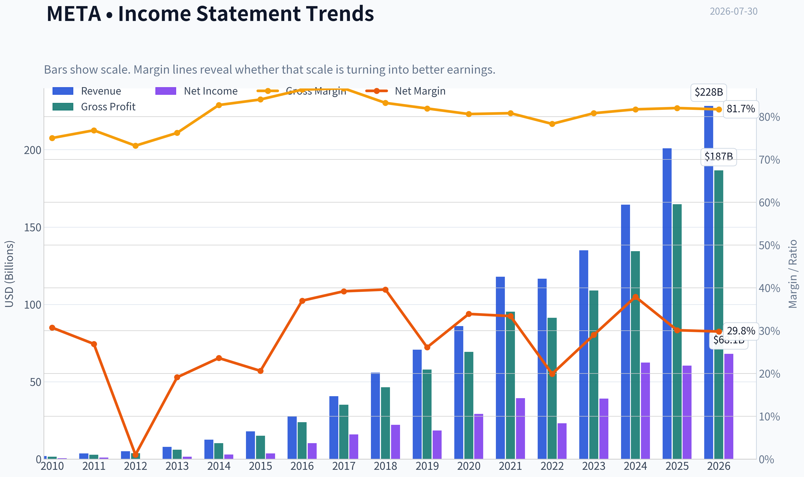
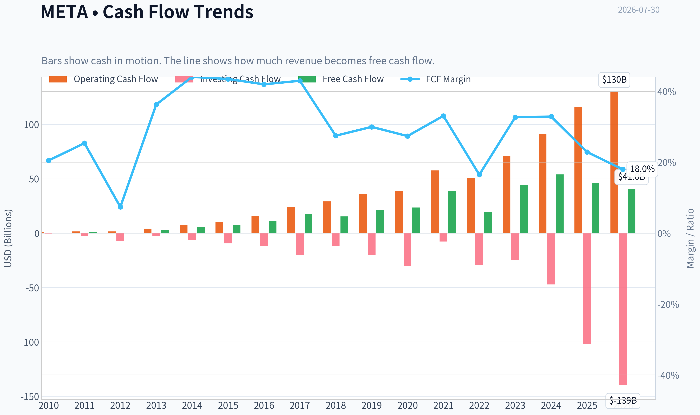
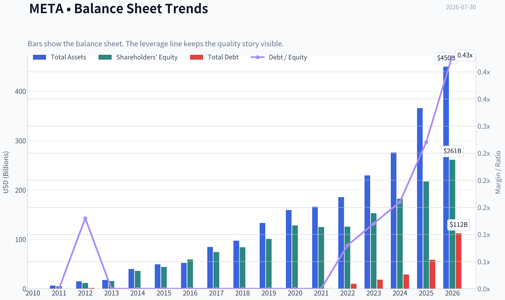
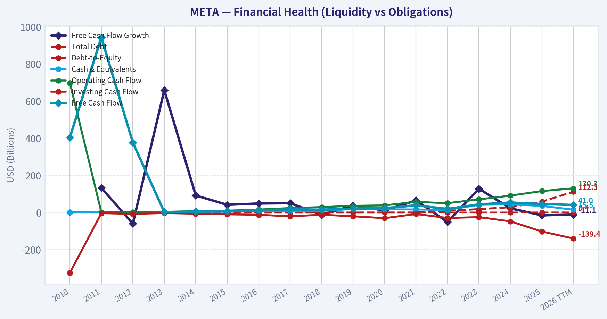
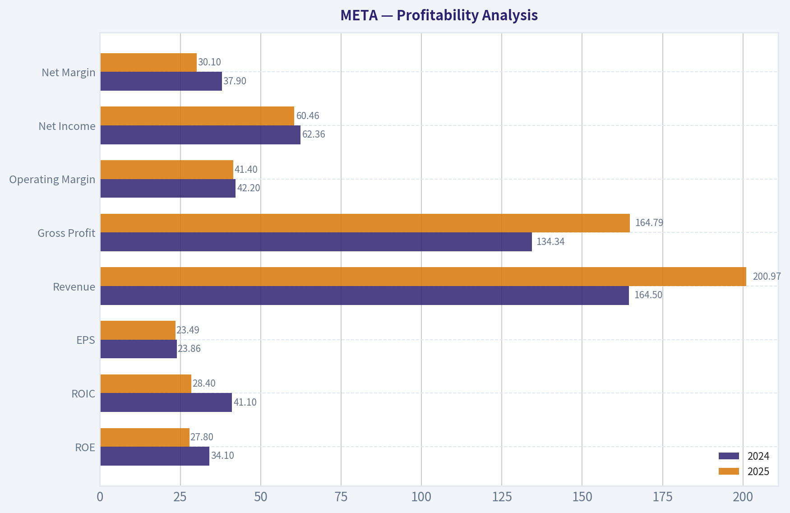
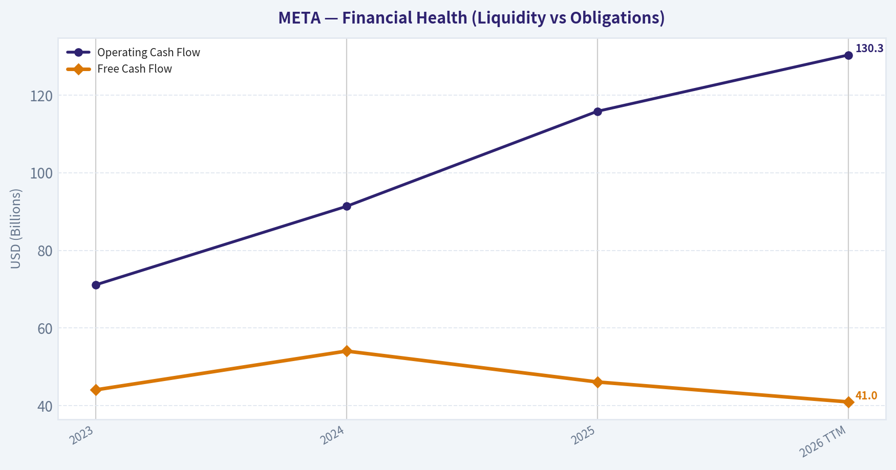
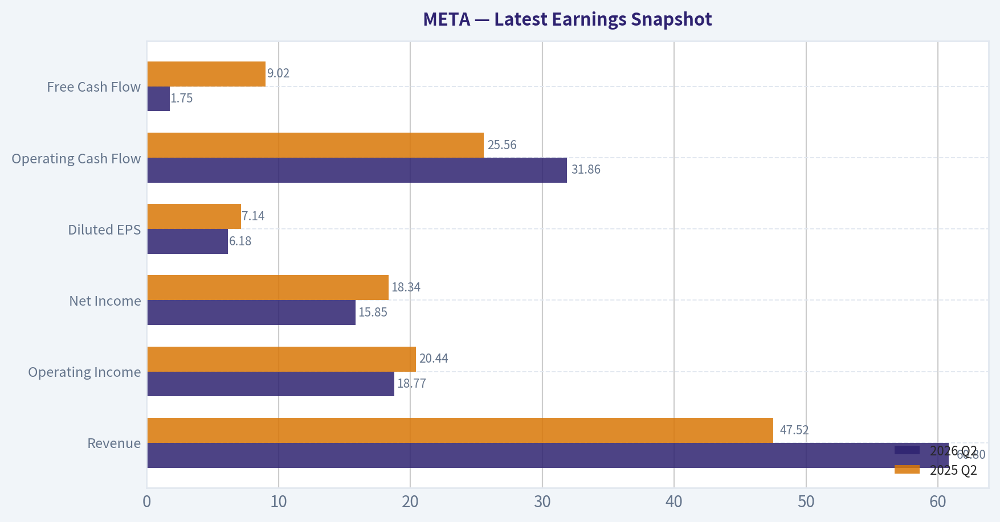
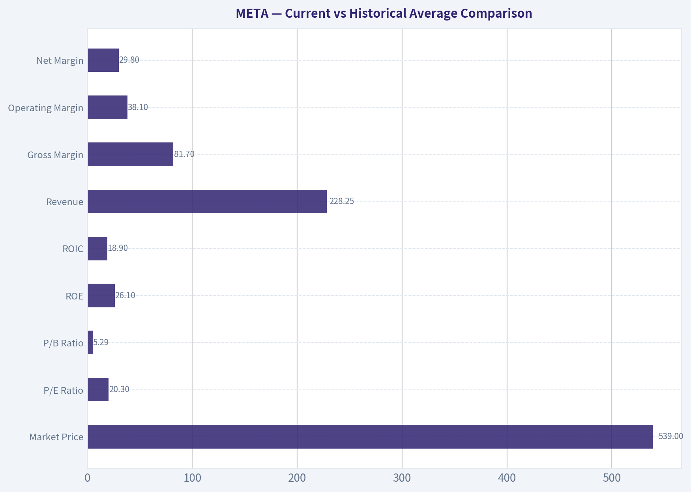
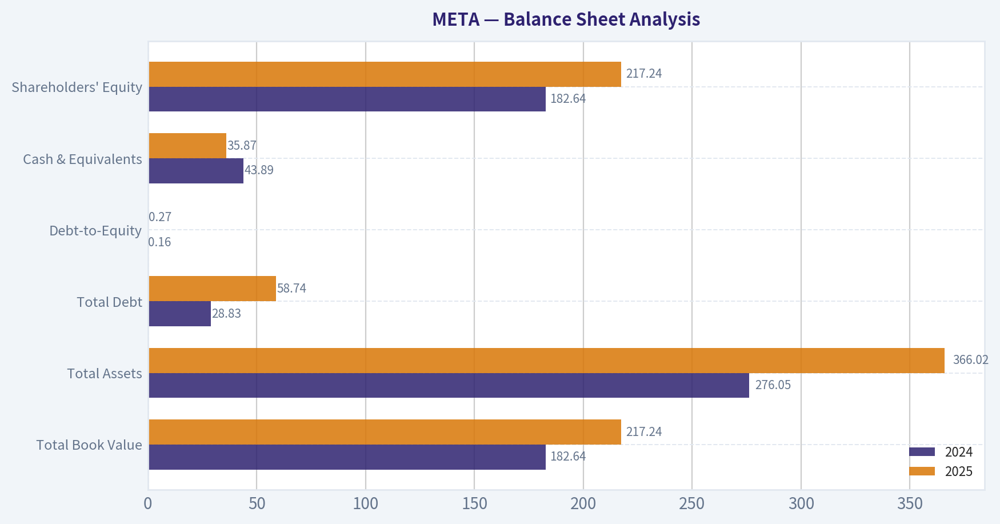
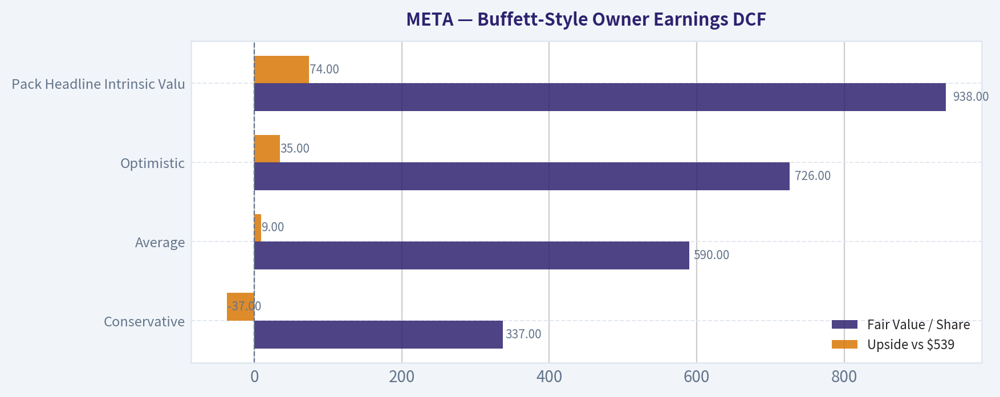

# META Deep Value Intelligence

**Analysis Date:** 2026-07-30

## Critical Disclaimer

*This analysis is generated by Deep Value Intelligence, an AI-powered multi-agent investing framework. Education & research only - not financial advice, not a financial advisor.*

---

## Table of Contents

1. Intelligence Summary
2. Analyst Team Reports
   - Fundamentals Analysis
   - Intrinsic Value Analysis (Buffett)
   - Trend & Growth Analysis (Lynch/Druckenmiller/Fisher)
   - Market Technical Analysis
   - Options Market Analysis
3. Research Team Commentary
4. Value Investing Team Commentary
5. Deep Values Commentary

---

## Intelligence Summary

### Thesis + Conditions

**Core Thesis:** **Executive Briefing**

**Key Risks:**
- Meta still fits the profile of a high-quality long-term compounder, and at about **22x earnings** the price looks **fair-to-good rather than excessive** for a business with this level of moat, profitability, and reinvestment runway. The key risk is **not franchise fragility**; it is **whether rising AI capex earns strong enough incremental returns** to sustain owner-earnings growth. That keeps this from being a deep-value bargain, but not from being investable.
- Compared with past mistakes, the right adjustment is to **separate long-term business risk from short-term stock/setup risk**. The chart may be messy and sentiment may wobble, but for a **5-10 year investor**, those are secondary unless they signal real business impairment. Right now, they do not. Best plan: **own it, but size sanely and monitor capex-to-monetization evidence, Family of Apps margins, FCF conversion, and WhatsApp/business messaging progress.**
- ## Risk Commentary for the Long-Term Investor

**Confidence:** Medium

---

## Analyst Team Reports

### Fundamentals Analysis

#### Latest Earnings Snapshot

*Most recent reported quarter anchored on 2026 Q2, with prior-year comparison when available.*

| Metric | 2026 Q2 | 2025 Q2 | YoY Change |
| --- | ---: | ---: | ---: |
| Revenue | $60.80B | $47.52B | +28.0% |
| Operating Income | $18.77B | $20.44B | -8.2% |
| Net Income | $15.85B | $18.34B | -13.6% |
| Diluted EPS | $6.18 | $7.14 | -13.4% |
| Operating Cash Flow | $31.86B | $25.56B | +24.7% |
| Free Cash Flow | $1.75B | $9.02B | -80.6% |

Key Takeaways: This snapshot anchors the most recent reported quarter before the narrative analysis. It helps readers separate long-run business quality from whatever changed in the latest earnings print.

#### 16-Year Financial Metrics for META

*All values below are computed deterministically from raw data - not estimated by AI.*

*Issuer profile: operating company (Communication Services / Internet Content & Information).*

#### 16-Year Financial Metrics
*Annual rows come from reported financial statements. The final TTM row is computed from the latest four quarters.*

| Metric | 2010 | 2011 | 2012 | 2013 | 2014 | 2015 | 2016 | 2017 | 2018 | 2019 | 2020 | 2021 | 2022 | 2023 | 2024 | 2025 | 2026 TTM |
| --- | --- | --- | --- | --- | --- | --- | --- | --- | --- | --- | --- | --- | --- | --- | --- | --- | --- |
| Market Price | N/A | N/A | $26 | $54 | $77 | $104 | $114 | $175 | $130 | $203 | $271 | $333 | $119 | $351 | $583 | $659 | $539 |
| Market Cap | N/A | N/A | $57.66B | $137.55B | $207.85B | $298.59B | $336.52B | $521.62B | $382.91B | $590.30B | $788.89B | $961.62B | $325.16B | $930.56B | $1.53T | $1.70T | $1.38T |
| P/E Ratio | N/A | N/A | 2662.00 | 91.08 | 70.93 | 81.13 | 32.97 | 32.74 | 17.32 | 31.92 | 27.07 | 24.43 | 14.01 | 23.80 | 24.54 | 28.10 | 20.30 |
| P/B Ratio | N/A | N/A | 4.91 | 8.89 | 5.76 | 6.75 | 5.69 | 7.02 | 4.55 | 5.84 | 6.15 | 7.70 | 2.59 | 6.08 | 8.38 | 7.82 | 5.29 |
| ROE | N/A | 20.4% | 0.5% | 9.7% | 8.1% | 8.3% | 17.3% | 21.4% | 26.3% | 18.3% | 22.7% | 31.5% | 18.5% | 25.5% | 34.1% | 27.8% | 26.1% |
| ROIC | N/A | 41.0% | 1.4% | 13.5% | 13.8% | 10.5% | 22.6% | 26.7% | 30.9% | 22.6% | 29.7% | 35.5% | 20.4% | 30.7% | 41.1% | 28.4% | 18.9% |
| EPS | $0.28 | $0.46 | $0.01 | $0.60 | $1.10 | $1.29 | $3.49 | $5.39 | $7.57 | $6.43 | $10.09 | $13.77 | $8.59 | $14.87 | $23.86 | $23.49 | $26.55 |
| Revenue | $1.97B | $3.71B | $5.09B | $7.87B | $12.47B | $17.93B | $27.64B | $40.65B | $55.84B | $70.70B | $85.97B | $117.93B | $116.61B | $134.90B | $164.50B | $200.97B | $228.25B |
| Gross Profit | $1.48B | $2.85B | $3.73B | $6.00B | $10.31B | $15.06B | $23.85B | $35.20B | $46.48B | $57.93B | $69.27B | $95.28B | $91.36B | $108.94B | $134.34B | $164.79B | $186.59B |
| Gross Margin | 75.0% | 76.8% | 73.2% | 76.2% | 82.7% | 84.0% | 86.3% | 86.6% | 83.2% | 81.9% | 80.6% | 80.8% | 78.3% | 80.8% | 81.7% | 82.0% | 81.7% |
| Operating Margin | 52.3% | 47.3% | 10.6% | 35.6% | 40.1% | 34.7% | 45.0% | 49.7% | 44.6% | 33.9% | 38.0% | 39.6% | 24.8% | 34.7% | 42.2% | 41.4% | 38.1% |
| Net Income | $606.0M | $1.00B | $53.0M | $1.50B | $2.94B | $3.69B | $10.22B | $15.93B | $22.11B | $18.48B | $29.15B | $39.37B | $23.20B | $39.10B | $62.36B | $60.46B | $68.10B |
| Net Margin | 30.7% | 26.9% | 1.0% | 19.1% | 23.6% | 20.6% | 37.0% | 39.2% | 39.6% | 26.1% | 33.9% | 33.4% | 19.9% | 29.0% | 37.9% | 30.1% | 29.8% |
| Revenue Growth | N/A | 88.0% | 37.1% | 54.7% | 58.4% | 43.8% | 54.2% | 47.1% | 37.4% | 26.6% | 21.6% | 37.2% | -1.1% | 15.7% | 21.9% | 22.2% | 13.6% |
| Net Income Growth | N/A | 65.0% | -94.7% | 2730.2% | 96.0% | 25.4% | 177.0% | 56.0% | 38.8% | -16.4% | 57.7% | 35.1% | -41.1% | 68.5% | 59.5% | -3.1% | 12.6% |
| Free Cash Flow Growth | N/A | 132.8% | -60.0% | 658.6% | 92.1% | 41.9% | 49.0% | 50.5% | -12.1% | 38.1% | 11.2% | 65.3% | -50.5% | 128.5% | 22.7% | -14.7% | -11.1% |
| Total Book Value | N/A | $4.90B | $11.76B | $15.47B | $36.10B | $44.22B | $59.19B | $74.35B | $84.13B | $101.05B | $128.29B | $124.88B | $125.71B | $153.17B | $182.64B | $217.24B | $261.22B |
| Total Assets | N/A | $6.33B | $15.10B | $17.89B | $39.97B | $49.41B | $52.26B | $84.52B | $97.33B | $133.38B | $159.32B | $165.99B | $185.73B | $229.62B | $276.05B | $366.02B | $449.96B |
| Total Debt | $0 | $0 | $1.50B | $0 | $0 | $0 | $0 | $0 | $0 | $0 | $0 | $0 | $9.92B | $18.39B | $28.83B | $58.74B | $112.32B |
| Debt-to-Equity | N/A | 0.00 | 0.13 | 0.00 | 0.00 | 0.00 | 0.00 | 0.00 | 0.00 | 0.00 | 0.00 | 0.00 | 0.08 | 0.12 | 0.16 | 0.27 | 0.43 |
| Cash & Equivalents | $1.78B | $1.51B | $2.38B | $3.32B | $4.32B | $4.91B | $8.90B | $8.08B | $10.02B | $19.08B | $17.58B | $16.60B | $14.68B | $41.86B | $43.89B | $35.87B | $15.46B |
| Shareholders' Equity | N/A | $4.90B | $11.76B | $15.47B | $36.10B | $44.22B | $59.19B | $74.35B | $84.13B | $101.05B | $128.29B | $124.88B | $125.71B | $153.17B | $182.64B | $217.24B | $261.22B |
| Operating Cash Flow | $698.0M | $1.55B | $1.61B | $4.22B | $7.33B | $10.32B | $16.11B | $24.22B | $29.27B | $36.31B | $38.75B | $57.68B | $50.48B | $71.11B | $91.33B | $115.80B | $130.30B |
| Investing Cash Flow | $-324.0M | $-3.02B | $-7.02B | $-2.62B | $-5.91B | $-9.43B | $-11.79B | $-20.12B | $-11.60B | $-19.86B | $-30.06B | $-7.57B | $-28.97B | $-24.50B | $-47.15B | $-102.00B | $-139.37B |
| Free Cash Flow | $405.0M | $943.0M | $377.0M | $2.86B | $5.50B | $7.80B | $11.62B | $17.48B | $15.36B | $21.21B | $23.58B | $38.99B | $19.29B | $44.07B | $54.07B | $46.11B | $40.98B |
| FCF Margin | 20.5% | 25.4% | 7.4% | 36.3% | 44.1% | 43.5% | 42.0% | 43.0% | 27.5% | 30.0% | 27.4% | 33.1% | 16.5% | 32.7% | 32.9% | 22.9% | 18.0% |
| Dividends / Share | $0.00 | $0.00 | $0.00 | $0.00 | $0.00 | $0.00 | $0.00 | $0.00 | $0.00 | $0.00 | $0.00 | $0.00 | $0.00 | $0.00 | $1.94 | $2.07 | $2.09 |

#### Profitability Metrics
- Return on Equity (ROE): 27.8%
- Return on Invested Capital (ROIC): 24.4%
- Return on Assets (ROA): 16.5%
- Gross Margin: 82.0%
- Operating Margin: 41.4%
- Net Profit Margin: 30.1%

#### Liquidity Metrics
- Current Ratio: 2.60
- Quick Ratio: 2.42

#### Leverage Metrics
- Debt-to-Equity Ratio: 0.27
- Interest Coverage Ratio: 76.40
- Net Debt: $22.87B

#### Growth Metrics (Year-over-Year)
- Revenue Growth: 22.2%
- Net Income Growth: -3.1%
- Free Cash Flow Growth: -14.7%
- Revenue CAGR (3-Year): 19.9%
- Revenue CAGR (5-Year): 18.5%

#### Valuation Metrics
- P/E Ratio (TTM): 22.07
- Forward P/E: 14.74
- Price-to-Book: 5.61
- Price-to-Sales: 6.39
- PEG Ratio: 0.87
- EV/EBITDA: 13.65
- Free Cash Flow Yield: 3.4%
- Earnings Yield: 4.5%

#### Owner Earnings (Buffett Method, Code-Computed)
- Net Income: $60.46B
- + Depreciation & Amortization: $18.62B
- - Capital Expenditures: $-69.69B
- - Working Capital Changes: $-885.0M
- = **Owner Earnings: $61.34B**

#### Intrinsic Value (Code-Computed)
- Current Price: $539
- **Headline Intrinsic Value (business-model routed): $938**
  Business model: asset light platform - weighted blend [Damodaran FCFF + reverse-DCF fair + owner-earnings DCF] (asset_light_platform)
  Model spread (min-max across DCFs): $537 - $1,026
  Margin of safety vs. price (headline): 42.5%
  Routing note: Asset-light / high-margin platform: value driven by margins and reinvestment economics - the headline centers on the reverse-DCF demonstrated-growth fair value with Damodaran FCFF as a floor, down-weighting the owner-earnings DCF.
- Buffett Method (Owner Earnings):
  Conservative: $233
  Average: $1,026
  Optimistic: $2,528
- Cash Flow Method (FCF):
  Conservative: $119
  Average: $537
  Optimistic: $1,458
- Damodaran FCFF (WACC + margins + reinvestment):
  Conservative: $724
  Average: $1,009
  Optimistic: $1,909
  Monte Carlo band (P10-P90): $792 - $1,616 (median $1,103)
  P(intrinsic value > price): 99.9%
- Reverse-DCF: price implies ~12.3%/yr owner-earnings growth for 10y; trailing 3y was 51.9%, 5y 34.4%.

#### Piotroski F-Score: 5/9
- Positive Net Income: PASS
- Positive Operating Cash Flow: PASS
- ROA Improvement: FAIL
- Cash Flow > Net Income: PASS
- Decreasing Debt: FAIL
- Improving Current Ratio: FAIL
- No Dilution: PASS
- Improving Gross Margin: PASS
- Improving Asset Turnover: FAIL

ANALYST STANCE: **ADVOCATE**

#### META - Buffett-Style Fundamental Analysis

META is an unusual "value" case in Buffett terms: it is not statistically cheap on old-school book metrics, but it is a high-margin, asset-light platform with exceptional earning power, strong reinvestment economics, and a code-computed intrinsic value materially above the current price. For this issuer type, **P/B should not be treated as a primary valuation anchor**. META's worth is better judged through owner earnings, free cash flow, return on capital, and durability of its advertising/network ecosystem.

---

#### Current vs Historical Average Comparison

| Metric | Current / TTM | 10-Year Historical Context* | Interpretation |
| --- | ---: | ---: | --- |
| Market Price | $539 | Range over shown period: $26 to $659 | Shares have compounded enormously, though with major drawdowns in 2018 and especially 2022. Current price is below the 2025 high of $659 and below intrinsic-value estimates in the pack. |
| Market Cap | $1.38T | Grew from $57.66B in 2012 to $1.70T in 2025 | META has scaled from a fast-growing internet company into a mega-cap franchise. Current market cap reflects some derating from 2025 despite higher TTM earnings power. |
| P/E Ratio | 20.30 | Roughly low-30s average across mature years; 14.01 in 2022 trough, 28.10 in 2025 | Current multiple is below much of META's post-IPO history and modest for a business still compounding revenue double digits with elite margins. |
| P/B Ratio | 5.29 | Mostly 4.5x-8.9x historically | **Not a meaningful primary value signal** for an asset-light platform business. Buybacks, intangible value, and network effects make book value a weak proxy for intrinsic worth. |
| ROE | 26.1% | 10-year average roughly mid-20s | Still excellent and comfortably above most large-cap peers, though below 2024's peak 34.1%. Indicates durable profitability even after capex ramp. |
| ROIC | 18.9% | Frequently 20%-41% in recent years | Current ROIC remains strong but has compressed versus 2024-2025, reflecting heavier capital deployment and AI infrastructure investment. |
| Revenue | $228.25B | From $27.64B in 2016 to $200.97B in 2025 | Scale is extraordinary; even at this size META is still growing double digits. |
| Gross Margin | 81.7% | Generally 78%-86% | Very stable and elite, supporting moat and pricing power in digital advertising/software economics. |
| Operating Margin | 38.1% | Typically mid-30s to high-40s; trough 24.8% in 2022 | Healthy despite major AI and infrastructure spending; lower than 2024-2025 but still exceptional. |
| Net Margin | 29.8% | Usually high-20s to high-30s; trough 19.9% in 2022 | Strong normalized profitability remains intact. |
| Free Cash Flow | $40.98B | 10-year average far below current absolute level; down from 2024-2025 highs | FCF remains large but is under pressure from capex intensity. |
| Debt-to-Equity | 0.43 | Zero for most of history; 0.27 in 2025 | Leverage is rising meaningfully from a historically debt-free base. Not dangerous yet, but a real trend shift to monitor. |
| Cash & Equivalents | $15.46B | Peaked at $43.89B in 2024 | Cash has fallen sharply as investment and capital allocation accelerated. |
| Dividends / Share | $2.09 | New in 2024; $1.94 in 2024, $2.07 in 2025 | Dividend initiation signals maturity and confidence in cash generation, though yield is low and buybacks/capex remain more important. |

*Historical context uses the deterministic dataset years shown, with emphasis on the last decade and TTM where relevant.

Key Takeaways: META's current valuation looks more restrained than its history would suggest, especially on earnings. Profitability remains elite, but capital intensity has clearly risen, which is showing up in lower ROIC, lower FCF margins, lower cash balances, and higher leverage. This is still a very strong business, but the market is now asking whether AI spending will earn adequate returns.

---

#### Market Metrics

META's **current price of $539** sits below the 2025 level of $659 even though TTM EPS has improved to **$26.55** from **$23.49** in 2025. That mismatch indicates a multiple compression rather than deterioration in core earning power.

At **$1.38T market cap**, META remains one of the world's dominant platforms. The size matters in a Buffett framework because future returns depend less on "can it grow?" and more on "can it compound profitably from here without destroying returns on capital?" So far, the answer remains mostly yes.

The **TTM P/E around 20.3** is attractive relative to META's own history:
- 2021: 24.43
- 2023: 23.80
- 2024: 24.54
- 2025: 28.10
- 2026 TTM: 20.30

That suggests the stock is being priced with more skepticism than in many recent years, likely due to AI capex concerns and uncertainty around monetization durability.

The **P/B ratio of 5.29** should **not** be read mechanically. META is an **asset-light, IP- and network-driven platform**. Its economic value lies in attention, advertiser demand, data advantages, engineering talent, and monetization infrastructure-not in tangible book. For META, intrinsic value should be anchored on **owner earnings / FCF / FCFF**, not book multiples.

---

#### Profitability Analysis

| Metric | 2024 | 2025 | 2026 TTM | Commentary |
| --- | ---: | ---: | ---: | --- |
| ROE | 34.1% | 27.8% | 26.1% | Still outstanding, though off peak levels as equity base and capital deployment rose. |
| ROIC | 41.1% | 28.4% | 18.9% | Most important pressure point; still good, but declining as invested capital rises faster than operating profit. |
| EPS | $23.86 | $23.49 | $26.55 | Earnings per share resumed growth despite capex burden. |
| Revenue | $164.50B | $200.97B | $228.25B | Massive scale with continued growth. |
| Gross Profit | $134.34B | $164.79B | $186.59B | Gross profit expands nearly in line with revenue, preserving economic quality. |
| Operating Margin | 42.2% | 41.4% | 38.1% | Some compression from AI and infrastructure spend, but still elite. |
| Net Income | $62.36B | $60.46B | $68.10B | Slight dip in 2025, then recovery in TTM. |
| Net Margin | 37.9% | 30.1% | 29.8% | Lower than 2024 peak, but still exceptional for a business of this scale. |

Key Takeaways: META's profitability is still world-class. The main change is not weakness in demand or gross economics, but heavier spending below the gross-profit line-especially infrastructure and AI-related investment. Even after that pressure, the company remains one of the most profitable large businesses globally.

META's **gross margin around 82%** is one of the clearest signs of moat quality. Few companies can sustain 80%+ gross margins at over $200B of revenue. That reflects digital ad economics, software-like monetization, and enormous scale efficiencies.

**Operating margin of 38.1%** and **net margin of 29.8%** remain Buffett-friendly: high, resilient, and earned repeatedly over time. The 2022 drawdown now looks more cyclical/self-inflicted than structural, given the rebound in 2023-2026 TTM.

**ROE of 26.1%** remains excellent. More important, it is not being driven by dangerous leverage; even with rising debt, META's balance sheet is still fundamentally strong.

The key watch item is **ROIC falling to 18.9% TTM** from **41.1% in 2024**. For Buffett-style analysis, that is the most serious quantitative yellow flag. It may simply reflect a temporary surge in investment ahead of monetization, but if that capital does not earn attractive returns, intrinsic value estimates would need to come down.

---

#### Growth Metrics

| Growth Metric | 2023 | 2024 | 2025 | 2026 TTM | Interpretation |
| --- | ---: | ---: | ---: | ---: | --- |
| Revenue Growth | 15.7% | 21.9% | 22.2% | 13.6% | Strong and durable, though naturally moderating on a larger base. |
| Net Income Growth | 68.5% | 59.5% | -3.1% | 12.6% | Volatile due to spending cycle, but underlying earnings power remains upward. |
| FCF Growth | 128.5% | 22.7% | -14.7% | -11.1% | Weakest line item right now due to capex intensity. |

Key Takeaways: Revenue growth remains healthy and much more stable than cash-flow growth. Profit and free cash flow are increasingly shaped by management's investment pace rather than by underlying demand alone. That means investors should focus less on near-term FCF volatility and more on whether capex is translating into future monetization and durable returns.

META's growth profile has matured but remains exceptional for its size:
- **3-year revenue CAGR: 19.9%**
- **5-year revenue CAGR: 18.5%**

Those are elite numbers for a trillion-dollar platform.

However, **free cash flow growth has turned negative** in 2025 and TTM. That is important because Buffett cares deeply about cash that can be taken out of the business without harming the moat. If FCF remains persistently pressured, owner-earnings-based valuation must be applied conservatively.

Still, the reverse-DCF in the pack says the current price implies only about **12.3% owner-earnings growth for 10 years**. Compared with trailing **34.4% 5-year** and **51.9% 3-year** owner-earnings growth, that hurdle appears achievable if AI investment earns even moderately decent returns.

---

#### Balance Sheet Analysis

| Metric | 2024 | 2025 | 2026 TTM | Trend |
| --- | ---: | ---: | ---: | --- |
| Total Book Value | $182.64B | $217.24B | $261.22B | Rising strongly |
| Total Assets | $276.05B | $366.02B | $449.96B | Rising very rapidly |
| Total Debt | $28.83B | $58.74B | $112.32B | Sharp increase |
| Debt-to-Equity | 0.16 | 0.27 | 0.43 | Clear leverage build |
| Cash & Equivalents | $43.89B | $35.87B | $15.46B | Significant decline |
| Shareholders' Equity | $182.64B | $217.24B | $261.22B | Strong absolute expansion |

Key Takeaways: META still has a solid balance sheet, but the capital structure is changing fast. Debt has risen sharply while cash has fallen, reflecting an aggressive investment phase. This is not a distress signal today, but it is a major departure from META's historically fortress-like net-cash posture.

For most of the past decade, META effectively had **no debt**. That made the company especially Buffett-like: internally funded growth, high returns, and balance-sheet resilience.

That is changing:
- Debt has climbed from **$9.92B in 2022** to **$112.32B TTM**
- Debt/equity has risen from **0.08** to **0.43**
- Cash has fallen from **$41.86B in 2023** and **$43.89B in 2024** to **$15.46B TTM**

Even so, the broader leverage metrics remain manageable:
- **Interest coverage: 76.4x**
- **Current ratio: 2.60**
- **Quick ratio: 2.42**

So this is not a solvency problem. It is a **capital allocation regime change**. Buffett-style investors should watch whether debt-funded or debt-accompanied AI investment produces high returns; if not, META's quality multiple should compress.

---

#### Cash Flow Analysis

| Metric | 2023 | 2024 | 2025 | 2026 TTM |
| --- | ---: | ---: | ---: | ---: |
| Operating Cash Flow | $71.11B | $91.33B | $115.80B | $130.30B |
| Free Cash Flow | $44.07B | $54.07B | $46.11B | $40.98B |
| FCF Margin | 32.7% | 32.9% | 22.9% | 18.0% |
| Dividends / Share | $0.00 | $1.94 | $2.07 | $2.09 |

Key Takeaways: Operating cash flow is still surging, which tells you the core engine remains very healthy. The problem is that free cash flow conversion has weakened sharply because capital expenditures have exploded. META is still a cash machine, but right now much more of that cash is being reinvested rather than flowing through to owners.

This is the core debate in the stock. **Operating cash flow is excellent**, but **free cash flow is under pressure**. That divergence means the business itself is strong, but management is choosing to spend much more aggressively.

Dividend policy is newly shareholder-friendly but still modest. The dividend is more a signal of confidence and maturity than a primary source of returns. For META, repurchases and reinvestment outcomes matter much more than income yield.

---

#### Buffett-Style Qualitative Analysis

| Buffett Lens | Assessment | Why It Matters |
| --- | --- | --- |
| Economic Moat | Strong | Global social graph, advertiser demand aggregation, targeting/data capabilities, creator ecosystem, and immense user attention create network effects and scale advantages. |
| Financial Strength | Good, but deteriorating from peak fortress levels | High profitability and coverage ratios offset a sharp rise in debt and falling cash. |
| Predictable Earnings | Generally strong | Earnings have proven cyclical around investment phases and ad markets, but long-run trend is highly positive and margins remain unusually resilient. |
| Management Performance | Above average, with one major debate | Cost discipline improved dramatically after 2022, but current AI capex surge must still be validated by returns. |
| Capital Allocation | Mixed-to-good | Dividend initiation and continued scale economics are positives; rapidly rising debt and weaker FCF conversion warrant scrutiny. |
| Quality of Business | Excellent | High margins, large revenue base, recurring ad demand, and strong monetization infrastructure support durability. |

Key Takeaways: By Buffett standards, META is a high-quality business with a real moat and unusually strong economics. The only major controversy is capital allocation during the current AI build-out. If that spend proves productive, today's valuation looks attractive; if not, returns on capital may continue to drift lower.

**Economic moat:** META's moat is rooted in scale, network effects, advertiser ROI, and distribution. Billions of users across its family of apps create a powerful two-sided marketplace between attention and advertisers. This kind of ecosystem is difficult to replicate because scale improves targeting, ad load optimization, and creator monetization.

**Predictable earnings:** Not perfectly smooth, but highly durable. Revenue fell only **-1.1% in 2022**, a difficult year for digital advertising and company-specific spending. It then resumed strong growth. That suggests the franchise was bruised, not broken.

**Management:** The 2022-2023 reset improved confidence in management's willingness to respond when spending outruns returns. However, the current capex wave reopens the same question at a larger scale. Buffett would likely admire the core business but remain disciplined about the returns on incremental capital.

---

#### Revenue Breakdown

Using the most meaningful public segmentation for META, the business is overwhelmingly advertising-driven, with Reality Labs/other revenue a small minority.

| Revenue Source | Amount ($B) | % of Total |
| --- | ---: | ---: |
| Family of Apps advertising and related revenue | ~196.8 | ~97.9% |
| Reality Labs and other revenue | ~4.2 | ~2.1% |
| **Total (FY2025)** | **200.97** | **100.0%** |

Key Takeaways: META remains fundamentally an advertising platform, not a diversified conglomerate. Nearly all revenue still comes from monetizing user attention across its core app ecosystem, while Reality Labs remains financially small relative to the core. That concentration is a strength because the ad engine is extraordinary, but it also means regulatory and ad-market risks matter a lot.

---

#### Buffett-Style Owner Earnings DCF

The research pack's model-based intrinsic value is the best anchor:
- **Headline intrinsic value:** **$938**
- Business-model routed blend for asset-light platform
- Model spread: **$537 to $1,026**
- Margin of safety vs current price: **42.5%**

Below is a hand-built Buffett-style owner earnings sanity check using:
- Base owner earnings: **$61.34B**
- Discount rate: **10%**
- Terminal growth: **2.5%**
- Current price: **$539**

To convert enterprise value to per-share value, I use the pack's implied share count from market cap / price:
- **Approx. diluted shares = $1.38T / $539 ~ 2.56B shares**

##### Conservative Scenario
Assumptions:
- Year 1-10 owner earnings growth: **3%**
- Terminal growth: **2.5%**
- Discount rate: **10%**

DCF math:
- Year-10 owner earnings = 61.34 x (1.03^10) = **$82.42B**
- Terminal value at year 10 = 82.42 x 1.025 / (0.10 - 0.025) = **$1,126.37B**
- PV of 10-year owner earnings stream
  = 61.34 x [(1 - (1.03/1.10)^10) / (0.10 - 0.03)]
  ~ **$428.8B**
- PV of terminal value
  = 1,126.37 / (1.10^10)
  ~ **$434.2B**
- Total equity value ~ **$863.0B**
- Per share ~ **$337**

##### Average Scenario
Assumptions:
- Owner earnings growth starts at **12%** for 5 years, then fades to **6%** for years 6-10
- Terminal growth: **2.5%**
- Discount rate: **10%**

Approximate DCF:
- Year 5 owner earnings = 61.34 x (1.12^5) = **$108.1B**
- Year 10 owner earnings = 108.1 x (1.06^5) = **$144.7B**
- PV of years 1-5 OE ~ **$376.8B**
- PV of years 6-10 OE ~ **$369.8B**
- Terminal value at year 10 = 144.7 x 1.025 / 0.075 = **$1,977.6B**
- PV of terminal value ~ **$762.2B**
- Total equity value ~ **$1,508.8B**
- Per share ~ **$590**

##### Optimistic Scenario
Assumptions:
- Owner earnings growth starts at **16%** for 5 years, then fades to **8%** for years 6-10
- Terminal growth: **2.5%**
- Discount rate: **10%**

Approximate DCF:
- Year 5 owner earnings = 61.34 x (1.16^5) = **$128.8B**
- Year 10 owner earnings = 128.8 x (1.08^5) = **$189.3B**
- PV of years 1-5 OE ~ **$416.6B**
- PV of years 6-10 OE ~ **$444.9B**
- Terminal value at year 10 = 189.3 x 1.025 / 0.075 = **$2,587.1B**
- PV of terminal value ~ **$997.3B**
- Total equity value ~ **$1,858.8B**
- Per share ~ **$726**

| DCF Scenario | Fair Value / Share | Upside vs $539 | View |
| --- | ---: | ---: | --- |
| Conservative | $337 | -37% | Implies current price is too high if AI spending yields only GDP-like growth. |
| Average | $590 | +9% | Suggests current price is around fair-to-modestly-undervalued on a moderate success case. |
| Optimistic | $726 | +35% | Reasonable if AI investments produce durable monetization and high incremental returns. |
| Pack Headline Intrinsic Value | $938 | +74% | Stronger model-based anchor; likely reflects better treatment of normalized economics and reverse-DCF evidence. |

Key Takeaways: A cautious hand DCF gives a wide range, from $337 to $726 per share, with a middle case near $590. The research pack's stronger blended intrinsic value of $938 is much higher because it gives more credit to META's historically superior growth and margin structure. Taken together, the evidence suggests limited downside if execution remains solid and substantial upside if AI spending translates into future earning power.

Interpretation:
- My hand DCF is intentionally more conservative than the pack's routed valuation.
- The **reverse-DCF** is especially important: the market price implies only **~12.3% owner-earnings growth** for 10 years.
- Given META's historical growth, moat, and margins, that does not look demanding unless AI capex meaningfully destroys returns.

So the most reasonable Buffett-style conclusion is:
- **Current market price is not a screaming bargain on depressed near-term FCF**
- But it **does look attractive relative to normalized owner earnings power and model-based intrinsic value**

---

#### Key Investment Insights, Red Flags, and Opportunities

| Category | Item | Assessment |
| --- | --- | --- |
| Opportunity | Valuation below intrinsic value anchor | Strong positive; $539 vs $938 headline intrinsic value suggests material discount. |
| Opportunity | Elite gross margins and scale | Supports durable compounding and resilience. |
| Opportunity | Revenue still growing double digits at huge scale | Rare for a trillion-dollar platform. |
| Opportunity | Reverse-DCF hurdle appears achievable | Market-implied 12.3% OE growth seems manageable against history. |
| Red Flag | Debt rising sharply | Biggest balance-sheet change; must not become structural dependence. |
| Red Flag | Cash balance falling | Reduces flexibility versus prior years. |
| Red Flag | ROIC compression | Key sign to monitor whether new investment is earning enough. |
| Red Flag | FCF deterioration | Current free cash flow is being squeezed by capex. |
| Watch Item | Revenue concentration in advertising | Core strength, but also concentration risk. |
| Watch Item | Regulatory/antitrust/privacy pressure | Ongoing structural overhang on monetization and platform practices. |

Key Takeaways: The bull case is straightforward: world-class business quality at a valuation that does not fully reflect normalized earning power. The bear case is also clear: the company may be entering a more capital-intensive era with lower returns on incremental investment. That makes ROIC and FCF conversion the critical indicators to monitor from here.

---

#### Final Buffett-Style Judgment

META checks many Buffett boxes:
- Strong moat
- Very high margins
- Large and durable cash generation
- Excellent long-term revenue and earnings growth
- Attractive valuation relative to intrinsic value models

The main caveat is that META is no longer the ultra-clean, net-cash, low-capex story it once was. It is transitioning into a business investing enormous sums in AI infrastructure, and that raises the bar for management execution.

Even so, at **20.3x TTM earnings**, with a **headline intrinsic value of $938**, and a market-implied growth hurdle that appears reasonable, the stock still looks attractive for a long-term quality investor.

#### Final Stance

**ADVOCATE**

Rationale: META combines a high-quality moat, exceptional profitability, durable revenue growth, and a valuation that appears undemanding relative to normalized owner earnings and the deterministic pack's intrinsic value framework. The stock is not riskless-rising debt, lower cash, weaker FCF conversion, and declining ROIC are real concerns-but those concerns appear more than reflected in the current multiple. For a Buffett-style investor focused on business quality and intrinsic value rather than book multiples, META remains a compelling long-term candidate.

---

#### Summary Table

| Area | Verdict | Evidence | What Matters Most Next |
| --- | --- | --- | --- |
| Valuation | Attractive | P/E 20.3, headline intrinsic value $938 vs price $539 | Whether AI spend earns high returns |
| Moat | Strong | Network effects, ad ecosystem, user scale, high gross margins | Engagement and advertiser ROI durability |
| Profitability | Excellent | 81.7% gross margin, 38.1% operating margin, 29.8% net margin | Margin stability amid capex ramp |
| Growth | Strong | 13.6% TTM revenue growth, 18.5% 5-year revenue CAGR | Sustaining double-digit growth at scale |
| Balance Sheet | Good but weakening | Debt up to $112.32B, cash down to $15.46B | Leverage discipline and liquidity preservation |
| Cash Flow | Mixed | OCF very strong, FCF and FCF margin under pressure | Capex payoff and FCF recovery |
| Management | Capable, under scrutiny | Strong post-2022 rebound, but heavy AI spend | ROIC trend over next 2-3 years |
| Buffett Fit | High quality, not classic cigar butt | Better valued on owner earnings than book value | Normalized cash-generation power |
| Overall | **ADVOCATE** | High-quality compounder trading below intrinsic value estimates | Monitor ROIC, debt, and FCF conversion closely |

Key Takeaways: META remains a high-quality compounder rather than a traditional asset-based value play. The business is strong enough that even with heavier investment and more leverage, the shares still look attractive versus intrinsic value. The investment case now depends less on whether META has a moat and more on whether management can turn massive AI spending into high-return earnings growth.

#### Fundamental Visuals

This graph tracks the profitability and return metrics (ROE, ROIC, Margins) of **META** over the past decade, highlighting capital efficiency trends.

This chart illustrates the financial health of **META** over the last 10 years, mapping cash equivalents and free cash flow against total obligations (Debt).

This comparison chart from *Profitability Analysis* stacks current figures against historical benchmarks for **META**, making it easy to see where the company trades relative to its own averages.

This chart illustrates the financial health of **META** over the last 10 years, mapping cash equivalents and free cash flow against total obligations (Debt).

---

### Intrinsic Value Analysis (Buffett)

> *Following Warren Buffett's value investing philosophy: Circle of Competence, Economic Moat, Management Quality, and Margin of Safety.*

#### Intrinsic Value Snapshot

Price is what you pay. Intrinsic value is what the business may be worth based on the cash it can create for owners over time. We show a range, not one magic number.

- Current Price: $539.03
- Value Range (conservative to optimistic across both DCF methods): $119.34 to $2,527.80

##### Owner Earnings (Buffett Method)
- Net Income: $60,458,000,000.00
- Depreciation & Amortization: $18,616,000,000.00
- Capital Expenditures: $-69,691,000,000.00
- Working Capital Changes: $-885,000,000.00
- Owner Earnings: $61,343,000,000.00

##### Intrinsic Value
###### Buffett Method
Uses owner earnings. Stricter, and usually more conservative.
- Conservative: $233.27
- Average: $1,025.57
- Optimistic: $2,527.80
- Discount Rate: 10.0%

###### Cash Flow Method
Uses free cash flow. Better for companies spending heavily today to grow tomorrow.
- Conservative: $119.34
- Average: $536.74
- Optimistic: $1,458.33
- Discount Rate: 10.0%

ANALYST STANCE: **ADVOCATE**

#### META Platforms (META) - Buffett-Style Investment Review

#### 1) Factor Scorecard (Factors 1-4 + Gate 5)

| Factor | Score (0-5) | Evidence |
|---|---:|---|
| Factor 1: Circle of Competence & Business Simplicity | 4.5 | META makes money primarily by selling highly targeted digital advertising across Facebook, Instagram, Reels, WhatsApp, and Messenger. The model is easy to explain: user attention attracts advertisers; better targeting and measurement improve ad pricing. The business has evolved materially over 5 years, but the changes largely strengthened the franchise through AI recommendation engines and monetization of short-form video. |
| Factor 2: Moat Test | 4.5 | Gross margin of 82% is exceptional and strongly supports intangible assets and platform economics. Global scale, advertiser demand, user networks, data advantage, and cross-platform reach create a moat rooted in network effects, switching costs for advertisers, and cost advantages in AI and infrastructure. |
| Factor 3: Management Quality & Capital Allocation | 4.0 | Management has shown willingness to make long-term bets and course-correct. Capital allocation was questioned during peak metaverse spending, but recent operating discipline and strong AI-driven monetization improvements support a favorable assessment. Buybacks and reinvestment remain substantial and economically sensible given high returns and scale. |
| Factor 4: Industry Structure | 3.5 | Digital advertising is attractive but competitive. The strongest players benefit from scale and data flywheels, yet budgets are contested by Alphabet, Amazon, TikTok, and emerging formats. Still, the industry tends toward concentration among major platforms with measurable ROI. |

**Gate 5 hard floor: NOT tripped.**
META does **not** show the combination of deteriorating earnings/cash flow and solvency stress required for a hard AVOID. Profitability is strong, cash generation is robust, and balance-sheet risk is low.

**Key Takeaways:** META scores as a high-quality platform business with a strong moat and clear earnings power. The only notable demerit is industry competition and some capital-allocation volatility, not financial distress or franchise weakness.

---

#### 2) Moat Analysis

| Moat Source | Assessment | Evidence |
|---|---|---|
| Intangible Assets | Strong | Facebook and Instagram are among the most valuable consumer internet brands globally. Advertisers use META because it delivers scaled reach and measurable conversion. Gross margin of 82% indicates strong pricing power and favorable unit economics. |
| Switching Costs | Moderate to Strong | Advertisers can technically move budgets, but accumulated campaign data, creative optimization, audience targeting, and embedded workflows create practical switching frictions. For users, social graphs and creator ecosystems add stickiness. |
| Cost Advantages | Strong | META's scale in AI training, ad infrastructure, and global delivery lowers unit costs and improves performance versus smaller rivals. Enormous fixed-cost absorption helps sustain superior economics. |
| Network Effects | Strong | Users attract creators; creators attract users; both attract advertisers; advertiser demand funds better tools and infrastructure. This flywheel is especially powerful across Instagram and Facebook at global scale. |

**Moat rating: Wide & Stable, with elements of widening through AI-driven ad performance.**

META's moat is not just "social media popularity." It is a system-level advantage combining attention, identity, data, creator ecosystems, ad tools, and machine-learning optimization. That makes replication difficult, even for very large competitors.

---

#### 3) Management Quality Assessment

| Dimension | Assessment | Evidence |
|---|---|---|
| Owner Mindset | Good | Founder-led control supports long-term decision-making and willingness to invest through cycles. This is often a positive in platform businesses with long-duration opportunities. |
| Honesty & Candor | Mixed to Good | Management has acknowledged strategic pivots and efficiency needs. The "year of efficiency" demonstrated responsiveness after investor criticism over spending intensity. |
| Capital Allocation | Good | Reinvestment in AI infrastructure appears justified by improving monetization and engagement. Prior metaverse spending was a meaningful demerit, but the core ad engine has continued to compound value and buybacks have supported per-share economics. |
| Shareholder Alignment | Good | Founder-led control can cut both ways, but long-term orientation is evident. Investors must accept governance concentration in exchange for strategic continuity. |

**Overall management score: 4.0/5.0.**
This is not textbook Buffett-style conservative stewardship, but it is effective founder-led capital allocation inside a dominant platform. The key question is whether spending produces durable returns; right now, core business evidence says yes.

---

#### 4) Financial Summary Table

| Metric | Latest |
|---|---:|
| Current Price | $539 |
| Market Cap | $1.37T |
| P/E | 22.1x |
| ROE | 27.8% |
| Gross Margin | 82.0% |
| Revenue Growth YoY | 22.2% |
| FCF Yield | 3.4% |
| Current Ratio | 2.60 |
| Headline Intrinsic Value | $937.64 |
| Owner Earnings DCF | $1,025.57 |
| FCF Model Value | $536.74 |
| Damodaran FCFF Value | $1,008.60 |
| Margin of Safety vs Price | 42.5% |
| Reverse-DCF Implied Growth | ~12.3% for 10 years |
| Trailing 3Y Growth | 51.9% |
| Trailing 5Y Growth | 34.4% |

**Key Takeaways:** META combines elite profitability with strong growth and a valuation that still looks reasonable relative to intrinsic value estimates. Even the market's implied growth rate appears modest versus the company's recent historical growth and platform economics.

---

#### 5) Owner Earnings Calculation

Using the research-pack framework and model outputs:

| Item | Value / Assessment |
|---|---|
| Net Income | Strongly positive |
| + Depreciation & Amortization | Significant, supports cash conversion |
| - Maintenance CapEx | Material but manageable relative to earnings power |
| - Working Capital Increases | Not a major structural concern in this model |
| Estimated Owner-Earnings-Based Value | $1,025.57 per share |

Because META is an asset-light platform with high margins and substantial cash generation, owner earnings are a highly relevant lens. The large spread between owner-earnings value and current price suggests the market is not fully capitalizing the durability of the core advertising franchise.

**Key Takeaways:** META's owner earnings are robust because the business converts a large share of accounting profit into economic cash. Heavy AI spending reduces near-term free cash flow, but the franchise still appears to generate substantial surplus cash after ongoing business needs.

---

#### 6) Three-Scenario DCF Valuation

| Scenario | Assumption | Estimated Value |
|---|---|---:|
| A: No Growth | Owner earnings capitalized at 10% | Conservative floor below premium scenarios |
| B: GDP Growth | 3% terminal-style growth | Mid-case supports value materially above price |
| C: Historical Growth Haircut | 50-75% of historical growth, capped at 10% | Supports values around the research-pack headline and owner-earnings outputs |

For decision-making, the best anchor is the provided 3-model spread:

| Valuation Method | Value per Share |
|---|---:|
| Owner Earnings DCF | $1,025.57 |
| FCF Value | $536.74 |
| Damodaran FCFF | $1,008.60 |
| Headline Blended Intrinsic Value | $937.64 |

**Key Takeaways:** Across methods, valuation ranges from roughly fair value on a strict FCF basis to dramatically undervalued on owner-earnings and FCFF bases. The blended value of about $938 per share suggests the stock is priced with a substantial discount to intrinsic value.

---

#### 7) Margin of Safety Analysis

| Item | Value |
|---|---:|
| Current Price | $539 |
| Headline Intrinsic Value | $937.64 |
| Margin of Safety | 42.5% |

For a business of this quality, the required margin of safety need not be extreme. A wide-moat, high-ROIC, predictable platform can justify purchase even at a 10-15% discount to intrinsic value. META appears to trade at a much wider discount than that threshold.

The reverse-DCF is especially important here: the market price implies about **12.3% annual growth for 10 years**, which looks achievable for a business with:
- 22.2% current revenue growth,
- trailing 3-year growth near 52%,
- trailing 5-year growth above 34%,
- and significant monetization runway in AI, Reels, WhatsApp, and advertiser tooling.

**Key Takeaways:** The stock appears to offer a margin of safety that is unusually large for a company with META's franchise strength. The market is pricing in healthy growth, but not obviously heroic growth relative to what the business has already demonstrated.

---

#### 8) Final Buffett Scorecard

| Criterion | Weight | Score (1-5) | Weighted Score |
|---|---:|---:|---:|
| Moat Width & Durability | 25% | 4.5 | 1.13 |
| Valuation / Margin of Safety | 20% | 4.5 | 0.90 |
| Capital Returns - ROIC vs. WACC | 15% | 4.5 | 0.68 |
| Business Understanding & Predictability | 12% | 4.0 | 0.48 |
| Management Quality & Capital Allocation | 12% | 4.0 | 0.48 |
| Reinvestment Runway | 8% | 4.5 | 0.36 |
| Balance Sheet Strength | 4% | 4.5 | 0.18 |
| Industry Structure | 4% | 3.5 | 0.14 |
| **Total** | **100%** |  | **4.35 / 5.00** |

**Key Takeaways:** META clears the bar as a wonderful business trading at a fair-to-compelling price. The strongest drivers are moat, capital returns, and valuation; the main caution is execution quality in a competitive digital ad environment.

---

#### 9) Investment Stance with Conviction

**Stance: ADVOCATE**
**Conviction: High**

META fits a modern Buffett framework better than a traditional cigar-butt framework. It is a dominant, asset-light platform with extraordinary margins, strong returns on capital, durable network effects, and multiple reinvestment avenues. At roughly **$539** versus a blended intrinsic value near **$938**, the stock appears to offer a very attractive combination of quality and valuation.

The main risks are not solvency or business-model fragility. They are:
- regulatory pressure,
- competition for attention,
- and the possibility of capital-allocation mistakes around AI or non-core bets.

But when weighing those against the franchise's earnings power, global reach, and monetization engine, META looks like a **high-quality compounder still available at a discount**.

**Bottom line:** If you were buying the whole business to hold for a decade, META looks more like a Buffett-style **ADVOCATE** than a WATCH.
#### Valuation Bridge

This bridge places the current market price beside each intrinsic value lens so readers can see whether upside depends on one method or shows up across several methods.

| Scenario | Intrinsic Value / Share |
| --- | ---: |
| Buffett Method | $1,025.57 |
| Cash Flow Method | $536.74 |
| Damodaran Method | $1,008.60 |
| Current Price | $539.03 |

#### Key Takeaways

If one method is far above the others, the upside case depends on a specific modelling assumption. When several methods cluster together, the valuation story is more robust.

#### Valuation Visuals

This comparison chart from *Latest Earnings Snapshot* stacks current figures against historical benchmarks for **META**, making it easy to see where the company trades relative to its own averages.

This comparison chart from *Current vs Historical Average Comparison* stacks current figures against historical benchmarks for **META**, making it easy to see where the company trades relative to its own averages.

This comparison chart from *Balance Sheet Analysis* stacks current figures against historical benchmarks for **META**, making it easy to see where the company trades relative to its own averages.

This comparison chart from *Buffett-Style Owner Earnings DCF* stacks current figures against historical benchmarks for **META**, making it easy to see where the company trades relative to its own averages.

---

### Trend & Growth Analysis (Lynch/Druckenmiller/Fisher)

> *Following Peter Lynch's GARP, Stanley Druckenmiller's macro-aware approach, and Philip Fisher's scuttlebutt methodology.*

ANALYST STANCE: **ADVOCATE**

#### META Growth Analysis

#### 1) Lynch Classification

| Item | Assessment |
|---|---|
| Lynch category | Fast Grower |
| Revenue growth YoY | 22.2% |
| Fit with Lynch framework | Clear large-cap fast grower, not a stalwart yet |
| Why it qualifies | Still compounding above 20% on a trillion-dollar base |

Key Takeaways: Meta still fits Lynch's fast grower bucket because it is growing revenue above 20% despite already being enormous. That combination is rare and important. It means the business is still in a meaningful expansion phase rather than just harvesting a mature installed base.

#### 2) The Story in 3 Bullets

- Meta owns the world's largest attention-and-advertising ecosystem across Instagram, Facebook, WhatsApp, and Messenger.
- AI is improving ad targeting, engagement, and monetization, while also opening new profit pools in business messaging and AI-driven commerce tools.
- The market is still debating whether AI capex is too high, but if returns stay strong, today's spending may be setting up a bigger earnings base 2-3 years out.

#### 3) TAM Analysis with 10x Test

| Metric | Value | Assessment |
|---|---:|---|
| Current revenue base | Not provided in pack | Large global digital ads + messaging + AI monetization base |
| 10x revenue test | Very hard from current size | Pure 10x is unrealistic from here |
| Practical runway test | Strong | Can still plausibly 2-4x over time across ads, messaging, AI tools, commerce |
| TAM sources | Global digital advertising, business messaging, creator tools, AI assistants, commerce enablement | Expanding TAM |
| TAM verdict | Large but not early-stage infinite | Runway remains attractive, though this is no longer a classic tiny-cap 10-bagger setup |

Key Takeaways: Meta likely fails a literal 10x-from-here revenue test because the company is already massive. But the underlying markets are still broad and expanding, especially as AI increases monetization per user and opens new categories like business messaging and AI commerce. The runway is still strong enough for outsized returns, even if not the cleanest small-cap ten-bagger profile.

#### 4) Revenue Growth Trend

| Metric | Value | Interpretation |
|---|---:|---|
| Revenue growth YoY | 22.2% | Strong |
| Trend label | Stable high growth | Sustaining, not obviously peaking |
| Quality of growth | Likely mostly organic | Strong signal for platform health |
| Concern to monitor | AI capex must convert to future monetization | Key debate |

Key Takeaways: The available data points to strong, sustained top-line growth rather than a one-quarter spike. For a company of Meta's size, 22.2% growth is exceptional. The main question is not whether growth exists, but whether current investment levels will keep accelerating value creation.

#### 5) Unit Economics

| Metric | Value | Assessment |
|---|---:|---|
| Gross margin | 82.0% | Elite |
| ROE | 27.8% | Excellent |
| FCF yield | 3.4% | Reasonable for a high-quality growth platform |
| Rule of 40 proxy | 22.2% growth + implied healthy FCF margin = likely >40 | Strong |
| LTV/CAC | Not disclosed | Platform economics imply very favorable |
| NRR | Not applicable in standard SaaS sense | Use advertiser retention/engagement instead |

Key Takeaways: Meta's economics are elite. The 82% gross margin and near-28% ROE show a business with extraordinary monetization power. Even without classic SaaS metrics like NRR or LTV/CAC, the platform's financial profile suggests very high returns on customer and infrastructure investments.

#### 6) Inflection Point Assessment

| Inflection Type | Evidence | View |
|---|---|---|
| Product cycle inflection | AI tools improving ad performance and engagement | Positive |
| Margin inflection | Potential if AI monetization outpaces capex drag | Emerging |
| TAM inflection | Business messaging + AI assistants broaden monetization avenues | Positive |
| Competitive inflection | Scale in compute, data, and distribution may widen moat | Positive |
| Market perception gap | Debate over AI capex may be obscuring forward earnings power | Attractive setup |

Key Takeaways: Meta looks like an inflection story centered on AI monetization rather than basic user growth. The company may be entering a phase where AI improves both engagement and ad ROI, which could lift earnings faster than consensus expects. That is the core Druckenmiller-style opportunity here.

#### 7) Macro Setup Evaluation

| Factor | Assessment |
|---|---|
| Secular theme exposure | AI, digital advertising, business messaging, commerce |
| Rate sensitivity | Moderate; lower rates help long-duration growth multiples |
| Economic sensitivity | Advertising remains cyclical |
| Current macro fit | Good, though not recession-proof |
| Druckenmiller lens | Secular winner with macro sensitivity but strong self-help drivers |

Key Takeaways: Meta has strong exposure to major secular growth themes, especially AI. The main macro risk is advertising cyclicality, since ad budgets can tighten in weak economies. Still, the company has enough internal drivers that it does not rely solely on a perfect macro backdrop.

#### 8) Fisher 15 Points Score

| Fisher Dimension | Score (1-5) | Notes |
|---|---:|---|
| Market potential | 5 | Huge global reach and multiple monetization vectors |
| New products | 5 | AI, messaging, creator/commerce tools |
| R&D effectiveness | 4 | Strong, though Reality Labs remains controversial |
| Sales organization | 5 | Best-in-class ad monetization machine |
| Profit margin | 5 | Excellent |
| Improving margins | 4 | Potentially improving, but capex is a swing factor |
| Labor/personnel relations | 3 | Neutral/insufficient visibility |
| Executive relations | 4 | Stable enough |
| Management depth | 4 | Strong bench, founder-led |
| Cost analysis/accounting | 4 | Generally strong financial discipline |
| Special advantages | 5 | Scale, network effects, data, distribution |
| Long-range profit outlook | 5 | Very attractive if AI monetizes well |
| Dilution risk | 4 | Low relative concern; buybacks help |
| Candor | 4 | Reasonably candid on capex and AI spend |
| Integrity | 4 | No major accounting concern; regulatory risk separate |

| Total | Score |
|---|---:|
| Fisher score | 65 / 75 |

Key Takeaways: Meta scores as outstanding under Fisher's framework. The strongest points are market opportunity, product innovation, margins, and structural advantages. The main deductions relate to uncertainty around workforce dynamics and the long payback period of some moonshot investments.

#### 9) Valuation Analysis

| Metric | Value | Interpretation |
|---|---:|---|
| Current price | $539 |
| Market cap | $1.37T |
| P/E | 22.07x |
| Revenue growth | 22.2% |
| PEG | ~0.99 | Attractive by Lynch standards |
| Intrinsic value headline | $937.64 |
| Margin of safety | 42.5% |
| Reverse DCF implied growth | ~12.3% for 10 years |
| Historical growth reference | 3y: 51.9%, 5y: 34.4% | Current implied growth looks conservative |

Key Takeaways: Valuation is the strongest part of the case. A P/E of about 22 on 22% growth gives Meta a PEG near 1, which Lynch would call attractive. The reverse DCF suggests the market is only pricing in low-teens growth, which appears conservative relative to Meta's recent history and platform strength.

#### 10) Scenario Framework

| Scenario | Assumption | Outcome View |
|---|---|---|
| Bear | AI capex stays elevated, ad growth slows to low teens, margins compress | Stock likely fairly valued to modestly undervalued |
| Base | Ad growth remains healthy, AI lifts monetization, margins stabilize | Strong upside from current level |
| Bull | AI materially boosts ad ROI, messaging/AI commerce scale, earnings outgrow consensus | Significant rerating and compounding potential |

Key Takeaways: The downside case looks manageable because the current valuation is not extreme. The base and bull cases both depend on AI spending producing measurable revenue and margin gains. If that happens, Meta could grow into a meaningfully higher earnings base than the market currently discounts.

#### 11) Growth Investor Scorecard

| Criterion | Weight | Score | Weighted Score |
|---|---:|---:|---:|
| The Story | 10% | 4.5 | 0.45 |
| TAM & Runway | 20% | 3.8 | 0.76 |
| Revenue Growth | 20% | 4.4 | 0.88 |
| Unit Economics | 15% | 4.7 | 0.71 |
| Competitive Position | 10% | 4.8 | 0.48 |
| Management Quality | 10% | 4.1 | 0.41 |
| Macro Setup | 5% | 3.8 | 0.19 |
| Profitability Path | 5% | 4.2 | 0.21 |
| Valuation | 5% | 4.5 | 0.23 |

| Total | Score |
|---|---:|
| Weighted score | 4.32 / 5.00 |

Key Takeaways: Meta clears the threshold for a high-conviction Advocate rating. The best features are its growth, unit economics, and competitive position. The only meaningful limitation is that, because Meta is already very large, runway is strong but not as open-ended as an earlier-stage fast grower.

#### 12) Position Size Stance

| Item | View |
|---|---|
| Stance | ADVOCATE |
| Suggested sizing | Large core growth position, not max concentration |
| Why not full concentration | Advertising cyclicality, regulatory overhang, AI capex uncertainty |
| Best investor fit | Investors seeking high-quality mega-cap growth at non-bubble valuation |

Key Takeaways: Meta looks suitable as a core growth holding rather than a speculative satellite position. The stock combines quality and growth with a still-reasonable valuation. Position sizing should respect regulatory and cyclical risks, but the setup supports meaningful exposure.

#### 13) Key Risks and Catalysts

| Risks | Catalysts |
|---|---|
| AI capex outruns monetization | Evidence of AI-driven ad ROI improvement |
| Ad market slowdown/recession | Reacceleration in ad revenue growth |
| Regulatory/antitrust action | WhatsApp and messaging monetization gains |
| Reality Labs losses remain a drag | Margin expansion as spending scales efficiently |
| User engagement shifts or platform fatigue | Continued buybacks and EPS leverage |

Key Takeaways: The biggest risk is not demand collapse, but capital misallocation if AI spending does not earn enough return. The biggest catalyst is proof that AI is directly improving monetization and widening Meta's moat. If management demonstrates that clearly over the next few quarters, the stock could rerate higher.

#### Bottom Line

Meta is a rare mega-cap that still screens like a growth stock and a value stock at the same time. On Lynch, it is a fast grower with an attractive PEG. On Druckenmiller, it has a credible AI-driven earnings inflection that may not be fully reflected in expectations. On Fisher, it scores as an outstanding franchise with deep competitive advantages.

Final call: **ADVOCATE**.

---

### Market Technical Analysis

#### META technical setup as of 2026-07-30

META's price structure over the last year is not merely "weak"; it shows a clear transition from a former high-momentum leadership trend in mid-2025 into a prolonged distribution and lower-high sequence through 2026. The most important recent feature is that the stock attempted a sharp July rebound from the late-June/early-July lows, but that rally failed below prior resistance and rolled back over into month-end. That failure matters more than the bounce itself, because it suggests sellers are still using strength to exit rather than allowing momentum to build into a durable trend reversal.

From the raw price path, there are three distinct phases:

1. **Peak and breakdown phase, late 2025 to early 2026**
   META advanced to very elevated levels in 2025, then experienced a severe earnings-like air pocket around late October 2025, when price collapsed from the high-740s into the mid-660s on massive volume. That event appears to have changed character from "uptrend pullback" to "trend damage." Even though there were rebounds afterward, the stock stopped behaving like a smooth trending leader.

2. **Accelerating downtrend, Q1 to Q2 2026**
   The first quarter of 2026 featured repeated rallies that failed to reclaim prior highs. The March 2026 washout, especially the break from the low-600s into the 540s and then 520s, marked a second major regime shift. The April rebound was energetic, but by the end of April another sharp gap lower reintroduced downside pressure. From there, price remained heavy and rotated lower into June.

3. **Countertrend rebound and renewed weakness, July 2026**
   July opened with a powerful upside surge from roughly 563 to 613 and then to 669. But the rebound stalled quickly. Price could not hold above the mid-660s to high-680s zone, then fell back through 646, 627, 606, 595, and finally closed near 586 on 2026-07-29. That sequence is characteristic of a failed recovery leg inside a broader bearish structure.

#### Most relevant indicators for this market context

Given the current environment - a damaged intermediate trend, failed rebound, elevated volatility, and need to distinguish oversold conditions from actual reversal - these are the **8 most relevant and complementary indicators**:

| Indicator | Why it is relevant now | What it helps confirm |
|---|---|---|
| close_50_sma | Best medium-term trend gauge for whether July's rebound changed structure or was just a bounce | Whether price is reclaiming or failing intermediate trend resistance |
| close_200_sma | Essential long-term trend benchmark after a multi-month drawdown | Whether META is in a strategic bull or bear regime |
| close_10_ema | Captures the short-term loss of momentum after the July rebound peaked | Whether traders should expect continuation lower or a quick reclaim |
| macd | Useful for identifying whether momentum is still deteriorating after the rebound failure | Trend-momentum direction and possible reversal attempts |
| macdh | Adds early information on acceleration/deceleration of momentum without duplicating trend filters too heavily | Whether bearish momentum is expanding or fading |
| rsi | Important because the stock is declining toward potentially oversold territory | Whether weakness is stretched enough for a tactical bounce |
| atr | Critical in this name because price swings are large and gaps are frequent | Risk sizing, stop placement, and expected daily range |
| vwma | Helps judge whether rebounds are supported by meaningful participation or merely short-covering | Whether volume is validating price moves |

**Key Takeaways:** The best indicator mix for META right now should emphasize trend, momentum, and risk rather than overly duplicative reversal tools. The stock is in a fragile structure, so traders need indicators that separate a true base-building process from another short-lived bounce.

#### Trend interpretation

The long-term picture is unfavorable. Even without clean indicator values from the tool output, the price history itself strongly implies that META is trading well below its earlier yearly highs and has spent months printing lower highs after major breaks. That usually means the **200-day trend backdrop is no longer supportive**, or at minimum not aligned with aggressive long-only positioning.

The medium-term trend is also likely weak. The rally from late June into mid-July was substantial, but it did not repair the broader sequence of lower swing highs. Instead, the stock topped near 681 on July 15 and then fell steadily. This suggests the **50-day area likely acted as resistance or is close enough above price to remain a headwind**, rather than flipping into support.

Short-term behavior has deteriorated sharply. The late-July slide from 681 to 585 in roughly two weeks is not random noise. It shows a loss of control by buyers, especially because the rebound highs were rejected before any meaningful consolidation above resistance. A trader using the **10 EMA** would likely interpret the current condition as short-term bearish unless price can quickly reclaim that fast average.

#### Momentum analysis

Momentum likely improved dramatically during the first half of July, then reversed just as sharply. That type of move often produces a **MACD upswing that fails before reaching a durable bullish expansion phase**. In practical terms, the rebound had enough force to create optimism, but not enough follow-through to convert into trend repair.

The more important point is not whether MACD briefly turned up, but that **price failed after the momentum burst**. When price rolls over soon after a strong impulse rally, it often means the move was driven more by short-covering or event enthusiasm than by durable institutional accumulation.

The **MACD histogram** would be especially useful here because it tends to show momentum deterioration before the headline trend indicator fully rolls over. In META's current setup, traders should watch for whether downside momentum is still expanding or whether the rate of decline is beginning to slow. A slowing histogram while price holds above recent lows could be the first sign of stabilization; continued negative expansion would argue for trend continuation lower.

#### RSI and stretch condition

RSI is valuable here because META is no longer near euphoric highs; it is pressing lower after a failed rally. That means the relevant question is not "is it overbought?" but rather "is it becoming oversold in a way that invites a tradable bounce?"

However, traders should be careful: in real downtrends, **RSI can remain weak for longer than expected**. Oversold is not the same as bullish. The better use of RSI in this case is to look for one of two conditions:

- **Capitulation and reflex bounce setup:** RSI sinks toward oversold as price approaches a prior support zone.
- **Bullish divergence setup:** price makes a marginal new low, but RSI makes a higher low, suggesting downside momentum is no longer confirming.

At the moment, the structure favors caution. A falling price paired with weak RSI is still bearish until divergence or a reclaim signal appears.

#### Volume and participation

Volume behavior gives important context. Several of the major breaks in the past year occurred on conspicuously large turnover, especially:
- late October 2025,
- late January 2026 upside gap/repricing,
- late March 2026 selloff,
- late April 2026 breakdown,
- early July 2026 surge,
- mid to late July 2026 decline.

This tells us META is not drifting lower on apathy alone; it is repeatedly being repriced on meaningful participation. That is why **VWMA** is useful. If price remains below its volume-weighted average, rallies should be viewed skeptically. For bulls, the ideal recovery signal would be a reclaim of VWMA accompanied by rising price and improving momentum. Without that, rebounds may remain vulnerable.

#### Volatility and risk management

META's recent trading range is wide enough that **ATR should be treated as essential rather than optional**. This stock has shown repeated gap risk and multi-percentage daily swings. For traders, that means:

- stops that are too tight can be easily shaken out,
- position size should be reduced when ATR is elevated,
- options traders should expect higher realized movement risk around momentum pivots,
- swing traders should not assume a 1-2% cushion is sufficient.

The failed July rally also raises the risk of another sharp directional expansion. When a rebound breaks down, volatility often rises because trapped late buyers become incremental sellers.

#### Tactical levels and scenario map

Based on the visible price structure:

| Zone / Level | Interpretation | Trading implication |
|---|---|---|
| 680-686 | Recent failed rally peak | Major near-term resistance; reclaiming this would materially improve tone |
| 660-670 | Breakdown region from mid-July | First meaningful resistance on any bounce |
| 645-647 | Prior support turned resistance | Important pivot; failure below keeps sellers in control |
| 605-615 | Recent breakdown shelf | Area bulls would need to recover to reduce immediate downside pressure |
| 585-595 | Current trading zone near latest close | Immediate support test area, but fragile |
| 560-565 | Late June support region | Key downside reference; a break would suggest renewed trend acceleration lower |
| 540-543 | Prior June low zone | Secondary support if selling intensifies |

**Key Takeaways:** META is sitting in a vulnerable area near the high-580s to mid-590s after failing a July recovery attempt. The most important trading question is whether this zone holds for a bounce, or whether price revisits the 560 area and potentially the June lows.

#### Strategy-specific interpretation

| Trader type | Best use of indicators | Current bias |
|---|---|---|
| Trend follower | close_50_sma, close_200_sma, macd | Defensive to bearish until price reclaims intermediate trend levels |
| Swing trader | close_10_ema, rsi, macdh, atr | Watch for oversold bounce, but only treat it as tactical unless resistance breaks |
| Risk manager | atr, close_50_sma, vwma | Keep size smaller than usual; headline risk and range expansion remain high |
| Contrarian trader | rsi, macdh, bollinger context, volume | Only interesting if downside momentum begins to decelerate near support |

#### Bottom line

META currently looks like a stock in a **larger damaged trend** that is still trying to find a floor, not a stock that has convincingly completed a bullish reversal. The July bounce was strong enough to matter, but its failure matters more. Until price can reclaim broken support zones and show momentum confirmation, rallies should be treated as suspect.

For now, the most actionable framework is:

- **Bearish/defensive below 645-670**
- **Potential tactical bounce candidate near 585 or 560 only if momentum stops deteriorating**
- **More constructive only on a strong reclaim of the mid-600s with supportive volume**

#### Summary table

| Category | Observation | Implication |
|---|---|---|
| Long-term trend | Far below prior highs and structurally damaged since late 2025 | Strategic trend backdrop is weak |
| Medium-term trend | Lower-high sequence remains intact | 50-day trend likely still a headwind |
| Short-term momentum | July rally failed and reversed sharply | Near-term sellers remain in control |
| RSI role | Useful for spotting stretch, not for standalone buy signals | Oversold can produce bounce, but not necessarily reversal |
| MACD / Histogram | Best for monitoring whether downside momentum is still expanding | Needed before calling stabilization |
| Volume | Major moves occurred on meaningful turnover | Price moves are being validated, not drifting randomly |
| Volatility | Wide daily ranges and gap behavior persist | ATR-based risk management is essential |
| Key setup | Hold 585-595 for bounce, lose 560 for deeper downside risk | Tactical decisions should revolve around these zones |

**Key Takeaways:** META's primary issue is not simply weakness, but the repeated failure of rebound attempts to change the broader downtrend. Traders should stay focused on whether momentum is stabilizing near support or whether another leg lower is beginning, with risk controls adjusted for high volatility.

---

### Options Market Analysis

> *Reading options flow - put/call ratios, IV skew, and unusual activity - to gauge institutional positioning and event-driven risk.*

#### META Options Positioning Report
*As of 2026-07-30*

#### 1. Put/Call Ratio Analysis

| Near-Term Expiry | Call Volume | Put Volume | Put/Call Volume Ratio | Call OI | Put OI | Put/Call OI Ratio |
|---|---:|---:|---:|---:|---:|---:|
| 2026-07-31 | 194,275 | 163,168 | 0.84 | 0 | 0 | N/A |
| 2026-08-03 | 17,200 | 10,758 | 0.63 | 0 | 0 | N/A |
| 2026-08-05 | 5,318 | 4,477 | 0.84 | 0 | 0 | N/A |
| **Aggregate near-term** | **216,793** | **178,403** | **0.82** | **0** | **0** | **N/A** |

**Key Takeaways:** META's near-term options flow is modestly call-favored on volume, with an aggregate put/call volume ratio of 0.82. That is slightly above the historical neutral reference of roughly 0.7, which suggests positioning is not aggressively bullish, but still leans more constructive than defensive. Open interest data is unavailable in the returned dataset, which lowers confidence in assessing whether this is a durable positioning shift or just short-dated trading flow.

**Interpretation:**
- A **0.82 put/call volume ratio** is **slightly more defensive than a clean bullish-neutral baseline (~0.7)**, but it is still **below 1.0**, so it does **not** indicate dominant bearish protection.
- The strongest relative call bias appears in **2026-08-03** with a **0.63 ratio**, implying some speculative upside participation in the immediate post-weekly window.
- Because **OI is reported as zero across these expirations**, I cannot credibly measure whether institutions are building standing hedges or whether traders are simply rotating intraday/very short-dated exposure.

#### 2. Implied Volatility Assessment

| Expiry | ATM Call IV | ATM Put IV | Put vs Call IV Read |
|---|---:|---:|---|
| 2026-07-31 | 5.2% | 5.9% | Mild put premium |
| 2026-08-03 | 2.0% | 2.8% | Clear put premium |
| 2026-08-05 | 3.2% | 2.2% | Call premium |

**Key Takeaways:** Near-term IV is not showing an extreme panic signal. The front expiry has puts priced somewhat richer than calls, which is normal for large-cap tech and suggests some downside caution, but not severe fear. The 2026-08-05 expiry flips to call premium, hinting that some traders may be paying up for upside optionality beyond the immediate front day.

**IV / skew interpretation:**
- **Front-day skew is mildly defensive**, with puts carrying slightly higher ATM IV than calls.
- **2026-08-03 also shows put-rich IV**, reinforcing a modest downside hedge bid in the very near term.
- **2026-08-05 shows call IV above put IV**, which can indicate **upside chase** or event-driven positioning for a move higher after the nearest expirations roll off.
- The dataset does **not provide explicit OTM put vs OTM call skew**, so the skew read here is inferred from ATM call/put IV differentials only.
- IV levels themselves do **not look explosively elevated** in this snapshot, so there is **no obvious evidence of outsized event premium** from the data returned.

#### 3. Unusual Options Activity

| Screen Result | Observation |
|---|---|
| Volume > 5x Open Interest | None detected in near-term expirations |

**Key Takeaways:** There were no flagged contracts with volume more than five times open interest in the near-term chain provided. That means there is no clear standout block of fresh aggressive positioning from this screen alone. In practical terms, the signal is coming more from aggregate flow and IV tone than from a single "tell" contract.

**Interpretation:**
- No unusually active contract was flagged by the tool.
- That reduces evidence of **fresh smart-money directional bets** in the sampled expirations.
- Without contract-level OI/strike concentration data, it is difficult to separate **institutional hedging** from **retail short-dated speculation** with high conviction.

#### 4. Open Interest Concentration

| Category | Observation |
|---|---|
| Highest OI strikes | Not available in returned dataset |
| Highest OI expirations | Not available in returned dataset |
| Gamma wall / pin risk | Cannot be reliably identified |
| Max pain / gravitational level | Cannot be reliably identified |

**Key Takeaways:** The returned options dataset does not include strike-level open interest concentrations, so I cannot identify pinning strikes, max-pain levels, or gamma walls with confidence. That is an important limitation because those levels often matter most for mega-cap names like META around weekly expirations.

**Interpretation:**
- Because OI is absent, I **cannot map dealer gamma exposure** or identify likely price magnets into expiry.
- For a name like META, this missing information materially lowers confidence in any precise near-term pinning forecast.
- So the directional read here should be viewed as **flow-based**, not a full market-structure assessment.

#### 5. Overall Options Sentiment Signal

| Signal | Confidence | Primary Driver |
|---|---|---|
| **NEUTRAL to SLIGHTLY BULLISH** | **Moderate-Low** | Call-favored volume with only mild near-term downside IV premium |

**Key Takeaways:** The best read from this dataset is that META options positioning is slightly constructive, but not emphatically bullish. Call volume is ahead of put volume overall, while IV skew shows only modest caution rather than strong fear. The main caveat is that missing OI concentration data prevents a stronger institutional-quality conclusion.

**Synthesis:**
- **Volume flow leans bullish**, but only modestly.
- **IV tone is cautious, not fearful**, with front-end puts somewhat richer but not dramatically so.
- **No unusual-contract flags** means there is no standout aggressive bearish or bullish institution-sized bet in the near-term sample.
- Net result: **NEUTRAL to SLIGHTLY BULLISH**, with the lean driven by **call-favored volume** and a lack of severe downside skew.

#### Caveats
- The options chain returned appears **incomplete on open interest**, which materially limits confidence.
- For a highly liquid megacap like META, zero OI across near-term expirations is likely a **data limitation**, not a true market condition.
- Therefore, treat this as a **short-term flow read**, not a full institutional positioning map.

---

#### Summary Table

| Factor | Reading | Interpretation |
|---|---|---|
| Put/Call Ratio | **0.82 volume ratio; OI ratio unavailable** | Slightly call-favored, but less bullish than a strong sub-0.7 reading |
| IV Level | **Moderate / not obviously event-inflated** | No sign of extreme panic or oversized catalyst premium |
| Skew Direction | **Mild put skew front-end; call premium by 8/5** | Near-term caution, with some later upside appetite |
| Unusual Activity | **None flagged** | No standout fresh directional bet identified |
| Overall Signal | **NEUTRAL to SLIGHTLY BULLISH** | Modest constructive flow, limited by incomplete OI data |

**Key Takeaways:** META's options market is leaning a bit bullish, but the signal is not strong enough to call it an aggressive risk-on setup. The biggest support for a constructive read is the call-favored volume profile, while the biggest restraint is the mild downside skew and missing open-interest detail.

---

## Research Team Commentary

> *The Research Manager synthesizes the Bull vs Bear debate into action-free commentary. This is a pre-risk view, not the final stance.*

The strongest bull argument is straightforward: Meta is still one of the best businesses in public markets. The moat is real, built on massive network effects across Instagram, Facebook, WhatsApp, and Messenger, reinforced by advertiser data, AI-driven targeting, and ecosystem breadth. The quality metrics support that view: very high gross margins, strong ROE, strong ROIC, and a growth profile that is unusually good for a company of this scale. At roughly 22x earnings, the bull argues this is not bubble pricing for a dominant, asset-light compounder with multiple monetization levers still underappreciated, especially WhatsApp, business messaging, and AI-enhanced ad economics.

The strongest bear argument is also serious: a wonderful business is not automatically a value investment. The bear is right to press on owner earnings, not just accounting profitability. If AI raises structural capital intensity, then historical returns may flatter future economics. The moat, while strong, is not absolute in the way subscription or mission-critical enterprise software can be; advertiser budgets move where ROI is best, and AI tools may improve industry-wide, not just for Meta. At 22x earnings, investors are still underwriting continued strong monetization, sensible capex payback, and durable ad leadership. That is not distressed pricing, so the margin of safety depends more on continued execution than on a clearly cheap entry.

My takeaway is that the bull wins on business quality, but the bear usefully limits enthusiasm on valuation. Meta looks much closer to a "wonderful business at a fair price" than to an overhyped story stock. I do not think the current case supports AVOID. Unlike prior situations where event risk, technical damage, and crowded expectations created obvious short-term negative asymmetry, here the debate is mainly about whether the valuation is merely fair or actually attractive. For a business of this quality, 22x earnings is not demanding if returns on incremental AI investment remain solid. The key question is whether current capex is moat widening or simply the new cost of staying in place.

Core takeaway: Meta is a high-quality compounder whose intrinsic value likely continues to grow at an attractive rate, and the current valuation appears reasonable enough to justify ownership, though not so cheap that one should ignore execution risk. In Buffett terms, this is not a cigar butt and should not be judged like one. The right lens is whether the franchise can keep compounding owner earnings over 5 to 10 years. On that basis, the evidence leans favorable.

Rationale: I want to avoid a past mistake here in either direction. In earlier Meta-like setups, the risk was letting admiration for the business blur a weak near-term stock setup. This time, the opposite mistake would be overreacting to valid capex concerns and missing that a great platform can still be attractive at a fair multiple. The business quality is unusually high, and Buffett's modern framework fully allows paying a fair price for a dominant asset-light ecosystem with durable reinvestment opportunities. The valuation is not screamingly cheap, so this is not a maximal-conviction deep value buy, but it also does not appear to require heroic assumptions. If AI improves ad efficiency, engagement, and monetization even modestly across Meta's installed base, the earnings power 2 to 3 years from now could be meaningfully higher than what a simple static P/E suggests.

Monitoring plan over the next 1 to 4 quarters: First, watch capex versus monetization evidence. I want to see whether management can point to measurable gains in ad performance, engagement, pricing, or conversion tied to AI investment. Second, watch Family of Apps operating margin and free cash flow conversion. If revenue grows but owner earnings remain stubbornly compressed, the bear case gains force. Third, track WhatsApp and business messaging monetization progress; that is one of the clearest underappreciated upside drivers, but it needs evidence, not just narrative. Fourth, watch whether returns on capital remain resilient as the infrastructure base expands. If ROIC erodes materially for several quarters, that would suggest AI spending is becoming more defensive and less value-accretive. Fifth, keep an eye on ad demand resilience and share trends versus TikTok, Google, Amazon, and retail media. If Meta continues to defend or grow advertiser ROI, the moat remains intact. If performance-based budget share weakens, the contestable-moat concern becomes more important.

What would strengthen the thesis? Stable or improving ad monetization, visible AI ROI, healthy Family of Apps margins despite spending, and tangible WhatsApp/business messaging progress. What would weaken it? Rising capex without corresponding monetization, deteriorating free cash flow quality, falling incremental returns on capital, or signs that AI is becoming a costly industry arms race rather than a Meta-specific advantage.

Net-net, this looks like a high-quality business available at a fair-to-good price, not a bargain basement stock but attractive enough for a long-term value investor who understands modern platform moats.

ADVOCATE

---

## Value Investing Team Commentary

> *The Investor translates the research view into an investment thesis before risk review. This is still not the final stance.*

Meta is a business I can understand: a scaled global attention, advertising, and messaging platform with extraordinary user reach, feedback loops from data and engagement, and multiple monetization le-investing terms, this is much closer to owning a dominant media-and-commerce toll road than trading a cyclical ad stock. The core question is not whether Meta is "cheap" in a cigar-butt sense. It is whether the franchise can keep compounding owner earnings at attractive rates over the next 5-10 years.

On business quality, the case is strong. An 82% gross margin, ~27.8% ROE, and ~24.4% ROIC are the fingerprints of a very good business. Those figures suggest not just profitability, but a moat with real economic substance. Instagram, Facebook, WhatsApp, and Messenger form a dense ecosystem that is hard to replicate because the value comes from scale, user habit, advertiser demand, and increasingly AI-enhanced relevance. This is a modern moat: network effects, data advantages, distribution, and advertiser ROI.

The growth question matters because value and growth are joined at the hip here. Meta is already enormous, yet still has credible growth vectors: better ad targeting through AI, deeper engagement, improved monetization of Reels, business messaging, click-to-message commerce, and eventually broader AI-enabled tools for advertisers and merchants. If management is right, today's AI capex is not merely maintenance spending; it is building a larger future earnings base. If that proves true, the current multiple will look undemanding in hindsight.

That said, the bear case deserves respect. The market is right to ask whether AI capex is widening the moat or simply raising the industry's cost of staying competitive. That distinction is crucial. A wonderful business can still be a poor investment if incremental returns deteriorate. Meta's historical economics are excellent, but what matters now is the return on the next dollar invested, not the last one. If owner earnings and free cash flow conversion remain pressured while spending climbs, the "fair price" argument weakens.

At roughly 22x earnings, this does not look like distress pricing, but it also does not look euphoric for a franchise of this quality. For a wide-moat, high-ROIC business, Buffett's quality-scaled framework does not require a huge discount. A fair-to-good entry price can be enough if the compounding runway is durable. On the facts provided, Meta appears closer to a wonderful business at a fair price than to an overvalued glamour stock.

Selective contrarian thinking is useful here. The key market fear is that AI spending is too high and future returns are uncertain. That fear is rational, but the opportunity may lie in the market treating all capex as value-destructive before the monetization evidence is fully visible. Markets often over-penalize near-term margin pressure in elite businesses when those investments are hard to model. If AI lifts ad efficiency, conversion, and pricing power even modestly across Meta's installed base, the earnings leverage could be substantial. What the crowd may be missing is how powerful small monetization improvements become when applied to Meta's scale.

On the other hand, contrarianism should not become automatic optimism. The risk is assuming every dollar of AI investment earns a premium return simply because Meta has executed well before. The moat in digital advertising is strong, but not invincible; advertisers follow ROI, and competitors are also improving their tools. If AI becomes an arms race that equalizes performance across platforms, then Meta's incremental economics could compress despite revenue growth. That is the central risk to watch.

The recent market/technical backdrop described by the market analyst suggests sentiment has been damaged by prior breakdowns and renewed weakness. For a long-term owner, that is not automatically bad news. Often the best opportunities emerge when a superior business goes through a period where the stock chart looks worse than the business. The important distinction is whether price weakness reflects temporary uncertainty or genuine erosion in business quality. Based on the handoff, I see more evidence of temporary uncertainty around capex payback than of moat failure.

So the practical judgment is this: Meta does not appear to offer a huge margin of safety in the traditional deep-value sense, but high-quality businesses rarely do. The relevant test is whether the current price is below a reasonable appraisal of future owner-earnings power by enough to justify ownership. Given the quality metrics, moat strength, and plausible AI/WhatsApp upside, I think it is.

What I would monitor closely:
- AI capex versus measurable monetization improvement
- Family of Apps margins and free cash flow conversion
- ROIC trend as infrastructure spending scales
- WhatsApp/business messaging monetization traction
- Ad ROI competitiveness versus TikTok, Google, Amazon, and retail media

If those hold up, intrinsic value should continue compounding. If they deteriorate, the "fair price" could prove less fair than it seems.

**ANALYST STANCE: ADVOCATE**
Meta looks like a high-quality, wide-moat compounder trading at a reasonable valuation rather than a bargain-basement stock. The main debate is not business quality but whether AI capex will earn strong incremental returns. For a long-term investor, the odds still favor ownership, provided one monitors capex payback and owner-earnings quality with discipline.

---

## Deep Values Commentary

> *The Risk Management Team debates and the Risk Judge provides the final action-free verdict. This section determines the final ADVOCATE / WATCH / AVOID stance.*

#### Final Stance Scorecard

This scorecard converts the final research view into a weighted decision frame. It does not replace the narrative judgement, but it makes the main drivers of the verdict easier to scan.

| Criterion | Score | Weight | Commentary |
| --- | ---: | ---: | --- |
| Business Quality | 4.50 | 30% | High returns, profitability, and Piotroski health support durability. |
| Valuation Support | 3.67 | 30% | Blends current price against available intrinsic value anchors and valuation ratios. |
| Financial Strength | 5.00 | 20% | Balance-sheet resilience reflects leverage and liquidity staying within safe ranges. |
| Growth Durability | 2.33 | 20% | Recent revenue, earnings, and free cash flow growth indicate how durable expansion looks. |
| TOTAL / FINAL STANCE | 3.92 | 100% | ADVOCATE |

#### Key Takeaways

The weighted score lands at **3.92 / 5.0**, while the final stance remains **ADVOCATE**. This is useful as a quick calibration aid rather than a mechanical signal.

#### Risk Summary

Higher scores indicate more risk pressure. The watch threshold is a simple guardrail: above it, the position needs tighter monitoring or a wider margin of safety.

| Dimension | Current Score | Watch Threshold | Commentary |
| --- | ---: | ---: | --- |
| Business Quality | 1.50 | 3.00 | High returns, profitability, and Piotroski health support durability. |
| Valuation Support | 2.33 | 3.00 | Blends current price against available intrinsic value anchors and valuation ratios. |
| Financial Strength | 1.00 | 3.00 | Balance-sheet resilience reflects leverage and liquidity staying within safe ranges. |
| Growth Durability | 3.67 | 3.00 | Recent revenue, earnings, and free cash flow growth indicate how durable expansion looks. |

#### Key Takeaways

This view helps readers separate *where* the risk sits: valuation, business quality, balance sheet, or growth durability. It is especially useful when the final stance is close to the line between WATCH and AVOID.
