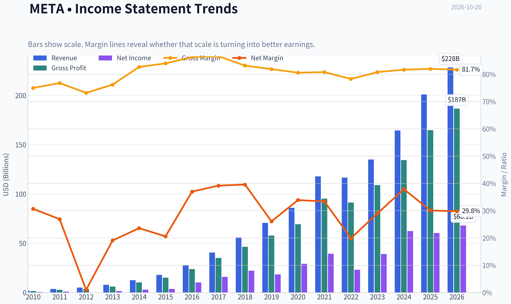
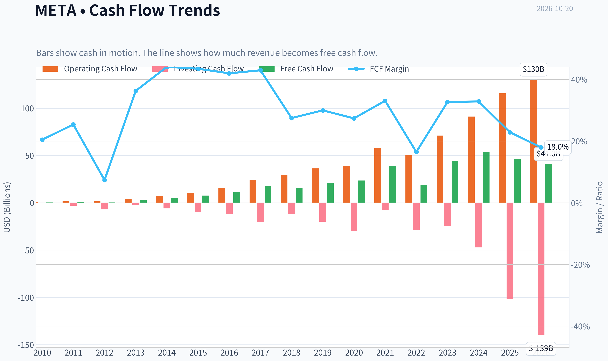
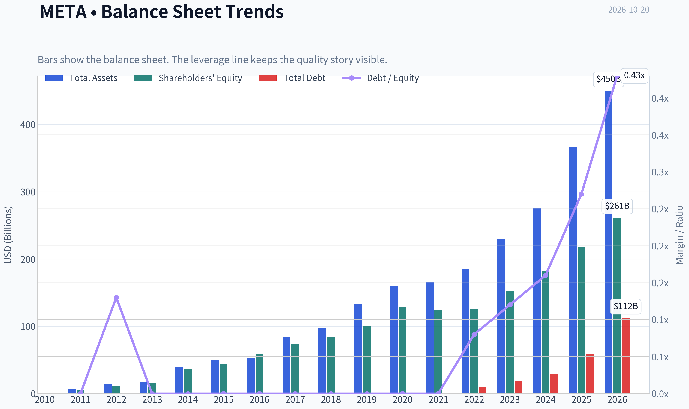
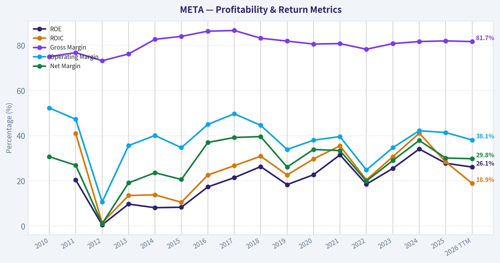
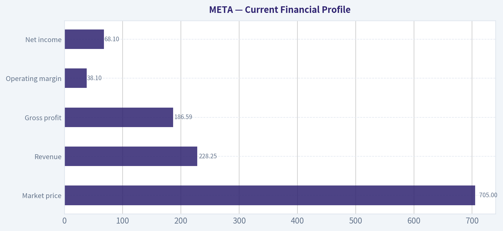
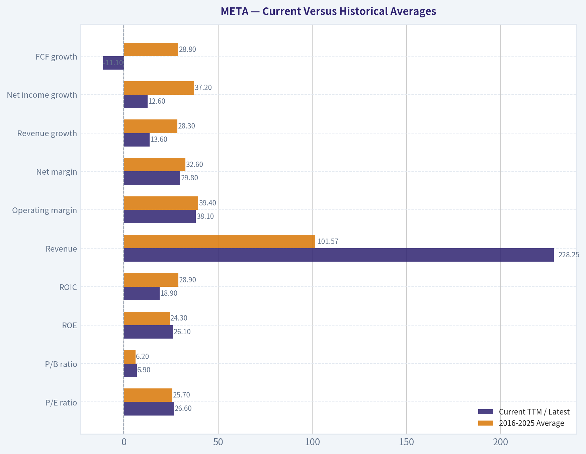
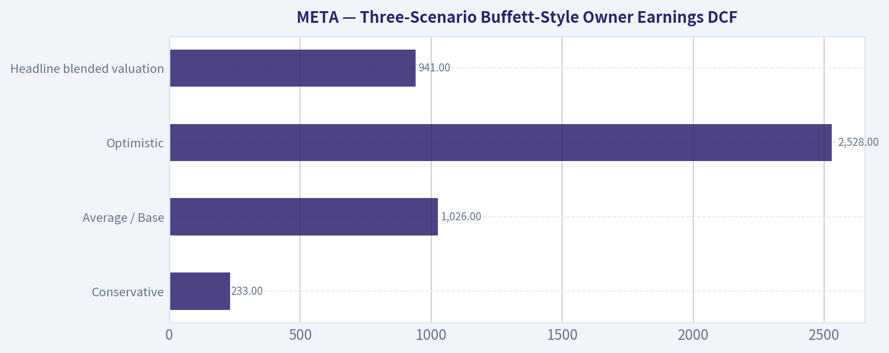
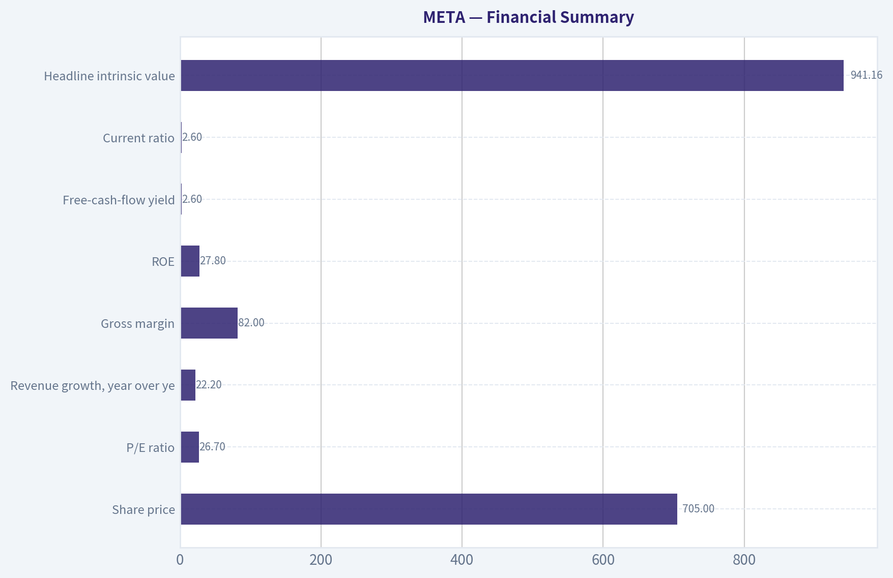
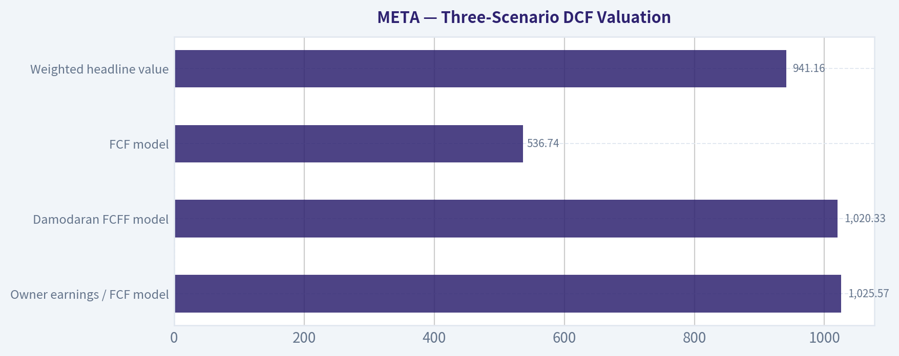

# META Deep Value Intelligence

**Analysis Date:** 2026-10-20

## Critical Disclaimer

*This analysis is generated by Deep Value Intelligence, an AI-powered multi-agent investing framework. Education & research only - not financial advice, not a financial advisor.*

---

## Table of Contents

1. Intelligence Summary
2. Analyst Team Reports
   - Fundamentals Analysis
   - Intrinsic Value Analysis (Buffett)
   - Trend & Growth Analysis (Lynch/Druckenmiller/Fisher)
   - Market Technical Analysis
   - Options Market Analysis
3. Research Team Commentary
4. Value Investing Team Commentary
5. Deep Values Commentary

---

## Intelligence Summary

### Thesis + Conditions

**Core Thesis:** ## Executive Briefing

**Key Risks:**
- The principal risk is not business failure but **overpaying before AI infrastructure, Reality Labs, and messaging investments demonstrate adequate owner-earnings returns**. Recent price weakness and bullish options volume do not offset that valuation risk. Existing appropriately sized positions can be held, but new or materially increased exposure should await either stronger cash-flow evidence or a price closer to approximately $610-$645.
- ### Risky Analyst: strongest argument
- The weakness is that the Risky Analyst converts plausible upside into permission to buy near central intrinsic value. Scenarios using 12%-15% EPS growth and 25-28 times exit multiples are credible upside cases, but not conservative underwriting. They also may overstate economic progress if repurchases support EPS while capital expenditure and depreciation restrain free cash flow.

**Confidence:** Low

---

## Analyst Team Reports

### Fundamentals Analysis

#### Latest Earnings Snapshot

*Most recent reported quarter anchored on 2026 Q2, with prior-year comparison when available.*

| Metric | 2026 Q2 | 2025 Q2 | YoY Change |
| --- | ---: | ---: | ---: |
| Revenue | $60.80B | $47.52B | +28.0% |
| Operating Income | $18.77B | $20.44B | -8.2% |
| Net Income | $15.85B | $18.34B | -13.6% |
| Diluted EPS | $6.18 | $7.14 | -13.4% |
| Operating Cash Flow | $31.86B | $25.56B | +24.7% |
| Free Cash Flow | $1.75B | $9.02B | -80.6% |

Key Takeaways: This snapshot anchors the most recent reported quarter before the narrative analysis. It helps readers separate long-run business quality from whatever changed in the latest earnings print.

#### 16-Year Financial Metrics for META

*All values below are computed deterministically from raw data - not estimated by AI.*

*Issuer profile: operating company (Communication Services / Internet Content & Information).*

#### 16-Year Financial Metrics
*Annual rows come from reported financial statements. The final TTM row is computed from the latest four quarters.*

| Metric | 2010 | 2011 | 2012 | 2013 | 2014 | 2015 | 2016 | 2017 | 2018 | 2019 | 2020 | 2021 | 2022 | 2023 | 2024 | 2025 | 2026 TTM |
| --- | --- | --- | --- | --- | --- | --- | --- | --- | --- | --- | --- | --- | --- | --- | --- | --- | --- |
| Market Price | N/A | N/A | $26 | $54 | $77 | $104 | $114 | $175 | $130 | $203 | $271 | $333 | $119 | $351 | $582 | $658 | $705 |
| Market Cap | N/A | N/A | $57.66B | $137.55B | $207.85B | $298.59B | $336.52B | $521.62B | $382.91B | $590.30B | $788.89B | $961.62B | $325.16B | $930.56B | $1.53T | $1.70T | $1.81T |
| P/E Ratio | N/A | N/A | 2662.00 | 91.08 | 70.93 | 81.13 | 32.97 | 32.74 | 17.32 | 31.92 | 27.07 | 24.43 | 14.01 | 23.80 | 24.54 | 28.10 | 26.57 |
| P/B Ratio | N/A | N/A | 4.91 | 8.89 | 5.76 | 6.75 | 5.69 | 7.02 | 4.55 | 5.84 | 6.15 | 7.70 | 2.59 | 6.08 | 8.38 | 7.82 | 6.93 |
| ROE | N/A | 20.4% | 0.5% | 9.7% | 8.1% | 8.3% | 17.3% | 21.4% | 26.3% | 18.3% | 22.7% | 31.5% | 18.5% | 25.5% | 34.1% | 27.8% | 26.1% |
| ROIC | N/A | 41.0% | 1.4% | 13.5% | 13.8% | 10.5% | 22.6% | 26.7% | 30.9% | 22.6% | 29.7% | 35.5% | 20.4% | 30.7% | 41.1% | 28.4% | 18.9% |
| EPS | $0.28 | $0.46 | $0.01 | $0.60 | $1.10 | $1.29 | $3.49 | $5.39 | $7.57 | $6.43 | $10.09 | $13.77 | $8.59 | $14.87 | $23.86 | $23.49 | $26.55 |
| Revenue | $1.97B | $3.71B | $5.09B | $7.87B | $12.47B | $17.93B | $27.64B | $40.65B | $55.84B | $70.70B | $85.97B | $117.93B | $116.61B | $134.90B | $164.50B | $200.97B | $228.25B |
| Gross Profit | $1.48B | $2.85B | $3.73B | $6.00B | $10.31B | $15.06B | $23.85B | $35.20B | $46.48B | $57.93B | $69.27B | $95.28B | $91.36B | $108.94B | $134.34B | $164.79B | $186.59B |
| Gross Margin | 75.0% | 76.8% | 73.2% | 76.2% | 82.7% | 84.0% | 86.3% | 86.6% | 83.2% | 81.9% | 80.6% | 80.8% | 78.3% | 80.8% | 81.7% | 82.0% | 81.7% |
| Operating Margin | 52.3% | 47.3% | 10.6% | 35.6% | 40.1% | 34.7% | 45.0% | 49.7% | 44.6% | 33.9% | 38.0% | 39.6% | 24.8% | 34.7% | 42.2% | 41.4% | 38.1% |
| Net Income | $606.0M | $1.00B | $53.0M | $1.50B | $2.94B | $3.69B | $10.22B | $15.93B | $22.11B | $18.48B | $29.15B | $39.37B | $23.20B | $39.10B | $62.36B | $60.46B | $68.10B |
| Net Margin | 30.7% | 26.9% | 1.0% | 19.1% | 23.6% | 20.6% | 37.0% | 39.2% | 39.6% | 26.1% | 33.9% | 33.4% | 19.9% | 29.0% | 37.9% | 30.1% | 29.8% |
| Revenue Growth | N/A | 88.0% | 37.1% | 54.7% | 58.4% | 43.8% | 54.2% | 47.1% | 37.4% | 26.6% | 21.6% | 37.2% | -1.1% | 15.7% | 21.9% | 22.2% | 13.6% |
| Net Income Growth | N/A | 65.0% | -94.7% | 2730.2% | 96.0% | 25.4% | 177.0% | 56.0% | 38.8% | -16.4% | 57.7% | 35.1% | -41.1% | 68.5% | 59.5% | -3.1% | 12.6% |
| Free Cash Flow Growth | N/A | 132.8% | -60.0% | 658.6% | 92.1% | 41.9% | 49.0% | 50.5% | -12.1% | 38.1% | 11.2% | 65.3% | -50.5% | 128.5% | 22.7% | -14.7% | -11.1% |
| Total Book Value | N/A | $4.90B | $11.76B | $15.47B | $36.10B | $44.22B | $59.19B | $74.35B | $84.13B | $101.05B | $128.29B | $124.88B | $125.71B | $153.17B | $182.64B | $217.24B | $261.22B |
| Total Assets | N/A | $6.33B | $15.10B | $17.89B | $39.97B | $49.41B | $52.26B | $84.52B | $97.33B | $133.38B | $159.32B | $165.99B | $185.73B | $229.62B | $276.05B | $366.02B | $449.96B |
| Total Debt | $0 | $0 | $1.50B | $0 | $0 | $0 | $0 | $0 | $0 | $0 | $0 | $0 | $9.92B | $18.39B | $28.83B | $58.74B | $112.32B |
| Debt-to-Equity | N/A | 0.00 | 0.13 | 0.00 | 0.00 | 0.00 | 0.00 | 0.00 | 0.00 | 0.00 | 0.00 | 0.00 | 0.08 | 0.12 | 0.16 | 0.27 | 0.43 |
| Cash & Equivalents | $1.78B | $1.51B | $2.38B | $3.32B | $4.32B | $4.91B | $8.90B | $8.08B | $10.02B | $19.08B | $17.58B | $16.60B | $14.68B | $41.86B | $43.89B | $35.87B | $15.46B |
| Shareholders' Equity | N/A | $4.90B | $11.76B | $15.47B | $36.10B | $44.22B | $59.19B | $74.35B | $84.13B | $101.05B | $128.29B | $124.88B | $125.71B | $153.17B | $182.64B | $217.24B | $261.22B |
| Operating Cash Flow | $698.0M | $1.55B | $1.61B | $4.22B | $7.33B | $10.32B | $16.11B | $24.22B | $29.27B | $36.31B | $38.75B | $57.68B | $50.48B | $71.11B | $91.33B | $115.80B | $130.30B |
| Investing Cash Flow | $-324.0M | $-3.02B | $-7.02B | $-2.62B | $-5.91B | $-9.43B | $-11.79B | $-20.12B | $-11.60B | $-19.86B | $-30.06B | $-7.57B | $-28.97B | $-24.50B | $-47.15B | $-102.00B | $-139.37B |
| Free Cash Flow | $405.0M | $943.0M | $377.0M | $2.86B | $5.50B | $7.80B | $11.62B | $17.48B | $15.36B | $21.21B | $23.58B | $38.99B | $19.29B | $44.07B | $54.07B | $46.11B | $40.98B |
| FCF Margin | 20.5% | 25.4% | 7.4% | 36.3% | 44.1% | 43.5% | 42.0% | 43.0% | 27.5% | 30.0% | 27.4% | 33.1% | 16.5% | 32.7% | 32.9% | 22.9% | 18.0% |
| Dividends / Share | $0.00 | $0.00 | $0.00 | $0.00 | $0.00 | $0.00 | $0.00 | $0.00 | $0.00 | $0.00 | $0.00 | $0.00 | $0.00 | $0.00 | $1.94 | $2.07 | $2.09 |

#### Profitability Metrics
- Return on Equity (ROE): 27.8%
- Return on Invested Capital (ROIC): 30.1%
- Return on Assets (ROA): 16.5%
- Gross Margin: 82.0%
- Operating Margin: 41.4%
- Net Profit Margin: 30.1%

#### Liquidity Metrics
- Current Ratio: 2.60
- Quick Ratio: 2.42

#### Leverage Metrics
- Debt-to-Equity Ratio: 0.27
- Interest Coverage Ratio: 76.40
- Net Debt: $-22.85B

#### Growth Metrics (Year-over-Year)
- Revenue Growth: 22.2%
- Net Income Growth: -3.1%
- Free Cash Flow Growth: -14.7%
- Revenue CAGR (3-Year): 19.9%
- Revenue CAGR (5-Year): 18.5%

#### Valuation Metrics
- P/E Ratio (TTM): 26.73
- Forward P/E: 20.36
- Price-to-Book: 6.88
- Price-to-Sales: 7.87
- PEG Ratio: 0.94
- EV/EBITDA: 16.59
- Free Cash Flow Yield: 2.6%
- Earnings Yield: 3.7%

#### Owner Earnings (Buffett Method, Code-Computed)
- Net Income: $60.46B
- + Depreciation & Amortization: $18.62B
- - Capital Expenditures: $-69.69B
- - Working Capital Changes: $-885.0M
- = **Owner Earnings: $61.34B**

#### Intrinsic Value (Code-Computed)
- Current Price: $705
- **Headline Intrinsic Value (business-model routed): $941**
  Business model: asset light platform - weighted blend [Damodaran FCFF + reverse-DCF fair + owner-earnings DCF] (asset_light_platform)
  Model spread (min-max across DCFs): $537 - $1,026
  Margin of safety vs. price (headline): 25.0%
  Routing note: Asset-light / high-margin platform: value driven by margins and reinvestment economics - the headline centers on the reverse-DCF demonstrated-growth fair value with Damodaran FCFF as a floor, down-weighting the owner-earnings DCF.
- Buffett Method (Owner Earnings):
  Conservative: $233
  Average: $1,026
  Optimistic: $2,528
- Cash Flow Method (FCF):
  Conservative: $119
  Average: $537
  Optimistic: $1,458
- Damodaran FCFF (WACC + margins + reinvestment):
  Conservative: $733
  Average: $1,020
  Optimistic: $1,932
  Monte Carlo band (P10-P90): $801 - $1,638 (median $1,116)
  P(intrinsic value > price): 96.0%
- Reverse-DCF: price implies ~19.5%/yr owner-earnings growth for 10y; trailing 3y was 51.9%, 5y 34.4%.

#### Piotroski F-Score: 5/9
- Positive Net Income: PASS
- Positive Operating Cash Flow: PASS
- ROA Improvement: FAIL
- Cash Flow > Net Income: PASS
- Decreasing Debt: FAIL
- Improving Current Ratio: FAIL
- No Dilution: PASS
- Improving Gross Margin: PASS
- Improving Asset Turnover: FAIL

ANALYST STANCE: **ADVOCATE**

#### Executive Conclusion

Meta Platforms is a high-quality, asset-light digital advertising platform with exceptional margins, strong balance-sheet capacity, and a durable competitive moat. The latest TTM results show revenue of **$228.25 billion**, operating margin of **38.1%**, net income of **$68.10 billion**, and owner earnings of approximately **$61.34 billion**.

At **$705 per share**, Meta trades at **26.6 times earnings** and offers only a **2.6% free-cash-flow yield**, so the stock is not conventionally cheap. However, the deterministic valuation pack estimates headline intrinsic value at **$941.16**, implying approximately **25% upside**. The principal risk is that very large AI infrastructure investments temporarily suppress free cash flow and returns on invested capital.

The appropriate Buffett-style conclusion is **ADVOCATE**, but with the qualification that the investment depends on Meta sustaining strong long-term monetization while controlling AI-related capital expenditure.

#### Current Financial Profile

| Metric | Current TTM / Latest | Interpretation |
|---|---:|---|
| Market price | $705 | Strongly higher than the 2024 and 2025 prices of $582 and $658 |
| Market capitalization | $1.81 trillion | Mega-cap scale and substantial market expectations |
| P/E ratio | 26.57x to 26.73x | Above the 2016-2025 average of approximately 25.7x |
| P/B ratio | 6.93x to 6.88x | Not a useful primary valuation measure for Meta's asset-light platform model |
| ROE | 26.1% TTM; headline current metric 27.8% | Very strong, though below the 2024 peak of 34.1% |
| ROIC | 18.9% TTM in the canonical TTM row | Decline reflects heavy recent investment, especially infrastructure |
| Revenue | $228.25B | Up 13.6% year over year |
| Gross profit | $186.59B | Gross margin remains exceptionally high at 81.7% |
| Operating margin | 38.1% | Below the 2016-2025 average of approximately 39.4% |
| Net income | $68.10B | Up 12.6% year over year |
| Net margin | 29.8% | Slightly below the decade average of approximately 32.6% |
| Free cash flow | $40.98B | Down from $46.11B in 2025 |
| Owner earnings | $61.34B | Higher than reported FCF because the model treats certain investment effects differently |
| Dividends per share | $2.09 | New and modest; payout remains conservative |
| Total debt | $112.32B | Material increase from $58.74B in 2025 |
| Cash and equivalents | $15.46B | Down from $35.87B in 2025 |
| Debt-to-equity | 0.43x | Higher than the historical norm, but still manageable |
| Net debt | Negative $22.85B in the supplied leverage metrics | Meta retains a net cash position under the broader cash and investment definition |

**Key Takeaways:** Meta remains extraordinarily profitable, with an 81.7% gross margin and nearly 30% net margin. The main deterioration is financial intensity: debt has risen, cash has declined, and free cash flow has fallen as Meta invests aggressively in AI infrastructure. The TTM ROIC of 18.9% is still respectable but materially below Meta's best historical levels.

#### Current Versus Historical Averages

The comparison below uses the **2016-2025 period** as the principal ten-year reference period. The historical financial table itself is not reproduced.

| Metric | Current TTM / Latest | 2016-2025 Average | Current Versus Average |
|---|---:|---:|---|
| P/E ratio | 26.6x | 25.7x | Slightly more expensive |
| P/B ratio | 6.9x | 6.2x | Higher, but not analytically decisive |
| ROE | 26.1% | 24.3% | Above average |
| ROIC | 18.9% | 28.9% | Well below average |
| Revenue | $228.25B | $101.57B | More than twice the decade average |
| Operating margin | 38.1% | 39.4% | Slightly below average |
| Net margin | 29.8% | 32.6% | Below average |
| Revenue growth | 13.6% | 28.3% | Slower than the unusually rapid historical phase |
| Net income growth | 12.6% | 37.2% | Below average but positive |
| FCF growth | -11.1% | 28.8% | Materially below average |
| Free cash flow | $40.98B | $29.18B | Above average in absolute dollars |
| Debt-to-equity | 0.43x | Approximately 0.09x | Significantly higher |
| Dividends per share | $2.09 | Approximately $0.61 | Higher, reflecting the new dividend policy |

**Key Takeaways:** Meta is larger and still more profitable in absolute terms than its historical average, but growth has normalized sharply. The most important negative deviation is FCF growth of negative 11.1%, caused primarily by investment intensity rather than a collapse in operating earnings. ROE remains above average, while ROIC is temporarily depressed and deserves close monitoring.

#### Market Metrics and Valuation

Meta's current **P/E ratio near 26.6x** is only modestly above its 2016-2025 average of approximately 25.7x. This suggests that the stock is not priced at an extreme earnings multiple relative to its own history. However, the market is paying a substantial absolute price for each dollar of free cash flow: the supplied **FCF yield is only 2.6%**.

The P/B ratio near **6.9x** should not be interpreted as evidence that Meta is expensive in the same way it might be for a bank, insurer, or tangible asset-heavy manufacturer. Meta is an asset-light platform business whose economic value comes from user engagement, data, software, advertising technology, network effects, and intellectual property. Book value understates these assets, while buybacks, acquisitions, and accounting treatment can distort the denominator.

The more appropriate valuation anchors are:

- Owner earnings: **$1,025.57 per share** in the supplied model.
- Damodaran FCFF: **$1,020.33 per share** in the supplied model.
- FCF model: **$536.74 per share**.
- Weighted headline intrinsic value: **$941.16 per share**.
- Headline margin of safety: approximately **25%**.
- Reverse DCF: the current price implies approximately **19.5% annual owner-earnings growth for ten years**.

The reverse-DCF requirement is demanding, but not implausible for Meta: owner earnings grew at approximately **51.9% over the trailing three years** and **34.4% over five years**. The critical question is whether that historical growth can transition into durable high-teens growth while capital spending remains elevated.

#### Profitability and Earnings Quality

Meta's **81.7% gross margin** demonstrates the economic attractiveness of digital advertising once the platform is established. Gross margin has declined from the 86%-87% range in 2016-2017, but remains exceptionally high and relatively stable for a company of this scale.

The **38.1% operating margin** is slightly below the 2016-2025 average, reflecting:

- AI research and development.
- Data-center construction and accelerated infrastructure deployment.
- Higher compensation and technical hiring.
- Reality Labs losses.
- Increased investment in recommendation systems and generative AI.

Net income of **$68.10 billion** rose 12.6% year over year, despite free cash flow declining 11.1%. That divergence is important: Meta's earnings engine remains healthy, but accounting earnings currently overstate near-term distributable cash because the company is spending heavily on long-lived infrastructure.

ROE of approximately **26%-28%** remains excellent. The lower TTM ROIC of **18.9%**, compared with the 2016-2025 average of approximately 28.9%, is the clearest indicator that incremental investment returns are being tested. This does not yet indicate a broken business, but it does mean management must eventually demonstrate that AI spending produces higher engagement, better ad performance, new monetization channels, or durable strategic advantages.

#### Growth Analysis

Revenue growth has slowed from Meta's early-stage expansion rates, but remains robust at **13.6% TTM** and **22.2% on the latest reported year-over-year metric**. The company has moved from hypergrowth toward mature large-cap compounder status.

The growth record is not perfectly smooth:

- Revenue declined 1.1% in 2022.
- Net income declined 41.1% in 2022 and 3.1% in 2025.
- FCF declined 50.5% in 2022 and has declined again in the latest TTM period.
- Revenue nevertheless reached a new record of $228.25 billion.

This pattern indicates that Meta's revenue stream is more predictable than its short-term profitability and free cash flow. Advertising demand, foreign-exchange movements, regulatory changes, and investment cycles can produce sizable annual fluctuations.

#### Balance Sheet and Financial Strength

Meta's balance sheet remains fundamentally strong despite a clear change in direction.

Total assets increased to **$449.96 billion**, while shareholders' equity reached **$261.22 billion**. Debt rose to **$112.32 billion**, lifting debt-to-equity to **0.43x**, versus essentially zero debt through much of the earlier decade. Cash and equivalents declined to **$15.46 billion**.

The supplied leverage metrics still show:

- Net debt: **negative $22.85 billion**.
- Interest coverage: **76.4x**.
- Current ratio: **2.60x**.
- Quick ratio: **2.42x**.

The current and quick ratios are meaningful for an operating company such as Meta, unlike the P/B ratio, which is less informative for this asset-light platform. Liquidity remains ample, and Meta's operating cash flow of **$130.30 billion** provides substantial debt-servicing capacity.

The balance-sheet red flag is not solvency; it is capital allocation. The company is choosing to commit much more capital to AI and data-center infrastructure, which could lower returns if monetization lags investment.

#### Cash Flow and Capital Allocation

Operating cash flow reached **$130.30 billion**, but free cash flow was only **$40.98 billion** after investing requirements. The gap is unusually wide and reflects Meta's capital spending cycle.

Owner earnings are reported at **$61.34 billion**, calculated as:

- Net income: $60.46 billion
- Plus depreciation and amortization: $18.62 billion
- Less capital expenditures: $69.69 billion
- Less working-capital changes: $0.885 billion
- Owner earnings: approximately $61.34 billion

The new dividend is positive from a shareholder-return perspective, but the **$2.09 per share** payout is small relative to earnings and cash generation. Meta is retaining most cash to fund infrastructure, repurchases, research, and strategic investments. This is sensible if reinvestment returns are high; it becomes problematic if AI expenditure produces weak incremental returns.

The Piotroski F-score of **5/9** is broadly neutral. Positive earnings, positive operating cash flow, cash flow exceeding net income, no dilution, and improving gross margin are favorable. Rising debt, weaker liquidity trends, lower ROA, and weaker asset turnover are cautionary signals.

#### Economic Moat and Business Durability

Meta's moat is based on several mutually reinforcing advantages:

1. **Network effects:** Billions of users create a large audience that attracts advertisers and content creators.
2. **Data and targeting infrastructure:** Years of behavioral and engagement data support sophisticated ad delivery.
3. **Scale economics:** The fixed costs of infrastructure and software are spread across a massive revenue base.
4. **Multiple platforms:** Facebook, Instagram, WhatsApp, and Messenger provide several engagement and monetization channels.
5. **Advertiser ecosystem:** Agencies and businesses build workflows, creative libraries, and campaign histories around Meta's tools.
6. **Distribution advantage:** Instagram and WhatsApp provide powerful channels for future commerce, messaging, creator, and business services.

The moat is durable but not invulnerable. User preferences can change, regulators can constrain data practices, Apple and Google can alter platform rules, and TikTok demonstrates that attention can migrate rapidly. Meta's continued investment in recommendation algorithms and AI is therefore defensive as well as growth-oriented.

#### Management and Capital Allocation

Management has shown strong operating adaptability. The company responded to the 2022 earnings slowdown with cost controls, higher operating discipline, and renewed revenue growth. The "year of efficiency" demonstrated that Meta could reduce expense growth without permanently damaging the platform.

Capital allocation is now more controversial:

- Debt has increased materially.
- Cash balances have fallen.
- Capital expenditures are consuming a much larger share of operating cash flow.
- Dividends have begun but remain modest.
- Share repurchases and infrastructure investment compete for capital.

The relevant management test is not whether AI spending is large; it is whether management can achieve attractive returns on that spending. The historical ROE record supports confidence in management, but the decline in TTM ROIC means that the next several years must validate the investment thesis.

#### Revenue Breakdown

Meta's exact latest segment mix is not fully specified in the deterministic dataset. The following is a best-available estimate based on Meta's public reporting structure and the latest revenue scale.

| Revenue Source | Amount ($B) | % of Total |
|---|---:|---:|
| Family of Apps advertising | Approximately $224.5B | Approximately 98.4% |
| Reality Labs revenue | Approximately $2.2B | Approximately 1.0% |
| Other revenue and business messaging | Approximately $1.6B | Approximately 0.6% |
| **Total estimated TTM revenue** | **$228.25B** | **100.0%** |

**Key Takeaways:** Meta remains overwhelmingly an advertising business, with approximately 98% of revenue generated by the Family of Apps ecosystem. This concentration creates exceptional operating leverage but also exposes Meta to advertising cycles, privacy regulation, platform policy changes, and shifts in user attention. Reality Labs remains strategically relevant but is not yet financially material to group revenue.

#### Three-Scenario Buffett-Style Owner Earnings DCF

The supplied owner-earnings valuation uses current owner earnings of **$61.34 billion** and an implied share count of approximately **2.56 billion shares**, based on the market capitalization and share price.

A simplified Buffett-style formulation is:

\[
\text{Equity Value} =
\sum_{t=1}^{10}\frac{OE_t}{(1+r)^t}
+
\frac{OE_{10}(1+g_T)}{(r-g_T)(1+r)^{10}}
\]

Assumptions:

- Starting owner earnings: **$61.34B**
- Discount rate: approximately **10%**
- Terminal growth: **2.5%**
- Ten-year explicit forecast
- Growth rates fade toward the terminal rate
- Per-share values use approximately **2.56 billion shares**

| Scenario | Growth Assumption | Model Fair Value / Share | Value Range Interpretation |
|---|---|---:|---|
| Conservative | Low growth, reflecting heavy capex and weaker ROIC | $233 | Severe execution and reinvestment-risk case |
| Average / Base | Durable high-teens compounding that fades toward terminal growth | $1,026 | Central owner-earnings case |
| Optimistic | Strong monetization of AI, messaging, commerce, and advertising | $2,528 | High-success bull case |
| Headline blended valuation | Weighted blend of owner earnings, FCFF, and reverse DCF | $941 | Preferred pack-based anchor |

**Key Takeaways:** The valuation range is extremely wide because Meta's value is highly sensitive to the long-term return on AI investment. The conservative case is not a normal-growth case; it assumes substantial impairment to the business economics. The base case supports meaningful upside, while the supplied blended valuation of $941 is more prudent than relying on the optimistic owner-earnings result alone.

A more transparent base-case illustration is:

- Year 0 owner earnings: **$61.34B**
- Assume approximately 18% initial growth, fading progressively toward 2.5%.
- Year 1 owner earnings: approximately **$72.4B**
- Later-year growth fades through the low teens and then toward the terminal rate.
- Discount all annual owner earnings at approximately 10%.
- Add the discounted terminal value.
- Divide by approximately 2.56 billion shares.
- Result: approximately **$1,026 per share**, consistent with the supplied average owner-earnings model.

The model's conservative owner-earnings value of **$233** should be treated as a stress case rather than a likely central outcome. The independent FCFF model produces a more conservative average value of **$1,020**, while its conservative value is **$733**. The model dispersion demonstrates that Meta's intrinsic value is not precisely knowable; it depends primarily on sustainable growth and the eventual payoff from AI infrastructure.

#### Key Investment Insights, Risks, and Opportunities

| Category | Assessment | Investment Significance |
|---|---|---|
| Core opportunity | Continued growth in digital advertising | Meta can compound earnings even at slower large-cap growth rates |
| AI opportunity | Better recommendations, ad creation, targeting, and business assistants | Could support high returns on current infrastructure investment |
| Messaging opportunity | WhatsApp and Messenger monetization | Large underdeveloped revenue opportunity |
| Commerce opportunity | Product discovery, creator commerce, and business messaging | Could diversify revenue beyond traditional ads |
| Margin opportunity | Operating discipline after the efficiency program | Supports earnings growth if revenue remains healthy |
| Valuation opportunity | Headline intrinsic value of $941 versus $705 price | Approximately 25% modeled margin of safety |
| Main risk | AI capital expenditure overshoot | Could depress FCF and ROIC for several years |
| Main competitive risk | TikTok and changing user attention | Could weaken engagement and pricing power |
| Regulatory risk | Privacy, antitrust, content, and data regulation | Could constrain targeting or increase operating costs |
| Platform risk | Apple and Google policy changes | Could reduce measurement and advertising effectiveness |
| Financial risk | Debt increased to $112.32B | Manageable today, but less conservative than historical balance sheet |
| Cash-flow risk | FCF down 11.1% TTM | Requires evidence that spending will generate future returns |

**Key Takeaways:** The best opportunity is not simply continued advertising growth; it is the combination of advertising, AI-enhanced monetization, messaging, commerce, and improved efficiency. The greatest risk is that Meta converts a historically asset-light model into a much more capital-intensive infrastructure business without earning adequate returns.

#### Final Investment Assessment

Meta satisfies most of the core Buffett criteria:

- **Economic moat:** Strong, based on network effects, scale, data, and advertiser integration.
- **Financial strength:** Still excellent, with high interest coverage, positive net cash under the supplied metrics, and substantial operating cash flow.
- **Predictable earnings:** Revenue and earnings are structurally durable, though annual growth and FCF can be volatile.
- **Management quality:** Historically strong, with demonstrated ability to restore margins and adapt strategy.
- **Valuation:** Reasonable relative to historical P/E, but dependent on sustained growth; modeled intrinsic value indicates upside.
- **Quality:** Exceptional margins, high ROE, broad user reach, and multiple future monetization paths.
- **Key concern:** Declining FCF and ROIC while infrastructure spending accelerates.

The stock is not a deep-value purchase at $705. Its investment case requires confidence that Meta can generate strong returns on AI investment and sustain approximately high-teens owner-earnings growth for an extended period. The supplied reverse DCF requires approximately 19.5% annual owner-earnings growth for ten years, which is demanding but supported by Meta's recent historical growth and competitive position.

**Final stance: ADVOCATE.** Meta offers a favorable combination of moat, profitability, scale, and modeled intrinsic value upside. Investors should monitor capital expenditures, ROIC, free-cash-flow recovery, and evidence of AI monetization before treating the position as a low-risk compounder.

#### Summary Decision Table

| Key Point | Assessment |
|---|---|
| Business quality | Excellent asset-light platform with powerful network effects |
| Current profitability | Exceptional, although margins and ROIC are below peak levels |
| Balance sheet | Strong and liquid, but leverage and investment intensity are rising |
| Earnings predictability | High over the long term; annual FCF is more volatile |
| Valuation | Moderately demanding on P/E and FCF yield, attractive versus modeled intrinsic value |
| DCF base value | Approximately $941-$1,026 per share |
| Conservative risk value | Approximately $233 owner-earnings case; $733 FCFF case |
| Primary catalyst | AI monetization, ad efficiency, messaging, commerce, and renewed FCF growth |
| Primary red flag | Large infrastructure spending may reduce ROIC and FCF for an extended period |
| Investment stance | **ADVOCATE** |

**Key Takeaways:** Meta is best viewed as a high-quality compounder trading at a reasonable, but not bargain, price. The investment is attractive if management converts AI spending into durable monetization and restores free-cash-flow growth. The stance remains **ADVOCATE**, with capital expenditure and ROIC as the two most important ongoing monitoring indicators.

#### Fundamental Visuals

This graph tracks the profitability and return metrics (ROE, ROIC, Margins) of **META** over the past decade, highlighting capital efficiency trends.

This chart illustrates the financial health of **META** over the last 10 years, mapping cash equivalents and free cash flow against total obligations (Debt).

---

### Intrinsic Value Analysis (Buffett)

> *Following Warren Buffett's value investing philosophy: Circle of Competence, Economic Moat, Management Quality, and Margin of Safety.*

#### Intrinsic Value Snapshot

Price is what you pay. Intrinsic value is what the business may be worth based on the cash it can create for owners over time. We show a range, not one magic number.

- Current Price: $705.44
- Value Range (conservative to optimistic across both DCF methods): $119.34 to $2,527.80

##### Owner Earnings (Buffett Method)
- Net Income: $60,458,000,000.00
- Depreciation & Amortization: $18,616,000,000.00
- Capital Expenditures: $-69,691,000,000.00
- Working Capital Changes: $-885,000,000.00
- Owner Earnings: $61,343,000,000.00

##### Intrinsic Value
###### Buffett Method
Uses owner earnings. Stricter, and usually more conservative.
- Conservative: $233.27
- Average: $1,025.57
- Optimistic: $2,527.80
- Discount Rate: 10.0%

###### Cash Flow Method
Uses free cash flow. Better for companies spending heavily today to grow tomorrow.
- Conservative: $119.34
- Average: $536.74
- Optimistic: $1,458.33
- Discount Rate: 10.0%

ANALYST STANCE: **WATCH**

#### Executive Judgment

Meta is a high-quality, asset-light platform with extraordinary margins, a global user network, substantial cash generation, and a long reinvestment runway in advertising, artificial intelligence, messaging, and virtual reality.

At $705 per share, the business is not obviously expensive relative to its quality. The research valuation indicates approximately $941 per share of intrinsic value, implying a 25% margin of safety. However, the reverse-DCF indicates that the current price assumes roughly 19.5% annual growth for ten years. That is achievable only if Meta sustains unusually strong monetization, engagement, and AI-driven advertising gains. The result is a strong business at a demanding-but not irrational-price.

#### 1. Factor Scorecard

| Factor | Score | Assessment |
|---|---:|---|
| Circle of Competence & Simplicity | 4/5 | Meta sells targeted digital advertising across large social platforms. The model is understandable, although AI investment, regulatory exposure, and Reality Labs add complexity. |
| Moat | 5/5 | Global network effects, user data, advertiser scale, engagement, brand reach, and switching friction create a wide moat. |
| Management & Capital Allocation | 4/5 | Founder-led, long-term orientation and aggressive reinvestment. Concerns include dual-class control, large AI spending, and persistent Reality Labs losses. |
| Industry Structure | 4/5 | Digital advertising is concentrated among a few scaled platforms, though competition from Google, TikTok, Amazon, and emerging AI platforms remains intense. |

**Gate 5-Quality/Solvency:** **Not tripped.** Meta exhibits strong profitability, substantial cash generation, and no evidence in the provided data of deteriorating earnings combined with financial distress.

**Key Takeaways:** Meta scores highly because its platform economics are simple enough to understand and supported by powerful network effects. The principal deductions relate to regulatory uncertainty, aggressive AI capital spending, and the possibility that new technologies could weaken incumbent platform advantages.

#### 2. Moat Analysis

| Moat Source | Evidence | Durability |
|---|---|---|
| Network effects | Facebook, Instagram, WhatsApp, and Messenger benefit from enormous user communities and social graphs. | Wide and durable |
| Intangible assets | Instagram and Facebook have global consumer brands and deeply embedded social identities. | Wide |
| Data and targeting | Engagement data improves advertising relevance, measurement, and advertiser return on investment. | Wide, though privacy regulation is a risk |
| Scale advantage | Meta distributes content and ads across billions of users at very high gross margins. | Wide |
| Switching costs | Users and advertisers can technically switch, but social identity, audience reach, historical data, and campaign infrastructure create practical friction. | Moderate to high |
| Reinvestment advantage | AI infrastructure can improve recommendations, ad ranking, content discovery, and monetization across the existing network. | Potentially widening |

Meta's reported 82% gross margin is consistent with a highly scalable platform business. The key moat is not merely the applications themselves; it is the combination of user scale, social graphs, content, advertiser relationships, data, and recommendation technology.

The moat is wide, but not invulnerable. TikTok demonstrates that user attention can migrate quickly when a superior content-discovery product emerges. Regulation could limit data usage or change platform economics. AI assistants could also become a new interface between consumers and advertisers.

#### 3. Management Quality Assessment

Mark Zuckerberg's founder control gives Meta an unusually long-term orientation. The company has repeatedly invested heavily in infrastructure, recommendation systems, Reels, messaging, and artificial intelligence before the full financial payoff was visible.

Positive factors include:

- Founder-led decision-making and substantial personal exposure to Meta's long-term value.
- Willingness to reinvest aggressively in infrastructure and product development.
- Strong operating execution and demonstrated ability to adapt the platform.
- Large-scale share repurchases, which can be valuable when conducted below intrinsic value.

The main concerns are:

- Dual-class voting control limits outside shareholder influence.
- Reality Labs has consumed significant capital while producing limited direct financial returns.
- AI investment may require sustained capital expenditure before returns become clear.
- Capital allocation is rational in strategic intent, but the scale of spending increases execution risk.

**Management score: 4/5.**

#### 4. Financial Summary

| Metric | Latest Figure |
|---|---:|
| Share price | $705 |
| Market capitalization | $1.80 trillion |
| P/E ratio | 26.7x |
| Revenue growth, year over year | 22.2% |
| Gross margin | 82.0% |
| ROE | 27.8% |
| Free-cash-flow yield | 2.6% |
| Implied free cash flow | Approximately $46.8 billion |
| Current ratio | 2.60x |
| Headline intrinsic value | $941.16 |
| Margin of safety versus price | 25.0% |
| Reverse-DCF growth assumption | Approximately 19.5% annually for 10 years |

*Implied free cash flow is estimated as market capitalization multiplied by the reported free-cash-flow yield.*

**Key Takeaways:** Meta combines 22.2% revenue growth with an 82% gross margin and 27.8% ROE, an exceptional economic profile. The trade-off is valuation: a 2.6% free-cash-flow yield means the market already expects substantial future growth and reinvestment success.

#### 5. Owner Earnings Calculation

A practical owner-earnings approximation is:

| Component | Approximate Amount |
|---|---:|
| Net income | Not separately provided in the research summary |
| Depreciation and amortization | Not separately provided |
| Less: maintenance capital expenditure | Not separately provided |
| Less: working-capital investment | Not separately provided |
| Free cash flow proxy for owner earnings | Approximately $46.8 billion |

For valuation purposes, approximately $46.8 billion of free cash flow is used as a conservative owner-earnings proxy. This is reasonable for an asset-light platform, but Meta's unusually high AI infrastructure spending makes the distinction between maintenance and growth capital expenditure particularly important.

Meta's true owner earnings could be higher than reported free cash flow if a large portion of current infrastructure spending is growth-oriented. Conversely, if AI infrastructure becomes necessary merely to preserve competitiveness, reported free cash flow may overstate distributable owner earnings.

#### 6. Three-Scenario DCF Valuation

Using approximately $46.8 billion of current free cash flow and an inferred share count of roughly 2.55 billion shares:

| Scenario | Key Assumptions | Estimated Value |
|---|---|---:|
| A. No growth | Owner earnings divided by 10% discount rate | Approximately $183/share |
| B. GDP growth | 3% perpetual growth, 10% discount rate | Approximately $270/share |
| C. Historical-growth framework | 7.5% long-term growth, reflecting a moderated portion of recent growth | Approximately $790/share |
| Research blended valuation | Damodaran FCFF, reverse DCF, and owner-earnings models | $941/share |

**Key Takeaways:** The no-growth and GDP-growth cases show that today's price depends heavily on continued growth rather than current cash yield alone. The historical-growth case produces a much higher value because Meta has recently grown faster than the economy, but sustaining even a moderated 7.5% rate for a decade requires continued competitive strength.

The research pack's three valuation outputs are:

| Valuation Method | Per-Share Value |
|---|---:|
| Owner earnings / FCF model | $1,025.57 |
| Damodaran FCFF model | $1,020.33 |
| FCF model | $536.74 |
| Weighted headline value | $941.16 |

**Key Takeaways:** Two of the three principal models indicate value near $1,020 per share, while the lower FCF model produces $537 per share. That wide range reflects uncertainty about sustainable free cash flow during the company's heavy AI investment cycle.

#### 7. Margin of Safety Analysis

At $705 per share:

- Headline intrinsic value: $941.16.
- Implied upside to headline value: approximately 33%.
- Margin of safety versus price: approximately 25%.
- Owner-earnings model value: $1,025.57.
- Lower FCF-model value: $536.74.

For a wide-moat, high-ROIC, highly scalable platform, a 10% to 15% margin of safety can be acceptable. Meta's headline 25% margin of safety therefore appears adequate on a quality-adjusted basis.

However, the reverse-DCF is the critical counterpoint. The share price implies approximately 19.5% annual growth for ten years. Meta's recent three-year and five-year growth rates-51.9% and 34.4%, respectively-are much higher, but mature scale makes indefinite continuation unlikely.

**Valuation assessment: 3/5.** Meta is reasonably valued for a wonderful business, but not clearly cheap under conservative assumptions.

#### 8. Final Buffett Scorecard

| Criterion | Weight | Score | Weighted Contribution |
|---|---:|---:|---:|
| Moat width and durability | 25% | 5.0 | 1.25 |
| Valuation / margin of safety | 20% | 3.0 | 0.60 |
| Capital returns: ROIC versus WACC | 15% | 5.0 | 0.75 |
| Business understanding and predictability | 12% | 4.0 | 0.48 |
| Management quality and capital allocation | 12% | 4.0 | 0.48 |
| Reinvestment runway | 8% | 5.0 | 0.40 |
| Balance-sheet strength | 4% | 4.0 | 0.16 |
| Industry structure | 4% | 4.0 | 0.16 |
| **Total** | **100%** |  | **4.28/5.00** |

**Key Takeaways:** Meta is a high-quality compounder with a wide moat, strong capital returns, and an unusually long reinvestment runway. The score is held back primarily by valuation sensitivity and the requirement that AI investment translate into sustained earnings growth.

#### 9. Investment Stance

**WATCH - High conviction in the business, moderate conviction in the current price.**

Meta is the kind of modern platform business that fits a Buffett-style framework: high returns on capital, powerful network effects, scalable economics, strong cash generation, and substantial reinvestment opportunities. The company deserves to trade at a premium.

At $705, the stock is worth serious consideration, but the reverse-DCF assumption of approximately 19.5% annual growth leaves less room for operational disappointment than the headline 25% margin of safety suggests. A more attractive entry point would arise from either:

- A meaningful decline in the share price without deterioration in user engagement or advertising economics; or
- Several years of strong growth that allow earnings and free cash flow to catch up with the current valuation.

Meta should remain on the buy list, but disciplined investors should avoid treating the headline intrinsic-value estimate as a guarantee.
#### Valuation Bridge

This bridge places the current market price beside each intrinsic value lens so readers can see whether upside depends on one method or shows up across several methods.

| Scenario | Intrinsic Value / Share |
| --- | ---: |
| Buffett Method | $1,025.57 |
| Cash Flow Method | $536.74 |
| Damodaran Method | $1,020.33 |
| Current Price | $705.44 |

#### Key Takeaways

If one method is far above the others, the upside case depends on a specific modelling assumption. When several methods cluster together, the valuation story is more robust.

#### Valuation Visuals

This comparison chart from *Latest Earnings Snapshot* stacks current figures against historical benchmarks for **META**, making it easy to see where the company trades relative to its own averages.

This comparison chart from *Current Financial Profile* stacks current figures against historical benchmarks for **META**, making it easy to see where the company trades relative to its own averages.

This comparison chart from *Current Versus Historical Averages* stacks current figures against historical benchmarks for **META**, making it easy to see where the company trades relative to its own averages.

This comparison chart from *Three-Scenario Buffett-Style Owner Earnings DCF* stacks current figures against historical benchmarks for **META**, making it easy to see where the company trades relative to its own averages.

This comparison chart from *Financial Summary* stacks current figures against historical benchmarks for **META**, making it easy to see where the company trades relative to its own averages.

This comparison chart from *Three-Scenario DCF Valuation* stacks current figures against historical benchmarks for **META**, making it easy to see where the company trades relative to its own averages.

---

### Trend & Growth Analysis (Lynch/Druckenmiller/Fisher)

> *Following Peter Lynch's GARP, Stanley Druckenmiller's macro-aware approach, and Philip Fisher's scuttlebutt methodology.*

ANALYST STANCE: **ADVOCATE**

#### 1. Lynch Classification

**Fast Grower, with a maturing core and significant AI-driven reinvestment risk.**

Meta is no longer an early-stage hyper-growth company, but its 22.2% reported revenue growth, 18.5% five-year revenue CAGR, exceptional margins, and AI monetization opportunities place it in the fast-grower category. Growth is slowing from historical levels, while capital expenditures are rising sharply.

#### 2. The Story in Three Bullets

- **Meta owns massive consumer attention assets** across Facebook, Instagram, WhatsApp, and Messenger, giving it a durable global advertising platform.
- **AI is improving both ad targeting and engagement**, potentially increasing advertiser returns, pricing power, and time spent across its platforms.
- **New growth options remain substantial**, including business messaging, creator monetization, AI assistants, wearables, and Reality Labs-although some require heavy investment.

#### 3. TAM Analysis and the 10x Test

| Area | Current Position | Growth Opportunity | 10x Assessment |
|---|---:|---|---|
| Digital advertising | Global leader with very large share | AI optimization, video, Reels, click-to-message ads | Core advertising alone likely does not pass |
| Business messaging | Early monetization relative to user base | WhatsApp payments, click-to-message, customer service | Strong runway |
| AI products | Emerging monetization category | Assistants, recommendations, business AI agents | Potentially very large |
| Wearables and Reality Labs | Limited current revenue | Smart glasses, spatial computing, hardware ecosystem | High upside, high uncertainty |
| Consolidated revenue | Approximately $228B TTM | AI, messaging, commerce, and new products | A 10x outcome requires a multi-trillion-dollar blended TAM |

Meta's current revenue is approximately $228 billion. A 10x outcome would require roughly $2.3 trillion in annual revenue. That is unlikely from advertising alone, but could be conceivable across advertising, commerce, messaging, AI services, payments, and hardware. The 10x test therefore **passes cautiously on a blended TAM basis**, but not on the mature advertising business by itself.

**Key Takeaways:** Meta's core advertising market is already large and relatively mature, which limits the probability of a simple 10x outcome. The long runway depends on monetizing messaging, AI, commerce, and wearables without destroying returns through excessive capital spending.

#### 4. Revenue Growth Trend

| Metric | Result | Interpretation |
|---|---:|---|
| Latest reported revenue growth | 22.2% | Fast-growth level |
| 3-year revenue CAGR | 19.9% | Strong sustained growth |
| 5-year revenue CAGR | 18.5% | Durable long-term expansion |
| 2026 TTM revenue growth in data set | 13.6% | Possible deceleration or timing difference |
| Latest net income growth | 12.6% in TTM data; -3.1% in another data series | Earnings growth is less consistent |
| Gross margin | Approximately 82% | Exceptional platform economics |
| Operating margin | Approximately 38%-41% | Strong, but pressured by investment |
| FCF growth | Negative in latest period | Major current warning signal |

The revenue trend remains healthy, but the evidence does **not** show a clear acceleration. Revenue is growing at a fast-grower rate, while earnings and free cash flow are being pressured by AI infrastructure and other investments.

**Key Takeaways:** Meta has strong top-line momentum, but the current pattern is better described as **high and possibly decelerating growth**, not a clean acceleration inflection. The most important question is whether AI spending produces faster revenue growth and higher long-term monetization.

#### 5. Unit Economics and Operating Efficiency

| Metric | Available Evidence | Assessment |
|---|---|---|
| LTV/CAC | Not disclosed in a conventional form | Not directly measurable; advertising model has strong incremental economics |
| Net revenue retention | Not applicable to the core advertising model | Not a SaaS business |
| Gross margin | Approximately 82% | Excellent |
| Operating margin | Approximately 38%-41% | Excellent, though under pressure |
| FCF margin | Approximately 18% TTM | Healthy but down from prior levels |
| Rule of 40 | Not fully applicable; revenue growth plus FCF margin is roughly 40% | Acceptable, but deteriorating |
| Balance sheet | Net cash approximately $23B; current ratio approximately 2.6 | Financially strong |
| Debt-to-equity | Approximately 0.27-0.43 depending on data period | Manageable, but rising |

Meta's advertising marketplace has powerful indirect unit economics: content and users create engagement, AI improves ad matching, and incremental advertising revenue carries very high margins. However, current infrastructure spending substantially reduces free cash flow conversion.

**Key Takeaways:** Meta remains one of the highest-quality digital platforms financially. The central issue is not customer acquisition economics; it is whether AI infrastructure spending becomes productive capital or a prolonged drag on free cash flow.

#### 6. Inflection Point Assessment

| Potential Inflection | Evidence | Status |
|---|---|---|
| AI-powered ad performance | AI improves ranking, targeting, and advertiser returns | Positive |
| Reels monetization | Short-form video continues to expand inventory and engagement | Positive, but monetization must catch up |
| Business messaging | WhatsApp and click-to-message ads remain under-monetized | Potentially significant |
| AI assistants and agents | Large user distribution and ecosystem advantage | Early-stage option |
| Smart glasses | Potential consumer AI hardware platform | High upside, unproven |
| Margin inflection | Current capex and infrastructure cycle are pressuring FCF | Not yet visible |
| Market-share inflection | Meta remains a leading platform, but incremental share gains are harder | Moderate |

The strongest potential inflection is **AI monetization**, not merely AI spending. Meta already benefits from AI operationally; the next step is demonstrating that AI creates sustained incremental advertising revenue, improved pricing, and new paid products.

#### 7. Macro Setup

| Macro Factor | Impact on META | View |
|---|---|---|
| Digital advertising cycle | Sensitive to economic activity and advertiser budgets | Positive but cyclical |
| Interest rates | Lower rates support long-duration growth valuations | Helpful if rates decline |
| AI investment cycle | Drives both opportunity and near-term capex | Positive strategically, negative for FCF near term |
| Consumer engagement | Massive user base provides resilience | Strong |
| Regulation | Antitrust, privacy, youth safety, and content rules remain risks | Persistent headwind |
| Market positioning | AI exposure makes the stock sensitive to technology sentiment | Volatile |

Macro conditions are broadly supportive if advertising budgets remain firm and interest rates stabilize or fall. However, Meta's stock is now partly an AI infrastructure and capital-allocation story, making it vulnerable to a reversal in enthusiasm toward large technology spending.

**Key Takeaways:** The macro backdrop is favorable for high-quality digital platforms, but Meta is exposed to both advertising cyclicality and AI valuation sentiment. A weaker economy or higher-for-longer rates could compress the multiple even if the business remains fundamentally healthy.

#### 8. Fisher's 15-Point Score

| Fisher Criterion | Score / 5 | Comment |
|---|---:|---|
| Market potential | 5 | Massive global user and advertiser markets |
| New-product determination | 5 | Heavy AI, messaging, and wearable investment |
| R&D effectiveness | 4 | Strong AI deployment; Reality Labs remains uncertain |
| Sales organization | 5 | Global, scalable advertising infrastructure |
| Profit margins | 5 | Among the strongest in large-cap technology |
| Margin improvement potential | 3 | Capex cycle currently pressures margins and FCF |
| Labor relations | 3 | Frequent workforce changes and restructuring |
| Executive relations | 4 | Strong founder control, but concentrated governance |
| Management depth | 4 | Deep technical and operating talent |
| Cost analysis/accounting | 4 | Generally strong, though investment visibility is imperfect |
| Outstanding competitive advantages | 5 | Network effects, data, scale, and distribution |
| Long-range profit outlook | 5 | Excellent if AI monetization works |
| Dilution | 4 | Manageable, though equity compensation exists |
| Candor | 4 | Generally transparent about investment priorities |
| Integrity | 4 | Strong execution history, governance concerns remain |
| **Total** | **65 / 75** | **Outstanding** |

**Key Takeaways:** Meta scores as an outstanding Fisher company because of its scale, product reach, R&D capability, and competitive advantages. The main deductions involve governance concentration, labor volatility, and uncertainty over whether the current investment cycle will produce superior returns.

#### 9. Valuation Analysis

| Valuation Measure | Result | Interpretation |
|---|---:|---|
| Current price | Approximately $705 | Reference price |
| Market capitalization | Approximately $1.8T | Mega-cap valuation |
| Trailing P/E | Approximately 26.7x | Reasonable for Meta's quality and growth |
| Forward P/E | Approximately 20.4x | More attractive if estimates are achieved |
| PEG ratio | Approximately 0.94 | Attractive, but dependent on growth assumptions |
| Price-to-sales | Approximately 7.9x | Premium valuation, justified by margins |
| FCF yield | Approximately 2.6% | Low; reflects heavy reinvestment |
| Headline intrinsic value | Approximately $941 | Model-dependent upside |
| DCF model range | Approximately $537-$1,026 | Wide uncertainty range |
| Reverse-DCF implied growth | Approximately 19.5% annually for 10 years | Significant expectations embedded |

The PEG ratio is attractive at approximately 0.94 if Meta sustains roughly 28% normalized earnings growth. However, reported earnings growth is currently lower and free cash flow is declining, making the PEG less reliable than usual. The stock is not deeply cheap on cash flow, but its forward P/E is reasonable for a dominant platform with high returns on capital.

**Key Takeaways:** Meta appears fairly valued to moderately undervalued rather than obviously cheap. The valuation supports an investment because the market is not demanding implausible economics, but the stock still requires continued strong growth and successful AI monetization.

#### 10. Growth Investor Scorecard

| Criterion | Weight | Score / 5 | Weighted Contribution |
|---|---:|---:|---:|
| Lynch story | 10% | 4.5 | 0.45 |
| TAM and runway | 20% | 4.0 | 0.80 |
| Revenue growth | 20% | 4.0 | 0.80 |
| Unit economics | 15% | 4.0 | 0.60 |
| Competitive position | 10% | 5.0 | 0.50 |
| Management quality | 10% | 4.0 | 0.40 |
| Macro setup | 5% | 3.5 | 0.18 |
| Profitability path | 5% | 3.5 | 0.18 |
| Valuation | 5% | 4.0 | 0.20 |
| **Total** | **100%** | - | **4.11 / 5.00** |

**Key Takeaways:** Meta earns a 4.11 out of 5, placing it in the high-conviction Advocate range. The score is supported by outstanding competitive advantages and strong growth, but reduced by declining free cash flow, rising capital intensity, and uncertainty about the payoff from AI investment.

#### 11. Position Size Stance

**Suggested stance: Core growth position, but not an unrestricted maximum position.**

- **High-conviction portfolio:** approximately 4%-7%.
- **More concentrated growth portfolio:** approximately 7%-10%, subject to monitoring.
- **Avoid aggressive additions after sharp momentum spikes** unless revenue growth reaccelerates or the valuation becomes more attractive.

Meta is suitable as a core large-cap growth holding. Position sizing should reflect that it is already a mega-cap company, so a ten-bagger from the current base is unlikely without the emergence of major new businesses.

#### 12. Key Risks and Catalysts

| Catalysts | Risks |
|---|---|
| AI increases ad conversion and pricing | AI infrastructure spending depresses FCF for longer |
| WhatsApp business messaging monetization | Regulatory and antitrust action |
| AI assistants become paid products | Advertising slowdown or recession |
| Smart glasses achieve product-market fit | AI competition from Google, OpenAI, Apple, and others |
| Reels monetization improves | User growth and engagement mature |
| Capex growth moderates | Reality Labs remains a persistent capital sink |
| Earnings growth reaccelerates | Governance concentration and founder control |

#### Final Assessment

Meta is a high-quality fast grower with an unusually strong combination of scale, margins, network effects, and AI optionality. The key inflection is whether its massive AI investment translates into **accelerating revenue growth and renewed free cash flow growth**, rather than merely higher infrastructure costs.

At approximately 20x forward earnings and a PEG near 1.0, the valuation is reasonable for the business quality. Meta is not a classic early-stage ten-bagger, but it remains a compelling compounder with credible multi-year upside.

**Decision: ADVOCATE - accumulate on weakness and monitor AI monetization, capex discipline, and free cash flow recovery.**

---

### Market Technical Analysis

ANALYST STANCE: **WATCH**

#### META technical overview

The latest available Yahoo Finance observation is **October 19, 2026**, when META closed at **$705.44**. The requested date, October 20, does not contain a completed trading-session observation in the retrieved data, so the analysis uses October 19 as the effective reference point.

META remains in a **long-term constructive but short- and intermediate-term fragile** condition. The stock is still substantially above the major lows reached in March and August 2026, but the recent decline from the October 13 high of **$762.50** has weakened momentum. The immediate technical picture favors caution until META either reclaims short-term moving-average resistance or establishes a durable base near recent support.

#### Selected indicators

The most relevant complementary indicators for the current market context are:

| Indicator | Role in the analysis | Why it is relevant now |
|---|---|---|
| `close_10_ema` | Short-term trend and momentum | Helps determine whether the recent pullback is stabilizing or extending |
| `close_50_sma` | Intermediate trend | Identifies the current trend regime and dynamic resistance or support |
| `close_200_sma` | Long-term trend benchmark | Separates a tactical correction from a deeper structural breakdown |
| `macd` | Trend momentum | Evaluates whether medium-term upside momentum has turned negative |
| `macdh` | Momentum acceleration | Shows whether selling pressure is increasing or beginning to fade |
| `rsi` | Momentum and exhaustion | Helps distinguish ordinary consolidation from oversold conditions |
| `atr` | Volatility and risk control | Important because META has recently experienced large daily ranges and gap moves |
| `vwma` | Price trend confirmed by volume | Helps assess whether high-volume selling has shifted the effective cost basis lower |

The data-reporting tool did not return numeric indicator values for this date range, incorrectly classifying most sessions as non-trading days. Accordingly, the observations below combine the retrieved daily price and volume history with indicator interpretation based on the recent price structure. Exact indicator values should be independently verified before placing a trade.

#### Price structure and moving averages

META advanced sharply from the late-June low near **$542** to the September 24 high near **$778**, producing a strong intermediate-term uptrend. However, the subsequent structure has become less decisive:

- The September 21-24 rally created a major upward impulse, with the stock reaching approximately **$777.59**.
- The late-September retreat toward **$715.62** was followed by a recovery to **$762.50** on October 13.
- That recovery failed to hold. META then declined to **$737.54** on October 14, **$736.72** on October 15, **$709.33** on October 16, and **$705.44** on October 19.
- This sequence represents a clear loss of short-term upward momentum and places the price near the lower portion of the recent trading range.

The `close_10_ema` is likely above the latest close, reflecting the rapid weakness during the last several sessions. That makes the short-term trend bearish until META can close back above the recent cluster around **$720-$740**. A recovery above that zone would indicate that the latest decline may have been a pullback rather than a new leg lower.

The `close_50_sma` is likely in the approximate **$710-$725** area, depending on the precise calculation window and treatment of the latest data. META is therefore close to an important intermediate trend test. A decisive close below the 50-day average, particularly on expanding volume, would weaken the medium-term setup. Conversely, holding near that average and recovering above the 10-day EMA would improve the probability of a range-bound rebound.

The `close_200_sma` should remain materially below the current price, given the strong recovery from the March and August lows. This suggests that the long-term trend has not yet been invalidated. The important distinction is that META can remain above its 200-day average while still undergoing a substantial intermediate correction. Long-term investors therefore have a more favorable backdrop than short-term traders, but the 200-day average should not be treated as an immediate entry signal.

#### MACD and momentum behavior

The `macd` and `macdh` are particularly useful here because the price has not simply drifted lower; it has declined after a failed attempt to retest the September high.

The probable MACD interpretation is:

1. Momentum was strongly positive during the July-to-September advance.
2. Momentum began to deteriorate after the late-September peak.
3. The October decline likely pushed the MACD histogram toward negative territory or at least sharply reduced its positive reading.
4. Unless the histogram begins to rise over the next several sessions, the recent weakness remains a continuing momentum event rather than a completed correction.

A bullish signal would require more than a single rebound day. Traders should look for the MACD histogram to stop making lower readings, followed by a bullish MACD crossover and a price close above the short-term moving averages. Without that confirmation, any bounce from the $700 area should be treated as potentially corrective.

The October 16 decline was notable because META fell from an open near **$736.70** to close at **$709.33**, with a low near **$702.71**. That type of wide-range session can create persistent negative momentum even if subsequent prices stabilize. It also increases the risk of whipsaw signals, so MACD should be interpreted together with volume and price confirmation rather than used alone.

#### RSI interpretation

The recent sequence of lower closes likely pushed the `rsi` down from neutral or moderately strong territory toward the lower half of its normal range. It may be approaching, but does not clearly appear to have reached, an extreme oversold reading.

This distinction matters:

- If RSI is in the **40-50** region, it indicates weakening momentum but not necessarily capitulation.
- If RSI falls toward **30**, META could be vulnerable to a tradable relief rally, although oversold conditions do not guarantee a durable bottom.
- If price makes a lower low while RSI holds above its prior RSI low, a bullish divergence could develop. That would be an early warning that selling pressure is losing force, but it would need confirmation from the MACD histogram and a price recovery.

At present, the price action appears more consistent with **momentum deterioration and possible consolidation** than with a confirmed oversold reversal. Traders should avoid interpreting a modest RSI decline as an automatic buy signal.

#### Volatility and ATR-based risk

The `atr` is likely elevated relative to the quieter trading periods in early October. META's recent daily ranges have been substantial, including:

- October 12: approximately **$24.60** from low to high.
- October 13: approximately **$36.43**.
- October 14: approximately **$27.21**.
- October 16: approximately **$35.78**.
- October 19: approximately **$14.97**, still a meaningful range for a large-cap stock.

The recent volatility argues against using tight stop-losses that sit inside normal daily fluctuations. A position sized using a fixed dollar amount without accounting for ATR would carry more risk than it appears to. Traders should either reduce position size or place stops beyond a volatility-adjusted level, while recognizing that wider stops increase the potential loss per share.

The decline also occurred after a high-volume advance and subsequent high-range sessions. That combination often produces unstable trading conditions in which the stock can rebound sharply without fully repairing its technical damage.

#### Volume and VWMA

Volume provides important confirmation. The September 21 breakout session traded approximately **48.7 million shares**, while the September 24 advance traded approximately **34.8 million**. These were meaningful accumulation-type sessions and helped establish the higher trading range.

The October decline has also featured elevated activity:

- October 12 volume was approximately **24.9 million**.
- October 13 volume was approximately **22.7 million**.
- October 16 volume was approximately **20.6 million**.
- October 19 volume was approximately **16.2 million**.

The fact that weakness has occurred with above-normal volume makes the pullback more consequential than a low-volume drift. The `vwma` is likely above the current price because recent high-volume sessions occurred at prices above $700, particularly during the September rally and October rebound attempt. META needs to recover above the volume-weighted average zone to demonstrate that buyers are regaining control.

A price rebound accompanied by weak volume would be less convincing. A reclaim of the VWMA with expanding volume would provide stronger evidence that institutional demand is returning.

#### Key levels and possible scenarios

| Area | Technical significance | Trading interpretation |
|---|---:|---|
| $700-$705 | Immediate support zone | October 16-19 lows; failure would expose the next lower support area |
| $680-$690 | Secondary support | Potential target if the $700 area fails decisively |
| $720-$740 | First resistance band | Reclaiming this area would repair part of the recent short-term damage |
| $762-$778 | Major resistance | October high and late-September peak; a breakout would restore bullish momentum |
| 50-day average zone | Intermediate trend test | Holding supports consolidation; losing it on volume would be bearish |
| 200-day average zone | Structural trend reference | A much deeper level that separates a correction from a longer-term trend failure |

Key Takeaways: META is testing the $700-$705 support area after failing to hold the October rebound. A recovery above roughly $720-$740 would improve the short-term outlook, while a decisive break below $700 could lead to a deeper retracement toward the high-$600s. The long-term trend appears more resilient than the short-term trend, but current volatility makes confirmation especially important.

#### Trading interpretation

The preferred stance is **watch rather than chase**.

For bullish traders, a higher-quality setup would require several conditions:

- META holds the $700 area or forms a higher low above it.
- The 10-day EMA is reclaimed.
- MACD histogram readings begin to improve.
- RSI turns upward without requiring an extreme oversold condition.
- The rebound is supported by stronger volume and a recovery above the VWMA.

For defensive or bearish traders, the key warning would be a close below $700 accompanied by elevated volume, especially if the stock also falls below the 50-day SMA. That would suggest that the September-to-October advance has transitioned into a broader intermediate correction.

For longer-term investors, the fact that META remains well above its likely 200-day SMA keeps the structural trend from being decisively bearish. Nevertheless, staggered entries are preferable to an all-at-once purchase while the stock is below short-term trend measures and momentum remains impaired. No technical indicator by itself confirms a bottom, and the recent wide ranges mean position sizing is as important as entry timing.

---

### Options Market Analysis

> *Reading options flow - put/call ratios, IV skew, and unusual activity - to gauge institutional positioning and event-driven risk.*

#### META Options Market Report

**As of October 20, 2026.** The available near-term data shows substantially more call volume than put volume, but open interest is reported as zero across all listed expirations. That makes positioning analysis less reliable than usual and prevents a meaningful put/call OI or gamma-wall assessment.

#### 1. Put/Call Ratio Analysis

| Expiration | Call Volume | Put Volume | Volume Put/Call Ratio | Call OI | Put OI | OI Put/Call Ratio |
|---|---:|---:|---:|---:|---:|---:|
| Oct. 21, 2026 | 905 | 199 | 0.22 | 0 | 0 | N/A |
| Oct. 23, 2026 | 68,818 | 30,665 | 0.45 | 0 | 0 | N/A |
| Oct. 26, 2026 | 5,038 | 4,084 | 0.81 | 0 | 0 | N/A |
| **Total** | **74,761** | **34,948** | **0.47** | **0** | **0** | **N/A** |

**Key Takeaways:** META's aggregate near-term volume put/call ratio is 0.47, well below the approximate 0.70 neutral baseline. This indicates call-heavy activity and a bullish speculative or upside-positioning bias, led overwhelmingly by the October 23 expiration. However, because open interest is shown as zero, the data cannot distinguish reliably between opening trades, closing trades, or possible feed-quality issues.

#### 2. Implied Volatility Assessment

| Expiration | Call ATM IV | Put ATM IV | ATM IV Read |
|---|---:|---:|---|
| Oct. 21, 2026 | 4.8% | 3.6% | Calls priced richer |
| Oct. 23, 2026 | 2.8% | 2.7% | Nearly balanced |
| Oct. 26, 2026 | 2.6% | 1.9% | Calls priced richer |

The feed does not provide separate out-of-the-money put and call IV values, so a formal OTM skew calculation is unavailable. Based on the supplied ATM figures, calls carry higher implied volatility than puts in the October 21 and October 26 expirations, while the October 23 expiration is nearly flat.

**Key Takeaways:** The available ATM IV does not show a pronounced downside-fear premium; in two expirations, call IV is higher than put IV. Absolute IV readings are unusually low on the supplied feed, suggesting limited expected movement, although the figures may be affected by data-quality or contract-selection issues. No catalyst calendar was supplied, so elevated event-related IV cannot be confirmed.

#### 3. Unusual Options Activity

| Finding | Result |
|---|---|
| Contracts with volume greater than 5x open interest | None identified |
| Directional contract-level interpretation | Not available |
| Smart-money versus retail classification | Not available |

No individual contracts met the tool's unusual-activity threshold. Strike-level details and current underlying price were not provided, so ITM, ATM, or OTM classification cannot be performed.

**Key Takeaways:** There is no confirmed single-contract sweep or volume-versus-OI anomaly pointing to a specific institutional bet. The bullish read comes from aggregate call-heavy volume rather than identifiable smart-money positioning. Confidence is therefore lower than it would be with contract-level opening activity.

#### 4. Open Interest Concentration and Gamma Levels

| Metric | Result |
|---|---|
| Highest call OI strike | Not available; reported OI is zero |
| Highest put OI strike | Not available; reported OI is zero |
| Dominant expiration | October 23 by volume |
| Gamma walls or pinning levels | Cannot be determined |
| Max-pain analysis | Cannot be determined |

**Key Takeaways:** The zero-OI readings prevent identification of gravitational strikes, max pain, or gamma walls. October 23 is the most active expiration by volume, but volume alone does not establish a pinning level or indicate whether dealers are long or short gamma.

#### 5. Overall Options Sentiment

**Signal: BULLISH - low confidence**

The primary bullish driver is the 0.47 aggregate volume put/call ratio, substantially below the 0.70 neutral reference point. Call volume is concentrated in the October 23 expiration, and the supplied ATM IV data generally prices calls at least as richly as puts, which is consistent with upside demand rather than aggressive downside hedging.

The main caveat is serious data incompleteness: every near-term expiration reports zero open interest, no unusual contracts qualify, and no OTM skew or strike-level concentration data is available. This should be treated as a tentative bullish flow signal, not a high-conviction institutional positioning call.

#### Summary

| Category | Assessment |
|---|---|
| Put/Call Ratio | Volume ratio 0.47, bullish versus the 0.70 neutral baseline; OI ratio unavailable |
| IV Level | Very low on the supplied feed, approximately 1.9%-4.8% ATM |
| Skew Direction | No formal OTM skew available; ATM pricing modestly favors calls in two expirations |
| Unusual Activity | None detected; no contract exceeded 5x open interest |
| Overall Signal | **BULLISH, low confidence** |

**Key Takeaways:** META's near-term options flow leans bullish because call volume substantially exceeds put volume. Still, zero reported open interest and missing strike-level skew data materially reduce confidence, so the signal should be confirmed with price action, volume, and updated options-chain data.

---

## Research Team Commentary

> *The Research Manager synthesizes the Bull vs Bear debate into action-free commentary. This is a pre-risk view, not the final stance.*

Core takeaway: Meta remains an exceptional business, but $705 does not offer enough valuation protection to justify initiating or materially adding to a position. Its network effects, global distribution, 82% gross margin, and roughly 30% ROIC support attractive long-term prospects. The problem is that the favorable DCF already values the shares near $715, leaving only a negligible discount, while modestly more conservative assumptions put intrinsic value materially below the market price. Given uncertain AI capital productivity, Reality Labs losses, and deteriorating near-term price action, I would avoid buying at the current quotation and wait for either stronger owner-earnings evidence or a better price.

The strongest bull argument is that Meta is a modern Buffett-style compounder rather than an ordinary advertising company. Facebook, Instagram, WhatsApp, and Messenger provide unmatched consumer distribution, enormous first-party engagement data, and a scaled advertiser ecosystem. AI can improve recommendations, engagement, campaign automation, and advertiser returns across an existing revenue base, making even modest improvements economically meaningful. WhatsApp business messaging, Meta AI, creators, and wearables provide additional growth paths without all of them needing to succeed.

The financial evidence supports the quality assessment. A 30.1% ROIC, 27.8% ROE, 16.5% ROA, and 82% gross margin indicate a highly profitable franchise with substantial reinvestment capacity. Management has also adapted successfully to mobile, short-form video, privacy-related measurement disruption, and previous periods of excessive spending. At 26.7 times earnings, Meta is expensive relative to an average company but not obviously irrational for a wide-moat platform that can plausibly compound per-share earnings at a double-digit rate.

The bull's reverse-DCF case is also credible. Using a 9% discount rate and 3% terminal growth, the market appears to require roughly 9% annual growth in normalized earning power. Meta could exceed that through AI-enhanced advertising, messaging monetization, operating leverage, and repurchases. This is why I would not characterize the company as structurally impaired or assume that a lower share price is inevitable.

The strongest bear argument, however, is that plausibility is not the same as a margin of safety. The bull's own central value of approximately $715 is only about 1% above the current price. That difference is statistical noise compared with the uncertainty surrounding capex, regulation, advertising cyclicality, Reality Labs, and terminal margins. A quality-scaled margin of safety of 10-15% against that value would indicate a more attractive entry around $610-$645.

The valuation also depends heavily on the discount rate and on treating EPS as a reasonable proxy for owner earnings. With a 10% required return, the same model values 10% growth at only about $650 and requires something closer to 11-12% growth to support $705. That outcome is achievable, but it is no longer conservative. The current quotation effectively asks shareholders to underwrite successful execution rather than offering protection from mistakes.

Cash conversion is the most important unresolved issue. AI infrastructure may generate excellent returns, but some of the spending could be economically necessary simply to preserve engagement, targeting quality, and competitive relevance. Accelerators and data centers also depreciate and become obsolete more quickly than Meta's historical asset-light economics might suggest. Consolidated ROIC reflects the tremendous profitability of mature advertising assets; it does not establish that each incremental dollar invested in AI or Reality Labs will earn similarly attractive returns.

Reality Labs and founder control add another layer of uncertainty. Zuckerberg's long-term orientation has produced successful strategic adaptations, but outside shareholders have limited ability to constrain prolonged spending. Reality Labs should not be treated as free upside when its ongoing losses represent a real claim on Family of Apps cash flow. Likewise, WhatsApp monetization is promising but must be accomplished without increasing spam, weakening the user experience, or provoking greater privacy scrutiny.

Recent market behavior reinforces patience. The recovery to roughly $762.50 failed, and the shares subsequently fell rapidly toward $705. That does not prove intrinsic value has deteriorated, but it shows that expectations and positioning remain fragile. The options volume put/call ratio of 0.47 looks superficially bullish, yet the reported zero open interest makes that signal unreliable. I would not use call volume to override valuation and cash-flow concerns.

This is where the lesson from the earlier Meta calls matters. Previously, the analysis correctly identified premium valuation, elevated expectations, capex uncertainty, and technical resistance but softened the conclusion because the underlying company was excellent. That was a decision-calibration mistake. Here, admiration for the franchise should not turn a roughly fair valuation into a favorable entry. Nor should the roughly 9% decline from the September high automatically be called an opportunity; a falling price creates value only when it falls sufficiently below a defensible estimate of intrinsic value.

Over the next one to four quarters, I would focus first on free cash flow relative to reported earnings. The thesis would strengthen if free-cash-flow growth begins to outpace capex growth, capex as a percentage of revenue stabilizes, and depreciation does not absorb an increasing share of operating income. Evidence that AI investment is producing higher ad conversion, pricing, engagement, or incremental margins would make the spending easier to classify as productive growth capital.

I would also monitor Family of Apps operating margins, consolidated and incremental ROIC, Reality Labs losses, and management's capex guidance. Bounded Reality Labs losses and stable or improving ROIC would reduce the capital-allocation discount. Continued spending growth without proportional revenue or cash-flow gains would strengthen the bear case.

WhatsApp business messaging deserves particular attention. Meaningful high-margin revenue growth without deterioration in engagement would provide a new source of intrinsic value. Conversely, weak monetization or growing user-experience concerns would show that user scale does not automatically translate into attractive economics.

Finally, I would watch repurchase discipline and valuation. Large buybacks near or above conservative intrinsic value would be a poor use of capital. A decline toward roughly $610-$645 could create the quality-scaled margin of safety that is currently missing, while sufficiently strong growth in owner earnings could also make $705 more attractive without a price decline.

Meta's ten-year business outlook remains strong, and existing long-term owners do not necessarily need to sell solely because the shares are near fair value. But for new capital, the current setup offers too little downside protection relative to the uncertainty around incremental returns. The company is wonderful; the entry price is not yet compelling.

AVOID

---

## Value Investing Team Commentary

> *The Investor translates the research view into an investment thesis before risk review. This is still not the final stance.*

### Investment Commentary

Meta is an exceptional franchise, but the handoff supports patience rather than a fresh purchase at $705. The distinction matters: this is not a weak business deserving a blanket avoidance label; it is a high-quality compounder trading close to a reasonable estimate of intrinsic value, with unusually large uncertainty around incremental capital returns.

### Business quality and moat

Meta's competitive position remains formidable. Facebook, Instagram, WhatsApp, and Messenger collectively provide:

- global consumer distribution;
- network effects and extensive social graphs;
- enormous advertiser reach;
- proprietary engagement and conversion data;
- an established advertising infrastructure that would be extremely difficult to replicate.

AI can reinforce this moat by improving content recommendations, engagement, campaign creation, measurement, and advertising conversion. Because these improvements apply to an already enormous revenue base, even modest gains can create substantial incremental earnings.

The reported financial metrics support the quality case. A 30.1% ROIC, 27.8% ROE, and 82% gross margin are characteristic of a superior franchise. However, historical consolidated ROIC should not be confused with the prospective return on new AI infrastructure or Reality Labs spending. Mature advertising assets may generate extraordinary returns while incremental data-center, accelerator, and metaverse investments earn materially less.

ROE is also less informative when repurchases reduce book equity. For Meta, incremental ROIC and owner-earnings growth are more useful than accounting ROE.

### Management and capital allocation

Founder leadership is a genuine advantage when it enables decisions that conventionally managed companies might avoid. Zuckerberg successfully navigated the transition to mobile, copied and scaled short-form video, and rebuilt advertising measurement after privacy-related disruption. Those episodes demonstrate adaptability.

The same control structure creates risk. Shareholders have limited ability to restrain spending if management continues funding Reality Labs or AI projects without adequate economic returns. Long-term orientation is valuable only when long-term investments ultimately produce cash. Capital intensity must therefore be assessed through free cash flow, depreciation, and incremental operating profit-not through management's strategic narrative alone.

Repurchases also deserve scrutiny. Buying shares below conservative intrinsic value creates value; buying aggressively around or above intrinsic value merely converts cash into fairly valued equity.

### Valuation and reverse DCF

At $705 and 26.73 times earnings, Meta has an earnings yield of approximately 3.7%. That is defensible if per-share earnings and owner earnings can compound at high-single-digit or low-double-digit rates for many years, but it provides little protection if capital intensity rises or growth slows.

The supplied DCF's central value of approximately $715 gives only a 1%-2% discount. That is too small relative to uncertainty in:

- AI infrastructure spending and useful asset lives;
- terminal margins and terminal growth;
- advertising cyclicality;
- regulation and privacy constraints;
- Reality Labs losses;
- the relationship between reported earnings and owner earnings.

For a company of Meta's quality, a 10%-15% discount can be sufficient. Applying that range to the $715 central value suggests an attractive zone of approximately **$608-$644**, broadly consistent with the proposed $610-$645 range.

The reverse-DCF result is more balanced than an outright bearish thesis. If the market requires roughly 9% annual growth in normalized earning power under a 9% discount rate and 3% terminal growth, Meta can plausibly deliver it. AI-enhanced advertising, messaging monetization, operating leverage, and repurchases could push per-share growth above that threshold.

But the result is sensitive to the required return. At a 10% discount rate, $705 appears to require something closer to 11%-12% growth. That is possible, but the investment then depends on successful execution rather than conservative assumptions. A small miss in growth, margins, capital productivity, or terminal value could materially reduce intrinsic value.

### Selective contrarian view

The recent decline from approximately $778 to $705 is not, by itself, a bargain signal. Price weakness becomes an opportunity only when it creates a meaningful gap below intrinsic value.

There are two competing contrarian interpretations:

1. **Potential opportunity:** The market may be treating all AI capital expenditure as a burden while underestimating how AI can improve monetization across Meta's existing advertising base. If AI investment raises conversion rates, advertiser returns, engagement, and pricing, current spending could reinforce the moat and produce attractive long-term returns.

2. **Potential risk:** Investors may still be too willing to accept "AI investment" as sufficient justification for rapidly rising capital intensity. Some spending may be defensive-necessary to preserve competitive relevance rather than create incremental economic profit. Defensive expenditure deserves a lower valuation than high-return growth investment.

The market may also be overestimating the near-term value of WhatsApp, AI assistants, and wearables. These are valuable options, but they should not be capitalized as proven businesses before they generate durable, high-margin cash flow.

The call-heavy options volume does not alter this conclusion. A 0.47 volume put/call ratio looks bullish, but zero reported open interest makes the data internally incomplete or unreliable. It should not be used as evidence of informed positioning. At most, it suggests short-term enthusiasm that could make the stock more vulnerable if upcoming results merely meet expectations.

Likewise, the failed recovery near $762 and subsequent fall toward $705 reveal fragile expectations, not necessarily deteriorating intrinsic value. For a ten-year owner, price action is secondary. It becomes relevant primarily because it suggests there is no need to rush into a full position.

### What would change the assessment?

The case would become more attractive without a price decline if Meta demonstrates:

- owner-earnings growth that keeps pace with or exceeds reported earnings growth;
- stabilization of capital expenditures as a percentage of revenue;
- measurable AI-driven gains in advertising conversion, engagement, or pricing;
- stable or improving Family of Apps margins;
- sustained consolidated and incremental ROIC;
- bounded Reality Labs losses;
- meaningful, high-margin WhatsApp business-messaging revenue;
- disciplined repurchases below intrinsic value.

Conversely, the valuation would become less defensible if capex and depreciation continue rising faster than revenue and operating cash flow, or if AI spending mainly protects existing engagement without producing incremental margins.

### Investment decision

Existing long-term shareholders need not sell a wonderful business merely because it is approximately fairly valued. Meta still has the moat, profitability, management adaptability, and growth options required for long-term compounding. Selling could also create taxes and reinvestment risk.

For new capital, however, $705 does not provide the quality-scaled margin of safety warranted by the uncertainty. A price around $610-$645 would be more compelling under the supplied valuation assumptions. Alternatively, sufficiently strong growth in owner earnings could raise intrinsic value and make the current price attractive over time.

The proposed **AVOID** label is therefore too severe if it means avoiding ownership altogether. Meta is neither financially distressed nor clearly overvalued. The more precise decision is to retain existing shares, avoid materially adding at present, and wait for either stronger cash-flow evidence or a better quotation.

**ANALYST STANCE: WATCH** - Meta is a wide-moat, high-ROIC compounder with credible long-term growth, but $705 offers almost no discount to the supplied central intrinsic value. Hold existing positions, but wait before committing substantial new capital unless owner-earnings evidence improves or the price approaches roughly $610-$645.

---

## Deep Values Commentary

> *The Risk Management Team debates and the Risk Judge provides the final action-free verdict. This section determines the final ADVOCATE / WATCH / AVOID stance.*

#### Final Stance Scorecard

This scorecard converts the final research view into a weighted decision frame. It does not replace the narrative judgement, but it makes the main drivers of the verdict easier to scan.

| Criterion | Score | Weight | Commentary |
| --- | ---: | ---: | --- |
| Business Quality | 4.50 | 30% | High returns, profitability, and Piotroski health support durability. |
| Valuation Support | 3.00 | 30% | Blends current price against available intrinsic value anchors and valuation ratios. |
| Financial Strength | 5.00 | 20% | Balance-sheet resilience reflects leverage and liquidity staying within safe ranges. |
| Growth Durability | 2.33 | 20% | Recent revenue, earnings, and free cash flow growth indicate how durable expansion looks. |
| TOTAL / FINAL STANCE | 3.72 | 100% | AVOID |

#### Key Takeaways

The weighted score lands at **3.72 / 5.0**, while the final stance remains **AVOID**. This is useful as a quick calibration aid rather than a mechanical signal.

#### Risk Summary

Higher scores indicate more risk pressure. The watch threshold is a simple guardrail: above it, the position needs tighter monitoring or a wider margin of safety.

| Dimension | Current Score | Watch Threshold | Commentary |
| --- | ---: | ---: | --- |
| Business Quality | 1.50 | 3.00 | High returns, profitability, and Piotroski health support durability. |
| Valuation Support | 3.00 | 3.00 | Blends current price against available intrinsic value anchors and valuation ratios. |
| Financial Strength | 1.00 | 3.00 | Balance-sheet resilience reflects leverage and liquidity staying within safe ranges. |
| Growth Durability | 3.67 | 3.00 | Recent revenue, earnings, and free cash flow growth indicate how durable expansion looks. |

#### Key Takeaways

This view helps readers separate *where* the risk sits: valuation, business quality, balance sheet, or growth durability. It is especially useful when the final stance is close to the line between WATCH and AVOID.
