# MKC Deep Value Intelligence

**Analysis Date:** 2026-10-02

## Critical Disclaimer

*This analysis is generated by Deep Value Intelligence, an AI-powered multi-agent investing framework. Education & research only - not financial advice, not a financial advisor.*

---

## Table of Contents

1. Intelligence Summary
2. Analyst Team Reports
   - Fundamentals Analysis
   - Intrinsic Value Analysis (Buffett)
   - Trend & Growth Analysis (Lynch/Druckenmiller/Fisher)
   - Market Technical Analysis
   - Options Market Analysis
3. Research Team Commentary
4. Value Investing Team Commentary
5. Deep Values Commentary

---

## Intelligence Summary

### Thesis + Conditions

**Core Thesis:** ## Executive Briefing

**Key Risks:**
- The 37.9% gross margin supports continued brand and procurement strength, but weak organic volumes, 7.4% ROIC, and acquisition execution risk prevent classification as a Buffett-style wonderful business today. There is no evidence of imminent distress, so AVOID would be excessive. Conversely, the conservative value estimate of roughly $46 provides almost no margin of safety.
- Retain **WATCH**, but replace passive waiting with explicit operating and valuation triggers. A tightly capped exploratory position may suit diversified, uncertainty-tolerant investors; it is not justified for a capital-preservation mandate.
- ## 1. Risk Judgment

**Confidence:** Low

---

## Analyst Team Reports

### Fundamentals Analysis

#### Latest Earnings Snapshot

*Most recent reported quarter anchored on 2026 Q2, with prior-year comparison when available.*

| Metric | 2026 Q2 | 2025 Q2 | YoY Change |
| --- | ---: | ---: | ---: |
| Revenue | $1.94B | $1.66B | +16.7% |
| Operating Income | $336.4M | $258.6M | +30.1% |
| Net Income | $150.1M | $175.0M | -14.2% |
| Diluted EPS | $0.56 | $0.65 | -13.8% |
| Operating Cash Flow | $379.8M | $45.9M | +727.5% |
| Free Cash Flow | $337.1M | $-2.4M | +14145.8% |

Key Takeaways: This snapshot anchors the most recent reported quarter before the narrative analysis. It helps readers separate long-run business quality from whatever changed in the latest earnings print.

#### 17-Year Financial Metrics for MKC

*All values below are computed deterministically from raw data - not estimated by AI.*

*Issuer profile: operating company (Consumer Defensive / Packaged Foods).*

#### 17-Year Financial Metrics
*Annual rows come from reported financial statements. The final TTM row is computed from the latest four quarters.*

| Metric | 2009 | 2010 | 2011 | 2012 | 2013 | 2014 | 2015 | 2016 | 2017 | 2018 | 2019 | 2020 | 2021 | 2022 | 2023 | 2024 | 2025 | 2026 TTM |
| --- | --- | --- | --- | --- | --- | --- | --- | --- | --- | --- | --- | --- | --- | --- | --- | --- | --- | --- |
| Market Price | $13 | $16 | $18 | $25 | $27 | $30 | $35 | $38 | $43 | $64 | $74 | $83 | $77 | $78 | $60 | $75 | $66 | $44 |
| Market Cap | $2.36B | $2.96B | $3.27B | $4.34B | $4.61B | $4.87B | $5.55B | $5.84B | $6.56B | $19.99B | $22.69B | $25.16B | $23.16B | $23.02B | $17.49B | $21.14B | $18.18B | $11.88B |
| P/E Ratio | 7.86 | 8.00 | 8.73 | 10.62 | 11.86 | 11.13 | 13.81 | 12.36 | 13.73 | 21.43 | 32.30 | 33.63 | 30.65 | 33.80 | 25.73 | 26.85 | 23.03 | 7.31 |
| P/B Ratio | 1.76 | 2.03 | 2.02 | 2.55 | 2.37 | 2.69 | 3.29 | 3.56 | 2.55 | 6.30 | 6.59 | 6.41 | 5.25 | 4.92 | 3.46 | 4.00 | 3.17 | 1.70 |
| ROE | 22.3% | 25.3% | 23.1% | 24.0% | 20.0% | 24.2% | 23.8% | 28.8% | 18.6% | 29.4% | 20.4% | 19.0% | 17.1% | 14.6% | 13.4% | 14.9% | 13.8% | 23.2% |
| ROIC | 14.3% | 17.1% | 14.9% | 14.7% | 13.3% | 13.9% | 13.2% | 15.2% | 10.0% | 13.2% | 9.7% | 9.5% | 8.6% | 6.7% | 7.8% | 9.0% | 8.8% | 7.9% |
| EPS | $1.61 | $2.00 | $2.08 | $2.32 | $2.26 | $2.65 | $2.52 | $3.05 | $3.13 | $3.00 | $2.28 | $2.45 | $2.51 | $2.30 | $2.34 | $2.78 | $2.86 | $6.03 |
| Revenue | $3.19B | $3.34B | $3.70B | $4.01B | $4.12B | $4.24B | $4.30B | $4.41B | $4.73B | $5.30B | $5.35B | $5.60B | $6.32B | $6.35B | $6.66B | $6.72B | $6.84B | $7.39B |
| Gross Profit | $1.33B | $1.42B | $1.52B | $1.62B | $1.67B | $1.73B | $1.74B | $1.83B | $1.79B | $2.09B | $2.15B | $2.30B | $2.49B | $2.27B | $2.50B | $2.59B | $2.59B | $2.85B |
| Gross Margin | 41.6% | 42.5% | 41.2% | 40.3% | 40.4% | 40.8% | 40.4% | 41.5% | 37.9% | 39.5% | 40.1% | 41.1% | 39.5% | 35.8% | 37.6% | 38.5% | 37.9% | 38.6% |
| Operating Margin | 13.0% | 13.9% | 13.3% | 13.1% | 12.1% | 13.1% | 11.5% | 13.4% | 12.6% | 14.0% | 15.3% | 15.7% | 14.2% | 12.8% | 12.0% | 13.4% | 13.3% | 16.2% |
| Net Income | $299.8M | $370.2M | $374.2M | $407.8M | $389.0M | $437.9M | $401.6M | $472.3M | $477.4M | $933.4M | $702.7M | $747.4M | $755.3M | $682.0M | $680.6M | $788.5M | $789.4M | $1.62B |
| Net Margin | 9.4% | 11.1% | 10.1% | 10.2% | 9.4% | 10.3% | 9.3% | 10.7% | 10.1% | 17.6% | 13.1% | 13.3% | 12.0% | 10.7% | 10.2% | 11.7% | 11.5% | 22.0% |
| Revenue Growth | N/A | 4.5% | 10.8% | 8.6% | 2.7% | 2.9% | 1.3% | 2.7% | 7.2% | 12.1% | 0.8% | 4.7% | 12.8% | 0.5% | 4.9% | 0.9% | 1.7% | 8.0% |
| Net Income Growth | N/A | 23.5% | 1.1% | 9.0% | -4.6% | 12.6% | -8.3% | 17.6% | 1.1% | 95.5% | -24.7% | 6.4% | 1.1% | -9.7% | -0.2% | 15.9% | 0.1% | 105.8% |
| Free Cash Flow Growth | N/A | -10.5% | -18.5% | 41.7% | 6.0% | 1.5% | 24.5% | 9.3% | 25.5% | 3.0% | 18.6% | 5.5% | -32.6% | -29.2% | 149.9% | -33.5% | 14.4% | 37.7% |
| Total Book Value | $1.34B | $1.46B | $1.62B | $1.70B | $1.95B | $1.81B | $1.69B | $1.64B | $2.57B | $3.17B | $3.44B | $3.93B | $4.41B | $4.68B | $5.06B | $5.29B | $5.74B | $7.00B |
| Total Assets | $3.39B | $3.42B | $4.09B | $4.17B | $4.45B | $4.38B | $4.47B | $4.64B | $10.39B | $10.26B | $10.36B | $12.09B | $12.91B | $13.12B | $12.86B | $13.07B | $13.20B | $16.48B |
| Total Debt | $991.1M | $880.3M | $1.25B | $1.17B | $1.23B | $1.28B | $1.39B | $1.45B | $5.03B | $4.70B | $4.32B | $4.90B | $5.28B | $5.15B | $4.41B | $4.34B | $4.00B | $4.93B |
| Debt-to-Equity | 0.74 | 0.60 | 0.77 | 0.69 | 0.63 | 0.71 | 0.83 | 0.88 | 1.96 | 1.48 | 1.26 | 1.25 | 1.20 | 1.10 | 0.87 | 0.82 | 0.70 | 0.71 |
| Cash & Equivalents | $39.5M | $50.8M | $53.9M | $79.0M | $63.0M | $77.3M | $112.6M | $118.4M | $186.8M | $96.6M | $155.4M | $423.6M | $351.7M | $334.0M | $166.6M | $186.1M | $95.9M | $331.2M |
| Shareholders' Equity | $1.34B | $1.46B | $1.62B | $1.70B | $1.95B | $1.81B | $1.69B | $1.64B | $2.57B | $3.17B | $3.44B | $3.93B | $4.41B | $4.68B | $5.06B | $5.29B | $5.74B | $7.00B |
| Operating Cash Flow | $415.8M | $387.5M | $340.0M | $455.0M | $465.2M | $503.6M | $590.0M | $658.1M | $815.3M | $821.2M | $946.8M | $1.04B | $828.3M | $651.5M | $1.24B | $921.9M | $962.2M | $1.23B |
| Investing Cash Flow | $-81.8M | $-129.7M | $-537.5M | $-109.0M | $-239.7M | $-131.6M | $-338.9M | $-267.1M | $-4.51B | $-158.5M | $-171.0M | $-1.03B | $-908.6M | $-146.4M | $-260.5M | $-269.0M | $-255.2M | $-955.1M |
| Free Cash Flow | $333.4M | $298.5M | $243.3M | $344.7M | $365.3M | $370.9M | $461.6M | $504.3M | $632.9M | $652.1M | $773.1M | $816.0M | $550.3M | $389.5M | $973.4M | $647.0M | $740.4M | $1.02B |
| FCF Margin | 10.4% | 8.9% | 6.6% | 8.6% | 8.9% | 8.7% | 10.7% | 11.4% | 13.4% | 12.3% | 14.5% | 14.6% | 8.7% | 6.1% | 14.6% | 9.6% | 10.8% | 13.8% |
| Dividends / Share | $0.00 | $0.00 | $0.00 | $0.00 | $0.00 | $0.00 | $0.00 | $0.00 | $0.00 | $0.00 | $0.00 | $0.00 | $0.00 | $1.34 | $1.44 | $1.59 | $1.75 | $1.86 |

#### Profitability Metrics
- Return on Equity (ROE): 13.8%
- Return on Invested Capital (ROIC): 7.4%
- Return on Assets (ROA): 6.0%
- Gross Margin: 37.9%
- Operating Margin: 13.3%
- Net Profit Margin: 11.5%

#### Liquidity Metrics
- Current Ratio: 0.70
- Quick Ratio: 0.24

#### Leverage Metrics
- Debt-to-Equity Ratio: 0.70
- Interest Coverage Ratio: 4.65
- Net Debt: $3.90B

#### Growth Metrics (Year-over-Year)
- Revenue Growth: 1.7%
- Net Income Growth: 0.1%
- Free Cash Flow Growth: 14.4%
- Revenue CAGR (3-Year): 2.5%
- Revenue CAGR (5-Year): 4.1%

#### Valuation Metrics
- P/E Ratio (TTM): 7.34
- Forward P/E: 13.39
- Price-to-Book: 1.70
- Price-to-Sales: 1.61
- PEG Ratio: 1.80
- EV/EBITDA: 12.16
- Free Cash Flow Yield: 6.2%
- Earnings Yield: 13.6%

#### Owner Earnings (Buffett Method, Code-Computed)
- Net Income: $789.4M
- + Depreciation & Amortization: $231.3M
- - Capital Expenditures: $-221.8M
- - Working Capital Changes: $-83.8M
- = **Owner Earnings: $882.7M**

#### Intrinsic Value (Code-Computed)
- Current Price: $44
- **Headline Intrinsic Value (business-model routed): $56**
  Business model: operating company - weighted blend [Damodaran FCFF + reverse-DCF fair + owner-earnings DCF] (operating_company)
  Model spread (min-max across DCFs): $31 - $81
  Margin of safety vs. price (headline): 20.6%
  Routing note: General operating company: balanced blend of Damodaran FCFF and the owner-earnings DCF with a reverse-DCF sanity check.
- Buffett Method (Owner Earnings):
  Conservative: $35
  Average: $81
  Optimistic: $81
- Cash Flow Method (FCF):
  Conservative: $10
  Average: $40
  Optimistic: $69
- Damodaran FCFF (WACC + margins + reinvestment):
  Conservative: $27
  Average: $31
  Optimistic: $37
  Monte Carlo band (P10-P90): $17 - $52 (median $30)
  P(intrinsic value > price): 18.6%
- Reverse-DCF: price implies ~-3.5%/yr owner-earnings growth for 10y; trailing 3y was -2.0%, 5y 11.1%.

#### Piotroski F-Score: 5/9
- Positive Net Income: PASS
- Positive Operating Cash Flow: PASS
- ROA Improvement: FAIL
- Cash Flow > Net Income: PASS
- Decreasing Debt: PASS
- Improving Current Ratio: FAIL
- No Dilution: FAIL
- Improving Gross Margin: FAIL
- Improving Asset Turnover: PASS

ANALYST STANCE: **WATCH**

#### Executive Summary

McCormick & Company, Incorporated, ticker MKC, is a high-quality branded-foods operating company trading at a depressed valuation. At approximately **$44 per share** and **$11.87 billion market capitalization**, the stock trades at only **7.3 times reported TTM earnings**, versus a roughly **19.2 times 17-year average** in the deterministic dataset.

The apparent valuation discount is significant, but it is not risk-free. Revenue growth has slowed materially, return on invested capital has declined from historical levels, liquidity is weak, debt remains substantial, and the earnings base is affected by unusually strong recent TTM results. The company also faces consumer trade-down, input-cost pressure, foreign-exchange exposure, and integration risk surrounding strategic acquisitions.

The headline intrinsic value is approximately **$55.60**, implying about **20.6% upside**, but the underlying model range is unusually wide, from approximately **$31 to $81**. That dispersion argues for a **WATCH** stance rather than an aggressive purchase recommendation.

#### Market Metrics

| Metric | Current / TTM | Historical Reference | Interpretation |
|---|---:|---:|---|
| Market Price | $44.00 | 17-year average: $48.35 | Below long-term average and far below the 2020-2022 peak range |
| Market Capitalization | $11.87B | 17-year average: approximately $12.6B | Near the long-term average despite a much larger business than in 2009 |
| P/E Ratio | 7.3x | 17-year average: approximately 19.2x | Extremely discounted versus history |
| P/B Ratio | 1.70x | 17-year average: approximately 3.70x | Lower than history, but not a primary valuation anchor for this operating company |

**Key Takeaways:** MKC is priced as though earnings will stagnate or decline, despite positive free cash flow and strong brands. The P/E discount is meaningful, while P/B is secondary because book value is heavily influenced by acquisitions, intangible assets, leverage, and accounting structure. Cash-flow-based intrinsic value is more informative than treating the 1.70x P/B ratio as a simple cheapness signal.

#### Profitability and Operating Performance

| Metric | Current / TTM | Historical Average or Range | Assessment |
|---|---:|---:|---|
| ROE | 13.8% headline; 23.2% in TTM historical row | Approximately 20.8% average | Historically strong, but current readings differ by dataset methodology |
| ROIC | 7.4% headline; 7.9% in TTM row | Approximately 11.8% average | Well below historical quality level |
| EPS | $6.03 TTM | Approximately $2.70 average across reported rows | Current figure is unusually high and should be normalized |
| Revenue | $7.39B | Approximately $5.15B average | Long-term scale expansion, but recent growth is slow |
| Gross Profit | $2.85B | Approximately $2.13B average | Higher in absolute terms; margin remains below early-decade levels |
| Gross Margin | 38.6% | Approximately 39.5%-40.0% average | Slightly below historical norms |
| Operating Margin | 16.2% | Approximately 13.3% average | Recent margin expansion is a major positive |
| Net Income | $1.62B TTM | Approximately $650M average | Very strong TTM result, possibly not fully representative |
| Net Margin | 22.0% TTM | Approximately 11.7% average | Exceptionally high relative to history |

**Key Takeaways:** The core operating margin has improved materially, reaching 16.2% versus a long-term average near 13.3%. However, the 22.0% TTM net margin and $6.03 EPS are unusually high compared with the historical earnings base, so the 7.3x P/E should not be accepted without normalizing earnings. ROIC is the more concerning measure: at roughly 7.4%-7.9%, it is substantially below the historical average and only modestly above a typical cost-of-capital threshold.

The deterministic dataset contains two current-period profitability readings: headline ROE of 13.8% and a 2026 TTM historical-row ROE of 23.2%, as well as headline ROIC of 7.4% and row-level ROIC of 7.9%. This likely reflects differing denominator or averaging conventions. The important conclusion is that recent profitability is improving in some measures, but long-term capital efficiency has deteriorated.

#### Growth and Cash Generation

| Metric | Current / TTM | Historical Average | Interpretation |
|---|---:|---:|---|
| Revenue Growth | 8.0% in TTM row; 1.7% headline YoY | Approximately 5.3% | TTM comparison benefits from a weak prior period; underlying 3-year CAGR is only 2.5% |
| Net Income Growth | 105.8% in TTM row; 0.1% headline YoY | Approximately 15.1% | Volatile and heavily affected by base effects |
| Free Cash Flow Growth | 37.7% in TTM row; 14.4% headline YoY | Approximately 13.3% | Strong current recovery, but historical volatility is high |
| Free Cash Flow | $1.02B | Approximately $535M | Well above historical average |
| FCF Margin | 13.8% | Approximately 10.5%-11.0% | Current cash conversion is strong |
| Dividends per Share | $1.86 | Increased from $0 before 2022 | Meaningful income component, but payout sustainability must be monitored |

**Key Takeaways:** Free cash flow is currently the strongest part of the investment case. At approximately $1.02 billion, it is nearly twice the long-term average, and the 13.8% FCF margin is well above the historical norm. Revenue growth, however, remains modest when viewed through the 3-year and 5-year CAGRs, and the large TTM net-income growth rate is distorted by comparison effects rather than representing a durable 100% growth trajectory.

#### Balance Sheet and Financial Strength

| Metric | Current / TTM | Historical Reference | Assessment |
|---|---:|---:|---|
| Total Book Value | $7.00B | Approximately $3.50B average | Expanded through acquisitions and retained capital |
| Total Assets | $16.48B | Approximately $9.4B average | Significant long-term scale growth |
| Total Debt | $4.93B | Approximately $3.10B average | Debt remains elevated |
| Debt-to-Equity | 0.71x | Approximately 1.00x average | Improved from the 2017-2022 period |
| Cash and Equivalents | $331.2M | Approximately $162M average | Improved versus recent years, but modest relative to debt |
| Shareholders' Equity | $7.00B | Approximately $3.50B average | Stronger absolute equity base |
| Current Ratio | 0.70x | Not meaningful as a standalone value signal, but weak liquidity | Indicates current liabilities exceed current assets |
| Quick Ratio | 0.24x | Weak | Limited immediately liquid coverage |
| Net Debt | $3.90B | - | Material financial obligation |
| Interest Coverage | 4.65x | - | Adequate, but not exceptionally conservative |

**Key Takeaways:** Leverage has improved from the 1.96x debt-to-equity level reached in 2017, but total debt of $4.93 billion remains substantial relative to cash of only $331 million. The current ratio of 0.70 and quick ratio of 0.24 indicate dependence on ongoing operating cash flow and inventory turnover. This is not an immediate solvency crisis, but it reduces strategic flexibility and raises the risk of value destruction if acquisition spending or operating conditions deteriorate.

#### Current Versus Historical Average

| Metric | Current | Historical Average | Difference | Significance |
|---|---:|---:|---:|---|
| Price | $44.00 | $48.35 | -9.0% | Modest discount to long-term average |
| P/E | 7.3x | 19.2x | -61.9% | Large valuation compression |
| P/B | 1.70x | 3.70x | -54.1% | Lower, but secondary because book value is acquisition- and intangible-sensitive |
| ROE | 13.8% headline | 20.8% | -7.0 percentage points | Below historical profitability |
| ROIC | 7.4% headline | Approximately 11.8% | -4.4 percentage points | Main quality concern |
| Revenue | $7.39B | Approximately $5.15B | +43.5% | Long-term business expansion |
| Gross Margin | 38.6% | Approximately 39.5%-40.0% | Slightly lower | Input costs and mix remain relevant |
| Operating Margin | 16.2% | Approximately 13.3% | +2.9 percentage points | Strong recent operational improvement |
| Net Margin | 22.0% | Approximately 11.7% | +10.3 percentage points | Probably not fully normalized |
| Free Cash Flow | $1.02B | Approximately $535M | +91% | Excellent current cash generation |
| Debt-to-Equity | 0.71x | Approximately 1.00x | Improved | Deleveraging is constructive |
| Cash | $331M | Approximately $162M | +104% | Better than average, though still small relative to debt |
| Dividend per Share | $1.86 | Approximately $0.44 | Higher | Dividend policy has become more important |

**Key Takeaways:** The valuation is much cheaper than normal, while operating margin, free cash flow, cash, and debt-to-equity have recently improved. Against that, ROIC remains below historical standards and net margin is unusually elevated. The market is therefore discounting not merely temporary weakness, but uncertainty about whether the recent earnings and cash-flow improvement can persist.

#### Revenue Breakdown

McCormick reports its business primarily through **Consumer Products** and **Flavor Solutions**. The following allocation uses the latest TTM revenue of $7.39 billion and approximate segment proportions consistent with the company's public reporting mix.

| Revenue Source | Amount ($B) | % of Total |
|---|---:|---:|
| Consumer Products | Approximately $4.21B | Approximately 57% |
| Flavor Solutions | Approximately $3.18B | Approximately 43% |
| Total Revenue | $7.39B | 100% |

**Key Takeaways:** Consumer Products provides the majority of revenue through branded spices, seasonings, sauces, and related products sold through retail channels. Flavor Solutions adds foodservice and industrial customers, creating diversification but also exposing the company to restaurant, packaged-food, and broader food-manufacturing cycles. The combination gives MKC a relatively durable revenue base, though neither segment is immune to consumer trade-down or input-cost inflation.

#### Buffett-Style Business Quality Analysis

**Economic moat:** McCormick benefits from strong brand recognition, habitual consumer purchases, shelf space, retailer relationships, proprietary flavor formulations, and broad distribution. Spices and seasonings are low-ticket products, which reduces consumer resistance to moderate price increases. Brand equity can support pricing power, although recent margin pressure shows that pricing power is not unlimited.

**Business durability:** The products are recurring-consumption items rather than discretionary durable goods. Demand should remain relatively resilient across economic cycles. The company's global distribution and portfolio of established brands provide durability, but growth is more likely to be steady and mid-single-digit than exceptionally rapid.

**Predictability of earnings:** The long-term record is positive but not perfectly smooth. Revenue rose from $3.19 billion in 2009 to $6.84 billion in 2025, while free cash flow increased from $333 million to $740 million over the same period. However, earnings growth contains several large swings, including the 2018 net-income surge, subsequent decline, and exceptionally strong current TTM results. This lowers confidence in using current EPS without normalization.

**Management and capital allocation:** Management has maintained the company's brands and expanded its scale, while recent debt-to-equity improvement is favorable. The dividend has grown from zero in the earlier dataset years to $1.86 per share. Nevertheless, the balance sheet remains leveraged, liquidity is weak, and the Piotroski F-score of **5/9** is only moderate. Failures include no improvement in current ratio, dilution, gross margin, and ROA.

**Quality of reinvestment:** The decline in ROIC from historical mid-teens levels toward approximately 7%-8% suggests that acquisitions, invested capital, or operating pressures have reduced incremental returns. This is a critical Buffett-style issue: a strong brand is valuable, but a moat is less attractive if management must invest heavily to maintain only modest returns.

#### Buffett Owner-Earnings DCF

Owner earnings are calculated as:

- Net income: **$789.4 million**
- Plus depreciation and amortization: **$231.3 million**
- Less capital expenditures: **$221.8 million**
- Less working-capital investment: **$83.8 million**
- Estimated owner earnings: **$882.7 million**

Estimated diluted shares are approximately:

\[
\$11.87\text{ billion} \div \$44 \approx 269.8\text{ million shares}
\]

The hand-built DCF uses a 10-year explicit forecast, a 10% discount rate, and a 2.5% terminal growth rate. Growth fades toward the terminal rate rather than continuing indefinitely at the initial forecast rate.

| Scenario | Initial Owner-Earnings Growth | Terminal Growth | Estimated Enterprise Equity Value | Estimated Fair Value per Share |
|---|---:|---:|---:|---:|
| Conservative | 3% | 2.5% | Approximately $12.5B | Approximately $46 |
| Average | 6% | 2.5% | Approximately $15.6B | Approximately $58 |
| Optimistic | 9% | 2.5% | Approximately $19.4B | Approximately $72 |

**Key Takeaways:** The hand DCF produces values above the current $44 price in all three scenarios, but the margin of safety is thin in the conservative case. The average case suggests meaningful upside if MKC can restore moderate growth and sustain current cash conversion. The optimistic case requires stronger brand momentum, margin durability, and successful strategic execution, so it should not be treated as the base case.

**Detailed calculations:**

For the conservative case, owner earnings grow from $882.7 million to approximately $1.19 billion in year 10. The present value of the 10-year owner-earnings stream is approximately **$6.2 billion**, and the present value of the terminal value is approximately **$6.3 billion**, producing total value near **$12.5 billion**, or approximately **$46 per share**.

For the average case, year-10 owner earnings reach approximately **$1.58 billion**. The present value of the explicit forecast is approximately **$7.3 billion**, while the discounted terminal value is approximately **$8.3 billion**. Total value is approximately **$15.6 billion**, or about **$58 per share**.

For the optimistic case, year-10 owner earnings reach approximately **$2.09 billion**. The explicit forecast contributes approximately **$8.4 billion**, and the discounted terminal value contributes approximately **$11.0 billion**. Total value is approximately **$19.4 billion**, or approximately **$72 per share**.

The company's model-based valuation pack provides a more cautious cross-check:

- Owner Earnings DCF: approximately **$80.58**
- FCF valuation: approximately **$39.89**
- Damodaran FCFF valuation: approximately **$31.26**
- Headline weighted intrinsic value: approximately **$55.60**
- Model range: approximately **$31-$81**
- Damodaran Monte Carlo range: approximately **$17-$52**, with a median near **$30**

The wide range reflects uncertainty over normalized earnings, working-capital needs, reinvestment, margins, and the sustainability of recent cash flow. The headline $55.60 value is a reasonable anchor, but it should not be viewed as precise.

#### Reverse-DCF Interpretation

At $44, the reverse DCF reportedly implies approximately **negative 3.5% annual owner-earnings growth for the next 10 years**. That is more pessimistic than the trailing 5-year growth rate of approximately **11.1%**, though the trailing 3-year rate was approximately **negative 2.0%**.

This suggests that the stock price already discounts a prolonged period of weak growth or earnings normalization. If MKC merely stabilizes rather than achieves high growth, the valuation could rerate. However, the market may be correctly anticipating that current TTM earnings are unusually favorable and that free cash flow will revert closer to historical levels.

#### Key Investment Insights

| Category | Positive Factors | Concerns |
|---|---|---|
| Valuation | 7.3x P/E, 13.6% earnings yield, approximately 6.2% FCF yield | Current EPS and margins may be unusually high |
| Moat | Strong brands, recurring demand, retailer distribution, flavor expertise | Pricing power is constrained by consumer trade-down and input costs |
| Cash flow | $1.02B FCF, 13.8% FCF margin, strong current conversion | Historical FCF has been volatile |
| Balance sheet | Debt-to-equity improved to 0.71x | $4.93B debt, $3.90B net debt, weak liquidity |
| Profitability | Operating margin expanded to 16.2% | ROIC remains materially below historical levels |
| Dividend | $1.86 per share and growing | Dividend competes with deleveraging and acquisition requirements |
| Catalysts | Margin recovery, volume stabilization, brand investment, successful acquisitions | Consumer weakness, deal integration risk, margin reversal |
| Technical/value setup | Price below long-term average and below headline intrinsic value | Model dispersion makes valuation confidence low |

**Key Takeaways:** The strongest opportunity is valuation reversion: MKC does not need high growth to produce acceptable returns if earnings normalize above the pessimistic assumptions embedded in the stock price. The principal risk is that the market is discounting a genuine deterioration in economics rather than a temporary setback. Investors should focus on ROIC, organic volume growth, net debt reduction, and normalized free cash flow rather than headline EPS alone.

#### Red Flags

1. **Low liquidity:** A current ratio of 0.70 and quick ratio of 0.24 leave little room for operational disruption.
2. **Debt burden:** Net debt of approximately $3.90 billion is significant relative to the company's historical cash generation.
3. **ROIC deterioration:** Current ROIC around 7%-8% is well below the historical average near 12%.
4. **Earnings normalization risk:** TTM EPS of $6.03 and net margin of 22% are substantially above historical norms.
5. **Growth weakness:** The 3-year revenue CAGR is only 2.5%, and headline YoY revenue growth is 1.7%.
6. **Acquisition and integration risk:** Strategic transactions can expand the brand portfolio but may increase leverage and dilute returns.
7. **Moderate quality score:** A Piotroski score of 5/9 indicates neither a clear financial deterioration nor a clean high-quality setup.

#### Opportunities and Catalysts

- Sustained operating-margin improvement above the historical 13% range.
- Recovery in consumer volumes as inflationary pressure moderates.
- Continued free-cash-flow conversion near or above $800 million annually.
- Reduction in net debt through disciplined capital allocation.
- Successful integration of acquisitions without further ROIC deterioration.
- Valuation rerating toward even a conservative 12-15x normalized earnings multiple.
- Dividend growth supported by recurring cash generation.

#### Final Investment Stance

**WATCH**

MKC has several characteristics that appeal to a Buffett-style investor: durable brands, recurring demand, strong distribution, positive free cash flow, and a heavily compressed valuation. The stock appears inexpensive relative to its own history, and the reverse DCF indicates that the market is pricing in unusually pessimistic long-term owner-earnings performance.

However, the margin of safety is not yet sufficiently certain for an outright **ADVOCATE** rating. The principal issues are weak liquidity, material debt, declining ROIC, slow underlying revenue growth, and the possibility that current TTM EPS and net margins are temporarily inflated. The valuation models also range from approximately $31 to $81, demonstrating considerable sensitivity to normalization assumptions.

A value investor could reasonably place MKC on a purchase watchlist, especially below the mid-$40s, but should seek confirmation through several quarters of organic volume growth, stable margins, debt reduction, and normalized free cash flow. A stronger **ADVOCATE** case would require evidence that the recent operating-margin improvement is durable and that ROIC is recovering toward historical levels.

| Key Point | Assessment |
|---|---|
| Business quality | Durable branded-foods business with a meaningful but not invulnerable moat |
| Current valuation | Deeply discounted on P/E and moderately discounted on cash-flow measures |
| Earnings quality | Positive, but current EPS and net margin appear unusually high |
| Cash generation | Strong current FCF and owner earnings |
| Financial strength | Manageable but leveraged, with weak liquidity |
| Growth profile | Long-term expansion, but recent organic growth is modest |
| Main catalyst | Margin durability plus debt reduction |
| Main risk | Earnings normalization combined with persistent low ROIC |
| Headline intrinsic value | Approximately $55.60 |
| Hand DCF range | Approximately $46 conservative, $58 average, $72 optimistic |
| Overall stance | **WATCH** |

**Key Takeaways:** MKC offers a potentially attractive value setup, but the investment thesis depends on normalization rather than rapid growth. The stock is worth monitoring closely for evidence that cash flow and operating margins can remain strong while leverage declines. Until that evidence becomes clearer, a cautious WATCH stance is more appropriate than an aggressive purchase recommendation.

#### Fundamental Visuals

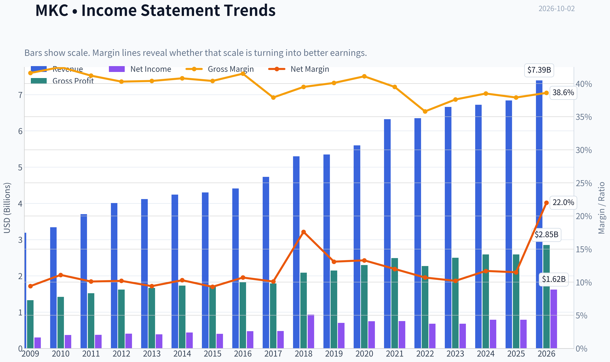

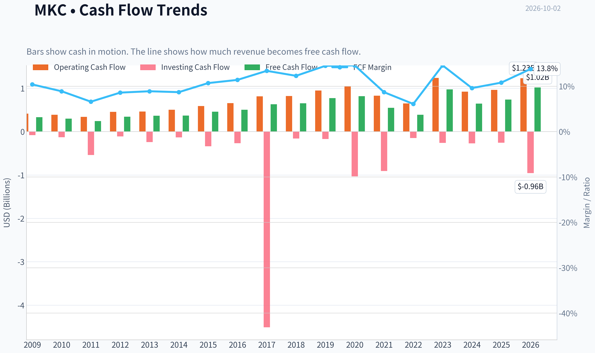

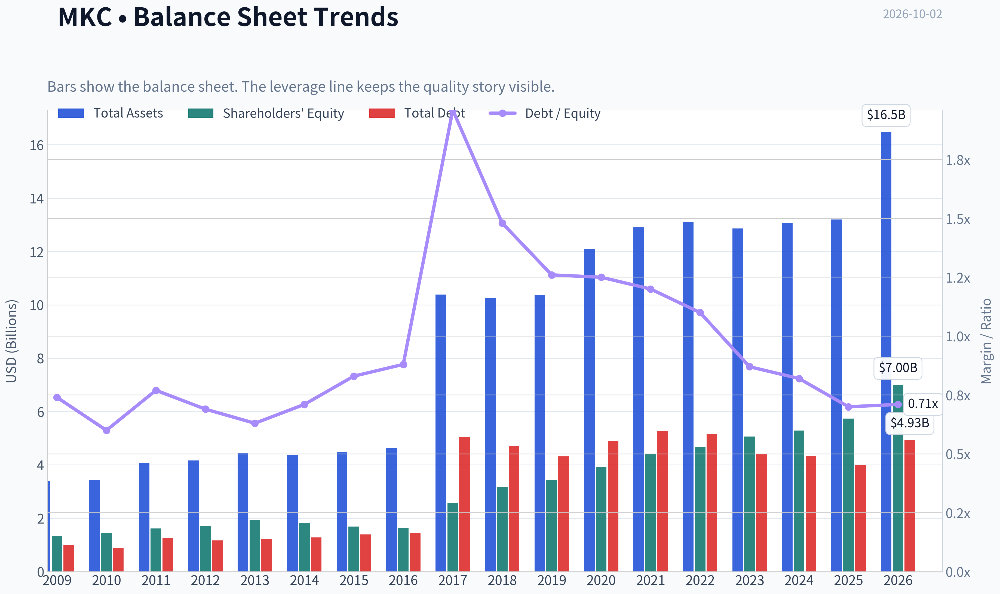

This graph tracks the profitability and return metrics (ROE, ROIC, Margins) of **MKC** over the past decade, highlighting capital efficiency trends.

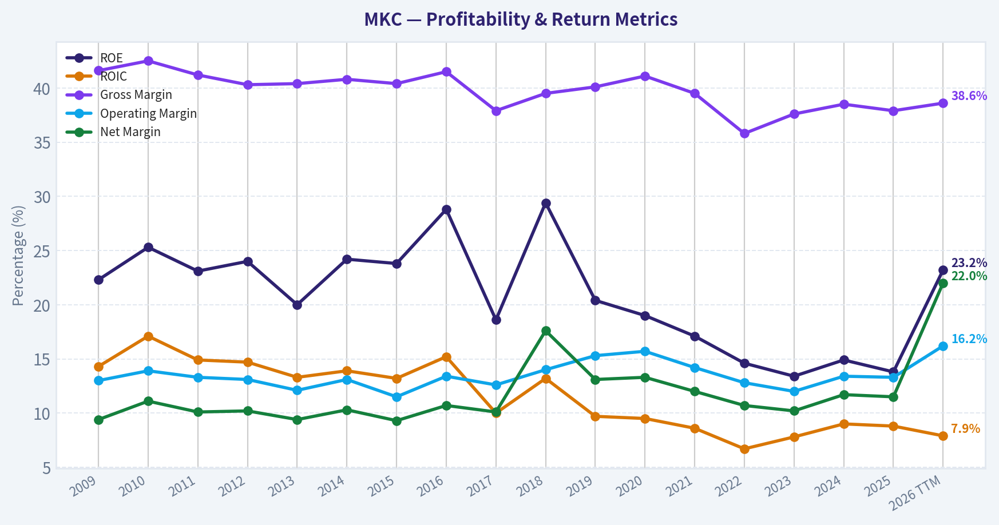

This chart illustrates the financial health of **MKC** over the last 10 years, mapping cash equivalents and free cash flow against total obligations (Debt).

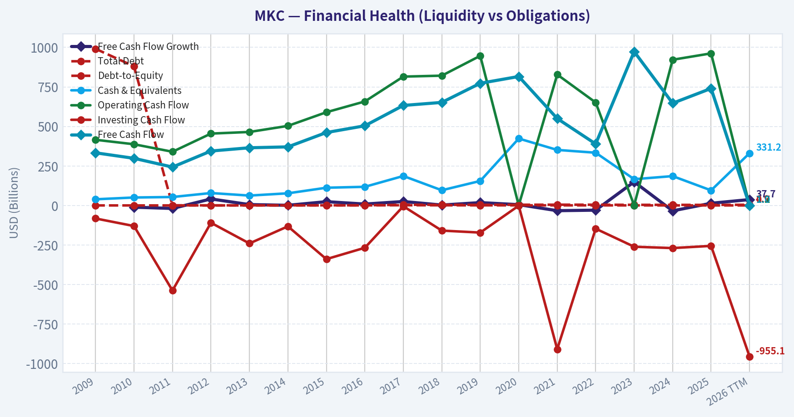

---

### Intrinsic Value Analysis (Buffett)

> *Following Warren Buffett's value investing philosophy: Circle of Competence, Economic Moat, Management Quality, and Margin of Safety.*

#### Intrinsic Value Snapshot

Price is what you pay. Intrinsic value is what the business may be worth based on the cash it can create for owners over time. We show a range, not one magic number.

- Current Price: $44.14
- Value Range (conservative to optimistic across both DCF methods): $10.18 to $80.58

##### Owner Earnings (Buffett Method)
- Net Income: $789,400,000.00
- Depreciation & Amortization: $231,300,000.00
- Capital Expenditures: $-221,800,000.00
- Working Capital Changes: $-83,800,000.00
- Owner Earnings: $882,700,000.00

##### Intrinsic Value
###### Buffett Method
Uses owner earnings. Stricter, and usually more conservative.
- Conservative: $35.31
- Average: $80.58
- Optimistic: $80.58
- Discount Rate: 10.0%

###### Cash Flow Method
Uses free cash flow. Better for companies spending heavily today to grow tomorrow.
- Conservative: $10.18
- Average: $39.89
- Optimistic: $68.58
- Discount Rate: 10.0%

ANALYST STANCE: **WATCH**

#### Executive Summary

McCormick is a recognizable global spice and flavor franchise with durable brands, recurring consumer demand, and meaningful distribution advantages. However, the current evidence points to a business in a transition period: revenue growth is modest, return on equity is below Buffett's preferred level, gross margin is under 40%, and the planned Unilever Foods transaction introduces integration and balance-sheet risk.

At $44 per share, MKC trades below the headline intrinsic-value estimate of $55.60, representing approximately 20.6% upside. That is attractive for a high-quality turnaround, but not sufficient for a high-conviction purchase until earnings growth and post-acquisition leverage become clearer.

#### Financial Snapshot

| Metric | MKC |
|---|---:|
| Current price | $44.00 |
| Market capitalization | $11.87 billion |
| P/E ratio | 7.3x |
| Revenue growth, year over year | 1.7% |
| Gross margin | 37.9% |
| ROE | 13.8% |
| FCF yield | 6.2% |
| Implied annual free cash flow | Approximately $736 million |
| Headline intrinsic value | $55.60 |
| Margin of safety versus price | 20.6% |
| Reverse-DCF growth implied by price | Approximately -3.5% annually for 10 years |
| Three-year revenue growth trend | -2.0% |
| Five-year revenue growth trend | 11.1% |

**Key Takeaways:** MKC is inexpensive on reported earnings, but its current returns and margins are only moderate. The market price appears to assume a prolonged period of weak growth, creating valuation support if the business stabilizes. The main question is whether the low multiple reflects temporary execution problems or a permanently lower-growth franchise.

#### Factor Scorecard

| Factor | Score | Assessment |
|---|---:|---|
| 1. Circle of competence and simplicity | 4/5 | Simple model: sells branded spices, seasonings, and flavor products through retail and food-service channels. Consumer demand is understandable, though acquisitions and global operations add complexity. |
| 2. Moat | 3/5 | Strong brands, shelf presence, scale, recipes, and customer relationships provide a narrow-to-moderate moat. Gross margin below 40% and recent weak growth prevent a higher score. |
| 3. Management and capital allocation | 3/5 | Long operating history and a valuable brand portfolio are positives. The Unilever Foods transaction could improve scale but also creates material integration and capital-allocation risk. |
| 4. Industry structure | 3/5 | Branded food is relatively stable but competitive, with retailer bargaining power, private-label alternatives, and input-cost pressure. |

**Gate 5 hard floor:** **Not tripped.** The available evidence does not indicate simultaneous severe earnings deterioration and solvency distress. The balance sheet and acquisition financing should nevertheless be monitored closely.

#### Moat Analysis

**Brand and intangible assets:** McCormick owns well-known spice and flavor brands such as McCormick, Old Bay, Lawry's, and numerous international labels. Seasonings are low-cost purchases where consumers often favor trusted brands, which supports repeat purchasing and some pricing power.

**Distribution and shelf space:** Retail distribution, food-service relationships, and shelf positioning are valuable assets. A smaller competitor would have difficulty matching MKC's global salesforce, retailer relationships, and product breadth.

**Switching costs:** Consumer switching costs are low. A shopper can select another spice brand with little inconvenience. The moat therefore comes more from habit, brand recognition, availability, and scale than from customer captivity.

**Cost advantages:** McCormick benefits from purchasing scale, global sourcing, manufacturing know-how, and a broad distribution network. These advantages are useful but not unassailable, particularly when retailers promote private-label alternatives.

**Network effects:** Network effects are limited. McCormick does not benefit from the self-reinforcing user growth seen in technology platforms.

**Overall moat rating:** **Narrow-to-moderate and stable**, with the potential to widen if the company successfully integrates Unilever Foods and improves margins. At present, the moat is defensible but not exceptional.

#### Management Quality and Capital Allocation

Management's strongest apparent attribute is stewardship of a portfolio of durable consumer brands over many decades. The company has also demonstrated willingness to invest in brand support, innovation, and international distribution.

The key concern is acquisition execution. The Unilever Foods deal may add scale and attractive brands, but large consumer-goods acquisitions can destroy value when purchased at high prices or when expected synergies fail to materialize. Investors should focus on:

- Debt reduction after the transaction.
- Realized, rather than projected, cost synergies.
- Per-share earnings and free-cash-flow growth.
- Whether management avoids excessive acquisition-driven expansion.
- Dividend safety and the pace of deleveraging.

Management merits a **3/5** rating: credible, but the next phase will test capital-allocation discipline.

#### Financial Analysis

| Measure | Assessment |
|---|---|
| Earnings power | Low valuation multiple indicates depressed or cautiously valued earnings |
| Cash generation | FCF yield of 6.2% implies approximately $736 million of annual free cash flow |
| ROE | 13.8%, below the 15% sustained threshold preferred for a strong compounder |
| Gross margin | 37.9%, consistent with a branded food company but below the 40% threshold suggesting exceptional pricing power |
| Revenue momentum | 1.7% latest year; negative three-year trend but stronger five-year trend |
| Balance sheet | Requires scrutiny because acquisition activity can increase leverage |
| Current ratio | 0.70x; not automatically alarming for a branded consumer company with recurring sales, but liquidity and debt maturities matter |

**Key Takeaways:** MKC generates meaningful cash relative to its market value, but current profitability does not yet demonstrate exceptional economics. The combination of modest ROE, sub-40% gross margin, and weak recent revenue momentum supports a cautious rather than aggressive underwriting stance.

#### Owner Earnings Calculation

A practical owner-earnings proxy is current free cash flow:

| Component | Approximate amount |
|---|---:|
| Net income plus depreciation and amortization | Not separately provided in the research summary |
| Less maintenance capital expenditure | Not separately provided |
| Less working-capital investment | Not separately provided |
| Estimated owner earnings proxy | Approximately $736 million |

**Key Takeaways:** The available free-cash-flow yield supports using approximately $736 million as a normalized owner-earnings proxy. This is a useful valuation base, but the actual figure could differ depending on maintenance capital expenditure, working-capital movements, and acquisition-related cash flows.

#### Three-Scenario DCF Valuation

Using approximately $736 million of owner earnings and roughly 270 million implied shares outstanding:

| Scenario | Assumptions | Estimated value per share |
|---|---|---:|
| A. No growth | Owner earnings capitalized at 10% | $27 |
| B. GDP growth | 3% perpetual growth, 10% discount rate | $40 |
| C. Historical/normalized growth | Approximately 5% annual growth for 10 years, then 5% terminal growth | Approximately $50 |
| Research-pack blended valuation | FCFF, reverse-DCF, and owner-earnings methods | $55.60 |

**Key Takeaways:** The conservative no-growth case indicates meaningful downside if MKC's earnings permanently stagnate. The GDP-growth case is near the current price, while a moderate recovery in growth produces value near $50 per share. The blended $55.60 estimate is credible only if the company restores modest growth and preserves cash generation after the acquisition.

#### Valuation and Margin of Safety

At $44, MKC trades at approximately:

- **7.3 times earnings**
- **16.1 times estimated owner earnings**
- **6.2% free-cash-flow yield**
- **79% of the $55.60 blended intrinsic-value estimate**

The calculated margin of safety is approximately **20.6%**. That is reasonable for a stable consumer franchise if the acquisition is well executed, but it is not especially generous for a business with only moderate ROE and uncertain near-term growth.

The reverse-DCF is more encouraging: the current price implies approximately **-3.5% annual growth over the next decade**. If McCormick can merely stabilize revenue and grow cash flow modestly, the investment could outperform. Conversely, if the Unilever transaction increases leverage while organic growth remains weak, the apparent cheapness may be justified.

#### Buffett Scorecard

| Criterion | Weight | Score | Weighted contribution |
|---|---:|---:|---:|
| Moat width and durability | 25% | 3/5 | 0.75 |
| Valuation and margin of safety | 20% | 3/5 | 0.60 |
| Capital returns versus WACC | 15% | 3/5 | 0.45 |
| Business understanding and predictability | 12% | 4/5 | 0.48 |
| Management quality and capital allocation | 12% | 3/5 | 0.36 |
| Reinvestment runway | 8% | 3/5 | 0.24 |
| Balance-sheet strength | 4% | 2/5 | 0.08 |
| Industry structure | 4% | 3/5 | 0.12 |
| **Total** | **100%** |  | **3.08/5** |

**Key Takeaways:** MKC scores well on simplicity and brand durability, but only moderately on moat strength, capital returns, and valuation. The score is above the avoid range but below the threshold for an attractive Buffett-style purchase today.

#### Investment Stance

**WATCH - Moderate conviction.**

McCormick is a potentially attractive recovery investment rather than a proven high-return compounder at the current moment. The stock becomes more compelling if:

1. Organic sales growth returns to a sustainable low- to mid-single-digit rate.
2. Margins expand without excessive price increases or volume losses.
3. The Unilever Foods transaction produces measurable synergies.
4. Debt declines steadily after closing.
5. ROE and free-cash-flow growth improve.

At $44, MKC is reasonably valued and may offer upside toward the mid-$50s, but the margin of safety is not large enough to offset the acquisition and execution risks with high conviction. A stronger entry point would be below approximately $38, or confirmation that post-acquisition deleveraging and organic growth are progressing as planned.
#### Valuation Bridge

This bridge places the current market price beside each intrinsic value lens so readers can see whether upside depends on one method or shows up across several methods.

| Scenario | Intrinsic Value / Share |
| --- | ---: |
| Buffett Method | $80.58 |
| Cash Flow Method | $39.89 |
| Damodaran Method | $31.26 |
| Current Price | $44.14 |

#### Key Takeaways

If one method is far above the others, the upside case depends on a specific modelling assumption. When several methods cluster together, the valuation story is more robust.

#### Valuation Visuals

This comparison chart from *Latest Earnings Snapshot* stacks current figures against historical benchmarks for **MKC**, making it easy to see where the company trades relative to its own averages.

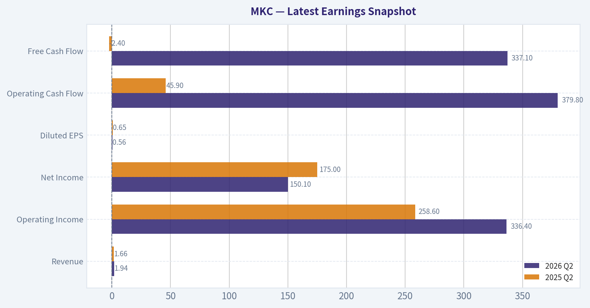

This comparison chart from *Balance Sheet and Financial Strength* stacks current figures against historical benchmarks for **MKC**, making it easy to see where the company trades relative to its own averages.

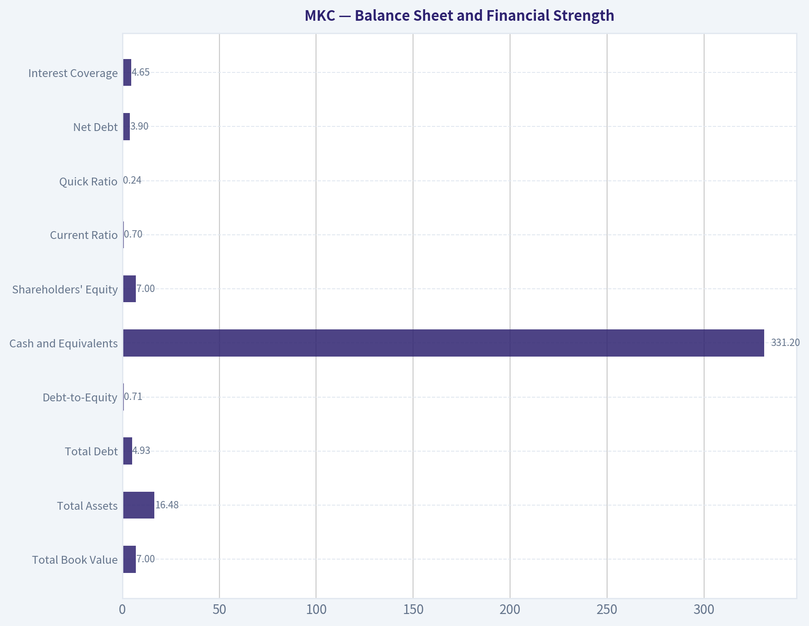

This comparison chart from *Current Versus Historical Average* stacks current figures against historical benchmarks for **MKC**, making it easy to see where the company trades relative to its own averages.

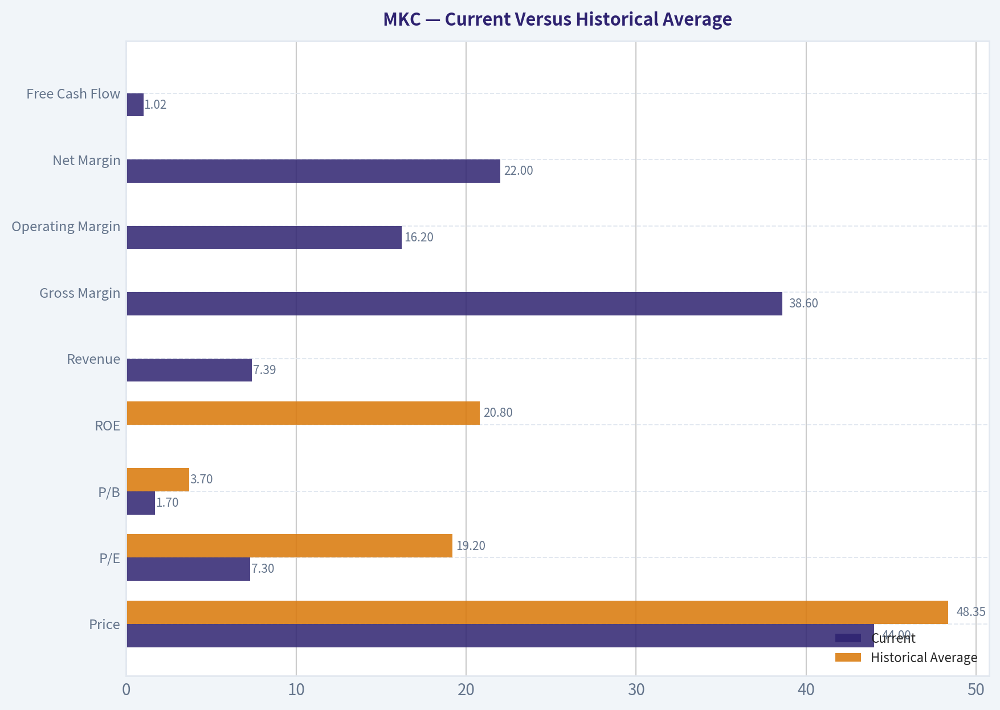

This comparison chart from *Financial Snapshot* stacks current figures against historical benchmarks for **MKC**, making it easy to see where the company trades relative to its own averages.

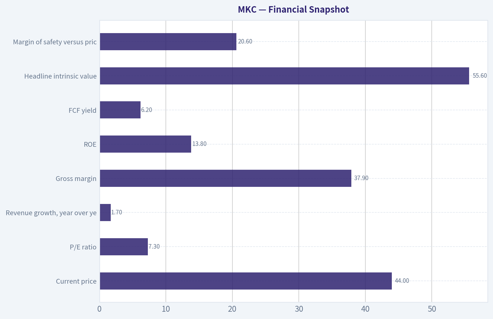

The following chart maps the **MKC** Owner Earnings DCF valuation scenarios (Conservative, Average, Optimistic) to visually represent the margin of safety based on intrinsic value calculations.

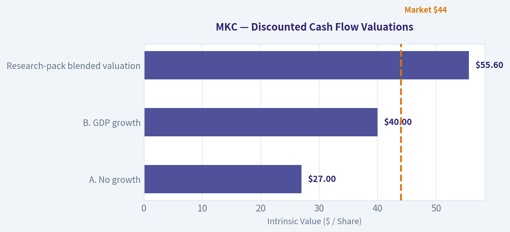

---

### Trend & Growth Analysis (Lynch/Druckenmiller/Fisher)

> *Following Peter Lynch's GARP, Stanley Druckenmiller's macro-aware approach, and Philip Fisher's scuttlebutt methodology.*

ANALYST STANCE: **WATCH**

#### 1. Lynch Classification

| Category | Assessment |
|---|---|
| Classification | Stalwart, with a potential turnaround component |
| Revenue growth | 1.7% YoY; 2.5% three-year CAGR; 4.1% five-year CAGR |
| Earnings profile | Mature, cash-generative, dividend-paying |
| Growth-investing fit | Weak today; improvement depends on margin recovery, acquisitions, and renewed volume growth |

**Key Takeaways:** McCormick is not currently a Lynch fast grower. It is a mature consumer-staples company whose investment case depends more on operational recovery and valuation re-rating than on sustained 20% growth.

#### 2. The Story in Three Bullets

- McCormick owns leading global spice, seasoning, and flavor brands with recurring household and food-service demand.
- Margin expansion is currently offsetting weak consumer volumes, while the planned Unilever Foods transaction and Mexico deal could expand the growth platform.
- At roughly $44 per share, valuation is substantially below recent trading levels, but the market is correctly questioning whether revenue growth can reaccelerate.

#### 3. TAM and 10x Test

| Measure | Assessment |
|---|---|
| Current TTM revenue | Approximately $7.4 billion |
| 10x revenue target | Approximately $74 billion |
| Core markets | Spices, seasonings, condiments, flavor solutions, and food service |
| TAM growth | Moderate rather than exceptionally rapid |
| Strict 10x test | Likely fails within the existing core category |
| TAM expansion route | Acquisitions, international penetration, food-service growth, and broader flavor solutions |

**Key Takeaways:** McCormick has a large and durable market, but its existing categories probably do not support a clean ten-bagger through organic growth alone. A $74 billion revenue business would likely require substantial category expansion and acquisitions, increasing execution and leverage risk.

#### 4. Revenue and Profitability Trend

| Metric | Recent Result | Interpretation |
|---|---:|---|
| Revenue growth, 2026 TTM | 8.0% in the supplied annual series; latest reported YoY figure 1.7% | Mixed; apparent TTM improvement is not yet confirmed as a durable acceleration |
| Three-year revenue CAGR | 2.5% | Weak |
| Five-year revenue CAGR | 4.1% | Stalwart-level growth |
| Operating margin | 16.2% TTM versus 13.3% in 2025 | Positive margin inflection |
| Gross margin | 38.6% TTM versus 37.9% in 2025 | Modest improvement |
| Free cash flow | $1.02 billion TTM | Strong cash generation |
| FCF margin | 13.8% TTM | Healthy for a packaged-food company |

**Key Takeaways:** The strongest current inflection is margin expansion, not revenue acceleration. The data contains a discrepancy between the reported 1.7% latest revenue growth and the 8% annual-series TTM figure, so investors should verify organic volume growth in the next filings.

#### 5. Unit Economics and Financial Quality

| Metric | Result | Assessment |
|---|---:|---|
| LTV/CAC | Not disclosed / not meaningful for packaged foods | Cannot assess using SaaS benchmarks |
| NRR | Not applicable | Consumer packaged-goods model |
| Rule of 40 | Not applicable | Not a subscription business |
| ROE | 13.8% reported; 23.2% in TTM series | Adequate, but data variance warrants verification |
| ROIC | Approximately 7%-8% | Moderate |
| Current ratio | 0.70 | Weak liquidity |
| Debt-to-equity | 0.71 | Manageable but relevant if acquisitions increase debt |
| Interest coverage | 4.65x | Acceptable, not excessive |
| FCF yield | 6.2% | Supportive valuation and dividend characteristic |

**Key Takeaways:** McCormick's economics are best evaluated through brand strength, repeat purchase behavior, margins, and cash conversion rather than LTV/CAC or NRR. Cash flow is healthy, but the sub-one current ratio and acquisition-related leverage reduce financial flexibility.

#### 6. Inflection Point Assessment

| Potential Inflection | Evidence | Rating |
|---|---|---|
| Product cycle | No clearly disclosed breakthrough product cycle | Low |
| Market share | Brand leadership is durable, but recent share acceleration is unproven | Neutral |
| Margin | Operating margin expanded to 16.2% TTM | Positive |
| TAM | Unilever Foods transaction could broaden the platform | Potentially positive |
| Competitive environment | No major competitor failure identified | Neutral |
| Earnings expectations | Low valuation implies significant skepticism | Positive asymmetry, but not proof of growth |

**Key Takeaways:** This is primarily a margin and portfolio-repositioning inflection, not yet a confirmed growth inflection. The key question is whether margin gains can be followed by organic volume growth after consumers and retailers normalize.

#### 7. Macro Setup

| Macro Factor | Current Read-Through |
|---|---|
| Economic cycle | Choppy, late-cycle or uncertain |
| Interest rates | Recent Treasury yields edged higher, creating a valuation headwind for equities |
| Consumer environment | Price-sensitive consumers remain a challenge |
| Sector positioning | Consumer staples offer defensiveness but usually limited multiple expansion |
| Secular trend | Food consumption is durable; growth is moderate rather than disruptive |

**Key Takeaways:** Macro conditions favor defensive cash flows more than high-duration growth stocks. McCormick may hold up relatively well in a weaker economy, but rising yields and soft consumer volumes limit the likelihood of a rapid valuation re-rating.

#### 8. Fisher 15-Point Score

| Fisher Criterion Group | Score |
|---|---:|
| Market potential and long-term outlook | 4/5 |
| Product development and R&D | 3/5 |
| Sales organization and distribution | 4/5 |
| Profit margins and margin direction | 4/5 |
| Labor, executive relations, and management depth | 4/5 |
| Cost control and accounting quality | 3/5 |
| Competitive advantages and brand strength | 4/5 |
| Dilution and balance-sheet discipline | 3/5 |
| Management candor and integrity | 4/5 |
| **Estimated total** | **57/75** |

**Key Takeaways:** McCormick scores as a good, established Fisher business, particularly because of its brands, distribution, and recurring demand. It does not score as an outstanding growth company because organic growth is slow, leverage matters, and recent portfolio moves require execution.

#### 9. Valuation Analysis

| Valuation Measure | Result | Interpretation |
|---|---:|---|
| Share price | Approximately $44 | Depressed versus the 52-week high near $72 |
| P/E | 7.3x TTM; 13.4x forward | Low, though TTM earnings may include unusual benefits |
| PEG | 1.80 | Fair to expensive for the current growth rate |
| Price-to-sales | 1.61x | Reasonable for a branded staples company |
| FCF yield | 6.2% | Attractive relative to many defensive equities |
| Headline intrinsic value | $55.60 | Approximately 20.6% implied upside |
| DCF range | Approximately $31-$81 | Wide sensitivity to growth and margins |
| Reverse DCF | Price implies roughly -3.5% annual owner-earnings growth over 10 years | Low expectations embedded in price |

**Key Takeaways:** McCormick appears undervalued on normalized cash flow and downside expectations, but not obviously cheap on a growth-adjusted basis because the PEG is approximately 1.8. The valuation offers a margin of safety for a recovery thesis, not compelling evidence of ten-bagger potential.

#### 10. Growth Investor Scorecard

| Criterion | Weight | Rating / 5 | Weighted Contribution |
|---|---:|---:|---:|
| Lynch story | 10% | 3.5 | 0.35 |
| TAM and runway | 20% | 2.5 | 0.50 |
| Revenue growth | 20% | 2.0 | 0.40 |
| Unit economics | 15% | 3.5 | 0.53 |
| Competitive position | 10% | 4.0 | 0.40 |
| Management quality | 10% | 3.5 | 0.35 |
| Macro setup | 5% | 3.0 | 0.15 |
| Profitability path | 5% | 4.0 | 0.20 |
| Valuation | 5% | 3.5 | 0.18 |
| **Total** | **100%** |  | **3.06 / 5.00** |

**Key Takeaways:** The 3.06 score places McCormick in the WATCH range. Strong brands, cash flow, and valuation support the stock, but slow revenue growth and limited organic runway prevent an Advocate rating under a growth-investing framework.

#### 11. Position Size Stance

| Investor Situation | Suggested Stance |
|---|---|
| New growth investor | No full position yet |
| Existing shareholder | Hold and monitor execution |
| Value or income investor | Small starter position may be reasonable |
| Suggested growth portfolio size | 0%-1% pending revenue reacceleration |
| Upgrade trigger | Two or more quarters of improving organic volume and stable or expanding margins |

**Key Takeaways:** McCormick is better suited to a watchlist or small value-income position than to a concentrated growth allocation. Position sizing should increase only after the company demonstrates that margin expansion is not masking continuing demand weakness.

#### 12. Catalysts and Risks

| Catalysts | Risks |
|---|---|
| Successful Unilever Foods integration | Acquisition execution and additional leverage |
| Mexico deal adds sustained organic growth | Consumer trade-down and weak volumes |
| Continued operating-margin expansion | Margin gains prove temporary or rely mainly on cost cuts |
| Reacceleration in international and food-service demand | Revenue remains in the low-single-digit range |
| Dividend support and valuation re-rating | Current ratio below 1.0 and limited liquidity |
| De-risking of earnings guidance | TTM earnings may contain non-recurring effects |

**Key Takeaways:** The most important catalyst is genuine organic revenue acceleration, not simply acquisition-driven sales growth. The main risk is that McCormick becomes a highly leveraged, slow-growing staples company whose attractive valuation reflects a permanently lower growth profile.

#### Bottom Line

McCormick is a durable branded consumer-staples business with improving margins, solid free cash flow, and a potentially attractive valuation near $44. However, it is currently a **stalwart or turnaround**, not a fast grower: the ten-bagger test is weak, organic revenue growth is modest, and the PEG ratio does not indicate growth at a bargain price.

**Decision: WATCH.** A more constructive stance would require evidence that the Unilever Foods transaction and operational initiatives produce sustained organic growth while preserving the recent margin improvement.

---

### Market Technical Analysis

ANALYST STANCE: **WATCH**

#### MKC technical overview

McCormick, ticker MKC, closed at **$44.14 on October 1, 2026**, with October 2 being a non-trading day in the supplied data. The technical picture is decisively bearish across trend, momentum, and volume measures, although the stock is now deeply oversold and could experience a short-term countertrend bounce.

Over the one-year period supplied, MKC declined from approximately **$65.96 to $44.14**, a loss of about **33%**. The recent deterioration has been especially severe: the stock fell from **$53.80 on September 2 to $44.14 on October 1**, or roughly **18% in one month**. The October 1 session was particularly weak, with the stock reaching a low of **$43.94** and trading approximately **8.9 million shares**, substantially above its recent typical volume.

#### Trend structure

The long-term trend is bearish. MKC closed roughly **$10.88 below its 200-day SMA of $55.02**, placing price nearly **20% beneath** this major long-term benchmark. The 200-day average itself has been declining steadily, falling from approximately **$56.47 on September 2 to $55.02 on October 1**. This means the weakness is not merely a short-term pullback; the long-term trend remains under pressure.

The medium-term trend is also negative. The **50-day SMA was $51.79**, while the stock closed about **$7.65 below it**, or nearly **15% beneath** the average. The 50-day SMA declined from approximately **$52.62 to $51.79** during the review period, confirming persistent medium-term selling pressure.

The short-term trend is the weakest of the three. The **10-day EMA was $47.73**, approximately **$3.59 above the closing price**. The EMA has dropped sharply from roughly **$54.51 to $47.73** over the past month. The sequence of the 10-day EMA below the 50-day SMA, and the 50-day SMA below the 200-day SMA, reflects broad bearish alignment rather than an isolated technical breakdown.

#### Momentum and reversal risk

The MACD confirms that downside momentum remains dominant. MACD declined from approximately **+0.66 on September 2 to -1.69 on October 1**, crossing from positive to decisively negative territory. The MACD histogram was **-0.42**, indicating that the MACD line remained materially below its signal line.

There is one nuance: the histogram was less negative around October 1 than it was during much of the preceding month. That suggests the rate of downside momentum may have moderated briefly, but it does **not** yet constitute a bullish reversal. A more reliable improvement would require the histogram to move above zero, followed by a MACD crossover and price recovery above the short-term averages.

The RSI reading of **21.1** is firmly oversold. This raises the probability of a short-term rebound, especially after the recent sharp decline. However, RSI has remained below 40 for much of the past month and was already near 30 on several occasions. That behavior indicates sustained downside pressure: oversold conditions can persist in a strong downtrend. RSI alone should therefore not be interpreted as a buy signal.

#### Volatility, volume, and risk management

ATR was approximately **$1.45**, equivalent to about **3.3% of the stock price**. This is significant relative to MKC's current price and indicates that normal daily price fluctuations are large enough to produce substantial risk for short-term traders.

ATR had been elevated near **$1.46** earlier in the period, eased toward approximately **$1.20**, and then rebounded to **$1.45**. The renewed increase is consistent with the latest acceleration in selling pressure. Position sizing should be reduced accordingly, and stops based on a fixed dollar amount may be too tight for current conditions.

The volume-weighted moving average was approximately **$48.39**, placing the closing price about **$4.25 below it**. Because VWMA incorporates volume, the gap suggests that recent high-volume transactions have occurred at materially higher prices than the current market. The October 1 selloff, together with elevated volume, is more consistent with distribution or forced selling than with a quiet, low-volume drift lower.

#### Key price levels and scenarios

The immediate reference point is the October 1 low near **$43.94**. A decisive break below that level would confirm another leg lower and would indicate that sellers remain in control. Because the stock has already fallen sharply, chasing a breakdown at this point carries elevated whipsaw risk.

On the upside, the first recovery test is approximately **$46.40 to $47.73**, representing the October 1 close area, the recent breakdown region, and the 10-day EMA. A sustained close above the 10-day EMA would be an initial sign that short-term selling pressure is easing, but it would not reverse the broader trend.

The next important resistance zone is near **$48.39**, the VWMA, followed by approximately **$51.79**, the 50-day SMA. A credible medium-term recovery would require price to reclaim the VWMA and then establish support above the 50-day average. Until that occurs, rallies should be treated as potential relief rallies rather than confirmed trend reversals.

The most balanced interpretation is therefore **watch rather than aggressively buy or short**. The oversold RSI creates bounce potential, but the bearish moving-average alignment, negative MACD, rising ATR, price below VWMA, and high-volume decline argue against assuming that a durable bottom is already in place. Traders considering a long position should wait for evidence such as stabilization above the recent low, improving MACD histogram readings, and a close back above the 10-day EMA.

#### Selected indicators

The selected indicators are designed to cover distinct dimensions: long-term and medium-term trend, short-term price responsiveness, momentum, exhaustion, volatility, and volume-confirmed price location. The MACD and MACD histogram are related but not redundant here: the MACD establishes the broader momentum regime, while the histogram highlights changes in the intensity of that momentum.

| Indicator | Latest supplied value | Interpretation for MKC |
|---|---:|---|
| close_200_sma | $55.02 | Price is far below a declining long-term trend benchmark; long-term bias is bearish. |
| close_50_sma | $51.79 | Price remains materially below the medium-term average; rallies face significant overhead resistance. |
| close_10_ema | $47.73 | Short-term trend is sharply down; reclaiming this level would be an initial stabilization signal. |
| macd | -1.69 | Momentum is decisively negative and has deteriorated substantially over the past month. |
| macdh | -0.42 | MACD remains below its signal line; downside momentum is still active despite some recent moderation. |
| rsi | 21.1 | Deeply oversold and capable of producing a bounce, but not sufficient evidence of a durable bottom. |
| atr | $1.45 | Volatility is high at roughly 3.3% of price; position sizes and stop distances require adjustment. |
| vwma | $48.39 | Price is well below the volume-weighted average, indicating weak volume-confirmed positioning. |

**Key Takeaways:** MKC is in a broad bearish trend, with price below all three selected moving averages and below its volume-weighted average. RSI is deeply oversold, so a relief rally is possible, but MACD, volume, and volatility do not yet confirm a durable reversal. The key near-term levels are approximately $43.94 on the downside and $47.73 to $48.39 on the upside; a recovery above that resistance zone would provide the first meaningful evidence of stabilization.

#### Market Visuals

This comparison chart from *Market Metrics* stacks current figures against historical benchmarks for **MKC**, making it easy to see where the company trades relative to its own averages.

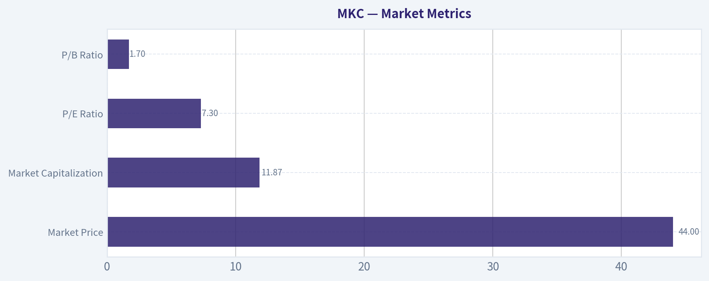

---

### Options Market Analysis

> *Reading options flow - put/call ratios, IV skew, and unusual activity - to gauge institutional positioning and event-driven risk.*

ANALYST STANCE: **WATCH**

#### MKC Options Flow Report

**As of October 2, 2026.** The available MKC options data is extremely thin and internally inconsistent, so confidence in the directional signal is low. Several expirations show zero reported open interest, while implied volatility readings are unusually low, suggesting possible incomplete or stale market data.

#### Put/Call Ratio Analysis

| Expiration | Days to Expiry | Call OI | Put OI | Call Volume | Put Volume | Put/Call Volume |
|---|---:|---:|---:|---:|---:|---:|
| Oct. 16, 2026 | 14 | 0 | 0 | 2,043 | 783 | 0.38 |
| Nov. 20, 2026 | 49 | 0 | 0 | 226 | 2,728 | 12.07 |
| Dec. 18, 2026 | 77 | 35 | 7 | 150 | 111 | 0.74 |
| **Near-term total** | - | **35** | **7** | **2,419** | **3,622** | **1.50** |

The aggregate put/call open-interest ratio is **0.20**, below the approximately **0.70 neutral baseline**, which would normally suggest a call-heavy or relatively bullish positioning profile. However, this ratio is based almost entirely on the December expiration because October and November open interest is reported as zero. Aggregate volume is more cautious: the put/call volume ratio is **1.50**, indicating heavier put activity overall.

**Key Takeaways:** Open interest appears call-heavy, but the reading is unreliable because most reported expirations have zero OI. Volume is more defensive, driven primarily by substantial November put activity. The overall ratio does not establish a strong bullish signal.

#### Implied Volatility Assessment

| Expiration | Call ATM IV | Put ATM IV | IV Assessment |
|---|---:|---:|---|
| Oct. 16, 2026 | 3.1% | 0.0% | Extremely low and likely unreliable |
| Nov. 20, 2026 | 1.6% | 0.0% | Extremely low and likely unreliable |
| Dec. 18, 2026 | 1.6% | 0.0% | Extremely low and likely unreliable |

Reported near-term ATM IV ranges from **1.6% to 3.1% for calls**, while put IV is reported as **0.0%** across all expirations. These values are not economically credible for a normally traded equity option chain and likely reflect missing quotes, illiquidity, or a data-feed limitation.

A reliable OTM put-versus-call skew cannot be calculated from the supplied data. There is no evidence here of a measurable put skew or call skew. No catalyst, such as an earnings release or product event, can be confirmed from this options snapshot.

**Key Takeaways:** The IV data should not be interpreted as evidence that MKC has exceptionally low event risk. The zero put-IV readings and very low call IV indicate poor data quality or a highly illiquid chain. Skew and catalyst-related volatility cannot be assessed with confidence.

#### Unusual Options Activity

No contracts met the stated unusual-activity threshold of volume greater than five times open interest. Therefore, there are no validated fresh directional bets to classify as institutional call buying, put hedging, or retail speculation.

| Category | Observation | Interpretation |
|---|---|---|
| Unusual contracts | None identified | No confirmed volume/OI anomaly |
| Fresh institutional positioning | Not evident | Insufficient contract-level evidence |
| Retail speculation | Not evident | No qualifying activity |

**Key Takeaways:** The absence of qualifying unusual activity means there is no clear smart-money directional signal. The elevated November put volume is notable, but without strike-level volume, pricing, and open-interest detail, it cannot be confidently labeled as bearish buying rather than spreads, hedges, or closing trades.

#### Open Interest Concentration and Gamma Levels

| Expiration | Highest Reported Call OI | Highest Reported Put OI | Gamma/Pinning Assessment |
|---|---:|---:|---|
| Oct. 16 | 0 total OI reported | 0 total OI reported | No usable concentration |
| Nov. 20 | 0 total OI reported | 0 total OI reported | No usable concentration |
| Dec. 18 | 35 total call OI | 7 total put OI | Limited concentration; strikes unavailable |

The only reported open interest is in the December 18 expiration, with **35 call contracts and 7 put contracts**. Strike-level data was not supplied, so specific gravitational levels, maximum-pain estimates, and gamma walls cannot be identified. Given the very small OI totals, any pinning or gamma effect is likely limited.

**Key Takeaways:** There is no meaningful open-interest concentration visible in the near-term data. The December call-heavy OI could provide a modest bullish bias, but the position size is too small to imply a meaningful gamma wall or reliable price target.

#### Overall Options Sentiment

The appropriate directional read is **NEUTRAL**, with a weak bullish undertone but very low confidence.

The bullish element is the reported **0.20 put/call OI ratio**, indicating more calls than puts in the only expiration with measurable OI. Against that, aggregate volume is put-heavy at **1.50**, and November shows substantially more put volume than call volume. The lack of unusual activity, near-zero reported IV, missing strike-level information, and zero OI in two expirations substantially reduce the reliability of the signal.

This is best treated as an illiquid or incomplete options snapshot rather than a strong institutional positioning indicator. The data does not support a confident bullish or bearish trade thesis.

#### Summary

| Metric | Assessment |
|---|---|
| Put/Call Ratio | OI ratio 0.20, nominally bullish; volume ratio 1.50, more defensive |
| IV Level | Reported IV extremely low and likely unreliable |
| Skew Direction | Not determinable; put IV is reported as 0.0% |
| Unusual Activity | None meeting the volume-to-OI threshold |
| Overall Signal | **NEUTRAL**, weak bullish undertone, low confidence |

**Key Takeaways:** MKC's options data gives a nominally bullish open-interest signal but a more defensive volume signal. Because the chain is thin and several fields appear incomplete or unreliable, the overall conclusion is neutral rather than directional. The primary risk is mistaking poor data quality for genuine low volatility or institutional conviction.

---

## Research Team Commentary

> *The Research Manager synthesizes the Bull vs Bear debate into action-free commentary. This is a pre-risk view, not the final stance.*

Core takeaway: McCormick appears to be a durable branded franchise facing a potentially attractive valuation, but the alleged bargain cannot yet be verified. The entire bullish valuation case depends on the supplied 7.34 P/E translating into sustainable, cash-convertible earnings of roughly $6.01 per share. Without a reconciliation to normalized free cash flow, that figure is too uncertain to support a starter position. The business is good enough to watch closely, but its 7.4% ROIC, weak organic volumes, acquisition risk, and damaged price trend prevent it from qualifying as a Buffett-style "wonderful business at a fair price" today.

The strongest bull argument is that McCormick owns trusted brands in a recurring, low-obsolescence category. Its procurement scale, shelf presence, food-safety capabilities, and commercial flavor relationships would be difficult to reproduce. Weak consumer volumes do not necessarily mean the franchise is permanently impaired, particularly while gross margin remains a healthy 37.9% and margins are expanding. If normalized owner earnings are at least $3.60-$4.20 per share, the current price implies only minimal long-term growth. In that case, modest revenue growth, stable margins, and successful integration could produce attractive returns without heroic assumptions.

The strongest bear argument is more fundamental than the weak chart: the earnings denominator has not been validated. The implied $6.01 EPS may contain adjustments, transaction effects, or other items that do not translate into distributable cash. The bull's own valuation range illustrates the uncertainty. A conservative value of approximately $46 offers almost no margin of safety at $44.14, while the bear case near $31 implies substantial downside. Only the $59 base case produces compelling upside, and that case assumes normalized owner earnings of $3.60 per share, renewed growth, and satisfactory transaction execution.

ROIC is the other major restraint. At 7.4%, McCormick is not currently demonstrating elite capital productivity. That does not invalidate the moat, especially if goodwill from prior acquisitions depresses the reported figure, but it places the burden of proof on management. The planned transactions should be evaluated through free cash flow per share and post-acquisition ROIC, not adjusted EBITDA or announced synergies. Acquiring attractive brands can still destroy value if the price, leverage, or integration costs are excessive.

The bearish technical picture supports patience but should not be confused with intrinsic value. A roughly 33% one-year decline, deeply oversold conditions, and a fundamentally intact franchise create meaningful odds of a reflex rally. Past experience argues for separating that possible trading bounce from an investable long-term entry. I would not short or avoid McCormick merely because the chart is broken, but neither would I interpret an oversold rebound as confirmation that owner earnings are sound.

From a value-investing perspective, WATCH is preferable to AVOID because there is no evidence of genuine distress, the category is durable, and the moat remains meaningful. It is preferable to ADVOCATE because too many essential assumptions remain unverified. The low multiple may be a genuine opportunity, but a haircut applied to an uncertain EPS number is not a substitute for a cash-flow reconciliation.

Over the next one to four quarters, I would monitor five areas closely. First, reconcile reported and adjusted EPS to operating cash flow, maintenance capital expenditures, working capital, integration costs, interest expense, and fully diluted free cash flow per share. Sustained owner earnings of at least roughly $3.60 per share would materially strengthen the valuation thesis; a result closer to $2.50-$3.00 would make the current price much less compelling.

Second, watch organic volume and market share separately from pricing and acquired growth. One quarter of stabilization would be encouraging, but two or more quarters of stable or improving volumes would provide stronger evidence that the brand has not suffered lasting impairment. Continued unit contraction despite easier comparisons would weaken the thesis.

Third, assess whether margin improvement is durable. Gross and operating margins should hold after normal marketing investment and without dependence on recurring restructuring adjustments. Margin expansion driven by lower temporary costs or reduced brand investment deserves less credit than productivity gains that flow through to cash.

Fourth, measure transaction execution through realized cash savings, net leverage, interest coverage, and post-acquisition ROIC. An upgrade would require debt declining on schedule, free cash flow per share growing after financing and integration costs, and ROIC moving convincingly above 7.4%. Persistent leverage, recurring "one-time" adjustments, or acquisition-driven earnings growth without cash-flow growth would be warning signs.

Finally, treat the price action as a timing filter. An oversold bounce is plausible, but a more dependable entry would combine validated cash flow with stabilization in the operating results and improving price-volume behavior. A decline toward approximately $39 without fundamental deterioration could provide a more defensible margin of safety based on the conservative valuation case. Alternatively, stronger financial confirmation could justify a staged position even at a somewhat higher price; waiting only for a perfect deep-value quotation risks missing a genuine branded compounder.

The balanced conclusion is that McCormick may be mispriced, but the evidence currently establishes possibility rather than probability. Validate owner earnings and acquisition economics before paying for the recovery.

WATCH

---

## Value Investing Team Commentary

> *The Investor translates the research view into an investment thesis before risk review. This is still not the final stance.*

### Investment Commentary

McCormick is an understandable, durable business operating in a category with low obsolescence and recurring demand. Its leading brands, retailer shelf presence, procurement scale, food-safety expertise, and long-standing commercial flavor relationships form a meaningful moat. Consumers may trade between brands or channels, but they are unlikely to stop purchasing spices, seasonings, and flavor products altogether.

The central question is therefore not whether McCormick will remain relevant. It is whether today's earnings are sustainable, cash-convertible, and sufficient to justify the purchase price after accounting for acquisition risk and leverage.

### The valuation is attractive only if the earnings denominator is real

At $44.14, the stated 7.34 P/E implies approximately $6.01 of earnings per share. That figure appears unusually strong relative to the handoff's normalized owner-earnings estimates and must be reconciled before it can be trusted. A low multiple applied to temporary, adjusted, or transaction-influenced earnings does not create a genuine margin of safety.

The more useful valuation ranges are:

- At $3.60 of normalized owner earnings, MKC trades at approximately 12.3 times owner earnings and an 8.2% owner-earnings yield.
- At $4.20, it trades at approximately 10.5 times and offers a 9.5% yield.
- At $3.00, the multiple rises to 14.7 times and the yield falls to 6.8%.
- At $2.50, the multiple is 17.7 times, which is not obviously cheap for a slow-growing company with acquisition and leverage risk.

An illustrative perpetuity calculation reinforces the point. At a 9% required return, the current price requires less than 1% long-term growth if sustainable owner earnings are $3.60 and effectively no growth if they are $4.20. Those are modest expectations. But if sustainable owner earnings are only $2.50-$3.00, the market is implicitly requiring roughly 2%-3% perpetual growth, leaving much less room for execution mistakes.

Thus, the stock may be inexpensive, but that conclusion depends almost entirely on validating owner earnings of at least approximately $3.60 per share.

### Business quality is good, but not presently exceptional

The 37.9% gross margin supports the view that McCormick retains brand value and pricing power. Margin expansion during weak consumer volumes is also encouraging. However, pricing and cost control cannot indefinitely substitute for unit growth. Two or more quarters of stable or improving organic volumes would provide much stronger evidence that consumer behavior reflects temporary pressure rather than brand erosion, trade-down, or lost shelf momentum.

The reported 7.4% ROIC is the more serious quality constraint. It is adequate, but it does not currently qualify McCormick as an elite compounder. Goodwill and acquired intangibles may depress reported returns, yet that cannot fully excuse mediocre capital productivity. Acquisitions consume real shareholder capital even when accounting treatment makes the economics harder to see.

Management should therefore be judged on:

- Free cash flow per diluted share after integration expenses
- Post-transaction ROIC rather than adjusted EBITDA
- Realized cash synergies rather than announced targets
- Debt reduction and interest coverage
- Organic volume and market-share performance
- The durability of margins after normal brand investment

If acquisitions increase adjusted earnings while leverage remains elevated and free cash flow per share stagnates, shareholders will not have benefited meaningfully.

### Selective contrarian view

The damaged chart and approximately 33% one-year decline indicate considerable pessimism. That pessimism may be excessive if weak volumes are cyclical, margins remain durable, and the transactions strengthen rather than dilute the franchise. A stable branded food company priced at 10-12 times genuine owner earnings would be a credible contrarian opportunity.

However, being contrarian does not mean assuming that every sharp decline is irrational. The market may correctly be questioning earnings quality, acquisition economics, leverage, and the ability to restore organic growth. The unusually low reported P/E is itself a reason for investigation, not immediate enthusiasm.

The oversold technical condition creates meaningful rebound potential, but a reflex rally would not validate the investment thesis. Conversely, the broken trend is not a reason to reject a fundamentally sound company. Price action should be used as a secondary timing tool, while cash economics remain the primary decision variable. Thin and potentially stale options data adds little reliable information.

### Decision framework

The present valuation does not offer a sufficient quality-scaled margin of safety based on the information available. Using the supplied values of approximately $31, $46, and $59 for adverse, conservative, and favorable outcomes, a reasonable probability-weighted value remains only in the upper $40s. That represents limited upside from $44.14 and falls short of the approximately 25%-35% discount appropriate for a business with modest ROIC, uncertain normalized earnings, and material transaction risk.

I would consider upgrading the stock under either of two conditions:

1. **Fundamental confirmation:** Owner earnings of at least $3.60 per share are demonstrated through operating cash flow, maintenance capital expenditures, working capital, interest, and integration costs, alongside stabilizing volumes and declining leverage. Confirmation could justify a staged purchase even above today's price.

2. **A larger price discount:** A decline toward approximately $39 without deterioration in normalized cash flow or the competitive position would provide a more defensible margin of safety. It would not eliminate the need for cash-flow verification, but it would improve the asymmetry.

Reasons to become more cautious would include owner earnings below $3.00 per share, continuing volume contraction, recurring restructuring adjustments, delayed debt reduction, reduced marketing support used to protect margins, or post-acquisition ROIC remaining near or below its current level.

**ANALYST STANCE: WATCH**

McCormick has a durable franchise and could be undervalued if normalized owner earnings are at least $3.60-$4.20 per share. But the reported 7.34 P/E has not been reconciled to distributable cash, while 7.4% ROIC, weak volumes, and acquisition execution risk prevent the stock from qualifying as a wonderful business at a clearly attractive price. Keep it on the watchlist, validate cash flow and transaction economics, and buy only after stronger operating evidence or a wider margin of safety.

---

## Deep Values Commentary

> *The Risk Management Team debates and the Risk Judge provides the final action-free verdict. This section determines the final ADVOCATE / WATCH / AVOID stance.*

#### Final Stance Scorecard

This scorecard converts the final research view into a weighted decision frame. It does not replace the narrative judgement, but it makes the main drivers of the verdict easier to scan.

| Criterion | Score | Weight | Commentary |
| --- | ---: | ---: | --- |
| Business Quality | 3.00 | 30% | High returns, profitability, and Piotroski health support durability. |
| Valuation Support | 4.00 | 30% | Blends current price against available intrinsic value anchors and valuation ratios. |
| Financial Strength | 2.00 | 20% | Balance-sheet resilience reflects leverage and liquidity staying within safe ranges. |
| Growth Durability | 2.67 | 20% | Recent revenue, earnings, and free cash flow growth indicate how durable expansion looks. |
| TOTAL / FINAL STANCE | 3.03 | 100% | AVOID |

#### Key Takeaways

The weighted score lands at **3.03 / 5.0**, while the final stance remains **AVOID**. This is useful as a quick calibration aid rather than a mechanical signal.

#### Risk Summary

Higher scores indicate more risk pressure. The watch threshold is a simple guardrail: above it, the position needs tighter monitoring or a wider margin of safety.

| Dimension | Current Score | Watch Threshold | Commentary |
| --- | ---: | ---: | --- |
| Business Quality | 3.00 | 3.00 | High returns, profitability, and Piotroski health support durability. |
| Valuation Support | 2.00 | 3.00 | Blends current price against available intrinsic value anchors and valuation ratios. |
| Financial Strength | 4.00 | 3.00 | Balance-sheet resilience reflects leverage and liquidity staying within safe ranges. |
| Growth Durability | 3.33 | 3.00 | Recent revenue, earnings, and free cash flow growth indicate how durable expansion looks. |

#### Key Takeaways

This view helps readers separate *where* the risk sits: valuation, business quality, balance sheet, or growth durability. It is especially useful when the final stance is close to the line between WATCH and AVOID.
