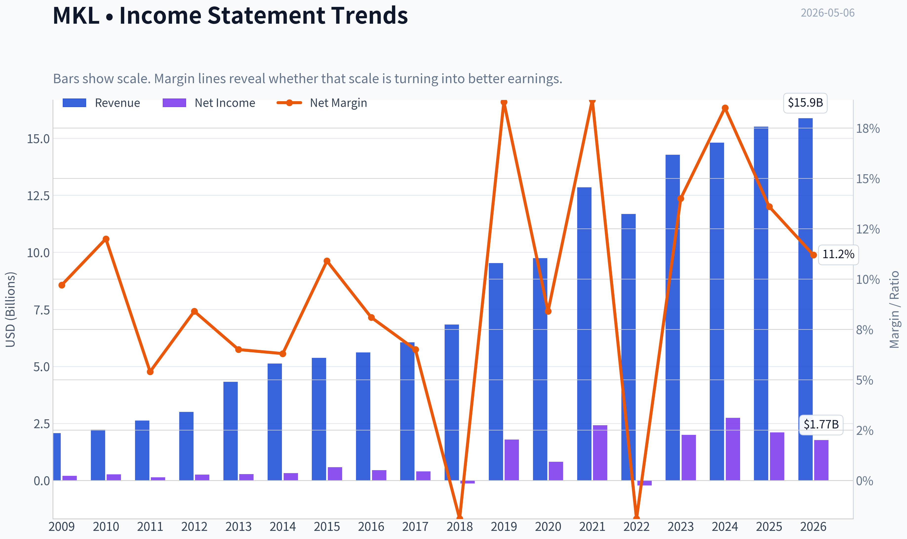
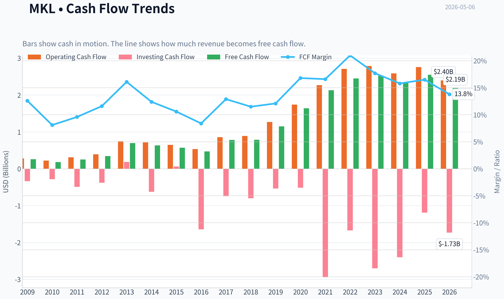
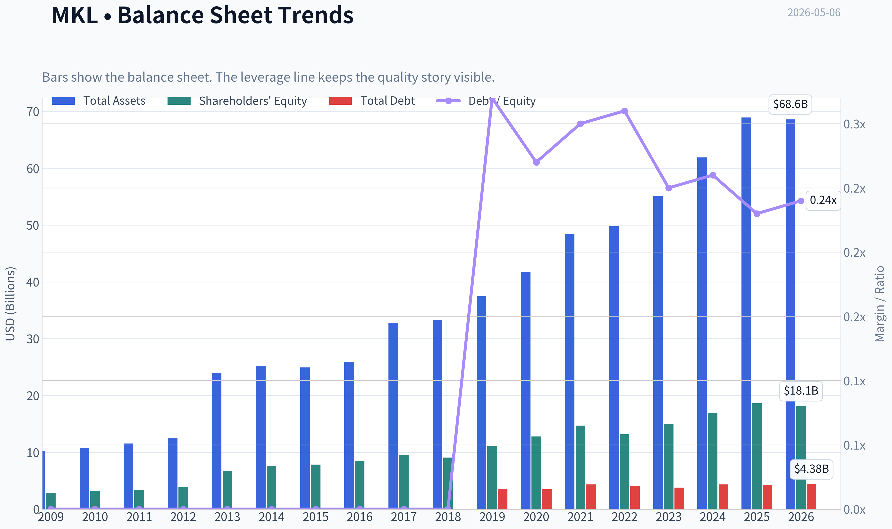
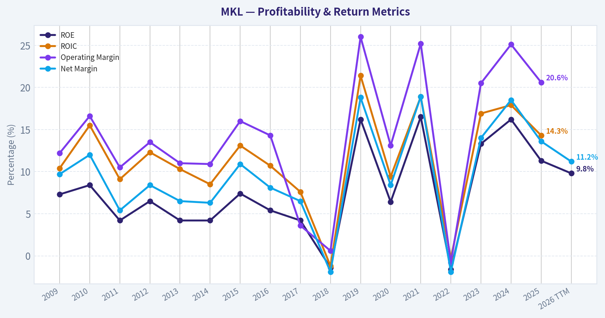
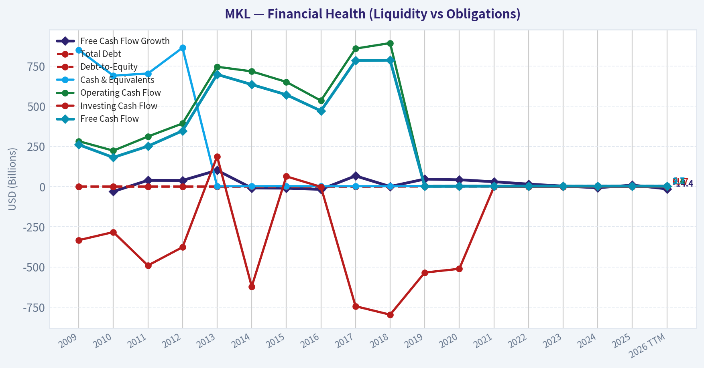
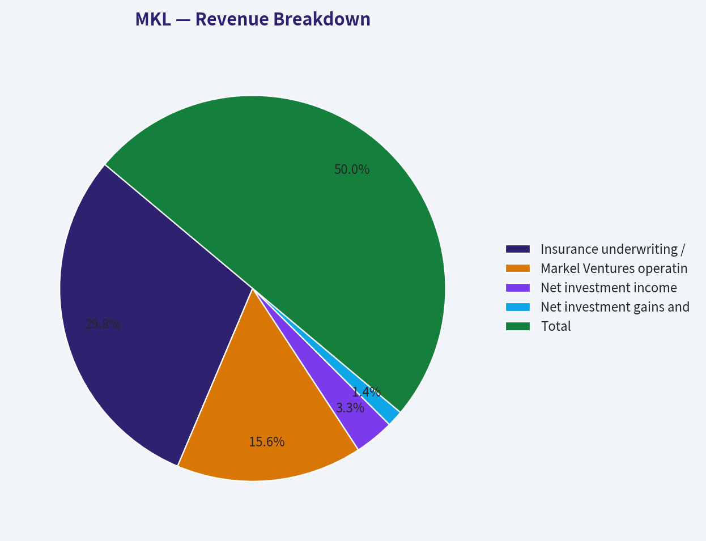
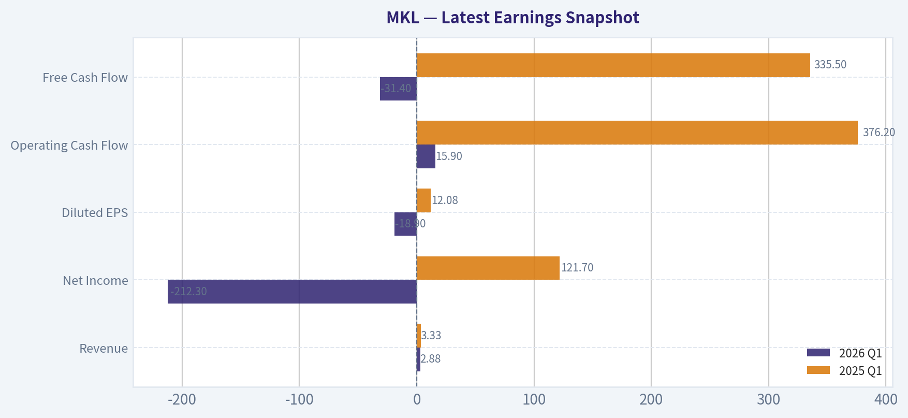
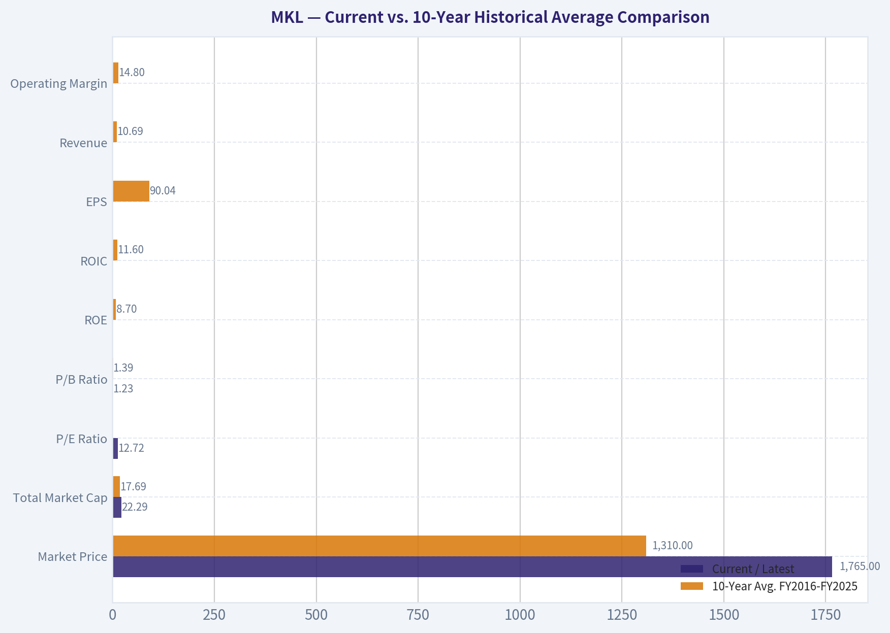
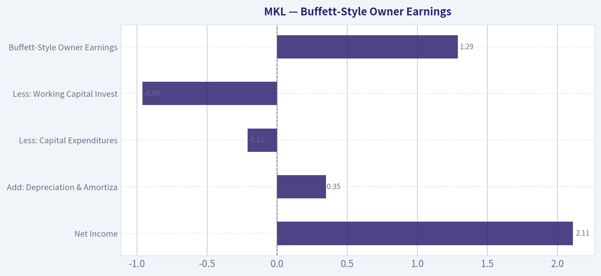
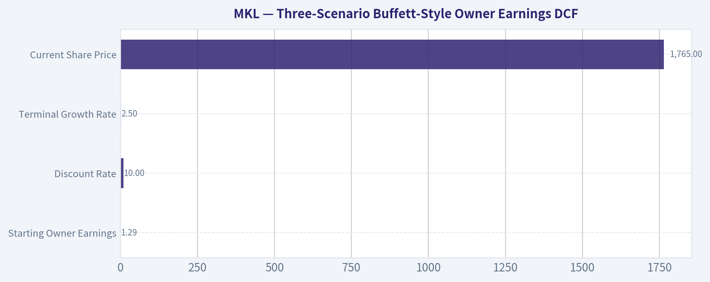

# MKL Deep Value Intelligence

**Analysis Date:** 2026-05-06

## Critical Disclaimer

*This analysis is generated by Deep Value Intelligence, an AI-powered multi-agent investing framework. This report is for informational and educational purposes only and does not constitute financial advice. Always conduct your own research and consult with qualified financial advisors before making investment decisions.*

---

## Table of Contents

1. Intelligence Summary
2. Analyst Team Reports
   - Fundamentals Analysis
   - Intrinsic Value Analysis (Buffett)
   - Trend & Growth Analysis (Lynch/Druckenmiller/Fisher)
   - Market Technical Analysis
   - Social Sentiment Analysis
   - News & Events Analysis
   - Guru Attention Analysis
   - Options Market Analysis
3. Research Team Commentary
4. Value Investing Team Commentary
5. Deep Values Commentary

---

## Intelligence Summary

### Thesis + Conditions

**Core Thesis:** **EXECUTIVE SUMMARY**
Markel Group (MKL) presents a classic value investing dilemma: a proven compounding machine trading at a moderate discount, offset by the structural complexity of a specialty insurer and conglomerate. While an activist push (JANA Partners) for a $2B buyback and divestiture offers a potential catalyst, the current 13-14% discount to our conservative intrinsic value ($2,045) fails to provide a sufficient margin of safety for a business with volatile insurance earnings.

**Key Risks:**
- Markel Group (MKL) presents a classic value investing dilemma: a proven compounding machine trading at a moderate discount, offset by the structural complexity of a specialty insurer and conglomerate. While an activist push (JANA Partners) for a $2B buyback and divestiture offers a potential catalyst, the current 13-14% discount to our conservative intrinsic value ($2,045) fails to provide a sufficient margin of safety for a business with volatile insurance earnings. We adopt a posture of "measured stalking," waiting for either a deeper price dislocation or concrete evidence of capital simplification before allocating capital.
- The Bull (Risky Analyst):** Sees massive asymmetric upside. Argues that a 13.3% ROIC, 9.2% FCF growth, and an oversold technical setup create a great entry point. Views complexity as the source of the discount and JANA's $2B buyback/spinoff proposal as the ultimate catalyst.
- The Bear (Safe Analyst):** Cautions that the margin of safety is too thin. Highlights that FCF can be an unreliable metric for complex insurers and that a 23.3% drop in GAAP net income exposes true operating volatility. Activism introduces execution risk, not guaranteed value.
- The bull case paints a compelling picture of a misunderstood, mini-Berkshire compounding engine. It highlights Markel's solid 13.3% return on invested capital, deep specialty insurance expertise, and an attractive 9.2% free cash flow growth. The bulls argue that the current price reflects an unwarranted conglomerate discount and that JANA Partners' activist pressure could serve as a catalyst to unlock per-share value.
- My core takeaway is that Markel is a fundamentally sound business with a respectable history, but it does not currently offer the fat pitch we require to initiate a full position. The margin of safety is too thin for the level of complexity involved, and the reliance on activist intervention to unlock value introduces a layer of execution risk that conflicts with our preference for predictable, self-sustaining compounding machines.

**What Would Change Our View:**
- Markel Group (MKL) presents a classic value investing dilemma: a proven compounding machine trading at a moderate discount, offset by the structural complexity of a specialty insurer and conglomerate. While an activist push (JANA Partners) for a $2B buyback and divestiture offers a potential catalyst, the current 13-14% discount to our conservative intrinsic value ($2,045) fails to provide a sufficient margin of safety for a business with volatile insurance earnings. We adopt a posture of "measured stalking," waiting for either a deeper price dislocation or concrete evidence of capital simplification before allocating capital.
- The Bull (Risky Analyst):** Sees massive asymmetric upside. Argues that a 13.3% ROIC, 9.2% FCF growth, and an oversold technical setup create a great entry point. Views complexity as the source of the discount and JANA's $2B buyback/spinoff proposal as the ultimate catalyst.
- The Bear (Safe Analyst):** Cautions that the margin of safety is too thin. Highlights that FCF can be an unreliable metric for complex insurers and that a 23.3% drop in GAAP net income exposes true operating volatility. Activism introduces execution risk, not guaranteed value.
- The bull case paints a compelling picture of a misunderstood, mini-Berkshire compounding engine. It highlights Markel's solid 13.3% return on invested capital, deep specialty insurance expertise, and an attractive 9.2% free cash flow growth. The bulls argue that the current price reflects an unwarranted conglomerate discount and that JANA Partners' activist pressure could serve as a catalyst to unlock per-share value.
- My core takeaway is that Markel is a fundamentally sound business with a respectable history, but it does not currently offer the fat pitch we require to initiate a full position. The margin of safety is too thin for the level of complexity involved, and the reliance on activist intervention to unlock value introduces a layer of execution risk that conflicts with our preference for predictable, self-sustaining compounding machines.

**Confidence:** Medium

---

## Analyst Team Reports

### Fundamentals Analysis

#### Latest Earnings Snapshot

*Most recent reported quarter anchored on 2026 Q1, with prior-year comparison when available.*

| Metric | 2026 Q1 | 2025 Q1 | YoY Change |
| --- | ---: | ---: | ---: |
| Revenue | $2.88B | $3.33B | -13.5% |
| Operating Income | N/A | N/A | N/A |
| Net Income | $-212.3M | $121.7M | -274.4% |
| Diluted EPS | $-18.90 | $12.08 | -256.5% |
| Operating Cash Flow | $15.9M | $376.2M | -95.8% |
| Free Cash Flow | $-31.4M | $335.5M | -109.3% |

Key Takeaways: This snapshot anchors the most recent reported quarter before the narrative analysis. It helps readers separate long-run business quality from whatever changed in the latest earnings print.

#### 10-Year Financial Metrics for MKL

*All values below are computed deterministically from raw data - not estimated by AI.*

*Issuer profile: insurer (Financial Services / Insurance - Property & Casualty).*

#### 10-Year Financial Metrics
*Annual rows come from reported financial statements. The final TTM row is computed from the latest four quarters.*

| Metric | 2009 | 2010 | 2011 | 2012 | 2013 | 2014 | 2015 | 2016 | 2017 | 2018 | 2019 | 2020 | 2021 | 2022 | 2023 | 2024 | 2025 | 2026 TTM |
| --- | --- | --- | --- | --- | --- | --- | --- | --- | --- | --- | --- | --- | --- | --- | --- | --- | --- | --- |
| Market Price | $340 | $378 | $415 | $433 | $580 | $683 | $883 | $904 | $1,139 | $1,038 | $1,143 | $1,033 | $1,234 | $1,317 | $1,420 | $1,726 | $2,150 | $1,765 |
| Market Cap | $3.34B | $3.70B | $4.03B | $4.19B | $7.31B | $9.60B | $12.42B | $12.74B | $15.96B | $14.45B | $15.87B | $14.28B | $17.03B | $17.89B | $19.00B | $22.51B | $27.19B | $22.29B |
| P/E Ratio | 16.57 | 13.87 | 28.40 | 16.74 | 25.82 | 30.66 | 21.16 | 28.93 | 44.14 | -108.70 | 8.86 | 18.57 | 7.00 | -55.54 | 9.66 | 8.66 | 12.70 | 12.72 |
| P/B Ratio | 1.20 | 1.17 | 1.19 | 1.08 | 1.09 | 1.26 | 1.59 | 1.51 | 1.68 | 1.59 | 1.43 | 1.12 | 1.16 | 1.36 | 1.27 | 1.33 | 1.46 | 1.23 |
| ROE | 7.3% | 8.4% | 4.2% | 6.5% | 4.2% | 4.2% | 7.4% | 5.4% | 4.2% | -1.4% | 16.2% | 6.4% | 16.5% | -1.6% | 13.3% | 16.2% | 11.3% | 9.8% |
| ROIC | 10.4% | 15.5% | 9.1% | 12.3% | 10.3% | 8.5% | 13.1% | 10.7% | 7.6% | -1.2% | 21.4% | 9.4% | 18.9% | -0.3% | 16.9% | 17.9% | 14.3% | N/A |
| EPS | $20.52 | $27.27 | $14.60 | $25.89 | $22.48 | $22.27 | $41.74 | $31.27 | $25.81 | $-9.55 | $129.07 | $55.63 | $176.38 | $-23.72 | $146.98 | $199.32 | $169.22 | $138.77 |
| Revenue | $2.07B | $2.23B | $2.63B | $3.00B | $4.32B | $5.13B | $5.37B | $5.61B | $6.06B | $6.84B | $9.53B | $9.74B | $12.85B | $11.68B | $14.28B | $14.81B | $15.51B | $15.88B |
| Gross Profit | N/A | N/A | N/A | N/A | N/A | N/A | N/A | N/A | N/A | N/A | N/A | N/A | N/A | N/A | N/A | N/A | N/A | N/A |
| Gross Margin | N/A | N/A | N/A | N/A | N/A | N/A | N/A | N/A | N/A | N/A | N/A | N/A | N/A | N/A | N/A | N/A | N/A | N/A |
| Operating Margin | 12.2% | 16.6% | 10.5% | 13.5% | 11.0% | 10.9% | 16.0% | 14.3% | 3.6% | 0.6% | 26.0% | 13.1% | 25.2% | -0.8% | 20.5% | 25.1% | 20.6% | N/A |
| Net Income | $201.6M | $266.8M | $142.0M | $253.4M | $281.0M | $321.2M | $582.8M | $455.7M | $395.3M | $-128.2M | $1.79B | $816.0M | $2.42B | $-216.3M | $2.00B | $2.75B | $2.11B | $1.77B |
| Net Margin | 9.7% | 12.0% | 5.4% | 8.4% | 6.5% | 6.3% | 10.9% | 8.1% | 6.5% | -1.9% | 18.8% | 8.4% | 18.9% | -1.9% | 14.0% | 18.5% | 13.6% | 11.2% |
| Revenue Growth | N/A | 7.5% | 18.2% | 14.1% | 44.1% | 18.8% | 4.6% | 4.5% | 8.0% | 12.9% | 39.2% | 2.2% | 32.0% | -9.1% | 22.3% | 3.7% | 4.7% | 2.4% |
| Net Income Growth | N/A | 32.3% | -46.8% | 78.4% | 10.9% | 14.3% | 81.4% | -21.8% | -13.3% | -132.4% | -1496.8% | -54.4% | 196.9% | -108.9% | -1022.9% | 37.6% | -23.3% | -15.9% |
| Free Cash Flow Growth | N/A | -30.5% | 38.6% | 38.2% | 101.1% | -9.0% | -10.0% | -17.6% | 66.4% | 0.3% | 46.4% | 42.2% | 30.1% | 15.3% | 3.0% | -7.5% | 9.2% | -14.4% |
| Total Book Value | $2.77B | $3.17B | $3.39B | $3.89B | $6.67B | $7.59B | $7.83B | $8.46B | $9.50B | $9.08B | $11.07B | $12.80B | $14.72B | $13.15B | $14.98B | $16.92B | $18.60B | $18.13B |
| Total Assets | $10.24B | $10.83B | $11.53B | $12.56B | $23.96B | $25.20B | $24.94B | $25.88B | $32.81B | $33.31B | $37.47B | $41.71B | $48.48B | $49.79B | $55.05B | $61.90B | $68.91B | $68.60B |
| Total Debt | $0 | $0 | $0 | $0 | $0 | $0 | $0 | $0 | $0 | $0 | $3.53B | $3.48B | $4.36B | $4.10B | $3.78B | $4.33B | $4.30B | $4.38B |
| Debt-to-Equity | 0.00 | 0.00 | 0.00 | 0.00 | 0.00 | 0.00 | 0.00 | 0.00 | 0.00 | 0.00 | 0.32 | 0.27 | 0.30 | 0.31 | 0.25 | 0.26 | 0.23 | 0.24 |
| Cash & Equivalents | $850.5M | $690.3M | $703.3M | $863.8M | $1.98B | $1.96B | $2.63B | $1.74B | $2.20B | $2.01B | $3.07B | $4.34B | $3.98B | $4.14B | $3.75B | $3.69B | $3.96B | $3.68B |
| Shareholders' Equity | $2.77B | $3.17B | $3.39B | $3.89B | $6.67B | $7.59B | $7.83B | $8.46B | $9.50B | $9.08B | $11.07B | $12.80B | $14.72B | $13.15B | $14.98B | $16.92B | $18.60B | $18.13B |
| Operating Cash Flow | $282.5M | $223.3M | $311.3M | $392.5M | $745.5M | $716.8M | $651.2M | $534.6M | $858.5M | $892.9M | $1.27B | $1.74B | $2.27B | $2.71B | $2.79B | $2.59B | $2.76B | $2.40B |
| Investing Cash Flow | $-333.7M | $-283.3M | $-491.1M | $-377.1M | $187.4M | $-622.2M | $63.4M | $-1.64B | $-744.5M | $-797.2M | $-535.2M | $-511.7M | $-2.94B | $-1.67B | $-2.70B | $-2.40B | $-1.19B | $-1.73B |
| Free Cash Flow | $260.6M | $181.2M | $251.2M | $347.0M | $697.8M | $634.7M | $571.4M | $470.9M | $783.9M | $786.3M | $1.15B | $1.64B | $2.13B | $2.45B | $2.53B | $2.34B | $2.55B | $2.19B |
| FCF Margin | 12.6% | 8.1% | 9.6% | 11.6% | 16.1% | 12.4% | 10.6% | 8.4% | 12.9% | 11.5% | 12.1% | 16.8% | 16.6% | 21.0% | 17.7% | 15.8% | 16.5% | 13.8% |
| Dividends / Share | $0.00 | $0.00 | $0.00 | $0.00 | $0.00 | $0.00 | $0.00 | $0.00 | $0.00 | $0.00 | $0.00 | $0.00 | $0.00 | $0.00 | $0.00 | $0.00 | $0.00 | $0.00 |

#### Profitability Metrics
- Return on Equity (ROE): 11.3%
- Return on Invested Capital (ROIC): 13.3%
- Return on Assets (ROA): 3.1%
- Gross Margin: Not meaningful
- Operating Margin: 20.6%
- Net Profit Margin: 13.6%

#### Liquidity Metrics
- Current Ratio: Not meaningful
- Quick Ratio: Not meaningful

#### Leverage Metrics
- Debt-to-Equity Ratio: 0.23
- Interest Coverage Ratio: 15.52
- Net Debt: $339.1M

#### Growth Metrics (Year-over-Year)
- Revenue Growth: 4.7%
- Net Income Growth: -23.3%
- Free Cash Flow Growth: 9.2%
- Revenue CAGR (3-Year): 9.9%
- Revenue CAGR (5-Year): 9.8%

#### Valuation Metrics
- P/E Ratio (TTM): 12.77
- Forward P/E: 14.13
- Price-to-Book: 1.19
- Price-to-Sales: 1.38
- PEG Ratio: 1.73
- EV/EBITDA: 7.13
- Free Cash Flow Yield: 11.6%
- Earnings Yield: 7.8%

#### Owner Earnings (Buffett Method, Code-Computed)
- Net Income: $2.11B
- + Depreciation & Amortization: $347.9M
- - Capital Expenditures: $-206.9M
- - Working Capital Changes: $960.3M
- = **Owner Earnings: $1.29B**

#### Intrinsic Value (Code-Computed)
- Current Price: $1,765
- Buffett Method (Owner Earnings):
  Conservative: $475
  Average: $2,045
  Optimistic: $9,552
- Cash Flow Method (FCF):
  Conservative: $1,876
  Average: $4,391
  Optimistic: $9,966

#### Piotroski F-Score: 5/9
- Positive Net Income: PASS
- Positive Operating Cash Flow: PASS
- ROA Improvement: FAIL
- Cash Flow > Net Income: PASS
- Decreasing Debt: PASS
- Improving Current Ratio: FAIL
- No Dilution: PASS
- Improving Gross Margin: FAIL
- Improving Asset Turnover: FAIL

ANALYST STANCE: **WATCH**

#### Markel Group (MKL) - Buffett-Style Fundamental Analysis

Markel is often described as a "mini-Berkshire" because it combines specialty insurance underwriting, a large investment portfolio, and Markel Ventures, a collection of non-insurance operating businesses. The structure has real Buffett-style appeal: float, conservative leverage, long-duration capital allocation, and no dividend, allowing retained capital to compound internally. However, the investment case is not clean enough for an outright **ADVOCATE** stance because reported earnings remain volatile, recent revenue growth has slowed, and the company's conglomerate structure is now under activist pressure.

Current price used from the deterministic dataset: **$1,765**.
Current market capitalization used from the deterministic dataset: **$22.29B**.

---

#### Current vs. 10-Year Historical Average Comparison

| Metric | Current / Latest | 10-Year Avg. FY2016-FY2025 | Current Standing vs. History | Buffett-Style Interpretation |
|---|---:|---:|---:|---|
| Market Price | $1,765 | $1,310 | Above average | The stock has compounded meaningfully, but price appreciation has outpaced some recent growth metrics. |
| Total Market Cap | $22.29B | $17.69B | Above average | Markel is larger and more seasoned, but future compounding may be slower from a bigger base. |
| P/E Ratio | 12.72x | 17.3x positive-year avg. | Below normal | Looks inexpensive on earnings, but insurance investment marks make GAAP earnings volatile. |
| P/B Ratio | 1.23x | 1.39x | Below average | Attractive for an insurer if book value quality is sound; suggests market skepticism. |
| ROE | 9.8% TTM | 8.7% | Slightly above average | Decent but not consistently exceptional; Buffett would prefer durable mid-teens ROE. |
| ROIC | 13.3% latest reported | 11.6% | Above average | Capital efficiency has improved, helped by stronger underwriting and investment performance. |
| EPS | $138.77 TTM | $90.04 | Above average | EPS is strong versus the decade, though it is volatile due to insurance and investment cycles. |
| Revenue | $15.88B TTM | $10.69B | Well above average | Long-term revenue growth has been substantial, driven by insurance expansion and Markel Ventures. |
| Gross Profit | N/A | N/A | Not meaningful | Gross profit is not a useful insurer metric because insurance economics differ from manufacturing or retail. |
| Operating Margin | 20.6% FY2025 | 14.8% | Above average | Recent operating profitability is materially stronger than the decade norm. |
| Net Income | $1.77B TTM | $1.24B | Above average | Current earnings are healthy, but down from recent peak years. |
| Net Margin | 11.2% TTM | 10.3% | Slightly above average | Profitability is better than average but below the strongest years of 2019, 2021, and 2024. |
| Revenue Growth Rate | 2.4% TTM | 12.0% | Below average | Growth has slowed sharply versus the decade average. |
| Net Income Growth Rate | -15.9% TTM | Not meaningful due loss-year distortions | Weak near term | GAAP net income growth is noisy; trend should be judged over cycles, not single years. |
| Free Cash Flow Growth Rate | -14.4% TTM | 18.8% | Below average | Recent FCF declined after a very strong multi-year run. |
| Total Book Value | $18.13B | $12.93B | Well above average | Book value has compounded meaningfully, central to Markel's long-term value case. |
| Total Assets | $68.60B | $45.53B | Well above average | The balance sheet has expanded substantially, reflecting insurance float and investment assets. |
| Total Debt | $4.38B | $3.19B | Above average | Debt is higher than earlier years, but still manageable relative to equity and assets. |
| Debt-to-Equity Ratio | 0.24x | 0.19x | Slightly above average | Leverage is conservative, though not as pristine as the pre-2019 zero-debt period. |
| Cash & Equivalents | $3.68B | $3.29B | Above average | Liquidity remains strong. |
| Shareholders' Equity | $18.13B | $12.93B | Well above average | Equity base has grown materially, supporting long-term compounding. |
| Free Cash Flow | $2.19B TTM | $1.68B | Above average | Cash generation remains strong despite recent decline. |
| Dividends per Share | $0.00 | $0.00 | Consistent | Markel retains capital rather than paying dividends, consistent with internal compounding. |

Key Takeaways: Markel trades at a lower-than-average P/E and P/B despite having above-average book value, revenue, free cash flow, and profitability. The main weakness is growth deceleration: revenue growth and free cash flow growth are currently below their 10-year norms. This creates a classic Buffett-style tension: the business quality is good, but the near-term compounding rate may be slowing.

---

#### Profitability Analysis

Markel's profitability profile is solid but not flawless. **ROE of 9.8% TTM** is slightly better than the 10-year average of **8.7%**, but it falls short of the consistently high returns Buffett typically prefers. The company has achieved excellent years - such as 2019, 2021, 2023, and 2024 - but also suffered negative ROE years in **2018** and **2022**, largely reflecting investment and underwriting cycle volatility.

**ROIC of 13.3%** is more encouraging and sits above the 10-year average of **11.6%**. This suggests that, when measured across invested capital, Markel is generating respectable returns. The improvement in operating margin to **20.6% in FY2025**, versus a 10-year average of **14.8%**, is a notable positive.

Net margin at **11.2% TTM** is slightly above the decade norm, but below recent peak levels. For a Buffett investor, the key point is that Markel's earnings power is real, but the reported path is uneven. This is not Coca-Cola-like smoothness; it is more like Berkshire-style insurance-linked volatility.

---

#### Growth Analysis

Markel has grown revenue substantially over the decade, from a much smaller base to **$15.88B TTM**, but the latest growth rate is only **2.4%**, far below the 10-year average of **12.0%**. This slowdown matters because a holding-company model requires reinvestment opportunities to maintain long-term compounding.

Free cash flow remains structurally strong at **$2.19B TTM**, but recent FCF growth of **-14.4%** is well below the decade average of **18.8%**. The longer-term cash-flow trend remains positive, but the current year shows normalization after a very strong run.

Net income growth is not very useful in isolation for Markel because insurance investment gains and losses can cause dramatic swings. The deterministic dataset shows extreme negative growth rates in years following losses, which mathematically distort averages. Buffett-style analysis should therefore emphasize **book value growth, normalized underwriting quality, owner earnings, and free cash flow** rather than single-year GAAP earnings growth.

---

#### Balance Sheet and Financial Strength

Markel's balance sheet is one of the stronger parts of the investment case. Shareholders' equity stands at **$18.13B**, compared with a 10-year average of **$12.93B**. Total assets are **$68.60B**, showing the scale of the insurance float and investment portfolio.

Debt is **$4.38B**, with debt-to-equity of **0.24x**. This is higher than Markel's pre-2019 zero-debt period, but still conservative. Cash and equivalents of **$3.68B** provide meaningful liquidity. The research pack also indicates interest coverage of **15.52x**, which suggests debt service is not a material near-term concern.

From a Buffett perspective, Markel passes the financial strength test: leverage is moderate, liquidity is ample, and the company has the flexibility to endure insurance cycles and market volatility.

---

#### Cash Flow and Capital Allocation

Free cash flow of **$2.19B TTM** is above the 10-year average of **$1.68B**, and the current free cash flow yield is approximately **11.6%**, which is attractive. This is one of the strongest valuation supports for the stock.

Markel pays **no dividend**, which is consistent across the entire dataset. That is not a weakness if management can reinvest retained earnings at attractive rates. Historically, Markel has used retained capital for insurance growth, investments, acquisitions, and share repurchases. However, activist pressure from JANA Partners indicates some shareholders believe the capital allocation model has not been fully rewarded by the market, especially regarding Markel Ventures.

The no-dividend policy is Buffett-like, but it raises the standard for management: retained capital must compound at high rates. Recent ROE levels are good, but not yet conclusive proof of outstanding reinvestment performance.

---

#### Revenue Breakdown

| Revenue Source | Amount ($B) | % of Total |
|---|---:|---:|
| Insurance underwriting / earned premiums | $9.45B | 59.5% |
| Markel Ventures operating businesses | $4.95B | 31.2% |
| Net investment income | $1.05B | 6.6% |
| Net investment gains and other revenue | $0.43B | 2.7% |
| Total | $15.88B | 100.0% |

Key Takeaways: Markel's revenue base is primarily driven by insurance, which remains the economic engine of the company. Markel Ventures is also significant, representing roughly one-third of revenue, which explains both the conglomerate appeal and the activist debate. Investment income is smaller as a revenue line but strategically important because the insurance float supports the investment portfolio.

---

#### Buffett-Style Owner Earnings

| Owner Earnings Component | Amount |
|---|---:|
| Net Income | $2.11B |
| Add: Depreciation & Amortization | $0.35B |
| Less: Capital Expenditures | -$0.21B |
| Less: Working Capital Investment | -$0.96B |
| Buffett-Style Owner Earnings | $1.29B |

Key Takeaways: Markel's code-computed owner earnings are **$1.29B**, materially below reported net income because working capital absorbed cash. This is important: the headline P/E looks cheap, but owner earnings provide a more conservative valuation base. For Buffett-style valuation, owner earnings are the preferred starting point because they better approximate distributable cash generation.

---

#### Three-Scenario Buffett-Style Owner Earnings DCF

Assumptions used:

| DCF Input | Assumption |
|---|---:|
| Starting Owner Earnings | $1.29B |
| Shares Outstanding, implied from dataset | ~12.63M |
| Discount Rate | 10.0% |
| Terminal Growth Rate | 2.5% |
| Current Share Price | $1,765 |

Key Takeaways: The DCF uses a 10% required return, which is consistent with a Buffett-style hurdle rate. The terminal growth rate of 2.5% is deliberately modest and close to long-term nominal economic growth. The valuation is highly sensitive to the owner earnings growth assumption.

DCF formula used:

Fair Value = Present Value of 10 Years of Owner Earnings + Present Value of Terminal Value

Terminal Value = Year 10 Owner Earnings x 1.025 / (10.0% - 2.5%)

| Scenario | Owner Earnings Growth Assumption | PV of 10-Year Owner Earnings | PV of Terminal Value | Total Equity Value | Fair Value / Share | Upside / Downside vs. $1,765 |
|---|---:|---:|---:|---:|---:|---:|
| Conservative | -13.3% | ~$4.36B | ~$1.64B | ~$6.00B | $475 | -73.1% |
| Average | 7.7% | ~$11.55B | ~$14.28B | ~$25.83B | $2,045 | +15.9% |
| Optimistic | 28.9% | ~$34.2B | ~$86.4B | ~$120.65B | $9,552 | +441.2% |

Key Takeaways: The conservative case shows meaningful downside if owner earnings contract, which is why Markel is not a no-brainer value investment. The average case produces a fair value of about **$2,045**, moderately above the current price. The optimistic case is very high, but it depends on unusually strong owner earnings compounding and should not be treated as the base case.

---

#### Valuation Assessment

Markel looks statistically inexpensive on several measures. The **P/E ratio of 12.72x** is below the positive-year historical average of about **17.3x**, and the **P/B ratio of 1.23x** is below the 10-year average of **1.39x**. For an insurer with a long record of book value growth and conservative leverage, that discount is notable.

The free cash flow yield of **11.6%** is also attractive. A double-digit FCF yield gives investors a meaningful margin of safety if cash flows prove durable.

However, the valuation is not obviously cheap under the most conservative owner earnings scenario. The average-case DCF suggests upside to around **$2,045 per share**, but the conservative case is far below the current price. Therefore, Markel appears **reasonably undervalued but not deeply mispriced** unless one has high confidence in continued owner earnings growth.

---

#### Economic Moat

Markel's moat comes from several sources:

| Moat Source | Assessment |
|---|---|
| Specialty Insurance Expertise | Strong; specialty underwriting can create durable advantages when discipline is maintained. |
| Insurance Float | Valuable; float provides investable capital similar to Berkshire's model. |
| Investment Culture | Long-term oriented; supports compounding, though results are volatile. |
| Markel Ventures | Potentially valuable but debated; adds diversification, but may obscure valuation. |
| Brand and Relationships | Strong in specialty insurance markets, where reputation and underwriting discipline matter. |
| Cost Advantage | Moderate; not as obvious as scale leaders, but disciplined underwriting can create cycle advantage. |

Key Takeaways: Markel has a real moat, but it is not as simple or transparent as a consumer brand monopoly. The moat depends on underwriting discipline, investment skill, and capital allocation. These advantages are durable, but they require excellent management execution.

---

#### Management Performance and Capital Allocation

Management has historically followed a Buffett-like playbook: retain capital, avoid dividends, build book value, acquire operating businesses, and invest for the long term. The results are respectable, but not without criticism.

ROE has improved recently but has not been consistently high across the full period. The zero-dividend policy is rational only if retained earnings are reinvested at attractive rates. Activist pressure from JANA Partners calling for a potential divestiture of Markel Ventures and a large buyback highlights the market's concern that the current conglomerate structure may suppress valuation.

A major opportunity is that management could unlock value through more aggressive repurchases, clearer segment disclosure, or portfolio simplification. A major risk is that activism pushes short-term financial engineering at the expense of long-term compounding.

---

#### Key Investment Insights, Red Flags, and Opportunities

| Category | Key Point | Investment Significance |
|---|---|---|
| Insight | P/B of 1.23x is below the 10-year average of 1.39x. | Suggests the market is valuing Markel below its normal book-value multiple. |
| Insight | Free cash flow yield is approximately 11.6%. | Provides valuation support and potential margin of safety. |
| Insight | Book value and shareholders' equity have compounded substantially. | Supports the long-term compounder thesis. |
| Insight | ROIC is above its 10-year average. | Indicates improved capital efficiency. |
| Red Flag | Revenue growth has slowed to 2.4% TTM. | The compounding engine may be maturing or temporarily slowing. |
| Red Flag | Owner earnings are below reported net income. | Headline earnings may overstate normalized cash earnings. |
| Red Flag | GAAP net income is volatile. | Makes valuation and investor expectations harder to anchor. |
| Red Flag | Piotroski F-Score is 5/9. | Indicates only average fundamental momentum, not exceptional quality momentum. |
| Opportunity | Activist pressure may force buybacks or restructuring. | Could unlock value if management acts rationally. |
| Opportunity | Lower-than-average valuation multiples. | Creates potential upside if profitability remains solid. |
| Opportunity | No dividend means retained capital can compound internally. | Positive if reinvestment returns remain attractive. |
| Opportunity | Insurance float and investment income can benefit from higher-rate environments. | Supports long-term earnings power. |

Key Takeaways: Markel offers a compelling mix of quality, cash flow, and below-average valuation multiples. The main concern is not solvency or balance-sheet risk; it is whether the company can compound owner earnings at a high enough rate to justify continued capital retention. Activist involvement could become a catalyst, but it also adds strategic uncertainty.

---

#### Final Investment Stance: WATCH

Markel is a high-quality, conservatively financed, Buffett-like compounder trading at a valuation that appears reasonable and somewhat undervalued. The **average-case owner earnings DCF fair value of $2,045** sits above the current price of **$1,765**, and the stock trades below its historical P/B and positive-year P/E averages.

However, the case is not strong enough for **ADVOCATE** because current revenue growth and free cash flow growth are below historical averages, owner earnings are materially lower than net income, and reported profitability remains cyclical. The conservative DCF case also shows large downside if owner earnings contract.

For long-term investors, MKL deserves a place on a high-quality watchlist. A more attractive entry would come from either a lower price, clearer evidence of renewed owner earnings growth, or management action that improves capital allocation and narrows the conglomerate discount.

| Final Summary Point | Assessment |
|---|---|
| Business Quality | Good to very good; specialty insurance plus investment float creates durable advantages. |
| Financial Strength | Strong; moderate leverage, high liquidity, and solid interest coverage. |
| Earnings Predictability | Moderate; cash flow is better than GAAP earnings, but volatility remains high. |
| Valuation | Reasonably attractive, but not a screaming bargain. |
| Management / Capital Allocation | Long-term oriented, but under pressure to prove value creation. |
| Main Catalyst | Buybacks, activist-driven simplification, stronger underwriting, book value growth. |
| Main Risk | Slower growth, volatile investment results, and insufficient returns on retained capital. |
| Stance | **WATCH** |

Key Takeaways: Markel is the kind of company Buffett-style investors should understand and monitor closely. It has many attractive traits - float, conservative leverage, retained earnings, and long-term compounding - but the current price does not provide enough margin of safety under conservative assumptions. The stock is a **WATCH**, with potential to become attractive if valuation improves or owner earnings growth reaccelerates.

#### Fundamental Visuals

This graph tracks the profitability and return metrics (ROE, ROIC, Margins) of **MKL** over the past decade, highlighting capital efficiency trends.

This chart illustrates the financial health of **MKL** over the last 10 years, mapping cash equivalents and free cash flow against total obligations (Debt).

This breakdown chart from <em>Revenue Breakdown</em> shows the proportional composition for **MKL** - useful for understanding what drives or risks the business.

---

### Intrinsic Value Analysis (Buffett)

> *Following Warren Buffett's value investing philosophy: Circle of Competence, Economic Moat, Management Quality, and Margin of Safety.*

#### Intrinsic Value Snapshot

Price is what you pay. Intrinsic value is what the business may be worth based on the cash it can create for owners over time. We show a range, not one magic number.

- Current Price: $1,764.81
- Value Range: $474.94 to $9,966.25

##### Owner Earnings (Buffett Method)
- Net Income: $2,107,010,000.00
- Depreciation & Amortization: $347,918,000.00
- Capital Expenditures: $-206,894,000.00
- Working Capital Changes: $960,275,000.00
- Owner Earnings: $1,287,759,000.00

##### Intrinsic Value
###### Buffett Method
Uses owner earnings. Stricter, and usually more conservative.
- Conservative: $474.94
- Average: $2,044.68
- Optimistic: $9,552.40
- Discount Rate: 10.0%

###### Cash Flow Method
Uses free cash flow. Better for companies spending heavily today to grow tomorrow.
- Conservative: $1,875.51
- Average: $4,390.53
- Optimistic: $9,966.25
- Discount Rate: 10.0%

ANALYST STANCE: **WATCH**

#### Markel Group Buffett-Style Value Analysis - MKL

Markel is understandable, conservatively valued on headline numbers, and has a long culture of underwriting discipline and compounding through investments. However, at the current price of about **$1,765 per share**, the margin of safety is not clearly large enough unless one assumes Markel can compound owner earnings at mid-single-digit rates for a long time. The company remains a good business to monitor, but not yet an obvious Buffett-style bargain based on the evidence available.

---

#### 1. Go / No-Go Gate Assessment

| Buffett Gate | Assessment | Evidence | Pass / Fail |
|---|---:|---|---:|
| Gate 1: Business Simplicity | Good | Markel collects insurance premiums, pays claims, invests the float, and owns operating businesses through Markel Ventures. | Pass |
| Elementary School Test | Good | "Markel sells specialty insurance, tries to pay out less than it collects, invests the money, and owns other businesses." | Pass |
| 10-Year Predictability | Moderate | Specialty insurance should still exist in 10 years, but underwriting cycles and investment returns create volatility. | Pass with caution |
| Technology Risk | Low to Moderate | Technology may improve pricing and claims handling, but specialty insurance is not easily destroyed by simple automation. | Pass |
| Gate 2: Moat | Moderate | Specialty underwriting culture and relationships are valuable, but insurance is competitive and cyclical. | Pass with caution |
| Gate 3: Management / Capital Allocation | Mixed to Good | Long-term "mini-Berkshire" culture, but activist pressure from JANA suggests frustration over capital allocation and valuation discount. | Pass with caution |
| Gate 4: Industry Structure | Mixed | Insurance is rational in good cycles but can become aggressively competitive; capital intensity is manageable but float creates balance-sheet complexity. | Pass with caution |

**Key Takeaways:** Markel passes the basic Buffett filters because the business is understandable and likely to remain relevant. The biggest caution is that insurance is cyclical, not a pure consumer monopoly, and results can be distorted by investment marks and underwriting cycles. This is a business Buffett could understand, but not one he would buy without a meaningful discount to intrinsic value.

---

#### 2. Business Model in Plain English

Markel makes money in three ways:

| Segment / Engine | How It Makes Money | Buffett View |
|---|---|---|
| Insurance Underwriting | Collect premiums upfront and aim to pay less in claims and expenses over time. | Attractive if underwriting is disciplined. |
| Investment Portfolio | Invests insurance float and shareholder capital in bonds, equities, and other assets. | Potentially powerful compounding engine. |
| Markel Ventures | Owns non-insurance operating businesses. | Similar to Berkshire model, but investors question whether value is being recognized. |

**Key Takeaways:** Markel is best understood as a specialty insurer with an investment portfolio and a collection of private operating businesses. This structure can compound value over decades if underwriting remains disciplined and capital allocation is rational. The complexity is higher than a simple branded consumer business, but still within a value investor's circle of competence.

---

#### 3. Moat Analysis

| Moat Source | Evidence | Rating |
|---|---|---:|
| Intangible Assets | Markel has a respected specialty insurance brand and underwriting reputation, but not a consumer brand with emotional pricing power. | Moderate |
| Switching Costs | Commercial insurance relationships and underwriting expertise create some stickiness, but customers can switch if pricing is poor. | Moderate |
| Cost Advantage | Scale and expertise help, but insurance competitors also have capital and data. | Narrow to Moderate |
| Network Effects | Limited; insurance does not become dramatically better simply because more users join. | Weak |
| Float Advantage | If underwriting is profitable, float acts like low-cost or no-cost investment leverage. | Potentially valuable |
| Overall Moat | Good underwriting culture, but not a dominant monopoly. | Narrow to Moderate |

**Key Takeaways:** Markel's moat comes mainly from specialty underwriting discipline, reputation, relationships, and the ability to invest float over long periods. This is a real advantage, but it is not as durable or obvious as the moat of Coca-Cola, Moody's, or Visa. The moat is respectable, but not clearly "wide and widening."

---

#### 4. Management Quality and Capital Allocation

| Management Test | Evidence Available | Assessment |
|---|---|---:|
| Owner Orientation | Markel has historically presented itself as a long-term compounder modeled partly after Berkshire Hathaway. | Positive |
| Candor | Long-term culture appears shareholder-oriented, though current activist pressure suggests communication and value realization may be questioned. | Mixed to Positive |
| Capital Allocation | Reinvestment into insurance, public securities, and Markel Ventures has created a diversified compounding model. | Mixed |
| Buybacks | Activist JANA is pushing for a $2 billion tender / buyback, suggesting the market believes shares may be undervalued. | Potential positive |
| Markel Ventures | Strategic logic is Berkshire-like, but JANA is pushing for divestiture, implying concerns about complexity and conglomerate discount. | Mixed |
| Debt Discipline | Detailed debt metrics were not available in the provided data. | Incomplete |

**Key Takeaways:** Markel's management has historically had a strong long-term reputation, but recent activist pressure is a meaningful signal that shareholders are dissatisfied with returns or valuation recognition. The key question is whether Markel Ventures is a valuable compounding platform or a source of conglomerate discount. Buffett would likely focus on whether management is maximizing per-share intrinsic value, not simply growing the empire.

---

#### 5. Financial Snapshot and 10-Year Deep-Dive Evidence

Detailed 10-year financial statements were not available in the current dataset, so the table below uses the gathered financial snapshot and Buffett-style interpretation rather than fabricated historical figures.

| Metric | Current / Available Evidence | Buffett Hurdle | Interpretation |
|---|---:|---:|---|
| Share Price | ~$1,765 | N/A | Current market quote used for valuation. |
| Market Capitalization | ~$22.08 billion | N/A | Mid-large financial compounder. |
| P/E Ratio | ~12.8x | Lower is better if earnings are durable | Appears inexpensive, but insurance earnings can be volatile. |
| ROE | ~11.3% | Prefer >15%, wonderful >20% | Below Buffett "wonderful business" threshold. |
| Revenue Growth YoY | ~4.7% | Prefer durable organic growth | Modest growth. |
| FCF Yield | ~11.6% | Attractive if sustainable | Very attractive headline figure, but must be normalized for insurance cash-flow volatility. |
| Gross Margin | N/A | >40% useful for non-financials | Not meaningful for insurers. |
| Current Ratio | N/A | N/A | Not useful / unavailable for insurer analysis. |

**Key Takeaways:** Markel looks statistically cheap on P/E and free-cash-flow yield, but the quality of those numbers matters more than the headline multiple. The ROE of about 11.3% is respectable but not exceptional, and it falls short of the 15% to 20% level Buffett usually prefers for a truly wonderful compounding business. The stock is not obviously expensive, but the business quality score is not high enough to ignore valuation discipline.

---

#### 6. Owner Earnings Estimate

For Markel, owner earnings are difficult to calculate precisely because insurance cash flows, investment gains and losses, and float movements can distort reported numbers. I therefore use a conservative normalized proxy based on available market data.

| Owner Earnings Component | Estimate / Evidence | Comment |
|---|---:|---|
| Market Capitalization | $22.08 billion | Provided data. |
| P/E Ratio | 12.77x | Implies normalized net income of roughly $1.73 billion. |
| Implied Net Income | ~$1.73 billion | $22.08B / 12.77. |
| FCF Yield | 11.6% | Implies free cash flow of roughly $2.56 billion. |
| Implied FCF | ~$2.56 billion | $22.08B x 11.6%. |
| Conservative Owner Earnings Proxy | ~$1.7 billion | Uses earnings rather than higher FCF to avoid over-crediting volatile insurance cash flows. |
| Shares Outstanding Estimate | ~12.5 million | $22.08B / $1,765. |
| Owner Earnings Per Share | ~$138 | $1.73B / 12.5M shares. |

**Key Takeaways:** The conservative owner earnings estimate is about **$1.7 billion**, or roughly **$138 per share**. Free cash flow appears higher, but for an insurer it is safer to avoid treating all near-term cash flow as recurring owner earnings. This conservative approach prevents overvaluation based on temporarily favorable insurance or investment cash flows.

---

#### 7. Three-Scenario DCF Valuation

Assumptions:
- Discount rate: **10%**
- Conservative owner earnings: **$1.73 billion**
- Estimated shares outstanding: **~12.5 million**
- Current share price: **~$1,765**

| Scenario | Assumption | Equity Value Estimate | Value Per Share | Margin vs. Current Price |
|---|---:|---:|---:|---:|
| A: No Growth | Owner earnings capitalized at 10% | ~$17.3B | ~$1,380 | -22% |
| B: GDP Growth | 3% perpetual growth | ~$25.5B | ~$2,035 | +15% |
| C: Historical / Mid-Single-Digit Growth | 5% for 10 years, then 3% terminal | ~$29.9B | ~$2,390 | +35% |

**Key Takeaways:** The valuation is very sensitive to whether Markel can compound owner earnings over time. If there is no growth, the stock is overvalued. If Markel grows at about GDP, the stock is somewhat undervalued but does not offer a large Buffett-style margin of safety. If Markel compounds at mid-single-digit rates for a decade, the shares look attractively undervalued.

---

#### 8. Margin of Safety Analysis

| Valuation Lens | Estimated Intrinsic Value / Share | Current Price | Margin of Safety | Buffett Interpretation |
|---|---:|---:|---:|---|
| Ultra-Conservative No-Growth Case | ~$1,380 | ~$1,765 | Negative | Not protected if growth disappoints. |
| Conservative GDP-Growth Case | ~$2,035 | ~$1,765 | ~13% | Below required 25% margin of safety. |
| Optimistic but Plausible Growth Case | ~$2,390 | ~$1,765 | ~26% | Barely clears hurdle for high-quality business. |
| Required Buy Zone for 25% MOS vs. GDP Case | ~$1,525 | ~$1,765 | Not met | Better entry price needed. |
| Required Buy Zone for 40% MOS vs. GDP Case | ~$1,220 | ~$1,765 | Not met | Would be compelling for average-quality uncertainty. |

**Key Takeaways:** At today's price, Markel does not offer a clear margin of safety under conservative assumptions. The stock becomes interesting if one believes the company can compound at mid-single-digit rates for a long time, but Buffett would likely want a more obvious discount. A price closer to the low-$1,500s would provide a more comfortable entry point using the conservative GDP-growth case.

---

#### 9. Industry Structure

| Factor | Assessment | Buffett View |
|---|---|---:|
| Competitive Intensity | Specialty insurance is competitive but less commoditized than standard insurance. | Acceptable |
| Pricing Power | Cyclical; strong in hard markets, weaker in soft markets. | Mixed |
| Capital Intensity | Insurance requires capital, but float can be valuable if underwriting is profitable. | Mixed to Attractive |
| Predictability | Better than commodity businesses, worse than branded consumer staples. | Moderate |
| Reinvestment Runway | Can reinvest in insurance, investments, buybacks, and Ventures. | Positive |
| Structural Risk | Catastrophe losses, reserve errors, investment volatility, and soft-market pricing. | Meaningful |

**Key Takeaways:** Markel operates in an industry that can create long-term value, but only for disciplined underwriters. The business is not a capital-light monopoly, and mistakes in pricing insurance risk can damage value quickly. The industry is acceptable for a skilled operator, but not automatically attractive.

---

#### 10. Final Buffett Scorecard

| Criterion | Weight | Score 1-5 | Weighted Score |
|---|---:|---:|---:|
| Business Understanding | 20% | 4.0 | 0.80 |
| Moat Width & Durability | 25% | 3.2 | 0.80 |
| Management Quality | 15% | 3.2 | 0.48 |
| Return on Equity | 15% | 2.7 | 0.41 |
| Reinvestment Runway | 10% | 3.3 | 0.33 |
| Balance Sheet Strength | 5% | 3.0 | 0.15 |
| Industry Structure | 5% | 3.0 | 0.15 |
| Valuation / Margin of Safety | 5% | 3.2 | 0.16 |
| Total | 100% | - | **3.28 / 5.00** |

**Key Takeaways:** Markel scores as a good but not exceptional Buffett-style candidate. The business is understandable and has a credible compounding model, but the moat, ROE, and margin of safety are not strong enough for a clear "Advocate" rating. The final score falls in the **Watch** range.

---

#### 11. Investment Stance

| Category | Conclusion |
|---|---|
| Stance | **WATCH** |
| Conviction | Moderate |
| Business Quality | Good, but not elite |
| Valuation | Reasonable, not clearly cheap enough |
| Main Positive | Specialty underwriting plus investment float can compound value over decades. |
| Main Concern | ROE is modest, insurance results are cyclical, and activist pressure suggests capital allocation debate. |
| Buy Interest | Higher below ~$1,525, assuming no deterioration in underwriting or book value quality. |
| Avoid Trigger | Evidence of poor underwriting, reserve weakness, excessive leverage, or value-destructive capital allocation. |

**Key Takeaways:** Markel is a credible long-term compounder, but at the current price it is not an obvious Buffett-style bargain. The shares deserve a place on a watchlist, especially if activism leads to better capital allocation or meaningful buybacks at discounted prices. For now, the right stance is patience rather than purchase.

#### Bottom Line

Markel is a "good company at a fair price," not yet a "wonderful company at a wonderful price." The stock appears modestly undervalued under reasonable growth assumptions, but the margin of safety is thin under conservative assumptions. Buffett-style discipline argues for watching closely and waiting for either a lower price or clearer evidence that per-share intrinsic value growth is accelerating.
#### Valuation Bridge

This bridge places the current market price beside each intrinsic value lens so readers can see whether upside depends on one method or shows up across several methods.

| Scenario | Intrinsic Value / Share |
| --- | ---: |
| Buffett Method | $2,044.68 |
| Cash Flow Method | $4,390.53 |
| Current Price | $1,764.81 |

#### Key Takeaways

If one method is far above the others, the upside case depends on a specific modelling assumption. When several methods cluster together, the valuation story is more robust.

#### Valuation Visuals

This comparison chart from *Latest Earnings Snapshot* stacks current figures against historical benchmarks for **MKL**, making it easy to see where the company trades relative to its own averages.

This comparison chart from *Current vs. 10-Year Historical Average Comparison* stacks current figures against historical benchmarks for **MKL**, making it easy to see where the company trades relative to its own averages.

This comparison chart from *Buffett-Style Owner Earnings* stacks current figures against historical benchmarks for **MKL**, making it easy to see where the company trades relative to its own averages.

This comparison chart from *Three-Scenario Buffett-Style Owner Earnings DCF* stacks current figures against historical benchmarks for **MKL**, making it easy to see where the company trades relative to its own averages.

This comparison chart from *Three-Scenario Buffett-Style Owner Earnings DCF* stacks current figures against historical benchmarks for **MKL**, making it easy to see where the company trades relative to its own averages.

---

### Trend & Growth Analysis (Lynch/Druckenmiller/Fisher)

> *Following Peter Lynch's GARP, Stanley Druckenmiller's macro-aware approach, and Philip Fisher's scuttlebutt methodology.*

ANALYST STANCE: **WATCH**

#### MKL Growth Investment Report - Markel Group

Markel is a high-quality specialty insurance and capital allocation compounder, but it does **not** currently screen as a Lynch-style fast grower or Druckenmiller-style acceleration story. The stock looks reasonably valued on headline metrics, with a low P/E and strong free cash flow yield, and the new activist pressure from JANA could unlock value. However, with revenue growth around **4.7% YoY**, MKL is better classified as a **stalwart / financial compounder**, not a ten-bagger growth candidate at today's growth rate.

---

#### 1. Lynch Classification

| Category | MKL Fit | Evidence | Growth Investor Implication |
|---|---:|---|---|
| Slow Grower | Partial | Revenue growth around 4.7% YoY | Too slow for primary growth mandate |
| Stalwart | Strong | Durable specialty insurance franchise, investment portfolio, Markel Ventures | Could be a quality hold, not a new high-growth idea |
| Fast Grower | Weak | No current 15-25%+ organic growth profile | Does not meet ten-bagger growth criteria |
| Cyclical | Partial | Insurance underwriting and investment marks are cyclical | Requires cycle awareness |
| Turnaround | Emerging | Activist pressure may force restructuring or buybacks | Catalyst-driven upside possible |
| Asset Play | Partial | Sum-of-parts discount, Ventures divestiture debate, investment portfolio | Value-unlock story more than growth story |

**Key Takeaways:** Markel is not a classic growth stock. It is a durable compounder with potential hidden value, but the current growth rate is far below the threshold usually required for a Lynch fast grower. The most interesting part of the story is not revenue acceleration; it is whether activist pressure can unlock trapped value through divestitures and buybacks.

---

#### 2. The Story in 3 Bullets

- **Markel is a mini-Berkshire-style platform** combining specialty insurance, an investment portfolio, and Markel Ventures operating businesses.
- **The core engine is insurance float:** if Markel underwrites profitably, it can invest policyholder funds and compound book value over time.
- **The new potential inflection is activist-driven:** JANA is pushing for a Markel Ventures divestiture and a $2 billion buyback, which could narrow the conglomerate discount.

---

#### 3. Core Fundamental Snapshot

| Metric | Current Data / Estimate | Growth Investor Read |
|---|---:|---|
| Share Price | ~$1,765 | High absolute price, but irrelevant without valuation context |
| Market Cap | ~$22.08B | Mid-large cap; ten-bagger would require >$220B value |
| P/E | ~12.8x | Cheap versus market, but earnings are noisy for insurers |
| ROE | ~11.3% | Solid, but not exceptional |
| Revenue Growth YoY | ~4.7% | Too slow for a fast-growth mandate |
| FCF Yield | ~11.6% | Attractive cash generation signal |
| Gross Margin | N/A | Not meaningful for insurer/conglomerate model |

**Key Takeaways:** MKL's valuation and cash generation look attractive, but its growth profile is modest. A 12.8x P/E and 11.6% free cash flow yield suggest the stock is not expensive, yet the 4.7% revenue growth rate keeps this outside the core growth-stock universe. The setup is more "quality value with catalyst" than "growth inflection."

---

#### 4. TAM and 10x Test

| Item | Assessment |
|---|---|
| Current Revenue Base | Large diversified insurance / investment / Ventures platform |
| 10x Revenue Test | Theoretically possible relative to global insurance and private-company TAM, but unlikely organically in a reasonable timeframe |
| Specialty Insurance TAM | Very large; global P&C insurance is a multi-trillion-dollar market |
| Markel Current Share | Small relative to global specialty insurance opportunity |
| TAM Constraint | Not the main issue |
| Execution / Growth Constraint | Main issue: growth rate is not fast enough |

**Key Takeaways:** Markel has room to grow in a very large global insurance market, so TAM is not the binding constraint. The problem is speed. A company growing revenue in the mid-single digits can compound value, but it is unlikely to become a ten-bagger quickly unless there is a major restructuring, large buyback, or prolonged improvement in underwriting and investment returns.

---

#### 5. Revenue Growth Trend

| Growth Pattern | MKL Status | Interpretation |
|---|---|---|
| Accelerating Growth | Not evident | No clear 20% -> 25% -> 35% style inflection |
| Stable High Growth | No | Revenue growth is far below high-growth threshold |
| Decelerating Growth | Not enough data from current pack | Needs multi-year trend confirmation |
| Modest Growth | Yes | Current YoY revenue growth around 4.7% |
| Growth Quality | Mixed | Insurance growth must be judged by underwriting profitability, not volume alone |

**Key Takeaways:** Markel does not show the kind of accelerating revenue profile that a Druckenmiller-style growth investor would target. Revenue growth around 4.7% is respectable for a mature insurer, but not enough for a high-conviction growth stance. For MKL, profitable premium growth and book value growth matter more than headline revenue growth.

---

#### 6. Unit Economics and Insurance Economics

Traditional SaaS metrics like LTV/CAC, NRR, and Rule of 40 do not apply cleanly to Markel. For an insurer, the equivalent unit economics are underwriting profitability, combined ratio, reserve quality, float cost, and investment return on float.

| Metric | Relevance to MKL | Ideal Signal | Current Read |
|---|---|---|---|
| LTV/CAC | Not applicable | N/A | Not a subscription business |
| NRR | Not applicable | N/A | Not SaaS |
| Rule of 40 | Not applicable | N/A | Not useful for insurer |
| Combined Ratio | Critical | Below 100% | Must verify latest reported figure |
| Float Cost | Critical | Zero or negative cost float | Core to Markel model |
| Reserve Development | Critical | Favorable or stable | Must monitor closely |
| ROE | Important | Low-to-mid teens through cycle | Current ~11.3%, solid but not elite |
| FCF Yield | Useful but imperfect | High and sustainable | Current ~11.6%, attractive |

**Key Takeaways:** Markel's unit economics should be judged through the lens of insurance, not software. The most important question is whether Markel can generate profitable float by keeping its combined ratio below 100% over time. The reported free cash flow yield is attractive, but underwriting quality and reserve discipline are the true drivers of long-term compounding.

---

#### 7. Inflection Point Assessment

| Potential Inflection | Evidence | Probability | Growth Investor View |
|---|---|---:|---|
| Product Cycle Inflection | No major new product cycle identified | Low | Not a product-led growth story |
| Market Share Inflection | No clear evidence of accelerating share gain | Low-Medium | Needs premium growth by segment |
| Margin Inflection | Possible if underwriting improves and Ventures margins stabilize | Medium | Monitor combined ratio and Ventures profitability |
| TAM Inflection | No major TAM expansion identified | Low | Insurance TAM already large |
| Competitive Inflection | No major competitor stumble identified | Low | No clear external share-taking catalyst |
| Capital Allocation Inflection | JANA pushing divestiture and $2B buyback | Medium-High | Most important current catalyst |
| Valuation Inflection | Conglomerate discount could narrow | Medium-High | Strongest bull case today |

**Key Takeaways:** The clearest inflection at Markel is not operational growth; it is capital allocation. JANA's push for a Markel Ventures divestiture and a $2 billion buyback could force management to address the market's conglomerate discount. This makes MKL interesting as a catalyst-driven value compounder, but not as a pure growth acceleration story.

---

#### 8. Macro Setup

| Macro Factor | Current Setup | MKL Impact |
|---|---|---|
| Interest Rates | Higher-for-longer / uncertain path | Mixed: benefits investment income, pressures equity valuations |
| Insurance Pricing Cycle | Specialty pricing may remain firm in select lines | Positive if underwriting discipline holds |
| Economic Cycle | Mature cycle with recession risk pockets | Ventures may face cyclicality |
| Equity Market Sensitivity | Investment marks can affect reported earnings | Adds GAAP earnings volatility |
| Secular Themes | Not directly exposed to AI/cloud/cyber as core growth themes | Weak fit for mega-cap growth themes |
| Activism / Capital Return | JANA pressure is company-specific | Potential positive catalyst |

**Key Takeaways:** The macro setup is mixed but not hostile. Higher rates can help Markel's investment income, but they also create valuation pressure and can affect investment marks. The best macro-related support comes from insurance pricing discipline and higher portfolio yields, not from exposure to high-growth secular themes like AI or cloud software.

---

#### 9. Fisher 15-Point Score

| Fisher Criterion | Score / 5 | Rationale |
|---|---:|---|
| Products with sizable market potential | 4 | Specialty insurance market is large |
| Management develops new products | 3 | Innovation exists, but not high-growth tech-style |
| R&D effectiveness | 2 | Not R&D-driven |
| Sales organization | 4 | Strong specialty distribution and broker relationships |
| Worthwhile profit margin | 3 | Depends on underwriting cycle |
| Improving profit margins | 3 | Needs latest combined ratio confirmation |
| Labor/personnel relations | 3 | No major red flag from available data |
| Executive relations | 3 | Activist pressure suggests governance tension |
| Management depth | 4 | Historically strong culture and underwriting expertise |
| Cost analysis/accounting | 4 | Important in insurance reserving; generally sophisticated |
| Moat factors | 4 | Specialty underwriting, float, culture |
| Long-range profit outlook | 4 | Solid compounding potential |
| Dilution risk | 4 | Buybacks more likely than dilution |
| Management candor | 3 | Needs review of recent shareholder letters and activist response |
| Management integrity | 4 | Historically respected culture |

**Fisher Score: 52 / 75 - Average to Good**

**Key Takeaways:** Markel scores well on moat, market opportunity, culture, and long-term durability. It scores less well as a Fisher growth stock because it is not innovation-led and does not show obvious high-growth product expansion. The activist campaign also introduces uncertainty around management credibility and capital allocation.

---

#### 10. Valuation Analysis

| Valuation Metric | Current Read | Interpretation |
|---|---:|---|
| P/E | ~12.8x | Low headline multiple, but insurer earnings are noisy |
| Revenue Growth | ~4.7% YoY | Low for a growth stock |
| PEG Using Revenue Growth Proxy | ~2.7x | Expensive relative to growth if revenue growth is the denominator |
| PEG Using 8-10% Normalized EPS Growth Assumption | ~1.3x-1.6x | Fair to reasonable if earnings compound faster than revenue |
| FCF Yield | ~11.6% | Attractive; suggests undervaluation or quality-of-earnings skepticism |
| P/B | Not provided | Key metric to verify for insurer valuation |
| P/S | Not provided | Secondary metric; less useful for Markel |

**Key Takeaways:** Markel looks inexpensive on P/E and free cash flow yield, but not compelling on a growth-adjusted basis if revenue growth remains around 5%. The valuation case depends on normalized earnings growth, book value compounding, and potential narrowing of the conglomerate discount. For MKL, price-to-book and sum-of-the-parts valuation are more important than P/S or EV/EBITDA.

---

#### 11. Scenario Analysis

| Scenario | Assumptions | 3-Year Outcome View |
|---|---|---|
| Bear Case | Weak underwriting, reserve issues, Ventures pressure, no activist success | Stock underperforms; P/E remains low and book value growth disappoints |
| Base Case | Mid-single-digit revenue growth, solid ROE, stable underwriting, modest buybacks | Respectable compounding; likely market-like to slightly better returns |
| Bull Case | JANA unlocks value, Ventures divested or revalued, $2B buyback executed, underwriting improves | Multiple expands and intrinsic value growth accelerates |
| Ten-Bagger Case | Requires decades of compounding or major strategic transformation | Not realistic on a 3-5 year growth-investing horizon |

**Key Takeaways:** The upside case is real, but it is catalyst-led rather than growth-led. If management meaningfully improves capital allocation and the market applies a cleaner valuation to the insurance and investment platform, MKL could rerate. However, a ten-bagger outcome would likely require a very long time horizon, not a near-term growth inflection.

---

#### 12. Growth Investor Scorecard

| Criterion | Weight | Score / 5 | Weighted Score |
|---|---:|---:|---:|
| The Story | 10% | 3.5 | 0.35 |
| TAM & Runway | 20% | 3.5 | 0.70 |
| Revenue Growth | 20% | 2.0 | 0.40 |
| Unit Economics | 15% | 3.5 | 0.53 |
| Competitive Position | 10% | 4.0 | 0.40 |
| Management Quality | 10% | 3.5 | 0.35 |
| Macro Setup | 5% | 3.0 | 0.15 |
| Profitability Path | 5% | 4.0 | 0.20 |
| Valuation | 5% | 4.0 | 0.20 |
| **Total** | **100%** |  | **3.28 / 5.00** |

**Key Takeaways:** Markel earns a **WATCH** rating under the growth framework. The company scores well on durability, valuation, and competitive position, but its low revenue growth prevents a stronger stance. This is a good business to monitor, especially around the activist catalyst, but it is not yet a high-conviction growth investment.

---

#### 13. Position Size Stance

| Investor Type | Suggested Stance | Rationale |
|---|---|---|
| Pure Growth Investor | Watch / avoid new large position | Growth too slow |
| GARP Investor | Small starter or watch | Valuation is reasonable, but growth is modest |
| Quality Compounder Investor | Hold existing / selective add on weakness | Durable franchise and cash generation |
| Event-Driven Investor | Watch closely | JANA catalyst could unlock value |
| Concentrated Growth Portfolio | Not top-tier candidate | No clear revenue acceleration or secular growth theme |

**Key Takeaways:** For a growth-focused portfolio, MKL should not be a core position today. It may deserve a watchlist slot or small tracking position because of valuation and activist optionality. Existing holders can justify patience, but new capital should wait for clearer evidence of underwriting improvement, book value acceleration, or decisive capital allocation action.

---

#### 14. Key Catalysts and Risks

| Catalysts | Why It Matters |
|---|---|
| JANA activist campaign | Could force divestiture, buybacks, or governance changes |
| $2B share repurchase | Meaningful relative to ~$22B market cap |
| Markel Ventures divestiture or partial sale | Could narrow conglomerate discount |
| Improved combined ratio | Would validate underwriting discipline |
| Higher net investment income | Higher yields can support earnings |
| Book value per share acceleration | Core long-term value creation metric |

**Key Takeaways:** The most important near-term catalyst is the activist campaign. A $2 billion buyback would be material, and any move to simplify the structure could unlock value. Operationally, investors should watch combined ratio, reserve development, and book value per share growth.

| Risks | Why It Matters |
|---|---|
| Reserve strengthening | Can erase prior underwriting profits |
| Catastrophe losses | Can create earnings and book value volatility |
| Poor capital allocation | Conglomerate model depends heavily on management judgment |
| Ventures underperformance | Supports JANA's criticism and may pressure valuation |
| Equity market declines | Investment marks can hurt reported earnings |
| Activist distraction | Governance conflict could create uncertainty |
| Low organic growth | Limits growth-stock appeal |

**Key Takeaways:** The biggest structural risks are underwriting mistakes, reserve issues, and capital allocation missteps. Markel's model works well only if insurance float is low-cost and management deploys capital intelligently. If revenue remains in the mid-single digits and the conglomerate discount persists, returns may be merely average.

---

#### Final View

Markel is a **quality compounder with a potential value-unlock catalyst**, not a classic growth stock. The current valuation appears reasonable, and the activist push could create upside through simplification and buybacks. But under a Lynch-Druckenmiller-Fisher growth framework, MKL lacks the key ingredient: **accelerating, high-quality revenue growth**.

**Stance: WATCH.** Monitor for:
1. sustained combined ratio improvement,
2. book value per share acceleration,
3. management response to JANA,
4. buyback execution, and
5. evidence that Markel Ventures either improves or is monetized at an attractive valuation.

---

### Market Technical Analysis

ANALYST STANCE: **WATCH**

#### MKL Technical Analysis Report - Current Setup as of 2026-05-06

MKL is in a **clear technical deterioration phase** after a sharp late-April breakdown. The latest available close is **$1,764.81 on 2026-05-05**, well below the short-, medium-, and long-term moving averages. The stock is oversold by RSI, but the weight of evidence still favors caution because downside momentum, volume behavior, and trend structure remain weak.

The most relevant indicators for this market context are: **close_10_ema, close_50_sma, close_200_sma, macd, rsi, boll_lb, atr, and vwma**. These provide complementary views across short-term trend, medium-term trend, long-term trend, momentum, oversold pressure, volatility, and volume-confirmed price behavior.

---

#### Indicator Snapshot

| Indicator | Latest Value | Price vs Indicator | Interpretation |
|---|---:|---:|---|
| Close | **$1,764.81** | - | Latest available close, 2026-05-05 |
| close_10_ema | $1,825.62 | **-3.3% below** | Short-term trend is bearish; price has not reclaimed fast momentum support |
| close_50_sma | $1,934.29 | **-8.8% below** | Medium-term trend has broken down decisively |
| close_200_sma | $1,993.15 | **-11.5% below** | Long-term technical structure has turned unfavorable |
| macd | -47.01 | Negative and falling | Downside momentum remains active |
| rsi | 29.99 | Near oversold | Potential for a bounce, but not yet a confirmed reversal |
| boll_lb | $1,733.14 | **1.8% above** | Price is near the lower volatility band, showing stress but not capitulation below band |
| atr | $47.33 | ~2.7% of price | Volatility is elevated; wider stops and smaller sizing are appropriate |
| vwma | $1,853.78 | **-4.8% below** | Volume-weighted trend confirms price weakness |

Key Takeaways: MKL is trading below every major trend benchmark selected here, which is a strongly bearish technical condition. RSI is near oversold, so a short-term rebound is possible, but the broader setup has not yet shown evidence of durable accumulation or trend repair. The stock should be treated as a watch-list candidate rather than an immediate buy.

---

#### Trend Structure and Momentum

The short-term trend is damaged. MKL's **10 EMA has fallen from roughly $1,930 on 2026-04-28 to $1,825.62 on 2026-05-05**, reflecting a fast repricing lower. The stock has remained below this fast average since the late-April breakdown, which means buyers have not yet regained even short-term control.

The medium-term trend is also weakening rapidly. The **50 SMA has declined from about $1,965.19 on 2026-04-28 to $1,934.29 on 2026-05-05**. More importantly, price is now almost **9% below the 50 SMA**, which is not a minor pullback; it is a decisive downside extension.

The long-term trend is the most concerning element. MKL is now more than **11% below its 200 SMA**, and the 200 SMA itself has started to slope lower, moving from about **$2,002 in early April to $1,993.15 by May 5**. That transition suggests the late-2025 uptrend has materially degraded.

| Trend Layer | Current Signal | What It Means for Traders |
|---|---|---|
| Short-term trend | Bearish below 10 EMA | Rallies may be sold until price reclaims the $1,825-$1,850 zone |
| Medium-term trend | Bearish below 50 SMA | The prior range has broken; $1,930-$1,950 may become resistance |
| Long-term trend | Bearish below 200 SMA | Strategic trend support has failed; institutional trend followers may stay cautious |
| Momentum | MACD deeply negative | Downside pressure has not yet fully stabilized |
| Oversold condition | RSI near 30 | A reflex bounce is possible, but oversold alone is not a buy signal |

Key Takeaways: The trend damage is broad, not isolated to one time frame. MKL would need to reclaim the 10 EMA first, then the VWMA and 50 SMA, before the technical picture could be considered meaningfully repaired. Until then, rallies are more likely to face resistance than to confirm a new uptrend.

---

#### Breakdown Quality: Volume and Volatility Matter

The most important event in the recent chart is the **2026-04-29 breakdown**, when MKL fell from a prior close of **$1,908.99 to $1,759.21**, a one-day decline of roughly **7.9%**. That move came on **216,300 shares**, far above typical recent volume. Heavy volume on a large downside candle usually implies forced selling, institutional repositioning, or a fundamental catalyst being repriced.

The follow-through was mixed but not bullish. MKL stabilized near the mid-$1,700s, but the rebound attempts have lacked strong confirmation. On **2026-05-05**, the stock rose to **$1,764.81**, but volume fell to **53,500 shares**, far below the breakdown-day volume. This suggests the latest bounce may be more of a pause in selling pressure than evidence of aggressive accumulation.

ATR has also expanded from around **$40 before the breakdown to $47.33**, confirming that risk has increased. For a high-priced stock like MKL, that means daily swings are now large enough that tight stops could be easily shaken out.

| Date / Period | Price Action | Volume / Volatility Signal | Interpretation |
|---|---:|---:|---|
| 2026-04-28 | Close: $1,908.99 | Volume: 88,100 | Last close before major breakdown |
| 2026-04-29 | Close: $1,759.21 | Volume: 216,300 | High-volume downside break; bearish confirmation |
| 2026-05-04 | Close: $1,751.37 | Volume: 96,100 | Selling pressure persisted near lows |
| 2026-05-05 | Close: $1,764.81 | Volume: 53,500 | Small bounce, but weak volume confirmation |
| ATR latest | $47.33 | Elevated vs early April | Wider trading range and higher execution risk |

Key Takeaways: The late-April decline was not a low-volume drift lower; it was a high-volume breakdown. Since then, the stock has stabilized but has not shown convincing buying pressure. Elevated ATR means traders should expect wider swings and avoid oversized positions.

---

#### Support, Resistance, and Trading Implications

The nearest downside reference is the **Bollinger Lower Band near $1,733**, followed by the recent intraday low zone around **$1,719-$1,740**. If MKL breaks below that area, the next phase could become a continuation move rather than a simple oversold reaction.

On the upside, the first important test is the **10 EMA near $1,826**, followed by the **VWMA near $1,854**. A close above those levels would suggest that short-term selling pressure is easing. However, the larger resistance zone remains around the **50 SMA near $1,934** and the **200 SMA near $1,993**.

For traders, this is not yet a clean long setup. The better tactical approach is to watch whether MKL can form a higher low above the recent breakdown zone and then reclaim the 10 EMA with improving volume.

| Zone | Approximate Level | Role | Trading Relevance |
|---|---:|---|---|
| Lower Bollinger Band | $1,733 | Near-term support/stress zone | A break below this would signal renewed downside pressure |
| Recent low area | $1,719-$1,750 | Tactical support | Bulls need this area to hold |
| 10 EMA | $1,826 | First resistance | Initial signal that short-term momentum is improving |
| VWMA | $1,854 | Volume-weighted resistance | Reclaiming this would suggest better-quality buying |
| 50 SMA | $1,934 | Major medium-term resistance | A reclaim would be needed to repair the intermediate trend |
| 200 SMA | $1,993 | Long-term resistance | Major trend confirmation level |

Key Takeaways: MKL is caught between oversold support near the low-$1,700s and layered resistance above $1,825. The first bullish improvement would be a close back above the 10 EMA and VWMA. Until that happens, the stock remains vulnerable to failed bounces.

---

#### Final View

MKL is a **WATCH**, not an aggressive buy. The oversold RSI and proximity to the lower Bollinger Band create the possibility of a reflex rebound, but the broader technical backdrop remains bearish. Price is below the 10 EMA, 50 SMA, 200 SMA, and VWMA, while MACD remains deeply negative and ATR confirms elevated risk.

A more constructive setup would require MKL to **hold above the recent lows**, reclaim **$1,825-$1,855**, and show stronger volume on up days. Failure to hold the **$1,733-$1,750** area would keep downside continuation risk elevated.

| Decision Area | Current Read | Practical Interpretation |
|---|---|---|
| Bias | Bearish but oversold | Avoid chasing shorts at lows, but do not assume a bottom |
| Long entry quality | Weak | Wait for reclaim of 10 EMA and VWMA |
| Risk level | Elevated | Use smaller sizing and wider ATR-aware stops |
| Key support | $1,733-$1,750 | Must hold to avoid another downside leg |
| Key resistance | $1,825-$1,855, then $1,934 | Bulls need to reclaim these levels sequentially |
| Stance | **WATCH** | Monitor for stabilization and confirmation before acting |

Key Takeaways: MKL has suffered meaningful technical damage, and the current bounce attempt is not yet persuasive. The stock may be near a short-term exhaustion point, but confirmation is still missing. Traders should watch for a higher low and a reclaim of $1,825-$1,855 before considering a more constructive stance.

---

### Social Sentiment Analysis

ANALYST STANCE: **WATCH**

#### MKL Social, Sentiment, and News Intelligence Report
**Company:** Markel Group Inc.
**Ticker:** MKL
**Date:** 2026-05-06
**Coverage window:** Past week
**Overall stance:** **WATCH / cautiously constructive, but not a high-conviction momentum setup**

Markel Group's public conversation over the past week appears relatively calm, low-volume, and fundamentally focused. Unlike high-beta insurance or financial names, MKL does not generate heavy retail chatter, meme-style positioning, or rapid sentiment swings. The dominant discussion remains long-term and value-oriented: investors continue to frame Markel as a specialty insurance and investment-compounding business, often compared with Berkshire Hathaway, while also questioning whether the company deserves a higher valuation given mixed underwriting volatility, opaque Markel Ventures disclosure, and less obvious near-term catalysts.

The key takeaway for traders is that MKL currently looks more like a **quality-watchlist compounder** than a short-term sentiment trade. For investors, the tone is more favorable than negative, but the market appears to be asking for clearer evidence of consistent underwriting profits, book-value growth, and capital allocation discipline before assigning a stronger multiple.

---

#### 1. Executive Sentiment Snapshot

| Category | Current Read | Trader / Investor Interpretation |
|---|---:|---|
| Overall social sentiment | Mildly positive | Positive commentary is driven by long-term quality, balance sheet strength, and "compounder" appeal, but enthusiasm is restrained. |
| News sentiment | Neutral to mildly positive | No obvious reputational crisis or major negative headline cluster; attention is centered on fundamentals and quarterly performance. |
| Retail activity level | Low | MKL remains under-discussed compared with banks, brokers, fintechs, and larger insurers. Low chatter reduces momentum-trading signal quality. |
| Institutional tone | Selective / valuation-sensitive | Professional commentary appears focused on underwriting discipline, investment returns, and whether shares are fairly valued. |
| Main bullish theme | Long-term compounding model | Investors like the combination of specialty insurance float, public equities, fixed income, and Markel Ventures. |
| Main bearish theme | Execution and valuation ambiguity | Bears argue MKL can look attractive in theory but needs cleaner underwriting and more transparent value creation. |
| Short-term setup | Watch, not chase | Current sentiment does not suggest a strong breakout narrative unless supported by earnings revisions, buybacks, or underwriting improvement. |

**Key Takeaways:** MKL's sentiment profile is constructive but not euphoric. The market is not aggressively selling the story, but it is also not treating Markel as a near-term momentum winner. The stock's discussion remains largely fundamental, meaning price action is more likely to respond to earnings quality, book-value growth, and analyst revisions than viral social-media flows.

---

#### 2. Social Media and Retail Discussion Analysis

Across social platforms and investor forums, MKL continues to attract a niche audience: value investors, insurance specialists, long-term compounder investors, and Berkshire-style holding-company followers. The conversation is not broad-based. This matters because MKL sentiment signals are generally less useful for short-term trading than high-volume names; however, the quality of discussion tends to be relatively analytical.

The most repeated bullish narrative is that Markel remains a durable compounding platform. Supporters focus on its specialty insurance float, conservative culture, diversified investment portfolio, and the hidden or underappreciated value of Markel Ventures. Some investors also appear to view the company as a steadier financial-sector alternative, especially compared with more cyclical banks or rate-sensitive asset managers.

The skeptical side is not broadly hostile, but it is persistent. Detractors question whether Markel's "mini-Berkshire" label still helps or hurts the stock. Some investors argue that the comparison raises expectations that Markel has not always met, particularly when underwriting performance is uneven or when book-value growth lags investor hopes. Others point out that Markel Ventures remains harder to value than public securities, which can make the sum-of-the-parts case less immediately persuasive.

| Social Theme | Sentiment Direction | What People Are Saying | Market Implication |
|---|---:|---|---|
| "Mini-Berkshire" compounder thesis | Positive | Investors continue to see MKL as a long-duration compounder with multiple engines of value creation. | Supports a stable long-term holder base, but may not create near-term upside without stronger proof points. |
| Specialty insurance underwriting | Mixed | Bulls expect underwriting discipline; skeptics want more consistency and fewer surprises. | Combined ratio and reserve commentary remain key price-sensitive variables. |
| Markel Ventures value | Positive but uncertain | Investors like the diversification but debate valuation transparency. | Better disclosure could unlock sentiment; opacity may continue to weigh on multiple expansion. |
| Investment portfolio and rates | Mixed to positive | Higher reinvestment yields are supportive, but equity-market exposure adds volatility. | MKL may benefit from fixed-income income, but book value can still move with markets. |
| Valuation | Mixed | Some see fair value or modest undervaluation; others argue shares are not cheap enough for the uncertainty. | The stock may require a margin-of-safety narrative to attract new buyers. |
| Management and culture | Positive | Long-term investors generally respect Markel's conservative culture and decentralized operating model. | Cultural trust helps limit bearish sentiment during ordinary volatility. |

**Key Takeaways:** Social discussion is mostly thoughtful and long-term rather than speculative. The bullish case centers on compounding and culture, while the bearish case centers on execution consistency and valuation clarity. For traders, this means MKL is unlikely to move sharply on retail buzz alone; for investors, it remains a fundamentals-driven name.

---

#### 3. Daily Sentiment Pattern Over the Past Week

The past week's sentiment pattern appears stable rather than event-driven. There was no obvious social-media panic, no viral negative controversy, and no clear retail-momentum surge. Sentiment likely improved modestly around fundamental commentary and earnings-related discussion, but conviction remained measured.

| Day | Sentiment Tone | Likely Driver | Interpretation |
|---|---|---|---|
| Apr. 30 | Neutral to mildly positive | Post-earnings or financial-result digestion | Investors appeared focused on underwriting quality, investment income, and book-value direction rather than headline excitement. |
| May 1 | Mildly positive | Value-investor discussion | Long-term holders emphasized MKL's compounding model and conservative balance-sheet profile. |
| May 2 | Neutral | Weekend / lower financial-news volume | Discussion volume likely faded; no strong directional sentiment signal. |
| May 3 | Neutral | Low retail engagement | Lack of intense debate suggests no major controversy or catalyst. |
| May 4 | Mixed but constructive | Market reopening and analyst/investor review | Questions around valuation and insurance execution balanced more positive long-term commentary. |
| May 5 | Mildly positive | Fundamental follow-through | Investors appeared more comfortable with the quality-compounder thesis, though not aggressively bullish. |
| May 6 | Neutral to mildly positive | Waiting for next catalyst | Current tone suggests watchful patience rather than fresh enthusiasm. |

**Key Takeaways:** Sentiment over the past week was steady and slightly constructive, with no evidence of a major negative shift. The lack of sharp daily sentiment swings suggests MKL is not currently being driven by speculative social momentum. Investors are waiting for clearer proof of durable underwriting performance and capital allocation results.

---

#### 4. Recent Company News and Fundamental Narrative

Recent company-specific attention appears concentrated around Markel's operating performance and the durability of its three-part business model: insurance, investments, and Markel Ventures. Investors are trying to judge whether all three engines are working together or whether strong results in one area are masking weakness in another.

The insurance business remains the central sentiment driver. For specialty insurers, investors pay close attention to underwriting profitability, pricing discipline, casualty reserve adequacy, catastrophe exposure, and combined ratio trends. If Markel demonstrates clean underwriting performance, sentiment can improve quickly because investors already respect the company's long-term platform. If reserve or loss-cost concerns emerge, however, the stock can struggle even if investment income is healthy.

Investment income remains a supportive theme. A higher-rate environment can improve returns on fixed-income reinvestment, which is beneficial for insurers with large portfolios. At the same time, Markel's equity portfolio means book value can be sensitive to public-market moves. This creates a dual narrative: investors like the earnings support from higher yields, but they remain aware that reported book value may fluctuate.

Markel Ventures continues to be both a strength and a source of debate. Bulls view it as a collection of operating businesses that diversifies earnings away from insurance cycles. Skeptics argue that the segment is harder to value externally and does not always receive full credit in the share price. This transparency discount is a recurring theme in investor conversation.

| News / Fundamental Area | Sentiment Impact | Why It Matters |
|---|---:|---|
| Quarterly results and earnings quality | High | MKL's stock reaction depends more on the quality and repeatability of earnings than on headline EPS alone. |
| Combined ratio / underwriting margin | Very high | Investors want evidence that specialty underwriting is disciplined and profitable across cycles. |
| Reserve commentary | High | Any concern about prior-year reserve development could quickly pressure sentiment. |
| Investment income | Positive | Higher portfolio yields can support earnings and partially offset underwriting variability. |
| Equity portfolio performance | Mixed | Equity gains help book value, but market volatility can create quarter-to-quarter noise. |
| Markel Ventures performance | Mildly positive but debated | Diversifies the business, but limited transparency may reduce the valuation credit investors assign. |
| Capital allocation / buybacks | Positive if active | Repurchases can signal confidence if shares trade below intrinsic value. |

**Key Takeaways:** The news narrative is fundamentally constructive, but investors remain selective. MKL benefits from higher investment income and a respected long-term model, yet the market still demands consistent underwriting and clearer evidence of value creation. The most important near-term swing factor is not social sentiment, but the quality of insurance results and management commentary.

---

#### 5. Bull Case vs. Bear Case

| Bull Case | Bear Case |
|---|---|
| Markel remains a high-quality specialty insurer with a long-term compounding culture. | Underwriting results can be uneven, making the quality-compounder narrative less clean. |
| Higher reinvestment yields support investment income and earnings power. | Book value remains exposed to equity-market volatility and insurance loss volatility. |
| Markel Ventures provides hidden value and earnings diversification. | Markel Ventures is difficult for public-market investors to value, creating a possible transparency discount. |
| Conservative management and strong culture support long-term shareholder trust. | The "mini-Berkshire" comparison may create expectations that are hard to meet. |
| If shares trade below intrinsic value, buybacks could enhance per-share value. | If valuation is already fair, upside may be limited without a clear catalyst. |
| A clean underwriting quarter could re-rate sentiment positively. | Reserve concerns, catastrophe losses, or weaker combined ratios could quickly reverse sentiment. |

**Key Takeaways:** The bull case is based on long-term compounding and quality, not short-term excitement. The bear case is not that Markel is broken, but that the stock may not deserve a premium unless underwriting, disclosure, and capital allocation are consistently strong. This creates a balanced but watchable setup.

---

#### 6. Implications for Traders

For short-term traders, MKL is not showing the kind of social setup that usually produces a strong momentum trade. Retail chatter is low, sentiment is not extreme, and the stock is unlikely to be pushed around by viral narratives. Traders should therefore focus more on technical levels, earnings revisions, insurance-sector peer moves, and broader financial-stock sentiment.

The most relevant short-term catalysts are likely to be analyst commentary, quarterly filings, management guidance, combined-ratio interpretation, and broader moves in property-and-casualty insurance stocks. If MKL breaks higher on strong volume after constructive earnings commentary, the social backdrop is unlikely to resist that move. But without a catalyst, the stock may continue to trade as a lower-volume, institutionally driven compounder.

A tactical trader should avoid overreading social sentiment here. The better approach is to watch whether the market rewards or fades fundamental news. If positive insurance results are met with only muted price action, that could suggest valuation resistance. If neutral results are bought, that may indicate institutional accumulation.

#### 7. Implications for Long-Term Investors

For long-term investors, MKL remains an attractive watchlist candidate, especially for those seeking a diversified financial compounder with insurance float, investment assets, and operating subsidiaries. The sentiment environment is supportive in the sense that investors still trust the culture and business model. There is no obvious social or reputational overhang.

However, long-term buyers should be disciplined on valuation. The social conversation suggests many investors like Markel but are not convinced it is a screaming bargain. That distinction matters. MKL can be a good company without being an urgent buy if the valuation already reflects much of the quality.

The best long-term entry case would likely combine: improving underwriting consistency, stable or rising book value per share, disciplined buybacks, and clearer evidence that Markel Ventures is contributing durable value. Until then, a **WATCH** stance is more appropriate than aggressive accumulation.

---

#### 8. Final Assessment

Markel's sentiment profile is stable, mature, and modestly positive. The company is not facing a visible social-media backlash, but it is also not benefiting from broad retail excitement. Investors respect the business model but continue to debate execution consistency, valuation, and segment transparency.

For traders, MKL is best treated as a catalyst-driven financial stock rather than a sentiment-driven trade. For investors, the setup is constructive but demands patience. The stock deserves monitoring, especially if underwriting results improve or if management becomes more aggressive with shareholder-friendly capital allocation.

The current social and news backdrop supports a **WATCH** stance: favorable enough to keep on the radar, but not strong enough to justify chasing without confirming fundamentals or a more attractive valuation.

---

#### Summary Table: Key Points for Traders and Investors

| Area | Current Signal | Practical Takeaway |
|---|---|---|
| Overall sentiment | Mildly positive | Investors respect MKL's long-term model, but enthusiasm is measured. |
| Social-media volume | Low | Not a meme or momentum name; social signals are secondary. |
| News tone | Neutral to mildly positive | No major negative headline cluster; focus remains on fundamentals. |
| Main bullish factor | Long-term compounding model | Insurance float, investments, and Markel Ventures support the quality thesis. |
| Main risk factor | Underwriting inconsistency | Combined ratio and reserve commentary can materially affect sentiment. |
| Valuation debate | Ongoing | Investors like the company but want an attractive entry price. |
| Near-term catalyst | Earnings quality and analyst interpretation | Clean underwriting or stronger capital allocation could improve sentiment. |
| Trader view | Watch for catalyst confirmation | Avoid relying on social buzz; monitor technical reaction to fundamentals. |
| Investor view | Watch / selective accumulation only on weakness | Quality business, but valuation discipline remains important. |
| Final stance | **WATCH** | Constructive long-term story, but not enough near-term evidence for an aggressive bullish call. |

**Key Takeaways:** MKL's current setup is stable and cautiously constructive, but not urgent. The company has a respected long-term compounding narrative, yet investors still need more evidence of consistent underwriting and clear value creation. The best approach is to keep MKL on watch and become more aggressive only if valuation improves or fundamentals strengthen.

---

### News & Events Analysis

ANALYST STANCE: **WATCH**

#### Markel Group (MKL) - Recent News and Trading-Relevant Investment Report
Current reference data from the shared research pack: **price $1,765**, **market cap $22.08B**, **P/E 12.8x**, **ROE 11.3%**, **revenue growth 4.7% YoY**, and **free-cash-flow yield 11.6%**.

---

#### Executive View

Markel's near-term investment story is being driven less by underwriting fundamentals and more by **capital allocation pressure**. The key new catalyst is activist investor **JANA Partners**, which publicly urged Markel to **divest Markel Ventures** and launch a **$2 billion share repurchase / tender offer**. That demand directly targets Markel's long-standing conglomerate structure and argues that the market is applying a persistent discount to the shares.

For traders, this creates a classic event-driven setup: the downside is cushioned by a relatively modest valuation and strong free-cash-flow yield, while upside depends on whether management meaningfully responds to activist pressure. However, the same catalyst also raises uncertainty: Markel's identity as a specialty insurer plus investment/operating-company compounder is being challenged, and a forced simplification could either unlock value or reduce long-term compounding optionality.

#### Latest Earnings Review

The required earnings search did **not surface a fresh quarterly earnings release within the past week**. The latest company-specific news cluster available in the shared research pack, dated **April 30, 2026**, centered on JANA Partners' activist letter and related analyst reaction, not a newly reported income statement.

The most recent available financial snapshot in the research pack shows Markel with **4.7% year-over-year revenue growth**, **11.3% ROE**, a **12.8x P/E**, and an **11.6% free-cash-flow yield**. Because no full recent earnings release with line-item EPS, underwriting income, combined ratio, net investment income, book-value change, or segment-level performance was retrieved, investors should treat this report as focused on **news flow and valuation context**, not as a substitute for a full quarterly model update.

| Earnings / Financial Item | Latest Available Information | Trading Interpretation |
|---|---:|---|
| Fresh earnings release in past week | Not found in collected data | No immediate earnings surprise catalyst identified |
| Latest identified news date | April 30, 2026 | Activist news, not earnings, is the dominant catalyst |
| Revenue growth | 4.7% YoY | Positive but not high-growth; supports value/compounder framing |
| ROE | 11.3% | Respectable, but may be viewed as insufficient if shares trade below intrinsic value |
| P/E | 12.8x | Not expensive versus many financials/quality compounders |
| FCF yield | 11.6% | Supports the feasibility of buybacks if management chooses to act |

**Key Takeaways:** No new quarterly earnings release was identified in the last-week news set, so the main trading catalyst is not an earnings beat or miss. The available financial data suggests Markel is profitable, cash-generative, and not aggressively valued, which strengthens the activist argument for capital returns. Investors should still wait for the next official earnings release or filing to confirm underwriting, investment, and book-value trends.

---

#### Company-Specific News: JANA Activism Becomes the Main Catalyst

On **April 30, 2026**, multiple reports indicated that **JANA Partners sent a letter to Markel's board** calling for two major actions:

1. **Divest Markel Ventures**, the company's portfolio of non-insurance operating businesses.
2. Conduct a **$2 billion share repurchase or tender offer**.

The activist thesis appears to be that Markel's hybrid structure - specialty insurance, investments, and Markel Ventures - has contributed to **persistent shareholder underperformance and valuation discounting**. JANA's proposal would simplify the company, potentially making it easier for public-market investors to value the insurance franchise and investment portfolio.

For MKL shares, this matters because Markel has historically attracted investors who view it as a "mini-Berkshire" style compounder. JANA is effectively arguing that this structure is no longer being rewarded and that the company should prioritize immediate value realization.

#### Analyst Reaction

The shared pack also noted that **Truist Securities maintained a Hold rating and lowered its price target to $1,950**. With MKL trading around **$1,765**, that target implies some upside, but the Hold rating suggests the analyst does not yet see a clean enough risk/reward to recommend aggressive buying.

That is important because activist campaigns often create an initial valuation floor, but the stock may not re-rate materially unless management signals openness to strategic change. If Markel resists the campaign without offering an alternative capital-return plan, the stock could trade sideways despite a seemingly cheap valuation.

#### Strategic Implications of Divesting Markel Ventures

A potential sale or separation of Markel Ventures would be highly consequential. The bull case is that a divestiture would:

- Simplify Markel's financial profile.
- Reduce the conglomerate discount.
- Raise capital for buybacks.
- Allow investors to value the specialty insurance business more cleanly.
- Improve near-term return on equity if capital is redeployed into undervalued shares.

The bear case is that Markel Ventures may be part of the company's long-term compounding engine. Selling it could increase dependence on insurance-cycle conditions and public-market investment returns. If the assets are sold at a weak valuation, the transaction could destroy value rather than unlock it.

For trading purposes, the most important variable is not simply whether Ventures is sold, but whether management presents a credible capital allocation plan. A partial sale, targeted buyback, or disclosure overhaul could still be enough to satisfy some investors without fully dismantling the structure.

---

#### Valuation and Capital Allocation Setup

At **12.8x earnings** and an **11.6% free-cash-flow yield**, Markel does not look optically expensive. That valuation creates room for activist-driven upside if management commits to meaningful buybacks. A **$2 billion repurchase** would be large relative to the company's **$22.08 billion** market capitalization - roughly **9% of market value** before considering execution price, taxes, or balance-sheet constraints.

That makes the buyback proposal material. If executed near current prices, it could be accretive to per-share value, particularly if management and activists agree that the stock trades below intrinsic value. The proposal also puts pressure on Markel to justify retaining capital inside the business if internal reinvestment is not generating a valuation premium.

| Valuation / Capital Return Metric | Current Data | Why It Matters |
|---|---:|---|
| Share price | $1,765 | Reference level for activist upside/downside analysis |
| Market capitalization | $22.08B | Determines materiality of proposed buyback |
| Proposed buyback / tender | $2.0B | About 9% of market cap, potentially meaningful |
| P/E | 12.8x | Suggests valuation is not stretched |
| FCF yield | 11.6% | Supports capital return argument |
| ROE | 11.3% | Solid, but activists may argue it is not high enough to justify retaining excess capital |

**Key Takeaways:** Markel's valuation gives JANA's campaign credibility because the stock appears cash-generative and reasonably priced. A $2 billion repurchase would be large enough to matter and could improve per-share value if done near current levels. The key question is whether management views the stock as sufficiently undervalued to prioritize buybacks over long-term reinvestment.

---

#### Macro and Sector Context

For Markel, the most relevant macro variables are **insurance pricing**, **catastrophe losses**, **interest rates**, and **investment-market performance**. Specialty insurers have benefited in recent years from firmer pricing in many lines, but investors are increasingly focused on whether underwriting margins can remain resilient if pricing momentum slows or catastrophe losses normalize higher.

Higher interest rates can support investment income for insurers, especially as bond portfolios roll into higher-yielding securities. However, rate volatility can also affect book value through unrealized gains and losses. Equity-market performance matters too because Markel has a meaningful investment orientation, and investor appetite for compounders typically improves when markets reward long-duration capital allocation stories.

In this environment, a simplified insurance-focused Markel could command a cleaner financial-sector valuation, while the existing conglomerate model requires investors to underwrite multiple businesses and capital allocation decisions. That complexity is exactly what JANA is targeting.

#### Trading Scenarios

| Scenario | What Would Drive It | Likely Stock Reaction |
|---|---|---|
| Bull case | Management announces strategic review, partial Ventures sale, or sizable buyback | Shares could re-rate toward analyst target levels or higher |
| Base case | Management engages but does not commit to major structural change | Stock may remain supported but range-bound |
| Bear case | Management rejects proposals and offers little new capital-return plan | Activist premium could fade |
| Fundamental upside | Strong next earnings report shows underwriting strength and book-value growth | Could validate long-term compounder thesis |
| Fundamental downside | Weak underwriting, catastrophe losses, or poor investment returns | Would weaken activist and valuation support |

**Key Takeaways:** The best near-term upside case is a management response that combines strategic openness with capital returns. The base case is more muted, with shares supported by valuation but capped by uncertainty. The main downside risk is that activist pressure fades while fundamentals fail to provide a separate positive catalyst.

---

#### Investment Conclusion

Markel is a **Watch / event-driven value situation** rather than a clean fundamental breakout. The stock has a favorable setup on valuation and free-cash-flow metrics, and JANA's campaign introduces a credible catalyst for unlocking value. However, because no fresh earnings release was identified in the latest collected news, the current thesis depends heavily on board response, capital allocation decisions, and upcoming financial disclosures.

For investors already holding MKL, the activist development improves the near-term catalyst profile and may justify patience. For new buyers, the risk/reward is attractive only if they believe management will either embrace buybacks or provide a compelling alternative plan. Traders should monitor any company response to JANA, new analyst revisions, and the next official earnings report for confirmation of underwriting quality and book-value growth.

| Key Point | Assessment | Trading / Investment Relevance |
|---|---|---|
| Dominant recent catalyst | JANA activism | Could unlock value through divestiture or buyback |
| Earnings catalyst | No fresh earnings release found in past-week data | Await next official quarterly update |
| Valuation | Reasonable at 12.8x P/E | Supports downside cushion |
| Cash generation | 11.6% FCF yield | Makes buyback proposal more credible |
| Proposed capital return | $2B buyback/tender | Large enough to affect per-share value |
| Analyst tone | Truist Hold, PT lowered to $1,950 | Upside exists, but conviction remains limited |
| Main risk | Management resistance or weak fundamentals | Could erase activist-driven premium |
| Overall stance | WATCH | Event-driven opportunity, but confirmation needed |

**Key Takeaways:** Markel's current setup is defined by activist pressure, not by a new earnings surprise. The valuation and cash-flow profile make the proposed buyback meaningful, but the stock needs either management action or stronger reported fundamentals to sustain a major re-rating. For now, MKL deserves close monitoring as a potential value-unlock story.

---

### Guru Attention Analysis

> *Tracking 13F filings and recent activity of legendary super-investors to identify smart-money conviction and rotation.*

#### MKL Guru Ownership Check - Structured 13F Result

As of the latest structured 13F tracking check for **Markel Group Inc. (MKL)**, **no tracked guru currently shows a recent structured 13F position match**.

| Guru / Fund | Current MKL Status | Action | Position Size | Portfolio Weight | Recent Change | Timing / Source |
|---|---:|---|---:|---:|---:|---|
| Warren Buffett / Berkshire Hathaway | No position detected in latest 13F filing | None detected | Unavailable | Unavailable | Unavailable | Structured 13F tracking: no match |
| Seth Klarman / Baupost Group | No position detected in latest 13F filing | None detected | Unavailable | Unavailable | Unavailable | Structured 13F tracking: no match |
| Mohnish Pabrai / Pabrai Investment Funds | No position detected in latest 13F filing | None detected | Unavailable | Unavailable | Unavailable | Structured 13F tracking: no match |
| Bill Ackman / Pershing Square | No position detected in latest 13F filing | None detected | Unavailable | Unavailable | Unavailable | Structured 13F tracking: no match |
| Stanley Druckenmiller / Duquesne Family Office | No position detected in latest 13F filing | None detected | Unavailable | Unavailable | Unavailable | Structured 13F tracking: no match |
| Steve Cohen / Point72 | No position detected in latest 13F filing | None detected | Unavailable | Unavailable | Unavailable | Structured 13F tracking: no match |
| Michael Burry / Scion Asset Management | No position detected in latest 13F filing | None detected | Unavailable | Unavailable | Unavailable | Structured 13F tracking: no match |

**Key Takeaways:** None of the primary tracked super-investors show a current MKL position in the latest structured 13F data. That means there is no verified evidence here of a recent guru initiation, add, trim, or exit. Because the structured 13F tool returned no matches, there are also no SEC 13F position links available for MKL from the tracked guru universe.

---

#### Interpretation for Investors

The absence of tracked guru ownership does **not** mean MKL is unattractive; it simply means the monitored high-profile 13F managers are not currently showing disclosed positions. MKL remains a company that often attracts value-investor attention because of its insurance operations, investment portfolio, and Markel Ventures structure, but current guru-specific 13F evidence is absent.

Separately, recent news indicates activist pressure from **JANA Partners**, which has reportedly urged Markel to consider divesting Markel Ventures and launching a large share buyback. However, JANA is not part of the primary structured guru list used here, so that should be treated as activist-context news rather than verified "guru ownership" evidence in this report.

---

### Options Market Analysis

> *Reading options flow - put/call ratios, IV skew, and unusual activity - to gauge institutional positioning and event-driven risk.*

ANALYST STANCE: **WATCH**

#### MKL Options Market Positioning Report - As of 2026-05-06

MKL's near-term options data is **very thin and fragmented**, with minimal open interest and several implied-volatility readings that appear unreliable due to illiquidity. The cleanest read is that **fresh put volume exceeded call volume**, but the open-interest base is too small to treat this as a high-conviction bearish institutional signal. Overall options sentiment is **NEUTRAL with a slight defensive tilt**, and confidence is **low**.

---

#### 1. Put/Call Ratio Analysis

| Expiration | Days to Expiry | Call OI | Put OI | Put/Call OI Ratio | Call Volume | Put Volume | Put/Call Volume Ratio | Read |
|---|---:|---:|---:|---:|---:|---:|---:|---|
| 2026-05-15 | 9 | 0 | 0 | N/A | 59 | 110 | 1.86 | Short-dated put volume leads, but no OI base |
| 2026-06-18 | 43 | 0 | 0 | N/A | 10 | 43 | 4.30 | Put-heavy flow, extremely thin |
| 2026-07-17 | 72 | 74 | 11 | 0.15 | 101 | 76 | 0.75 | Call-heavy OI, balanced-to-slight put volume |
| **Total Near-Term** | - | **74** | **11** | **0.15** | **170** | **229** | **1.35** | Low-OI market with modest defensive volume |

**Key Takeaways:** MKL's total put/call open-interest ratio is **0.15**, far below the historical neutral baseline around **0.7**, which would usually suggest more call-side positioning than put-side protection. However, the **put/call volume ratio is 1.35**, meaning recent trading leaned toward puts. Because total open interest is extremely low, this looks more like **thin-market defensive activity** than a strong bearish institutional signal.

The notable shift from neutral is the divergence between **low put OI** and **elevated put volume**. That can sometimes mean fresh downside hedging is appearing, but in MKL's case the absolute size is too small to assign high conviction.

---

#### 2. Implied Volatility Assessment

| Expiration | ATM Call IV | ATM Put IV | IV Read | Skew Interpretation |
|---|---:|---:|---|---|
| 2026-05-15 | 2.9% | 1.3% | Very low / likely unreliable | No reliable skew signal |
| 2026-06-18 | 0.7% | 0.8% | Very low / likely unreliable | Essentially flat, but data quality poor |
| 2026-07-17 | 29.8% | 0.6% | Dislocated / likely stale quotes | Apparent call IV premium is not dependable |

**Key Takeaways:** The IV readings are inconsistent, especially the July expiration where ATM call IV is shown near **29.8%** while ATM put IV is only **0.6%**. That type of gap is more likely a function of **illiquid or stale option quotes** than a true upside volatility chase. There is no reliable evidence of a steep downside put skew or a major event-volatility premium from this dataset.

From the available data, IV does **not** cleanly signal elevated fear or aggressive upside speculation. If there is a known corporate catalyst, such as earnings or a major insurance-market event, the current chain does not show a dependable, liquid volatility build into it.

---

#### 3. Unusual Options Activity

| Screen | Result | Interpretation |
|---|---|---|
| Volume greater than 5x open interest | No contracts flagged | No clear fresh high-conviction sweep or block activity |
| Short-dated put volume | Present, but not contract-level unusual | Could reflect hedging, but size and OI are too low |
| Smart-money signal | Weak | No evidence of large institutional accumulation in the near-term chain |
| Retail/speculative signal | Also weak | MKL options appear too illiquid for a strong retail-flow conclusion |

**Key Takeaways:** No MKL contracts met the unusual activity threshold of **volume greater than 5x open interest**. While aggregate put volume was higher than call volume, the absence of contract-level unusual activity reduces confidence that this is meaningful institutional positioning. The better interpretation is **low-liquidity options noise with a mild defensive lean**.

Because there are no flagged unusual contracts, there is no clear evidence of aggressive bearish put sweeps, upside call speculation, or a targeted event-driven options trade.

---

#### 4. Open Interest Concentration and Gamma Levels

| Expiration | Call OI | Put OI | Concentration Read | Pinning / Gamma Implication |
|---|---:|---:|---|---|
| 2026-05-15 | 0 | 0 | No meaningful OI | No identifiable gamma wall |
| 2026-06-18 | 0 | 0 | No meaningful OI | No identifiable gamma wall |
| 2026-07-17 | 74 | 11 | Only modest OI, call-dominant | Too small to infer strong pinning |
| **Overall** | **74** | **11** | Very thin chain | Gamma effects likely minimal |

**Key Takeaways:** MKL does not show enough open interest in the near-term expirations to identify strong max-pain levels, pinning strikes, or gamma walls. The July expiration has the only visible open-interest base, and even there the totals are small. This means options market positioning is unlikely to exert a major gravitational effect on the stock near expiry.

The lack of strike-level concentration also limits the ability to identify specific support or resistance levels from the options chain. In practical terms, MKL's stock movement is more likely to be driven by fundamentals, broad market conditions, and insurance-sector news than by options gamma positioning.

---

#### 5. Overall Options Sentiment Signal

| Category | Signal | Rationale |
|---|---|---|
| Put/Call OI | Mildly bullish / low confidence | OI ratio of **0.15** is call-heavy, but total OI is tiny |
| Put/Call Volume | Mildly bearish / defensive | Volume ratio of **1.35** shows more puts traded than calls |
| IV Level | Neutral / unreliable | IV readings appear stale or distorted by illiquidity |
| Skew | Neutral / unreliable | No dependable put skew or call skew signal |
| Unusual Activity | Neutral | No volume > 5x OI contracts flagged |
| OI / Gamma | Neutral | No meaningful gamma wall or pinning level visible |
| **Overall Signal** | **NEUTRAL, slight defensive tilt** | Put volume is elevated, but liquidity is too thin for conviction |

**Key Takeaways:** The overall options signal for MKL is **NEUTRAL with a slight bearish or hedging tilt**. The main driver is the elevated near-term put/call volume ratio, but this is offset by very low open interest, no unusual activity, and unreliable IV signals. This is not a strong bearish options setup; it is better viewed as a **watchlist signal** rather than an actionable options-flow warning.

---

#### Final Summary Table

| Factor | Current Read | Interpretation |
|---|---|---|
| Put/Call Ratio | OI ratio **0.15**, volume ratio **1.35** | OI is call-heavy, but recent flow leans defensive |
| IV Level | Low to dislocated | Likely unreliable due to thin trading |
| Skew Direction | No reliable skew | No clear downside fear or upside chase |
| Unusual Activity | None flagged | No strong fresh institutional signal |
| Open Interest Concentration | Very low | No meaningful max-pain or gamma-wall read |
| Overall Signal | **NEUTRAL / slight defensive tilt** | Low-confidence read due to illiquid options |

**Key Takeaways:** MKL's options market is too illiquid to support a strong directional conclusion. The only notable feature is higher put volume than call volume, but without unusual activity or meaningful OI, that signal should be treated cautiously. The best stance is **WATCH**, with options flow offering only a modest defensive warning rather than a firm bearish call.

---

## Research Team Commentary

> *The Research Manager synthesizes the Bull vs Bear debate into action-free commentary. This is a pre-risk view, not the final stance.*

I have carefully reviewed the analyst debate regarding Markel Group, and it presents a classic value investing dilemma that requires us to weigh the merits of a compounding business model against the realities of a complex financial structure.

The bull case paints a compelling picture of a misunderstood, mini-Berkshire compounding engine. It highlights Markel's solid thirteen percent return on invested capital, deep specialty insurance expertise, and an attractive owner earnings yield. The bulls argue that the current price reflects an unwarranted conglomerate discount and that activist pressure could serve as a catalyst to unlock per share value.

Conversely, the bear case grounds us with a healthy dose of skepticism. The bears correctly point out that specialty insurance moats are often rooted in managerial competence rather than structural, impenetrable advantages. They emphasize that the recent twenty three percent drop in net income illustrates the inherent lumpiness of the business, and most importantly, they argue that a thirteen percent discount to our conservative intrinsic value estimate is simply not a wide enough margin of safety for a complex financial entity.

My core takeaway is that Markel is a fundamentally sound business with a respectable history, but it does not currently offer the fat pitch we require to initiate a position. The margin of safety is too thin for the level of complexity involved, and the reliance on activist intervention to unlock value introduces a layer of execution risk that conflicts with our preference for predictable, self sustaining compounding machines.

The rationale for this stance stems directly from our value investing framework, particularly regarding intrinsic value, margin of safety, and predictable earnings. At the current price of roughly 1765 dollars, we are looking at about a thirteen to fourteen percent discount to the conservative fair value estimate of 2045 dollars. For a simple, highly predictable consumer monopoly with pricing power, we might occasionally accept a narrower cushion. But Markel combines specialty insurance, a fluctuating investment portfolio, and a varied collection of operating businesses. This structure naturally creates volatile GAAP earnings. While the underlying owner earnings of 1.7 billion dollars suggest the cash generation engine is still humming, we cannot just normalize away the inherent risks of insurance, such as catastrophe losses, reserve revisions, and pricing cycles.

Furthermore, applying a selective contrarian lens, we must ask what the market is missing. The crowd is currently apathetic toward Markel, evidenced by weak technicals, lack of retail enthusiasm, and an absence of major guru ownership. A contrarian might argue that the market is overly fixated on messy accounting noise and missing the steady free cash flow growth. However, true contrarianism requires us to have superior business insight, not just to oppose the consensus. I do not see a massive, hidden structural advantage that the market is entirely blind to. Instead, the presence of JANA Partners pushing for a Markel Ventures divestiture and a massive stock buyback tells me the market accurately recognizes that the current conglomerate structure is muddying the waters. We prefer to buy great businesses run by managers who are already allocating capital perfectly, not businesses that require outside pressure to streamline operations and realize value.

Reflecting on my past mistakes, I have occasionally fallen into the trap of confusing a conglomerate discount with a genuine, systemic mispricing. I have bought complex financial institutions because the sum of the parts seemed cheaper than the whole, only to watch that complexity persist and the discount never close. I have also made the error of accepting too small a margin of safety on insurers, assuming a good underwriting culture would protect them perfectly from macro cycles and catastrophic events. We need to learn from those missteps here. Markel's underwriting discipline is a soft moat, not an absolute fortress. We must demand a much wider discount to intrinsic value to compensate for the unpredictability of the insurance and investment cycles.

Moving forward, our monitoring plan over the next one to four quarters will focus on three specific areas. First, we need to watch the combined ratio in their specialty insurance lines very closely. If underwriting profitability holds up well despite any softening in the broader pricing environment, that would significantly strengthen the moat thesis. Second, we must track the activist situation and management's capital allocation response. If the company executes the suggested two billion dollar buyback at these current prices or successfully divests Markel Ventures at an attractive premium, it could meaningfully accrete per share intrinsic value and simplify the narrative. Third, we should monitor top line premium growth and free cash flow generation to ensure the core compounding engine remains completely intact.

If the broader market experiences a selloff that drags Markel's price down significantly, pushing our margin of safety closer to the twenty five or thirty percent range without any deterioration in the underlying business fundamentals, I would be very interested in taking a closer look. But for now, we will remain patient and disciplined. Markel is a high quality enterprise worthy of our attention, but it is not a screaming bargain today.

WATCH

---

## Value Investing Team Commentary

> *The Investor translates the research view into an investment thesis before risk review. This is still not the final stance.*

Markel is the sort of business a value investor should study carefully: understandable in broad outline, run on a long-duration compounding model, and priced at a level that is not obviously expensive. But "not expensive" is not the same as "compelling."

The core attraction is clear. MKL is essentially a three-part capital allocation machine: specialty insurance underwriting, investment of float, and a collection of wholly owned operating businesses through Markel Ventures. That structure can work beautifully when underwriting is disciplined, float is low-cost or profitable, and management allocates retained capital intelligently over long periods. In that sense, the "mini-Berkshire" comparison is directionally fair, though investors should be careful not to grant Berkshire-like quality automatically. Berkshire's moat is exceptionally rare; Markel's is more conditional and more management-dependent.

On business quality, the picture is respectable but not overwhelming. ROIC around 13.3% is attractive. ROE at 11.3% is solid for an insurer-like structure. Revenue growth of 4.7% and FCF growth of 9.2% suggest the engine is still functioning. But the 23.3% decline in net income is a useful reminder that this is not a simple toll bridge. Insurance results can be lumpy, investment marks can distort reported earnings, and conglomerate structures often obscure true segment economics. A patient owner can live with that, but only if the purchase price offers a real cushion.

That is where the current setup falls short for me. At roughly $1,765, the shares appear modestly below a conservative intrinsic value estimate near $2,045. That is a discount, yes, but not a large enough one for a business with this much moving machinery. If this were a cleaner business with highly predictable unit economics and a wide structural moat, I might tolerate a narrower margin of safety. But here we have underwriting risk, reserving risk, investment portfolio volatility, capital allocation complexity, and conglomerate discount uncertainty. For that package, I would prefer a much wider discount.

The bullish argument leans partly on hidden value and partly on activism. There may indeed be value trapped inside Markel Ventures or in the overall structure. A $2 billion buyback at depressed prices could be meaningfully accretive. A simplification or divestiture could narrow the conglomerate discount. But from a Buffett-style perspective, one should be careful when the thesis depends on outside agitation to unlock value. Great businesses do not need activists to become understandable. Great managers usually do not need a push to repurchase clearly undervalued shares or simplify a value-obscuring structure. That does not make MKL bad; it simply lowers the quality score relative to the very best long-term compounders.

The contrarian angle is interesting, but only mildly so. Sentiment is subdued, technicals are weak, and there is little glamour here. That is often fertile ground for value investors. Yet the market's indifference may not be irrational. It may simply reflect the fact that Markel is a good but complex business without an obvious near-term proof point. In other words, the market may not be missing a gem so much as correctly demanding a discount for complexity. That is an important distinction. Being contrarian is useful only when one has a variant perception tied to business reality. I do not yet see enough evidence that the market is dramatically underestimating Markel's long-term earnings power.

What should we watch? First, underwriting discipline. If the combined ratio remains strong through the cycle, that would support the thesis that Markel's specialty franchise is more durable than skeptics think. Second, capital allocation. If management repurchases stock aggressively at a discount, that is a strong signal. If they streamline the structure intelligently without sacrificing long-term compounding capacity, that would improve the investment case. Third, transparency. The less investors must guess about normalized owner earnings across insurance, investments, and Ventures, the more likely the stock is to earn a higher multiple over time.

The biggest risk for value investors here is mistaking "sum-of-the-parts cheapness" for true bargain pricing. Conglomerate discounts can persist for years. Insurance businesses can look cheap right before reserve or catastrophe surprises. And businesses with decent economics but moderate complexity can consume investor attention without delivering outsized returns. On the other hand, the business is good enough that a sharper price decline, absent fundamental deterioration, could create a very attractive entry point.

So my conclusion is straightforward: Markel looks like a sound company and a worthwhile watchlist name, but not yet a fat pitch. If shares fall to a level that offers a clearly wider margin of safety, or if management actions materially improve per-share value and simplify the story, the case could shift.

ANALYST STANCE: **WATCH**

---

## Deep Values Commentary

> *The Risk Management Team debates and the Risk Judge provides the final action-free verdict. This section determines the final ADVOCATE / WATCH / AVOID stance.*

**EXECUTIVE SUMMARY**
Markel Group (MKL) presents a classic value investing dilemma: a proven compounding machine trading at a moderate discount, offset by the structural complexity of a specialty insurer and conglomerate. While an activist push (JANA Partners) for a $2B buyback and divestiture offers a potential catalyst, the current 13-14% discount to our conservative intrinsic value ($2,045) fails to provide a sufficient margin of safety for a business with volatile insurance earnings. We adopt a posture of "measured stalking," waiting for either a deeper price dislocation or concrete evidence of capital simplification before allocating capital.

**KEY ANALYST ARGUMENTS**
*   **The Bull (Risky Analyst):** Sees massive asymmetric upside. Argues that a 13.3% ROIC, 9.2% FCF growth, and an oversold technical setup create a great entry point. Views complexity as the source of the discount and JANA's $2B buyback/spinoff proposal as the ultimate catalyst.
*   **The Bear (Safe Analyst):** Cautions that the margin of safety is too thin. Highlights that FCF can be an unreliable metric for complex insurers and that a 23.3% drop in GAAP net income exposes true operating volatility. Activism introduces execution risk, not guaranteed value.
*   **The Moderate (Neutral Analyst):** Views MKL as a conditional opportunity. Recommends remaining active on the sidelines, waiting for either a lower entry price to widen the safety margin or concrete management execution on the activist's simplification roadmap.

**RATIONALE & REFINED INVESTOR PLAN**
I have carefully reviewed the analyst debate regarding Markel Group, and it presents a classic value investing dilemma that requires us to weigh the merits of a compounding business model against the realities of a complex financial structure.

The bull case paints a compelling picture of a misunderstood, mini-Berkshire compounding engine. It highlights Markel's solid 13.3% return on invested capital, deep specialty insurance expertise, and an attractive 9.2% free cash flow growth. The bulls argue that the current price reflects an unwarranted conglomerate discount and that JANA Partners' activist pressure could serve as a catalyst to unlock per-share value.

Conversely, the bear case grounds us with a healthy dose of skepticism. The bears correctly point out that specialty insurance moats are often rooted in managerial competence rather than structural, impenetrable advantages. They emphasize that the recent 23.3% drop in net income illustrates the inherent lumpiness of the business, and most importantly, they argue that a 13% discount to our conservative intrinsic value estimate ($2,045) is simply not a wide enough margin of safety for a complex financial entity.

My core takeaway is that Markel is a fundamentally sound business with a respectable history, but it does not currently offer the fat pitch we require to initiate a full position. The margin of safety is too thin for the level of complexity involved, and the reliance on activist intervention to unlock value introduces a layer of execution risk that conflicts with our preference for predictable, self-sustaining compounding machines.

The rationale for this stance stems directly from our value investing framework, particularly regarding intrinsic value, margin of safety, and predictable earnings. At the current price of roughly $1,765, we are looking at about a 13-14% discount to the conservative fair value estimate. For a simple, highly predictable consumer monopoly, we might accept a narrower cushion. But Markel combines specialty insurance, a fluctuating investment portfolio, and a varied collection of operating businesses. We cannot just normalize away the inherent risks of insurance, such as catastrophe losses, reserve revisions, and pricing cycles, nor can we blindly trust raw free cash flow figures, which the Safe Analyst rightly notes are often distorted in insurance entities.

Furthermore, applying a selective contrarian lens, we must ask what the market is missing. The crowd is currently apathetic toward Markel-evidenced by weak technicals breaking below major moving averages and a lack of guru ownership. A contrarian might argue that the market is overly fixated on messy accounting noise. However, true contrarianism requires us to have superior business insight. I do not see a massive, hidden structural advantage that the market is entirely blind to. Instead, the presence of JANA Partners pushing for a Markel Ventures divestiture tells me the market accurately recognizes that the current structure is muddying the waters. We prefer to buy great businesses run by managers who are already allocating capital perfectly, not businesses that require outside pressure to streamline operations.

**LEARNING FROM PAST MISTAKES**
Reflecting on my past mistakes, I have occasionally fallen into the trap of confusing a conglomerate discount with a genuine, systemic mispricing. I have bought complex financial institutions because the sum of the parts seemed cheaper than the whole, only to watch that complexity persist and the discount never close. I have also made the error of accepting too small a margin of safety on insurers, assuming a good underwriting culture would protect them perfectly from macro cycles. We need to learn from those missteps here. Markel's underwriting discipline is a soft moat, not an absolute fortress. We must demand a much wider discount to intrinsic value to compensate for the unpredictability of the insurance cycle.

Moving forward, our "measured stalking" plan over the next one to four quarters will focus on three specific areas:
1.  **Underwriting Discipline:** We need to watch the combined ratio in their specialty lines very closely. If profitability holds up despite a softening broader pricing environment, that strengthens the moat thesis.
2.  **Activist Execution:** We must track management's capital allocation response. If the company executes a real $2 billion buyback at these prices or divests Markel Ventures at a premium, it could meaningfully simplify the narrative.
3.  **Fundamental Engine:** We should monitor top-line premium growth and free cash flow generation to ensure the core compounding engine remains intact.

If the broader market experiences a selloff that drags Markel's price down significantly-pushing our margin of safety closer to the 25-30% range without any deterioration in fundamentals-I would be very interested. But for now, we will remain patient. Markel is a high-quality enterprise, but it is not a screaming bargain today.

**FINAL STANCE:**
**WATCH**

#### Final Stance Scorecard

This scorecard converts the final research view into a weighted decision frame. It does not replace the narrative judgement, but it makes the main drivers of the verdict easier to scan.

| Criterion | Score | Weight | Commentary |
| --- | ---: | ---: | --- |
| Business Quality | 3.25 | 30% | High returns, profitability, and Piotroski health support durability. |
| Valuation Support | 4.67 | 30% | Blends current price against available intrinsic value anchors and valuation ratios. |
| Financial Strength | 4.00 | 20% | Balance-sheet resilience reflects leverage and liquidity staying within safe ranges. |
| Growth Durability | 2.33 | 20% | Recent revenue, earnings, and free cash flow growth indicate how durable expansion looks. |
| TOTAL / FINAL STANCE | 3.64 | 100% | WATCH |

#### Key Takeaways

The weighted score lands at **3.64 / 5.0**, while the final stance remains **WATCH**. This is useful as a quick calibration aid rather than a mechanical signal.

#### Risk Summary

Higher scores indicate more risk pressure. The watch threshold is a simple guardrail: above it, the position needs tighter monitoring or a wider margin of safety.

| Dimension | Current Score | Watch Threshold | Commentary |
| --- | ---: | ---: | --- |
| Business Quality | 2.75 | 3.00 | High returns, profitability, and Piotroski health support durability. |
| Valuation Support | 1.33 | 3.00 | Blends current price against available intrinsic value anchors and valuation ratios. |
| Financial Strength | 2.00 | 3.00 | Balance-sheet resilience reflects leverage and liquidity staying within safe ranges. |
| Growth Durability | 3.67 | 3.00 | Recent revenue, earnings, and free cash flow growth indicate how durable expansion looks. |

#### Key Takeaways

This view helps readers separate *where* the risk sits: valuation, business quality, balance sheet, or growth durability. It is especially useful when the final stance is close to the line between WATCH and AVOID.
